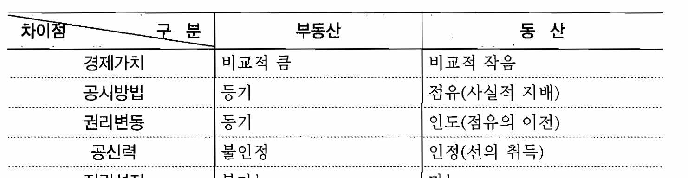
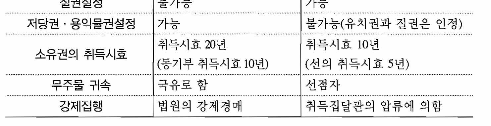

# kocw_부동산학개론_02

부동산학개론
(2주)
부동산의 법적 측면

부동산의 법적측면
• 법적 측면의 기준: 공시(公示)
• 동산과 부동산의 차이: 민법에 규정 물건 중에서 토지및 그
정착물은 부동산 그 이외는 동산
• 공시수단, 권리의 이전, 법적인 규제가 주요 관점

부동산의 법적 측면(민법)
• 제98조(물건의 정의) 본 법에서 물건이라 함은 유체물 및
전기 기타 관리할 수 있는 자연력을 말한다.
• 제99조(부동산, 동산) ① 토지 및 그 정착물은 부동산이다.
②부동산 이외의 물건은 동산이다.
• 금니는 민법상 물건인가?
• 개( dog)는 민법상 물건인가?
• 정착물은 원래는 동산이지만 부동산이 되는 것(부합)
• 문짝, 변기 등

부동산과 동산의 차이점

부동산의 법적 측면
• 제256조(부동산에의 부합) 부동산의 소유자는 그 부동산에 부합
한 물건의 소유권을 취득한다. 그러나 타인의 권원에 의하여 부
속된 것은 그러하지 아니하다.
• 제257조(동산간의 부합) 동산과 동산이 부합하여 훼손하지 아니
하면 분리할 수 없거나 그 분리에 과다한 비용을 요할 경우에는
그 합성물의 소유권은 주된 동산의 소유자에게 속한다. 부합한
동산의 주종을 구별할 수 없는 때에는 동산의 소유자는 부합당시
의 가액의 비율로 합성물을 공유한다.
• 제100조(주물, 종물) ① 물건의 소유자가 그 물건의 상용에 공하
기 위하여 자기소유인 다른 물건을 이에 부속하게 한 때에는 그
부속물은 종물이다.
• ②종물은 주물의 처분에 따른다

부동산의 법적 측면
• 제186조(부동산물권변동의 효력) 부동산에 관한 법률행위
로 인한 물권의 득실변경은 등기하여야 그 효력이 생긴다.
• 제187조(등기를 요하지 아니하는 부동산물권취득) 상속,
공용징수, 판결, 경매 기타 법률의 규정에 의한 부동산에 관
한 물권의 취득은 등기를 요하지 아니한다. 그러나 등기를
하지 아니하면 이를 처분하지 못한다.
• 제188조(동산물권양도의 효력, 간이인도) ① 동산에 관한
물권의 양도는 그 동산을 인도하여야 효력이 생긴다.
• ②양수인이 이미 그 동산을 점유한 때에는 당사자의 의사
표시만으로 그 효력이 생긴다.

부동산의 법적 측면
• 점유: 사실 상의 지배하에 두는 것
• 인도: 점유의 이전
• 제192조(점유권의 취득과 소멸) ① 물건을 사실상 지배하
는 자는 점유권이 있다.
• ②점유자가 물건에 대한 사실상의 지배를 상실한 때에는
점유권이 소멸한다.

공신력
• 1.공신력의 의의
•
공신력(公信力)은 외형적 사실을 믿고 거래한 사람을 보호
하는 공적인 신용의 힘으로 등기의 공신력이라고도 한다.
•
• 실제로는 아무런 권리 관계가 없으나, 있는 것으로 보이는
외형적 사실을 믿고 거래한 사람을 보호하기 위하여 권리
관계가 있는 것과 같은 법률효과를 부여하는 효력이다.
• 바꾸어 말하면 공신력이란 등기를 신뢰하고 거래한 자를
보호하기 위하여 설사 그 등기가 실체관계에 부합하지 아
니한다 하더라도 등기에 대응하는 실체관계가 있는 것으로
간주하는 것을 말합니다.

공신력
• 다시 말하면 물권의 존재를 추측하는 표상, 즉 점유나 등기
를 신뢰하고 거래를 한 자는 비록 그 표상이 진실한 권리관
계와 일치하지 않는 경우일지라도 그 표상대로의 권리취득
을 인정하여 이를 보호하여야 한다는 원칙이 공신의 원칙
인데, 부동산등기법에서는 이러한 공신의 원칙을 등기의
공신력이라고 한다.
한국의 등기제도는 등기의 형식적 성립요건만 갖추면 다른
조사 없이 서류심사만으로 등기할 수 있도록 되어 있기 때
문에 등기내용이 사실과 달라서 피해를 입었을 경우, 등기
공무원이 등기에 관한 실질적인 심사권이 없다는 이유 등
으로 공신력을 인정하고 있지 않으므로, 구제받기 어렵다
는 문제가 있다.

공신력
• 우리나라에서는 등기관에게 실질적인 심사권은 없고 형식
적 심사권만이 있다.
• 즉, 등기의 접수를 받은 등기관은 그 접수가 진짜이냐 여부
를 심사할 수 없고 요식행위, 즉 인감증명이나 기타의 필요
서류만 갖추면 등기를 하게 된다.
• 따라서 부동산의 실제 상황과 공부상에 일치하지 않는 경
우가 많을 것이므로 공신력을 인정하면 혼란이 생길 우려
가 있는 것이다.
• 독일은 등기의 공신력을 인정

공신력
• 등기의 "공신력"을 인정하지 않아 단순히 등기만으로는 소유권
등을 100% 확신할 수 없는 상황에서 부동산 권리 행사에 문제가
생겼을 때 피보험자(매수자)가 입은 손실을 보상해 주는 부동산
권원보험이 있다. 미국과 영국 등에서는 활성화되어 있지만 우리
나라는 이에 대한 인식이 아직 낮은 편이다.
• 등기부상 권리관계뿐만 아니라 다른 지적 공부도 마찬가지이다.
• 예를 들어 토지대장과 등기부등본에 면적이 1,000㎡라고 기재되
어 있어 1,000㎡에 해당하는 매매대금을 주고 토지를 매입하였는
데 실제 측량을 해보니 900㎡에 불과한 경우이다.
• 이러한 문제는 사전에 예방하는 것이 필요한데 계약 전에 현장
확인을 철저히 하는 것이 무엇보다 중요하다. 또 거래 이후 분쟁
의 소지에 대비하기 위하여 계약서상에 권리내용, 사실관계 등의
실제상황을 근거로 한다는 점을 부기로 명시해 두면 유리하다.

부동산의 법적 측면(민법)
• 제329조(동산질권의 내용) 동산질권자는 채권의 담보로
채무자 또는 제삼자가 제공한 동산을 점유하고 그 동산에
대하여 다른 채권자보다 자기채권의 우선변제를 받을 권리
가 있다.
• 제356조(저당권의 내용) 저당권자는 채무자 또는 제삼자가
점유를 이전하지 아니하고 채무의 담보로 제공한 부동산에
대하여 다른 채권자보다 자기채권의 우선변제를 받을 권리
가 있다.

부동산의 법적측면(민법)
• 제211조(소유권의 내용) 소유자는 법률의 범위내에서 그
소유물을 사용, 수익, 처분할 권리가 있다.
• 제245조(점유로 인한 부동산소유권의 취득기간) ① 20년
간 소유의 의사로 평온, 공연하게 부동산을 점유하는 자는
등기함으로써 그 소유권을 취득한다.
• ②부동산의 소유자로 등기한 자가 10년간 소유의 의사로
평온, 공연하게 선의이며 과실 없이 그 부동산을 점유한 때
에는 소유권을 취득한다.

부동산의 법적 측면(민법)
• 제249조(선의취득) 평온, 공연하게 동산을 양수한 자가 선의이며
과실없이 그 동산을 점유한 경우에는 양도인이 정당한 소유자가
아닌 때에도 즉시 그 동산의 소유권을 취득한다.
• 제250조(도품, 유실물에 대한 특례) 전조의 경우에 그 동산이 도
품이나 유실물인 때에는 피해자 또는 유실자는 도난 또는 유실한
날로부터 2년내에 그 물건의 반환을 청구할 수 있다. 그러나 도품
이나 유실물이 금전인 때에는 그러하지 아니하다.
• 제251조(도품, 유실물에 대한 특례) 양수인이 도품 또는 유실물
을 경매나 공개시장에서 또는 동종류의 물건을 판매하는 상인에
게서 선의로 매수한 때에는 피해자 또는 유실자는 양수인이 지급
한 대가를 변상하고 그 물건의 반환을 청구할 수 있다

부동산의 법적 측면(민법)
• 제252조(무주물의 귀속) ① 무주의 동산을 소유의 의사로
점유한 자는 그 소유권을 취득한다.
• ②무주의 부동산은 국유로 한다.
• ③야생하는 동물은 무주물로 하고 사양하는 야생동물도 다
시 야생상태로 돌아가면 무주물로 한다.
• 제253조(유실물의 소유권취득) 유실물은 법률에 정한 바
에 의하여 공고한 후 6개월 내에 그 소유자가 권리를 주장
하지 아니하면 습득자가 그 소유권을 취득한다.

OX 학습내용 정리문제
• 부동산에서는 등기의 공신력이 인정되지 않는다.
• 부동산에 관한 매매로 인한 소유권의 변경은 등기하여야
그 효력이 생긴다.
• 부동산의 점유취득시효는 10년이다.
• 의제부동산은 경제적 측면에서의 부동산과 관련이 깊다.
• 정답: O O X X
