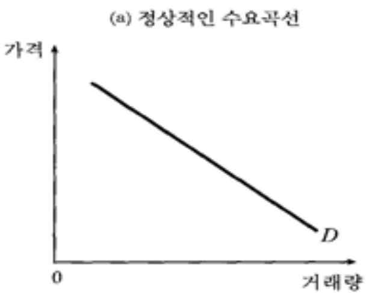
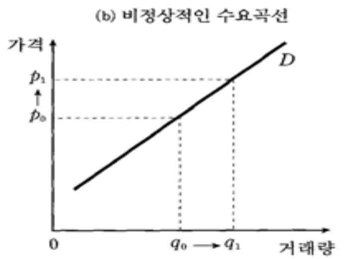
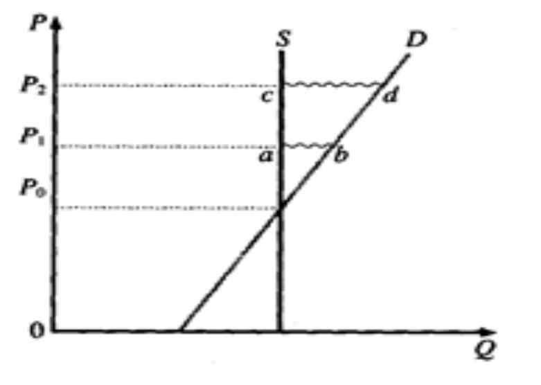

# kocw_부동산학개론_08

부동산학 개론
(8주)
역수요공급법칙

부동산학과 주택정책
감정평가론의 처음에 시작하는 것이 바로 부동산의 자연적 특성이다.
개별성 이외에도 부동산의 수명은 영원하다는 영속성이 부동산의 특징
이다.
그리고 부동산은 서로 인접해서 연속되어 있으며 이로 인해 경제학에
서 말하는 외부효과를 받는다는 인접성이 부동산의 다른 특징이다.
또 합병과 분할의 가능성, 시간의 흐름에 따라 행정적, 경제적, 사회적
위치가 변한다는 행정적, 경제적, 사회적 위치의 가변성이 또한 부동산
의 특성이다.
부동산학에서 주택정책을 바라본다면 부동산의 이러한 특성을 염두에
두고 주택문제를 바라보는 것이라고 볼 수 있다.

부동산학과 주택정책
즉, 경제학에서는 분석의 편의를 위해 부동산의 개별성을 무시하지만
부동산학에서는 그러한 개별성을 오히려 부각시키면서 주택문제를 접
근하는 것이라고 볼 수 있다.
신고전파의 경제학에서는 가격매커니즘을 규제하는 정부의 개입은 별
효과를 거두지 못할 것이라고 하지만 현실은 부동산시장에서 정부의
역할은 어느 정도 상당한 역할을 하고 있다. 이러한 사실을 설명하는
것이 부동산학의 고유영역일 수도 있다.
경제학에서 제대로 설명하지 못하는 주택정책과 관련된 사회현상을
부동산의 개별성과 영속성 등을 염두에 두고 접근하는 부동산학에서
이 사실을 보다 잘 설명할 수도 있다.
->부동산을 일반재화와 다르게 취급해야 하느냐의 문제.

주택의 특수성과 수요공급법칙
주택수요에 관한 경제학적 연구는 대부분 미시경제학의 소비자행동이
론에 그 이론적 근거를 두고 있다. 그러나 주택수요의 구체적인 연구방법
은 다른 일반적인 상품수요에 관한 연구방법과 상당한 차이를 보이고 있
다. 그 이유는 주택이 다른 상품과 구별되는 독특한 속성을 지니고 있기
때문이다.
즉, 소비자행동이론에서 분석대상으로 삼는 대부분의 상품들은 비내구
재적이고, 동질적이며, 공간적으로 이동 가능한 속성을 갖고 있는 반면에
주택은 내구적이고 이질적이고, 공간적으로 고정되어 있기 때문이다.
주택이라는 상품이 가지고 있는 이러한 독특한 특성들은 주택수요에 관
한 간명한 일반이론의 정립을 어렵게 만들고 있다. 그 결과 지금까지 이
루어진 주택수요에 관한 연구의 대부분은 주택의 일부 특성을 중심으로
전개되어 온 특수이론이라고 할 수 있다.
-이중희, 주택경제론 중에서-

수요공급법칙
☞ 수요의 법칙
: 가격과 수요량 사이의 역의관계, 즉 가격이 하락할 때 수요량
이 증가하고 가격이 상승하면 수요량이 감소하는 현상을 말한
다. 그리고 수요의 법칙에서는 가격이 독립변수이고 수요량은
종속변수이다.
☞ 공급의 법칙
: 가격과 수요량 사이의 정의관계, 즉 가격이 하락할 때 공급량
이 감소하고 가격이 상승하면 공급량이 증가하는 현상을 말한
다. 그리고 공급의 법칙에서는 가격이 독립변수이고 공급량은
종속변수이다.

역수요공급법칙
17평형은 지난달 말 이후 2000만원 정도 오른 5억5000만∼5억6000만원
선에 거래되고 있다. 호가는 5억7000만원까지 나오고 있다.
지난 주 한국은행이 콜금리를 인하한 후 매수문의가 늘었으며 이번주
들어서는 거래도 활발하다는 것이 인근 중개인의 설명이다.
강남구 대치동 해창아파트는 지난달 말 사업승인을 받으면서 매물도 끊
기고 호가도 올라간 상태다. 20평형은 이달 들어서만 호가가 1000만 정
도 오른 3억6000만원에 나오고 있다.
지난달 말 정밀안전진단을 통과해 개포주공 1단지의 11평형의 경우 20
일새 3000만원 정도가 오른 3억8000만원 선에 거래되고 있다. 15평형 역
시 3000만원 정도 올라 5억7000만∼5억8000만원 정도에 시세가 형성돼
있다. (7월 14일자)

| . |
| --- |

역수요공급법칙
10.29 부동산종합대책`과 관련, 부동산 시장은 아직까지 관망세를 보이고
있으나 강남권 일부 단지에서는 매물이 하나 둘씩 나오고 있다. 정상가격
의 매물이 조금씩 나오고 있으나 `가격이 떨어질 것`이라는 기대심리가
확산되면서 매수세가 실종돼 거래는 거의 이뤄지지 않고 있으며 기존에
나온 급매물 들이 호가를 낮추는 상황도 이어지고 있다. 일반아파트보다
는 수익성에 대한 불확실성이 커진 재건축단지가 더 큰 충격을 받아 술렁
이고 있는 양상이다. 업계에서는 앞으로 2-3일이 지나면 매물이 크게 늘
어날 것으로 전망하고 있다. 다만 같은 강남권내에서도 송파, 서초, 강동
구는 이번 대책의 영향이 조금씩 나타나는 조짐을 보이고 있으나 강남구
는 매수.매도 문의전화가 전혀 없는 등 별다른 영향을 받지 않는 모습이다

역수요공급법칙
☞ 일반재화의 수요와 부동산 수요의 차이:
부동산에는 영속성이 있어 일반재화와는 달리 현재의 수요자는 미래의
공급자가 된다.
☞ 일반재화의 공급과 부동산 공급의 차이:
부동산에는 부증성이 있어 일반재화와는 달리 현재의 공급자는 미래의
수요자가 된다.
* 시장의 참가자들이 과거지향적 기대를 한다면, 부동산가격이 오르면
미래에도 오를 것이라는 기대를 하고, 부동산가격이 떨어지면 미래에도
떨어질 것이라는 기대를 하는 공감대가 형성된다.

적응적 기대와 합리적 기대
• 미래에 대한 예측방법과 부동산
• 경제학에서 이야기 하는 기대이론은 정태적 기대가설, 적
응적 기대가설, 합리적 기대가설, 완전예견적 기대가설이
있다. 그 중에서 가장 많이 논의되는 적응적 기대가설과 합
리적 기대가설에 대해서 중점적으로 논의해 보기 한다.
• 과거로부터 현재에 이르는 추세를 바탕으로 미래를 예측하
되, 예측치가 실제 값과 다를 경우 그 차이를 감안하여 예측
치를 적절히 수정하면서 미래를 예측하는 방법을 적응적
기대형성이라고 부르며, 사람들이 적응적 기대형성에 따라
미래를 예측한다고 보는 이론을 적응적 기대(형성)가설이
라고 부른다.

적응적 기대와 합리적 기대
• 그러나 최근의 추세가 미래에도 계속된다는 보장은 전혀
없으며, 설령 예측치와 실제치 사이의 오차를 고려해서 예
측치를 수정한다고 하더라도 미래를 올바로 예측한다는 보
장은 없다.
• 그래서 합리적인 사람은 최근의 추세뿐만 아니라 구득가능
한 범위 안에서 관련된 모든 정보를 총동원하여 가장 적절
한 방법으로 미래를 예측한다는 이론이 등장하게 되는데,
이 이론을 합리적 기대(형성)가설이라고 부른다.

적응적 기대와 합리적 기대
• 사람들이 합리적으로 미래를 예측한다고 해서 미래에 대해
완전한 예견능력을 갖는다는 말은 아니다. 사람들은 실수
를 통해서 배우는 존재이기 때문에 한두 번 실수를 할 수는
있어도 실수를 거듭하지는 않는다고 말할 뿐이다. 합리적
으로 미래를 예측한다고 해서 모든 사람이 미래를 똑같이
예측한다는 것도 아니다. 사람마다 미래에 대한 예측치가
달라질 수 있다. 각자 이용하는 정보의 종류나 질과 양이 다
르기 때문이다.
• 하지만, 합리적 기대가설의 주장자들은 사람들의 다양한
예측치들이 대체로 정규분포를 이루며, 이 예측치들의 평
균값은 경제이론이 예측하는 실제 값에 근접하는 경향이
있다고 말한다.

적응적 기대와 합리적 기대
• 사람들이 부동산시장에서 합리적기대가설에 의해 행동한
다면, 사람들은 과거의 가격의 움직임과 상관없이 가능한
범위 안에서 부동산의 실제 가격과 시장의 근본가치를 비
교하고 실제가격이 시장의 근본가치를 넘어서면 수요를 줄
이고, 반대로 가격이 시장의 근본가치보다 떨어지면 수요
를 늘린다는 것이다.
• 반면에 사람들이 부동산시장에서 적응적기대가설에 의해
서 행동한다면 이는 과거에 부동산가격이 오르면 비록 실
제치와 조정하는 과정을 거치지만, 미래에도 부동산가격이
오를 것이라고 예측하고 반대로 부동산가격이 떨어지면 미
래에도 부동산가격이 떨어질 것이라고 예측하고 행동하는
것을 말한다.

적응적 기대와 합리적 기대
• 그런데 사람들이 부동산시장에서 행동할 때 적응적 기대가
설을 취하느냐 합리적인 기대가설을 취하느냐에 따라 수요
곡선의 모양이 달라질 수 있다.
• 사람들이 합리적 기대가설에 의해 행동한다면 가격이 올라
갈수록 시장근본가치보다 가격이 더 올라가고 실제가격과
가치와의 차이를 의미하는 거품이 커질 것이므로 수요를
더 줄일 것이다. 이것은 우리가 흔히 보는 수요의 법칙을 만
족하는 우하향하는 정상적인 수요곡선이다.

적응적 기대와 합리적 기대
• 그러나 만약에 사람들이 적응적기대가설에 따라서 행동하게 된
다면, 과거에 부동산가격이 오르면 미래에도 오를 것이라는 기대
를 하고 시장에서 행동하는 것을 말한다. 그러면 과거에 부동산
가격이 올랐다면 수요를 증가시키게 된다. 부동산은 영속성(혹은
내구성)이 있어서 수요자로서 산 부동산을 나중에 공급자로서 되
팔 수 있기 때문이다. 그러면 과거보다 미래에 가격이 더 오른다
는 예측이 형성된다면 수요를 증가시켜서 부동산을 매입한 후 나
중에 더 오른 가격에 파는 것이 경제적이득이 된다. 따라서 수요
를 더 증가시키게 된다.
• 이는 가격이 오를수록 수요량이 증가하는 것으로 가격과 수요량
이 반대로 움직인다는 수요의 법칙이 성립하지 않으며, 우리가
보는 수요곡선과 반대로 가격과 수요량이 같은 방향으로 움직이
는 우하향하는 수요곡선을 보이는 비정상적인 수요곡선을 보이
게 된다.

적응적 기대와 합리적 기대
• 가격이 비싸지는데 수요가 줄지 않고 오히려 증가한다면
이는 수요의 법칙에 어긋난다. 수요의 법칙이 성립하지 않
는 시장에서는 시장의 자기조절 기능이 보장되지 않는다.
이런 시장은 정상적인 시장이 아니다.
• 수요곡선이 우하향하지 않고 우상향하게 되면 경우에 따라
서는 균형가격을 어떤 계기로 벗어나게 되면 초과공급이
발생해 가격을 낮추려고 하는 것이 아니라 오히려 초과수
요가 발생해 가격이 더 상승하게 된다.

적응적 기대와 합리적 기대
• 가격이 비싸지는데 수요가 줄지 않고 오히려 증가한다면
이는 수요의 법칙에 어긋난다. 수요의 법칙이 성립하지 않
는 시장에서는 시장의 자기조절 기능이 보장되지 않는다.
이런 시장은 정상적인 시장이 아니다.
• 수요곡선이 우하향하지 않고 우상향하게 되면 경우에 따라
서는 균형가격을 어떤 계기로 벗어나게 되면 초과공급이
발생해 가격을 낮추려고 하는 것이 아니라 오히려 초과수
요가 발생해 가격이 더 상승하게 된다

적응적 기대와 합리적 기대
• <그림>에서 규형가격인 P에서 P으로 가격이 상승하게 되
면 초과수요(b-a)가 생기고 이러한 초과수요로 인해 가격은
P로 상승하게 되고 이 때 초과수요(d-c)는 예전(b-a)보다 더
커지게 된다.
• 이것이 시장의 근본가치를 훨씬 초과해서 발생하는 거품가
격의 발생요건을 말해주고 있다.

역수요공급법칙과 visible-hand
역수요공급법칙이 작동한다면 부동산 가격은 균형을 향한 시장의 자
동조절기능이 작동하지 않는다고 볼 수도 있다.
때문에 visible-hand(정부의 개입)가 나타나서 어느 정도는 가격을 조정
해 주어야만 한다.
부동산의 특성과 정책
☞ 떴다방단속: 모델하우스와 부동산의 개별성의 고려
☞ 강남재건축 규제완화 문제:

역수요공급법칙
☞ 생각해 볼 점:
매매와 전세: 영속성의 차이, 계약기간의 존재의 차이
장기와 단기: 공급의 조절, 부증성의 완화의 여부
정태적 분석과 동태적 분석: 정지된 시점으로 볼 것이냐, 시간까지도 고려할 것
인가?

OX 학습내용 정리문제
• 가격이 비싸지는데 수요가 줄지 않고 오히려 증가한다면 이는 수
요의 법칙에 어긋난다.
• 과거로부터 현재에 이르는 추세를 바탕으로 미래를 예측하되, 예
측치가 실제 값과 다를 경우 그 차이를 감안하여 예측치를 적절
히 수정하면서 미래를 예측하는 방법을 합리적 기대형성이라고
부른다.
• 역수요공급법칙이 작동한다면 부동산 가격은 균형을 향한
시장의 자동조절기능이 작동하지 않는다고 볼 수 있다.
• 정답: X X O
