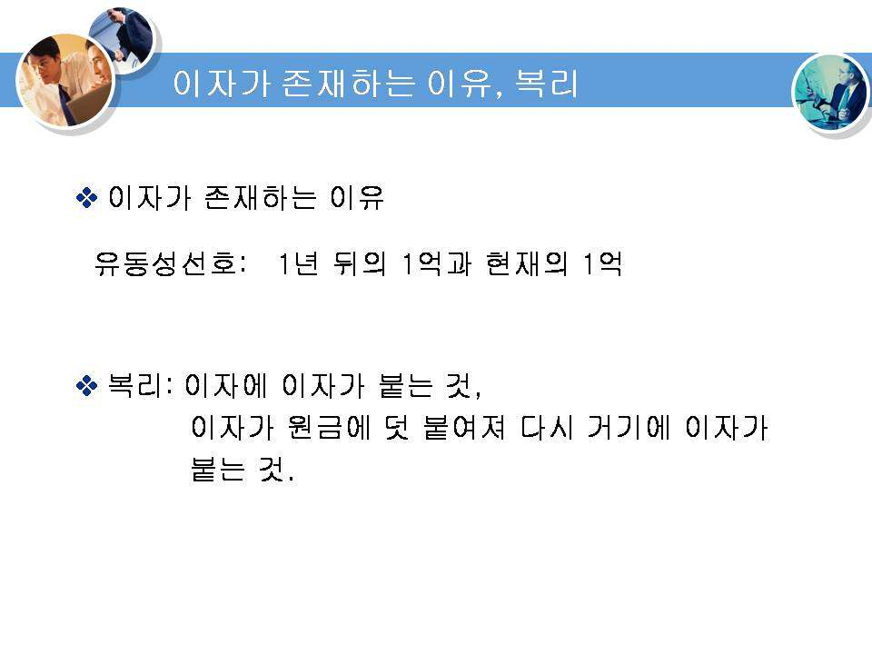
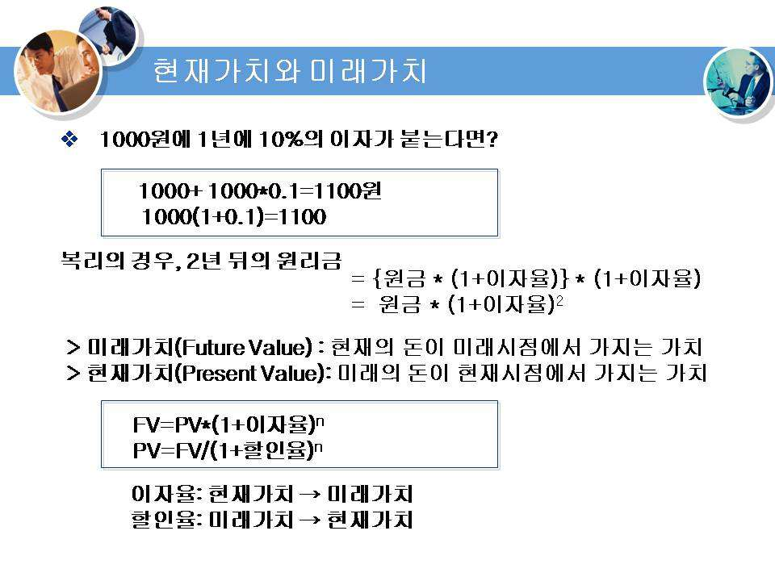
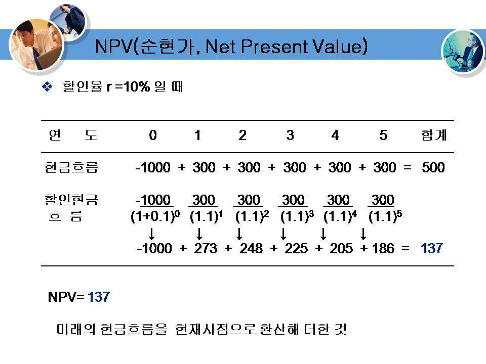
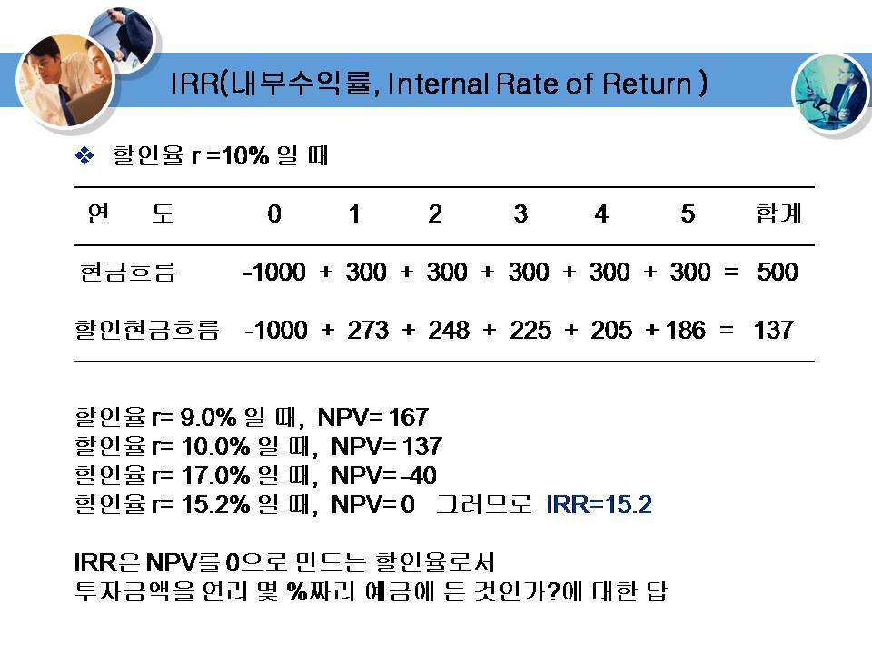
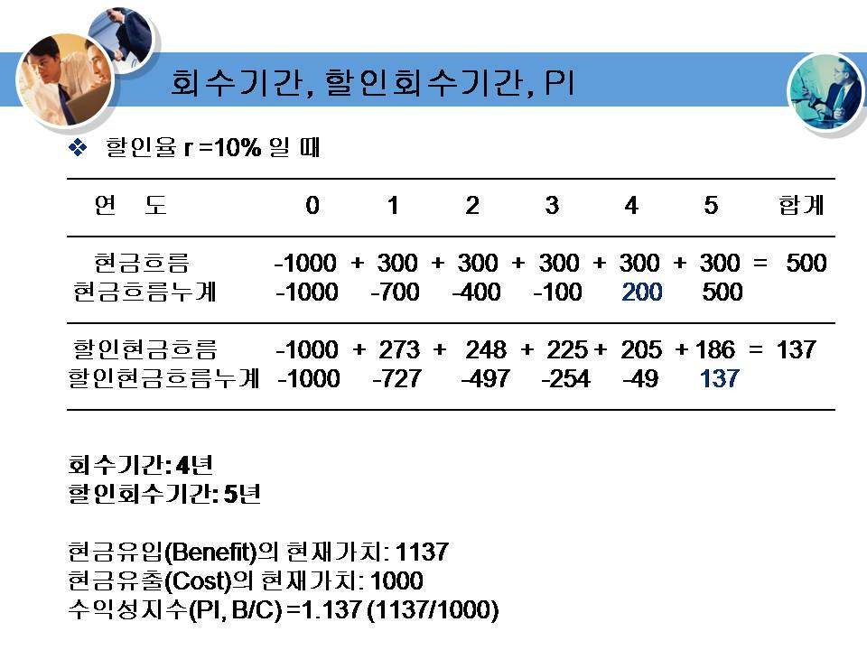
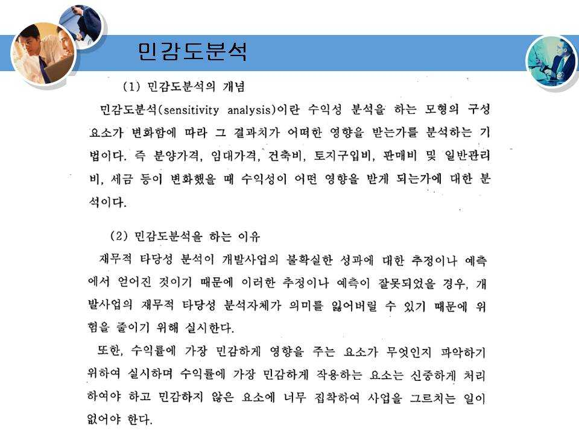

# kocw_부동산학개론_12

부동산학 개론
(12주)
부동산 투자론

부동산 투자론
• 강의내용
• 투자의 개념
• 레버리지 효과
• 프로젝트 파이낸싱(project financing)
• 돈의 시간가치
• NPV
• IRR

부동산 투자론
• 투자란 장래의 이익을 위해서 현재의 소비를 희생하는 것.
• 저축과 달리 위험이 존재함.
• 부동산 투자는 레버리지 효과와 부동산금융을 이해하면 생
각보다 많은 돈이 들지 않고 고수익을 올릴 수 있다.
• 레버리지 효과는 프로젝트 파이낸싱(project financing)과도
관련이 있다.

순운영소득(NOI)
• 순운영소득(NOI)은 가능 총소득에서 공실액과 운영경비를
제한 것으로 부채와 지분 투자자에게 배분이 기대되는 수
입의 양을 측정한 숫자로 볼 수 있다.

레버리지 효과
• 레버리지 효과란 차입금 등 타인 자본을 지렛대로 삼아 자기자본
이익률을 높이는 것으로 '지렛대 효과'라고도 한다.
• 가령 100억 원의 투하자본으로 10억 원의 순익을 올리게 되면 자
기자본이익률은 10%가 된다. 하지만 자기자본 50억 원에 타인자
본 50억 원을 더해 10억 원의 수익을 낸다면 자기자본이익률은
20%가 된다.
• 차입금 등의 금리 비용보다 높은 수익률이 기대될 때는 타인자본
을 적극적으로 활용해 투자를 하는 것이 유리하다.
• 그러나 과도하게 타인자본을 도입하면, 불황 시에 금리 부담으로
저항력이 약해진다. (출처: 네이버 금융사전)

레버리지 효과
• ◎ 부채를 이용할 경우의 장점
• ① 부채는 자기자본수익률을 상승시키는 지렛대 역할을 한
다.
• ② 단기 운영만을 볼 때 부채조달 비용이 전체 자산운용 수
익보다 낮을 때 양(+) 효과가 있다. 즉 부채를 이용하는 것
이 이용하지 않은 것보다 수익률이 더 크다는 것이다.
• ③ 지급이자로 인해 세금을 감면 받을 수 있다.
• ④ 제한된 자원을 분산 투자하여 이익을 확대 할 수 있을 뿐
·아니라 위험을 분산할 수 있다.

레버리지 효과
• ◎ 부채를 이용한 경우의 단점(비용)
• ① 고수익(high return)에는 고위험(high risk)이 따르기 마련
인데 부채를 이용하는 경우도 이와 마찬가지이다. 즉, 부채
로 인해 양(+)방향의 레버리지는 수익률을 확대시키지만,
음(+)방향의 레버리지는 비용의 변동성이 커져 수익이 차
입비용 이하로 떨어진다면 도산하거나 담보물이 처분될 수
있다.
• ② 금융기관들은 자금을 투자자에게 빌려주는 대가로 수수
료를 요구하기 때문에 비용이 증가된다.
• ③ 대부비율(LTV ratio)이 늘어남에 따라 대부자의 위험도
증가하기 때문에 이자율을 상승시킨다.
• ④ 증가된 위험과 유질 처분 가능성에 대한 비용, 금융 중개
인의 수수료 등 모든 비용을 감안하면 수익보다 부채비율
이 더 많이 늘어 날 수 있다.

프로젝트 금융
• 프로젝트금융(P/F: Project Financing)이란 사업주와 법적으
로 독립된 프로젝트로부터 미래에 발생하는 현금흐름(cash
flow)을 담보로 하여 해당 프로젝트의 자금을 조달하는 기
법이다.
• 프로젝트금융에서는 대출 상환 재원이 프로젝트의 사업성
이며 기업의 신용과는 무관하다.
• 그러므로 프로젝트금융에서는 당해 프로젝트에서 발생하
는 수익과 프로젝트를 수행하는 기업의 다른 사업에서 발
생하는 수익이 구분·관리되어야 한다.
• 프로젝트금융과 기업금융을 비교해 보면 다음과 같다.

OX 학습내용 정리문제
• 타인으로부터 빌린 차입금이 작을 수록 이자부담이 작아지
기 때문에 수익률이 좋아지는 것을 레버리지 효과(Leverage
Effect) 또는 지렛대 효과라고도 한다.
• NPV가 0보다 크면 사업의 경제성이 있다.
• IRR이 0보다 크면 사업의 경제성이 있다.
• PI가 1보다 크면 사업의 경제성이 있다.
• 정답: X X X O
