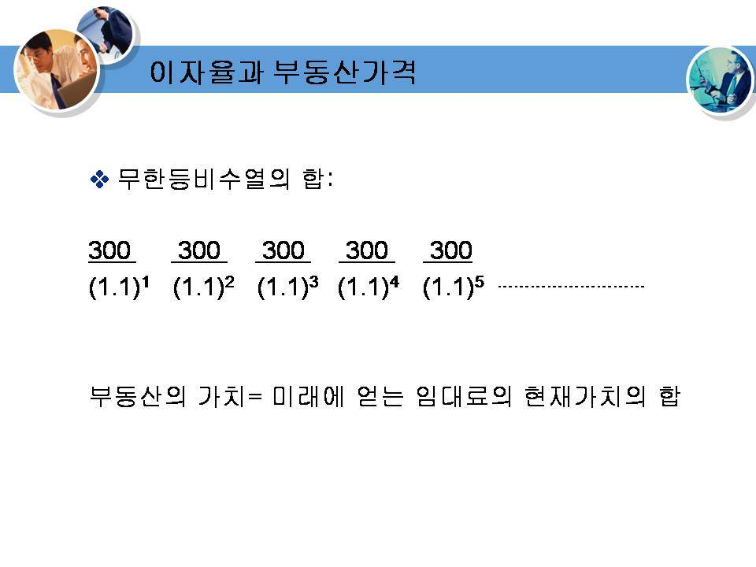
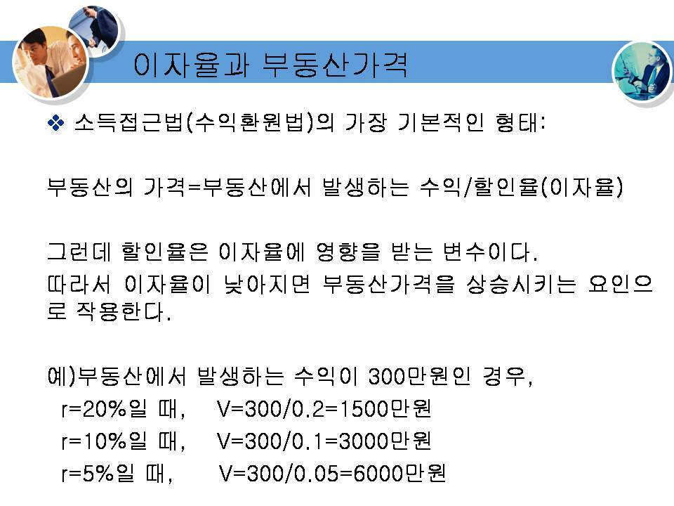
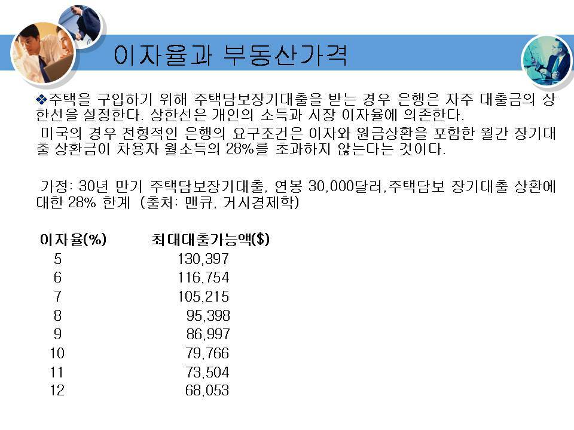
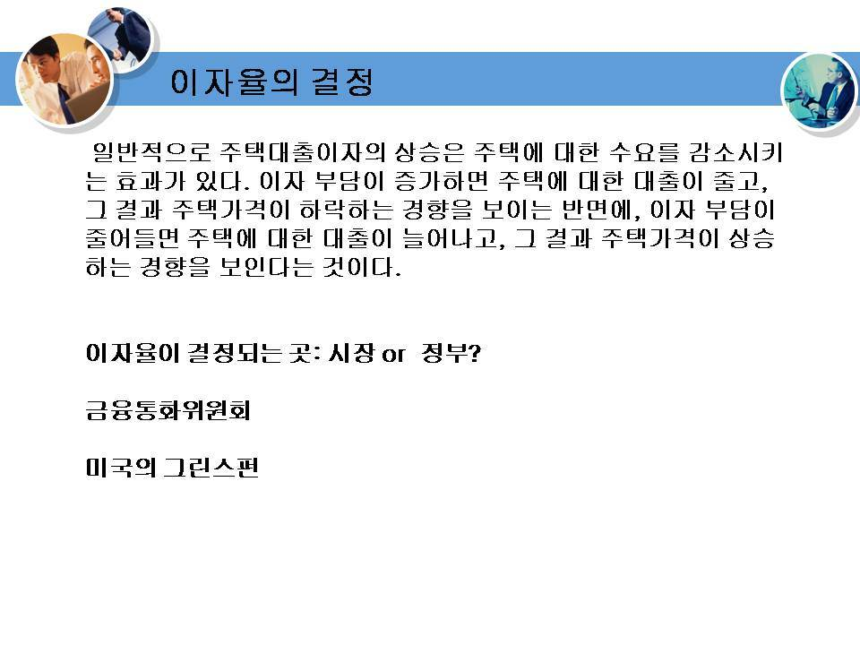
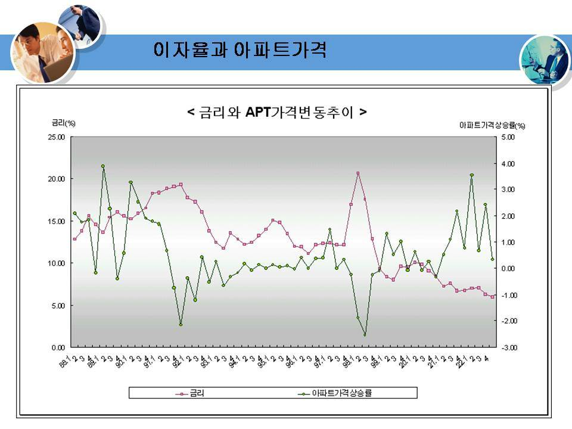
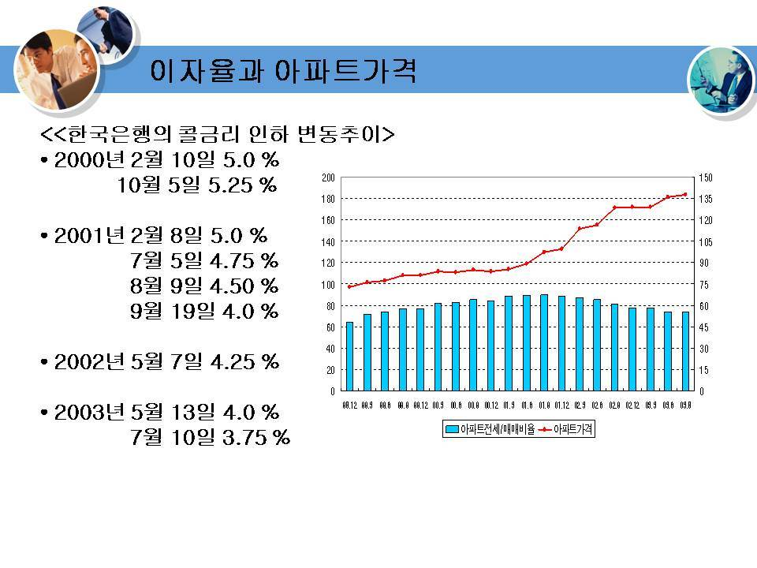

# kocw_부동산학개론_15

부동산학 개론
(15주)
기말고사(보충심화학습)

부동산가격과 이자율

부동산가격과 이자율

부동산가격과 이자율

부동산가격과 이자율

부동산가격과 이자율

부동산 투자론
• 투자란 장래의 이익을 위해서 현재의 소비를 희생하는 것
• 부동산 투자는 레버리지 효과와 부동산금융을 이해하면 생
각보다 많은 돈이 들지 않고 고수익을 올릴 수 있다.
• 레버리지 효과는 프로젝트 파이낸싱(project financing)과 도
관련이 있다.
