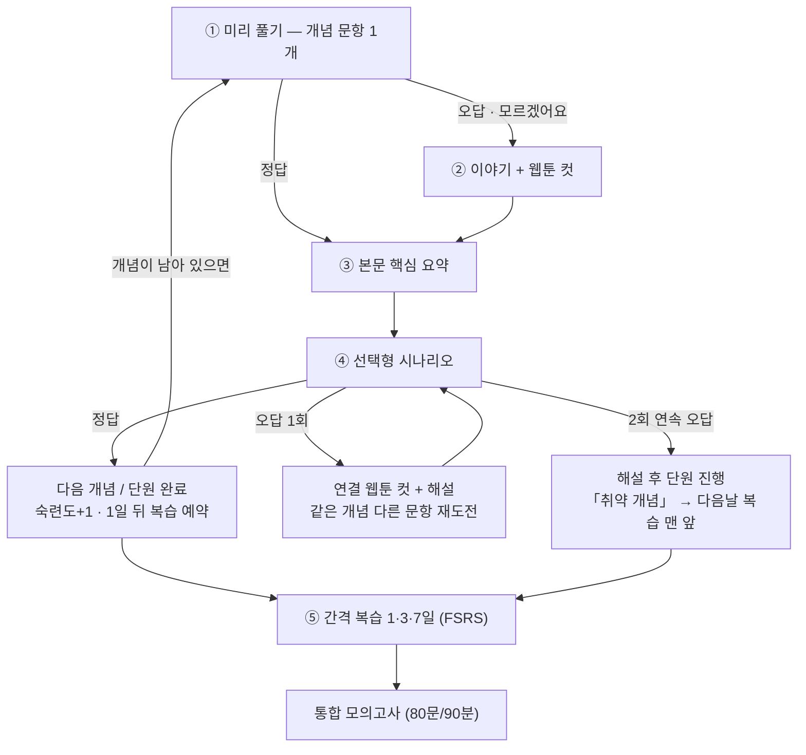
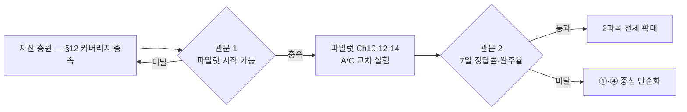

# 적응형 학습 엔진 설계 — 시험 공통 4단계 학습 흐름

> **문서 ID**: DOC-USR-22
> **범위**: exam:carework · 판본: none
> **적용 범위**: 최초 적용 carework, 요양보호사 외 시험에도 동일 엔진 적용 예정 — 시험별 콘텐츠 팩만 달라지고 개념 태그·적응형 라우팅·FSRS·오답 분석 구조는 공통입니다.
> **구현 상태**: carework는 런타임 뷰 `care-flow`로 구현·배포됨 (2026-11). 구현 정본은 「4단계 런타임 플로우 설계」(DOC-USR-24) — 본 문서는 설계 근거·파일럿 계획 원본입니다.
> **갱신**: Nov 6, 2026 — 구현 반영분(자산·키·웹툰 자산 존재) 표기 + 개념 커버리지 감사(§12)·실험 설계 정합·FSRS/BKT 역할 분리 반영 + 시험 공통 명칭으로 개명 + 3차 리뷰(문량표·대조군·level) + 4~5차(로드맵 버그·pretest·C 범위·eval\_pool 파일 분리 격리)
> **판본 이력**: DOC-USR-22 개정판 — 동일 ID 연속 관리, 변경 이력은 본 「갱신」 행에 누적

작성 Nov 5, 2026 · @coteleaf

## 1. 개요

한 단원을 교재(지식) → 이야기(맥락) → 웹툰(기억) → 선택형 시나리오(판단)의 4단계로 학습시켜, 같은 학습 시간으로 시험 정답률과 완주율을 함께 높이는 것이 목표입니다.

- **대상**: 요양보호사 자격시험을 준비하는 40\~50대 교육생. 일과 병행하므로 학습 시간이 짧고 끊기기 쉽습니다.
- **범위**: 1과목 요양보호론, 2과목 요양보호실기. 기존 표준형·이야기형 교재와 웹툰 컷을 그대로 재사용합니다.
- **성공 기준**: 직후·7일 평가 정답률, 단원 완주율(§9 지표와 동일 — 파일럿에는 모의고사 없음). 4단계 단원과 기존 방식 단원을 비교해 판단합니다.
- **전제**: 4단계 런타임은 `care-flow` 뷰로 구현·배포됐습니다(개념 30개·전용 문항 18개(시나리오 12·미리풀기 6) + 문제은행 태그 43문). 남은 것은 **효과 검증**입니다 — 파일럿으로 학습 효과를 확인한 뒤 확대합니다. 단, 개념 커버리지 규칙 충족이 0/30입니다(§12).

## 2. 4단계 구성과 학습 원리

네 단계는 서로 다른 일을 맡습니다. 정확성은 교재가 책임지고, 나머지 세 단계는 그 내용을 오래 남기고 현장에서 꺼내 쓰게 만드는 역할입니다.

| 단계 | 역할 | 학습 원리 | 자산 |
| --- | --- | --- | --- |
| 교재 | 지식: 수치·용어·원칙의 기준 | 정확성(유일한 근거) | 표준형 MD |
| 이야기 | 맥락: 왜 그렇게 하는지 | 정교화(elaboration) | 이야기형 MD의 story 슬롯 |
| 웹툰 | 기억: 장면으로 남기기 | 이중 부호화(dual coding) — 현재는 텍스트 말풍선 컷이라 부분 적용, 장면 컷 도입 시 완전 적용 | 장면 컷 + 도해 컷 |
| 선택형 시나리오 | 판단: 상황에서 고르기 | 인출 연습(retrieval practice) | 문항 뱅크 |

흐름 전체에는 세 가지 원리가 더 들어갑니다.

- **사전 시험 효과**: 배우기 전에 먼저 풀면, 틀려도 뒤에 배우는 내용이 더 잘 남습니다.
- **간격 복습**: 하루·3일·7일 뒤에 다시 꺼내면 잊는 속도가 느려집니다.
- **적응형 경로**: 이미 아는 개념은 건너뛰어 짧은 학습 시간을 모르는 데 씁니다.

단계를 순서대로 모두 거치는 것이 아니라, 개념마다 필요한 단계만 거치는 것이 핵심입니다.

## 3. 단원 흐름과 소요 시간

한 단원은 ①\~④를 한 번에 약 15분(재도전 없을 때 기준 — 재도전 발생 시 초과) 안에 끝내고, ⑤ 간격 복습을 거쳐 모의고사로 이어집니다. (용어: 「4단계」는 ①\~④의 콘텐츠 단계이고, ⑤ 간격 복습은 학습 이후의 유지 관리 단계입니다.)

①에서 맞힌 개념은 ②를 건너뛰고, ④에서 같은 개념을 2회 연속 틀리면 해설만 보고 다음으로 넘어갑니다(4장). 소요 시간은 개념 3개 단원을 기준으로 한 예상치이며, 파일럿에서 실제 값을 잽니다.

## 4. 적응형 라우팅 규칙

라우팅은 단원이 아니라 **개념 태그** 단위로 판단합니다. 한 단원에 개념이 3개면, 맞힌 개념은 건너뛰고 틀린 개념만 이야기·웹툰을 거칩니다.

| 조건 | 다음 화면 | 기록 |
| --- | --- | --- |
| ① 미리 풀기 정답 | ③ 본문 핵심 요약(1화면)을 보고 ④로 | 숙련도 +1 |
| ① 미리 풀기 오답 | ② 해당 개념의 이야기 슬롯·웹툰 컷 → ③ → ④ | 오답 보기 기록 |
| ① 「모르겠어요」 선택 | 오답과 같은 경로 | 추측 없음으로 구분 |
| ④ 시나리오 정답 | 다음 개념 또는 단원 완료 | 숙련도 +1, 1일 뒤 복습 예약 |
| ④ 시나리오 오답(1회) | 고른 보기에 연결된 웹툰 컷 → 해설 → 같은 개념 다른 문항. 연결 컷 없으면 개념 대표 컷(concepts.cuts[0]), 그것도 없으면 해설만 (현재 0건 — §12) | 오답 보기 기록 |
| ④ 같은 개념 2회 연속 오답 | 해설까지만 보고 단원 진행, 「취약 개념」으로 표시 | 다음날 복습 맨 앞에 배치 |

- 같은 문항을 바로 다시 내지 않습니다. 보기를 기억해서 맞히는 것을 막기 위해 같은 개념의 다른 문항을 냅니다. 그래서 개념마다 문항이 최소 5개 필요합니다(§5 규칙 7 — 학습 경로 최소량).
- 루프는 2회로 끊습니다. 한 개념에서 막히면 지치고 그만두기 쉽기 때문입니다.
- ②·③은 언제든 수동으로 열 수 있습니다. 건너뛰는 것은 기본값일 뿐 막는 것이 아닙니다.

## 5. 콘텐츠 자산과 선택형 문항 작성 규칙

선택형 시나리오는 새로 쓰는 것이 아니라, 이미 있는 이야기의 비트를 문항으로 바꾼 것입니다. 웹툰 가이드라인의 비트 분해를 그대로 쓰면 두 자산이 같은 내용을 가리키게 됩니다.

**문항 자산 1차 충원은 기존 문제은행 태깅으로 시작합니다.** 과목1·과목2 문제은행 160문에 개념 태그만 부여하면, 새 문항을 쓰기 전에 pre·scenario·review 후보 풀이 확보됩니다. 학습 경로 5문항 / 파일럿 7문항 기준(규칙 7)이 안 채워지는 태그만 신규 문항으로 보완합니다 — 신규 작성은 최소화하고, 검수 우선순위도 태그 부족분에 집중합니다. *(반영: `items/bank_tags.json` 43문 태깅—전부 review 역할 + `items/scenario_items.json` 18문—시나리오 12·미리풀기 6. 개념당 규칙 전체 충족 개념은 현재 0/30입니다 — §12 커버리지 감사.)*

### 비트 → 문항 변환

| 이야기 비트 | 문항에서의 역할 | 예(2과목 식사 돕기) |
| --- | --- | --- |
| 상황 비트 | 문항 지문(상황 제시) | 최복순 어르신이 누운 채 점심을 기다린다 |
| 함정 비트(미영의 실수) | 대표 오답 보기 | 서둘러 숟가락을 들고 먹여드린다 |
| 원칙 비트(박은정 선임의 교정) | 정답 + 해설 첫 문장 | 상체를 일으키고 스스로 드실 수 있는 만큼 돕는다 |
| 웹툰 컷 | 오답 후 보여줄 분기 화면 | 함정 컷 → 교정 컷 순서 |
| recall 블록 | 간격 복습 문항의 원천 | 「상체 몇 도?」 같은 단답형 질문 |

### 문항 작성 규칙

1. **시험 형식에 맞춥니다.** 본 시험과 같은 5지선다, 정답 1개. 「가장 적절한 것은?」·「옳지 않은 것은?」 표현을 그대로 씁니다.
2. **한 문항에 한 개념.** 문항마다 개념 태그를 정확히 하나 달아, 오답이 어느 개념의 약점인지 분명하게 합니다.
3. **오답 보기는 실제 실수에서 가져옵니다.** 미영의 함정 비트, 교재의 「주의」 항목, 기출 오답 순서로. 말도 안 되는 보기는 넣지 않습니다.
4. **수치는 본문과 한 글자도 다르지 않게.** 문항의 숫자·법조항은 표준형 MD에서 자동으로 대조합니다(11장 검수).
5. **해설은 3문장 이내.** 정답 근거 1문장, 고른 오답이 틀린 이유 1문장, 현장 팁 1문장. 보기마다 따로 해설을 달아 고른 보기에 맞는 말을 보여줍니다.
6. **인물 설정을 지킵니다.** 최복순 어르신은 무릎 통증만 있고 편마비·당뇨는 없습니다. 편마비 문항은 김순례(가칭) 어르신으로 씁니다.
7. **개념당 최소 문항 두 기준.** 학습 경로 최소 = pre 1 + scenario **2** + review 2 = **5문항**; 파일럿 단원은 +eval 2 = **7문항** (공통 사전 평가 pretest는 단원당 별도 1세트) — 시나리오 오답 시 "같은 개념의 다른 문항" 재도전 규칙상 scenario는 2개가 필요합니다(§4). 문항 부족 시 폴백은 런타임이 명시적으로 관리합니다: ① 같은 개념의 기출 문항을 재도전으로 배정 — 사용 문항은 7일 「처음 보는 문항」 후보에서 제외하고 exposure_count에 기록, ② 불가하면 재도전 없이 해설 후 진행(부족 상태를 기록에 표시). pre 문항은 모르는 사람도 풀어볼 만한 상식 수준으로 씁니다.

### 역할별 필요 문량 (개념당)

| 역할 | 최소 수량 | 용도 |
|------|----------|------|
| pre | 1 | ① 미리풀기 |
| scenario | 2 | ④ 본문항 + 재도전 문항 |
| review | 2~3 | ⑤ 간격 복습 (7일 복습은 처음 보는 문항 원칙) |
| eval | 2 | 파일럿 직후·7일 평가 전용 — **학습 경로에서 절대 노출 금지** (별도 평가 풀로 격리) |
| pretest | 단원당 1세트 | 두 조건 공통 사전 평가(§9 통제 ②) — 학습·eval 풀과 격리, 개념당이 아닌 단원당 기준 |

## 6. 데이터 모델

**엔진 규칙과 시험별 설정의 경계**: 라우팅·FSRS/BKT·학습 기록·오답 분석은 엔진(공통)이고, 과목 구조·문항 수·시간·합격 기준(예: 필기35+실기45/90분·과목별 60%)은 `manifest.integratedExam` 같은 **시험별 설정**입니다 — 신규 시험은 엔진 코드 수정 없이 설정+콘텐츠 팩만 추가합니다. 본 문서의 요양보호사 수치는 설정 예시이지 엔진 규칙이 아닙니다.

모든 자산은 **개념 태그**(예: `s2-c10-meal-posture`)로 묶입니다. 콘텐츠는 `content/exams/carework/`의 선언 자산으로 둡니다 — **구현(2026-11-06 실측)**: `concepts.json` 개념 30개 · `items/scenario_items.json` 18문(pre 6·scenario 12) · `items/bank_tags.json` 문제은행 태그 43문(전량 review). 수치는 「설계 목표 / 저장소 실재 / 승인 배포」세 층으로 구분해 관리합니다 — 개념이 등록돼 있어도 문항이 연결되지 않으면 런타임 미노출입니다(§12). 학습 기록은 **localStorage-first**(앱의 기본 계약 — 계정 없이 전 기능 사용)로 두고, Supabase는 로그인 사용자의 선택적 클라우드 동기화 계층으로만 씁니다.

### 콘텐츠(manifest, 빌드 시 검수)

| 항목 | 주요 필드 | 비고 |
| --- | --- | --- |
| concepts\[\] | id, subject(1·2), chapter, title, bodyAnchor, storySlot, cuts\[\] | 본문·이야기·컷을 한 개념에 연결. bodyAnchor는 라인 번호가 아니라 구조 앵커(N.M — `textbook_anchors` 규약)로 둬서 인용 라인 드리프트에 견딥니다 |
| items\[\] | id, conceptId, role(pre·scenario·review), stem, options\[5\], answer, rationale\[5\], cutOnWrong{optionIndex: cutId}, source, approved | 보기별 해설과 보기별 연결 컷 — eval·pretest는 이 파일에 두지 않음 |
| eval\_pool.json(별도 파일) | id, conceptId, role(eval·pretest), stem, options\[5\], answer | **파일 분리 격리** — 학습 뷰는 이 파일을 읽지 않아 「절대 노출 금지」를 role 필터보다 구조적으로 보장 |
| items 품질 메타 | difficulty(난이도), discrimination(변별력), source\_date(출처 기준일), reviewer(검수자), version(개정 이력), exposure\_count(출제 노출 횟수) | 노출 횟수는 "보기 기억으로 맞힘" 오염 추적용 — 반복 노출 문항의 정답률 부풀림을 분리 |
| illustrations\[\] | 웹툰 컷 가이드라인(DOC-USR-26, 2026-11-06 작성) 기준 — 슬롯=컷 주소·3비트 구조·검수표 | approved가 true인 것만 배포. 이야기 슬롯 렌더로 제공 중(이야기 웹툰 뷰), 생성 이미지 장면 컷은 미도입 |

- **storySlot 매핑**: 현재 이야기 슬롯은 절 단위라 한 슬롯이 여러 개념을 담습니다. concepts→storySlot은 many-to-one 허용으로 시작하고, 개념 단위 세분이 필요한 슬롯은 서사 패치를 쪼개는 식으로 단계적으로 나눕니다.

### 학습 기록(localStorage 1차 + 선택적 Supabase 동기화)

| 저장소 | 컬럼/키 | 쓰임 | 기존 인프라 매핑 |
| --- | --- | --- | --- |
| attempts | item\_id, concept\_id, chosen, correct, dont\_know, elapsed\_ms, ts | 모든 응답. 오답 보기 분석의 원천 | 기존 퀴즈 응답 기록 스키마 재사용 |
| mastery | concept\_id, level(0\~3), streak\_wrong, last\_seen, next\_review\_at | 라우팅과 복습 예약 | 복습 스케줄은 FSRS-6(`spaced-repetition.js` ← `fsrs.js` 수학)이 계산 — level은 별도 표시용 지표(위 역할 분리) |
| progress | unit\_id, step(1\~5), updated\_at | 이어하기 | `flow_progress`(storage.js 경유 — 시험 스코프 자동 부여, `care-flow.js`) |
| exams | exam\_id, score, by\_subject, ts | 모의고사 결과 | 기존 모의시험 결과 저장 재사용 |

- **역할 분리(중요)**: 세 모델은 답이 다른 질문을 담당하며 같은 점수로 취급하지 않습니다 —
  - FSRS-6: "언제 다시 학습시킬 것인가" — 다음 복습 시각은 FSRS 스케줄러(`spaced-repetition.js`)만 계산
  - BKT: "학습자가 이 개념을 얼마나 아는가" — `knowledge-tracing.js`의 P(L)을 약점 분석·추천에 공유
  - mastery level(0~3): "학습자에게 보여주는 이해도 표시" — **복습 이력 기준**으로 정의해 FSRS와 무관하게 유지: 0 미학습 · 1 최초 정답 · 2 복습 1회 통과 · 3 level 2 이후, 마지막 학습 후 경과 간격이 7일 이상인 복습 통과(건너뛰기 방지, FSRS 무관). FSRS 안정도·BKT 숙련 확률을 level과 동치로 쓰지 않습니다. 고정 1/3/7일은 초기 파라미터로만 사용해 별도 스케줄 시스템을 두지 않습니다. (스케줄 API는 `spaced-repetition.js`, 수학은 `fsrs.js`로 통일 표기)
- **오프라인**: 응답은 localStorage에 즉시 기록, 로그인·온라인 시 Supabase로 선택적 동기화(기존 storage.js 이중 API 패턴 그대로). 통신 단절·미로그인에서도 전 기능 동작합니다.
- **개인정보**: 응답 기록 외에 건강·직장 정보는 받지 않습니다. 동기화 사용 시 RLS로 본인 행만 읽게 합니다.
- **파일럿 데이터 수집**: localStorage-first라 연구자에게 attempts가 자동 수집되지 않습니다 — 파일럿 참여자는 동기화 활성 또는 로컬 내보내기(export) 경로가 필수이며, 참여자 ID 체계·연구 참여 동의 절차를 §11 결정 항목과 묶어 확정합니다.

## 7. 간격 복습과 모의고사

단원을 끝낸 개념은 1일·3일·7일 뒤에 다시 나오고, 하루 복습은 10문항·5분 안쪽으로 막습니다.

| 시점 | 문항 원천 | 통과 시 | 오답 시 |
| --- | --- | --- | --- |
| 1일 뒤 | recall 블록 단답형 또는 review 문항 | level 2, 3일 뒤 예약 | 해당 컷 1장 + 해설, 다음날 다시 |
| 3일 뒤 | review 문항(시나리오형) | 7일 뒤 예약 | 1일 뒤로 되돌림 |
| 7일 뒤 | 처음 보는 문항(같은 개념) | level 3, 모의고사 풀로 이동 | 1일 뒤로 되돌림 |

- **우선순위**: 「취약 개념」 → 기한 지난 복습 → 오늘 기한 순. 10문항을 넘는 날은 나머지를 다음날로 미룹니다.
- **고정 일정 ↔ FSRS 관계**: 위 표의 1·3·7일과 "오답 시 되돌림"은 **설계 초기 기준값**입니다. 실제 운영에서는 FSRS가 응답·기억 상태로 다음 복습 시각을 재계산해 이 고정 일정을 대체하고, 오답 리셋도 "다음날 고정"이 아니라 FSRS 상태 갱신(재계산된 복습 시각)으로 처리합니다. 두 규칙이 동시에 일정을 만들지 않습니다(§6 역할 분리).
- **복습에는 이야기 전문을 다시 보여주지 않습니다.** 오답일 때만 컷 1장으로 기억을 되살립니다.
- **모의고사**: 본 시험과 같은 5지선다, 시간 제한, 삽화·힌트 없음. level 3 개념과 아직 안 배운 개념을 섞어 실제 시험 비율대로 냅니다. 채점은 현행 규정 그대로 — **필기·실기 각각 60% 이상** (manifest `passAverage:60, subjectFailBelow:60`과 동일, 과목별 60% 하한 외 별도 과락 기준은 없음).
- **모의고사 오답**은 개념별로 묶어 보여주고, 그 개념들을 다음날 복습 맨 앞에 넣습니다.

## 8. 화면 흐름과 40\~50대 UX

한 화면에는 한 가지 일만 두고, 언제 끊어도 그 자리에서 이어하게 합니다.

### 화면 목록

| 화면 | 내용 | 주 버튼 |
| --- | --- | --- |
| 홈 | 오늘 할 일(복습 N문항, 이어할 단원) 두 줄 | 「오늘 공부 시작」 |
| 미리 풀기 | 문항 1개, 「모르겠어요」 포함 | 보기 5개 + 모르겠어요 |
| 이야기·웹툰 | 컷 세로 스크롤, 컷 아래 이야기 2\~3문장 | 「다음」 |
| 핵심 요약 | 본문 핵심 3줄 + 도해 1개, 「본문 전체 보기」 링크 | 「문제 풀기」 |
| 시나리오 | 상황 컷 + 지문 + 보기 5개 | 보기 선택 → 확인 |
| 해설 | 정·오답 표시, 고른 보기의 해설, 오답이면 교정 컷 | 「다음」 |
| 단원 완료 | 맞힌 개념 수, 내일 복습 예고 | 「끝」 / 「다음 단원」 |

### UX 기준

- **글자**: 본문 18px 이상, 보기 20px, 줄간격 1.7. 사용자가 글자 크기를 한 단계 키울 수 있게 합니다.
- **터치**: 보기 버튼은 화면 너비 전체, 높이 56px 이상. 선택 후 「확인」을 한 번 더 눌러 오터치를 막습니다.
- **세션 길이**: 개념 1개는 3\~5분, 단원은 15분 안쪽. 출퇴근·쉬는 시간에 끝낼 수 있는 길이입니다.
- **이어하기**: 앱을 다시 열면 마지막 화면으로 바로 돌아갑니다.
- **용어**: 「라우팅」·「숙련도」 같은 말은 화면에 쓰지 않습니다. 「이미 아시는 내용이라 넘어갈게요」처럼 말합니다.
- **틀렸을 때의 말투**: 빨간 X 대신 「미영 씨도 처음엔 그랬어요」처럼 이야기 속 인물과 연결합니다. 나이 든 학습자가 자신감을 잃지 않게 하려는 것입니다.

## 9. 측정과 파일럿

제작을 늘리기 전에, 같은 사람이 4단계 단원과 기존 방식 단원을 모두 풀어보는 비교로 효과를 확인합니다.

### 설계

- **단원·조건**: 2과목 Ch10·Ch12·Ch14, 한 사람에게 세 단원을 **두 조건**으로 배정합니다 — A: 4단계 전체(①~④ + ⑤ 간격 복습 포함), C: 기존 방식(**교재 정독 + 문제은행 자유 풀이 — 개념 라우팅·간격 복습 없음. 풀이 범위는 C 단원 개념 태그 문항만, eval·pretest 풀 제외**). 처치는 「4단계+복습 묶음」 단위로 해석합니다 — 간격 복습이 4단계 엔진의 일부이므로 대조 단원은 복습 큐에 넣지 않고, 효과 차이를 흐름 전체로 봅니다. 단원 3개×조건 2개라 한 사람이 2:1로 나뉘므로, 배정은 소수 조건 단원 선택 3가지 × 다수 조건 A/C 2가지 = 6가지를 참여자마다 순환하며, 학습 순서는 별도로 섞어 균형을 맞춥니다.
- **실험 분리**: 「웹툰 없는 판」 비교는 현재 실험에서 제외합니다 — 웹툰 컷은 story 슬롯 렌더로 이미 상시 제공되므로 제작비가 큰 자산이 아닙니다. 향후 **생성 이미지 장면 컷** 도입 시, 그 기여만 별도 실험(A: 텍스트 컷 / B: 장면 컷)으로 측정합니다.
- **난이도·순서 통제**: 단원별 난이도 차이와 순서 효과를 분리하기 위해 — ① 학습자마다 단원×조건 배정을 순환, ② 두 조건 공통의 짧은 사전 평가를 별도 두어 측정·보정(문항 격리 — 미리풀기는 A 조건만의 처치라 공변량 부적합), ③ 직후 평가와 7일 평가는 동등 난이도의 다른 문항 사용, ④ 직후·7일 평가는 5지선다 자동 채점으로 진행합니다.
- **대상**: 교육기관 한 곳의 교육생. 인원은 교육기관과 협의 후 정합니다.
- **시험**: 각 단원을 끝낸 직후와 7일 뒤에, 학습 중 본 적 없는 문항으로 평가합니다.

### 지표

| 지표 | 정의 | 용도 |
| --- | --- | --- |
| 직후 정답률 | 단원 종료 직후 평가 문항 정답 비율 | 이해 |
| 7일 뒤 정답률 | 7일 뒤 평가 문항 정답 비율 | 기억 유지(핵심 지표) |
| 완주율 | 시작한 단원을 끝까지 마친 비율 | 지속 가능성 |
| 단원 소요 시간 | 단원 시작\~종료 + A 조건 복습 시간 합산 기록 | 비용 — 총 학습 시간 비대칭 통제(§1 「같은 학습 시간」) |
| 오답 보기 분포 | 어느 오답을 고르는지 | 문항·컷 개선 |
| 주관 평가 | 단원 끝 한 문항: 「현장에서 떠올릴 수 있겠다」 5점 척도 | 만족도 |

### 판단 기준

- 7일 뒤 정답률이 기존 방식보다 높고 완주율이 낮아지지 않으면 확대합니다 — 단, 총 학습 시간(A 복습 시간 합산)이 C보다 크게 길면 「시간 대비 효과」를 함께 보고, 차이가 크면 결론을 보류합니다(§1 「같은 학습 시간」).
- 4단계 묶음의 효과 차이가 없으면 ①·④ 문항 중심으로 단순화합니다(웹툰 단독 기여는 이 실험으로는 측정 불가 — 장면 컷 도입 시 별도 실험). 문항이 제작비가 가장 적게 드는 단계이기 때문입니다.
- **파일럿 시작 전 성공 기준 정량화** — 아래 값을 사전에 확정합니다: ① 의미 있게 볼 최소 정답률 개선 폭(%p), ② 완주율 허용 감소 폭, ③ 표본 수·예상 중도 이탈률(이탈자·7일 평가 미응답자도 별도 기록), ④ 불확실성 표현 방식(표본이 작으면 통계적 유의성보다 효과 크기+실제 학습 시간을 함께 판단), ⑤ 시간 비대칭 보류 임계 — 총 학습 시간 차이가 몇 %부터 결론 보류인지 사전 확정(예: +20%).

## 10. 로드맵과 우선 단원

2과목 Ch10·Ch12·Ch14로 파일럿을 먼저 돌리고, 7일 뒤 정답률 관문을 통과해야 2과목 전체로 넓힙니다. **웹툰 컷은 이야기 슬롯 렌더로 이미 제공됩니다**(이야기 웹툰 뷰, story 슬롯 → 말풍선 컷). 다만 생성 이미지 기반 장면 컷은 미도입이므로, 「웹툰 없는 판」 비교는 장면 컷 도입 시점에 별도 평가 항목으로 옮깁니다.

세 단원을 고른 이유는 식사·배설·체위 변경처럼 현장 장면이 뚜렷하고 이야기 슬롯 웹툰 컷(텍스트 컷)과 공용 도해를 그대로 쓸 수 있어서입니다. 단계별 기간은 문항 검수자와 파일럿 기관이 정해진 뒤 적습니다.

## 11. 리스크와 결정 사항

가장 큰 리스크는 자산이 네 가지로 늘어나면서 숫자·법조항이 서로 어긋날 가능성입니다. 시험 교재에서는 이 오류가 곧 오답입니다.

### 리스크

| 리스크 | 대응 |
| --- | --- |
| 자산 간 수치 불일치(이야기·컷·문항이 본문과 다름). 이미 1과목 s12·s24 「4시간」, 2과목 s20 「반쯤」 사례가 있음 | 표준형 MD를 유일한 근거로 두고, 빌드 때 숫자·법조항을 자동 대조해 불일치면 빌드를 멈춤 |
| 법·고시 개정(복지용구 품목, 합격 기준 등) | 문항마다 source와 기준일을 기록, 개정 시 해당 개념 태그로 영향 범위를 찾음 |
| 제작량 약 4배 | 파일럿 3단원으로 효과를 확인한 뒤 확대. 문항·도해를 먼저, 장면 컷은 나중에 |
| 생성 이미지의 인물 불일치·설정 위반 | 웹툰 가이드라인의 인물 설정표와 검수표, approved 플래그 |
| 효과가 가설에 그침 | 9장 파일럿의 판단 기준에 따라 단순화하거나 중단 |
| 건너뛰기로 찍어서 맞힌 개념을 놓침 | 「모르겠어요」 보기 제공, 7일 뒤 복습에서 다시 확인 |

### 결정이 필요한 것

- [ ] 파일럿 협업 교육기관과 인원
- [ ] 파일럿 성공 기준 정량화(§9) — 최소 정답률 개선 폭·완주율 허용 감소·표본·이탈률
- [ ] 파일럿 참여자 데이터 수집 경로 — 동기화·내보내기·참여자 ID·연구 동의(§6)
- [ ] 장면 컷을 생성 이미지로 할지, 작가 외주로 할지
- [ ] 문항 검수자(현직 요양보호사 또는 교수자) 지정
- [ ] 김순례(가칭) 어르신 도입 여부와 이름 — 「인물 설정표」에 예약 상태로 기록됨 (미결정 유지)
- [x] 모의고사 문항 수·시간을 현행 시험 공고에 맞추기 — manifest `integratedExam`(필기 35 + 실기 45 = 80문/90분, 과목별 60%)으로 반영됨, 학습안내서에도 기재
- [ ] 개념 커버리지 규칙 전체 충족 — 현재 0/30 (§12). 파일럿 단원 문항 충원 계획 수립
- [ ] 학습 데이터 분석(정답률·소요시간·숙련도·재도전 횟수) 지표 산출 경로 확정

## 12. 개념 커버리지 감사 (2026-11-06 실측)

설계 규칙 「학습 경로 최소 5문항 — pre 1 + scenario 2 + review 2, 파일럿 +eval 2 = 7」(§5 규칙 7·역할별 문량표)을 실제 자산(`concepts.json`·`items/`)에 대조한 결과입니다. 파일럿 시작 전 **파일럿 단원(Ch10·12·14, 개념 21개)부터** 충족해야 하는 선행 과제입니다.

| 역할 | 충족 개념 수 | 원천 |
|------|------------|------|
| pre | 6/30 | scenario_items.json role=pre |
| scenario ≥2 | **0/30** | scenario 12문이 개념당 1개씩 — 재도전 규칙상 전부 폴백 경로 |
| review ≥2 | 9/30 | bank_tags.json(문제은행 43문 태그, 전량 review) |
| eval | 0 | 평가 전용 풀 미정의 — 파일럿 전 확보 필요 |
| pretest | 0/3 단원 | 공통 사전 평가 미정의 — 단원당 개념 수 × 1문항(Ch10 9·Ch12 5·Ch14 7 = 21문) |
| **규칙 전체 충족** | **0/30** | — |
| 문항 0개 | 5개 | s1-c02·s1-c05·s1-c07·s1-c08·s2-c11-adl (비파일럿) |

- bank_tags 43문은 파일럿 단원에 집중됐고 전량 review — pre는 전용 신규 문항만 6개, 개념 조인 키(conceptId)는 파일 간 일치 확인됨.
- **cutOnWrong 연결 완료** — concepts.cuts\[\] 선언(슬롯=컷, 30/30) + 시나리오·리뷰 문항 62건 보기별 매핑(2026-11-06). 정본: 「웹툰 컷 가이드라인」(DOC-USR-26).
- **충원 완료(신규 126문)**: pretest 21·eval 42·scenario 33·pre 16·review 14 — check_scenario_items.js 구조 검증 통과(수치 경고는 오답 보기의 의도값).
- **남은 과제**: ① 신규 문항의 수치·법조항 검수(§5 규칙 4) ② 비파일럿 9개 개념(1과목 4 + s2-c11·ADL)은 확대 시 충원.
- 관리표: 개념 × (pre·scenario·review·eval) 행렬로 추적 — 신규 문항 검수는 부족 역할에 집중합니다.
