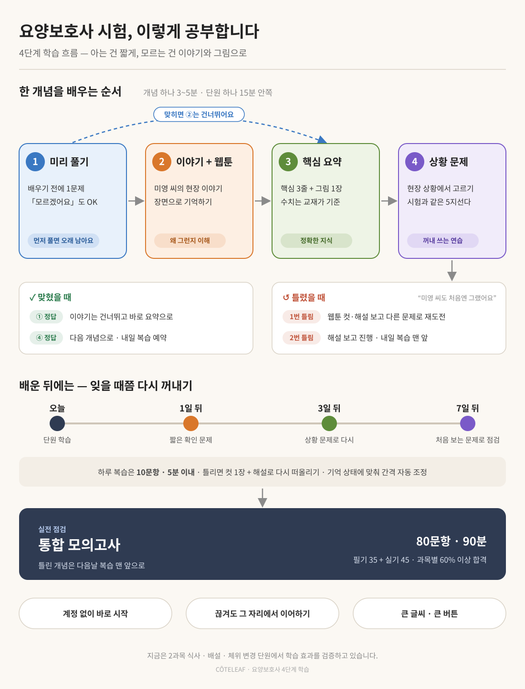

# 요양보호사 학습안내서 — PassCare

> **문서 ID**: DOC-USR-25
> **범위**: exam:carework · 판본: none
> **목적**: 요양보호사 자격시험 구조와 본 앱의 학습 경로 안내

## 시험 개요

- **종목**: 요양보호사 자격시험 — 한국보건의료인국가시험원(국시원) 상시 CBT
- **형식**: 객관식 5지선다 통합 80문항 / 90분 — 문항당 1점
- **합격**: 필기·실기 **각각** 만점의 60% 이상 (필기 35문 중 21문·실기 45문 중 27문) — 어느 한 쪽이라도 미달 시 불합격
- **교재 기준**: 보건복지부 『2026 요양보호사 양성 표준교재』 — 2027년 1월 시행 시험부터 적용

## 과목 구성

| 과목 | 출제 분야 | 문항 |
|------|-----------|------|
| 1과목 요양보호론 (필기) | 요양보호와 인권 · 노화와 건강증진 · 요양보호와 생활지원 · 상황별 요양보호기술 | 35문 |
| 2과목 요양보호 실기 | 신체활동지원 서비스 · 가사 및 일상생활지원 서비스 · 상황별 요양보호지원 서비스 | 45문 |

## 이 앱의 학습 구성

메뉴는 역할별 네 그룹으로 나뉩니다. **"지금 무엇을 해야 하는지"는 「학습」 그룹에서 고르면 됩니다.**

### 내 현황 — 내 상태·계획 확인 (읽기)

| 메뉴 | 하는 일 | 언제 쓰나요 |
|------|---------|------------|
| 대시보드 | 오늘 할 일·과목별 진행률을 한눈에 — 진행 중인 개념은 「개념 학습 이어하기」로 바로 복귀 | 앱을 열 때마다 첫 화면 |
| 학습진단 (Pro) | 푼 문제 기록으로 취약 단원·오답 패턴·주간 배분 분석 | 기록이 쌓인 뒤 (개념 학습·문제은행·모의고사 합산 문항 10개 또는 모의고사 1회부터) 매주 확인 |
| 캘린더 | 시험일·D-day·학습 기록·계획 | 처음 한 번 설정 + 주간 점검 |

### 학습 — 실제로 공부하는 곳 (실행)

| 메뉴 | 하는 일 | 언제 쓰나요 |
|------|---------|------------|
| 개념 학습 | 4단계 적응형 학습 — 미리풀기→이야기→요약→시나리오, 아는 개념은 건너뜀 | **이 시험의 핵심 경로** — 매일 1~2단원 |
| 플래시카드 | 핵심 개념을 카드로 뒤집어 암기 | ※ 이 시험은 카드 문항 준비 중 — 개념 학습·교재로 대체 |
| 기출 퀴즈 | 단원별 연습 문제 | ※ 이 시험은 퀴즈 문항 준비 중 — 문제은행(모의고사)·훈련소 드릴로 대체 |

### 훈련·평가 — 반복 훈련과 실전 점검

| 메뉴 | 하는 일 | 언제 쓰나요 |
|------|---------|------------|
| 훈련소 | 기출을 O/X·ㄱㄴㄷ 조합으로 쪼갠 드릴 반복 | 틀린 개념을 짧게 여러 번 확인할 때 |
| 오답/중요 복습 | 틀린·헷갈린 문제를 FSRS 간격으로 자동 재출제 | **매일 첫 번째** — 오늘 배정분부터 |
| 실전 모의고사 | 문제은행(과목당 80제) 과목별 풀이 + 통합 80문/90분 | 매주 1회 — 필기·실기 각 60% 점검 |

### 자료·도구 — 찾아보는 자료 (순서 없음)

| 메뉴 | 하는 일 | 언제 쓰나요 |
|------|---------|------------|
| 교재리더 | 교재 본문 읽기 — 표준형 무료 / 이야기형·웹툰형 (Pro) | 개념이 이해 안 될 때 정독 |
| 교재검색 | 교재 본문·참조 문서 키워드 검색 | 특정 용어·수치를 찾을 때 |
| 이야기 웹툰 (Pro) | 서사를 씬 단위 말풍선 컷으로 모아보기 | 이동 중 가볍게 복습할 때 |

> 문제은행 문항은 정답마다 📖 교재 출처 링크가 붙어 있어, 틀린 문제의 근거를 바로 교재로 확인할 수 있습니다.

> **무료 / Pro 구분** — 개념 학습·문제은행·모의고사·복습·교재 표준형 등 **시험 대비 경로 전체는 무료**입니다. Pro는 **분석·서사 콘텐츠·편의 기능**입니다: 학습진단·주간 배분·이야기형/웹툰형 교재·이야기 웹툰·클라우드 동기화·오디오북·Care OS 저장/공유. (Pro는 준비 중 기능으로, 현재는 체험 기간이라 누구나 이용할 수 있습니다.)

## 개념 학습 — 적응형 4단계 흐름

단원이 아니라 **개념** 단위로 학습 경로가 달라집니다. 모든 개념을 같은 순서로 도는 것이 아니라, 아는 개념은 건너뛰고 모르는 개념만 깊이 학습합니다.

1. **미리풀기** — 개념 문항 1개로 수준 진단 (모르면 「모르겠어요」를 누르세요 — 찍지 않아도 됩니다)
   - 맞히면 → 핵심 요약만 보고 시나리오로 (이야기·웹툰 건너뜀)
   - 틀리거나 모르겠다고 하면 → 이야기·웹툰 컷으로 맥락부터
2. **이야기·웹툰** — 미영의 실수 → 박은정 선임의 교정 구조로 "왜 그렇게 하는지" 습득
3. **핵심 요약** — 본문 핵심 포인트로 정리
4. **선택형 시나리오** — 현장 상황에서 올바른 행동 고르기 (선택 후 「정답 확인」)
   - 정답·오답 즉시 표시 + 고른 보기의 해설
   - 틀리면 → **같은 개념의 다른 문항으로 재도전** (최대 2회)
   - 2회 연속 틀리면 → 해설 후 진행, 「취약 개념」으로 표시해 대시보드 이어하기 맨 앞에 배치

**이어하기·다음 개념** — 진행 중간에 나가도 저장된 단계로 자동 복귀합니다. 대시보드 「오늘 할 일」의 **개념 학습 이어하기**를 누르면 진행 중(또는 취약) 개념으로 바로 이동하고, 완료 화면의 「다음 개념으로」는 아직 안 한 개념을 자동으로 골라줍니다.

**푼 문제는 진단에 자동 반영됩니다** — 미리풀기·시나리오 응답은 퀴즈와 같은 집계로 들어가 학습진단의 표본·과목별 정답률·약점 분석에 쓰입니다. 「모르겠어요」는 오답이 아니라 "모름" 표시로 기록됩니다.

## 권장 학습 경로

### ① 처음 시작할 때 — 한 번만

1. **캘린더에서 시험일·목표 설정** — 학습진단의 「이번 주 주간 배분」(Pro)이 켜집니다
2. **개념 학습으로 첫 단원** — 미리풀기 → 이야기 → 요약 → 시나리오 (단원당 약 15분)
3. **모의고사 1회 또는 문제 10개** — 학습진단(Pro)이 작동하는 최소 기록입니다. 개념 학습의 미리풀기·시나리오 응답도 푼 문제로 집계되므로, 개념 학습만 꾸준히 해도 진단이 열립니다

### ② 매일 루틴 — 순서대로

4. **대시보드 「오늘 할 일」 확인** — 「개념 학습 이어하기」가 뜨면 먼저 이어서 마치기 (복습 배정분도 여기 표시됩니다)
5. **오답/중요 복습** — FSRS가 배정한 오늘 분량 (약 10문·5분, 취약 개념 우선)
6. **개념 학습 새 단원** — 하루 1~2단원 (「다음 개념으로」로 연속 진행 가능)
7. **문제은행·훈련소 드릴** — 모의고사 뷰의 과목별 문제은행 또는 훈련소 O/X·ㄱㄴㄷ 드릴. 오답은 복습 큐에 자동 수집, 정답의 📖 교재 근거로 취약 개념 역추적

### ③ 매주 · 시험 임박

7. **학습진단 확인** — 취약 단원·오답 패턴을 보고 「주간 배분」대로 과목별 시간을 나눕니다. 문항이 많은 2과목(45문)에 더 배분하되, 1과목도 60% 과락선이라 소홀히 금지
8. **통합 모의고사** — 80문/90분 실전 타이머로 **필기·실기 각각 60%** 충족 여부 점검 → 오답 개념은 다음날 복습 맨 앞에 자동 배치

> **한 줄 요약**: 시험일 설정 → 개념 학습으로 기록 쌓기 → 매일 복습+개념 학습 → 매주 학습진단+모의고사로 약점 순환
>
> ※ 교재리더·이야기 웹툰은 순서가 없는 **보조 자료**입니다 — 이해가 안 되는 개념을 만날 때 꺼내 보세요.

## 수치·기준 암기 포인트

- 장기요양 등급별 인정 점수 구간, 본인부담률(시설 20% · 재가 15%), 월 급여 한도
- 노인학대 신고 의무·개인정보 보호·인권 관련 법적 기준 — 1과목 후반부 집중 출제
- 신체활동지원 절차(이동·식사·배설·위생)의 순서와 금기 — 2과목 도판과 함께 암기

## 주의

- 실기 영역의 실제 수기 실습은 본 앱 범위 밖 — 상황 판단·절차 선택형 문항 중심으로 커버합니다
- Care OS 실무 도구(요양일지·인수인계·비용 계산 등)는 현장 실무 보조용 — 시험 점수와 무관합니다
