# LM2001020220_23v3_기능모델링

대분류/20
정보통신 중분류/01
정보기술 소분류/02
정보기술개발 세분류/02
응용SW엔지니어링 능력단위/20
NCS학습모듈
기능 모델링
LM2001020220_23v3
[NCS학습모듈 활용 시 유의 사항]
1. NCS학습모듈은 교육훈련기관에서 출처를 명시하고 교육적 목적으로 활용할 수 있습니다. 다
만, NCS학습모듈에는 국가(교육부)가 저작재산권 일체를 보유하지 않은 저작물(출처가 표기된
도표‧사진‧삽화‧도면 등)이 포함되어 있으므로, 이러한 저작물의 변형‧각색‧복제‧공연‧
배포 및 공중 송신 등과 이러한 저작물을 활용한 2차적 저작물을 작성하려면 반드시 원작자
의 동의를 받아야 합니다.
2. NCS학습모듈은 개발 당시의 산업 및 교육 현장을 반영하여 집필하였으므로, 현재 적용되는
법령‧지침‧표준 및 교과 내용 등과 차이가 있을 수 있습니다. NCS학습모듈 활용 시 법령
‧지침‧표준 및 교과 내용의 개정 사항과 통계의 최신성 등을 확인하시기를 바랍니다.
3. NCS학습모듈은 산업 현장에서 요구되는 능력을 교육훈련기관에서 학습할 수 있게 구성한 자
료입니다. 다만, NCS학습모듈 지면의 한계상 대표적 예시(예: 활용도 또는 범용성이 높은 제
품, 서비스) 중심으로 집필하였음을 이해하시기를 바랍니다.

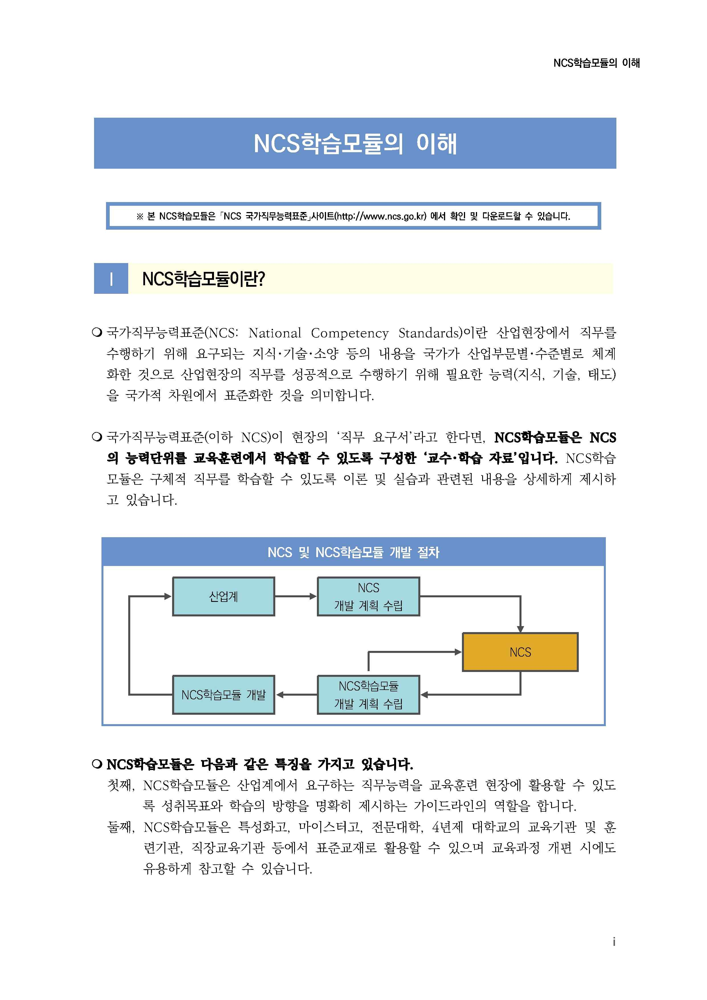

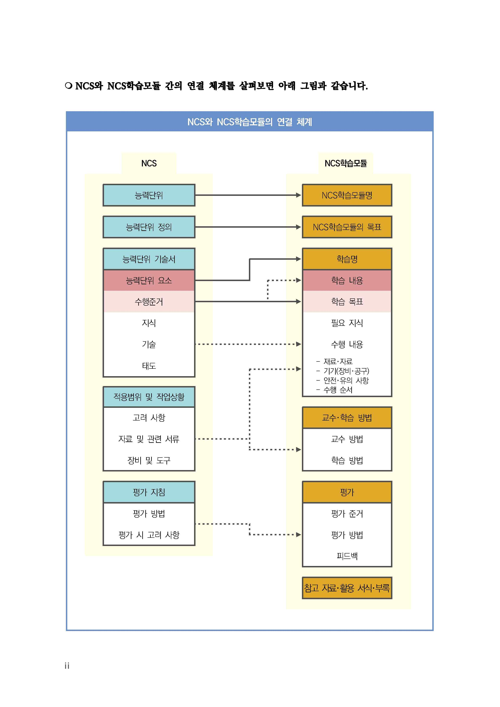

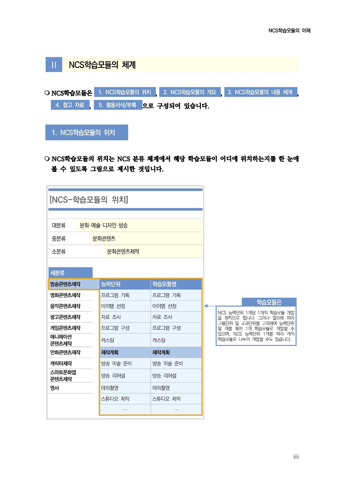

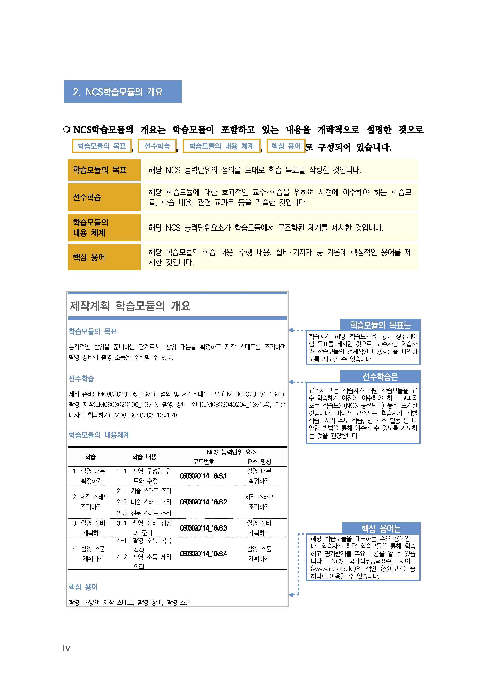

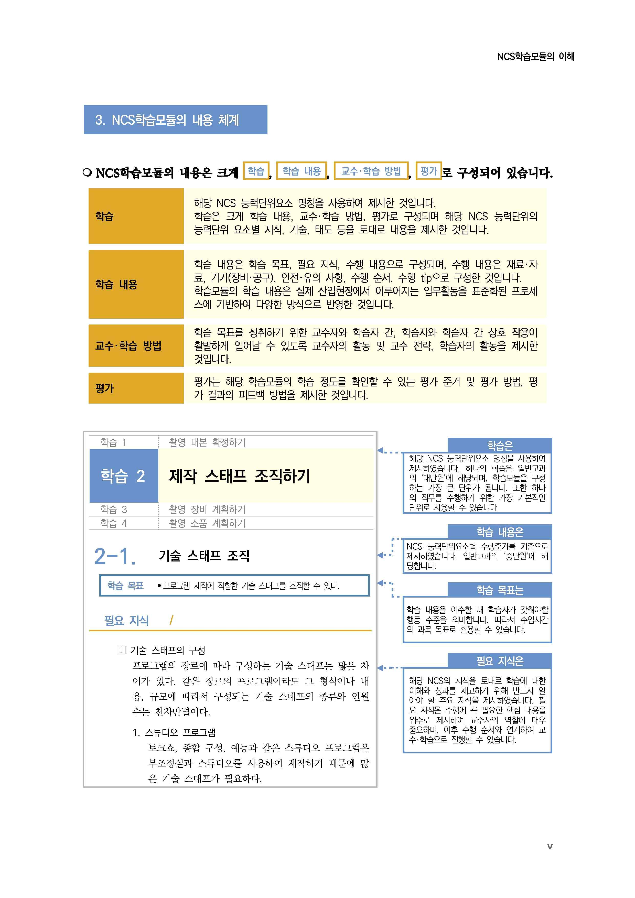

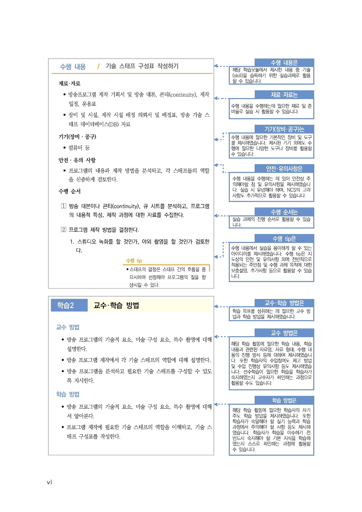

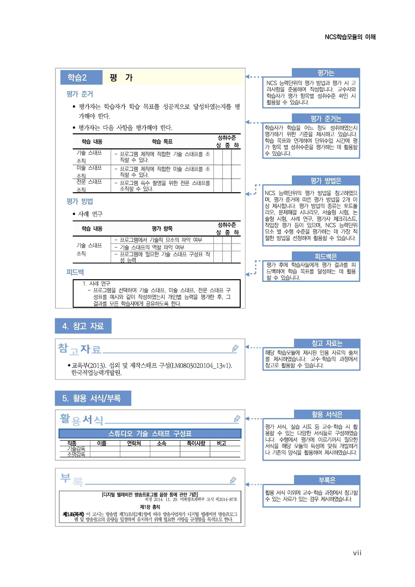

[NCS-학습모듈의 위치]

| 정보 통신 |  |  |
| --- | --- | --- |
|  | 정보 기술 |  |
|  |  | 정보기술개발 |

대분류
중분류
소분류
세분류

| SW아키텍처 |  |  | 능력단위 | 학습모듈명 |
| --- | --- | --- | --- | --- |
| 응용SW엔지니어링 |  |  | 요구사항 확인 | 요구사항 확인 |
| 임베디드SW 엔지니어링 |  |  | 데이터 입출력 구현 | 데이터 입출력 구현 |
| DB엔지니어링 |  |  | 통합 구현 | 통합 구현 |
| NW엔지니어링 |  |  | 정보시스템 이행 | 정보시스템 이행 |
| 보안엔지니어링 |  |  | 제품소프트웨어 패키징 | 제품소프트웨어 패키징 |
| UI/UX엔지니어링 |  |  | 서버프로그램 구현 | 서버프로그램 구현 |
| 시스템SW엔지니어링 |  |  | 인터페이스 구현 | 인터페이스 구현 |
| 빅데이터플랫폼구축 |  |  | 애플리케이션 배포 | 애플리케이션 배포 |
| 핀테크엔지니어링 |  |  | 애플리케이션 리팩토링 | 애플리케이션 리팩토링 |
| 데이터아키텍처 |  |  | 인터페이스 설계 | 인터페이스 설계 |
| loT시스템연동 |  |  | 애플리케이션 요구사항 분석 | 애플리케이션 요구사항 분석 |
| 인프라스트럭쳐 아키텍처 구축 |  |  | 기능 모델링 | 기능 모델링 |
|  |  |  | 애플리케이션 설계 | 애플리케이션 설계 |
|  |  |  | 정적모델 설계 | 정적모델 설계 |

| 동적모델 설계 | 동적모델 설계 |
| --- | --- |
| 화면 설계 | 화면 설계 |
| 화면 구현 | 화면 구현 |
| 애플리케이션 테스트 관리 | 애플리케이션 테스트 관리 |
| 애플리케이션 테스트 수행 | 애플리케이션 테스트 수행 |
| 소프트웨어공학 활용 | 소프트웨어공학 활용 |
| 소프트웨어개발 방법론 활용 | 소프트웨어개발 방법론 활용 |
| 프로그래밍 언어 응용 | 프로그래밍 언어 응용 |
| 프로그래밍 언어 활용 | 프로그래밍 언어 활용 |
| 응용SW 기초 기술 활용 | 응용SW 기초 기술 활용 |
| 개발자 환경 구축 | 개발자 환경 구축 |
| 개발 환경 운영 지원 | 개발 환경 운영 지원 |
| 자료구조 활용 | 자료구조 활용 |

차 례
학습모듈의 개요 1
학습 1. 기능모델 작성하기
1-1. 기능모델 작성 준비 3
1-2. 기능모델 다이어그램 작성 13
1-3. 기능모델 설계 명세서 작성 32
• 교수・학습 방법 43
• 평가 44
학습 2. 기능모델 검증하기
2-1. 기능모델 표준 준수 검증하기 47
2-2. 소프트웨어 요구사항 준수 검증하기 62
• 교수・학습 방법 75
• 평가 76
참고 자료 79
기능 모델링 학습모듈의 개요
학습모듈의 목표
애플리케이션 요구사항에 의해 도출, 분석된 내용을 애플리케이션의 기능으로 명세화하여 요구사항을 검증
하고 소프트웨어 개발 범위를 확정할 수 있다.
선수학습
소프트웨어공학 활용(LM2001020228_23v6), 소프트웨어개발 방법론 활용(LM2001020229_23v6),
요구사항 확인(LM2001020201_23v5), UML 모델링
학습모듈의 내용체계

| 학습 | 학습 내용 | NCS 능력단위 요소 |  |
| --- | --- | --- | --- |
|  |  | 코드번호 | 요소 명칭 |

1-1. 기능모델 작성 준비
기능모델
1. 기능모델 작성하기 1-2. 기능모델 다이어그램 작성 2001020220_23v3.1
작성하기
1-3. 기능모델 설계 명세서 작성
2-1. 기능모델 표준 준수 검증하기
기능모델
2. 기능모델 검증하기 2001020220_23v3.2
검증하기
2-2. 소프트웨어 요구사항 준수 검증하기
핵심 용어
구조적 분석 기법, 객체지향 분석 기법, 자료 흐름도, 유스케이스(Use Case), 소단위 명세서, 유스케이스 명
세서, 요구사항 분석 명세서

| 학습 1 | 기능모델 작성하기 |
| --- | --- |

학습 2 기능모델 검증하기
1-1.
기능모델 작성 준비
학습 목표 • 기능모델을 작성하기 위해 필요한 다이어그램을 선정할 수 있다.
필요 지식 /
• 기능 모델링(Functional Modeling)의 이해
1. 기능 모델링의 개념
기능이란 입력물을 받아 결과물을 제공하는 활동을 말하며, 이러한 기능을 수행하는 활
동을 프로세스라고 말한다.
(1) 기능 모델링의 정의
시스템에서 요구되는 정보의 흐름과 변화를 나타내는 프로세스를 중심으로, 프로세스
의 추상적 개념부터 점차적으로 세분화하여 사용자의 요구사항을 분석하는 과정이다.
(2) 기능 모델링의 기본 요소
(가) 표현(Representation)
시스템을 프로세스별로 분리하고 각 프로세스의 상호작용 관계를 서술적 텍스트
가 아닌 시각적 표현으로 도식화하여 나타내는 것. 이해관계자(Stakeholder)들의
이해를 증대시키고 문제점을 도출하기에 편리하다.
(나) 규약(Convention)
도식화된 기호들에 대한 약속이며, 규약을 통해 상호 간에 애매모호한 의미 없이
공통의 관점으로 정보를 인식할 수 있다.
(다) 명세(Specification)
시각적 표현으로 도식화된 내용을 텍스트로 확증하는 과정으로서, 기능 모델링
과정에서 도출된 다이어그램의 기능과 제약조건들을 나열하여 기능에 대한 자세
한 설명과 예외의 처리를 기술한다.
2. 기능 모델링 절차
기능 모델링은 소프트웨어 요구공학 절차에서 요구사항 분석 및 요구사항 명세 부분에
해당된다.

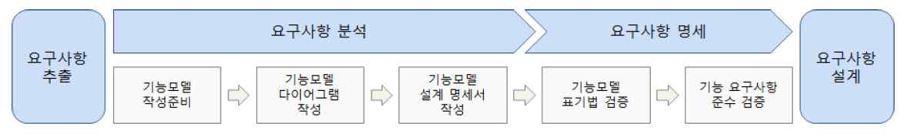

출처: 교육부(2021).기능모델링(LM2001020220_19v2).한국직업능력연구원.P4.
[그림 1-1] 기능 모델링 절차
(1) 요구사항 분석
시스템의 특성에 따른 기능모델 기법을 선정한 후 해당 기능모델 다이어그램을 작
성한다. 이해관계자들의 이해를 돕기 위해 작성한 다이어그램을 설명하는 기능모델
설계 명세서를 작성한다.
(2) 요구사항 명세
작성한 기능모델 다이어그램이 표준 표기법과 표준 산출물 양식을 따르고 있는지
검증한 후, 요구사항 명세서를 통해 소프트웨어 요구사항을 모두 포함하고 있는지
검증을 수행한다.
• 소프트웨어 시스템의 특성
기능 모델링을 작성하기 위해서는 소프트웨어 시스템의 특성을 파악하고 그에 따른 기능모
델 설계 기법을 선정해야 한다. 기능 모델링을 위해 파악할 소프트웨어 시스템의 특성은
개발 방법론, 프로그래밍 언어이다.
1. 개발 방법론
(1) 구조적 방법론
자료의 흐름과 구조에 따라 프로세스를 구분하고 점차적으로 세분화하여 사용자 요
구사항에 맞는 시스템을 구축하는 방법론이다.
(2) 정보공학 방법론
구조적 방법론과 달리 데이터 중심의 방법론으로서, 정보 전략 계획을 수행하고 계
획에 따른 데이터 모델을 작성하여 시스템을 구축하는 방법론이다.
(3) 객체지향 방법론
문제 영역(시스템의 프로세스 및 기능 등)을 객체(상태, 행위, 식별자) 집합으로 보
고 객체 간의 상호 관계를 파악하여 시스템을 모델링 및 구축하는 방법론이다.
2. 프로그래밍 언어
프로그래밍 언어는 소프트웨어공학 방법론의 패러다임과 연관되므로 프로그래밍의 패러
다임 형태에 따라 구분한다. 대표적인 프로그래밍 언어는 다음과 같다.
(1) 구조적 프로그래밍 언어
Fortran, Cobol, Pascal, C 등이 대표적인 절차 중심 프로그래밍 언어이다.
(2) 객체지향 프로그래밍 언어
C++, C#, Java 등이 대표적인 객체 중심 프로그래밍 언어이다.
• 기능모델 분석 기법
시스템 요구사항을 분석하는 기법에는 구조적 분석 기법, 객체지향 분석 기법, 정보공학
분석 기법, 정형화 분석 기법 등이 있다.
여기에서는 요구사항 분석 기법 중 대표적으로 구조적 분석 기법과 객체지향 분석 기법에
대해 알아본다.
1. 구조적 분석 기법(Structured Analysis Method)
방법론은 불명확한 사용자 요구사항 도출과 변경으로 의사소통에 어려움이 있고, 하위
모듈에서 상위 모듈로 가는 상향식(Bottom-up) 방식의 개발로 인해 상위 모듈의 에러
(Error) 발생 시 오류 수정의 어려움이 있었다. 이러한 어려움을 해결하기 위해 등장한
구조적 분석 기법은 구조적 프로그래밍에 뿌리를 두고 있다.
소프트웨어 시스템을 데이터를 처리하는 프로세스로 볼 때, 데이터보다는 데이터를 처
리하는 기능을 위주로 분석하는 방법이다. 문제를 기능적 관점의 프로세스로 나누고,
각 프로세스에 따라 어떠한 입력 자료와 출력 자료가 필요한지는 나중에 고려한다. 즉,
분할과 정복(Divide & Conquer) 방식에 의해 추상적인 개념부터 점차적으로 세분화
한다.
2. 객체지향 분석 기법(Object Oriented Analysis Method)
객체지향 분석 기법은 구조적 분석 기법과 근본적으로 접근 방식을 달리한다. 둘은 개
념화하는 방식이 서로 달라 문제를 정의하고 분할하는 방법 또한 다르다. 객체지향 분
석 기법은 요구사항을 추출하고 이를 유스케이스로 표현하는 방식을 통해 시스템의 요
구사항을 분석한다.
수행 내용 / 기능모델 작성 준비하기
재료·자료
• 제안 요청서, 제안서, 사업수행계획서, 요구사항 목록, 요구사항 정의서
• 소프트웨어 분석 표준(IEEE 1320, IDEF Modeling, OMT, OOSE, UML)
• IEEE 830 (IEEE Recommended Practice for Software Requirements
Specifications)
기기(장비･공구)
• 전산 장비(컴퓨터, 프린터, 빔 프로젝터, 네트워크 장비 등)
• OA 도구: 워드프로세서, 스프레드시트, 프레젠테이션 도구 등
• CASE 도구: SW 분석 지원 도구, UML(Unified Modeling Language, 통합 모델링
언어) 작성 지원 도구 등
안전･유의 사항
• 요구사항 분석을 위해 요구공학에 대한 기본 지식을 갖추고 있어야 한다.
• 기능모델링을 위하여 시스템 환경 및 비기능 요구사항에 대하여 이해하여야 한다.
• 시스템 요구사항을 고려하여 기능모델링 방법을 사전에 정의하여야 한다.
수행 순서
• 기능모델 작성을 위한 기능모델 다이어그램의 선정 준비를 다음과 같은 절차로 진행한다.

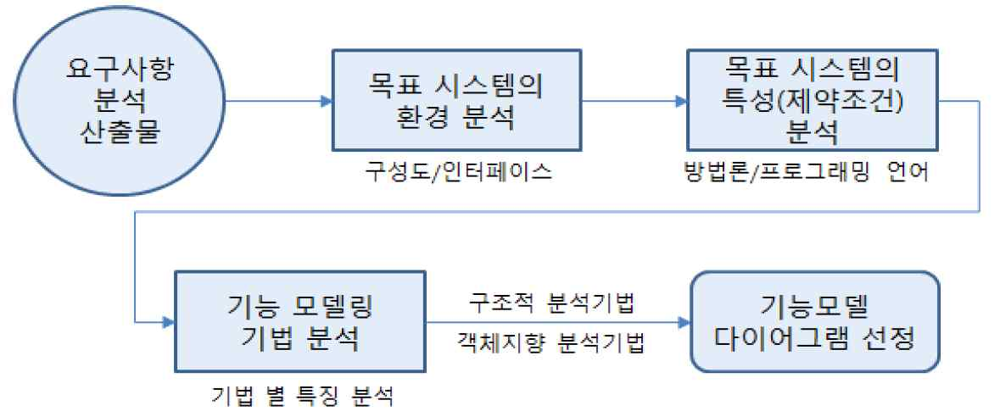

출처: 교육부(2021).기능모델링(LM2001020220_19v2).한국직업능력연구원.P6.
[그림 1-2] 기능모델 작성을 위한 다이어그램 선정 준비 절차
1. 기능 모델링 다이어그램 선정을 위해서 시스템 환경을 이해한다.
목표 시스템의 정보시스템의 구성 현황, 정보시스템의 인터페이스 현황, 정보시스템의
기능 구조도, 정보시스템의 아키텍처를 파악한다.
2. 환경에 대한 이해가 끝나고 나면 목표 시스템의 제약사항에 따른 특성을 파악해야 한다.
3. 목표 시스템의 환경과 특성, 개발 방법론과 프로그래밍 언어의 특성에 따라 기능모델 기법을
선정한다.
4. 선정한 기능모델 기법에 알맞은 기능모델 다이어그램을 선정한다.
• 기능 모델링 기법 선정을 위해 목표 시스템의 환경을 분석한다.
기능 모델링 기법을 선정하기 위해서는 제안 요청서, 제안서, 사업수행계획서, 요구사항 정
의서 산출물에 기록되어 있는 목표 시스템의 환경을 파악해야 한다.
1. 목표 시스템의 정보시스템 구성 및 인터페이스를 파악한다.
<표 1-1> 정보시스템 구성 현황 예시
구분 시스템 명 시스템 내용
업무 A를 처리하기 위하여 기능 A1, 기능 A2
단위 업무 A 시스템
등을 제공하는 시스템
기간 업무
업무 B를 처리하기 위하여 기능 B1, 기능 B2
단위 업무 B 시스템
등을 제공하는 시스템
지원 업무 C를 처리하기 위하여 기능 C1, 기
지원 업무 지원 업무 C 시스템
능 C2 등을 제공하는 시스템
출처: 교육부(2021).기능모델링(LM2001020220_19v2).한국직업능력연구원.P7.
<표 1-2> 정보시스템 인터페이스 현황 예시
송신 시스템 수신 시스템 연동 데이터 연동 형식 통신 규약 연계 유형 주기
단위 업무 A 대외 기관 A
연체 정보 XML TCP/IP EAI∙ 일 배치
시스템 시스템
단위 업무 A 대외 기관 B
부도 정보 XML X.25 FEP∙ 수시
시스템 시스템
출처: 교육부(2021).기능모델링(LM2001020220_19v2).한국직업능력연구원.P7.
∙ 전사 애플리케이션 통합(EAI: Enterprise Application Integration) : 기업 내 응용 프로그램 통합 솔루션
∙ 프런트 엔드 프로세서(FEP: Front End Processor) : 대외계 서버
2. 목표 시스템의 정보시스템 기능 구조도를 파악한다.
<표 1-3> 정보시스템 기능 구조도 예시
기능
시스템 명 우선순위
단계 1 단계 2 단계 3
세부 기능 1.1.1 상
세부 기능 1.1
기능 1 세부 기능 1.1.2 상
단위 업무 A
시스템
세부 기능 1.2 세부 기능 1.2.1 중
기능 2 세부 기능 2.1 세부 기능 2.1.1 상
출처: 교육부(2021).기능모델링(LM2001020220_19v2).한국직업능력연구원.P8.
3. 목표 시스템의 정보시스템 아키텍처를 파악한다.

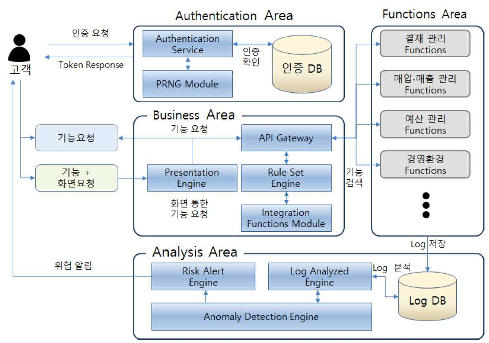

출처: 교육부(2021).기능모델링(LM2001020220_19v2).한국직업능력연구원.P8.
[그림 1-3] 정보시스템 아키텍처 예시
• 기능 모델링을 위해 목표 시스템의 특성(제약조건)을 분석한다.
기능 모델링을 위한 시스템 특성을 파악하기 위해서는 제안 요청서 혹은 요구사항 정의서
에서 개발 제약사항을 통해 시스템 특성을 확인한다. 개발 제약사항이 없을 경우에는 제안
서 및 사업수행계획서에서의 개발 방법론, 프로그래밍 언어를 통해 시스템 특성을 파악할
수 있다.
1. 요구사항 정의서 중 개발 제약사항을 통해 개발 방법론을 확인한다.
요구사항 정의서에서는 시스템의 특성을 파악할 수 있도록 다음과 같은 형태를 취하여 제약
사항을 제공한다.
(1) 요구사항 유형 : 제약사항
(2) 요구사항 번호
(3) 요구사항 이름 : 해당 제약사항을 나타낼 수 있는 이름이 부여
(4) 요구사항 내용
(가) 기술 제약사항
1) 개발 제약사항 : 특정 SW, HW, DB, 프로그래밍 언어, 도구, 방법론 등의 사용
과 관련된 제약
2) 데이터 제약사항 : 데이터 사용, 접근 및 이행(Data Migration) 정책과 관련된 제약
3) 업무 제약사항 : 각종 규정, 정책 및 업무 규칙 등과 관련된 사항
(나) 표준 적합 제약사항
1) 표준 제약사항 : 적용할 표준의 종류
2) 법적 제약사항 : 적용할 법규 종류 및 법규 내용
(다) 기타 제약사항
<표 1-4> 요구사항 유형 중 제약사항 예시
요구사항 번호 요구사항 이름 요구사항 내용
1. 시스템은 컴포넌트 기반 개발(CBD: Component-Based
Development) 방법론을 적용한다.
CO-01 개발 제약사항
2. 시스템은 제시된 방법론의 절차와 과정(개발 표준, 기술표준
문서화)에 따라 개발되어야 한다.
1. 시스템은 기존의 국가표준 및 정보화 기술지원 기관에서
확정한 표준화 내용을 준수해야 한다.
CO-02 표준 제약사항 2. 시스템은 웹 접근성 관련 표준인 ‘인터넷 웹 콘텐츠 접근성
지침 1.0 (KICS.OT-10.0003, 제정일: 2005년 12월)’을
준수해야 한다.
1. 시스템은 개인정보보호를 위하여 ‘개인정보보호법(시행일:
2011. 9. 30)’을 준수해야 한다.
CO-03 법적 제약사항
2. 시스템은 ‘전자정부서비스 호환성 준수지침(행안부 고시)’를
준수해야 한다.
출처: 교육부(2021).기능모델링(LM2001020220_19v2).한국직업능력연구원.P9.
2. 목표 시스템 환경 및 개발 방법론에 따라 프로그래밍 언어 유형을 확인한다.
제안 요청서, 요구사항 정의서 등 목표 시스템의 환경에 프로그래밍 언어가 명시되어
있으며, 아니라면 개발 방법론을 통해 프로그래밍 언어 유형을 확인해야 한다.
(1) 목표 시스템 환경을 통해 프로그래밍 언어 유형을 확인한다.
<표 1-5> 제안 요청서의 시스템 환경 예시
분류 사용 S/W
DBMS Oracle 10G
Web Server Apache V2.2
WAS JEUS V6.0, Tomcat V7.0
개발언어 Java
출처: 교육부(2021).기능모델링(LM2001020220_19v2).한국직업능력연구원.P10.
대부분의 제안 요청서의 정보화 현황에는 시스템 환경이 작성되어 있고 시스템 환경
정보에 있는 프로그래밍 언어를 통해 기능 모델링 분석 기법을 선정할 수 있다.
(2) 개발 방법론에 따른 프로그래밍 언어 유형을 확인한다.
개발 방법론에 따라 사용하는 프로그래밍 언어 유형, 요구사항 분석 기법, 모델링이
다르기 때문에 각 개발 방법론의 특성을 파악하여 기능모델 설계 기법을 선정한다.
<표 1-6> 개발 방법론 비교
구분 구조적 방법론 객체지향 방법론 CBD 방법론
중점 기능 중심 객체 중심 컴포넌트 중심
접근 방법 하향식 개발 상향식 개발 상향식 개발
요구사항
구조적 분석 기법 객체지향 분석 기법 객체지향 분석 기법
분석 기법
객체 모델링
모델링 기능 모델링 객체 모델링
컴포넌트 모델링
자료 흐름도 유스케이스 다이어그램 유스케이스 다이어그램
분석 소단위 명세서 정적 다이어그램 컴포넌트 다이어그램
자료 사전 동적 다이어그램 재사용 계획서
산
출 정적 다이어그램 정적 다이어그램
프로그램 정의서
물 (Class Diagram 등) (Class Diagram 등)
설계 프로그램 사양서
동적 다이어그램 동적 다이어그램
Structure Chart
(Sequence Diagram 등) (Sequence Diagram 등)
C, VB, Python, C
개발 언어 C++, Java, C#, VB 등 무관
obol, Pascal 등
목표 프로세스 자동화 재사용, 유지보수 편의 컴포넌트 개발 및 활용
출처: 교육부(2021).기능모델링(LM2001020220_19v2).한국직업능력연구원.P10.
• 분석된 목표 시스템 특성에 맞는 기능모델 기법을 선정한다.
분석된 목표 시스템의 환경과 특성에 따라 기능모델 분석 기법을 선정하되, 구조적 분석
기법과 객체지향 분석 기법을 통한다.
1. 목표 시스템의 환경과 특성에 따라 구조적 분석 기법을 선정한다.
(1) 구조적 분석 기법이 적합한 목표 시스템의 환경
목표 시스템의 환경이 프로세스 및 기능 중심의 시스템 환경이라면 구조적 분석 기
법을 선정한다. 또한, 추상화된 개념에서부터 세분화하는 방식이라면 구조적 분석
기법을 선정한다.
(2) 구조적 분석 기법이 적합한 목표 시스템의 특성
개발 방법론이 구조적 방법론이고 프로그래밍 언어가 절차적 언어 기반이면 구조적
분석 기법을 선정하여 기능 모델링을 수행한다.

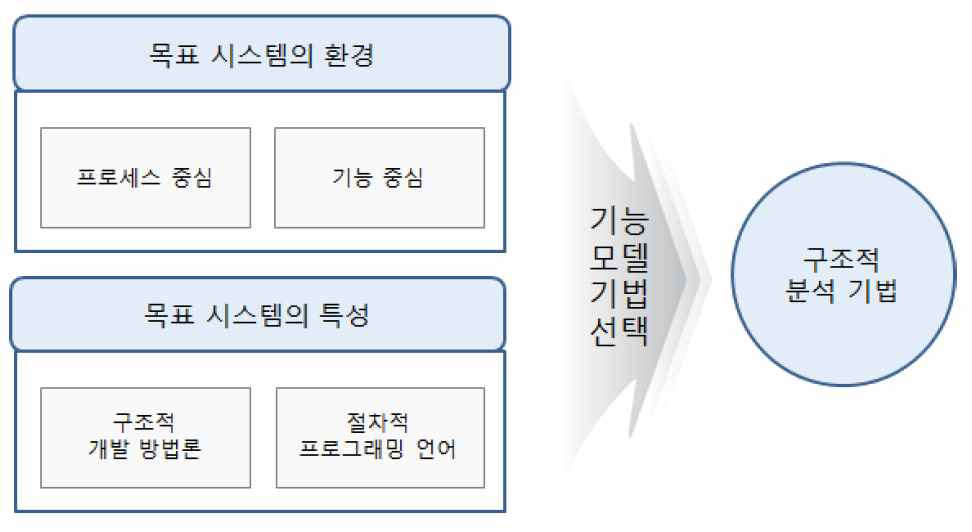

출처: 교육부(2021).기능모델링(LM2001020220_19v2).한국직업능력연구원.P11.
[그림 1-4] 목표 시스템의 환경과 특성 분석을 통한 구조적 분석 기법 선택 예시
2. 목표 시스템의 환경과 특성에 따라 객체지향 분석 기법을 선정한다.
(1) 객체지향 분석 기법이 적합한 목표 시스템의 환경
목표 시스템의 환경이 객체 및 컴포넌트 중심의 시스템 환경이라면 객체지향 분석
기법을 선정한다.
또한, 재사용 및 유지보수 중심이거나 컴포넌트 간의 연계 중심인 시스템이라면 객
체지향 분석 기법을 선정한다.
(2) 객체지향 분석 기법이 적합한 목표 시스템의 특성
개발 방법론이 객체지향 방법론이거나 CBD 방법론이고 프로그래밍 언어가 객체지
향 언어 기반이면 객체지향 분석 기법을 선정하여 기능 모델링을 수행한다.
목표 시스템 특성이 객체의 관점에서 소프트웨어 시스템의 기능을 분석하는 방식이
라면 객체지향 분석 기법을 선정하여 기능 모델링을 수행한다.

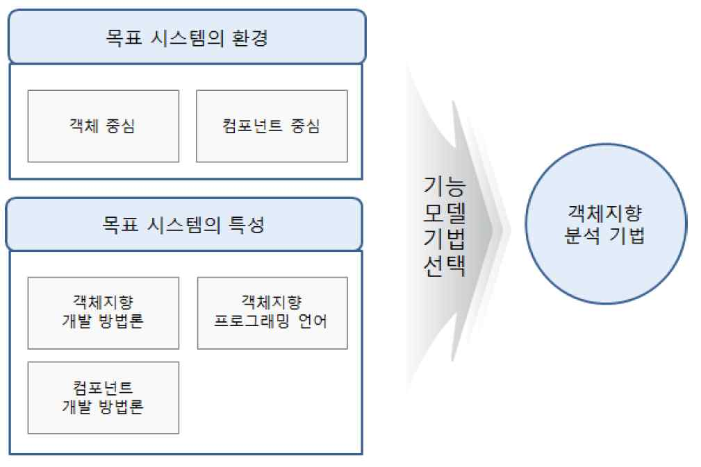

출처: 교육부(2021).기능모델링(LM2001020220_19v2).한국직업능력연구원.P12.
[그림 1-5] 목표 시스템의 환경과 특성 분석을 통한 객체지향 분석 기법 선택 예시

출처: 교육부(2021).기능모델링(LM2001020220_19v2).한국직업능력연구원.P12.
[그림 1-6] 목표 시스템의 환경과 특성 분석을 위한 요구사항 정의서를 분석하는 모습
수행 tip
•소프트웨어 시스템의 특성을 파악하기 위해서는 요구사
항 정의서를 파악하는 능력이 특히 중요하다.
•기능 모델링을 위해서는 기능모델 분석 기법을 이해하
고 종류를 식별하는 능력이 중요하다.
1-2.
기능모델 다이어그램 작성
•기능 모델링을 위해 선정한 다이어그램의 각 구성 요소를 식별하여 다이어그램을 작성할 수
학습 목표
있다.
필요 지식 /
• 구조적 분석 기법(Structured Analysis Method)
1. 구조적 분석 기법 개념
1970년대 말 디마르코(DeMarco)와 유어든(Yourdon) 등이 제안한 구조적 분석 기법
은 시스템을 기능적 관점에서 나누고 추상화 개념을 접목한 상위 프로세스에서 하위
프로세스로 점차적으로 세분화한다.
(1) 구조적 분석 기법의 목표
(가) 기능 관점에서 현재 시스템과 개발될 시스템의 모델을 만드는 것이다.
(나) 사용자 요구사항을 시스템화하여 요구사항 명세서를 작성하는 것이다.
(다) 분할과 정복(Divide & Conquer) 원칙을 체계화시킨다.
(2) 구조적 분석 기법의 특징
(가) 사용자 참여 확대
도식화된 분석 기법으로 명확한 요구사항을 추출하고 표현할 수 있다.
(나) 자료 흐름의 상세화(Data Flow Refinement)
하향식(Top-down) 방식으로 전체 시스템 프로세스에서 점차적으로 세분화하여
하위 프로세스로 분할한다. 이 방식은 초기 단계에서 문제점을 도출할 수 있다.
(다) 표준 표기법에 의한 모델링 도구 제공
자료 흐름도(DFD: Data Flow Diagram)를 사용하여 가시성 높은 정보의 흐름
과 변환을 제시한다.
요구 시스템의 프로세스를 세분화하고 자료(정보)의 흐름을 도식화하는 작업은
이해관계자(Stakeholder) 간의 의사소통 및 이해를 증대시킨다.
2. 구조적 분석 기법 작업 구성 요소
구조적 분석에서의 모델은 자료 흐름도(Data Flow Diagram), 배경도(Context
Diagram), 자료 사전(Data Dictionary), 소단위 명세서(mini-specification)로
구성된다.
(1) 자료 흐름도(DFD : Data Flow Diagram)
시스템 안의 프로세스 및 자료 저장소들 사이의 자료 흐름을 도식화한 그래프이다.
즉, 정보가 입력된 후 프로세스의 변화와 그 결과(출력)를 그림으로 표현한다.
(가) 자료 흐름도의 구성 요소
자료 흐름도는 일반적으로 다음의 4가지 기호를 사용하여 표기한다.
<표 1-7> 자료 흐름도의 구성 요소
기호 기호 명칭 기호 설명
시스템의 외부에서 시스템과 정보를 주고받는 외부객체.
액터
직사각형 안에 이름을 기입한다.
시스템 내에서 정보를 처리하고 변환시킨다.
프로세스
대부분 원이나 둥근 사각형 안에 표기한다.
두 프로세스 사이의 데이터 흐름을 표시한다.

자료 흐름
화살표 위에 자료 이름을 쓴다.
데이터를 저장하는 파일이나 데이터베이스 시스템이다.

자료 저장소 양쪽이 열린 직사각형 안에 자료 저장소의 이름을 표시한
다.
출처: 교육부(2021).기능모델링(LM2001020220_19v2).한국직업능력연구원.P14.
(나) 자료 흐름도의 예시
다음과 같이 모든 시스템은 단순한 자료 흐름도로 표현할 수 있다.

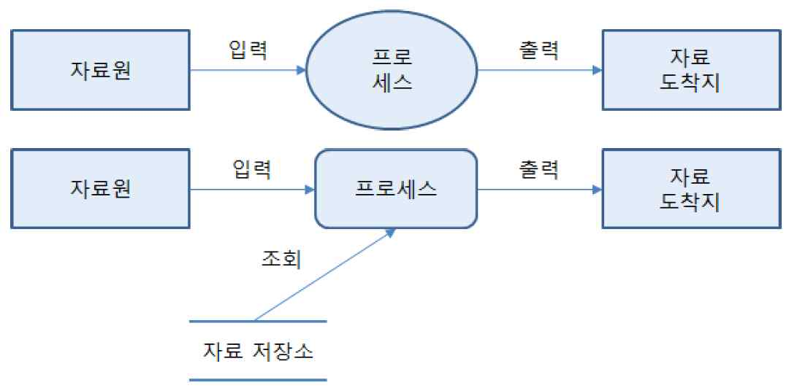

출처: 교육부(2021).기능모델링(LM2001020220_19v2).한국직업능력연구원.P14.
[그림 1-7] 자료 흐름도의 예시
(2) 배경도(Context Diagram)
자료 흐름도의 구성은 상위 프로세스, 중간 프로세스, 원시 프로세스들로 이루어지
고, 특히 최상위의 프로세스를 배경도라고 한다.
이는 분할되기 이전의 시스템을 하나의 큰 프로세스로 표현한 것이다.
(가) 배경도의 특징
1) 배경도는 시스템을 블랙박스 형태로 바라본 것이다.
2) 시스템과 외부 환경과의 인터페이스(Interface)에 초점을 맞춘다.
3) 시스템과 외부 객체 사이에 오가는 정보를 추출하여 만들어진다.
(나) 배경도의 예시
다음은 도서 대출 시스템의 배경도(Context Diagram)이다.
외부 객체로는 이용자, 관리자, 예약자, 출판사로 구성되어 있으며, 각 외부 객체
와 내부 시스템 간의 관계를 큰 프로세스로 표현하였다.

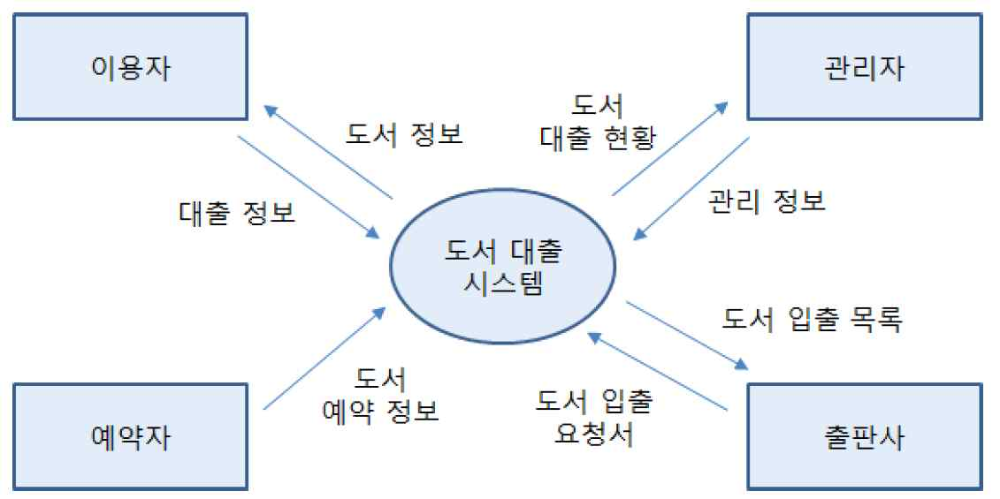

출처: 교육부(2021).기능모델링(LM2001020220_19v2).한국직업능력연구원.P15.
[그림 1-8] 배경도의 예시
(3) 자료 사전(Data Dictionary)
자료 사전은 자료 흐름도에 나타난 데이터의 정보를 한 곳으로 모아 놓은 것이다.
즉, 데이터 항목, 데이터 흐름 등에 관한 정의가 포함된 저장소이다.
자료 사전은 자료를 이루는 자세한 요소들을 설명해 준다.
(가) 자료 사전의 구성
자료 사전은 정의 부분과 설명 부분으로 구성된다.
정의 부분은 자료를 이루는 요소가 무엇인지를 정의하고, 설명 부분은 자료가 무
엇을 의미하는지 한두 문장으로 나타낸다.
자료 요소의 이름 = 설명(수식 형태)
(나) 자료 사전의 설명(수식) 기호
자료 사전에 사용되는 기호는 다음과 같다.
<표 1-8> 자료 사전 기호
연산자 의미 예시
+ AND 연산, 자료 요소와 다른 자료 요소가 연결된다. a + b
｜ ‘or’의 의미, 둘 중 택일을 의미한다. a｜b
‘ ’ 문자형 상수를 의미한다. ‘-’
[ ] OR연산, 하나 또는 그 이상을 선택할 때 사용한다. [a｜b]
{ } 중괄호 안의 요소가 반복되는 것을 나타낸다. {a + b}
{ } 중괄호 안의 요소가 x번 이상 반복되는 것을 나타낸다. (x+  )
  ₃
{ }  중괄호 안의 요소가 y번 이하 반복되는 것을 나타낸다. (x+  )₅
  ₅
( ) 중괄호 안의 요소가 x번 이상 y번 이하 반복됨을 나타낸다. (x+ )
  ₃
출처: 교육부(2021).기능모델링(LM2001020220_19v2).한국직업능력연구원.P16.
(다) 자료 사전 예시
전화번호는 자료 사전에서 다음과 같이 정의할 수 있다.
전화번호 = [지역번호] + 국번 + ‘-’ + 가입자 번호
지역번호 = ‘(’ + ‘0’ + 첫 자리 + {십진수} + ‘)’
전화번호는 지역 번호, 국번, 가입자 번호로 이루어져 있다. 국번과 가입자 번호
사이에‘-’로 이어져 있다.
도서 대출 시스템에서 사용되는 자료 사전의 전형적인 정의는 다음과 같이 표현
할 수 있다.
대여처리 = 대여 갱신|신규|취소
환불지급 = 현금|수표|신용카드
(4) 소단위 명세서(mini-specification)
프로세스 중 더 이상 분할되지 않는 하위 프로세스를 원시 프로세스라고 한다.
원시 프로세스의 상세한 설명은 소단위 명세서에 기록한다.
3. 구조적 분석 기법 절차
구조적 분석 기법은 두 가지 가정에서 시작된다. 하나는 시스템이 무엇을 하느냐(what)
에 관심을 두고, 하나는 하향식(Top-down)으로 문제를 다룬다.
구조적 분석은 다음과 같은 작업 순서로 진행된다.
(1) 배경도를 작성한다.
(2) 상위 자료 흐름도를 작성한다.
(3) 상위 자료 흐름도에서 세분화하여 하위 자료 흐름도를 작성한다.
(4) 자료 사전을 작성한다.
(5) 소단위 명세서를 작성한다.
• 객체지향 분석 기법(Object Oriented Analysis Method)
최근 소프트웨어 시스템을 개발하는 방법론으로 객체지향 접근 방법을 사용하는 경우가 많
다. 응용 소프트웨어, 웹 소프트웨어, 게임 프로그램 등 다양한 소프트웨어를 개발할 때
객체지향 개발 방법론을 사용한다. 심지어는 임베디드 시스템을 개발할 때에도 객체지향
개발 방법론을 사용하고 있다.
1. 객체지향 분석 기법 개념
객체지향 분석 기법은 구조적 분석 기법과 접근하는 방식이 다르다. 객체지향 분석 기
법에서 가장 먼저 할 일은 사용자 요구사항을 고객 관점에서 추출하고 추출된 요구사
항을 기반으로 삼아 유스케이스로 표현한다. 유스케이스로 표현하는 것을 유스케이스
다이어그램(Use Case Diagram)이라고 한다.
(1) 유스케이스 다이어그램(Use Case Diagram)의 개념
(가) 유스케이스 다이어그램의 정의
시스템이 제공하고 있는 기능 및 그와 관련된 외부 요소를 사용자의 관점에서
표현하는 다이어그램
(나) 유스케이스 다이어그램의 특징
1) 사용자의 기능적 요구사항을 정의하는 직관적인 표현
2) 사용자 관점에서 이해관계자(Stakeholder) 간의 의사소통의 수단으로 사용
2. 객체지향 분석 기법 구성 요소
객체지향 분석 기법은 대표적으로 유스케이스 다이어그램(Use Case Diagram)으로 표
현하므로 유스케이스 다이어그램의 구성 요소로 기능모델 설계를 진행한다.
(1) 유스케이스 다이어그램(Use Case Diagram)의 구성 요소
<표 1-9> 유스케이스 다이어그램 구성 요소
구성 요소 표기법 내용

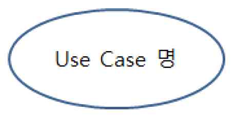

유스케이스 시스템이 제공해야 하는 서비스
Actor가 시스템을 통해 하는 일련의 행위

액터 헹위자가 시스템에 대해 수행하는 역할
(Actor) 시스템과 상호작용하는 사람 또는 사물

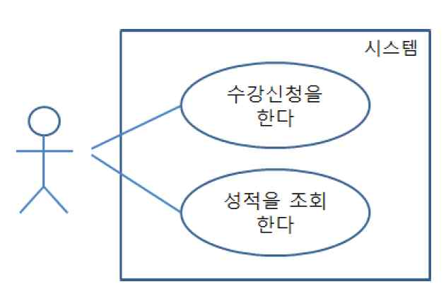

시스템
전체 시스템의 영역으로 개발 범위를 의미
(System)
출처: 교육부(2021).기능모델링(LM2001020220_19v2).한국직업능력연구원.P18.
(2) 유스케이스 다이어그램의 관계 표현
<표 1-10> 유스케이스 구성 요소 간의 관계
구성 요소 표기법 내용
연관 유스케이스와 액터의 연관 관계를 표현할 때

(Association) 사용(실선)

확장
특별한 조건을 만족할 때 사용(점선)
(Extend)

포함 시스템의 기능이 별도의 기능을 포함할 때 사
(Include) 용(점선)
하위 유스케이스/액터가 상위
일반화

유스케이스/액터에게 기능 및 역할을 상속받는
(Generalization)
관계

그룹화
여러 개의 유스케이스를 단순화하는 방법
(Grouping)
출처: 교육부(2021).기능모델링(LM2001020220_19v2).한국직업능력연구원.P18.
(3) 유스케이스의 단위
시스템에서 어느 정도의 범위를 하나의 유스케이스로 볼 것인가에 대한 정답은 없다.
각 프로젝트 상황(프로젝트의 범위, 고객의 요구사항 등)에 맞게 유스케이스의 크기
를 구성하는 것이 바람직하다.
3. 객체지향 분석 기법 절차
유스케이스 다이어그램을 통한 기능 모델링의 절차는 다음과 같다
(1) 시스템 상황을 확인
(2) 액터 식별
시스템의 이해관계자인 액터와 식별한 액터의 책임을 확인
(3) 유스케이스 식별
특정한 목적의 관점에서 볼 때 쓰임새(Use)와 시스템의 특성을 확인
(4) 유스케이스 다이어그램 작성
(가) 액터와 유스케이스에서 정제할 부분이 있는지 평가
(나) 유스케이스에서 <<include>> 의존성이 있는지 평가
(다) 유스케이스에서 <<extend>> 의존성이 있는지 평가
(라) 액터와 유스케이스를 일반화(혹은 공유)할 수 있는지 평가
(5) 유스케이스 명세서 작성
(가) 유스케이스 명, 액터 명 및 개요를 기술
(나) 사전 및 사후 조건과 제약사항들을 식별
(다) 작업(정상, 대치, 예외) 흐름과 시나리오를 도출
(라) 유스케이스 흐름에서 포함이나 확장의 유스케이스로 구조화
(6) 유스케이스 실체화
구현 시스템의 논리적 구성 요소인 클래스를 식별하고 통신 관계를 파악하는 데 중
점을 두는 과정
수행 내용 / 기능모델 다이어그램 작성하기
재료·자료
• 제안 요청서, 제안서, 사업수행계획서, 요구사항 목록, 요구사항 정의서
• 기능모델 다이어그램 저작 도구
• IEEE 830 (IEEE Recommended Practice for Software Requirements
Specifications)
기기(장비･공구)
• 전산 장비(컴퓨터, 프린터, 빔 프로젝터, 네트워크 장비 등)
• OA 도구(워드프로세서, 스프레드시트, 프레젠테이션 도구 등)
• CASE 도구(SW 분석 지원 도구, UML 작성 지원 도구 등)
안전･유의 사항
• 기능모델 다이어그램 저작 도구는 라이선스 제약이 없는 오픈소스 저작 도구를 활용한다.
• 기능 모델링을 지원하는 도구의 특성과 사용 방법에 대하여 숙지하여야 한다.
• 기능 모델링을 위한 구성 항목별 작성 표준 매뉴얼을 작성자들에게 공유하여야 한다.
수행 순서
• 기능 모델링을 위해 시스템 요구사항을 확인한다.
기능 모델링을 수행하기 위해서는 사용자 혹은 시스템의 요구사항을 확인하여 필요 기능들
을 추출해야 한다.
1. 시스템 요구사항 목록을 확인한다.
사용자 혹은 시스템이 요구하는 요구사항의 목록을 확인한다. 요구사항 목록은 크게 기
능요구사항과 비기능요구사항으로 이루어져 있다. 일반적으로 시스템 요구사항에는 기
능, 보안, 성능 데이터, 테스트, 품질, 제약사항, 프로젝트 관리, 프로젝트 지원 등 다양
한 시스템 요구사항이 분류되어 있다.
아래 사례는 기능모델 다이어그램 작성을 위해 요약한 요구사항 목록의 예이다.
<표 1-11> 근태 관리 시스템의 요구사항 목록 사례
요구사항
요구사항 분류 요구사항 명칭
고유 번호
분석/설계 - APR APR-001 요구사항 수집 및 확정
(Analysis Plan APR-002 프로세스 분석
Requirement) APR-003 화면 및 DB 설계
SFR-001 출퇴근 현황 조회
SFR-002 관리자 기능
SFR-003 외출 신청 기능
기능 - SFR
SFR-004 유연 근무제 관리 기능
(System Function
SFR-005 특근 신청 관리 기능
Requirement)
SFR-006 최종 점검 관리 기능
SFR-007 초과 근무 관리 기능
SFR-008 권한 관리 기능
성능 – PER
(Performance PER-001 기존 시스템 성능 유지
Requirement)
인터페이스 - SIR SIR-001 시스템 연계
(System Interface
SIR-002 직관적 UI
Requirement)
테스트 - TER TER-001 단위 테스트
(Test Requirement) TER-002 통합 테스트
SER-001 보안 기준 준수
보안 - SER
SER-002 응용 및 DB 보안
(Security Requirement)
SER-003 계정 및 권한 설정
품질 - QUR QUR-001 기능 구현의 정확성
(Quality Requirement) QUR-002 상호 운영성
출처: 교육부(2021).기능모델링(LM2001020220_19v2).한국직업능력연구원.P21.
2. 기능 모델링을 위한 기능요구사항을 확인한다.
학습 수준에서 수행되는 기능 모델링에서는 시스템의 특성에 따른 기능요구사항을 분석
하여 시스템의 요구사항을 분석하는 데 중점을 둔다. 기능 모델링 수행 시 보안, 테스
트, 인터페이스 등 비기능요구사항에 대해서도 고려하여 모델링을 수행하면 사용자의
만족도를 증대시킬 수 있다.
(1) 기능요구사항 목록 분류
요구사항 전체 목록 중 기능요구사항만 분류하여 기능 모델링을 수행한다.
<표 1-12> 근태 관리 시스템의 기능요구사항 분류 사례
요구사항
요구사항 분류 요구사항 명칭
고유 번호
SFR-001 출퇴근 현황 조회
SFR-002 관리자 기능
SFR-003 외출 신청 기능
기능 - SFR
SFR-004 유연 근무제 관리 기능
(System Function
SFR-005 특근 신청 관리 기능
Requirement)
SFR-006 최종 점검 관리 기능
SFR-007 초과 근무 관리 기능
SFR-008 권한 관리 기능
출처: 교육부(2021).기능모델링(LM2001020220_19v2).한국직업능력연구원.P22.
<표 1-13> 근태 관리 시스템의 기능요구사항 상세 사례 – 출퇴근 현황 조회
요구사항 고유 번호 SFR-001
요구사항 명칭 출퇴근 현황 조회
요구사항 분류 근태 현황 관리 필수 여부 필수
정의 출퇴근 현황 조회
○ 개인 본인만 볼 수 있는 출퇴근 조회 화면 추가
- 출퇴근 누락 및 오류 시 누락분 관리자 신청 처리
요구사항
- 출퇴근 및 외출, 유연 근무 내역, 초과 근무 시간 수 등 다양한
상세 설명
세부 내용
정보 확인 기능
○ 출퇴근 연계 데이터는 보안 업체로부터 수신 받은 내역을 D
B서버에 일일 전송된 내역을 가지고 처리
요구사항 고유 번호 SFR-001
요구사항 고유 번호 SFR-002
요구사항 명칭 관리자 기능
요구사항 분류 근태 현황 관리 필수 여부 필수
정의 관리자 기능
○ 관리자(본사 및 근태 담당자 등) 메뉴 추가
요구사항
- 권한별로 지사, 본부, 전체, 개인 근태 현황 조회
상세 설명
세부 내용
- 부서별, 개인별, 일자별 다양한 검색 기능 추가
- 출퇴근 시간 및 수정 사유 기능 추가
출처: 교육부(2021).기능모델링(LM2001020220_19v2).한국직업능력연구원.P22.
(가) 기능요구사항 상세
요구사항 목록에 정리한 각 요구사항 마다 요구사항 상세라는 항목으로 설명과
정의가 달려 있다.
• 구조적 분석 기법으로 기능모델 다이어그램을 작성한다.
디마르코(DeMarco)가 고안한 구조적 분석 기법은 전통적인 데이터 처리 시스템을 분석하
고 개발하는 데 여전히 많이 사용하고 있다.
1. 배경도(Context Diagram)를 작성한다.
배경도는 요구사항 목록에 기술되어 있는 데이터와 시스템이 반응해야 하는 행위 및
사건 등에서 시스템과 외부 객체 사이에 오가는 정보를 추출하여 만든다.
다음 그림은 근태 관리 시스템에 대한 배경도 이다.

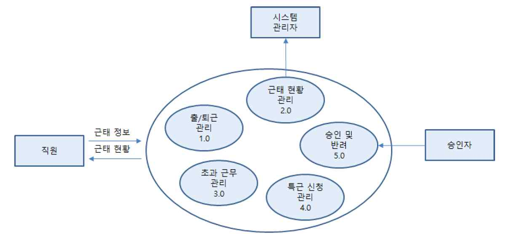

출처: 교육부(2021).기능모델링(LM2001020220_19v2).한국직업능력연구원.P23.
[그림 1-9] 근태 관리 시스템의 배경도 예시
2. 상위 자료 흐름도를 작성한다.
상위 자료 흐름도는 프로세스 레벨(Level) 0의 자료 흐름도이다. 프로세스를 찾아내면
서 자연스럽게 자료 저장소의 위치를 발견할 수 있다. 레벨을 구체적으로 표시하기 위
해 각 프로세스마다 번호를 부여한다.

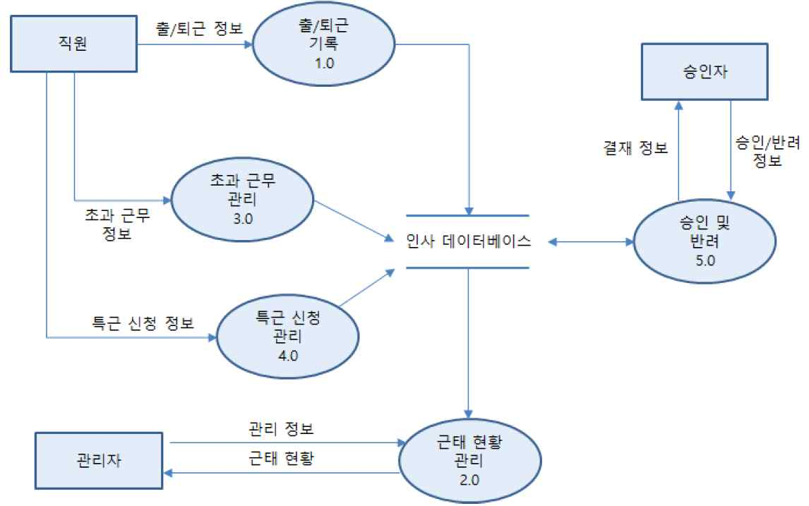

출처: 교육부(2021).기능모델링(LM2001020220_19v2).한국직업능력연구원.P24.
[그림 1-10] 근태 관리 시스템의 레벨(Level) 0 자료 흐름도
3. 하위 자료 흐름도를 작성한다.
근태 관리 시스템의 하위 단계의 자료 흐름도를 자세히 작성한다. 여기에서는 특근 신
청 관리의 예시를 다룬다.

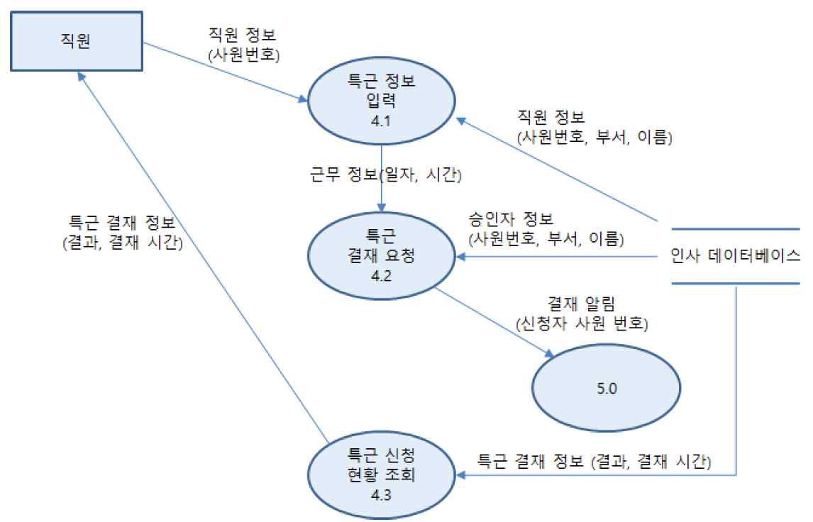

출처: 교육부(2021).기능모델링(LM2001020220_19v2).한국직업능력연구원.P24.
[그림 1-11] 특근 신청 관리의 레벨(Level) 1 자료 흐름도
(1) 특근 정보 입력 프로세스를 작성한다.
특근 신청 관리는 우선 신청할 직원의 사원번호를 기준으로 특근 정보를 입력하게 된다.
(2) 특근 결재 요청 프로세스를 작성한다.
(3) 승인 및 반려 프로세스를 호출하는 프로세스를 작성한다.
특근 결재 요청을 통해 프로세스 5.0으로 넘어가게 된다.
(4) 특근 신청 현황 조회 프로세스를 작성한다.
프로세스 5.0이 완료되면 특근 신청 현황 조회를 통해 특근 근무 신청 결과를 확인
할 수 있다.
4. 자료 사전(Data Dictionary)을 작성한다.
자료 사전은 자료 흐름도에 등장한 데이터에 관한 정보를 한 곳에 모아 놓는 저장소로
서 개발자나 사용자, 즉 이해관계자(Stakeholder)들이 편리하게 사용할 수 있게 해 준다.
다음은 레벨(Level) 0에 대한 자료 사전 사례이다.
(1) 자료 저장소
인사 데이터베이스 = 사원파일 + 근무파일
사원파일 = 사원번호 + 이름 + 주소 + 전화번호 + 핸드폰번호 + 이메일 + 입사일 + 퇴사일
근무파일 = 사원번호 + 근무일 + 출근시간 + 퇴근시간 + 근무형태
사원번호 = 연월일 + 순차번호
전화번호 = [지역번호] + 국번 + 가입자번호
핸드폰번호 = {010｜011｜017｜019} + 4자리숫자 + 4자리숫자
이메일 = 사원번호 + ‘@’+ 회사도메인
입사일 = 4자리 년도 + 2자리 월 + 2자리 일
퇴사일 = 4자리 년도 + 2자리 월 + 2자리 일
(2) 자료 흐름
출/퇴근 정보 = 사원번호 + 현재 시간
초과 근무 정보 = 사원번호 + 신청 일시 + 초과 근무 시간
특근 신청 정보 = 사원번호 + 특근 일시 + 특근 장소
결재 정보 = 신청자 사원번호 + 결재 일시 + 결재 제목 + 결재 내용
승인/반려 정보 = 승인자 사원번호 + 신청자 결재 번호 + 결재 결과 + 결재 일시
실무에서는 자료 사전을 편집 도구인 Microsoft 엑셀에 기록하여 정리한다.
• 객체지향 분석 기법으로 다이어그램을 작성한다.
객체지향 분석 기법으로 시스템을 분석하거나 개발하려고 할 때 가장 먼저 해야 할 일은
시스템의 상황을 확인하여 요구사항을 기술하는 일이다. 일반적으로 프로젝트를 수행할 때
구체적인 요구사항의 정의가 어렵고 추상적인 요구사항인 경우가 많다. 따라서 구체적인
요구사항 도출을 위해 시스템의 상황 분석과 요구사항 기능을 상세하게 식별하는 것이 중
요하다.
1. 시스템 상황을 분석한다.
문제 기술서(Problem Statement)라고도 하며 시스템 요구사항을 명확히 기술해야 한다.
다음은 근태 관리 시스템의 문제 기술서 사례이다.
(1) 출/퇴근 관리 기능
(가) 로그인 후 출/퇴근 관리 화면의 출근버튼을 통해 출근 시간을 입력한다.
(나) 퇴근 시 출/퇴근 관리 화면의 퇴근버튼을 통해 퇴근 시간을 입력한다.
(다) 출/퇴근 관리 화면을 통해 기간별 출/퇴근 현황을 확인한다.
(2) 근태 현황 관리 기능
(가) 관리자가 그룹별로 지사, 본사, 전체, 개인의 근태 현황을 조회한다.
(나) 관리자가 부서별, 개인별, 일자별로 근태 현황 검색이 가능하다.
(3) 초과 근무 관리 기능
(가) 로그인 후 초과 근무 관리 화면을 통해 초과 근무를 신청한다.
(나) 초과 근무는 관리자의 검증이 필요하다.
(4) 특근 신청 관리 기능
(가) 로그인 후 특근 신청 관리 화면을 통해 특근을 신청한다.
(나) 특근 신청은 결재를 통해 승인자에게 승인을 받아야 한다.
(5) 승인 및 반려 기능
(가) 로그인 후 결재 관리 화면을 통해 결재 현황을 확인한다.
(나) 요청된 결재 정보를 승인 및 반려할 수 있다.
2. 액터를 식별한다.
액터는 시스템과 작용하는 외부 객체이다. 액터는 사람이 될 수도 있고 외부 시스템이
될 수도 있다. 다음은 근태 관리 시스템 사례에서 식별된 액터들이다.
근태 관리 시스템에서는 세 종류의 액터가 필요하다. 하나는 근태 관리 시스템을 통해
근태 관리를 하는 직원이다. 또 하나는 결재 신청을 승인 및 반려할 승인자이다. 이때
승인자는 직원일 수도 있다. 나머지 액터는 근태 관리 시스템을 관리하는 관리자이다.

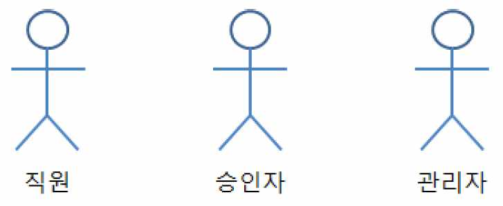

출처: 교육부(2021).기능모델링(LM2001020220_19v2).한국직업능력연구원.P27.
[그림 1-12] 근태 관리 시스템의 액터 사례
3. 유스케이스를 식별한다.
유스케이스는 시스템을 사용할 때 사용자가 무엇을 하는지에 대한 기능을 표현한 것이
다. 유스케이스를 식별하기 위해서는 유스케이스를 바라보는 이해관계자의 관점을 식별
하여 단위 레벨을 선정해야 한다.
(1) 유스케이스의 단위 레벨을 선정한다.

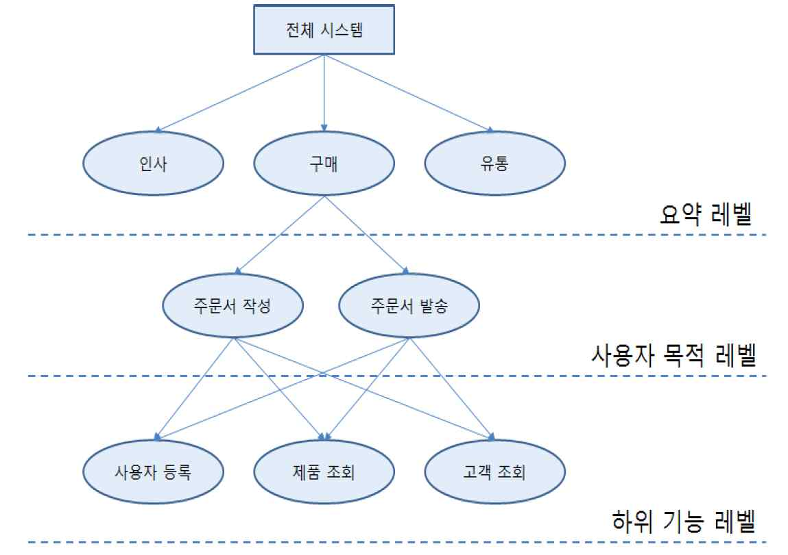

출처: 교육부(2021).기능모델링(LM2001020220_19v2).한국직업능력연구원.P27.
[그림 1-13] 유스케이스의 단위 레벨 예시
(가) 요약 레벨을 정의한다.
전체 시스템을 개괄적으로 바라보는 매니저나 관리자 중심의 유스케이스를 정의
한다.
(나) 사용자 목적 레벨을 정의한다.
요구사항 분석을 통하여 시스템 전체 모습을 구성해야 하는 시스템 분석가 레벨
의 유스케이스를 정의한다.
(다) 하위 기능 레벨을 정의한다.
개발자 중심의 요구 기능을 어떻게 구현할 것인지를 정의할 수 있는 수준의 유
스케이스를 정의한다.
(2) 기능을 식별하여 유스케이스를 식별한다.
유스케이스의 단위 레벨을 선정하였다면 해당 레벨에 맞는 유스케이스를 식별한다.
시나리오를 통해 유스케이스를 찾는 방법이 있고, 기능을 식별하여 유스케이스를 식
별하는 방법이 있다.
<표 1-14> 근태 관리 시스템 유스케이스
기능 범주 사용자 기능(유스케이스)
로그인
출근 시간 입력
출/퇴근 관리 직원
퇴근 시간 입력
출/퇴근 현황 조회
근태 현황 조회
근태 현황 관리 관리자
근태 현황 검색
직원 초과 근무 신청
초과 근무 관리
관리자 초과 근무 검증
직원 특근 신청
특근 신청 관리
승인자 특근 결재
결재 현황 조회
승인 및 반려 승인자
결재 승인 및 반려
출처: 교육부(2021).기능모델링(LM2001020220_19v2).한국직업능력연구원.P28.
(3) 식별된 유스케이스를 도식화한다.

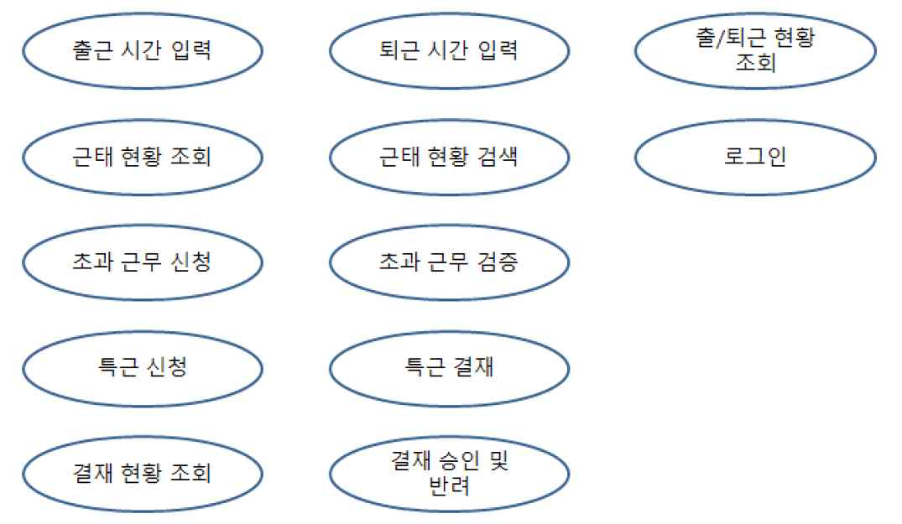

출처: 교육부(2021).기능모델링(LM2001020220_19v2).한국직업능력연구원.P29.
[그림 1-14] 근태 관리 시스템의 유스케이스 도식화
4. 유스케이스 다이어그램(Use Case Diagram)을 작성한다.
유스케이스 다이어그램을 작성하기 위해서는 다음과 같은 유의 사항을 확인해야 한다.
(1) 유스케이스 다이어그램 작성 시의 유의 사항을 확인한다.
(가) 액터와 유스케이스에서 정제할 부분이 있는지 평가한다.
(나) 유스케이스에서 <<include>> 의존성이 있는지 평가한다.
(다) 유스케이스에서 <<extend>> 의존성이 있는지 평가한다.
(라) 액터와 유스케이스를 일반화(혹은 공유)할 수 있는지 평가한다.
(2) 유스케이스 관계를 식별한다.
유스케이스를 식별하다 보면 유스케이스의 숫자가 상당히 많아진다. 액터와 유스케
이스의 관계 식별을 거침으로써 모델의 복잡도를 줄이고 이해도를 높일 수 있다.
(가) 포함(Include) 관계를 식별한다.
‘출근 시간 입력’ 유스케이스와 ‘퇴근 시간 입력’ 유스케이스는 다음과 같이 ‘로
그인’ 유스케이스를 포함하는 관계를 가지고 있다.

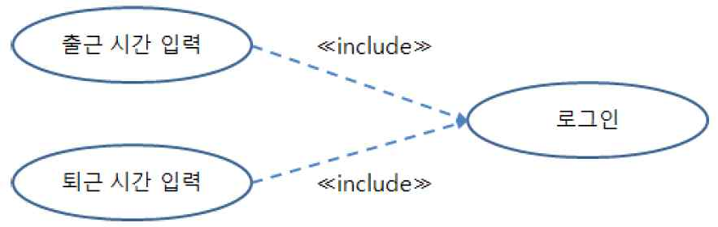

출처: 교육부(2021).기능모델링(LM2001020220_19v2).한국직업능력연구원.P29.
[그림 1-15] 근태 관리 시스템의 유스케이스에서의 포함 관계 식별
(나) 확장(extend) 관계를 식별한다.
‘초과 근무 신청’ 유스케이스는 ‘초과 근무 검증’ 유스케이스, ‘특근 신청’ 유스케
이스는 ‘특근 결재’ 유스케이스와 확장 관계를 가지고 있다.

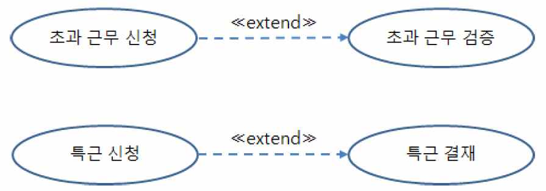

출처: 교육부(2021).기능모델링(LM2001020220_19v2).한국직업능력연구원.P30.
[그림 1-16] 근태 관리 시스템의 유스케이스에서의 확장 관계 식별
(3) 근태 관리 시스템의 유스케이스 다이어그램을 작성한다.
액터와 유스케이스를 식별하고 유스케이스들의 관계까지 식별하였으면 최종적으로
유스케이스 다이어그램을 작성한다.

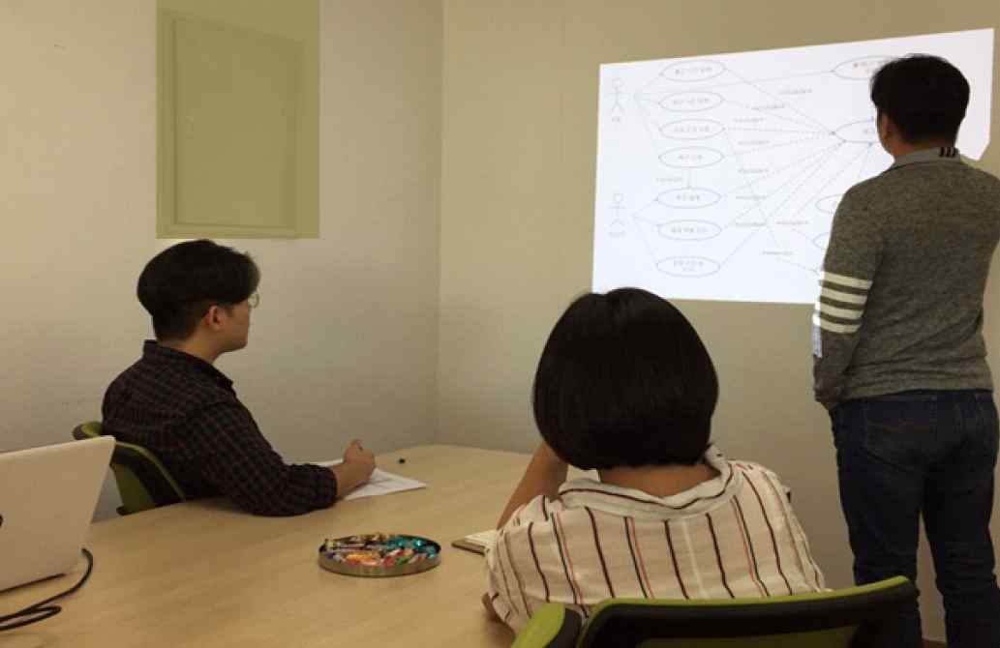

출처: 교육부(2021).기능모델링(LM2001020220_19v2).한국직업능력연구원.P30.
[그림 1-17] 식별된 액터/유스케이스 기반 다이어그램 작성 및 공유
다음은 근태 관리 시스템의 최종 유스케이스 다이어그램이다.

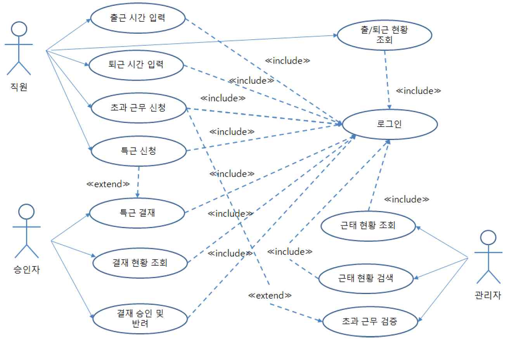

출처: 교육부(2021).기능모델링(LM2001020220_19v2).한국직업능력연구원.P31.
[그림 1-18] 근태 관리 시스템의 유스케이스 다이어그램(최종)
수행 tip
•요구사항 목록에서 기능요구사항을 분류하는 능력이 중
요하다.
•구조적 분석 기법과 객체지향 분석 기법의 구성 요소를
식별하고 분석 기법별 기능모델 다이어그램을 작성하는
것이 주요 포인트이다.
1-3.
기능모델 설계 명세서 작성
•기능 모델링을 위해 선정한 다이어그램을 설명하기 위한 기능모델 설계 명세서를 작성할 수
학습 목표
있다.
필요 지식 /
• 기능모델 설계 명세서 이해
1. 기능모델 설계 명세서의 개념
기능모델 설계 명세서는 기능모델 다이어그램을 설명하기 위해 제약조건, 입력에서 출
력으로 변환되기 위한 기능 등을 구체적으로 기술한 문서이다. 시스템을 사용하거나 관
련된 모든 이해관계자(Stakeholder)들이 같은 관점으로 기능모델 명세서를 이해할 수
있도록 작성해야 한다.
다음은 기능모델 설계 명세서를 작성하기 위해 지켜야 할 사항이다.
(1) 명확성
기능모델 설계 명세서를 읽는 사람은 누구나 같은 의미로 이해할 수 있어야 한다.
(2) 완전성
시스템 및 사용자들이 요구하는 기능들을 모두 기술해야 한다.
(3) 일관성
기능모델 설계 명세서에 동시에 충족시킬 수 없는 표현이 들어가면 안 된다.
(4) 검증 가능성
기능모델 설계 명세서를 통해 시스템 요구사항의 구현이 가능하며, 이를 검증할 수
있도록 작성해야 한다.
2. 기능모델 설계 명세서의 유형
구조적 분석 기법과 객체지향 분석 기법에서 사용되는 설계 명세서 표현 방식이 다르
다. 분석 기법별 기능모델 설계 명세서의 대표적인 유형은 다음과 같다.
(1) 소단위 명세서(mini-specification)
구조적 분석 기법의 기능모델 설계 명세서로 사용된다.
(2) 유스케이스 명세서(Use Case Specification)
객체지향 분석 기법의 기능모델 설계 명세서로 사용된다.
• 소단위 명세서(mini-specification)
위 명세서는 자료 흐름도의 원시 프로세스(최하위 프로세스)가 어떤 기능을 하는가를 기술하는
것이다. 프로세스 명세서(process-specification), 미니 명세서(mini-specification), 소작
업 명세서(activity-specification)라고 부르기도 한다.
소단위 명세서를 작성하는 방법은 구조적 영어(structured English), 흐름도, 의사결정표
(decision table), 나시-슈나이더만(Nassi-Shneiderman) 도표, 전후 조건(pre/post
condition) 등 다양하다.
여기에서는 구조적 영어와 의사결정표에 대해 알아본다.
1. 구조적 영어(structured English)
말 그대로 구조를 가진 영어로서, 영어 단어 중 제어나 연산을 표현하는 단어로
제한하여 사용한다. 예를 들면 GET, SET, PUT, COMPUTE, ADD, FIND, MOVE,
REPLACE, SORT 등이 해당한다. 조건문 안에서 실행 문장들은 들여쓰기를 통해
가독성을 높여야 한다. 일반적으로 구조적 영어의 구조는 다음과 같이 분류된다.
(1) 순차적 구조
한 작업 후 다른 작업이 이어서 수행되는 구조이다.
GET POST_NUM
GET TEL_NUM
SET POST_NUM + TEL_NUM
(2) 선택 구조
먼저 조건이 선행된 후, 조건에 따라 한 가지 작업이 수행되는 구조이다.
다음 선택 구조는 IF ~ THEN, 실행 문장, END-IF 구조이다.
IF condition THEN
TO_DO
END-IF
다음 선택 구조는 IF ~ THEN, 실행 문장, ELSE, 실행 문장, END-IF 구조이다.
조건을 만족할 때와 만족하지 못할 때 수행되는 구조이다.
IF condition THEN
IF_TO_DO
ELSE
ELSE_TO_DO
END-IF
다음 선택 구조는 CASE 구조이다. CASE ~ OF, 실행 문장, END-CASE 구조이다.
선택문(selector)에 일치하는 조건(condition)별로 실행 문장이 수행되는 구조이다.
CASE selector OF
condition1 : TO_DO1
condition2 : TO_DO2
condition3 : TO_DO3
END-CASE
(3) 반복 구조
반복 문장을 통해 구문을 반복하여 수행하는 구조이다.
다음 반복 구조는 WHILE ~ DO, 반복 문장, END-WHILE 구조이다.
WHILE repeat_condition DO
TO_DO
END-WHILE
다음 반복 구조는 REPEAT, 반복 문장, UNTIL 구조이다.
REPEAT
TO_DO
UNTIL repeat_condition
2. 의사결정표(decision table)
프로세스가 여러 가지 조건에 대하여 각기 다른 처리를 할 때 적합한 표현 방법이다.
결정에 영향을 주는 변수, 각 변수의 상태 값, 각 경우에 대한 처리 방식을 체계적으로
표현하는 방법이다.
<표 1-15> 상품 구매 시스템을 위한 의사결정표 사례
사용 금액
< 50 50 ~ 99 100 ~ 200 200 <
(단위 : 만원)
비회원 O O
정회원 O O
특별회원 O
만원 상품권 X
5만원 상품권 X
10만원 상품권 X X
20만원 상품권 X
출처: 교육부(2021).기능모델링(LM2001020220_19v2).한국직업능력연구원.P34.
• 유스케이스 명세서(Use Case Specification)
유스케이스 명세서란 각 유스케이스 별로 개요, 제약조건, 특별 요구사항 등 상세한 사항
을 정리하는 문서이다. 유스케이스 명세서는 시스템이 어떻게 동작하여야 하는지를 명확하
고 구체적으로 기술하여야 한다.
1. 유스케이스 명세서 구성 요소
(1) 유스케이스 ID
유스케이스에 대한 고유 식별 번호
(2) 유스케이스 이름
유스케이스에 대한 간결한 명세로서 시스템의 기능을 명확한 동사구 형태로 표현한다.
(3) 관련 액터
해당 유스케이스가 동작할 때 필요한 주변 액터를 식별한다.
주 액터와 보조 액터로 구분하여 기록한다.
(4) 유스케이스 개요
이해관계자(Stakeholder)들은 유스케이스 개요를 통해 내용을 이해할 수 있다.
(5) 사전 조건(선행 조건)
유스케이스 시작 시 만족되어야 할 조건으로서 사전 조건이 만족하지 않으면 해당
유스케이스는 시작되지 않는다.
(6) 사후 조건(후행 조건)
유스케이스 종료 시 만족해야 하는 조건으로 유스케이스의 동작 여부에 따라 최소
한의 판단 기준으로 활용할 수 있다.
(7) 정상 흐름(Basic Flow)
유스케이스가 동작할 때 액터와 시스템 간의 기본 혹은 정상적인 작동을 할 수 있
는 흐름이다.
(8) 대안 흐름(Alternate Flow)
유스케이스가 동작할 때 액터와 시스템 간의 예외 혹은 선택적인 작동을 할 수 있
는 흐름이다.
(9) 예외 흐름(Exception Flow)
유스케이스가 동작할 때 액터와 시스템 간의 비정상적인 작동을 할 경우 예외 처리
를 할 수 있는 흐름이다.
(10) 비기능적 요구사항
성능, 신뢰성, 보안 등 시스템의 특성에 따라 요구되는 유스케이스와 관련된 비기능
적요구사항을 기술한다.
(11) 우선순위
기능의 중요도와 개발 난이도를 기반으로 결정되는 순위를 기술한다.
개발 절차, 자원 투입 등 프로젝트 관리 측면에서 활용되기도 한다.
수행 내용 / 기능모델 설계 명세서 작성하기
재료·자료
• 제안 요청서, 제안서, 사업수행계획서, 요구사항 목록, 요구사항 정의서
• 작성한 기능모델 다이어그램
• IEEE 830 (IEEE Recommended Practice for Software Requirements
Specifications)
기기(장비･공구)
• 전산 장비(컴퓨터, 프린터, 빔 프로젝터, 네트워크 장비 등)
• OA 도구(워드프로세서, 스프레드시트, 프레젠테이션 도구 등)
• CASE 도구(SW 분석 지원 도구, UML 작성 지원 도구 등)
안전･유의 사항
• 기능모델 설계 명세서 작성을 지원하는 도구들을 다룰 수 있어야 한다.
• 실습 후에는 컴퓨터 전원을 끈다.
수행 순서
• 다이어그램 설명을 위한 구조적 분석 기법의 기능모델 설계 명세서를 작성한다.
구조적 분석 기법의 대표적인 유형인 소단위 명세서(mini-specification)를 통해 기능모델
설계 명세서를 작성한다.
1. 프로세스별 기능모델 설계 명세서를 작성한다.
근태 관리 시스템처럼 실무적으로 사용되는 시스템을 기반으로 프로세스별 기능모델 설
계 명세서를 작성해 본다.
(1) 1.0 출/퇴근 기록 프로세스의 설계 명세서를 작성한다.
(가) 프로세스 흐름을 확인한다.
1) 근태 관리 시스템에 로그인한다.
2) 출/퇴근 관리 화면으로 이동한다.
3) 출근버튼을 눌러 출근 시간을 입력한다.
4) 퇴근버튼을 눌러 퇴근 시간을 입력한다.
(나) 소단위 명세서를 작성한다.
프로세스 번호 : 1.0
프로세스 이름 : 출/퇴근 관리 기능
프로세스 설명 : 로그인 화면 출력;
input 아이디, 비밀번호
Read 사원 파일;
사용자 인증;
Close 직원 파일;
Move 출/퇴근 관리 화면;
Click 출근 버튼;
Read 근무 파일;
insert 출근 시간
Close 근무 파일;
... 이하 생략
(2) 2.0 근태 현황 관리 프로세스의 설계 명세서를 작성한다.
(1)의 (가)와 같이 프로세스 흐름을 확인한 후 소단위 명세서를 작성해야 한다.
프로세스 번호 : 2.0
프로세스 이름 : 근태 현황 관리 기능
프로세스 설명 : 로그인 화면 출력;
input 아이디, 비밀번호
Read 사원 파일;
관리자 인증;
Close 직원 파일;
Move 근태 현황 조회 화면;
Switch 그룹 조건
Case 지사 : 지사 근태 현황 정보 출력;
Case 본사 : 본사 근태 현황 정보 출력;
Case 전체 : 전체 근태 현황 정보 출력;
Case 개인 : 개인 근태 현황 정보 출력;
End-Switch;
... 이하 생략
2. 작성한 프로세스별 기능모델 설계 명세서를 통합한다.
프로세스별 소단위 명세서를 작성완료하면 하나의 문서로 통합한다.
소단위 명세서
프로세스 번호 : 1.0
프로세스 이름 : 출/퇴근 관리 기능
프로세스 설명 : 로그인 화면 출력;
input 아이디, 비밀번호
Read 사원 파일;
사용자 인증;
Close 직원 파일;
Move 출/퇴근 관리 화면;
Click 출근 버튼;
Read 근무 파일;
insert 출근 시간
Close 근무 파일;
...
프로세스 번호 : 2.0
프로세스 이름 : 근태 현황 관리 기능
프로세스 설명 : 로그인 화면 출력;
input 아이디, 비밀번호
Read 사원 파일;
관리자 인증;
Close 직원 파일;
Move 근태 현황 조회 화면;
Switch 그룹 조건
Case 지사 : 지사 근태 현황 정보 출력;
Case 본사 : 본사 근태 현황 정보 출력;
Case 전체 : 전체 근태 현황 정보 출력;
Case 개인 : 개인 근태 현황 정보 출력;
End-Switch;
... 이하 생략
• 다이어그램 설명을 위한 객체지향 분석 기법의 기능모델 설계 명세서를 작성한다.
객체지향 분석 기법의 기능모델 설계 명세서는 일반적으로 유스케이스 명세서를 통해 기술
한다. 유스케이스 명세서는 크게 유스케이스 목록과 유스케이스 명세서로 나눌 수 있다.
1. 유스케이스 목록(Use Case List)을 작성한다.
유스케이스 목록은 기능(UI)별로 각 UI의 유스케이스를 모두 기술하는 것이다. 일반적
으로 한 개의 기능(UI)당 표로 작성하며, 유스케이스 번호(Use Case ID), 유스케이스
이름, 유스케이스의 설명으로 구성된다.
<표 1-16> 근태 관리 시스템 중 출/퇴근 관리의 유스케이스 목록
유스케이스 번호 유스케이스 이름 유스케이스 설명
사용자는 아이디, 비밀번호를 입력하여 로그인
SFR-00101 로그인한다.
한다.
출근 시간을 출/퇴근 관리 화면에서 출근버튼을 클릭하여
SFR-00102
입력한다. 출근 시간을 입력한다.
퇴근 시간을 출/퇴근 관리 화면에서 퇴근버튼을 클릭하여
SFR-00103
입력한다. 퇴근 시간을 입력한다.
출/퇴근 현황을 출/퇴근 관리 화면에서 개인별 출/퇴근
SFR-00104
조회한다. 현황을 조회한다.
출처: 교육부(2021).기능모델링(LM2001020220_19v2).한국직업능력연구원.P39.
2. 유스케이스 목록별 유스케이스 명세서(Use Case Specification)를 작성한다.
유스케이스 명세서는 유스케이스 목록에 나열된 각 유스케이스를 상세하게 기술한다.
(1) “SFR-00101 로그인한다.”의 유스케이스 명세서를 작성한다.
<표 1-17> SFR-00101 유스케이스 명세서 예시
항목 내용
유스케이스 ID SFR-00101
유스케이스 명 로그인 한다.
관련 액터 직원, 관리자
개요 직원은 아이디, 비밀번호를 이용하여 로그인한다.
사전 조건 직원 및 관리자는 사전에 회원 가입이 되어 있어야 한다.
사후 조건 관리자는 읽고 쓰기 권한, 직원은 읽기 권한만 부여되어야 한다.
1. 로그인 화면에서 직원은 아이디, 비밀번호를 입력한다.
2. 로그인버튼을 클릭하여 사용자 인증을 한다.
정상 흐름
2-1. 아이디, 비밀번호가 공백인지 확인한다.
2-2. 공백이 아닐 경우 사용자 인증을 통해 로그인을 한다.
1. 사전에 회원 가입이 되어 있지 않은 경우, 회원 가입이 필요하다는
대안 흐름 메시지를 보여준다.
2. 회원 가입 페이지로 화면을 전환한다.
1. 회원이 입력한 공인 인증서의 비밀번호가 유효하지 않은 경우, 로그
인 실패 메시지와 실패 횟수를 보여준다.
예외 흐름
2. 로그인 실패 횟수가 연속하여 5회 이상이 되면 해당 회원의 로그인
잠금을 설정하여 관리자에게 문의하게 한다.
항목 내용
3. 회원이 관리자에게 로그인 잠금 해제를 요청하면, 관리자는 유효한
회원인지 검증한 후 잠금을 해제한다.
비기능적 사용자가 가장 많은 피크타임 시에도 3초 이내 로그인이 완료되어야 한
요구사항 다.
출처: 교육부(2021).기능모델링(LM2001020220_19v2).한국직업능력연구원.P39.
(2) “SFR-00102 출근 시간을 입력한다.”의 유스케이스 명세서를 작성한다.
<표 1-18> SFR-00102 유스케이스 명세서 예시
항목 내용
유스케이스 ID SFR-00102
유스케이스 명 출근 시간을 입력한다.
관련 액터 직원
직원은 출/퇴근 관리 화면에서 출근버튼을 클릭하여 출근 시간을 입력
개요
한다.
사전 조건 직원은 로그인이 되어 있어야 한다.
사후 조건 출/퇴근 관리 화면 목록에 출근 시간이 새로이 출력된다.
1. 출/퇴근 화면에서 출근버튼을 클릭한다.
2. 근무 파일에 출근 시간이 새로 입력된다.
정상 흐름 2-1. 근무 파일에 출근 시간이 YYYYMMDD hhmmss 포맷으로
입력된다.
2-2. 저장 완료 후 출근 처리가 완료되었다는 알림을 보여준다.
대안 흐름 없음
1. 출근버튼을 클릭 시 근무 파일에 저장이 실패하였을 경우 출근 처리
예외 흐름 가 실패하였다는 알림을 보여준다.
2. 실패 알림에는 관리자에게 문의하라는 문구를 보여준다.
비기능적 사용자가 가장 많은 피크 타임 시에도 3초 이내 출근 시간 입력이 완료
요구사항 되어야 한다.
출처: 교육부(2021).기능모델링(LM2001020220_19v2).한국직업능력연구원.P39.
(3) “SFR-00103 퇴근 시간을 입력한다.”의 유스케이스 명세서를 작성한다.
<표 1-19> SFR-00103 유스케이스 명세서의 예시
항목 내용
유스케이스 ID SFR-00103
유스케이스 명 퇴근 시간을 입력한다.
관련 액터 직원
직원은 출/퇴근 관리 화면에서 퇴근버튼을 클릭하여 퇴근 시간을 입력한
개요
다.
사전 조건 직원은 로그인이 되어 있어야 한다.
사후 조건 출/퇴근 관리 화면 목록에 퇴근 시간이 새로이 출력된다.
1. 출/퇴근 화면에서 퇴근버튼을 클릭한다.
2. 근무 파일에 퇴근 시간이 새로 입력된다.
정상 흐름
2-1. 근무 파일에 퇴근 시간이 YYYYMMDD hhmmss 포맷으로 입력된다.
2-2. 저장 완료 후 퇴근 처리가 완료되었다는 알림을 보여준다.
대안 흐름 없음
1. 퇴근 버튼을 클릭 시 근무 파일에 저장이 실패하였을 경우 퇴근 처리가
예외 흐름 실패하였다는 알림을 보여준다.
2. 실패 알림에는 관리자에게 문의하라는 문구를 보여준다.
비기능적 사용자가 가장 많은 피크 타임 시에도 3초 이내 퇴근 시간 입력이 완료되
요구사항 어야 한다.
출처: 교육부(2021).기능모델링(LM2001020220_19v2).한국직업능력연구원.P40.
(4) “SFR-00104 출/퇴근 현황을 조회한다.”의 유스케이스 명세서를 작성한다.
<표 1-20> SFR-00104 유스케이스 명세서의 예시
항목 내용
유스케이스 ID SFR-00104
유스케이스 명 출/퇴근 현황을 조회한다.
관련 액터 직원
개요 직원은 출/퇴근 관리 화면에서 개인별 출/퇴근 현황을 조회한다.
사전 조건 직원은 로그인이 되어 있어야 한다.
사후 조건 출/퇴근 관리 화면 목록에 조회조건에 맞는 출/퇴근 시간이 출력된다.
1. 출/퇴근 화면에서 조회 기간을 선택한다.
1-1. 시작 일자 캘린더를 통해 시작 일자를 선택한다.
정상 흐름
1-2. 종료 일자 캘린더를 통해 종료 일자를 선택한다.
2. 조회 버튼을 클릭한다.
항목 내용
3. 조회된 기간 내의 출/퇴근 현황이 출력된다.
3-1. 일자, 출근 시간, 퇴근 시간의 목록을 출력한다.
3-2. 목록은 10개씩 출력되며 10개 단위로 페이징(Paging)
처리를 한다.
대안 흐름 없음
1. 조회 버튼을 클릭 시 근무 파일에서 출/퇴근 현황 조회가 실패하였을
예외 흐름 경우 조회가 실패하였다는 알림을 보여준다.
2. 실패 알림에는 관리자에게 문의하라는 문구를 보여준다.
비기능적 사용자가 가장 많은 피크 타임 시에도 3초 이내 출/퇴근 현황 목록의
요구사항 출력이 완료되어야 한다.
출처: 교육부(2021).기능모델링(LM2001020220_19v2).한국직업능력연구원.P40.
수행 tip
•기능모델 설계 명세서는 프로세스별로 세분화하여 기능
흐름을 기술하는 능력이 중요하다.
•소단위 명세서와 유스케이스 명세서를 구조적 분석
기법과 객체지향 분석 기법으로 구분하고, 각 설계
명세서를 작성하는 방식을 숙지하는 것이 주요 핵심
포인트이다.

| 학습 1 | 교수·학습 방법 |
| --- | --- |

교수 방법
• 분석 산출물에서 기능, 비기능요구사항을 식별하는 방법을 설명하고, 기능 모델링 시
비기능요구사항의 내용을 고려하면서 설명한다.
• 기능 모델링의 방법인 구조적 분석 기법과 객체지향 분석 기법을 설명하고 기능 모델링
시 분석 기법을 선택하는 방법을 설명한다.
• 기능 모델링은 프로세스별로 분할하여 분석하는 분할과 정복(Divide & Conquer)
기법에 대해 충분히 설명한 후 기능모델 설계 방법을 설명한다.
• 기능모델 설계 명세서 작성 시에는 각 하위 프로세스별로 구체적으로 기술해야 하므로,
작업(Action)의 흐름을 순차적으로 설명한다.
• 객체지향 분석 기법을 활용한 기능 모델링 시 UML 저작 도구를 사용할 수 있으며, 이
경우 학습자가 해당 툴에 대한 기본적인 사용법 관련 자료를 제공한다.
학습 방법
• 분석 산출물에서 기능, 비기능 요구사항을 식별하는 방법을 숙지하고, 기능 모델링 시
비기능 요구사항의 내용을 고려하는 방법을 숙지한다.
• 기능 모델링의 방법인 구조적 분석 기법과 객체지향 분석 기법을 숙지하고 기능 모델링
시 분석 기법을 선택하는 기준을 파악한다.
• 기능 모델링은 프로세스별로 분할하여 분석하는 분할과 정복(Divide & Conquer)
기법에 대해 충분히 파악한 후 기능모델 설계를 수행한다.
• 기능모델 작업 흐름을 순차적으로 숙지하고, 기능모델 설계 명세서 작성 시 각 하위
프로세스별로 구체적으로 분류 및 식별한다.
• 객체지향 분석 기법을 활용한 기능 모델링 시 UML 저작 도구 사용 방법을 숙지한다.

| 학습 1 | 평 가 |
| --- | --- |

평가 준거
• 평가자는 학습자가 학습 목표를 성공적으로 달성하였는지를 평가해야 한다.
• 평가자는 다음 사항을 평가해야 한다.

| 학습 내용 | 학습 목표 | 성취수준 |  |  |
| --- | --- | --- | --- | --- |
|  |  | 상 | 중 | 하 |

기능모델 작성 - 기능모델을 작성하기 위해 필요한 다이어그램을 선정할
준비 수 있다.
기능모델 - 기능모델링을 위해 선정한 다이어그램의 각 구성 요소를
다이어그램 작성 식별하여 다이어그램을 작성할 수 있다.
기능모델 설계 - 기능모델링을 위해 선정한 다이어그램을 설명하기 위한
명세서 작성 기능모델 설계 명세서를 작성할 수 있다.
평가 방법
• 포트폴리오

| 학습 내용 | 평가 항목 | 성취수준 |  |  |
| --- | --- | --- | --- | --- |
|  |  | 상 | 중 | 하 |

- 주어진 환경에 적합한 기능모델 작성을 위한 선정
절차를 정의하는 능력
기능모델 작성 - 주어진 환경에 적합한 기능모델 선정을 위한 환경 및
준비 요구사항을 분석하는 능력
- 목표 시스템 환경 및 특성에 따른 기능모델 설계
다이어그램 선정 능력
- 기능 모델링을 위한 시스템 요구사항을 확인하여 목록을
작성하는 능력
기능모델
다이어그램 작성
- 주어진 환경 및 요구사항에 부합하는 기능모델을 작성하
는 능력
- 주어진 프로세스의 기능모델 명세서를 작성하는 능력
기능모델 설계
- 주어진 요구사항에 대한 다이어그램 명세를 작성하는 능력
명세서 작성
- 주어진 프로세스를 분석하여 기능을 분류하는 능력
• 평가자 체크리스트

| 학습 내용 | 평가 항목 | 성취수준 |  |  |
| --- | --- | --- | --- | --- |
|  |  | 상 | 중 | 하 |

- 적합한 기능모델 작성을 위한 선정 절차를 정리하여
제출할 수 있는 능력
기능모델 작성 - 기능모델 선정을 위한 환경 및 요구사항을 분석하여
준비 제출할 수 있는 능력
- 목표 시스템 환경 및 특성에 따른 기능모델 설계
다이어그램 선정 기준을 정리하고 준수할 수 있는 능력
- 기능 모델링을 위한 각 구성요소를 이해하고 작성할 수
기능모델 있는 능력
다이어그램 작성 - 기능모델 다이어그램 도식화 표준을 준수하여 작성할 수
있는 능력
- 기능모델 설계 명세서 작성 절차를 준수하여 작성할 수
기능모델 설계 있는 능력
명세서 작성 - 기능모델 다이어그램 명세서 항목별 작성 목적을 준수하
여 작성할 수 있는 능력
• 평가자 질문

| 학습 내용 | 평가 항목 | 성취수준 |  |  |
| --- | --- | --- | --- | --- |
|  |  | 상 | 중 | 하 |

- 주어진 시스템 특성 파악 내용을 질문에 답변할 수
기능모델 작성 있는 능력
준비 - 주어진 시스템 특성에 따른 기능모델 설계 다이어그램
선정 방법에 대하여 질문에 답변할 수 있는 능력
- 주어진 시스템 요구사항을 기반으로 기능모델
다이어그램 구성 요소를 이해하고 질문에 답변할 수
기능모델
있는 능력
다이어그램 작성
- 기능모델 다이어그램의 표준 도식화 방법을 적용하는
방법을 설명할 수 있는 능력
- 기능모델 설계 명세서 구성항목의 작성 목적을 설명할
기능모델 설계 수 있는 능력
명세서 작성 - 주어진 프로세스를 분석하여 기능을 분류하는 방법을
설명할 수 있는 능력

| 학습 내용 | 평가 항목 | 성취수준 |  |  |
| --- | --- | --- | --- | --- |
| 피드백 |  |  |  |  |
| 1. 포트폴리오 - 기능모델 용하여 기능모델- 평가 결과가 | 작성준비, 다이어그램 작성, 설계 명세서 작성을 토대로 학생들이다이어그램 및 명세서를 작성하는 방법을 찾아서 설명하고우수한 경우, 기능모델을 구조분석과 객체지향 기법을 구분하여 | 논의한다. | 포트폴리오를작성하도록 | 활지 |
| 도한다. - 평가 결과가구성항목의 | 미흡한 경우, 포트폴리오를 활용하여 기능모델 다이어그램과작성 목적을 구체적으로 설명하여 재 작성할 수 있도록 지도한다. | 명세서의 | 표준과 |  |
| 2. 평가자 체크리스트- 평가 결과가평가자가 작성한- 평가 결과가적인 평가- 평가 결과가록 한다. | 미흡한 경우, 기능모델 작성준비, 다이어그램 작성, 설계 체크리스트에서 잘못된 부분에 대한 해설을 제공한다. 양호한 경우, 기능모델 다이어그램, 명세서 작성 표준에 따라체크리스트를 설명한다. 우수한 경우, 복잡한 기능모델 다이어그램 사례를 제공하여 | 명세서작성하도록명세서를 | 작성을작성하도 | 위해세부 |
| 3. 평가자 질문- 기능모델 개별적인 - 기능모델 은 사례를 | 작성준비, 다이어그램 작성, 명세서 작성에 대한 질문을 한 후 재질문을 실시하고 적절한 답변을 제공하고 이유를 설명한다. 작성준비, 다이어그램 작성, 명세서 작성에 대한 답변이 우수한제공하고 추가 질문을 하여 답변을 하도록 한다. | 답변이경우 | 미흡한복잡성이 | 경우높 |

학습 1 기능모델 작성하기

| 학습 2 | 기능모델 검증하기 |
| --- | --- |

2-1.
기능모델 표준 준수 검증
•도식된 기능모델이 표준 표기법을 준수하고 있는지 검증할 수 있다.
학습 목표
•작성된 기능모델이 표준으로 제시된 산출물 양식과 지침을 따르고 있는지 검증할 수 있다.
필요 지식 /
• 동료 검토(Peer Review)의 이해
1. 동료 검토(Peer Review)의 정의
프로젝트 수행 과정에서 각 진행 단계별로 발생하는 산출물 또는 제품에 대해서 동료
들이 상호 교차하여 검토하는 활동이다.
2. 동료 검토의 목적
(1) 조기 결함 발견을 통한 품질 문제 예방 및 비용 절감
(2) 상호 검토를 통한 전체적인 역량 향상
3. 동료 검토의 효과
페이건(Fagan)이 발표한 생산성 향상 모형을 살펴보면 동료 검토를 수행한 경우 약 6개월
정도 기간이 단축될 뿐만 아니라 전체적인 재작업 비율을 25~35%까지 절감할 수 있다.

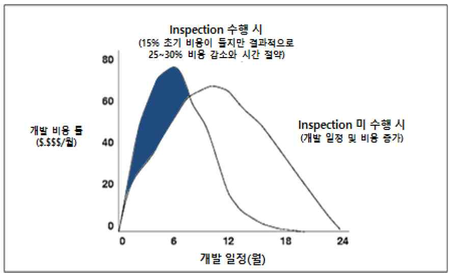

출처: 교육부(2021).기능모델링(LM2001020220_19v2).한국직업능
력연구원.P48.
[그림 2-1] 페이건 인스펙션 그래프(Fagan Inspection Graph)

| 학습 내용 | 평가 항목 | 성취수준 |  |  |
| --- | --- | --- | --- | --- |
| 4. 동료 검토의 종류동료 검토에는Technical 종류가 다양하다.<표 2-1> 동료 구분 목적 형식 대상 동료 검토 리더결함 측정 및보고 결과 보고서 참여 인원 출처: | Walk-through(워크 스루, 비공식적 검사), Inspection(검사),Review(기술 검토), Management Review(경영 검토) 등여기에서는 대표적으로 인스펙션과 워크 스루에 대해검토(Peer Review)의 종류 인스펙션(Inspection) 워크스루(Walk-through)결함을 발견하고결함을 식별하여 명세화 개발 훈련 및 교육결함 제거를 위한 해결책 검증 산출물 개선 및 보완Formal Review(공식적) Informal Completed Work Product Work Product중재자(필요 교육 이수) 작성자(일반적으로반드시 수행 보통 미 수행 결함 리스트 및 요약서 Walk-through검토 보고서 약 3 ~ 7명(고객 포함) 약 2명 이상(팀교육부(2021).기능모델링(LM2001020220_19v2).한국직업능력연구원.P48. | 대안을효과Review(비공식적)Draft작성자가Report(필요단위) | 소개한다.검토수행)시) |  |
| 5. 동료 검토의 절차동료 검토는 계획, | 사전 교육, 준비, 동료 검토 회의, 수정, 시정 조치의 |  | 순서로 | 진행한 |
| 다. 절차 중 사전반드시 수행해야출처: [그림 2-2] 공식적 | 교육은 생략 가능하며, 준비 단계는 원활한 동료할 절차이다. 교육부(2021).기능모델링(LM2001020220_19v2).한국직업능력연구원.P49. 동료 검토, 인스펙션(Inspection) 절차 | 검토 | 회의를 | 위해 |

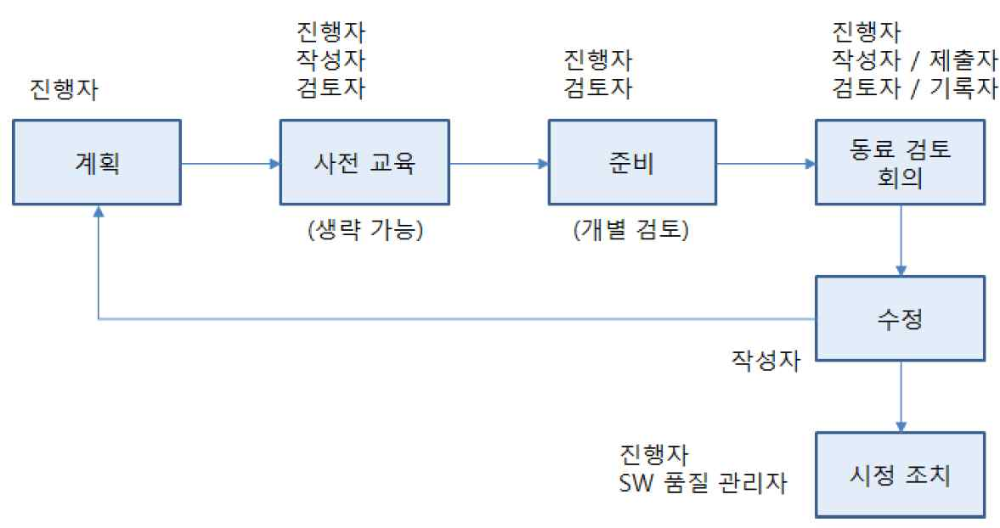

| 학습 내용 | 평가 항목 | 성취수준 |  |  |
| --- | --- | --- | --- | --- |
| 6. 동료 검토의 구성원동료 검토는 워크 스루의 경우<표 2-2> 동료 역할진행자(Moderator)작성자(Author)제출자(Reader)검토자(Inspector)기록자(Recorder)출처: • 기능모델의 표준 구조적 분석 기법과 | 역할 진행자, 작성자, 제출자, 검토자, 기록자로 구성된다. 작성자가 진행자와 제출자를 겸한다. 검토(Peer Review)의 구성원 역할 설명 Ÿ 의장 역할 Ÿ 동료 검토 계획 Ÿ 검토자 선정 Ÿ 검토 대상 산출물 작성 Ÿ 검토 결과 시정 조치 Ÿ 객관적이고 정확하게 검토 대상의 자료 제출 Ÿ Inspection에서 작성자보다 객관적 입장에서 의견Ÿ 동료 검토 전 검토 대상을 충분히 검토 Ÿ 결함 발견을 위한 노력 수행 Ÿ 결함 해결보다는 의견을 제시하는 역할 Ÿ 동료 검토에서 나온 모든 의견을 기록하는 역할Ÿ 종료 후 기록을 정리 및 문서화 교육부(2021).기능모델링(LM2001020220_19v2).한국직업능력연구원.P49. 표기법 및 산출물 객체지향 분석 기법에 따라 기능모델의 표준 표기법 및 | 제시산출물은 |  | 달라진다. |
| 1. 구조적 분석 기법의1970년대 말에조적 분석 기법이 | 표준 표기법 및 산출물 디마르코(DeMarco)가 발표하고 1980년대부터 널리표준 표기법으로 사용되고 있다. | 활용되고 |  | 있는 구 |
| (1) 구조적 분석 | 기법의 표준 표기법 검증 |  |  |  |
| (가) 표준 표기법구조적의 흐름과Conquer) | 검증 절차 분석 기법은 자료 흐름도(DFD: Data Flow Diagram)를변환을 제시하며, 하향식(Top-Down) 방식과 분할과방식으로 세분해 나가야 한다. |  | 사용하여정복(Divide | 정보& |
| 1) 액터 | 표기법을 검증한다. |  |  |  |
| 2) 프로세스 | 표기법을 검증한다. |  |  |  |
| 3) 자료 | 흐름 표기법을 검증한다. |  |  |  |
| 4) 자료 | 저장소 표기법을 검중한다. |  |  |  |
| (나) 표준 산출물프로세스지 검토할 | 양식 검증 모델 설계가 사용자 요구사항을 충분히 반영하여 필요성이 있다. | 적절하게 |  | 이루어졌는 |
| 아래 내용은 | 구조적 분석 기법의 표준 산출물이다. |  |  |  |
| 1) | 배경도(Context Diagram) |  |  |  |
| 2) 자료 | 흐름도(DFD: Data Flow Diagram) |  |  |  |
| 3) 자료 | 사전(Data Dictionary) |  |  |  |
| 4) 소단위 | 명세서(mini-specification) |  |  |  |
| 2. 객체지향 분석한국정보화진흥원의V1.0”에 따르면여 다음과 같은 | 기법의 표준 표기법 및 산출물 “정보시스템 감리지침: 시스템개발사업 객체지향시스템 기능에 대한 유스케이스 모형의 상세화 수준사항을 점검토록 하고 있다. | 및 | 컴포넌트적정성에 | 모델대하 |
| (1) 표준 표기법<표 2-3> 객체지향항목 --액터 -----유스케이스 ----유스케이스 다이어그램 --출처: | 검증 절차 분석 기법의 산출물 검토 체크리스트 내용 기능 구현에 관계되는 액터가 모두 도출되었는가? 액터 목록에서 액터 명이 역할 중심으로 명명되었는가? 요구사항 정의서, 요구사항 기술서에 외부/내부 액터가 모두액터 목록과 액터 명세서에 기록된 액터가 타당한가? 요구 기능 구현에 필요한 유스케이스가 모두 도출되었는가?도출된 유스케이스를 논리적으로 연결하여 누락된 기능을 도출된 유스케이스가 유스케이스 목록과 유스케이스 명세서에도출된 유스케이스의 논리적인 합이 과업 범위와 일치하는가?도출된 유스케이스들이 논리적으로 그룹화되었는가? (그룹화는 액터 기준, 연관 관계 기준, 동시성 기준이 가능)유스케이스 기능 범위가 다른 유스케이스 기능 범위와 중복되는가?유스케이스 명세서 형식에 중요 항목이 누락되지 않았는가?(사전 및 사후 조건, 정상 흐름, 대안 흐름, 예외 흐름 등) 유스케이스의 주요 이벤트 흐름이 모두 도출되고 논리적으로유스케이스를 구현하기 위하여 필요한 입출력 항목이 모두 교육부(2021).기능모델링(LM2001020220_19v2).한국직업능력연구원.P51. | 도출되었는가?파악하였는가?타당한가?도출되었는가? | 반영되었는가? |  |
| (2) 표준 산출물 | 양식 |  |  |  |
| (가) 액터 목록 |  |  |  |  |
| (나) 유스케이스 | 목록 |  |  |  |
| (다) 유스케이스 | 다이어그램 |  |  |  |
| (라) 유스케이스 | 명세서 |  |  |  |

수행 내용 / 기능모델 표준 준수 검증하기
재료·자료
• 구조적 분석 기법 : 배경도, 자료 흐름도, 자료 사전, 소단위 명세서
• 객체지향 분석 기법 : 유스케이스 다이어그램, 유스케이스 명세서
• DeMarco 구조적 분석 기법 표준 표기법
• OMG(Object Management Group)의 UML 표준 표기법
기기(장비･공구)
• 전산 장비(컴퓨터, 프린터, 빔 프로젝터, 네트워크 장비 등)
• OA 도구(워드프로세서, 스프레드시트, 프레젠테이션 도구 등)
• CASE 도구(SW 분석 지원 도구, UML 작성 지원 도구 등)
안전･유의 사항
• 실습 시 지도 교사의 지시를 따른다.
• 동료 검토 시 상대방의 의견을 존중해야 한다.
수행 순서
• 기능모델의 표준 표기법, 산출물 양식과 지침의 검증을 위한 동료 검토 계획을 수립한다.
기능모델이 표준 표기법을 준수하는지와 표준으로 제시된 산출물 양식과 지침을 따르고 있
는지, 동료 검토 중 비공식적 검토인 워크 스루(Walk-through)를 수행한다.

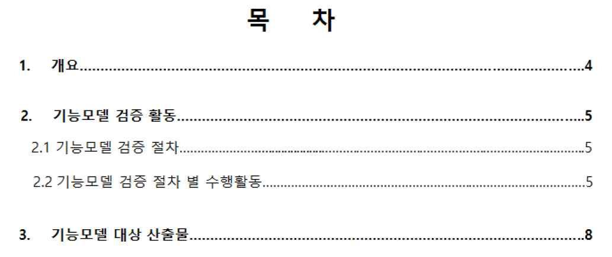

출처: 교육부(2021).기능모델링(LM2001020220_19v2).한국직업능력연구원.P52.
[그림 2-3] 기능모델 검증 계획서 목차
위 그림과 같이 목차는 기능모델 검증 계획서를 구성하는 항목을 나열하여 작성하고, 보고
서 본문의 내용과 페이지가 일치하게 작성한다.

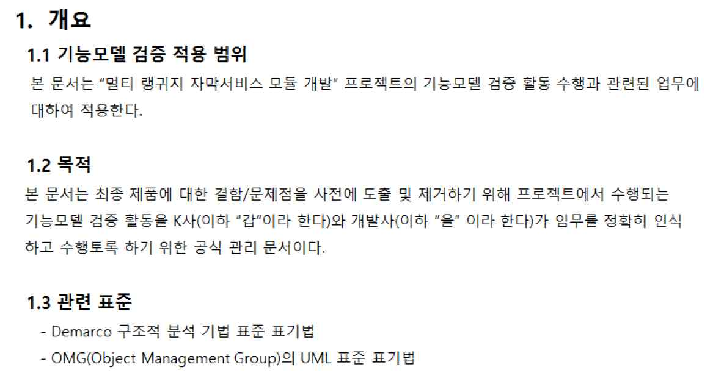

출처: 교육부(2021).기능모델링(LM2001020220_19v2).한국직업능력연구원.P53.
[그림 2-4] 기능모델 검증 계획서 개요
위 그림과 같이 기능모델 검증 계획서 개요에는 동료 검토의 적용 범위, 목적, 관련 표준
등의 내용을 명시한다.
기능 모델링에 대한 표준 표기법 및 산출물 양식과 지침의 검증을 위한 동료 검토이므로
관련 표준 항목에는 “DeMarco 구조적 분석 기법 표준 표기법” 혹은 “OMG(Object
Management Group)의 UML표준 표기법”을 기입한다.
• 도식된 기능모델이 표준 표기법을 준수하는지 검증한다.
이해관계자들은 시스템을 다양한 관점에서 바라보기 때문에 요구사항을 분석하고 명세하기
위한 기능모델 설계가 이해관계자들의 공통적인 시각과 이해를 도울 수 있도록 표준 표기
법을 준수하는지 검증해야 한다.
기능모델 설계를 위해 구조적 분석 기법이나 객체지향 분석 기법으로 도식된 기능모델이
표준 표기법을 준수하는지 검증한다.
1. 구조적 분석 표준 표기법과 비교한다.
구조적 분석 표준 표기법은 1970년대 말에 DeMarco가 발표하고 1980년대부터 널리
활용되고 있는 구조적 분석 기법으로, 도식된 기능모델이 표준 표기법을 준수하는지 검
증한다. 도식된 구조적 분석 기법을 이용한 기능모델 표준 표기법의 검증 절차는 다음
과 같다.

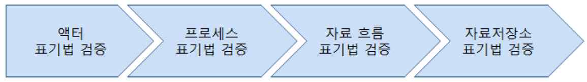

출처: 교육부(2021).기능모델링(LM2001020220_19v2).한국직업능력연구원.P54.
[그림 2-5] 구조적 분석 기법을 이용한 기능모델 표준 표기법 검증 절차
(1) 액터 표기법을 검증한다.
액터는 자료를 제공하는 출처나 자료의 도착지로 프로세스와 혼동되어 사용되지 않
도록 한다.
<표 2-4> 액터 표기법의 표현이 잘된 예와 잘못된 예
잘된 예 잘못된 예

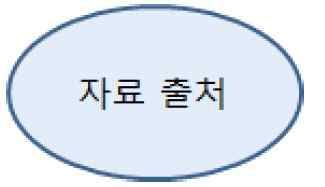

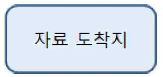

출처: 교육부(2021).기능모델링(LM2001020220_19v2).한국직업능력연구원.P54.
액터 표기법은 직사각형이나 모서리가 둥근 직사각형이어야 한다. 잘못된 예와 같이
타원이거나 자료 저장소 형태의 표기법이 있는지 확인하여 검증한다.
(2) 프로세스 표기법을 검증한다.
프로세스는 시스템 내에서 정보를 처리하고 변환시키기 위한 동작을 표현하기 위해
사용하는 기호로, 동작이나 동사구 형태의 능동형을 사용하여 표기되었는지 검증한다.
<표 2-5> 프로세스 표기법의 표현이 잘된 예와 잘못된 예
잘된 예 잘못된 예

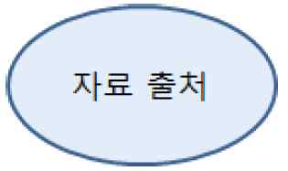

출처: 교육부(2021).기능모델링(LM2001020220_19v2).한국직업능력연구원.P54.
<표 2-6> 프로세스 표기법의 동작 표현이 잘된 예와 잘못된 예
잘된 예 잘못된 예

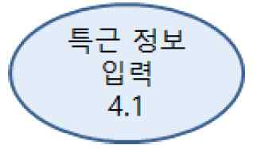

출처: 교육부(2021).기능모델링(LM2001020220_19v2).한국직업능력연구원.P54.
주의해야 할 점은 <표 2-6>의 잘된 예처럼 프로세스에 프로세스 번호가 표기되어
있는지 확인해야 한다. 기능별 추적을 위한 중요한 매핑 번호이다.
(3) 자료 흐름 표기법을 검증한다.
자료 흐름은 프로세스, 액터, 자료 저장소 사이의 데이터 흐름을 표시한다.
화살표로 표현되며 화살표 위에 자료가 표시되어 있는지 검증한다. 화살표의 방향을
검증하여 자료의 흐름이 올바르게 표현되고 있는지 검증한다.
<표 2-7> 자료 흐름 표기법의 표현이 잘된 예와 잘못된 예

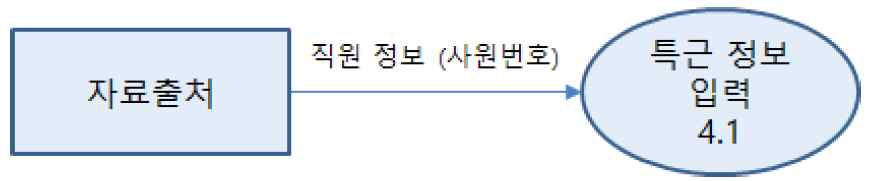

잘된 예

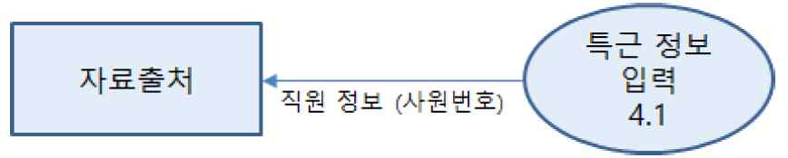

잘못된 예
출처: 교육부(2021).기능모델링(LM2001020220_19v2).한국직업능력연구원.P55.
(4) 자료 저장소 표기법을 검증한다.
자료 저장소는 데이터를 저장하는 파일이나 데이터베이스 시스템을 표현한다.
양쪽이 열린 직사각형 형태로 표시되어 있는지 검증한다.
<표 2-8> 자료 저장소 표기법의 표현이 잘된 예와 잘못된 예
잘된 예 잘못된 예

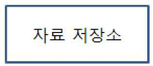

출처: 교육부(2021).기능모델링(LM2001020220_19v2).한국직업능력연구원.P55.
2. 객체지향 분석 표준 표기법과 비교한다.
객체지향 분석 표준 표기법은 1990년대 럼바(Rumbaugh)의 OMT, 부치(Booch)의
OOAD, 야콥슨(Jacobson)의 OOSE가 통합된 OMG(Object Management Group)의
UML 표준 표기법에 따라 표기했는지 검증한다.
기능 모델링은 요구사항 분석이므로 UML 중 유스케이스 다이어그램(Use Case
Diagram)의 표기법에 맞게 표기했는지 검증한다. 도식된 객체지향 분석 기법을 이용한
기능모델 표준 표기법의 검증 절차는 다음과 같다.

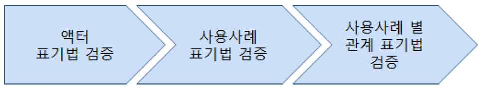

출처: 교육부(2021).기능모델링(LM2001020220_19v2).한국직업능력연구원.P56.
[그림 2-6] 객체지향 분석 기법을 이용한 기능모델 표준 표기법 검증 절차
(1) 액터 표기법을 검증한다.
액터는 시스템과 상호작용하는 사람 또는 사물로서 사용자가 시스템에 대해 수행하
는 역할을 표현한다. <표 2-9>의 잘못된 예와 같이 “직원”같은 역할이 아닌 “사람”
같은 추상적인 단어로 잘못 명기되었는지 검증한다.
<표 2-9> 액터 표기법의 잘된 예와 잘못된 예

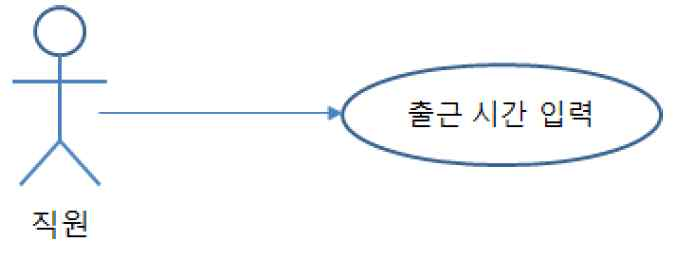

잘된 예

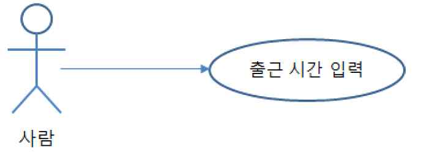

잘못된 예
출처: 교육부(2021).기능모델링(LM2001020220_19v2).한국직업능력연구원.P56.
(2) 유스케이스 표기법을 검증한다.
유스케이스는 시스템이 제공해야 하는 서비스 및 기능으로 액터가 시스템을 통해
작동하는 일련의 행위이다.
일반적으로 타원으로 표기하며 동작이나 동사구 형태의 능동형을 사용하여 표기되었
는지 검증한다. 타원 안에 행위를 표현할 수도 있고 타원 하단에 행위를 표현할 수
도 있다.
<표 2-10> 유스케이스 표기법과 동작 표현이 잘된 예와 잘못된 예
잘된 예 잘못된 예

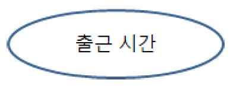

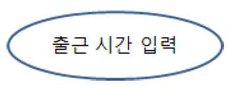

출처: 교육부(2021).기능모델링(LM2001020220_19v2).한국직업능력연구원.P56.
(3) 유스케이스별 관계 표기법을 검증한다.
유스케이스별 관계는 유스케이스들 사이에 서로 밀접하게 연관되어 있어 상호 간에
관계를 가지는 경우를 표기한다. 포함(include), 확장(extend),
일반화(generalization)의 유형에 맞는 관계로 표기되어 있는지 검증한다.
(가) 포함(include) 관계 표기법이 잘 되어 있는지 검증한다.
포함 관계는 유스케이스를 수행할 때 다른 유스케이스가 반드시 수행되어야 하
는 관계이다. <표 2-11>의 잘못된 예는 “출근 시간 입력” 유스케이스와 “퇴근
시간 입력” 유스케이스에서 “출/퇴근 현황 조회” 유스케이스는 반드시 수행해야
할 행위가 아니기 때문에 잘못된 경우이다.
<표 2-11> 유스케이스의 포함(include) 관계 표기법의 잘된 예와 잘못된 예

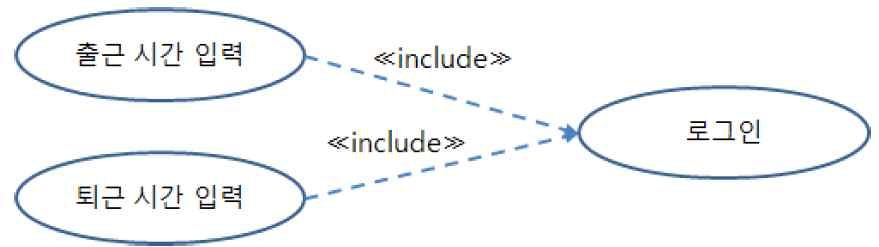

잘된 예

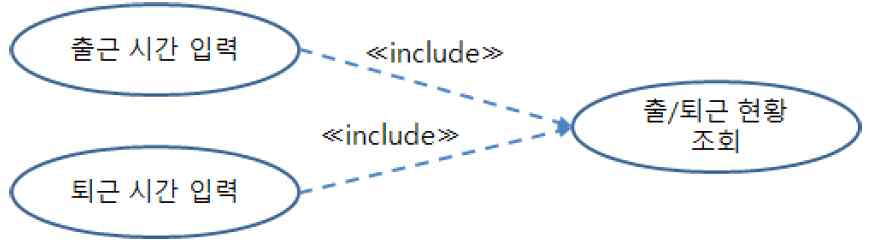

잘못된 예
출처: 교육부(2021).기능모델링(LM2001020220_19v2).한국직업능력연구원.P57.
(나) 확장(extend) 관계 표기법이 잘 되어 있는지 검증한다.
포함 관계는 반드시 수행해야 할 유스케이스와의 관계이고, 확장 관계는 추가되
거나 확장되는 유스케이스와의 관계이다.
<표 2-12> 유스케이스의 확장(extend) 관계 표기법의 잘된 예와 잘못된 예

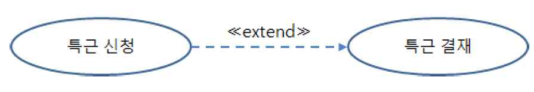

잘된 예

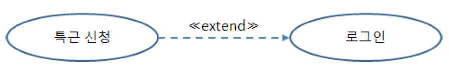

잘못된 예
출처: 교육부(2021).기능모델링(LM2001020220_19v2).한국직업능력연구원.P57.
(다) 일반화(generalization) 관계 표기법이 잘 되어 있는지 검증한다.
일반화 관계는 객체지향 개념과 같이 상속 관계로서 부모 유스케이스가 가지는
속성, 작업 흐름, 확장 지점, 다른 유스케이스와의 관계 등을 자식 유스케이스가
모두 가지는 관계이다.
<표 2-13> 유스케이스의 일반화(generalization) 관계 표기법의 잘된 예와 잘못된 예

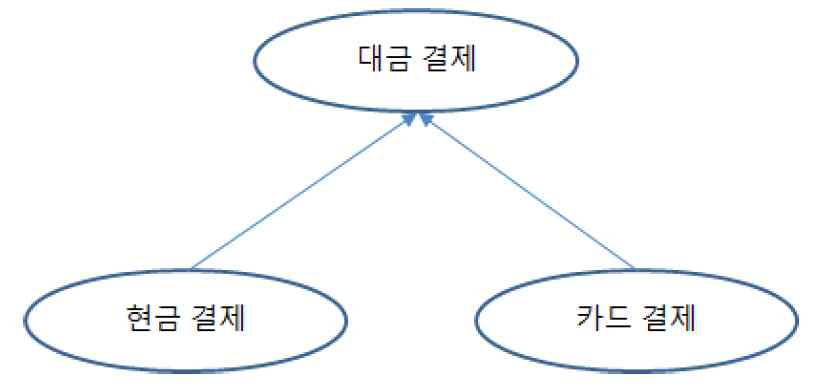

잘된 예

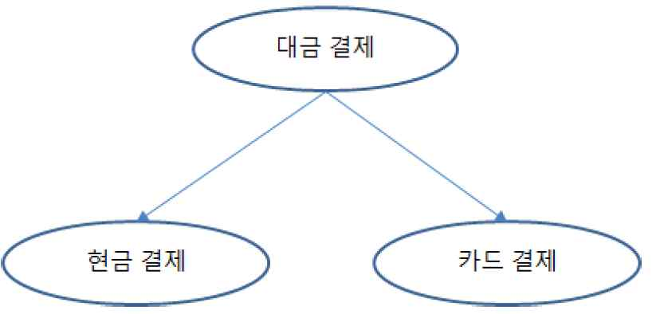

잘못된
예
출처: 교육부(2021).기능모델링(LM2001020220_19v2).한국직업능력연구원.P58.
일반화 관계에서 화살표 방향은 자식 유스케이스가 부모 유스케이스를 향하는
방향이므로 화살표 방향에 주의해서 검증한다.
• 작성된 기능모델이 표준으로 제시된 산출물 양식과 지침을 준수하는지 검증한다.
시스템 요구사항 분석에서 필요한 산출물은 표준 산출물을 기본으로 작성하고, 실무에서는
이러한 표준 산출물 목록을 바탕으로 시스템에 맞게 테일러링(Tailoring)하여 산출물을 작
성한다. 따라서 기능 모델링의 표준 산출물 양식에 맞게 작성하였는지 검증을 수행한다.
1. 구조적 분석 기법 기반 기능 모델의 표준 산출물 양식과 지침을 확인하고 검증한다.
구조적 분석 기법의 표준 산출물 양식은 배경도, 자료 흐름도, 자료 사전, 소단위 명세
서로 분류되며 산출물 번호를 통해 각 산출물의 연관 관계를 검증한다.
(1) 요구사항에 맞게 산출물이 작성되었는지 산출물 목록을 검증한다.
<표 2-14> 구조적 분석 기법의 산출물 목록
요구사항 자료 흐름도 소단위 명세서 자료 사전
ID 이름 ID(번호) 이름 ID(번호) 이름 ID(번호) 이름
출처: 교육부(2021).기능모델링(LM2001020220_19v2).한국직업능력연구원.P59.
요구사항에 맞게 각 산출물을 매핑(Mapping)함으로써 기능요구사항에 맞는지에 대
한 요구사항 추적이 가능해야 한다.
(가) 기능요구사항별로 자료 흐름도 목록이 나와야 한다(단, 자료 흐름도의 단계에 맞추어
요구사항은 중복될 수 있다).
(나) 자료 흐름도는 레벨(Level) 0부터 세분화된 하위 프로세스까지 상세하게 명시해야
한다.
(다) 소단위 명세서는 최하위 프로세스에 대한 명세서이므로 상위 프로세스에 대해서는
생략이 가능하다.
(라) 자료 사전은 공통으로 사용되는 자료에 대한 명세이므로 중복되어 사용이 가능하다.
(2) 산출물에 검토 의견 항목을 추가하여 산출물에 대한 검증 내용을 작성한다.
요구사항 ID, 요구사항 이름, 자료 흐름도 ID, 자료 흐름도 이름, 자료 흐름 다이어
그램 항목에 검토 의견 항목을 추가하여 검증 내용을 작성한다.
2. 객체지향 분석 기법 기반 기능모델의 표준 산출물 양식과 지침을 확인하고 검증한다.
객체지향 분석 기법 기반의 표준 산출물은 Actor 목록, 유스케이스 목록, 유스케이스
다이어그램, 유스케이스 명세서 등이 있으며, 산출물 번호를 통해 각 산출물의 연관 관
계를 검증한다.
(1) 요구사항에 맞게 산출물이 작성되었는지 산출물 목록을 검증한다.
<표 2-15> 객체지향 분석 기법의 산출물 목록
관련 유스케이스
요구사항 유스케이스 관련 액터
명세서
ID 이름 ID 이름 ID 이름 ID(번호) 이름
출처: 교육부(2021).기능모델링(LM2001020220_19v2).한국직업능력연구원.P59.
요구사항에 맞게 각 산출물을 매핑(Mapping)함으로써 기능요구사항에 맞는지에 대
한 요구사항 추적이 가능해야 한다.
(2) 산출물에 검토 의견 항목을 추가하여 산출물에 대한 검증 내용을 작성한다.
<표 2-16> 유스케이스 명세서에 검토 의견 작성 사례
항목 내용
요구사항 ID SFR-001
요구사항 이름 출퇴근 현황 조회
유스케이스 ID SFR-00104
유스케이스 명 출/퇴근 현황을 조회한다.
관련 액터 직원
명세서 명 출/퇴근 현황을 조회한다.
항목 내용
기능 구현에 관련된 모든 액터가 도출되었으며, 액터 명이 역할 중심으로 명
명되었음.
요구 기능에 필요한 유스케이스는 로그인하기, 출근 시간 입력, 퇴근 시간 입
검토 의견 력이 있음.
도출된 유스케이스들이 출/퇴근 현황 조회 과업 범위와 일치하고 있음.
유스케이스 명세서에 중요 항목들이 포함되어 있으며, 유스케이스 구현에 필요
한 입출력 항목들이 모두 도출되었음.
출처: 교육부(2021).기능모델링(LM2001020220_19v2).한국직업능력연구원.P60.
해당 요구사항을 구현하기 위해서는 추가적으로 로그인하기, 출근 시간 입력, 퇴근
시간 입력 유스케이스를 검토하여 산출물 내용이 맞게 구성되었는지 검증해야 한다.
• 검증이 완료된 후 작성자에게 결과물을 전달하여 시정 조치를 요청한다.
동료 검토를 수행하고 나면 기능모델 검증 결과 보고서 문서에 검토 의견을 기술한다. 동
료 검토에 참석한 참석자들의 기술적 검토 관점 및 기준을 기술하여 시정 조치자에게 명
확한 근거를 제시해야 한다. 기능모델 검증 결과 보고서는 표지 및 목차, 테스트 개요 등
을 작성하지 않고 한 면에 모든 구성을 표현한다.
1. 기능모델 검증 결과 보고서의 일반 사항
(1) 수행 계획(일시 및 장소, 참석자 및 참석자별 역할)을 명시
(2) 회의 전 준비 자료(검토 대상 산출물, 사전 검토물이나 참조 자료)를 명시
(3) 참여할 역할과 참여자를 기술
(4) 참석자들의 기술적 검토 관점 및 기준을 기술

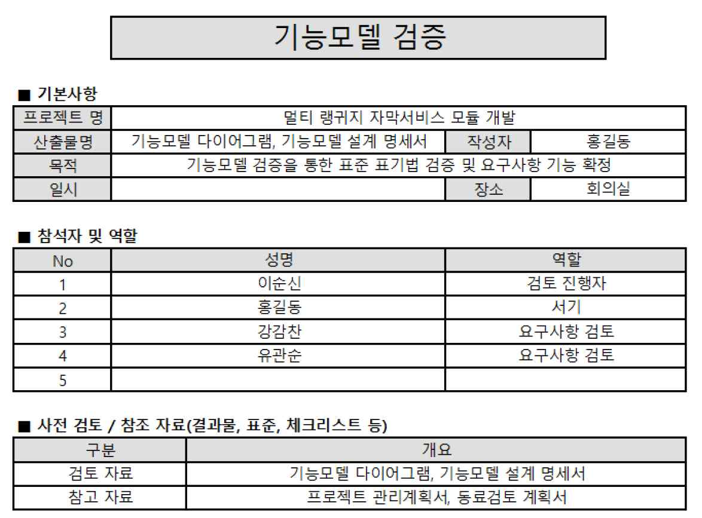

출처: 교육부(2021).기능모델링(LM2001020220_19v2).한국직업능력
연구원.P61.
[그림 2-7] 기능모델 검증 계획서 예시
2. 기능모델 검증 수행 결과
(1) 결함이 발견된 검토 대상 산출물의 위치( 페이지 및 라인 수)를 기록한다.
(2) 발견된 결함 내용 및 해결 방안을 상세히 기술한다.
(3) 결함을 발견한 검토자를 기록한다.
(4) 발견된 결함에 대해 검토자가 생각하는 심각성 및 프로젝트 일정 및 비용에 미치는 영향
도를 상⋅중⋅하로 표기한다.
• 작성자가 시정 조치를 수행한 후 조치 결과를 기술한다.
작성자는 조치 결과를 기능모델 검증 결과 보고서에 입력한다. 필요 시 검토자들에게 재검
토를 요청할 수 있다.
다음 사항은 동료 검토의 조치 결과를 기술할 때 유의 사항이다.
1. 기능모델 검증 결과의 검토 의견별 조치 결과 내용을 요약하여 기록한다.
2. 검토 의견에 대해 조치 완료 예정일을 기록한다.
3. 기능모델 검증 의견에 따라 시정된 항목을 기술한다.
4. 관련자들로부터 재작업, 사후 조치 및 조치 사항 완료에 대해 확인한다.

출처: 교육부(2021).기능모델링(LM2001020220_19v2).한국직업능력연구원.P62.
[그림 2-8] 기능모델 검증 결과 보고서의 검토 결과 및 시정 조치 예시

출처: 교육부(2021).기능모델링(LM2001020220_19v2).한국직업능력연구원.P62.
[그림 2-9] 기능모델 검증 결과 보고서를 작성하는 모습
수행 tip
•비공식적 동료 검토이므로 과도한 형식보다는 절차를
중심으로 이해하며 학습한다.
•표준 표기법의 이해와 산출물 간의 연관 관계를 파악하
여 요구사항을 추적할 수 있도록 산출물을 작성하는 능
력이 핵심 포인트이다.
2-2.
소프트웨어 요구사항 준수 검증
학습 목표 •작성된 기능모델이 정의된 소프트웨어 요구사항을 모두 포함하고 있는지 검증할 수 있다.
필요 지식 /
• 요구사항 분석 명세서(SRS, Software Requirements Specification)의 이해
1. 요구사항 분석 명세서의 개념
소프트웨어 시스템이 수행하여야 할 기능과 시스템 환경의 제약조건 및 개발자와 사용
자가 합의한 성능에 관한 사항 등을 분석하여 명확하고 일관성 있게 명세한 문서이다.
2. 요구사항 분석 명세서의 관점
사용자는 시스템의 현황과 문제점은 잘 알고 있으나, 문제점에 대한 기술적인 해결 방
안에 대한 이해가 부족하다. 개발자는 기술적 지식은 풍부하나 사용자 시스템 현황과
문제점에 대해 잘 알지 못한다.

출처: 교육부(2021).기능모델링(LM2001020220_19v2).한국직업능력연구원.P63.
[그림 2-10] 요구사항 분석 명세서의 중요성
사용자와 개발자의 관점 사이에 공통 시각을 정립하고 의사소통과 이해력을 증대시킬
수 있는 문서가 요구사항 분석 명세서이다.
시스템이 어떻게(How) 수행될 것인가가 아닌 무엇(What)을 수행할 것인지에 대해 기
술한다. 즉, 시스템이 이루어야 할 목표를 기술하지만 목표를 달성하기 위한 해결 방법
은 기술하지 않는다.
3. 요구사항 분석 명세서 작성 시 주의 사항
(1) 요구 분석 명세서는 사용자와 개발자 모두 쉽게 이해할 수 있도록 써야 한다.
(2) 요구 분석 명세서에 기술된 조건은 사용자와 개발자가 모두 동의한 것이어야 한다.
(3) 요구 분석 명세서는 목표 시스템이 수행할 모든 기능을 정확히 기술하여야 한다.
(4) 요구 분석 명세서는 목표 시스템에 영향을 미치는 모든 제약조건을 기술한다.
(5) 요구 분석 명세서는 사용자에게 인수를 위한 인수 테스트 기준을 제공하여야 한다.
(6) 요구 분석 명세서에는 시스템 품질과 우선순위에 따른 중요도 및 품질을 측정하는 방법
이 기술되어야 한다.
4. 요구사항 분석 명세서의 표준, IEEE Std 830-1988 SRS
IEEE Std 830-1988 문서는 요구사항 분석 명세서(SRS)를 표준화한 가이드이다.
요구사항 분석 명세서를 작성하는 데 필요한 내용을 제공하여 요구사항을 분석하는 프
로젝트 관리자나 개발자들의 표준 템플릿을 제공한다.

출처: 교육부(2021).기능모델링(LM2001020220_19v2).한국직업능력연구원.P64.
[그림 2-11] IEEE Std 830-1988 SRS 템플릿
• 요구사항 분석 명세서 검증
시스템 구축 과정에서 가장 중요한 일은 산출물에 대한 검토 및 검증이다. 요구사항 분석
명세서는 분석 단계부터 종료 단계까지 지속적으로 작성하면서 요구사항을 확인하고 검증
함으로써 시스템의 품질을 보증해야 한다.
1. 지속적인 요구사항 검증의 필요성
요구사항 검증은 요구사항 분석, 설계, 개발 등 각 과정에서 주기적으로 이루어져야 한
다. 대부분의 결함들이 요구사항의 모호함과 설계의 부정확함에서 시작된다.
다음 그래프에서 보는 바와 같이 초기 단계의 검증을 통한 수정이 후반 단계보다 더
큰 비용 절감과 여러 효과를 볼 수 있다.

출처: 교육부(2021).기능모델링(LM2001020220_19v2).한국직업능력연구원.P65.
[그림 2-12] 프로젝트 단계별 요구사항 검증 효과
2. 요구사항 분석 명세서 검증 사항
요구사항 분석 명세서는 요구사항을 파악한 후 이를 검토하고 설계하는 데 도움을 줄
수 있도록 문서화하여야 한다. 요구사항 분석 명세서를 검증하는 기준은 다음과 같다.
<표 2-17> 요구사항 분석 명세서 검증 사항
검증 사항 검증 내용
무결성(correctness) 및
사용자의 요구를 오류 없이 완전하게 반영하고 있는가?
완전성(completeness)
일관성(consistency) 요구사항이 상호 간에 모순되는 부분이 없는가?
요구 분석의 내용이 모호함 없이 모든 참여자들에 의해 명확하게 이
명확성(unambiguous)
해될 수 있는가?
요구사항 명세서가 “어떻게(How)”보다 “무엇을(What)”에 관점을 두
기능성(functional)
고 기술되었는가?
요구사항 명세서에 기술된 내용이 사용자의 요구사항을 만족하는가?
검증 가능성(verifiable) 개발된 시스템이 요구사항 분석 내용과 일치하는지를 검증할 수 있
는가?
추적 가능성(traceable) 시스템 요구사항과 연관된 산출물을 쉽게 찾아 추적할 수 있는가?
출처: 교육부(2021).기능모델링(LM2001020220_19v2).한국직업능력연구원.P65.
수행 내용 / 소프트웨어 요구사항 준수 검증하기
재료·자료
• 구조적 분석 기법 : 배경도, 자료 흐름도, 자료 사전, 소단위 명세서
• 객체지향 분석 기법 : 유스케이스 다이어그램, 유스케이스 명세서
• 제안 요청서, 제안서, 요구사항 정의서
기기(장비･공구)
• 전산 장비(컴퓨터, 프린터, 빔 프로젝터, 네트워크 장비 등)
• OA 도구(워드프로세서, 스프레드시트, 프레젠테이션 도구 등)
• CASE 도구(SW 분석 지원 도구, UML 작성 지원 도구 등)
안전･유의 사항
• 실습 시 지도 교사의 지시를 따른다.
• 요구사항 분석 명세서 작성을 지원하는 도구들을 다룰 수 있어야 한다.
• 동료 검토 시 상대방의 의견을 존중해야 한다.
수행 순서
• 기능모델 검증을 위해 요구사항 분석 명세서를 작성한다.
기능모델 설계 산출물을 기반으로 요구사항 명세서를 작성하여 고객의 요구사항에 맞는지
검증해야 한다. 요구사항 분석 명세서는 사용자와 목표 시스템 개발자를 연결시키는 중요
한 문서이기 때문에 명확하게 작성해야 한다.
1. 요구사항 분석 명세서의 목차를 정의한다.
요구사항 분석 명세서의 목차는 IEEE Std 830 명세 표준을 기반으로 작성한다. 명세
표준은 소개, 일반적인 기술 사항, 상세한 요구 사항, 부록, 인덱스로 구성된다.
(1) 소개(Introduction)
제기된 문제와 제안된 문제 해결 방법에 대한 개요와 시스템 개발의 목표를 기술한다.
(2) 일반적인 기술 사항(General Description)
시스템의 관점, 기능, 사용자 특성 및 제약사항을 기술한다.
(3) 상세 요구사항(Specific Requirements)
요구사항은 내부와 외부 기능 두 가지 관점으로 나누어 기술한다.
<표 2-18> 요구사항 분석 명세서의 목차 예시
1. 소개(Introduction)
1.1 SRS의 목적(Purpose of SRS)
1.2 산출물의 범위(Scope of product)
1.3 정의, 약어(Definitions, acronyms and Abbreviations)
1.4 참조 문서(References)
1.5 SRS 개요(Overview of SRS)
2. 일반적인 기술 사항(General Description)
2.1 제품의 관점(Product Perspective)
2.2 제품의 기능(Product Functions)
2.3 사용자 특성(User Characteristics)
2.4 제약사항(Constraints)
2.5 가정 및 의존성(Assumptions and Dependencies)
3. 상세 요구사항(Specific requirements)
3.1 기능적 요구사항(Functional requirements)
3.1.1 기능적 요구사항1 (Functional requirements 1)
3.1.1.1 개요
3.1.1.2 입력물
3.1.1.3 프로세싱(Processing)
3.1.1.4 산출물(Outputs)
3.1.1.5 수행 요구사항(Performance requirements)
3.1.1.6 디자인 제약사항(Design constraints)
3.1.1.7 속성(Attributes)
3. 상세 요구사항(Specific requirements)
3.1.1.8 기타 요구사항(Other requirements)
‧ ‧ ‧
3.2 외부적인 인터페이스 요구사항(External interface requirements)
3.2.1 사용자 인터페이스(User interface)
3.2.2 하드웨어 인터페이스(Hardware interface)
3.2.3 소프트웨어 인터페이스(Software interface)
3.2.4 커뮤니케이션 인터페이스(Communications interface)
부록(Appendices)
인덱스(Index)
출처: 교육부(2021).기능모델링(LM2001020220_19v2).한국직업능력연구원.P67.
2. 작성된 목차에 맞게 요구사항 분석 명세서를 작성한다.
요구분석 명세서의 목차를 기준으로 소개, 기능적 요구사항, 인터페이스 요구사항을
입력한다.
(1) 요구사항 분석 명세서의 소개(Introduction)를 작성한다.
소개 부분은 목표 시스템 구축을 위한 목적 및 범위와 요구사항 명세서의 개요를
작성하는 절차이다.
소개에서 목표 시스템의 목적 및 범위 부분은 사용자가 시스템을 구축하고자 하는
목적과 구축 범위를 기록한 내용으로, 제안 요청서나 요구사항 정의서에 있는 내용
을 참고하여 작성한다.
<표 2-19> 요구사항 분석 명세서의 소개 작성 사례
1. 소개
1.1 목적
본 문서는 OO프로젝트를 수행하기 위한 요구사항을 분류하고 기술하기 위한 목적으로
만들어졌다.
1.2 범위
본 문서는 OO프로젝트를 수행하기 위한 목적과 개요, 개발할 시스템의 전망, 제품의 기
능, 그리고 사용자의 유형을 다루고 있다.
1.3 정의, 약어
‧ ‧ ‧
1.4 참조 문서
OO학회지, OO논문 등
1.5 개요
OO 시스템의 회원사 및 회원들에게 다양한 지식정보 공유 및 회원 간의 자유로운 소통
시스템 구축을 통해 사업 기회 발굴 및 협업 정보를 효과적으로 제공하는 시스템을 만
들고자 한다.
출처: 교육부(2021).기능모델링(LM2001020220_19v2).한국직업능력연구원.P68.
(2) 요구사항 분석 명세서의 일반적인 기술 사항을 작성한다.
일반적인 기술 사항 부분은 시스템의 관점, 기능, 특성, 제약사항, 의존성 등을 기술
하는 절차로서, 시스템이 요구하는 일반적인 환경을 기록하여 작성한다.
일반적인 기술 사항 또한 제안 요청서나 요구사항 정의서에 수록되어 있는 내용을
참조하여 작성한다.
<표 2-20> 요구사항 분석 명세서의 일반적인 기술 사항 작성 사례
2. 일반적인 기술 사항
2.1 시스템의 관점
본 시스템은 사용자가 쉽고 간편하게 사용할 수 있도록 설계되었다. 사용자는 웹 화면을 통
해 지원 사업 및 공고 사항을 확인할 수 있으며, 지역별로 회원사의 현황을 확인할 수 있다.
그 외의 기능들은 회원들 간에 자유로운 의사소통을 수행할 수 있다.
‧ ‧ ‧
2.2 시스템의 기능
유스케이스 작성
2.3 사용자의 특성
사용자는 기존에 동일한 시스템을 사용한 적이 없으므로 충분한 교육을 해야 한다.
2.4 제약사항
개발 제약사항, 표준 제약사항, 법적 제약사항 작성
출처: 교육부(2021).기능모델링(LM2001020220_19v2).한국직업능력연구원.P69.
(3) 요구사항 분석 명세서의 상세 요구사항을 작성한다.
상세 요구사항 부분은 내/외부 관점으로 나누어 기능요구사항과 인터페이스 요구사
항을 작성하는 절차이다.
외부 시스템과 연계가 필요한 경우에는 사용자 인터페이스, 통신 인터페이스, 하드
웨어 인터페이스, 소프트웨어 인터페이스에 대한 요구사항을 파악하여 정리한다. 내
부 기능에 대한 요구사항은 구조적 분석 기법을 사용한 경우는 자료 흐름도, 자료
사전, 소단위 명세서의 내용을 작성하고, 객체지향 분석 기법의 경우는 유스케이스
를 사용하여 기능요구사항을 표현한다.
<표 2-21> 요구사항 분석 명세서의 기능요구사항 작성 사례(유스케이스)
3. 상세 요구사항
3.1 기능요구사항
3.1.1 출퇴근 현황 조회(SFR-001)
3.1.1.1 개요
직원은 근태 관리 시스템을 통해 아이디, 비밀번호를 입력하여 로그인한다.
출근 시에는 출/퇴근 관리 화면에서 출근버튼을 클릭하여 출근 시간을 입력하고, 퇴근
시에는 출/퇴근 관리 화면에서 퇴근버튼을 클릭하여 퇴근 시간을 입력한다.
관리자는 근태 현황 조회 화면을 통해 직원들의 근태 관리를 확인한다.
3.1.1.2 입력물
사원번호, 검색 기간
3.1.1.3 프로세싱

3.1.1.3.1 유스케이스 목록
유스케이스 산출물과 매핑하여 작성
3.1.1.3.2 유스케이스 : 첨부로 생략 가능
3.1.1.3.3 유스케이스 명세서 : 첨부로 생략 가능
‧ ‧ ‧
출처: 교육부(2021).기능모델링(LM2001020220_19v2).한국직업능력연구원.P70.
(4) 요구사항 분석 명세서의 부록과 Index를 작성한다.
부록과 인덱스 부분은 기능 모델링을 수행하면서 발생했던 모든 정보 및 산출물들
을 첨부하여 설계에 도움이 되게 작성한다.
• 인스펙션(Inspection. 검사)을 통해 작성된 기능모델이 요구사항을 모두 포함하고 있는지 검증
한다.
작성된 요구사항 분석 명세서를 기반으로 시스템의 요구사항이 모두 포함되었는지 사용자
와 인스펙션을 통해 검증한다. 워크 스루와 달리 공식적인 동료 검토이므로 반드시 사용자
가 참여해야 하며, 목표 시스템의 요구사항의 범위 및 제약사항을 확인해야 한다.
1. 인스펙션 계획서를 작성한다.
동료 검토 중 인스펙션은 산출물 검증을 위해 공식적인 절차를 거쳐야 한다. 따라서 인
스펙션 계획서는 적용 범위, 목적, 참여자, 수행 절차가 반드시 명시되어야 한다.
[그림 2-7]의 기능모델 검증 계획서의 개요와 함께 검증 절차 및 검증 절차별 수행 활
동, 검증 대상 산출물이 명시되어야 한다.
<표 2-22> 기능모델 검증 계획서의 동료 검토 절차 예시
2. 기능모델 검증 활동
2.1. 검증 절차
파트 동료
프로세스 활동 개발자
리더 검토자
1.1 기능모델 검증(검토)자 선정 ○ ●
1.2 일정 협의 및 환경 구축 ● ○
1. 검증 준비
1.3 산출물 배포 및 사전 검토 ● ●
1.4 기능모델 대상 산출물 ● ●
2.1 산출물 내용 설명 ● ○
2. 검증 실시 2.2 결함 식별 및 토의 ○ ●
2.3 기능모델 검증 결과 정리 ● ○
3.1 기능모델 검증 결과 보고 ● ●
3. 사후 관리
3.2 시정 조치 ●
(●:주관 ○:지원)
출처: 교육부(2021).기능모델링(LM2001020220_19v2).한국직업능력연구원.P71.
<표 2-23> 기능모델 검증 계획서의 동료 검토 절차별 수행 활동 예시
2.2. 기능모델 검증 절차별 수행 활동
Ÿ 기능모델 검증자 선정
1) 개발자는 기능모델 대상 산출물(또는 중간 산출물)에 대한 작성이 완료되면 프로젝트 관리자에
게 기능모델 검증자 선정을 요청한다.
2) 프로젝트 관리자는 해당 산출물 검토에 적절한 지식과 경험을 보유한 기능모델 검증자를 선정하
고, 개발자에게 통보한다. 기능모델 검증자는 인원에 대한 제한은 없으나 일반적으로 3~4인으로
선정하는 것이 바람직하다.
3) 필요한 경우, 프로젝트 관리자는 선정된 기능모델 검증자를 대상으로 검토 대상 산출물에 대한
적절한 역할을 부여할 수 있으며, 아래 사항은 일반적인 역할 부여 방법을 예를 들어 기술한
것이다.
- 개발 프로젝트 내에서 맡은 역할에 따라 검토 역할 부여
- 검토 대상 산출물의 내용을 적절히 나누어서 검토 역할 부여
출처: 교육부(2021).기능모델링(LM2001020220_19v2).한국직업능력연구원.P72.

출처: 교육부(2015). 기능모델링(LM2001020220). 한국직업능력개발원. P72.
[그림 2-13] 기능모델 검증 계획서를 기반으로 동료 검토를 수행하는 모습
2. 인스펙션 수행 활동에 따른 요구사항을 검증한다.
요구사항 검증은 사용자 요구사항이 요구사항 분석 명세서에 올바르게 기술되었는가를
검토하고 검증하는 활동이다. 요구사항 인스펙션 체크리스트를 기반으로 요구사항에 대
한 명세가 제대로 작성되었는지 검증한다.
(1) 요구사항 분석 명세서의 검증 내용
(가) 요구사항이 사용자나 고객의 목적을 완전하게 기술하는가?
(나) 요구사항 명세가 문서 표준을 따르고, 설계 단계의 기초로 적합한가?
(다) 요구사항 명세의 내부적 일치성과 완전성이 있는가?
(라) 기술된 요구사항이 참여자의 기대에 일치하는가?
(2) 요구사항 타당성을 검증한다.
시스템 요구사항이 분석 기준에 따라 하드웨어 형상 항목, 소프트웨어 형상 항목 등
에 적절하게 할당되었는지 검증하고, 안전, 보안 및 위험성과 관련된 소프트웨어 요
구사항이 정확하게 반영되었는지 검증한다.
(가) 명세된 요구사항이 구현 가능성이 있는지 검증한다.
(나) 명세된 표현이 정확하고 완전하게 작성되었는지 검증한다.
(다) 표준 표기법 및 표준 산출물과 일치하는지 검증한다.
(라) 이해관계자들의 요구사항 간의 충돌이 있는지 검증한다.
(마) 제약사항이나 분석한 기술적 문제가 있는지에 대해 검증한다.
(3) 요구사항 명세 구조를 검증한다.
요구사항들 간의 정확성과 완전성 및 일치성을 확립하는 단계이다. 정의된 요구사항
들로부터 구현되는 시스템이 사용자의 요구사항과 목표를 만족할 수 있는지에 대해
확인하는 활동이다.
(가) 각 단계별 명세 요건들이 완전하고 정확하게 명세되었는가?
(나) 요구 명세서가 내부적으로 일관성을 가지고 있는가?
(4) 요구사항 공통 어휘 및 약어를 검증한다.
사용자와 개발자 등 이해관계자들 간의 공통적인 의사소통을 위해 요구사항의 추출
및 분석 단계에서 나온 용어에 대하여 검증하는 활동이다.
(5) 요구사항 분석 명세서의 검증 결과를 작성자에게 전달하여 시정 조치를 요청한다.
인스펙션 활동에 따른 요구사항 분석 명세서의 검증 결과를 작성자에게 전달하여
시정 조치를 할 수 있도록 한다. 검토 및 검증 결과서는 구체적으로 작성하여 이견
이 없도록 하여야 한다.
(6) 시정 조치한 결과에 대한 내용을 확인한다.
요구사항 분석 명세서의 작성자는 검토 결과의 내용을 시정 조치하고 검토자들에게
피드백을 제공한다. 필요 시 인스펙션을 재요청할 수 있다.
<표 2-24> 요구사항 인스펙션 체크리스트 사례
Y : Yes / N : No / P : Partially Yes / NA : Not Applicable
항 목 Y N P NA
1. 요구사항이 일관되게 기술되었는가?
2. 요구사항이 명백하게 기술되었는가?
3. 정의된 모든 요구사항은 소프트웨어로 구현될 수 있는가?
4. 하나의 요구사항은 여러 요구사항에 중복됨이 없이 유일하게 존재하는가?
5. 기능적 요구사항이 작성되었는가?
6. 기능적 요구사항에 대해서는 기능 개요, 입력물, 처리 방법, 출력물
등을 기술하였는가?
7. 고객의 성능 요구사항이 테스트 가능 하도록 정량화되어 있는가?
8. 인터페이스 관련 요구사항이 기술되었나?
9. 보안 관련 요구사항이 기술되었나?
10. 하드웨어 환경(제약사항 포함)이 완전하게 정의되었는가?
11. 설치 및 마이그레이션 요구사항이 완전하게 정의되었는가?
12. 에러 복구 및 백업 요구사항이 완전하게 정의되었는가?
13. 요구사항이 Safety/Standard를 준수하는가?
14. 주요 기능 요구사항에 대해 계층적으로 세분화하여 기술하였는가?
15. 모든 요구사항이 모델링 결과물(각 모델 ID)과 연결되어 있는가?
출처: 교육부(2021).기능모델링(LM2001020220_19v2).한국직업능력연구원.P74.
수행 tip
•요구사항과 일관되게 요구사항 분석 명세서를 작성하는
능력이 중요하다.
•요구사항 검증은 시스템 구축 단계별로 진행하되 초기
단계에서의 수행이 비용 절감 등의 다양한 효과가 발생
되는 점을 이해하는 것이 주요 포인트이다.
•동료 검토 중 인스펙션은 공식적 검토 방법이고 요구사
항의 검증이 주목적이므로 사용자의 참여를 유도하는
능력이 필요하다.

| 학습 2 | 교수·학습 방법 |
| --- | --- |

교수 방법
• 기능모델 검증의 개념, 종류, 절차에 대한 내용을 정리하여 자료로 제시한 후 설명한다.
• 동료 검토의 종류 중 워크 스루와 인스펙션의 차이점을 설명한 후 시스템 분석
단계부터 종료 단계까지 요구사항 분석의 필요성에 대해 중점적으로 설명한다.
• 교수자는 기능모델 검증을 위해 조 편성 한 후 검증을 위한 모든 역할들을 수행할 수
있도록 하고 각 역할별로 상이한 관점을 이해할 수 있도록 실습을 진행한다.
• 구조적 분석 기법과 객체지향 분석 기법의 표준 표기법과 표준 산출물의 자료를 제시한
후 설명한다.
• 교수자는 요구사항 분석 명세서의 목차를 파악하고 각 목차별 내용을 기능모델 설계
단계의 산출물과 연결하여 작성할 수 있도록 설명한다.
• 교수자의 주도로 기능모델이 요구사항을 모두 포함하고 있는지에 대한 명확한 검증을
위해 요구사항 검토 체크리스트를 기준으로 검증하는 방법을 지도한다.
학습 방법
• 기능모델 검증의 개념 및 종류, 절차에 대한 내용을 학습한다.
• 동료 검토의 종류 중 워크 스루와 인스펙션의 차이점을 이해한 후 시스템 분석 단계부
터 종료 단계까지 요구사항 분석의 필요성에 대해 중점적으로 학습한다.
• 기능모델 검증을 위해 조 편성을 통한 모든 역할들을 경험하고 각 역할별로 상이한 관
점을 이해할 수 있도록 학습한다.
• 구조적 분석 기법과 객체지향 분석 기법의 표준 표기법과 표준 산출물의 자료를 학습한다.
• 요구사항 분석 명세서의 목차를 파악하고 각 목차별 내용을 기능모델 설계 단계의 산출
물과 연결하여 작성할 수 있도록 학습한다.
• 기능모델이 요구사항을 모두 포함하고 있는지에 대한 명확한 검증을 위해 요구사항 검
토 체크리스트를 기준으로 검증할 수 있도록 학습한다.

| 학습 2 | 평 가 |
| --- | --- |

평가 준거
• 평가자는 학습자가 학습 목표를 성공적으로 달성하였는지를 평가해야 한다.
• 평가자는 다음 사항을 평가해야 한다.

| 학습 내용 | 학습 목표 | 성취수준 |  |  |
| --- | --- | --- | --- | --- |
|  |  | 상 | 중 | 하 |

- 도식된 기능모델이 표준 표기법을 준수하고 있는지
검증할 수 있다.
기능모델 표준
준수 검증하기
- 작성된 기능모델이 표준으로 제시된 산출물 양식과
지침을 따르고 있는지 검증할 수 있다.
소프트웨어
- 작성된 기능모델이 정의된 소프트웨어 요구사항을
요구사항 준수
모두 포함하고 있는지 검증할 수 있다.
검증하기
평가 방법
• 포트폴리오

| 학습 내용 | 평가 항목 | 성취수준 |  |  |
| --- | --- | --- | --- | --- |
|  |  | 상 | 중 | 하 |

- 기능모델 설계 산출물의 표준 표기법에 대한 이해
능력
기능모델 표준
- 기능 분석 기법별 기능모델 산출물 작성 능력
준수 검증하기
- 동료 검토 계획서를 작성하고 검토 결과를 반영하여
보완하는 능력
- 요구사항 분석 명세서 내용이 모든 요구사항을
소프트웨어
포함하고 있는지 파악하는 능력
요구사항 준수
- 분석 기법별 산출물들과 요구사항 분석 명세서의
검증
내용과 연계 및 일치하는지 확인하는 능력
• 역할연기

| 학습 내용 | 평가 항목 | 성취수준 |  |  |
| --- | --- | --- | --- | --- |
|  |  | 상 | 중 | 하 |

- 주어진 기능모델의 표준 준수에 대한 워크스루 진행
시 작성자와 검토자 역할 수행 여부
기능모델 표준
준수 검증하기 - 주어진 기능모델에 맞는 표준 준수 검증 여부
- 주어진 기능모델 명세서의 표준 준수 검증 여부
- 주어진 기능모델에 대한 공식적 동료 검토인 인스펙션
소프트웨어 진행 시 진행자, 작성자와 검토자 역할 수행 여부
요구사항 준수
검증하기 - 주어진 소프트웨어 요구사항을 기능모델에 반영하였는
지 검증하였는지 여부
• 구두발표

| 학습 내용 | 평가 항목 | 성취수준 |  |  |
| --- | --- | --- | --- | --- |
|  |  | 상 | 중 | 하 |

- 기능모델 표준 준수 여부를 검증한 동료 검토 계획서를
확인하여 설명할 수 있는 능력
기능모델 표준
준수 검증하기
- 기능모델 표준 준수 여부를 검증한 동료 검토 결과서의
검토 의견 및 시정 조치 확인하여 설명할 수 있는 능력
- 요구사항 분석 명세서의 목차의 적정도 및 기능 모델
설계 시의 산출물들과 연계 및 일치 여부를 검증하고
소프트웨어
결과를 설명할 수 있는 능력
요구사항 준수
검증하기
- 소프트웨어 요구사항이 기능모델에 반영하였는지 검증한
결과를 설명할 수 있는 능력

| 학습 내용 | 평가 항목 | 성취수준 |  |  |
| --- | --- | --- | --- | --- |
| 피드백 |  |  |  |  |
| 1. 포트폴리오 - 주어진 시스템대한 동료정리하여 - 평가 결과하도록 한다.- 평가 결과리하여 제출하도록 | 요구사항과 기능모델 산출물이 표준 표기법 및 표준 산출물을검토 계획서 및 결과서의 내용을 작성하게 한 후 내용에서 제공한다. 우수한 경우, 좀더 복잡한 상황을 제시하고 어떻게 검증할 것인지미흡한 경우, 검증 결과 중 부족한 부분이 왜 발생했는지 설명하고한다. | 개선해야다시 | 준수하는지에할 정리하여한번 | 사항을제출정 |
| 2. 역할연기 - 주어진 상황에서이해하는지- 평가 결과수행하게 한다.- 평가 결과할을 수행하게 | 사용자와 개발자의 관점에서 시스템을 바라보는 관점이파악한 후 논리적 사고 및 객관적 근거 제시의 정도를 평가하여우수한 경우, 좀더 복잡한 의견 대립 상황을 제시하고 동료검토의미흡한 경우, 기능모델 검증 기준을 구체적으로 설명한 후 다시한다. | 서로알려준다.조정자한번 | 다른 검토자 | 부분을역할을역 |
| 3. 구두발표 - 기능 모델링과서 등의평가하여 - 평가 결과 - 평가 결과 | 시 수행했던 요구사항 분석 명세서, 분석 기법 산출물, 동료발표를 진행한 후 내용의 이해도 및 표준 표기법과 표준 산출물의개선해야 할 사항 등을 정리하여 알려준다. 우수한 경우, 좀더 복잡한 기능모델 사례를 제시하고 검증한 결과를미흡한 경우, 간과한 기준에 대하여 설명하고 다시 검증하여 결과를 | 검토 발표하도록발표하도록 | 계획서 및활용 한다.한다. | 결정도를 |

•정보통신산업진흥원(2012.11). 『동료검토 계획서 작성 가이드』.
•정보통신산업진흥원(2012.11). 『동료검토 결과보고서 작성 가이드』.
•지식경제부(2012). 『소프트웨어사업 요구사항 분석∙적용 가이드』. http://www.egov.nia.or.kr
에서 2017. 05. 22. 검색.
•한국정보화진흥원(2011.9). 『제안요청서의 요구사항 작성 가이드』.
•한국전산원(2004). 『정보화사업 사전타당성분석 방법론 연구』.
•한국정보화진흥원(2009). 『정보시스템 감리지침 - 시스템개발사업 구조적 정보공학적 모델 – V1.0』.
•한국정보화진흥원(2009). 『정보시스템 감리지침 - 시스템개발사업 객체지향 컴포넌트 기반 모델 – V1.0』.
•IEEE Computer Society(1986). IEEE Transactions on Software Engineering. 『Advances
in Software Inspections』.
•IEEE Computer Society(2004). 『Guide to the Software Engineering Body of Knowledge』.
•IEEE Computer Society(1998). 『IEEE Recommended Practice for Software
Requirements Specifications』.
NCS학습모듈 개발이력
발행일 2015년 12월 31일
세분류명 응용SW엔지니어링(20010202)
개발기관 한국소프트웨어기술진흥협회
강석진(이비스톰)* 김승현(경희대학교)
김보운(이화여자대학교) 엄기영(우리에프아이에스)
김홍진(LG CNS) 장온순(한국IT컨설팅)
유은희 조상욱(세종대학교)
집필진 검토진
장현섭((주)커리텍) 조성호(삼성카드)
주선태(T3Q)
진권기(이비스톰)
최재준 *표시는 대표집필자임
발행일 2017년 12월 31일
세분류명 응용SW엔지니어링(20010202)
개발기관 (사)한국정보통신기술사협회
박미화(동국대학교)* 권순명(㈜씨에이에스)
김승환((주)캐롯아이) 김태형((사)한국정보통신기술사협회)
김원기(LG CNS) 양승화(라이나생명보험)
김종명(SM신용정보) 이성화(시스원)
박현기(프리랜서) 황극인(㈜코스콤)
집필진 검토진
유현주((사)한국정보통신기술사협회)
이구성(한국아이씨티(주))
이숙희(서초문화예술정보학교)
최창선(한빛디엔에스(주))
홍민표(한화S&C) *표시는 대표집필자임
발행일 2018년 12월 31일
학습모듈명 기능 모델링(LM2001020220_16v1)
개발기관 한국직업능력개발원
발행일 2021년 12월 31일
학습모듈명 기능 모델링(LM2001020220_19v2)
개발기관 (사)한국정보통신기술사협회(개발책임자: 온기현)
발행일 2025년 12월 31일
학습모듈명 기능 모델링(LM2001020220_23v3)
개발기관 (사)한국정보통신기술사협회(개발책임자: 박철수)
기능모델링(LM2001020220_23v3)
저작권자 교육부
연구사업기관 한국직업능력연구원
발행일 2025. 12. 31.
※ 이 학습모듈은 자격기본법 시행령(제8조 국가직무능력표준의 활용)에 의거하여 개발하였으며,
NCS통합포털사이트(http://www.ncs.go.kr)에서 다운로드할 수 있습니다.

