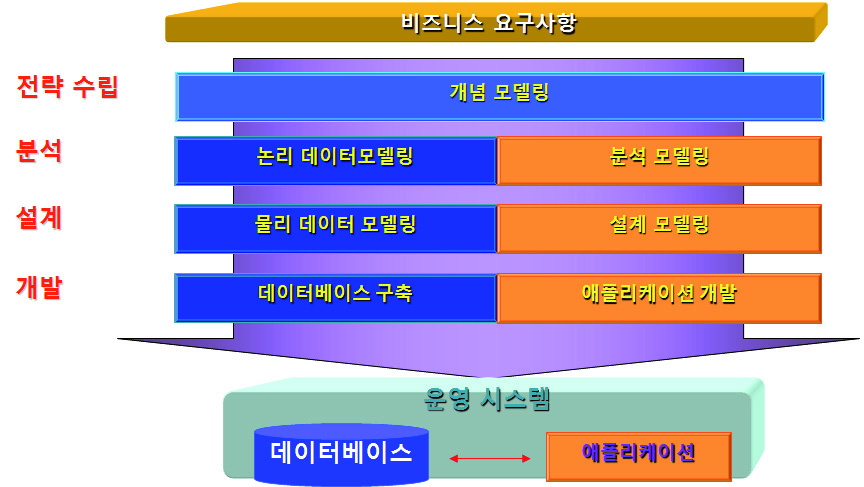
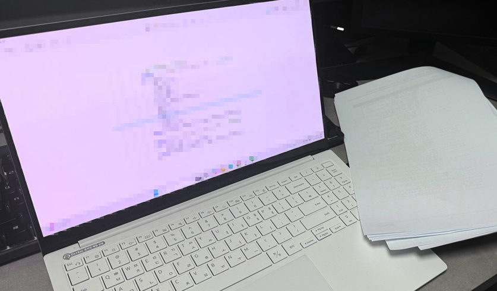

# LM2001020205_23v6_데이터+입출력+구현_20251108

대분류/20
정보통신 중분류/01
정보기술 소분류/02
정보기술개발 세분류/02
응용SW엔지니어링 능력단위/05
NCS학습모듈
데이터 입출력 구현
LM2001020205_23v6
[NCS학습모듈 활용 시 유의 사항]
1. NCS학습모듈은 교육훈련기관에서 출처를 명시하고 교육적 목적으로 활용할 수 있습니다. 다
만, NCS학습모듈에는 국가(교육부)가 저작재산권 일체를 보유하지 않은 저작물(출처가 표기된
도표‧사진‧삽화‧도면 등)이 포함되어 있으므로, 이러한 저작물의 변형‧각색‧복제‧공연‧
배포 및 공중 송신 등과 이러한 저작물을 활용한 2차적 저작물을 작성하려면 반드시 원작자
의 동의를 받아야 합니다.
2. NCS학습모듈은 개발 당시의 산업 및 교육 현장을 반영하여 집필하였으므로, 현재 적용되는
법령‧지침‧표준 및 교과 내용 등과 차이가 있을 수 있습니다. NCS학습모듈 활용 시 법령
‧지침‧표준 및 교과 내용의 개정 사항과 통계의 최신성 등을 확인하시기를 바랍니다.
3. NCS학습모듈은 산업 현장에서 요구되는 능력을 교육훈련기관에서 학습할 수 있게 구성한 자
료입니다. 다만, NCS학습모듈 지면의 한계상 대표적 예시(예: 활용도 또는 범용성이 높은 제
품, 서비스) 중심으로 집필하였음을 이해하시기를 바랍니다.
NCS학습모듈의 이해
NCS학습모듈의 이해
※ 본 NCS학습모듈은 「NCS 국가직무능력표준」사이트(http://www.ncs.go.kr) 에서 확인 및 다운로드할 수 있습니다.

| Ⅰ | NCS학습모듈이란? |
| --- | --- |

•국가직무능력표준(NCS: National Competency Standards)이란 산업현장에서 직무를
수행하기 위해 요구되는 지식･기술･소양 등의 내용을 국가가 산업부문별･수준별로 체계
화한 것으로 산업현장의 직무를 성공적으로 수행하기 위해 필요한 능력(지식, 기술, 태도)
을 국가적 차원에서 표준화한 것을 의미합니다.
•국가직무능력표준(이하 NCS)이 현장의 ‘직무 요구서’라고 한다면, NCS학습모듈은 NCS
의 능력단위를 교육훈련에서 학습할 수 있도록 구성한 ‘교수･학습 자료’입니다. NCS학습
모듈은 구체적 직무를 학습할 수 있도록 이론 및 실습과 관련된 내용을 상세하게 제시하
고 있습니다.

| NCS 및 NCS학습모듈 개발 절차 |
| --- |
| NCS산업계개발 계획 수립NCSNCS학습모듈NCS학습모듈 개발개발 계획 수립 |

•NCS학습모듈은 다음과 같은 특징을 가지고 있습니다.
첫째, NCS학습모듈은 산업계에서 요구하는 직무능력을 교육훈련 현장에 활용할 수 있도
록 성취목표와 학습의 방향을 명확히 제시하는 가이드라인의 역할을 합니다.
둘째, NCS학습모듈은 특성화고, 마이스터고, 전문대학, 4년제 대학교의 교육기관 및 훈
련기관, 직장교육기관 등에서 표준교재로 활용할 수 있으며 교육과정 개편 시에도
유용하게 참고할 수 있습니다.
i
•NCS와 NCS학습모듈 간의 연결 체계를 살펴보면 아래 그림과 같습니다.

| NCS와 NCS학습모듈의 연결 체계 |
| --- |
| NCS NCS학습모듈능력단위 NCS학습모듈명능력단위 정의 NCS학습모듈의 목표능력단위 기술서 학습명능력단위 요소 학습 내용수행준거 학습 목표지식 필요 지식기술 수행 내용- 재료･자료태도- 기기(장비･공구)- 안전･유의 사항- 수행 순서적용범위 및 작업상황고려 사항 교수･학습 방법자료 및 관련 서류 교수 방법장비 및 도구 학습 방법평가 지침 평가평가 방법 평가 준거평가 시 고려 사항 평가 방법피드백참고 자료･활용 서식･부록 |

|  |  | NCS |  |  |  |  |  |  |  |  | NCS학습모듈 |  |  |  |  |
| --- | --- | --- | --- | --- | --- | --- | --- | --- | --- | --- | --- | --- | --- | --- | --- |
|  | 능력단위 |  |  |  |  |  |  |  |  | NCS학습모듈명 |  |  |  |  |  |
|  | 능력단위 | 능력단위 |  |  |  |  |  |  |  | NCS학습모듈명 | NCS학습모듈명 |  |  |  |  |
|  | 능력단위 정의 |  |  |  |  |  |  |  |  | NCS학습모듈의 목표 |  |  |  |  |  |
|  | 능력단위 정의 | 능력단위 정의 |  |  |  |  |  |  |  | NCS학습모듈의 목표 | NCS학습모듈의 목표 |  |  |  |  |
|  | 능력단위 기술서 능력단위 요소 | 능력단위 기술서 능력단위 요소 |  |  |  |  |  |  |  | 학습명 학습 내용 | 학습명 학습 내용 |  |  |  |  |
|  | 능력단위 기술서 |  |  |  |  |  |  |  |  | 학습명 |  |  |  |  |  |
|  | 능력단위 기술서 | 능력단위 기술서 |  |  |  |  |  |  |  | 학습명 | 학습명 |  |  |  |  |
|  | 능력단위 요소 |  |  |  |  |  |  |  |  | 학습 내용 |  |  |  |  |  |
|  | 능력단위 요소 | 능력단위 요소 |  |  |  |  |  |  |  | 학습 내용 | 학습 내용 |  |  |  |  |
|  | 수행준거 |  |  |  |  |  |  |  |  | 학습 목표 |  |  |  |  |  |
|  | 수행준거 | 수행준거 |  |  |  |  |  |  |  | 학습 목표 | 학습 목표 |  |  |  |  |
|  | 지식기술태도 |  |  |  |  |  |  |  |  | 필요 지식수행 내용- 재료･자료- 기기(장비･공구)- 안전･유의 사항- 수행 순서 |  |  |  |  |  |
|  | 기술 | 기술 |  |  |  |  |  |  |  | 수행 내용 | 수행 내용 |  |  |  |  |
|  |  |  |  |  |  |  |  |  |  | - 재료･자료 | - 재료･자료 |  |  |  |  |
|  | 태도 | 태도 |  |  |  |  |  |  |  | - 기기(장비･공구) | - 기기(장비･공구) |  |  |  |  |
|  |  |  |  |  |  |  |  |  |  | - 기기(장비･공구) | - 기기(장비･공구) |  |  |  |  |
|  |  |  |  |  |  |  |  |  |  | - 안전･유의 사항 | - 안전･유의 사항 |  |  |  |  |
|  | 적용범위 및 작업상황 |  |  |  |  |  |  |  |  | - 수행 순서 | - 수행 순서 |  |  |  |  |
|  | 고려 사항자료 및 관련 서류장비 및 도구 |  |  |  |  |  |  |  |  | 교수･학습 방법 | 교수･학습 방법 교수 방법 학습 방법 |  |  |  |  |
|  | 자료 및 관련 서류 장비 및 도구 | 자료 및 관련 서류 장비 및 도구 |  |  |  |  |  |  |  | 교수 방법학습 방법 |  |  |  |  |  |
|  | 평가 지침 |  |  |  |  |  |  |  |  | 평가 |  |  |  |  |  |
|  | 평가 방법평가 시 고려 사항 |  |  |  |  |  |  |  |  | 평가 준거평가 방법피드백 |  |  |  |  |  |
|  | 평가 시 고려 사항 | 평가 시 고려 사항 |  |  |  |  |  |  |  | 평가 방법 | 평가 방법 |  |  |  |  |
|  |  |  |  |  |  |  |  |  |  | 참고 자료･활용 서식･부록 |  |  |  |  |  |

ii
NCS학습모듈의 이해

| Ⅱ | NCS학습모듈의 체계 |
| --- | --- |

•NCS학습모듈은 1. NCS학습모듈의 위치 , 2. NCS학습모듈의 개요 , 3. NCS학습모듈의 내용 체계 ,
4. 참고 자료 , 5. 활용서식/부록 으로 구성되어 있습니다.
1. NCS학습모듈의 위치
•NCS학습모듈의 위치는 NCS 분류 체계에서 해당 학습모듈이 어디에 위치하는지를 한 눈에
볼 수 있도록 그림으로 제시한 것입니다.

| [NCS-학습모듈의 위치] |  |  |  |  |  |  |  |
| --- | --- | --- | --- | --- | --- | --- | --- |
| 대분류 | 문화·예술·디자인·방송 |  |  |  |  |  |  |
| 중분류 |  | 문화콘텐츠 |  |  |  |  |  |
| 소분류 |  |  |  |  |  | 문화콘텐츠제작 |  |
| 세분류 |  |  |  |  |  |  |  |
| 세분류 |  |  |  |  |  |  |  |
| 방송콘텐츠제작 |  |  |  |  | 능력단위 |  | 학습모듈명 |
| 영화콘텐츠제작 프로그램 기획 프로그램 기획음악콘텐츠제작 아이템 선정 아이템 선정광고콘텐츠제작 자료 조사 자료 조사게임콘텐츠제작 프로그램 구성 프로그램 구성애니메이션캐스팅 캐스팅콘텐츠제작만화콘텐츠제작 제작계획 제작계획캐릭터제작 방송 미술 준비 방송 미술 준비스마트문화앱방송 리허설 방송 리허설콘텐츠제작영사 야외촬영 야외촬영스튜디오 제작 스튜디오 제작… … |  |  |  |  | 프로그램 기획 |  | 프로그램 기획 |
| 음악콘텐츠제작 |  |  |  |  | 아이템 선정 |  | 아이템 선정 |
| 광고콘텐츠제작 자료 |  |  |  |  | 자료 조사 |  | 자료 조사 |
| 게임콘텐츠제작 |  |  |  |  | 프로그램 구성 |  | 프로그램 구성 |
| 애니메이션 콘텐츠제작 |  |  |  |  | 캐스팅 |  | 캐스팅 |
| 만화콘텐츠제작 |  |  |  |  | 제작계획 |  | 제작계획 |
| 캐릭터제작 방송 |  |  |  |  | 방송 미술 준비 |  | 방송 미술 준비 |
| 스마트문화앱 방송 콘텐츠제작 |  |  |  |  | 방송 리허설 |  | 방송 리허설 |
| 영사 |  |  |  |  | 야외촬영 |  | 야외촬영 |
|  |  |  |  |  | 스튜디오 제작 |  | 스튜디오 제작 |
|  |  |  |  |  | … |  | … |

|  | 학습모듈은 |
| --- | --- |
| NCS 능력단위 1개당 1개의 학습모듈 개발을 원칙으로 합니다. 그러나 필요에 따라고용단위 및 교과단위를 고려하여 능력단위몇 개를 묶어 1개 학습모듈로 개발할 수있으며, NCS 능력단위 1개를 여러 개의학습모듈로 나누어 개발할 수도 있습니다. |  |

iii
2. NCS학습모듈의 개요
•NCS학습모듈의 개요는 학습모듈이 포함하고 있는 내용을 개략적으로 설명한 것으로
학습모듈의 목표 , 선수학습 , 학습모듈의 내용 체계 , 핵심 용어 로 구성되어 있습니다.

| 학습모듈의 목표 | 해당 NCS 능력단위의 정의를 토대로 학습 목표를 작성한 것입니다. |
| --- | --- |

| 선수학습 | 해당 학습모듈에 대한 효과적인 교수･학습을 위하여 사전에 이수해야 하는 학습모듈, 학습 내용, 관련 교과목 등을 기술한 것입니다. |
| --- | --- |

| 학습모듈의내용 체계 | 해당 NCS 능력단위요소가 학습모듈에서 구조화된 체계를 제시한 것입니다. |
| --- | --- |

| 핵심 용어 | 해당 학습모듈의 학습 내용, 수행 내용, 설비･기자재 등 가운데 핵심적인 용어를 제시한 것입니다. |
| --- | --- |

| 제작계획 학습모듈의 개요 |  |  |  |
| --- | --- | --- | --- |
| 학습모듈의 목표본격적인 촬영을 준비하는 단계로서, 촬영 대본을 확정하고 제작 스태프를 조직하며촬영 장비와 촬영 소품을 준비할 수 있다.선수학습제작 준비(LM0803020105_13v1), 섭외 및 제작스태프 구성(LM0803020104_13v1),촬영 제작(LM0803020106_13v1), 촬영 장비 준비(LM0803040204_13v1.4), 미술디자인 협의하기(LM0803040203_13v1.4)학습모듈의 내용체계 |  |  |  |
| 학습 | 학습 내용 | NCS 능력단위 요소 |  |
| 코드번호 요소 명칭 |  | 코드번호 | 요소 명칭 |
| 1. 촬영 대본 1-1. 촬영 구성안 검 촬영 대본0803020114_16v3.1확정하기 토와 수정 확정하기2-1. 기술 스태프 조직2. 제작 스태프 제작 스태프2-2. 미술 스태프 조직 0803020114_16v3.2조직하기 조직하기2-3. 전문 스태프 조직3. 촬영 장비 3-1. 촬영 장비 점검 촬영 장비0803020114_16v3.3계획하기 과 준비 계획하기4-1. 촬영 소품 목록4. 촬영 소품 작성 촬영 소품0803020114_16v3.4계획하기 4-2. 촬영 소품 제작 계획하기의뢰 |  |  |  |
| 핵심 용어촬영 구성안, 제작 스태프, 촬영 장비, 촬영 소품 |  |  |  |

|  | 학습모듈의 목표는 |
| --- | --- |
| 학습자가 해당 학습모듈을 통해 성취해야할 목표를 제시한 것으로, 교수자는 학습자가 학습모듈의 전체적인 내용흐름을 파악하도록 지도할 수 있습니다. |  |

|  | 선수학습은 |
| --- | --- |
| 교수자 또는 학습자가 해당 학습모듈을 교수·학습하기 이전에 이수해야 하는 교과목또는 학습모듈(NCS 능력단위) 등을 표기한것입니다. 따라서 교수자는 학습자가 개별학습, 자기 주도 학습, 방과 후 활동 등 다양한 방법을 통해 이수할 수 있도록 지도하는 것을 권장합니다. |  |

|  | 핵심 용어는 |
| --- | --- |
| 해당 학습모듈을 대표하는 주요 용어입니다. 학습자가 해당 학습모듈을 통해 학습하고 평가받게될 주요 내용을 알 수 있습니다. 「NCS 국가직무능력표준」 사이트(www.ncs.go.kr)의 색인 (찾아보기) 중하나로 이용할 수 있습니다. |  |

iv
NCS학습모듈의 이해
3. NCS학습모듈의 내용 체계
•NCS학습모듈의 내용은 크게 학습 , 학습 내용 , 교수･학습 방법 , 평가 로 구성되어 있습니다.

| 학습 | 해당 NCS 능력단위요소 명칭을 사용하여 제시한 것입니다.학습은 크게 학습 내용, 교수･학습 방법, 평가로 구성되며 해당 NCS 능력단위의능력단위 요소별 지식, 기술, 태도 등을 토대로 내용을 제시한 것입니다. |
| --- | --- |

| 학습 내용 | 학습 내용은 학습 목표, 필요 지식, 수행 내용으로 구성되며, 수행 내용은 재료･자료, 기기(장비･공구), 안전･유의 사항, 수행 순서, 수행 tip으로 구성한 것입니다.학습모듈의 학습 내용은 실제 산업현장에서 이루어지는 업무활동을 표준화된 프로세스에 기반하여 다양한 방식으로 반영한 것입니다. |
| --- | --- |

| 교수･학습 방법 | 학습 목표를 성취하기 위한 교수자와 학습자 간, 학습자와 학습자 간 상호 작용이활발하게 일어날 수 있도록 교수자의 활동 및 교수 전략, 학습자의 활동을 제시한것입니다. |
| --- | --- |

| 평가 | 평가는 해당 학습모듈의 학습 정도를 확인할 수 있는 평가 준거 및 평가 방법, 평가 결과의 피드백 방법을 제시한 것입니다. |
| --- | --- |

학습 1 촬영 대본 확정하기

|  | 학습은 |
| --- | --- |
| 해당 NCS 능력단위요소 명칭을 사용하여제시하였습니다. 하나의 학습은 일반교과의 ‘대단원’에 해당되며, 학습모듈을 구성하는 가장 큰 단위가 됩니다. 또한 하나의 직무를 수행하기 위한 가장 기본적인단위로 사용할 수 있습니다 |  |

| 학습 2 | 제작 스태프 조직하기 |
| --- | --- |

학습 3 촬영 장비 계획하기
학습 4 촬영 소품 계획하기

|  | 학습 내용은 |
| --- | --- |
| NCS 능력단위요소별 수행준거를 기준으로제시하였습니다. 일반교과의 ‘중단원’에 해당합니다. |  |

2-1. 기술 스태프 조직
학습 목표 •프로그램 제작에 적합한 기술 스태프를 조직할 수 있다.

|  | 학습 목표는 |
| --- | --- |
| 학습 내용을 이수할 때 학습자가 갖춰야할행동 수준을 의미합니다. 따라서 수업시간의 과목 목표로 활용할 수 있습니다. |  |

필요 지식 /
(cid:49684) 기술 스태프의 구성

|  | 필요 지식은 |
| --- | --- |
| 해당 NCS의 지식을 토대로 학습에 대한이해와 성과를 제고하기 위해 반드시 알아야 할 주요 지식을 제시하였습니다. 필요 지식은 수행에 꼭 필요한 핵심 내용을위주로 제시하여 교수자의 역할이 매우중요하며, 이후 수행 순서와 연계하여 교수·학습으로 진행할 수 있습니다. |  |

프로그램의 장르에 따라 구성하는 기술 스태프는 많은 차
이가 있다. 같은 장르의 프로그램이라도 그 형식이나 내
용, 규모에 따라서 구성되는 기술 스태프의 종류와 인원
수는 천차만별이다.
1. 스튜디오 프로그램
토크쇼, 종합 구성, 예능과 같은 스튜디오 프로그램은
부조정실과 스튜디오를 사용하여 제작하기 때문에 많
은 기술 스태프가 필요하다.
v

|  | 수행 내용은 |
| --- | --- |
| 해당 학습모듈에서 제시한 내용 중 기술(skill)을 습득하기 위한 실습과제로 활용할 수 있습니다. |  |

수행 내용 / 기술 스태프 구성표 작성하기
재료·자료

|  | 재료･자료는 |
| --- | --- |
| 수행 내용을 수행하는데 필요한 재료 및 준비물로 실습 시 활용할 수 있습니다. |  |

• 방송프로그램 제작 기획서 및 방송 대본, 콘티(continuity), 제작
일정, 운용표
• 장비 및 시설, 제작 시설 배정 의뢰서 및 배정표, 방송 기술 스
태프 데이터베이스(DB) 자료

|  | 기기(장비･공구)는 |
| --- | --- |
| 수행 내용에 필요한 기본적인 장비 및 도구를 제시하였습니다. 제시된 기기 외에도 수행에 필요한 다양한 도구나 장비를 활용할수 있습니다. |  |

기기(장비･공구)
• 컴퓨터 등
안전･유의 사항

|  | 안전･유의사항은 |
| --- | --- |
| 수행 내용을 수행하는 데 있어 안전상 주의해야할 점 및 유의사항을 제시하였습니다. 실습 시 유념해야 하며, NCS의 고려사항도 추가적으로 활용할 수 있습니다. |  |

• 프로그램의 내용과 제작 방법을 분석하고, 각 스태프들의 역할
을 신중하게 검토한다.
수행 순서
(cid:49684) 방송 대본이나 콘티(continuity), 큐 시트를 분석하고, 프로그램

|  | 수행 순서는 |
| --- | --- |
| 실습 과제의 진행 순서로 활용할 수 있습니다. |  |

의 내용적 특성, 제작 과정에 대한 자료를 수집한다.
(cid:49685) 프로그램 제작 방법을 결정한다.

|  | 수행 tip은 |
| --- | --- |
| 수행 내용에서 실습을 용이하게 할 수 있는아이디어를 제시하였습니다. 수행 tip은 지도상의 안전 및 유의사항 외에 전반적으로적용되는 주안점 및 수행 과제 목적에 대한보충설명, 추가사항 등으로 활용할 수 있습니다. |  |

1. 스튜디오 녹화를 할 것인가, 야외 촬영을 할 것인가 검토한
다.
수행 tip
•스태프의 결정은 스태프 간의 호흡을 중
요시하여 선정해야 프로그램의 질을 향
상시킬 수 있다.

| 학습2 | 교수·학습 방법 |
| --- | --- |

|  | 교수･학습 방법은 |
| --- | --- |
| 학습 목표를 성취하는 데 필요한 교수 방법과 학습 방법을 제시하였습니다. |  |

교수 방법

|  | 교수 방법은 |
| --- | --- |
| 해당 학습 활동에 필요한 학습 내용, 학습내용과 관련된 자료명, 자료 형태, 수행 내용의 진행 방식 등에 대하여 제시하였습니다. 또한 학습자의 수업참여도 제고 방법및 수업 진행상 유의사항 등도 제시하였습니다. 선수학습이 필요한 학습을 학습자가숙지하였는지 교수자가 확인하는 과정으로활용할 수도 있습니다. |  |

• 방송 프로그램의 기술적 요소, 미술 구성 요소, 특수 촬영에 대해
설명한다.
• 방송 프로그램 제작에서 각 기술 스태프의 역할에 대해 설명한다.
• 방송 프로그램을 분석하고 필요한 기술 스태프를 구성할 수 있도
록 지시한다.
학습 방법

|  | 학습 방법은 |
| --- | --- |
| 해당 학습 활동에 필요한 학습자의 자기주도 학습 방법을 제시하였습니다. 또한학습자가 숙달해야 할 실기 능력과 학습과정에서 주의해야 할 사항 등도 제시하였습니다. 학습자가 학습을 이수하기 전반드시 숙지해야 할 기본 지식을 학습하였는지 스스로 확인하는 과정에 활용할수 있습니다. |  |

• 방송 프로그램의 기술적 요소, 미술 구성 요소, 특수 촬영에 대해
서 알아본다.
• 프로그램 제작에 필요한 기술 스태프의 역할을 이해하고, 기술 스
태프 구성표를 작성한다.
vi
NCS학습모듈의 이해

| 학습2 평 가평가 준거• 평가자는 학습자가 학습 목표를 성공적으로 달성하였는지를 평가해야 한다.• 평가자는 다음 사항을 평가해야 한다.성취수준학습 내용 학습 목표상 중 하기술 스태프 - 프로그램 제작에 적합한 기술 스태프를 조조직 직할 수 있다.미술 스태프 - 프로그램 제작에 적합한 미술 스태프를 조조직 직할 수 있다.전문 스태프 - 프로그램 특수 촬영을 위한 전문 스태프를조직 조직할 수 있다.평가 방법• 사례 연구성취수준학습 내용 평가 항목상 중 하- 프로그램에서 기술적 요소의 파악 여부기술 스태프 - 기술 스태프의 역할 파악 여부조직 - 프로그램에 필요한 기술 스태프 구성표 작성 능력피드백1. 사례 연구- 프로그램을 선택하여 기술 스태프, 미술 스태프, 전문 스태프 구성표를 예시와 같이 작성하였는지 개인별 능력을 평가한 후, 그결과를 모든 학습자에게 공유하도록 한다. | 학습2 | 평 가 |
| --- | --- | --- |

|  | 평가는 |
| --- | --- |
| NCS 능력단위의 평가 방법과 평가 시 고려사항을 준용하여 작성합니다. 교수자와학습자가 평가 항목별 성취수준 확인 시활용할 수 있습니다. |  |

|  | 평가 준거는 |
| --- | --- |
| 학습자가 학습을 어느 정도 성취하였는지평가하기 위한 기준을 제시하고 있습니다.학습 목표와 연계하여 단위수업 시간에 평가 항목 별 성취수준을 평가하는 데 활용할수 있습니다. |  |

| 학습 내용 | 학습 목표 | 성취수준 |  |  |
| --- | --- | --- | --- | --- |
|  |  | 상 | 중 | 하 |

| 4. 참고 자료•교육부(2013). | 섭외 및 제작스태프 구성(LM0803020104_13v1). |  |  |  |
| --- | --- | --- | --- | --- |
| 한국직업능력개발원. |  |  |  |  |
| 5. 활용 서식/부록직종 이름기술감독 조명감독 [디지털제1조(목적) 이 고시는램 및 방송광고의 | 스튜디오 기술 스태프 구성표 연락처 소속 특이사항텔레비전 방송프로그램 음량 등에 관한 기준] 제정 2014. 11. 29. 미래창조과학부 고시제1창 총칙 방송법 제70조의2제1항에 따라 방송사업자가 디지털 텔레비전음량을 일정하게 유지하기 위해 필요한 사항을 규정함을 | 비고목적으로 | 제2014-87호방송프로그한다. |  |

|  | 평가 방법은 |
| --- | --- |
| NCS 능력단위의 평가 방법을 참고하였으며, 평가 준거에 따른 평가 방법을 2개 이상 제시합니다. 평가 방법의 종류는 포트폴리오, 문제해결 시나리오, 서술형 시험, 논술형 시험, 사례 연구, 평가자 체크리스트,작업장 평가 등이 있으며, NCS 능력단위요소 별 수행 수준을 평가하는 데 가장 적절한 방법을 선정하여 활용할 수 있습니다. |  |

| 학습 내용 | 평가 항목 | 성취수준 |  |  |
| --- | --- | --- | --- | --- |
|  |  | 상 | 중 | 하 |

| 4. 참고 자료•교육부(2013). | 섭외 및 제작스태프 구성(LM0803020104_13v1). |  |  |  |
| --- | --- | --- | --- | --- |
| 한국직업능력개발원. |  |  |  |  |
| 5. 활용 서식/부록직종 이름기술감독 조명감독 [디지털제1조(목적) 이 고시는램 및 방송광고의 | 스튜디오 기술 스태프 구성표 연락처 소속 특이사항텔레비전 방송프로그램 음량 등에 관한 기준] 제정 2014. 11. 29. 미래창조과학부 고시제1창 총칙 방송법 제70조의2제1항에 따라 방송사업자가 디지털 텔레비전음량을 일정하게 유지하기 위해 필요한 사항을 규정함을 | 비고목적으로 | 제2014-87호방송프로그한다. |  |

|  | 피드백은 |
| --- | --- |
| 평가 후에 학습자들에게 평가 결과를 피드백하여 학습 목표를 달성하는 데 활용할 수 있습니다. |  |

|  | 참고 자료는 |
| --- | --- |
| 해당 학습모듈에 제시된 인용 자료의 출처를 제시하였습니다. 교수·학습의 과정에서참고로 활용할 수 있습니다. |  |

|  | 활용 서식은 |
| --- | --- |
| 평가 서식, 실습 시트 등 교수·학습 시 활용할 수 있는 다양한 서식들로 구성하였습니다. 수행에서 평가에 이르기까지 필요한서식을 해당 모듈의 특성에 맞춰 개발하거나 기존의 양식을 활용하여 제시하였습니다. |  |

|  | 부록은 |
| --- | --- |
| 활용 서식 이외에 교수·학습 과정에서 참고할수 있는 자료가 있는 경우 제시하였습니다. |  |

[NCS-학습모듈의 위치]

| 정보 통신 |  |  |
| --- | --- | --- |
|  | 정보 기술 |  |
|  |  | 정보기술개발 |

대분류
중분류
소분류
세분류

| SW아키텍처 |  |  | 능력단위 | 학습모듈명 |
| --- | --- | --- | --- | --- |
| 응용SW엔지니어링 |  |  | 요구사항 확인 | 요구사항 확인 |
| 임베디드SW 엔지니어링 |  |  | 데이터 입출력 구현 | 데이터 입출력 구현 |
| DB엔지니어링 |  |  | 통합 구현 | 통합 구현 |
| NW엔지니어링 |  |  | 정보시스템 이행 | 정보시스템 이행 |
| 보안엔지니어링 |  |  | 제품소프트웨어 패키징 | 제품소프트웨어 패키징 |
| UI/UX엔지니어링 |  |  | 서버 프로그램 구현 | 서버 프로그램 구현 |
| 시스템SW엔지니어링 |  |  | 인터페이스 구현 | 인터페이스 구현 |
| 빅데이터플랫폼구축 |  |  | 애플리케이션 배포 | 애플리케이션 배포 |
| 핀테크엔지니어링 |  |  | 애플리케이션 리팩토링 | 애플리케이션 리팩토링 |
| 데이터아키텍처 |  |  | 인터페이스 설계 | 인터페이스 설계 |
| loT시스템연동 |  |  | 애플리케이션 요구사항 분석 | 애플리케이션 요구사항 분석 |
| 인프라스트럭쳐 아키텍처 구축 |  |  | 기능 모델링 | 기능 모델링 |
|  |  |  | 애플리케이션 설계 | 애플리케이션 설계 |
|  |  |  | 정적모델 설계 | 정적모델 설계 |

| 동적모델 설계 | 동적모델 설계 |
| --- | --- |
| 화면 설계 | 화면 설계 |
| 화면 구현 | 화면 구현 |
| 애플리케이션 테스트 관리 | 애플리케이션 테스트 관리 |
| 애플리케이션 테스트 수행 | 애플리케이션 테스트 수행 |
| 소프트웨어공학 활용 | 소프트웨어공학 활용 |
| 소프트웨어개발 방법론 활용 | 소프트웨어개발 방법론 활용 |
| 프로그래밍 언어 응용 | 프로그래밍 언어 응용 |
| 프로그래밍 언어 활용 | 프로그래밍 언어 활용 |
| 응용SW 기초 기술 활용 | 응용SW 기초 기술 활용 |
| 개발자 환경 구축 | 개발자 환경 구축 |
| 개발 환경 운영 지원 | 개발 환경 운영 지원 |
| 자료구조 활용 | 자료구조 활용 |

차 례
학습모듈의 개요 1
학습 1. 논리 데이터저장소 확인하기
1-1. 논리 데이터 모델 검증 3
• 교수・학습 방법 15
• 평가 16
학습 2. 물리 데이터저장소 설계하기
2-1. 물리 데이터 모델 설계 18
2-2. 물리 데이터 모델 구성 24
• 교수・학습 방법 31
• 평가 32
학습 3. 데이터 조작 프로시저 작성하기
3-1. 데이터 조작 프로시저 개발 34
3-2. 데이터 조작 프로시저 테스트 설계 41
• 교수・학습 방법 46
• 평가 47
학습 4. 데이터 조작 프로시저 최적화하기
4-1. 데이터 조작 프로시저 성능 개선 49
• 교수・학습 방법 55
• 평가 56
참고 자료 58
데이터 입출력 구현 학습모듈의 개요
학습모듈의 목표
응용소프트웨어가 다루어야 하는 데이터 및 이들 간의 연관성, 제약조건을 식별하여 논리적으로 조직화하
고, 소프트웨어 아키텍처에 기술된 데이터저장소에 조직화된 단위의 데이터가 저장될 최적화된 물리적 공간
을 구성하고 데이터 조작 언어를 이용하여 구현할 수 있다.
선수학습
소프트웨어 공학 이해, 데이터 모델링 개념 이해, 데이터 모델링 표기법 및 도식 기술 등
학습모듈의 내용체계

| 학습 | 학습 내용 | NCS 능력단위요소 |  |
| --- | --- | --- | --- |
|  |  | 코드번호 | 요소 명칭 |

1. 논리 데이터저장소 확 논리 데이터저장소
1-1. 논리 데이터 모델 검증 2001020205_23v6.1
인하기 확인하기
2-1. 물리 데이터 모델 설계
2. 물리 데이터저장소 설 물리 데이터저장소
2001020205_23v6.2
계하기 설계하기
2-2. 물리 데이터 모델 구성
3-1. 데이터 조작 프로시저 개발
3. 데이터 조작 프로시저 데이터 조작
2001020205_23v6.3
작성하기 프로시저 작성하기
3-2. 데이터 조작 프로시저 테스트 설계
4. 데이터 조작 프로시저 데이터 조작
4-1. 데이터 조작 프로시저 성능 개선 2001020205_23v6.4
최적화하기 프로시저 최적화하기
핵심 용어
논리 데이터 모델, 물리 데이터 모델, 데이터 조작 프로시저, 데이터 조작 프로시저 최적화

| 학습 1 | 논리 데이터저장소 확인하기 |
| --- | --- |

학습 2 물리 데이터저장소 설계하기
학습 3 데이터 조작 프로시저 작성하기
학습 4 데이터 조작 프로시저 최적화하기
1-1.
논리 데이터 모델 검증
•업무 분석가, 데이터베이스 엔지니어가 작성한 논리 데이터저장소 설계 내역에서 정의된 데이
터의 유형을 확인하고 식별할 수 있다.
학습 목표 •논리 데이터저장소 설계 내역에서 데이터의 논리적 단위와 데이터 간의 관계를 확인할 수 있다.
•논리 데이터저장소 설계 내역에서 데이터 또는 데이터 간의 제약조건과 이들 간의 관계를 식
별할 수 있다.
필요 지식 /
(cid:49684) 일반적인 시스템 개발 절차
일반적으로 시스템 개발은 데이터 관점과 프로세스 관점의 두 가지로 진행된다. 먼저 개념
모델링을 통해 개발 범위를 파악하고, 업무 중심의 분석(논리 데이터 모델링, 분석 모델링)
단계를 거친다. 이후 개발 환경을 고려한 설계(물리 데이터 모델링, 설계 모델링) 단계로
구체화되며 개발(데이터베이스 구축, 애플리케이션 개발) 단계로 진행된다.

출처: 교육부(2021). 데이터 입출력 구현(LM2001020205_19v5). 한국직업능력연구원 p.3.
[그림 1-1] 시스템 개발 절차
(cid:49685) 데이터 모델링 개요
1. 데이터 모델링 정의
기업의 정보 구조를 실체(Entity)와 관계(Relation)를 중심으로 명확하고 체계적으로 표
현하고 문서화하는 기법이다.
2. 데이터 모델링 목적
(1) 연관 조직의 정보 요구에 대한 정확한 이해를 할 수 있다.
(2) 사용자, 설계자, 개발자 간에 효율적인 의사소통 수단을 제공한다.
(3) 데이터 체계 구축을 통한 고품질 소프트웨어 개발 및 유지보수 비용 절감을 기대할 수
있다.
(4) 신규 또는 개선 시스템의 개발 기반을 제공한다.
3. 데이터 모델링 특성
(1) 데이터 중심 분석을 통해 업무 흐름 파악이 용이하다.
(2) 데이터 무결성을 보장할 수 있다
(3) 데이터의 공유를 통한 중복 제거를 통해 일관성 있는 정보 제공이 가능하다.
(cid:49686) 데이터 모델링 절차
데이터 모델링은 개념 모델링, 논리 모델링, 물리 모델링을 통해 데이터베이스를 구축하는
일련의 과정을 거친다.

출처: 교육부(2021). 데이터 입출력 구현(LM2001020205_19v5). 한국직업능력연구원 p.4.
[그림 1-2] 데이터 모델링 절차
1. 개념 데이터 모델링
전사(Enterprise) 수준에서 요구를 추상화한 모델로서,
(1) 주요 엔티티, 기본 속성, 관계, 주요 업무 기능 등을 포함한다.
(2) 모든 업무 영역을 포함하고, 주제 영역에 포함되는 중심 엔티티 타입 간의 관계를 파악
하여 주요 업무 규칙을 정의한다.
(3) 논리 데이터 모델의 기초가 된다.
2. 논리 데이터 모델링
개념 모델로부터 업무 영역의 업무 데이터 및 규칙을 구체적으로 표현한 모델로서,
(1) 모든 업무용 엔티티, 속성, 관계, 프로세스 등을 포함한다.
(2) 모든 업무 데이터를 정규화(Normalization)하여 모델링한다.
(3) 모든 업무 규칙과 관계를 완전하고 정확하게 표현한다.
(4) 성능 혹은 기타 제약 사항과는 독립적인 모델로서, 특정 DBMS로부터 독립적이라 할 수
있다.
3. 물리 데이터 모델링
설계단계에서 시스템의 설계적 및 정보 요건을 정확하고 완전하게 표현한 모델로서,
(1) 데이터베이스 생성을 위한 물리 구조로 변환한다.
(2) 시스템 설계 요건 반영을 위한 아래와 같은 오브젝트를 추가한다.
(가) 설계용 엔티티 타입
(나) 설계용 속성
(3) 설계와 성능을 고려한 조정을 수행한다.
(가) 적용 DBMS 특성 고려
(나) 엔티티 타입의 분리 또는 통합 검토
(다) 반정규화(Denormalization)
(라) 관계의 해제
(4) 적용 DBMS에 적합한 성능 조정을 수행한다
(가) 인덱스 추가 및 조정
(나) 테이블 스페이스 조정
(다) 인덱스 스페이스 조정
(cid:49687) 논리 데이터 모델링 개요
1. 논리 데이터 모델링 정의
(1) 데이터베이스 개발 과정의 첫 단계로 전략 수립 및 분석 단계에서 실시한다.
(2) 데이터 구조에 대한 논리적 정의 단계로서 정확한 업무 분석을 통한 자료의 흐름을 분석
하여 현재 사용 중인 양식, 문서, 장표를 중심으로 자료 항목을 추출하여 추출된 엔티티
(Entity)와 속성(Attribute)들의 관계(Relation)를 구조적으로 정의하는 단계이다.
(가) 엔티티: 관리할 대상이 되는 실체
(나) 속성: 관리할 정보의 구체적 항목
(다) 관계: 엔티티 간의 대응 관계
2. 논리 데이터 모델링 특성
(1) 논리적 데이터 모델링 시 요구사항을 충분히 수집하지 않으면 다음 단계의 요구사항 변
경에 따른 많은 비용이 발생한다.
(2) 모든 이해당사자들과 의사소통의 보조 자료로서 E-R 모델을 활용한다.
(3) 논리적 모델은 H/W나 S/W에 독립적이다.
3. 정규화(Normalization)
(1) 정의
중복성을 최소화하고 정보의 일관성을 보장하기 위한 개념이다.
(2) 목적
(가) 데이터 중복 배제로 데이터 관리 편의성 제고 및 자료 저장 공간의 최소화
(나) 데이터 모형 단순화
(다) 데이터 구조의 안정성 및 무결성 유지
(라) 속성의 배열 상태 검증
(마) 엔티티와 속성의 누락 여부 검증 수단
(바) 자료 검색과 추출의 효율성을 추구
(3) 특징
(가) 어떠한 관계 구조가 바람직한 것인지, 바람직하지 못한 관계를 어떻게 분해하여야
하는지에 관한 구체적인 판단 기준을 제공
(나) 정규화된 데이터 모델은 정확성, 일치성, 단순성, 비중복성, 안정성 보장
(4) 유형
(가) 제1정규화
1) 반복되는 속성이나 그룹(Group) 속성 제거
2) 새로운 실체와 1:N의 관계 추가
3) 모든 속성은 반드시 하나의 값을 가져야 함(반복 형태가 있어서는 안 됨)
(나) 제2정규화
1) 주식별자에 완전하게 종속되지 않는 속성 제거
2) 불완전 함수적 종속(Non Fully Dependency) 제거
3) 모든 속성은 반드시 UID 전부에 종속되어야 함(UID 일부에만 종속되어서는 안 됨)
(다) 제3정규화
1) 비식별자에 종속되는 속성 제거
2) 주식별자에 이행종속(Transitive Dependency) 되는 속성 제거
3) UID가 아닌 모든 속성 간에는 서로 종속될 수 없음(속성 간 종속성 배제)
(라) 제4정규화
1) 실제로 거의 고려되지 않는 정규화
2) 주식별자에 다가종속(Multi-Valued Dependency)되는 속성을 두 가지 이상 두지
않음
3) 2차 정규화된 테이블은 다대다 관계를 가질 수 없음
4) 어떠한 관계 구조가 바람직한 것인지, 바람직하지 못한 관계를 어떻게 분해하여야
하는지에 관한 구체적인 판단 기준을 제공
(5) 정규화 수준에 따른 장단점
정규화 수준이 높을수록,
(가) 장점
1) 유연한 데이터 구축이 가능
2) 데이터의 정확성 높아짐
(나) 단점
1) 물리적 접근이 복잡
2) 길이가 짧은 데이터 생성으로 과도한 조인(JOIN) 발생
4. 모델 작성 기법
(1) 엔티티들은 정렬하여 배열한다.
(2) 업무 흐름의 진행 순서와 관련된 엔티티는 진행 순서를 고려하여 좌에서 우, 상에서 하
로 중심부에 배열한다.
(3) 중심에 배열된 엔티티와 관계를 가진 엔티티를 가까이 배열한다.
(4) 관계는 사선이 아닌 수직, 수평선을 사용한다.
(5) 공간을 활용하여 복잡해 보이지 않도록 배열한다.
(6) 교차선이 생기거나 관계선이 너무 길지 않도록 배열한다.
(7) 관계있는 엔티티끼리 그루핑한다.
수행 내용 / 논리 데이터 모델 검증하기
재료·자료
• ERD 작성 표준, 개발 시 활용 데이터저장소에 대한 매뉴얼 및 개발 가이드, 모델링 검
토 기준, 논리 데이터 모델
기기(장비･공구)
• 컴퓨터, 인터넷, 형상관리 프로그램, 데이터저장소 설계 프로그램
안전･유의 사항
• 논리 데이터 모델 요구사항을 명확하게 이해하고 반영될 수 있도록 한다.
• 논리 데이터 모델 자료에 대한 지속적인 수집 및 습득 훈련이 요구된다.
수행 순서
(cid:49684) 업무 분석가, 데이터베이스 엔지니어가 작성한 논리 데이터저장소 설계 내역에서 정의된 데이터
의 유형을 확인하고 식별한다.
1. 구축 시스템의 업무 관련 데이터 유형을 식별한다.
(1) 업무 처리를 위한 입력 데이터와 출력 데이터가 식별되었는지 확인한다.
(가) 각 프로세스별 입력 데이터 및 출력 데이터 목록을 도출하고, 설계서에 정의된 항목
과 일치하는지 비교한다.
업무 처리 흐름에 따라 프로세스를 구분한 후, 각 프로세스에서 사용하는 입력
데이터, 출력 데이터를 식별하여, 설계서에 정의된 항목과 비교한다. 이때 누락,
중복, 불명확한 정의 항목을 식별한다. 예를 들면 ‘회원 가입’ 프로세스는 입력
데이터로 이름, 연락처, 이메일이 있을 수 있고, 출력 데이터로는 회원 번호, 가
입 결과 등이 있을 수 있다.
(나) 누락된 항목이 있는 경우, 업무 흐름도 또는 유스케이스를 참조하여 보완한다.
설계서에서 확인할 수 없는 입력/출력 데이터가 있는 경우, 업무 흐름도 또는 유
스케이스를 참조하여 추가적으로 식별하고, 단계를 명확하게 파악한다.
(2) 관련 업무와의 연계 데이터가 식별되었는지 확인한다.
(가) 타 부서 혹은 외부 시스템과 주고받는 데이터 목록을 추출한다.
인터페이스 명세서, API 정의서 등을 참고하여 연계되는 데이터 항목을 정리하
고, 내부 시스템과 외부 연계 기관의 송수신 항목을 구분한다.
(나) 연계 대상 시스템, 인터페이스 형태(REST, DB Link 등), 연계 주기 등을 확인
한다.
연계가 실시간 작업인지 배치성 작업인지 확인하고, 인터페이스 방식(API/파일 등)
을 문서화한다. 또 연계 실패 시의 처리 방식, 오류 코드 정의 방법을 확인한다.
(3) 신규 데이터 요구사항이 식별되었는지 확인한다.
(가) 현업 요구사항 정의서 또는 회의록을 기반으로, 추가되는 신규 데이터 항목을 도출
한다.
사용자 또는 현업 부서가 요청한 새로운 기능에서 발생하는 데이터를 목록화하
고, 요구사항 정의서, 회의록 등을 참고해 신규 항목을 정리한다.
(나) 해당 항목이 논리모델에 정의되어 있는지 점검하고, 반영하지 않을 경우에는 반영하
지 않는 사유를 기술한다.
도출된 신규 데이터가 논리모델의 엔티티 및 속성에 정의되어 있는지 검토하
고, 반영되지 않은 경우, 설계 누락인지 보류된 사항인지 등의 사유를 명확히
기재한다.
2. 현재 운영 중인 시스템의 데이터 현황 분석을 수행한다.
(1) 시스템별 데이터베이스의 구조 및 백업 현황을 확인한다.
(가) 운영 중인 DBMS의 테이블 구성, 파티셔닝, 이중화 구성 등을 체크한다.
시스템별 테이블 수, 주요 테이블 구조, 인덱스 구성, 파티셔닝 여부 등을 분석
한다.
(나) 백업 정책이 문서화되어 있는지 확인한다.
백업 방식과 보관 정책이 문서화되어 있는지, 정기 테스트가 수행되고 있는지 확
인한다. 또 백업 데이터의 저장 위치와 보안 통제 여부를 확인한다.
(2) 데이터 속성, 공통 코드 정의 현황을 분석한다.
(가) 주요 테이블의 속성 타입, 길이, 제약조건, 기본값 등을 확인한다.
각 속성이 정확한 타입으로 설계되어 있는지 확인하고, 기본값 및 NULL 여부
설정이 적절한지 점검한다.

출처: 집필진 제작(2025)
[그림 1-3] 속성 작성 사례 예시
(나) 공통 코드 테이블이 존재하는지, 일관되게 참조되고 있는지 점검한다.
공통 코드 테이블이 표준화되어 있는지, 모든 관련 테이블이 해당 코드를 참조하
는지 확인한다..
(3) 외부 연계 데이터 속성을 확인한다.
(가) 외부 시스템에서 입력되는 데이터의 구조(예: JSON/XML 형식), 필드 명세 등을
수집한다.
API 문서 또는 연계 명세서에서 수신 데이터의 구조를 확인하고, 필수 항목/데
이터형 등을 정리한다.
(나) 데이터 정합성, 필수 여부, 오류 처리 로직 등이 정의되어 있는지 확인한다.
필수 입력값과 데이터 타입, 유효성 체크 규칙 등이 정의되어 있는지 점검하고,
오류 발생 시 대응 방안도 함께 명세되어 있는지 확인한다.
3. 사용자 요구사항이 반영되었는지 분석한다.
(1) 저장 데이터 볼륨, 분산 구조, 제약조건에 관한 요구사항을 확인한다.
대용량 데이터 처리를 위한 파티셔닝 요구사항, 데이터 압축 또는 로깅 전략 등 기
술적 요구를 확인한다.
(2) 타 시스템과의 연계 요구사항을 확인한다.
연계 빈도, 보안 요구사항, 표준 연계 프로토콜(REST, MQ 등) 적용 여부 등을 점
검한다.
(3) 데이터에 대한 백업 및 복구 정책 요구사항을 확인한다.
요구사항 내 데이터 백업 주기, 데이터 복구 시간 목표(RTO), 데이터 데이터 복구
시점 목표(RPO) 등의 명시 여부를 확인한다.
(4) 초기 데이터 구축 요구사항을 확인한다.
시스템 오픈 시 필요한 마스터 데이터, 샘플 데이터 입력 방식, 초기 로딩 절차 등
을 확인한다.
(5) 기존 데이터 전환 요구사항을 확인한다.
기존 시스템에서 신규 시스템으로 데이터 마이그레이션 시 고려하여야 할 사항과
정합성 검증 기준을 확인한다.
(6) 무결성 및 데이터 보안성 요구사항을 확인한다.
식별 정보 암호화, 접근 제어 기준, 감사 로그 작성 요구 등이 명시되어 있는지 검
토한다.
(cid:49685) 논리 데이터저장소 설계 내역에서 데이터의 논리적 단위와 데이터 간의 관계를 확인한다.
1. 데이터 흐름 정의 상태를 점검한다.
(1) 프로세스별 입출력 데이터 정의 여부를 확인한다
각 프로세스의 흐름도를 기준으로 입출력 엔티티가 논리모델에 정의되어 있는지 확
인한다.
(가) 각 프로세스의 흐름도를 분석하여 어떤 엔티티를 참조하거나 변경하는지 확인한다.
(나) 입출력 데이터가 설계서상에서 정확히 반영되어 있는지, 누락되거나 과도하게 정의된
항목이 없는지 점검한다.
(2) 프로세스 간 공유되었거나 연계된 데이터의 정의 여부를 확인한다.
(가) 하나의 엔티티가 여러 프로세스에 의해 공유되는 경우, CRUD 행위별 주체가 명확
히 구분되었는지 확인한다.
동일한 데이터를 여러 프로세스가 사용한다면, 어떤 프로세스가 생성(C), 읽기
(R), 수정(U), 삭제(D)를 담당하는지 매트릭스로 작성한다.
(나) 데이터 갱신 충돌이 발생하지 않도록 관리 기준이 정의되었는지 점검한다.
여러 프로세스가 동시에 같은 데이터를 갱신할 경우 충돌이 발생할 수 있으므로,
갱신 우선순위 또는 병행 처리 기준이 존재하도록 점검한다. 예를 들면 주문 취
소 요청과 배송 확정 처리가 동시에 발생하는 경우, 어떤 처리를 우선할 것인지
정의하는 것이 필요하다.
2. 설계 기준 정의 상태를 점검한다.
(1) 데이터베이스 설계 표준 지침을 확인한다.
테이블/칼럼 명명 규칙, 기본키/외래키 정의 원칙, 속성 유형 정의 규칙 등이 포함
되었는지 확인한다.
(가) 설계서상에 데이터베이스 객체(테이블/칼럼)의 명명 규칙이 문서화되어 있는지 확인
한다.
(나) 기본키(PK) 설정 원칙, 외래키(FK) 연결 기준, 데이터 타입 일관성 등의 기준이 존
재해야 한다.
(2) 데이터 모델 설계 지침을 확인한다.
(가) 정규화/반정규화 원칙, 엔티티 분리 기준, 속성 설계 기준이 정리되어 있는지 확인
한다.
어떤 조건에서 테이블을 분리할지, 반정규화는 어떤 상황에서 허용하는지 기준을
정의한다.
3. 데이터 모델링 완성도를 점검한다.
(1) 개념적 완전성과 정확성을 점검한다.
주요 업무 기능에 필요한 데이터가 모두 논리모델에 반영되어 있는지 확인하고, 불
필요한 데이터는 제거한다.
(2) 중복 최소화와 무결성 보장 여부를 점검한다.
동일 의미의 데이터가 여러 테이블에 반복 정의되지 않도록 설계되어야 하며, 데이
터 정합성이 유지되도록 제약조건이 설정되어야 한다.
(3) 엔티티 간 관계가 업무 규칙과 부합하는지 점검한다.
관계(Relationship)의 방향성과 카디널리티(1:1, 1:N, N:M 등)가 실제 업무 흐름과
일치하는지 확인한다.
(4) 산출물의 일관성과 적합성을 점검한다.
모델링 도구(ERWin, PowerDesigner 등)에서 산출된 모델 다이어그램, 속성 정의
서, 엔티티 정의서 등이 상호 일관되게 작성되었는지 점검한다.
(cid:49686) 논리 데이터저장소 설계 내역에서 데이터 또는 데이터 간의 제약조건과 이들 간의 관계를 식별
한다.
1. 엔티티 및 프로세스 간의 연관 관계를 확인한다.
(1) CRUD 매트릭스를 작성하여 각 프로세스에서 어떤 엔티티에 접근하고 있는지를 도출한다.
업무 단위 프로세스별로 어떤 데이터에 대해 생성(Create), 조회(Read), 수정
(Update), 삭제(Delete) 작업이 이루어지는지를 표 형태로 정리한다. 이를 통해 데
이터 흐름과 엔티티 간의 관계를 시각화할 수 있으며, 데이터 누락이나 중복 관리
문제를 예방할 수 있다.
(2) 데이터 생명주기 흐름에 따라 연관 프로세스가 누락 없이 정의되었는지 확인한다.
각 단계별로 어떤 데이터가 생성·변경·삭제되는지를 파악하고, 해당 프로세스들이 모
두 모델에 반영되어 있는지 점검한다.
2. 데이터 접근권한 및 통제 기준을 확인한다.
(1) 데이터 접근권한 분석 여부를 확인한다.
(가) 사용자 그룹별로 접근이 가능한 데이터의 범위가 정의되어 있는지 확인한다.
관리자, 일반 사용자, 외부 연계 시스템 등 역할에 따라 어떤 데이터에 접근할
수 있는지를 정의해야 한다.
(나) 테이블, 속성 단위로 접근 제한이 필요한 항목이 식별되었는지 점검한다.
개인정보 또는 민감정보(예: 비밀번호, 계좌 정보 등)는 속성 단위로 접근 제어가
설정되게 한다.
(2) 데이터 중요도 및 암호화 적용 여부를 확인한다.
(가) 개인정보, 금융정보 등 민감 데이터의 암호화 대상을 확인한다.
데이터 보안 요구사항에 따라, 민감 항목은 암호화 또는 별도 보안 영역에 저장
하도록 하였는지 확인한다.
(나) 설계 문서에서 암호화 대상 및 방식(AES, SHA 등)이 명시되어 있는지 검토한다.
어떤 칼럼이 어떤 알고리즘으로 암호화되는지 명확히 설계 문서에 기술되어 있
어야 하며, 적용 책임 주체도 정의되었는지 검토한다.
3. 식별 및 확인된 내용으로 정규화를 수행한다.
(1) 정규화를 수행한다.
(가) 1차 정규화를 수행한다.
데이터가 원자성을 가지도록 수정한다.
(나) 2차 정규화를 수행한다.
부분 함수 종속성을 제거한다.
(다) 3차 정규화를 수행한다.
이행 종속성을 제거한다.
(라) BCNF 정규화를 수행한다.
모든 결정자가 후보키에 속하는지 확인하여 조정한다.
(마) 4차 정규화, 5차 정규화를 수행한다.
다치종속과 조인종속을 제거하여 4차 정규화와 5차 정규화를 수행한다.
(2) ER-다이어그램을 작성한다.
(가) ERD 표기법을 파악한다.
논리 모델링을 위한 ER-다이어그램 표기법을 파악하고 작성한다.
(나) ERD를 작성한다.
관계를 포함하여 ERD를 작성한다.
수행 tip
•논리 데이터 모델은 구축하고자 하는 업무 시스템의 사용자
요구사항과 데이터 흐름이 누락되지 않고 반영되었는지와
모델링 표준의 준수도, 그리고 중복 회피를 위한 정규화가
수행되었는지가 중요한 검증 포인트이다.

| 학습 1 | 교수·학습 방법 |
| --- | --- |

교수 방법
• ERD 표기법과 의미를 설명한다.
• 논리 데이터 모델의 구성과 표준화·정규화 관점을 설명한다.
• 논리모델과 물리모델의 차이를 설명한다.
• 모델링 도구 활용 경험을 확인하고, 자료를 제시하여 설명한다.
• 실제 사례를 활용하여 정규화 과정을 설명한다.
학습 방법
• ERD 표기법과 의미를 정확히 파악한다.
• 논리 데이터 모델의 구조와 용도를 파악한다.
• 논리모델과 물리모델의 필요성과 차이를 파악한다.
• 데이터 모델링 도구의 사용법을 학습하고 실습한다.
• 실제 데이터 구조를 활용하여 정규화 과정을 파악한다.

| 학습 1 | 평 가 |
| --- | --- |

평가 준거
• 평가자는 학습자가 학습 목표를 성공적으로 달성하였는지를 평가해야 한다.
• 평가자는 다음 사항을 평가해야 한다.

| 학습 내용 | 학습 목표 | 성취수준 |  |  |
| --- | --- | --- | --- | --- |
|  |  | 상 | 중 | 하 |

- 업무 분석가, 데이터베이스 엔지니어가 작성한 논리 데이
터저장소 설계 내역에서 정의된 데이터의 유형을 확인하
고 식별할 수 있다.
논리 데이터 모델
- 논리 데이터저장소 설계 내역에서 데이터의 논리적 단위
검증
와 데이터 간의 관계를 확인할 수 있다.
- 논리 데이터저장소 설계 내역에서 데이터 또는 데이터 간
의 제약조건과 이들 간의 관계를 식별할 수 있다.
평가 방법
• 평가자 체크리스트

| 학습 내용 | 평가 항목 | 성취수준 |  |  |
| --- | --- | --- | --- | --- |
|  |  | 상 | 중 | 하 |

- 논리 데이터 모델의 완전성 반영 여부
논리 데이터 모델
검증
- 논리 데이터 모델의 표준 준수도와 정규화 능력
• 구두 발표

| 학습 내용 | 평가 항목 | 성취수준 |  |  |
| --- | --- | --- | --- | --- |
|  |  | 상 | 중 | 하 |

- 논리 데이터 모델의 완전성 반영 여부
논리 데이터 모델
검증
- 논리 데이터 모델의 표준 준수도와 정규화 능력

| 학습 내용 | 평가 항목 | 성취수준 |  |  |
| --- | --- | --- | --- | --- |
| 피드백 |  |  |  |  |
| 1. 평가자 체크리스트- 검증 과정에서개선해야 할- 체크리스트에- 정규화 과정에- 평가자 체크리스트 | 학습자의 경험과 지식뿐만 아니라 분석, 의견 조율 및 조정사항을 알려 준다. 위배되는 항목에 대해 명확히 정리하여 돌려준다. 위배되는 항목에 대해 명확히 정리하여 돌려준다. 결과가 ‘상’인 경우 다른 학습자와 모범 사례를 공유하고 | 능력을설명할 | 확인하고수 | 있도록 |
| 안내한다. - 평가자 체크리스트- 평가자 체크리스트 | 결과가 ‘중’인 경우 부족한 부분을 보완할 수 있도록 결과가 ‘하’인 경우 모범 사례를 참조하여 다시 학습할 수 | 설명한다.있도록 | 유도한다. |  |
| 2. 구두 발표 - 발표한 내용- 논리 데이터- 구두 발표- 구두 발표- 구두 발표 | 중 미비 사항이나 보완해야 할 사항을 정리하여 돌려준다. 모델을 가독성 및 완정성 측면에서 보완해야 할 사항을 정리하여결과가 ‘상’인 경우 다른 학습자와 모범 사례를 공유하고 설명할 수결과가 ‘중’인 경우 부족한 부분을 보완할 수 있도록 설명한다.결과가 ‘하’인 경우 모범 사례를 참조하여 다시 학습할 수 있도록 | 있도록유도한다. | 돌려준다.안내한다. |  |

학습 1 논리 데이터저장소 확인하기

| 학습 2 | 물리 데이터저장소 설계하기 |
| --- | --- |

학습 3 데이터 조작 프로시저 작성하기
학습 4 데이터 조작 프로시저 최적화하기
2-1.
물리 데이터 모델 설계
•논리 데이터저장소 설계를 바탕으로 응용소프트웨어가 사용하는 데이터저장소의 특성을 반영한
물리 데이터저장소 설계를 수행할 수 있다.
학습 목표
•논리 데이터저장소 설계를 바탕으로 목표시스템의 데이터 특성을 반영하여 최적화된 물리 데
이터저장소를 설계할 수 있다.
필요 지식 /
(cid:49684) 반정규화(Denormalization)의 개념 및 유형
1. 반정규화(Denormalization)의 개념
정규화된 데이터 모델의 성능이 저하되지 않도록 의도적으로 규칙을 완화하거나 데이터
를 중복·병합하는 설계 기법을 반정규화라고 한다.
2. 반정규화(Denormalization)의 유형
(1) 중복 테이블 추가
(가) 집계 테이블의 추가
활용하고자 하는 집계 정보를 위한 테이블을 추가하고, 트리거를 이용하는데, 이
때 트리거의 오버헤드에 유의해야 한다.
(나) 진행 테이블의 추가
이력 관리 등의 목적으로 사용되며 활용도가 좋아지도록 기본키를 적절히 설정
하여야 한다.
(다) 특정 부분만을 포함하는 테이블 추가
거대한 테이블의 특정 부분만을 사용하는 경우 자주 사용되는 부분으로 새로운
테이블을 생성하여 활용한다.

| 학습 내용 | 평가 항목 | 성취수준 |  |  |
| --- | --- | --- | --- | --- |
| (2) 테이블 조합대부분 처리가통합하여 | 2개 이상의 테이블에 대해 항상 같이 일어나는 경우,설계한다. | 해당 |  | 테이블을 |
| (3) 테이블 분할 |  |  |  |  |
| (가) 수직 분할칼럼별럼으로 | 사용 빈도의 차이가 많은 경우 자주 사용되는 칼럼들과분류하여 테이블을 분할하는 방법이다. | 그렇지 |  | 않은 칼 |
| (나) 수평 분할특정 범위별 | 사용 빈도의 차이가 많은 경우 해당 범위별로 | 테이블을 |  | 분할하는 |
| 방법이다. |  |  |  |  |
| (4) 테이블 제거테이블 재정의나해당 테이블을 | 칼럼의 중복화로 더 이상 액세스 되지 않는 테이블이삭제한다. |  | 발생할 | 경우, |
| (5) 칼럼 중복필요한 해당수행 내용 / 물리재료·자료 • ERD 작성 표준,토 기준 기기(장비･공구) • 컴퓨터, 인터넷,안전･유의 사항 • 물리 데이터 모델• 물리 데이터 모델수행 순서 (cid:49684) 논리 데이터저장소물리 데이터저장소 | 테이블이나 칼럼을 중복하여 추가한다. 데이터 모델 설계하기 개발 시 활용 데이터저장소에 대한 매뉴얼 및 개발형상관리 프로그램, 데이터저장소 설계 프로그램 요구사항을 명확하게 이해하고 반영될 수 있도록자료에 대한 지속적인 수집 및 습득 훈련이 요구된다.설계를 바탕으로 응용소프트웨어가 사용하는 데이터저장소의설계를 수행한다. | 가이드,한다. | 모델링특성을 | 검반영한 |
| 1. 단위 엔티티를논리모델에서 | 테이블로 변환한다. 정의된 엔티티는 물리모델에서 테이블로 변환한다. |  |  |  |
| (1) 엔티티는 설계 문서에는개발과 문서 | 한글명을 사용하고, 테이블은 영문명을 사용하여 테이블을한글명을 사용하고, 실제 테이블은 표준화된 영문명을간 가독성을 확보한다. | 정의한다. | 사용함으로써 |  |
| (2) 표준화된 용어가용어 혼용을록된 단어를 | 있을 경우 메타에 등록되어 있는 단어를 사용하여방지하기 위해 시스템 전체에서 동일한 의미의 용어는기준으로 명명한다. | 명명한다.표준 | 사전에 | 등 |
| 2. 속성을 칼럼으로논리모델에서 | 변환한다. 정의된 속성은 물리모델에서 칼럼으로 변환한다. |  |  |  |
| (1) 칼럼의 명칭은통을 위하여속성명을 | 속성의 명칭과 반드시 일치할 필요는 없으나, 개발자와가능한 한 표준화된 약어를 사용한다. 데이터 표준 약어 규칙에 따라 축약함으로써 일관성과 | 사용자개발 | 간편의성을 | 의사소확 |
| 보한다. 출처: 집필진 제작(2025)[그림 2-1] 칼럼 정의서 | 작성 예시 |  |  |  |
| (2) 칼럼명은 적당한SQL 문장이 | 길이로 작성한다. 지나치게 길면 가독성을 떨어뜨리므로 약어 규칙에 | 따라 | 간결하게 | 명 |
| 명한다. |  |  |  |  |
| (3) 특정 테이블에설계된 칼럼들로적정성을 | 칼럼을 정의한 후, 샘플 데이터를 작성하여 칼럼의 실제 샘플 데이터를 구성하여 데이터 형식, 기본값,검토한다. | 정합성을 | 검증한다.제약조건 | 등의 |
| (4) 칼럼명으로복합 단어는표준에 따라 | 복합 단어를 사용할 경우 미리 정의된 표준에 의해 명명하여야구분 기호나 약어를 활용하여 명확한 의미 전달이정의한다. | 가능하도록 | 한다. | 정해진 |

| 학습 내용 | 평가 항목 | 성취수준 |  |  |
| --- | --- | --- | --- | --- |
| 3. UID를 기본키(Primary논리모델에서 | Key)로 변환한다. 정의된 UID는 물리모델의 기본키로 변환한다. |  |  |  |
| (1) 엔티티의 의 제약조건을데이터의 | UID에 해당하는 모든 속성에 대해 기본키로 선언하고, Not추가적으로 정의한다. 유일성과 필수성을 보장하기 위해 Not Null 및 Unique | Null,조건을 | Unique | 등함께 적 |
| 용한다. |  |  |  |  |
| (2) 관계에 의한다대다 관계에서키로 지정한다. | 외래키가 기본키에 포함될 수 있다. 교차 테이블이 생성될 경우, 복수의 외래키를 | 조합하여 | 복합 | 기본 |
| 4. 관계를 외래키(Foreign논리모델에서 | Key)로 변환한다. 정의된 관계는 외래키로 변환한다. |  |  |  |
| (1) n 관계에서 1상위 테이블의외래키가 참조혼동을 방지한다. | 영역에 있는 기본키를 n 영역의 외래키로 선언한다.기본키를 하위 테이블의 외래키로 설정하여 참조대상과 다른 의미를 가질 경우, 업무 의미에 맞는 | 무결성을명칭으로 |  | 보장한다.변경하여 |
| (2) 순환 관계에서계층형 구조를를 정의한다.(cid:49685) 논리 데이터저장소터저장소를 설계한다. | 자신의 기본키는 외래키로 정의한다. 표현하는 테이블에서는 자신의 키를 외래키로 설계를 바탕으로 목표시스템의 데이터 특성을 반영하여 | 사용하여최적화된 | 상하위물리 | 관계데이 |
| 1. 변환된 것을 토대로논리모델 기반으로조로 설계한다. | 물리 데이터저장소를 설계한다. 변환된 엔티티, 속성, 관계를 실제 DBMS에 적용 | 가능한 | 테이블 | 구 |
| 2. 칼럼 유형(Type)과각 칼럼의 데이터는 시스템 특성을 | 길이(Length)를 정의한다. 유형과 길이는 해당 DBMS의 형식에 맞게 정의하며,고려하여 설정한다. | 최대 | 입력값 | 또 |
| 3. 반정규화(Denormalization)한다. |  |  |  |  |
| (1) 중복 테이블을 | 추가한다. |  |  |  |
| (가) 집계 보고서나 | 테이블을 추가한다. 통계 출력에 자주 사용되는 데이터를 미리 집계하여 | 별도 | 테이블로 | 구 |
| 성한다. |  |  |  |  |

(나) 진행 테이블을 추가한다.
상태나 진행 상태가 자주 바뀌는 항목을 독립된 테이블로 분리하여 관리 효율성
과 성능을 향상한다.
(다) 특정 부분만을 포함하는 테이블을 추가한다.
자주 조회되는 속성만 별도로 추출하여 요약 테이블로 구성함으로써 조회 성능
을 개선한다.

| 반정규화의 사용 시기 |
| --- |
| ㆍ정규화에 충실하였으나 수행 속도에 문제가 있는 경우ㆍ다량의 범위를 자주 처리해야 하는 경우ㆍ특정 범위의 데이터만 자주 처리하는 경우ㆍ처리 범위를 줄이지 않고는 수행 속도를 개선할 수 없는 경우ㆍ요약 자료만 주로 요구되는 경우ㆍ추가된 테이블의 처리를 위한 오버헤드를 고려하여 결정ㆍ인덱스의 조정이나 부분 범위 처리로 유도하고, 클러스터링을 이용하여 해결할 수 있는지를 철저히 검토한 후 결정 |

(2) 테이블을 조합한다.
(가) 1:1 관계의 테이블을 조합한다.
두 테이블이 항상 1:1 관계인 경우에는 하나의 테이블로 통합하여 조인을 줄인
다.
(나) 1:M 관계의 테이블을 조합한다.
관계가 약하고 데이터가 적은 경우에는 단일 테이블로 구성하여 관리 및 조회
효율을 높인다.
(다) 슈퍼 타입 서브 타입 테이블을 조합한다.
데이터 유형 간 차이가 적고 공통 항목이 많은 경우에는 하나의 테이블로 통합
하여 처리한다.

| 반정규화의 테이블 조합 시, 고려 사항 |
| --- |
| ㆍ데이터 액세스가 간편할 수 있지만 데이터가 증가하여 처리량이 증가하는 경우가 발생될 수 있으므로 이를 고려해야 한다.ㆍ입력, 수정, 삭제 규칙이 복잡해질 수 있음에 유의해야 한다.ㆍNot Null, Default, Check 등의 제약조건(Constraint)을 완벽히 설계하기 어려운 점이 있다. |

(3) 테이블을 분할한다.
(가) 수직 분할한다.
사용 빈도가 낮은 칼럼을 별도 테이블로 분리하여 자주 사용되는 테이블의 성능
을 향상한다.
(나) 수평 분할한다.
데이터양이 방대할 경우 연도, 지역, 계열 등 구분 기준을 통해 테이블을 물리적
으로 나누어 관리한다.

| 반정규화의 테이블 분할 시, 고려 사항 |
| --- |
| ㆍ특정 칼럼 또는 범위를 사용하지 않는 경우 수행 속도에 많은 영향이 있음을 고려해야 한다.ㆍ기본키의 유일성 관리가 어려워진다.ㆍ액세스 빈도나 처리할 데이터양이 적은 경우는 분할이 불필요함을 고려하여야 한다.ㆍ분할된 테이블은 오히려 수행 속도를 나쁘게 하기도 함에 유의하여야 한다.ㆍ데이터 프로세싱 관점이 아니라 검색에 중점을 두어 결정하여야 한다. |

(4) 테이블을 제거한다.
역할이 중복되거나 사용되지 않는 테이블은 정리하여 전체 구조의 복잡도를 낮춘다.

| 반정규화의 테이블 제거 시, 고려 사항 |
| --- |
| ㆍ관리 소홀로 인해, 누락 시 유지보수 단계에서 많이 발생하는 현상임을 고려해야 한다.ㆍ유지보수 단계에서 초기 설계 시 예상하지 못했던 새로운 요구사항이 증가하게 되면 눈앞의 해결에만 급급하여 테이블의 추가나 변경이 함부로 일어나게 되어 시스템은 일관성과 통합성이 무너지게 된다는 사실을 간과해서는 안 된다. |

(5) 칼럼을 중복화한다.
조인을 줄이고 조회 성능을 개선하기 위해 참조 테이블의 일부 속성을 주 테이블에
중복 저장한다.

| 반정규화의 칼럼 중복 시, 고려 사항 |
| --- |
| ㆍ테이블 중복과 칼럼의 중복을 고려한다.ㆍ데이터 일관성 및 무결성에 유의해야 한다.ㆍSQL Group Function을 이용하여 해결 가능한지 검토한다.ㆍ저장 공간의 지나친 낭비를 고려해야 한다. |

수행 tip
•물리 데이터 모델은 구축하고자 하는 업무 시스템의 논
리 데이터 모델을 적용 데이터베이스에서 지원하는 적
절한 구성 요소로 매핑하였는지와, 성능 향상을 위한
반정규화가 수행되었는지가 중요한 검증 포인트이다.

| 학습 내용 | 평가 항목 | 성취수준 |  |  |
| --- | --- | --- | --- | --- |
| 2-2. 물리•물리 목표 수 있다.필요 지식 / (cid:49684) 테이블 제약조건 실무에서 주로 | 데이터 모델 구성 데이터저장소 설계에 따라 데이터저장소에 실제 데이터가 저장될사용하는 테이블 제약조건으로는 다음 두 가지가 있다. | 물리적 | 공간을 | 구성할 |
| 1. Delete Constraint참조된 기본키의 | 값이 삭제될 경우의 처리 내용을 정의한다. |  |  |  |
| (1) Cascade: | 참조한 테이블에 있는 외부키와 일치하는 모든 Row가 | 삭제된다. |  |  |
| (2) Restricted: | 참조한 테이블에 있는 외부키에 없는 것만 삭제가 가능하다. |  |  |  |
| (3) Nullify: 참조한 | 테이블에 정의된 외부키와 일치하는 것을 Null로 | 수정한다. |  |  |
| 2. Update Constraint참조된 기본키의 | 값이 수정될 경우의 처리 내용을 정의한다. |  |  |  |
| (1) Cascade: | 참조한 테이블에 있는 외부키와 일치하는 모든 Row가 | 수정된다. |  |  |
| (2) Restricted: | 참조한 테이블에 있는 외부키에 없는 것만 수정이 가능하다. |  |  |  |
| (3) Nullify: 참조한Null을 허용할(cid:49685) 인덱스 설계 | 테이블에 정의된 외부키와 일치하는 것을 Null로 경우만) | 수정한다.(해당 |  | 칼럼이 |
| 1. 인덱스 적용 기준 |  |  |  |  |
| (1) 인덱스 칼럼의분포도 == | 분포도가 10~15% 이내인 경우 ( 1 / 칼럼값의 종류 ) X 100 (칼럼값의 평균 Row수 / 테이블의 총 Row수 ) X 100 |  |  |  |
| (2) 분포도가 범위 | 이상이더라도 부분 처리를 목적으로 하는 경우 |  |  |  |
| (3) 입출력 표 | 등에서 조회 및 출력 조건으로 사용되는 칼럼인 경우 |  |  |  |
| (4) 인덱스가 자동 | 생성되는 기본키와 Unique키의 제약조건을 사용할 경우 |  |  |  |
| 2. 인덱스 칼럼 선정 |  |  |  |  |
| (1) 분포도가 좋은 | 칼럼은 단독적으로 생성하여 활용도를 향상한다. |  |  |  |
| (2) 자주 조합되어 | 사용되는 칼럼은 결합 인덱스로 생성하여 활용한다. |  |  |  |
| (3) 결합 인덱스는 | 구성되는 칼럼 순서 선정(사용 빈도, 유일성, Sort,...)에 | 유의해야 |  | 한다. |
| (4) 가능한 한 | 수정이 빈번하지 않은 칼럼을 선정한다. |  |  |  |
| 3. 설계 시 고려 사항 |  |  |  |  |
| (1) 새로 추가되는 | 인덱스가 기존 액세스 경로에 영향을 미칠 수 있음에 | 유의한다. |  |  |
| (2) 지나치게 많은 | 인덱스는 오버헤드로 작용한다. |  |  |  |
| (3) 인덱스는 | 추가적인 저장 공간이 필요함을 고려해야 한다. |  |  |  |
| (4) 넓은 범위를에 유의해야 | 인덱스 처리할 때 오히려 전체 처리보다 많은 오버헤드를한다. | 발생시킬 | 수 | 있음 |
| (5) 인덱스와 테이블(cid:49686) 뷰 설계 | 데이터의 저장 공간을 적절히 분리될 수 있도록 | 설계해야 | 한다. |  |
| 1. 뷰 속성 |  |  |  |  |
| (1) REPLACE: | 뷰가 이미 존재하는 경우 재생성 |  |  |  |
| (2) FORCE: 기본 | 테이블의 존재 여부에 관계없이 뷰 생성 |  |  |  |
| (3) NOFORCE: | 기본 테이블이 존재할 때만 뷰 생성 |  |  |  |
| (4) WITH CHECK | OPTION: Sub-Query 내의 조건을 만족하는 행만 | 변경 |  |  |
| (5) WITH READ | ONLY: DML 작업 불가 |  |  |  |
| 2. 뷰 설계 시 고려 | 사항 |  |  |  |
| (1) 최종적으로는수 있다. | 테이블을 액세스 하는 것이므로 사용에 따라 수행 속도에 |  | 문제가 | 발생할 |
| (2) 뷰 내의 나 그럴 수가 되도록 (cid:49687) 파티션 설계 | SELECT문의 조건은 가능한 한 최적의 액세스 경로를 사용할없다면 뷰를 사용한 SQL의 WHERE 절에서는 반드시하여야 한다. | 수양호한 | 있도록액세스 | 하거경로 |
| 1. 파티션 종류 |  |  |  |  |
| (1) 범위 분할(Range | Partitioning): 지정한 열의 값을 기준으로 분할 |  |  |  |
| (2) 해시 분할(Hash | Partitioning): 해시 함수에 따라 데이터를 분할 |  |  |  |
| (3) 조합분할(Composite를 적용하여 | Partitioning): 범위 분할에 의해 데이터를 분할한다시 분할 | 다음 | 해시 | 함수 |
| 2. 장점 |  |  |  |  |
| (1) 데이터 액세스 | 범위를 줄여 성능 향상 |  |  |  |
| (2) 전체 데이터의 | 훼손 가능성이 감소하고 데이터 가용성 향상 |  |  |  |
| (3) 각 분할 영역을 | 독립적으로 백업하고 복구 가능 |  |  |  |
| (4) 디스크 | 스트라이핑(Disk Striping)으로 I/O 성능을 향상(Disk 컨트롤러에 |  | 대한 | 경합의 |
| 감소) |  |  |  |  |
| 3. 파티셔닝 순서 |  |  |  |  |
| (1) 파티션의 종류 | 결정 |  |  |  |
| (2) 파티션 키의 | 선정 |  |  |  |
| (가) I/O 분산을 | 어떻게 할 것인가를 고려하여 선정한다. |  |  |  |
| (나) 액세스 | 유형에 따라 파티셔닝이 이루어질 수 있도록 파티션 키를 | 선정한다. |  |  |
| (다) 이력 | 데이터의 경우, 생성 주기 또는 소멸 주기가 파티션과 일치하도록 |  | 한다. |  |
| (3) 파티션 수의 | 결정 |  |  |  |
| 수행 내용 / 물리재료·자료 • ERD 작성 표준,토 기준 기기(장비･공구) • 컴퓨터, 인터넷,안전･유의 사항 • 물리 데이터 모델• 물리 데이터 모델수행 순서 (cid:49684) 물리 데이터저장소 | 데이터 모델 구성하기 개발 시 활용 데이터저장소에 대한 매뉴얼 및 개발형상관리 프로그램, 데이터저장소 설계 프로그램 구성 요구사항을 명확하게 이해하고 반영될 수 있도록구성 자료에 대한 지속적인 수집 및 습득 훈련이설계에 따라 데이터저장소에 실제 데이터가 저장될 물리적 | 가이드,요구된다.공간을 | 모델링한다. | 검구성한다. |
| 1. 다양한 오브젝트를 | 설계한다. |  |  |  |
| (1) 테이블 제약조건을참조 무결성, | 설계한다. 유일성, Not Null 등의 제약조건을 통해 데이터의 | 유효성과 |  | 일관성을 |
| 보장한다. |  |  |  |  |
| (가) 참조 부모 | 무결성을 보장하기 위해 외래키(FK) 제약조건을 설정한다.테이블의 기본키를 참조하는 외래키를 정의하여 데이터 | 연결성을 |  | 유지한다. |
| (나) 유일성특정 칼럼 | 제약조건을 설정하여 중복 데이터를 방지한다. 또는 칼럼 조합에 대해 Unique 제약을 부여하여 | 중복 | 입력을 | 방지 |
| 한다. |  |  |  |  |
| (다) Not Null업무상 | 제약조건을 설정하여 필수 입력 항목을 강제한다. 반드시 입력이 필요한 칼럼에는 Not Null을 적용하여 | 데이터 | 누락을 | 방 |
| 지한다. |  |  |  |  |
| (2) 인덱스를 검색 성능 | 설계한다. 향상을 위해 자주 조회되는 칼럼에 대해 인덱스를 정의한다. |  |  |  |
| (가) 특정 조건의WHERE | 검색이 자주 발생하는 칼럼에 대해 단일 인덱스를절에 자주 사용되는 칼럼에 인덱스를 부여하여 쿼리 | 생성한다.성능을 | 향상한다. |  |
| (나) 다중 조건 | 검색이 필요한 경우 복합 인덱스를 생성한다. |  |  |  |
| 2개 이상의 | 칼럼이 결합된 조건이 자주 사용되는 경우 복합 | 인덱스를 |  | 정의한다. |
| (다) 데이터과도한균형 있게출처: 집필진 제작(2025)[그림 2-2] 인덱스 정의서 | 삽입·수정이 많은 경우 인덱스 수를 최소화한다. 인덱스는 데이터 조작(DML) 성능 저하를 초래하므로설계한다. 작성 예시 | 조회 | 빈도에 | 따라 |
| (3) 뷰(View)를특정 사용자 | 설계한다. 요구나 보안 목적을 위해 테이블 기반의 가상 | 테이블을 | 정의한다. |  |
| (가) 여러 | 테이블을 조인하거나 필터링한 결과를 뷰로 정의하여 | 재사용성과 | 편의성을 | 높 |
| 인다. 복잡한 | 쿼리를 단순화하고, 비즈니스 로직에 맞는 인터페이스를 | 제공한다. |  |  |
| (나) 데이터개인정보와 | 보안 수준에 따라 특정 칼럼만 노출하는 뷰를 설계한다.같은 민감한 데이터는 숨기고, 필요한 정보만 | 추출하여 |  | 사용자에게 |
| 제공한다. |  |  |  |  |
| (4) 클러스터를데이터의 | 설계한다. 물리적 저장 순서를 최적화하여 I/O 성능을 향상한다. |  |  |  |
| (가) 지정된 | 칼럼값을 기준으로 데이터를 정렬 저장하여 검색 시 디스크 |  | 접근을 | 최소화 |
| 한다. 동일 키성능을 | 값을 갖는 여러 행이 인접 저장되도록 구성하여 다수향상한다. | 건에 | 대한 | 조회 |
| (나) 동일한예를 들어성을 | 클러스터 내에 관련 테이블을 저장하여 다중 테이블 조인마스터-디테일 테이블을 동일 클러스터에 저장함으로써확보한다. | 성능을 | 향상한다.조인 시 | 효율 |

| 클러스터 설계의 적용 기준 |
| --- |
| ㆍ분포도가 넓을수록 오히려 유리(인덱스의 단점을 해결)한 기법ㆍ액세스 기법이 아니라 액세스 효율 향상을 위한 물리적 저장 방법ㆍ분포도가 넓은 테이블의 클러스터링은 저장 공간의 절약 가능ㆍ다중(일반적으로 6) 블록 이상의 테이블에 적용ㆍ대량의 범위를 자주 액세스 하는 경우 적용ㆍ인덱스를 사용한, 처리 부담이 되는 넓은 분포도에 활용ㆍ여러 개의 테이블이 번번이 조인을 일으킬 때 활용ㆍ반복 칼럼이 정규화에 의해 어쩔 수 없이 분할된 경우 활용 |

| 클러스터 설계 시 고려 사항 |
| --- |
| ㆍ검색 효율은 높여 주나 입력, 수정, 삭제 시는 부하가 증가함을 고려하여야 한다.ㆍUnion, Distinct, Order by, Group by가 빈번한 칼럼이면 고려해 보아야 한다.ㆍ수정이 자주 발생하지 않는 칼럼은 고려 대상이다.ㆍ처리 범위가 넓어 문제가 발생하는 경우는 단일 테이블 클러스터링을, 조인이 많아 문제가 발생되는 경우는 다중 테이블 클러스터링을 고려하여야 한다. |

(5) 파티션을 설계한다.
대용량 테이블의 성능 저하를 방지하고 관리 편의성을 높이기 위해 데이터를 분할
한다.
(가) 시간, 지역, 업무 단위 등으로 파티션 키를 정의하여 데이터를 분할하여 저장한다.
예를 들어 주문 테이블을 연도별로 파티션 분할하여 조회 효율성을 높인다.
(나) 파티션별로 백업, 보안, 삭제 정책을 개별 적용할 수 있도록 설계한다.
파티션 단위 관리를 통해 일부 데이터만 독립적으로 조작할 수 있도록 구성한다.
(6) 디스크 구성을 설계한다.
모든 오브젝트가 실제로 저장될 물리적 디스크 구조를 고려하여 효율적으로 배치
한다.
(가) 테이블, 인덱스, 로그파일 등을 서로 다른 디스크 그룹에 분산하여 저장한다.
I/O 경합을 줄이기 위해 테이블과 인덱스를 분리하여 저장하고, 트랜잭션 로그
도 별도 위치에 저장한다.
(나) 정확한 용량을 산정하여 디스크 사용의 효율을 높인다.
(다) 업무량이 집중되어 있는 디스크를 분리하여 설계함으로써 집중화된 디스크에 대한
입출력 부하를 분산한다.
(라) 입출력 경합을 최소화하여 데이터의 접근 성능을 향상한다.
1) 테이블 객체를 위한 테이블 스페이스와 인덱스 객체를 위한 테이블 스페이스를 분
리하여 구성한다.

| 학습 내용 | 평가 항목 | 성취수준 |  |  |
| --- | --- | --- | --- | --- |
| 2) 테이블 | 스페이스와 템포러리 스페이스를 분리하여 구성한다. |  |  |  |
| 3) 테이블을 | 마스터 테이블과 트랜잭션 테이블로 분류한다. |  |  |  |
| (마) 시스템의 | 구성(Disk의 구성)에 따라 테이블 스페이스의 개수와 사이즈수행 tip •물리 데이터 모델링 결과에 따라 물리다양한 오브젝트의 특성을 고려하여가 적절히 수행되었는지가 중요한 검증 | 등을디스크 | 데이터저장소의구성포인트이다. | 결정한다.설계 |

| 학습 2 | 교수·학습 방법 |
| --- | --- |

교수 방법
• 논리 데이터 모델을 물리 데이터 모델로 매핑하는 과정을 자료로 제시하고 설명한다.
• 업무 처리 범위와 빈도수를 고려한 반정규화의 필요성과 절차를 도식화하여 설명한다.
• 인덱스 설계 시, 실무 기준에 따라 칼럼을 선정하는 과정을 설명한다.
• 제약조건, 뷰, 클러스터, 파티션 등 주요 오브젝트의 적용 과정을 설명한다.
• 데이터저장소 오브젝트의 특성과 데이터베이스 성능 향상의 필요성을 설명한다.
학습 방법
• 논리 데이터 모델을 분석하고, 이를 물리모델로 매핑하는 과정을 파악한다.
• 반정규화의 필요성과 절차를 학습하고, 유형별 장단점을 비교하여 적용한다.
• 인덱스 설계 기준을 이해하고, 적절한 인덱스 칼럼을 선정할 수 있도록 실습한다.
• 제약조건, 뷰, 클러스터, 파티션 등 주요 오브젝트의 특징과 적용 방법을 익힌다.
• 데이터저장소 오브젝트의 특성과 성능 향상 방안을 이해하고 적용할 수 있도록 학습한다.

| 학습 2 | 평 가 |
| --- | --- |

평가 준거
• 평가자는 학습자가 학습 목표를 성공적으로 달성하였는지를 평가해야 한다.
• 평가자는 다음 사항을 평가해야 한다.

| 학습 내용 | 학습 목표 | 성취수준 |  |  |
| --- | --- | --- | --- | --- |
|  |  | 상 | 중 | 하 |

- 논리 데이터저장소 설계를 바탕으로 응용소프트웨어가 사
용하는 데이터저장소의 특성을 반영한 물리 데이터저장소
설계를 수행할 수 있다.
물리 데이터 모델
설계
- 논리 데이터저장소 설계를 바탕으로 목표시스템의 데이터
특성을 반영하여 최적화된 물리 데이터저장소를 설계할
수 있다.
물리 데이터 모델 - 물리 데이터저장소 설계에 따라 데이터저장소에 실제 데
구성 이터가 저장될 물리적 공간을 구성할 수 있다.
평가 방법
• 평가자 체크리스트

| 학습 내용 | 평가 항목 | 성취수준 |  |  |
| --- | --- | --- | --- | --- |
|  |  | 상 | 중 | 하 |

- 논리 데이터 모델의 물리 데이터 모델로의 매핑 적정성
물리 데이터 모델
파악 여부
설계
- 반정규화 적용 범위 및 타당성 파악 여부
- 데이터베이스 지원 데이터저장소 오브젝트 특성 파악 능력
물리 데이터 모델
구성
- 오브젝트 설계 기준의 적절성 파악 여부
• 구두 발표

| 학습 내용 | 평가 항목 | 성취수준 |  |  |
| --- | --- | --- | --- | --- |
|  |  | 상 | 중 | 하 |

| 물리 데이터 모델설계 물리 데이터 모델구성 피드백 | - 논리 데이터 모델의 물리 데이터 모델로의 매핑 적정성파악 여부 - 반정규화 적용 범위 및 타당성 파악 여부 - 데이터베이스 지원 데이터저장소 오브젝트 특성 파악 능력- 오브젝트 설계 기준의 적절성 파악 여부 |  |  |  |
| --- | --- | --- | --- | --- |
| 1. 평가자 체크리스트- 검증 과정에서개선해야 할- 체크리스트에- 논리 데이터 | 학습자의 경험과 지식뿐만 아니라 분석, 의견 조율 및 조정사항을 알려 준다. 위배되는 항목에 대해 명확히 정리하여 돌려준다. 모델의 물리 데이터 모델로의 매핑 과정을 파악하여, 미흡한 사항을 | 능력을 | 확인하고정리하여 | 돌려 |
| 준다. - 반정규화 적용여 돌려준다.- 평가자 체크리스트 | 범위 및 적정성에 따라 반정규화되었는지 판단해 보고, 미흡한결과가 ‘상’인 경우 다른 학습자와 모범 사례를 공유하고 | 사항을설명할 | 수 | 정리하있도록 |
| 안내한다. - 평가자 체크리스트- 평가자 체크리스트 | 결과가 ‘중’인 경우 부족한 부분을 보완할 수 있도록 결과가 ‘하’인 경우 모범 사례를 참조하여 다시 학습할 수 | 설명한다.있도록 | 유도한다. |  |
| 2. 구두 발표 - 발표한 내용- 물리 데이터활용될 수- 데이터베이스을 정리하여- 구두 발표- 구두 발표- 구두 발표 | 중 미비 사항이나 보완해야 할 사항을 정리하여 돌려준다. 모델링의 반정규화의 필요성과 적용 후 개선된 점을 파악하여,있도록 한다. 지원 데이터저장소 오브젝트 선정 과정을 파악해 보고, 설계돌려준다. 결과가 ‘상’인 경우 다른 학습자와 모범 사례를 공유하고 설명할 수결과가 ‘중’인 경우 부족한 부분을 보완할 수 있도록 설명한다.결과가 ‘하’인 경우 모범 사례를 참조하여 다시 학습할 수 있도록 | 기준에있도록유도한다. | 실무에서미흡한안내한다. | 자주점 |

학습 1 논리 데이터저장소 확인하기
학습 2 물리 데이터저장소 설계하기

| 학습 3 | 데이터 조작 프로시저 작성하기 |
| --- | --- |

학습 4 데이터 조작 프로시저 최적화하기
3-1.
데이터 조작 프로시저 개발
•응용소프트웨어 설계와 물리 데이터저장소 설계에 따라 데이터저장소에 연결을 수행하는 프로
시저를 작성할 수 있다.
•응용소프트웨어 설계와 물리 데이터저장소 설계에 따라 데이터저장소로부터 데이터를 읽어 오
학습 목표
는 프로시저를 작성할 수 있다.
•응용소프트웨어 설계와 물리 데이터저장소 설계에 따라 데이터 변경 내용 또는 신규 입력된
데이터를 데이터저장소에 저장하는 프로시저를 작성할 수 있다.
필요 지식 /
데이터 조작을 위해서 사용하는 언어를 SQL(Structured Query Language)이라고 하는
데, SQL은 일정한 데이터 집합으로부터 보다 쉽게 자료를 검색하고 입력, 수정, 삭제와
같은 조작을 할 수 있도록 고안된 언어를 말한다.
일반적으로 SQL은 데이터 정의어(DDL: Data Definition Language), 데이터 조작어
(DML: Data Manipulation Language), 데이터 제어어(DCL: Data Control Language)
의 세 가지로 분류한다.
(cid:49684) SQL 분류
1. 데이터 정의어(DDL: Data Definition Language)
데이터를 저장하고 있는 테이블 등의 구조를 생성하고 변경하기 위하여 사용되는 명령
어들을 말하는 것으로, 명령어 수행이 되면 이전 상태로 복귀할 수 없으므로 신중히 사
용하여야 한다.
종류로는 CREATE, DROP, RENAME, ALTER, TRUNCATE 등이 있다.

| 학습 내용 | 평가 항목 | 성취수준 |  |  |
| --- | --- | --- | --- | --- |
| 2. 데이터 조작어(DML:데이터베이스에며, 이 명령어는전 상태로 복귀종류로는 INSERT, | Data Manipulation Language) 있는 데이터를 변경하거나 검색하기 위하여 사용되는트랜잭션 제어어(Transaction Control Language)를가능한 명령어이다. UPDATE, DELETE 등이 있다. |  | 명령어들을활용하여 | 말하실행 |
| 3. 데이터 제어어(DCL:사용자별로 | Data Control Language) 데이터베이스에 접근할 수 있는 권한을 부여하거나 회수하는 |  | 명령어들을 | 말 |
| 한다. 종류로는 INSERT,(cid:49685) 트랜잭션 제어어(TCL:트랜잭션 제어어는 | UPDATE, DELETE 등이 있다. Transaction Control Language) 트랜잭션의 DML 작업 단위를 제어하는 명령어이다. |  |  |  |
| 1. 종류 COMMIT, | ROLLBACK, SAVEPOINT 등이 있다. |  |  |  |
| (1) COMMIT: | 트랜잭션을 완료하여 데이터 변경 사항을 최종 반영 |  |  |  |
| (2) ROLLBACK: | 데이터 변경 사항을 이전 상태로 되돌리는 명령어 |  |  |  |
| (3) SAVEPOINT:출처: 교육부(2021).[그림 3-1] SavePoint | 지정된 특정 시점까지 Rollback 할 수 있는 명령어데이터 입출력 구현(LM2001020205_19v5). 한국직업능력연구원 p.34.적용 범위 |  |  |  |

| 학습 내용 | 평가 항목 | 성취수준 |  |  |
| --- | --- | --- | --- | --- |
| (cid:49686) 데이터 검색어(SELECT) |  |  |  |  |
| 1. 문법 SELECT [DISTINCT]FROM table_name[ WHERE [ GROUP BY[ HAVING [ORDER BY | {*, column [alias], . . .} condition ] column ] condition ] {column, expression} [ASC ｜ DESC]]; |  |  |  |
| 2. 항목 설명 |  |  |  |  |
| (1) DISTINCT: | 중복되는 행을 제거하는 옵션 |  |  |  |
| (2) *: 테이블의 | 모든 column을 출력 |  |  |  |
| (3) alias: 해당alias 지정은 | column에 대해서 다른 이름을 부여할 때 사용 space 다음에 alias명 또는 AS alias로 지정 가능 |  |  |  |
| (4) table_name: | 질의 대상 테이블명 |  |  |  |
| (5) WHERE:condition은, | 조건을 만족하는 행들만 검색 column, 표현식, 상수 및 비교 연산자 |  |  |  |
| (6) GROUP BY: | 그루핑 하고자 하는 단위 지정 |  |  |  |
| (7) HAVING: | 그루핑 한 결괏값에 대한 조건 검색 |  |  |  |
| (8) ORDER BY: | 질의 결과 정렬을 위한 옵션(ASC: 오름차순(Default), | DESC: |  | 내림차순) |
| 수행 내용 / 재료·자료 • ERD 작성 표준,기기(장비･공구) • 컴퓨터, 인터넷,안전･유의 사항 • 요구사항을 명확하게• 지속적인 수집 및수행 순서 (cid:49684) 응용소프트웨어 설계와저를 작성한다. | 데이터 조작 프로시저 개발하기 개발 시 활용 데이터저장소에 대한 매뉴얼 및 개발형상관리 프로그램, 데이터저장소 설계 프로그램 이해하고 반영될 수 있도록 한다. 습득 훈련이 요구된다. 물리 데이터저장소 설계에 따라 데이터저장소에 연결을 | 가이드 | 수행하는 | 프로시 |
| 1. 데이터베이스 | 드라이버를 로딩한다. |  |  |  |
| (1) DBMS에 맞는사용할 DBMS | JDBC 드라이버 클래스명을 확인한다. 종류(Oracle, MySQL 등)에 따라 필요한 드라이버 |  | 클래스명을 | 식별 |
| 한다. |  |  |  |  |
| (2) Java 코드드라이버 | 내에서 Class.forName() 메서드를 사용하여 드라이버를클래스를 동적으로 로딩하여 JDBC 연결 준비를 수행한다. | 메모리에 |  | 로딩한다. |
| (3) 예외 처리를드라이버 로딩 | 통해 로딩 실패 상황을 대비한다. 실패에 대비해 예외를 처리하고, 오류 메시지를 | 기록한다. |  |  |
| 2. DB 연결 정보를 | 설정하고 Connection 객체를 생성한다. |  |  |  |
| (1) DBMS 종류에DB 접속 주소, | 맞는 JDBC URL 형식을 구성한다. 포트, DB명을 포함한 JDBC URL을 작성한다. |  |  |  |
| (2) 사용자 ID 및연결할 계정하드코딩 하지 | 패스워드를 설정한다. 정보(ID/PW)를 변수 또는 외부 설정 파일로부터 않고 암호화 또는 설정 파일을 통해 관리한다. | 불러온다. |  | 민감정보는 |
| (3) ConnectionDB 접속에 | 객체를 생성하고, 연결 성공 여부를 확인한다. 성공하면 Connection 객체를 반환받고, 실패 시 예외를 |  | 출력한다. |  |
| 3. SQL 실행을 위한 | 객체를 생성하고 실행 결과를 처리한다. |  |  |  |
| (1) 쿼리 유형에정적 SQL은 | 따라 Statement 또는 PreparedStatement 객체를 Statement, 입력값이 필요한 동적 SQL은 | 생성한다.PreparedStatement를 |  | 사 |
| 용한다. |  |  |  |  |
| (2) 정적 SQL에는보안성과 성능 | Statement, 파라미터가 필요한 경우에는 PreparedStatement를측면에서 PreparedStatement 사용이 바람직하다. |  |  | 사용한다. |
| (3) 쿼리를 실행하고,외를 처리한다.조회 쿼리는를 반드시(cid:49685) 응용소프트웨어 설계와프로시저를 작성한다. | 결과를 ResultSet 또는 int형 처리 결과로 수신하여executeQuery(), 변경 쿼리는 executeUpdate()로close 처리한다. 물리 데이터저장소 설계에 따라 데이터저장소로부터 | 로그를처리하고,데이터를 | 남기고읽어 | 예리소스오는 |
| 1. 검색 조건을 반영한 | SELECT 쿼리를 작성한다. |  |  |  |
| (1) 사용자 입력사용자의 요청 | 또는 내부 비즈니스 조건을 기준으로 조회 조건을 정의한다.파라미터 또는 시스템 조건에 따라 WHERE 절 | 조건을 | 작성한다. |  |
| (2) WHERE 절,조회 성능과출처: 집필진 제작(2025)[그림 3-2] 필수 | ORDER BY 절 등을 적절히 구성하여 데이터 필터링과결과 정확성을 높이기 위해 필수 조건과 정렬 기준을조건과 정렬 기준을 작성한 사례 | 정렬을명확히 | 한다. | 수행한다. |
| (3) 필요한 경우관계형 데이터의출처: 집필진 제작(2025)[그림 3-3] INNER | 서브 쿼리 또는 JOIN을 활용하여 다중 테이블에서 데이터를조합이 필요한 경우 INNER JOIN, LEFT JOINJOIN을 적용한 사례 | 등을 | 조회한다.적용한다. |  |
| 2. SQL 함수 또는 | 연산을 활용하여 데이터를 가공한다. |  |  |  |
| (1) 집계 함수(SUM,예를 들어출처: 집필진 제작(2025)[그림 3-4] 집계 | COUNT, AVG 등)를 활용하여 통계 정보를 도출한다.부서별 인원수, 평균 급여 등을 조회한다. 함수를 활용한 사례 |  |  |  |

| 학습 내용 | 평가 항목 | 성취수준 |  |  |
| --- | --- | --- | --- | --- |
| (2) 문자열 처리예를 들어출처: 집필진 제작(2025)[그림 3-5] 일부 | 함수(CONCAT, SUBSTR 등)를 통해 데이터 형식을 이름과 직급을 연결하거나 일부 문자열을 추출한다. 문자열 추출 사례 | 조정한다. |  |  |
| (3) 날짜 함수(NOW,예를 들어출처: 집필진 제작(2025)[그림 3-6] 특정 내용 | DATE_FORMAT 등)를 통해 시간 기반 조회나 포맷최근 일자 조회, 날짜 포맷 변경 등에 활용한다. 조회 사례 | 변경을 |  | 수행한다. |
| 3. 조회 결과를 | ResultSet으로 받아 응용소프트웨어에서 처리한다. |  |  |  |
| (1) ResultSet | 객체를 통해 조회된 각 행의 칼럼값을 읽어 온다. rs.getString("emp_name")과 같은 메서드를 통해 칼럼값을 추출한다. |  |  |  |
| (2) 반복을 통해 | 반복문(while(rs.next()))을 통해 다중 행 데이터를 순차적으로 처리한다.ResultSet의 모든 행을 순회한다. |  |  |  |
| (3) 조회 데이터를DTO에 담거나(cid:49686) 응용소프트웨어 설계와이터를 데이터저장소에 | 가공하여 UI에 출력하거나 다른 로직에 전달한다. 화면 출력용 HTML/JSON 형태로 변환한다. 물리 데이터저장소 설계에 따라 데이터 변경 내용저장하는 프로시저를 작성한다. | 또는 신규 | 입력된 | 데 |
| 1. INSERT 쿼리를 | 작성하여 신규 데이터를 삽입한다. |  |  |  |
| (1) 입력 항목을사용자 입력값 | 매개변수 또는 객체 형태로 준비한다. 또는 입력폼 데이터를 변수에 저장한다. |  |  |  |
| (2) INSERT INTO입력 항목과출처: 집필진 제작(2025)[그림 3-7] 데이터 | 테이블명 (칼럼1, 칼럼2, ...) VALUES 형태의 쿼리를매핑 된 칼럼에 값을 지정하여 삽입 SQL을 작성한다.삽입 사례 | 작성한다. |  |  |
| (3) 바인딩 변수를보안을 위해 | 사용하여 SQL Injection을 방지하고, 삽입 성공 여부를직접 값을 연결하지 않고 SQL문에 안전하게 바인딩 | 로그로처리한다. |  | 기록한다. |

| 학습 내용 | 평가 항목 | 성취수준 |  |  |
| --- | --- | --- | --- | --- |
| 2. UPDATE 쿼리를 | 작성하여 기존 데이터를 수정한다. |  |  |  |
| (1) 수정 대상의조건이 명확하지 | 기본키 또는 고유 조건을 기반으로 WHERE 절을 구성한다.않으면 전체 행이 수정될 수 있으므로 주의하여 | 구성한다. |  |  |
| (2) UPDATE 업데이트를출처: 집필진 제작(2025)[그림 3-8] 데이터 | 테이블명 SET 칼럼1, 칼럼2 WHERE 조건 형태로 쿼리를위한 수정 대상 칼럼과 변경할 값을 명시한다. 수정 사례 | 작성한다. |  |  |
| (3) 수정 성공영향받은 행 | 여부를 반환받고, 필요한 경우 트랜잭션 처리를 수행한다.수를 확인하여 반영 성공 여부를 판단하고 로그로 | 남긴다. |  |  |
| 3. DELETE 쿼리를 | 작성하여 데이터를 삭제한다. |  |  |  |
| (1) 삭제 기준이WHERE 절을 | 되는 조건을 명확히 정의한다. 누락하면 전체 행이 삭제되므로 반드시 조건을 | 지정한다. |  |  |
| (2) 실제 삭제논리 삭제의출처: 집필진 제작(2025)[그림 3-9] 데이터출처: 집필진 제작(2025)[그림 3-10] Y값을 | 또는 논리 삭제(삭제 플래그)를 선택하여 쿼리를 작성한다.경우 삭제 여부 칼럼을 ‘Y’ 또는 1로 설정한다. 삭제 사례 이용한 논리 삭제 사례 |  |  |  |
| (3) 삭제 후 처리 | 건수를 확인하고, 삭제 이력을 남길 수 있도록 로그 | 또는 | 백업 | 테이블에 |
| 기록한다. 감사 로그 | 또는 별도 삭제 기록 테이블에 백업하거나 저장한다.수행 tip •데이터저장소의 오브젝트에 대한 DDL,TCL, SELECT를 활용하여 원하는있는지와 절차형 프로그래밍을 통해성하여 활용할 수 있는지가 중요한 검증 | 데이터를저장형 | DML,추출할객체를포인트이다. | DCL,수생 |

3-2.
데이터 조작 프로시저 테스트 설계
•구현된 데이터 조작 프로시저를 테스트할 수 있는 테스트 케이스를 작성하고 단위 테스트를
학습 목표
수행하기 위한 테스트 조건을 명세화할 수 있다.
필요 지식 /
오라클(Oracle) DBMS는 모든 데이터 조작 프로시저에 대한 테스트 환경으로 SQL*Plus
라는 도구를 제공하므로, 개발자는 데이터 조작 프로시저 테스트를 위해 해당 도구 활용을
위한 SQL*Plus 명령어에 대한 사전 지식이 필요하다. 특히 절차형 SQL인 PL/SQL의 경
우는 디버깅을 위한 환경과 관련 명령어가 추가적으로 요구되므로 효율적인 테스트를 위해
이와 관련된 지식을 충분히 숙지하여 익숙하게 활용할 수 있어야 한다.
(cid:49684) SQL*Plus 활용
SQL*Plus 로그인 및 활용을 위한 SQL*Plus 명령어는 다음과 같다.
1. 개요

출처: 교육부(2021). 데이터 입출력 구현(LM2001020205_19v5). 한국직업능력연구원 p.43.
[그림 3-11] SQL*Plus 로그인 및 SQL*Plus 명령어와 SQL 차이점
2. SQL과 SQL*Plus 차이점
<표 3-1> SQL과 SQL*Plus의 비교
SQL SQL*Plus
데이터베이스와 통신하는 언어 SQL 명령어를 서버에 전송하는 Tool
ANSI 표준에 기초 Oracle사 제공 Tool
데이터와 테이블에 대한 정의가 가능 데이터에 대한 어떤 정의도 불가능
SQL buffer를 사용 SQL buffer를 사용하지 않음
여러 행 입력 가능 여러 행 입력할 수 없음
명령어 실행 시 종료 문자(;) 사용 명령어 실행 시 종료 문자(;) 사용 안 함
키워드를 축약할 수 없음 키워드를 축약할 수 있음
출처: 교육부(2021). 데이터 입출력 구현(LM2001020205_19v5). 한국직업능력연구원 p.44.
3. SQL*Plus 명령어 유형
(1) 파일 명령어: SAVE, GET, SPOOL 등
(2) 편집 명령어: A, C, L, I, DEL, n(숫자) 등
(3) 실행 명령어: START, @, RUN, / 등
(4) 환경 명령어: SET HEAD[LINE/PAGE/PAUSE] ON[OFF] 등
(5) 형식 명령어: COLUMN, TTITLE, BTITLE, BREAK 등
(6) 대화 명령어: DEFINE, PROMPT, ACCEPT 등
수행 내용 / 데이터 조작 프로시저 테스트 설계하기
재료·자료
• ERD 작성 표준, 개발 시 활용 데이터저장소에 대한 매뉴얼 및 개발 가이드
기기(장비･공구)
• 컴퓨터, 인터넷, 형상관리 프로그램, 데이터저장소 설계 프로그램, 데이터베이스에서 제
공하는 테스트 유틸리티 프로그램
안전･유의 사항
• 사용자 환경(OS 및 버전 등)에 맞는 툴을 설치한다.
• 버전이 관리될 수 있도록 버전 관리에 유의한다.
수행 순서
(cid:49684) 구현된 데이터 조작 프로시저를 테스트할 수 있는 테스트 케이스를 작성하고 단위 테스트를 수
행하기 위한 테스트 조건을 명세화한다
1. 단문 SQL 테스트를 위한 테스트 조건을 명세화한다.
(1) SQL 유형별 테스트 항목을 분류한다.
DDL, DML, DCL, TCL, SELECT문을 대상으로 테스트할 SQL 문장을 식별하고
유형별로 분류한다.
(2) 테스트 환경을 구성한다.
SQL*Plus 또는 유사한 DB 접근 도구를 활용하여 테스트 환경을 구성한다.
(3) 테스트 입력 데이터를 정의한다.
각 SQL 유형에 맞는 입력값을 정의하고 정상·오류 케이스로 구분하여 테스트 데이
터를 구성한다.
(4) SQL 실행 결과를 검증한다.
SQL 수행 후 결과 메시지, 영향받은 행 수, 테이블 변경 내용을 확인하여 기대 결
과와 일치하는지 검증한다.
(5) 테스트 결과를 기록한다.
테스트 케이스별로 입력값, 실행 SQL, 기대 결과, 실제 결과, 성공 여부를 문서화한다.
2. 절차형 SQL(PL/SQL) 테스트를 위한 테스트 조건을 명세화한다.
(1) 테스트 대상 프로시저 및 객체를 식별한다.
함수(Function), 프로시저(Procedure), 패키지(Package), 트리거(Trigger) 등 테스
트 대상을 구분한다.
(2) 프로시저 호출용 입력 데이터를 설계한다.
입력 파라미터값을 다양한 시나리오로 작성하여 정상, 오류, 경곗값 테스트가 가능
하도록 설계한다.
(3) 테스트 실행 절차를 정의한다.
EXEC 명령 또는 BEGIN ... END; 블록을 활용하여 테스트를 수행하고,
DBMS_OUTPUT.PUT_LINE 등을 통해 결과를 확인한다.
(4) 테스트 로그 및 예외 처리를 확인한다.
수행 결과가 예상과 다를 경우 SHOW ERRORS 명령어 또는 에러 로그를 통해 오
류 발생 원인을 확인한다.
(5) 테스트 결과를 비교·분석한다.
테스트 입력과 결과를 비교하여 프로시저가 설계대로 동작하는지 여부를 확인하고,
결과를 문서화한다.
3. 테스트 케이스 명세서를 작성한다.
테스트 명세서는 테스트 목적, 대상 프로시저, 입력값, 기대 결과, 실제 결과, 결과 판
정을 포함하여 작성한다.
4. 테스트 흐름을 정의한다.
테스트 흐름은 다음과 같은 순서로 수행한다.
SQL*Plus 접속 → 단문 SQL 또는 프로시저 실행 → SELECT문으로 결과 확인 → 로
그 메시지 확인 → 오류 발생 시 확인

출처: 집필진 제작(2025)
[그림 3-12] SQL*Plus 접속 쿼리 작성 사례

출처: 집필진 제작(2025)
[그림 3-13] 단문 SQL 또는 프로시저 실행 쿼리 작성 사례

출처: 집필진 제작(2025)
[그림 3-14] SELECT문으로 결과 확인 쿼리 작성 사례

출처: 집필진 제작(2025)
[그림 3-15] 로그 메시지 확인 쿼리 작성 사례

출처: 집필진 제작(2025)
[그림 3-16] 오류 발생 시 확인 쿼리 작성 사례
5. 테스트 명세 내용을 검토한다.
작성된 테스트 명세 내용을 세밀하게 검토한다.
수행 tip
•작성된 단문 SQL과 절차형 SQL을 테스트하기 위한
유틸리티 환경 설정과, 처리 결과의 오류를 수정할 수
있는지가 중요한 검증 포인트이다.

| 학습 3 | 교수·학습 방법 |
| --- | --- |

교수 방법
• PPT를 활용해 물리 데이터 모델 기반의 오브젝트 생성, 조작, 검색 방법을 설명한다.
• 데이터 조작 프로시저 작성을 위한 SQL(DDL, DML, DCL) 문장을 설명한다.
• 트랜잭션 제어어(TCL)의 개념과 활용법을 설명한다.
• SELECT문 활용법을 설명하고 실습 예제를 제시한다.
• 테스트 유틸리티 환경과 실행 결과 확인 방법을 설명한다.
학습 방법
• 물리모델 기반의 오브젝트 생성, 조작, 검색 방법을 파악하고 적용한다.
• SQL(DDL, DML, DCL) 문장을 파악하고 조작 프로시저에 적용한다.
• TCL 문장을 파악하고, 데이터 일관성을 유지하는 데 활용한다.
• SELECT문을 활용해 데이터를 조회하고 결과를 해석한다.
• 유틸리티를 활용해 SQL을 테스트하고, 오류를 수정한다.

| 학습 3 | 평 가 |
| --- | --- |

평가 준거
• 평가자는 학습자가 학습 목표를 성공적으로 달성하였는지를 평가해야 한다.
• 평가자는 다음 사항을 평가해야 한다.

| 학습 내용 | 학습 목표 | 성취수준 |  |  |
| --- | --- | --- | --- | --- |
|  |  | 상 | 중 | 하 |

- 응용소프트웨어 설계와 물리 데이터저장소 설계에 따라
데이터저장소에 연결을 수행하는 프로시저를 작성할 수
있다.
- 응용소프트웨어 설계와 물리 데이터저장소 설계에 따라
데이터 조작 프로
데이터저장소로부터 데이터를 읽어 오는 프로시저를 작성
시저 개발
할 수 있다.
- 응용소프트웨어 설계와 물리 데이터저장소 설계에 따라
데이터 변경 내용 또는 신규 입력된 데이터를 데이터저장
소에 저장하는 프로시저를 작성할 수 있다.
- 구현된 데이터 조작 프로시저를 테스트할 수 있는 테스트
데이터 조작 프로
케이스를 작성하고, 단위 테스트를 수행하기 위한 테스트
시저 테스트 설계
조건을 명세화할 수 있다.
평가 방법
• 문제해결 시나리오

| 학습 내용 | 평가 항목 | 성취수준 |  |  |
| --- | --- | --- | --- | --- |
|  |  | 상 | 중 | 하 |

- 데이터 조작을 위한 SQL 습득 능력
데이터 조작 프로
시저 개발
- 데이터 조작을 위한 SQL 쿼리 활용 능력
- 데이터 조작 프로시저 테스트 환경 구축 능력
데이터 조작 프로
시저 테스트 설계
- 테스트 결과 이해 및 데이터 조작문 조정 능력
• 구두 발표

| 학습 내용 | 평가 항목 | 성취수준 |  |  |
| --- | --- | --- | --- | --- |
|  |  | 상 | 중 | 하 |

| 데이터 조작 프로시저 개발 데이터 조작 프로시저 테스트 설계피드백 | - 데이터 조작을 위한 SQL 습득 능력 - 데이터 조작을 위한 SQL 쿼리 활용 능력 - 데이터 조작 프로시저 테스트 환경 구축 능력 - 테스트 결과 이해 및 데이터 조작문 조정 능력 |  |  |  |
| --- | --- | --- | --- | --- |
| 1. 문제해결 시나리오- 문제해결을할 사항을 알려- 물리 데이터과정에서 발생한- 데이터 조작사항을 정리하여- 문제해결 | 위한 절차나 기법, 그리고 해결을 위한 접근 방법의 적정성을준다, 모델을 기반으로 다양한 데이터베이스 오브젝트를 생성하고문제의 구조 및 문장의 미흡한 사항을 정리하여 돌려준다.프로시저 테스트를 위한 환경 구축 절차와 테스트 케이스 작성돌려준다. 시나리오 결과가 ‘상’인 경우 다른 학습자와 모범 사례를 공유하고 | 판단하여조작하고방안의설명할 | 개선해야검색하는수 | 미흡한있도록 |
| 안내한다. - 문제해결 - 문제해결 | 시나리오 결과가 ‘중’인 경우 부족한 부분을 보완할 수 있도록 시나리오 결과가 ‘하’인 경우 모범 사례를 참조하여 다시 학습할 수 | 설명한다.있도록 | 유도한다. |  |
| 2. 구두 발표 - 발표한 내용- 데이터 조작사항을 정리하여- 구두 발표- 구두 발표- 구두 발표 | 중 미흡한 사항이나 보완해야 할 사항을 정리하여 돌려준다.프로시저 테스트 케이스 작성 절차 및 결과에 대한 정확성을돌려준다. 결과가 ‘상’인 경우 다른 학습자와 모범 사례를 공유하고 설명할 수결과가 ‘중’인 경우 부족한 부분을 보완할 수 있도록 설명한다.결과가 ‘하’인 경우 모범 사례를 참조하여 다시 학습할 수 있도록 | 판단하여있도록유도한다. | 안내한다. | 미흡한 |

학습 1 논리 데이터저장소 확인하기
학습 2 물리 데이터저장소 설계하기
학습 3 데이터 조작 프로시저 작성하기

| 학습 4 | 데이터 조작 프로시저 최적화하기 |
| --- | --- |

4-1.
데이터 조작 프로시저 성능 개선
•업무 분석가에 의해 정의된 요구사항을 기준으로, 성능 측정 도구를 활용하여 데이터 조작 프
로시저의 성능을 측정할 수 있다.
•실데이터를 기반으로 테스트를 수행하여 데이터 조작 프로시저의 성능에 영향을 주는 병목을
학습 목표
파악할 수 있다.
•테스트 결과와 정의된 요구사항을 기준으로 데이터 조작 프로시저의 성능에 따른 이슈 발생
시 이에 대해 해결할 수 있다.
필요 지식 /
(cid:49684) SQL 처리 흐름
1. SQL 처리 흐름 단계
(1) 구문 분석 단계
(가) 먼저, 사용자가 요청한 SQL문이 데이터베이스에서 처음 사용된 문장인지 이미 사용
된 문장인지를 공유 풀 영역을 검색하여 확인한다. 이는 이미 사용된 문장이라면 구
문분석(Parsing)이라는 작업을 할 필요가 없고, 처음 사용되었다면 정상적으로 구문
분석 작업을 수행해야 하기 때문이다.
(나) 작성된 SQL문이 문법에 따라 정상적으로 작성되었는지를 분석하고, SQL 내에 포함
된 테이블, 뷰 등이 데이터베이스에 존재하는 오브젝트인지를 확인한다.
(다) 이후, 옵티마이저는 SQL문을 가장 빠르게 데이터를 검색해 줄 수 있는 실행 계획을
찾는다.
(2) 실행 단계
(가) 구문분석이 정상적으로 실행되면 서버 프로세스는 메모리 영역의 데이터베이스버퍼
캐시 영역을 검색하여 해당 테이블의 데이터가 다른 사용자의 다른 SQL문에 의해
이미 데이터버퍼 캐시 영역에 존재하는지를 검색한다.

| 학습 내용 | 평가 항목 | 성취수준 |  |  |
| --- | --- | --- | --- | --- |
| (나) 데이터버퍼지 않고 | 캐시 영역에 존재한다면, 테이블의 해당 데이터 캐시 영역의 데이터를 그대로 추출한다. | 파일로부터 | 테이블을 | 읽 |
| (다) 만약, 데이터버퍼 | 존재하지 않는다면 정의된 테이블의 해당 데이터 파일로부터캐시 영역에 저장한다. |  | 테이블을 | 읽어서 |
| (라) SQL문이면 | SELECT가 아닌 UPDATE, DELETE, INSERT문 등의데이터버퍼 캐시 영역에서 새로운 데이터로 변경, 삭제 또는 | DML입력하게 | 된다. | 문장이었다 |
| (3) 추출 단계 |  |  |  |  |
| (가) 실행 를 읽어서 | 단계가 끝나면 서버 프로세스는 데이터버퍼 캐시 영역에서사용자가 요청한 클라이언트로 보내 주게 된다. | 관련 | 테이블 | 데이터 |
| (나) SELECT문을 | 실행하는 경우에만 추출 단계가 실행된다. |  |  |  |
| 2. SQL 작성 시 고려 | 사항 |  |  |  |
| (1) 개발자는 SQL으로 갖추어야 | 특성을 충분히 이해하여 SQL문을 적절히 구사할 수한다. | 있는 | 능력을 | 기본적 |
| (2) 사용자가 SQL이해하고 | 작성 시, 옵티마이저가 실행 계획을 수립한 후 실행되는작성하여야 한다. |  | 일련의 | 과정을 |
| (3) 구문분석 단계할 수 있음을 | 시 옵티마이저가 수립한 실행 계획에 따라 엄청난 수행이해하여야 한다. | 속도 | 차이가 | 발생 |
| (4) 특정 SQL이티마이저가작될 수 있도록 | 실행될 때 옵티마이저에 의해 수립된 실행 계획은 제어하기가비정상적으로 동작된다면, 이를 추적하여 개발자가 원하는조정하는 과정이 필요하다. | 실행 | 어렵지만,계획으로 | 옵동 |
| (5) 무엇보다도전략적인 | 개발자는 옵티마이저가 정상적인 실행 계획을 수립할 수포인트를 SQL에 부여하여 작성하여야 한다. | 있도록 |  | 종합적이고 |
| (6) 좋은 SQL은,(cid:49685) SQL 성능 최적화를시장에서 많이 사용하고성능을 최적화하기 | 추출되는 결과를 추론하여 SQL을 집합적으로 접근하여위한 유틸리티 활용 있는 Oracle DBMS 경우, SQL 문제점을 파악하고위해, TKPROF 및 EXPLAIN PLAN이라는 도구를 | 작성하여야제공하고 | 개선하여있다. | 한다.SQL |
| 1. TKPROF 활용TKPROF는 을 어떻게 사용해야PLAN과 병행하여 | 실행되는 SQL 문장에 대해 분석 정보를 제공하여 사용자가할 것인지에 대한 가이드라인을 제공해 주는 사용하는 것이 좋다. | 특정도구로서, | SQL | 문장EXPLAIN |

2. EXPLAIN PLAN 활용
EXPLAIN PLAN은 사용자들이 SQL문의 액세스 경로를 확인하여 성능 개선을 할 수
있도록 SQL문을 분석하고 해석하여 실행 계획을 수립하고, 관련 테이블(plan_table)에
저장하도록 지원해 주는 도구이다.
수행 내용 / 데이터 조작 프로시저 성능 개선하기
재료·자료
• ERD 작성 표준, 개발 시 활용 데이터저장소에 대한 매뉴얼 및 개발 가이드, 모델링 검
토 기준
기기(장비･공구)
• 컴퓨터, 인터넷, 형상관리 프로그램, 데이터저장소 설계 프로그램, 데이터 입출력 성능
측정 프로그램
안전･유의 사항
• 요구사항을 명확하게 이해하고 반영될 수 있도록 한다.
• 자료에 대한 지속적인 수집 및 습득 훈련이 요구된다.
수행 순서
(cid:49684) 업무 분석가에 의해 정의된 요구사항을 기준으로, 성능 측정 도구를 활용하여 데이터 조작 프로
시저의 성능을 측정한다
1. 성능 측정을 위한 기준 요구사항을 식별한다.
응답 시간, 처리 건수, 리소스 사용량 등 정량적 성능 목표를 분석하고, 테스트 대상
프로시저별 성능 기준을 정의한다.

출처: 집필진 제작(2025)
[그림 4-1] 성능 측정 목표 사례
2. 성능 측정 도구를 설정한다.
성능 도구(TKPROF 등)를 설정하고 Trace 로그 수집을 준비한다.
3. 대상 프로시저를 실행하고 측정 데이터를 수집한다.
테스트용 데이터를 사용하여 프로시저를 실행하고, 실행 결과 및 Trace 로그를 수집한다.
4. 측정 결과를 분석하여 실행 성능을 평가한다.
수행 시간, 블록 읽기 수, CPU 사용량 등을 바탕으로 성능을 분석하고, TKPROF 결
과 또는 APM 지표를 검토한다.
(cid:49685) 실데이터를 기반으로 테스트를 수행하여 데이터 조작 프로시저의 성능에 영향을 주는 병목 구간
을 파악한다.
1. 실데이터를 반영한 테스트 환경을 구성한다.
운영 데이터의 복사본 또는 유사 데이터를 준비하여 성능 테스트 환경을 구성한다.
2. 테스트 시나리오를 설계한다.
대량 처리, 복합 조건, 동시성 등 다양한 상황을 반영하여 테스트 시나리오를 작성한다.
3. 테스트를 수행하고 성능 로그를 수집한다.
PL/SQL 블록 실행 또는 SQL Script 반복 실행을 통해 성능 데이터를 수집한다.
4. 병목 지점을 식별한다.
실행 계획을 분석하여 인덱스 미사용, Full Scan, 테이블 조인 방식 등을 점검하고, 통
계 정보 최신화 여부를 확인한다.
5. 성능 저하 원인을 문서화한다.
병목이 발생한 SQL과 원인을 정리하고, 개선 필요 항목을 도출하여 분석 보고서를 작
성한다.
(cid:49686) 테스트 결과와 정의된 요구사항을 기준으로 데이터 조작 프로시저의 성능에 따른 이슈를 해결한다.
1. 속도를 저하시키는 SQL 구문을 재작성하여 성능을 개선한다.
WHERE 절 최적화, 서브 쿼리 정리, IN 대신 EXISTS 사용 등을 통해 쿼리 성능을 향
상한다.
2. 실행 계획을 개선한다.
옵티마이저 힌트를 적용하거나, Driving 테이블을 변경하여 최적의 실행 경로를 유도
한다.
3. 인덱스를 재구성한다.
새로운 인덱스를 추가하거나 기존 인덱스를 조정하여 접근 효율성을 높인다.
4. 시스템 리소스 병목 구간을 조정한다.
Shared Memory, CPU, I/O 등 인프라 병목 구간이 원인일 경우 시스템 관리자의 협
조를 통해 시스템 설정을 최적화한다.
5. 개선 후 동일한 테스트로 효과를 검증한다.
동일한 테스트를 반복 실행하여 개선 전후 성능 차이를 수치로 비교하고 효과를 검증한다.

출처: 집필진 제작(2025)
[그림 4-2] 테스트 검증 현장 모습
6. 성능 개선 결과를 문서화하고 공유한다.
개선 전후 비교, 변경 내역, 테스트 결과를 정리하여 성능 개선 보고서를 작성한다.
수행 tip
•개발된 데이터 조작 프로시저의 성능 개선 절차와 데
이터 입출력 성능 측정을 위한 프로그램(유틸리티) 사
용법을 통해 문제 있는 SQL을 식별하고 조정함으로써
성능개선 작업을 수행할 수 있는지가 중요한 검증 포인
트이다.

| 학습 4 | 교수·학습 방법 |
| --- | --- |

교수 방법
·데이터 조작 프로시저의 작동 원리와 성능 개선 절차를 PPT로 설명한다.
·성능 개선을 위한 인프라, DB, 업무, SQL 등 주요 영역을 도식화하여 설명한다.
·성능 진단 유틸리티의 설정 및 결과 해석 방법을 자료로 제시하고 설명한다.
·SQL 성능 개선 절차를 단계별 사례 중심으로 설명한다.
·비효율 SQL의 원리를 설명하고 개선이 가능한 SQL로의 전환 방법을 제시한다.
학습 방법
·데이터 조작 프로시저의 동작 원리와 성능 개선 절차를 파악하고 적용한다.
·성능 이슈를 다양한 관점(인프라, DB, SQL 등)에서 분석하고 해결 방안을 도출한다.
·성능 진단 유틸리티를 설정하고 실행 결과를 해석한다.
·SQL 성능 개선 절차를 사례를 통해 파악하고 단계별로 적용한다.
·문제 SQL을 식별하고 성능 향상 SQL로 전환하는 방법을 실습한다.

| 학습 4 | 평 가 |
| --- | --- |

평가 준거
• 평가자는 학습자가 학습 목표를 성공적으로 달성하였는지를 평가해야 한다.
• 평가자는 다음 사항을 평가해야 한다.

| 학습 내용 | 학습 목표 | 성취수준 |  |  |
| --- | --- | --- | --- | --- |
|  |  | 상 | 중 | 하 |

- 업무 분석가에 의해 정의된 요구사항을 기준으로, 성능
측정 도구를 활용하여 데이터 조작 프로시저의 성능을 측
정할 수 있다.
데이터 조작 프로 - 실데이터를 기반으로 테스트를 수행하여 데이터 조작 프
시저 성능 개선 로시저의 성능에 영향을 주는 병목을 파악할 수 있다.
- 테스트 결과와 정의된 요구사항을 기준으로 데이터 조작
프로시저의 성능에 따른 이슈 발생 시 이에 대해 해결할
수 있다.
평가 방법
• 문제해결 시나리오

| 학습 내용 | 평가 항목 | 성취수준 |  |  |
| --- | --- | --- | --- | --- |
|  |  | 상 | 중 | 하 |

- 성능 개선을 위한 문제해결 절차 파악 여부
데이터 조작 프로
- 성능 진단을 위한 유틸리티 사용법 및 결과물 파악 여부
시저 성능 개선
- 애플리케이션 주요 메커니즘 및 적용 개발언어 파악 여부
• 구두 발표

| 학습 내용 | 평가 항목 | 성취수준 |  |  |
| --- | --- | --- | --- | --- |
|  |  | 상 | 중 | 하 |

| 데이터 조작 프로시저 성능 개선 피드백 | - 데이터 조작 프로그래밍 언어의 파악 여부 - 성능 진단을 위한 유틸리티 사용법 및 결과물 파악 여부- 애플리케이션 주요 메커니즘 및 적용 개발언어 파악 여부 |  |  |  |
| --- | --- | --- | --- | --- |
| 1. 문제해결 시나리오- 문제해결을할 사항을 알려- 데이터베이스이터베이스, | 위한 절차나 기법, 그리고 해결을 위한 접근 방법의 적정성을준다, 조작 프로시저 성능 평가 결과가 미흡할 때에는 성능 개선을업무, 애플리케이션, 그리고 SQL 성능 개선 영역의 항목에 | 판단하여위한대해 | 개선해야인프라,상세히 | 데알려 |
| 준다. - 성취수준이록 알려준다. | 낮은 학습자들에게는 SQL 영역의 성능 개선을 위한 시나리오를 | 수립할 | 수 | 있도 |
| 2. 구두 발표 - 발표한 내용- 데이터베이스점이나 보완- 구두 발표- 구두 발표- 구두 발표 | 중 미흡한 사항이나 보완해야 할 사항을 정리하여 돌려준다.조작 프로시저 성능 문제해결을 위한 전반적인 절차나 접근사항을 정리하여 돌려준다. 결과가 ‘상’인 경우 다른 학습자와 모범 사례를 공유하고 설명할 수결과가 ‘중’인 경우 부족한 부분을 보완할 수 있도록 설명한다.결과가 ‘하’인 경우 모범 사례를 참조하여 다시 학습할 수 있도록 | 방법에있도록유도한다. | 대해안내한다. | 미비 |

∙교육부(2021). 데이터 입출력 구현(LM2001020205_19v5). 한국직업능력연구원
∙박현철 외 8명(2005). 『UML 이해와 실제』, 한국소프트웨어컴포넌트컨소시엄.
∙한국전산원(2005). 『정보시스템 구축 운영 기술 가이드라인』.
∙한국정보화진흥원(2009.5.28). 『정보시스템 감리 지침』.
NCS학습모듈 개발이력
발행일 2015년 12월 31일
세분류명 응용SW엔지니어링(20010202)
개발기관 한국소프트웨어기술진흥협회
강석진(이비스톰)* 김승현(경희대학교)
김보운(이화여자대학교) 엄기영(우리에프아이에스)
김홍진(LG CNS) 장온순(한국IT컨설팅)
유은희 조상욱(세종대학교)
집필진 검토진
장현섭((주)커리텍) 조성호(삼성카드)
주선태(T3Q)
진권기(이비스톰)
최재준 *표시는 대표집필자임
발행일 2018년 12월 31일
학습모듈명 데이터 입출력 구현(LM2001020205_16v4)
개발기관 한국직업능력개발원
발행일 2021년 12월 31일
학습모듈명 데이터 입출력 구현(LM2001020205_19v5)
개발기관 (사)한국정보통신기술사협회(개발책임자: 온기현)
발행일 2025년 12월 31일
학습모듈명 데이터 입출력 구현(LM2001020205_23v6)
개발기관 한국정보공학기술사회(개발책임자: 박철수)
이주희(웨이버스)* 김창남(세명컴퓨터고등학교)
김동욱(한국기술교육대학교) 서경석(미라콤아이앤씨)
김지영(LG CNS) 서인순(프리랜서)
문정기(태하기술사사무소) 유두규(건국대학교)
집필진 검토진
신현범(셈틀웨어)
이근수(분당경영고등학교)
정은주(한국정보기술단)
조민양(동서울대학교)
*표시는 대표집필자임
(참고) 검토진으로 참여한 집필진은 본인의 원고가 아닌 타인의 학습모듈을 검토함
데이터 입출력 구현(LM2001020205_23v6)
저작권자 교육부
연구사업기관 한국직업능력연구원
발행일 2025. 12. 31.
ISBN 979-11-4240-190-9
※ 이 학습모듈은 자격기본법 시행령(제8조 국가직무능력표준의 활용)에 의거하여 개발하였으며,
NCS통합포털사이트(http://www.ncs.go.kr)에서 다운로드할 수 있습니다.

