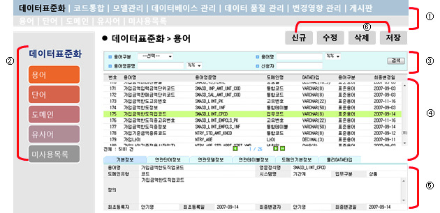
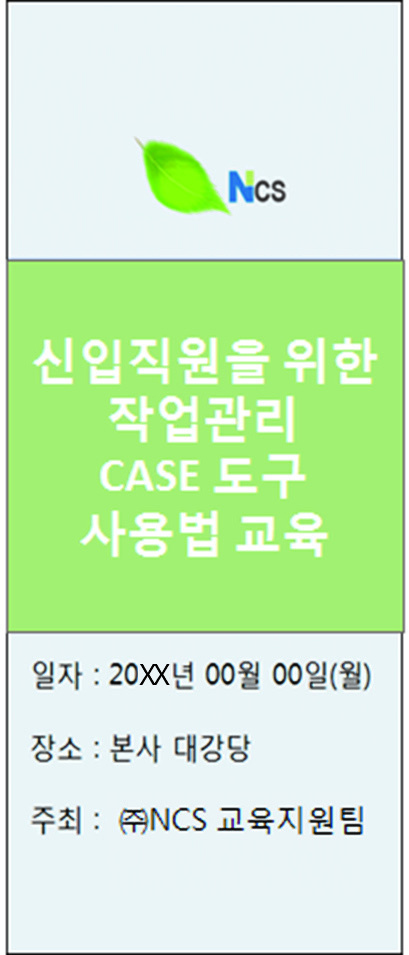

# LM2001020228_23v6_소프트웨어공학+활용_20251108

대분류/20
정보통신 중분류/01
정보기술 소분류/02
정보기술개발 세분류/02
응용SW엔지니어링 능력단위/28
NCS학습모듈
소프트웨어 공학 활용
LM2001020228_23v6
[NCS학습모듈 활용 시 유의 사항]
1. NCS학습모듈은 교육훈련기관에서 출처를 명시하고 교육적 목적으로 활용할 수 있습니다. 다
만, NCS학습모듈에는 국가(교육부)가 저작재산권 일체를 보유하지 않은 저작물(출처가 표기된
도표‧사진‧삽화‧도면 등)이 포함되어 있으므로, 이러한 저작물의 변형‧각색‧복제‧공연‧
배포 및 공중 송신 등과 이러한 저작물을 활용한 2차적 저작물을 작성하려면 반드시 원작자
의 동의를 받아야 합니다.
2. NCS학습모듈은 개발 당시의 산업 및 교육 현장을 반영하여 집필하였으므로, 현재 적용되는
법령‧지침‧표준 및 교과 내용 등과 차이가 있을 수 있습니다. NCS학습모듈 활용 시 법령
‧지침‧표준 및 교과 내용의 개정 사항과 통계의 최신성 등을 확인하시기를 바랍니다.
3. NCS학습모듈은 산업 현장에서 요구되는 능력을 교육훈련기관에서 학습할 수 있게 구성한 자
료입니다. 다만, NCS학습모듈 지면의 한계상 대표적 예시(예: 활용도 또는 범용성이 높은 제
품, 서비스) 중심으로 집필하였음을 이해하시기를 바랍니다.
NCS학습모듈의 이해
NCS학습모듈의 이해
※ 본 NCS학습모듈은 「NCS 국가직무능력표준」사이트(http://www.ncs.go.kr) 에서 확인 및 다운로드할 수 있습니다.

| Ⅰ | NCS학습모듈이란? |
| --- | --- |

•국가직무능력표준(NCS: National Competency Standards)이란 산업현장에서 직무를
수행하기 위해 요구되는 지식･기술･소양 등의 내용을 국가가 산업부문별･수준별로 체계
화한 것으로 산업현장의 직무를 성공적으로 수행하기 위해 필요한 능력(지식, 기술, 태도)
을 국가적 차원에서 표준화한 것을 의미합니다.
•국가직무능력표준(이하 NCS)이 현장의 ‘직무 요구서’라고 한다면, NCS학습모듈은 NCS
의 능력단위를 교육훈련에서 학습할 수 있도록 구성한 ‘교수･학습 자료’입니다. NCS학습
모듈은 구체적 직무를 학습할 수 있도록 이론 및 실습과 관련된 내용을 상세하게 제시하
고 있습니다.

| NCS 및 NCS학습모듈 개발 절차 |
| --- |
| NCS산업계개발 계획 수립NCSNCS학습모듈NCS학습모듈 개발개발 계획 수립 |

•NCS학습모듈은 다음과 같은 특징을 가지고 있습니다.
첫째, NCS학습모듈은 산업계에서 요구하는 직무능력을 교육훈련 현장에 활용할 수 있도
록 성취목표와 학습의 방향을 명확히 제시하는 가이드라인의 역할을 합니다.
둘째, NCS학습모듈은 특성화고, 마이스터고, 전문대학, 4년제 대학교의 교육기관 및 훈
련기관, 직장교육기관 등에서 표준교재로 활용할 수 있으며 교육과정 개편 시에도
유용하게 참고할 수 있습니다.
i
•NCS와 NCS학습모듈 간의 연결 체계를 살펴보면 아래 그림과 같습니다.

| NCS와 NCS학습모듈의 연결 체계 |
| --- |
| NCS NCS학습모듈능력단위 NCS학습모듈명능력단위 정의 NCS학습모듈의 목표능력단위 기술서 학습명능력단위 요소 학습 내용수행준거 학습 목표지식 필요 지식기술 수행 내용- 재료･자료태도- 기기(장비･공구)- 안전･유의 사항- 수행 순서적용범위 및 작업상황고려 사항 교수･학습 방법자료 및 관련 서류 교수 방법장비 및 도구 학습 방법평가 지침 평가평가 방법 평가 준거평가 시 고려 사항 평가 방법피드백참고 자료･활용 서식･부록 |

|  |  | NCS |  |  |  |  |  |  |  |  | NCS학습모듈 |  |  |  |  |
| --- | --- | --- | --- | --- | --- | --- | --- | --- | --- | --- | --- | --- | --- | --- | --- |
|  | 능력단위 |  |  |  |  |  |  |  |  | NCS학습모듈명 |  |  |  |  |  |
|  | 능력단위 | 능력단위 |  |  |  |  |  |  |  | NCS학습모듈명 | NCS학습모듈명 |  |  |  |  |
|  | 능력단위 정의 |  |  |  |  |  |  |  |  | NCS학습모듈의 목표 |  |  |  |  |  |
|  | 능력단위 정의 | 능력단위 정의 |  |  |  |  |  |  |  | NCS학습모듈의 목표 | NCS학습모듈의 목표 |  |  |  |  |
|  | 능력단위 기술서 능력단위 요소 | 능력단위 기술서 능력단위 요소 |  |  |  |  |  |  |  | 학습명 학습 내용 | 학습명 학습 내용 |  |  |  |  |
|  | 능력단위 기술서 |  |  |  |  |  |  |  |  | 학습명 |  |  |  |  |  |
|  | 능력단위 기술서 | 능력단위 기술서 |  |  |  |  |  |  |  | 학습명 | 학습명 |  |  |  |  |
|  | 능력단위 요소 |  |  |  |  |  |  |  |  | 학습 내용 |  |  |  |  |  |
|  | 능력단위 요소 | 능력단위 요소 |  |  |  |  |  |  |  | 학습 내용 | 학습 내용 |  |  |  |  |
|  | 수행준거 |  |  |  |  |  |  |  |  | 학습 목표 |  |  |  |  |  |
|  | 수행준거 | 수행준거 |  |  |  |  |  |  |  | 학습 목표 | 학습 목표 |  |  |  |  |
|  | 지식기술태도 |  |  |  |  |  |  |  |  | 필요 지식수행 내용- 재료･자료- 기기(장비･공구)- 안전･유의 사항- 수행 순서 |  |  |  |  |  |
|  | 기술 | 기술 |  |  |  |  |  |  |  | 수행 내용 | 수행 내용 |  |  |  |  |
|  |  |  |  |  |  |  |  |  |  | - 재료･자료 | - 재료･자료 |  |  |  |  |
|  | 태도 | 태도 |  |  |  |  |  |  |  | - 기기(장비･공구) | - 기기(장비･공구) |  |  |  |  |
|  |  |  |  |  |  |  |  |  |  | - 기기(장비･공구) | - 기기(장비･공구) |  |  |  |  |
|  |  |  |  |  |  |  |  |  |  | - 안전･유의 사항 | - 안전･유의 사항 |  |  |  |  |
|  | 적용범위 및 작업상황 |  |  |  |  |  |  |  |  | - 수행 순서 | - 수행 순서 |  |  |  |  |
|  | 고려 사항자료 및 관련 서류장비 및 도구 |  |  |  |  |  |  |  |  | 교수･학습 방법 | 교수･학습 방법 교수 방법 학습 방법 |  |  |  |  |
|  | 자료 및 관련 서류 장비 및 도구 | 자료 및 관련 서류 장비 및 도구 |  |  |  |  |  |  |  | 교수 방법학습 방법 |  |  |  |  |  |
|  | 평가 지침 |  |  |  |  |  |  |  |  | 평가 |  |  |  |  |  |
|  | 평가 방법평가 시 고려 사항 |  |  |  |  |  |  |  |  | 평가 준거평가 방법피드백 |  |  |  |  |  |
|  | 평가 시 고려 사항 | 평가 시 고려 사항 |  |  |  |  |  |  |  | 평가 방법 | 평가 방법 |  |  |  |  |
|  |  |  |  |  |  |  |  |  |  | 참고 자료･활용 서식･부록 |  |  |  |  |  |

ii
NCS학습모듈의 이해

| Ⅱ | NCS학습모듈의 체계 |
| --- | --- |

•NCS학습모듈은 1. NCS학습모듈의 위치 , 2. NCS학습모듈의 개요 , 3. NCS학습모듈의 내용 체계 ,
4. 참고 자료 , 5. 활용서식/부록 으로 구성되어 있습니다.
1. NCS학습모듈의 위치
•NCS학습모듈의 위치는 NCS 분류 체계에서 해당 학습모듈이 어디에 위치하는지를 한 눈에
볼 수 있도록 그림으로 제시한 것입니다.

| [NCS-학습모듈의 위치] |  |  |  |  |  |  |  |
| --- | --- | --- | --- | --- | --- | --- | --- |
| 대분류 | 문화·예술·디자인·방송 |  |  |  |  |  |  |
| 중분류 |  | 문화콘텐츠 |  |  |  |  |  |
| 소분류 |  |  |  |  |  | 문화콘텐츠제작 |  |
| 세분류 |  |  |  |  |  |  |  |
| 세분류 |  |  |  |  |  |  |  |
| 방송콘텐츠제작 |  |  |  |  | 능력단위 |  | 학습모듈명 |
| 영화콘텐츠제작 프로그램 기획 프로그램 기획음악콘텐츠제작 아이템 선정 아이템 선정광고콘텐츠제작 자료 조사 자료 조사게임콘텐츠제작 프로그램 구성 프로그램 구성애니메이션캐스팅 캐스팅콘텐츠제작만화콘텐츠제작 제작계획 제작계획캐릭터제작 방송 미술 준비 방송 미술 준비스마트문화앱방송 리허설 방송 리허설콘텐츠제작영사 야외촬영 야외촬영스튜디오 제작 스튜디오 제작… … |  |  |  |  | 프로그램 기획 |  | 프로그램 기획 |
| 음악콘텐츠제작 |  |  |  |  | 아이템 선정 |  | 아이템 선정 |
| 광고콘텐츠제작 자료 |  |  |  |  | 자료 조사 |  | 자료 조사 |
| 게임콘텐츠제작 |  |  |  |  | 프로그램 구성 |  | 프로그램 구성 |
| 애니메이션 콘텐츠제작 |  |  |  |  | 캐스팅 |  | 캐스팅 |
| 만화콘텐츠제작 |  |  |  |  | 제작계획 |  | 제작계획 |
| 캐릭터제작 방송 |  |  |  |  | 방송 미술 준비 |  | 방송 미술 준비 |
| 스마트문화앱 방송 콘텐츠제작 |  |  |  |  | 방송 리허설 |  | 방송 리허설 |
| 영사 |  |  |  |  | 야외촬영 |  | 야외촬영 |
|  |  |  |  |  | 스튜디오 제작 |  | 스튜디오 제작 |
|  |  |  |  |  | … |  | … |

|  | 학습모듈은 |
| --- | --- |
| NCS 능력단위 1개당 1개의 학습모듈 개발을 원칙으로 합니다. 그러나 필요에 따라고용단위 및 교과단위를 고려하여 능력단위몇 개를 묶어 1개 학습모듈로 개발할 수있으며, NCS 능력단위 1개를 여러 개의학습모듈로 나누어 개발할 수도 있습니다. |  |

iii
2. NCS학습모듈의 개요
•NCS학습모듈의 개요는 학습모듈이 포함하고 있는 내용을 개략적으로 설명한 것으로
학습모듈의 목표 , 선수학습 , 학습모듈의 내용 체계 , 핵심 용어 로 구성되어 있습니다.

| 학습모듈의 목표 | 해당 NCS 능력단위의 정의를 토대로 학습 목표를 작성한 것입니다. |
| --- | --- |

| 선수학습 | 해당 학습모듈에 대한 효과적인 교수･학습을 위하여 사전에 이수해야 하는 학습모듈, 학습 내용, 관련 교과목 등을 기술한 것입니다. |
| --- | --- |

| 학습모듈의내용 체계 | 해당 NCS 능력단위요소가 학습모듈에서 구조화된 체계를 제시한 것입니다. |
| --- | --- |

| 핵심 용어 | 해당 학습모듈의 학습 내용, 수행 내용, 설비･기자재 등 가운데 핵심적인 용어를 제시한 것입니다. |
| --- | --- |

| 제작계획 학습모듈의 개요 |  |  |  |
| --- | --- | --- | --- |
| 학습모듈의 목표본격적인 촬영을 준비하는 단계로서, 촬영 대본을 확정하고 제작 스태프를 조직하며촬영 장비와 촬영 소품을 준비할 수 있다.선수학습제작 준비(LM0803020105_13v1), 섭외 및 제작스태프 구성(LM0803020104_13v1),촬영 제작(LM0803020106_13v1), 촬영 장비 준비(LM0803040204_13v1.4), 미술디자인 협의하기(LM0803040203_13v1.4)학습모듈의 내용체계 |  |  |  |
| 학습 | 학습 내용 | NCS 능력단위 요소 |  |
| 코드번호 요소 명칭 |  | 코드번호 | 요소 명칭 |
| 1. 촬영 대본 1-1. 촬영 구성안 검 촬영 대본0803020114_16v3.1확정하기 토와 수정 확정하기2-1. 기술 스태프 조직2. 제작 스태프 제작 스태프2-2. 미술 스태프 조직 0803020114_16v3.2조직하기 조직하기2-3. 전문 스태프 조직3. 촬영 장비 3-1. 촬영 장비 점검 촬영 장비0803020114_16v3.3계획하기 과 준비 계획하기4-1. 촬영 소품 목록4. 촬영 소품 작성 촬영 소품0803020114_16v3.4계획하기 4-2. 촬영 소품 제작 계획하기의뢰 |  |  |  |
| 핵심 용어촬영 구성안, 제작 스태프, 촬영 장비, 촬영 소품 |  |  |  |

|  | 학습모듈의 목표는 |
| --- | --- |
| 학습자가 해당 학습모듈을 통해 성취해야할 목표를 제시한 것으로, 교수자는 학습자가 학습모듈의 전체적인 내용흐름을 파악하도록 지도할 수 있습니다. |  |

|  | 선수학습은 |
| --- | --- |
| 교수자 또는 학습자가 해당 학습모듈을 교수·학습하기 이전에 이수해야 하는 교과목또는 학습모듈(NCS 능력단위) 등을 표기한것입니다. 따라서 교수자는 학습자가 개별학습, 자기 주도 학습, 방과 후 활동 등 다양한 방법을 통해 이수할 수 있도록 지도하는 것을 권장합니다. |  |

|  | 핵심 용어는 |
| --- | --- |
| 해당 학습모듈을 대표하는 주요 용어입니다. 학습자가 해당 학습모듈을 통해 학습하고 평가받게될 주요 내용을 알 수 있습니다. 「NCS 국가직무능력표준」 사이트(www.ncs.go.kr)의 색인 (찾아보기) 중하나로 이용할 수 있습니다. |  |

iv
NCS학습모듈의 이해
3. NCS학습모듈의 내용 체계
•NCS학습모듈의 내용은 크게 학습 , 학습 내용 , 교수･학습 방법 , 평가 로 구성되어 있습니다.

| 학습 | 해당 NCS 능력단위요소 명칭을 사용하여 제시한 것입니다.학습은 크게 학습 내용, 교수･학습 방법, 평가로 구성되며 해당 NCS 능력단위의능력단위 요소별 지식, 기술, 태도 등을 토대로 내용을 제시한 것입니다. |
| --- | --- |

| 학습 내용 | 학습 내용은 학습 목표, 필요 지식, 수행 내용으로 구성되며, 수행 내용은 재료･자료, 기기(장비･공구), 안전･유의 사항, 수행 순서, 수행 tip으로 구성한 것입니다.학습모듈의 학습 내용은 실제 산업현장에서 이루어지는 업무활동을 표준화된 프로세스에 기반하여 다양한 방식으로 반영한 것입니다. |
| --- | --- |

| 교수･학습 방법 | 학습 목표를 성취하기 위한 교수자와 학습자 간, 학습자와 학습자 간 상호 작용이활발하게 일어날 수 있도록 교수자의 활동 및 교수 전략, 학습자의 활동을 제시한것입니다. |
| --- | --- |

| 평가 | 평가는 해당 학습모듈의 학습 정도를 확인할 수 있는 평가 준거 및 평가 방법, 평가 결과의 피드백 방법을 제시한 것입니다. |
| --- | --- |

학습 1 촬영 대본 확정하기

|  | 학습은 |
| --- | --- |
| 해당 NCS 능력단위요소 명칭을 사용하여제시하였습니다. 하나의 학습은 일반교과의 ‘대단원’에 해당되며, 학습모듈을 구성하는 가장 큰 단위가 됩니다. 또한 하나의 직무를 수행하기 위한 가장 기본적인단위로 사용할 수 있습니다 |  |

| 학습 2 | 제작 스태프 조직하기 |
| --- | --- |

학습 3 촬영 장비 계획하기
학습 4 촬영 소품 계획하기

|  | 학습 내용은 |
| --- | --- |
| NCS 능력단위요소별 수행준거를 기준으로제시하였습니다. 일반교과의 ‘중단원’에 해당합니다. |  |

2-1. 기술 스태프 조직
학습 목표 •프로그램 제작에 적합한 기술 스태프를 조직할 수 있다.

|  | 학습 목표는 |
| --- | --- |
| 학습 내용을 이수할 때 학습자가 갖춰야할행동 수준을 의미합니다. 따라서 수업시간의 과목 목표로 활용할 수 있습니다. |  |

필요 지식 /
(cid:49684) 기술 스태프의 구성

|  | 필요 지식은 |
| --- | --- |
| 해당 NCS의 지식을 토대로 학습에 대한이해와 성과를 제고하기 위해 반드시 알아야 할 주요 지식을 제시하였습니다. 필요 지식은 수행에 꼭 필요한 핵심 내용을위주로 제시하여 교수자의 역할이 매우중요하며, 이후 수행 순서와 연계하여 교수·학습으로 진행할 수 있습니다. |  |

프로그램의 장르에 따라 구성하는 기술 스태프는 많은 차
이가 있다. 같은 장르의 프로그램이라도 그 형식이나 내
용, 규모에 따라서 구성되는 기술 스태프의 종류와 인원
수는 천차만별이다.
1. 스튜디오 프로그램
토크쇼, 종합 구성, 예능과 같은 스튜디오 프로그램은
부조정실과 스튜디오를 사용하여 제작하기 때문에 많
은 기술 스태프가 필요하다.
v

|  | 수행 내용은 |
| --- | --- |
| 해당 학습모듈에서 제시한 내용 중 기술(skill)을 습득하기 위한 실습과제로 활용할 수 있습니다. |  |

수행 내용 / 기술 스태프 구성표 작성하기
재료·자료

|  | 재료･자료는 |
| --- | --- |
| 수행 내용을 수행하는데 필요한 재료 및 준비물로 실습 시 활용할 수 있습니다. |  |

• 방송프로그램 제작 기획서 및 방송 대본, 콘티(continuity), 제작
일정, 운용표
• 장비 및 시설, 제작 시설 배정 의뢰서 및 배정표, 방송 기술 스
태프 데이터베이스(DB) 자료

|  | 기기(장비･공구)는 |
| --- | --- |
| 수행 내용에 필요한 기본적인 장비 및 도구를 제시하였습니다. 제시된 기기 외에도 수행에 필요한 다양한 도구나 장비를 활용할수 있습니다. |  |

기기(장비･공구)
• 컴퓨터 등
안전･유의 사항

|  | 안전･유의사항은 |
| --- | --- |
| 수행 내용을 수행하는 데 있어 안전상 주의해야할 점 및 유의사항을 제시하였습니다. 실습 시 유념해야 하며, NCS의 고려사항도 추가적으로 활용할 수 있습니다. |  |

• 프로그램의 내용과 제작 방법을 분석하고, 각 스태프들의 역할
을 신중하게 검토한다.
수행 순서
(cid:49684) 방송 대본이나 콘티(continuity), 큐 시트를 분석하고, 프로그램

|  | 수행 순서는 |
| --- | --- |
| 실습 과제의 진행 순서로 활용할 수 있습니다. |  |

의 내용적 특성, 제작 과정에 대한 자료를 수집한다.
(cid:49685) 프로그램 제작 방법을 결정한다.

|  | 수행 tip은 |
| --- | --- |
| 수행 내용에서 실습을 용이하게 할 수 있는아이디어를 제시하였습니다. 수행 tip은 지도상의 안전 및 유의사항 외에 전반적으로적용되는 주안점 및 수행 과제 목적에 대한보충설명, 추가사항 등으로 활용할 수 있습니다. |  |

1. 스튜디오 녹화를 할 것인가, 야외 촬영을 할 것인가 검토한
다.
수행 tip
•스태프의 결정은 스태프 간의 호흡을 중
요시하여 선정해야 프로그램의 질을 향
상시킬 수 있다.

| 학습2 | 교수·학습 방법 |
| --- | --- |

|  | 교수･학습 방법은 |
| --- | --- |
| 학습 목표를 성취하는 데 필요한 교수 방법과 학습 방법을 제시하였습니다. |  |

교수 방법

|  | 교수 방법은 |
| --- | --- |
| 해당 학습 활동에 필요한 학습 내용, 학습내용과 관련된 자료명, 자료 형태, 수행 내용의 진행 방식 등에 대하여 제시하였습니다. 또한 학습자의 수업참여도 제고 방법및 수업 진행상 유의사항 등도 제시하였습니다. 선수학습이 필요한 학습을 학습자가숙지하였는지 교수자가 확인하는 과정으로활용할 수도 있습니다. |  |

• 방송 프로그램의 기술적 요소, 미술 구성 요소, 특수 촬영에 대해
설명한다.
• 방송 프로그램 제작에서 각 기술 스태프의 역할에 대해 설명한다.
• 방송 프로그램을 분석하고 필요한 기술 스태프를 구성할 수 있도
록 지시한다.
학습 방법

|  | 학습 방법은 |
| --- | --- |
| 해당 학습 활동에 필요한 학습자의 자기주도 학습 방법을 제시하였습니다. 또한학습자가 숙달해야 할 실기 능력과 학습과정에서 주의해야 할 사항 등도 제시하였습니다. 학습자가 학습을 이수하기 전반드시 숙지해야 할 기본 지식을 학습하였는지 스스로 확인하는 과정에 활용할수 있습니다. |  |

• 방송 프로그램의 기술적 요소, 미술 구성 요소, 특수 촬영에 대해
서 알아본다.
• 프로그램 제작에 필요한 기술 스태프의 역할을 이해하고, 기술 스
태프 구성표를 작성한다.
vi
NCS학습모듈의 이해

| 학습2 평 가평가 준거• 평가자는 학습자가 학습 목표를 성공적으로 달성하였는지를 평가해야 한다.• 평가자는 다음 사항을 평가해야 한다.성취수준학습 내용 학습 목표상 중 하기술 스태프 - 프로그램 제작에 적합한 기술 스태프를 조조직 직할 수 있다.미술 스태프 - 프로그램 제작에 적합한 미술 스태프를 조조직 직할 수 있다.전문 스태프 - 프로그램 특수 촬영을 위한 전문 스태프를조직 조직할 수 있다.평가 방법• 사례 연구성취수준학습 내용 평가 항목상 중 하- 프로그램에서 기술적 요소의 파악 여부기술 스태프 - 기술 스태프의 역할 파악 여부조직 - 프로그램에 필요한 기술 스태프 구성표 작성 능력피드백1. 사례 연구- 프로그램을 선택하여 기술 스태프, 미술 스태프, 전문 스태프 구성표를 예시와 같이 작성하였는지 개인별 능력을 평가한 후, 그결과를 모든 학습자에게 공유하도록 한다. | 학습2 | 평 가 |
| --- | --- | --- |

|  | 평가는 |
| --- | --- |
| NCS 능력단위의 평가 방법과 평가 시 고려사항을 준용하여 작성합니다. 교수자와학습자가 평가 항목별 성취수준 확인 시활용할 수 있습니다. |  |

|  | 평가 준거는 |
| --- | --- |
| 학습자가 학습을 어느 정도 성취하였는지평가하기 위한 기준을 제시하고 있습니다.학습 목표와 연계하여 단위수업 시간에 평가 항목 별 성취수준을 평가하는 데 활용할수 있습니다. |  |

| 학습 내용 | 학습 목표 | 성취수준 |  |  |
| --- | --- | --- | --- | --- |
|  |  | 상 | 중 | 하 |

| 4. 참고 자료•교육부(2013). | 섭외 및 제작스태프 구성(LM0803020104_13v1). |  |  |  |
| --- | --- | --- | --- | --- |
| 한국직업능력개발원. |  |  |  |  |
| 5. 활용 서식/부록직종 이름기술감독 조명감독 [디지털제1조(목적) 이 고시는램 및 방송광고의 | 스튜디오 기술 스태프 구성표 연락처 소속 특이사항텔레비전 방송프로그램 음량 등에 관한 기준] 제정 2014. 11. 29. 미래창조과학부 고시제1창 총칙 방송법 제70조의2제1항에 따라 방송사업자가 디지털 텔레비전음량을 일정하게 유지하기 위해 필요한 사항을 규정함을 | 비고목적으로 | 제2014-87호방송프로그한다. |  |

|  | 평가 방법은 |
| --- | --- |
| NCS 능력단위의 평가 방법을 참고하였으며, 평가 준거에 따른 평가 방법을 2개 이상 제시합니다. 평가 방법의 종류는 포트폴리오, 문제해결 시나리오, 서술형 시험, 논술형 시험, 사례 연구, 평가자 체크리스트,작업장 평가 등이 있으며, NCS 능력단위요소 별 수행 수준을 평가하는 데 가장 적절한 방법을 선정하여 활용할 수 있습니다. |  |

| 학습 내용 | 평가 항목 | 성취수준 |  |  |
| --- | --- | --- | --- | --- |
|  |  | 상 | 중 | 하 |

| 4. 참고 자료•교육부(2013). | 섭외 및 제작스태프 구성(LM0803020104_13v1). |  |  |  |
| --- | --- | --- | --- | --- |
| 한국직업능력개발원. |  |  |  |  |
| 5. 활용 서식/부록직종 이름기술감독 조명감독 [디지털제1조(목적) 이 고시는램 및 방송광고의 | 스튜디오 기술 스태프 구성표 연락처 소속 특이사항텔레비전 방송프로그램 음량 등에 관한 기준] 제정 2014. 11. 29. 미래창조과학부 고시제1창 총칙 방송법 제70조의2제1항에 따라 방송사업자가 디지털 텔레비전음량을 일정하게 유지하기 위해 필요한 사항을 규정함을 | 비고목적으로 | 제2014-87호방송프로그한다. |  |

|  | 피드백은 |
| --- | --- |
| 평가 후에 학습자들에게 평가 결과를 피드백하여 학습 목표를 달성하는 데 활용할 수 있습니다. |  |

|  | 참고 자료는 |
| --- | --- |
| 해당 학습모듈에 제시된 인용 자료의 출처를 제시하였습니다. 교수·학습의 과정에서참고로 활용할 수 있습니다. |  |

|  | 활용 서식은 |
| --- | --- |
| 평가 서식, 실습 시트 등 교수·학습 시 활용할 수 있는 다양한 서식들로 구성하였습니다. 수행에서 평가에 이르기까지 필요한서식을 해당 모듈의 특성에 맞춰 개발하거나 기존의 양식을 활용하여 제시하였습니다. |  |

|  | 부록은 |
| --- | --- |
| 활용 서식 이외에 교수·학습 과정에서 참고할수 있는 자료가 있는 경우 제시하였습니다. |  |

[NCS-학습모듈의 위치]

| 정보 통신 |  |  |
| --- | --- | --- |
|  | 정보 기술 |  |
|  |  | 정보기술개발 |

대분류
중분류
소분류
세분류

| SW아키텍처 |  |  | 능력단위 | 학습모듈명 |
| --- | --- | --- | --- | --- |
| 응용SW엔지니어링 |  |  | 요구사항 확인 | 요구사항 확인 |
| 임베디드SW 엔지니어링 |  |  | 데이터 입출력 구현 | 데이터 입출력 구현 |
| DB엔지니어링 |  |  | 통합 구현 | 통합 구현 |
| NW엔지니어링 |  |  | 정보시스템 이행 | 정보시스템 이행 |
| 보안엔지니어링 |  |  | 제품소프트웨어 패키징 | 제품소프트웨어 패키징 |
| UI/UX엔지니어링 |  |  | 서버 프로그램 구현 | 서버 프로그램 구현 |
| 시스템SW엔지니어링 |  |  | 인터페이스 구현 | 인터페이스 구현 |
| 빅데이터플랫폼구축 |  |  | 애플리케이션 배포 | 애플리케이션 배포 |
| 핀테크엔지니어링 |  |  | 애플리케이션 리팩토링 | 애플리케이션 리팩토링 |
| 데이터아키텍처 |  |  | 인터페이스 설계 | 인터페이스 설계 |
| loT시스템연동 |  |  | 애플리케이션 요구사항 분석 | 애플리케이션 요구사항 분석 |
| 인프라스트럭쳐 아키텍처 구축 |  |  | 기능 모델링 | 기능 모델링 |
|  |  |  | 애플리케이션 설계 | 애플리케이션 설계 |
|  |  |  | 정적모델 설계 | 정적모델 설계 |

| 동적모델 설계 | 동적모델 설계 |
| --- | --- |
| 화면 설계 | 화면 설계 |
| 화면 구현 | 화면 구현 |
| 애플리케이션 테스트 관리 | 애플리케이션 테스트 관리 |
| 애플리케이션 테스트 수행 | 애플리케이션 테스트 수행 |
| 소프트웨어공학 활용 | 소프트웨어공학 활용 |
| 소프트웨어개발 방법론 활용 | 소프트웨어개발 방법론 활용 |
| 프로그래밍 언어 응용 | 프로그래밍 언어 응용 |
| 프로그래밍 언어 활용 | 프로그래밍 언어 활용 |
| 응용SW 기초 기술 활용 | 응용SW 기초 기술 활용 |
| 개발자 환경 구축 | 개발자 환경 구축 |
| 개발 환경 운영 지원 | 개발 환경 운영 지원 |
| 자료구조 활용 | 자료구조 활용 |

차 례
학습모듈의 개요 1
학습 1. CASE 도구 활용하기
1-1. CASE 도구 선정 3
1-2. CASE 도구 활용 20
• 교수・학습 방법 34
• 평가 35
학습 2. 품질 요구사항 확인하기
2-1. 품질 표준과 평가 기준 정의 37
2-2. 개발 공정과 제품 품질 점검 61
• 교수・학습 방법 75
• 평가 76
참고 자료 79
활용 서식 80
소프트웨어공학 활용 학습모듈의 개요
학습모듈의 목표
응용소프트웨어 개발과 프로세스 적용 활동의 관련된 지식을 바탕으로 소프트웨어의 완전성을 보장하고, 소
프트웨어 품질을 평가하기 위해 CASE 도구와 형상관리를 통해 소프트웨어공학 기술을 적용할 수 있다.
선수학습
소프트웨어공학, SW품질관리, 요구사항 확인(2001020201_23v5), 애플리케이션 테스트 관리(2001020226
_23v6), 애플리케이션 테스트 수행(2001020227_23v6)
학습모듈의 내용체계

| 학습 | 학습 내용 | NCS 능력단위 요소 |  |
| --- | --- | --- | --- |
|  |  | 코드번호 | 요소 명칭 |

1-1. CASE 도구 선정
1.CASE 도구 활용하기 2001020228_23v6.1 CASE 도구 활용하기
1-2. CASE 도구 활용
2-1. 품질 표준과 평가 기준 정의
품질 요구사항
2.품질 요구사항 확인하기 2001020228_23v6.2
확인하기
2-2. 개발 공정과 제품 품질 점검
핵심 용어
소프트웨어공학, 소프트웨어 개발, CASE 도구, 품질 요구사항, 품질 표준, 품질 평가 항목, 개발 공정 품
질, 응용소프트웨어 제품 품질, 결함 관리

| 학습 1 | CASE 도구 활용하기 |
| --- | --- |

학습 2 품질 요구사항 확인하기
1-1.
CASE 도구 선정
•개발하고자 하는 응용소프트웨어에 적용할 개발 방법론을 지원하는 최적의 CASE 도구를 선정
학습 목표
할 수 있다.
필요 지식 /
(cid:49684) CASE 도구(Computer Aided Software Engineering Tool)
1. CASE 도구 개요
CASE 도구는 소프트웨어공학의 개발 방법론을 컴퓨터 기반으로 구현하여, 소프트웨어
개발 계획 수립, 요구사항 분석 및 설계, 개발 및 테스트, 유지 보수까지 소프트웨어
개발의 전 과정을 자동화할 수 있다. 응용소프트웨어의 개발과 유지 보수의 생산성을
향상하고 개발된 소프트웨어의 신뢰성을 높이기 위하여 CASE 도구를 사용한다.

| CASE 도구(Computer Aided Software Engineering Tool) |
| --- |
| CASE는 컴퓨터 지원 시스템공학이라고도 하며 소프트웨어 개발 프로세스의 전 과정에서 자동화를지원하는 소프트웨어 도구를 활용함으로써 개발자의 반복적인 작업량을 줄이는 것을 목표로 한다.여기서 CASE 도구는 소프트웨어 품질과 생산성을 향상하는 데 도움을 주는 시스템 또는 도구를의미한다. |

2. CASE 도구 등장 배경
(1) 소프트웨어 개발 생산성을 향상하고 소프트웨어의 위기를 해결하기 위하여 도구를 사용
(2) 소프트웨어공학적인 접근 및 원리를 적용하여 체계적인 개발 및 유지 보수가 가능하도록
업무를 자동화
(3) 컴퓨터 분야의 기술 발전으로 인해 크고 복잡한 소프트웨어 개발 요구가 증가함에 따라
체계적으로 개발할 수 있는 자동화된 도구를 도입
3. CASE 도구의 목표
(1) 소프트웨어 품질 향상
(2) 소프트웨어 개발 과정 자동화
(3) 응용소프트웨어 개발 및 유지 보수 생산성 향상
(4) 응용소프트웨어 점진적 개발 지원
(5) 응용소프트웨어 재활용성 제고
(6) 표준화된 문서 생성과 개발 팀 간의 정보 공유 및 협업 지원
(cid:49685) CASE 도구 종류
1. 계층적 분류
깁슨(Michel L.Gibson) 교수는 다음과 같이 CASE를 상위(Upper) CASE와 하위
(Lower) CASE, 통합(Integrated) CASE로 분류한다.
<표 1-1> CASE 도구 계층적 분류
구분 설명 주요 기능
- 여러 가지 방법론을 지원하는 다이어
요구 분석과 설계 단계를 지원하는 그램 작성 기능
상위 도구. 요구 분석 후에 명세서를 작 - 모델의 정확성, 일관성을 확인하기
CASE 성하고 설계하는 과정을 지원하는 위한 오류 검증 기능
도구 - 프로토타이핑 지원 기능
- 설계 자료 사전 기능
- 프로그래밍 지원 기능(코드 생성 및
편집, 컴파일러 등)
하위 코드를 작성하고 테스트하며 문서
- 코드 자동 생성 기능
CASE 화하는 과정에 도움을 주는 도구
- 테스트 도구(정적 및 동적 분석, 회
귀 테스트 등)
- 그래픽 기능
소프트웨어개발 주기 전체 과정을
- 프로토타이핑과 명세화 기능
통합 지원하기 위하여 공통의 정보 저장
- 설계 기능
CASE 소와 통일된 사용자 인터페이스로
- 프로그래밍 및 테스트 기능
도구들을 통합한 것
- 공동 정보 저장소 기능
출처: 교육부(2021). 소프트웨어공학 활용(LM2001020228_19v5). 한국직업능력연구원. p.4.
2. 기능적 분류
CASE 도구를 제공하는 기능 중심으로 분류하면 프로세스 모델링 관리, 프로젝트 계획
수립, 위험 분석, 요구사항 관리, 품질 보증, 데이터베이스 관리, 소프트웨어 형상관리,
분석 및 설계, 프로토타이핑 및 시뮬레이션, 화면 설계 및 개발, 프로그래밍, 통합 및
테스트, 리엔지니어링 도구 등과 같이 분류할 수 있다.
<표 1-2> CASE 도구의 기능적 분류
구분 설명
프로세스 프로세스가 더욱 잘 이해될 수 있도록 프로세스의 핵심 요소들을 표현하는
모델링 및 관리 데 사용하는 도구. 업무 프로세스와 업무 활동, 해당 활동을 수행하는 주체
도구 를 정의하고 프로세스 기술들(descriptions)로 연결하는 기능을 제공함
프로젝트 업무(Work)와 기간 및 비용을 추산하거나 프로젝트 수행 계획 수
프로젝트 계획 립을 지원하는 도구. 프로젝트 업무 분해도(work breakdown structure)를
수립 도구 작성하거나 업무 태스크 네트워크를 만들고 상호 의존성을 표현하고 병렬 가
능 태스크를 식별할 수 있음
프로젝트 수행 시 발생할 수 있는 위험을 식별하고 완화, 감시 및 관리할 수
위험 분석 도구
있도록 위험을 식별하고 분석할 수 있도록 지원하는 도구
요구사항 관리 사용자 요구사항에 대한 명세를 저장하고 분류 및 추적 관리를 지원하는
도구 도구
품질 보증 도구 프로젝트 표준 준수 여부 점검 및 소스코드 감시 기능 제공
데이터베이스 데이터베이스를 생성하고 활용할 수 있도록 데이터 관리 기능과 사용자, 접
관리 도구 근 관리 기능 제공
소프트웨어 형상 항목을 식별하고 버전 통제하고 변경 통제 및 감사, 상태 보고 기능
형상관리 도구 제공
분석 및 설계 데이터와 기능 및 행위, 아키텍처, 인터페이스 등 구축될 시스템의 모델을
도구 생성하고 관리하는 기능 제공
프로토타이핑
시스템을 구축하기 전에 시스템 사용자/고객들이 시스템의 기능과 운영 모습
& 시뮬레이션
들을 예측할 수 있도록 시뮬레이션하는 기능 제공
도구
화면 설계 및 메뉴와 버튼, 화면 구조, 아이콘 등 소프트웨어 컴포넌트를 기반으로 화면
개발 도구 설계와 제작을 지원하는 도구
프로그래밍 프로그램 언어들을 지원하는 컴파일러, 편집기 및 디버거, 데이터베이스 연계
도구 등의 기능을 지원
통합 및 테스트 테스트 데이터 확보, 정적 및 동적 분석, 모의 시험, 테스트 관리 기능 등을
도구 제공하는 도구
리엔지니어링 소스코드를 입력으로 받아 도형적인 구조화를 통해 분석 및 설계 과정을 지
도구 원하는 도구
출처: 교육부(2021). 소프트웨어공학 활용(LM2001020228_19v5). 한국직업능력연구원. p.5.
3. 소프트웨어 개발 수명 주기에 따른 분류
소프트웨어 개발 수명 주기에 따라 활용되는 CASE 도구들을 분류하면 다음과 같다.

출처: 집필진 제작(2025)
[그림 1-1] 소프트웨어 개발 수명 주기에 따른 CASE 도구 분류
4. 소프트웨어 사용 목적에 따른 분류
소프트웨어 사용 목적에 따른 CASE 도구들을 분류하면 다음과 같다.
<표 1-3> CASE 도구 사용 목적에 따른 분류
유형 설명 대표 도구
JIRA, SADT(Structured
요구사항 분석 사용자의 요구사항을 정의하고 명세화 Analysis and Design
Technique), PSL/PSA
UML 다이어그램, ERD 등을 통해 시 StarUML, IBM Rational
모델링
스템 구조 표현 Rose, ERWin
Visual Studio, Eclipse,
코드 생성 모델 기반으로 코드 자동 생성
IntelliJ IDEA
JUnit, xUnit, Selenium,
테스트 단위 테스트, 통합 테스트 자동화
SonarQube
형상관리 버전 관리, 변경 이력 관리 GitHub, GitLab, SVN
Microsoft Project, JIRA,
프로젝트 관리 일정, 인력, 자원 관리
Confluence, Redmine
(cid:49686) CASE 도구 도입의 성패 요인
1. 도입의 성공 요인
- CASE 도구에 대한 정확한 이해를 바탕으로 도입한다.
- CASE 도구 활용을 위해 필요한 교육과 컨설팅을 충분히 고려한다.
- CASE 도구를 조직의 활용 목적에 맞게 수정 개발(Customizing)이 필요한지 인식한다.
- 소프트웨어 개발 프로젝트와 사용자 능력 수준, 개발 환경에 맞는 도구를 선정한다.
2. 도입의 실패 요인
- CASE 도구가 모든 것을 자동화하는 환상적 도구라는 잘못된 기대를 한다.
- CASE 도구를 사용할 사용자들의 능력 수준을 무시하고 도입한다.
- 일관성 없는 개발 방법론 및 CASE 도구를 사용한 경험을 바탕으로 지나친 기대를 한다.
- 많은 기능을 제공하는 CASE 도구를 선호한다.
- 공급자의 기술 지원 능력과 사후 지원 제도가 미비한 CASE 도구를 도입한다.
3. 도입 시 고려 사항
(1) CASE 도구 도입 목적 명확화
CASE 도구를 도입하여 해결해야 하는 업무를 파악하고 도입 목적을 명확하게 정의
한다. 도입 목적을 명확하게 정의하지 못할 경우, 도입 전·후의 효과에 대한 측정을
수행하기 어렵다.
(2) 소프트웨어 개발 방법론에 적합한 CASE 도구 선택
소프트웨어 개발 시 적용할 개발 방법론을 지원할 수 있는 CASE 도구를 선정한다.
(3) 조직 및 프로젝트 구성원 고려
CASE 도구를 사용할 조직 또는 프로젝트 구성원의 CASE 도구 활용 수준을 고려하
여 선정한다. CASE 도구를 도입한 후 활용하는 데 필요한 교육 시간과 소프트웨어
유지 보수 인력의 재배치에 따른 추가 교육 등을 고려한다.
수행 내용 / CASE 도구 선정하기
재료·자료
• 정보통신단체표준(1999). TTA.IS-14471
기기(장비･공구)
• 전산 장비(컴퓨터, 프린터, 빔 프로젝터, 네트워크 장비 등)
• OA 도구(워드프로세서, 스프레드시트, 프레젠테이션 도구 등)
• CASE 도구(SW설계 지원 도구, SW 개발 지원 도구, SW 테스트 지원 도구 등)
안전･유의 사항
• 조직 내에 CASE 도구 도입 목표와 도입 정책이 이미 정의되어 있다면 그것을 활용한다.
• 도입할 CASE 도구의 수가 적거나 후보가 정의되어 있다면 평가 과정을 바로 수행한다.
• 검토 대상 CASE 도구들의 현재 상태와 멀지 않은 장래에 발생할 수 있는 변화 사항(업
그레이드 일정 등)을 반드시 확인해야 한다.
수행 순서
(cid:49684) 응용 SW 개발 및 유지 보수 업무를 위해 필요한 CASE 도구 도입 목표를 정하고, CASE 도
구 선정 및 도입을 위한 정책과 계획을 수립한다.
1. CASE 도구 도입 목표를 설정한다.
응용 SW 개발 및 유지 보수 업무에 대한 목표를 달성하는 데 도움을 줄 수 있는 최적
의 CASE 도구를 선정하기 위해 CASE 도구 선정 목표를 정의한다.
(1) 응용 SW 개발 프로젝트의 전체 목표와 개발 단계별 세부 목표, 유지 보수 업무 목표
등을 정의한 문서들을 검토하여 정리한다.

출처: 교육부(2021). 소프트웨어공학 활용(LM2001020228_19v5). 한국직업능력연구원. p.8.
[그림 1-2] 응용 SW 개발 및 유지 보수 프로젝트 목표 사례
(2) 응용 SW 개발자 및 유지 보수 담당자, 프로젝트 관리자 또는 업무 책임자들을 대상으
로 인터뷰 또는 설문조사를 통해 CASE 도구 도입 요구사항과 CASE 도구 도입 시 기
대 목표를 수집한다.
<표 1-4> CASE 도구 도입을 위한 요구사항 조사 인터뷰 문항 예시
CASE 도구 도입 요구사항 인터뷰 질문지
• 인터뷰 대상자:
• 직책:
• 근무 부서:
귀하의 업무 수행 중에 부딪히는 문제가 있다면 무엇입니까?
그러한 문제를 향후에도 겪게 되리라고 생각하십니까?
그 문제를 효과적으로 취급하는 데 필요한 CASE 도구가 있습니까?
해당 CASE 도구를 도입할 경우 업무 생산성이 얼마나 향상될 것으로 기대합니까?
담당하는 업무가 SW 품질과 관련이 있습니까?
SW 품질 확보를 위해 도입하고자 하는 CASE 도구가 있습니까?
출처: 교육부(2021). 소프트웨어공학 활용(LM2001020228_19v5). 한국직업능력연구원. p.8.
<표 1-5> CASE 도구 도입을 위한 요구사항 조사 설문지 문항 예시
CASE 도구 도입 요구사항 조사 설문지
안녕하십니까?
본 설문조사는 CASE 도구에 대한 사용 현황을 파악하고 향후 IT업무 생산성 제고 및 품질 개
선을 위한 방안을 모색하기 위한 조사입니다.
모든 응답 내용과 관련된 개인적 사항은 철저히 비밀이 지켜지며 오직 CASE 도구 사용 현황
파악과 개선 요구사항 수집을 위한 통계적 목적으로만 사용될 것입니다.
바쁘시더라도 이 설문조사가 회사와 우리들 모두를 위한 것임을 생각하시어 정성껏 솔직한 의견
을 표명해 주시면 감사하겠습니다.
OOOO년 OO월 OO일
IT기획팀 팀장
• 응답자 :
• 직책 :
• 근무 부서 :

| ①매우그렇지않다 | ②그렇지않다 | ③보통이다 | ④그렇다 | ⑤매우그렇다 |
| --- | --- | --- | --- | --- |

다음 질문의 각 항목들을 읽고 귀하께서 생각하시는 가장 적절한 번호
에 O표해 주시기 바랍니다.
귀하의 업무에 CASE 도구를 사용하고 있습니까? ①예 ②아니요
사용하고 있는 CASE 도구가 있다면 기술해 주십시오.
CASE 도구를 도입할 경우 업무 생산성이 향상될 것으로 기대합니까? ① ② ③ ④ ⑤
CASE 도구를 도입할 경우 SW 제품 품질이 향상될 것으로 기대합니까? ① ② ③ ④ ⑤
도입할 경우 담당하는 업무 생산성이 향상될 것으로 보이는 CASE 도
구가 있으면 기술해 주십시오.
SW 품질 확보를 위해 도입하고자 하는 CASE 도구가 있으면 기술해
주십시오.
출처: 교육부(2021). 소프트웨어공학 활용(LM2001020228_19v5). 한국직업능력연구원. p.9.
(3) 응용 SW 개발 및 유지 보수 업무 목표 달성을 위해 필요한 CASE 도구 유형과 기대
목표를 정리한다.

출처: 교육부(2021). 소프트웨어공학 활용(LM2001020228_19v5). 한국직업능력연구원. p.10.
[그림 1-3] 업무 목표 달성을 위해 필요한 CASE 도구 유형과 기대 효과 사례
2. CASE 도구 선정 및 도입 정책을 정의한다.
CASE 도구 목표를 달성하기 위해 CASE 도구 선정 및 도입 시 활용할 수 있는 지침과
프로세스를 정의하고 인력과 자금 등 필요 자원을 정의한다.
(1) 조직에서 사용하고 있는 SW 구매 정책 또는 구매 관련 규정과 지침 등 관련 문서를 검
토하고, CASE 도구 선정 및 도입에 대한 지침과 프로세스를 정의한다.
사례: 구매 규정
OO회사 구매 규정
제1장 총칙
제1조(목적) 이 규정은 OO회사에 필요한 재화와 용역, 공사 등을 적정하고 원활하게 구매하기
위하여 기준과 절차를 정함을 목적으로 한다.
제2조(용어의 정의) 이 규정에서 사용하는 용어 외 정의는 다음과 갈다.
1 ‘물품’이라 함은 기자재, 가공품, 소모품, 외산 물품, 소프트웨어를 말한다.
2 ‘용역’이라 함은 인력 공급, 소프트웨어 개발, 시작품의 제작, 각종 업무 대행 등 인력
을 통한 도급 계약을 말한다.
3. ‘공사’라 함은 증축 공사, 개축 공사, 신축 공사, 시설·설비 공사, 각종 개보수 공사 등
을 말한다.
제3조(적용 범위) 본 OO회사 각 기관의 구매 업무에 적용한다. 다만, 다음 각 호 외의 경우에
는 해당 기관에서 별도로 정하는 원칙 등에 의하여 구매한다.
1 광고 매체의 선정
2 기존 도입된 장비·시스템을 제조·공급·구축한 자가 행하는 수리·정비 및 유지 보수
(2016. 6. 20. 신설)
...
이하 생략
사례: 구매 업무 절차
구매 업무 절차
① 수요 부서에서 품명, 규격, 수량, 용도를 명기하여 구매 팀에 요청하며 구매에 필요한 시
방서, 카탈로그, 도면, 견본, 견적서 등의 참고 자료를 첨부하여야 한다.
② 물품 구매의 경우 자산 팀의 협조 결재를 득하여 청구하여야 한다.
③ 정보화 기자재의 구매는 정보 인프라 팀, 영상 음향 장비의 구매는 자산 팀의 협조를 득하
여 청구하여야 한다.
④ 공사 계약은 시설 팀을 경유하여 청구하여야 한다.
⑤ 청구 총액이 100만 원 이상인 경우 예산 부서의 협조 결재를 득하여 구매 청구하여야 한다.
법령: 「행정기관 및 공공기관 정보시스템 구축·운영 지침」 제6조
제6조(하드웨어 및 소프트웨어 도입 기준) ① 행정기관 등의 장은 정보시스템 사업에서 하드
웨어 및 소프트웨어 등 정보 자원을 교체 또는 신규 도입이 필요한 경우 「클라우드컴퓨팅
발전 및 이용자 보호에 관한 법률」(이하 “클라우드컴퓨팅법”이라 한다) 제12조 및 제20조
에 따라 클라우드 컴퓨팅 활용을 우선 검토한다.
② 행정기관 등의 장은 정보시스템 사업에서 하드웨어를 도입하는 경우 한국정보통신기술협
회에서 정한 “정보시스템 하드웨어 규모 산정 지침”을 기본으로 하되 정보시스템 용도
를 고려하여 조정할 수 있다.
③ 행정기관 등의 장은 정보시스템 사업에서 소프트웨어를 개발하고자 하는 경우 전자정부
표준개발프레임워크의 적용을 우선적으로 고려하여야 한다.
④ 하드웨어 및 상용SW를 구매하려는 경우에는 다음 각 호의 제품을 우선 구매하여야 한다.
1. 「소프트웨어 진흥법」 제20조에 따른 품질 인증(GS인증) 1등급 제품
2. 「산업기술혁신촉진법」 제16조에 따른 신제품 인증(NEP) 제품
3. 「산업기술혁신촉진법」 제15조의2에 따른 신기술 인증(NET) 제품
⑤ 행정기관 등의 장은 제4항 각 호의 제품 도입 시 중소기업자가 개발한 제품을 우선적으
로 구매할 수 있도록 제안서 기술 평가 기준에 평가 항목으로 반영하여야 한다.
<표 1-6> CASE 도구 도입 프로세스 예시
구분 설명
- CASE 도구 도입을 위한 조직의 업무 목표 정의
요구사항 정의
- CASE 도구 도입 요구사항 식별 및 정의
- 도입 가능한 CASE 도구 조사
CASE 도구 조사 - 제약사항 식별 및 검토
- 내부 개발 가능성 검토
- 도구 평가 기준 준비
CASE 도구 평가 - 기능 및 관련 기술 평가 및 검토
- 도구 및 공급사 평가 실시
- 파일럿 프로젝트 선정
- 도구 시범 적용
파일럿 시범 적용
- 도구 도입 요구사항 만족 여부 평가
- 시범 적용을 통한 문제점 도출 및 해결 방안 검토
- 도구 선택 기준 정의
CASE 도구 선택
- 도구 선택 기준에 의한 평가 및 선택
- 도구 도입 및 배포 계획 수립
- 구매 절차에 따른 도구 구입
CASE 도구 구입 - 도구 배포를 위한 전담 조직 할당 및 관련 인프라 구축
및 배포 - 도구 교육/훈련 계획 수립 및 실시
- 도구 설치 및 환경 구축
- 도구 사용 현황 모니터링 및 성공 사례 공유
출처: 교육부(2021). 소프트웨어공학 활용(LM2001020228_19v5). 한국직업능력연구원. p.12.
(2) 조직의 예산 담당자의 확인 또는 예산 계획서 참조를 거쳐 CASE 도구 선정 및 도입에
사용할 수 있는 예산 규모를 파악한다.
(3) CASE 도구 선정 과정에 참여할 인력과 지원 및 자문 인력을 선정한 후 의사 결정자의
승인을 받는다. 필요시 유관 부서에 협조 요청을 보낸다.
<표 1-7> CASE 도구 선정 담당자 및 자문 인력 명단 예시
NO 부서 직책 성명 사번 근무 경력 담당 역할
1 기획 사원 박OO 20XX0611 1 선정 담당자
2 기획 대리 김OO 20XX0712 3 선정 담당자
3 개발 과장 이OO 20XX0113 6 지원 담당
4 개발 차장 박OO 20XX0314 10 자문 담당
5 운영 부장 나OO 20XX0215 13 자문 담당
출처: 교육부(2021). 소프트웨어공학 활용(LM2001020228_19v5). 한국직업능력연구원. p.12.
(4) CASE 도구 선정 및 도입 정책에 대한 보고서를 작성하고 의사 결정자의 승인을 받는다.
3. CASE 도구 선정 및 도입 계획을 수립한다.
CASE 도구를 도입하기 위해, 필요한 도입 목표와 도입 대상, CASE 도구 선정 기간,
분석 및 선정 방법과 담당 조직 및 인력, 필요 예산 등을 기술한 계획서를 작성한다.
(1) 도입 대상과 CASE 도구 조사 및 분석 기간, 시범 테스트 기간 등을 고려하여 CASE 도
구 선정에 필요한 기간을 산정한다.
(2) CASE 도구 선정 및 도입 계획서를 작성한다.
CASE 도구 도입 목표와 CASE 도구 선정 및 도입 정책, 소요 기간 및 조직 정보를
기반으로 CASE 도구 선정 및 도입 계획서를 작성한다.
<표 1-8> CASE 도구 선정 및 도입 계획서 목차 예시
I. CASE 도구 도입 개요
1. 도입 목적
2. 도입 정책
3. 도입 절차
Ⅱ. CASE 도구 도입 방안
1. 도입 절차
2. 도입 시기
3. 담당 조직
Ⅲ. 소요 자원 및 예산
Ⅳ. 관련 지침·기준
1. 평가 위원 선정
2 CASE 도구 평가 기준
3. 상용SW 평가 항목 및 배점 기준
출처: 교육부(2021). 소프트웨어공학 활용(LM2001020228_19v5). 한국직업능력연구원. p.14.
(3) CASE 도구 선정 및 도입 계획서를 의사 결정자에게 보고하고 승인을 받은 후 유관 부
서 또는 관련자들에게 배포한다.
<표 1-9> CASE 도구 도입을 위한 정책 보고 예시
CASE 도구 도입을 위한 정책 보고
(IT 기획 팀 / 20XX.XX.XX)
1. 목적
□ 소프트웨어 개발･유지 보수에 필요한 CASE 도구 도입 기준 수립
□ CASE 도구 도입을 위한 표준 프로세스 정립
□ CASE 도구 선정 및 평가 조직 확보 및 공유
2. 주요 내용
□ CASE 도구 도입 정책
- 상용소프트웨어와 기능과 안전성, 보안 측면에서 동일한 오픈소스 소프트웨어가 있으면 오
픈소스 소프트웨어 도입을 적극 고려한다.
- 도입 경험이 있는 소프트웨어의 경우 기존 사용자들을 대상으로 소프트웨어 유용성을 검토
한다.
□ CASE 도구 도입 프로세스
구분 설명
• CASE 도구 도입을 위한 조직의 업무 목표 정의
요구사항 정의
• CASE 도구 도입 요구사항 식별 및 정외
• 도입 가능한 CASE 도구 조사
CASE 도구 조사 • 제약사항 식별 및 검토
• 내부 개발 가능성 검토
• 도구 평가 기준 준비
CASE 도구 평가 • 기능 및 관련 기술 평가 및 검토
• 도구 및 공급사 평가 실시
출처: 교육부(2021). 소프트웨어공학 활용(LM2001020228_19v5). 한국직업능력연구원. p.13.
(cid:49685) 응용 SW 개발 및 유지 보수 업무에 사용이 가능한 CASE 도구들을 조사하여 용도와 기능에
따라 분류한 후 CASE 도구 조사서를 작성한다.
1. 응용 SW 개발 및 유지 보수 업무에 사용되는 모든 CASE 도구를 조사하여 목록화한다.
개발 사례 조사 또는 상용 제품 홍보 자료 등 다양한 자료 조사를 통해 응용 SW 개발
및 유지 보수에 활용하는 CASE 도구들을 수집하여 CASE 도구 목록을 작성한다.

출처: 교육부(2021). 소프트웨어공학 활용(LM2001020228_19v5). 한국직업능력연구원. p.14.
[그림 1-4] 응용 SW 개발 단계별 CASE 도구 종류 예시

출처: 교육부(2021). 소프트웨어공학 활용(LM2001020228_19v5). 한국직업능력연구원. p.15.
[그림 1-5] 응용 SW 개발 및 테스트 통합 환경에 대한 CASE 도구 종류 예시
2. 동종 업무 또는 유사 프로젝트에서 활용했던 CASE 도구, 이미 활용하고 있는 CASE 도구
들을 조사하여 목록화한다.
활용 사례가 많거나 동종 업무에서 활용하고 있는 CASE 도구, 또는 사용 중인 CASE
도구들을 대상으로 상세 조사를 수행할 수 있도록 조사 대상 CASE 도구 목록을 정리
한다.
<표 1-10> 조사 대상 CASE 도구 목록 예시
유사 기관 기존 사용
NO 분류 도구명 라이선스 언어
활용 사례 경험
Jira Cloud Standard
1 요구사항관리 Free - O O
(10 user)
2 모델링 StarUML V1 GPL - O O
3 구현 Eclipse CDT EPL C/C++ O X
출처: 교육부(2021). 소프트웨어공학 활용(LM2001020228_19v5). 한국직업능력연구원. p.15.
3. 조사 대상 CASE 도구 목록에 있는 CASE 도구들의 용도와 제공 기능, 도입 비용 등을 조
사하여 정리한다.
보유하고 있는 CASE 도구나 오픈소스 CASE 도구의 경우 직접 설치해서 기능을 조사
하고, 그렇지 않으면 제품 설명 자료나 관련 교재 등을 이용해서 조사한다.
<표 1-11> CASE 도구 조사서 예시

| 작업 관리 도구A | CASE 도구 용도 |
| --- | --- |
| GPL | 도입 비용 |

CASE 도구명 작업 관리
라이선스 0

CASE 도구
실행 화면
(주요 기능)
- 작업 등록, 변경, 추적, 통보 등
주요 기능
- 문서 관리, 파일 관리, 이메일 연계 등
- 간략한 일정 관리 가능
- 웹 서버를 기반으로 다수의 작업자들이 협업할 수 있음
장점
- 프로젝트 단위, 사용자 단위 권한 관리 가능
- 작업 진행 상태를 이메일로 통보할 수 있음
- 자원 투입률을 관리할 수 없음
- 휴일 등록 기능 없음
단점
- 작업 단위로 작업 시간을 설정할 수 없음
- 선후행 작업에 대한 조건 설정 기능이 없음
출처: 교육부(2021). 소프트웨어공학 활용(LM2001020228_19v5). 한국직업능력연구원. p.16.
4. CASE 도구 조사 내용을 용도와 기능, 개발 방법론과 활용 시기, 활용 시 특이 사항 등에
따라 분류하고 CASE 도구 목록을 정리한다.
CASE 도구 활용을 위해 필요한 정보(용도, 기능, 도입 비용, 특이 사항 등)를 기준으로
CASE 도구들을 분류하고 일목요연하게 정리한다.
<표 1-12> CASE 도구 기능적 분류
도구명 용도 라이선스 비용 대상 언어 개발 방법/제한 사항
AAA 요구사항 관리 CPL
BBB 요구사항 관리 EPL
CCC 설계/모델링 BSD 객체지향 설계
DDD 설계/모델링 GPL
DDF DB 관리 CPL 객체지향 DB
DDE DB 관리 CPL 관계형 DB
EEE 구현 GPL3 C/ C++
FFF 구현 EPL Java
GGG 테스팅 CPL C/C++
HHH 테스팅 CPL Java
C/C++,
III 테스팅 EUPL
Jave
KKK 빌드 EPL
LLL 빌드 APL2 Java
MMM 형상관리 GPL
NNN 형상관리 GPL2
OOO 품질 관리 EPL Java
PPP 품질 관리 GPL C
QQQ 이슈 관리 BSD
SSS 백로그 관리 GPL Agile 개발 지원
RRR 프로젝트 관리 GPL3
TTT 스프린트 관리 GPL Agile 개발 지원
출처: 교육부(2021). 소프트웨어공학 활용(LM2001020228_19v5). 한국직업능력연구원. p.16.
(cid:49686) CASE 도구 목록과 CASE 도구 조사서를 기반으로 정성 및 정량 평가를 실시하고 도입할
CASE 도구를 선정한다.
CASE 도구 선정 기준을 정의하고 기준에 따라 평가를 수행한 후, 평가 점수가 높은 순으
로 시험 프로젝트를 수행하고 최종적으로 도입할 CASE 도구를 선정한다.
1. CASE 도구 도입 목표와 도입 정책과 지침 등을 참고하여 CASE 도구 평가 기준을 정의한다.
CASE 도구 도입을 통한 목표 달성 가능성과 기술 측면, 가격, 활용 사례, 판매자 지원
사항, 유지 보수 편의성, 도입 편의성 등의 평가 항목을 선정하고 항목별로 평가 방법
을 정의한다.
<표 1-13> CASE 도구 평가서 예시
CASE 도구 도입을 위한 평가서
• 평가자 :
• 직책 :
• 근무 부서 :

| ①매우그렇지않다 | ②그렇지않다 | ③보통이다 | ④그렇다 | ⑤매우그렇다 |
| --- | --- | --- | --- | --- |

다음 질문의 각 평가 항목별로 가장 적절한 번호를 기록해 주시기 바
랍니다.
CASE 도구 도입 목표 달성 5
CASE 도구 제공 기능의 우수성 4
CASE 도구 성능 우수성 3
당사 업무 적합성(개발 방법론 적합성) 5
기존 환경과의 융합 4
판매자 지원 3
총점 24
출처: 교육부(2021). 소프트웨어공학 활용(LM2001020228_19v5). 한국직업능력연구원. p.17.
2. CASE 도구 목록에 있는 CASE 도구들을 평가하고 평가 점수가 높은 순으로 3개의 도구를
후보로 선정한다.
<표 1-14> CASE 도구 후보 예시
CASE 도구 후보 A B C
라이선스 GPN GPL 2.0 GNU GPL 3.0 CPAR 1.0
OS Windows/Linux/Mac Windows/Linux/Mac Windows/Linux/Mac
실행 환경 DBMS, Apache Web Web, Standalone JDK 17 이상, Standalone
프로젝트 관리, 이슈
주요 기능 관리, 문서 관리, 협업 프로젝트 관리 프로젝트 관리
기능
작업 일정, 작업 상태
진척률 관리, 작업 시간 인력 자원 관리, 비용
장점 관리, 작업자 할당 기능
관리 기능 편리 관리 기능 편리
편리
출처: 교육부(2021). 소프트웨어공학 활용(LM2001020228_19v5). 한국직업능력연구원. p.18.
3. CASE 도구를 사용할 사용자와 의사 결정자들을 대상으로 CASE 도구 평가 결과와 후보 목
록을 공개하고 토론을 통해 평가 결과를 재검토하고 최종적으로 CASE 도구를 선정한다.
(1) 논의를 통해 후보로 선정된 CASE 도구에 대한 적합성 테스트 실시 여부를 결정한다.
사용 경험이 없거나 업그레이드된 CASE 도구의 경우, 기능과 성능, 그리고 시스템
전환 시 발생할 수 있는 문제를 검토하기 위해 소규모 또는 파일럿 프로젝트에 도
입하여 테스트를 수행한다.
(2) 적합성 테스트를 실시할 경우, 평가 점수가 높은 순서로 제품 판매처와 협의하여 테스트
계획을 수립하고 시험 테스트를 수행한다.
(가) 제품 판매처와 협의해서 CASE 도구 제공 가능 시기, 설치 및 사용 교육 일정, 지
원 담당자 정보 등을 확인한다.
(나) 적합성 테스트를 수행하기 위한 파일럿 프로젝트를 선정한다.
파일럿 프로젝트는 앞으로 진행할 예정이거나 현재 진행하고 있는 프로젝트에서
주요 업무 및 핵심 기능들을 선별하여 구성한다.
(다) 적합성 테스트를 수행할 조직을 구성한다.
응용 SW 개발 또는 유지 보수 실무자와 책임자, 기술 전문가와 네트워크 전문가
등 인프라 담당자, 프로젝트 관리자 등 관련된 이해관계자들을 골고루 참여시킨다.
(라) 적합성 테스트를 수행하고, 평가 기준에 따라 평가 결과와 테스트 과정에서 식별된
문제점들을 포함하여 적합성 테스트 결과 보고서를 작성한다.
도구 성능과 기능 편의성, 방법론 적합성, 전환 유연성, 안전성 등에 대한 평가
결과와 문제점을 포함하여 결과 보고서를 작성한다.
(마) CASE 도구 사용자와 주요 의사 결정자들에게 적합성 테스트 결과 보고서를 배포하
고, 적합성 테스트 참여자와 CASE 도구 사용자 대표, 주요 의사 결정자들이 토론
을 통해 해당 CASE 도구 도입 여부를 최종 결정한다.
(바) 적합성 테스트 결과 해당 CASE 도구를 도입하지 않기로 결정한 경우, 차상위 후보
를 대상으로 적합성 테스트 계획을 수립하고 CASE 도구 최종 선정 과정을 재수행
한다.
(3) 적합성 테스트를 실시하지 않을 경우, 평가 결과 검토 회의를 통해 CASE 후보 목록에
대한 평가 결과를 검토하고 평가 점수가 높은 도구를 최종적으로 선정한다.
수행 tip
•CASE 도구 선정 업무의 규모와 자원 현황에 따라 “(cid:49684)
응용 SW 개발 및 유지 보수 업무를 위해 필요한
CASE 도구 도입 목표를 정하고 CASE 도구 선정 및
도입을 위한 정책과 계획을 수립한다.” 과정은 생략하거
나 일부 내용을 간략하게 적용한다.
1-2.
CASE 도구 활용
•CASE 도구가 제공하는 다양한 기능들 중 응용소프트웨어 개발 시 활용할 기능을 식별할 수
있다.
학습 목표
•CASE 도구 활용을 위한 절차와 표준을 정의하고 CASE 도구 사용 중 발생하는 이슈를 해결
할 수 있다.
필요 지식 /
(cid:49684) 업무 매뉴얼
업무 매뉴얼은 지침, 가이드, 핸드북의 명칭으로도 쓰인다.

| 업무 매뉴얼(Manual) |
| --- |
| 업무 수행 시 동일 목표를 달성하기 위해 표준화된 업무 처리 방법이나 순서에 따라 업무를 수행할 수있도록 표준화한 업무 수행 지침서를 말하며, 소책자, 편람, 안내서, 사용 설명서를 의미하기도 한다. |

1. 업무 매뉴얼 작성 목표
업무 매뉴얼 작성 목표는 업무 처리 방식과 절차의 표준화를 통해 사무 생산성 향상을
도모하는 것이다.

출처: 집필진 제작(2025)
[그림 1-6] 업무 매뉴얼 작성 목표
(1) 업무 가시화를 통한 현행 업무 처리 방법의 문제점 제거
(2) 업무 처리 방식에 대한 지속적인 개선으로 업무 생산성 극대화
(3) 필요 인력 산정을 위한 기초 자료 확보
(4) 신입 및 전입 직원에 대한 OJT 기초 자료 제공
(5) 사무 자동화를 위한 기초 자료 확보
2. 업무 매뉴얼 구성 요소
업무 매뉴얼에는 일반적으로 다음 사항이 포함된다.
<표 1-15> 업무 매뉴얼 구성 요소
구성 요소 세부 내용
서론 업무 매뉴얼의 필요성, 목적과 구성 내용
업무 개요 업무 매뉴얼에서 다루고 있는 업무의 개요
업무의 성격에 따라 단계와 시기 또는 기능별 처리 방법이나 점검
단계별/기능별 점검 사항
사항을 제시
서식/템플릿 업무에 필요한 서식이나 템플릿의 예
업무 운영 시 참고할 수 있는 주요 성공 요인, 장애 요인과 해결
성공 및 실패 요인
방법을 실제 사례와 함께 제시
참고 자료 업무에 유용하게 활용할 수 있는 각종 참고 자료
Q&A 예상되는 질문과 답변
출처: 교육부(2021). 소프트웨어공학 활용(LM2001020228_19v5). 한국직업능력연구원. p.21.
(cid:49685) 이슈 관리
- 이슈와 위험의 상관관계

| 이슈(Issue, Problem)와 위험(Risk) |
| --- |
| 이슈(Issue, 혹은 Problem)는 프로젝트 목표 달성에 영향을 가져올 수 있는 ‘발생된(Realized)’ 위험으로 정의되며, 위험은 아직 발생되지 않았으나 발생할 가능성(Probability)이 있는 것, 발생할 경우 프로젝트 수행에 중요한 영향(Impact)을 가져올 수 있는 것, 적절하게 대처할 경우 기회(Opportunity)가 될수도 있는 위험을 말한다. |

- 이슈는 하고 싶은 것이 될 수도 있고, 고객이 요청하는 것일 수도 있고, 제거해야 할 것
이거나, 잘못된 부분에 대한 인식 등 다양한 형태로 존재하며 이미 발생한 문제점이기
때문에 반드시 해결해야 한다.
1. 이슈 관리 방법
식별된 이슈를 목록화하여 관리하고, 처리할 우선순위와 이슈 처리 담당자를 지정하고,
이슈 해결 상황을 모니터링하는 일련의 행위를 이슈 관리라고 한다.
2. 이슈 관리 시스템 (Issue Tracking System)
프로젝트 수행 과정에서 사용하는 이슈 관리 시스템은 이슈를 적절하게 관리할 수 있
도록 만들어진 시스템을 말한다. 주로 제공하는 기능은 테스트 시 발생된 버그나 사용
자 요구사항 및 이슈 처리 작업 내용 등이 있을 때 해당 시스템에 등록하고, 개발자와
테스터나 관련 담당자들이 작업 진행 상황을 기록하는 기능이다. 인터넷상의 게시판과
비슷하게 해당 이슈에 대한 이슈 제목, 이슈 유형, 담당자, 우선순위 등의 속성을 지정
하고 내용을 등록할 수 있다.
진행 과정에서 식별한 이슈 처리 결과를 시스템에 등록하고 이슈 해결 작업이 끝나면
이슈를 종료한다. 이미 해결한 이슈에 대해서 다시 문제가 생기면 관리할 수 있는 기능
을 제공한다.

출처: 집필진 제작(2025)
[그림 1-7] 이슈 관리 시스템 RedMine 화면 예시
수행 내용 / CASE 도구 활용하기
재료·자료
• 정보통신단체표준(1999). TTA.IS-14471
기기(장비･공구)
• 전산 장비(컴퓨터, 프린터, 빔 프로젝터, 네트워크 장비 등)
• OA 도구(워드프로세서, 스프레드시트, 프레젠테이션 도구 등)
• CASE 도구(SW 설계 지원 도구, SW 개발 지원 도구, SW 테스트 지원 도구 등)
안전･유의 사항
• 판매처에서 제공한 CASE 도구 사용 가이드라 해도 직접 사용해 보고 조직에 맞게 작
성한다.
• CASE 도구 유지 보수를 위한 업무 매뉴얼은 작성 후 운영 담당자 검토를 통해 최적화
한다.
• 기존에 사용하던 CASE 도구와 새로 채택한 CASE 도구의 사용법이 많이 달라 교체할
때 학습 시간이 오래 걸릴 것으로 예상되는 경우에는 사용자 대상 교육을 강화한다.
수행 순서
(cid:49684) 채택된 CASE 도구가 제공하는 기능과 사용자를 식별하고, 업무 매뉴얼을 작성한다.
해당 CASE 도구가 제공하는 기능과 활용 업무를 기반으로 활용 조직/사용자, 유지 보수
조직/담당자를 정의하고 업무 매뉴얼을 작성한다.
1. CASE 도구가 제공하는 기능을 검토하고 활용할 기능을 식별하여 목록화한다.
CASE 도구 선정 과정에서 작성한 CASE 도구 조사서의 내용을 참고하되 CASE 도구
를 직접 사용하면서 응용 SW 개발 및 유지 보수 과정에서 사용할 기능만을 선별한다.
<표 1-16> 메타데이터 관리 도구 기능 목록 예시
주요 기능 세부 기능 주요 기능 세부 기능
용어 모델 표준 준수 체크
단어 모델 정보 조회
데이터 표준화 관리 모델 관리
도메인 뷰 조회
유사어 모델 표준화 준수율
주요 기능 세부 기능 주요 기능 세부 기능
미사용 목록 조회 모델 표준 불일치
신청 결과 현황 모델 용어 조회
통합 코드 관리 테이블 조회
통합 코드 컬럼 매핑 데이터베이스 DBMS 표준 준수 체크
통합 코드 관리
코드 도메인 조회 관리 DBMS 칼럼
인스턴스 조회 DBMS 이력
검증 기준 변경 영향 분석
변경 영향 관리
업무 로직 검증 기준 연관 테이블 조회
RI 검증 기준
데이터 정합성 관리 검증 결과
검증 세부 결과
검증 통계
검증 세부 통계
출처: 교육부(2021). 소프트웨어공학 활용(LM2001020228_19v5). 한국직업능력연구원. p.23.
2. CASE 도구의 활용 기능별로 표준 사용 가이드를 작성한다.
CASE 도구 사용자들이 쉽게 이해할 수 있으면서, 업무 표준을 준수할 수 있도록 기능
별로 입력물과 출력물, 산출물 이름 작성 표준(Naming Standard)과 사용 과정 등을
포함한다.
(1) CASE 도구 판매처에서 제공하는 기본 매뉴얼이나 설명 자료 등을 수집하여 검토한다.
(2) 응용 SW 개발 또는 유지 보수 과정에서 수행하는 실제 사례를 기반으로 해당 기능을
직접 사용하면서 화면을 캡처한다.
(3) 입력 자료와 출력 자료, 처리 화면과 유의 사항을 포함하여 해당 기능에 대한 활용 가이
드를 작성한다.
(4) CASE 도구 활용 가이드를 대표 사용자 그룹과 유관 부서에 배포한 후 검토 의견을 받
아 수정한다.

출처: 교육부(2021). 소프트웨어공학 활용(LM2001020228_19v5). 한국직업능력연구원. p.24.
[그림 1-8] 메타데이터 관리 시스템 초기 화면 예시
① 대분류 메뉴
- 메타로 관리하게 될 최상위 레벨의 업무 구분
② 소분류 메뉴
- 대분류 메뉴에 속하는 하위 업무
③ 검색 조건 영역
- 검색을 원하는 조건(예: 용어명, 용어 영문명, 신청자 등)을 입력 및 선택 후 검색 버튼
을 클릭하여 검색을 수행한다.
④ 조회 결과 영역
- 검색 조건에 따라 검색을 수행하여 결괏값을 조회한다.
⑤ 상세 결과 영역
- 조회 결과 영역에 나온 결괏값에 대한 상세 정보 및 연관된 다른 정보를 조회한다.
⑥ 처리 버튼
- 신규, 수정, 삭제, 엑셀 등 조회 이외의 처리가 필요한 경우 처리 버튼을 통해 처리한다.

출처: 교육부(2021). 소프트웨어공학 활용(LM2001020228_19v5). 한국직업능력연구원. p.25.
[그림 1-9] 메타데이터 관리 시스템의 용어 신규 화면 예시
• 1단계: 용어를 생성하기 위하여 단어를 조회한다. 조회는 형태소 단위의 ‘기금’, ‘지급’, ‘금액’
순으로 한다. 1단계에서는 ‘기금’을 조회한다.
✓ 검색 항목명에서 ‘기금’을 조회하면 조회 영역에 ‘기금’에 대한 등록 단어 개수와 도메인
개수가 조회된다.
✓ 조회 결과를 선택하면 단어 탭에 ‘기금’이 포함된 단어가 조회된다. 만약 ‘기금’이 포함된
도메인이 존재한다면 도메인 탭에 도메인 정보가 조회된다.
✓ 단어 탭에서 기금을 선택하면 선택된 단어와 조합된 표준 용어 탭에 조회된다. 이때 만약
단어 탭에 ‘기금지급’이라는 합성어 형태의 단어가 조회된다면 합성어 우선 정책에 따라
‘기금지급’을 선택해야 한다.
• 2단계: ‘지급’을 조회한다.
✓ 용어 신규 탭에서 ‘지급’을 조회하면 조회 영역에 ‘지급’에 대한 등록 단어 개수와 도메인
개수가 조회된다.
✓ 조회 결과를 선택하면 단어 탭에 ‘지급’이 포함된 단어가 조회된다. 만약 ‘지급’이 포함된
도메인이 존재한다면 도메인 탭에 도메인 정보가 조회된다.
✓ 단어 탭에서 ‘지급’을 선택하면 선택된 단어와 조합된 표준 용어 탭에 조회된다. 이때 선
택된 단어 탭에는 ‘기금’과 ‘지급’이 조회되며, 동시에 조합된 표준 용어 탭에는 용어 ‘기
금지급’과 영문명 ‘INCA_DFR’이 조회된다.
• 3단계: ‘금액’을 조회한다.
이하 생략
3. CASE 도구 설치 및 운영을 위한 업무 매뉴얼을 작성한다.
CASE 도구 유지 보수 담당자들이 참고할 수 있는 설치 및 모니터링, 운영을 위한 환
경 설정 방법, 자주 발생하는 문제 상황 등을 포함하여 운영 담당자를 위한 업무 매뉴
얼을 작성한다.
(1) CASE 도구 판매처에서 제공하는 운영 매뉴얼이나 설명 자료, 조직 내에서 사용하고 있
는 유사한 CASE 도구의 업무 매뉴얼 등을 수집하여 정리한다.
(2) 유지 보수 업무 프로세스를 파악하고 업무 활동을 상세히 정리한다.
(3) 업무 활동에서 CASE 도구의 관리자 기능을 사용할 경우, 해당 CASE 도구를 직접 사
용하면서 화면을 캡처한다.
(4) 관리자 기능에 대해 입력 자료와 출력 자료, 처리 화면과 유의 사항을 포함하여 해당 기
능에 대한 활용 가이드를 작성한다.
(5) CASE 도구 판매처에서 자주 발생하는 문제 상황과 대처 방안에 대한 자료를 받거나 설
명을 듣고 문서화한다.
(6) 유지 보수 업무 프로세스와 업무 활동, CASE 도구의 관리자 기능 활용 가이드와 자주
발생하는 문제 상황에 대한 대처 방안을 종합하여 업무 매뉴얼을 작성한다.
(7) 운영 업무 매뉴얼을 유지 보수 담당자들과 유관 부서에 배포한 후 검토 의견을 받아 수
정한다.
(cid:49685) CASE 도구에 대해 사용자 교육과 유지 보수 담당자 교육을 실시한다.
해당 CASE 도구를 사용할 사용자 명단과 유지 보수자 명단을 확보한 후 교육 계획을 수
립하고, 교육 일정에 따라 교육을 실시한다.
1. 사용자 또는 유지 보수 교육 대상을 식별하고 목록화한다.
교육 대상자의 규모가 클 경우 여러 차례로 나누어 집체 교육을 실시하거나 온라인 교
육으로 대체해야 하므로 사용자와 유지 보수 그룹을 명확하게 식별해야 한다.
<표 1-17> 교육 대상과 교육 내용 목록 예시
교육명 세부 내용 교육 기간 교육 방법 교육 대상
•프레임워크의 이해 온사이트
프레임워크 2일 개발자
•프레임워크를 활용한 개발 방법 교육
온사이트
미들웨어 •미들웨어에 대한 이해 및 사용법 1일 개발자
교육
온사이트 개발자
UI 도구 • UI 개발 도구 교육 2일
교육 운영자
프로젝트 관리 • OPENPMS 교육 온사이트 개발자
4시간
도구 • 형상관리 도구 교육 운영자
온사이트
패키지 툴 • 패키지 툴 교육 2일 운영자
교육
• 데이터베이스 운영 관련 온사이트
DBMS 관리 2일 운영자
• DBMS 설치 및 운영 방법 교육
출처: 교육부(2021). 소프트웨어공학 활용(LM2001020228_19v5). 한국직업능력연구원. pp.26-27.
2. 교육생 규모를 기반으로 교육 방법과 횟수, 교육 시간과 강사, 교육 장소 등을 포함하여 교
육 계획을 수립한다.
CASE 도구 사용자 교육은 조직 내부에서 강사를 섭외할 수 있으나, 유지 보수 교육은
판매 업체와 협의해서 교육 계획을 수립한다.
(1) 교육생 규모와 교육 효과를 고려하여 온라인 교육 또는 오프라인 교육을 선택한다.
(2) 교육 방법과 수강생 규모와 수강 가능 일정 등을 고려하여 교육 일정을 수립한다.
(가) 온라인 교육의 경우, 교육 콘텐츠 생성 기간과 온라인 교육 시스템 준비 기간을 산
정하여 교육 일정을 수립한다.
(나) 오프라인 교육의 경우, 교육 수강생 규모를 기반으로 교육 회차를 나누고, 회차별
교육 일시에 따라 수강생을 모집한다.
(3) 교육 일정에 따라 교육 강사와 교육 장소를 섭외한다.
(가) 유지 보수 담당자 교육의 경우, CASE 도구 판매처와 연락하여 적절한 강사를 섭외
한다.
(나) 사용자 교육의 경우, 조직 내에 적절한 강사가 없을 때에는 CASE 도구 판매처 또
는 전문 교육 기관에 의뢰한다.
(4) 사용자 가이드와 유지 보수 업무 매뉴얼 등 관련 자료를 교육 강사에게 전달하고 강의
교안을 작성하게 한다.
(5) 교육 일정에 따라 교육 내용을 공지하고 교구재와 간식 등을 준비한 후 교육을 진행한다.

출처: 교육부(2021). 소프
트웨어공학 활용(LM2001 출처: 교육부(2021). 소프트웨어공학 활용(LM2001020228_19v5). 한국
020228_19v5). 한국직업 직업능력연구원. p.28.
능력연구원. p.28. [그림 1-11] 교육생 간식 진열 예시
[그림 1-10] 교육 홍보
예시
(가) 실습 교육의 경우, 컴퓨터를 사용할 수 있는 교육 장소를 섭외하고 사전에 해당 CASE
도구를 설치한다.

출처: 집필진 제작(2025)
[그림 1-12] 실습용 강의실 예시
(나) 교육 수행 현황을 모니터링하고, 교육 만족도 조사를 통해 개선 사항을 도출하여 차
기 교육에 반영한다.
<표 1-18> 교육생 반응 평가를 위한 평가 문항 예시
① ② ③ ④ ⑤
매 그 보 그 매
우 렇 통 렇 우
그 지 이 다 그
렇 않 다 렇
Ⅰ. CASE 도구 사용자 교육 지 다 다
않
다
■ 전반적 교육과정에 대한 만족도
1. 교육은 규정된 시간을 지키며 진행되었습니까?
2. 교수자는 교육 내용을 알기 쉽게 설명해 주었습니까?
3. 교수자는 학습자가 수업에 적극적으로 참여하도록 유도하
며 동기를 부여하였습니까?
4. 수업 전반에 걸쳐 교수와의 소통이 원활하였습니까?
■ 교육 내용에 대한 만족도
1. 본 수업을 통해 CASE 도구 사용을 위한 기초 개념 습득
에 도움이 되었습니까?
2. 교육 프로그램의 난이도는 적당하였습니까?
3. CASE 도구 활용 능력을 키우는 데 도움이 되었습니까?
4. 본인이 참여한 교육의 후속 및 심화 프로그램에 계속 참
여할 생각이 있습니까?
① ② ③ ④ ⑤
매 그 보 그 매
우 렇 통 렇 우
그 지 이 다 그
렇 않 다 렇
II. 교육 운영 지 다 다
않
다
1. 교육 시설 및 장소에 만족하셨습니까?
2. 전반적인 운영에 만족하셨습니까?
3. 교육 시간 및 진행 기간은 적절하였습니까?
출처: 교육부(2021). 소프트웨어공학 활용(LM2001020228_19v5). 한국직업능력연구원. p.29.
(cid:49686) CASE 도구 사용 시 발생할 수 있는 문제 상황에 대한 처리 담당자 및 처리 프로세스를 수립
하고, 사용 현황을 모니터링한다.
CASE 도구 사용 시 자주 발생하는 문제점과 대처 방안은 제품 판매처에서 제공받아서 정
리하고, 예상치 않은 문제 상황에 대한 처리 프로세스 및 담당자를 정의해서 문제 발생 시
신속하게 대응할 수 있도록 한다.
1. CASE 도구 판매처로부터 자주 발생하는 문제, 또는 문제로 오인식되는 경우에 대한 안내
자료를 제공받아 정리한다.
2. 예상되지 않은 문제 상황을 처리하도록 프로세스를 수립하고 단계별로 담당자를 정하여 이슈
를 처리한다.
(1) 조직 내에 이슈 관리 시스템이 있을 경우, 해당 시스템을 기반으로 이슈 처리 프로세스
를 정리한다.
이슈 관리 시스템이 없을 경우, 워드프로세서 기반으로 이슈 관리 목록을 만들고 이
슈 조사, 이슈 등록, 이슈 분석, 이슈 해결 및 종료 등과 같이 단계별로 관리한다.

출처: 교육부(2021). 소프트웨어공학 활용(LM2001020228_19v5). 한국직업능력연구원. p.30.
[그림 1-13] 이슈 관리 프로세스 예시
(2) CASE 도구 사용 현황을 모니터링하고 이슈 발생 시 이슈를 등록하고 분석한다.
(3) 이슈 해결 회의가 필요할 경우, 이해관계자들을 소집하여 해결 방안을 논의하고 처리한다.

출처: 교육부(2021). 소프트웨어공학 활용(LM2001020228_19v5). 한국직업능력연구원. p.30.
[그림 1-14] 이슈 해결 프로세스와 관련된 이슈 관리 조직 예시

출처: 집필진 제작(2025)
[그림 1-15] 이슈 해결 방안 논의 회의 예시
(4) 이슈가 해결된 경우, 이슈 해결에 대한 상세 내용을 시스템 또는 이슈 관리 대장에 등록
한다.
<표 1-19> 이슈 관리 대장 예시
순 이슈 번호 이슈 진행 영향 담당 완료 완료 대응 방안 및 처리
이슈 제목 상세 내역 관련 팀 비고
번 발생일 제기자 상태 도 자 예정일 일자 결과
설계 도구 도입 명확한 도입 시기
20XX.00. 시스템 도입 성춘 20XX.0020XX.00
1 홍길동 지연에 해결 상 IT 기획 확정 및 설계 일정
00 지연 향 .00 .00
따른 진척 지연 재조정
2
3
출처: 교육부(2021). 소프트웨어공학 활용(LM2001020228_19v5). 한국직업능력연구원. p.31.
(5) 자주 발생하거나 문제 발생 시 영향이 클 경우에는 재발생하였을 때 참고할 수 있도록
이슈 해결 가이드를 작성한다.

| 학습 1 | 교수·학습 방법 |
| --- | --- |

교수 방법
• CASE 도구가 무엇인지 설명하고 CASE 도구의 종류를 사례를 통해 설명한다.
• 응용 SW 개발 및 유지 보수 업무에서 CASE 도구를 도입할 경우 기대 효과를 사례를
들어 설명한다.
• 응용 SW 개발 및 유지 보수 업무별로 활용이 가능한 CASE 도구들을 나열하고 핵심
기능을 간략하게 설명한다.
• CASE 도구 선정에 있어 자료 수집, 평가 절차, 평가 기준, 비교 평가 방법 등을 예를
들어 설명한다.
• CASE 도구 기능 조사서와 평가 결과 보고서, CASE 도구 사용자 매뉴얼, 이슈 관리 계
획 등 주요 보고서를 학습자가 직접 작성하도록 지도한다.
• CASE 도구 목록과 기능 조사서 양식, 평가지, 사용자 매뉴얼, 이슈 관리 프로세스 등
CASE 도구 선정과 활용 업무에 관련된 양식을 목록화하고 샘플 양식을 학습자에게 제
시한다.
학습 방법
• CASE 도구의 정의와 CASE 도구의 종류를 학습한다.
• 응용 SW 개발 및 유지 보수 업무에서 CASE 도구를 도입할 경우의 기대 효과를 학습한다.
• 응용 SW 개발 및 유지 보수 업무별로 활용이 가능한 CASE 도구들과 주요 기능을 학습한다.
• CASE 도구 선정과 관련된 자료 수집 및 평가 절차, 평가 기준, 그리고 비교 평가 방법
을 학습한다.
• CASE 도구 기능 조사서와 평가 결과 보고서, CASE 도구 사용자 매뉴얼, 이슈 관리 계
획 등 주요 보고서를 직접 작성하면서 실전 활용 능력을 습득한다.
• CASE 도구 목록과 기능 조사서 양식, 평가지, 사용자 매뉴얼, 이슈 관리 프로세스 등
CASE 도구 선정과 활용 업무에 관련된 문서 작성 실습을 통해 충분히 숙지한다.

| 학습 1 | 평 가 |
| --- | --- |

평가 준거
• 평가자는 학습자가 학습 목표를 성공적으로 달성하였는지를 평가해야 한다.
• 평가자는 다음 사항을 평가해야 한다.

| 학습 내용 | 학습 목표 | 성취수준 |  |  |
| --- | --- | --- | --- | --- |
|  |  | 상 | 중 | 하 |

- 개발하고자 하는 응용소프트웨어에 적용할 개발 방법론을
CASE 도구 선정
지원하는 최적의 CASE 도구를 선정할 수 있다.
- CASE 도구가 제공하는 다양한 기능들 중 응용소프트웨
어 개발 시 활용할 기능을 식별할 수 있다.
CASE 도구 활용
- CASE 도구 활용을 위한 절차와 표준을 정의하고 CASE
도구 사용 중 발생하는 이슈를 해결할 수 있다.
평가 방법
• 문제해결 시나리오

| 학습 내용 | 평가 항목 | 성취수준 |  |  |
| --- | --- | --- | --- | --- |
|  |  | 상 | 중 | 하 |

- CASE 도구 도입 목표와 도입 정책 식별 능력
- CASE 도구 선정 계획 수립 능력
- CASE 도구 기능 정리 및 분류 능력
CASE 도구 선정
- CASE 도구 평가 기준과 방법 정의 능력
- CASE 도구 평가 능력
- CASE 도구 선정 결과 보고 능력
- CASE 도구 사용 매뉴얼 작성 능력
CASE 도구 활용 - CASE 도구 사용과 관련된 문제 관리 계획 수립 능력
- 선정된 CASE 도구의 기능 인지 및 활용 능력
• 사례 연구

| 학습 내용 | 평가 항목 | 성취수준 |  |  |
| --- | --- | --- | --- | --- |
|  |  | 상 | 중 | 하 |

| CASE 도구 선정CASE 도구 활용피드백 | - CASE 도구 도입 목표와 도입 정책 식별 능력 - CASE 도구 선정 계획의 문제점 분석 능력 - CASE 도구 기능 식별 및 분류 능력 - CASE 도구 평가 기준과 방법의 문제점 분석 능력 - CASE 도구 평가 결과 분석 능력 - CASE 도구 사용 매뉴얼 문제점 분석 능력 - CASE 도구 사용과 관련된 문제 관리 계획 분석 능력 |  |  |  |
| --- | --- | --- | --- | --- |
| 1. 문제해결 시나리오- 실습 과정에서여 수행 내용의- 학습자의 평가- 학습자의 평가통해 다른 | 문제해결 시나리오를 제시하고 평가 항목별로 학습자가 수행한문제점을 식별하고 문제 유형별로 모범 답안을 제시한다.결과가 ‘하’에 해당하는 경우, 모범 답안을 참조하여 수행 내용을결과가 ‘상’에 해당하는 경우, 다른 학습자들에게 발표 또는학습자의 실력 향상에 도움을 줄 수 있도록 한다. | 내용을재작성하게설명하는 |  | 검토하한다.시간을 |
| 2. 사례 연구 - 평가를 위해용을 평가하고성하게 한다.- 분석 결과를우, 모범 답안을- 학습자의 평가통해 다른 | CASE 도구 선정 및 활용 사례를 배포하고, 평가 항목별로부족한 부분에 대해 학습자가 이해할 수 있도록 설명한 후,재작성할 시간이 부족할 경우 또는 학습자의 평가 결과가제시해서 부족한 부분을 보완할 수 있도록 한다. 결과가 ‘상’에 해당하는 경우, 다른 학습자들에게 발표 또는학습자의 실력 향상에 도움을 줄 수 있도록 한다. | 학습자가분석‘하’에설명하는 | 분석한결과를해당하는 | 내재작경시간을 |

학습 1 CASE 도구 활용하기

| 학습 2 | 품질 요구사항 확인하기 |
| --- | --- |

2-1.
품질 표준과 평가 기준 정의
•요구사항명세서에 기술된 요구사항을 바탕으로 품질 표준을 정의하고 품질 평가 항목과 지침
을 제공할 수 있다.
학습 목표
•요구사항명세서에 기술된 요구사항들이 품질 표준에 따라 올바르게 기술되었는지를 검증하기
위한 품질 특성과 평가 기준을 제공할 수 있다.
필요 지식 /
(cid:49684) 소프트웨어 품질 요구사항
1. 소프트웨어 요구사항명세서
소프트웨어 요구사항명세서는 소프트웨어 요구사항을 체계적이고 명확하게 정의한 문서
이다. 고객과 개발자가 협의를 통하여 공통의 목표와 기대를 기술하고 소프트웨어 제품
이나 서비스에 대한 개발 기준선을 제공하므로 요구사항명세서는 명확하고 완전하게 정
의되어야 한다. 이를 통해 개발 프로세스 이전에 결함을 발견할 수 있으며 높은 생산성
과 노력 투자 절감을 확보할 수 있다.
(1) 소프트웨어 요구사항명세서 구성 요소
소프트웨어 요구사항명세서는 다음과 같은 항목들을 포함하여 구성할 수 있다.
<표 2-1> 소프트웨어 요구사항명세서 구성 요소
구성 요소 세부 내용
요구사항 고유 번호 요구사항 추적 관리를 위해 표준 번호 체계에 따라 부여한 고유 번호
요구사항 명칭 요구사항 이름
요구사항 분류 요구사항 분류 기준에 따른 분류명을 기술함
요구사항 정의 요구사항의 세부 내용을 대표적으로 표현할 수 있도록 기술함
요구사항 세부 내용 요구사항의 구체적인 내용을 기술함
산출 정보 해당 요구사항을 통해 산출되는 결과물 또는 정보를 표기함
관련 요구사항 정의된 요구사항과 관련된 요구사항 번호와 명칭을 기술함
요구사항 출처 요구사항을 도출한 출처 표기
출처: 교육부(2021). 소프트웨어공학 활용(LM2001020228_19v5). 한국직업능력연구원. p.35.
(2) 소프트웨어 요구사항 분류 기준
소프트웨어 요구사항은 다음과 같이 분류할 수 있다.
<표 2-2> 소프트웨어 요구사항 분류
요구사항 분류 설명
시스템 장비 구성 목표 사업 수행을 위해 필요한 하드웨어, 소프트웨어, 네트워크 등의 도입 대
요구사항 상 장비에 대한 내역을 명시하는 등 시스템 장비 구성에 대한 요구사항
목표 시스템이 반드시 수행해야 하는 동작, 또는 목표 시스템을 이용하여 사
기능 요구사항
용자가 반드시 수행할 수 있어야 하는 기능(동작) 요구사항
목표 시스템의 기능 처리 속도 및 시간, 동시 처리량, 시스템 가용성 등 성능
성능 요구사항
에 대한 요구사항
목표 시스템과 외부 시스템을 연결하는 시스템 인터페이스와 사용자 인터페이
스에 대한 요구사항
인터페이스 - 다른 소프트웨어와 하드웨어 및 통신 인터페이스, 타 시스템들과의 정보 교
요구사항 환을 위한 프로토콜 등을 포함하여 기술함
- 사용자 인터페이스 요구사항은 시스템을 사용하는 사용자의 편의성과 사용
자 경험(User Experience) 등의 사용자 중심 요구사항을 기술함
목표 시스템이 사용하는 데이터 수집 및 데이터베이스 구축, 데이터 변환을
데이터 요구사항 위한 방법과 과정, 데이터 보안 대상 데이터 등을 포함하여 데이터베이스를
구축하기 위해 필요한 요구사항
도입할 하드웨어와 네트워크 장비의 성능 테스트(BMT), 또는 구축된 시스템이
테스트 요구사항 목표하는 동작을 올바로 수행하는지를 테스트하고 점검하는 것과 관련된 요구
사항
시스템이 활용하는 데이터와 정보의 기밀성과 무결성 확보를 위해 목표 시스
보안 요구사항
템의 데이터와 프로그램, 시스템 접근을 통제하기 위한 요구사항
목표 시스템의 성공적인 구축 및 운영을 위해 필요한 품질 관리 대상과 항목,
품질 요구사항
품질 평가 대상과 방법, 목표에 대한 요구사항
목표 시스템의 설계와 구축, 운영에 관련하여 지켜야 할 기술·표준·업무·법 제
제약사항
도 등 제약조건 등
프로젝트 관리 프로젝트의 원활한 수행을 위한 관리 방법과 관리 조직, 프로젝트 수행 단계
요구사항 별 수행 방안에 대한 요구사항
프로젝트 지원 프로젝트의 원활한 수행을 위해 필요한 지원 사항과 지원 방안에 대한 요구사
요구사항 항(시스템 또는 서비스 안정화와 운영과 교육, 기술 지원에 관한 요구사항 등)
출처: 박수용(2021). 소프트웨어사업 요구사항 분석/적용 가이드. pp.9-10. 정보통신산업진흥원.
2. 품질 요구사항 분류
품질 요구사항은 응용 SW 개발의 성공적인 구축과 운영을 위해 관리가 필요한 품질
항목, 품질 평가 대상, 품질 평가 목표에 대한 요구사항을 기술한 것이다. 신뢰성, 사용
성, 이식성, 보안성, 유지 관리성 등 품질 특성에 따라 구분하여 기술한다.
<표 2-3> 품질 요구사항 분류
분류 기준 품질 요구사항
시스템이 지정된 조건에서 얼마만큼 고장 없이 서비스를 수행할 수 있는가와
신뢰성
고장이 발생했을 경우 결함을 복구하는 데 걸리는 목표 시간 등을 기술
사용자가 특정 조건에서 시스템을 쉽게 운영하거나 배울 수 있도록 운영, 학
사용성
습, 이해성과 관련된 요구사항을 기술
시스템에 대한 변경 요구가 발생할 경우의 변경 처리 절차나 또는 시스템에
유지 관리성
문제가 발생할 경우의 유지 보수 방안을 기술
개발 시스템을 다른 플랫폼이나 운영체제에 설치 또는 운용할 수 있도록 하
이식성
기 위한 속성 기술. 또 기존 시스템이나 정보와의 상호 운용성 기술
시스템 및 데이터에 대한 침해 사고를 예방하기 위해 정보 보호와 관련된 데
보안성
이터의 기밀성과 무결성에 대해 기술
출처: 박수용(2021). 소프트웨어사업 요구사항 분석/적용가이드. p.52. 정보통신산업진흥원.
(cid:49685) 소프트웨어 표준
소프트웨어 표준은 소프트웨어 개발 공정 또는 소프트웨어 제품에 적용되어야 하는 규칙,
지침을 정의한 것을 말한다. 소프트웨어 표준을 통해 소프트웨어 품질 목표를 달성했는지
판단하는 근거를 확보할 수 있고 조직에 속한 모든 엔지니어들이 동일한 방법을 채택할
수 있도록 보장한다. 또 새로운 작업을 시작할 때 필요한 학습 노력이 줄어든다.
1. 제품 표준
개발하고 있는 소프트웨어 제품에 적용되는 표준을 가리킨다. 요구사항명세서의 구조와
같은 ‘문서 표준’, 객체지향 개발에서 클래스 정의에 사용할 표준 주석 헤더와 같은 ‘문
서화 표준’, 프로그래밍 언어를 사용하는 방식을 정의한 ‘코딩 표준’ 등을 포함한다.
2. 개발 공정(프로세스) 표준
소프트웨어 개발 기간을 준수해야 하는 프로세스들을 정의한 표준이다. 요구사항 명세
화·설계·검증 프로세스에 대한 정의, 프로세스 지원 도구, 프로세스 수행 중에 작성되
어야 하는 산출물 및 문서에 대한 설명을 포함한다.

출처: 집필진 제작(2025)
[그림 2-1] 제품 표준과 개발 공정 표준 예
(cid:49686) 품질 표준 특성과 평가 기준
소프트웨어 품질 특성에는 사용자에 의한 외부 관점을 나타내는 ‘외부 품질’, 개발자 측면
의 내부 관점을 나타내는 ‘품질 기준(부특성 또는 평가 항목)’, 품질을 측정하고 관리하기
위한 ‘메트릭(Metric)’의 세 가지 차원이 포함된다.

출처: 교육부(2021). 소프트웨어공학 활용(LM2001020228_19v5). 한국직업능력연구원. p.38.
[그림 2-2] 소프트웨어 품질 특성의 세 가지 차원
1. 품질 표준 특성과 평가 항목
(1) ISO/IEC 9126 품질 특성
ISO/IEC 9126에서는 소프트웨어가 가질 수 있는 6가지 품질 특성을 정의하고 있
다. 각 품질 특성에는 세분화된 부특성(평가 항목)을 정의하고 있으며, 부특성별로
표준 측정 메트릭을 제시한다.

출처: 교육부(2021). 소프트웨어공학 활용(LM2001020228_19v5). 한국직업능력연구원. p.38.
[그림 2-3] ISO/IEC 9126 품질 특성과 부특성(평가 항목)
(2) IEEE 1061 품질 특성
국제전기전자학회인 IEEE 1061에서는 품질 특성의 계층을 다르게 정의하고 있다.

출처: 교육부(2021). 소프트웨어공학 활용(LM2001020228_19v5). 한국직업능력연구원. p.39.
[그림 2-4] IEEE 1061 품질 특성과 부특성(평가 항목)
(3) 소프트웨어 품질 특성 정의
국제 표준 품질 모델을 참조하되 개발하고자 하는 소프트웨어 유형에 따라 취사 선
택한다. 예를 들어 증권 거래 시스템의 경우, 증권의 매수와 매도 주문에 대한 거래
를 처리해야 하므로 기능을 정확하게 수행해야 하고, 시스템이 다운되거나 데이터가
유실되지 않도록 신뢰성이 높아야 한다. 또 고객들이 사용하기 쉬워야 하며 거래 방
법이나 규정이 변경될 경우 신속하게 반영할 수 있도록 프로그램 변경이 용이해야
한다. 일반적으로 소프트웨어의 결함이 인명과 재산에 손실을 가져올 수 있는 경우
에는 신뢰성과 정확성, 테스트 용이성이 중요한 품질 특성이며, 긴 수명을 요구하는
시스템은 유지 보수성, 이식성, 융통성이 중요한 품질 특성이다. 실시간 응용 시스
템의 경우는 효율성, 신뢰성, 정확성이 중요한 품질 특성이 된다.
2. 품질 측정 메트릭
메트릭(Metric)은 품질 기준별로 품질 측정 방법과 측정값의 유효 범위 등을 정의한 것
이다. 품질 평가 항목을 객관적인 수치로 정량화할 수 있도록 정의한다.
(1) ISO/IEC 9126 품질 특성에 대한 메트릭
<표 2-4> ISO/IEC 9126의 품질 특성과 평가 항목, 메트릭 사례
평가 항목
품질 특성 설명 메트릭 예
(부특성)
제안 요청서에서 요구하는 기능이 모두 구현되
적합성 기능 구현 완전성
었는지 평가
구현된 모든 기능들이 정상적으로 동작하는지
정확성 구현 정확성, 정밀성
평가
기능성
제안 요청서에서 요구하는 다른 프로그램 또는
상호 운용성 데이터 교환성
시스템과의 연동 기능 여부 평가
권한에 따라 정보에 대한 접근을 차단하거나
보안성 접근 통제 가능성
허용하는 능력 평가
소프트웨어 결함으로 인한 문제 상황을 피하는
성숙성 결함 회피율
능력 평가
결함 발생에도 정의된 성능 수준을 유지할 수
신뢰성 결함 허용성 고장 회피율
있는 능력 평가
결함 발생 시 성능 수준과 데이터를 복구하는 장애 복구 용이성, 데
회복성
능력 평가 이터 복구율
소프트웨어의 적합성, 사용 방법을 사용자가
이해성 기능 이해도
이해할 수 있도록 하는 능력 평가
사용자가 사용법을 학습할 수 있도록 하는 능
학습성 기능 학습 용이성
력 평가
사용성
사용자가 소프트웨어를 운영하고 제어할 수 있
운용성 작업 유연성
도록 하는 능력 평가
친밀성 사용자가 선호할 수 있도록 하는 능력 평가 인터페이스 선호도
기능을 수행할 때 적절한 반응 및 처리 시간과 평균 반응 시간, 평
시간 반응성
처리율에 관한 능력 평가 균 처리율
효율성
기능을 수행할 때 자원을 적절히 사용하는 능 메모리/CPU 사용률,
자원 효율성
력 평가 데이터 전송률
결함이나 고장의 원인 해결책에 대한 진단을
분석성 진단 기능 지원율
가능하게 하는 능력 평가
변경성 변경이 구현될 수 있도록 하는 능력 평가 변경 용이성
유지 보수성 변경으로 인한 예상치 않은 결과를 최소화하는
안정성 변경 성공률
능력 평가
소프트웨어 변경이 검증될 수 있도록 하는 능
시험성 시험 기능 보유
력 평가
적응성 다른 환경으로 변경될 수 있는 능력 평가 운영 환경 적합성
이식성 설치성 명시된 환경에서 설치되는 능력 평가 설치 제거 용이성
자원을 공유하는 환경에서 다른 독립적인 소프
공존성 하위 호환성
트웨어와 공존할 수 있는 능력 평가
출처: 교육부(2021). 소프트웨어공학 활용(LM2001020228_19v5). 한국직업능력연구원. pp.39-40.
(2) 요구사항 품질 검토를 위한 메트릭 사례
<표 2-5> 소프트웨어 요구사항 품질 검토 메트릭 예
메트릭 설명 산출식
총 요구사항 수 (n) 대비 동일한 의미적 해석이 필요한 요
요구사항 모호성 Q1 = a/n
구사항 수(a)
요구사항 정확성 전체 요구사항 수(n) 대비 검증된 정확한 요구사항 수(b) Q2 = b/n
전체 요구사항 수(n) 대비 상충되지 않는 해석을 가진 요구
요구사항 일관성 Q3 = c/n
사항의 비율(c)
출처: 교육부(2021). 소프트웨어공학 활용(LM2001020228_19v5). 한국직업능력연구원. p.40.
수행 내용 / 품질 표준과 평가 기준 정의하기
재료·자료
• SW 제품 품질 국제 표준(ISO/IEC 9126, IEEE1061, ISO/IEC 14598, ISO 9000 등)
• SW 프로세스 품질 국제 표준(ISO15504, ISO/IEC 12207 등)
• 소프트웨어 품질 요구사항 작성 지침(정보통신단체표준 TTAK.KO-11.0112)
• 소프트웨어 표준 적합성 평가 절차(정보통신단체표준 TTAS.KO-11.0077)
• 표준 적합성 평가 도구 요구사항(정보통신단체표준 TTAS.KO-11.0061)
기기(장비･공구)
• 전산 장비(컴퓨터, 프린터, 빔 프로젝터, 네트워크 장비 등)
• OA 도구(워드프로세서, 스프레드시트, 프레젠테이션 도구 등)
안전･유의 사항
• 품질 요구사항은 시스템 전체에 중요한 영향을 미치므로 목표에 적합한 품질 특성을 정
의한다.
• 품질 측정 메트릭은 특정 값을 계산하는 방법을 기술하고, 지표는 의미가 있는 값의 범
위를 기술한다.
수행 순서
(cid:49684) 요구사항명세서를 검토하여 품질 요구사항을 도출하고 품질 특성과 평가 항목, 평가 지침을 정
의한다.
1. 요구사항명세서를 검토하고 품질 요구사항을 도출한다.
품질 요구사항은 품질 항목, 품질 평가 대상 및 목표에 대한 요구사항을 기술한 것으로
신뢰성, 사용성, 유지 관리성, 이식성, 보안성 등 품질 특성을 구분하여 기술한다.
(1) 요구사항명세서를 수집하고 비기능 요구사항들 중 품질 요구사항을 선별한다.
<표 2-6> 품질 요구사항 예시(목록 형태)
요구사항 번호 요구사항명 요구사항 내용
-시스템은 모든 기능 요구사항에서 명시한 기능을 제공해야
하며, 초기 협의한 요구사항에서 변경 관리 절차를 통해 승
인을 획득한 요구사항을 최종 베이스라인(Baseline, 기준선)
으로 간주한다.
기능 구현
QAR-001 -요구사항에 명시한 기능의 제공 여부는 각 기능 요구사항의
정확성
검증(테스트) 활동을 통해 예상된 결과가 도출되었을 경우
요구사항을 제공한 것으로 평가한다.
-기능 구현 정확성은 사용자가 직접 테스트 수행 기간에 테
스트를 수행함으로써 평가한다.
-시스템 인터페이스 요구사항 및 애플리케이션과 정보 간의
상호 운영성
QAR-002 상호 작용을 하는 기능은 기능 구현의 정확성뿐만 아니라
(데이터 교환)
정보의 무결성, 데이터 정합성을 검증받아야 한다.
-도입된 장비 및 소프트웨어, 구축된 시스템은 명시된 보안
QAR-003 보안성 요구사항(변경 관리 절차를 통해 승인을 획득한 변경된 요구
사항 포함)에 따라 접근 통제 및 감시되어야 한다.
-시스템은 통상적인 영업 시간 동안 가용성을 보장하여야 하
QAR-004 신뢰성 며, 시스템 조건이 무엇이든지 간에 모든 채널에 동일한 자
료 및 결과를 생성하고 인도해야 한다.
-시험 운영 기간 동안 발견된 결함 수와 결함의 지속 시간을
QAR-005 결함 발생률 측정하며, 결함 발생률이 5% 이상인 경우 시스템 오픈 기간
을 연장해야 한다.
출처: 교육부(2021). 소프트웨어공학 활용(LM2001020228_19v5). 한국직업능력연구원. p.42.
<표 2-7> 품질 요구사항 예시(명세서 형태)
요구사항 분류 프로젝트 관리 요구사항
요구사항 번호 QAR-006
요구사항 명칭 품질 관리
요구 정의 프로젝트 품질 관리
1) 품질 보증의 범위와 조직, 절차, 점검 방법 등을 제시하여야 함.
2) 적절한 품질 보증 방안을 제시하여야 함.
3) 품질 관리 도구를 이용하여 객관적이고 자동화된 품질 관리 체계를
적용해야 하며, 개발 표준을 제안하고, 개발 표준 준수 여부를 자동
화 도구를 이용하여 상시 점검할 수 있는 체계를 운영해야 함. (오
사항
세부 류 가능성, 보안 취약점, 표준 아키텍처 준수 여부 등을 자동화 도
상세
내용 구에 의하여 상시 점검할 수 있는 체계가 도입되고 운영되어야 함)
설명
4) 품질 관리자에 의해 지속적인 품질 보증 활동이 수행되어야 함.
- 품질 보증 계획 수립, 품질 보증 목표 및 표준에 대한 교육
- 품질 관리 계획에 따라서 품질 보증을 수행하고 품질 결함 분석 및
시정 조치 및 변경 요청 작업 수행
- 품질 측정 지표 분석 및 품질 보증 활동 보고와 같은 분석 활동 수행
산출 정보 품질 보증 활동 계획서, 품질 보증 결과 보고서
관련 요구사항
출처: 교육부(2021). 소프트웨어공학 활용(LM2001020228_19v5). 한국직업능력연구원. p.42.
(2) 품질 관련 이해관계자들과 주요 사용자 및 프로젝트 관리자들을 대상으로 품질 요구사항
을 확인하고 필요시 수정한다.
2. 품질 요구사항과 관련된 품질 특성을 추출하고 품질 특성별로 평가 항목(부특성)과 평가 기
준을 정의한다.
ISO 9126 등과 같은 국내외 표준 품질 모델을 참조하여 개발하고자 하는 시스템에 적
합한 품질 특성을 선정하고, 평가 항목과 평가 기준을 정의한다.
(1) 품질 요구사항과 표준 품질 모델을 참조하여 품질 특성과 평가 항목을 정의한다.
<표 2-8> 품질 요구사항과 관련된 품질 특성과 평가 항목 예시
품질 특성 평가 항목 평가 내용
요구사항명세서의 요구사항 중에서 누락된 기능 요구사항이 존재
기능 완전성
하는지 여부
요구사항명세서의 요구사항 중에서 누락된 비기능 요구사항이 존
품질 완전성
완전성
재하는지 여부
설계 명세서에서 식별된 설계 항목 중에서 누락된 기능 요구사
기능 설계 완전성
항이 존재하는지 여부
요구사항명세서의 기능 요구사항 중에서 논리적으로 정확하게 기
기능 정확성
술한 명세의 작성 비율
요구사항명세서의 비기능 요구사항 중에서 논리적으로 정확하게
정확성 품질 정확성
기술한 명세의 작성 비율
설계 명세서의 기능 설계 항목 중에서 논리적으로 정확하게 기
기능 설계 정확성
술한 명세의 작성 비율
요구사항 산출물에 기술한 용어가 이해당사자들에게 모호하지 않
요구사항 명확성
고 명확하게 의미가 전달되는지 여부
명확성
설계 산출물에 기술한 용어가 이해당사자들에게 모호하지 않고
설계 명확성
명확하게 의미가 전달되는지 여부
품질 특성 평가 항목 평가 내용
요구사항 내부 일 요구사항명세서의 요구 명세 항목의 연관 및 종속 관계가 있는
관성 항목 간의 불일치가 존재하는지 여부
요구사항 전방 일 요구사항명세서와 요구 명세 이전 단계의 산출물 간의 연관 항
일관성
관성 목 중에서 불일치가 존재하는지 여부
요구사항 후방 일 요구사항명세서와 요구 명세 이후 단계의 산출물 간의 연관 항
관성 목 중에서 불일치가 존재하는지 여부
검증 가 요구사항 검증 가 요구사항명세서상에 명세에 대한 검증 기준 및 방법을 제시하였
능성 능성 는지 여부
요구사항명세 항목에 대한 식별이 쉽고 수정을 원하는 대로 쉽
요구사항 수정 용
게 할 수 있으며 수정에 대한 영향도 분석 과정과 작업이 용이
이성
수정 용 한지 여부
이성 설계 명세 항목에 대한 식별이 쉽고 수정을 원하는 대로 쉽게
설계 수정 용이성 할 수 있으며 수정에 대한 영향도 분석 과정과 작업이 용이한지
여부
출처: 교육부(2021). 소프트웨어공학 활용(LM2001020228_19v5). 한국직업능력연구원. p.43.
(2) 품질 평가 항목별로 측정 방법과 측정값의 범위, 대상 산출물 등 품질 평가 기준을 정의
한다.
<표 2-9> 품질 평가 항목별 측정 방법 예시 (완전성 항목)
품질 특성 평가 항목 측정 방법 측정 범위 대상 산출물
X=(도출된 기능 요구사항의 RFP, 과업 수행 계획서,
기능 완전성 수)/(전체 사용자 기능 요구사 0<=X<=1 회의록, 요구사항목록,
항의 수) 요구사항명세서
X=(도출된 비기능 요구사항의 RFP, 과업 수행 계획서,
품질 완전성 수)/(전체 사용자 비기능 요구 0<=X<=1 회의록, 요구사항목록,
사항의 수) 요구사항명세서
RFP, 과업 수행 계획서,
완전성 X=(설계된 기능 요구사항의
기능 설계 회의록, 요구사항목록,
수)/(전체 사용자 기능 요구사 0<=X<=1
완전성 요구사항명세서, 설계 목
항의 수)
록, 설계 명세서
X=(설계된 비기능 요구사항의 RFP, 과업수행 계획서,
품질 설계
수)/(전체 사용자 비기능 요구 0<=X<=1 회의록, 요구사항명세서,
완전성
사항의 수) 설계 목록, 설계 명세서
출처: 교육부(2021). 소프트웨어공학 활용(LM2001020228_19v5). 한국직업능력연구원. p.44.
(가) 품질 평가 항목들이 유사할 경우, 혹은 주요 품질 평가 항목을 기반으로 품질 목표
를 정의하고자 할 경우에, 평가 대상별로 평가 항목을 그룹화하고 측정 지표와 달성
목표를 정의한다.
<표 2-10> 품질 평가 항목별 품질 목표 예시
구분 품질 요구사항 측정 지표 측정 지표 설명 목표
산출물에 대해 형식적, 내용적 측 산출물 프로젝트 단계별로 제시되는 산출
면에서 완성도 있는 산출물 제시 내부 물(중간, 최종)별 품질 요구사항에 90%
수준 검토율 대한 자체 검토 비율
문서
품질 활동에 대한 결함 조치를 산출물 프로젝트 내부의 인스펙션 실시에
100
통해 완성도 있는 산출물을 산출 결함 따른 결함이 어느 정도 조치되었
%
하는 특성 조치율 는지의 비율
제품 수행사의 전사 품질 조직에서 실
요구된 기능을 수행함에 있어 고 3%
결함률 시하는 제품 검사 시 결함 발생률
장 없이 정확하고도 일관성 있는
소스 결함 테스트 중 발견된 결함이 어느 정 100
결과를 산출할 수 있는 특성
코드 조치율 도 조치되었는지의 비율 %
변경 및 오류 사항의 교정에 대한 개발 표준 프로그램 개발 시 개발 표준을 어
90%
노력을 최소화할 수 있는 특성 준수율 느 정도 준수하였는지의 비율
고객이 요구하는 기능을 충족시키 요구사항 고객의 요구사항이 단계별로 어느 100
제품
는 특성 반영률 정도 반영되었는지의 비율 %
출처: 교육부(2021). 소프트웨어공학 활용(LM2001020228_19v5). 한국직업능력연구원. p.44.
(나) 품질 측정 지표별로 측정 방법과 측정 시기 등 상세 정보를 정의한다.
<표 2-11> 품질 측정 지표별 품질 목표 예시
측정 지표 측정 방법(메트릭) 측정 시기 관련 문서
산출물 <측정식> B / A * 100 (%) 분석/설계/개발/
시정
내부 A: 단계별 검토 대상 산출물 수 테스트 및 이행
조치결과서
검토율 B: 내부 검토 산출물 수 단계 말
산출물 <측정식> B / A * 100 (%) 분석/설계/개발/
시정
결함 A: 인스펙션 실시에 따른 결함 발생 케이스 수 테스트 및 이행
조치결과서
조치율 B: 결함 조치 완료 건수 단계 말
<측정식> B / A * 100 (%)
통합 테스트
제품 A: 제품 검사 테스트 케이스 수 제품
완료 후 제품
결함률 B: 테스트 결과 결함 발생 케이스 수 검사보고서
검사 시
※ ‘결함’은 단순 결함이 아닌 중결함 이상의 결함임
<측정식> B / A * 100 (%)
결함 A: 테스트 결과 결함 발생 수 통합 테스트 결함
조치율 B: 결함 조치 완료 건수 완료 시점 조치결과서
※ ‘결함’은 단순 결함이 아닌 중결함 이상의 결함임
<측정식> C / (A * B) * 100 (%) 단위 테스트
코드 검사
개발 표준 A: 코드 검사 (Code Inspection) 프로그램 수 완료 시점,
자동화툴
준수율 B: 코드 검사 체크 항목 수 통합 테스트
결함 로그
C: 결함 발생 건수 완료 시점
요구사항 분석: I1/B1 ( I1:분석모델로 구현된 요구사항 수, B1: 분석/설계/개발/ 요구사항
반영률 분석 베이스라인 – 분석 단계에서 합의된 요구사항 수 ) 테스트 및 이행 추적표
측정 지표 측정 방법(메트릭) 측정 시기 관련 문서
설계: I2/B2 ( I2:설계모델로 구현된 요구사항 수,
B2:설계 베이스라인 )
개발: I3/B3 ( I3:단위 테스트 된 요구사항 수, B3:개
단계 말
발 베이스라인 )
테스트: I4/B4 ( I4:통합 테스트 된 요구사항 수, B4:
테스트 및 이행 베이스라인 )
출처: 교육부(2021). 소프트웨어공학 활용(LM2001020228_19v5). 한국직업능력연구원. p.45.
(cid:49685) 품질 요구사항을 기반으로 소프트웨어 개발 공정 표준과 제품 표준을 정의한다.
개발 공정 표준은 개발 프로세스나 방법론에 대해 각 단계에서 산출해야 할 결과물과 결
과물의 품질을 보장하는 표준과 절차를 정의한다. 제품 표준은 개발 주기 동안 산출해야
할 소프트웨어 결과물의 구조, 표현, 형식, 체크리스트, 확인 및 검증 절차에 대한 요구를
정의한다.
1. 소프트웨어 개발을 위해 현재 채택되었거나 채택될 개발 공정을 검토하고, 품질 요구사항에
맞게 커스터마이징 해서 개발 공정 표준을 수립한다.
소프트웨어 품질 목표, 품질 검토 방법 및 절차, 검증 및 확인, 품질 보증 활동 등과
관련된 개발 공정을 검토하고 필요시 조정한다.
(1) 품질 요구사항과 관련된 품질 특성, 평가 항목, 측정 방법 등과 채택 예정인 개발 공정
을 비교하여 개발 공정의 각 단계별 활동과 선후 관계, 관련 산출물의 연속성과 일관성
을 확인한다.

출처: 교육부(2021). 소프트웨어공학 활용(LM2001020228_19v5). 한국직업능력연구원. p.46.
[그림 2-5] 개발 공정 예시

출처: 교육부(2021). 소프트웨어공학 활용(LM2001020228_19v5). 한국직업능력연구원. p.46.
[그림 2-6] 개발 공정 단계별 산출물 간 연관도 예시
(2) 품질 측정을 위해 필요한 단계별 활동 또는 관련 산출물이 없을 경우에는 추가해서 표준
개발 공정을 정의한다.
<표 2-12> 품질 요구사항을 반영한 개발 공정 예시
개발 단계 개발 활동 품질 보증 활동 관련 산출물
- 요구 명세 검토 요구사항 정의서, 요구사항 명세서
- 요구와 관련된 메트릭과 유스케이스 명세서
요구사항 정의 및 분석
분석 지표 평가 프로세스 정의서
요구사항 검토
- 프로토타이핑 인터페이스 정의서
- 모델 검토 요구사항 추적표
클래스 설계서
컴포넌트 설계서
인터페이스 설계서
아키텍처 설계서
- 소프트웨어 설계 리뷰, 인 UI(화면) 설계서
스펙션, 워크스루 데이터베이스 설계서
기본 설계 - 설계 관련 메트릭과 지표 ERD, 테이블 목록, 테이블 정
설계
상세 설계 평가 의서
- 소프트웨어 통합 테스트 프로그램 목록
계획 개발 표준 정의서
테스트 계획서(단계별 또는 총괄)
단위 테스트 케이스/시나리오
통합 테스트 케이스/시나리오
시스템 테스트 케이스/시나리오
개발 단계 개발 활동 품질 보증 활동 관련 산출물
프로그램 소스코드
- 코드 리뷰, 인스펙션, 워
구현 단위 테스트 결과서
크스루
구현, 단위 테스트 통합 테스트 결과서
- 정적 분석 체킹
테스트 통합 테스트 시스템 테스트 결과서
- 메트릭과 지표 평가
시스템 테스트 결함/오류 보고서
- 코딩 표준 준수 여부 체크
시스템 이행 계획서
시스템 및 서비스 시스템 이행 결과서
운영, 유지 - 변경 분석 및 제어
운영, 유지 보수 사용자 매뉴얼, 운영자 매뉴얼
보수 - 회귀 테스트
검토, 반영 프로젝트 완료 보고서
출처: 교육부(2021). 소프트웨어공학 활용(LM2001020228_19v5). 한국직업능력연구원. p.47.
2. 소프트웨어 제품의 품질을 평가하고 관리하기 위해 프로젝트 관리 프로세스와 품질 관리 프
로세스를 검토하고 조정한다.
품질 요구사항에서 요청하는 사항을 반영하여 기존에 작성된 프로젝트 관리 프로세스나
품질 관리 프로세스를 수정한다.
(1) 품질 관리 프로세스를 검토하고 조정한다.

출처: 교육부(2021). 소프트웨어공학 활용(LM2001020228_19v5). 한국직업능력연구원. p.48.
[그림 2-7] 품질 관리 프로세스 예시
(2) 프로젝트 관리 프로세스를 검토하고 조정이 필요한 프로세스를 선택하여 수정한다.

출처: 교육부(2021). 소프트웨어공학 활용(LM2001020228_19v5). 한국직업능력연구원. p.48.
[그림 2-8] 프로젝트 관리 프로세스 목록 예시

출처: 교육부(2021). 소프트웨어공학 활용(LM2001020228_19v5). 한국직업능력연구원. p.49.
[그림 2-9] 인스펙션 프로세스 정의 예시
<표 2-13> 인스펙션 프로세스 상세 절차 정의 예시
순서 활동 설명
인스펙션 진행자는 품질 활동 계획에 의거하여 검토 대상 산출물의 작성이 완료되
는 시점에 인스펙션 계획을 수립하고 관련 프로젝트 팀원에게 통보한다.
인스펙션 - 참여자 선정 및 역할 할당(검토자, 산출물 작성자, 서기)
1
계획 수립 - 장소 및 일정 확정
- 산출물 검토 시 준비 사항(검토 산출물, 참조 산출물, 산출물 검토 체크리스트,
착수/종료 기준 등) 확인
인스펙션 진행자는 착수 회의를 실시한다.
착수 회의
2 - 관련자에 따라 On-line으로 착수 회의를 대신할 수도 있다(메일, 쪽지, 공지 등)
실시
- 인스펙션에 대한 교육이 필요하다면 착수 회의 시 같이 실시하도록 한다.
검토자들은 배포한 산출물에 대해 검토를 실시하여 결함 후보를 도출한다.
결함 후보, 질문 사항 등 발견된 것들을 개별 검토 Log에 기재한다.
3 개별 검토
- 개별 검토 Log는 정확한 위치, 결함 내용이 식별될 수 있도록 명확히 기재한다.
- 체크리스트는 검토 보조 자료일 뿐 절대적인 지침은 아니다.
검토자는 합동 검토 전에 개별 검토 Log를 인스펙션 진행자에게 제출하고 인스펙션
진행자는 개별 검토가 충분히 이루어져서 합동 검토를 할 수 있는 수준인지 확인한다.
인스펙션 진행자, 검토자, 산출물 작성자가 함께 검토를 수행하고 최종적으로 결함
4 합동 검토
여부를 결정한다.
- 결함 여부에 대한 논쟁이 있다면 인스펙션 진행자가 최종 결함 여부를 결정한다.
- 서기는 시정 조치서를 작성하여 인스펙션 진행자에게 전달한다.
산출물 작성자는 인스펙션 결과를 분석하여 결함에 대한 시정 조치 계획을 수립한
시정 조치 후 조치를 수행한다.
5
수행 시정 조치가 완료되면 시정 조치서에 조치 내역을 기재하고 인스펙션 진행자에게
통보한다.
인스펙션 진행자는 시정 조치서상의 보완 작업 완료 여부를 확인한다.
보완 결과
6 인스펙션 진행자 판단하에 필요시 보완 완료된 산출물에 대한 재검토를 실시한다.
확인
확인이 완료된 산출물은 형상 통제 절차에 따라 형상관리 서버에 등록한다.
인스펙션 진행자는 인스펙션 결과를 PM 및 관련자에게 보고하고 측정 항목을 기
보고 및
7 록한다.
측정
QCO는 인스펙션이 종료되었음을 확인한다.
출처: 교육부(2021). 소프트웨어공학 활용(LM2001020228_19v5). 한국직업능력연구원. pp.48-49.
3. 개발 공정 단계별의 산출물별로 산출물 양식, 작성 규칙 등을 포함하는 제품 표준을 정의한다.
제품 표준은 개발 주기 동안 산출해야 할 소프트웨어 결과물의 구조, 표현, 형식, 확인
및 검증을 위한 체크리스트 등을 포함한다.
(1) 개발 프로젝트에 적용할 공통 표준을 정의한다.
(가) 문서 명명 표준을 정의한다.
소프트웨어 분석, 설계, 개발 시에 작성되는 각종 산출물 및 통제 ID의 명명 규
칙(Naming Rules)을 정의하여 분석, 설계, 개발 작업이 일관성 있고 정확하게
수행되도록 한다. 프로젝트 진행 중 표준화해야 하는 명명 규칙 발생 시에는 해
당 내용을 표준에 추가한다.
1) 문서 ID 명명 규칙을 정의한다.
보고용 문서(회의록, 주간/월간 보고서, 단계 보고 등) 및 개발 공정 산출물이
아닌 경우는 별도의 문서 ID를 부여하지 않는다.
<표 2-14> 문서 ID 명명 규칙 예시

| 문서 ID 명명 체계 |
| --- |
| 문서 구분 |
| 단계 구분 |
| 대분류 ID |
| 사용 예 |

문서 구분(1) + 단계 구분(1) + ‘-’ + 대분류ID(2) + 일련번호(2)
P(프로젝트 관리), E(엔지니어링 산출물)
A(분석), D(설계), C(개발), T(테스트), I(이행), F(전체 단계)
업무 구분 준수

| P | F | - | I | N | 0 | 1 |
| --- | --- | --- | --- | --- | --- | --- |

사업 수행 계획서
출처: 교육부(2021). 소프트웨어공학 활용(LM2001020228_19v5). 한국직업능력연구원. p.50.
2) 문서 파일 명명 규칙을 정의한다.
문서가 프로젝트 관리 도구에서 작성 및 관리되는 경우에는 해당 도구에서
자동으로 생성되는 파일 명명 규칙을 따른다.
<표 2-15> 문서 파일 명명 규칙 예시

| 문서 파일 명명 체계 |
| --- |
| 문서 ID |
| 식별자 |
| 사용 예 |

[문서 ID]문서명_업무명_식별자.확장자
• 문서 ID 명명 규칙 참조
• 식별이 필요한 경우 작성(옵션 항목)
• 보고성 문서의 경우: 년(2)월(2)일(2)
• 산출물 중 목록성 산출물에 매핑되는 정의서의 경우는 식별
ID로 분리
• 고객 비즈니스 규칙 목록: [EA-CU27]비즈니스규칙목록_고객.xls
• 고객 비즈니스 규칙 정의서: [EA-CU28]비즈니스규칙정의서_고객_:
R1-CUCP-001.xls
• 영업 주간 보고서: 주간보고서_영업_110526.ppt
출처: 교육부(2021). 소프트웨어공학 활용(LM2001020228_19v5). 한국직업능력연구원. p.51.
(나) 프로젝트 수행 시 지속적인 관리가 필요한 항목에 대해 부여하는 통제 ID 부여 규
칙을 정의한다.
<표 2-16> 통제 ID 부여 규칙 예시
통제 항목 부여 규칙 사용 예
요구사항 'YG'+ '-'+ 업무 대분류(2) + 업무 중분류(2) +'-'+ 일련번호(3) YG-CUID-001
결함 'F'+ '-'+ 업무 대분류(2) +'-'+ 일련번호(4) F-CU-0001
이슈 및 위험 'I’+ '-'+ 업무 대분류(2) +'-'+ 일련번호(4) I-CU-0001
변경 요청 'C'+ '-'+ 업무 대분류(2) +'-'+ 일련번호(4) C-CU-0001
의사 결정 요청 'D’+ '-'+ 업무 대분류(2) +'-'+ 일련번호(4) D-CU-0001
출처: 교육부(2021). 소프트웨어공학 활용(LM2001020228_19v5). 한국직업능력연구원. p.51.
(다) 산출물을 포함한 모든 프로젝트 문서에 대한 작성 표준을 정의한다.
문서의 페이지 설정, 표지, 문서 개정 이력, 목차, 본문 서식 등에 대한 표준을
정의한다.
1) 페이지 설정 규칙을 정의한다.
<표 2-17> 페이지 설정 기준 예시
구분 워드(종) 워드(횡) 엑셀(종) 엑셀(횡) 파워포인트(종) 파워포인트(횡)
상 여백 2.5 ㎝ 2.5 ㎝ 2.5 ㎝ 2.0 ㎝ 1.8 ㎝ 1.5 ㎝
하 여백 2.5 ㎝ 2.5 ㎝ 1.5 ㎝ 1.0 ㎝ 1.5 ㎝ 1.5 ㎝
좌 여백 2.0 ㎝ 2.0 ㎝ 1.5 ㎝ 1.5 ㎝ 1.0 ㎝ 1.0 ㎝
우 여백 2.0 ㎝ 2.0 ㎝ 1.5 ㎝ 1.5 ㎝ 1.0 ㎝ 1.0 ㎝
머리말 여백 1.7 ㎝ 1.7 ㎝ 1.8 ㎝ 1.3 ㎝ 1.2 ㎝ 1.0 ㎝
꼬리말 여백 1.2 ㎝ 1.2 ㎝ 1.0 ㎝ 0.8 ㎝ 0.5 ㎝ 0.5 ㎝
출처: 교육부(2021). 소프트웨어공학 활용(LM2001020228_19v5). 한국직업능력연구원. p.51.
2) 문서 표지 작성 규칙을 정의한다.
• 제목: 문서명을 기재한다.
• 문서 ID: 문서 ID 명명 규칙에 정의된 문서 ID를 기재한다.
• VERSION: 해당 문서가 변경된 최근 Version을 기재한다.
• 작성일: 문서 최종 작성일을 기재한다.
• 로고: 고객사 로고, 수행사 로고
3) 개정 이력 작성 규칙을 정의한다.
• 첫 작성한 문서에 대해서는 0.7로 버전 기재
• 내부 품질 검토 대상 산출물인 경우 검토 결과 시정 조치 후 0.8로 버전 기재
• PMO 검토 완료 후(시정 조치 완료) 고객에게 제출되는 모든 문서는 0.9 버전으로 제출
• 고객의 승인을 득한 문서(시정 조치 완료)에 대해 버전 1.0으로 지칭(최초 베이스라인)
• 베이스라인 설정 이후 공식 통제(변경 요청, 품질 검토 등)에 의해 수정 시에는 버
전을 0.1씩 올려서 지칭
• 다음 단계에 베이스라인을 변경하는 경우에는 버전을 1.0씩 올림
• 고객에게 제출하지 않는 관리본 문서는 최초 제정 시 버전 1.0으로 지칭하고 단계
내 개정 시에는 0.1씩, 단계를 넘겨 개정 시에는 1.0씩 올림
4) 머리말 및 꼬리말 작성 규칙을 정의한다.
• 머리말, 꼬리말은 맑은 고딕, 보통, 9 Point로 작성한다.
• 페이지 번호는 문서에 따라 일련번호(예: 1, 2, 3), 장 번호-일련번호(예: II-4), 일
련번호/총 페이지 수(예: 1/7) 등으로 부여한다.
• 표지에는 머리말, 꼬리말을 적용하지 않는다.
• Tool을 사용한 산출물의 경우는 Tool에서 제공하는 형식에 따른다.
• 머리말, 꼬리말 구성은 다음과 같다.
<표 2-18> 머리말, 꼬리말 작성 규칙 예시
구분 구성
왼쪽 구역: 사업명
머리말
오른쪽 구역: 문서명
왼쪽 구역: 고객사 로고
꼬리말 가운데 구역: 페이지 번호
오른쪽 구역: 수행사 로고
출처: 교육부(2021). 소프트웨어공학 활용(LM2001020228_19v5). 한국직업능력연구원. p.52.
5) 문서 내용에 대한 표준 서식을 정의한다.
<표 2-19> 문서 표준 서식 예시
구분 서식 유형 글꼴 크기 속성 정렬 비고
제목 1 1. 맑은 고딕 18 굵게 좌측 정렬
제목 2 1.1 맑은 고딕 16 굵게 좌측 정렬
제목 3 1.1.1 맑은 고딕 14 굵게 좌측 정렬
제목 4 1.1.1.1 맑은 고딕 12 굵게 좌측 정렬
본문 번호 1 (1) 맑은 고딕 10 보통 좌측 정렬
본문 번호 2 1) 맑은 고딕 10 보통 좌측 정렬
구분 서식 유형 글꼴 크기 속성 정렬 비고
본문 번호 3 가. 맑은 고딕 10 보통 좌측 정렬
본문 본문 맑은 고딕 10 보통 좌측 정렬
강조점 1 ○ 맑은 고딕 10 보통 좌측 정렬 한 수준 내리기
강조점 2 − 맑은 고딕 10 보통 좌측 정렬 두 수준 내리기
강조점 3 ￭ 맑은 고딕 10 보통 좌측 정렬 세 수준 내리기
표/그림 하단 중앙에
표/그림 제목 < > 맑은 고딕 10 보통 가운데 정렬
기재
표 헤더 표 헤더 맑은 고딕 10 굵게 가운데 정렬 바탕: 회색
필요에 따라
표 내용 표 내용 맑은 고딕 10 보통
적용
필요에 따라 필요에 따라 변형하여
표 개요 1 − 맑은 고딕 10 보통
적용 사용할 수 있음
필요에 따라 필요에 따라 변형하여
표 개요 2 (cid:49742) 맑은 고딕 10 보통
적용 사용할 수 있음
출처: 교육부(2021). 소프트웨어공학 활용(LM2001020228_19v5). 한국직업능력연구원. p.53.
(2) 개발 공정 단계별로 생성되는 산출물에 대한 표준을 정의한다.
산출물 표준은 양식, 작성 표준, 가이드로 구성한다.
<표 2-20> 산출물 표준의 구성
구성 설명 필수 여부 사용 예
비정형 양식으로 기본 서식 및 목
Template 필수 테스트 계획서_양식.ppt
차가 정의되어 있는 양식
양식
정형 양식으로 작성 항목이 고정되
Form 필수 요구사항 정의서_양식.xls
어 있는 양식
산출물의 작성 항목에 대한 작성 유스케이스 정의서_작성표
작성 표준 Standard 필수
방법 설명 준.ppt
산출물/액티비티에 대한 상세한 가 유스케이스 모델링 가이드.
가이드 Guide 선택
이드라인 doc
출처: 교육부(2021). 소프트웨어공학 활용(LM2001020228_19v5). 한국직업능력연구원. p.53.
(가) 소프트웨어 개발 프로젝트에서 사용했던 산출물 표준 양식을 참조하여 개발 공정 단
계별로 산출물 양식을 작성한다.
<표 2-21> 요구사항 정의서 산출물 작성 예시
요구사항 정의서
보상
업무 구분 자동차보험 업무 대분류 작성일 0000.00.00 작성자 홍길동
처리
IT 출처 우선 수용
요구 ID 요구사항명 요구사항 상세 내용 유형 요청자 비고
담당자 구분 순위 여부
콜센터 상담원과 보상
회의록_
고객 상담 처리 직원 간 상담 이
RQ-B-001 기능 김길동 나IT 0000_0 M O
이력 등록 력 공유를 위한 기능
0_00
구현
간편 접수를 통해 현 회의록_
간편 접수
RQ-B-002 장 출동할 수 있는 기 기능 나길동 김IT 0000_0 M O
정보 등록
능 구현 0_00
...
출처: 교육부(2021). 소프트웨어공학 활용(LM2001020228_19v5). 한국직업능력연구원. p.54.
(나) 산출물 작성 시 참조할 수 있도록 산출물별로 가이드를 작성한다.
산출물 양식에 포함된 구성 요소별로 작성 방법이나 기준을 포함하도록 가이드
를 작성한다.
☞ 요구사항 정의서 가이드 내용 예시
1. 요구 ID: 업무별 ID 부여 규칙을 참조하여 작성한다.
- 요구 ID 체계: YG-업무 대분류 ID(2자리)-업무 중분류ID(2자리)-999(시리얼 3자리)
- 업무 분류 기준: 표준 업무 구분 참조
2. 유형: 고객 요구사항에 대한 요건을 [기능/기술/인터페이스/기타] 관점으로 분류하여
기재한다.
- 기능: 시스템에서 필요한 기능 및 동작/행위를 직접적으로 기술한 요구사항(관련된 업
무 규칙과 데이터 정의를 포함함)
- 기술: 시스템 인프라, 소프트웨어 인프라, 개발 환경 및 운영 환경에 관련된 요구사항
- 인터페이스: 시스템과 외부 간의 연결, 시스템 간의 연결에 관련된 요구사항
- 기타: 위의 분류 사항을 제외한, 고객이 생각하는 시스템에 대한 직접/간접적인 요구사항들
3. 요청자: 요구사항을 요청한 고객 담당자를 기재한다.
4. IT 담당자: 요구사항에 대해 분석/설계를 담당할 개발자를 기재한다.
5. 출처 구분: 요구사항이 도출되는 근거 자료를 기재한다.
6. 우선순위: 해당 요구사항의 우선순위를 평가하여 H/M/L로 기재한다.
7. 수용 여부: 수용 여부에 대하여 기재한다.
8. 비고: 기타 내용을 기재한다.
(cid:49686) 요구사항 품질 검증을 위한 품질 특성과 평가 항목, 평가 기준을 정의한다.
소프트웨어 요구사항 품질 평가 항목 표준(TTAK.KO-11.0103) 등과 같은 요구사항 품
질 모델을 참조하여 요구사항 품질 관리를 위한 품질 특성과 평가 항목, 평가 기준을 정
의한다.
1. 표준 품질 모델을 참조하여 요구사항 품질 관리와 관련된 품질 특성과 평가 항목을 정의한다.
표준 품질 모델의 품질 특성과 평가 항목들을 검토하여 현재 상황에 맞는 품질 특성과
평가 항목을 선택한다.
<표 2-22> 요구사항 품질 관리와 관련된 품질 특성과 평가 항목 예시
품질 특성 평가 항목 평가 내용
요구사항명세서의 요구사항 중 누락된 기능 요구사항이 존재하는지
기능 완전성
여부
요구사항명세서의 요구사항 중 누락된 비기능 요구사항이 존재하는지
품질 완전성
여부
완전성
기능 설계 설계 명세서상에 식별된 설계 항목 중 누락된 기능 요구사항이 존재하
완전성 는지 여부
품질 설계 설계 명세서상에 식별된 설계 항목 중 누락된 비기능 요구사항이 존재
완전성 하는지 여부
요구사항명세서의 기능 요구사항 중 논리적으로 정확하게 기술한 명세
기능 정확성
의 작성 비율
요구사항명세서의 비기능 요구사항 중 논리적으로 정확하게 기술한 명
품질 정확성
세의 작성 비율
정확성
기능 설계 설계 명세서의 기능 설계 항목 중 논리적으로 정확하게 기술한 명세의
정확성 작성 비율
품질 설계 설계 명세서의 비기능 설계 항목 중 논리적으로 정확하게 기술한 명세
정확성 의 작성 비율
요구사항 요구사항 산출물에 기술한 용어가 이해관계자들에게 모호하지 않고 명
명확성 확하게 의미 전달되는지 여부
명확성
설계 산출물에 기술한 용어가 이해관계자들에게 모호하지 않고 명확하
설계 명확성
게 의미 전달되는지 여부
요구사항 내부 요구사항명세서의 요구 명세 항목의 연관 및 종속 관계가 있는 항목
일관성 간의 불일치가 존재하는지 여부
요구사항 전방 요구사항명세서와 요구 명세 이전 단계의 산출물 간의 연관 항목 중
일관성
일관성 불일치가 존재하는지 여부
요구사항 후방 요구사항명세서와 요구 명세 이후 단계의 산출물 간의 연관 항목 중
일관성 불일치가 존재하는지 여부
요구사항 검증 요구사항명세서상에 명세에 대한 검증 기준 및 방법을 제시하였는지
검증 가능성 여부
가능성 설계 검증
설계 명세서상에 명세에 대한 검증 기준 및 방법을 제시하였는지 여부
가능성
품질 특성 평가 항목 평가 내용
요구사항 수정 요구사항 명세 항목이 쉽게 식별되고 원하는 수정이 용이하게 반영되
용이성 며 수정에 대한 영향도 분석이 용이하게 이루어지는지 여부
수정
용이성
설계 수정 설계 명세 항목이 쉽게 식별되고 원하는 수정이 용이하게 반영되며 수
용이성 정에 대한 영향도 분석이 용이하게 이루어지는지 여부
요구사항 내부 요구사항명세서 내의 식별된 요구 명세 항목의 연관 관계 및 종속 관
추적성 계가 있는 항목 간의 추적 관계를 식별하였는지 여부
요구사항 전방 요구사항명세서와 요구 명세 이전 단계의 산출물 간의 연관 항목 중
추적성
추적성 추적 관계를 식별하였는지 여부
요구사항 후방 요구사항명세서와 요구 명세 이후 단계의 산출물 간의 연관 항목 중
추적성 추적 관계를 식별하였는지 여부
요구사항 이해 요구사항 산출물에 기술한 문장이 표준 형식을 따르며 적절한 문법을
가능성 따르고 있으며 다중 문장을 배제하여 용이하게 이해 가능한지 여부
이해
가능성
설계 이해 설계 산출물에 기술한 문장이 표준 형식을 따르며 적절한 문법을 따르
가능성 고 있으며 다중 문장을 배제하여 용이하게 이해 가능한지 여부
출처: 교육부(2021). 소프트웨어공학 활용(LM2001020228_19v5). 한국직업능력연구원. pp.55-56.
2. 요구사항 품질 평가 항목별로 측정 방법과 측정값의 범위, 대상 산출물 등 품질 평가 기준을
정의한다.
품질 평가 항목에 대해 객관적이고 정량적인 평가를 할 수 있는 표준화된 소프트웨어
품질 측정 방법(메트릭)을 정의한다. 품질 측정 메트릭은 특정 값을 계산하는 방법을
기술한다.
<표 2-23> 요구사항 품질 평가 항목별 측정 방법 예시
품질 특성 평가 항목 측정 방법 측정 범위 대상 산출물
RFP, 과업 수행 계획
X=(도출된 기능 요구사항의 수)/ 0<=X<=
기능 완전성 서, 회의록, 요구사항
(전체 사용자 기능 요구사항의 수) 1
목록, 요구사항명세서
RFP, 과업 수행 계획
X=(도출된 비기능 요구사항의 수)/ 0<=X<=
품질 완전성 서, 회의록, 요구사항
(전체 사용자 비기능 요구사항의 수) 1
완전성 목록, 요구사항명세서
RFP, 과업 수행 계획
서, 회의록, 요구사항
기능 설계 X=(설계된 기능 요구사항의 수)/ 0<=X<=
목록, 요구사항명세
완전성 (전체 사용자 기능 요구사항의 수) 1
서, 설계 목록, 설계
명세서
품질 특성 평가 항목 측정 방법 측정 범위 대상 산출물
X=(논리적으로 정확하게 기술한 기
0<=X<= 요구사항목록, 요구사
기능 정확성 능 요구사항의 수)/(도출된 세부 기
1 항명세서
능 요구사항의 수)
X=(논리적으로 정확하게 기술한 비
0<=X<= 요구사항목록, 요구사
정확성 품질 정확성 기능 요구사항의 수)/(도출된 세부
1 항명세서
비기능 요구사항의 수)
X=(논리적으로 정확하게 기술한 기
기능 설계 0<=X<= 설계 목록, 설계 명
능 설계 항목의 수)/(작성된 세부
정확성 1 세서
기능 설계 항목의 수)
X=(해당 점검표에서 검사 결과 F/
요구사항 0<=X<= 요구사항명세서를 포함
P/N의 점수 집계)/(해당 점검표의
명확성 1 한 요구 분석 산출물
평가 대상 항목의 점수 합계)
명확성
X=(해당 점검표에서 검사 결과 F/
0<=X<= 설계 명세서를 포함
설계 명확성 P/N의 점수 집계)/(해당 점검표의
1 한 설계 산출물
평가 대상 항목의 점수 합계)
요구사항목록, 요구사
요구사항 내부 X=1-(연관된 요구사항 간 충돌 건 0<=X<=
항명세서, 요구사항
일관성 수)/(도출된 요구사항 내 연관 건수) 1
추적표
일관성
RFP, 과업 수행 계
X=1-(요구사항과 전방 요구사항
요구사항 전방 0<=X<= 획서, 회의록, 요구사
충돌 건수)/(도출된 요구사항과 전
일관성 1 항목록, 요구사항명세
방 산출물 간의 연관 건수)
서, 요구사항 추적표
출처: 교육부(2021). 소프트웨어공학 활용(LM2001020228_19v5). 한국직업능력연구원. pp.56-57.
수행 tip
•표준 품질 모델을 참조하여 현재 프로젝트에 적합한 품
질 특성과 측정 방법을 선택한다.
•품질 목표 달성 여부 점검을 위해 메트릭과 함께 측정
지표를 정의한다.
2-2.
개발 공정과 제품 품질 점검
•개발 공정 품질 관점에서 표준 준수 여부를 확인하고, 응용소프트웨어의 제품 품질 관점에서
학습 목표
결함을 식별하여 해결할 수 있다.
필요 지식 /
(cid:49684) 소프트웨어 개발 공정 평가 표준
소프트웨어 개발 공정이란 소프트웨어를 개발하고 유지하는 작업 흐름(Work-flow)에 적용
되는 활동, 방법, 규칙 등을 말한다. 개발 공정 품질 관점에서 표준 준수 여부는 작업 흐
름 또는 프로세스 각 단계에서 품질 평가 항목을 측정하고, 품질 향상을 위한 표준, 규제,
규칙을 준수하는지 확인하는 것이다.
소프트웨어의 품질과 생산성 향상을 위해 개발 공정 평가 모델을 수립하고, 평가를 통해
개발 공정을 지속적으로 개선할 필요가 있다. 개발 공정 평가 모델은 개발 부서에서는 개
발 공정을 개선하는 데 적용되며, 평가 부서에서는 개발 조직의 개발 능력과 지원 능력 평
가를 위한 기준으로 적용되고, 발주 부서에서는 적정한 개발 능력을 갖춘 개발 기관 선정
에 적용된다.
1. CMM(Capability Maturity Model) & CMMI(Capability Maturity Model Integration)
CMM은 1991년 미국 국방성의 지원에 의해 카네기멜론대학의 SEI(Software Enginee
ring Institute)에서 개발되어 미국 국방성을 비롯한 NASA 등 미국 내 정부 기관과 통
신 업체 및 소프트웨어 개발 업체 등에서 개발 공정 평가 모델로 적용되고 있다. CM
MI는 개발 능력 측정 기준과 SW 프로세스 평가 기준을 제공함으로써 개발 조직의 성
숙 수준을 평가할 수 있는 프로세스 모델로 개발되었다. 프로세스 관리, 프로젝트 관
리, 엔지니어링, 지원의 네 영역을 레벨1 Initial부터 Managed, Defined, Quantitati
vely Managed, 그리고 가장 높은 수준의 레벨5 Optimizing까지 5단계로 평가한다.
2. ISO/IEC 15504(SPICE: Software Process Improvement and Capability dEtermination)
영국 국방부 제안에 의해 시작되었으며 소프트웨어 개발 업체의 구매, 개발, 운용 부서
에서 수행되는 계획 수립, 개발, 관리, 감시 및 제어 공정 등에 대한 개선 및 평가 표
준을 마련하기 위해 추진되었다. SPICE에서 정의하고 있는 프로세스는 5개의 범주로
구분되며 이들의 능력 수준은 각 수준별 측정 관점에 따라 레벨0 불완전 수준부터 레
벨5 최적까지 6개의 수준으로 구분된다.
3. 소프트웨어 프로세스 품질 인증(Software Process 인증)
국내 소프트웨어 업체의 소프트웨어 사업 수행 능력 강화와 부실 방지를 목적으로, 5개
영역, 17개 평가 항목, 70개 세부 평가 항목으로 구성된 소프트웨어 개발 단계별 작업
절차 및 산출물 관리 역량 등을 분석함으로써 소프트웨어 개발 프로세스 역량 수준을
평가하고, 2개 등급(2등급, 3등급)으로 인증한다.
(cid:49685) 품질 점검 기법
소프트웨어 개발 공정과 개발 제품이 설정된 품질 요구에 부합하는지 확인하는 품질 보증
활동을 확인과 검증이라 한다. 확인(Verification)은 “소프트웨어를 올바로 만들었는가?”라
는 물음에 관한 것이고, 검증(Validation)은 “올바른 소프트웨어를 만들었는가?”라는 물음
에 관한 것이다. 즉 확인은 개발 공정이 정확하게 수행되었는지 확인하는 것이고, 검증은
정확한 제품이 만들었는지 확인하는 것이다.
1. 정적 검증과 동적 검증
검증은 정적 검증과 동적 검증으로 나눌 수 있다. 정적 검증은 소프트웨어를 실행하지
않고 제품의 정확성을 체크하는 방법이고, 동적 검증은 제품이나 프로토타입을 실행하
는 방법이다. 일례로 소프트웨어 테스팅은 시스템이나 컴포넌트를 실행하기 위한 동적
확인 방법이다. 인스펙션, 워크스루, 동료 검토는 정적 확인과 검증 기법으로 널리 사
용되고 있다.
2. 인스펙션
1970년대 초 IBM의 마이클 페이건에 의해 정립된 개념으로 소프트웨어 요구, 설계,
원시 코드 등을 저작자 외의 다른 전문가 또는 팀이 검사하여 오류를 찾아내는 공식적
검토 방법이다. 소프트웨어의 품질을 높이는 방법 중 하나이며 결과물 자체의 품질과
결과물을 만들어 내는 과정도 인스펙션에 포함된다.
(1) 인스펙션 대상
요구사항, 설계 등의 문서 산출물, 개발 단계의 소스코드 등이 인스펙션 대상에 포
함된다.
(2) 인스펙션 원칙
인스펙션은 발견된 결함에 대한 해결책을 찾는 것이 아니라, 결함이 있다는 사실을
합의하는 것이 주목적이다.
인스펙션 주재자는 결함을 발견하는 데 집중한다. 해결책을 찾는 것은 설계자나 프
로그래머의 역할임을 인식하고 담당자의 권한을 존중하여 인스펙션 회의가 길어지지
않도록 조정(통상 2시간 이내)한다.
(3) 인스펙션 참여자
<표 2-24> 인스펙션 참여자 역할
참여자 역할
- 인스펙션 팀의 실제적인 매니저
- 인스펙션 팀과 코드를 작성한 개발 팀 간의 인터페이스를 담당하여 필요한 리소
스와 인프라를 확보
- 인스펙션에 대한 프로세스 정의와 산출물의 정리
주재자 - 인스펙션한 결과에 대해서 테스트가 필요할 때 테스팅 환경을 확보하고 관련 인
력을 섭외
- 고객이나 개발자와 함께 인스펙션 미팅을 주선하고 주최
- 가장 중요한 역할 중의 하나는 인스펙션이 언제 끝날 것인지(Exit Criteria)의
정의
- 인스펙션에 필요한 자료를 제출
- 만약 자료를 제출하지 않았다면 직접 자료 내용을 설명하거나 자료에 관한 질문
개발자 에 대답함
- 회의 내용을 신중히 듣고 토의에 적극적으로 참가
- 회의가 끝난 후, 검출된 오류 내용에 대해 후속 조치를 수행
- 객관적이고 정확하게, 개발자를 대신하여 검토될 생산물의 자료를 제출
제출자
- 인스펙션 회의 동안 개발자보다 좀 더 객관적인 입장에서 의견 제시
출처: 교육부(2021). 소프트웨어공학 활용(LM2001020228_19v5). 한국직업능력연구원. p.60.
(4) 인스펙션 절차

출처: 교육부(2021). 소프트웨어공학 활용(LM2001020228_19v5). 한국직업능력연구원. p.60.
[그림 2-10] 인스펙션 절차
<표 2-25> 인스펙션 절차
단계 수행 활동
계획 - 인스펙션 주재자가 인스펙션의 작업과 과정을 확립하는 단계
(Planning) - 팀, 일정, 장소 예약, 인스펙션 대상과 자료 준비
- 소프트웨어를 간단히 설명하거나 어떤 작업이 어떻게 수행되었는지, 어떤 인터
개요 회의
페이스가 있는지 설명
(Overview)
- 사전 교육을 할 것인지 안 할 것인지는 인스펙션 주재자가 판단
- 인스펙션 팀 멤버가 인스펙션 자료를 받고, 인스펙션 회의를 통보받은 때부터
준비 시작
(Preparation) - 회의 통지는 리뷰할 자료의 분량과 복잡도에 따라 인스펙션 준비에 필요한 최
소 소요 시간을 고려하여 결정
단계 수행 활동
- 발견한 결함을 팀 구성원이 모여 논의하는 것
- 결함이 발견되면 서로 토론하는 방식으로 진행
인스펙션 회의
- 결함을 발견하는 것으로 제한하고 해결책을 논의하지 않음
(Meeting)
- 해산 시에는 주재자가 발견한 결함에 대하여 종합하여 재시행(Rework) 여부,
인스펙션 유형 등을 작성자에게 전달함
재작업 - 다시 작업하는 과정으로, 발견된 결함을 면밀히 살펴보고 필요한 부분을 수정
(Rework) - 인스펙션이 다시 필요하다고 결정되면 인스펙션을 다시 준비함
- 인스펙션에서 발견된 모든 결함이 수정되었는지 확인하는 것으로 인스펙션 주
추적 조사 재자가 함
(Follow-up) - 검사가 모두 끝나면 소프트웨어 품질 관리자에게 종합 보고를 제출하고 인스펙
션을 종료
출처: 교육부(2021). 소프트웨어공학 활용(LM2001020228_19v5). 한국직업능력연구원. pp.60-61.
3. 워크스루(Walkthrough)
워크스루는 가상의 입력에 대하여 원시 코드의 수행을 문장 하나씩 짚어 보는 작업으
로, 데이터 정의 부분, 매뉴얼, 명세 등 프로그램이 아닌 부분도 검토 대상이 된다.
(1) 워크스루 목적
소프트웨어의 특정 부분을 검토하는 것을 말하며, 각각의 상세 설계 내용에 대해 검
토한다. 시스템 개발의 각 단계마다 실시하는 기술적인 검토 회의의 형태로, 오류를
조기에 검출하는 데 목적을 두고 있다. 정형 검토 방법보다는 덜 정형적이나, 계획된
검토 회의로서는 효율적인 방법이다. 실행 시간은 짧으며, 참여자의 수도 소규모이다.
(2) 워크스루 특징
- 비정형적인, 일종의 아이디어 회의로서 비정기적이고 수시로 실시한다.
- 검토 자료의 사전 배포와 검토, 짧은 시간의 회의로, 주로 사례에 대한 정보 공유
나 동료들과의ﾠ아이디어 수집을 위해서 사용한다.
- 오류 검출에 목적이 있으며, 오류의 문서화를 수행하고 해결책은 미룬다.
- 발표자만 유일하게 리뷰를 주관하고 발표하는 역할을 하며,ﾠ다른 참여 인원들은
아무런 책임이나 역할을 가지지 않고 자유롭게 의견을 개진한다.
- 개발 팀보다는 품질 관리자(QA)나 시스템 운영 팀에서 장애 사례나 버그 수정 사
례 등의 정보 교환을 목적으로 하는 것이 좋다.
4. 동료 검토(Peer Review)
동료 검토는 2~3명(주로 2명)이 진행하는 코드 리뷰의 형태를 말한다. 코드 리뷰는 코
드 작성자가 모니터를 보면서 코드를 설명하고 다른 한 사람이 설명을 들으면서 아이
디어를 제안하거나 결함을 발견하는 형태로 진행된다. 사전 준비가 거의 필요 없고, 필
요할 때마다 자주 사용할 수 있는 리뷰 방법으로 주로 시니어(Senior) 개발자(사수)가
주니어(Junior) 개발자를 멘토링할 때 사용할 수 있다. 주니어 개발자에 대한 교육과
함께, 주니어 개발자가 양산한 코드에 대한 품질을 관리할 수 있다. 시니어 개발자의
리뷰 역량에 따라서 결과물의 품질이 달라질 수 있고, 시니어 개발자의 시간 투여량이
많아 시니어 개발자의 참여도가 떨어질 수 있다.
(cid:49686) 결함 관리 기법
소프트웨어의 품질을 보증하고 향상하기 위해서는 검증 및 확인(Verification and
Validation) 결과 또는 테스트 수행 결과 발견된 결함을 식별, 분석하여 제거하고, 이에
따라 변경되는 설계 및 소스 버전과 이력 관리가 필요하다.
1. 결함(Defect) 구분
결함은 다양하게 정의되며, 일반적으로 요구사항을 충족시키지 못하게 하는 원인에 따
라 아래와 같이 구분할 수 있다.
- 요구사항에 명시되어 있는데 구현되지 않은 경우
- 요구사항대로 구현되었는데 정상 동작하지 않는 경우
- 요구사항에 명시되어 있지 않은데 구현되어 있는 경우, 즉 의도하지 않은 기능이 구
현되어 있는 경우
- 요구사항에는 명시되어 있지 않고, 구현되어 있는 부분에서 정상 동작하지 않는 경우
2. 결함 유형
요구사항 명세의 표준 미준수/불명확/불완전 등의 ‘요구사항 분석 관련 결함’, 설계 표
준 미준수 및 불명확, 인터페이스 불일치 등의 ‘설계서 결함’, 코딩 표준 미준수, 인터
페이스 결함, 데이터 결함 등의 ‘구현 단계에서 유입되는 결함’이 있다.
3. 결함 해결 방법
발견된 결함에 대해서 결함 관리 시스템을 통해 해결한다. 결함이 발견되면 결함 관리
시스템에 등록(Bug Open)하고, 결함의 중요도와 심각도를 검토한 후, 수정 여부를 결
정(Triage)한다. 수정(Bug Fix)된 결함에 대해서 수정이 제대로 되었는지, 수정으로 인
해 다른 결함이 생성(Side Effect)되지는 않았는지 확인(Regression or Confirm
Test)하는 과정을 수행한다.
수행 내용 / 개발 공정과 제품 품질 점검하기
재료·자료
• SW 제품 품질 국제 표준(ISO/IEC 9126, IEEE1061, ISO/IEC 14598, ISO 9000 등)
• SW 프로세스 품질 국제 표준(ISO15504, ISO/IEC 12207 등)
• 소프트웨어 품질 요구사항 작성 지침(정보통신단체표준 TTAK.KO-11.0112)
• 소프트웨어 표준 적합성 평가 절차(정보통신단체표준 TTAS.KO-11.0077)
• 표준 적합성 평가도구 요구사항(정보통신단체표준 TTAS.KO-11.0061)
기기(장비･공구)
• 전산 장비(컴퓨터, 프린터, 빔 프로젝터, 네트워크 장비 등)
• OA 도구(워드프로세서, 스프레드시트, 프레젠테이션 도구 등)
안전･유의 사항
• 품질 활동 계획서는 프로젝트 수행 계획서와 전사 품질 관리 표준을 기반으로 작성한다.
• 품질 검토 조직 구성 시 테스트 전문가와 업무 전문가, 전사 품질 관리자를 포함한다.
수행 순서
(cid:49684) 개발 공정과 제품 품질 관리를 위한 주기적인 점검 계획을 수립한다.
프로젝트 개발 공정 개선과 산출물 및 개발 소프트웨어의 품질을 향상하기 위한 품질 관
리 활동을 주기적으로 수행할 수 있도록 점검 계획을 수립한다.
1. 품질 관리 활동을 수행할 조직을 구성하고 담당 역할과 책임을 명시한다.
<표 2-26> 품질 관리 활동 조직의 역할과 책임 예시
소속 구분 담당자 역할 및 책임
품질 관리 책임자 품질 관리 방침 설정, 수립, 승인
전사 품질 관리 조직 프로세스 관리자 개발 방법론 개선, 운영, 교육
품질 관리 실무자 제품 출하 검사 수행, 품질 활동 지원
프로젝트 개발/운영 기술 아키텍처 설계 및 구축 지원
TA 조직 기술적 이슈 및 위험 요소 해결 지원
시스템 운영 조직 성능 테스트 및 튜닝 지원
소프트웨어 아키텍처 설계 및 개발 지원
SA 조직
소프트웨어 설계 전략 및 방안 정립
소속 구분 담당자 역할 및 책임
프로젝트 품질 관리 계획 승인, 품질 보증 책임
프로젝트 관리자
품질 활동 시정 조치 지휘, 의사 결정 사항 보고
품질 활동 계획 수립, 방법론 수립 및 교육, 표준 및 절
품질 관리자
차 이행 확인 및 관리
형상관리 프로세스와 계획 수립
형상관리자
형상관리 수행 및 통제 실시
프로젝트 수행 조직 TA 기술 아키텍처 설계 및 구축, 성능 테스트 및 튜닝
SA 소프트웨어 아키텍처 설계 및 구축, 개발 표준 수립
DA 데이터 모델링 표준 수립, 데이터 모델 검토
테스트 관리자 테스트 계획 수립, 테스트 진행 관리
산출물 품질 검토 및 시정 조치, 제품 검사 결과 시정
개발자
조치, 테스트 수행
품질 요구사항 총괄 관리 및 승인
인수 책임자
요구사항 조정 및 변경에 대한 의사 결정
사용자 그룹
시스템 사용자 사용자 요구사항 정의, 단계별 고객 검토, 기능 완성도 검사
출처: 교육부(2021). 소프트웨어공학 활용(LM2001020228_19v5). 한국직업능력연구원. pp.63-64.
2. 품질 목표를 확인하고 조정한다.
프로젝트 수행 초기에 명확하게 정의하지 않았던 품질 목표는 분석이나 설계 단계를
진행하면서 구체적으로 정의한다.
<표 2-27> 품질 관리 목표 예시
품질 측정 관련
요구사항 측정식 측정 시기 목표
특성 지표 문서
분석, 설계,
고객이 요구하는 요구 반영된 요구사항 건수
개발, 요구사항 100
기능성 기능을 충족시키는 사항 /합의된 요구사항 건
테스트, 추적표 %
특성 반영률 수 * 100
이행 단계
테스트 결함 조치 완료 건수/
결함 100
요구된 기능을 수행 결함 결함 발생 건수 * 100 테스트 단계
목록 %
해서 정확하고 일관 조치율 (중결함 이상의 결함)
신뢰성
된 결과를 산출할
제품
수 있는 특성 제품 중결함 이상 건수/테스 2%
이행 단계 검사
결함률 트 케이스 수 * 100 미만
보고서
변경 및 결함에 대한 개발 결함 발생 건수/(검사
유지 최종 Code 인스펙션
수정 노력을 최소화 표준 프로그램 수 * 검사 0%
보수성 Inspection 결과서
할 수 있는 특성 위배율 항목 수) * 100
품질 측정 관련
요구사항 측정식 측정 시기 목표
특성 지표 문서
CMMI Level 3에
준하는 프로젝트 표준
표준
표준 관리 절차를 준수 준수 항목 수/점검 항 준수 70%
절차 각 단계 말
준수 함으로써 양질의 시 목 수 * 100 검토 이상
준수율
스템을 산출할 수 결과서
있는 특성
출처: 교육부(2021). 소프트웨어공학 활용(LM2001020228_19v5). 한국직업능력연구원. pp.64-65.
3. 품질 관리 활동별로 일정을 수립한다.
품질 보증 활동과 품질 통제 활동들에 대한 수행 시기와 대상 산출물 등을 명시한다.
<표 2-28> 품질 관리 활동 수행 일정 예시
품질
내용 수행 시기 대상 활동 결과 측정 지표
활동
프로젝트 추진 과정의 적정성 평 착수, 분석, 프로세스,
Audit 결과 시정
Audit 가 및 산출물 검토를 통해 품질 설계 단계 완료 해당 단계
보고서 조치율
평가 및 위험 요소를 파악함 이후(3회) 산출물
테스트 전문 인력이 최종 시스템
개발
의 완성도를 검사하여 결함이 일 이행 단계 최종 개발 완성도 제품
완성도
정 수준 이하일 경우에만 제품의 중(1회) 시스템 측정 보고서 결함률
측정
출하를 결정함
문서 산출물을 상세히 조사하여
문서 작성 완료 시정
결함, 표준 위배, 문제점 등을 상시 수행 상시 수행
검토 산출물 조치율
파악하여 제거하도록 함
작성자 이외의 그룹이 소스코드 Code
Code
를 상세히 조사하여 결함, 표준 개발, 테스트 Inspec 시정
Inspec 소스코드
위배, 문제점 등을 파악하여 제 단계 중(월별) -tion 조치율
-tion
거하도록 함 결과서
고객의 요구사항이 정확히 반영 테스트
개발, 테스트 테스트
테스트 되었는지 여부 및 구축 결과를 실행 코드 결함
단계 중 결과서
확인하기 위해 수행함 조치율
사용자가 산출물을 검토함으로써 분석, 설계
사용자 분석서, 사용자 검토 시정
요구사항의 반영 여부 및 완전성 단계 완료
검토 설계서 결과서 조치율
을 검토함 이전(2회)
출처: 교육부(2021). 소프트웨어공학 활용(LM2001020228_19v5). 한국직업능력연구원. pp.65-66.
<표 2-29> 개발 공정 단계별 품질 관리 활동 목록 예시
단계 품질 관리 활동 품질 관리 활동 상세 수행 일시
표준 및 절차 정의
착수 준비
업무 범위 정의
일정 계획 수립
착수
프로젝트 계획 수립 품질 활동 계획 수립
프로젝트 계획 통합 및 검토
프로젝트 계획 확정 착수 Audit 실시
문서 검토 실시
요구 요구 정의/분석 단계 품질
품질 관리자 검토 실시
정의 및 활동 수행
사용자 검토 실시
분석
요구 정의/분석 단계 완료 요구 정의/분석 단계 결과 정리
설계 단계 계획 검토 및 수정
설계 단계 착수
설계 표준 및 절차 매뉴얼 검토 및 수정
문서 검토 실시
설계
설계 단계 품질 활동 수행 품질 관리자 검토 실시
사용자 검토 실시
설계 단계 완료 설계 단계 결과 정리
개발 단계 계획 검토 및 수정
개발 단계 착수
개발 표준 및 절차 매뉴얼 검토 및 수정
Code Inspection 실시
개발 단위 테스트 실시
개발 단계 품질 활동 수행
품질 관리자 검토 실시
사용자 검토 실시
개발 단계 완료 개발 단계 결과 정리
테스트 단계 계획 검토 및 수정
테스트 단계 착수
테스트 표준 및 절차 매뉴얼 검토 및 수정
Code Inspection 실시
통합 테스트 실시
테스트
테스트 단계 품질 활동 수행 시스템 테스트 실시
품질 관리자 검토 실시
사용자 검토 실시
테스트 단계 완료 테스트 단계 결과 정리
이행 단계 계획 검토 및 수정
이행 단계 착수
이행 표준 및 절차 매뉴얼 검토 및 수정
문서 검토 실시
이행 개발 완성도 측정
이행 단계 품질 활동 수행
품질 관리자 검토 실시
사용자 검토 실시
이행 단계 완료 이행 단계 결과 정리
종료 최종 검수 최종 검수 준비
출처: 교육부(2021). 소프트웨어공학 활용(LM2001020228_19v5). 한국직업능력연구원. p.66.
4. 품질 관리 활동별로 상세 절차와 관련 문서 양식을 작성한다.
(1) 품질 관리 활동에 대한 수행 절차를 수립한다.
문서 검토에 대한 수행 절차 사례와 같은 방법으로, Code Inspection, 사용자 검
토 등 품질 관리 활동별로 수행 절차를 수립한다.
<표 2-30> 문서 검토 수행 절차 예시
활동 상세 수행 절차
1) 진행자는 품질 활동 계획에 의거하여 산출물 품질 검토 대상 산출물의 작성이
완료되는 시점에 산출물 문서 검토 실시를 발의한다.
1. 준비
2) 진행자는 문서 검토에 대한 상세 계획을 수립한 후 관련 프로젝트 팀원들에게
통보한다.
1) 필요시 착수 회의를 실시한다(검토 주안점, 검토 방법, 역할 교육).
2. 실시
2) 검토자는 산출물 검토를 수행하고 식별한 시정 조치 사항을 기록한다.
1) 산출물 작성자는 문서 검토 결과 도출된 시정 조치 사항에 대한 조치 계획을
수립한다.
3. 시정 조치 2) 산출물 작성자는 각 결함에 대한 시정 조치를 수행한다.
3) 진행자는 시정 조치 목록상의 보완 작업 완료 여부를 확인한다.
4) 진행자는 문서 검토 결과서를 관련자에게 보고한다.
출처: 교육부(2021). 소프트웨어공학 활용(LM2001020228_19v5). 한국직업능력연구원. p.67.

출처: 교육부(2021). 소프트웨어공학 활용(LM2001020228_19v5). 한국직업능력연구원. p.67.
[그림 2-11] 문서 검토 결과서 양식 예시
(cid:49685) 품질 평가를 위한 데이터를 수집하고 평가 항목과 기준에 따라 개발 공정과 제품에 대한 품질을
측정하고, 도출된 문제점과 결함을 식별하여 해결한다.
1. 품질 관리 활동 일정에 따라 수행할 품질 관리 활동을 파악한다.
품질 관리 활동 계획서에 명시한 개발 공정 단계별 품질 관리 활동 일정을 참고하여
해당 시기가 도래하면 품질 점검을 실시한다.
2. 품질 관리 활동별로 대상 산출물과 자료를 수집하고 품질 관리 활동 절차에 따라 품질 점검
을 실시한다.
(1) 품질 활동 유형별로 대상 산출물을 파악하고 프로젝트 수행 조직으로부터 품질 점검 대
상 산출물을 수집한다.
문서 검토의 경우 개발 공정의 각 단계별로 산출물을 확인하고 프로젝트 수행 조직
또는 형상관리 서버에 등록된 검토 대상 산출물을 파악한다.
<표 2-31> 요구 정의/분석 단계 품질 검토 대상 산출물 예시
업무 구분 산출물
TO-BE 비즈니스 프로세스 계층도
GAP 분석서
요구사항 정의서
유스케이스 다이어그램
업무 시스템
유스케이스 정의서
ERD(논리)
AS-IS데이터 분석서
데이터 GAP 분석서
UI 전략
UI
업무 화면 UI 가이드
SSO/IAM 요구사항 정의서
포털 포털 구축 계획서
출처: 교육부(2021). 소프트웨어공학 활용(LM2001020228_19v5). 한국직업능력연구원. p.68.
(2) 품질 점검 활동에 필요한 체크리스트를 작성하고 품질 활동 실시 내용과 실시 절차, 품
질 점검 체크리스트 등을 관련자에게 공유한다.
품질 특성과 메트릭, 지표, 산출물 표준 등을 기반으로 체크리스트를 준비한다.
<표 2-32> 요구 정의/분석 단계 품질 검토 체크리스트 예시
산출물 품질 검토 체크리스트
1. 이해관계자 관련
- 시스템과 관련된 이해관계자를 모두 파악하여 요구사항을 빠짐없이 도출하였는가?
- 사용자와 고객이 다를 경우, 사용자와 고객의 관점에서 각각 요구사항을 도출하였는가?
요구사항 - 시스템 관리자, 인수 책임자의 요구사항을 모두 도출하였는가?
정의서 2. 요구사항 도출의 완전성
- 기능, 비기능, 시스템 인터페이스, 사용자 인터페이스 요구사항을 모두 도출하였는가?
- 요구사항 수용을 위해 필요한 전제 조건을 빠짐없이 기술하였는가?
- 소프트웨어 설계 및 개발에 영향을 주는 기술적인 제약사항을 모두 기술하였는가?
산출물 품질 검토 체크리스트
- 요구사항 정의서에 기술된 내용에 영향을 주는 가정을 모두 기술하였는가?
- 요구사항 간의 중복 및 충돌은 발생하지 않는가?
- 업무 범위서 및 프로젝트 수행 계획서와 비교하여 범위를 벗어나는 요구사항이 없는가?
- 업무 범위서, 유스케이스와 비교하여 누락된 요구사항은 없는가?
3. 요구사항 표현의 정확성
- 주관적인 해석이 가능하지 않도록 요구사항을 명확히 기술하였는가?
- 명확한 표현을 사용하여 수행 주체 및 처리 내용을 기술하였는가?
- 요구사항은 리뷰 혹은 테스트를 통해서 검증, 측정할 수 있도록 기술하였는가?
- 비기능 요구사항은 정량적으로 측정이 가능하도록 기술하였는가?
- 요구사항의 출처를 명시하여 근거 자료를 확보하였는가?
4. 관련 근거
- 요구사항과 관련된 인터뷰 결과서, 회의록 등을 명시하였는가?
- 요구사항을 요청한 요청자(조직, 포커스 그룹 등)를 명시하였는가?
5. 수용 여부 판단
- 중요도는 비즈니스적인 관점에서 식별하였는가?
- 기술 난이도는 프로젝트 환경(비용, 인적 자원 등) 및 구현 방안 등을 고려하여 식
별하였는가?
- 중요도 및 기술 난이도를 고려하여 수용 범위를 확정하였는가?
1. 액터 식별
- 시스템과 직접 상호 작용 하는 외부 사용자, 내부 사용자, 시스템 관리자, 타 시스
템이 모두 액터로 도출되었는가?
- 조직도와 비교하여 시스템의 사용자가 액터로 매핑되었는가?
• 액티비티 다이어그램(TO-BE)과 비교하여 시스템을 직접 사용하는 역할이 액터로
매핑되었는가?
- 액터는 역할 중심으로 도출하였는가?
- 액터 간의 관계는 적절히 정의되었는가?
2. 유스케이스 식별
- 비즈니스 모델링에 의해 파악된 업무 기능 요구사항을 유스케이스로 빠짐없이 정의
유스케이
하였는가?
스다이어
- 기능 요구사항은 유스케이스와 매핑되는가?
그램
- 유스케이스의 이름으로부터 유스케이스의 수행 목적을 알 수 있는가?
- 액터 관점에서 업무적으로 의미 있는 단위의 일을 수행하도록 정의하였는가?
- 도출 기준에 따라서 유스케이스의 크기(Granularity)는 일관성이 있는가?
- 시스템이 제공하는 기능을 업무별로 모두 작성하였는가?
3. 액터와 유스케이스 간 관계
- 액터와 유스케이스 간의 관계를 정확히 표현하였는가?
- 모든 액터가 하나 이상의 유스케이스에 연결되었는가?
- 베이스 유스케이스에 대해 하나 이상의 주액터가 연결되었는가?
- 주액터와 유스케이스 간 관계(방향성 있는 연관 관계), 부액터와 유스케이스 간 관계
(방향성 없는 연관 관계)를 명확히 표현하였는가?
...
출처: 교육부(2021). 소프트웨어공학 활용(LM2001020228_19v5). 한국직업능력연구원. pp.68-69.
<표 2-33> 인스펙션(Inspection) 절차와 상세 내용, 입출력물 예시
수행 절차 내용 입력물 산출물
1) 인스펙션 계획서 작성
인스펙션 계획서
인스펙션 2) 체크리스트 작성
체크리스트
준비 3) 인스펙션 계획 공지
대상 산출물
4) 대상 산출물 준비
1) 착수 회의 실시
인스펙션 계획 개별 검토서
인스펙션 2) 개별 검토 실시
체크리스트 시정 조치서
수행 3) 합동 검토 실시
대상 산출물 (지적 사항)
4) 진행자는 확정된 지적 내용을 취합하여 배포
1) 보완 작업 실시
- 작성자는 각 지적에 대한 보완
2) 조치 결과 확인 시정 조치서
인스펙션 시정 조치서
- 진행자는 보완 완료 여부 확인 (조치 결과)
시정 조치 (조치 계획)
(필요시 재검토 실시) 인스펙션 결과서
3) 결과 보고
- 진행자는 인스펙션 결과서를 작성하여 보고
출처: 교육부(2021). 소프트웨어공학 활용(LM2001020228_19v5). 한국직업능력연구원. p.67.
(3) 품질 활동 관련자들과 함께 품질 활동을 실시하여 절차상 문제점이나 산출물의 결함을
식별하고, 결함 해결 방안을 도출한 후 시정 조치서를 작성한다.
개발 공정 품질 평가를 통해 도출한 문제점에 대한 해결 방안 또는 개선 방향을 정
의하고 산출물과 제품 평가를 통해 도출한 결함은 결함 관리 절차와 시스템을 이용
해 관리한다. 시정 조치서 양식은 활용 서식을 참조한다.

출처: 교육부(2021). 소프트웨어공학 활용(LM2001020228_19v5). 한국직업능력연구원. p.70.
[그림 2-12] 시정 조치서 양식 예시
<표 2-34> 요구 정의/분석 단계 품질 검토 대상 산출물 예시
항목 내용
결함 번호 결함 고유 번호
제목 결함을 표현하는 Keyword를 포함, 내용을 간단히 기술
결함 유형 결함 유형(코드 결함, 설계 결함, ...)
결함 식별 과정 식별 과정과 문제(예상을 벗어난 실제 결과)를 기술
환경 결함이 발견된 환경
현재 결함의 상태(Active: 결함이 있는 상태, Resolved: 결함
상태
이 수정되어 확인 중인 상태, Closed: 결함 수정 확인 완료)
심각한 정도
1: 시스템 중단(System Crash), 데이터 손실(Data Loss)
심각도 2: 주요 기능에 심각한 결함
3: 중요하지 않은 기능 결함
4: 경미한 문제
비즈니스 관점 또는 결함과 관련된 모듈/기능 중 먼저 수정되
우선순위 어야 하는 순으로 설정
High: 높음, Middle: 중간, Low: 낮음.
심각도와 우선순위를 기반으로 수정 여부를 판단
- Must to fix: 반드시 수정
수정 여부 - Like to fix: 되도록 수정
- Postpone: 다음 버전에서 수정
- Won’t fix: 수정하지 않음
결함을 등록한 사람, 등록 날짜 결함을 등록한 사람과 등록한 날짜
결함을 해결한 사람, 해결 날짜 결함을 해결한 사람과 해결한 날짜
결함을 종료한 사람, 종료 날짜 결함 수정을 확인하고 종료한 사람, 날짜
출처: 교육부(2021). 소프트웨어공학 활용(LM2001020228_19v5). 한국직업능력연구원. p.71.
(4) 품질 점검 활동을 통해 식별한 문제점과 결함에 대해 관련자들에게 공유하고 결함을 해
결할 수 있도록 한다.
결함 해결을 위해 추가적으로 이슈 해결 회의가 필요한 경우 관련자들을 모아서 이
슈 회의를 개최하고, 기존에 정의한 결함 해결 방법을 개선하거나 추가로 해결 조치
방안을 마련한다.
(5) 결함 관리 절차와 시스템을 기반으로 시정 조치 현황을 관리한다.
3. 품질 점검 활동에 대한 보고서를 작성하고 관련자들에게 보고한다.
수행 tip
•품질 점검 계획 수립은 프로젝트 수행 계획 또는 전사 품
질 관리 계획을 참조하여 프로젝트 현황에 맞게 작성한다.
•개발 단계 이후, 제품 품질 검토는 전문 테스트 조직이
수행할 수 있도록 품질 검토 조직을 구성한다.

| 학습 2 | 교수·학습 방법 |
| --- | --- |

교수 방법
• 소프트웨어 품질 특성과 메트릭, 소프트웨어 제품 품질 평가, 소프트웨어 개발 공정 평
가에 대한 국제 표준을 학습자들이 어느 정도 이해하고 있는지 파악한 후 수업을 진행
한다.
• 학습자들의 프로젝트 수행 및 품질 활동 경험 여부 및 경험 정도를 파악한 후 수업을
진행한다.
• 교수자 주도로 소프트웨어 제품 품질 특성과 평가 메트릭, 개발 공정 평가와 결함 관리
에 대한 내용을 PPT 자료로 제시한 후 설명한다.
• 학습자들의 협동 능력 및 문제 해결 능력을 향상시키기 위해 소프트웨어 제품 품질 및
개발 공정 평가 및 개선 사항 식별 등 일부 수행 과정을 공동(팀)으로 수행하도록 지도
한다.
• 학습자들이 개방적이고 활발한 분위기에서 자유롭게 경험을 공유하는 방식으로 실습 과
제를 해결할 수 있도록 유도한다.
• 학습자들의 의사 표현 능력을 향상시키기 위해 수행 결과를 직접 발표할 수 있도록 지
도한다.
학습 방법
• 필요 지식을 통해 소프트웨어 품질 특성과 메트릭, 소프트웨어 제품 품질 평가, 소프트
웨어 개발 공정 평가에 대한 국제 표준의 내용을 숙지한다.
• 소프트웨어 제품 품질 특성과 평가 메트릭, 개발 공정 평가와 결함 관리 내용에 대한
교수자의 설명을 듣고 메모하면서 해당 내용을 숙지한다.
• 소프트웨어 개발 및 품질 활동을 팀으로 수행하면서 활발한 분위기에서 자유롭게 실습한다.
• 소프트웨어 제품 품질 및 개발 공정 품질 평가를 위한 국제 표준에 대한 내용을 발표하
고 품질 향상을 위한 토론 수행에 적극적으로 참여하여 의사 표현 능력을 높인다.

| 학습 2 | 평 가 |
| --- | --- |

평가 준거
• 평가자는 학습자가 학습 목표를 성공적으로 달성하였는지를 평가해야 한다.
• 평가자는 다음 사항을 평가해야 한다.

| 학습 내용 | 학습 목표 | 성취수준 |  |  |
| --- | --- | --- | --- | --- |
|  |  | 상 | 중 | 하 |

- 요구사항명세서에 기술된 요구사항을 바탕으로 품질
표준을 정의하고, 품질 평가 항목과 지침을 제공할 수
있다.
품질 표준과 평가
기준 정의
- 요구사항명세서에 기술된 요구사항들이 품질 표준에 따라
올바르게 기술되었는지를 검증하기 위한 품질 특성과 평
가 기준을 제공할 수 있다.
- 개발 공정 품질 관점에서 표준 준수 여부를 확인하고, 응
개발 공정과 제품
용소프트웨어의 제품 품질 관점에서 결함을 식별하여 해
품질 점검
결할 수 있다.
평가 방법
• 평가자 체크리스트

| 학습 내용 | 평가 항목 | 성취수준 |  |  |
| --- | --- | --- | --- | --- |
|  |  | 상 | 중 | 하 |

- 소프트웨어 제품 품질 평가 항목을 도출하고 기준 및 요
품질 표준과 평가 소를 결정하는 능력
기준 정의 - 소프트웨어 요구사항 분석을 통한 품질 평가 항목 도출과
메트릭을 결정하는 능력
- 소프트웨어 개발 공정 평가 능력(개발 공정 분석을 통한
개발 공정과 제품
개선점 도출 능력)
품질 점검
- 결함 관리 능력
• 사례 연구

| 학습 내용 | 평가 항목 | 성취수준 |  |  |
| --- | --- | --- | --- | --- |
|  |  | 상 | 중 | 하 |

- 소프트웨어 품질 평가 사례에서 소프트웨어 제품 품질의
문제점을 식별하고 품질 향상을 위한 해결 방안을 제시하
품질 표준과 평가 는 능력
기준 정의 - 소프트웨어 품질 평가 사례에서 소프트웨어 품질 평가 항
목, 요소, 측정 기준에서 문제점을 식별하고 해결 방안을
제시하는 능력
- 소프트웨어 개발 사례에서 주어진 개발 공정과 산출물을
개발 공정과 제품 분석하며 개선점을 도출하고 해결 방안을 제시하는 능력
품질 점검 - 결함 관리 사례 분석을 통해 결함 관리 문제점을 식별하
고 개선하는 능력
• 서술형 시험

| 학습 내용 | 평가 항목 | 성취수준 |  |  |
| --- | --- | --- | --- | --- |
|  |  | 상 | 중 | 하 |

- 소프트웨어 품질 특성과 메트릭에 대한 이해 수준
- 소프트웨어 제품 품질 평가 표준, 소프트웨어 개발 공정
품질 표준과 평가
평가 표준에 대한 이해 수준
기준 정의
- 요구사항명세서를 기반으로 품질 평가 항목과 평가 기준
을 도출하는 능력
- 개발 공정에서 획득한 산출물 예시 자료와 표준을 기반으
개발 공정과 제품
로 표준 준수 여부를 점검하고 결함을 식별하는 능력
품질 점검
- 결함관리 절차에 대한 이해 수준

| 학습 내용 | 평가 항목 | 성취수준 |  |  |
| --- | --- | --- | --- | --- |
| 피드백 |  |  |  |  |
| 1. 평가자 체크리스트- 실습 과정에서학습자의 경험과확인하고 개선해야- 학습자의 평가면서 학습하게 | 학습자의 소프트웨어 품질에 대한 지식과 기술, 학습 태도를지식뿐만 아니라 비교 분석, 기술 핵심 도출 능력, 발표 및할 사항을 알려 준다. 결과가 ‘하’에 해당하는 경우, 모범 답안을 참조하여 수행 내용을한다. | 평가한다.의견스스로 | 평가자는조정 능력을 | 정리하 |
| 2. 사례 연구 - 실습 과정에서모범 수행(Best웨어 프로세스능력, 제품 품질과- 학습자의 평가도록 한다. - 학습자의 평가해 다른 학습자의 | 소프트웨어 제품 품질과 개발 공정 점검에 대한 사례를 조사,Practice)을 공유한다. 또 사례 연구 과정에서, 소프트웨어품질을 평가하기 위한 항목 및 기준에 대한 필요 지식 습득프로세스 품질 향상을 위한 개선점 도출 능력을 평가하고결과가 ‘하’에 해당하는 경우, 모범 답안을 제시해서 부족한결과가 ‘상’에 해당하는 경우, 다른 학습자들에게 발표 또는실력 향상에 도움을 줄 수 있도록 한다. | 분석하고제품 여부와알려부분을설명하는 | 연구품질과이들의준다.보완할시간을 | 결과소프트적용수 있통 |
| 3. 서술형 시험 - 소프트웨어 품질발공정 표준에하는 능력, 산출물점검하고 부족한- 학습자의 평가도록 한다. | 특성과 메트릭 등에 대한 이해 수준과 소프트웨어 제품 품질대한 이해 수준, 요구사항명세서로부터 직접 품질 평가 항목과예시 자료로부터 표준 준수 여부를 검토하고 결함을 식별할부분을 재학습하게 한다. 결과가 ‘하’에 해당하는 경우, 모범 답안을 제시해서 부족한 | 평가평가수부분을 | 표준 및기준을있는 보완할 | 개도출능력을수 있 |
| •교육부(2014). 소프트웨어공학•교육부(2021). 소프트웨어공학 | 활용(LM2001020210_14v2). 한국직업능력개발원.활용(LM2001020228_19v5). 한국직업능력연구원. |  |  |  |
| 2017. 8. 3. 스크린샷.•윤형진 외 4인(2015. 12.2017. 06. 04. 검색.•정보통신단체표준(1999). | 23.). 소프트웨어 테스팅 도구, 지표 가이드. TTA.IS-14471(컴퓨터 이용 소프트웨어 공학(CASE) | http://www.sw-eng.kr에도구 | 채택을 | 위한 |
| 지침). 한국정보통신기술협회.•정보통신단체표준(2011). | TTAK.KO-11.0112(소프트웨어 품질 요구 사항 작성 | 지침). | 한국정보 |  |
| 통신기술협회. •정보통신산업진흥원(2016. | 11.). SW 안전성 공통 개발 가이드. | http://www.sw-eng.kr에서 |  |  |
| 2017. 06. 04. 검색.•최은만(2005). 『객체지향•최은만(2007). 『소프트웨어•최은만(2014). 『새로 쓴Sommerville([2015]6인(역). 한티미디어.E. Wiegers([2003]Requirements)』. | 소프트웨어 공학』. (주)사이텍미디어. 공학』. 정익사. 소프트웨어 공학』. 정익사. 2016). 『소프트웨어 공학 제10판(Software Engineering)』.2003). 『성공적인 프로젝트 수행을 위한 소프트웨어 오세영(역). 정보문화사. | 요구사항(Software | 권기태 |  |

•국가법령정보센터. 행정기관 및 공공기관 정보시스템 구축・운영 지침. www.law.go.kr 에서

CASE 도구 도입을 위한 요구사항 조사 설문지
CASE 도구 도입 요구사항 조사 설문지
안녕하십니까?
본 설문조사는 CASE 도구에 대한 사용 현황을 파악하고 향후 IT 업무 생산성 제고 및 품질 개선을 위한 방
안을 모색하기 위한 조사입니다.
모든 응답 내용과 관련된 개인적 사항은 철저히 비밀이 지켜지며 오직 CASE 도구 사용 현황 파악과 개선 요
구사항 수집을 위한 통계적 목적으로만 사용될 것입니다.
바쁘시더라도 이 설문조사가 회사와 우리 모두를 위한 것임을 생각하시어 정성껏 솔직한 의견을 표명해 주시면
감사하겠습니다.
OOOO년 OO월 OO일
IT기획 팀 팀장
응답자 :
직책 :
근무 부서 :

| ①매우그렇지않다 | ②그렇지않다 | ③보통이다 | ④그렇다 | ⑤매우그렇다 |
| --- | --- | --- | --- | --- |

다음 질문의 각 항목들을 읽고 귀하께서 생각하시는 가장 적절한 번호에 O표 해
주시기 바랍니다.
① ② ③ ④ ⑤
① ② ③ ④ ⑤
① ② ③ ④ ⑤
① ② ③ ④ ⑤
① ② ③ ④ ⑤
① ② ③ ④ ⑤
① ② ③ ④ ⑤
요구사항명세서 양식

| 요구사항 분류 |  |
| --- | --- |
| 요구사항 고유번호 |  |
| 요구사항 명칭 |  |
| 요구사항상세설명 | 정의 |
| 요구 사항 상세 세부 설명 내용 | 세부내용 |
| 산출 정보 |  |
| 관련 요구사항 |  |

요구사항 정의서 양식

| 요구사항 정의서 |  |  |  |  |  |  |  |  |  |  |
| --- | --- | --- | --- | --- | --- | --- | --- | --- | --- | --- |
| 업무 구분 |  | 업무대분류 |  | 작성일 |  |  |  | 작성자 |  |  |
| 요구사항ID | 요구사항 명 | 요구사항 상세 내용 |  | 유형 | 요청자 | IT담당자 | 출처구분 | 우선순위 | 수용여부 | 비고 |

품질 평가 측정 방법 목록 양식

| 품질 특성 | 평가 항목 | 측정 방법 | 측정 범위 | 대상 산출물 |
| --- | --- | --- | --- | --- |

시정 조치서 양식

| 시정 조치서 |  |  |  |  |  |  |  |  |  |  |  |  |  |  |
| --- | --- | --- | --- | --- | --- | --- | --- | --- | --- | --- | --- | --- | --- | --- |
| 프로젝트명 |  |  |  |  | 품질 활동 유형 |  |  | 단계 |  |  |  | 업무 구분 | 구분 |  |
| 수행 일시 |  |  |  |  | 수행 시간 |  |  | 진행자 |  |  |  | 작성자 |  |  |
| No | 결함 내용 |  | 결함 내용 | 결함 내용 검토 자 | 결함 심각도 유형 | 심각도 | 시정 조치 계획 | 시정 조치 담당자 | 계획 조치 예정일 | 시정 조치 결과 | 시정 조치 조치 완료일 | 시정 조치 조치 완료일 | 조치 결과 재작업 공수 | 확인 담당자 |
| No 위치 | 위치 |  | 결함내용 | 검토자 | 결함유형 | 심각도 | 조치 계획 | 담당자 | 조치 예정일 | 조치결과 | 조치완료일 |  | 재작업공수 | 확인담당자 |
| 1 |  |  |  |  |  |  |  |  |  |  |  |  |  |  |
| 2 |  |  |  |  |  |  |  |  |  |  |  |  |  |  |
| 3 |  |  |  |  |  |  |  |  |  |  |  |  |  |  |
| 4 |  |  |  |  |  |  |  |  |  |  |  |  |  |  |
| 5 |  |  |  |  |  |  |  |  |  |  |  |  |  |  |
| 6 |  |  |  |  |  |  |  |  |  |  |  |  |  |  |
| 7 |  |  |  |  |  |  |  |  |  |  |  |  |  |  |
| 8 |  |  |  |  |  |  |  |  |  |  |  |  |  |  |
| 9 |  |  |  |  |  |  |  |  |  |  |  |  |  |  |
| 10 |  |  |  |  |  |  |  |  |  |  |  |  |  |  |
| 11 |  |  |  |  |  |  |  |  |  |  |  |  |  |  |
| 12 |  |  |  |  |  |  |  |  |  |  |  |  |  |  |
| 중결함/경결함/권고(건수) |  |  |  |  |  |  | 조치 완료/미조치(건수) |  |  | 재작업 소요 공수 합계(M/H) |  |  |  |  |

NCS학습모듈 개발이력
발행일 2015년 12월 31일
세분류명 응용SW엔지니어링(20010202)
개발기관 한국소프트웨어기술진흥협회
강석진(이비스톰)* 김승현(경희대학교)
김보운(이화여자대학교) 엄기영(우리에프아이에스)
김홍진(LG CNS) 장온순(한국IT컨설팅)
유은희 조상욱(세종대학교)
집필진 검토진
장현섭((주)커리텍) 조성호(삼성카드)
주선태(T3Q)
진권기(이비스톰)
최재준 *표시는 대표집필자임
발행일 2017년 12월 31일
세분류명 응용SW엔지니어링(20010202)
개발기관 (사)한국정보통신기술사협회
박미화(동국대학교)* 권순명((주)씨에이에스)
김승환((주)캐롯아이) 김태형((사)한국정보통신기술사협회)
김원기(LG CNS) 양승화(라이나생명보험)
김종명(SM신용정보) 이성화(시스원)
박현기(프리랜서) 황극인((주)코스콤)
집필진 검토진
유현주((사)한국정보통신기술사협회)
이구성(한국아이씨티(주))
이숙희(서초문화예술정보학교)
최창선(한빛디엔에스(주))
홍민표(한화S&C) *표시는 대표집필자임
발행일 2018년 12월 31일
학습모듈명 소프트웨어공학 활용(LM2001020228_16v4)
개발기관 한국직업능력개발원
발행일 2021년 12월 31일
학습모듈명 소프트웨어공학 활용(LM2001020228_19v5)
개발기관 (사)한국정보통신기술사협회(개발책임자: 온기현)
발행일 2025년 12월 31일
학습모듈명 소프트웨어공학 활용(LM2001020228_23v6)
개발기관 한국정보공학기술사회(개발책임자: 박철수)
이주희(웨이버스)* 김창남(세명컴퓨터고등학교)
김동욱(한국기술교육대학교) 서경석(미라콤아이앤씨)
김지영(LG CNS) 서인순(프리랜서)
문정기(태하기술사사무소) 유두규(건국대학교)
집필진 검토진
신현범(셈틀웨어)
이근수(분당경영고등학교)
정은주(한국정보기술단)
조민양(동서울대학교)
*표시는 대표집필자임
(참고) 검토진으로 참여한 집필진은 본인의 원고가 아닌 타인의 학습모듈을 검토함
소프트웨어공학 활용(LM2001020228_23v6)
저작권자 교육부
연구사업기관 한국직업능력연구원
발행일 2025. 12. 31.
ISBN 979-11-4240-207-4
※ 이 학습모듈은 자격기본법 시행령(제8조 국가직무능력표준의 활용)에 의거하여 개발하였으며,
NCS통합포털사이트(http://www.ncs.go.kr)에서 다운로드할 수 있습니다.

