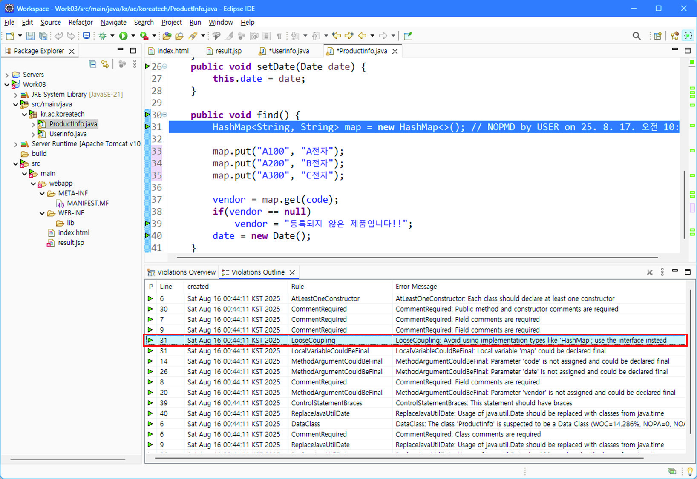
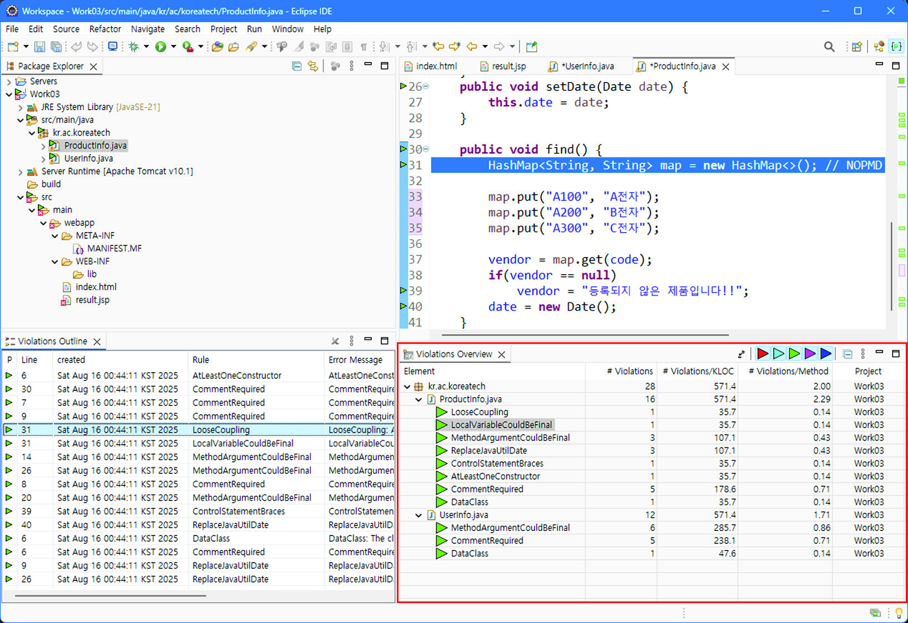
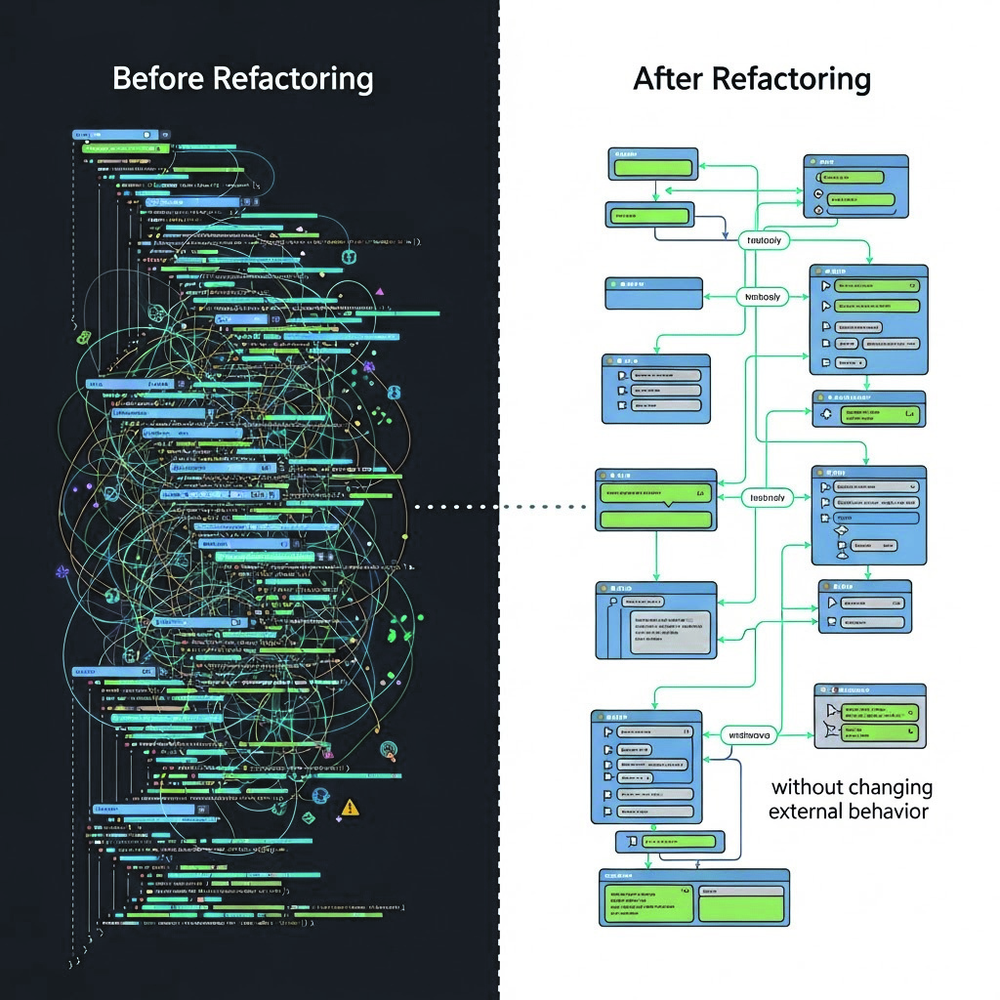
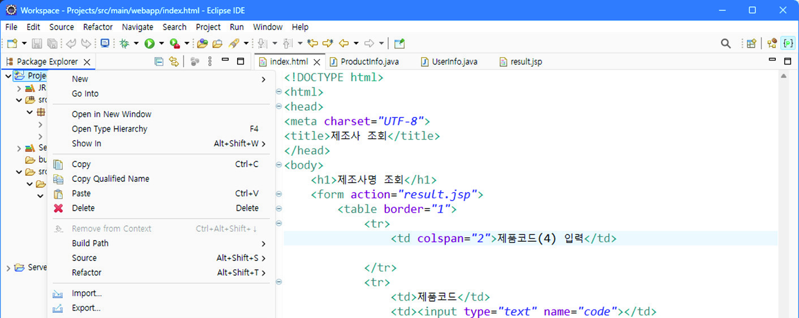
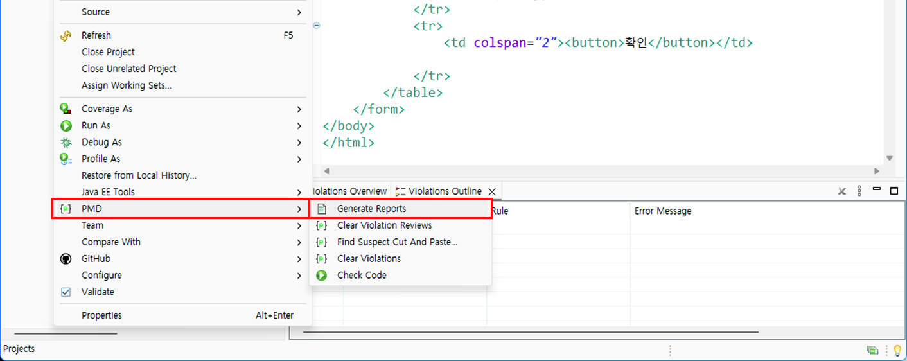
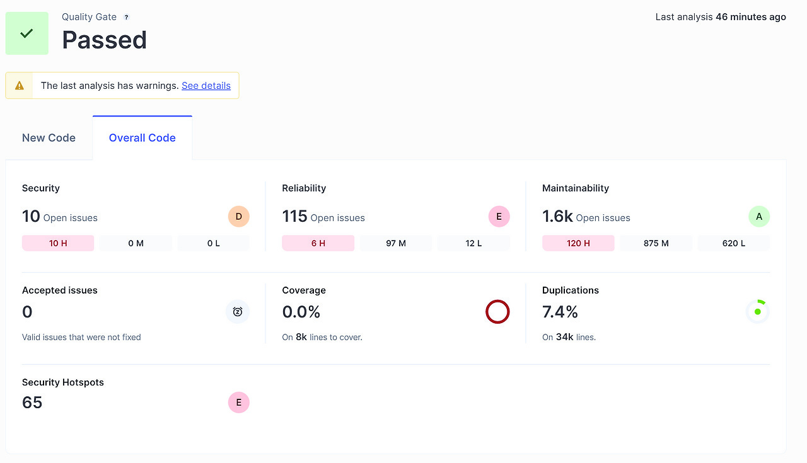
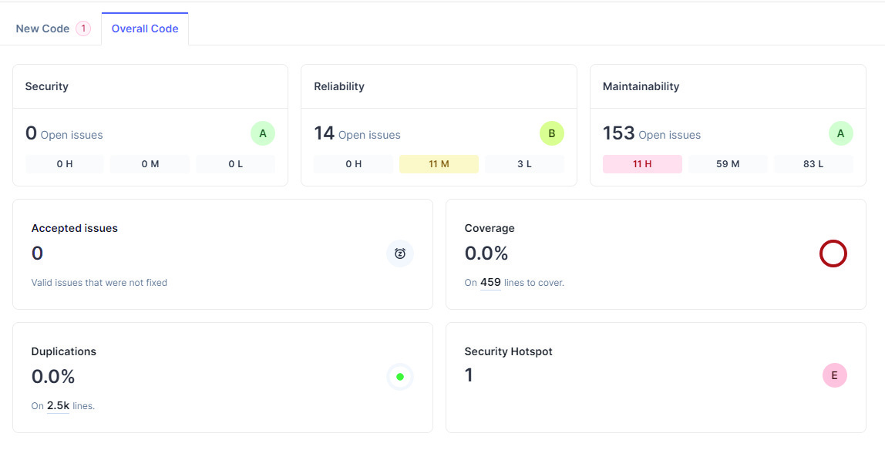

# LM2001020217_23v6_애플리케이션+리팩토링_20251108

대분류/20
정보통신 중분류/01
정보기술 소분류/02
정보기술개발 세분류/02
응용SW엔지니어링 능력단위/17
NCS학습모듈
애플리케이션 리팩토링
LM2001020217_23v6
[NCS학습모듈 활용 시 유의 사항]
1. NCS학습모듈은 교육훈련기관에서 출처를 명시하고 교육적 목적으로 활용할 수 있습니다. 다
만, NCS학습모듈에는 국가(교육부)가 저작재산권 일체를 보유하지 않은 저작물(출처가 표기된
도표‧사진‧삽화‧도면 등)이 포함되어 있으므로, 이러한 저작물의 변형‧각색‧복제‧공연‧
배포 및 공중 송신 등과 이러한 저작물을 활용한 2차적 저작물을 작성하려면 반드시 원작자
의 동의를 받아야 합니다.
2. NCS학습모듈은 개발 당시의 산업 및 교육 현장을 반영하여 집필하였으므로, 현재 적용되는
법령‧지침‧표준 및 교과 내용 등과 차이가 있을 수 있습니다. NCS학습모듈 활용 시 법령
‧지침‧표준 및 교과 내용의 개정 사항과 통계의 최신성 등을 확인하시기를 바랍니다.
3. NCS학습모듈은 산업 현장에서 요구되는 능력을 교육훈련기관에서 학습할 수 있게 구성한 자
료입니다. 다만, NCS학습모듈 지면의 한계상 대표적 예시(예: 활용도 또는 범용성이 높은 제
품, 서비스) 중심으로 집필하였음을 이해하시기를 바랍니다.
NCS학습모듈의 이해
NCS학습모듈의 이해
※ 본 NCS학습모듈은 「NCS 국가직무능력표준」사이트(http://www.ncs.go.kr) 에서 확인 및 다운로드할 수 있습니다.

| Ⅰ | NCS학습모듈이란? |
| --- | --- |

•국가직무능력표준(NCS: National Competency Standards)이란 산업현장에서 직무를
수행하기 위해 요구되는 지식･기술･소양 등의 내용을 국가가 산업부문별･수준별로 체계
화한 것으로 산업현장의 직무를 성공적으로 수행하기 위해 필요한 능력(지식, 기술, 태도)
을 국가적 차원에서 표준화한 것을 의미합니다.
•국가직무능력표준(이하 NCS)이 현장의 ‘직무 요구서’라고 한다면, NCS학습모듈은 NCS
의 능력단위를 교육훈련에서 학습할 수 있도록 구성한 ‘교수･학습 자료’입니다. NCS학습
모듈은 구체적 직무를 학습할 수 있도록 이론 및 실습과 관련된 내용을 상세하게 제시하
고 있습니다.

| NCS 및 NCS학습모듈 개발 절차 |
| --- |
| NCS산업계개발 계획 수립NCSNCS학습모듈NCS학습모듈 개발개발 계획 수립 |

•NCS학습모듈은 다음과 같은 특징을 가지고 있습니다.
첫째, NCS학습모듈은 산업계에서 요구하는 직무능력을 교육훈련 현장에 활용할 수 있도
록 성취목표와 학습의 방향을 명확히 제시하는 가이드라인의 역할을 합니다.
둘째, NCS학습모듈은 특성화고, 마이스터고, 전문대학, 4년제 대학교의 교육기관 및 훈
련기관, 직장교육기관 등에서 표준교재로 활용할 수 있으며 교육과정 개편 시에도
유용하게 참고할 수 있습니다.
i
•NCS와 NCS학습모듈 간의 연결 체계를 살펴보면 아래 그림과 같습니다.

| NCS와 NCS학습모듈의 연결 체계 |
| --- |
| NCS NCS학습모듈능력단위 NCS학습모듈명능력단위 정의 NCS학습모듈의 목표능력단위 기술서 학습명능력단위 요소 학습 내용수행준거 학습 목표지식 필요 지식기술 수행 내용- 재료･자료태도- 기기(장비･공구)- 안전･유의 사항- 수행 순서적용범위 및 작업상황고려 사항 교수･학습 방법자료 및 관련 서류 교수 방법장비 및 도구 학습 방법평가 지침 평가평가 방법 평가 준거평가 시 고려 사항 평가 방법피드백참고 자료･활용 서식･부록 |

|  |  | NCS |  |  |  |  |  |  |  |  | NCS학습모듈 |  |  |  |  |
| --- | --- | --- | --- | --- | --- | --- | --- | --- | --- | --- | --- | --- | --- | --- | --- |
|  | 능력단위 |  |  |  |  |  |  |  |  | NCS학습모듈명 |  |  |  |  |  |
|  | 능력단위 | 능력단위 |  |  |  |  |  |  |  | NCS학습모듈명 | NCS학습모듈명 |  |  |  |  |
|  | 능력단위 정의 |  |  |  |  |  |  |  |  | NCS학습모듈의 목표 |  |  |  |  |  |
|  | 능력단위 정의 | 능력단위 정의 |  |  |  |  |  |  |  | NCS학습모듈의 목표 | NCS학습모듈의 목표 |  |  |  |  |
|  | 능력단위 기술서 능력단위 요소 | 능력단위 기술서 능력단위 요소 |  |  |  |  |  |  |  | 학습명 학습 내용 | 학습명 학습 내용 |  |  |  |  |
|  | 능력단위 기술서 |  |  |  |  |  |  |  |  | 학습명 |  |  |  |  |  |
|  | 능력단위 기술서 | 능력단위 기술서 |  |  |  |  |  |  |  | 학습명 | 학습명 |  |  |  |  |
|  | 능력단위 요소 |  |  |  |  |  |  |  |  | 학습 내용 |  |  |  |  |  |
|  | 능력단위 요소 | 능력단위 요소 |  |  |  |  |  |  |  | 학습 내용 | 학습 내용 |  |  |  |  |
|  | 수행준거 |  |  |  |  |  |  |  |  | 학습 목표 |  |  |  |  |  |
|  | 수행준거 | 수행준거 |  |  |  |  |  |  |  | 학습 목표 | 학습 목표 |  |  |  |  |
|  | 지식기술태도 |  |  |  |  |  |  |  |  | 필요 지식수행 내용- 재료･자료- 기기(장비･공구)- 안전･유의 사항- 수행 순서 |  |  |  |  |  |
|  | 기술 | 기술 |  |  |  |  |  |  |  | 수행 내용 | 수행 내용 |  |  |  |  |
|  |  |  |  |  |  |  |  |  |  | - 재료･자료 | - 재료･자료 |  |  |  |  |
|  | 태도 | 태도 |  |  |  |  |  |  |  | - 기기(장비･공구) | - 기기(장비･공구) |  |  |  |  |
|  |  |  |  |  |  |  |  |  |  | - 기기(장비･공구) | - 기기(장비･공구) |  |  |  |  |
|  |  |  |  |  |  |  |  |  |  | - 안전･유의 사항 | - 안전･유의 사항 |  |  |  |  |
|  | 적용범위 및 작업상황 |  |  |  |  |  |  |  |  | - 수행 순서 | - 수행 순서 |  |  |  |  |
|  | 고려 사항자료 및 관련 서류장비 및 도구 |  |  |  |  |  |  |  |  | 교수･학습 방법 | 교수･학습 방법 교수 방법 학습 방법 |  |  |  |  |
|  | 자료 및 관련 서류 장비 및 도구 | 자료 및 관련 서류 장비 및 도구 |  |  |  |  |  |  |  | 교수 방법학습 방법 |  |  |  |  |  |
|  | 평가 지침 |  |  |  |  |  |  |  |  | 평가 |  |  |  |  |  |
|  | 평가 방법평가 시 고려 사항 |  |  |  |  |  |  |  |  | 평가 준거평가 방법피드백 |  |  |  |  |  |
|  | 평가 시 고려 사항 | 평가 시 고려 사항 |  |  |  |  |  |  |  | 평가 방법 | 평가 방법 |  |  |  |  |
|  |  |  |  |  |  |  |  |  |  | 참고 자료･활용 서식･부록 |  |  |  |  |  |

ii
NCS학습모듈의 이해

| Ⅱ | NCS학습모듈의 체계 |
| --- | --- |

•NCS학습모듈은 1. NCS학습모듈의 위치 , 2. NCS학습모듈의 개요 , 3. NCS학습모듈의 내용 체계 ,
4. 참고 자료 , 5. 활용서식/부록 으로 구성되어 있습니다.
1. NCS학습모듈의 위치
•NCS학습모듈의 위치는 NCS 분류 체계에서 해당 학습모듈이 어디에 위치하는지를 한 눈에
볼 수 있도록 그림으로 제시한 것입니다.

| [NCS-학습모듈의 위치] |  |  |  |  |  |  |  |
| --- | --- | --- | --- | --- | --- | --- | --- |
| 대분류 | 문화·예술·디자인·방송 |  |  |  |  |  |  |
| 중분류 |  | 문화콘텐츠 |  |  |  |  |  |
| 소분류 |  |  |  |  |  | 문화콘텐츠제작 |  |
| 세분류 |  |  |  |  |  |  |  |
| 세분류 |  |  |  |  |  |  |  |
| 방송콘텐츠제작 |  |  |  |  | 능력단위 |  | 학습모듈명 |
| 영화콘텐츠제작 프로그램 기획 프로그램 기획음악콘텐츠제작 아이템 선정 아이템 선정광고콘텐츠제작 자료 조사 자료 조사게임콘텐츠제작 프로그램 구성 프로그램 구성애니메이션캐스팅 캐스팅콘텐츠제작만화콘텐츠제작 제작계획 제작계획캐릭터제작 방송 미술 준비 방송 미술 준비스마트문화앱방송 리허설 방송 리허설콘텐츠제작영사 야외촬영 야외촬영스튜디오 제작 스튜디오 제작… … |  |  |  |  | 프로그램 기획 |  | 프로그램 기획 |
| 음악콘텐츠제작 |  |  |  |  | 아이템 선정 |  | 아이템 선정 |
| 광고콘텐츠제작 자료 |  |  |  |  | 자료 조사 |  | 자료 조사 |
| 게임콘텐츠제작 |  |  |  |  | 프로그램 구성 |  | 프로그램 구성 |
| 애니메이션 콘텐츠제작 |  |  |  |  | 캐스팅 |  | 캐스팅 |
| 만화콘텐츠제작 |  |  |  |  | 제작계획 |  | 제작계획 |
| 캐릭터제작 방송 |  |  |  |  | 방송 미술 준비 |  | 방송 미술 준비 |
| 스마트문화앱 방송 콘텐츠제작 |  |  |  |  | 방송 리허설 |  | 방송 리허설 |
| 영사 |  |  |  |  | 야외촬영 |  | 야외촬영 |
|  |  |  |  |  | 스튜디오 제작 |  | 스튜디오 제작 |
|  |  |  |  |  | … |  | … |

|  | 학습모듈은 |
| --- | --- |
| NCS 능력단위 1개당 1개의 학습모듈 개발을 원칙으로 합니다. 그러나 필요에 따라고용단위 및 교과단위를 고려하여 능력단위몇 개를 묶어 1개 학습모듈로 개발할 수있으며, NCS 능력단위 1개를 여러 개의학습모듈로 나누어 개발할 수도 있습니다. |  |

iii
2. NCS학습모듈의 개요
•NCS학습모듈의 개요는 학습모듈이 포함하고 있는 내용을 개략적으로 설명한 것으로
학습모듈의 목표 , 선수학습 , 학습모듈의 내용 체계 , 핵심 용어 로 구성되어 있습니다.

| 학습모듈의 목표 | 해당 NCS 능력단위의 정의를 토대로 학습 목표를 작성한 것입니다. |
| --- | --- |

| 선수학습 | 해당 학습모듈에 대한 효과적인 교수･학습을 위하여 사전에 이수해야 하는 학습모듈, 학습 내용, 관련 교과목 등을 기술한 것입니다. |
| --- | --- |

| 학습모듈의내용 체계 | 해당 NCS 능력단위요소가 학습모듈에서 구조화된 체계를 제시한 것입니다. |
| --- | --- |

| 핵심 용어 | 해당 학습모듈의 학습 내용, 수행 내용, 설비･기자재 등 가운데 핵심적인 용어를 제시한 것입니다. |
| --- | --- |

| 제작계획 학습모듈의 개요 |  |  |  |
| --- | --- | --- | --- |
| 학습모듈의 목표본격적인 촬영을 준비하는 단계로서, 촬영 대본을 확정하고 제작 스태프를 조직하며촬영 장비와 촬영 소품을 준비할 수 있다.선수학습제작 준비(LM0803020105_13v1), 섭외 및 제작스태프 구성(LM0803020104_13v1),촬영 제작(LM0803020106_13v1), 촬영 장비 준비(LM0803040204_13v1.4), 미술디자인 협의하기(LM0803040203_13v1.4)학습모듈의 내용체계 |  |  |  |
| 학습 | 학습 내용 | NCS 능력단위 요소 |  |
| 코드번호 요소 명칭 |  | 코드번호 | 요소 명칭 |
| 1. 촬영 대본 1-1. 촬영 구성안 검 촬영 대본0803020114_16v3.1확정하기 토와 수정 확정하기2-1. 기술 스태프 조직2. 제작 스태프 제작 스태프2-2. 미술 스태프 조직 0803020114_16v3.2조직하기 조직하기2-3. 전문 스태프 조직3. 촬영 장비 3-1. 촬영 장비 점검 촬영 장비0803020114_16v3.3계획하기 과 준비 계획하기4-1. 촬영 소품 목록4. 촬영 소품 작성 촬영 소품0803020114_16v3.4계획하기 4-2. 촬영 소품 제작 계획하기의뢰 |  |  |  |
| 핵심 용어촬영 구성안, 제작 스태프, 촬영 장비, 촬영 소품 |  |  |  |

|  | 학습모듈의 목표는 |
| --- | --- |
| 학습자가 해당 학습모듈을 통해 성취해야할 목표를 제시한 것으로, 교수자는 학습자가 학습모듈의 전체적인 내용흐름을 파악하도록 지도할 수 있습니다. |  |

|  | 선수학습은 |
| --- | --- |
| 교수자 또는 학습자가 해당 학습모듈을 교수·학습하기 이전에 이수해야 하는 교과목또는 학습모듈(NCS 능력단위) 등을 표기한것입니다. 따라서 교수자는 학습자가 개별학습, 자기 주도 학습, 방과 후 활동 등 다양한 방법을 통해 이수할 수 있도록 지도하는 것을 권장합니다. |  |

|  | 핵심 용어는 |
| --- | --- |
| 해당 학습모듈을 대표하는 주요 용어입니다. 학습자가 해당 학습모듈을 통해 학습하고 평가받게될 주요 내용을 알 수 있습니다. 「NCS 국가직무능력표준」 사이트(www.ncs.go.kr)의 색인 (찾아보기) 중하나로 이용할 수 있습니다. |  |

iv
NCS학습모듈의 이해
3. NCS학습모듈의 내용 체계
•NCS학습모듈의 내용은 크게 학습 , 학습 내용 , 교수･학습 방법 , 평가 로 구성되어 있습니다.

| 학습 | 해당 NCS 능력단위요소 명칭을 사용하여 제시한 것입니다.학습은 크게 학습 내용, 교수･학습 방법, 평가로 구성되며 해당 NCS 능력단위의능력단위 요소별 지식, 기술, 태도 등을 토대로 내용을 제시한 것입니다. |
| --- | --- |

| 학습 내용 | 학습 내용은 학습 목표, 필요 지식, 수행 내용으로 구성되며, 수행 내용은 재료･자료, 기기(장비･공구), 안전･유의 사항, 수행 순서, 수행 tip으로 구성한 것입니다.학습모듈의 학습 내용은 실제 산업현장에서 이루어지는 업무활동을 표준화된 프로세스에 기반하여 다양한 방식으로 반영한 것입니다. |
| --- | --- |

| 교수･학습 방법 | 학습 목표를 성취하기 위한 교수자와 학습자 간, 학습자와 학습자 간 상호 작용이활발하게 일어날 수 있도록 교수자의 활동 및 교수 전략, 학습자의 활동을 제시한것입니다. |
| --- | --- |

| 평가 | 평가는 해당 학습모듈의 학습 정도를 확인할 수 있는 평가 준거 및 평가 방법, 평가 결과의 피드백 방법을 제시한 것입니다. |
| --- | --- |

학습 1 촬영 대본 확정하기

|  | 학습은 |
| --- | --- |
| 해당 NCS 능력단위요소 명칭을 사용하여제시하였습니다. 하나의 학습은 일반교과의 ‘대단원’에 해당되며, 학습모듈을 구성하는 가장 큰 단위가 됩니다. 또한 하나의 직무를 수행하기 위한 가장 기본적인단위로 사용할 수 있습니다 |  |

| 학습 2 | 제작 스태프 조직하기 |
| --- | --- |

학습 3 촬영 장비 계획하기
학습 4 촬영 소품 계획하기

|  | 학습 내용은 |
| --- | --- |
| NCS 능력단위요소별 수행준거를 기준으로제시하였습니다. 일반교과의 ‘중단원’에 해당합니다. |  |

2-1. 기술 스태프 조직
학습 목표 •프로그램 제작에 적합한 기술 스태프를 조직할 수 있다.

|  | 학습 목표는 |
| --- | --- |
| 학습 내용을 이수할 때 학습자가 갖춰야할행동 수준을 의미합니다. 따라서 수업시간의 과목 목표로 활용할 수 있습니다. |  |

필요 지식 /
(cid:49684) 기술 스태프의 구성

|  | 필요 지식은 |
| --- | --- |
| 해당 NCS의 지식을 토대로 학습에 대한이해와 성과를 제고하기 위해 반드시 알아야 할 주요 지식을 제시하였습니다. 필요 지식은 수행에 꼭 필요한 핵심 내용을위주로 제시하여 교수자의 역할이 매우중요하며, 이후 수행 순서와 연계하여 교수·학습으로 진행할 수 있습니다. |  |

프로그램의 장르에 따라 구성하는 기술 스태프는 많은 차
이가 있다. 같은 장르의 프로그램이라도 그 형식이나 내
용, 규모에 따라서 구성되는 기술 스태프의 종류와 인원
수는 천차만별이다.
1. 스튜디오 프로그램
토크쇼, 종합 구성, 예능과 같은 스튜디오 프로그램은
부조정실과 스튜디오를 사용하여 제작하기 때문에 많
은 기술 스태프가 필요하다.
v

|  | 수행 내용은 |
| --- | --- |
| 해당 학습모듈에서 제시한 내용 중 기술(skill)을 습득하기 위한 실습과제로 활용할 수 있습니다. |  |

수행 내용 / 기술 스태프 구성표 작성하기
재료·자료

|  | 재료･자료는 |
| --- | --- |
| 수행 내용을 수행하는데 필요한 재료 및 준비물로 실습 시 활용할 수 있습니다. |  |

• 방송프로그램 제작 기획서 및 방송 대본, 콘티(continuity), 제작
일정, 운용표
• 장비 및 시설, 제작 시설 배정 의뢰서 및 배정표, 방송 기술 스
태프 데이터베이스(DB) 자료

|  | 기기(장비･공구)는 |
| --- | --- |
| 수행 내용에 필요한 기본적인 장비 및 도구를 제시하였습니다. 제시된 기기 외에도 수행에 필요한 다양한 도구나 장비를 활용할수 있습니다. |  |

기기(장비･공구)
• 컴퓨터 등
안전･유의 사항

|  | 안전･유의사항은 |
| --- | --- |
| 수행 내용을 수행하는 데 있어 안전상 주의해야할 점 및 유의사항을 제시하였습니다. 실습 시 유념해야 하며, NCS의 고려사항도 추가적으로 활용할 수 있습니다. |  |

• 프로그램의 내용과 제작 방법을 분석하고, 각 스태프들의 역할
을 신중하게 검토한다.
수행 순서
(cid:49684) 방송 대본이나 콘티(continuity), 큐 시트를 분석하고, 프로그램

|  | 수행 순서는 |
| --- | --- |
| 실습 과제의 진행 순서로 활용할 수 있습니다. |  |

의 내용적 특성, 제작 과정에 대한 자료를 수집한다.
(cid:49685) 프로그램 제작 방법을 결정한다.

|  | 수행 tip은 |
| --- | --- |
| 수행 내용에서 실습을 용이하게 할 수 있는아이디어를 제시하였습니다. 수행 tip은 지도상의 안전 및 유의사항 외에 전반적으로적용되는 주안점 및 수행 과제 목적에 대한보충설명, 추가사항 등으로 활용할 수 있습니다. |  |

1. 스튜디오 녹화를 할 것인가, 야외 촬영을 할 것인가 검토한
다.
수행 tip
•스태프의 결정은 스태프 간의 호흡을 중
요시하여 선정해야 프로그램의 질을 향
상시킬 수 있다.

| 학습2 | 교수·학습 방법 |
| --- | --- |

|  | 교수･학습 방법은 |
| --- | --- |
| 학습 목표를 성취하는 데 필요한 교수 방법과 학습 방법을 제시하였습니다. |  |

교수 방법

|  | 교수 방법은 |
| --- | --- |
| 해당 학습 활동에 필요한 학습 내용, 학습내용과 관련된 자료명, 자료 형태, 수행 내용의 진행 방식 등에 대하여 제시하였습니다. 또한 학습자의 수업참여도 제고 방법및 수업 진행상 유의사항 등도 제시하였습니다. 선수학습이 필요한 학습을 학습자가숙지하였는지 교수자가 확인하는 과정으로활용할 수도 있습니다. |  |

• 방송 프로그램의 기술적 요소, 미술 구성 요소, 특수 촬영에 대해
설명한다.
• 방송 프로그램 제작에서 각 기술 스태프의 역할에 대해 설명한다.
• 방송 프로그램을 분석하고 필요한 기술 스태프를 구성할 수 있도
록 지시한다.
학습 방법

|  | 학습 방법은 |
| --- | --- |
| 해당 학습 활동에 필요한 학습자의 자기주도 학습 방법을 제시하였습니다. 또한학습자가 숙달해야 할 실기 능력과 학습과정에서 주의해야 할 사항 등도 제시하였습니다. 학습자가 학습을 이수하기 전반드시 숙지해야 할 기본 지식을 학습하였는지 스스로 확인하는 과정에 활용할수 있습니다. |  |

• 방송 프로그램의 기술적 요소, 미술 구성 요소, 특수 촬영에 대해
서 알아본다.
• 프로그램 제작에 필요한 기술 스태프의 역할을 이해하고, 기술 스
태프 구성표를 작성한다.
vi
NCS학습모듈의 이해

| 학습2 평 가평가 준거• 평가자는 학습자가 학습 목표를 성공적으로 달성하였는지를 평가해야 한다.• 평가자는 다음 사항을 평가해야 한다.성취수준학습 내용 학습 목표상 중 하기술 스태프 - 프로그램 제작에 적합한 기술 스태프를 조조직 직할 수 있다.미술 스태프 - 프로그램 제작에 적합한 미술 스태프를 조조직 직할 수 있다.전문 스태프 - 프로그램 특수 촬영을 위한 전문 스태프를조직 조직할 수 있다.평가 방법• 사례 연구성취수준학습 내용 평가 항목상 중 하- 프로그램에서 기술적 요소의 파악 여부기술 스태프 - 기술 스태프의 역할 파악 여부조직 - 프로그램에 필요한 기술 스태프 구성표 작성 능력피드백1. 사례 연구- 프로그램을 선택하여 기술 스태프, 미술 스태프, 전문 스태프 구성표를 예시와 같이 작성하였는지 개인별 능력을 평가한 후, 그결과를 모든 학습자에게 공유하도록 한다. | 학습2 | 평 가 |
| --- | --- | --- |

|  | 평가는 |
| --- | --- |
| NCS 능력단위의 평가 방법과 평가 시 고려사항을 준용하여 작성합니다. 교수자와학습자가 평가 항목별 성취수준 확인 시활용할 수 있습니다. |  |

|  | 평가 준거는 |
| --- | --- |
| 학습자가 학습을 어느 정도 성취하였는지평가하기 위한 기준을 제시하고 있습니다.학습 목표와 연계하여 단위수업 시간에 평가 항목 별 성취수준을 평가하는 데 활용할수 있습니다. |  |

| 학습 내용 | 학습 목표 | 성취수준 |  |  |
| --- | --- | --- | --- | --- |
|  |  | 상 | 중 | 하 |

| 4. 참고 자료•교육부(2013). | 섭외 및 제작스태프 구성(LM0803020104_13v1). |  |  |  |
| --- | --- | --- | --- | --- |
| 한국직업능력개발원. |  |  |  |  |
| 5. 활용 서식/부록직종 이름기술감독 조명감독 [디지털제1조(목적) 이 고시는램 및 방송광고의 | 스튜디오 기술 스태프 구성표 연락처 소속 특이사항텔레비전 방송프로그램 음량 등에 관한 기준] 제정 2014. 11. 29. 미래창조과학부 고시제1창 총칙 방송법 제70조의2제1항에 따라 방송사업자가 디지털 텔레비전음량을 일정하게 유지하기 위해 필요한 사항을 규정함을 | 비고목적으로 | 제2014-87호방송프로그한다. |  |

|  | 평가 방법은 |
| --- | --- |
| NCS 능력단위의 평가 방법을 참고하였으며, 평가 준거에 따른 평가 방법을 2개 이상 제시합니다. 평가 방법의 종류는 포트폴리오, 문제해결 시나리오, 서술형 시험, 논술형 시험, 사례 연구, 평가자 체크리스트,작업장 평가 등이 있으며, NCS 능력단위요소 별 수행 수준을 평가하는 데 가장 적절한 방법을 선정하여 활용할 수 있습니다. |  |

| 학습 내용 | 평가 항목 | 성취수준 |  |  |
| --- | --- | --- | --- | --- |
|  |  | 상 | 중 | 하 |

| 4. 참고 자료•교육부(2013). | 섭외 및 제작스태프 구성(LM0803020104_13v1). |  |  |  |
| --- | --- | --- | --- | --- |
| 한국직업능력개발원. |  |  |  |  |
| 5. 활용 서식/부록직종 이름기술감독 조명감독 [디지털제1조(목적) 이 고시는램 및 방송광고의 | 스튜디오 기술 스태프 구성표 연락처 소속 특이사항텔레비전 방송프로그램 음량 등에 관한 기준] 제정 2014. 11. 29. 미래창조과학부 고시제1창 총칙 방송법 제70조의2제1항에 따라 방송사업자가 디지털 텔레비전음량을 일정하게 유지하기 위해 필요한 사항을 규정함을 | 비고목적으로 | 제2014-87호방송프로그한다. |  |

|  | 피드백은 |
| --- | --- |
| 평가 후에 학습자들에게 평가 결과를 피드백하여 학습 목표를 달성하는 데 활용할 수 있습니다. |  |

|  | 참고 자료는 |
| --- | --- |
| 해당 학습모듈에 제시된 인용 자료의 출처를 제시하였습니다. 교수·학습의 과정에서참고로 활용할 수 있습니다. |  |

|  | 활용 서식은 |
| --- | --- |
| 평가 서식, 실습 시트 등 교수·학습 시 활용할 수 있는 다양한 서식들로 구성하였습니다. 수행에서 평가에 이르기까지 필요한서식을 해당 모듈의 특성에 맞춰 개발하거나 기존의 양식을 활용하여 제시하였습니다. |  |

|  | 부록은 |
| --- | --- |
| 활용 서식 이외에 교수·학습 과정에서 참고할수 있는 자료가 있는 경우 제시하였습니다. |  |

[NCS-학습모듈의 위치]

| 정보통신 |  |  |
| --- | --- | --- |
|  | 정보기술 |  |
|  |  | 정보기술개발 |

대분류
중분류
소분류
세분류

| SW아키텍처 |  |  | 능력단위 | 학습모듈명 |
| --- | --- | --- | --- | --- |
| 응용SW엔지니어링 |  |  | 요구사항 확인 | 요구사항 확인 |
| 임베디드SW엔지니어 링 |  |  | 데이터 입출력 구현 | 데이터 입출력 구현 |
| DB엔지니어링 |  |  | 통합 구현 | 통합 구현 |
| NW엔지니어링 |  |  | 정보시스템 이행 | 정보시스템 이행 |
| 보안엔지니어링 |  |  | 제품소프트웨어 패키징 | 제품소프트웨어 패키징 |
| UI/UX엔지니어링 |  |  | 서버 프로그램 구현 | 서버 프로그램 구현 |
| 시스템SW엔지니어링 |  |  | 인터페이스 구현 | 인터페이스 구현 |
| 빅데이터플랫폼구축 |  |  | 애플리케이션 배포 | 애플리케이션 배포 |
| 핀테크엔지니어링 |  |  | 애플리케이션 리팩토링 | 애플리케이션 리팩토링 |
| 데이터아키텍처 |  |  | 인터페이스 설계 | 인터페이스 설계 |
| IoT시스템연동 |  |  | 애플리케이션 요구사항 분석 | 애플리케이션 요구사항 분석 |
| 인프라스트럭쳐 아키텍처 구축 |  |  | 기능 모델링 | 기능 모델링 |
|  |  |  | 애플리케이션 설계 | 애플리케이션 설계 |
|  |  |  | 정적모델 설계 | 정적모델 설계 |

| 동적모델 설계 | 동적모델 설계 |
| --- | --- |
| 화면 설계 | 화면 설계 |
| 화면 구현 | 화면 구현 |
| 애플리케이션 테스트 관리 | 애플리케이션 테스트 관리 |
| 애플리케이션 테스트 수행 | 애플리케이션 테스트 수행 |
| 소프트웨어공학 활용 | 소프트웨어공학 활용 |
| 소프트웨어개발 방법론 활용 | 소프트웨어개발 방법론 활용 |
| 프로그래밍 언어 응용 | 프로그래밍 언어 응용 |
| 프로그래밍 언어 활용 | 프로그래밍 언어 활용 |
| 응용SW 기초 기술 활용 | 응용SW 기초 기술 활용 |
| 개발자 환경 구축 | 개발자 환경 구축 |
| 개발 환경 운영 지원 | 개발 환경 운영 지원 |
| 자료구조 활용 | 자료구조 활용 |

차 례
학습모듈의 개요 1
학습 1. 리팩토링 기준 수립하기
1-1. 리팩토링 기준 수립 3
• 교수⋅학습 방법 18
• 평가 19
학습 2. 소스코드 분석하기
2-1. 소스코드 분석 21
• 교수⋅학습 방법 37
• 평가 38
학습 3. 리팩토링 적용하기
3-1. 리팩토링 적용 40
3-2. 리팩토링 기능 확인 50
• 교수⋅학습 방법 57
• 평가 58
참고 자료 60
활용 서식 61
애플리케이션 리팩토링 학습모듈의 개요
학습모듈의 목표
소스코드가 수행하는 기능을 유지하면서 코드 가독성 및 잠재적 결함을 제거하도록 코드를 개선할 수 있다.
선수학습
응용SW 기초 기술 활용(2001020232_23v5), 소프트웨어 공학 활용(2001020228_23v6), 소프트웨어개발 방
법론 활용(2001020229_23v6)
학습모듈의 내용체계

| 학습 | 학습 내용 | NCS 능력단위 요소 |  |
| --- | --- | --- | --- |
|  |  | 코드번호 | 요소 명칭 |

1. 리팩토링 기준 수립 리팩토링 기준
1-1. 리팩토링 기준 수립 2001020217_23v6.1
하기 수립하기
2. 소스코드 분석하기 2-1. 소스코드 분석 2001020217_23v6.2 소스코드 분석하기
3-1. 리팩토링 적용
3. 리팩토링 적용하기 2001020217_23v6.3 리팩토링 적용하기
3-2. 리팩토링 기능 확인
핵심 용어
소스코드 분석, 소스코드 분석 도구 룰 세트, 회귀 테스트, 개발 보안, 잠재 결함, Clean Code, 기능 테스트

| 학습 1 | 리팩토링 기준 수립하기 |
| --- | --- |

학습 2 소스코드 분석하기
학습 3 리팩토링 적용하기
1-1.
리팩토링 기준 수립
•리팩토링을 적용하여 달성하려는 품질 목표를 수립할 수 있다.
학습 목표 •리팩토링 결과의 완전성을 검증할 수 있는 체크리스트를 수립할 수 있다.
•리팩토링에 활용할 수 있는 도구 및 절차를 수립할 수 있다.
필요 지식 /
(cid:49684) 리팩토링 개념
리팩토링(Refactoring)은 소프트웨어 기능(동작)에는 변함이 없도록 하면서 내부 구조를
개선하여 소프트웨어의 가독성, 유지보수성, 확장성, 재사용성, 그리고 궁극적으로 성능을
향상하기 위한 개발 기법을 말한다.
(cid:49685) 리팩토링 시점
한 번에 대대적으로 진행하거나 너무 빈번한 리팩토링보다는 작은 단위로, 테스트할 수 있
는 상태에서 점진적으로 수행하는 것이 좋다.
1. 기능 추가 시
새로운 기능을 추가하기 전에 기존 코드를 충분히 이해하고 구조를 개선하기 위해 리
팩토링을 수행한다. 이를 통해 코드의 중복과 잠재적인 결함을 미리 줄일 수 있으며,
이후 기능 추가나 수정 작업을 더 빠르고 원활하게 진행할 수 있다.
2. 버그 수정 시
버그를 수정하기 어렵거나, 같은 유형의 버그가 반복적으로 발생한다면 리팩토링이 필요
하다. 소스코드를 정리하여 버그뿐만 아니라 잠재적인 결함을 제거할 수 있다.
3. 지속 수행
별도의 시간을 내서 리팩토링을 수행하는 것이 아니라 틈틈이 지속해야 소스코드의 잠
재적인 위험을 제거하게 되며 소프트웨어의 생명력을 지속할 수 있다.
(cid:49686) 깨끗한 코드(Clean Code)의 기준
1. 가독성이 좋은 코드
단순하고 직접적으로 잘 쓰인 문장처럼 읽히고 설계자의 의도가 보이는 코드로, 추상화
와 단순한 제어문으로 구성된 코드를 말한다.
2. 변경이 쉬운 코드
작성자가 아닌 사람도 읽기 쉽고 고치기 쉬운 코드로, 이를 위해서는 의미 있은 이름이
부여되고 특정한 목적을 달성하는 방법은 하나만 제공한다. 또 의존성은 최소화하며 각
의존성에 대한 정의가 명확하다.
3. 중복 없는 코드
같은 작업을 여러 차례 반복하지 않는 코드로, 같은 작업을 여러 차례 반복한다면 코드
가 문제 해결을 제대로 하지 못한다는 증거이다.
4. 주의 깊게 짜인 코드
고치려고 살펴봐도 딱히 손댈 곳이 없는, 작성자가 이미 모든 상황을 고려하여 작성된
소스코드를 말한다.
(cid:49687) 리팩토링 주의 사항
리팩토링은 코드 품질을 높이고 유지보수를 쉽게 하지만, 잘못 진행하면 오히려 위험을 초
래할 수 있다. 리팩토링은 작고 안전하게, 테스트와 함께, 협업과 소통을 바탕으로 진행해
야 하며, 언제든 복구가 가능한 환경에서 단계적으로 실행하는 것이 핵심이다. 다음은 리
팩토링 시 반드시 유념해야 할 주요 사항이다.
1. 기능 보존의 원칙
리팩토링의 목적은 코드의 구조 개선이지, 동작하는 기능을 변경하는 것이 아니기 때문
에 리팩토링 전후로 모든 기능이 동일하게 동작하는지 반드시 확인해야 한다.
2. 작은 단위로 점진적으로 진행
한 번에 많은 부분을 수정하면 오류 발생 가능성이 커지므로 작은 단위로 나누어 리팩
토링하고, 단계마다 테스트를 수행한다.
3. 자동화된 테스트의 활용
자동화된 테스트(단위/통합 테스트)를 활용하여 리팩토링 전후로 테스트를 반복 실행하
고 기존 기능에 문제가 생기지 않도록 확인한다.
4. 버전 관리 시스템 적극 활용
변경 이력을 추적할 수 있도록 Git 등 버전 관리 시스템을 사용하여 문제가 생겼을 경
우 언제든 이전 상태로 롤백할 수 있어야 한다.
5. 코드 리뷰와 협업
혼자만의 판단으로 대규모 리팩토링을 진행하지 말고, 동료와 코드 리뷰를 통해 개선
방향을 논의한다. 협업 환경에서는 변경 사항을 충분히 공유하고, 팀의 합의를 끌어내
는 것이 중요하다.
6. 문서화와 공유
리팩토링 후 변경된 코드 구조나 설계 의도를 문서화하여 팀원과 공유하면 향후 유지
보수 시 큰 도움이 된다.
수행 내용 / 리팩토링 기준 수립하기
재료‧자료
• 애플리케이션 소스코드
• 애플리케이션 소스코드 분석 자료
• 소스코드 분석 도구 매뉴얼
기기(장비‧공구)
• 전산 장비: 인터넷, 컴퓨터, 프린터, 복사기, 빔 프로젝터
• 지원 도구: 통계 분석 도구, 문서 작성 도구, 문서 발표 도구
• 개발 및 테스트 도구: 소스코드 분석 도구
안전‧유의 사항
• 리팩토링은 개발자를 평가하는 것이 아니라 애플리케이션 모듈의 구조적 개선을 통하여
품질을 확보하는 방법이라는 인식을 갖도록 해야 한다.
• 리팩토링 적용 목표 수립 시 문서화하여 이해관계자들이 합의할 수 있도록 해야 한다.
수행 순서
(cid:49684) 리팩토링을 적용하여 달성하려는 품질 목표를 수립한다.
대상 애플리케이션의 이슈와 문제를 식별하고 대상을 선정하여 리팩토링 목표를 정의한다.
정의된 리팩토링 목표와 대상을 기반으로 리팩토링 계획을 수립한다. ‘리팩토링 계획서’의
양식은 활용 서식을 참조한다.
1. 대상 애플리케이션의 문제를 식별하고 정의한다.
대상 애플리케이션 소스코드의 가독성, 변경 용이성, 잠재적 결함 발생 가능성 등 문제
상황이 있는지 확인하고 리팩토링 대상 모듈을 식별한다. 샘플 소스코드를 대상으로 육
안으로 소스코드의 문제점을 식별한다.
(1) 중복된 소스코드 식별
(가) 유형 1: 공백과 주석만 다르고 코드는 동일한 경우
(나) 유형 2: 공백과 주석이 다르고 코드는 동일하고 변수의 이름이 다른 경우
(다) 유형 3: 공백과 주석이 다르고 코드는 동일하며 변수 이름이 다르고, 코드의 몇
라인이 변경되었거나 추가되었을 경우
(라) 유형 4: 의미적으로 동일한 코드이지만 코드 문법이 다소 다른 경우
(2) 긴 메서드(Long Method) 식별
메서드 추출 기법을 적용하여 메서드를 식별하고 주석을 확인하여 긴 메서드를
식별한다. 또 조건문과 루프로 역시 메서드를 추출한다.
(3) 긴 매개변수 리스트(Long Parameter List) 식별
함수의 인자 수가 지나치게 많으면 사용성 저하, 인자 순서 오류 위험이 존재하므로
식별이 필요하다.
(4) 방대한 클래스(Large Class) 식별
기능이 많은 클래스를 식별하기 위해 인스턴스 변수가 많은 코드를 식별한다.
(5) 임시 필드(Temporary Field) 식별
객체 안에 인스턴스 변수가 특정 상황에서만 할당되는 경우, 인스턴스가 해당 변수
를 사용하는 클래스를 생성하는데 이러한 필드가 포함된 소스코드를 식별한다.
(6) 주석(Comments) 분석
소스코드가 무슨 작업을 하는지 설명하기 위해 주석이 필요한 경우인지, 메서드가
이미 추출되어 있는데도 여전히 소스코드의 기능에 대한 주석이 필요한 경우인지,
시스템의 필요한 조건에 대한 어떤 규칙, 기준 등을 설명할 필요가 있는 경우인지를
식별하여 리팩토링 대상으로 선정한다.
(cid:49685) 리팩토링 대상 선정을 위한 분석 도구를 선정하고 설치한다.
1. 분석 도구 선정
소스코드 분석 도구를 식별하고 분석 목표, 소스코드 특성에 따라 분석 도구를 선정한다.
<표 1-1> 활용 가능한 소스코드 분석 도구
분석 도구 설명 적용 대상
여러 언어를 지원하며, 버그 탐지, 코드 냄새(smells), 취약점
SonarCube Java, C#, C
분석을 포함한 심층 분석을 제공
Java에서 100여 개의 잠재적인 에러 유형을 찾아 주며, 이
FindBugs 잠재적인 에러는 scariest, scary, troubling, concern으로 Java
구분하여 점수(rank)화해 주는 도구
사용하지 않는 변수, 비어 있는 소스코드 블록, 불필요한 객
PMD Java
체 생성과 같은 결함을 유발할 수 있는 소스코드의 검사 도구
JavaScrpit,
ESLint 코딩 표준 준수와 오류 탐지 기능 제공
TypeScipt
Python 코드의 보안 중심 정적 분석 도구로 OpenStack 보
Bandit C
안 프로젝트의 일부로 개발
C++, C#등
코드 베이스의 보안 취약점을 스캔하는 포괄적인 보안 중심
Checkmarx 20가지 언어
도구
지원
2. 소스코드 분석 도구 설치 및 기본 설정
(1) 소스코드 분석 도구 설치 파일 확보
소스코드 분석 도구는 오픈소스를 확보하거나 상용 소프트웨어를 구매하여 설치 파
일을 확보한다.
(가) 오픈소스 소스코드 분석 도구 설치 파일 확보
선정된 도구의 최신 설치 파일 제공 웹 페이지에서 설치 환경을 고려하여 설치
파일을 다운로드받는다.
(나) 상용 소프트웨어 분석 도구 설치 파일 확보
조직에서 사용하는 소스코드 분석 도구 설치 파일을 조직의 소프트웨어 담당자
로부터 전달받는다.
(2) 소스코드 분석 도구 설치
(가) 상용 소프트웨어 분석 도구 설치
조직에서 보유하고 있는 상용 소프트웨어 분석 도구 설치 파일을 실행하여 설치
를 완료한다.
(나) 오픈소스 소스코드 분석 도구 설치
오픈소스 소스코드 분석 도구는 통합 개발 환경 플랫폼(예: eclipse)에 플러그인
으로 설치된다. 통합 개발 환경 전체를 압축한 파일로 제공되는 경우 압축을 푼
후 해당 플러그인을 설치한다.
<표 1-2> 소스코드 분석 도구(PMD) 설치 방법 예시
단계 설치 화면 설명
가. PMD 설치 (예시)

통합 개발 환경
Help 메뉴 >
설치 파일 Eclipse
확보 Marketplace에서
PMD 설치 파일
(플러그인)을 확보
나. Eclipse Marketplace (예시)

해당 도구(PMD)를
Eclipse
플러그인 Marketplace에서
설치 검색 및 설치
(install)
출처: 집필진 제작(2025)
(3) 소스코드 분석을 위한 설정
리팩토링 대상을 식별하기 위하여 소스코드 분석 규칙(Rule)을 정의하고 해당 규칙
을 분석 도구에 적용한다.
(가) Eclipse의 Window 메뉴에서 Preferences를 선택한다.
(나) Preferences 메뉴에서 PMD→Rule Configuration 순서로 필요로 하는 룰을 선
택하고 프로젝트에 적용한다.

출처: 집필진 제작(2025)
[그림 1-1] PMD 룰 세팅(예시)
3. 소스코드 분석 도구 실행
(1) 분석하고 싶은 파일이나 패키지를 선택하고 마우스 오른쪽 버튼을 클릭한 후 열리는 단
축 메뉴에서 PMD 메뉴를 선택한다.
(2) PMD로 소스코드를 진단하려면 PMD→Check Code 항목을 선택한다.

출처: 집필진 제작(2025)
[그림 1-2] PMD 실행 예시
(3) PMD로 진단한 결과를 지우려면 PMD→Clear Violations를 선택한다.
4. 소스코드 분석 결과 정리
소스코드 분석 결과의 문제점을 도출하고 그에 대한 조치 방법을 정리한다.

출처: 집필진 제작(2025)
[그림 1-3] PMD 소스코드 분석 결과 예시
(1) Violations outline 확인
분석 결과에 대한 에러 메시지와 에러가 발생한 해당 라인을 확인한다.
(2) Violations Overview 확인
분석 결과에 대한 Overview를 통해 에러가 발생한 전체 통계량을 확인한다.

출처: 집필진 제작(2025)
[그림 1-4] PMD 소스코드 분석 통계 예시
5. 대상 애플리케이션의 리팩토링 세부 기법을 선정한다.
소스코드 분석 결과를 파악하여 대상 애플리케이션의 잠재적 위험도와 개선을 위한 적
절한 방법을 선정한다.
<표 1-3> 리팩토링 방법 선정(예시)
방법 설명 적용 대상
그루핑(grouping) 할 수 있는 소스코드, 수식을
메서드 정리 ✓
메서드로 변경
메서드에 따른 위치 변경, 클래스 기능의 명확한
객체 간의 기능 이동 ✓
구분
객체 지향 캡슐화 기법을 적용하여 데이터 접근 데이터 접근 영역
데이터 구성
을 관리 부재
조건문 단순화 조건 논리를 단순하고 명확하게 작성 ✓
메서드 호출 단순화 메서드 이름이 목적에 맞지 않는 경우 변경 ✓
클래스 및 메서드 동일 메서드가 여러 클래스에 있으면 슈퍼 클래
✓
일반화 스로 이동
출처: 교육부(2021). 애플리케이션 리팩토링(LM2001020217_19v5). 한국직업능력연구원. p.12.
6. 리팩토링 결과를 평가하기 위한 지표 정의 및 기간, 공수를 산정한다.
(1) 대상 애플리케이션의 소스코드 리팩토링 목표를 정의한다.
리팩토링 필요성 및 리팩토링 결과를 통해 기대하는 사항에 대하여 정의한다.
<표 1-4> 리팩토링 목표 및 기대 사항(예시)
구분 지표 적용 여부
메서드 정리 가독성 ✓
객체 간의 기능 이동 응집성 ✓
데이터 구성 결합성 N/A
조건문 단순화 성능 N/A
메서드 호출 단순화 응집성 ✓
클래스 및 메서드 일반화 결합성 N/A
출처: 교육부(2021). 애플리케이션 리팩토링(LM2001020217_19v5). 한국직업능력연구원. p.12.
(2) 소스코드 단위별 리팩토링 목표를 정의한다.
기능별 소스코드의 복잡도, 가독성, 결합성, 응집성 등을 최적의 상태로 만들 수 있
도록 목표를 정의한다.
(cid:49686) 리팩토링 결과의 완전성을 검증할 수 있는 체크리스트를 작성한다.
1. 리팩토링 결과의 완전성을 검증하는 점검 항목을 식별한다.
리팩토링 수행 계획에 따른 점검 항목과 리팩토링 후 수행해야 하는 리그레이션 테스
트 점검 항목으로 구분하여 세부 체크 항목을 식별한다.
(1) 리팩토링 중 수동 체크를 위한 항목을 식별하고 적용 여부를 결정한다.
<표 1-5> 리팩토링 체크리스트(예시)
순번 구분 적용 여부
1 소스코드 스타일 가이드 준수 여부 ✓
2 하나의 함수가 하나의 기능만을 수행하는지 여부 ✓
3 각 함수의 정보는 코드를 설명할 만한지 여부 N/A
4 주석은 적절한지, 적절하지 않은지 여부 N/A
5 코드의 구조화 여부(가독성과 기능성 측면) N/A
6 헤더, 함수 정보를 도구로 추출해서 자동으로 문서화할 수 있는 구 N/A
순번 구분 적용 여부
조인지 여부
7 함수와 변수의 이름은 일관되고 상세하게 기술되었는지 여부 ✓
8 숫자를 직접 서술하지 않고 상수 사용 여부 ✓
9 주석 처리 된 코드의 삭제 여부 ✓
설명을 보거나 작성자에게 물어보아야만 이해할 수 있는 코드의 존
10 ✓
재 여부
중략
출처: 교육부(2021). 애플리케이션 리팩토링(LM2001020217_19v5). 한국직업능력연구원. p.13.
(2) 리팩토링 대상 소스코드의 회귀 테스트를 위한 환경을 구축한다.
리팩토링 후 기능이 동일하게 작동하는지 확인하기 위한 테스트 환경을 구축한다.
(가) 개발 환경에서 테스트 자동화 도구를 설치한다.
Project > Properties > Java Build Path > Libraries 탭 > Add Library...

출처: 집필진 제작(2025)
[그림 1-5] 테스트 코드 작성 Plugin 선택 예시

출처: 집필진 제작(2025)
[그림 1-6] 테스트 코드 작성 Plugin 확인 예시
(3) 리팩토링 후 회귀 테스트 프로그램을 작성한다.
리팩토링 후 기능의 이상 유무를 확인할 수 있는 테스트 프로그램을 작성한다.

출처: 교육부(2021). 애플리케이션 리팩토링(LM2001020217_19v5). 한국직업능력연구원. p.14.
[그림 1-7] Junit 테스트 코드 예시
(cid:49687) 리팩토링에 활용할 수 있는 도구 및 절차를 수립한다.
1. 리팩토링 절차를 수립한다.
(1) 리팩토링 수행 활동 식별
리팩토링 대상 소스코드의 문제점 및 요구사항에 따라 수행 활동을 식별한다. 소스
코드의 세밀한 분석과 대상을 명확하게 하기 위해 적용할 분석도를 정의하고 각 단
계별 수행 작업을 목록으로 정의한다.

출처: 집필진 제작(2025)
[그림 1-8] 리팩토링 전과 리팩토링 후의 코드 비교
(2) 리팩토링 수행 계획 수립
리팩토링 수행이 필요한 시점, 시작 기준을 정의한다. 또 리팩토링에 참여하는 담당
자의 역할과 수행 기간, 산출물을 사전에 정의한다.

출처: 집필진 제작(2025)
[그림 1-9] 리팩토링 계획 수립 예시
2. 리팩토링 단계별 도구와 절차를 확정하고 교육한다.
리팩토링 절차에 대한 교육과 도구에 대한 교육을 분리하여 계획을 수립하고 교육 자
료를 작성한다. 도구에 대한 교육은 실습 교육을 포함하거나 동영상 등 실감 나는 교육
을 할 수 있도록 준비한다.

출처: 집필진 제작(2025)
[그림 1-10] 리팩토링 교육 사례

| 학습 1 | 교수⋅학습 방법 |
| --- | --- |

교수 방법
• 리팩토링을 적용하여 달성하려는 품질 목표를 수립할 수 있도록 지도한다.
• 리팩토링 적용 대상을 선정하기 위한 소스코드 분석 방법을 체계적으로 설명한다.
• 소스코드의 문제 사항을 분석할 수 있는 방법 및 도구 활용 방법에 대해 설명한다.
• 분석 결과를 검토하여 리팩토링 방법 선정에 대하여 설명하고, 시나리오에 따라 수행해
볼 수 있게 실습 자료를 제공한다.
• 리팩토링 결과를 검증할 수 있는 체크리스트 및 테스트 시나리오를 작성하도록 하고
토의를 진행한다.
• 리팩토링 수행 활동 및 케이스별 고려 사항을 설명한다.
학습 방법
• 리팩토링을 적용하여 달성하려는 품질 목표를 수립한다.
• 리팩토링 적용 대상을 선정하기 위한 소스코드 분석 방법을 숙지한다.
• 소스코드의 문제 사항을 분석할 수 있는 방법 및 도구 활용 방법에 대해 파악하고 도구
설치를 실습한다.
• 분석 결과를 분석하여 리팩토링 방법 선정에 대하여 파악하고, 시나리오에 따라 수행해
볼 수 있게 실습한다.
• 리팩토링 결과를 검증할 수 있는 체크리스트 및 테스트 시나리오를 작성해 보고 토의를
진행하여 충분히 숙지한다.
• 리팩토링 수행 활동 및 케이스별 고려 사항을 숙지한다.

| 학습 1 | 평 가 |
| --- | --- |

평가 준거
• 평가자는 학습자가 학습 목표를 성공적으로 달성하였는지를 평가해야 한다.
• 평가자는 다음 사항을 평가해야 한다.

| 학습 내용 | 학습 목표 | 성취수준 |  |  |
| --- | --- | --- | --- | --- |
|  |  | 상 | 중 | 하 |

- 리팩토링을 적용하여 달성하려는 품질 목표를 수립할 수
있다.
리팩토링 기준 - 리팩토링 결과의 완전성을 검증할 수 있는 체크리스트를
수립 수립할 수 있다.
- 리팩토링에 활용할 수 있는 도구 및 절차를 수립할 수
있다.
평가 방법
• 평가자 질문

| 학습 내용 | 평가 항목 | 성취수준 |  |  |
| --- | --- | --- | --- | --- |
|  |  | 상 | 중 | 하 |

- 리팩토링을 위한 소스코드 분석 방법
리팩토링 기준
- 소스코드 분석 결과에 따른 리팩토링 방법
수립
- 리팩토링 검증 체크리스트 주요 항목 선정 여부
• 서술형 시험

| 학습 내용 | 평가 항목 | 성취수준 |  |  |
| --- | --- | --- | --- | --- |
|  |  | 상 | 중 | 하 |

- 리팩토링 절차 및 도구 확정 방법
리팩토링 기준
- 리팩토링 결과 완전성 검증 체크리스트 작성 능력
수립
- 사례별 소스코드의 리팩토링 능력
• 구두 발표

| 학습 내용 | 평가 항목 | 성취수준 |  |  |
| --- | --- | --- | --- | --- |
|  |  | 상 | 중 | 하 |

| 리팩토링 기준 수립 피드백 | - 리팩토링 절차 및 도구 확정 방법의 발표 능력 - 리팩토링 결과 완전성 검증 체크리스트 작성 방법의 발표능력 - 사례별 소스코드의 리팩토링 방법에 대한 발표 능력 |  |  |  |
| --- | --- | --- | --- | --- |
| 1. 평가자 질문- 리팩토링을품질 목표를- 애플리케이션을 학습자 | 적용하여 달성하는 품질 목표를 인지하고 있는지 질문하고 명확히 인지하여야 리팩토링를 제대로 수행할 수 있음을 설명해‘리팩토링 기준 수립’ 학습 내용의 각 평가 항목 관련 내용을수준별 등급을 고려하여 평가한 후 주요 사항을 설명해 준다. | 답변이준다. | 미흡할질문하고, | 때는내용 |
| 2. 서술형 시험- 애플리케이션결과 일정록 한다. | ‘리팩토링 기준 수립’ 학습 내용의 각 평가 항목 관련 시험을점수 이하인 학생들은 추가 학습 후 재시험을 실시하거나 학습 | 결과를 | 실시하고,제출하도 | 평가 |
| 3. 구두 발표 - 애플리케이션학습자 수준별 | ‘리팩토링 기준 수립’ 학습 내용의 각 평가 항목을 구두 발표하도록등급을 고려하여 평가한 후 잘못된 부분과 보완이 필요한 부분을 | 설명해 | 하고, 준다. | 내용을 |

학습 1 리팩토링 기준 수립하기

| 학습 2 | 소스코드 분석하기 |
| --- | --- |

학습 3 리팩토링 적용하기
2-1.
소스코드 분석
•개발 표준을 만족하지 않는 소스코드를 식별할 수 있다.
학습 목표 •성능 개선과 이해도 증진을 위하여 불필요한 소스코드를 식별할 수 있다.
•잠재 결함 요소를 내포한 소드코드를 식별할 수 있다.
필요 지식 /
(cid:49684) 개발 표준
시스템 개발을 위한 환경 구성과 표준을 설명한 문서로 개발자 및 관리자에게 일관성 있
는 개발이 가능하도록 정보를 제공한다. 프로젝트 구성과 관련된 개발 환경과 소스코드 디
렉터리 구조, 프로그램 작성을 위한 사용 언어별 소스코드 개발 원칙, 그리고 사용자 인터
페이스(UI)와 관련된 가이드를 제공한다.
1. 주요 내용
(1) 소스코드 개발 원칙
소스코드 개발에 있어서 기본적인 규칙을 설명한다.
4.1 코딩 원칙 (예시)
• 주석은 모든 코드에 상세히 기술하는 것을 원칙으로 한다.
• 소스코드는 불가피한 내용을 제외하고 원칙적으로 중복을 금지한다.
• 소스코드에서 사용되는 모든 단어는 자료 사전의 내용을 기준으로 한다.
• 개발 및 테스트를 수행함에 있어 기능과 성능은 물론 보안에도 각별한 주의를 기울
인다.
(2) 코딩 스타일
소스코드의 작성에 있어서 서식 측면의 규칙을 설명한다.
4.2. 코딩 스타일(Coding Style) (예시)
4.2.1. 들여쓰기(Indent)
• Indent는 tab을 사용하지 않고, space만 사용한다.

| 학습 내용 | 평가 항목 | 성취수준 |  |  |
| --- | --- | --- | --- | --- |
| • | Indent의 크기는 4로 한다. |  |  |  |
| 4.2.2.••••• | 공백(space) 한 줄에 하나의 statement만 기술한다. 세미콜론(Semicolon), 콤마(comma), 예약어 뒤에는 space를단항 연산(unary operation)은 space를 두지 않는다. (ex·binary operation은 양쪽에 space를 둔다. (ex. i = i + 1;)괄호 안에 괄호가 있는 경우에는 괄호 사이에 space를 두지 | 둔다.i++;)않는다. |  |  |
| 4.2.3.•••• | 괄호(brace) '{' 와 ‘}’는 새로운 라인에 기술하며, 다른 내용과 함께 기술하지은 제외) '{' 는 기존의 '{' 와 비교해서 indent(4-space)를 준다. ‘}’ 는 짝이 되는 ‘{’과 동일하게 indent(4-space)를 준다.brace에 주석을 기입하는 경우 '//' 주석을 사용한다. |  | 않는다. | (주석 |
| 2. 소스코드 디렉터리애플리케이션의성 규칙에 따라출처: 교육부(2021).[그림 2-1] 디렉터리 | 구조 안정적인 운영과 유지보수를 위해, 성능 및 가독성을소스코드 저장 구조를 준수해야 한다. 애플리케이션 리팩토링(LM2001020217_19v5). 한국직업능력연구원. p.22.구조 예시 | 보장하는 |  | 코드 작 |

출처: 집필진 제작(2025)
[그림 2-2] 개발 표준 가이드 예시
(cid:49685) 애플리케이션 개발 보안
개발 과정에서 개발자 실수, 논리적 에러 등으로 인해 소스코드에 내재된 보안 취약점을
최소화하고, 보안 위협에 대응할 수 있는 안전한 애플리케이션을 개발하기 위한 일련의 과
정을 의미한다.
1. 애플리케이션 보안 약점
애플리케이션 결함, 오류 등으로 사이버 공격, 정보 유출 등을 유발할 가능성이 있는
잠재적인 취약점을 말한다.
2. 애플리케이션 보안 약점 진단 도구
개발 중에 소스코드상의 애플리케이션 보안 취약점을 식별하고 식별된 소스코드의 위치
를 정리할 수 있도록 지원하는 도구를 말한다.
(cid:49686) 불필요한 코드(Dead Code)
애플리케이션에서 불필요한 코드는 실행은 되지만 결과가 다른 응용 프로그램에 사용될 수
없는 코드이다. 불필요한 코드의 실행은 연산 처리 시간과 메모리의 낭비를 초래한다.
1. 불필요한 코드(Dead Code) 예시

| int foo (int a, int b){int c = ab;return a*b;} | 비록 a를 b로 나누는 것이 연산 처리되고 전혀 사용되지 않더라도 0으로 나누기가 발생할 때는 예외 처리될것임 |
| --- | --- |

2. 불필요한 코드 분석 방법
(1) 불필요한 코드 분석 방법
유효 변수 분석을 통하여 소스코드의 정적 코드 분석과 데이터 흐름 분석을 수행하
여 제어 흐름 분석을 통한 코드 분석의 미흡한 부분을 보완한다.
(2) 불필요한 코드 제거 기법
(가) 도달할 수 없는 코드(Unreachable Code)

| j=10;for (i=0; i<10; i++){if (i==j)..... | i가 절대 j와 같아질 수 없으므로 에러를 발생시킴 |
| --- | --- |

(나) 중복 코드(Redundant Code) 제거

| extern int array_a[];extern int array_b[];int sum_a = 0;for (int i = 0; i < 4; i++)sum_a += array_a[i];int average_a = sum_a / 4;int sum_b = 0;for (int i = 0; i < 4; i++)sum_b += array_b[i];int average_b = sum_b / 4; | 2개의 루프를 하나의 함수로 재작성int calc_average_of_four(int* array) {int sum = 0;for (int i = 0; i < 4; i++)sum += array[i];return sum / 4;} |
| --- | --- |
| int sum_b = 0; for (int i = 0; i < 4; i++) sum_b += array_b[i]; int average_b = sum_b / 4; | 위의 함수를 사용하여 중복 제거extern int array1[];extern int array2[];int average1 = calc_average_of_four(array1);int average2 = calc_average_of_four(array2); |

수행 내용 / 소스코드 분석하기
재료‧자료
• 애플리케이션 소스코드
• 애플리케이션 소스코드 분석 자료
• 소스코드 분석 도구 매뉴얼
• 정의된 개발 표준 정의서
기기(장비‧공구)
• 전산 장비: 인터넷, 컴퓨터, 프린터, 복사기, 빔 프로젝터
• 지원도구: 통계 분석 도구, 문서 작성 도구, 문서 발표 도구
• 개발 및 테스트 도구: 소스코드 분석 도구
안전‧유의 사항
• 소스코드 분석 시 잠재 결함 요소를 그루핑하고 우선순위를 다각적으로 분류하여야 한다.
• 분석 관점은 개별 영역보다는 전체적인 관점에서 분석하여 개선 방안을 식별할 수 있어
야 한다.
• 소스코드 분석 기준은 사전에 합의하여 소스코드 리팩토링이 원활하게 수행될 수 있게
하여야 한다.
• 소스코드 분석 결과에 따른 개선 방안 및 리팩토링 수행 기준을 명확하게 작성하고 공
유할 수 있도록 기록하여야 한다.
수행 순서
(cid:49684) 개발 표준을 만족하지 않는 소스코드를 식별한다.
1. 소스코드 분석 도구에 개발 표준 기준 적용
개발 표준에 정의된 내용을 만족하지 않는 소스코드를 식별하기 위해 분석 도구의 룰
을 세팅한다. 동료 검토 등 육안 식별을 위해서 점검 항목을 작성한다.
<표 2-1> 개발 표준 위반 및 조치 예시
개발 표준 위반 개발 표준 위반 설명 조치 방법
DuplicateImports import문이 중복 선언하지 않는다. 중복 import 삭제
UnnecessaryConstructor 불필요한 구조체 사용을 지양한다. 해당 구조체 삭제
ImportFromSamePack 동일 패키지에 있는 내용은 import를
해당 import 삭제
age 사용하지 않는다.
가능한 static Singleton 생성을 피해
NonThreadSafeSinglet 인스턴스를 직접 생성
야 한다. 인스턴스를 직접 생성하는
on 하도록 변경
것이 바람직하다.
다음 2가지 경우 중 하나
명명 규칙 준수
VariableNamingConve - final 변수 이름이 대문자가 아님.
- final 대문자
ntions - non-final 변수에 underscore가
- 일반 변수는 제거
포함되어 있음.
NullPointerException을 throw 하는
AvoidThrowingNullPoi 것을 지양한다. 대신 IllegalArgument
nterException 대신 IllegalArgumentException을 사 Exception을 사용
용하는 것을 추천한다.
중략
출처: 교육부(2021). 애플리케이션 리팩토링(LM2001020217_19v5). 한국직업능력연구원. p.25.
2. 정적 소스코드 분석 도구 활용
정적 소스코드 분석 도구는 소스코드를 실행하지 않고 코드의 잠재적인 오류, 취약점,
그리고 코딩 표준 준수 여부를 분석하는 자동화 도구이다. ‘정적’이라는 용어는 프로그
램을 실행하지 않고 코드 자체를 검사한다는 점에서 유래하였으며, 주요 기능은 다음과
같다.
(1) 오류 탐지: 구문 오류, 논리 오류 및 기타 일반적인 코딩 문제를 식별한다.
(2) 코드 품질: 코드 스타일과 형식을 확인하여 코딩 표준과 모범 사례를 적용한다.
(3) 보안 취약점: SQL 인젝션, 버퍼 오버플로우, 크로스 사이트 스크립팅(XSS)과 같은 잠재
적인 보안 위험을 탐지한다.
(4) 코드 메트릭: 코드베이스의 전반적인 품질을 평가하기 위해 복잡도, 코드 커버리지, 코드
중복과 같은 메트릭을 제공한다.
(5) 규정 준수 확인: 자동차 소프트웨어를 위한 MISRA, 웹 보안을 위한 OWASP, 결제 시
스템을 위한 PCI DSS와 같은 산업 표준 준수를 보장한다.
<표 2-2> 대표적인 정적 소스코드 분석 도구 사례
도구 주요 특징
여러 언어를 지원하며, 버그 탐지, 코드 냄새(smells), 취약점 분
SonarCube
석을 포함한 심층 분석을 제공
주로 JavaScript와 TypeScript에 사용되며, 코딩 표준 준수와
ESLint
오류 탐지 기능
소스코드 분석을 통해 코드 스타일, 오류, 보안 취약점 탐지와
PMD
규칙 커스터마이징 가능
Python 전용 도구로, 오류를 점검하고 코딩 표준을 강제하며 코
Pylint
드 메트릭을 제공
Checkmarx 코드베이스의 취약점을 스캔하는 포괄적인 보안 중심 도구
Coverity 복잡한 보안 문제를 감지하는 심층 분석 기능
Java 애플리케이션에서 잠재적 버그를 찾기 위해 Java 바이트코
SpotBugs
드를 분석하는 도구
Python 코드의 보안 중심 정적 분석 도구로, OpenStack 보안
Bandit
프로젝트의 일부
3. 동적 소스코드 분석 도구 활용
동적 소스코드 분석 도구는 실제로 프로그램을 실행하여 발생하는 동작을 분석하고 잠
재적인 문제점을 파악하는 데 사용되는 자동화 도구이다. 프로그램이 실행되는 동안의
메모리 사용, 함수 호출, 네트워크 활동 등을 모니터링하여 정적 분석 도구로는 발견하
기 어려운 런타임 오류나 성능 병목 지점, 보안 취약점을 찾아낸다.
(1) 런타임 오류 탐지: 프로그램 실행 중 발생하는 예외, 메모리 누수, Null 포인터 참조 등
과 같은 오류를 실시간으로 감지하고 보고한다.
(2) 성능 분석: 프로그램의 실행 시간, 자원(CPU, 메모리 등) 사용량, 함수 호출 빈도 등을
측정하여 성능 저하의 원인을 분석하고 최적화 방안을 제시한다.
(3) 보안 취약점 분석: 프로그램이 실행되는 동안의 비정상적인 행위, 권한 남용, 악의적인
입력에 대한 반응 등을 분석하여 보안 취약점을 식별한다.
예시) 파일 시스템 접근 권한 오류, 네트워크를 통한 데이터 유출 가능성 등을 탐지
(4) 코드 커버리지 분석: 테스트 케이스가 얼마나 많은 코드 영역을 실행하였는지 측정하여
테스트의 충분성을 평가하고, 미흡한 부분을 파악하여 테스트 품질을 향상하는 데 도움을
준다.
(5) 상호 작용 분석: 프로그램과 외부 환경(사용자 입력, 네트워크, 파일 시스템 등)과의 상호 작
용을 추적하고 분석하여 예상치 못한 동작이나 보안상 허점을 발견할 수 있도록 지원한다.
<표 2-3> 대표적인 동적 분석 도구 사례
도구 주요 특징
메모리 오류 및 스레드 오류를 탐지하는 도구이다. 다양한 플랫폼에
Dr. Memory
서 메모리 관련 버그를 찾고 디버깅하는 데 유용
프로그램 실행 중 특정 지점에서 멈추거나, 변숫값을 확인하고, 함수
GDB 호출 스택을 추적하는 등 디버깅을 위한 다양한 기능을 제공한다. 이
를 통해 프로그램의 비정상적인 동작 원인을 파악
웹 애플리케이션에 대한 동적 보안 테스트(DAST) 도구로, 실제로 애
OWASP ZAP
플리케이션을 공격하는 시뮬레이션을 통해 SQL 인젝션, XSS(크로스
(Zed Attack Proxy)
사이트 스크립팅)와 같은 런타임 취약점을 찾는 데 유용
4. 소스코드 리뷰 수행
소스코드 분석 도구를 활용하여 개발 표준을 준수하지 않은 사항을 식별한다. 일부 주
석 작성 규칙, 표준 용어 미적용 사례, 보안 취약점 등은 분석 도구에서 전체를 식별할
수 없으므로 샘플링하여 리뷰를 수행한다.
(1) 소스코드 분석 도구 리뷰
적용된 룰 세트를 기준으로 소스코드 정적 검사를 수행하고 수행된 결과는 조치 대
상 여부를 확인하여 정리한다.
(2) 샘플링 리뷰
소스코드 개별 검토 또는 워크스루(Workthrough)를 통해 개발 표준을 준수하지 않
은 패턴을 식별하고 해당 내용은 개선 가이드라인으로 작성하여 제공한다.

출처: 집필진 제작(2025)
[그림 2-3] 코드 리뷰
5. 개발 표준을 준수하지 않은 소스코드 목록 작성
소스코드 분석 도구의 분석 결과를 출력하여 코드 위치, 우선순위, 위반 룰 등의 항목
으로 개발 표준을 위반한 소스코드 목록을 작성한다.
(1) 소스코드 분석 도구의 분석 결과 출력

출처: 집필진 제작(2025)
[그림 2-4] PMD 분석 결과 리포팅 메뉴 선택

출처: 교육부(2021). 애플리케이션 리팩토링(LM2001020217_19v5). 한국직업능력연구원. p.27.
[그림 2-5] PMD 리포팅 서식 적용하기

출처: 교육부(2021). 애플리케이션 리팩토링(LM2001020217_19v5). 한국직업능력연구원. p.27.
[그림 2-6] PMD 분석 결과 리포팅 하기
사용하는 도구에 따라 리포팅이 되는 경우 결과를 문서로 Export 한 후 관리할 수
있도록 항목을 추가하여 정리한다.

출처: 교육부(2021). 애플리케이션 리팩토링(LM2001020217_19v5). 한국직업능력연구원. p.27.
[그림 2-7] PMD를 활용한 분석 정리 사례
(2) 소스코드 분석 도구의 분석 결과 정리
분석 도구를 활용한 소스코드의 위반 비율을 분석하여 정리하고, 정리된 내용은 개
발 표준 및 공통 코드, 코딩 지침으로 정리하여 개발 시점부터 개발 표준을 준수할
수 있도록 공유한다.

출처: 집필진 제작(2025)
[그림 2-8] SonarCube 분석 결과 확인

출처: 집필진 제작(2025)
[그림 2-9] SonarCube 분석 완료 후 결과 보고서
(cid:49685) 성능 개선과 이해도 증진을 위하여 불필요한 소스코드를 식별한다.
소스코드 수준(Level)에서의 성능 저하 부분과 가독성이 부족한 부분을 확인한다. 성능 관
련 사항은 소스코드 분석 도구를 활용하고 가독성 부분은 코드 리뷰를 통해 확인한다.
1. 성능 개선을 위한 불필요한 소스코드 식별
소스코드 분석 도구의 결과 중 성능 관련 위험을 내포한 소스코드와 중복된 코드를 식
별하여 정리한다.
(1) 성능을 저하시키는 소스코드 식별
루프를 이용한 배열 처리 방식이나 불필요한 객체 생성 등 성능 저하 요소를 식별
하고 정리한다.
<표 2-4> 성능 관련 소스코드 분석 룰 세트
성능 저하 소스코드 성능 저하 코드 설명 조치 방법
배열m값을 루프문을 이용하여 복
사하는 것보다 루프를 이용한 배열값 복사
AvoidArrayLoops System.arraycopy() 메서드를 이용 대신 System.arraycopy
하여 복사하는 것이 효율적이며 수행 메서드를 사용
속도가 빠름
UnnecessaryWrap Parsing 메서드를 직접 호
불필요한 Wrapper Object가 생성
perObjectCreation 출하도록 함.
UseStringBufferFo String 추가를 위해 +=을 사용하
StringBuffer를 사용
rStringAppends 여 효율 저하
AvoidThrowingRa 가공되지 않은 Exception을 throw
Exception 처리 방법 변경
wExceptionTypes 하는 것은 지양
String object에서 toString() 호출
StringToString toString 삭제
을 지양
InefficientStringBu StringBuffer 함수에서 nonliteral Nonliteral conatenation
ffering 을 직접 concatenate 지양 는 별도로 처리
중략
출처: 교육부(2021). 애플리케이션 리팩토링(LM2001020217_19v5). 한국직업능력연구원. p.27.
(2) 중복 소스코드 식별
개발 과정에서 포함한 코드로 공백과 주석만 다르고 코드는 동일한 경우, 변수의 이
름만 다른 경우, 코드의 몇 라인만 변경/추가된 경우 등의 중복 소스코드를 검출하
고 정리한다.

출처: 교육부(2021). 애플리케이션 리팩토링(LM2001020217_19v5). 한국직업능력연구원. p.28.
[그림 2-10] SonarQube 5.1, Maven을 활용한 중복 코드 분석 결과 사례
(cid:49686) 잠재 결함 요소를 내포한 소스코드를 식별한다.
보안 취약점을 잠재적으로 내포하고 있는 소스코드를 식별하여 정리한다.
1. 소스코드 분석 도구를 활용한다.
<표 2-5> 잠재적 결함 요소 분석 룰 세트
리팩토링 기준 기준 설명 조치 방법
AssignmentToNon static 필드의 안전하지 않은 사용
final을 선언하여 막을 것
FinalStatic 가능성
생성자에서 Assign 된 변수를 Final 생성자에서만 할당되는 변수
ImmutableField
로 선언하지 않았음. 라면 final로 선언
한 메서드 내에서만 사용되는 변수
가 Local로 선언되지 않았음. 변수의 범위를 검토하여 가
SingularField
전역 변수가 아닌 로컬 변수로 변경 능하면 로컬 변수로 변경
할 수 있는 가능성이 있음.
중략
출처: 교육부(2021). 애플리케이션 리팩토링(LM2001020217_19v5). 한국직업능력연구원. p.29.
2. 소프트웨어 개발 보안 기준을 활용하여 분석한다.
보안 취약점 점검 항목을 기준으로 소스코드를 분석하고 해당 내용을 조치할 수 있도
록 정리한다.
<표 2-6> 보안 취약점 점검 항목 예시
점검 항목 설명
사용자의 입력이 back-end database에 바로 전달될 때, 입력에
SQL 삽입 취약점
sql문을 넣어서 DB를 조작할 수 있는 매우 치명적인 취약점
크로스 사이트 스크립 사이트를 넘어 스크립트를 실행하는 공격을 말하며, 웹 서버를 공격
팅 공격 취약점(XSS) 하는 방식이 아닌 사이트를 통해 다른 사용자를 공격하는 취약점
웹 애플리케이션의 HTTP response가 분리될 수 있는 보안 취약점
HTTP 응답 분할
을 가지고 있다면 응답 메시지를 조작하여 Proxy 서버를 공격자의
취약점
의도대로 조작할 수 있는 취약점
웹사이트의 인터페이스를 통해 웹 서버를 운영하는 운영체제 명령을
운영체제 명령어 삽입
실행하는 취약점
웹 페이지에서 전달받은 인자를 그대로 Path로 사용할 때, 해당 값
경로 순회 취약점
을 조작하여 원하는 파일에 접근할 수 있게 되는 방식의 취약점
조작된 XPath 쿼리를 보냄으로써 비정상적인 데이터를 쿼리해 올
XPath 삽입 취약점
수 있는 취약점
확인되지 않은 데이터를 XML 문서에 작성하면 공격자가 XML의 구
XML 삽입 취약점
조 및 내용을 변경할 수 있는 취약점
사용자의 입력을 받아 동적으로 LDAP 필터를 생성하면 공격자가
LDAP 삽입 취약점
LDAP의 의미를 수정할 수 있는 취약점
웹 애플리케이션에서 사용하는 파라미터를 강제로 입력하여 애플리
파라미터 조작 취약점
케이션의 의도대로 동작하지 않게 하는 취약점
URL로 중요한 데이터를 보내는 경우에 이를 조작하여 공격자가 의
URL 조작 취약점
도하는 대로 동작을 바꾸는 취약점
웹 애플리케이션이 HTTP 헤더의 정보를 이용할 때, 이를 조작하여
헤더 조작 취약점
웹 애플리케이션이 오동작하도록 유인하는 취약점
쿠키 훼손 취약점 쿠키를 조작하여 공격자가 원하는 결과를 도출해 내는 취약점
출처: 교육부(2021). 애플리케이션 리팩토링(LM2001020217_19v5). 한국직업능력연구원. pp.29-30.
3. 소프트웨어 개발 보안 기준을 활용한 분석 결과를 정리한다.
소프트웨어 개발 보안 점검 결과를 정리하고 위반 건수와 조치 대상 건수를 정리한다.
<표 2-7> 소프트웨어 개발 보안 점검 결과 예시
점검 항목 위반 건수 조치 대상 건수
SQL 삽입 취약점 24건 12건
크로스 사이트 스크립팅 공격 취약점(XSS) 34건 34건
HTTP 응답 분할 취약점 0건 -
운영체제 명령어 삽입 0건 -
경로 순회 취약점 2건 1건
XPath 삽입 취약점 3건 2건
XML 삽입 취약점 0건 -
LDAP 삽입 취약점 0건 -
파라미터 조작 취약점 3건 2건
URL 조작 취약점 8건 7건
헤더 조작 취약점 0건 -
쿠키 훼손 취약점 0건 -
출처: 교육부(2021). 애플리케이션 리팩토링(LM2001020217_19v5). 한국직업능력연구원. p.31.
수행 tip
•분석된 결과는 문서로 정리하여 해당 내용의 조치 결
과를 추적 관리할 수 있도록 한다.

| 학습 2 | 교수·학습 방법 |
| --- | --- |

교수 방법
• 개발 표준을 확인하고 개발 표준에 위배되는 소스코드 식별 방법을 설명한다.
• 개발 표준을 준수하지 않은 소스코드 목록을 결과서로 작성하는 실습 자료를 제공한다.
• 소스코드에서 성능 개선과 가독성을 확인하는 방법을 설명한다.
• 소스코드에서 성능과 가독성을 확보하여 Clean Code를 작성하는 방법에 대해 토론하
게 지도한다.
• 잠재 결함 요소를 내포하고 있는 소스코드를 사례를 통해 식별할 수 있도록 실습 자료
를 제공한다.
• 애플리케이션의 소스코드를 분석하는 과정을 중심으로 프로젝트 수업으로 설계하여 소
스코드의 잠재적 결함 요소를 관리하고 완성도 높은 프로젝트가 되도록 지도한다.
학습 방법
• 개발 표준을 확인하고 개발 표준에 위배되는 소스코드 식별 방법을 숙지한다.
• 개발 표준을 준수하지 않은 소스코드 목록을 결과서로 작성하는 실습 자료를 활용하여
실습한다.
• 소스코드에서 성능 개선과 가독성을 확인하는 방법을 숙지한다.
• 소스코드에서 성능과 가독성을 확보하여 Clean Code를 작성하는 방법에 대해 토론한다.
• 잠재 결함 요소를 내포하고 있는 소스코드를 사례를 통해 식별할 수 있도록 실습 자료
를 활용하여 실습한다.
• 애플리케이션의 소스코드를 분석하는 과정을 중심으로 프로젝트 수업에 참여하여 소스
코드의 잠재적 결함 요소를 관리하는 실습을 수행한다.

| 학습 2 | 평 가 |
| --- | --- |

평가 준거
• 평가자는 학습자가 학습 목표를 성공적으로 달성하였는지를 평가해야 한다.
• 평가자는 다음 사항을 평가해야 한다.

| 학습 내용 | 학습 목표 | 성취수준 |  |  |
| --- | --- | --- | --- | --- |
|  |  | 상 | 중 | 하 |

- 개발 표준을 만족하지 않는 소스코드를 식별할 수 있다.
- 성능 개선과 이해도 증진을 위하여 불필요한 소스코드를
소스코드 분석
식별할 수 있다.
- 잠재 결함 요소를 내포한 소스코드를 식별할 수 있다.
평가 방법
• 문제해결 시나리오

| 학습 내용 | 평가 항목 | 성취수준 |  |  |
| --- | --- | --- | --- | --- |
|  |  | 상 | 중 | 하 |

- 소스코드를 제공하고 해당 소스 잠재적 결함을 식별하는
지 여부
소스코드 분석
- 소스코드 분석 도구를 제공하고 설치 및 실행 가능한지
여부
• 서술형 시험

| 학습 내용 | 평가 항목 | 성취수준 |  |  |
| --- | --- | --- | --- | --- |
|  |  | 상 | 중 | 하 |

- Clean Code의 기준을 이해하는지 여부
소스코드 분석 - 사례 소스코드의 잠재적 결함을 찾아내는지 여부
- 개발 표준을 이해하고 소스코드의 위배 사례 식별 여부
• 논술형 시험

| 학습 내용 | 평가 항목 | 성취수준 |  |  |
| --- | --- | --- | --- | --- |
|  |  | 상 | 중 | 하 |

| 소스코드 분석 피드백 | - 리팩토링에서 소스코드 분석을 하는 이유에 대한 이해 여부- 소스코드의 잠재적 보안 취약점 식별 여부 - 소스코드 분석 결과 정리가 필요한 이유에 대한 설명 여부 |  |  |  |
| --- | --- | --- | --- | --- |
| 1. 문제해결 시나리오- ‘소스코드이 낮은 | 분석’ 학습 내용의 각 평가 항목에 대한 문제해결 시나리오를학습자들에게는 시나리오 내용에 대한 추가 의견을 제공한다. | 평가하여 | 성취수준 |  |
| 2. 서술형 시험- ‘소스코드하인 학생들은 | 분석’ 학습 내용의 각 평가 항목 관련 시험을 실시하고, 평가추가 학습 후 재시험 또는 학습 결과를 제출하도록 한다. | 결과 일정 | 점수 | 이 |
| 3. 논술형 시험- ‘소스코드 분석’습자들에게는 | 학습 내용의 각 평가 항목을 논술형 시험으로 평가하여분석 결과에 대한 내용적인 의견을 제공한다. | 성취수준이 | 낮은 | 학 |

학습 1 리팩토링 기준 수립하기
학습 2 소스코드 분석하기

| 학습 3 | 리팩토링 적용하기 |
| --- | --- |

3-1.
리팩토링 적용
학습 목표 • 리팩토링을 위한 소스코드 구조를 개선할 수 있다.
필요 지식 /
(cid:49684) 리팩토링 기법
1. 메서드 이동
메서드 이동은 특정 기능이 정의된 클래스보다, 그 기능을 다른 클래스의 메서드에서
더 자주 사용하는 경우에 수행한다. 이때 해당 기능을 가장 많이 사용하는 클래스에 새
로운 메서드를 생성하고, 기존 메서드는 단순히 그 메서드를 호출하도록 위임하거나 완
전히 제거한다.
class Account {
double overdraftCharge0 {
if (_type.isPremium() {
double result = 10;
if (_daysOverdrawn > 7) result += (_daysOverdrawn - 7) * 0.85;
return result;
}
else return _daysOverdrawn * 1.75;
}
double bankCharge0 {
double result = 4.5;
if (_daysOverdrawn > 0) result += overdraftCharge0;
return result;
}
private AccountType _type:
private int _daysOverdrawn;
}
class AccountType {
double overdraftCharge(int daysOverdrawn) {
if (isPremium()) {
double result = 10;
if (daysOverdrawn > 7) result += (daysOverdrawn - 7) * 0.85;
return result;
}
else return daysOverdrawn * 1.75;
}
}
class Account {
double bankCharge0 {
double result = 4.5;
if (_daysOverdrawn > 0) result += _type.overdraftCharge(_daysOverdrawn);
return result;
}
}
2. 메서드 추출
메서드가 너무 길거나 코드에 주석을 달아야만 의도를 이해할 수 있을 때, 그 소스코드
를 분리하여 별도의 메서드를 만든다.

| void printOwing(double amount) {printBanner0://상세 정보 표시System.out.println( "userID:" +_userID );System.out.printIn( "amount:" + amount );} | void printOwing(double amount) {printBanner0;printDetails(amount);}void printDetails(double amount) {System.out.println( "userID:" +_userID );System.out.println( "amount:" + amount );} |
| --- | --- |

3. 임시 Inline 정리
수식의 결괏값을 가지는 임시 변수가 있고 그 임시 변수가 다른 리팩토링을 하는 데
방해가 된다면, 해당 임시 변수를 참조하는 코드를 모두 원래 수식으로 변경하는 기법
이다.

| double basePrice = anOrder.basePrice0;return (basePrice ) 1000); | return (anOrder.basePrice0 > 1000); |
| --- | --- |

4. 임시 변수 참조 변경
결괏값을 저장하기 위해 임시 변수를 호출하여 사용하고 있다면, 수식을 추출하여 메서
드로 만들고, 임시 변수를 참조하는 곳을 찾아 모두 메서드 호출로 변경한다. 새로운
메서드는 다른 메서드에서 사용이 가능하다.

| double basePrice = _quantity * itemPrice;if( basePrice ) 1000)return basePrice * 0.95;elsereturn basePrice * 0.98; | if( basePrice0 > 1000 )return basePrice * 0.95;elsereturn basePrice * 0.98;...double basePrice0 {return _quantity * _itemPrice;} |
| --- | --- |

(cid:49685) 보안 취약점
1. 내재된 SQL 삽입 취약점
데이터베이스와 연동된 응용 프로그램에서 입력 데이터에 대하여 유효성 검증을 하지
않을 경우, 공격자(해커)가 입력 데이터에 SQL 쿼리문을 삽입하여 데이터베이스로부터
정보를 열람하거나 조작할 수 있는 취약점을 말한다.
(1) SQL 삽입 공격 기법
<표 3-1> SQL 삽입 공격 기법
기법 설명
인증을 처리하는 모듈이 입력값에 대해 적절하게 검사되지 않았을 때 공격자
인증 우회
는 비정상적인 쿼리를 삽입하여 DB에 영향을 미침
공격자가 DB의 시스템 권한을 획득한다면, SQL에서 기본적으로 제공하는 확
권한 상승 장 프로시저를 이용하여 악성 코드를 삽입하거나 DB 변경 등 여러 가지 시스
템 명령어를 실행시킴
에러 메시지
조작된 URL을 요청하게 되면 홈페이지는 에러 메시지들을 발생시킴. 발생된
를 통한
에러 메시지들은 공격자들에게 유용한 정보를 제공하여 DB 열람이 용이함
정보 얻기
DB 저장된 Error-Based Injection: DB 에러 메시지를 이용한 공격
데이터 조작 Blind SQL Injection: 쿼리 조건에 따른 결과 화면의 차이를 이용한 공격
출처: 교육부(2021). 애플리케이션 리팩토링(LM2001020217_19v5). 한국직업능력연구원. p.38.
(2) SQL 삽입 공격 조치 방법
(가) 바인딩 매개 변수 방식
바인딩 매개 변수를 이용해 사전에 변수의 타입을 명시적으로 지정하여 원천적
으로 차단하는 방식이다.

| 학습 내용 | 평가 항목 | 성취수준 |  |  |
| --- | --- | --- | --- | --- |
| (나) 사용자사용자로부터문자가소스 내의 | 입력값 체크 입력될 수 있는 모든 값에 대하여 삽입을 발생시킬포함되어 있는지 확인하는 방식으로, 공통 함수에 체크모든 요청을 찾아 공통 함수를 적용한다. | 수로직을 | 있는 | 위험구현하고 |
| (다) 서블릿출처: 집필진 [그림 3-1] 서블릿 | 필터 기능 적용 제작(2025) 필터 기능 개념도 |  |  |  |
| 2. 내재된 크로스외부 입력값에& “ 등을 &lt;허용되는 HTML출처: 교육부(2021).[그림 3-2] 크로스 | 사이트 스크립트 스크립트가 삽입되지 못하도록 문자 변환 함수 또는 메서드를&gt; &amp; &quot;로 치환한다. HTML 태그를 허용하는태그들을 화이트 리스트로 만들어 해당 태그만 지원하도록애플리케이션 리팩토링(LM2001020217_19v5). 한국직업능력연구원.사이트 스크립트 개념도 | 한다.p.39. | 사용하여게시판에서는 | < > |

| 학습 내용 | 평가 항목 | 성취수준 |  |  |
| --- | --- | --- | --- | --- |
| 수행 내용 / 재료‧자료 • 애플리케이션 • 애플리케이션 • 소스코드 분석• 리팩토링 지침기기(장비‧공구) • 전산 장비: 인터넷,• 지원 도구: 문서• 개발 및 테스트안전‧유의 사항 • 리팩토링 시 사용자하여야 한다. • 리팩토링 과정에서검이 수행되어야• 리팩토링 기간에수행 순서 (cid:49684) 리팩토링을 위한 소스코드 분석 결과에객체를 분리하는 | 리팩토링 적용하기 소스코드 소스코드 분석 자료 도구 매뉴얼 컴퓨터, 프린터, 복사기, 빔프로젝터 작성 도구, 문서 발표 도구 도구: 소스코드 분석 도구 기능은 변경되지 않아야 하므로 기능 로직이 결함이 유입되지 않도록 자동화하거나 동료 검토한다. 다른 변경이 이루어지지 않도록 일정 관리가 되어야소스코드 구조를 개선한다. 따라 소스코드 안에 포함된 로직을 추출하거나,등의 소스코드 구조를 변경한다. | 변경되지등의한다.변수를 | 않도록지속적인 | 주의점조정하거나, |
| 1. 하나의 객체에목적에 부합하는나타내는 이름으로 | 기능이 여러 개가 있을 때 로직을 추출한다. 이름의 새 로직을 생성하고, 이때 로직 이름은 원리가한다. |  | 아니라 | 기능을 |
| (1) 기존 로직에서 | 분리한 코드를 새로 생성한 로직으로 복사한다. |  |  |  |
| (2) 분리한 코드에서이 새로 생성한 | 기존 로직의 모든 지역 변수를 참조하는 개체를 로직의 지역 변수나 매개 변수로 사용하게 한다. | 식별하고 | 해당 | 개체들 |
| (3) 분리한 코드로직에 임시 | 안에서만 사용되는 임시 변수가 있는지 확인해서 해당변수로 선언한다. | 변수는 | 새로 | 생성한 |
| (4) 분리한 코드에 | 의해 변경되는 지역 변수가 있는지 확인한다. |  |  |  |
| (가) 만약에는지 | 하나의 지역 변수만 변경된다면 분리한 코드를 로직 호출처럼알아내고 그 결과를 관련된 변수에 대입할 수 있는지 확인한다. |  | 취급할 | 수 있 |
| (나) 둘 이상의는 등의 | 지역 변수가 변경될 때는 로직을 분리하기 위해 먼저방법을 적용한다. | 임시 | 변수를 | 분리하 |
| (다) 임시 변수를 | 제거하려면 임시 변수를 로직 호출로 전환하는 기법을 |  | 적용한다. |  |
| (5) 분리한 코드에서 | 호출한 지역 변수를 대상 로직에 매개 변수로 전달한다. |  |  |  |
| (6) 모든 지역 | 변수 처리를 완료한 후 컴파일을 실행한다. |  |  |  |
| (7) 원본 로직대상 로직으로언되었는지출처: 집필진 [그림 3-3] 로직 | 안에 있는 분리해 낸 코드 부분을 새로 만든 로직 호출로임시 변수를 옮겼으면 해당 임시 변수가 원본 확인하고, 그렇다면 대상 코드에서는 그 선언 부분을제작(2025) 수정 예시 | 수정한다.소스코드삭제한다. | 외부에서 | 선 |

| 학습 내용 | 평가 항목 | 성취수준 |  |  |
| --- | --- | --- | --- | --- |
| (8) 소스코드를기능(동작)은 | 빌드한 후 해당 단위 기능 테스트를 수행한다. 그대로 유지되어야 하므로, 리팩토링 전후 결과가 | 동일한지 |  | 확인해야 |
| 한다. |  |  |  |  |
| 2. 객체 기능을 로직이 자식이많이 이용하는출처: 집필진 제작(2025)[그림 3-4] 메서드 이동 | 이동한다. 속한 객체보다 다른 객체의 기능을 더 많이 이용할 때객체에서 비슷한 내용의 새 로직으로 작성한다. 절차 | 그 | 로직이 | 제일 |
| (1) 원본 객체에부 이동해야이동할 | 정의되어 있는 원본 로직에 사용된 모든 로직을 확인한할지 확인한다. 로직에서만 사용되는 로직도 그 로직과 함께 이동해야 한다. | 후 해당 | 로직을 | 전 |
| (2) 원본 객체의다른 선언이로 이를 | 하위 객체와 상위 객체에서 그 로직에 대한 다른 선언이있다면 대상 객체에도 재정의를 포함할 수 있을 때만확인한다. | 있는지이동이 |  | 확인한다.가능하므 |
| (3) 해당 로직을 | 대상 객체에 선언한다. |  |  |  |
| (4) 원본 로직의상 로직을 | 코드를 대상 로직에 복사한 후 대상 객체 안에서 정상수정한다. | 동작할 | 수 | 있게 대 |
| (가) 대상 로직이방법을 | 원본 로직을 사용한다면 대상 로직 안에서 원본 객체를정의한다. |  | 참조할 수 | 있는 |
| (나) 대상 정의하고 | 로직에 예외 처리 코드가 들어 있는 경우 예외 처리를 어느해당 객체에 포함한다. | 객체가 |  | 처리할지 |

| 학습 내용 | 평가 항목 | 성취수준 |  |  |
| --- | --- | --- | --- | --- |
| (다) 대상 객체를 | 컴파일한다. |  |  |  |
| (라) 원본 | 객체에서 대상 객체를 참조할 방법을 정의한다. |  |  |  |
| (마) 원본 로직을 | 위임 로직으로 전환한다. |  |  |  |
| (바) 컴파일과 | 해당 코드 테스트를 실행하여 확인한다. |  |  |  |
| (사) 원본 로직을 | 삭제하거나, 위임 로직으로 활용하도록 유지한다. |  |  |  |
| (아) 원본 로직을 | 삭제할 경우, 기존 참조를 대상 로직 참조로 수정한다. |  |  |  |
| (자) 컴파일과 | 해당 코드 테스트를 실행하여 확인한다. |  |  |  |
| 3. 객체를 추출한다.두 객체가 처리해야존 객체의 관련 | 할 기능이 하나의 객체에 들어 있을 경우 새 데이터와 로직을 새 객체로 이동한다. | 객체를 | 생성하고 | 기 |
| (1) 객체의 로직 | 분리 방법을 정의한다. |  |  |  |
| (2) 분리한 로직을원본 객체의 | 포함시킬 새로운 객체를 생성한다. 로직이 이름과 맞지 않게 변경된 경우 원래 객체의 | 이름을 | 변경한다. |  |
| (3) 원본 객체에서양방향 링크를성하지 않는다. | 새로운 객체로의 링크를 생성한다. 만들어야 할 수도 있는데, 필요한 경우를 제외하고 | 역방향 | 링크는 | 생 |
| (4) 필드를 이동한다. |  |  |  |  |
| (가) 필드가 | Public이면 필드 캡슐화를 한다. |  |  |  |
| (나) 컴파일과 | 테스트를 수행하여 확인한다. |  |  |  |
| (다) 대상 객체 | 안에 읽기/쓰기 로직과 함께 필드를 작성한다. |  |  |  |
| (라) 대상 객체를 | 컴파일한다. |  |  |  |
| (마) 원본 | 객체에서 대상 객체의 참조 방법을 정의한다. |  |  |  |
| (바) 원본 | 객체에서 필드를 삭제한다. |  |  |  |
| (사) 컴파일과 | 테스트를 수행하여 확인한다. |  |  |  |
| (5) 로직을 이동한다. |  |  |  |  |
| (6) 각 객체를지 확인한다. | 다시 확인하여 양방향 링크가 있다면 해당 링크를 단방향으로 |  | 변경할 수 | 있는 |
| (7) 여러 곳에서 | 객체에 접근할 수 있게 할지 결정한다. |  |  |  |
| (cid:49685) 식별된 잠재 결함소스코드의 보안 | 요소를 내포한 소스코드를 개선한다. 취약점 등의 잠재적 결함 요소를 해소하기 위한 방법으로 |  | 개선한다. |  |
| 1. 소스코드 개선개선 대상 코드 | 부분을 확인한다. 부분을 확인하여 대상 소스코드를 확정한다. |  |  |  |
| 2. 가이드에 따라개별 가이드의드의 경우는 자 정보를 노출할setString() SQL 구문을 출처: 집필진 제작(2025)[그림 3-5] SQL 삽입 | 소스코드를 개선한다. 내용에 따라 소스코드를 개선한다. SQL 삽입 취약점에name 변수에 ' OR '1'='1와 같은 악의적인 입력이 수 있다. 이 코드는 ‘?’라는 자리 표시자(placeholder)를메서드로 사용자 입력값을 바인딩한다. 이로써 어떤 변경할 수 없다. 취약점 개선 사례 | 노출된들어오면입력이 | 전체들어오더라도 | 아래 코사용사용하고, |
| 3. 개선 코드를 | 컴파일한 후 테스트하여 확인한다. |  |  |  |
| (1) 소스코드를개선된 코드를표준 준수가 | 컴파일 또는 빌드한다. 형상관리 서버에 커밋한 후 개발 표준 준수 여부를확인된 소스는 빌드 도구를 활용하여 컴파일한다. |  | 확인한다. | 개발 |
| (2) 컴파일 또는통합 테스트 | 빌드가 완료된 기능을 테스트한다. 시나리오를 활용하여 기능 테스트를 수행하고 수행한 | 결과를 |  | 정리한다. |

출처: 집필진 제작(2025)
[그림 3-6] 크로스 사이트 스크립트(XSS) 취약점 개선 사례
3-2.
리팩토링 기능 확인
• 개선한 소스코드가 초기 기능을 유지하는지 확인할 수 있다.
학습 목표
• 개선한 소스코드가 리팩토링 체크리스트를 만족하는지 검토할 수 있다.
필요 지식 /
(cid:49684) 회귀 테스트 개념
1. 회귀 테스트 정의
기능 추가나 오류를 수정한 애플리케이션에 새로이 유입된 오류가 없는지 확인하는 일
종의 반복 시험이다.
2. 회귀 테스트 종류
(1) 기능 테스트(Functional Test)
블랙박스 테스트로, 전체 프로그램에 다양한 입력값을 넣고 출력값을 검사하는 테스
트 유형이다.
(2) 단위 테스트(Unit Test)
화이트박스 테스트로, 주로 함수나 모듈 단위로 독립적인 테스트 케이스를 수행하는
테스트 유형이다.
3. 회귀 테스트 방법
자동화 테스트를 통해 주기적으로 오류가 보고될 수 있게 하며, 이전 버전과 현재 버전
을 비교하여 변화된 부분과 연관이 있는 기능을 선택하여 테스트한다.
(cid:49685) 단위 테스트 프레임워크
1. xUnit 프레임워크
단위 테스트 프레임워크 계열을 통칭하는 명칭인 xUnit은 C, Java, C++ 등 다양한
언어로 구현된 단위 기능의 테스트를 자동화할 수 있는 테스트 코드를 개발하고 실행
할 수 있는 환경을 제공하는 기술이다.
<표 3-2> xUnit 프레임워크
언어 xUnit 관련 사이트
C CUnit http://cunit.sourceforge.net/
C++ CppUnit https://sourceforge.net/projects/cppunit/
PHP PHPUnit https://phpunit.de/
Python PyUnit http://pyunit.sourceforge.net/
Java JUnit http://junit.org/
출처: 교육부(2021). 애플리케이션 리팩토링(LM2001020217_19v5). 한국직업능력연구원. p.46.
2. xUnit 관련 Method
테스트 코드를 작성하기 위해 Method를 구현하여 테스트 코드를 반복적으로 테스트한다.
<표 3-3> JUnit Method
Method 내용
assertArrayEquals(a,b) 배열 a와 b가 일치함을 확인한다.
assertEquals(a,b) 객체 a와 b의 값이 같은지 확인한다.
assertSame(a,b) 객체 a와 b가 같은 객체임을 확인한다.
assertTrue(a) a가 거짓인지 확인한다.
assertNotNull(a) a 객체가 Null이 아님을 확인한다.
출처: 교육부(2021). 애플리케이션 리팩토링(LM2001020217_19v5). 한국직업능력연구원. p.46.
수행 내용 / 리팩토링 기능 확인하기
재료‧자료
• 애플리케이션 소스코드
• 애플리케이션 소스코드 분석 자료
• 소스코드 분석 도구 매뉴얼
• 리팩토링 지침
기기(장비‧공구)
• 전산 장비: 인터넷, 컴퓨터, 프린터, 복사기, 빔프로젝터
• 지원 도구: 문서 작성 도구, 문서 발표 도구
• 개발 및 테스트 도구: 소스코드 분석 도구
안전‧유의 사항
• 리팩토링 시 사용자 기능은 변경되지 않아야 하므로 기능 로직이 변경되지 않도록 주의
하여야 한다.
• 리팩토링 과정에서 결함이 유입되지 않도록 자동화하거나 동료 검토 등의 지속적인 점
검이 수행되어야 한다.
• 리팩토링 기간에 다른 변경이 이루어지지 않도록 일정 관리가 되어야 한다.
수행 순서
(cid:49684) 개선한 소스코드가 초기 기능을 유지하는지 소스코드를 확인한다.
리팩토링 과정에서 결함이 유입되었는지 확인한다.
1. 자동 테스트를 실행할 수 있는 환경을 구축한다.
회귀 테스트를 수행할 수 있는 테스트 도구를 설치하고 테스트 케이스를 테스트 실행
장비에 업데이트하여 테스트 실행 준비를 한다.
2. xUnit을 활용한 테스트를 수행한다.
리팩토링 된 소스코드가 영향을 미치는지 확인하기 위해서는 전체 영역에 대하여 회귀
테스트를 수행한다.

출처: 집필진 제작(2025)
[그림 3-7] xUnit을 활용한 테스트 절차
(1) 테스트 환경(Setup)을 준비한다.
테스트 실행 전 공통적으로 필요한 객체나 환경을 초기화하며, setUp() 메서드(JUnit:
@Before, PyUnit: setUp)에서 수행한다.
예) DB 연결, 테스트용 데이터 준비, 임시 파일 생성
(2) 테스트 케이스를 작성하고 실행한다.
각 메서드/함수 단위에 대해 별도의 테스트 메서드를 정의한다. 입력 준비(Given)
→ 함수 실행(When) → 출력 확인(Then) 절차로 수행한다.
(3) 어서션(Assertion) 메서드를 활용하여 테스트 결과를 검증한다.
테스트 결과를 검증하기 위해 다양한 어서션 메서드를 사용한다.
(가) assertEqual(a, b) → 값이 같은지 비교
(나) assertTrue(expr) / assertFalse(expr) → True/False 여부
(다) assertRaises(Exception, func, args) → 특정 예외 발생 검증
(라) assertIn(item, collection) → 값 포함 여부
(4) 테스트를 정리(Teardown)한다.
테스트 후 리소스를 정리하는 가장 마지막 단계이다. setUP()의 반대 개념으로
tearDown() 메서드에서 수행하며, 네트워크 연결 종료, DB 연결 종료를 하는 데
활용한다.
(5) setUP()과 tearDown()은 테스트 케이스를 진행할 때마다 반복적으로 실행한다.

출처: 교육부(2021). 애플리케이션 리팩토링(LM2001020217_19v5). 한국직업능력연구원. p.48.
[그림 3-8] xUnit 결과 예시
(cid:49685) 개선한 소스코드가 초기 기능을 유지하는지 통합 테스트를 수행한다.
1. 기존 기능 테스트 시나리오를 확보한다.
기존 기능 테스트를 위해 작성된 테스트 시나리오를 취합하고, 리팩토링 대상 기능을
분류한다. 입력값을 테스트 케이스별로 입력한다. 입력값은 정상적인 입력값과 비정상
적인 입력값을 모두 넣어 주고 예외 처리 결과도 추가로 작성한다.
<표 3-4> 기능 테스트 시나리오 사례
순번 테스트 케이스 예상 결과 프로그램 ID
배치 프로그램의 시작을 위해
세팅된 시간에 배치 프로그램이 구
1 context-scheduling.xml 파일의
동된다.
시간을 세팅한다.
배치 프로그램이 구동되어 실행 로
2 기간별 등록 통계 배치를 실행시킨다. PRG-IS-EDS
그가 콘솔에 기록된다.
-001
실행된 배치를 통해 기간별 등록
TB_DM306 테이블에 해당 날짜의
3 통계 데이터를 저장한다.
통계 데이터가 생성된다.
-대상 테이블: TB_DM306(모든 칼럼)
배치 프로그램이 구동되어 실행 로 PRG-IS-EDS
4 기관별 등록 통계 배치를 실행시킨다.
그가 콘솔에 기록된다. -002
... 중략
출처: 교육부(2021). 애플리케이션 리팩토링(LM2001020217_19v5). 한국직업능력연구원. p.49.
2. 기능 테스트를 위한 테스트 데이터를 구축한다.
애플리케이션의 조회 결과를 제공할 수 있는 데이터를 운영 시스템에서 추출하여 전환
한다.
(1) 기능 테스트를 위한 테스트 데이터 범위를 결정한다.
리팩토링 대상 기능과 연관이 있는 기능을 중심으로 사용한 데이터의 볼륨, 대상을
결정한다.
(2) 기능 테스트를 위한 운영 데이터를 전환한다.
결정된 테스트 데이터를 테스트 환경으로 이관 시 전환 스크립트를 작성하여 실행
한다.
3. 기능 테스트 시나리오 기준으로 테스트를 수행한다.
(1) 기능 테스트 시나리오에 따라 절차를 수행한다.
(2) 시나리오상의 이벤트 처리를 실행하고 결과와 예상 결과가 일치하는지 확인한다.
(3) 실행 결과와 예상 결과가 불일치하는 경우 테스트 데이터, 시나리오에 이상이 있는지 확인한
다. 시나리오 이상이 아닌 경우 결함으로 기록하고 화면이 있는 경우 화면을 저장한다.
4. 기능 테스트 수행 결과를 기록하고 보고한다.
리팩토링 수행 결과를 기록하기 위한 리팩토링 결과서와 리팩토링 상세 결과서는 활용
서식을 참조한다.

출처: 교육부(2021). 애플리케이션 리팩토링(LM2001020217_19v5). 한국직업능력연구원. p.50.
[그림 3-9] JIRA를 활용한 기능 테스트 결과 기록 사례
(1) 해당 기능 테스트 케이스별로 테스트 성공, 실패 여부를 기록한다.
테스트 시나리오 및 결함을 추적 관리하는 도구를 사용하여 테스트 결과를 기록한다.
(2) 실패인 경우 결함을 야기하는 조건과 오류 메시지를 기록하거나 화면을 이미지로 저장
한다.
(3) 해당 케이스의 테스트 수행 일자와 테스터 이름을 기록한다.

| 학습 3 | 교수·학습 방법 |
| --- | --- |

교수 방법
• 리팩토링을 위한 소스코드 구조 개선의 세부 방법을 설명한다.
• 로직 추출, 메서드 이동 등의 리팩토링 기법에 대한 사례를 제공하고 실습을 통해 코드
를 개선할 수 있도록 지도한다.
• 잠재 결함 요소를 내포한 소스를 식별하는 방법을 설명한다.
• 잠재 결함 요소의 사례를 제공하고 제거 방안에 대한 토론을 할 수 있는 샘플을 제공한다.
• 구조 개선을 위한 소스코드의 개선 방안을 토론할 수 있는 샘플을 제공한다.
• 개선된 소스코드의 기능 유지를 확인하는 방법을 설명한다.
학습 방법
• 리팩토링을 위한 소스코드 구조 개선의 세부 방법을 숙지한다.
• 로직 추출, 메서드 이동 등의 리팩토링 기법에 대한 사례를 활용하여 실제 개선 방법을
실습한다.
• 잠재 결함 요소를 내포한 소스를 식별하는 방법을 숙지한다.
• 잠재 결함 요소의 사례를 제공하고 제거 방안에 대하여 제공된 소스코드로 토론한다.
• 주어진 샘플을 활용하여 구조 개선 방안을 토론한다.
• 개선된 소스코드의 기능 유지를 확인하는 방법을 숙지한다.

| 학습 3 | 평 가 |
| --- | --- |

평가 준거
• 평가자는 학습자가 학습 목표를 성공적으로 달성하였는지를 평가해야 한다.
• 평가자는 다음 사항을 평가해야 한다.

| 학습 내용 | 학습 목표 | 성취수준 |  |  |
| --- | --- | --- | --- | --- |
|  |  | 상 | 중 | 하 |

리팩토링 적용 - 리팩토링을 위한 소스코드 구조를 개선할 수 있다.
- 개선한 소스코드가 초기 기능을 유지하는지 확인할 수
리팩토링 기능 있다.
확인 - 개선한 소스코드가 리팩토링 체크리스트를 만족하는지 검
토할 수 있다.
평가 방법
• 서술형 시험

| 학습 내용 | 평가 항목 | 성취수준 |  |  |
| --- | --- | --- | --- | --- |
|  |  | 상 | 중 | 하 |

- 리팩토링 기법을 이해하고 효과를 설명할 수 있는지 여부
리팩토링 적용
- 사례 소스코드를 개선할 수 있는지 여부
- 리팩토링 후 기능이 유지되었는지 확인하는 방법을 이해
리팩토링 기능
하였는지 여부
확인
- 재테스트 및 회귀 테스트 절차를 이해하고 있는지 여부
• 평가자 질문

| 학습 내용 | 평가 항목 | 성취수준 |  |  |
| --- | --- | --- | --- | --- |
|  |  | 상 | 중 | 하 |

- 리팩토링 기법 이해 및 그 효과에 대한 설명 여부
리팩토링 적용
- 리팩토링을 위한 소스코드 구조 개선 여부
- 리팩토링 후 초기 기능 확인 여부
리팩토링 기능
확인
- 리팩토링 후 체크리스트 만족 여부
• 구두 발표

| 학습 내용 | 평가 항목 | 성취수준 |  |  |
| --- | --- | --- | --- | --- |
|  |  | 상 | 중 | 하 |

| 리팩토링 적용 리팩토링 기능 확인 피드백 | - 사례 소스코드의 구조 개선 여부 - 리팩토링 후 초기 기능 확인 도구 설치 여부 - 사례 소스코드의 리팩토링 결과 확인 여부 - 리팩토링 후 초기 기능 확인 여부 - 리팩토링 후 체크리스트 만족 여부 |  |  |  |
| --- | --- | --- | --- | --- |
| 1. 서술형 시험- ‘리팩토링하인 학생들은 | 적용’ 학습 내용의 각 평가 항목 관련 시험을 실시하고, 평가추가 학습 후 재시험을 실시하거나 또는 학습 결과를 제출하도록 | 결과 일정 | 점수한다. | 이 |
| 2. 평가자 질문- ‘리팩토링 적용’토링의 개념과 | 학습 내용의 각 평가 항목 관련 내용을 질문하고, 답변이리팩토링 도구 사용 방법에 대해 구체적으로 설명해 준다. | 미흡할 | 때는 | 리팩 |
| 3. 구두 발표 - ‘리팩토링등급을 고려하여준이 낮은명해 준다. | 적용’ 학습 내용의 각 평가 항목을 구두 발표하도록 하고, 내용을평가한 후, 잘못된 부분, 보완이 필요한 부분을 설명해학습자에게는 리팩토링의 개념과 리팩토링 도구 사용 방법에 대해 | 학습자준다. | 특히 구체적으로 | 수준별성취수설 |

•교육부(2021). 애플리케이션 리팩토링(LM2001020217_19v5). 한국직업능력연구원.
•로버트 C. 마틴([2009] 2013). 『클린 코드 애자일 소프트웨어 장인 정신(Clean Code)』. 박재호･이
해영(역). 인사이트.
•마틴 파울러([1999] 2012). 『리팩토링: 코드 품질을 개선하는 객체 지향 사고법(Refactoring)』.
김지원(역). 한빛미디어.

리팩토링 계획서
1. 리팩토링 목적 및 배경
2. 리팩토링 계획
(1) 리팩토링 수행 일정
- 리팩토링 기간: YYYY-MM-DD

| 단계 | 주요 활동 | 수행 기간 | 비고 |
| --- | --- | --- | --- |

- - -
- - -
- - -
- - -
- - -
(2) 리팩토링 담당자

| 단계 | 주요 활동 | 담당자 | 비고 |
| --- | --- | --- | --- |

- - -
- - -
- - -
- - -
- - -
소스코드 분석서
1. 소스코드 분석 대상
2. 소스코드 분석
(1) 개발 표준 기준 분석 결과

| 개발 표준 항목 | 조치 대상소스코드 수 | 담당자 | 비고 |
| --- | --- | --- | --- |

- - -
- - -
- - -
(2) 잠재 결함 내재 소스코드

| 잠재 결함 내재소스코드 | 조치 대상소스코드 수 | 담당자 | 비고 |
| --- | --- | --- | --- |

- - -
- - -
- - -
3. 소스코드 분석 상세

| 대상 코드명 | 분석 결과 | 조치 필요여부(Y/N) |
| --- | --- | --- |

- -
- -
- -
리팩토링 결과서
1. 리팩토링 수행 내역
2. 리팩토링 결과
(1) 리팩토링 결과 현황

| 대상 기능 | 주요 개선 내역 | 개선 건수 |
| --- | --- | --- |

- -
- -
- -
(2) 리팩토링 상세 결과
(가) ○○○ 업무 상세 개선 내역

| 객체명 | 주요 개선 내역 | 개선 건수 |
| --- | --- | --- |

- -
- -
- -
(나) XXX 업무 상세 개선 내역

| 객체명 | 주요 개선 내역 | 개선 건수 |
| --- | --- | --- |

- -
- -
- -
3. 리팩토링 제약 사항
리팩토링 상세 결과서
1. 리팩토링 상세 결과
(1) ○○○○○○ 개선

| 순번 | 기존 코드 | 개선 코드 |
| --- | --- | --- |

- - -
- - -
- - -
- - -
- - -
(2) △△△△△ 개선

| 순번 | 기존 코드 | 개선 코드 |
| --- | --- | --- |

- - -
- - -
- - -
- - -
- - -
리팩토링 후 기능 테스트 결과서
1. 주요 테스트 범위
2. 기능 테스트 비교 결과
(1) 기능 테스트 현황

| 대상 기능 | 테스트 내역 | 기존 기능 유지건수 |
| --- | --- | --- |

- -
- -
- -
- -
- -
(2) 기능 테스트 상세 결과
(가) ○○○ 업무 기능 테스트 결과
NCS학습모듈 개발이력
발행일 2015년 12월 31일
세분류명 응용SW엔지니어링(20010202)
개발기관 한국소프트웨어기술진흥협회
강석진(이비스톰)* 김승현(경희대학교)
김보운(이화여자대학교) 엄기영(우리에프아이에스)
김홍진(LG CNS) 장온순(한국IT컨설팅)
유은희 조상욱(세종대학교)
집필진 검토진
장현섭((주)커리텍) 조성호(삼성카드)
주선태(T3Q)
진권기(이비스톰)
최재준 *표시는 대표집필자임
발행일 2017년 12월 31일
세분류명 응용SW엔지니어링(20010202)
개발기관 (사)한국정보통신기술사협회
박미화(동국대학교)* 권순명((주)씨에이에스)
김승환((주)캐롯아이) 김태형((사)한국정보통신기술사협회)
김원기(LG CNS) 양승화(라이나생명보험)
김종명(SM신용정보) 이성화(시스원)
박현기(프리랜서) 황극인((주)코스콤)
집필진 검토진
유현주((사)한국정보통신기술사협회)
이구성(한국아이씨티(주))
이숙희(서초문화예술정보학교)
최창선(한빛디엔에스(주))
홍민표(한화S&C) *표시는 대표집필자임
발행일 2018년 12월 31일
학습모듈명 애플리케이션 리팩토링(LM2001020217_16v4)
개발기관 (사)한국정보통신기술사협회
김광국((주)코스콤)* 류갑상(동신대학교)
권기혁(세종대학교) 엄기영(우리에프아이에스)
김승환((주)캐롯아이) 장성수(세명컴퓨터고등학교)
김유석(한국정보통신기술사협회) 장희수((주)유알피시스템)
집필진 검토진
문정기(교보정보통신)
박미화(동국대학교 융합SW교육원)
이주희((주)유알피시스템)
홍민표(한화S&C) *표시는 대표집필자임
발행일 2021년 12월 31일
학습모듈명 애플리케이션 리팩토링(LM2001020217_19v5)
개발기관 (사)한국정보통신기술사협회(개발책임자: 온기현)
발행일 2025년 12월 31일
학습모듈명 애플리케이션 리팩토링(LM2001020217_23v6)
개발기관 한국정보공학기술사회(개발책임자: 박철수)
이주희(웨이버스)* 김창남(세명컴퓨터고등학교)
김동욱(한국기술교육대학교) 서경석(미라콤아이앤씨)
김지영(LG CNS) 서인순(프리랜서)
문정기(태하기술사사무소) 유두규(건국대학교)
집필진 검토진
신현범(셈틀웨어)
이근수(분당경영고등학교)
정은주(한국정보기술단)
조민양(동서울대학교)
*표시는 대표집필자임
(참고) 검토진으로 참여한 집필진은 본인의 원고가 아닌 타인의 학습모듈을 검토함
애플리케이션 리팩토링(LM2001020217_23v6)
저작권자 교육부
연구사업기관 한국직업능력연구원
발행일 2025. 12. 31.
ISBN 979-11-4240-197-8
※ 이 학습모듈은 자격기본법 시행령(제8조 국가직무능력표준의 활용)에 의거하여 개발하였으며,
NCS통합포털사이트(http://www.ncs.go.kr)에서 다운로드할 수 있습니다.

