# LM2001020214_23v6_애플리케이션+배포_20251108

대분류/20
정보통신 중분류/01
정보기술 소분류/02
정보기술개발 세분류/02
응용SW엔지니어링 능력단위/14
NCS학습모듈
애플리케이션 배포
LM2001020214_23v6
[NCS학습모듈 활용 시 유의 사항]
1. NCS학습모듈은 교육훈련기관에서 출처를 명시하고 교육적 목적으로 활용할 수 있습니다. 다
만, NCS학습모듈에는 국가(교육부)가 저작재산권 일체를 보유하지 않은 저작물(출처가 표기된
도표‧사진‧삽화‧도면 등)이 포함되어 있으므로, 이러한 저작물의 변형‧각색‧복제‧공연‧
배포 및 공중 송신 등과 이러한 저작물을 활용한 2차적 저작물을 작성하려면 반드시 원작자
의 동의를 받아야 합니다.
2. NCS학습모듈은 개발 당시의 산업 및 교육 현장을 반영하여 집필하였으므로, 현재 적용되는
법령‧지침‧표준 및 교과 내용 등과 차이가 있을 수 있습니다. NCS학습모듈 활용 시 법령
‧지침‧표준 및 교과 내용의 개정 사항과 통계의 최신성 등을 확인하시기를 바랍니다.
3. NCS학습모듈은 산업 현장에서 요구되는 능력을 교육훈련기관에서 학습할 수 있게 구성한 자
료입니다. 다만, NCS학습모듈 지면의 한계상 대표적 예시(예: 활용도 또는 범용성이 높은 제
품, 서비스) 중심으로 집필하였음을 이해하시기를 바랍니다.
NCS학습모듈의 이해
NCS학습모듈의 이해
※ 본 NCS학습모듈은 「NCS 국가직무능력표준」사이트(http://www.ncs.go.kr) 에서 확인 및 다운로드할 수 있습니다.

| Ⅰ | NCS학습모듈이란? |
| --- | --- |

m국가직무능력표준(NCS: National Competency Standards)이란 산업현장에서 직무를
수행하기 위해 요구되는 지식･기술･소양 등의 내용을 국가가 산업부문별･수준별로 체계
화한 것으로 산업현장의 직무를 성공적으로 수행하기 위해 필요한 능력(지식, 기술, 태도)
을 국가적 차원에서 표준화한 것을 의미합니다.
m국가직무능력표준(이하 NCS)이 현장의 ‘직무 요구서’라고 한다면, NCS학습모듈은 NCS
의 능력단위를 교육훈련에서 학습할 수 있도록 구성한 ‘교수･학습 자료’입니다. NCS학습
모듈은 구체적 직무를 학습할 수 있도록 이론 및 실습과 관련된 내용을 상세하게 제시하
고 있습니다.

| NCS 및 NCS학습모듈 개발 절차 |
| --- |
| NCS산업계개발 계획 수립NCSNCS학습모듈NCS학습모듈 개발개발 계획 수립 |

mNCS학습모듈은 다음과 같은 특징을 가지고 있습니다.
첫째, NCS학습모듈은 산업계에서 요구하는 직무능력을 교육훈련 현장에 활용할 수 있도
록 성취목표와 학습의 방향을 명확히 제시하는 가이드라인의 역할을 합니다.
둘째, NCS학습모듈은 특성화고, 마이스터고, 전문대학, 4년제 대학교의 교육기관 및 훈
련기관, 직장교육기관 등에서 표준교재로 활용할 수 있으며 교육과정 개편 시에도
유용하게 참고할 수 있습니다.
i
mNCS와 NCS학습모듈 간의 연결 체계를 살펴보면 아래 그림과 같습니다.

| NCS와 NCS학습모듈의 연결 체계 |
| --- |
| NCS NCS학습모듈능력단위 NCS학습모듈명능력단위 정의 NCS학습모듈의 목표능력단위 기술서 학습명능력단위 요소 학습 내용수행준거 학습 목표지식 필요 지식기술 수행 내용- 재료･자료태도- 기기(장비･공구)- 안전･유의 사항- 수행 순서적용범위 및 작업상황고려 사항 교수･학습 방법자료 및 관련 서류 교수 방법장비 및 도구 학습 방법평가 지침 평가평가 방법 평가 준거평가 시 고려 사항 평가 방법피드백참고 자료･활용 서식･부록 |

|  |  | NCS |  |  |  |  |  |  |  |  |  | NCS학습모듈 |  |  |  |  |
| --- | --- | --- | --- | --- | --- | --- | --- | --- | --- | --- | --- | --- | --- | --- | --- | --- |
|  | 능력단위 |  |  |  |  |  |  |  |  |  | NCS학습모듈명 |  |  |  |  |  |
|  | 능력단위 | 능력단위 |  |  |  |  |  |  |  |  | NCS학습모듈명 | NCS학습모듈명 |  |  |  |  |
|  | 능력단위 정의 |  |  |  |  |  |  |  |  |  | NCS학습모듈의 목표 |  |  |  |  |  |
|  | 능력단위 정의 | 능력단위 정의 |  |  |  |  |  |  |  |  | NCS학습모듈의 목표 | NCS학습모듈의 목표 |  |  |  |  |
|  | 능력단위 기술서 능력단위 요소 | 능력단위 기술서 능력단위 요소 |  |  |  |  |  |  |  |  | 학습명 학습 내용 | 학습명 학습 내용 |  |  |  |  |
|  | 능력단위 기술서 |  |  |  |  |  |  |  |  |  | 학습명 |  |  |  |  |  |
|  | 능력단위 기술서 | 능력단위 기술서 |  |  |  |  |  |  |  |  | 학습명 | 학습명 |  |  |  |  |
|  | 능력단위 요소 |  |  |  |  |  |  |  |  |  | 학습 내용 |  |  |  |  |  |
|  | 능력단위 요소 | 능력단위 요소 |  |  |  |  |  |  |  |  | 학습 내용 | 학습 내용 |  |  |  |  |
|  | 수행준거 |  |  |  |  |  |  |  |  |  | 학습 목표 |  |  |  |  |  |
|  | 수행준거 | 수행준거 |  |  |  |  |  |  |  |  | 학습 목표 | 학습 목표 |  |  |  |  |
|  | 지식 | 지식 |  |  |  |  |  |  |  |  | 필요 지식 | 필요 지식 |  |  |  |  |
|  | 지식기술태도 |  |  |  |  |  |  |  |  |  | 필요 지식수행 내용- 재료･자료- 기기(장비･공구)- 안전･유의 사항- 수행 순서 |  |  |  |  |  |
|  | 기술 | 기술 |  |  |  |  |  |  |  |  | 수행 내용 | 수행 내용 |  |  |  |  |
|  |  |  |  |  |  |  |  |  |  |  | - 재료･자료 | - 재료･자료 |  |  |  |  |
|  | 태도 | 태도 |  |  |  |  |  |  |  |  | - 기기(장비･공구) | - 기기(장비･공구) |  |  |  |  |
|  |  |  |  |  |  |  |  |  |  |  | - 기기(장비･공구) | - 기기(장비･공구) |  |  |  |  |
|  | 적용범위 및 작업상황 고려 사항 자료 및 관련 서류 | 적용범위 및 작업상황 고려 사항 자료 및 관련 서류 |  |  |  |  |  |  |  |  | - - 안전･유의 사항 - 수행 순서 교수･학습 방법 교수 방법 | - - 안전･유의 사항 - 수행 순서 교수･학습 방법 교수 방법 |  |  |  |  |
|  |  |  |  |  |  |  |  |  |  |  | - 안전･유의 사항 | - 안전･유의 사항 |  |  |  |  |
|  | 적용범위 및 작업상황 |  |  |  |  |  |  |  |  |  | - 수행 순서 | - 수행 순서 |  |  |  |  |
|  | 고려 사항자료 및 관련 서류장비 및 도구 |  |  |  |  |  |  |  |  |  | 교수･학습 방법 | 교수･학습 방법 교수 방법 학습 방법 |  |  |  |  |
|  | 자료 및 관련 서류 장비 및 도구 | 자료 및 관련 서류 장비 및 도구 |  |  |  |  |  |  |  |  | 교수 방법학습 방법 |  |  |  |  |  |
|  | 평가 지침 |  |  |  |  |  |  |  |  |  | 평가 |  |  |  |  |  |
|  | 평가 방법평가 시 고려 사항 |  |  |  |  |  |  |  |  |  | 평가 준거평가 방법피드백 |  |  |  |  |  |
|  | 평가 시 고려 사항 | 평가 시 고려 사항 |  |  |  |  |  |  |  |  | 평가 방법 | 평가 방법 |  |  |  |  |
|  |  |  |  |  |  |  |  |  |  |  | 참고 자료･활용 서식･부록 |  |  |  |  |  |

ii
NCS학습모듈의 이해

| Ⅱ | NCS학습모듈의 체계 |
| --- | --- |

mNCS학습모듈은 1. NCS학습모듈의 위치 , 2. NCS학습모듈의 개요 , 3. NCS학습모듈의 내용 체계 ,
4. 참고 자료 , 5. 활용서식/부록 으로 구성되어 있습니다.
1. NCS학습모듈의 위치
mNCS학습모듈의 위치는 NCS 분류 체계에서 해당 학습모듈이 어디에 위치하는지를 한 눈에
볼 수 있도록 그림으로 제시한 것입니다.

| [NCS-학습모듈의 위치] |  |  |  |  |  |  |
| --- | --- | --- | --- | --- | --- | --- |
| 대분류 | 문화·예술·디자인·방송 |  |  |  |  |  |
| 중분류 |  | 문화콘텐츠 |  |  |  |  |
| 소분류 |  |  |  |  | 문화콘텐츠제작 |  |
| 세분류 |  |  |  |  |  |  |
| 세분류 |  |  |  |  |  |  |
| 방송콘텐츠제작 |  |  |  | 능력단위 |  | 학습모듈명 |
| 영화콘텐츠제작 프로그램 기획 프로그램 기획음악콘텐츠제작 아이템 선정 아이템 선정광고콘텐츠제작 자료 조사 자료 조사게임콘텐츠제작 프로그램 구성 프로그램 구성애니메이션캐스팅 캐스팅콘텐츠제작만화콘텐츠제작 제작계획 제작계획캐릭터제작 방송 미술 준비 방송 미술 준비스마트문화앱방송 리허설 방송 리허설콘텐츠제작영사 야외촬영 야외촬영스튜디오 제작 스튜디오 제작… … |  |  |  | 프로그램 기획 |  | 프로그램 기획 |
| 음악콘텐츠제작 |  |  |  | 아이템 선정 |  | 아이템 선정 |
| 광고콘텐츠제작 자료 |  |  |  | 자료 조사 |  | 자료 조사 |
| 게임콘텐츠제작 |  |  |  | 프로그램 구성 |  | 프로그램 구성 |
| 애니메이션 콘텐츠제작 |  |  |  | 캐스팅 |  | 캐스팅 |
| 만화콘텐츠제작 |  |  |  | 제작계획 |  | 제작계획 |
| 캐릭터제작 방송 |  |  |  | 방송 미술 준비 |  | 방송 미술 준비 |
| 스마트문화앱 방송 콘텐츠제작 |  |  |  | 방송 리허설 |  | 방송 리허설 |
| 영사 |  |  |  | 야외촬영 |  | 야외촬영 |
|  |  |  |  | 스튜디오 제작 |  | 스튜디오 제작 |
|  |  |  |  | … |  | … |

|  | 학습모듈은 |
| --- | --- |
| NCS 능력단위 1개당 1개의 학습모듈 개발을 원칙으로 합니다. 그러나 필요에 따라고용단위 및 교과단위를 고려하여 능력단위몇 개를 묶어 1개 학습모듈로 개발할 수있으며, NCS 능력단위 1개를 여러 개의학습모듈로 나누어 개발할 수도 있습니다. |  |

iii
2. NCS학습모듈의 개요
mNCS학습모듈의 개요는 학습모듈이 포함하고 있는 내용을 개략적으로 설명한 것으로
학습모듈의 목표 , 선수학습 , 학습모듈의 내용 체계 , 핵심 용어 로 구성되어 있습니다.

| 학습모듈의 목표 | 해당 NCS 능력단위의 정의를 토대로 학습 목표를 작성한 것입니다. |
| --- | --- |

| 선수학습 | 해당 학습모듈에 대한 효과적인 교수･학습을 위하여 사전에 이수해야 하는 학습모듈, 학습 내용, 관련 교과목 등을 기술한 것입니다. |
| --- | --- |

| 학습모듈의내용 체계 | 해당 NCS 능력단위요소가 학습모듈에서 구조화된 체계를 제시한 것입니다. |
| --- | --- |

| 핵심 용어 | 해당 학습모듈의 학습 내용, 수행 내용, 설비･기자재 등 가운데 핵심적인 용어를 제시한 것입니다. |
| --- | --- |

| 제작계획 학습모듈의 개요 |  |  |  |
| --- | --- | --- | --- |
| 학습모듈의 목표본격적인 촬영을 준비하는 단계로서, 촬영 대본을 확정하고 제작 스태프를 조직하며촬영 장비와 촬영 소품을 준비할 수 있다.선수학습제작 준비(LM0803020105_13v1), 섭외 및 제작스태프 구성(LM0803020104_13v1),촬영 제작(LM0803020106_13v1), 촬영 장비 준비(LM0803040204_13v1.4), 미술디자인 협의하기(LM0803040203_13v1.4)학습모듈의 내용체계 |  |  |  |
| 학습 | 학습 내용 | NCS 능력단위 요소 |  |
| 코드번호 요소 명칭 |  | 코드번호 | 요소 명칭 |
| 1. 촬영 대본 1-1. 촬영 구성안 검 촬영 대본0803020114_16v3.1확정하기 토와 수정 확정하기2-1. 기술 스태프 조직2. 제작 스태프 제작 스태프2-2. 미술 스태프 조직 0803020114_16v3.2조직하기 조직하기2-3. 전문 스태프 조직3. 촬영 장비 3-1. 촬영 장비 점검 촬영 장비0803020114_16v3.3계획하기 과 준비 계획하기4-1. 촬영 소품 목록4. 촬영 소품 작성 촬영 소품0803020114_16v3.4계획하기 4-2. 촬영 소품 제작 계획하기의뢰 |  |  |  |
| 핵심 용어촬영 구성안, 제작 스태프, 촬영 장비, 촬영 소품 |  |  |  |

|  | 학습모듈의 목표는 |
| --- | --- |
| 학습자가 해당 학습모듈을 통해 성취해야할 목표를 제시한 것으로, 교수자는 학습자가 학습모듈의 전체적인 내용흐름을 파악하도록 지도할 수 있습니다. |  |

|  | 선수학습은 |
| --- | --- |
| 교수자 또는 학습자가 해당 학습모듈을 교수·학습하기 이전에 이수해야 하는 교과목또는 학습모듈(NCS 능력단위) 등을 표기한것입니다. 따라서 교수자는 학습자가 개별학습, 자기 주도 학습, 방과 후 활동 등 다양한 방법을 통해 이수할 수 있도록 지도하는 것을 권장합니다. |  |

|  | 핵심 용어는 |
| --- | --- |
| 해당 학습모듈을 대표하는 주요 용어입니다. 학습자가 해당 학습모듈을 통해 학습하고 평가받게될 주요 내용을 알 수 있습니다. 「NCS 국가직무능력표준」 사이트(www.ncs.go.kr)의 색인 (찾아보기) 중하나로 이용할 수 있습니다. |  |

iv
NCS학습모듈의 이해
3. NCS학습모듈의 내용 체계
mNCS학습모듈의 내용은 크게 학습 , 학습 내용 , 교수･학습 방법 , 평가 로 구성되어 있습니다.

| 학습 | 해당 NCS 능력단위요소 명칭을 사용하여 제시한 것입니다.학습은 크게 학습 내용, 교수･학습 방법, 평가로 구성되며 해당 NCS 능력단위의능력단위 요소별 지식, 기술, 태도 등을 토대로 내용을 제시한 것입니다. |
| --- | --- |

| 학습 내용 | 학습 내용은 학습 목표, 필요 지식, 수행 내용으로 구성되며, 수행 내용은 재료･자료, 기기(장비･공구), 안전･유의 사항, 수행 순서, 수행 tip으로 구성한 것입니다.학습모듈의 학습 내용은 실제 산업현장에서 이루어지는 업무활동을 표준화된 프로세스에 기반하여 다양한 방식으로 반영한 것입니다. |
| --- | --- |

| 교수･학습 방법 | 학습 목표를 성취하기 위한 교수자와 학습자 간, 학습자와 학습자 간 상호 작용이활발하게 일어날 수 있도록 교수자의 활동 및 교수 전략, 학습자의 활동을 제시한것입니다. |
| --- | --- |

| 평가 | 평가는 해당 학습모듈의 학습 정도를 확인할 수 있는 평가 준거 및 평가 방법, 평가 결과의 피드백 방법을 제시한 것입니다. |
| --- | --- |

학습 1 촬영 대본 확정하기

|  | 학습은 |
| --- | --- |
| 해당 NCS 능력단위요소 명칭을 사용하여제시하였습니다. 하나의 학습은 일반교과의 ‘대단원’에 해당되며, 학습모듈을 구성하는 가장 큰 단위가 됩니다. 또한 하나의 직무를 수행하기 위한 가장 기본적인단위로 사용할 수 있습니다 |  |

| 학습 2 | 제작 스태프 조직하기 |
| --- | --- |

학습 3 촬영 장비 계획하기
학습 4 촬영 소품 계획하기

|  | 학습 내용은 |
| --- | --- |
| NCS 능력단위요소별 수행준거를 기준으로제시하였습니다. 일반교과의 ‘중단원’에 해당합니다. |  |

2-1.
기술 스태프 조직
학습 목표 •프로그램 제작에 적합한 기술 스태프를 조직할 수 있다.

|  | 학습 목표는 |
| --- | --- |
| 학습 내용을 이수할 때 학습자가 갖춰야할행동 수준을 의미합니다. 따라서 수업시간의 과목 목표로 활용할 수 있습니다. |  |

필요 지식 /
• 기술 스태프의 구성

|  | 필요 지식은 |
| --- | --- |
| 해당 NCS의 지식을 토대로 학습에 대한이해와 성과를 제고하기 위해 반드시 알아야 할 주요 지식을 제시하였습니다. 필요 지식은 수행에 꼭 필요한 핵심 내용을위주로 제시하여 교수자의 역할이 매우중요하며, 이후 수행 순서와 연계하여 교수·학습으로 진행할 수 있습니다. |  |

프로그램의 장르에 따라 구성하는 기술 스태프는 많은 차
이가 있다. 같은 장르의 프로그램이라도 그 형식이나 내
용, 규모에 따라서 구성되는 기술 스태프의 종류와 인원
수는 천차만별이다.
1. 스튜디오 프로그램
토크쇼, 종합 구성, 예능과 같은 스튜디오 프로그램은
부조정실과 스튜디오를 사용하여 제작하기 때문에 많
은 기술 스태프가 필요하다.
v

|  | 수행 내용은 |
| --- | --- |
| 해당 학습모듈에서 제시한 내용 중 기술(skill)을 습득하기 위한 실습과제로 활용할 수 있습니다. |  |

수행 내용 / 기술 스태프 구성표 작성하기
재료·자료

|  | 재료･자료는 |
| --- | --- |
| 수행 내용을 수행하는데 필요한 재료 및 준비물로 실습 시 활용할 수 있습니다. |  |

• 방송프로그램 제작 기획서 및 방송 대본, 콘티(continuity), 제작
일정, 운용표
• 장비 및 시설, 제작 시설 배정 의뢰서 및 배정표, 방송 기술 스
태프 데이터베이스(DB) 자료

|  | 기기(장비･공구)는 |
| --- | --- |
| 수행 내용에 필요한 기본적인 장비 및 도구를 제시하였습니다. 제시된 기기 외에도 수행에 필요한 다양한 도구나 장비를 활용할수 있습니다. |  |

기기(장비･공구)
• 컴퓨터 등
안전･유의 사항

|  | 안전･유의사항은 |
| --- | --- |
| 수행 내용을 수행하는 데 있어 안전상 주의해야할 점 및 유의사항을 제시하였습니다. 실습 시 유념해야 하며, NCS의 고려사항도 추가적으로 활용할 수 있습니다. |  |

• 프로그램의 내용과 제작 방법을 분석하고, 각 스태프들의 역할
을 신중하게 검토한다.
수행 순서
• 방송 대본이나 콘티(continuity), 큐 시트를 분석하고, 프로그램

|  | 수행 순서는 |
| --- | --- |
| 실습 과제의 진행 순서로 활용할 수 있습니다. |  |

의 내용적 특성, 제작 과정에 대한 자료를 수집한다.
• 프로그램 제작 방법을 결정한다.

|  | 수행 tip은 |
| --- | --- |
| 수행 내용에서 실습을 용이하게 할 수 있는아이디어를 제시하였습니다. 수행 tip은 지도상의 안전 및 유의사항 외에 전반적으로적용되는 주안점 및 수행 과제 목적에 대한보충설명, 추가사항 등으로 활용할 수 있습니다. |  |

1. 스튜디오 녹화를 할 것인가, 야외 촬영을 할 것인가 검토한
다.
수행 tip
•스태프의 결정은 스태프 간의 호흡을 중
요시하여 선정해야 프로그램의 질을 향
상시킬 수 있다.

| 학습2 | 교수·학습 방법 |
| --- | --- |

|  | 교수･학습 방법은 |
| --- | --- |
| 학습 목표를 성취하는 데 필요한 교수 방법과 학습 방법을 제시하였습니다. |  |

교수 방법

|  | 교수 방법은 |
| --- | --- |
| 해당 학습 활동에 필요한 학습 내용, 학습내용과 관련된 자료명, 자료 형태, 수행 내용의 진행 방식 등에 대하여 제시하였습니다. 또한 학습자의 수업참여도 제고 방법및 수업 진행상 유의사항 등도 제시하였습니다. 선수학습이 필요한 학습을 학습자가숙지하였는지 교수자가 확인하는 과정으로활용할 수도 있습니다. |  |

• 방송 프로그램의 기술적 요소, 미술 구성 요소, 특수 촬영에 대해
설명한다.
• 방송 프로그램 제작에서 각 기술 스태프의 역할에 대해 설명한다.
• 방송 프로그램을 분석하고 필요한 기술 스태프를 구성할 수 있도
록 지시한다.
학습 방법

|  | 학습 방법은 |
| --- | --- |
| 해당 학습 활동에 필요한 학습자의 자기주도 학습 방법을 제시하였습니다. 또한학습자가 숙달해야 할 실기 능력과 학습과정에서 주의해야 할 사항 등도 제시하였습니다. 학습자가 학습을 이수하기 전반드시 숙지해야 할 기본 지식을 학습하였는지 스스로 확인하는 과정에 활용할수 있습니다. |  |

• 방송 프로그램의 기술적 요소, 미술 구성 요소, 특수 촬영에 대해
서 알아본다.
• 프로그램 제작에 필요한 기술 스태프의 역할을 이해하고, 기술 스
태프 구성표를 작성한다.
vi
NCS학습모듈의 이해

| 학습2 평 가평가 준거• 평가자는 학습자가 학습 목표를 성공적으로 달성하였는지를 평가해야 한다.• 평가자는 다음 사항을 평가해야 한다.성취수준학습 내용 학습 목표상 중 하기술 스태프 - 프로그램 제작에 적합한 기술 스태프를 조조직 직할 수 있다.미술 스태프 - 프로그램 제작에 적합한 미술 스태프를 조조직 직할 수 있다.전문 스태프 - 프로그램 특수 촬영을 위한 전문 스태프를조직 조직할 수 있다.평가 방법• 사례 연구성취수준학습 내용 평가 항목상 중 하- 프로그램에서 기술적 요소의 파악 여부기술 스태프 - 기술 스태프의 역할 파악 여부조직 - 프로그램에 필요한 기술 스태프 구성표 작성 능력피드백1. 사례 연구- 프로그램을 선택하여 기술 스태프, 미술 스태프, 전문 스태프 구성표를 예시와 같이 작성하였는지 개인별 능력을 평가한 후, 그결과를 모든 학습자에게 공유하도록 한다. | 학습2 | 평 가 |
| --- | --- | --- |

|  | 평가는 |
| --- | --- |
| NCS 능력단위의 평가 방법과 평가 시 고려사항을 준용하여 작성합니다. 교수자와학습자가 평가 항목별 성취수준 확인 시활용할 수 있습니다. |  |

|  | 평가 준거는 |
| --- | --- |
| 학습자가 학습을 어느 정도 성취하였는지평가하기 위한 기준을 제시하고 있습니다.학습 목표와 연계하여 단위수업 시간에 평가 항목 별 성취수준을 평가하는 데 활용할수 있습니다. |  |

| 학습 내용 | 학습 목표 | 성취수준 |  |  |
| --- | --- | --- | --- | --- |
|  |  | 상 | 중 | 하 |

| 4. 참고 자료•교육부(2013). | 섭외 및 제작스태프 구성(LM0803020104_13v1). |  |  |  |
| --- | --- | --- | --- | --- |
| 한국직업능력개발원. |  |  |  |  |
| 5. 활용 서식/부록직종 이름기술감독 조명감독 [디지털제1조(목적) 이 고시는램 및 방송광고의 | 스튜디오 기술 스태프 구성표 연락처 소속 특이사항텔레비전 방송프로그램 음량 등에 관한 기준] 제정 2014. 11. 29. 미래창조과학부 고시제1창 총칙 방송법 제70조의2제1항에 따라 방송사업자가 디지털 텔레비전음량을 일정하게 유지하기 위해 필요한 사항을 규정함을 | 비고목적으로 | 제2014-87호방송프로그한다. |  |

|  | 평가 방법은 |
| --- | --- |
| NCS 능력단위의 평가 방법을 참고하였으며, 평가 준거에 따른 평가 방법을 2개 이상 제시합니다. 평가 방법의 종류는 포트폴리오, 문제해결 시나리오, 서술형 시험, 논술형 시험, 사례 연구, 평가자 체크리스트,작업장 평가 등이 있으며, NCS 능력단위요소 별 수행 수준을 평가하는 데 가장 적절한 방법을 선정하여 활용할 수 있습니다. |  |

| 학습 내용 | 평가 항목 | 성취수준 |  |  |
| --- | --- | --- | --- | --- |
|  |  | 상 | 중 | 하 |

| 4. 참고 자료•교육부(2013). | 섭외 및 제작스태프 구성(LM0803020104_13v1). |  |  |  |
| --- | --- | --- | --- | --- |
| 한국직업능력개발원. |  |  |  |  |
| 5. 활용 서식/부록직종 이름기술감독 조명감독 [디지털제1조(목적) 이 고시는램 및 방송광고의 | 스튜디오 기술 스태프 구성표 연락처 소속 특이사항텔레비전 방송프로그램 음량 등에 관한 기준] 제정 2014. 11. 29. 미래창조과학부 고시제1창 총칙 방송법 제70조의2제1항에 따라 방송사업자가 디지털 텔레비전음량을 일정하게 유지하기 위해 필요한 사항을 규정함을 | 비고목적으로 | 제2014-87호방송프로그한다. |  |

|  | 피드백은 |
| --- | --- |
| 평가 후에 학습자들에게 평가 결과를 피드백하여 학습 목표를 달성하는 데 활용할 수 있습니다. |  |

|  | 참고 자료는 |
| --- | --- |
| 해당 학습모듈에 제시된 인용 자료의 출처를 제시하였습니다. 교수·학습의 과정에서참고로 활용할 수 있습니다. |  |

|  | 활용 서식은 |
| --- | --- |
| 평가 서식, 실습 시트 등 교수·학습 시 활용할 수 있는 다양한 서식들로 구성하였습니다. 수행에서 평가에 이르기까지 필요한서식을 해당 모듈의 특성에 맞춰 개발하거나 기존의 양식을 활용하여 제시하였습니다. |  |

|  | 부록은 |
| --- | --- |
| 활용 서식 이외에 교수·학습 과정에서 참고할수 있는 자료가 있는 경우 제시하였습니다. |  |

[NCS-학습모듈의 위치]

| 정보 통신 |  |  |
| --- | --- | --- |
|  | 정보 기술 |  |
|  |  | 정보기술개발 |

대분류
중분류
소분류
세분류

| SW아키텍처 |  |  | 능력단위 | 학습모듈명 |
| --- | --- | --- | --- | --- |
| 응용SW엔지니어링 |  |  | 요구사항 확인 | 요구사항 확인 |
| 임베디드SW 엔지니어링 |  |  | 데이터 입출력 구현 | 데이터 입출력 구현 |
| DB엔지니어링 |  |  | 통합 구현 | 통합 구현 |
| NW엔지니어링 |  |  | 정보시스템 이행 | 정보시스템 이행 |
| 보안엔지니어링 |  |  | 제품소프트웨어 패키징 | 제품소프트웨어 패키징 |
| UI/UX엔지니어링 |  |  | 서버 프로그램 구현 | 서버 프로그램 구현 |
| 시스템SW엔지니어링 |  |  | 인터페이스 구현 | 인터페이스 구현 |
| 빅데이터플랫폼구축 |  |  | 애플리케이션 배포 | 애플리케이션 배포 |
| 핀테크엔지니어링 |  |  | 애플리케이션 리팩토링 | 애플리케이션 리팩토링 |
| 데이터아키텍처 |  |  | 인터페이스 설계 | 인터페이스 설계 |
| loT시스템연동 |  |  | 애플리케이션 요구사항 분석 | 애플리케이션 요구사항 분석 |
| 인프라스트럭쳐 아키텍처 구축 |  |  | 기능 모델링 | 기능 모델링 |
|  |  |  | 애플리케이션 설계 | 애플리케이션 설계 |

| 정적모델 설계 | 정적모델 설계 |
| --- | --- |
| 동적모델 설계 | 동적모델 설계 |
| 화면 설계 | 화면 설계 |
| 화면 구현 | 화면 구현 |
| 애플리케이션 테스트 관리 | 애플리케이션 테스트 관리 |
| 애플리케이션 테스트 수행 | 애플리케이션 테스트 수행 |
| 소프트웨어공학 활용 | 소프트웨어공학 활용 |
| 소프트웨어개발 방법론 활용 | 소프트웨어개발 방법론 활용 |
| 프로그래밍 언어 응용 | 프로그래밍 언어 응용 |
| 프로그래밍 언어 활용 | 프로그래밍 언어 활용 |
| 응용SW 기초 기술 활용 | 응용SW 기초 기술 활용 |
| 개발자 환경 구축 | 개발자 환경 구축 |
| 개발 환경 운영 지원 | 개발 환경 운영 지원 |
| 자료구조 활용 | 자료구조 활용 |

차 례
학습모듈의 개요 1
학습 1. 애플리케이션 배포 환경 구성하기
1-1. 애플리케이션 배포 환경 구성 3
1-2. 애플리케이션 배포 환경 설정 11
• 교수・학습 방법 17
• 평가 18
학습 2. 애플리케이션 소스 검증하기
2-1. 애플리케이션 소스 확인 20
2-2. 애플리케이션 소스 검증 27
• 교수・학습 방법 35
• 평가 36
학습 3. 애플리케이션 빌드하기
3-1. 애플리케이션 빌드 실행 39
3-2. 애플리케이션 실행 검증 48
• 교수・학습 방법 53
• 평가 54
학습 4. 애플리케이션 배포하기
4-1. 애플리케이션 배포 57
4-2. 애플리케이션 운영 및 복원 60
• 교수・학습 방법 64
• 평가 65
참고 자료 68
애플리케이션 배포 학습모듈의 개요
학습모듈의 목표
애플리케이션 배포 환경을 구성하고, 구현이 완료된 애플리케이션의 소스 검증 후 빌드하여 운영 환경에 배
포할 수 있다.
선수학습
프로그래밍 언어 활용(2001020231_23v5), 응용SW 기초 기술 활용(2001020232_23v5), 화면 구현(20
01020225_23v6), 개발 환경 운영 지원(2001020234_23v2), 애플리케이션 테스트 수행(LM200102022
7_23v6)
학습모듈의 내용 체계

| 학습 | 학습 내용 | NCS 능력단위 요소 |  |
| --- | --- | --- | --- |
|  |  | 코드 번호 | 요소 명칭 |

1-1. 애플리케이션 배포 환경 구성
1. 애플리케이션 배포 애플리케이션 배포
2001020214_23v6.1
환경 구성하기 환경 구성하기
1-2. 애플리케이션 배포 환경 설정
2-1. 애플리케이션 소스 확인
2. 애플리케이션 소스 애플리케이션 소스
2001020214_23v6.2
검증하기 검증하기
2-2. 애플리케이션 소스 검증
3-1. 애플리케이션 빌드 실행
3. 애플리케이션 빌드하기 2001020214_23v6.3 애플리케이션 빌드하기
3-2. 애플리케이션 실행 검증
4-1. 애플리케이션 배포
4. 애플리케이션 배포하기 2001020214_23v6.4 애플리케이션 배포하기
4-2. 애플리케이션 운영 및 복원
핵심 용어
애플리케이션 배포, 애플리케이션 빌드, 소스코드 분석 도구, IT서비스 관리(ITSM)시스템, 형상관리시스
템, 반출(Check Out), 반입(Check In)

| 학습 1 | 애플리케이션 배포 환경 구성하기 |
| --- | --- |

학습 2 애플리케이션 소스 검증하기
학습 3 애플리케이션 빌드하기
학습 4 애플리케이션 배포하기
1-1.
애플리케이션 배포 환경 구성
•애플리케이션 빌드와 배포를 위한 환경 구성 방안을 계획할 수 있다.
학습 목표
•애플리케이션 배포를 위한 도구와 시스템을 결정할 수 있다.
필요 지식 /
• 소스코드 빌드 과정의 이해
빌드는 소스코드를 실행할 수 있는 상태로 변환하는 과정을 말하며, 프로그래밍 언어의 유
형에 따라 빌드 과정이 상이하다.
1. 컴파일 언어(C, C++ 등)
컴파일 언어는 기계어로 바로 변환되어 실행되기 때문에 가장 속도가 빠르고 보안에
유리하다. 하지만 소스 변경 시마다 컴파일 과정을 통해서 빌드 작업을 수행하기 때문
에 빌드 과정이 오래 걸린다. 빌드 과정은 전처리기, 파싱, 번역, 어셈블리, 링킹 과정
을 통해서 진행된다.

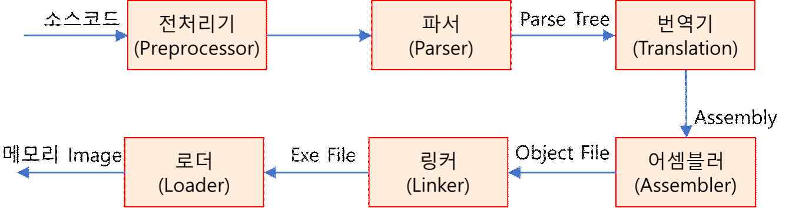

출처: 집필진 제작(2025)
[그림 1-1] 컴파일 언어의 빌드 과정
2. 바이트 코드(Byte Code) 언어(Java, C# 등)
바이트 코드(Byte Code) 언어는 컴파일의 결과물이 실행 파일이 아닌 ‘class’라는 바
이트 코드 파일로 생성되고 가상 실행 환경인 JRE(Java Runtime Environment),
CLI(Common Language Infrastructure)에서 한 줄씩 실행하는 방식으로 빌드된다.
JRE, CLI 환경에서 실행될 때 기계어로 변환되며, 컴파일 언어에 비해 빌드 과정이 빠
르다.

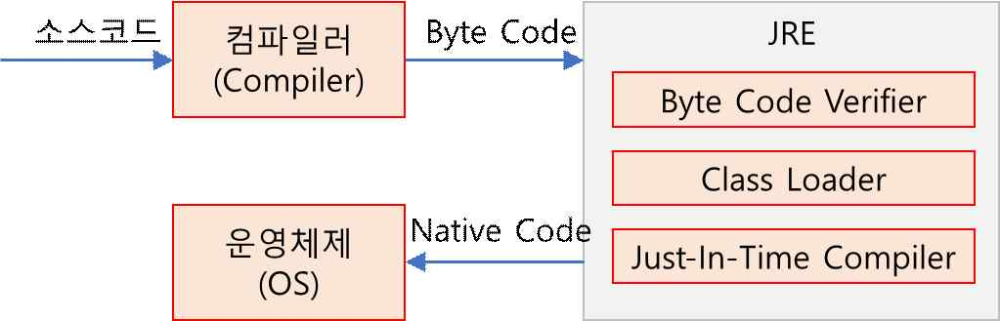

출처: 집필진 제작(2025)
[그림 1-2] Byte Code 언어의 빌드 과정
3. 인터프리터 언어(Javascript, Python, Ruby 등)
인터프리터 언어는 컴파일 언어와 다르게 한 줄씩 번역되어 실행된다. 인터프리터 언어
는 컴파일하는 과정에서 메모리가 훨씬 적게 소모되고 빠른 시간에 컴파일을 진행할
수 있다.

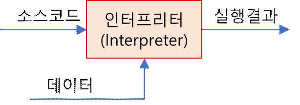

출처: 집필진 제작(2025)
[그림 1-3] 인터프리터 언어의 빌드 과정
• 애플리케이션 배포(Release) 환경
애플리케이션 배포는 개발자 또는 사용자가 애플리케이션을 실행, 테스트할 수 있도록 컴
파일된 프로그램, 실행에 필요한 리소스(이미지, 환경 설정 파일 등)를 서버상의 적합한 위
치로 이동하는 작업을 말한다. 그러므로 애플리케이션 배포는 해당 애플리케이션의 동작
환경의 영향을 받는다. 웹 애플리케이션의 경우 웹 서버, WAS(Web Application Server)
를 동작 환경으로 사용한다.
1. 웹 서버(Web Server)
사용자의 http 요청을 받아 웹 컨테이터에 요청을 전달하고 결괏값을 받아와 사용자에
게 전송하는 역할을 수행한다. 애플리케이션 배포 시 이미지, 단순 HTML과 같은 정적
인 리소스를 배포하며, 정적 리소스를 빠르고 안정적으로 처리한다.
2. WAS(Web Application Server: 웹 애플리케이션 서버)
사용자의 요청을 받아 동적인 처리를 수행하는 프로그램 실행 부분을 배포한다. WAS
구성 및 운용을 위한 국제 표준 규격을 정하고 있으며, 제품마다 배포 방식과 설정이
일부 다르다. 웹 애플리케이션의 경우 UI 배포 영역(JSP, Servlet 등)과 Biz. 배포 영역
(EJB, POJO 서비스 등)으로 구분되어 있다.
수행 내용 / 애플리케이션 배포 환경 구성하기
재료·자료
• 애플리케이션 개발 환경 구성도
• 애플리케이션 배포 대상, 배포 항목
• 애플리케이션 형상관리 지침서
• 애플리케이션 배포 절차 설명서
• 애플리케이션 형상관리 도구 매뉴얼
• 애플리케이션 빌드 도구 매뉴얼
• 애플리케이션 배포 도구 매뉴얼
기기(장비･공구)
• 애플리케이션 배포 환경: 형상관리 도구, 빌드 도구, 배포 도구 등
• 전산 장비: 인터넷, 컴퓨터, 프린터, 복사기, 빔 프로젝터 등
• 지원 도구: 문서 작성 도구 등
• OA소프트웨어: 워드프로세서, 스프레드시트, 프레젠테이션 도구 등
안전･유의 사항
• 응용SW애플리케이션 아키텍처와 개발 환경에 대한 이해를 바탕으로 빌드와 배포 환경
을 구성해야 한다.
• 응용SW 개발 환경의 형상관리 도구와 빌드･배포 도구 등에 대한 이해를 바탕으로 자
동화 도구를 활용하여 애플리케이션 배포 업무를 수행할 수 있어야 한다.
• 응용SW의 개발 언어, 환경, 플랫폼, 아키텍처에 따라 빌드 및 배포 절차와 방법이 달
라질 수 있으므로 다양한 환경에 적용할 수 있도록 지속적인 학습이 필요하다.
수행 순서
• 프로젝트의 배포 관리 요건을 분석하고 배포 환경 구성 방안을 계획한다.
프로젝트에서 개발하는 애플리케이션의 배포 대상, 리소스 유형, 배포 방식 등 배포 관리
요건을 분석하고, 빌드, 배포를 위한 환경 구성 방안을 계획한다.
1. 프로젝트의 애플리케이션의 기술적인 특성을 확인하고 배포 방식을 정의한다.
(1) 애플리케이션의 개발 언어를 확인한다.
프로젝트에서 개발 중인 애플리케이션의 개발 언어와 버전을 확인하고, 해당 개발
언어에서 사용되는 컴파일과 배포 방식을 확인한다.
(2) 프로젝트에 적용되어 있는 개발 도구, 개발 환경을 확인한다.
프로젝트에서 사용 중인 개발 도구, 개발 프레임워크(Spring 프레임워크, 전자정부
표준 프레임워크, 상용 프레임워크 등)를 확인하고, 개발 프레임워크에서 제공하는
프로그램 관리, 컴파일 방식을 확인한다. 특히 상용 프레임워크의 경우 별도의 프로
그램 관리, 컴파일 방식을 제공하는 경우가 많으므로 주의한다.
(3) 애플리케이션의 유형을 확인한다.
애플리케이션의 유형(모바일 앱, 웹기반 시스템, C/S기반 시스템 등)을 확인하고,
해당 유형에 맞는 배포 방식을 확인하며, 프로젝트에 도입된 애플리케이션 운영 환
경(웹 서버, WAS 등)의 배포 대상 디렉터리를 확인한다.

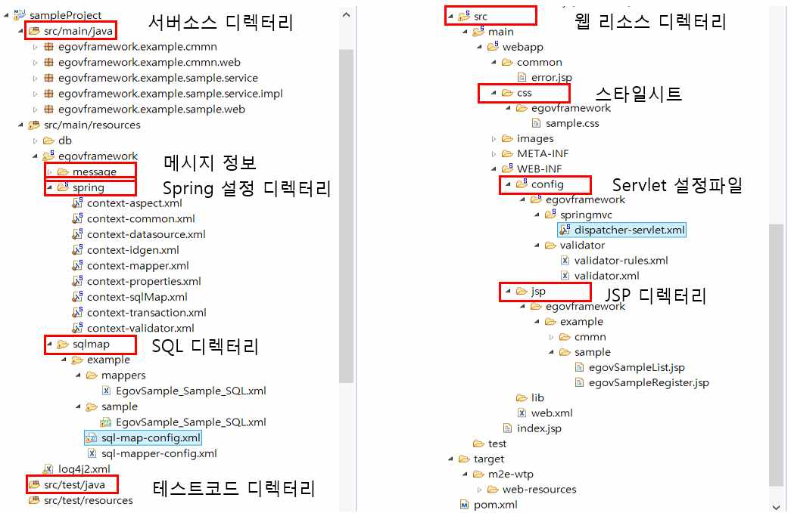

출처: 교육부(2021). 애플리케이션 배포(LM2001020214_19v5). 한국직업능력연구원. p.08.
[그림 1-4] Java 기반 웹 기반 시스템의 디렉터리 구성(예시)(Spring 프레임워크 사용)
(4) 배포 대상 리소스의 유형을 확인한다.
프로젝트에서 설계한 배포 정의서를 통해서 애플리케이션의 배포 단위(jar, war,
ear 등)를 확인한다.
<표 1-1> 패키지/배포 정의서(웹) 예시
패키지/배포 정의서 (웹)

| 작성일 |  | 작성자 |  |
| --- | --- | --- | --- |

No 웹 애플리케이션명 기능 패키지명 Type 파일명 경로명
예약 ncs.reservation. /reservation/
1 reservation JSP searchAvailable.jsp
조회 research research
2 JSP listAvailable.jsp
예약 ncs.reservation. /reservation/
3 JSP addReservation.jsp
등록 rsvmanage rsvmanage
목록
4 JSP listReserve.jsp
조회
(5) 배포 대상 리소스 유형을 확인한다.
애플리케이션 배포 시 필요한 배포 대상 리소스의 유형을 확인하고 유형별 배포 방
식을 정의한다.
<표 1-2> 리소스 유형별 배포 방식 정의(예시)
리소스 유형 배포 방식
이미지
웹 리소스 웹 서버상 해당 경로로 복사
HTML
웹단 프로그램 war로 패키징 후 복사
서버단 프로그램 jar로 패키징 후 복사
프로그램
배치 프로그램 컴파일 후 class 파일로 복사
인터페이스 전문 XML 파일 형태로 복사
프레임워크 설정 프레임워크 관리자가 직접 작업
공통 코드 코드 정보를 파일로 작성 후 배포
공통
라이브러리 jar로 패키징 후 복사
환경 설정 파일 XML 파일 형태로 복사
출처: 교육부(2021). 애플리케이션 배포(LM2001020214_19v5). 한국직업능력연구원. p.09.
(6) 배포 시 연계하여 처리하고자 하는 프로젝트 요건을 확인한다.
프로젝트에 따라 프로그램을 빌드, 배포하는 과정에서 소스코드 점검 및 테스트를
병행하여 처리할 수 있다. 해당 점검, 테스트 도구를 적용해야 하는 요건이 있는지
확인하고, 또한 빌드, 배포 도구와 연계가 가능한지 확인한다. 특히 프로젝트에서
개발 중에 초기 단계부터 지속적인 통합 및 배포 요건인 CI(Continuous Integrati
on) 환경 구성이 필요한지 확인한다.
2. 개발하려는 애플리케이션의 인프라 환경을 확인하고 배포 대상 서버를 확인한다.
(1) 개발하려는 애플리케이션의 서버 구성 환경을 확인한다.
일반적으로 개발 서버, 운영 서버로 구성되는데, 중요 애플리케이션의 경우 중간에
테스트 서버가 추가되고, 특히 안정적인 운영이 강조되는 사이트에서는 연수 서버,
재해복구 서버(DR: Disaster Recovery) 등이 추가되기도 한다. 배포 대상 서버 환
경이 추가되는 경우 빌드, 배포 작업도 별도로 작성되어야 한다.
(2) 리소스 유형별 배포 대상 서버를 확인한다.
일반적으로 애플리케이션 소스코드는 소스 형상관리시스템을 통해서 형상을 관리하
고 배포하지만, 특수한 패키지 솔루션(solution)에 의해서 관리되는 리소스(예: 비즈
니스 Rule 관리 솔루션상의 Rule 변경 사항, 전문 관리 솔루션상의 전문 XML 변
경 사항 등)의 경우 별도의 배포 대상으로 구분하여 관리되어야 한다.
(3) 분산 배포 대상을 확인한다.
애플리케이션의 사용 특성을 파악하고, 특정 리소스(화면, 전문 등)를 여러 서버에
동시에 일괄 배포해야 하는 요건이 있는지 확인한다.
(4) 통합 빌드 배포 구성도를 작성한다.
애플리케이션의 특성, 프로젝트의 빌드 요건 및 인프라 구성 환경 확인 결과 정리된
내역을 기반으로 배포 구성도를 작성하고, 누락된 사항이 없는지 확인한다.

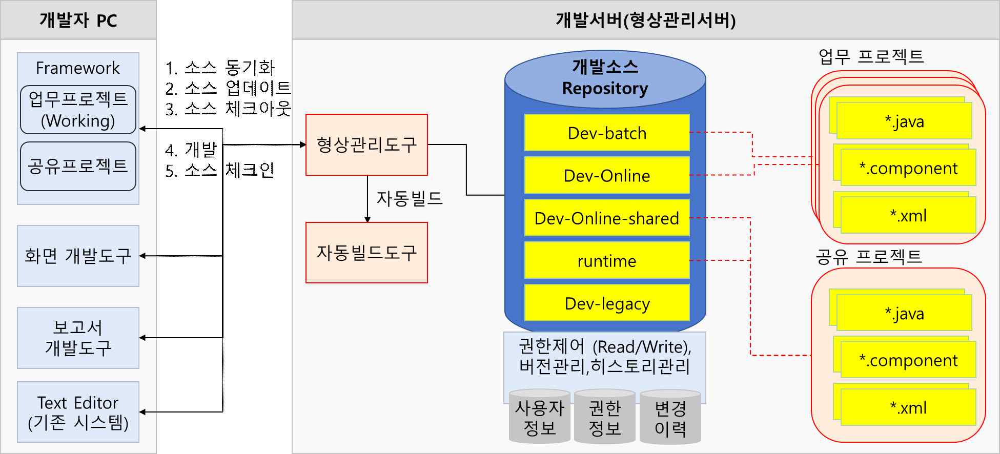

출처: 집필진 제작(2025)
[그림 1-5] 배포 구성도 작성(예시)
• 애플리케이션 배포를 위한 도구와 시스템을 선정한다.
프로젝트의 빌드, 배포 요건, 애플리케이션의 개발 특성 및 리소스 유형을 기반으로 애플
리케이션 빌드, 배포를 위해 적합한 도구를 선정한다.
1. 소스 형상관리 도구를 선정한다.
소스 형상관리 도구는 애플리케이션 빌드, 배포를 하기 위한 가장 중요한 관리 도구이
다. 발주처에서 표준으로 정의하고 사용이 가능하도록 제공하는 형상관리 도구가 있는
경우에는 해당 도구를 사용하면 된다. 일반적으로 애플리케이션 개발 기간 중에는 일시
적인 사용과 비용 측면을 고려하여 오픈소스 기반의 형상관리 도구(예: Maven, CVS,
Subversion 등)를 사용하고, 배포 이후 운영 환경에서는 안정적인 운영을 위하여 상용
형상관리 도구를 도입하여 사용한다.
2. 빌드 도구를 선정한다.
애플리케이션 빌드, 배포 스크립트 작성을 위한 빌드 도구를 선정한다. 빌드 도구는 일
반적으로 도입된 개발 도구상에 임베디드 되어 제공되는데, 프로젝트 차원의 전체적인
통합 빌드 수행을 위해서는 별도의 빌드 도구를 사용해야 한다. 개발 언어, 개발 도구
별로 표준적으로 사용하는 빌드 도구가 정의되어 있으며, 해당 기준에 맞추어서 빌드
도구를 선정한다(예: Java Eclipse 개발 환경 Ant 빌드 도구 내장).
3. 빌드 스케줄 관리 도구를 선정한다.
지속적인 통합, 빌드 환경의 구성이 필요한 경우 빌드 스케줄 도구를 사용한다. 빌드
스케줄 도구도 빌드 도구에 맞추어서 표준적으로 사용되는 도구가 있으며, 해당 도구를
선정한다. 상용 형상관리 도구의 경우 내부에 빌드 스케줄 기능을 내장하고 있다.
4. 테스트 도구를 선정한다.
통합 빌드, 배포 과정 중 자동화된 테스트 수행이 필요한 경우 테스트 도구를 선정한
다. 테스트 도구 선정 시에는 해당 테스트 도구가 사용하는 빌드 도구, 형상관리 도구
와 연계가 가능한지, 호환성을 제공하는 버전인지 확인한다. 테스트 도구는 테스트 대
상별로(화면 모듈, 서버 모듈, DB처리 모듈, 인터페이스 모듈 등) 여러 유형이 존재하
며, 반영하고자 하는 범위에서 선정한다.
5. 검토 대상 코드 인스펙션 점검 도구를 파악한다.
프로젝트에 적용이 가능한 코드 인스펙션 점검 도구를 조사한다. 발주사 또는 운영 중인
시스템에서 사용 중인 코드 인스펙션 점검 도구가 있거나 RFP(Request for Proposal)
상에 명시된 도구가 있다면, 해당 도구를 우선적으로 사용할 수 있는지 확인한다.
6. 애플리케이션 개발에 적합한 코드 인스펙션 점검 도구를 선정한다.
프로젝트 상황에 맞는 코드 인스펙션 점검 도구를 선정한다. 오픈소스 기반의 도구를
사용하고자 하는 경우에는 해당 도구의 기술 지원이 가능한 인력의 존재 여부를 판단
해야 한다. 상용 제품을 도입하는 경우 프로젝트 기간 중 적절한 지원이 가능하도록 기
술 지원 사항을 포함하여 선정한다.
수행 tip
•개발자의 소스코드 작성 품질 향상 및 개발 생산성 향
상을 위해서 개발 초기부터 통합 빌드, 배포 체계를 구
성하여 진행하는 것이 효과적이다.
•통합 빌드 및 배포 주기는 프로젝트 상황에 따라 지정
할 수 있는데, 보통 2주~1개월 이내로 정하며, 프로젝
트 기간이 짧은 경우 배포 주기를 좀 더 짧게 가져갈
수 있다.
1-2.
애플리케이션 배포 환경 설정
•결정한 애플리케이션 배포 환경을 위한 도구와 시스템을 설치할 수 있다.
학습 목표
•설치한 시스템과 도구 운영을 위해 상세 구성 및 설정을 할 수 있다.
필요 지식 /
• 애플리케이션 배포 단위
애플리케이션은 배포 시 단순히 컴파일된 실행 파일 또는 Byte Code를 복사하는 방식 이
외에 다양한 단위로 묶음, 패키징을 통해서 배포할 수 있다. Java의 경우 jar, war, ear
등의 방식으로 패키징하여 배포할 수 있다.
1. jar(Java Archive)
Java 라이브러리, 리소스, property 파일들을 포함한다. 프로그램에서 참조하는 라이브
러리, 구현된 비즈니스 서비스를 배포할 때 jar 단위로 패키징하여 배포한다.
2. war(Web Archive)
웹 컨테이너에 배포되는 배포 형식으로 Servlet, jar 파일과 WEB-INF 폴더에 있는
web.xml 파일로 구성된다. 웹 컨테이너상에 배포되어 독립적인 UI단 웹 애플리케이션
서비스를 제공할 수 있다.
3. ear(Enterprise Archive)
jar와 war를 묶어서 하나의 완성된 웹 애플리케이션 서비스를 제공할 수 있다.
• 형상관리(Configuration Management) 시스템
형상관리 시스템은 서비스 제공 대상 형상 항목을 식별하여 기준선(Baseline)을 설정하고,
형상 항목 변경 과정에서 점검, 검증 등의 체계적인 통제를 통해 형상 항목 간의 일관성과
추적성을 확보하기 위한 시스템이다. 형상관리 시스템은 소프트웨어의 개발 및 운영/유지･
보수에 필요한 문서 관리, 변경 관리, 버전 관리, 배포 관리 및 작업 산출물에 대한 형상
관리를 포함한다.
1. 형상관리의 범위
형상관리 범위는 신규 프로젝트 및 보완 개발, 업무 시스템의 운영/유지･보수, 전산 설
비 및 시스템 소프트웨어 등과 관련된 작업, 사용자(EUC: End User Computing) 파
일 관리 등을 포함한다.
2. 형상관리 시스템에서 사용하는 용어
(1) 형상관리(Configuration Management)
소프트웨어의 전체 생명 주기, 즉 계획부터 개발, 운영, 유지･보수, 폐기까지 발생하
는 모든 활동을 지속적으로 관리하는 것을 의미한다. 이를 위해서는 형상 항목들에
대해 식별 표시를 붙여 추적이 가능하게 만들고, 형상 항목들에 대한 변경을 제어하
고 관리하는 프로세스가 필요하다.
(2) 형상 항목(Configuration Item)
형상관리 대상이 되는 항목을 의미하며, 유일한 식별자가 부여되어 개별적으로 관리
되는 소스 파일, 문서, 기타 사항 등이 포함된다.
(3) 기준선(Baseline)
공식적으로 검토되고 협의되어 향후 기준이 되는 형상 항목의 집합체를 의미한다.
(4) 마이그레이션(Migration)
개발 완료된 시스템이 운영 단계로 전환될 때 관련 소스 파일을 저장 공간(리포지터
리)으로 이관시키는 작업을 의미한다.
(5) 리포지터리(Repository)
관리 대상을 형상관리시스템으로 일괄 전송하여 압축, 암호화한 후에 저장, 관리하
는 저장 공간을 의미한다. 일반적으로 업무 또는 디렉터리 단위로 구성된다.
(6) 워크플로(Workflow)
형상관리 활동을 수행하기 위해 미리 정해진 절차가 형상관리시스템 안에 구현되어
있는 것을 의미한다.
(7) 반출(Check Out)
형상 항목을 변경하기 위해 형상 리포지터리로부터 전송받는 것을 의미한다. 반출된
형상 항목에 대해서는 잠금 상태가 유지된다.
(8) 반입(Check In)
반출된 형상 항목을 변경 후 다시 형상 리포지터리로 전송하는 것을 의미한다. 반입
시 버전 관리는 자동적으로 이루어진다.
수행 내용 / 애플리케이션 배포 환경 설정하기
재료·자료
• 애플리케이션 개발 환경 구성도
• 애플리케이션 배포 대상, 배포 항목
• 애플리케이션 형상관리 지침서
• 애플리케이션 배포 절차 설명서
• 애플리케이션 형상관리 도구 매뉴얼
• 애플리케이션 빌드 도구 매뉴얼
• 애플리케이션 배포 도구 매뉴얼
기기(장비･공구)
• 애플리케이션 배포환경: 형상관리 도구, 빌드 도구, 배포 도구 등
• 전산 장비: 인터넷, 컴퓨터, 프린터, 복사기, 빔 프로젝터 등
• 지원 도구: 문서 작성 도구 등
• OA소프트웨어: 워드프로세서, 스프레드시트, 프레젠테이션 도구 등
안전･유의 사항
• 응용SW애플리케이션 아키텍처와 개발 환경에 대한 이해를 바탕으로 빌드와 배포 환경
을 구성해야 한다.
• 응용SW 개발 환경의 형상관리 도구와 빌드･배포 도구 등에 대한 이해를 바탕으로 자
동화 도구를 활용하여 애플리케이션 배포 업무를 수행할 수 있어야 한다.
• 응용SW의 개발 언어, 환경, 플랫폼, 아키텍처에 따라 빌드 및 배포 절차와 방법이 달
라질 수 있으므로 다양한 환경에 적용할 수 있도록 지속적인 학습이 필요하다.
수행 순서
• 애플리케이션 배포를 위한 도구와 시스템을 설치한다.
애플리케이션 배포를 위해 빌드·배포 환경을 정의하고 선정된 도구를 설치한다.
1. 빌드·배포 환경을 정의한다.
프로젝트의 빌드 요건, 인프라 환경, 선정된 빌드·배포 도구를 바탕으로 빌드·배포 환
경 구성을 정의한다. 기정의된 프로젝트 개발 환경과 연계 방식, 빌드·배포 도구의 역
할 및 빌드, 배포 작업 참여자를 정의한다.

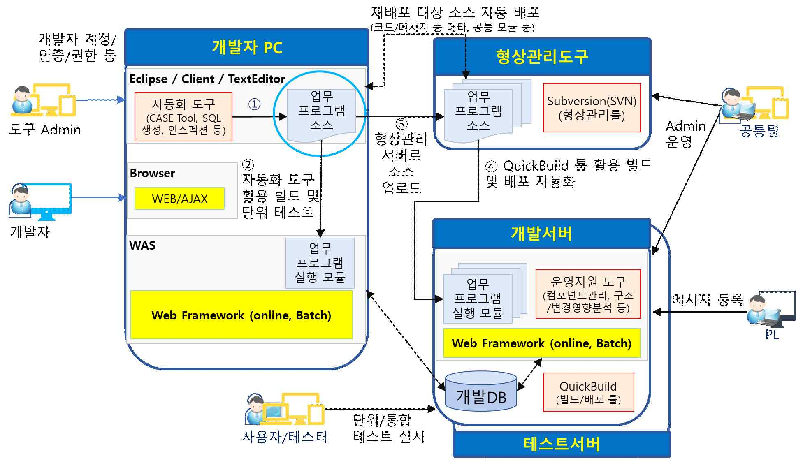

출처: 집필진 제작(2025)
[그림 1-6] 배포 환경 구성(예시)
2. 선정된 빌드·배포 도구를 설치한다(서버단).
빌드·배포 서버로 정의된 서버에 선정된 빌드·배포 도구를 설치하고, 연결 URL을 통해
서 정상적으로 동작하는지를 확인한다. 빌드 스케줄러 도구의 경우, 별도 웹 서버를 기
동시켜야 하는 경우가 있으므로 웹 서버 기동 후 관리자 접근 가능 여부를 확인한다.
3. 선정된 빌드·배포 도구를 설치한다(클라이언트단).
개발자의 개발 환경에 배포되어야 하는 Agent, 플러그인이 있는 경우 해당 도구를 배
포하고 모든 개발자가 설치하도록 한다. 설치 시 발생 가능한 주요 오류 사항은 조치
가능한 가이드를 작성하여 제공한다.
•애플리케이션 개발 기간(개발 프로젝트) 중 적용할 배포 절차 및 역할을 정의한다.
1. 애플리케이션 개발 기간 중 사용할 배포 유형 및 기준을 정의한다.
애플리케이션 개발 중에 프로젝트에서 사용할 애플리케이션 배포 유형을 정의하고 유형
별 관리 기준, 수행 절차를 정의한다.
<표 1-3> 애플리케이션 배포 유형 사례
구분 적용 상황 수행 절차
개발자가 직접 즉시 배포 또는 관리자, PL의 최
긴급 적용 장애나 오류 발생 시
소한의 확인만 수행
개발, 수정된 프로그램에 대 관리자, PL 확인 및 배포 관리자 확인, 테스트
일반 적용
한 일반적인 적용 수행 결과물 확인
주기적으로 전체 개발 내역
배포 관리자가 애플리케이션 전체 소스를 일괄하
통합 빌드 을 확인･점검하는 경우
여 빌드･배포 후 점검 보고서 추출
(2주~1개월)
출처: 교육부(2021). 애플리케이션 배포(LM2001020214_19v5). 한국직업능력연구원. p.13.
2. 애플리케이션 개발 기간 중 사용할 애플리케이션 배포 절차를 정의한다.
애플리케이션 배포 절차를 정의하고, 각 단계에서 수행할 작업을 상세화한다. 일반적으
로 애플리케이션 배포 절차는 개발 단계별로 변경되므로 구현 단계, 테스트 단계, 안정
화 단계, 운영 단계로 구분하여 정리한다.

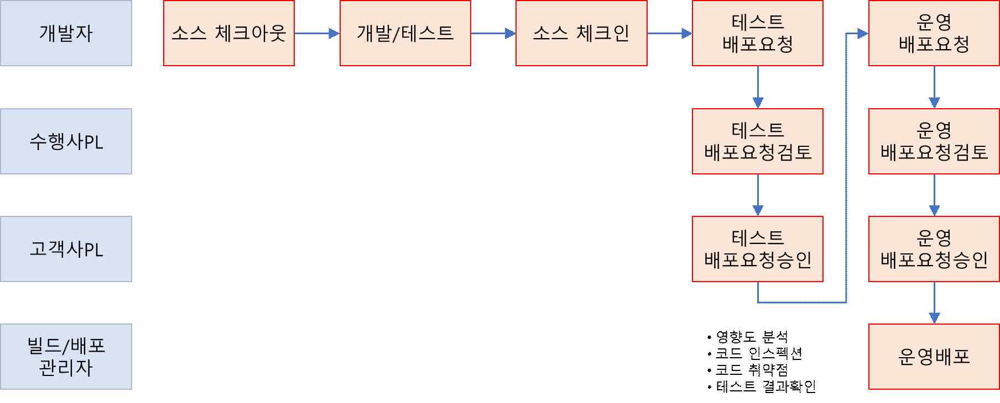

출처: 집필진 제작(2025)
[그림 1-7] 배포 절차(예시)
3. 애플리케이션 개발 기간 중 배포를 위한 관계자들의 역할과 책임을 정의한다.
<표 1-4> 애플리케이션 배포 관계자의 R&R(예시)
담당자 역할과 책임
∙ 빌드, 배포 환경 구성 및 운영
∙ 빌드 스크립트 작성 및 테스트
배포
∙ 빌드, 배포 내역 오류 확인
관리자
∙ 배포 요청 내역 검토 및 오류 확인
∙ 주기적 통합 빌드 및 배포 수행
∙ 빌드, 배포 보고서 확인
프로젝트 (테스트 수행 결과, 소스코드 품질 결과 확인 후 오류 사항 조치 요청)
PM, PL ∙ 개발 진척도 관리
∙ 테스트 케이스 작성 내역 검토
∙ 테스트 케이스 작성 및 관리
∙ 개별 모듈 수시 빌드 및 배포
개발자 ∙ 빌드, 배포 내역 정상 여부 확인
∙ 빌드, 배포 보고서 내 테스트 오류 내역, 소스코드 품질 수정 내역 확인 후 오
류 수정
출처: 교육부(2021). 애플리케이션 배포(LM2001020214_19v5). 한국직업능력연구원. p.14.
수행 tip
•대형 프로젝트의 경우 빌드, 배포 작업에 많은 공수가
소요되며, 진행 시 이슈 발생 가능성이 높으므로 구현
단계에서는 별도의 빌드 담당자의 공수를 확보하는 것
이 필요하다.
•빌드, 배포 도구 선정 시 사용 사례가 많고 안정적인
도구를 사용하는 것이 필요하며, 상용 솔루션(solution)
을 도입했다고 하더라도 프로젝트 요건, 상황에 맞지
않는 부분이 있으므로 세부 내용 확인 후 커스터마이징
을 진행한다.

| 학습 1 | 교수·학습 방법 |
| --- | --- |

교수 방법
• 프로젝트의 애플리케이션의 기술적인 특성에 따라 배포 방식을 달리함을 비교·설명한다.
• 애플리케이션 빌드, 배포를 위해 요구되는 형상관리 도구, 테스트 도구, 빌드 도구 등을
기능별로 분류하여 설명한다.
• 형상관리의 범위와 형상관리시스템 기능에 대한 이해를 돕기 위해 관련 상용 솔루션
(solution)을 시연한다.
• 애플리케이션 배포 절차를 정의하고 애플리케이션 배포를 위한 프로젝트 관계자들의 역
할과 책임을 설정하도록 지도한다.
학습 방법
• 프로젝트의 애플리케이션 기술적인 특성에 따라 상이한 배포 방식을 비교·분석한다.
• 애플리케이션 빌드, 배포를 위해 요구되는 형상관리 도구, 테스트 도구, 빌드 도구 등의
기능을 숙지하고 관련 오픈소스 솔루션(solution) 및 상용 솔루션을 조사한다.
• 형상관리시스템에 사용되는 용어를 정확히 이해하고 형상관리의 범위와 형상관리시스
템 기능에 대해 숙지한다.
• 애플리케이션 배포 절차를 파악하고 애플리케이션 배포를 위한 프로젝트 관계자들의 역
할과 책임을 정리한다.

| 학습 1 | 평 가 |
| --- | --- |

평가 준거
• 평가자는 학습자가 학습 목표를 성공적으로 달성하였는지를 평가해야 한다.
• 평가자는 다음 사항을 평가해야 한다.

| 학습 내용 | 학습 목표 | 성취수준 |  |  |
| --- | --- | --- | --- | --- |
|  |  | 상 | 중 | 하 |

- 애플리케이션 빌드와 배포를 위한 환경 구성 방안을 계획
애플리케이션 할 수 있다.
배포 환경 구성
- 애플리케이션 배포를 위한 도구와 시스템을 결정할 수 있다.
- 결정한 애플리케이션 배포 환경을 위한 도구와 시스템을
설치할 수 있다.
애플리케이션
배포 환경 설정
- 설치한 시스템과 도구 운영을 위해 상세 구성 및 설정을
할 수 있다.
평가 방법
• 서술형 시험

| 학습 내용 | 평가 항목 | 성취수준 |  |  |
| --- | --- | --- | --- | --- |
|  |  | 상 | 중 | 하 |

- 애플리케이션 빌드･배포 프로세스에 대한 이해 정도
- 프로젝트의 애플리케이션 기술적인 특성에 따른 배포 방
애플리케이션
식 차이에 대한 이해 정도
배포 환경 구성
- 애플리케이션 빌드･배포를 위해 요구되는 형상관리 도구,
테스트 도구, 빌드 도구 등에 대한 기능 이해 정도
- 형상관리시스템에서 사용되는 용어, 형상관리 범위에 대
한 이해 정도
애플리케이션 - 애플리케이션 배포를 위한 프로젝트 관계자들의 역할과
배포 환경 설정 책임 판별 정도
- 애플리케이션 빌드, 배포 과정에서 각 단계별로 작성이
요구되는 문서들에 대한 이해 정도
• 평가자 질문

| 학습 내용 | 평가 항목 | 성취수준 |  |  |
| --- | --- | --- | --- | --- |
|  |  | 상 | 중 | 하 |

| 애플리케이션 배포 환경 구성 애플리케이션 배포 환경 설정 피드백 | - 애플리케이션 빌드･배포 프로세스에 대한 이해 정도 - 애플리케이션 빌드･배포를 위해 요구되는 형상관리 도구,테스트 도구, 빌드 도구 등에 대한 기능 판별 여부 - 형상관리시스템에서 사용되는 용어, 형상관리 범위에 대한 숙지 정도 - 애플리케이션 배포를 위한 프로젝트 관계자들의 역할과책임 이해 정도 - 애플리케이션 빌드, 배포 과정에서 각 단계별로 작성이요구되는 문서들의 종류 파악 능력 |  |  |  |
| --- | --- | --- | --- | --- |
| 1. 서술형 시험- 배포 환경- 빌드와 배포에달성할 수- 시험 답안을 | 구성과 설정에 부합하는 요소를 식별하고 분석할 수 있는 지식이대한 서술 내용을 평가하고 미진한 부분을 학습자가 재학습하여있도록 한다. 평가한 후 전체적으로 미흡한 부분에 대해서는 주요 사항을 | 있는지표시하여 | 확인한다.학습 | 목표를설명해 |
| 준다. |  |  |  |  |
| 2. 평가자 질문- 질문에 대한해 보고, - 형상관리시스템,시연을 통해 | 답변을 못하거나 답변이 충분하지 못할 경우에는 다른 학습자에게전체적으로 답변이 충분하지 못한 경우에는 충분한 자료로 보충테스트 도구 등에 대한 이해가 부족할 때에는 해당 상용이해를 높여 준다. | 설명한다. | 답변을솔루션(solution) | 유도 |

학습 1 애플리케이션 배포 환경 구성하기

| 학습 2 | 애플리케이션 소스 검증하기 |
| --- | --- |

학습 3 애플리케이션 빌드하기
학습 4 애플리케이션 배포하기
2-1.
애플리케이션 소스 확인
•정상적으로 작동하는 소프트웨어 빌드를 위해 형상관리 서버로부터 소스코드를 체크아웃할 수
학습 목표
있다.
필요 지식 /
• 코드 인스펙션(Code Inspection)
코드 인스펙션은 정적 테스트의 가장 일반적인 유형으로, 사전에 정의된 코드 작성 규칙
(Rule) 기반으로 소스코드를 점검하여 작성 규칙에 위반되는 소스코드를 추출하는 분석 도
구로 애플리케이션 개발 시 대부분 사용되며, 빌드 도구와 연계하여 빌드·배포 수행 시 자
동적으로 점검할 수 있다.
1. 코드 인스펙션 Rule 유형
(1) 성능 개선
애플리케이션의 성능에 영향을 미칠 수 있는 코드를 점검하는 Rule이다. 메모리 누
수, 미사용 변수, 메서드 여부 등을 확인하여 메모리를 낭비하는 코드를 식별한다.
(2) 코드 작성 규칙
개발 언어에서 사전에 정의된 작성 규칙 또는 프로젝트 내에서 정의된 프로그램 명
명 규칙의 준수 여부를 점검하는 Rule이다. 작성 규칙을 미준수한 코드 내역을 추
출하여 소스코드의 가독성을 높인다.
(3) 에러 발생 가능성
애플리케이션 동작 중 에러 발생 가능성이 있는 코드를 점검하는 Rule이다.

| 학습 내용 | 평가 항목 | 성취수준 |  |  |
| --- | --- | --- | --- | --- |
| 2. 코드 작성 Rule | 심각도 구분(예시) |  |  |  |
| (1) 필수, Blocker에러 발생야 하는 위반 | 가능성이 매우 높거나 메모리 누수가 발생되는 코드로,사항을 말한다. | 반드시 |  | 수정되어 |
| (2) 권고상, Critical에러 발생 | 가능성이 높거나 일반적으로 수정되어야 하는 심각한 위반 |  | 사항을 | 말한다. |
| (3) 권고중, Major에러 발생이 | 있거나 수정을 권고하는 중요 위반 사항을 말한다. |  |  |  |
| (4) 권고하, Minor소스코드의 | 가독성, 유지·보수성 향상을 위해 수정을 권고하는 위반 | 사항을 |  | 말한다. |
| (5) 정보, Info.정보성으로 | 제공되는 위반 사항으로 개발자가 참고하여 적용할 수 | 있다. |  |  |
| 3. 정규 표현식(Regular정규 표현식은코드 인스펙션용을 수정해서<표 2-1> 정규 표현식메타 문자 의미. 문자[] [^] 부정^ 처음$ 끝() \n n* 0회m회{m, n} n회출처: 교육부(2021). | Expression) 특정한 규칙을 가진 문자열의 집합을 표현하는 범용적인도구의 코드 작성 규칙은 일반적으로 정규식으로 표현되며,점검 Rule의 내용을 수정할 수 있다. 기본 문법(예시) 설명 1개의 문자와 일치한다. 단일행 모드에서는 새 줄"["과 "]" 사이의 문자 중 하나를 선택한다. "¦" 를과 같은 의미이다. 예를 들면 [abc]d는 ad,문자클래스 또 "-" 기호와 함께 쓰면 범위를 지정할 수 있다.터 z까지 중 하나를 의미하고, "[1-9]"는 1부터를 의미한다. 클래스 안의 문자를 제외한 나머지를 선택한다.[^abc]d는 ad, bd, cd는 포함하지 않고 ed, fd[^a-z]는 알파벳 소문자로 시작하지 않는 모든문자열이나 행의 처음을 의미한다. 문자열이나 행의 끝을 의미한다. 여러 식을 하나로 묶을 수 있다. "abc¦dc" 와하위식 미를 가진다. 일치하는 일치하는 패턴들 중 n번째를 선택하며, 여기에서번째 패턴 중 하나가 올 수 있다. 0개 이상의 문자를 포함한다. "a*b"는 "b", "ab",이상 를 포함한다. 이상 a{1,3}b" 는 "ab", "aab", "aaab"를 포함하지만,이하 포함하지 않는다. 애플리케이션 배포(LM2001020214_19v5). 한국직업능력연구원. | 문자를여러bd, cd를9까지등을문자를"a(b¦)c"는n은"aab","b"나p.20. | 방식을정규식의제외한다.개 쓴뜻한다."[a-z]"는중의예를포함한다.의미한다.같은1에서"aaab""aaaab"는 | 말한다.내것 a부 하나 들면 의 9 |

수행 내용 / 애플리케이션 소스 확인하기
재료·자료
• 소스코드 검증 지침
• 소스코드 검증 도구 매뉴얼
• 애플리케이션 형상관리 지침서
• 애플리케이션 형상관리 도구 매뉴얼
기기(장비･공구)
• 애플리케이션 배포 환경: 형상관리 도구
• 애플리케이션 검증 도구: 정적 소스코드 분석 도구, 동적 소스코드 분석 도구 등
• 전산 장비: 인터넷, 컴퓨터, 프린터, 복사기, 빔 프로젝터 등
• 지원 도구: 문서 작성 도구 등
• OA소프트웨어: 워드프로세서, 스프레드시트, 프레젠테이션 도구 등
안전･유의 사항
• 소스코드 검증 기법에 대한 이해를 바탕으로 소스코드 검증 도구 사용 방법을 실습할
수 있어야 한다.
• 응용SW 개발 환경의 형상관리 도구와 빌드·배포 도구 등에 대한 이해를 바탕으로 자
동화 도구를 활용하여 애플리케이션 배포 업무를 수행할 수 있어야 한다.
• 응용SW의 개발 언어, 환경, 플랫폼, 아키텍처에 따라 빌드·배포 절차와 방법이 달라질
수 있으므로 다양한 환경에 적용할 수 있도록 지속적인 학습이 필요하다.
수행 순서
• 코드 인스펙션 점검 Rule을 정의한다.
1. 선정된 코드 인스펙션 점검 도구에서 제공되는 점검 Rule을 확인한다.
코드 인스펙션 점검 도구는 제품에 내장되어 있는 점검 Rule을 갖고 있다. 기본으로
제공되는 점검 Rule의 내용, 가이드 사항, 심각도, Rule 유형 등을 확인한다.
<표 2-2> Java 점검 Rule(예시)
유형 심각도 Rule명 오류 코드 예시
".equals()" should not be used to
Bug Blocker test the values of "Atomic" if (aInt1.equals(aInt2)) { ... }
classes
Code "@Override" annotation should be
Major public boolean doSomething(){...}
Smell used on any method overriding
try {
s = File.ReadAllText(fileName);
}
C o d e "catch" clauses should do more
Major catch (Exception e) {
Smell than rethrow
// Noncompliant
throw e;
}
for (;;) { // Noncompliant; end
condition omitted
Bug Blocker Loops should not be infinite
// ...
}
출처: 교육부(2021). 애플리케이션 배포(LM2001020214_19v5). 한국직업능력연구원. p.23.
2. 애플리케이션에 정의된 개발 표준을 바탕으로 추가･보완할 점검 Rule이 없는지 확인한다. 일
반적으로 코딩 점검 도구에서 기본으로 제공하는 점검 Rule을 동일하게 반영하지만, 대형 프
로젝트 또는 개발 도구, 프레임워크에 의해서 특정 함수를 필수로 사용해야 하는 경우 또는 애
플리케이션 내의 명명 규칙 준수 여부를 체크하기 위해서 점검 Rule을 새롭게 추가, 변경한다.
<표 2-3> 점검 Rule 추가 요건 사례
Rule명 심각도 Rule 점검 요건
주민번호 하드 소스코드 내에 주민번호 식별값을 갖는 내용이 하드 코딩되어
필수
코딩 위반 있으면 위반 표시
배치 프로그램 내 특정 Glpost(), LnkOutput(), LogOutput(), Message_Set() 함
필수
함수 사용 금지 수 사용 금지 처리
Update 시 특정 칼럼 Update 처리 시 시스템 공통 칼럼 updateDate, updateUser
중요
작성 누락 칼럼이 반드시 포함되도록 처리
공통 프로그램 내 특정
필수 CMTMSET(), TRCMSET(), ERRMSET()
함수 사용 금지
출처: 교육부(2021). 애플리케이션 배포(LM2001020214_19v5). 한국직업능력연구원. p.23.
3. 추가·보완이 필요한 점검 Rule을 추가･수정하여 반영한다.
점검 Rule 검토 결과, 추가･수정이 필요한 Rule에 대해 변경 사항을 반영한다. 변경
Rule이 정규식 변경으로 처리가 가능한 경우에는 해당 정규식 내용을 수정한다. 반영
하려는 점검 Rule의 내용이 복잡한 경우에는 별도 개발을 진행한다.
4. 코드 인스펙션 점검 수행을 위한 수행 절차를 정의한다.
(1) 코드 인스펙션 점검 방식을 정의한다.
코드 인스펙션의 경우 개발자가 개발 도구상에서 특정 소스만 점검할 수 있고, 애플
리케이션 배포 단계에서 사전 점검으로 점검할 수 있다. 마지막으로, 코드 인스펙션
담당자가 전체 소스를 대상으로 사후 일괄 점검을 수행할 수도 있다. 각각의 점검
방식 중 해당 애플리케이션 개발 시 적용할 코드 인스펙션 점검 방식을 선정한다.
(2) 코드 인스펙션 점검 주기를 정의한다.
코드 인스펙션 담당자가 전체 소스에 대해서 사후 일괄 점검을 수행하는 경우 일괄
점검 주기를 정의한다. 사후 일괄 점검은 구현 상황에 따라서 달라질 수 있는데, 개
발 표준과 상이한 개발자의 개발 습관을 파악하여 코딩 규칙 준수를 하도록 개발
초기부터 적용하는 것이 중요하고, 2주~1개월 주기로 주기적인 사후 일괄 점검이
필요하다.
(3) 코드 인스펙션 점검 수행 절차를 정의한다.
사전에 정의된 애플리케이션 배포 절차에 코드 인스펙션 점검 단계를 추가하는 방
식으로 코드 인스펙션 점검 절차를 정의한다. 코드 인스펙션 점검의 경우 애플리케
이션이 서버에 배포되기 전에 점검되어 오류 사항이 보완될 수 있도록 한다.

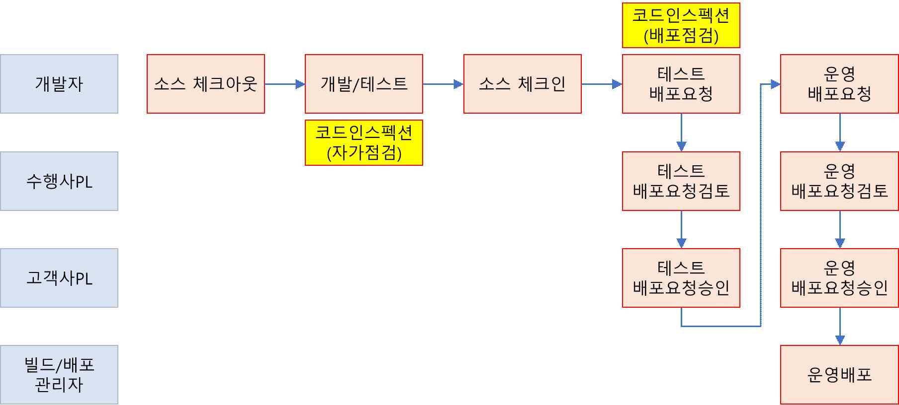

출처: 집필진 제작(2025)
[그림 2-1] 애플리케이션 배포 절차(예시)(코드 인스펙션 점검 단계 추가)
• 변경 대상이 되는 애플리케이션 소스를 형상관리 서버로부터 반출(Check Out)한다.
1. 변경이 요구되는 대상 응용 프로그램, 개편 일정 등을 종합적으로 정리한 개편 계획서를 작
성하여 관리자의 승인을 받는다. 이때 개편 유형에 따라 설계계획서, 설계검토의뢰서, 구축
계획서, 구축검토의뢰서 등을 선별적으로 함께 작성한다.
2. 변경이 요구되는 자원(응용 프로그램 소스 등)을 반출하기 위한 반출의뢰서를 작성하여 관리
자의 승인을 받은 후 반출(Check Out)한다.
변경 영향 분석 시 식별된 형상관리 항목에 대해 형상관리자에게 반출 요청을 하여 수
정할 자원의 최종 버전을 반출한다.

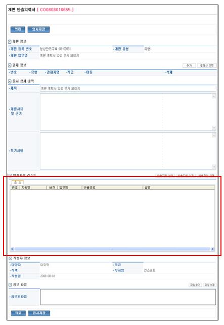

출처: 교육부(2021). 애플리케이션 배포(LM2001020214_19v5). 한국직업능력연구원. p.25.
[그림 2-2] 반출의뢰서(예시)
수행 tip
•정상적으로 작동하는지 테스트 케이스 작성 대상의 경우
대내외 인터페이스가 필요하거나, 복잡한 업무 수행 절차
에 따라 생성되는 데이터가 필요한 경우 사전에 환경 준
비가 필요하므로 지속적인 테스트가 어려울 수 있다.
2-2.
애플리케이션 소스 검증
•소스코드 검증 도구를 활용하여 애플리케이션에서 사용한 라이브러리, 소스, 로직 등의 오류가
있는지를 검증할 수 있다.
학습 목표
•소스코드의 환경 설정, 운영 환경 정보, 대상 시스템 정보 등에 오류가 있는지 확인할 수
있다.
필요 지식 /
• 소스코드 검증 도구
1. 검증 도구의 구분
소스코드 검증 도구는 구현된 SW를 실행하지 않고 테스트하는 정적 테스트 도구와 구
현된 SW를 실행하여 동작을 보면서 테스트하는 동적 테스트 도구로 구분한다.

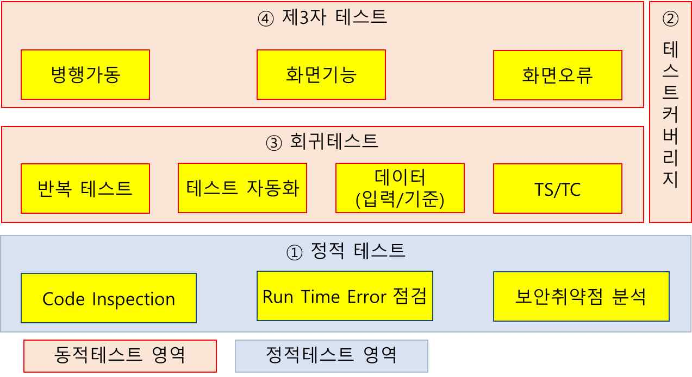

출처: 집필진 제작(2025)
[그림 2-3] 소스코드 검증 도구 구분
2. 소스코드 검증 도구의 용도
(1) 정적 테스트 도구 사용 목적
정적 테스트 도구는 테스트하기 전에 코딩 오류, 성능 저하, 보안 취약점 등의 결함
을 조기에 발견할 수 있도록 지원한다. 이렇게 함으로써 개발의 생산성을 높이고,
운영 환경에서 프로그램의 품질을 향상하며, 정량적인 품질 관리시스템을 구축하게
한다.
(2) 동적 테스트 도구 사용 목적
테스트 미수행 코드를 확인하고 분기(결정)문 등 특정 유형의 코드 구조가 충분히
테스트되었는지를 확인하여 추가적인 테스트를 진행함으로써 애플리케이션의 안정성
을 높이고, 소스 품질 관리(통제) 활동을 할 수 있는 정량적인 품질 관리시스템을
구축할 수 있게 한다.
• 테스트 프레임워크(동적 분석 도구)의 구성
테스트 프레임워크는 테스트 케이스를 별도의 테스트 코드로 작성하고 동작시킬 수 있는
환경을 제공하는 도구로, 개발자의 반복적이고 시간이 많이 소요되는 테스트 작업을 자동
화하여 테스트에 소요되는 시간과 노력을 절감할 수 있게 한다.
1. 테스트 프레임워크의 구성
(1) 테스트 코드
테스트를 수행할 코드 작성 및 자동화된 운영 환경을 구성한다. 빌드 도구와 연계하
여 빌드 수행 시 해당 테스트 코드를 동작시켜 자동화된 테스트 환경을 제공한다.
(2) 테스트 저장소
테스트 수행을 위한 테스트 코드, 테스트 데이터, 관련 테스트 스크립트, 테스트 수
행 결과를 저장, 관리한다.
2. Junit 테스트 프레임워크
Java, 오픈소스 기반의 테스트 프레임워크로 Java 개발 환경의 범용적인 표준으로 사
용되며(Eclipse 개발 도구에 기본 내장 기능), 다음과 같이 테스트 가능한 Assert 함수
를 제공한다.
<표 2-4> Junit Assert 구문
제공 함수 설명
assertArrayEquals(a,b) 배열 a와 b가 일치함을 확인
assertEquals(a,b) 객체 a와 b가 일치함을 확인
assertSame(a,b) 객체 a와 b가 같은 객체임을 확인
assertTrue(a) a값이 참인지 확인
assertNotNull(a) 객체 a가 null이 아님을 확인
출처: 교육부(2021). 애플리케이션 배포(LM2001020214_19v5). 한국직업능력연구원. p.21.
수행 내용 / 애플리케이션 소스 검증하기
재료·자료
• 소스코드 검증 지침
• 소스코드 검증 도구 매뉴얼
• 애플리케이션 형상관리 지침서
• 애플리케이션 형상관리 도구 매뉴얼
기기(장비･공구)
• 애플리케이션 배포 환경: 형상관리 도구
• 애플리케이션 검증 도구: 정적 소스코드 분석 도구, 동적 소스코드 분석 도구 등
• 전산 장비: 인터넷, 컴퓨터, 프린터, 복사기, 빔 프로젝터 등
• 지원 도구: 문서 작성 도구 등
• OA소프트웨어: 워드프로세서, 스프레드시트, 프레젠테이션 도구 등
안전･유의 사항
• 소스코드 검증 기법에 대한 이해를 바탕으로 소스코드 검증 도구 사용 방법을 실습할
수 있어야 한다.
• 응용SW 개발 환경의 형상관리 도구와 빌드·배포 도구 등에 대한 이해를 바탕으로 자
동화 도구를 활용하여 애플리케이션 배포 업무를 수행할 수 있어야 한다.
• 응용SW의 개발 언어, 환경, 플랫폼, 아키텍처에 따라 빌드·배포 절차와 방법이 달라질
수 있으므로 다양한 환경에 적용할 수 있도록 지속적인 학습이 필요하다.
수행 순서
• 코드 인스펙션을 수행하고 점검 결과를 검증한다.
1. 배포 대상인 애플리케이션에 대해서 코드 인스펙션을 수행한다.
코드 인스펙션 도구를 적용하기 전에 점검 Rule에 의한 점검 결과가 정확한지 확인해
야 한다. 코드 인스펙션 담당자는 개발된 전체 소스를 대상으로 코드 인스펙션 점검을
수행하고, 코딩 Rule 위반 사항을 추출하여 개발 팀에 확인을 요청한다.
<표 2-5> 코드 인스펙션 위반 내역(예시)
Rule명 소스명 위반 내역
포인터 변수의
/EFB/sro/EFB10000.c BSFOPen (lt_BSFCOUNT, ...
sizeof 금지
빈함수 점검 /ECL/sco/ECL10001.c {}
SELECT* 사용 금지 /DDC/DBIO/DDC1400.sql SELECT * ...
미사용 로컬 함수 /FIM/sro/FIM50003.c long lt_Term ...
출처: 교육부(2021). 애플리케이션 배포(LM2001020214_19v5). 한국직업능력연구원. p.26.
2. 코드 인스펙션 결과를 확인하고 오탐(False Positive) 여부를 확인한다.
(1) 코드 인스펙션 결과를 확인한다.
개발자는 코드 인스펙션 결과를 보고 위반 내역이 정확한지 확인한다. 오탐이 있거
나 예외 처리가 필요한 경우 수정을 요청한다.
(2) 개발자의 예외 요청 사항, 검증 내역을 피드백 받는다.
코드 인스펙션 담당자는 개발 팀의 오탐 내역, 예외 요청을 접수하여 오탐 내역이
맞는지 확인한다. 예외 요청이 필요한 사항에 대한 패턴을 파악하고 예외 사항을 코
드 인스펙션 도구에 반영한다.
<표 2-6> 코드 인스펙션 예외 요청 사항 처리(예시)
Rule명 예외 요청 사항 대상 소스
포인터 변수의 프레임워크 자동 생성 프로그램 프로그램 경로 중 lib 폴더 내
sizeof 금지 에 대해 대상 제외 필요 프로그램
고객 발송용 이메일 프로그램으
하드 코딩 문구(URL) 고객 이메일 프로그램
로 URL 사용 필요
INSERT문 내 대상 칼 초기 데이터 이행용 프로그램에
데이터 이행 프로그램
럼을 명시하지 않음 대해서 적용 제외 필요
출처: 교육부(2021). 애플리케이션 배포(LM2001020214_19v5). 한국직업능력연구원. p.26.
3. 전체 적용 대상 점검 Rule을 대상으로 심각도, 적용 유무 등 관리 기준을 정의한다.
적용 대상 점검 Rule과 Rule별 위반 내역 건수를 확인하고, 해당 애플리케이션 개발
시 적용할 Rule과 반드시 수정해야 하는 심각도 수준을 정의한다. 정보성, 권고 이하의
심각도의 경우 코딩 규칙 위반 정도가 낮으므로 필수 조치 대상에서 제외할 수 있다.
4. 오탐이거나 보완이 필요한 Rule에 대해 수정한다.
코드 인스펙션 담당자는 검토 결과 오탐 또는 보완이 필요한 것으로 식별된 점검 Rule
에 대해서는 오류 원인을 확인하고, 해당 점검 Rule의 내용을 수정한다. Rule 수정 후
위반 내역 점검 결과가 정확한지 재차 확인한 후 반영한다.
• 코드 인스펙션 점검 결과를 반영한 Rule을 가이드하고 개발 조직이 반영하게 한다.
1. 개발 팀을 대상으로 코드 인스펙션 점검 결과를 반영한 Rule을 가이드한다.
코드 인스펙션 점검 Rule이 확정되면, 코드 인스펙션 담당자는 점검 Rule을 정리하여
개발 팀에 가이드한다. Rule별 상세 설명 및 정상 사례, 오류 사례를 실제 코드를 통
해서 제시하여 개발자가 해당 내용을 보고 코드 수정이 가능하도록 제시한다.
<표 2-7> 코드 인스펙션 점검 Rule 가이드(예시)
Rule명 정상 사례 오류 사례 Rule 상세 설명
if (i > 0 ) { if (i > 0 ) {
totalCnt = xCount; totalCnt = xCount; if/else 구문 등에 빈 블록
} } 이 작성되면 에러 발생 시
빈함수 점검
else { else { 찾을 수 없는 로직상의 오
return false; // 류가 발생됨
} }
switch(i) {
case 1: switch(i) {
switch문에는 항상 default
dosomething(); case 1:
switch문에서 문을 추가해야 함.
break; dosomething();
Default 사용 default 문이 없는 경우, 예
default break;
권장 외 사항 발생 시 예기치 않
...
은 결과 발생 가능함
break; }
}
INSERT 시 시 INSERT ... 시스템 공통 칼럼 누락 시
INSERT ...
스템 공통 칼럼 sysdate 테이블의 등록, 변경 시간
누락 userid 추적이 불가함
출처: 교육부(2021). 애플리케이션 배포(LM2001020214_19v5). 한국직업능력연구원. p.27.
2. 코드 인스펙션 점검 결과를 파악하고 개발 조직에 전달한다.
코드 인스펙션 점검 Rule이 보완, 확정된 후 코드 인스펙션 담당자는 정해진 주기, 기
준에 맞추어서 코드 인스펙션을 수행하고, 그 점검 결과를 개발 팀에 전달한다. 코드
인스펙션 도구에 따라서 별도의 웹 페이지를 통해서 코드 인스펙션 점검 결과를 보여
줄 수 있다.

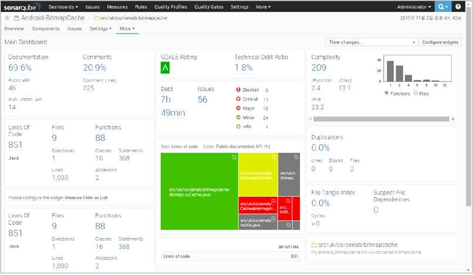

출처: 교육부(2021). 애플리케이션 배포(LM2001020214_19v5). 한국직업능력연구원. p.28.
[그림 2-4] 코드 인스펙션 점검 결과(예시)
3. 개발 조직의 주요 위반 사항을 정리하여 준수 사항 가이드를 작성, 전달한다.
코드 인스펙션 담당자는 점검 결과 위반 빈도가 높은 주요 코딩 작성 규칙에 대해서
정리하여 개발 조직에게 전달하고 가이드한다.
• 도입된 테스트 프레임워크를 기반으로 테스트 코드를 작성하고 테스트를 수행한다.
1. 테스트 코드 작성 기준을 정의한다.
애플리케이션 개발 시 적용한 테스트 코드 작성 기준을 프로젝트의 기간, 진행 상황,
프로그램 중요도, 테스트 유형 등을 고려하여 정의한다. 반복적으로 테스트가 가능한
부분과 가능하지 않은 부분을 구분하여 기준을 명확히 하고, 구현 단계를 수행하기 전
에 개발자에게 가이드한다.
2. 테스트 코드를 작성한다.
개발자는 테스트하려는 프로그램에 적합한 테스트 코드를 작성한다. 프로그램 내의 테
스트하려는 함수의 기능과 발생 가능한 상황에 대해서 테스트 케이스를 작성한다.
<표 2-8> 테스트 케이스 작성(예시)
Junit 테스트 케이스 작성 예시
public class FileReaderTest {
FileReader _input = null;
@Before
public void setUp() throws Exception {
try {
_input = new FileReader("C:/Temp/data.txt");
} catch (FileNotFoundException e) {
throw new RuntimeException ("Cannot open the TXT File");
}
}
@Test
public void testRead() throws IOException {
char ch = '&';
for (int i=0; i<4; i++)
ch = (char)_input.read();
assert('d'==ch);
assertEquals('d',ch);
}
@After
public void tearDown() throws Exception {
try {
_input.close();
} catch (IOException e) {
throw new RuntimeException ("Error in closing TXT File");
}
}
}
출처: 교육부(2021). 애플리케이션 배포(LM2001020214_19v5). 한국직업능력연구원. p.29.
3. 작성한 테스트 코드를 실행한다.
테스트 프레임워크의 실행 기능을 사용하여 테스트 코드를 실행시키고 정상 동작 여부
를 확인한다. 테스트를 통과하지 못한 경우 오류 내역, 오류 라인을 확인하고 소스코드
를 수정한다. 개발자는 프로그램 개발, 디버깅 및 리팩토링 과정 중에 계속해서 테스트
코드를 실행하여 프로그램의 기능 완성도를 확인한다.

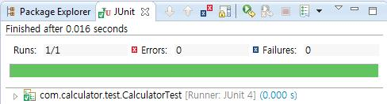

출처: 교육부(2021). 애플리케이션 배포(LM2001020214_19v5). 한국직업능력연구원. p.29.
[그림 2-5] Junit 테스트 케이스 실행 사례
수행 tip
•코드 인스펙션의 경우 사용자의 보안 이슈, 정부 정책
에 의한 작성 기준이 추가될 수 있다. 코드 인스펙션
기준 수립 시 관련 요건을 충분히 취합하여 해당 항목
이 누락되지 않도록 주의한다.
•코드 인스펙션 점검 결과의 경우 점검 Rule이 소스코
드 내의 모든 케이스를 가정하고 작성되어 있지 않기
때문에 계속해서 오탐이 발생될 수 있다. 따라서 오탐
발생 시 해당 점검 Rule을 신속하게 수정하여 점검 결
과의 정확도를 높여야 한다.

| 학습 2 | 교수·학습 방법 |
| --- | --- |

교수 방법
• 형상관리시스템에 대한 이해를 기반으로 소스코드를 반출(Check Out)하는 과정과 반
입(Check In)하는 과정을 시연하고, 반입·반출 시 요구되는 반출의뢰서, 반입의뢰서
등의 실사례를 제시한다.
• 정적 소스코드 검증 도구 및 동적 소스코드 검증도구의 기능을 구분하여 설명하고 검
증 결과의 실사례를 보며 분석하도록 지도한다.
• 코드 인스펙션 점검 수행 절차를 정의하고 코드 인스펙션 점검 Rule에 대한 다양한 실
사례를 설명한다.
• 테스트 코드 작성 기준을 정의하고 테스트 코드를 작성하도록 지도한다.
학습 방법
• 형상관리시스템의 기능을 숙지하고 소스코드를 반출(Check Out)하는 과정과 반입
(Check In)하는 과정을 시행한다. 또 반입·반출 시 요구되는 반출의뢰서, 반입의뢰서
등의 실 실제 사례를 보며 반입·반출 시 요구되는 요소들을 파악한다.
• 정적 소스코드 검증 도구 및 동적 소스코드 검증 도구의 기능을 검증 결과의 실사례를
보며 숙지한다.
• 코드 인스펙션 점검 Rule을 다양한 실사례를 통해 이해한 후 코드 인스펙션을 시험한다.
• 테스트 코드 작성 기준을 이해하고 테스트 코드를 작성한다.

| 학습 2 | 평 가 |
| --- | --- |

평가 준거
• 평가자는 학습자가 학습 목표를 성공적으로 달성하였는지를 평가해야 한다.
• 평가자는 다음 사항을 평가해야 한다.

| 학습 내용 | 학습 목표 | 성취수준 |  |  |
| --- | --- | --- | --- | --- |
|  |  | 상 | 중 | 하 |

애플리케이션 소스 - 정상적으로 작동하는 소프트웨어 빌드를 위해 형상관리
확인 서버로부터 소스코드를 체크아웃할 수 있다.
- 소스코드 검증 도구를 활용하여 애플리케이션에서 사용한
라이브러리, 소스, 로직 등의 오류가 있는지를 검증할 수
애플리케이션 소스 있다.
검증
- 소스코드의 환경 설정, 운영 환경 정보, 대상 시스템 정
보 등에 오류가 있는지 확인할 수 있다.
평가 방법
• 서술형 시험

| 학습 내용 | 평가 항목 | 성취수준 |  |  |
| --- | --- | --- | --- | --- |
|  |  | 상 | 중 | 하 |

- 형상관리 시스템의 기능 및 체크인, 체크아웃 프로세스
이해 정도
애플리케이션
소스 확인
- 빌드·배포 과정에서 요구되는 계획서, 의뢰서, 검토의뢰
서의 종류 및 사용 용도에 대한 이해 정도
- 정적 소스코드 검증 도구에 대한 정의 및 기능에 대한
이해 정도
애플리케이션
- 동적 소스코드 검증 도구에 대한 정의 및 기능에 대한
소스 검증
이해 정도
- 코드 인스펙션 점검 Rule에 대한 숙지 정도
• 평가자 질문

| 학습 내용 | 평가 항목 | 성취수준 |  |  |
| --- | --- | --- | --- | --- |
|  |  | 상 | 중 | 하 |

- 형상관리 시스템의 기능 및 관련 용어에 대한 이해 정도
- 형상관리 시스템의 기능 및 체크인, 체크아웃 프로세스
애플리케이션
이해 정도
소스 확인
- 빌드·배포 과정에서 요구되는 계획서, 의뢰서, 검토의뢰
서의 종류 및 사용 용도에 대한 이해 정도
- 정적 소스코드 검증 도구에 대한 정의 및 기능에 대한
이해 정도
애플리케이션
- 동적 소스코드 검증 도구에 대한 정의 및 기능에 대한
소스 검증
이해 정도
- 코드 인스펙션 점검 Rule에 대한 숙지 정도
• 평가자 체크리스트

| 학습 내용 | 평가 항목 | 성취수준 |  |  |
| --- | --- | --- | --- | --- |
|  |  | 상 | 중 | 하 |

- 형상관리 시스템의 기능 및 체크인, 체크아웃 프로세스
이해 정도
애플리케이션
소스 확인
- 빌드·배포 과정에서 요구되는 계획서, 의뢰서, 검토 의뢰
서의 종류 및 사용 용도에 대한 이해 정도
- 정적 소스코드 검증 도구에 대한 정의 및 기능에 대한
이해 정도
애플리케이션
- 동적 소스코드 검증 도구에 대한 정의 및 기능에 대한
소스 검증
이해 정도
- 코드 인스펙션 점검 Rule에 대한 숙지 정도

| 학습 내용 | 평가 항목 | 성취수준 |  |  |
| --- | --- | --- | --- | --- |
| 피드백 |  |  |  |  |
| 1. 서술형 시험- 애플리케이션 | 소스 확인과 검증에 부합하는 요소를 식별하고 분석할 수 있는 | 지식이 |  | 있는지 |
| 확인한다.- 확인과 검증에달성할 수- 시험 답안을 | 대한 서술 내용을 평가하고 미진한 부분을 학습자가 재학습하여있도록 한다. 평가한 후 전체적으로 미흡한 부분에 대해서는 주요 사항을 | 표시하여 | 학습 | 목표를설명해 |
| 준다. |  |  |  |  |
| 2. 평가자 질문- 질문에 대한해 보고, - 정적 소스코드상용 | 답변을 못하거나 답변이 충분하지 못할 경우에는 다른 학습자에게전반적으로 이해가 부족한 경우에는 충분한 자료로 보충 설명한다.검증 도구, 동적 소스코드 검증 도구에 대한 이해가 부족한솔루션(solution) 프레젠테이션을 통해 이해를 높여 준다. |  | 답변을경우에는 | 유도해당 |
| 3. 평가자 체크리스트- 애플리케이션생들은 추가- 분석 결과를우, 모범 답안을- 학습자의 평가학습자의 실력 | 소스 검증 결과를 체크리스트 항목을 점검하여 평가하고, 답변이 가능하도록 지도하여 성취도 향상에 도움을 줄 수 있도록재작성할 시간이 부족할 경우 또는 학습자의 평가 결과가제시해서 부족한 부분을 보완할 수 있도록 한다. 결과가 ‘상’에 해당하는 경우, 다른 학습자들에게 평가 내용을향상에 도움을 줄 수 있도록 한다. | 성취수준이한다.‘하’에 | 낮은해당하는제공하여 | 학경다른 |

학습 1 애플리케이션 배포 환경 구성하기
학습 2 애플리케이션 소스 검증하기

| 학습 3 | 애플리케이션 빌드하기 |
| --- | --- |

학습 4 애플리케이션 배포하기
3-1.
애플리케이션 빌드 실행
•애플리케이션 소스코드 검증 결과 문제가 없는 경우 해당 소스코드를 빌드 시스템으로 이관할
수 있다.
학습 목표
•애플리케이션 빌드 절차에 따른 빌드 스크립트를 작성할 수 있다.
•작성한 빌드 스크립트 또는 도구를 활용하여 애플리케이션 빌드를 실행할 수 있다.
필요 지식 /
• 지속적인 통합(CI: Continuous Integration) 환경
애플리케이션 개발 과정 중 지속적으로 개발된 프로그램을 통합, 빌드, 배포하여 애플리케
이션의 개발 내역을 검증, 테스트할 수 있는 환경을 말한다. 통합 빌드 과정 중 테스트 도
구, 소스코드 품질 측정 도구 등과 연계할 수 있으며, 자동화된 스케줄 관리를 통해서 지
속적이고 반복적인 프로그램 빌드, 테스트를 진행할 수 있다.
1. 빌드 도구
애플리케이션의 배포 단위, 형식에 따라 소스코드를 컴파일, 패키징, 배포하는 스크립트
를 제공하고 수행하는 도구이다(Ant, Maven 등).
2. 테스트 도구
개발된 소스코드를 테스트할 수 있는 테스트 코드를 작성, 동작시킬 수 있는 도구로,
통합 빌드 수행 시 연결할 수 있다(Junit, DBUnit, StrutsTestCase 등).
3. 소스코드 품질 측정 도구(코드 인스펙션)
정해진 소스코드 작성 규칙에 따라 소스코드를 점검하고 규칙 위반 여부를 체크하는
도구로, 통합 빌드 수행 시 연결할 수 있다(PMD, FindBugs 등).
4. 테스트 커버리지 측정 도구
소스코드 내 테스트가 가능한 경로 중 테스트 도구를 통해서 테스트된 커버리지를 측정
하는 도구이다(Clover, JCoverage, ElcEmma 등).

| 학습 내용 | 평가 항목 | 성취수준 |  |  |
| --- | --- | --- | --- | --- |
| 5. 빌드 스케줄 관리작성된 빌드 는 도구이다(Anthill,• 테스트 커버리지 | 도구 스크립트를 정해진 조건, 시간에 기동하고 진행 상태,CruiseControl, Hudson 등). | 수행 | 결과를 | 관리하 |
| 1. 테스트 커버리지의테스트 커버리지는해 동작된 | 의미 전체 프로그램의 범위 대비 테스트 수행 시 해당프로그램의 범위 비율을 의미한다. | 테스트 | 수행을 | 위 |
| 2. 테스트 커버리지 | 측정 유형 |  |  |  |
| (1) 라인 커버리지(또는개발 소스의 | 구문 커버리지, Statement Coverage) 각 라인이 수행되었는지를 확인하는 측정 지표이다. |  |  |  |
| (2) 분기 개발 소스의if문에 대한 | 커버리지(Decision Coverage) 각 분기문이 수행되었는지를 확인하는 측정 지표이다.true/false 조건이 있다면, 두 가지 경우가 모두 | 만약테스트되어야 | 소스 | 내에100%로 |
| 측정된다. |  |  |  |  |
| (3) 조건 각 분기문 | 커버리지(Condition Coverage) 내에 존재하는 조건식이 모두 테스트 되었는지를 확인하는 |  | 측정 | 지표이 |
| 다. 조건식 | 간의 조합에 대해서는 체크하지 않는다. |  |  |  |

수행 내용 / 애플리케이션 빌드 실행하기
재료·자료
• 애플리케이션 빌드 지침서
• 애플리케이션 빌드 절차 설명서
• 애플리케이션 빌드 도구 매뉴얼
기기(장비･공구)
• 애플리케이션 배포 환경: 빌드 도구
• 전산 장비: 인터넷, 컴퓨터, 프린터, 복사기, 빔 프로젝터 등
• 지원 도구: 문서 작성 도구 등
• OA소프트웨어: 워드프로세서, 스프레드시트, 프레젠테이션 도구 등
안전･유의 사항
• 응용SW 개발 환경의 형상관리 도구와 빌드･배포 도구 등에 대한 이해를 바탕으로 자
동화 도구를 활용하여 애플리케이션 배포 업무를 수행할 수 있어야 한다.
• 응용SW의 개발 언어, 환경, 플랫폼, 아키텍처에 따라 빌드 및 배포 절차와 방법이 달
라질 수 있으므로 다양한 환경에 적용할 수 있도록 지속적인 학습이 필요하다.
수행 순서
• 애플리케이션 빌드 스크립트 작성을 위한 빌드 단위를 정의한다.
1. 애플리케이션 리소스 중 설치되는 부분과 배포되는 부분을 분리한다.
애플리케이션 리소스 중 애플리케이션 설치를 통해서 반영되는 부분(프레임워크 설치
영역, 애플리케이션 설정 영역 등)과 애플리케이션 배포 시 변경되는 부분(프로그램, 이
미지, 파일 등)을 구분한다. 애플리케이션 설치를 통해서 반영되는 부분에 대해서는 인
프라 담당자의 별도 설치, 변경 작업을 통해서 진행한다.
<표 3-1> 애플리케이션 대상 항목 정의(예시)
구분 대상 항목 상세 설명
화면 공통 화면 프로그램이 공통적으로 참조하는 스크립트
화면 화면 프로그램 사용자 화면을 구성하는 프로그램(HTML, JSP 등)
보고서 프로그램 보고서를 구성하는 프로그램(XML, REP 등)
온라인 프로그램 동작 시 공통적으로 참조하는 라
공통 라이브러리
이브러리
온라인 서비스를 수행하는 업무 로직이 포함된 프
온라인 프로그램
로그램
온라인
DB 프로그램 DB 처리를 위한 프로그램(DBIO, SQL 등)
애플리케이션 동작을 제어, 관리하기 위한 설정 파
환경 설정 파일
일 또는 프레임워크 설정 파일
배치 프로그램 배치 작업을 처리하는 프로그램
배치 작업 시 Input, Output 정보를 활용하는 작
SAM 파일
배치
업 파일
배치 프로그램 동작을 제어, 관리하기 위한 설정 파일
환경 설정 파일
또는 프레임워크 설정 파일
프로그램 내 업무 로직 처리의 기준 정보를 제공하
Rule 데이터
는 Rule 항목, 조건 정보
데이터
초기 데이터 프로그램 초기 기동을 위한 공통 코드 정보, 기준 정보
출처: 교육부(2021). 애플리케이션 배포(LM2001020214_19v5). 한국직업능력연구원. p.37.
2. 애플리케이션 배포를 위해서 공통적으로 우선 배포되어야 하는 부분을 분리한다.
모든 프로그램에서 공통적으로 참조하는 라이브러리 또는 공통 모듈이 있는 경우 해당
부분을 별도로 분리한다. 라이브러리 또는 공통 모듈은 애플리케이션 배포 시 우선적으
로 배포되어야 배포 후에 프로그램 오류를 예방할 수 있다.
3. 업무 모듈에 따라서 애플리케이션 배포 단위를 정의한다.
애플리케이션의 내부 업무 구분 단위에 따라서 애플리케이션 배포 단위를 세분화한다.
애플리케이션 배포는 각 프로그램별 배포도 가능하지만, 업무 기능 단위, 전체 애플리
케이션별로도 배포를 수행할 수 있어야 한다.

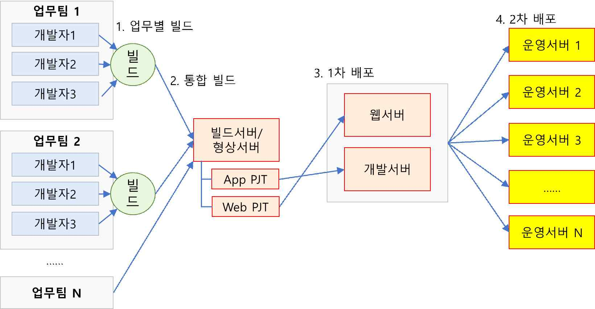

출처: 집필진 제작(2025)
[그림 3-1] 애플리케이션 배포 단위 구분(예시)
4. 다수 서버에 동시 배포해야 하는 배포 작업을 정의한다.
애플리케이션 배포 시 화면 또는 전문 정보와 같은 리소스를 동시에 여러 서버에 배포
해야 하는 작업을 구분한다. 동시 배포하는 작업에 대해서 단시간 내 신뢰성 있는 배포
작업이 필요한 경우 해당 기능에 대해서는 기능 구현 및 검증이 진행되어야 한다.
5. 빌드 수행 시 버전 규칙을 정의한다.
빌드 수행 시마다 해당 빌드 버전에 해당하는 버전을 결정하는 규칙을 정의한다. 일반
적으로 릴리즈 버전, 개발 버전을 분리하고 Major Change, Minor Change, Bug
Fix 유형을 구분하여 버전 체계를 정의한다.
• 애플리케이션 빌드 절차에 따라 빌드 스크립트를 작성한다.
1. 정해진 빌드 단위에 따라서 빌드 스크립트를 작성한다.
선정된 빌드 도구의 작성 기준, 작성 단위에 따라서 빌드 스크립트를 작성한다. 빌드
스크립트는 전체 애플리케이션 관점에서 통합, 전체 빌드가 필요한 경우에 작성되며,
개발자별 개별적인 빌드는 개발 도구에 내장된 빌드 도구를 사용한다.
<표 3-2> 빌드 스크립트 작성(예시)
빌드 스크립트 작성 예시
<!-- 빌드 대상 프로젝트 설정 -->
<project name="hello" default="compile">
<property name="outputdir" value="/ant/output/sample1" />
<!-- 빌드, 배포작업을 위한 작업 공간 설정 -->
<target name="prepare" >
<tstamp/>
<mkdir dir="${outputdir}/classes" />
</target>
<!-- 소스코드 컴파일 설정 -->
<target name="compile" depends="prepare" >
<javac srcdir="./xptoolkit" destdir="${outputdir}/classes" />
</target>
</project>
출처: 교육부(2021). 애플리케이션 배포(LM2001020214_19v5). 한국직업능력연구원. p.39.
2. 코드 인스펙션 도구를 빌드 스크립트에 연계한다.
빌드 스크립트에서 코드 인스펙션 연계 태그를 사용해서 코드 인스펙션 도구를 연결한
다. 소스 내에 코드 인스펙션 점검 대상별로 코드 인스펙션 <task>를 작성한다.
<표 3-3> 빌드 스크립트와 코드인스펙션 도구 연계(예시)
빌드 스크립트와 코드 인스펙션 도구 연계 예시
<!-- SonarQube project properties 설정 -->
<property name="sonar.projectKey" value="org.sonarqube:sonarqube-scanner-ant" />
<property name="sonar.projectName" value="Example of SonarQube Scanner for Ant
Usage" />
<property name="sonar.projectVersion" value="1.0" />
<property name="sonar.sources" value="src" />
<property name="sonar.java.binaries" value="build" />
<property name="sonar.java.libraries" value="lib/*.jar" />
...
<!-- SonarQube Scanner 수행 범위 설정 -->
<target name="sonar">
<taskdef uri="antlib:org.sonar.ant" resource="org/sonar/ant/antlib.xml">
<!-- Update the following line, or put the "sonarqube-ant-task-*.jar" file
in your "$HOME/.ant/lib" folder -->
<classpath path="path/to/sonar/ant/task/lib/sonarqube-ant-task-*.jar" />
</taskdef>
<!-- Execute SonarQube Scanner for Ant Analysis -->
<sonar:sonar />
</target>
...
출처: 교육부(2021). 애플리케이션 배포(LM2001020214_19v5). 한국직업능력연구원. p.40.
3. 테스트 도구를 빌드 스크립트에 연계한다.
빌드 스크립트에서 테스트 도구 연계 태그를 사용해서 테스트 도구를 연결한다. 소스코
드 내에 테스트 케이스 코드가 작성된 부분에 대해서 테스트 도구 <task>를 작성한다.
상용 제품을 사용하거나 선정된 빌드 도구에 따라서 연결 방식, 호환되는 버전이 상이
하므로 사전에 연결 방법, 호환성을 확인한 후 연계한다.
<표 3-4> 빌드 스크립트와 테스트 도구 연계(예시)
빌드 스크립트와 테스트 도구 연계 예시
<target name="test-junit" depends="compile" description="Runs JUnit tests">
<!-- Junit 테스트 동작 설정 -->
<condition property="junit.ok">
<and>
<available file="${junit.jar}"/>
<available file="${classes.dir}" type="dir"/>
</and>
</condition>
<fail unless="junit.ok">Missing pre-req JAR file for JUnit. Check
build.properties.</fail>
<!-- Junit 테스트 케이스 수행 대상 작성 -->
<junit failureproperty="testsFailed">
<classpath>
<pathelement path="${classpath}"/>
<pathelement path="${classes.dir}"/>
</classpath>
<test name="com.bedarra.continuousbuild.example.tests.junit.TestHello"/>
</junit>
</target>
출처: 교육부(2021). 애플리케이션 배포(LM2001020214_19v5). 한국직업능력연구원. p.41.
4. 테스트 커버리지 측정 도구를 빌드 스크립트에 연계한다.
빌드 스크립트에서 테스트 커버리지 측정 도구에 해당하는 연계 태그를 사용해서 테스
트 커버리지 측정 도구를 연결한다. 테스트 커버리지 측정 도구의 경우, 소스코드 컴파
일 시 해당 도구의 라이브러리를 참조하여 분석 로그를 남기게 되므로 컴파일 부분과
결과 리포팅 부분을 구분하여 작성한다.
<표 3-5> 빌드 스크립트와 테스트 커버리지 측정 도구 연계(예시)
빌드 스크립트와 테스트 커버리지 측정 도구 연계 예시
<taskdef resource="clovertasks"/> <!-- Clover Task 정의 -->
...
<!-- 소스 컴파일 시 Clover Tag 삽입, 커버리지 로그 설정 -->
<target name="with.clover">
<clover-setup initString="demo_coverage.db"/>
</target>
...
<!-- 컴파일 빌드 path에 clover.jar 설정 -->
<path id="build.classpath">
<pathelement path="$ {ant.home }/lib/clover.jar"/>
<pathelement path="$ {ant.home }/lib/junit.jar"/>
…
</path>
...
<!-- 결과 Report 출력 부분 정의 -->
<target name="report.html" depends="with.clover">
<clover-report>
<current outfile="clover_html" title="clover demo">
<format type="html"/>
</current>
</clover-report>
</target>
출처: 교육부(2021). 애플리케이션 배포(LM2001020214_19v5). 한국직업능력연구원. p.42.
5. 빌드 스케줄러 관리 도구를 설정한다.
빌드 스케줄러 설정을 통해서 자동화된 CI(Continuous Integration) 환경을 구성할
수 있다. 빌드 스케줄러 도구는 일반적으로 별도의 웹 페이지를 갖고 있으며, 설치 및
기동 후 해당 웹 페이지에 들어가서 해당 애플리케이션 개발 시 적용된 소스 형상관리
도구, 빌드 도구를 연결하여 빌드, 배포 작업을 설정하고 스케줄링한다.

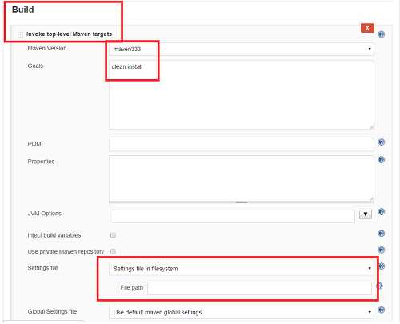

출처: 교육부(2021). 애플리케이션 배포(LM2001020214_19v5). 한국직업능력연구원. p.42.
[그림 3-2] 빌드 스케줄 관리 도구에서 빌드 도구 설정 사례
수행 tip
•빌드 도구와 테스트 도구, 코드 인스펙션 도구 등을 연
결하려는 경우 각 도구들의 버전, 연계 호환성을 사전
에 확인해야 한다. 오픈소스의 경우 빌드 도구 버전별
로 지원이 가능한 테스트 도구, 코드 인스펙션 도구의
버전이 제한된다.
3-2.
애플리케이션 실행 검증
•애플리케이션 빌드 실행 결과를 확인하여 정상적으로 완료되었는지를 확인할 수 있다.
학습 목표
•애플리케이션 빌드 실패 시 문제 내용과 원인을 파악하여 개발자에게 설명할 수 있다.
필요 지식 /
• 빌드 스케줄 관리 도구
1. 빌드 스케줄 관리 도구의 구성
빌드 스케줄 관리 도구는 별도의 웹 애플리케이션으로 구성되어 웹 서버상에 배포되고,
관리자 화면을 통해서 빌드 스크립트, 형상관리 도구 등과 연계되며, 이메일을 통해서
관련 개발자, 관리자들에게 빌드 수행 결과를 제공한다.
2. 빌드 스케줄 관리 도구의 기능
(1) 빌드 작업 스케줄링
빌드 작업의 작업 주기, 작업 시간을 설정한다.
(2) 빌드 작업 상태 및 이력 관리
등록된 빌드 작업의 진행 상태를 대기 중, 진행 중, 완료, 오류 유형으로 구분하여
수행 이력을 관리한다.
(3) 빌드 도구 연계 관리
빌드 작업 수행을 위해 기작성된 빌드 스크립트와 접근이 가능한 형상관리 도구를
연계 설정한다.
(4) 빌드 수행 결과 리포팅
빌드 수행 결과 오류 사항, 코드 인스펙션 점검 결과, 테스트 수행 결과 등을 웹 화
면을 통해서 보여 주고, 관련자들이 공유할 수 있도록 리포팅을 제공한다.
수행 내용 / 애플리케이션 실행 검증하기
재료·자료
• 애플리케이션 빌드 지침서
• 애플리케이션 빌드 절차 설명서
• 애플리케이션 빌드 도구 매뉴얼
기기(장비･공구)
• 애플리케이션 배포 환경: 빌드 도구
• 전산 장비: 인터넷, 컴퓨터, 프린터, 복사기, 빔 프로젝터 등
• 지원 도구: 문서 작성 도구 등
• OA소프트웨어: 워드프로세서, 스프레드시트, 프레젠테이션 도구 등
안전･유의 사항
• 응용SW 개발 환경의 형상관리 도구와 빌드･배포 도구 등에 대한 이해를 바탕으로 자
동화 도구를 활용하여 애플리케이션 배포 업무를 수행할 수 있어야 한다.
• 응용SW의 개발 언어, 환경, 플랫폼, 아키텍처에 따라 빌드 및 배포 절차와 방법이 달
라질 수 있으므로 다양한 환경에 적용할 수 있도록 지속적인 학습이 필요하다.
수행 순서
• 작성한 빌드 스크립트를 활용하여 애플리케이션 빌드를 수행하고 결과를 확인한다.
1. 개발자별 애플리케이션 빌드를 수행한다.
작성된 빌드 스크립트를 통해서 빌드, 배포를 수행한다. 개발자가 개별적인 개발 환경
에 배포하는 것은 개발 도구에 내장된 빌드 기능을 사용하여 수행한다. 개발 서버, 테
스트 서버 또는 운영 서버에 배포할 때에는 사전에 정의된 빌드･배포 절차에 따라서
배포 대상, 테스트 수행 결과를 확인한 후에 배포한다.
2. 애플리케이션 전체 통합 빌드를 수행한다.
애플리케이션 전체적인 개발 진척 사항, 소스코드 품질, 테스트 결과 확인을 위해서 애
플리케이션 전체 소스에 대해서 통합 빌드, 배포를 수행한다. 기작성된 빌드 스크립트
전체를 기동시키는 마스터 빌드 스크립트를 통해서 통합 빌드, 배포를 수행한다. 빌드
스케줄러 관리 도구가 도입된 경우 통합 빌드, 배포 주기를 설정하여 활용한다.
3. 빌드 결과를 확인한다.
도입된 빌드 도구, 빌드 스케줄 관리 도구의 콘솔 또는 로그 정보를 확인하여 빌드, 배
포의 성공 여부를 확인한다.

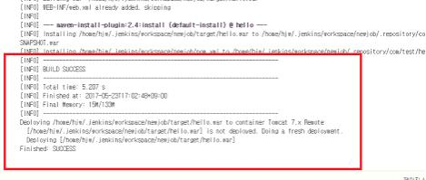

출처: 교육부(2021). 애플리케이션 배포(LM2001020214_19v5). 한국직업능력연구원. p.43.
[그림 3-3] 빌드 도구를 통한 빌드 성공 로그(예시)
4. 빌드 중 수행된 테스트 수행 결과를 확인한다.
빌드 수행 중 진행된 테스트 수행 결과를 확인하고, 오류 발생 내역을 개발 팀에게 전
달한다.

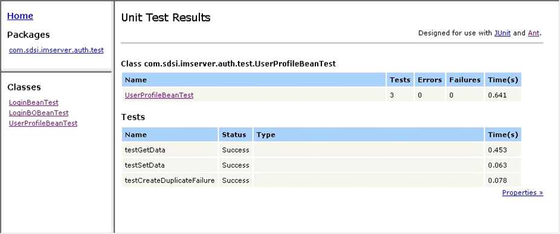

출처: 교육부(2021). 애플리케이션 배포(LM2001020214_19v5). 한국직업능력연구원. p.44.
[그림 3-4] 빌드 후 테스트 수행 결과 Report(예시)
5. 빌드 중 수행된 테스트 커버리지 결과를 확인한다.
빌드 중 수행된 테스트에 대한 소스코드 커버리지 결과를 확인하고 개발 팀과 공유한다.
테스트 커버리지가 낮은 프로그램에 대해서는 테스트 케이스 추가･보완을 요청한다.

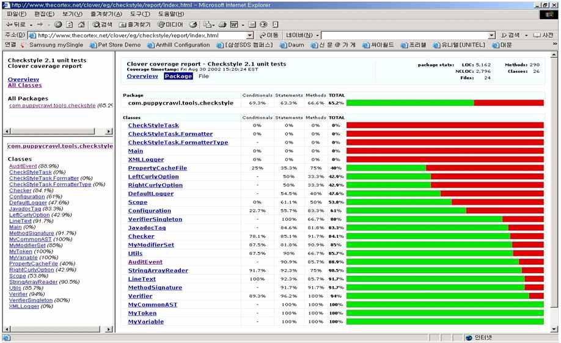

출처: 교육부(2021). 애플리케이션 배포(LM2001020214_19v5). 한국직업능력연구원. p.44.
[그림 3-5] 빌드 후 테스트 커버리지 측정 결과 Report(예시)
6. 빌드 중 수행된 코드 인스펙션 점검 결과를 확인한다.
빌드 중 수행된 코드 인스펙션 점검 결과를 확인하고 개발 팀과 공유한다. 해당 애플리
케이션 개발 시 필수적으로 조치하기로 한 중요 위반 사항에 대해서는 개발 팀에 수정
을 요청한다.

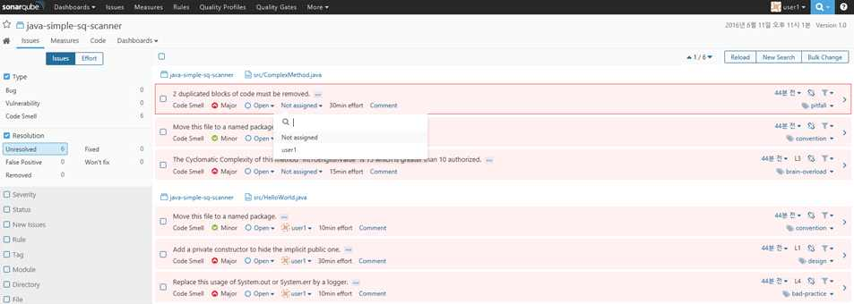

출처: 교육부(2021). 애플리케이션 배포(LM2001020214_19v5). 한국직업능력연구원. p.45.
[그림 3-6] 빌드 후 코드 인스펙션 점검 결과 Report(예시)
• 빌드 중 발생된 오류 사항을 확인하고 대응한다.
1. 빌드 중 발생된 오류 사항을 확인하고 원인을 분석한다.
빌드 중 오류가 발생된 경우 해당 로그 내용을 확인하고 오류 원인을 분석한다. 오류
원인이 소스코드 작성 오류이거나 개발자가 체크인을 완료하지 않아 발생된 경우 즉시
해당 오류 사항을 개발자에게 전달한다.
2. 오류 사항을 확인하고 대응한다.
개발자는 요청한 빌드 사항이 정상적으로 완료되었는지 확인하고, 빌드 중 오류가 발생
된 경우 해당 내역을 확인하고 수정 작업을 진행한다.
<표 3-6> 애플리케이션 빌드 시 주요 발생 오류 및 대응 방안(예시)
오류 대응 방안
개발자가 체크아웃 한 소스가 남아
빌드 작업 수행 전에 대상 소스를 모두 체크인 하도록 한다.
있는 경우
빌드 대상 소스코드 간 상호 참조 업무 모듈, 공통 모듈의 호출 기준을 정의하여 모듈 간 상호
가 발생되는 경우 참조 발생을 방지한다.
공통 파일, 환경 설정 파일에 대한 빌드 담당자가 빌드 작업 수행 전에 공통 파일, 환경 설정
오류 파일을 업데이트하도록 한다.
개발자가 개발을 완료하지 않고 체크인을 하거나 개발 표준
컴파일 자체 오류가 발생되는 경우 을 미인지하여 컴파일이 불가능한 경우로 해당 개발자에게
즉시 오류 수정을 요청한다.
출처: 교육부(2021). 애플리케이션 배포(LM2001020214_19v5). 한국직업능력연구원. p.45.
수행 tip
•빌드 도구, 소스 형상관리 도구 사용 미숙으로 인한 오
류가 자주 발생된다. 애플리케이션 빌드 작업 수행 전
에 개발자가 빌드 도구, 소스 형상관리 도구 사용법을
충분히 숙지하게 하고 상세한 사용 가이드를 작성하여
사전에 배포한다.
•빌드, 배포 대상 프로그램이 많은 경우 배포 시간이 오
래 소요된다. 예상되는 배포 시간을 개발자에게 사전에
공지하여 개발자 불만에 대응하도록 한다.

| 학습 3 | 교수·학습 방법 |
| --- | --- |

교수 방법
• 애플리케이션 배포 관련 시스템 환경에 대한 전반적인 설명과 함께 배포 대상인 소스코
드를 빌드 시스템으로 이관하는 절차를 설명한다.
• 테스트 도구를 전반적으로 설명하고, 테스트 커버리지 측정 도구의 기능과 측정 유형을
시연한다.
• 애플리케이션 빌드 절차를 설명하고, 빌드 스크립트 작성과 스크립트 수행을 시연한다.
• 애플리케이션 빌드가 정상적으로 실행되었는지 결과를 분석하는 방법들을 설명한다.
학습 방법
• 애플리케이션 배포 관련 시스템 환경을 파악하고, 배포 대상인 소스코드를 빌드 시스템
으로 이관하는 절차를 숙지한다.
• 테스트 도구의 전반적인 사항을 숙지하고 테스트 커버리지 측정 도구의 기능과 측정 유
형을 정리한다.
• 애플리케이션 빌드 절차를 숙지하고 빌드 스크립트 작성과 스크립트 수행을 시험한다.
• 애플리케이션 빌드가 정상적으로 실행되었는지 결과를 분석하는 방법들을 숙지한다.

| 학습 3 | 평 가 |
| --- | --- |

평가 준거
• 평가자는 학습자가 학습 목표를 성공적으로 달성하였는지를 평가해야 한다.
• 평가자는 다음 사항을 평가해야 한다.

| 학습 내용 | 학습 목표 | 성취수준 |  |  |
| --- | --- | --- | --- | --- |
|  |  | 상 | 중 | 하 |

- 애플리케이션 소스코드 검증 결과 문제가 없는 경우 해당
소스코드를 빌드 시스템으로 이관할 수 있다.
애플리케이션 빌드 - 애플리케이션 빌드 절차에 따른 빌드 스크립트를 작성할
실행 수 있다.
- 작성한 빌드 스크립트 또는 도구를 활용하여 애플리케이
션 빌드를 실행할 수 있다.
- 애플리케이션 빌드 실행 결과를 확인하여 정상적으로 완
료되었는지를 확인할 수 있다.
애플리케이션 실행
검증
- 애플리케이션 빌드 실패 시 문제 내용과 원인을 파악하여
개발자에게 설명할 수 있다.
평가 방법
• 서술형 시험

| 학습 내용 | 평가 항목 | 성취수준 |  |  |
| --- | --- | --- | --- | --- |
|  |  | 상 | 중 | 하 |

- 애플리케이션 빌드 절차에 대한 이해 및 관련 도구에 대
한 이해 정도
애플리케이션 빌드
- 테스트 커버리지 측정 도구의 기능과 측정 유형에 대한
실행
이해 정도
- 애플리케이션 빌드 스크립트 작성 능력
- 애플리케이션 빌드 결과에 대한 분석 및 이해 능력
애플리케이션 실행
검증
- 애플리케이션 빌드 실패 시 원복 수행 절차 이해 정도
• 평가자 질문

| 학습 내용 | 평가 항목 | 성취수준 |  |  |
| --- | --- | --- | --- | --- |
|  |  | 상 | 중 | 하 |

- 애플리케이션 빌드 절차에 대한 이해 및 관련 도구에 대
한 이해 정도
애플리케이션 빌드
- 테스트 커버리지 측정 도구의 기능과 측정 유형에 대한
실행
이해 정도
- 애플리케이션 빌드 스크립트 작성 능력
- 애플리케이션 빌드 결과에 대한 분석 및 이해 능력
애플리케이션 실행
검증
- 애플리케이션 빌드 실패 시 원복 수행 절차 이해 정도
• 평가자 체크리스트

| 학습 내용 | 평가 항목 | 성취수준 |  |  |
| --- | --- | --- | --- | --- |
|  |  | 상 | 중 | 하 |

- 애플리케이션 빌드 절차에 대한 이해 및 관련 도구에 대
한 이해 정도
애플리케이션 빌드
- 테스트 커버리지 측정 도구의 기능과 측정 유형에 대한
실행
이해 정도
- 애플리케이션 빌드 스크립트 작성 능력
- 애플리케이션 빌드 결과에 대한 분석 및 이해 능력
애플리케이션 실행
검증
- 애플리케이션 빌드 실패 시 원복 수행 절차 이해 정도

| 학습 내용 | 평가 항목 | 성취수준 |  |  |
| --- | --- | --- | --- | --- |
| 피드백 |  |  |  |  |
| 1. 서술형 시험- 빌드와 실행- 서술 내용을 | 검증에 부합하는 구성 요소를 식별하고 분석할 수 있는 지식이평가하고 미진한 부분을 학습자가 재학습하여 학습 목표를 | 있는지달성할 | 확인한다.수 | 있도록 |
| 한다. - 시험 답안을 | 평가한 후 전체적으로 미흡한 부분에 대해서는 주요 사항을 | 표시하여 |  | 설명해 |
| 준다. |  |  |  |  |
| 2. 평가자 질문- 질문에 대한로 이해가- 애플리케이션에게는 경우 애플리케이션 | 답변이 충분하지 못할 경우에는 다른 학습자에게 답변을 유도해부족한 경우에는 예시를 들어 보충 설명한다. 빌드와 실행 검증의 각 항목 관련 질문을 실시하고, 성취수준이애플리케이션 배포 사례를 기반으로 학습하도록 지도하고, 성취수준이독자 배포의 활용성에 대해 설명해 준다. | 보고,낮은높은 | 전반적으학습자들학습자의 |  |
| 3. 평가자 체크리스트- 유사한 이전의한 결과를성취도 향상에- 분석 결과를우, 모범 답안을- 학습자의 평가학습자의 실력 | 사례 중 하나 혹은 그 이상을 선정하여 성공이나 실패 요인을질문하여 평가하고, 성취수준이 낮은 학생들은 추가 답변이 도움을 줄 수 있도록 한다. 재작성할 시간이 부족할 경우 또는 학습자의 평가 결과가제시해서 부족한 부분을 보완할 수 있도록 한다. 결과가 ‘상’에 해당하는 경우, 다른 학습자들에게 평가 내용을향상에 도움을 줄 수 있도록 한다. | 가능하도록‘하’에 | 분석하여지도하여해당하는제공하여 | 적용경다른 |

학습 1 애플리케이션 배포 환경 구성하기
학습 2 애플리케이션 소스 검증하기
학습 3 애플리케이션 빌드하기

| 학습 4 | 애플리케이션 배포하기 |
| --- | --- |

4-1.
애플리케이션 배포
•애플리케이션 실행 환경에 대한 정보를 확인할 수 있다.
학습 목표
•애플리케이션 배포 절차에 따라 운영 환경에 적용할 수 있다.
필요 지식 /
• 운영 환경의 특징
기업의 IT 인프라 운영 환경은 안정적인 IT서비스 운영 관리를 위해서 애플리케이션 배포
및 변경 작업에 대한 관리, 통제를 강화하고 있으며, 여러 가지 제약 사항을 가지고 있다.
1. 네트워크 관점
운영 환경은 일반적으로 인터넷망과 분리되어 직접적인 연결을 허용하지 않고 있으며,
별도의 내부망을 구성하고 방화벽을 통해서 인가된 IP를 통해서만 접근을 허용한다. 기
업의 운영 환경, 서버에 접근하기 위해서는 사전에 방화벽 허용 신청을 통해서 배포 서
버의 IP로 접근이 가능하도록 설정되어야 한다.
2. 계정 관리 부문
기업의 운영 환경은 접근 계정을 별도 IP 관리시스템을 통해서 관리하고 있으며, 정부
의 보안 관리 기준에 따라 정기적으로 패스워드(password)를 변경하는 형태로 관리된
다. 그러므로 애플리케이션 배포 전에 운영 서버에 접근이 가능한 계정, 프로토콜, 접
근 디렉터리를 정해서 신청해야 하며, 아이디, 패스워드가 소스코드 또는 빌드 스크립
트상에 하드코딩 되지 않도록 주의해야 한다.
3. 보안 취약점 부문
해킹 위협의 증가로 기업의 운영 환경은 다양한 보안 취약점 점검을 주기적으로 수행
하고 보안 취약점을 보완한다. 애플리케이션 운영 배포 시 이러한 보안 취약점은 애플
리케이션 관점에서도 점검해야 한다.

| 학습 내용 | 평가 항목 | 성취수준 |  |  |
| --- | --- | --- | --- | --- |
| 수행 내용 / 재료·자료 • 애플리케이션 배포• 애플리케이션 운영• 애플리케이션 배포기기(장비･공구) • 애플리케이션 배포• 전산 장비: 인터넷,• 지원 도구: 문서• OA소프트웨어:안전･유의 사항 • 응용SW 개발동화 도구를 • 응용SW의 개발라질 수 있으므로수행 순서 • 애플리케이션 실행 | 애플리케이션 배포하기 지침서 배포 절차 설명서 도구 매뉴얼 환경: 배포 도구 컴퓨터, 프린터, 복사기, 빔 프로젝터 등 작성 도구 등 워드프로세서, 스프레드시트, 프레젠테이션 도구 등환경의 형상관리 도구와 빌드･배포 도구 등에 대한 활용하여 애플리케이션 배포 업무를 수행할 수 있어야 언어, 환경, 플랫폼, 아키텍처에 따라 빌드 및 배포다양한 환경에 적용할 수 있도록 지속적인 학습이환경에 대한 정보를 확인한다. | 이해를한다.절차와필요하다. | 바탕으로방법이 | 자달 |
| 1. 애플리케이션 배포애플리케이션이용 신청 및 접근 | 환경을 확인한다. 배포된 운영 환경의 서버 IP, 디렉터리, 접근 계정을계정이 아직 부여되지 않은 경우 인프라 관리자에게 | 신청한다. | 확인한다. | IP사 |
| 2. 애플리케이션 배포운영 환경상의배포 시 문제가전송이 필요한 | 환경의 제약 사항을 확인한다. 서버 관리 기준, IP 관리 기준, 보안 기준 등을 확인하여발생될 수 있는 사항을 확인한다. 파일 직접 쓰기가경우, 인프라 관리자에게 별도의 계정을 사전에 부여받도록 |  | 애플리케이션필요하거나한다. | 파일 |
| • 애플리케이션 배포 | 절차에 따라 운영 환경에 적용한다. |  |  |  |
| 1. 이행 의뢰서를이행 의뢰서의 | 작성한다. 자원 및 스크립트에서 이행할 자원을 추가한다. |  |  |  |
| 2. 이행 작업이 이행 작업이 영 서버로의 배포크립트 동작 | 정상적으로 되었는지 작업 결과를 확인한다. 완료되고 난 후에 Agent 또는 FTP(File Transfer 결과를 확인하고, 대상 장비에 빌드 스크립트가 결과를 확인한다. 수행 tip •운영 서버 또는 테스트 서버 배포 시서 실행 파일, 바이너리 파일만 넘겨야으므로 빌드 스크립트 작성 시 컴파일삭제하는 사항을 반영한다. •운영 환경에 애플리케이션 배포 시정책으로 인해 다양한 제약 사항이포 시 해당 제약 사항을 빠짐없이 | Protocol)를존재할회사하는후정부,존재한다.파악하도록 | 사용한경우정책에경우가소스코드는회사의운영한다. | 운빌드 스따라있보안배 |
| 4-2. •애플리케이션목표 •애플리케이션필요 지식 / • 프로그램 통제 부문금융권 애플리케이션의프로그램 통제 부문에에 배포·운영하기구현해야 한다. | 애플리케이션 운영 및 복원 배포 후 정상적으로 작동하는지를 확인할 수 있다. 배포 결과 문제가 발생했을 경우 적용 내용을 이전 상태로전자금융감독규정 경우 안정적인 애플리케이션 운영 및 변경 작업을대한 기본 규정을 제시하고 있으며, 금융 애플리케이션을위해서는 해당 기준을 준수하는 애플리케이션 배포·운영 | 복원할 수수행하기 | 있다.운영환경과 | 위해서환경절차를 |
| 1. 적용 대상 프로그램 | 종류 및 등록·변경·폐기 방법을 마련할 것(운영 절차 | 수립) |  |  |
| 2. 프로그램 변경 | 전후 내용을 기록·관리할 것(변경 내역에 대한 이력 관리) |  |  |  |
| 3. 프로그램 등록·변경·폐기테스트 수행 결과에 | 내용의 정당성에 대해 제3자의 검증을 받을 것(소스대한 검증) | 변경 | 내역, |  |
| 4. 변경 필요시 해당에서 직접 변경 | 프로그램을 개발 또는 테스트 시스템으로 복사 후 수정할금지) | 것(운영 |  | 환경 |
| 5. 프로그램에 대한 | 접근은 업무 담당자에 한정할 것(소스에 대한 개발자별 | 접근 | 관리 적용) |  |
| 6. 운영 시스템 적용은관련 책임자 승인 | 처리하는 정보의 기밀성, 무결성, 가용성을 고려하여후에 실시할 것(상위 관리자의 승인 절차, 테스트 결과 | 충분한확인) | 테스트 | 및 |
| 7. 프로그램 반출,사람이 수행할 | 실행 프로그램의 생성 및 운영 시스템 등록은 해당 프로그램것(개발자와 배포 담당자 분리) |  | 담당자 | 이외의 |
| 8. 운영체제, 데이터베이스준으로 관리할 | 관리 프로그램 등의 시스템 프로그램도 응용 것(시스템 프로그램, 시스템SW에 대해서도 동일 수준으로 | 프로그램과관리) | 동일한 | 수 |
| 9. 프로그램 설명서,램 유지･보수에에 대해서도 | 입출력 레코드 설명서, 프로그램 목록 및 사용자·운영자필요한 문서를 작성·관리할 것(프로그램 변경 시 관련업데이트 수행) | 지침서설계 | 등산출물, | 프로그매뉴얼 |
| 10. 전자 금융 거래에치하기 전에 자체 | 사용되는 전산 프로그램은 실제 업무를 처리하는 정보보안성 검증을 실시할 것(인프라, 소스코드 보안 취약점 | 처리점검) | 시스템에 | 설 |
| 수행 내용 / 재료·자료 • 애플리케이션 배포• 애플리케이션 운영• 애플리케이션 배포기기(장비･공구) • 애플리케이션 • 전산 장비: 인터넷,• 지원 도구: 문서• OA소프트웨어:안전･유의 사항 • 응용SW 개발동화 도구를 • 응용SW의 개발라질 수 있으므로수행 순서 • 애플리케이션 배포 | 애플리케이션 운영 및 복원하기 지침서 배포 절차 설명서 도구 매뉴얼 배포환경: 배포 도구 컴퓨터, 프린터, 복사기, 빔 프로젝터 등 작성 도구 등 워드프로세서, 스프레드시트, 프레젠테이션 도구 등환경의 형상관리 도구와 빌드･배포 도구 등에 대한 활용하여 애플리케이션 배포 업무를 수행할 수 있어야 언어, 환경, 플랫폼, 아키텍처에 따라 빌드 및 배포다양한 환경에 적용할 수 있도록 지속적인 학습이후 정상적으로 작동하는지를 확인한다. | 이해를한다.절차와필요하다. | 바탕으로방법이 | 자달 |
| 1. 배포 담당자가배포 담당자는경우 해당 로그 | 배포 결과를 확인한다. 배포 수행 결과상 오류 사항이 없는지 확인한다. 배포정보를 확인하고 문제 사항을 즉시 해당 개발자에게 | 시 전달하여 | 오류가 | 발생된수정을 |
| 요청한다. |  |  |  |  |
| 2. 개발자가 배포개발자는 배포 | 결과를 확인한다. 완료 후 반영된 프로그램이 정상적으로 반영되었는지 | 테스트를 |  | 수행한 |
| 다. 사전에 준비된부분이 정상적으로 | 테스트 케이스, 체크리스트를 기반으로 테스트를동작하는지를 확인한다. | 수행하고, |  | 변경된 |
| • 애플리케이션 배포 | 결과 문제가 발생했을 경우 적용 내용을 이전 상태로 | 복원한다. |  |  |
| 1. 오류 원인을 개발자는 배포된발상에 문제가담당자를 포함하여 | 확인한다. 프로그램상에 오류가 발생된 경우 오류 원인을 있는 것인지, 배포 시 문제가 발생한 것인지를 확인한다.관련 개발자와 협업을 통해서 오류 원인을 파악한다. | 파악하여 | 프로그램필요시 | 개배포 |
| 2. 배포 작업을 이전오류 원인 분석프로그램을 한 내용을 반영하여• 애플리케이션 운영 | 상태로 복원한다. 후 프로그램 재수정 또는 배포 작업을 다시 해야 하는롤백(rollback) 처리한다. 롤백 처리가 어려운 경우 해당재배포한다. 환경 전환(이관) 방안을 수립하고 애플리케이션 운영 전환을 | 경우, | 프로그램을수행한다. | 기배포된수정 |
| 1. 신규 시스템 운영 | 환경 전환(이관) 프로세스를 설계한다. |  |  |  |
| (1) 운영 및 신규 프로젝트 | 유지･보수 전환 기준을 정의한다. 종료 후 운영 및 유지･보수로 전환하기 위한 필수 | 산출물을 |  | 정의한 |
| 다. 필수 자 매뉴얼 | 산출물에는 화면 설계서, 데이터 설계서, 프로그램 설계서,등이 포함된다. |  | 소스코드, | 운영 |
| (2) 운영 및 전환 수행영 주체 변경환 계획을 | 유지･보수 전환을 준비한다. 조직별 역할 및 책임, 전환 대상, 전환 일정, 교육 및시점, 이슈 및 리스크, 체크리스트 등을 포함한 운영수립하고 관리자로부터 승인을 받는다. | 인수인계및 | 유지･보수 | 방안, 운전 |
| 2. 운영 및 유지･보수전환 대상 항목과 | 전환을 수행한다. 실물의 일치 여부를 확인하고, 부적합 사항에 | 대해서는 | 인계 | 담당자 |
| (개발자)에 알려를 | 즉시 시정 조치한다. 또 운영 환경으로 전환되는 유지･보수관리시스템(ITSM시스템), 형상관리시스템 등에 반영시킨다. | 시스템에 | 대한 | 정보 |
| 3. 운영 및 유지･보수운영 및 유지･보수인수인계서에는록, 인수인계 | 전환을 종료한다. 이관 대상 서비스별로 인수인계서를 작성하여 인수인계에 대한 책임, 인수인계 대상 업무･활동 내역,담당자 등의 내용이 포함되어야 한다. | 관련자들이관련 | 산출물 | 서명한다.목 |

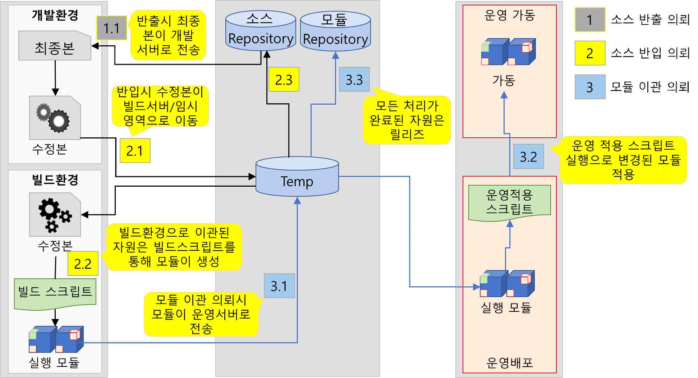

출처: 집필진 제작(2025)
[그림 4-1] 운영 환경에서의 애플리케이션 빌드･배포 환경(예시)
수행 tip
• 애플리케이션 배포 시 사전에 불필요한 소스코드, 작업
파일, 백업 파일 등은 반드시 정비하도록 한다. 소스코드
정비가 되지 않은 경우 사용하지 않는 프로그램이나 파
일이 운영 서버에 배포되어 문제를 발생시킬 수 있다.

| 학습 4 | 교수·학습 방법 |
| --- | --- |

교수 방법
• 이행 환경에 따른 애플리케이션 배포 절차를 설명하고 이행의뢰서 작성 실습을 진행한다.
• 애플리케이션 배포 후 정상 작동 여부 확인 방법을 배포 작업이 정상적으로 되었을 때
와 실패했을 때의 작업 결과 화면을 예시를 들어 비교 설명한다.
• 애플리케이션 배포 결과 문제가 발생했을 경우 이전 상태로 복원하는 절차를 설명하고,
원상 복구를 완전하게 수행하지 못했을 경우의 발생 위험을 토론을 통해 다양하게 도출
해 보도록 지도한다.
• 운영 환경에서의 ITSM, 형상관리시스템을 포함한 빌드･배포 환경을 실사례를 들어 설
명한다.
학습 방법
• 이행 환경에 따른 애플리케이션 배포 절차를 숙지하고 이행의뢰서를 작성한다.
• 애플리케이션 배포 후 정상 작동 여부 확인 방법을 파악한다.
• 애플리케이션 배포 결과 문제가 발생했을 경우 이전 상태로 복원하는 절차를 파악하고,
원상 복구를 완전하게 수행하지 못했을 경우의 발생 가능한 위험을 숙지한다.
• 운영 환경에서의 ITSM, 형상관리시스템을 포함한 빌드･배포 환경에 대하여 파악한 내
용을 종합적으로 정리한다.

| 학습 4 | 평 가 |
| --- | --- |

평가 준거
• 평가자는 학습자가 학습 목표를 성공적으로 달성하였는지를 평가해야 한다.
• 평가자는 다음 사항을 평가해야 한다.

| 학습 내용 | 학습 목표 | 성취수준 |  |  |
| --- | --- | --- | --- | --- |
|  |  | 상 | 중 | 하 |

- 애플리케이션 실행 환경에 대한 정보를 확인할 수 있다.
애플리케이션 배포
- 애플리케이션 배포 절차에 따라 운영 환경에 적용할 수
있다.
- 애플리케이션 배포 후 정상적으로 작동하는지를 확인할
수 있다.
애플리케이션 운영
및 복원
- 애플리케이션 배포 결과 문제가 발생했을 경우 적용 내용
을 이전 상태로 복원할 수 있다.
평가 방법
• 서술형 시험

| 학습 내용 | 평가 항목 | 성취수준 |  |  |
| --- | --- | --- | --- | --- |
|  |  | 상 | 중 | 하 |

- 이행 환경에 따른 애플리케이션 배포 절차에 대한 이해
정도
애플리케이션 배포 - 이행 의뢰서 작성 능력
- 애플리케이션 배포 후 정상 작동 여부 확인 방법 숙지
정도
- 애플리케이션 배포 결과 문제가 발생했을 경우 이전 상태
로 복원하는 절차 이해 정도
- 애플리케이션 배포 결과 문제 발생 시, 원상 복구를 완전
애플리케이션 운영
하게 수행하지 못했을 경우에 발생 가능한 위험에 대한
및 복원
이해 정도
- 운영 환경에서의 ITSM, 형상관리시스템을 포함한 빌드·
배포 환경에 대한 종합적인 이해 정도
• 평가자 질문

| 학습 내용 | 평가 항목 | 성취수준 |  |  |
| --- | --- | --- | --- | --- |
|  |  | 상 | 중 | 하 |

- 이행 환경에 따른 애플리케이션 배포 절차에 대한 이해
정도
애플리케이션 배포
- 애플리케이션 배포 후 정상 작동 여부 확인 방법 숙지
정도
- 애플리케이션 배포 결과 문제가 발생했을 경우 이전 상태
로 복원하는 절차 이해 정도
애플리케이션 운영
- 애플리케이션 배포 결과 문제 발생 시, 원상 복구를 완전
및 복원
하게 수행하지 못했을 경우에 발생 가능한 위험에 대한
이해 정도
• 평가자 체크리스트

| 학습 내용 | 평가 항목 | 성취수준 |  |  |
| --- | --- | --- | --- | --- |
|  |  | 상 | 중 | 하 |

- 이행 환경에 따른 애플리케이션 배포 절차에 대한 이해
정도
애플리케이션 배포
- 이행의뢰서 작성 능력
- 애플리케이션 배포 후 정상 작동 여부 확인 방법 숙지
정도
- 애플리케이션 배포 결과 문제가 발생했을 경우 이전 상태
애플리케이션 운영
로 복원하는 절차 이해 정도
및 복원
- 애플리케이션 배포 결과 문제 발생 시, 원상 복구를 완전
하게 수행하지 못했을 경우에 발생 가능한 위험에 대한
이해 정도

| 학습 내용 | 평가 항목 | 성취수준 |  |  |
| --- | --- | --- | --- | --- |
| 피드백 |  |  |  |  |
| 1. 서술형 시험- 애플리케이션이 있는지- 배포, 운영,표를 달성할- 시험 답안을 | 배포와 운영 및 복원에 부합하는 구성 요소를 식별하고 분석할확인한다. 복원에 대한 서술 내용을 평가하고 미진한 부분을 학습자가수 있도록 한다. 평가한 후 전체적으로 미흡한 부분에 대해서는 주요 사항을 | 수재학습하여표시하여 | 있는학습 | 지식목설명해 |
| 준다. |  |  |  |  |
| 2. 평가자 질문- 질문에 대한로 이해가- 애플리케이션가능한 위험에 | 답변이 충분하지 못할 경우에는 다른 학습자에게 답변을 유도해부족한 경우에는 예시를 들어 보충 설명한다. 배포 결과 문제 발생 시, 원상 복구를 완전하게 수행하지대한 이해가 부족한 경우에는 토론과 예시를 통해 다양한 위험을 | 보고,못했을 | 전반적으경우에설명해 | 발생준다. |
| 3. 평가자 체크리스트- 유사한 이전의한 결과를성취도 향상에- 분석 결과를우, 모범 답안을- 학습자의 평가학습자의 실력 | 사례 중 하나 혹은 그 이상을 선정하여 성공이나 실패 요인을질문하여 평가하고, 성취수준이 낮은 학생들은 추가 답변이 도움을 줄 수 있도록 한다. 재작성할 시간이 부족할 경우 또는 학습자의 평가 결과가제시해서 부족한 부분을 보완할 수 있도록 한다. 결과가 ‘상’에 해당하는 경우, 다른 학습자들에게 평가 내용을향상에 도움을 줄 수 있도록 한다. | 가능하도록‘하’에 | 분석하여지도하여해당하는제공하여 | 적용경다른 |

•교육부(2021). 애플리케이션 배포(LM2001020214_19v5). 한국직업능력연구원.
•금융IT사 배포관리 프로세스 및 매뉴얼.
•행정안전부·한국정보화진흥원(2011). IT 아웃소싱 운영 관리 매뉴얼 V2.0.
NCS학습모듈 개발이력
발행일 2015년 12월 31일
세분류명 응용SW엔지니어링(20010202)
개발기관 한국소프트웨어기술진흥협회
강석진(이비스톰)* 김승현(경희대학교)
김보운(이화여자대학교) 엄기영(우리에프아이에스)
김홍진(LG CNS) 장온순(한국IT컨설팅)
유은희 조상욱(세종대학교)
집필진 검토진
장현섭((주)커리텍) 조성호(삼성카드)
주선태(T3Q)
진권기(이비스톰)
최재준 *표시는 대표집필자임
발행일 2017년 12월 31일
세분류명 응용SW엔지니어링(20010202)
개발기관 (사)한국정보통신기술사협회
박미화(동국대학교)* 권순명((주)씨에이에스)
김승환((주)캐롯아이) 김태형((사)한국정보통신기술사협회)
김원기(LG CNS) 양승화(라이나생명보험)
김종명(SM신용정보) 이성화(시스원)
박현기(프리랜서) 황극인((주)코스콤)
집필진 검토진
유현주((사)한국정보통신기술사협회)
이구성(한국아이씨티(주))
이숙희(서초문화예술정보학교)
최창선(한빛디엔에스(주))
홍민표(한화S&C) *표시는 대표집필자임
발행일 2018년 12월 31일
학습모듈명 애플리케이션 배포(LM2001020214_16v4)
개발기관 (사)한국정보통신기술사협회
김광국((주)코스콤)* 류갑상(동신대학교)
권기혁(세종대학교) 엄기영(우리에프아이에스)
김승환((주)캐롯아이) 장성수(세명컴퓨터고등학교)
김유석(한국정보통신기술사협회) 장희수((주)유알피시스템)
집필진 검토진
문정기(교보정보통신)
박미화(동국대학교 융합SW교육원)
이주희((주)유알피시스템)
홍민표(한화S&C) *표시는 대표집필자임
발행일 2021년 12월 31일
학습모듈명 애플리케이션 배포(LM2001020214_19v5)
개발기관 (사)한국정보통신기술사협회(개발책임자: 온기현)
발행일 2025년 12월 31일
학습모듈명 애플리케이션 배포(LM2001020214_23v6)
개발기관 한국정보공학기술사회(개발책임자: 박철수)
이주희(웨이버스)* 김창남(세명컴퓨터고등학교)
김동욱(한국기술교육대학교) 서경석(미라콤아이앤씨)
김지영(LG CNS) 서인순(프리랜서)
문정기(태하기술사사무소) 유두규(건국대학교)
집필진 검토진
신현범(셈틀웨어)
이근수(분당경영고등학교)
정은주(한국정보기술단)
조민양(동서울대학교)
*표시는 대표집필자임
(참고) 검토진으로 참여한 집필진은 본인의 원고가 아닌 타인의 학습모듈을 검토함
애플리케이션 배포(LM2001020214_23v6)
저작권자 교육부
연구사업기관 한국직업능력연구원
발행일 2025. 12. 31.
ISBN 979-11-4240-196-1
※ 이 학습모듈은 자격기본법 시행령(제8조 국가직무능력표준의 활용)에 의거하여 개발하였으며,
NCS통합포털사이트(http://www.ncs.go.kr)에서 다운로드할 수 있습니다.

