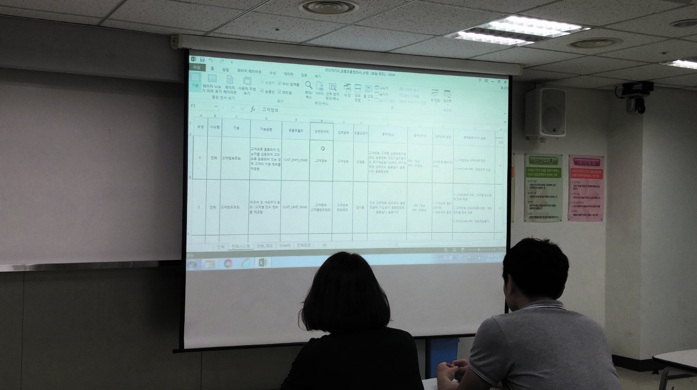
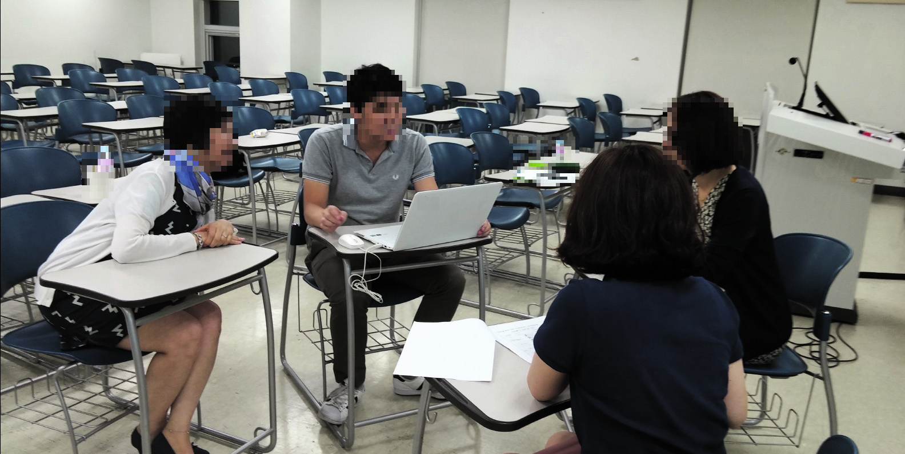

# LM2001020221_23v6_애플리케이션+설계_20251108

대분류/20
정보통신 중분류/01
정보기술 소분류/02
정보기술개발 세분류/02
응용SW엔지니어링 능력단위/21
NCS학습모듈
애플리케이션 설계
LM2001020221_23v6
[NCS학습모듈 활용 시 유의 사항]
1. NCS학습모듈은 교육훈련기관에서 출처를 명시하고 교육적 목적으로 활용할 수 있습니다. 다
만, NCS학습모듈에는 국가(교육부)가 저작재산권 일체를 보유하지 않은 저작물(출처가 표기된
도표‧사진‧삽화‧도면 등)이 포함되어 있으므로, 이러한 저작물의 변형‧각색‧복제‧공연‧
배포 및 공중 송신 등과 이러한 저작물을 활용한 2차적 저작물을 작성하려면 반드시 원작자
의 동의를 받아야 합니다.
2. NCS학습모듈은 개발 당시의 산업 및 교육 현장을 반영하여 집필하였으므로, 현재 적용되는
법령‧지침‧표준 및 교과 내용 등과 차이가 있을 수 있습니다. NCS학습모듈 활용 시 법령
‧지침‧표준 및 교과 내용의 개정 사항과 통계의 최신성 등을 확인하시기를 바랍니다.
3. NCS학습모듈은 산업 현장에서 요구되는 능력을 교육훈련기관에서 학습할 수 있게 구성한 자
료입니다. 다만, NCS학습모듈 지면의 한계상 대표적 예시(예: 활용도 또는 범용성이 높은 제
품, 서비스) 중심으로 집필하였음을 이해하시기를 바랍니다.
NCS학습모듈의 이해
NCS학습모듈의 이해
※ 본 NCS학습모듈은 「NCS 국가직무능력표준」사이트(http://www.ncs.go.kr) 에서 확인 및 다운로드할 수 있습니다.

| Ⅰ | NCS학습모듈이란? |
| --- | --- |

•국가직무능력표준(NCS: National Competency Standards)이란 산업현장에서 직무를
수행하기 위해 요구되는 지식･기술･소양 등의 내용을 국가가 산업부문별･수준별로 체계
화한 것으로 산업현장의 직무를 성공적으로 수행하기 위해 필요한 능력(지식, 기술, 태도)
을 국가적 차원에서 표준화한 것을 의미합니다.
•국가직무능력표준(이하 NCS)이 현장의 ‘직무 요구서’라고 한다면, NCS학습모듈은 NCS
의 능력단위를 교육훈련에서 학습할 수 있도록 구성한 ‘교수･학습 자료’입니다. NCS학습
모듈은 구체적 직무를 학습할 수 있도록 이론 및 실습과 관련된 내용을 상세하게 제시하
고 있습니다.

| NCS 및 NCS학습모듈 개발 절차 |
| --- |
| NCS산업계개발 계획 수립NCSNCS학습모듈NCS학습모듈 개발개발 계획 수립 |

•NCS학습모듈은 다음과 같은 특징을 가지고 있습니다.
첫째, NCS학습모듈은 산업계에서 요구하는 직무능력을 교육훈련 현장에 활용할 수 있도
록 성취목표와 학습의 방향을 명확히 제시하는 가이드라인의 역할을 합니다.
둘째, NCS학습모듈은 특성화고, 마이스터고, 전문대학, 4년제 대학교의 교육기관 및 훈
련기관, 직장교육기관 등에서 표준교재로 활용할 수 있으며 교육과정 개편 시에도
유용하게 참고할 수 있습니다.
i
•NCS와 NCS학습모듈 간의 연결 체계를 살펴보면 아래 그림과 같습니다.

| NCS와 NCS학습모듈의 연결 체계 |
| --- |
| NCS NCS학습모듈능력단위 NCS학습모듈명능력단위 정의 NCS학습모듈의 목표능력단위 기술서 학습명능력단위 요소 학습 내용수행준거 학습 목표지식 필요 지식기술 수행 내용- 재료･자료태도- 기기(장비･공구)- 안전･유의 사항- 수행 순서적용범위 및 작업상황고려 사항 교수･학습 방법자료 및 관련 서류 교수 방법장비 및 도구 학습 방법평가 지침 평가평가 방법 평가 준거평가 시 고려 사항 평가 방법피드백참고 자료･활용 서식･부록 |

|  |  | NCS |  |  |  |  |  |  |  |  | NCS학습모듈 |  |  |  |  |
| --- | --- | --- | --- | --- | --- | --- | --- | --- | --- | --- | --- | --- | --- | --- | --- |
|  | 능력단위 |  |  |  |  |  |  |  |  | NCS학습모듈명 |  |  |  |  |  |
|  | 능력단위 | 능력단위 |  |  |  |  |  |  |  | NCS학습모듈명 | NCS학습모듈명 |  |  |  |  |
|  | 능력단위 정의 |  |  |  |  |  |  |  |  | NCS학습모듈의 목표 |  |  |  |  |  |
|  | 능력단위 정의 | 능력단위 정의 |  |  |  |  |  |  |  | NCS학습모듈의 목표 | NCS학습모듈의 목표 |  |  |  |  |
|  | 능력단위 기술서 능력단위 요소 | 능력단위 기술서 능력단위 요소 |  |  |  |  |  |  |  | 학습명 학습 내용 | 학습명 학습 내용 |  |  |  |  |
|  | 능력단위 기술서 |  |  |  |  |  |  |  |  | 학습명 |  |  |  |  |  |
|  | 능력단위 기술서 | 능력단위 기술서 |  |  |  |  |  |  |  | 학습명 | 학습명 |  |  |  |  |
|  | 능력단위 요소 |  |  |  |  |  |  |  |  | 학습 내용 |  |  |  |  |  |
|  | 능력단위 요소 | 능력단위 요소 |  |  |  |  |  |  |  | 학습 내용 | 학습 내용 |  |  |  |  |
|  | 수행준거 |  |  |  |  |  |  |  |  | 학습 목표 |  |  |  |  |  |
|  | 수행준거 | 수행준거 |  |  |  |  |  |  |  | 학습 목표 | 학습 목표 |  |  |  |  |
|  | 지식기술태도 |  |  |  |  |  |  |  |  | 필요 지식수행 내용- 재료･자료- 기기(장비･공구)- 안전･유의 사항- 수행 순서 |  |  |  |  |  |
|  | 기술 | 기술 |  |  |  |  |  |  |  | 수행 내용 | 수행 내용 |  |  |  |  |
|  |  |  |  |  |  |  |  |  |  | - 재료･자료 | - 재료･자료 |  |  |  |  |
|  | 태도 | 태도 |  |  |  |  |  |  |  | - 기기(장비･공구) | - 기기(장비･공구) |  |  |  |  |
|  |  |  |  |  |  |  |  |  |  | - 기기(장비･공구) | - 기기(장비･공구) |  |  |  |  |
|  |  |  |  |  |  |  |  |  |  | - 안전･유의 사항 | - 안전･유의 사항 |  |  |  |  |
|  | 적용범위 및 작업상황 |  |  |  |  |  |  |  |  | - 수행 순서 | - 수행 순서 |  |  |  |  |
|  | 고려 사항자료 및 관련 서류장비 및 도구 |  |  |  |  |  |  |  |  | 교수･학습 방법 | 교수･학습 방법 교수 방법 학습 방법 |  |  |  |  |
|  | 자료 및 관련 서류 장비 및 도구 | 자료 및 관련 서류 장비 및 도구 |  |  |  |  |  |  |  | 교수 방법학습 방법 |  |  |  |  |  |
|  | 평가 지침 |  |  |  |  |  |  |  |  | 평가 |  |  |  |  |  |
|  | 평가 방법평가 시 고려 사항 |  |  |  |  |  |  |  |  | 평가 준거평가 방법피드백 |  |  |  |  |  |
|  | 평가 시 고려 사항 | 평가 시 고려 사항 |  |  |  |  |  |  |  | 평가 방법 | 평가 방법 |  |  |  |  |
|  |  |  |  |  |  |  |  |  |  | 참고 자료･활용 서식･부록 |  |  |  |  |  |

ii
NCS학습모듈의 이해

| Ⅱ | NCS학습모듈의 체계 |
| --- | --- |

•NCS학습모듈은 1. NCS학습모듈의 위치 , 2. NCS학습모듈의 개요 , 3. NCS학습모듈의 내용 체계 ,
4. 참고 자료 , 5. 활용서식/부록 으로 구성되어 있습니다.
1. NCS학습모듈의 위치
•NCS학습모듈의 위치는 NCS 분류 체계에서 해당 학습모듈이 어디에 위치하는지를 한 눈에
볼 수 있도록 그림으로 제시한 것입니다.

| [NCS-학습모듈의 위치] |  |  |  |  |  |  |  |
| --- | --- | --- | --- | --- | --- | --- | --- |
| 대분류 | 문화·예술·디자인·방송 |  |  |  |  |  |  |
| 중분류 |  | 문화콘텐츠 |  |  |  |  |  |
| 소분류 |  |  |  |  |  | 문화콘텐츠제작 |  |
| 세분류 |  |  |  |  |  |  |  |
| 세분류 |  |  |  |  |  |  |  |
| 방송콘텐츠제작 |  |  |  |  | 능력단위 |  | 학습모듈명 |
| 영화콘텐츠제작 프로그램 기획 프로그램 기획음악콘텐츠제작 아이템 선정 아이템 선정광고콘텐츠제작 자료 조사 자료 조사게임콘텐츠제작 프로그램 구성 프로그램 구성애니메이션캐스팅 캐스팅콘텐츠제작만화콘텐츠제작 제작계획 제작계획캐릭터제작 방송 미술 준비 방송 미술 준비스마트문화앱방송 리허설 방송 리허설콘텐츠제작영사 야외촬영 야외촬영스튜디오 제작 스튜디오 제작… … |  |  |  |  | 프로그램 기획 |  | 프로그램 기획 |
| 음악콘텐츠제작 |  |  |  |  | 아이템 선정 |  | 아이템 선정 |
| 광고콘텐츠제작 자료 |  |  |  |  | 자료 조사 |  | 자료 조사 |
| 게임콘텐츠제작 |  |  |  |  | 프로그램 구성 |  | 프로그램 구성 |
| 애니메이션 콘텐츠제작 |  |  |  |  | 캐스팅 |  | 캐스팅 |
| 만화콘텐츠제작 |  |  |  |  | 제작계획 |  | 제작계획 |
| 캐릭터제작 방송 |  |  |  |  | 방송 미술 준비 |  | 방송 미술 준비 |
| 스마트문화앱 방송 콘텐츠제작 |  |  |  |  | 방송 리허설 |  | 방송 리허설 |
| 영사 |  |  |  |  | 야외촬영 |  | 야외촬영 |
|  |  |  |  |  | 스튜디오 제작 |  | 스튜디오 제작 |
|  |  |  |  |  | … |  | … |

|  | 학습모듈은 |
| --- | --- |
| NCS 능력단위 1개당 1개의 학습모듈 개발을 원칙으로 합니다. 그러나 필요에 따라고용단위 및 교과단위를 고려하여 능력단위몇 개를 묶어 1개 학습모듈로 개발할 수있으며, NCS 능력단위 1개를 여러 개의학습모듈로 나누어 개발할 수도 있습니다. |  |

iii
2. NCS학습모듈의 개요
•NCS학습모듈의 개요는 학습모듈이 포함하고 있는 내용을 개략적으로 설명한 것으로
학습모듈의 목표 , 선수학습 , 학습모듈의 내용 체계 , 핵심 용어 로 구성되어 있습니다.

| 학습모듈의 목표 | 해당 NCS 능력단위의 정의를 토대로 학습 목표를 작성한 것입니다. |
| --- | --- |

| 선수학습 | 해당 학습모듈에 대한 효과적인 교수･학습을 위하여 사전에 이수해야 하는 학습모듈, 학습 내용, 관련 교과목 등을 기술한 것입니다. |
| --- | --- |

| 학습모듈의내용 체계 | 해당 NCS 능력단위요소가 학습모듈에서 구조화된 체계를 제시한 것입니다. |
| --- | --- |

| 핵심 용어 | 해당 학습모듈의 학습 내용, 수행 내용, 설비･기자재 등 가운데 핵심적인 용어를 제시한 것입니다. |
| --- | --- |

| 제작계획 학습모듈의 개요 |  |  |  |
| --- | --- | --- | --- |
| 학습모듈의 목표본격적인 촬영을 준비하는 단계로서, 촬영 대본을 확정하고 제작 스태프를 조직하며촬영 장비와 촬영 소품을 준비할 수 있다.선수학습제작 준비(LM0803020105_13v1), 섭외 및 제작스태프 구성(LM0803020104_13v1),촬영 제작(LM0803020106_13v1), 촬영 장비 준비(LM0803040204_13v1.4), 미술디자인 협의하기(LM0803040203_13v1.4)학습모듈의 내용체계 |  |  |  |
| 학습 | 학습 내용 | NCS 능력단위 요소 |  |
| 코드번호 요소 명칭 |  | 코드번호 | 요소 명칭 |
| 1. 촬영 대본 1-1. 촬영 구성안 검 촬영 대본0803020114_16v3.1확정하기 토와 수정 확정하기2-1. 기술 스태프 조직2. 제작 스태프 제작 스태프2-2. 미술 스태프 조직 0803020114_16v3.2조직하기 조직하기2-3. 전문 스태프 조직3. 촬영 장비 3-1. 촬영 장비 점검 촬영 장비0803020114_16v3.3계획하기 과 준비 계획하기4-1. 촬영 소품 목록4. 촬영 소품 작성 촬영 소품0803020114_16v3.4계획하기 4-2. 촬영 소품 제작 계획하기의뢰 |  |  |  |
| 핵심 용어촬영 구성안, 제작 스태프, 촬영 장비, 촬영 소품 |  |  |  |

|  | 학습모듈의 목표는 |
| --- | --- |
| 학습자가 해당 학습모듈을 통해 성취해야할 목표를 제시한 것으로, 교수자는 학습자가 학습모듈의 전체적인 내용흐름을 파악하도록 지도할 수 있습니다. |  |

|  | 선수학습은 |
| --- | --- |
| 교수자 또는 학습자가 해당 학습모듈을 교수·학습하기 이전에 이수해야 하는 교과목또는 학습모듈(NCS 능력단위) 등을 표기한것입니다. 따라서 교수자는 학습자가 개별학습, 자기 주도 학습, 방과 후 활동 등 다양한 방법을 통해 이수할 수 있도록 지도하는 것을 권장합니다. |  |

|  | 핵심 용어는 |
| --- | --- |
| 해당 학습모듈을 대표하는 주요 용어입니다. 학습자가 해당 학습모듈을 통해 학습하고 평가받게될 주요 내용을 알 수 있습니다. 「NCS 국가직무능력표준」 사이트(www.ncs.go.kr)의 색인 (찾아보기) 중하나로 이용할 수 있습니다. |  |

iv
NCS학습모듈의 이해
3. NCS학습모듈의 내용 체계
•NCS학습모듈의 내용은 크게 학습 , 학습 내용 , 교수･학습 방법 , 평가 로 구성되어 있습니다.

| 학습 | 해당 NCS 능력단위요소 명칭을 사용하여 제시한 것입니다.학습은 크게 학습 내용, 교수･학습 방법, 평가로 구성되며 해당 NCS 능력단위의능력단위 요소별 지식, 기술, 태도 등을 토대로 내용을 제시한 것입니다. |
| --- | --- |

| 학습 내용 | 학습 내용은 학습 목표, 필요 지식, 수행 내용으로 구성되며, 수행 내용은 재료･자료, 기기(장비･공구), 안전･유의 사항, 수행 순서, 수행 tip으로 구성한 것입니다.학습모듈의 학습 내용은 실제 산업현장에서 이루어지는 업무활동을 표준화된 프로세스에 기반하여 다양한 방식으로 반영한 것입니다. |
| --- | --- |

| 교수･학습 방법 | 학습 목표를 성취하기 위한 교수자와 학습자 간, 학습자와 학습자 간 상호 작용이활발하게 일어날 수 있도록 교수자의 활동 및 교수 전략, 학습자의 활동을 제시한것입니다. |
| --- | --- |

| 평가 | 평가는 해당 학습모듈의 학습 정도를 확인할 수 있는 평가 준거 및 평가 방법, 평가 결과의 피드백 방법을 제시한 것입니다. |
| --- | --- |

학습 1 촬영 대본 확정하기

|  | 학습은 |
| --- | --- |
| 해당 NCS 능력단위요소 명칭을 사용하여제시하였습니다. 하나의 학습은 일반교과의 ‘대단원’에 해당되며, 학습모듈을 구성하는 가장 큰 단위가 됩니다. 또한 하나의 직무를 수행하기 위한 가장 기본적인단위로 사용할 수 있습니다 |  |

| 학습 2 | 제작 스태프 조직하기 |
| --- | --- |

학습 3 촬영 장비 계획하기
학습 4 촬영 소품 계획하기

|  | 학습 내용은 |
| --- | --- |
| NCS 능력단위요소별 수행준거를 기준으로제시하였습니다. 일반교과의 ‘중단원’에 해당합니다. |  |

2-1. 기술 스태프 조직
학습 목표 •프로그램 제작에 적합한 기술 스태프를 조직할 수 있다.

|  | 학습 목표는 |
| --- | --- |
| 학습 내용을 이수할 때 학습자가 갖춰야할행동 수준을 의미합니다. 따라서 수업시간의 과목 목표로 활용할 수 있습니다. |  |

필요 지식 /
(cid:49684) 기술 스태프의 구성

|  | 필요 지식은 |
| --- | --- |
| 해당 NCS의 지식을 토대로 학습에 대한이해와 성과를 제고하기 위해 반드시 알아야 할 주요 지식을 제시하였습니다. 필요 지식은 수행에 꼭 필요한 핵심 내용을위주로 제시하여 교수자의 역할이 매우중요하며, 이후 수행 순서와 연계하여 교수·학습으로 진행할 수 있습니다. |  |

프로그램의 장르에 따라 구성하는 기술 스태프는 많은 차
이가 있다. 같은 장르의 프로그램이라도 그 형식이나 내
용, 규모에 따라서 구성되는 기술 스태프의 종류와 인원
수는 천차만별이다.
1. 스튜디오 프로그램
토크쇼, 종합 구성, 예능과 같은 스튜디오 프로그램은
부조정실과 스튜디오를 사용하여 제작하기 때문에 많
은 기술 스태프가 필요하다.
v

|  | 수행 내용은 |
| --- | --- |
| 해당 학습모듈에서 제시한 내용 중 기술(skill)을 습득하기 위한 실습과제로 활용할 수 있습니다. |  |

수행 내용 / 기술 스태프 구성표 작성하기
재료·자료

|  | 재료･자료는 |
| --- | --- |
| 수행 내용을 수행하는데 필요한 재료 및 준비물로 실습 시 활용할 수 있습니다. |  |

• 방송프로그램 제작 기획서 및 방송 대본, 콘티(continuity), 제작
일정, 운용표
• 장비 및 시설, 제작 시설 배정 의뢰서 및 배정표, 방송 기술 스
태프 데이터베이스(DB) 자료

|  | 기기(장비･공구)는 |
| --- | --- |
| 수행 내용에 필요한 기본적인 장비 및 도구를 제시하였습니다. 제시된 기기 외에도 수행에 필요한 다양한 도구나 장비를 활용할수 있습니다. |  |

기기(장비･공구)
• 컴퓨터 등
안전･유의 사항

|  | 안전･유의사항은 |
| --- | --- |
| 수행 내용을 수행하는 데 있어 안전상 주의해야할 점 및 유의사항을 제시하였습니다. 실습 시 유념해야 하며, NCS의 고려사항도 추가적으로 활용할 수 있습니다. |  |

• 프로그램의 내용과 제작 방법을 분석하고, 각 스태프들의 역할
을 신중하게 검토한다.
수행 순서
(cid:49684) 방송 대본이나 콘티(continuity), 큐 시트를 분석하고, 프로그램

|  | 수행 순서는 |
| --- | --- |
| 실습 과제의 진행 순서로 활용할 수 있습니다. |  |

의 내용적 특성, 제작 과정에 대한 자료를 수집한다.
(cid:49685) 프로그램 제작 방법을 결정한다.

|  | 수행 tip은 |
| --- | --- |
| 수행 내용에서 실습을 용이하게 할 수 있는아이디어를 제시하였습니다. 수행 tip은 지도상의 안전 및 유의사항 외에 전반적으로적용되는 주안점 및 수행 과제 목적에 대한보충설명, 추가사항 등으로 활용할 수 있습니다. |  |

1. 스튜디오 녹화를 할 것인가, 야외 촬영을 할 것인가 검토한
다.
수행 tip
•스태프의 결정은 스태프 간의 호흡을 중
요시하여 선정해야 프로그램의 질을 향
상시킬 수 있다.

| 학습2 | 교수·학습 방법 |
| --- | --- |

|  | 교수･학습 방법은 |
| --- | --- |
| 학습 목표를 성취하는 데 필요한 교수 방법과 학습 방법을 제시하였습니다. |  |

교수 방법

|  | 교수 방법은 |
| --- | --- |
| 해당 학습 활동에 필요한 학습 내용, 학습내용과 관련된 자료명, 자료 형태, 수행 내용의 진행 방식 등에 대하여 제시하였습니다. 또한 학습자의 수업참여도 제고 방법및 수업 진행상 유의사항 등도 제시하였습니다. 선수학습이 필요한 학습을 학습자가숙지하였는지 교수자가 확인하는 과정으로활용할 수도 있습니다. |  |

• 방송 프로그램의 기술적 요소, 미술 구성 요소, 특수 촬영에 대해
설명한다.
• 방송 프로그램 제작에서 각 기술 스태프의 역할에 대해 설명한다.
• 방송 프로그램을 분석하고 필요한 기술 스태프를 구성할 수 있도
록 지시한다.
학습 방법

|  | 학습 방법은 |
| --- | --- |
| 해당 학습 활동에 필요한 학습자의 자기주도 학습 방법을 제시하였습니다. 또한학습자가 숙달해야 할 실기 능력과 학습과정에서 주의해야 할 사항 등도 제시하였습니다. 학습자가 학습을 이수하기 전반드시 숙지해야 할 기본 지식을 학습하였는지 스스로 확인하는 과정에 활용할수 있습니다. |  |

• 방송 프로그램의 기술적 요소, 미술 구성 요소, 특수 촬영에 대해
서 알아본다.
• 프로그램 제작에 필요한 기술 스태프의 역할을 이해하고, 기술 스
태프 구성표를 작성한다.
vi
NCS학습모듈의 이해

| 학습2 평 가평가 준거• 평가자는 학습자가 학습 목표를 성공적으로 달성하였는지를 평가해야 한다.• 평가자는 다음 사항을 평가해야 한다.성취수준학습 내용 학습 목표상 중 하기술 스태프 - 프로그램 제작에 적합한 기술 스태프를 조조직 직할 수 있다.미술 스태프 - 프로그램 제작에 적합한 미술 스태프를 조조직 직할 수 있다.전문 스태프 - 프로그램 특수 촬영을 위한 전문 스태프를조직 조직할 수 있다.평가 방법• 사례 연구성취수준학습 내용 평가 항목상 중 하- 프로그램에서 기술적 요소의 파악 여부기술 스태프 - 기술 스태프의 역할 파악 여부조직 - 프로그램에 필요한 기술 스태프 구성표 작성 능력피드백1. 사례 연구- 프로그램을 선택하여 기술 스태프, 미술 스태프, 전문 스태프 구성표를 예시와 같이 작성하였는지 개인별 능력을 평가한 후, 그결과를 모든 학습자에게 공유하도록 한다. | 학습2 | 평 가 |
| --- | --- | --- |

|  | 평가는 |
| --- | --- |
| NCS 능력단위의 평가 방법과 평가 시 고려사항을 준용하여 작성합니다. 교수자와학습자가 평가 항목별 성취수준 확인 시활용할 수 있습니다. |  |

|  | 평가 준거는 |
| --- | --- |
| 학습자가 학습을 어느 정도 성취하였는지평가하기 위한 기준을 제시하고 있습니다.학습 목표와 연계하여 단위수업 시간에 평가 항목 별 성취수준을 평가하는 데 활용할수 있습니다. |  |

| 학습 내용 | 학습 목표 | 성취수준 |  |  |
| --- | --- | --- | --- | --- |
|  |  | 상 | 중 | 하 |

| 4. 참고 자료•교육부(2013). | 섭외 및 제작스태프 구성(LM0803020104_13v1). |  |  |  |
| --- | --- | --- | --- | --- |
| 한국직업능력개발원. |  |  |  |  |
| 5. 활용 서식/부록직종 이름기술감독 조명감독 [디지털제1조(목적) 이 고시는램 및 방송광고의 | 스튜디오 기술 스태프 구성표 연락처 소속 특이사항텔레비전 방송프로그램 음량 등에 관한 기준] 제정 2014. 11. 29. 미래창조과학부 고시제1창 총칙 방송법 제70조의2제1항에 따라 방송사업자가 디지털 텔레비전음량을 일정하게 유지하기 위해 필요한 사항을 규정함을 | 비고목적으로 | 제2014-87호방송프로그한다. |  |

|  | 평가 방법은 |
| --- | --- |
| NCS 능력단위의 평가 방법을 참고하였으며, 평가 준거에 따른 평가 방법을 2개 이상 제시합니다. 평가 방법의 종류는 포트폴리오, 문제해결 시나리오, 서술형 시험, 논술형 시험, 사례 연구, 평가자 체크리스트,작업장 평가 등이 있으며, NCS 능력단위요소 별 수행 수준을 평가하는 데 가장 적절한 방법을 선정하여 활용할 수 있습니다. |  |

| 학습 내용 | 평가 항목 | 성취수준 |  |  |
| --- | --- | --- | --- | --- |
|  |  | 상 | 중 | 하 |

| 4. 참고 자료•교육부(2013). | 섭외 및 제작스태프 구성(LM0803020104_13v1). |  |  |  |
| --- | --- | --- | --- | --- |
| 한국직업능력개발원. |  |  |  |  |
| 5. 활용 서식/부록직종 이름기술감독 조명감독 [디지털제1조(목적) 이 고시는램 및 방송광고의 | 스튜디오 기술 스태프 구성표 연락처 소속 특이사항텔레비전 방송프로그램 음량 등에 관한 기준] 제정 2014. 11. 29. 미래창조과학부 고시제1창 총칙 방송법 제70조의2제1항에 따라 방송사업자가 디지털 텔레비전음량을 일정하게 유지하기 위해 필요한 사항을 규정함을 | 비고목적으로 | 제2014-87호방송프로그한다. |  |

|  | 피드백은 |
| --- | --- |
| 평가 후에 학습자들에게 평가 결과를 피드백하여 학습 목표를 달성하는 데 활용할 수 있습니다. |  |

|  | 참고 자료는 |
| --- | --- |
| 해당 학습모듈에 제시된 인용 자료의 출처를 제시하였습니다. 교수·학습의 과정에서참고로 활용할 수 있습니다. |  |

|  | 활용 서식은 |
| --- | --- |
| 평가 서식, 실습 시트 등 교수·학습 시 활용할 수 있는 다양한 서식들로 구성하였습니다. 수행에서 평가에 이르기까지 필요한서식을 해당 모듈의 특성에 맞춰 개발하거나 기존의 양식을 활용하여 제시하였습니다. |  |

|  | 부록은 |
| --- | --- |
| 활용 서식 이외에 교수·학습 과정에서 참고할수 있는 자료가 있는 경우 제시하였습니다. |  |

[NCS-학습모듈의 위치]

| 정보 통신 |  |  |
| --- | --- | --- |
|  | 정보 기술 |  |
|  |  | 정보기술개발 |

대분류
중분류
소분류
세분류

| SW아키텍처 |  |  | 능력단위 | 학습모듈명 |
| --- | --- | --- | --- | --- |
| 응용SW엔지니어링 |  |  | 요구사항 확인 | 요구사항 확인 |
| 임베디드SW 엔지니어링 |  |  | 데이터 입출력 구현 | 데이터 입출력 구현 |
| DB엔지니어링 |  |  | 통합 구현 | 통합 구현 |
| NW엔지니어링 |  |  | 정보시스템 이행 | 정보시스템 이행 |
| 보안엔지니어링 |  |  | 제품소프트웨어 패키징 | 제품소프트웨어 패키징 |
| UI/UX엔지니어링 |  |  | 서버 프로그램 구현 | 서버 프로그램 구현 |
| 시스템SW엔지니어링 |  |  | 인터페이스 구현 | 인터페이스 구현 |
| 빅데이터플랫폼구축 |  |  | 애플리케이션 배포 | 애플리케이션 배포 |
| 핀테크엔지니어링 |  |  | 애플리케이션 리팩토링 | 애플리케이션 리팩토링 |
| 데이터아키텍처 |  |  | 인터페이스 설계 | 인터페이스 설계 |
| loT시스템연동 |  |  | 애플리케이션 요구사항 분석 | 애플리케이션 요구사항 분석 |
| 인프라스트럭쳐 아키텍처 구축 |  |  | 기능 모델링 | 기능 모델링 |
|  |  |  | 애플리케이션 설계 | 애플리케이션 설계 |

| 정적모델 설계 | 정적모델 설계 |
| --- | --- |
| 동적모델 설계 | 동적모델 설계 |
| 화면 설계 | 화면 설계 |
| 화면 구현 | 화면 구현 |
| 애플리케이션 테스트 관리 | 애플리케이션 테스트 관리 |
| 애플리케이션 테스트 수행 | 애플리케이션 테스트 수행 |
| 소프트웨어공학 활용 | 소프트웨어공학 활용 |
| 소프트웨어개발 방법론 활용 | 소프트웨어개발 방법론 활용 |
| 프로그래밍 언어 응용 | 프로그래밍 언어 응용 |
| 프로그래밍 언어 활용 | 프로그래밍 언어 활용 |
| 응용SW 기초 기술 활용 | 응용SW 기초 기술 활용 |
| 개발자 환경 구축 | 개발자 환경 구축 |
| 개발 환경 운영 지원 | 개발 환경 운영 지원 |
| 자료구조 활용 | 자료구조 활용 |

차 례
학습모듈의 개요 1
학습 1. 공통 모듈 설계하기
1-1. 공통 모듈 식별 및 명세 3
1-2. 공통 모듈 설계 14
1-3. 공통 모듈 인덱스 및 기능 코드 설계 39
• 교수・학습 방법 46
• 평가 47
학습 2. 타 시스템 연동 설계하기
2-1. 아키텍처를 고려한 타 시스템 연동 설계 49
2-2. 미들웨어 솔루션 명세 작성 64
2-3. 오류 예측 및 대응 방안 제시 70
• 교수・학습 방법 85
• 평가 86
참고 자료 89
활용 서식 90
애플리케이션 설계 학습모듈의 개요
학습모듈의 목표
요구사항 확인을 통한 상세 분석 결과, 소프트웨어 아키텍처 가이드라인 및 소프트웨어 아키텍처 산출물에
의거하여 이에 따른 애플리케이션 구현을 수행하기 위해 공통 모듈 설계, 타 시스템 연동에 대하여 상세
설계할 수 있다.
선수학습
요구사항 확인(2001020201_23v5), 화면 설계(2001020224_23v6), 인터페이스 구현(2001020212_23v6), 통
합 구현(2001020206_23v6), 개발 환경 운영 지원(2001020234_23v2)
학습모듈의 내용체계

| 학습 | 학습 내용 | NCS 능력단위 요소 |  |
| --- | --- | --- | --- |
|  |  | 코드번호 | 요소 명칭 |

1-1. 공통 모듈 식별 및 명세
1. 공통 모듈 설계하기 1-2. 공통 모듈 설계 2001020221_23v6.1 공통 모듈 설계하기
1-3. 공통 모듈 인덱스 및 기능 코
드 설계
2-1. 아키텍처를 고려한 타 시스템
연동 설계
2. 타 시스템 연동 설 타 시스템 연동
2-2. 미들웨어 솔루션 명세 작성 2001020221_23v6.2
계하기 설계하기
2-3. 오류 예측 및 대응 방안 제시
핵심 용어
공통 모듈, 기능 명세, 화면 설계, 로직 설계, UML, 모듈화, 아키텍처, 시스템 연동, 미들웨어

| 학습 1 | 공통 모듈 설계하기 |
| --- | --- |

학습 2 타 시스템 연동 설계하기
1-1.
공통 모듈 식별 및 명세
•재사용성 확보와 중복 개발을 회피하기 위하여, 전체 시스템 차원과 단위 시스템 차원의 공통
학습 목표
부분을 식별하여 이에 대한 상세 명세를 작성할 수 있다.
필요 지식 /
(cid:49684) 공통 모듈(Module)
1. 모듈의 개념
전체 프로그램의 기능 중 특정 기능을 처리할 수 있는 실행 코드를 의미하며, 자체적으
로 컴파일하는 것이 가능하고 다른 프로그램에서 재사용이 가능하다.
2. 공통 모듈
여러 기능 및 프로그램에서 공통적으로 사용할 수 있는 모듈을 의미하며, 날짜 처리를
위한 유틸리티 모듈 등이 해당된다.
3. 공통 모듈에 대한 명세 작성 원칙
공통 모듈에 대한 명세를 작성할 때에는 다음과 같은 원칙을 준수해야 한다.
(1) 정확성(Correctness): 해당 기능이 실제 시스템 구현 시 필요한지 여부를 알 수 있도록
정확하게 작성한다.
(2) 명확성(Clarity): 해당 기능에 대해 일관되게 이해되고 한 가지로 해석될 수 있도록 작성한다.
(3) 완전성(Completeness): 시스템이 구현될 때 필요하고 요구되는 모든 것을 기술한다.
(4) 일관성(Consistency): 공통 기능들 간에 상호 충돌이 없도록 작성한다.
(5) 추적성(Traceability): 공통 기능에 대한 요구사항 출처와 관련 시스템 등의 유기적 관계
에 대한 식별이 가능하도록 작성한다.
(cid:49685) 재사용(Reuse)
개발 시간 및 비용 절감을 위하여 이미 검증된 기능을 파악하고 재구성하여 시스템에 응
용하기 위해 적합하게 최적화하는 작업이다.
1. 재사용 규모에 따른 분류
<표 1-1> 재사용 규모에 따른 분류
분류 내용
함수와 객체 재사용 클래스나 메서드 단위로 사용하며, 소스 코드 등을 재사용
컴포넌트 단위로 재사용하며, 컴포넌트 자체는 수정하지 않고 인터페이스
컴포넌트 재사용
를 통해 통신
애플리케이션 재사용 공통된 업무가 기능을 제공하도록 구현된 애플리케이션을 공유하여 재사용
출처: 교육부(2021). 애플리케이션 설계(LM2001020221_19v5). 한국직업능력연구원. p.4.
2. 재사용을 위한 필요 항목
(1) 재사용과 관련된 내용이 이해하기 쉽고, 누구나 사용이 가능하도록 사용법이 공개되어야
한다.
(2) 외부 모듈과의 연관성(결합도)은 적어야 하며, 자체적인 완성도(응집도)는 높아야 한다.
(cid:49686) 유스케이스(Use Case) 및 관계(포함과 확장)
1. 유스케이스
통합 모델링 언어(UML: Unified Modeling Language)에서 시스템에 제공되는 고유
기능 단위이며, 액터(Actor, 행위자)를 통해 시스템이 수행하는 일의 목표이다.
2. 포함과 확장 관계
유스케이스(Use Case, 사용 사례)의 구성 요소 간 관계에는 연관, 확장, 포함, 일반화,
그룹화 등이 있으며 기능 수행 시 반드시 포함하거나 선택적으로 수행할 수 있는 관계
를 <표 1-2>와 같은 점선으로 표시한다.
<표 1-2> 유스케이스의 포함과 확장
관계 설명 표시

포함(Include) 시스템의 기능이 별도의 기능을 포함

기본 유스케이스 수행 시 특별한 조건을 만족할 때 수
확장(Extend)
행하는 유스케이스
출처: 교육부(2021). 애플리케이션 설계(LM2001020221_19v5). 한국직업능력연구원. p.4.
수행 내용 / 공통 모듈 식별 및 명세하기
재료·자료
• SW 개발 국제 표준(ISO/IEC 9126, ISO/IEC 14598, ISO/IEC 25000(SQuaRE),
CMMi 등)
• 소프트웨어 테스트 관련 국제 표준(ISO/IEC/IEEE 29119)
• 제안 요청서, 제안서, 요구사항 정의서 등의 요구사항 관련 산출물
• 업무 기능 분해도, 업무 배경도, 유스케이스 다이어그램 등의 분석 단계 산출물
• 요구사항명세서, 유스케이스 명세서와 같은 명세 산출물
기기(장비･공구)
• 전산 장비(컴퓨터, 프린터, 빔 프로젝터, 네트워크 장비 등)
• OA 도구(워드프로세서, 스프레드시트, 프레젠테이션 도구 등)
• CASE 도구(SW 설계 지원 도구, SW 개발 지원 도구, SW 테스트 지원 도구 등)
• UML 저작 도구(오픈 소스: StarUML)
안전･유의 사항
• 실험 실습은 정해진 방법과 절차에 따라 실시하여야 한다.
• 요구사항 정의서 등과 같은 분석 단계 산출물에 대한 이해가 필요하다.
• UML 다이어그램의 유형과 작성 방법에 대해 사전에 학습한다.
• 단위 시스템 및 전체 시스템에서 제공하는 업무 기능에 대해 파악할 수 있어야 한다.
• 명세 작업을 진행하는 경우 명세의 일관성, 정확성, 완전성에 유의한다.
수행 순서
(cid:49684) 전체 시스템 차원과 단위 시스템 차원의 공통 부분을 분석 및 식별한다.
전체 시스템에서 공통적으로 사용될 가능성이 높은 기능과 각 단위 시스템의 업무 기능을
분석하여 공통으로 사용될 수 있는 기능을 식별한다. 이를 통해 재사용성을 확보하고 중복
개발을 방지한다.

출처: 집필진 제작(2025)
[그림 1-1] 전체 시스템과 단위 시스템 구성 예시
1. 전체 시스템 차원의 공통 부분을 분석 및 식별한다.
전체 시스템에서 중복되거나 공통적으로 사용될 가능성이 높은 기능을 식별한다. 예를
들어 여러 서비스에서 공통적으로 사용되는 로그인, 사용자 인증, 에러 처리 등이 이에
해당한다.
(1) 사례 예시
예를 들어 한 전자상거래 플랫폼에서 ‘사용자 인증’ 기능은 고객 관리 시스템, 쇼핑
몰 시스템, 관리자 시스템 등에서 공통적으로 사용한다. 또 ‘에러 처리’ 기능은 모든
시스템에서 동일한 방식으로 처리되어야 하므로 공통 모듈로 설계할 수 있다.
(2) 활용 자료
요구사항 정의서, 업무 기능 분해도, 유스케이스 다이어그램 등의 활용 자료가 있다.
(3) 수행 방법은 다음과 같다.
(가) 요구사항 정의서 분석
프로젝트 요구사항을 정리한 문서를 분석하여 시스템의 주요 기능을 파악한다.
예를 들어 ‘로그인 기능’은 모든 사용자에게 필수적이므로 공통 모듈로 설계가
가능하다.
(나) 업무 기능 분해도 검토
시스템의 업무 기능을 계층적으로 분해한 도식을 검토하여 주요 기능 간 관계를
분석하고, 공통적으로 사용될 가능성이 높은 기능을 확인한다.
(다) 유스케이스 다이어그램 검토
시스템과 사용자 간의 상호 작용을 나타내는 유스케이스 다이어그램을 검토하여
공통적으로 사용될 가능성이 높은 기능을 확인한다. 예를 들어 ‘결제 처리’는 모
든 구매 프로세스에서 동일하게 사용될 수 있기 때문에 공통 기능이 가능하다.

출처: 집필진 제작(2025)
[그림 1-2] 유스케이스를 통한 공통 기능 식별 예시
(라) 공통 부분 식별
중복되거나 여러 단위 시스템에서 공유될 수 있는 기능을 목록화한다.
2. 단위 시스템 차원의 공통 부분을 분석 및 식별한다.
단위 시스템별로 세부 업무 기능을 분석하여 공통으로 사용될 수 있는 기능을 식별한
다. 단위 시스템이란 하나의 큰 시스템을 구성하는 하위 시스템으로, 각각 독립적인 업
무를 수행하지만 일부 기능은 다른 시스템과 중복될 수 있다.
(1) 사례 예시
예를 들어 한 물류 관리 시스템에서 ‘배송 상태 조회’ 기능이 고객 관리 시스템, 물
류 관리 시스템, 재고 관리 시스템에서 중복으로 구현되어 있을 경우 이를 하나의
공통 모듈로 통합할 수 있다.
(2) 활용 자료
업무 기능 분해도, 단위 시스템 설계서 등의 활용 자료가 있다.
(3) 수행 방법은 다음과 같다.
(가) 단위 시스템 기능 나열
각 단위 시스템에서 수행하는 기능을 나열한다.
(나) 기능 중복 확인
여러 단위 시스템에서 동일하거나 유사한 기능이 중복될 가능성을 확인한다.
(다) 공통 기능 후보 선정
중복된 기능을 공통 모듈로 통합할 가능성이 있는 후보로 선정한다.
(cid:49685) 업무 기능을 표준화하고, 누락된 기능을 추가하며 중복된 기능을 통합하기 위해 업무 기능 정제
를 수행한다.
이를 통해 공통 모듈 설계의 기초를 다지고, 시스템 간 일관성을 확보한다.

출처: 집필진 제작(2025)
[그림 1-3] 표준화 예시
1. 용어 표준화를 검토한다.
업무 기능이 프로젝트 표준에 맞는 용어와 표현으로 작성되었는지 검토한다. 표준화는
일관성을 유지하고 여러 팀 간 협업을 원활하게 하기 위해 중요하다.
(1) 업무 기능 용어 검토
업무 기능에 사용된 용어가 프로젝트 표준에 맞는지 확인한다. 예들 들어 ‘로그인’
대신 ‘사용자 인증’ 등으로 용어를 통일할 수 있다.
(2) 표준 용어로 수정
표준화되지 않은 용어를 수정하여 일관성을 확보한다. 예를 들어 ‘결제 승인’과 ‘결
제 처리’를 하나의 용어로 통일할 수 있다.
2. 누락 및 중복된 기능을 검토한다.
업무 기능 분해도를 분석하여 누락된 기능이 없는지 확인하고 중복된 기능을 통합한다.
(1) 업무 기능 분해도 검토
업무 기능을 계층적으로 분해한 도식을 검토하여 누락된 기능과 중복된 기능을 확
인한다.

출처: 교육부(2021). 애플리케이션 설계(LM2001020221_19v5). 한국직업능력연구원. p.7.
[그림 1-4] 업무 기능 분해도를 통한 공통 기능 식별 예시
(2) 누락된 기능 추가
업무 흐름상 필요한데 누락된 기능을 추가한다. 예를 들어 ‘상품 리뷰 작성’ 등의
기능을 추가하여 업무 수행에 도움을 줄 수 있다.
(3) 중복된 기능 통합
여러 시스템에서 중복으로 구현된 기능을 하나의 공통 모듈로 통합한다.
(cid:49686) 공통적으로 처리가 가능한 기능을 식별하여 공통 모듈 후보군으로 선정한다.
이 과정에서 재사용 가능성이 높은 기능을 공통 모듈로 관리할 가치가 있는지 평가한다.
1. 업무적으로 중복되거나 공통으로 처리가 가능한 기능을 식별하여 공통 모듈 후보군으로 선정
한다.
여러 시스템에서 반복적으로 사용될 가능성이 높은 기능을 식별한다. 예를 들어 ‘사용
자 인증’은 모든 시스템에서 필요할 수 있다.
(1) 단위 기능 분석
각 단위 시스템의 기능을 분석하여 중복되거나 공통으로 처리가 가능한 기능을 식
별한다. 예를 들어 ‘사용자 인증’은 모든 시스템에서 필요한 공통 기능이다.
(2) 공통 처리 가능한 기능 식별
여러 시스템에서 공통적으로 사용될 가능성이 높은 기능을 식별한다. 예를 들어 ‘사
용자 인증’, ‘결제 처리’ 등이 공통 처리가 가능한 기능이다.
(3) 후보군 선정
식별된 공통 기능을 공통 모듈 후보군으로 선정한다.
2. 후보군으로 선정된 기능이 공통 모듈로 관리될 가치가 있는지 검토한다.
공통 모듈로 관리할 가치가 있는지 평가하여 최종적으로 공통 모듈로 확정한다.
(1) 후보군 가치 평가
공통 모듈로 관리할 가치가 있는지 평가한다. 평가 기준은 재사용 가능성, 효율성,
요구사항 충족 여부 등이다.
(2) 관련 담당자 검토 회의
관련 담당자와 검토 회의를 진행하여 후보군의 적합성을 논의한다.
(3) 공통 모듈 확정
최종적으로 공통 모듈로 확정된 기능을 결정한다.
(cid:49687) 공통 모듈의 세부 내용을 명세로 작성한다.
기능명, 입력/출력 항목, 관련 엔티티 등을 명세서에 기록하여 체계적으로 관리한다.
1. 공통 모듈로 관리할 기능의 세부 내용을 상세히 기록한다.
공통 모듈 명세에는 기능명, 입력/출력 항목, 관련 엔티티 등 상세한 정보가 포함된다.
(1) 기능 세부 내용 작성
공통 모듈로 관리할 기능의 세부 내용을 작성한다. 예를 들어 ‘사용자 인증’에 필요
한 입력 항목과 출력 항목 명세를 작성한다.
(2) 명세 항목 기록
작성된 세부 내용을 공통 모듈 명세서에 기록한다. 입력 항목, 출력 항목, 에러 처
리 방식 등이 있다.
<표 1-3> 공통 모듈 명세서 항목 예시
항목 설명
순번 작성 순서를 나타내는 일련번호
기능 공통 기능이 수행하는 내용을 대표적으로 표현할 수 있도록 기술
기능 설명 공통 기능이 수행하는 내용을 업무적인 용어 등으로 상세히 기술
공통 모듈 ID 향후 공통 모듈을 구분할 수 있는 모듈 ID를 부여
항목 설명
관련 엔티티 관련 기능을 처리하는 데 필요한 엔티티명(테이블)
입력 항목 기능 수행 시 필요한 입력 파라미터 정보
모듈 담당자 공통 모듈에 대한 개발 및 관리 담당자
모듈 레이어 모듈이 속하는 레이어(UI, Business, Data 등)
출력(정상) 정상적으로 수행되는 경우 반환되는 정보
출력(Error) 비정상적으로 수행되는 경우 반환되는 에러 코드 및 메시지
입력 항목 설명 입력 항목에 대한 필수/옵션, 데이터 규격 등에 대한 정보
출력 항목 설명 출력 항목에 대한 구체적인 설명
입력 항목에 대한 유효성 검증 규칙(필수 여부, 형식, 자릿수, 허용 범
유효성 검증(Validation)
위 등)
관련 이벤트 모듈이 호출되거나 실행되는 주요 이벤트 및 트리거
작업 주기 모듈이 실행되는 주기(정기적, 비정기적 등)
참조 모듈 해당 공통 모듈이 참조하거나 의존하는 다른 모듈
보안 요구사항 모듈에서 필요한 보안 정책 및 인증 방식(JWT, 암호화 방식 등)
에러 처리 방식 비정상 수행 시 에러를 처리하는 방식(로그 기록, 사용자 알림 등)
출처: 교육부(2021). 애플리케이션 설계(LM2001020221_19v5). 한국직업능력연구원. p.8.
2. 공통 모듈에 고유한 ID를 부여하여 관리한다.
공통 모듈에 고유한 ID를 부여하고 공통 모듈 명세서 항목에 추가하여 관리의 효율성
을 높인다.
(1) 모듈 ID 생성
공통 모듈에 고유한 ID를 생성하여 관리한다.
(2) 모듈 관리 시스템 등록
생성된 ID를 모듈 관리 시스템에 등록하여 체계적으로 관리한다.
(cid:49688) 공통 모듈 후보군과 명세 내용을 검토하고 확정한다.
관련 이해관계자와 함께 검토 회의를 진행하여 모듈의 적합성을 검토한다.
1. 공통 모듈 후보군과 명세 내용을 관련 이해관계자와 함께 검토하는 회의를 진행한다.
공통 모듈 후보군과 명세 내용을 관련 이해관계자와 함께 검토한다. 검토 회의를 통해
공통화 여부 확정, 추가 의견 반영 등을 논의하여 공통 모듈의 적합성을 검토하고, 필
요한 경우 수정한다.

출처: 교육부(2021). 애플리케이션 설계(LM2001020221_19v5). 한국직업능력연구원. p.10.
[그림 1-5] 공통 기능에 대한 검토 회의
(1) 검토 회의 진행
공통 모듈 후보군과 명세 내용을 관련 이해관계자와 함께 검토한다.
(2) 명세 수정 및 확정
검토 회의에서 논의된 내용을 반영하여 명세를 수정하고 확정한다.
2. 공통 모듈의 변경 사항 발생 시 관리할 담당자를 지정한다.
공통 모듈의 변경 사항을 관리할 담당자를 지정하여 책임을 명확히 한다.
(1) 담당자 지정
공통 모듈의 변경 사항 발생 시 관리할 담당자를 지정한다.
(2) 관리 책임 부여
담당자에게 모듈 관리 책임을 부여하여 변경 사항을 체계적으로 관리한다.
(cid:49689) 공통 모듈을 체계적으로 관리하기 위한 프로세스를 수립한다.
리포지토리를 구성하고 변경 관리 절차를 정의하여 품질을 유지한다.
1. 공통 모듈을 통합 관리하기 위한 리포지토리를 구성한다.
리포지토리를 통해 공통 모듈의 코드를 저장하고 버전 관리를 한다.
(1) 리포지토리 생성
공통 모듈을 관리하기 위한 Git 리포지토리를 생성한다.
(2) 모듈 코드 업로드
공통 모듈의 코드를 리포지토리에 업로드하여 버전 관리를 시작한다.
2. 공통 모듈 변경 시 적용할 절차를 정의한다.
변경 절차를 통해 공통 모듈의 품질을 유지한다.
(1) 변경 요청 수집
공통 모듈의 변경 요청을 수집한다.
(2) 코드 리뷰
변경된 코드를 리뷰하여 품질을 검증한다.
(3) 테스트 수행
변경된 코드가 시스템 요구사항을 충족하는지 테스트한다.
(4) 승인 후 적용
테스트 결과를 바탕으로 변경 사항을 승인하고 적용한다.
수행 tip
•공통 기능 식별을 위하여 정형화된 산출물 검토 이외에
각 업무 담당자들과의 회의를 통한 의견 수렴 및 협의
과정이 필요하다.
•전체 시스템의 공통 기능은 단위 시스템 사용 현황 이
외에 향후 활용 가능성 등도 함께 고려한다.
•성능을 고려해 데이터 검증 로직을 최소화하고 반복 호
출은 캐싱을 활용한다.
•보안 요구사항을 충족하도록 설계하며, 암호화와 SQL
Injection 방지 로직을 포함한다.
1-2.
공통 모듈 설계
•개발할 응용소프트웨어의 전반적인 기능과 구조를 이해하기 쉬운 크기로 공통 모듈을 설계할
수 있다.
학습 목표
•소프트웨어 측정 지표 중 모듈 간의 결합도는 줄이고 개별 모듈들의 내부 응집도는 높이기 위
한 공통 모듈을 설계할 수 있다.
필요 지식 /
(cid:49684) 모듈화(Modularity)
1. 모듈화 개념
프로그램이 효율적으로 관리될 수 있도록 시스템을 분해하고 추상화함으로써 소프트웨
어 제품의 성능을 향상하거나 시스템의 수정 및 재사용, 유지 관리를 용이하게 하는 기
법을 의미한다.
2. 모듈화 필요성
모듈의 크기가 너무 작아서 모듈 개수가 많아지면 모듈 간의 통합 비용이 많이 들고,
모듈의 크기가 너무 크면 모듈 간의 통합 비용이 상대적으로 줄어드는 대신 모듈 하나
를 개발하는 데 드는 비용이 커진다.

출처: 교육부(2021). 애플리케이션 설계(LM2001020221_19v5). 한국직업능력연구원. p.13.
[그림 1-6] 모듈 개수 및 비용 간 상관관계
3. 공통 기능 모듈화 사례
복잡한 계산식, 자주 사용하는 검증(Validation) 기능, 항상 연관되어 발생하는 조건식
에 대한 입력값의 검증 등의 경우 별도의 공통 모듈로 구성하여 프로젝트의 재사용성
을 향상할 수 있다.

출처: 교육부(2021). 애플리케이션 설계(LM2001020221_19v5). 한국직업능력연구원. p.14.
[그림 1-7] 공통 기능에 대한 모듈화 사례
(cid:49685) 응집도
응집도는 모듈 내부에서 구성 요소 간에 밀접한 관계를 맺고 있는 정도로 평가되며, 응집
도가 높을수록 필요한 요소들로 구성되어 있고 낮을수록 관련이 적은 요소들로 구성되어
있다.
1. 응집도의 유형
<표 1-4> 응집도의 유형 및 설명
구분 설명
기능적 응집도
모듈 내부의 모든 기능이 단일한 목적을 위해 수행되는 경우
(Functional Cohesion)
순차적 응집도
모듈 내에서 한 활동으로부터 나온 출력값을 다른 활동이 사용할 경우
(Sequential Cohesion)
통신적 응집도
동일한 입력과 출력을 사용하여 다른 기능을 수행하는 활동들이 모여
(Communication
있을 경우
Cohesion)
절차적 응집도 모듈이 다수의 관련 기능을 가질 때 모듈 안의 구성 요소들이 그 기능
(Procedural Cohesion) 을 순차적으로 수행할 경우
시간적 응집도 연관된 기능이라기보다는 특정 시간에 처리되어야 하는 활동들을 한 모
(Temporal Cohesion) 듈에서 처리할 경우
논리적 응집도 유사한 성격을 갖거나 특정 형태로 분류되는 처리 요소들이 한 모듈에
(Logical Cohesion) 서 처리되는 경우
우연적 응집도
모듈 내부의 각 구성 요소들이 연관이 없을 경우
(Coincidental Cohesion)
출처: 교육부(2021). 애플리케이션 설계(LM2001020221_19v5). 한국직업능력연구원. p.14.
2. 응집도와 품질
다양한 기준으로 모듈을 구성할 수 있으나 품질 측면에서 기능적 응집도가 가장 품질
이 높고, 우연적 응집도가 가장 낮다.

출처: 교육부(2021). 애플리케이션 설계(LM2001020221_19v5). 한국직업능력연구원. p.15.
[그림 1-8] 응집도와 품질
(cid:49686) 결합도
모듈과 모듈 간에 어느 정도 관련성이 있는지를 나타내며, 관련이 적을수록 모듈의 독립성
이 높아 모듈 간 영향이 적어지게 된다.
1. 결합도의 유형
<표 1-5> 결합도의 유형 및 설명
구분 설명
자료 결합도 모듈 간의 인터페이스로 전달되는 파라미터를 통해서만 모듈 간의 상호
(Data Coupling) 작용이 일어나는 경우
스탬프 결합도 모듈 간의 인터페이스로 배열이나 Object, Structure 등이 전달되는
(Stamp Coupling) 경우
제어 결합도 단순 처리할 대상인 값만 전달되는 게 아니라 어떻게 처리를 해야 한다
(Control Coupling) 는 제어 요소가 전달되는 경우
외부 결합도 모듈이 다수의 관련 기능을 가질 때 모듈 안의 구성 요소들이 그 기능
(External Coupling) 을 순차적으로 수행하는 경우
공통 결합도 파라미터가 아닌 모듈 밖에 선언되어 있는 전역 변수를 참조하고 전역
(Common Coupling) 변수를 갱신하는 식으로 상호 작용하는 경우
내용 결합도
다른 모듈 내부에 있는 변수나 기능을 다른 모듈에서 사용하는 경우
(Content Coupling)
출처: 교육부(2021). 애플리케이션 설계(LM2001020221_19v5). 한국직업능력연구원. p.15.
2. 결합도와 품질
다양한 결합으로 모듈을 구성할 수 있으나 품질 측면에서 자료 결합이 가장 품질이 높
고, 내용 결합이 가장 낮다.

출처: 교육부(2021). 애플리케이션 설계(LM2001020221_19v5). 한국직업능력연구원. p.15.
[그림 1-9] 결합도와 품질
(cid:49687) 시퀀스다이어그램(Sequence Diagram)
기능 수행을 위해 시스템 내의 객체들이 다른 객체들과 어떻게 교류하는지를 보여 주는
다이어그램이다. 시간의 흐름에 따른 객체 간의 상호 작용을 명세화하여 나타낸 다이어그
램으로 객체와 생명선, 객체의 실행, 객체 사이의 메시지 등으로 구성된다.
<표 1-6> 시퀀스다이어그램의 구성 항목
구성 항목 설명
객체는 위쪽의 사각형 박스 안에 밑줄 친 이름으로 표시하여, 아래쪽으로 생명
객체(Object)
선을 가지고 있다.
객체에서 아래로 뻗어 나가는 쇄선을 의미하며 시간의 흐름에 따라 발생하는
생명선(Lifeline)
이벤트를 표시한다.
이벤트로 인해 객체의 오퍼레이션이 실행되고 있음을 나타내며 직사각형으로
실행(Activation)
표시하며, 직사각형이 길수록 수행 시간이 길다는 의미를 가진다.
객체 간 상호 작용은 메시지 교환으로 이루어지며, 다른 객체로 메시지를 전달
메시지(Message)
하거나 전달받은 메시지로 오퍼레이션을 수행한다.
시간 수행 순서는 위에서 아래로 표시한다.
출처: 교육부(2021). 애플리케이션 설계(LM2001020221_19v5). 한국직업능력연구원. p.16.

출처: 교육부(2021). 애플리케이션 설계(LM2001020221_19v5). 한국직업능력연구원. p.16.
[그림 1-10] 시퀀스다이어그램 작성 예시
수행 내용 / 공통 모듈 설계하기
재료·자료
• SW 개발 국제 표준(ISO/IEC 9126, ISO/IEC 14598, ISO15504, ISO/IEC 12207,
ISO/IEC 25000(SQuaRE), CMMi 등)
• 소프트웨어 테스트 관련 국제 표준(ISO/IEC/IEEE 29119)
• 업무 기능 분해도, 업무 배경도, 사용 사례 다이어그램 등의 분석 단계 산출물
기기(장비･공구)
• 전산 장비(컴퓨터, 프린터, 빔 프로젝터, 네트워크 장비 등)
• OA 도구(워드프로세서, 스프레드시트, 프레젠테이션 도구 등)
• CASE 도구(SW 설계 지원 도구, SW 개발 지원 도구, SW 테스트 지원 도구 등)
• UML 저작 도구(오픈 소스: StarUML)
안전･유의 사항
• 실험 실습은 정해진 방법과 절차에 따라 실시하여야 한다.
• UML 다이어그램의 작성 방법에 대해 사전에 학습한다.
• 업무 기능 분해도, 사용 사례 다이어그램 등의 분석 단계 산출물에 대한 이해가 필요하다.
• 프로그램 개발 경험과 SQL 작성 경험이 필요하다.
수행 순서
(cid:49684) 공통 모듈에 대한 설계를 진행한다.
공통 기능에 대해 분석 단계의 사용 사례 명세서 등을 바탕으로 화면 및 비즈니스 로직의
설계를 진행한다. 여기에서는 객체지향 프로그래밍 언어인 JAVA를 활용하여 예시를 제시
하였다.
1. 공통 기능에 대한 흐름을 도식화한다.
공통 기능에 대한 업무 기능 및 사용 사례 다이어그램 및 명세서 등을 참고하여 아키
텍처 구조에 맞도록 전체 흐름을 도식화한다.
(1) 업무 흐름을 도식화한다.
(가) 사용 사례 명세서를 분석한다.
공통 기능의 흐름을 정의하기 위해 사용 사례 다이어그램 및 명세서를 분석한다.
(나) 레이어별 흐름을 표시한다.
UI(User Interface), 비즈니스(Business), 데이터(Data) 레이어로 나누어 처리
순서를 표시한다.
1) UI 레이어
사용자와 상호 작용을 하는 화면을 설계한다.
2) 비즈니스 레이어
주요 로직을 처리한다.
3) 데이터 레이어
데이터베이스와의 상호 작용을 한다.
(2) 클래스 및 메서드(Method)의 명칭은 프로젝트의 명명 규칙을 준수하여 작성한다.
공통 클래스 및 메서드의 경우 프로젝트 표준에서 정의한 프로그램 명명 규칙을 준
수하여 작성한다. (여기에서는 JAVA 프로그램 명명 규칙 적용)
(가) JAVA 프로그램 명명 규칙 예시(공통 항목)
1) 프로그램 내에서 사용하는 모든 이름은 64글자를 넘지 않는 것으로 한다.
2) 모든 이름은 a-z, A-Z, 0-9의 글자로 조합한다.
3) 상황에 따라 특수 기호를 사용할 필요가 있을 때는 ‘_’ 만 사용한다.
(나) 변수 선언 규칙 예시
지역 변수 및 매개 변수에 적용하여, 데이터 타입에 따라 다음의 접두사(Prefix)
를 적용하여 명명한다.
<표 1-7> 변수 타입별 명명 규칙 예시
변수 타입 접두사 예시
Int ‘i’ iRecevSeq
Char ‘c’ cBuld
Long ‘l’ lCount
Short ‘s’ sNumber
Double ‘d’ dAmount
Boolean ‘b’ bIntBool
String ‘str’ strName
Byte ‘by’ byImage
출처: 교육부(2021). 애플리케이션 설계(LM2001020221_19v5). 한국직업능력연구원. p.18.
(다) 메서드(Method) 및 클래스(Class)
1) 메서드는 동사+명사의 구조로 명명한다. 가급적 동사는 소문자로, 명사는 첫 글자
를 대문자로 사용한다. (예) checkUser(), getName()
2) 일반적인 접두사(Prefix)를 적용하고 나머지는 필요에 따른 적절한 이름을 사용하
며 ‘get’, ‘set’, ‘print’, ‘add’, ‘remove’ 등이 있다.
(라) 오브젝트(Object)
‘ins’의 접두사와 클래스명을 모두 사용하여 명사구로 명명한다.
(예) ArrayList insArrayList = new ArrayList();

출처: 교육부(2021). 애플리케이션 설계(LM2001020221_19v5). 한국직업능력연구원. p.19.
[그림 1-11] 공통 기능에 대한 흐름 도식화 예시
2. 공통 기능에 대한 화면 설계를 진행한다.
공통 화면 설계는 화면 단위로 작성하며 사용자에게 보이는 화면을 대상으로 관련 데
이터 및 오브젝트에 대한 설명을 기술한다.

출처: 교육부(2021). 애플리케이션 설계(LM2001020221_19v5). 한국직업능력연구원. p.19.
[그림 1-12] 화면 설계 작업 시 참고 자료 및 관계
(1) 화면 레이아웃을 설계한다.
해당 화면의 명칭과 시스템에서 구동되었을 때 보이는 화면에 대한 레이아웃, 화면
설명을 작성한다.

출처: 교육부(2021). 애플리케이션 설계(LM2001020221_19v5). 한국직업능력연구원. p.20.
[그림 1-13] 화면 레이아웃 작성 예시(도로명 주소 입력)

출처: 교육부(2021). 애플리케이션 설계(LM2001020221_19v5). 한국직업능력연구원. p.20.
[그림 1-14] 화면 레이아웃 작성 예시(지번 주소 입력)
(2) 화면 항목에 대한 내용을 작성한다.
해당 화면이 정보의 입력(선택 포함) 또는 표시의 용도로 사용되는 항목을 대상으로
기재한다.
<표 1-8> 화면 항목 및 작성 내용
항목 작성 내용
화면에 나타나는 항목명을 기술하고, 용어의 통일성을 위해 속성 설명서를
화면 항목명
바탕으로 작성한다.
영문명 HTML 화면과 Java Class에서 사용될 변수명을 기입한다.
항목에 대한 설명을 기입하고, 표준 용어집이 존재하는 경우 표준 용어를 기
설명
준으로 작성한다.
1. R(Read Only): 화면에 표시되며 편집 불가능한 경우
2. E(Editable ): 화면에 표시되며 편집 가능한 경우
속성
3. H(Hidden): 화면에 표시되지 않는 경우(주로 다른 화면과 데이터를 주고
받을 때의 변수로 활용)
항목별로 처리되어야 하는 Validation check(유효성 체크) 규칙을 아래 내용
을 포함하도록 작성한다.
1. 필수 여부: 해당 항목의 필수(mandatory) 여부
2. 자릿수: 입력값의 자릿수
Validation
3. 기타: 입력값의 type
- 숫자의 경우 허용되는 값의 범위
- 입력값의 format / Display 시 format
- Default값
출처: 교육부(2021). 애플리케이션 설계(LM2001020221_19v5). 한국직업능력연구원. p.21.
(3) 관련 이벤트(Event) 항목을 작성한다.
해당 화면의 버튼 및 사용자 선택에 따라 수행되는 다양한 기능과 전달 데이터 등
에 대해 기술한다.
<표 1-9> 화면 이벤트 및 작성 내용
항목 작성 내용
화면의 버튼 및 콤보 명이나 관련 이벤트명 등을 기입하고, 화면에서 발생하
이벤트명
는 모든 이벤트를 빠짐없이 정의한다.
이벤트 설명 HTML 화면과 Java Class에서 사용될 변수명을 기입한다.
관련 데이터의 Send/Receive의 여부를 명시한다.
관련 데이터 1. S : 다른 화면 및 기능으로 데이터가 보내지는 경우
2. R : 다른 화면 및 기능으로부터 데이터를 받는 경우
이벤트 처리를 위해 관련된 class 및 이동될 페이지, include 될 페이지 등
관련 오브젝트
을 기입한다.
출처: 교육부(2021). 애플리케이션 설계(LM2001020221_19v5). 한국직업능력연구원. p.21.
(4) 관련 파일 항목을 작성한다.
해당 화면에서 include 하고 있는 파일(css, javascript 등)의 경로와 파일명을 기
술한다. [활용 서식 참조: 단위 시스템 공통 모듈 관리 대장]
<표 1-10> 관련 파일 항목 작성 예시 내용
파일 타입 파일명 설명
CSS login.css 로그인 화면 스타일
JavaScript login.js 로그인 기능 처리 스크립트
HTML login.html 로그인 화면 구조
Image logo.png 애플리케이션 로고
JSON config.json 애플리케이션 설정 정보
XML data.xml 데이터 전송 형식

출처: 교육부(2021). 애플리케이션 설계(LM2001020221_19v5). 한국직업능력연구원. p.22.
[그림 1-15] 화면 설계서 작성 예시
3. 공통 기능에 대한 프로그램 설계서를 작성한다.
흐름도를 통한 클래스 간 호출 관계 분석, 화면 설계를 통한 호출 이벤트 등을 참고하
여 공통 기능에 대해 프로그램 설계 작업을 진행한다.

출처: 교육부(2021). 애플리케이션 설계(LM2001020221_19v5). 한국직업능력연구원. p.23.
[그림 1-16] 프로그램 설계 작업 시 참고 자료 및 관계
(1) 클래스에 대한 설계서를 작성한다.
클래스의 명칭과 클래스에서 상속하고 있는 부모 클래스 및 인터페이스 등의 정보
를 기술하고 수행하는 기능에 대해 작성한다.
<표 1-11> 클래스 설계서 작성 항목 및 내용
항목 작성 내용
클래스(Class) 해당 클래스의 명칭(파일명)
패키지(Package) 해당 클래스가 속하는 패키지의 명칭
상속(Extend) 해당 클래스가 상속받는 클래스
구현(Implement) 해당 클래스가 구현하는 클래스
임포트(Import) 해당 클래스가 수행을 위해 임포트 해야 하는 클래스
설명 클래스가 수행하는 기능에 대한 설명
속성 속성에 대한 명칭 및 접근 제한자, 타입, 기본값, 속성에 대한 설명
출처: 교육부(2021). 애플리케이션 설계(LM2001020221_19v5). 한국직업능력연구원. p.23.
(2) 메서드에 대한 설계서를 작성한다.
해당 클래스에서 제공하는 메서드 명칭 및 접근 제한자 등과 메서드에서 처리하는
기능을 기술한다.
<표 1-12> 메서드 설계서 작성 항목 및 내용
항목 작성 내용
메서드 메서드의 명칭
접근 제한자 접근 제한자(public, protected, private 등) 기술
파라미터(Parameter) 메서드를 호출할 때 사용하는 파라미터
리턴(Return) 리턴 하는 데이터 타입
출처: 교육부(2021). 애플리케이션 설계(LM2001020221_19v5). 한국직업능력연구원. p.24.
(3) 프로그램 설계서를 작성한다.
클래스에서 수행하는 전반적인 기능과 속성을 작성하고, 클래스에서 제공하는 메서
드들의 세부 기능과 처리 로직을 기술한다. [활용 서식 참조: 프로그램 설계서]

출처: 교육부(2021). 애플리케이션 설계(LM2001020221_19v5). 한국직업능력연구원. p.24.
[그림 1-17] 프로그램 설계서 작성 예시
4. 공통 기능에 대한 쿼리(Query, 정보 요청)를 설계한다.
프로그램의 난이도와 변경 수준, 데이터 모델 설계 진행 현황을 고려하여 쿼리에 대한
작성 수준을 판단한다. 설계자와 개발자가 분리된 경우 설계서만으로 개발이 가능하도
록 상위 레벨에서 구조적으로 작성한다.
<표 1-13> 쿼리 설계 예시
수준 쿼리 설명
SELECT * FROM 회원
INSERT INTO 회원
UPDATE 회원
하위 레벨 모든 회원 정보 조회
SELECT 회원 정보
FROM 회원, 코드
WHERE 회원 ID
SELECT A.회원 ID, A.회원명, B.회원 권한
특정 회원의 권한 정보
중간 레벨 FROM 회원 A, 공통코드 B
조회
WHERE 회원 ID = ‘회원 ID’
SELECT
A.USER_ID
,A.USER_NAME
,B.CODE_NAME 사용자 ID와 권한을 함
상위 레벨
FROM TB_USER A 께 조회
,TB_CODE B
WHERE A.USER_ID = ‘회원 ID’
AND A.AUTHORITY = B.CODE_VALUE
출처: 교육부(2021). 애플리케이션 설계(LM2001020221_19v5). 한국직업능력연구원. p.25.
(cid:49685) 공통 배치 프로그램을 설계한다.
시스템에서 제공되는 배치 작업 중 공통 기능으로 처리할 배치 기능에 대해 기능 및 목적,
처리 순서, 입출력 정보 등을 검토하여 배치 프로그램을 설계한다. [활용 서식 참조: 배치
기능 설계서]
<표 1-14> 배치 프로그램 설계서 작성 항목 및 내용
항목 작성 내용
배치 기능 ID 프로젝트 명명 규칙에 따라 배치 기능별로 고유하게 부여되는 ID
배치 파일명 배치 작업을 수행하는 메인 파일명을 기술(Cron에 등록된 셸파일명)
배치 기능명 배치 작업에서 수행하는 기능명
기능 설명 배치 작업에서 수행하는 기능을 간략하게 기재
선행 조건 배치 작업 수행 전에 선행되거나 갖추어져야 하는 조건이 있는 경우 기재
작업 주기 배치 작업을 수행하는 주기를 기재하고 괄호 안에 수행되는 시각 기재
소요 시간 배치 작업이 수행되는 데 소요되는 예상 시간(운영 환경 기준)
입력물 배치 작업의 입력 데이터, 파일 등이 있는 경우 기재
항목 작성 내용
출력물 배치 작업의 결과로 생성되는 데이터, 파일이 있는 경우 기재
작업 흐름도 작업의 흐름을 순서도 양식으로 도식화
상세 설명 배치 작업에서 수행되는 작업의 내용을 단계별로 기술
출처: 교육부(2021). 애플리케이션 설계(LM2001020221_19v5). 한국직업능력연구원. p.25.
1. 배치 수행 방법을 검토한다.
배치 작업을 수행하는 메인 파일명을 식별하고 크론(Cron)에 등록할 명칭을 정의한다.
2. 선행 조건 및 입력물을 검토한다.
배치 작업 수행 전에 선행되거나 갖추어져야 하는 조건이 있는지 확인하고, 배치 작업
의 입력 데이터, 파일 등이 필요한지 여부에 대해 검토한다.
3. 작업 주기 및 소요 시간을 설계한다.
배치 작업을 수행하는 주기에 대해 검토하고, 예상 소요 시간을 확인하여 배치 작업 수
행 시각을 결정한다.
4. 출력물을 검토한다.
배치 작업이 종료된 이후 데이터나 결과 파일 등의 생성이 필요한 경우, 위치 및 파일
명칭의 부여 방법에 대해 검토한다.

출처: 교육부(2021). 애플리케이션 설계(LM2001020221_19v5). 한국직업능력연구원. p.26.
[그림 1-18] 배치 설계서 작성 예시
(cid:49686) 공통 모듈에 대한 응집도와 결합도를 분석하여 모듈을 분리하거나 병합한다.
공통 모듈에 대한 응집도와 결합도를 분석하여 응집도가 낮거나 결합도가 높은 모듈의 경
우 모듈을 분리하거나 병합한다.
1. 공통 모듈에 대한 응집도를 분석한다.
공통 모듈에서 제공하는 단위 기능별 메서드의 응집도를 분석하고, 응집도가 낮은 경우
메서드에 대한 개선 가능 여부를 검토한다.
<표 1-15> 응집도 분석 예시
응집도 유형 설명 개선 방안
우연적 응집도 기능 간 관련성이 낮음 관련 기능을 그룹화하여 모듈화
논리적 응집도 기능이 논리적으로 연결됨 기능을 명확히 정의하여 응집도 향상
시간적 응집도 시간에 따라 호출되는 기능들 시간에 따라 호출되는 기능을 모듈화
(1) 낮은 품질의 응집도 유형에 해당하는지 분석한다.
응집도가 높을수록 모듈화 측면에서 품질이 높으므로 메서드의 응집도가 낮은 유형
에 해당되는지 여부에 대해 분석한다.
(가) 우연적 응집도에 해당되는지 분석한다.
서로 의미 있는 연관 관계가 없는 기능들이 하나의 모듈로 구성되어 있는 경우
가 우연적 응집도에 해당된다. 예를 들어 주소를 입력하는 기능과 결제를 하는
기능이 섞여 있는 경우 영향 범위 최소화 및 재사용성 최대화를 위해 클래스를
분리하는 방안에 대해 검토가 필요하다.
(나) 논리적 응집도에 해당되는지 분석한다.
여러 개로 실행될 수 있는 요소들이 하나의 모듈에 서로 논리적(Logical)으로 구
성되어 있는 경우에 해당하는지 분석한다.
(다) 시간적 응집도에 해당되는지 분석한다.
서로 연관 관계가 없이 같은 시간대에 처리되는 요소들을 하나의 모듈에 모아
놓은 경우에 해당되는지 분석한다.

출처: 교육부(2021). 애플리케이션 설계(LM2001020221_19v5). 한국직업능력연구원. p.27.
[그림 1-19] 논리적 응집도 및 시간적 응집도 예시
(2) 낮은 응집도의 유형 및 개선 사례는 다음과 같다.
(가) 우연적 응집도
1) 문제점
연관성이 없는 기능들이 하나의 모듈에 포함되어 있어 기능 간 의존성이 낮
고, 모듈의 목적이 불분명하다.
2) 예시
가) 모듈 이름
CommonUtils
나) 기능
문자열 변환, 파일 읽기, 날짜 계산 등 서로 연관성이 없는 기능을 포함한다.
3) 개선 방법
기능별로 모듈을 분리하여 응집도를 높인다.
가) 문자열 변환 모듈
StringUtils → 문자열 관련 기능만 포함한다.
나) 파일 처리 모듈
FileUtils → 파일 읽기/쓰기 관련 기능만 포함한다.
다) 날짜 계산 모듈
DateUtils → 날짜 관련 기능만 포함한다.
(나) 논리적 응집도
1) 문제점
논리적으로 실행될 수 있는 여러 기능이 하나의 모듈에 포함되어 있어 실행
순서에 따라 모듈이 동작한다.
2) 예시
가) 모듈 이름
PaymentHandler
나) 기능
결제 요청 처리와 결제 상태 조회 및 결제 기록을 저장한다.
3) 개선 방법
기능을 독립적인 모듈로 분리하여 응집도를 높인다.

출처: 집필진 제작(2025)
[그림 1-20] 논리적 응집도 개선 예시
(다) 시간적 응집도
1) 문제점
같은 시간대에 실행되는 기능들이 하나의 모듈에 포함되어 있어 기능 간 연
관성이 낮다.
2) 예시
가) 모듈 이름
DailyBatchProcessor
나) 기능
로그 정리, 데이터 백업, 통계 생성을 한다.
3) 개선 방법
시간 기반이 아닌 기능별로 모듈을 분리하여 응집도를 높인다.

출처: 집필진 제작(2025)
[그림 1-21] 시간적 응집도 개선 예시
2. 공통 모듈에 대한 결합도를 분석한다.
공통 모듈에서 제공하는 기능 간 메서드의 결합도를 분석하고, 결합도가 높은 경우 결
합 관계 해소에 대해 검토한다.
<표 1-16> 결합도 분석 예시
결합도 유형 설명 개선 방안
내용 결합도 다른 모듈의 내부 데이터에 의존 데이터 접근 방식을 인터페이스로 변경
공유 결합도 여러 모듈에서 같은 데이터를 공유 데이터 공유를 최소화하여 결합도 감소
외부 결합도 외부 시스템에 대한 의존성 외부 시스템과의 인터페이스 정의
(1) 낮은 품질의 결합도 유형에 해당하는지 분석한다.
결합도가 낮을수록 모듈화 측면에서 품질이 높으므로 메서드 기능의 결합도가 높은
유형에 해당되는지 여부에 대해 분석한다.
(가) 내용 결합도에 해당되는지 분석한다.
하나의 모듈이 다른 모듈의 내부 요소와 연결되어 있는 경우를 내용 결합이라고
하며, 각 모듈이 다른 모듈의 내부 요소와 수행 내용에 대해 알고 있어야 하므로
모듈의 독립도가 떨어진다.
(나) 공유 결합도에 해당되는지 분석한다.
여러 모듈이 글로벌 데이터 또는 변수를 참조하는 경우를 공유 결합이라고 하며,
유지 관리 시 어떤 데이터가 어느 모듈에서 사용되고 있는지 영향 범위 확인이
어려워 모듈의 독립도가 떨어진다.
(다) 외부 결합도에 해당되는지 분석한다.
모듈들이 특수한 외부 환경(통신 프로토콜, OS 환경, 특수한 하드웨어 등)에 종
속되거나 연관되어 있는 경우를 외부 결합이라고 하며, 관련 공통 기능이 외부
결합에 해당되는지 분석한다.

출처: 교육부(2021). 애플리케이션 설계(LM2001020221_19v5). 한국직업능력연구원. p.28.
[그림 1-22] 내용 결합도 및 공유 결합도 예시
(2) 높은 응집도의 유형 및 개선 사례는 다음과 같다.
(가) 내용 결합도
1) 문제점
한 모듈이 다른 모듈의 내부 데이터를 직접 참조하거나 수정하여 모듈 간 독
립성이 낮아진다.
2) 예시
가) 모듈 A가 모듈 B의 내부 변수 userList를 직접 수정한다.
나) 코드(Java)
moduleB.userList.add(newUser);
3) 개선 방법
모듈 B에 데이터 접근을 위한 메서드를 제공하여 간접적으로 접근하도록 개
선한다.

출처: 집필진 제작(2025)
[그림 1-23] 내용 결합도 개선 예시
(나) 공유 결합도
1) 문제점
글로벌 변수를 여러 모듈에서 공유하여 데이터 변경 시 시스템 전체에 영향
을 미친다.
2) 예시
가) 글로벌 변수 globalConfig를 모든 모듈에서 사용한다.
나) 코드(Java)
globalConfig.set("timeout", 5000);
3) 개선 방법
가) 글로벌 변수 대신 설정 정보를 관리하는 독립적인 모듈을 설계한다.
나) 설정 관리 모듈
ConfigManager
다) 코드(Java)

출처: 집필진 제작(2025)
[그림 1-24] 공유 결합도 개선 예시
(다) 외부 결합도
1) 문제점
모듈이 특정 하드웨어나 운영체제 환경에 종속되어 있어 이식성이 낮아진다.
2) 예시
가) 파일 저장 기능이 특정 OS 경로에 종속된다.
나) 경로
C:/ProgramFiles/AppData
3) 개선 방법
가) OS와 독립적인 파일 경로 설정을 지원하도록 개선한다.
나) 코드(Java)
String basePath = System.getProperty("user.home") + "/AppData";

출처: 집필진 제작(2025)
[그림 1-25] 외부 결합도 개선 예시
3. 응집도와 결합도 분석 결과에 따라 공통 모듈에 대한 분리 및 병합 작업을 진행한다.
응집도가 낮거나 결합도가 높은 공통 모듈에 대해 개선 가능 여부를 검토하고, 메서드
나 클래스 단위의 분리 및 병합 작업을 진행한다.
4. 팬인/팬아웃을 분석하여 복잡도를 조절한다.
공통 모듈이 호출하는 개수와 공통 모듈을 호출하는 개수를 파악하여 프로그램의 복잡
도를 조절한다.
(1) 팬인/팬아웃을 분석한다.
(가) 팬인(Fan In): 자신을 사용하는 모듈의 수
아래 그림에서 A는 0, B는 1, C는 1, F는 1, H는 2가 된다.
(나) 팬아웃(Fan Out): 자신이 호출하는 모듈의 수
아래 그림에서 A는 3, B는 2, C는 3, F는 0, H는 0이 된다.

출처: 교육부(2021). 애플리케이션 설계(LM2001020221_19v5). 한국직업능력연구원. p.29.
[그림 1-26] 팬인/팬아웃 관계
(2) 팬인/팬아웃의 복잡도에 대해 검토한다.
(가) 팬인
팬인이 높은 경우 해당 클래스를 사용하는 클래스의 수가 많다는 것을 의미하고
공통 모듈화 측면에서 잘 설계되어 있으나, 단일 실패점이 발생할 수 있으므로
중점 관리 및 더 많은 테스트를 통한 검증이 필요하다.
(나) 팬아웃
팬아웃이 높은 경우 하나의 클래스가 많은 수의 다른 클래스를 사용한다는 것을
의미하므로 불필요한 기능을 호출하고 있지 않은지 추가 검토를 진행하고 업무
로직을 단순화할 수 있는지에 대해서도 검토한다.
(3) 팬인/팬아웃 기준에 따른 모듈 개선 사례는 다음과 같다.
(가) 팬인(Fan-in) 개선
1) 문제점
팬인이 너무 높으면 단일 실패점(Single Point of Failure)이 발생할 가능성
이 있다.
2) 예시
모든 모듈이 AuthenticationManager를 호출하여 인증 처리한다.

출처: 집필진 제작(2025)
[그림 1-27] 팬인에 따른 인증 처리 모듈 예시
3) 개선 방법
인증 로직을 분산하거나 캐싱을 활용해 단일 실패점을 줄인다.
가) 캐싱 활용
인증 토큰을 생성하여 재사용한다.
나) 코드(Java)
if (TokenCache.isValid(token)) {
return true;
} else {
AuthenticationManager.authenticate(user);
}
(나) 팬아웃(Fan-out) 개선
1) 문제점
팬아웃이 너무 높으면 모듈 간 호출 관계가 복잡해지고 유지보수가 어려워
진다.
2) 예시
모듈 A가 모듈 B, C, D, E를 모두 호출하여 데이터 처리한다.
3) 개선 방법
중간 레이어를 도입하여 호출 관계를 단순화한다.
가) 중간 레이어 설계
DataProcessor를 통해 모듈 B, C, D, E를 호출한다.
나) 코드(Java)
DataProcessor.process(data);

출처: 집필진 제작(2025)
[그림 1-28] 팬아웃에 따른 인증 처리 모듈 개선 예시
5. 응집도 및 결합도, 팬인/팬아웃에 대한 최종 결과 검토를 진행한다.
검토 결과를 적용한 공통 기능에 대해 응집도는 최대한 높게 구성되고 결합도는 최대
한 낮게 구성되었는지와 팬인은 높이고 팬아웃은 낮추어 설계되었는지 최종 검토한다.
수행 tip
•공통 기능에 대한 설계 작업 시 각 단위 시스템들의 요
구사항 및 분석 산출물을 참고하여 공통적으로 사용될
수 있도록 설계 작업을 진행한다.
•응집도와 결합도, 팬인/팬아웃에 대한 검토는 설계 작
업 진행 도중 해당 기능을 사용하는 담당자와 인스펙션
을 통해 특이 사항 여부를 점검한다.
•팬인이 높으면 단일 실패점 발생 가능성을 검토하고,
팬아웃이 높으면 호출 관계를 단순화해야 한다. 중간
레이어를 활용해 호출 구조를 최적화한다.
•반복 호출되는 모듈은 캐싱을 활용하고, 로직을 간결하
게 작성해 처리 속도를 높이며, 성능 최적화와 코드 가
독성 간 균형을 유지한다.
•이해관계자와 함께 설계를 검토하고 정기적으로 피드백
을 반영해 설계 품질을 개선하며, 사용자 요구사항을
충족해야 한다.
1-3.
공통 모듈 인덱스 및 기능 코드 설계
•전반적인 처리 논리 구조에 예기치 못한 영향을 끼치지 않도록 공통 모듈 인터페이스의 인덱
학습 목표
스 번호나 기능 코드를 설계할 수 있다.
필요 지식 /
(cid:49684) 코드(Code)
데이터를 사용 목적에 따라 그룹으로 분류 및 나열하고 특정 자료의 선별 및 추출 작업을
용이하게 하기 위해 부여한 숫자, 문자 및 기호 체계이다.
1. 코드의 기능
(1) 식별: 각 데이터 간의 성격에 따라 구분 가능
(2) 분류: 특정 기준이나 동일한 유형에 대한 그룹화
(3) 배열: 의미를 부여하여 나열 가능
(4) 기타: 표준화, 간소화, 연상, 암호화, 오류 검출
2. 코드의 유형 분류
<표 1-17> 코드의 유형
유형 설명 예시
순차 코드
일정한 일련번호를 부여(순서 코드, 일련번호 코드) 1,2,3,...10
(Sequence Code)
블록 코드
공통 특성을 몇 개의 블록으로 구분하여 부여 회사 부서
(Block Code)
10진 코드
10진으로 분류하고 다시 10진으로 분류 010-011-099
(Decimal Code)
그룹 분류 코드
대상을 대분류, 소분류 등으로 구분하고 각 그룹 내 대분류-중분류-소
(Group Classification
에서 순차 번호를 부여 분류
Code)
연상 코드 대상 항목의 명칭 등을 코드에 반영하여 대상에 대
TV-90(90인치TV)
(Mnemonic Code) 한 연상이 가능한 코드
표의 숫자 코드
대상 항목의 중량, 면적, 용량 등의 물리적 수치를
(Significant Digit 타이어 크기
이용하여 만든 코드
Code)
합성 코드 블록 코드+순차
2개 이상의 코드를 조합하여 만든 코드
(Combined Code) 코드
출처: 교육부(2021). 애플리케이션 설계(LM2001020221_19v5). 한국직업능력연구원. p.30.
(cid:49685) 공통 모듈 인덱스
1. 인덱스(Index)의 개념
일반적으로 책의 내용 중에서 원하는 내용을 빠르게 검색하고 추출할 수 있도록 일정
한 순서에 따라 별도로 정리하여 놓은 목록을 의미한다. 데이터베이스에서 사용하는 경
우 인덱스가 존재하면 모든 블록의 데이터를 조회하지 않고 색인화된 인덱스 파일을
검색하여 검색 속도를 향상할 수 있다.
2. 공통 모듈 인덱스 방법
공통 모듈에 대한 인덱스는 공통 모듈을 유일하게 식별할 수 있는 번호 체계를 부여함
으로써 공통 모듈에 대한 그룹화(Grouping)와 식별 및 정보 추출을 용이하게 하는 기
법을 의미한다.
각 단위 시스템에 대한 코드를 설계하고, 공통 기능은 별도의 코드를 부여한 후 해당
코드를 기준으로 인덱스 번호를 추가한다.
수행 내용 / 공통 모듈 인덱스 및 기능 코드 설계하기
재료·자료
• SW 개발 국제 표준(ISO/IEC 9126, ISO/IEC 14598, ISO15504, ISO/IEC 12207,
ISO/IEC 25000(SQuaRE), CMMi 등)
• 소프트웨어 테스트 관련 국제 표준(IISO/IEC/IEEE 29119)
• 제안 요청서, 제안서, 요구사항 정의서 등의 요구사항 관련 산출물
기기(장비･공구)
• 전산 장비(컴퓨터, 프린터, 빔 프로젝터, 네트워크 장비 등)
• OA 도구(워드프로세서, 스프레드시트, 프레젠테이션 도구 등)
• CASE 도구(SW 설계 지원 도구, SW 개발 지원 도구, SW 테스트 지원 도구 등)
안전･유의 사항
• 실습은 정해진 방법과 절차에 따라 실시하여야 한다.
• 요구사항 정의서 등과 같은 분석 단계 산출물에 대한 이해가 필요하다.
• 단위 시스템 및 전체 시스템에서 제공하는 업무 기능에 대해 파악할 수 있어야 한다.
• 인덱스를 부여한 후 누락되거나 중복된 항목이 없는지 최종 확인한다.
수행 순서
(cid:49684) 단위 시스템별로 시스템별 기능 코드를 부여한다.
공통 모듈이 어느 단위에서 사용되는지 구분하기 위하여 각 단위 시스템별로 고유한 시스
템 기능 코드를 부여한다. [활용 서식 참조: 단위 시스템 공통 모듈 관리 대장]
<표 1-18> 시스템 기능 코드 설계서 작성 항목 및 내용
항목명 항목 설명
코드명 관련 코드의 명칭
자릿수 관련 코드의 자릿수(2개 이상 복합일 경우 전체 자릿수)
사용 목적 관련 코드의 사용 방법 및 목적
코드 구조 코드의 항목 구성 및 항목별 내용
연관 시스템 고객 관리 시스템, 통합 조회 시스템
입력 데이터 고객 번호, 조회 날짜
오류 처리 방법 고객 번호 누락 시 오류 메시지 출력 및 재입력 요청
담당자 정보 김일동, 개발팀 리더, 010-1234-5678
버전 정보 v1.0(초기 생성), v1.1(기능 추가: 고객 한도 조회)
비고 추가 기술 사항 및 특이 사항
출처: 교육부(2021). 애플리케이션 설계(LM2001020221_19v5). 한국직업능력연구원. p.32.
1. 단위 시스템에 대한 명칭을 확인한다.
제안 요청서, 사업 수행 계획서, 분석/단계 산출물 등을 참고하여 단위 시스템에 대한
정확한 명칭 및 기능을 확인한다.
2. 단위 시스템별로 대분류를 지정하여 그룹화한다.
단위 시스템의 사용자, 제공 기능, 외부 연계 등을 고려하여 대분류 체계로 단위 시스
템의 그룹화 작업을 진행한다.
3. 단위 시스템별로 대분류를 중분류할지 여부에 대해 검토한다.
대분류로 그룹화된 시스템에 대해 중분류 체계를 구성할지에 대해 검토하여 중분류 체
계가 필요한 경우 다시 그룹화 작업을 진행한다.
<표 1-19> 단위 시스템에 대한 대분류/중분류 그룹화 예시
구분 코드 시스템 영역
A 내부 업무를 수행하기 위한 시스템
B 인터넷을 통해 민원인이 사용하는 시스템
C 외부 기관과의 연계를 위한 별도 시스템
대분류
D 업무 처리 및 인터넷 서비스 등을 종합적으로 관리하고 지원하는 시스템
E 빅데이터 분석 및 AI 기반으로 데이터를 처리하는 시스템
F 보안 및 인증을 위한 시스템
1 개인과 관련된 정보를 처리하는 시스템
2 부동산과 관련된 정보를 처리하는 시스템
3 법인과 관련된 정보를 처리하는 시스템
중분류 4 금융 거래 및 결제와 관련된 정보를 처리하는 시스템
5 공공 서비스 및 민원 처리와 관련된 정보를 처리하는 시스템
6 다국적 기업 및 글로벌 데이터를 처리하는 시스템
7 IoT(사물인터넷) 장치 및 센서 데이터를 처리하는 시스템
출처: 교육부(2021). 애플리케이션 설계(LM2001020221_19v5). 한국직업능력연구원. p.33.
4. 그룹화된 단위 시스템별로 기능 코드 번호를 부여한다.
각 단위 시스템별로 분류 체계를 고려하여 코드를 부여한 후 순차적으로 시스템별 기
능 코드 번호를 부여한다.
5. 단위 시스템별 기능 코드 번호에 대한 중복 여부를 확인한다.
단위 시스템별로 부여된 기능 코드 번호가 고유한 번호인지 확인하여 중복된 기능 코
드 번호가 없도록 한다.
<표 1-20> 단위 시스템 기능 코드 설계서 작성 예시

| 코드명 | 단위 시스템 기능 코드 |  |  | 코드 유형 | 신규 |
| --- | --- | --- | --- | --- | --- |
| 관리 부서 | 전체 공통 | 자릿수 | 4 | 건수 |  |
| 사용 목적 | 프로젝트 분류 체계를 고려한 단위 시스템에 대한 기능 코드 |  |  |  |  |
| 사용 범위 | 공통 모듈 인덱스 및 문서 표준 |  |  |  |  |
| 코드 구조 | A 1 10① ② ③① : 시스템 대분류 1 자리(A~Z)② : 시스템 중분류 1 자리(1~9, A~Z)③ : 시스템 분류 2 자리(10~99, AA~ZZ) |  |  |  |  |
| 대분류 | 중분류 | 시스템 분류 | 시스템 코드 | 시스템명 |  |
| A | 1 | 10 | A110 | 주민세 처리 업무 시스템 | 업무 시스템 업무 시스템 업무 시스템 |
| A | 2 | 10 | A210 | 재산세 처리 업무 시스템 |  |
|  | 3 | 10 | A310 | 법인세 처리 업무 시스템 |  |
| B | 1 | 10 | B110 | 주민 정보 열람/발급 시스템 | 열람/발급 시스템 열람/발급 시스템 열람/발급 시스템 |
| B | 2 | 10 | B210 | 부동산등기부 열람/발급 시스템 |  |
|  | 3 | 10 | B310 | 법인등기부 열람/발급 시스템 |  |
| C | 1 | 10 | C110 | 주민 정보 연계 시스템 |  |
|  | 2 | 10 | C210 | 부동산 정보 연계 시스템 |  |
| D | 9 | 10 | D910 | 성능 관리 시스템 |  |
|  | 9 | 10 | D920 | 구성 관리 시스템 |  |

| A | 1 | 10 |
| --- | --- | --- |
| ① | ② | ③ |

출처: 교육부(2021). 애플리케이션 설계(LM2001020221_19v5). 한국직업능력연구원. p.34.
(cid:49685) 전체 시스템 및 단위 시스템별로 공통 모듈에 대한 인덱스를 부여한다.
공통 모듈의 사용 범위에 따라 전체 시스템 혹은 단위 시스템으로 구분하여 순차적으로
인덱스 번호를 부여한다.
1. 인덱스 번호 체계를 수립한다.
(1) 공통 모듈에 대한 접두사(Prefix)를 정의한다.
공통 모듈 그룹을 식별하기 위한 접두사(예시: COM)를 지정한다.
(2) 인덱스 부여 방법을 정의한다.
단위 시스템 코드 및 공통 모듈 그룹 식별 코드, 전체 시스템에 대한 코드와 인덱스
표시 순서 및 자릿수를 정의한다.
(3) 공통 모듈에 대한 시스템 기능 코드 부여 체계를 정리한다.
전체 시스템과 단위 시스템의 구분, 전체 코드의 구성 체계 및 식별 방법에 대해 정
리하여 중복되거나 누락되지 않고 코드가 부여될 수 있도록 한다.
2. 공통 모듈 식별을 위한 코드명 및 구조를 정의하고, 연관 시스템 및 버전을 관리한다.
전체 시스템과 단위 시스템의 공통 모듈을 유일하게 식별하여 재사용 및 관리하도록
한다. 연관 시스템으로는 고객 관리 시스템과 통합 조회 시스템이 있으며, 버전 관리는
초기 생성 및 기능 추가에 대한 정보를 기록한다. [활용 서식 참조: 전체 시스템 공통
모듈 관리 대장]
<표 1-21> 공통 모듈 식별을 위한 인덱스 부여 체계 예시
코드명 공통 모듈 식별을 위한 코드 (예 : CUST_INFO_READ)
자릿수 10자리 (예 : A710-COM-001)
전체 시스템과 단위 시스템의 공통 모듈을 유일하게 식별하기 위한 체계
사용 목적
로 재사용 및 공통 모듈 관리를 위해 사용
A(4자리) - COM(고정) - C(숫자 3자리)
A(영문 및 숫자 4자리): 단위 시스템에 대한 기능 코드 4자리
- 전체 시스템 공통의 별도 코드 부여(PJTC: Project Common)
코드 구조
B(영문 3자리): 공통 모듈 그룹을 구별하기 위한 고정 표시(COM)
C(숫자 3자리): 시스템별 공통 모듈에 대한 순차적 일련번호(001~999)
예시) PJTC-COM-001(전체 시스템 공통 모듈 중 일련번호 1번)
연관 시스템 고객 관리 시스템, 통합 조회 시스템
버전 관리 v1.0(초기 생성), v1.1(기능 추가: 고객 한도 조회)
오류 처리 방법 고객 번호 누락 시 오류 메시지 출력 및 재입력 요청
비고 공통 모듈 추가 및 삭제, 변경 시 관련 모듈 담당자와 협의 필요
출처: 교육부(2021). 애플리케이션 설계(LM2001020221_19v5). 한국직업능력연구원. p.35.
3. 공통 모듈 관리 대장에 시스템별로 인덱스를 부여한다.
공통 모듈 관리 대장에는 공통 모듈 코드 번호 칼럼을 추가하여 기존에 식별된 전체
및 단위 시스템별로 인덱스 부여 체계에 맞게 코드 번호를 부여한다. 각 시스템의 기능
및 설명을 명확히 기록하여 관리의 효율성을 높인다. [활용 서식 참조: 전체 시스템 공
통 모듈 관리 대장]
<표 1-22> 공통 모듈 코드 번호 인덱스 부여 예시
순 시스 공통 모듈
기능 설명 ID 엔티티 입력 담당자 출력(정상) ...
번 템 코드 번호
고객 번호,
고객명,
고객 고객의 CUST_
PJTC-CO 고객 고객 실명 번호,
1 고객 정보 기본 정보 INFO_ 김일동 ...
M-001 정보 번호 주거래점명,
조회 제공 READ
상태 코드,
등록 일자
순 시스 공통 모듈
기능 설명 ID 엔티티 입력 담당자 출력(정상) ...
번 템 코드 번호
고객
비과세 고객 건수, 고객
고객 CUST_ 정보
PJTC-CO 등에 대한 번호 번호, 한도
2 고객 한도 LIMIT_ 고객별 김이동 ...
M-002 고객별 한도 한도 코드, 총
조회 READ 한도
정보 제공 코드 한도 금액
원장
시장 적용 시작
RATE_ 시장
내부 A710-CO 시장 내부 기준 일자, 적용
3 금리 IN_RE 내부 김삼동 ...
금리 M-001 금리 조회 일자 종료 일자,
AD 금리
조회 기간 이율
적용 시작
연동
RATE_ 연동 일자, 적용
내부 A710-CO 연동 내부 기준
4 금리 LINK_ 내부 김사동 종료 일자, ...
금리 M-002 금리 조회 일자
READ 금리 기준이율,
조회
가산이율
출처: 교육부(2021). 애플리케이션 설계(LM2001020221_19v5). 한국직업능력연구원. p.35.
수행 tip
•시스템별 기능 코드의 경우 프로젝트 표준에 코드 부여
기준 규칙이 있다면 해당 가이드를 참조한다.
•인덱싱의 경우 프로젝트 확장성을 고려하여 자릿수 및
번호 부여 체계를 수립한다.
•코드 구성 체계를 일관성 있게 설계하고, 변경 시 기존
코드와의 호환성을 반드시 검토한다.
•공통 모듈 관리 대장을 통해 코드 중복 여부를 정기적
으로 확인하여 혼란을 방지한다.
•프로젝트 확장성을 고려해 코드 자릿수를 충분히 확보
하고, 순차 번호를 넉넉히 설정한다.

| 학습 1 | 교수·학습 방법 |
| --- | --- |

교수 방법
• 공통 모듈의 필요성과 공통 부분 식별 방법에 대해 설명한다.
• 분석 단계 산출물(업무 기능 분해도, 사용 사례 다이어그램)에 대한 개념을 설명한다.
• 단위 시스템과 전체 시스템의 공통 부분 정리 방법에 대해 설명한다.
• 공통 기능에 대한 흐름도 및 프로그램 설계 방법을 설명한다.
• 공통 기능에 대한 화면 설계 및 배치 업무에 대한 설계 방법을 설명한다.
• 모듈화의 필요성과 응집도 및 결합도의 개념, 팬인/팬아웃에 대해 설명한다.
• 시스템 코드 부여 방법 및 공통 모듈 인덱싱 방법에 대해 설명한다.
학습 방법
• 공통 모듈의 필요성과 공통 부분의 식별 방법에 대해 파악하고 실습 단계를 준비한다.
• 분석 단계 산출물(업무 기능 분해도, 사용 사례 다이어그램)에 대한 예시 및 사례에 대
해 미리 확인하고 실습 단계 수업에 참여한다.
• 단위 시스템과 전체 시스템의 공통 부분 정리 방법에 대해 숙지한 후 실습을 통해 파악
한다.
• 공통 기능에 대한 흐름도 및 프로그램 설계 능력을 습득한다.
• 공통 기능에 대한 화면 설계 및 배치 업무에 대한 설계 실습을 통해 작성 항목 및 작
성 내용 등에 대해 학습한다.
• 모듈화의 필요성과 응집도 및 결합도의 개념, 팬인/팬아웃의 개념을 숙지하고, 그 필요
성을 파악한다.
• 시스템 코드 부여 방법 및 공통 모듈 인덱싱 방법에 대한 사례를 학습한다.

| 학습 1 | 평 가 |
| --- | --- |

평가 준거
• 평가자는 학습자가 학습 목표를 성공적으로 달성하였는지를 평가해야 한다.
• 평가자는 다음 사항을 평가해야 한다.

| 학습 내용 | 학습 목표 | 성취수준 |  |  |
| --- | --- | --- | --- | --- |
|  |  | 상 | 중 | 하 |

- 재사용성 확보와 중복 개발 회피하기 위하여, 전체 시스
공통 모듈 식별 및
템 차원과 단위 시스템 차원의 공통 부분을 식별하여 이
명세
에 대한 상세 명세를 작성할 수 있다.
- 개발할 응용소프트웨어의 전반적인 기능과 구조를 이해하
기 쉬운 크기로 공통 모듈을 설계할 수 있다.
공통 모듈 설계 - 소프트웨어 측정 지표 중 모듈 간의 결합도는 줄이고 개
별 모듈의 내부 응집도는 높이기 위한 공통 모듈을 설계
할 수 있다.
- 전반적인 처리 논리 구조에 예기치 못한 영향을 끼치지
공통 모듈 인덱스
않도록 공통 모듈 인터페이스의 인덱스 번호나 기능 코드
및 기능 코드 설계
를 설계할 수 있다.
평가 방법
• 서술형 시험

| 학습 내용 | 평가 항목 | 성취수준 |  |  |
| --- | --- | --- | --- | --- |
|  |  | 상 | 중 | 하 |

- 공통 모듈의 필요성 서술 능력
공통 모듈 식별 및
명세
- 공통 모듈의 식별 능력
- 모듈화의 개념 및 응집도와 결합도의 유형에 대한 파악 능력
공통 모듈 설계
- 공통 모듈에 대한 설계 능력
- 코드 유형에 대한 파악 여부
공통 모듈 인덱스
및 기능 코드 설계
- 시스템 코드 설계 능력
• 구두 발표

| 학습 내용 | 평가 항목 | 성취수준 |  |  |
| --- | --- | --- | --- | --- |
|  |  | 상 | 중 | 하 |

| 공통 모듈 식별 및명세 공통 모듈 설계 공통 모듈 인덱스및 기능 코드 설계피드백 | - 단위 시스템과 전체 시스템 공통 모듈 파악 능력 - 공통 모듈에 대한 명세 작성 능력 - 공통 모듈에 대한 화면 설계 및 설계서 작성 능력 - 응집도와 결합도에 대한 분석 여부 - 단위 시스템 특성에 따른 분류 여부 - 공통 모듈에 순차적인 인덱스 부여 여부 |  |  |  |
| --- | --- | --- | --- | --- |
| 1. 서술형 시험- 공통 모듈의습자의 자료를- 응집도와 부분을 보완할- 코드 유형 및조하여 다시- 공통 모듈의록 유도한다.- 학습자가 코드 | 필요성과 식별 방법에 대한 이해도가 높지 않은 경우 성취수준이공유하여 이해력을 높일 수 있도록 한다. 결합도의 경우 설계 답안 자료를 작성하여 평가 이후 학습자에게수 있도록 한다. 코드 설계에 대한 학습자의 평가 결과가 ‘하’에 해당하는 경우작성하게 한다. 필요성을 설명하는 질문형 과제를 학습자가 스스로 부여하여유형을 분류하는 실습을 통해 코드 설계 방식에 대한 이해도를 | 높은배포하여모범필요성을높이도록 | 다른답안을정리하도 | 학부족한참한다. |
| 2. 구두 발표 - 공통 모듈표 내용을- 공통 모듈에를 제공함으로써- 팀 활동을 | 명세에 대해 학습자의 성취수준이 낮은 경우 성취수준이 높은공유하여 이해력을 높일 수 있도록 한다. 대한 설계의 경우 설계서 작성에 대한 성취수준이 낮은 이해를 높일 수 있도록 한다. 통해 학습자가 다른 팀원과 함께 공통 모듈을 식별하고, 발표 | 다른학습자에게자료를 | 학습자의실무준비하도록 | 발자료 |
| 한다. - 발표 내용을 | 기반으로 질의응답을 진행하여 학습자가 부족한 부분을 명확히 | 이해하도록 | 한다. |  |

학습 1 공통 모듈 설계하기

| 학습 2 | 타 시스템 연동 설계하기 |
| --- | --- |

2-1.
아키텍처를 고려한 타 시스템 연동 설계
•소프트웨어 아키텍처에서 정의한 타 시스템 연동 리스트 및 연동 방안을 참조하여, 타 시스템
연동 상세 설계의 가이드라인을 작성할 수 있다.
학습 목표
•소프트웨어 아키텍처의 정의를 반영한 연동 상세 설계 가이드라인에 따라, 타 시스템 연동 상
세 설계를 할 수 있다.
필요 지식 /
(cid:49684) 시스템 연동의 개념
시스템 연동이란 서버와 네트워크를 활용하는 자동화 체계 등에서 동일한 기능을 수행하지
않는 단위 시스템 간에 접속을 통하여 업무(기능)를 수행하는 것을 의미한다.
(cid:49685) 데이터 연동
데이터 연동이란 데이터베이스를 공유하여 타 시스템과 연계하는 방법으로, 다른 연동 방
식에 비해 자원 이용과 구축 시간을 절약할 수 있으며 주로 내부 시스템의 연동을 위해
사용된다. 대표적으로 자바 데이터베이스 연동(JDBC: Java Database Connectivity) 등
이 포함된다. 연동 설계 시 관련 테이블과 상호 관계, 데이터의 참조 관계 등을 고려하여
설계 작업을 진행한다.
(cid:49686) 인터페이스(Interface) 연동
인터페이스란 서로 독립적인 시스템의 상호 작용을 위한 접속 경계(Boundary)나 규칙을
의미하며, 인터페이스 연동을 위해서는 응용 프로그램 인터페이스(API: Application
Program Interface), 원격 메서드 호출(RMI: Remote Method Invocation) 등을 통해
타 시스템과 연동이 가능하다.
인터페이스가 변경되는 경우 해당 인터페이스를 사용하는 다른 시스템에 대한 영향 범위
확인이 필요하며, 인터페이스에 대한 표준화, 연계 목록 및 방식, 처리 내용 등에 대한 지
속적인 현행화(Update)와 관리, 모니터링 수행이 필요하다.

| 학습 내용 | 평가 항목 | 성취수준 |  |  |
| --- | --- | --- | --- | --- |
| (cid:49687) 웹 서비스(Web | Service) 연동 |  |  |  |
| 1. 웹 서비스 연동네트워크상에서시스템 간에 | 개념 이기종 시스템 간에 표준화된 XML 메시지 및 여러연동할 수 있는 기술이다. | 기술을 |  | 이용하여 |
| 2. 웹 서비스 구성출처: 교육부(2021). [그림 2-1] 웹 서비스 | 요소 애플리케이션 설계(LM2001020221_19v5). 한국직업능력연구원. p.41.구성도 |  |  |  |
| (1) SOAP(SimpleXML과 HTTP데이터나 이 가능하다. | Object Access Protocol) 등을 기본으로 이용하는 통신규약(Protocol)으로서비스를 호출할 수 있으며, 다양한 프로그램 언어에서 | 이기종쉽게 | 작성 및 | 컴퓨터의실행 |
| (2) UDDI(Universal웹 서비스를술을 기반으로비스를 쉽게 | Description Discovery Integration) 찾기 위한 XML 기반의 표준으로, 개방형 표준과 개발된 범용적이고 통합적인 레지스트리이다. 사용자가검색하여 사용할 수 있다. | 플랫폼 | 독립적인다양한 | 기웹 서 |
| (3) WSDL(Web웹 서비스를능에 대한 | Service Description Language) 기술하기 위한 표준 형식으로, 웹 서비스에서 제공하는상호 작용 방법을 XML 기반으로 설명하기 위한 언어이다. | 기능과 |  | 해당 기 |

수행 내용 / 아키텍처를 고려한 타 시스템 연동 설계하기
재료·자료
• SW 개발 국제 표준(ISO/IEC 9126, ISO/IEC 14598, ISO/IEC 25000(SQuaRE),
CMMi 등)
• 소프트웨어 테스트 관련 국제 표준(ISO/IEC/IEEE 29119)
• 업무 배경도, 아키텍처 구성 관련 타 시스템과의 연계 산출물
기기(장비･공구)
• 전산 장비(컴퓨터, 프린터, 빔 프로젝터, 네트워크 장비 등)
• OA 도구(워드프로세서, 스프레드시트, 프레젠테이션 도구 등)
• CASE 도구(SW 설계 지원 도구, SW 개발 지원 도구, SW 테스트 지원 도구 등)
안전･유의 사항
• 실습은 정해진 방법과 절차에 따라 실시하여야 한다.
• 업무 배경도 및 아키텍처 구성 산출물을 참고하여 타 시스템 연동 구간을 식별할 수 있
어야 한다.
• 타 시스템과 연동하기 위한 기술 요소에 대한 사전 학습이 필요하다.
• 타 시스템과의 연동 상세 설계서의 경우 프로젝트 상황 및 표준, 외부 기관에서 제공받
은 데이터 등을 기준으로 최대한 상세히 작성하도록 한다.
수행 순서
(cid:49684) 소프트웨어 아키텍처에서 정의한 타 시스템 연동 리스트 및 연동 방안을 검토한다.
기존에 정의된 소프트웨어 아키텍처의 타 시스템 연동과 관련된 연동 시스템 및 기능, 연
동 방식에 대한 내용을 검토하여 연동 설계의 기초를 마련한다.

출처: 교육부(2021). 애플리케이션 설계(LM2001020221_19v5). 한국직업능력연구원. p.43.
[그림 2-2] 소프트웨어 구성도 예시
1. 타 시스템 연동 리스트를 검토한다.
내외부 연동 리스트에 대해 송신 및 수신 시스템, 관련 기능 등을 확인하고, 관련 정보가
누락되거나 명확하지 않은 경우 현행화한다. [활용 서식 참조: 타 시스템 연동 리스트]
(1) 내외부 연동 리스트를 확인한다.
송신 및 수신 시스템, 관련 기능 등을 확인하여 연동 항목을 명확히 한다.
(2) 연동 리스트에 누락된 정보를 현행화한다.
연동 리스트에 누락된 항목이나 불명확한 정보를 확인하고 관련 업무 담당자와 협
의하여 현행화한다.
(3) 연동 리스트 항목의 정확성을 검토한다.
연동 대상 시스템과 외부 기관의 명칭, 연동 기능의 기술 내용이 일관성 있게 작성
되었는지 검토하여 보완한다.
(4) 연동 데이터 흐름을 확인한다.
송신 시스템에서 수신 시스템으로 전달되는 데이터 흐름을 검토하여 데이터의 방향
성과 처리 순서를 명확히 한다.
2. 타 시스템 연동 방식을 검토한다.
내외부 연동 시스템에 대한 연동 주기 및 연동 방식 등에 대해 확인하고 누락된 경우
관련 정보를 추가한다.
(1) 내외부 시스템 연동 주기를 확인한다.
실시간 연동인지, 배치 처리인지 주기를 확인하고 누락된 정보를 추가한다.
(2) 내외부 시스템 연동 방식을 확인한다.
API, 메시지 큐, 웹 서비스(SOAP/REST), 데이터베이스 공유 등 연동 방식 유형을
검토하고 외부 기관의 경우 연계 담당자를 통해 최종 확인한다.
(3) 내외부 시스템 보안 요구사항을 확인한다.
연동 과정에서 필요한 데이터 암호화, 인증 방식(OAuth, JWT 등), 접근 제어와 같
은 보안 요구사항을 검토한다.
(cid:49685) 타 시스템 연동 상세 설계 가이드라인을 작성한다.
내외부 시스템 연동 리스트 및 연동 방식을 참고하여 연동 기능에 대한 상세 설계서를 작
성할 수 있도록 설계 가이드라인을 작성한다.
1. 타 시스템 연동 목록 작성에 필요한 정보를 검토한다.
타 시스템 연동 목록 및 방식을 참고하여 연동 목록 작성을 위해 필요한 항목과 항목
별 유형 등을 검토한다.
(1) 송수신 시스템 및 연계 기관 정보를 검토한다.
요청 시스템과 처리 시스템의 명칭을 검토하고 외부 기관일 경우 기관명과 관련 정
보를 명확히 한다.
(2) 인터페이스 ID 부여 규칙을 검토한다.
프로젝트 명명 규칙을 참고하여 고유 식별 번호(ID)가 중복되지 않도록 생성 규칙을
검토한다.
(가) 내부 시스템에 대한 시스템 코드를 부여한다.
내부 시스템을 고유하게 식별할 수 있는 시스템 코드를 확인하고, 프로젝트에서
정의되지 않은 경우 내부 시스템에 대한 시스템 코드를 부여한다.
(나) 외부 시스템에 대한 시스템 코드를 부여한다.
외부 시스템을 고유하게 식별할 수 있도록 외부 기관의 성격 및 시스템을 구분
하여 고유한 시스템 코드를 부여한다.
(3) 연동 주기 및 방식을 검토한다.
요청 및 처리 주기와 연동 방식(API, 웹 서비스 등)을 검토하여 작성 방법을 명시
한다.
(4) 데이터 타입을 검토한다.
인터페이스를 통해 전달되는 데이터의 형식과 길이를 검토하고 작성 방법을 기술
한다.
(5) 관련 프로그램을 검토한다.
연동 기능을 호출하거나 호출되는 프로그램의 정보를 검토하여 작성 방법을 기술
한다.
(6) 오류 처리 방안을 검토한다.
연동 과정에서 발생할 수 있는 오류를 예측하고, 재시도 로직, 알림 시스템, 백업
및 복구 절차를 포함한 대응 방안을 작성한다.
2. 타 시스템 연동 목록 작성을 위한 설계 가이드라인을 작성한다.
내외부 연동 목록에 대해 전체 현황이 포함될 수 있도록 작성하고, 위에서 검토한 내용
을 기준으로 아래 항목에 대한 설명 및 작성 예시 등을 제시한다.
<표 2-1> 타 시스템 연동 목록 작성을 위한 가이드라인 포함 항목
순번 항목 내용
1 연계 구분 내부 시스템인지 외부 시스템인지에 대한 구분
2 요청 송신 시스템 정보를 요청하는 시스템
3 요청 수신 시스템 정보를 제공하는 시스템
4 연계 기관 외부 연계인 경우 관련 기관명
5 인터페이스 ID 프로젝트 규칙을 고려한 인터페이스 식별 번호
6 인터페이스명 인터페이스에 대한 명칭
7 설명 인터페이스에 대한 설명
8 인터페이스 주기 인터페이스가 발생하는 주기
9 인터페이스 방식 인터페이스 연동 방식
10 동기 방식 연동 방식의 동기/비동기 여부
11 데이터 타입 주고받는 데이터 형태
12 프로그램 ID(Caller) 요청하는 시스템의 프로그램 정보
13 프로그램 ID(Called) 제공하는 시스템의 프로그램 정보
연동 기능에 대한 테스트 시나리오를 포함하여 설계 가이드라
14 테스트 시나리오
인에 명시한다.
데이터 흐름 및 오류 데이터 흐름을 명확히 기술하고, 오류 발생 시 대처 방법을 작
15
처리 방안 성한다.
출처: 교육부(2021). 애플리케이션 설계(LM2001020221_19v5). 한국직업능력연구원. p.45.

출처: 교육부(2021). 애플리케이션 설계(LM2001020221_19v5). 한국직업능력연구원. p.46.
[그림 2-3] 타 시스템 연동 목록 작성을 위한 가이드 예시
(cid:49686) 타 시스템 연동 목록을 작성한다.
내외부 시스템 연동 리스트 작성 가이드라인을 참고하여 타 시스템과 연동하는 인터페이스
항목의 목록 및 내용을 작성한다.
1. 연계 구분 및 관련 시스템명을 작성한다.
연동되는 시스템의 내부/외부 구분을 작성하고, 정보 요청과 관련된 송신 시스템 및 수
신 시스템의 명칭을 작성한다. 연동 시스템이 외부 기관인 경우 연계 기관 항목에 해당
기관에 대한 정보를 함께 작성한다.
2. 인터페이스 ID를 작성한다.
프로젝트의 명명 규칙에 따라 고유한 식별 번호를 부여하며, 해당 인터페이스 ID의 정
보를 기반으로 송신 및 수신 시스템이 구분될 수 있도록 인터페이스 ID를 작성한다.
외부 기관에 대한 시스템 코드가 존재하지 않는 경우 아래와 같은 방식으로 별도의 시
스템 코드를 부여한다.
(1) 연동되는 외부 기관 정보를 취합한다.
시스템 연동이 필요한 외부 기관에 대해 기관명과 해당 기관의 시스템 명칭을 확인
하여 취합하고 정리한다.
(2) 외부 기관 정보를 그룹화한다.
외부 기관과의 연동 목적 등을 고려하여 연동 목적이 유사한 외부 기관을 그룹화하
고 분류 체계를 수립한다.
(3) 외부 기관에 대한 시스템 코드를 부여한다.
연동이 필요한 외부 기관의 개수 및 그룹화 결과 등을 검토하여 프로젝트 현황에
맞게 외부 기관에 대한 시스템 코드를 부여한다.

출처: 교육부(2021). 애플리케이션 설계(LM2001020221_19v5). 한국직업능력연구원. p.49.
[그림 2-4] 외부 기관 시스템 코드 부여 예시
3. 인터페이스명과 설명을 작성한다.
인터페이스를 특정할 수 있는 대표적인 기능을 명칭으로 작성하고, 해당 인터페이스에
서 제공 및 처리하는 내용을 작성한다.
4. 인터페이스 주기, 연동 방식 등에 대해 작성한다.
인터페이스의 주기(실시간 처리, 배치를 통한 처리 등), 연동 방식(웹 서비스, API,
JDBC 등), 동기/비동기 여부 등에 대한 항목을 작성한다.
5. 프로그램 정보를 작성한다.
연동 인터페이스를 호출하는 프로그램 명칭 및 메서드를 프로그램 ID(Caller)에 기술하
고, 호출되는 프로그램의 정보를 알고 있는 경우 프로그램 ID(Called)에 관련 정보를
작성한다.
<표 2-2> 타 시스템 연동 목록 작성 예시

| 연계구분 | 요청송신시스템 | 요청수신시스템 | 연계기관 | 인터페이스 ID | 인터페이스명 | 설명 | 주기 | 방식 | 동기여부 | 데이터타입 | 프로그램ID(Caller) | 프로그램ID(Called) |
| --- | --- | --- | --- | --- | --- | --- | --- | --- | --- | --- | --- | --- |
| 외부 | 사용자관리 | 공인인증시스템 | 인증센터 | A111-W111-001 | 인증서유효성검증 | 공인인증서의 유효성실시간 검증 | 실시간 | 웹서비스 | 동기식 | String | UserAuth.checkValid |  |
| 외부 | 사용자관리 | 홈택스시스템 | 국세청 | A111-W111-001 | 세금납부검증 | 세금 납부사실 및금액 검증 | 실시간 | 웹서비스 | 동기식 | String | UserTaxU.getTaxInfo |  |
| 외부 | 결제관리 | 결제대행시스템(PG) | 결제대행시스템(PG) | P111-V211-001 | 신용카드 결제 | 신용카드결제 시결제 정보전달 | 실시간 | API | 동기식 | Vector | UserPayU.payCard | PayApi.sendCard |
| 외부 | 결제관리 | 결제대행시스템(PG) | 결제대행시스템(PG) | P111-V211-002 | 계좌이체 결제 | 계좌이체결제 시결제 정보전달 | 실시간 | API | 동기식 | Vector | UserPayU.payAccount | PayApi.sendAccount |
| 외부 | 결제관리 | 결제대행시스템(PG) | 결제대행시스템(PG) | P111-V211-003 | 휴대폰결제 | 휴대폰 결제시 결제정보 전달 | 실시간 | API | 동기식 | Vector | UserPayU.payPhone | PayApi.sendPhone |
| 외부 | 결제대행시스템(PG) | 결제관리 | 결제대행시스템(PG) | P111-V211-004 | 결제정산마감 | 결제 정보에대한 일일정산 비교및 마감 | 배치 | API | 동기식 | TXT | UserPayU.checkBill | BillApi.checkSum |
| 내부 | 사용자관리 | 메일고지 |  | A111-A211-001 | 메일발송 | 처리 결과에대한 안내메일 발송요청 | 실시간 | JDBC | 동기식 | Vector | UserAuth.sendMail |  |
| 내부 | 사용자관리 | 결제관리 |  | A111-A211-002 | 결제정보조회 | 사용자별결제 정보조회 | 실시간 | JDBC | 동기식 | Vector | UserAuth.getPayInfo |  |

출처: 교육부(2021). 애플리케이션 설계(LM2001020221_19v5). 한국직업능력연구원. p.50.
6. 데이터 흐름 및 오류 처리 방안을 작성한다.
데이터가 송신 시스템에서 수신 시스템으로 전달되는 흐름을 명확히 기술하고, 오류 발
생 시 재처리 방법 및 알림 절차를 작성한다.
<표 2-3> 데이터 흐름 및 오류 처리 방안 작성 항목 예시
순번 항목 내용
1 송신 시스템 ERP 시스템 (Enterprise Resource Planning)
2 수신 시스템 CRM 시스템 (Customer Relationship Management)
3 데이터 항목 고객 정보 (고객 ID, 이름, 연락처, 이메일)
4 데이터 전달 방식 RESTful API (HTTPS 기반 POST 요청)
ERP 시스템에서 고객 정보를 생성 → CRM 시스템으로 실시
5 데이터 흐름
간 전송 → CRM 시스템에서 저장 및 활용
6 전송 주기 실시간 처리 (고객 정보 생성 시마다 전송)
7 데이터 형식 JSON, XML
송신 시스템에서 데이터 형식(JSON) 및 필수 항목(고객 ID,
8 데이터 검증
이름, 연락처) 검증
<표 2-4> 오류 처리 방안 작성 예시
오류 유형 오류 원인 대처 방안 알림 및 로그 처리
송신 시스템에서 데이터 - 송신 시스템에서 데이터 형
데이터 형식
필수 항목 누락 또는 형 식 및 필수 항목 검증 로직
오류
식(JSON) 불일치 추가
- 오류 로그 기록 (중
- 수신 시스템에서 중복 데이
복된 고객 ID, 발생
터 처리 로직 구현 (중복
중복 데이터 수신 시스템에서 동일한 시간)
ID 거부 및 관리자 알림)
오류 고객 ID가 이미 존재 - 관리자 및 송신 시스
- 데이터 중복 발생 시 송신
템 담당자에게 알림
시스템으로 오류 반환
발송
- 오류 로그 기록 (인
- 송신 시스템에서 인증 토큰 증 실패 유형, 발생
송신 시스템에서 API 호
권한 인증 확인 및 재요청 로직 구현 시간)
출 시 인증 토큰 누락 또
오류 - 인증 실패 시 관리자에게 - 관리자에게 알림 발
는 유효하지 않음
알림 발송 송 및 시스템 재설정
요청
<표 2-5> 각 오류 유형별 처리 절차 예시
오류 유형 검증 단계 재처리 단계
- 송신 시스템에서 데이터 형식(JSON) 및 필수
데이터 형식 항목(예: 고객 ID, 이름, 연락처) 검증 송신 시스템에서 누락된 데이
오류 - 검증 실패 시 오류 메시지 반환 및 송신 시스 터 항목을 보완하여 재전송
템 담당자에게 알림 발송
- 수신 시스템에서 고객 ID 중복 여부 확인 송신 시스템에서 데이터 확인
중복 데이터
- 중복 발생 시 오류 반환 및 관리자에게 알림 후 중복되지 않은 새로운 고
오류
발송 객 ID로 재전송
- 송신 시스템에서 API 호출 시 인증 토큰 유효
권한 인증 성 확인 송신 시스템에서 새로운 인증
오류 - 인증 실패 시 관리자에게 알림 발송 및 재요청 토큰을 생성하여 재전송
로직 수행
(cid:49687) 타 시스템 연동 상세 설계서를 작성한다.
내외부 시스템 연동 상세 설계서 작성 가이드라인을 참고하여 타 시스템과 연동하는 인터
페이스에 대한 항목 및 내용을 작성한다. [활용 서식 참조: 타 시스템 연동 상세 설계서]
1. 인터페이스 정보를 작성한다.
타 시스템 연동 목록을 참고하여 인터페이스 ID 및 명칭, 요청 송신/수신 시스템, 관련
인터페이스의 프로그램 정보를 작성한다.
2. 인터페이스 데이터 항목을 작성한다.
(1) 외부 기관 연동
외부 기관의 업무 담당자를 통해 송신 및 수신 정보를 확인하고, 양쪽 기관 모두 신
규 개발이 필요한 경우 기관 담당자 간 협의를 통해 송신/수신 데이터를 작성한다.
(가) 외부 기관에 데이터를 요청하는 경우
관련 업무에 대한 외부 기관 담당자의 연락처 및 메일 주소를 확인하고 담당자
에게 연계 및 개발 가이드 정보를 요청한다.
1) 관련 업무에 대한 외부 기관 담당자를 확인한다.
2) 담당자를 통해 연계 및 개발 가이드 등에 대한 정보를 요청한다.
3) 데이터 요청 시 송신 및 수신 데이터의 개수, 타입, 길이, 한글/영문/숫자 여부 등
에 대해 확인한다.
4) 송신 및 수신 데이터를 조회하고 저장하는 관련 테이블과 칼럼 정보(타입, 자릿수
등)에 대해 특이 사항이 없는지 검토한다.
5) 송신 데이터와 수신 데이터 항목을 구분하여 정리한다.
(나) 외부 기관에 데이터를 제공하는 경우
제공해야 하는 데이터와 관련된 정보 및 반환되는 형식 등에 대해 확인하고, 해
당 데이터를 확인하기 위한 입력 데이터 등에 대해 분석하여 설계서를 작성한다.
1) 제공하는 데이터가 존재하는 테이블 및 칼럼에 대한 정보를 확인한다.
2) 제공 데이터의 데이터 타입 및 길이, 형식 등에 대해 정의한다.
3) 제공 데이터를 조회하기 위해 전달받아야 하는 파라미터를 확인한다.
4) 송신 및 수신 데이터에 대한 필드명을 정의하고 항목을 구분하여 작성한다.
5) 작성된 상세 데이터 항목 등의 정보를 외부 연동 기관에 전달한다.
(2) 내부 시스템 연동
관련 시스템의 기능 담당자를 확인하고 관련 인터페이스에 대한 송신 및 수신 데이
터 상세 정보에 대해 협의 및 검토를 진행한 후 작성한다.
(가) 관련 시스템의 기능 연동 담당자 정보를 확인한다.
(나) 인터페이스 및 데이터 항목에 대해 확인한다.
정보를 제공하는 경우에는 관련 데이터의 존재 위치, 반환 형식, 입력 데이터 등
에 대해 검토하고, 정보를 요청하는 경우에는 호출해야 하는 응용 프로그램의 정
보와 입력 및 출력 데이터의 필드명, 데이터 타입 및 길이 등을 확인한다.
(다) 송신/수신 데이터에 대해 정리한다.
송신 및 수신 데이터에 대해 인터페이스 방식과 저장･관리되는 테이블, 데이터
형식, 길이 등에 대해 검토한 후 특이 사항이 없으면 상세 설계서에 관련 내용을
기술한다.

출처: 교육부(2021). 애플리케이션 설계(LM2001020221_19v5). 한국직업능력연구원. p.52.
[그림 2-5] 타 시스템 연동 상세 설계서 작성 예시
(3) 데이터 검증 및 오류를 처리한다.
데이터의 유효성을 검증할 수 있는 로직과 오류 발생 시 대처 방법을 설계에 포함
한다.
<표 2-6> 데이터 검증 로직 작성 예시
검증 항목 검증 내용 검증 방법
- 송신 시스템에서 데이터 형식 검증 로직
데이터 형식 데이터가 정해진 형식(JSON, XML
구현
검증 등)에 맞게 전달되었는지 확인
- 형식 불일치 시 오류 메시지 반환
- 송신 및 수신 시스템에서 데이터 길이 제
데이터 길이 데이터 항목의 길이가 요구사항에
한 설정
검증 부합하는지 확인
- 길이 초과 시 오류 메시지 반환
- 수신 시스템에서 고객 ID 중복 여부 확인
데이터 중복 수신 시스템에서 동일한 고객 ID가 로직 구현
검증 이미 존재하는지 확인 - 중복 발생 시 송신 시스템으로 오류 메시
지 반환
<표 2-7> 오류 처리 방안 작성 예시
오류 유형 오류 원인 대처 방안 알림 및 로그 처리
데이터 형식(JSON, - 송신 시스템에서 데이터 - 오류 로그 기록 (형식
데이터 형식 XML 등)이 정해진 형식 검증 로직 추가 오류, 발생 시간)
오류 규칙과 일치하지 않아 - 형식 오류 발생 시 송신 - 송신 시스템 담당자에
데이터 전달 실패 시스템으로 오류 반환 게 알림 발송
수신 시스템에서 - 수신 시스템에서 중복 데 - 오류 로그 기록 (중복된
데이터 동일한 고객 ID가 이미 이터 확인 로직 추가 고객 ID, 발생 시간)
중복 오류 존재하여 데이터 저장 - 중복 발생 시 송신 시스템 - 관리자 및 송신 시스템
실패 으로 오류 반환 담당자에게 알림 발송
- 송신 및 수신 시스템에서 - 오류 로그 기록 (길이
데이터 항목의 길이가
데이터 길이 데이터 길이 제한 설정 초과 항목, 발생 시간)
요구사항을 초과하여
초과 오류 - 길이 초과 시 송신 시스템 - 송신 시스템 담당자에
데이터 전달 실패
으로 오류 반환 게 알림 발송
(cid:49688) 검토 회의를 진행한다.
작성된 설계서의 내용이 적합한지 이해관계자와 검토하고, 개선 사항을 반영하여 최종 합
의를 거쳐 프로젝트 공식 설계 문서로 등록한다.
1. 작성된 설계서에 대해 검토한다.
설계서 작성 내용이 프로젝트 요구사항에 부합하는지 확인한다.
<표 2-8> 작성된 설계서 검토 내역 예시
검토 항목 검토 내용 결과 조치 방안
인터페이스 모든 인터페이스가 고유 식별 번 중복된 ID를 수정하고 규
일부 중복 ID 발견
ID 호를 가지고 있는지 확인 칙에 따라 재부여
내부/외부 시스템 구분이 명확히 일부 시스템 구분 누락된 시스템 구분 정보
연계 구분
작성되었는지 확인 누락 를 추가
데이터 형식(JSON, XML 등) 및 데이터 길이 정보 데이터 길이를 담당자에게
데이터 타입
길이가 명확히 작성되었는지 검토 누락 확인 후 추가
오류 발생 시 대처 방법(재시도
오류 처리 일부 인터페이스에 오류 처리 로직을 추가하고
로직, 알림 시스템 등)이 설계에
방안 누락 알림 절차를 설계에 포함
포함되었는지 확인
테스트 테스트 케이스가 명확히 작성되었 일부 시나리오 테스트 시나리오를 구체화
시나리오 는지 확인 불명확 하여 추가
2. 개선 사항을 반영한다.
검토 중 식별된 개선 사항을 설계서에 반영한다.
<표 2-9> 개선 사항 반영 내역 예시
개선 항목 개선 사항 반영 내용 담당자 완료 일자
인터페이스 중복된 ID를 수정하고 고유 중복된 ID를 수정하고 프로 설계 2025-07
ID 식별 번호를 재부여 젝트 규칙에 맞게 재작성 담당자 -11
데이터 길이 누락 정보를 확 JSON 데이터 길이 및 형식 데이터 2025-07
데이터 타입
인하여 추가 을 명확히 기술 담당자 -12
오류 처리 일부 인터페이스에 오류 처 재시도 로직 및 알림 시스템 개발 2025-07
방안 리 로직 추가 절차 추가 담당자 -13
테스트 테스트 케이스를 구체화하여 각 인터페이스별 테스트 시 2025-07
QA팀
시나리오 추가 나리오 작성 및 추가 -14
3. 최종 설계 문서로 등록한다.
검토 후 최종 설계 문서를 프로젝트 공식 문서로 등록한다.
<표 2-10> 최종 설계 문서 등록서 예시
등록 항목 등록 내용 담당자 등록 일자
최종 모든 인터페이스 ID가 고유 번호로 수정 및 확
설계 담당자 2025-07-15
인터페이스 ID 인 완료
데이터 타입 데이터 형식(JSON, XML 등) 및 길이 정보가
데이터 담당자 2025-07-15
및 길이 명확히 작성됨
오류 처리 모든 인터페이스에 오류 처리 로직 및 알림 시
개발 담당자 2025-07-15
방안 스템 절차가 포함됨
테스트 각 인터페이스별 테스트 시나리오가 구체적으로
QA팀 2025-07-15
시나리오 작성되어 최종 문서에 포함됨
수행 tip
•소프트웨어 아키텍처 구성 확인 시 서버에 설치되는 미
들웨어 및 소프트웨어 구성 등에 대해서도 검토한다.
•타 시스템 연동 기능의 경우 호출하거나 호출되는 시스
템 담당자와 함께 전달되는 파라미터의 정확성에 대해
확인한다.
•데이터 전달 흐름과 처리 순서를 명확히 하고, 연동 방
식(API, 메시지 큐 등)을 시스템 요구사항에 맞게 선택
한다.
•데이터 암호화(HTTPS, SSL/TLS)와 인증(OAuth, JWT)
을 통해 연동 보안을 강화한다.
•설계 문서를 체계적으로 작성하고 업데이트하며, 중앙화
된 저장소에서 관리한다.
2-2.
미들웨어 솔루션 명세 작성
•소프트웨어 아키텍처에 따라 선정된 개발 및 운영 환경에 사용될 기술 영역별 미들웨어 솔루
학습 목표
션에 대하여 명세를 작성할 수 있다.
필요 지식 /
(cid:49684) 미들웨어 솔루션(Middleware Solution)
1. 미들웨어 솔루션의 개념
클라이언트와 서버 간의 통신을 담당하는 시스템 소프트웨어 또는 컴퓨터와 컴퓨터의 연
결을 담당하는 소프트웨어로서, 중간을 의미하는 미들(middle)과 소프트웨어(Software)
를 의미하는 웨어(ware)의 합성어이다.
2. 미들웨어 솔루션의 유형
<표 2-11> 미들웨어 솔루션 유형 예시
미들웨어 유형 내용
데이터베이스 벤더에서 제공하는 클라이언트에서 데이터베이스와 연결하기
데이터베이스 위한 미들웨어로, 이 제품을 사용하여 시스템을 구축하는 경우에 보통 2-
티어 아키텍처라고 한다.
RPC(Remote 응용 프로그램의 프로시저를 사용하여 원격 프로시저를 마치 로컬 프로시
Procedure Call) 저처럼 호출하는 방식의 미들웨어를 의미한다.
MOM(Message 메시지 기반의 비동기형 메시지를 전달하는 방식의 미들웨어로 이기종 분
Oriented Middleware) 산 데이터 시스템의 데이터 동기를 위해 많이 사용된다.
온라인 트랜잭션 업무(은행 계정, 항공기/버스 예약 업무 등)에서 트랜잭
TP-모니터 션을 처리, 감시하는 미들웨어. 사용자 수가 증가하여도 빠른 응답 속도를
유지해야 하는 업무에 적합하다.
객체지향 미들웨어로 코바(CORBA) 표준 스펙을 구현한 미들웨어. 최근
ORB(Object Request
에는 TP-모니터가 가지고 있는 장점(트랜잭션 처리, 모니터링 등)을 추가
Broker)
로 구현하였다.
클라이언트/서버 환경보다는 웹 환경을 구현하기 위한 미들웨어. WAS는
WAS(Web Application
HTTP 세션 처리를 위한 웹서버 기능뿐만 아니라 미션- 크리티컬한 기업
Server)
업무까지 자바, EJB 컴포넌트 기반으로 구현이 가능하다.
출처: 교육부(2021). 애플리케이션 설계(LM2001020221_19v5). 한국직업능력연구원. p.53.
(cid:49685) 웹서버와 웹 애플리케이션 서버(WAS: Web Application Server)
1. 웹서버(Web Server)
웹 브라우저(Web Client)의 요청을 받아 html 파일이나 이미지(jpg, gif 등), 자바스크
립트의 정적인 콘텐츠를 제공하며 대표적인 웹서버로 아파치가 있다.
2. 웹 애플리케이션 서버(WAS: Web Application Server)
서버단(Server Level)에서 애플리케이션이 동작할 수 있는 환경을 제공하고, 안정적인
트랜잭션 처리 및 관리, 다른 이기종 시스템 간의 애플리케이션 연동을 지원한다. 웹서
버와의 가장 큰 차이는 동적 서버 콘텐츠를 수행할 수 있는 기능이다.
3. 웹서버와 와스서버의 일반적인 구성
사용자가 웹 브라우저를 통해 요청하는 경우 정적 데이터(이미지, 자바스크립트 등)는
웹서버가 처리하고, 동적 콘텐츠(DB 접속, 외부 시스템 연동 등)의 경우 와스로 서비스
를 요청함으로써 서버 자원을 효율적으로 처리할 수 있도록 구성한다.

출처: 교육부(2021). 애플리케이션 설계(LM2001020221_19v5). 한국직업능력연구원. p.54.
[그림 2-6] 웹서버와 와스서버의 일반적인 구성 및 역할
수행 내용 / 미들웨어 솔루션 명세 작성하기
재료·자료
• SW 개발 국제 표준(ISO/IEC 9126, ISO/IEC 14598, ISO/IEC 25000(SQuaRE),
CMMi 등)
• 소프트웨어 테스트 관련 국제 표준(ISO/IEC/IEEE 29119)
• 아키텍처 및 시스템 구성도와 같은 환경 구성 관련 산출물
• 미들웨어 솔루션에 대한 소개 및 설명서
기기(장비･공구)
• 전산 장비(컴퓨터, 프린터, 빔 프로젝터, 네트워크 장비 등)
• OA 도구(워드프로세서, 스프레드시트, 프레젠테이션 도구 등)
• CASE 도구(SW 설계 지원 도구, SW 개발 지원 도구, SW 테스트 지원 도구 등)
안전･유의 사항
• 실습은 정해진 방법과 절차에 따라 실시하여야 한다.
• 미들웨어의 종류와 필요성에 대한 사전 학습이 필요하다.
• 미들웨어 솔루션에 대한 명세 작업 후 아키텍처 및 제품 담당자와 함께 특이 사항이 없
는지 등에 대해 확인 작업을 진행한다.
수행 순서
(cid:49684) 개발 및 운영 환경에 사용될 미들웨어 솔루션에 대해 확인한다.
개발 및 운영 환경에서 사용될 미들웨어 솔루션의 유형 및 종류 등의 현황에 대해 확인하
여 상세 정보를 기술한다.
1. 아키텍처 구성 정보를 검토한다.
(1) 소프트웨어 아키텍처에서 정의한 아키텍처 구성 정보를 확인하여 개발 및 운영 환경에서
사용될 미들웨어 솔루션을 식별한다.
(2) 서버, 네트워크, 데이터베이스 등 연관된 구성 요소와 미들웨어 간의 연계성을 검토한다.
2. 프로젝트의 구매 SW를 검토한다.
(1) 프로젝트에서 구매가 진행 중이거나 구매 예정인 SW 내역을 확인하여 개발 및 운영 환
경에서 사용될 미들웨어 솔루션을 식별한다.
(2) 구매 예정 솔루션의 도입 일정과 사양을 검토하여 시스템과의 호환성을 확인한다.
3. 프로젝트에서 사용될 미들웨어 솔루션에 대해 정리한다.
(1) 아키텍처 정의 및 프로젝트 구매 SW 등을 통해 식별한 미들웨어 솔루션에 대해 솔루션
의 명칭 및 버전, 제조사 정보 등을 정리한다.
(2) 솔루션별로 사용 목적과 주요 기능을 간략히 기술하여 전체적인 현황을 파악한다.
4. 누락된 솔루션에 대해 검토한다.
(1) 정리된 미들웨어 솔루션 정보를 이해관계자 등에게 공유하고 누락되거나 잘못 식별된 솔
루션이 있는지 검토한다.
(2) 검토 결과를 바탕으로 솔루션 목록을 수정 및 보완한다.
<표 2-12> 미들웨어 솔루션 목록 작성 예시
시스템 구분 솔루션명 버전 제조사
아파치 소프트웨어
와스(WAS, Web
콘텐츠 관리 시스템 Tomacat Ver 7 파운데이션(Apache
Application Server)
Software Foundation)
와스(WAS, Web
사용자 관리 시스템 WebOOOO Ver 11g OOOO
Application Server)
와스(WAS, Web
결제 관리 시스템 JeOOOO Ver 8 OOOO
Application Server)
연계 관리 시스템 EAI InOOOO N/A OOOO
출처: 교육부(2021). 애플리케이션 설계(LM2001020221_19v5). 한국직업능력연구원. p.56.
(cid:49685) 미들웨어 솔루션에 대한 명세서를 작성한다.
개발 및 운영 환경에서 사용될 미들웨어 솔루션의 유형 및 종류 등의 현황에 대해 확인하
여 상세 정보를 기술한다.
1. 제조사의 제품 소개서 내용을 검토한다.
(1) 솔루션에 대한 제품 안내서 및 설명 자료 등을 통하여 제품 명칭 및 버전, 제품 사용 목
적 등에 대해 확인한다.
(2) 제조사의 공식 문서에서 제공하는 설치 요구사항 및 지원 환경을 검토한다.
2. 솔루션의 제공 기능 및 특징 등에 대해 검토한다.
(1) 솔루션의 주요 기능과 특징을 확인하고, 이를 시스템 구성 및 운영 환경과 비교하여 적
합성을 검토한다.
(2) 솔루션이 제공하는 부가 기능(예: 모니터링, 확장성, 보안 옵션 등)을 명확히 파악한다.
3. 솔루션의 제약사항에 대해 검토한다.
(1) 솔루션의 지원 범위(운영체제, 하드웨어 사양 등)를 확인하고, 정상적인 서비스 제공을
위한 요구사항을 검토한다.
(2) 솔루션의 제한 사항(예: 라이선스, 확장성 한계, 특정 환경에서의 비호환성 등)을 파악하
여 시스템 설계에 반영한다.
4. 솔루션에 대한 명세서를 작성한다.
(1) 솔루션의 상세 정보(명칭, 버전, 제조사, 사용 목적 등)를 정리한다.
(2) 제공 기능, 특징, 제약사항, 시스템 구성 환경을 포함하여 명세서를 작성한다.
(3) 명세서를 기반으로 솔루션 도입 시 필요한 추가 작업(설치, 설정, 테스트 등)을 계획한다.
<표 2-13> 미들웨어 솔루션 명세서 작성 목차 예시
1. 개요 ----------------------------------------------- ＯO
1-1 도입의 목적 및 필요성 .------------------------------ ＯO
1-2 시스템 구성에 미치는 영향. --------------------------- ＯO
2. 솔루션 정보 ------------------------------------------ ＯO
2-1 명칭 및 버전, 제조사 -------------------------------- ＯO
2-2 사용 목적 및 주요 기능..------------------------------ ＯO
3. 솔루션 특징 ------------------------------------------ ＯO
3-1 유사 제품 비교 .------------------------------------ ＯO
3-2 안정적인 처리 속도 .--------------------------------- ＯO
3-3 애플리케이션 부하 분산 .------------------------------ ＯO
3-4 성능 최적화 --------------------------------------- ＯO
3-5 Deploy 이용한 버전 관리 .---------------------------- ＯO
4. 솔루션 지원 항목 -------------------------------------- ＯO
4-1 서버 지원 현황 .------------------------------------ ＯO
4-2 웹서버 지원 현황 ----------------------------------- ＯO
4-3 JDK 지원 현황 .------------------------------------ ＯO
5. 기타 ------------------------------------------------ ＯO
출처: 교육부(2021). 애플리케이션 설계(LM2001020221_19v5). 한국직업능력연구원. p.57.
<표 2-14> 미들웨어 솔루션 상세 정보 예시
시스템 솔루션명 버전 제조사 사용 목적 주요 기능 제약사항
콘텐츠 관리 Ver Apache Software 웹 애플리케이션 부하 분산, 성능 특정 환경에서의
Tomacat
시스템 7 Foundation 제공 최적화 확장성 한계
특정
사용자 관리 Ver 사용자 인증 및 안정적인 처리
WebOOOO OOOO 운영체제에서의
시스템 11g 권한 관리 속도, 보안 기능
비호환성
실시간 데이터
결제 관리 Ver 결제 처리 및 고사양 하드웨어
JeOOOO OOOO 처리, 모니터링
시스템 8 트랜잭션 관리 요구
옵션
연계 관리 시스템 간 데이터 실시간 데이터 라이선스 비용
InOOOO N/A OOOO
시스템 연계 및 통합 연계, 확장성 부담
수행 tip
•미들웨어 솔루션 명세서 작성 시 제품 설명서 및 기술
지원 담당자를 통해 제약사항 등에 대해 확인한다.
•미들웨어 솔루션의 이기종 설치 지원 여부, 시스템 연
계 가능 여부, 라이선스 정책, 유지보수 방안 등에 대해
서도 미리 검토한다.
•작성된 명세서는 체계적으로 문서화하여 프로젝트 관리
및 유지보수 단계에서 활용할 수 있도록 중앙 저장소에
보관한다. 솔루션 변경이나 업데이트가 발생하면 즉시
수정하여 최신 상태를 유지한다.
2-3.
오류 예측 및 대응 방안 제시
•소프트웨어 아키텍처에 따른 시스템 간의 연동 시, 발생할 수 있는 오류를 예측하고 이의 대
학습 목표
응 방안에 대해 제시할 수 있다.
필요 지식 /
(cid:49684) 가용성 향상을 위한 이중화
이중화 기술이란 복수의 시스템이나 장치 등을 활용함으로써 하나의 시스템에 장애가 발생
하는 경우에도 정상적인 서비스가 제공될 수 있도록 가용성(Availability)을 극대화하기 위
한 기술을 통칭한다.

출처: 교육부(2021). 애플리케이션 설계(LM2001020221_19v5). 한국직업능력연구원. p.58.
[그림 2-7] 이중화 방식 비교
1. 액티브-액티브(Active-Active) 방식
평상시에도 모든 서버가 서비스를 제공하는 방식으로 운영되며, 한 서버에 장애가 발생
하는 경우 다른 서버를 통해 서비스를 연속적으로 제공하는 방식이다.
2. 액티브-스탠바이(Active-StandBy) 방식
평상시에는 한쪽 서버에서만 서비스를 제공하고, 장애가 발생하는 경우 다른 서버로 서
비스를 이관하여 연속적인 서비스를 제공하는 방식이다.
(cid:49685) 재해 복구 시스템(DRS: Disaster Recovery System)
재해 복구 계획의 원활한 수행을 지원하기 위하여 평상시에 확보하여 두는, 정보시스템에
서의 업무 연속성 유지를 위한 체계이다.
<표 2-15> 재해 복구 시스템의 복구 수준별 유형
구분 설명 복구 시간
주 센터와 동일한 수준의 정보 기술 자원을 원격지에 구축
Mirror Site 즉시
하여 실시간 동시 서비스 제공
주 센터와 동일한 수준의 정보 기술 자원을 원격지에 구축
Hot Site 수시간
하여 스탠바이(Standby) 상태로 유지
중요성이 높은 정보 기술 자원만 부분적으로 재해 복구 센
Warm Site 수일
터에 보유
출처: 교육부(2021). 애플리케이션 설계(LM2001020221_19v5). 한국직업능력연구원. p.59.
(cid:49686) 복구 목표 시간과 복구 목표 시점
장애 발생 시점을 기준으로 데이터 유실 및 시스템 다운 타임의 발생을 막으려면 많은 비
용이 발생한다. 따라서 한정된 비용 안에서 데이터 유실 및 다운 타임에 대한 위험을 최소
화하기 위한 항목이 복구 목표 시간과 복구 목표 시점이다.
1. 복구 목표 시간(RTO: Recovery Time Objective)
서비스가 중단된 경우 이를 복구하기까지는 서비스가 중단될 수 있는, 다운 타임에 대
한 최대 허용 시간을 의미한다.
2. 복구 목표 시점(RPO: Recovery Point Objective)
서비스가 중단된 경우 중단된 서비스를 복구할 때 데이터 유실에 대한 최대 허용 가능
한 시점을 의미한다. 즉, 현재로부터 가장 가까운 복원 지점(백업 시점)까지의 시간 목
표라고 할 수 있다.
(cid:49687) 업무 영향 분석(BIA: Business Impact Analysis)
재해나 장애로 인해 서비스 운영의 문제가 발생할 것을 가정하고, 이에 따른 영향도 및
손실 평가를 조사하는 방법이다.
1. 수행 절차
(1) 업무 분류 체계 정의 및 주요 업무 프로세스 식별(정성적/정량적 평가 항목 도출)
(2) 각 서비스별 업무 상관관계 분석 및 장애 발생 시 손실 비용 분석
(3) 서비스 중요도에 따른 복구 대상 및 우선순위 도출
(4) 주요 서비스별 복구 목표 시간 설정
2. 구성 요소
(1) 핵심 우선순위 결정: 서비스 중요도에 따라서 복구에 대한 우선순위 부여
(2) 서비스 중단 시간 산정: 서비스 중단에 따른 최대 극복 가능 시간 산정
수행 내용 / 오류 예측 및 대응 방안 제시하기
재료·자료
• SW 개발 국제 표준(ISO/IEC 9126, ISO/IEC 14598, ISO/IEC 25000(SQuaRE),
CMMi 등)
• 소프트웨어 테스트 관련 국제 표준(ISO/IEC/IEEE 29119)
• 아키텍처 구성 및 시스템 연계 구성과 같은 환경 구성 산출물
기기(장비･공구)
• 전산 장비(컴퓨터, 프린터, 빔 프로젝터, 네트워크 장비 등)
• OA 도구(워드프로세서, 스프레드시트, 프레젠테이션 도구 등)
• CASE 도구(SW 설계 지원 도구, SW 개발 지원 도구, SW 테스트 지원 도구 등)
안전･유의 사항
• 실습은 정해진 방법과 절차에 따라 실시하여야 한다.
• 시스템 연동과 관련된 연동 기술에 대한 이해가 필요하다.
• 시스템 가용성 및 이중화 구성 환경에 대한 사전 학습이 필요하다.
• 오류 방지 대책 수립 시 시스템 및 인프라 측면, 응용 프로그램 측면을 나누어 검토하
고 프로젝트 비용 및 일정, 특성을 고려하여 적용한다.
수행 순서
(cid:49684) 시스템 연동 측면에서 발생이 가능한 오류 예측 및 대응 방안을 수립한다.
시스템 연계 구성도 등을 검토하여 재해 복구 및 이중화 구성 등에 대한 현황을 확인한
후, 시스템 연동과 관련된 오류 발생 시 손실을 최소화할 수 있는 방안에 대해 검토한다.
1. 시스템 연계 구성도를 검토한다.
내부 및 외부 시스템과의 연계 구성도를 검토하여 상호 백업 및 이중화 구성 현황을
확인한다. 이를 통해 시스템 연동 구간에서 발생이 가능한 장애를 사전에 식별하고 대
응 방안을 마련할 수 있다.
(1) 시스템 연동 구간을 식별한다.
모든 내부 및 외부 시스템 간의 데이터 흐름을 파악하고 연동 지점을 문서화한다.
(가) 오류 예측
데이터 흐름 파악 실패 및 연동 지점 누락으로 오류가 발생할 수 있다.
(나) 대응 방안
1) 연동 지점을 문서화하고, 주기적으로 검토하여 누락된 구간을 식별한다.
2) 시스템 간의 데이터 흐름을 시각화한 구성도를 작성하여 이해관계자와 공유한다.
(2) 장애 발생 가능성을 평가한다.
각 연동 지점에서 발생할 수 있는 장애 유형(예: 네트워크 장애, 데이터 불일치 등)
을 분석한다.
(가) 오류 예측
네트워크 장애 발생 및 데이터 불일치로 인한 오류가 발생할 수 있다.
(나) 대응 방안
1) 장애 유형별 사전 테스트를 실시하고, 발생 확률이 높은 장애에 대하여 우선적으
로 대응 계획을 수립한다.
2) 네트워크 장애 시 대체 경로 설정 및 데이터 불일치 시 자동 재처리 로직을 구현
한다.
(3) 이중화 및 백업 현황을 점검한다.
이중화가 적용된 시스템과 백업 시스템의 위치 및 작동 상태를 확인하여 장애 발생
시 즉시 복구할 수 있는지 검토한다.
(가) 오류 예측
백업 시스템 작동 실패와 이중화 구성이 불완전하여 오류가 발생할 수 있다.
(나) 대응 방안
1) 백업 시스템의 주기적인 상태 점검 및 복구 테스트를 수행한다.
2) 이중화 구성의 적절성을 평가하고, 필요시 추가 하드웨어 및 소프트웨어를 도입한다.
(4) 연계 구성도를 문서화한다.
연계 구성도를 시각화하여 이해관계자와 공유하고, 주기적으로 업데이트한다. 또 문
서화된 구성도는 장애 발생 시 신속한 원인 분석에 활용한다.
(가) 오류 예측
구성도 업데이트 누락 및 이해관계자 간 정보 전달이 실패하여 오류가 발생할
수 있다.
(나) 대응 방안
1) 연계 구성도 변경 시 즉시 문서화하고, 변경 사항을 관계자에게 공지한다.
2) 구성도 업데이트를 정기적으로 수행하여 최신 상태를 유지한다.
2. 이중화 구성에 대해 검토한다.
이중화 구성이 되지 않아 시스템 연동 시 업무가 완전히 중단될 수 있는 시스템을 대
상으로 이중화 구성을 적용할지 여부 등에 대해 검토한다.
(1) 이중화 구성이 되지 않은 업무에 대한 영향 분석을 수행한다.
시스템 연동이 되지 않을 경우 발생할 수 있는 업무 중단 상황과 그로 인한 영향을
분석하여, 업무의 중요도와 긴급성을 평가한다.
(가) 오류 예측
업무 중단으로 인한 손실이 발생할 수 있다.
(나) 대응 방안
1) 영향 분석 결과를 기반으로 우선순위를 부여하고, 중단 가능성이 높은 업무에 대
해 대체 절차를 마련한다.
2) 업무 중단 시 긴급 복구 프로세스를 수립하여 손실을 최소화한다.
(2) 업무 영향 분석을 통해 우선순위를 부여하고, 우선순위가 높은 업무에 대해 이중화 구성
가능 여부를 검토한다.
이중화 구성을 위해 필요한 하드웨어 및 소프트웨어 구매 여부를 검토하며, 비용 대
비 효과성을 분석하여 프로젝트 상황에 맞는 최적의 구성을 제안한다.
(가) 오류 예측
이중화 구성 비용 초과와 성능 저하로 인한 업무 중단으로 손실이 발생할 수 있다.
(나) 대응 방안
1) 비용 대비 효과 분석을 통해 최적의 이중화 구성 방안을 도출한다.
2) 성능 저하를 방지하기 위해 하드웨어 업그레이드 및 소프트웨어 최적화를 수행한다.
(3) 발생할 수 있는 성능 저하 및 비용 증가를 고려하여 대체 방안을 검토한다.
이중화가 어려운 경우, 장애 발생 시 즉시 복구할 수 있는 절차와 대응 프로세스를
마련한다.
(가) 오류 예측
이중화 구성 불가로 인한 장애 대응 실패가 발생할 수 있다.
(나) 대응 방안
1) 장애 발생 시 즉시 복구가 가능한 절차(예: 데이터 복구 스크립트, 핫 스탠바이 서
버 등)를 마련한다.
2) 대체 방안으로 클라우드 기반 복구 솔루션 도입을 검토한다.

출처: 교육부(2021). 애플리케이션 설계(LM2001020221_19v5). 한국직업능력연구원. p.61.
[그림 2-8] 시스템 연계 및 이중화 구성 등에 대한 검토 회의
(cid:49685) 데이터를 제공하는 시스템에 대해 발생이 가능한 오류를 예측하고 대응 방안을 수립한다.
내외부 시스템 연동 시 데이터를 제공하는 시스템에서 발생이 가능한 오류를 식별하고, 오
류 발생 내용을 확인하고 조치할 수 있도록 방안을 수립한다.
1. 입력 정보에 대해 발생할 수 있는 오류를 예측한다.
타 시스템에서 데이터 요청 시 전달되는 항목에 잘못된 정보가 포함될 경우 시스템 오
류가 발생할 수 있으므로 관련 데이터에 대해 검증이 가능한지 여부를 검토한다.
(1) 필수 항목을 식별한다.
API 스펙에 따라 필수 입력 항목을 명확히 정의하고 누락 여부를 검증하는 로직을
구현한다.
(가) 오류 예측
필수값 누락으로 인한 오류가 발생할 수 있다.
(나) 대응 방안
1) 필수 입력 항목 검증 로직 구현 및 누락 시 오류 메시지를 반환한다.
2) API 호출 전 필수 값 확인을 위한 사전 검증 단계를 추가한다.
(2) 데이터 형식이 정의된 형식과 동일한지 검증한다.
요청 데이터의 형식(숫자, 문자 등)이 사전에 정의된 규격과 일치하지 않을 경우 이를
검증하고 오류를 반환한다. 예를 들어 날짜 형식이 잘못된 경우 오류를 반환한다.
(가) 오류 예측
데이터 형식 불일치로 인한 오류가 발생할 수 있다.
(나) 대응 방안
1) 데이터 형식 검증 로직 구현 및 오류 발생 시 사용자에게 친화적인 메시지를 제공
한다.
2) 사전 테스트를 통해 잘못된 데이터 형식 입력을 방지한다.
(3) 데이터 길이에 대한 검증을 수행한다.
요청 데이터의 길이가 사전에 정의된 길이와 다를 경우 이를 검증하고 오류를 반환
한다. 예를 들어 접수번호가 5자리가 아닌 경우 오류를 반환한다.
(가) 오류 예측
데이터 길이 초과 또는 미달로 인한 오류가 발생할 수 있다.
(나) 대응 방안
1) 데이터 길이 검증 로직 구현 및 오류 발생 시 해당 요청을 차단한다.
2) 데이터 입력 시 길이 제한을 명확히 명시하여 사용자 실수를 방지한다.
(4) 데이터값이 예상된 값인지 검증한다.
요청 데이터값이 허용된 범위 내에 있지 않은 경우 이를 검증하고 오류를 반환한다.
예를 들어 내국인 여부 값이 ‘Y’ 또는 ‘N’이 아닌 경우 오류를 반환한다.
(가) 오류 예측
허용되지 않은 값 입력으로 인한 오류가 발생할 수 있다.
(나) 대응 방안
1) 허용된 값 범위를 명시하고, 범위 외 값 입력 시 오류를 반환한다.
2) 데이터 입력 시 예상값과의 일치 여부를 확인하는 로직을 구현한다.
(5) 입력 데이터의 중복 여부를 검토한다.
동일한 데이터가 반복적으로 요청될 경우 시스템에서 이를 식별하고 중복 처리 방
안을 마련한다.
(가) 오류 예측
중복 데이터 요청으로 인한 오류가 발생할 수 있다.
(나) 대응 방안
1) 중복 데이터 식별 로직 구현 및 중복 요청 시 경고 메시지를 반환한다.
2) 중복 데이터 처리 방안을 마련하여 시스템 과부하를 방지한다.
<표 2-16> 입력 항목 오류 검증 예시
항목 데이터 설계서 내용 전달 데이터 검증
필드값에 Null, 공백이 존
필수 여부 주민등록번호 필수
재하는지 검증
데이터의 각 항목이 숫자인
데이터 형식 신청 연도 4자리 숫자 ABCD
지 검증
데이터의 Length가 5가 아
데이터 길이 접수 번호 5 1234567
니면 오류 반환
Y: 내국인 값이 ‘Y’, ‘N’이 아니면 오
데이터값 내국인 구분 X
N: 외국인 류를 반환
출처: 교육부(2021). 애플리케이션 설계(LM2001020221_19v5). 한국직업능력연구원. p.62.
2. 출력 정보에 대해 발생할 수 있는 오류를 예측한다.
입력 데이터는 정상적이나 데이터 처리 중 오류가 발생하는 경우, 호출하는 시스템에
비정상적으로 처리되었다는 정보가 제대로 전달될 수 있는지에 대해 검토한다.
(1) 조회 결과를 검증한다.
반환된 결과가 없을 경우 적절한 오류 메시지를 생성하고, 사용자에게 알림을 제공
한다.
(가) 오류 예측
조회 결과가 없고 이로 인한 오류가 발생할 수 있다.
(나) 대응 방안
1) 조회 결과가 없을 경우 사용자에게 적절한 오류 메시지 제공 및 재조회 옵션을 제
안한다.
2) 데이터 조회 실패 시 로그 기록 및 원인을 분석한다.
(2) 오류에 대한 처리 로직을 구현한다.
데이터 처리 중 오류가 발생하면 이를 기록하고 사용자에게 알림을 제공하는 로직
을 구현한다.
(가) 오류 예측
데이터 처리 중 비정상 종료로 인한 오류가 발생할 수 있다.
(나) 대응 방안
1) 오류 발생 시 자동 복구 로직 구현 및 사용자 알림을 제공한다.
2) 처리 중 오류를 기록하여 후속 조치가 가능하도록 로그를 관리한다.
(3) 출력 데이터를 검증한다.
출력 데이터가 예상보다 크거나 작은 경우 적절한 조치를 취할 수 있도록 경고 메
시지를 설정한다.
(가) 오류 예측
출력 데이터 크기 초과 또는 미달로 인한 오류가 발생할 수 있다.
(나) 대응 방안
1) 출력 데이터 크기 검증 로직 구현 및 경고 메시지를 설정한다.
2) 데이터 크기 초과 시 분할 전송 또는 압축 처리 방안을 마련한다.
3. 입력 및 출력 정보 오류에 대해 오류 코드를 정의한다.
시스템에서 식별 및 검증이 가능한 오류 항목에 대해 호출 시스템에 전달할 오류 코드
및 내용을 정의한다.
(1) 오류 코드 체계를 수립한다.
오류 코드를 체계적으로 분류하고 각 코드에 대한 설명을 문서화한다.
(가) 오류 예측
오류 코드 누락 또는 중복으로 인한 오류가 발생할 수 있다.
(나) 대응 방안
1) 체계적인 오류 코드 분류 및 중복 방지를 위한 코드 관리 시스템을 도입한다.
2) 각 오류 코드에 대한 상세 설명을 문서화한다.
(2) 오류 메시지를 정의한다.
각 오류 코드에 대해 사용자에게 제공할 오류 메시지를 정의하고, 이를 사용자 친화
적인 언어로 작성한다.
(가) 오류 예측
사용자 친화적이지 않은 메시지로 인한 오류가 발생할 수 있다.
(나) 대응 방안
1) 사용자 친화적인 언어로 오류 메시지를 작성하고, 오류 상황에 맞는 해결 방법을
제안한다.
2) 오류 메시지의 가독성을 높이기 위해 메시지 템플릿을 활용한다.
(3) 테스트 및 검증을 수행한다.
정의된 오류 코드와 메시지가 실제로 발생하는 오류 상황에서 적절하게 작동하는지
테스트한다.
(가) 오류 예측
오류 코드 및 메시지 작동 실패로 인한 오류가 발생할 수 있다.
(나) 대응 방안
1) 정의된 오류 코드와 메시지에 대한 사전 테스트 및 실제 환경을 검증한다.
2) 오류 발생 시 로그 기록을 통해 원인 분석 및 수정을 진행한다.
<표 2-17> 데이터 제공 시스템에 대한 오류 코드 정의 예시
순번 그룹 오류 코드 오류 메시지
0001 입력값 오류(주민등록번호 Null)
필수값 입력
1
누락(0001~0999)
0002 입력값 오류(요청자 성명 Null)
1000 데이터 형식 오류(주민등록번호)
데이터 형식
2
오류(1000~1999)
1001 데이터 형식 오류(접수 일자)
2000 데이터 길이 오류(신청 연도)
데이터 길이
3
오류(2000~2999)
2001 데이터 길이 오류(접수 번호)
3001 데이터값 오류(성별)
데이터값
4
오류(3000~3999)
3002 데이터값 오류(내국인 여부)
데이터 처리
5 9000 데이터 조회 오류(서버 시스템 오류)
오류(9000~9999)
출처: 교육부(2021). 애플리케이션 설계(LM2001020221_19v5). 한국직업능력연구원. p.63.
(cid:49686) 데이터를 제공받는 시스템에서 발생이 가능한 오류를 예측하고 방안을 수립한다.
타 시스템에 데이터를 요청하였으나 수신 결과가 정상적이지 않은 경우 후속 기능 처리에
오류가 발생할 수 있으므로 발생이 가능한 오류를 식별하고 조치할 수 있는 방안을 수립
한다.
1. 전송 데이터 항목에 대한 검증 방안을 검토한다.
(1) 전송 데이터 항목을 목록화한다.
전송되는 데이터 항목을 목록화하고, 각 항목에 대해 필수, 선택 여부를 명확히 한다.
(가) 오류 예측
전송 항목 누락으로 인한 오류가 발생할 수 있다.
(나) 대응 방안
1) 전송 데이터 항목 목록화 및 필수 항목 검증 로직을 구현한다.
2) 항목 누락 시 자동 재요청 기능을 추가한다.
(2) 암호화 필요성을 검토한다.
전송 데이터가 민감한 정보인 경우, 암호화가 필요한지 검토하고 보안 프로토콜을
적용한다.
(가) 오류 예측
민감 정보 노출로 인한 정보 유출이 발생할 수 있다.
(나) 대응 방안
1) 데이터 전송 시 암호화 프로토콜(Secure Socket Layer, SSL)을 적용한다.
2) 민감 정보 전송 시 보안 키 관리 시스템을 도입한다.
(3) 전송 데이터 검증 로직을 구현한다.
전송 데이터가 올바른 형식과 길이를 갖추었는지 확인하는 검증 로직을 구현한다.
(가) 오류 예측
잘못된 데이터 형식 및 길이로 인한 오류가 발생할 수 있다.
(나) 대응 방안
1) 데이터 형식 및 길이 검증 로직을 구현하고 오류 발생 시 사용자 알림을 제공한다.
2) 전송 데이터 형식 불일치 시 자동 변환 로직을 추가한다.
2. 수신 데이터 항목에 대한 검증 방안을 검토한다.
반환 결과에서 예외가 발생한 경우 에러 코드 정의 여부를 확인하고, 결과에 따라 시스
템에서 분기 처리하도록 검토한다.
(1) 응답 데이터를 검증한다.
수신된 데이터의 형식 및 내용이 API 스펙과 일치하는지 검증한다.
(가) 오류 예측
응답 데이터 형식 불일치로 인한 오류가 발생할 수 있다.
(나) 대응 방안
1) 수신 데이터 형식 검증 로직을 구현하고 오류 발생 시 경고 메시지를 반환한다.
2) 데이터 불일치 시 자동 재요청 기능을 추가한다.
(2) 예외 발생을 처리한다.
응답에서 예외가 발생한 경우, 적절한 에러 코드를 사용하여 호출 시스템에 알린다.
(가) 오류 예측
데이터 처리 중 예외 발생으로 인한 오류가 발생할 수 있다.
(나) 대응 방안
1) 예외 발생 시 에러 코드를 반환하고 사용자 알림을 제공한다.
2) 예외 처리 로직 강화 및 재시도 프로세스를 구현한다.
(3) 사용자 알림을 설정한다.
사용자에게 표시할 정보와 오류 메시지를 검토하여 사용자 친화적으로 작성한다.
(가) 오류 예측
사용자에게 제공되는 알림 정보 부족으로 인한 사용자 편의 오류가 발생할 수 있다.
(나) 대응 방안
1) 사용자 친화적인 알림 메시지 작성 및 해결 방법을 제안한다.
2) 알림 메시지의 가독성을 높이기 위한 메시지 템플릿을 활용한다.
(cid:49687) 시스템 연동 구간에 대한 단계별 로그 추가에 대해 검토한다.
시스템 연동 구간에서 오류가 발생할 수 있는 구간을 식별하고 해당 구간에 단계별 로그
를 추가함으로써 예기치 않은 오류 발생 시 발생 원인을 파악할 수 있도록 한다.
1. 시스템 간 연동에 대한 구성도를 검토한다.
시스템 연동 구간을 확인하여 오류 발생 가능 구간을 식별하고, 인터페이스 호출 전과
결과 반환 시점에 로그를 남기는 방안을 검토한다.
2. 단계별 로그를 생성할 수 있는지에 대해 검토한다.
(1) 로그 생성 위치를 결정한다.
시스템 간 연동 구성도를 검토하여 로그를 생성할 위치를 결정한다.
(2) 로그 내용을 정의한다.
각 로그에서 기록할 정보를 정의하고, 필요한 경우 로그 레벨(정보, 경고, 오류 등)
을 설정한다.
(3) 로그 관리 방안을 수립한다.
로그 데이터의 저장 기간 및 접근 권한을 설정하여 보안 및 관리 효율성을 높인다.
<표 2-18> 내외부 시스템 연동 시 로그 생성 위치 및 내용 예시
구분 요청 송신 시스템 요청 수신 시스템 로그 내용
1. 인터페이스 호출 전 1. 인터페이스 실행 전
내부 시스템
2. 인터페이스 호출 후 2. 인터페이스 실행 후
외부 시스템 1. 인터페이스 호출 전 1. 전달 데이터
-
(데이터 요청) 2. 인터페이스 호출 후 2. 시스템 오류 내용
외부시스템 1. 인터페이스 실행 전
-
(데이터 제공) 2. 인터페이스 실행 후
출처: 교육부(2021). 애플리케이션 설계(LM2001020221_19v5). 한국직업능력연구원. p.64.
(cid:49688) 외부 기관 연계에 대한 업무 및 담당자 정보를 작성하고 관리한다.
외부 기관의 경우 인사이동과 업무 변경, 퇴사 등의 여러 가지 사유로 담당자 확인이 어려
울 수 있으므로 프로젝트 차원에서 체계적인 관리가 필요하며, 인터페이스 변경 및 시스템
변경 작업 등에 대해서는 사전에 공지한다.
1. 내외부 연동 리스트를 참고하여 관련 시스템 및 외부 기관을 식별한다.
내외부 연동 리스트에서 외부 기관과의 연계 항목과 관련된 시스템 및 외부 기관 정보
를 확인하여 관리 대상 목록을 식별한다.
2. 외부 기관의 담당자 정보를 파악한다.
해당 기관의 연계 기능 담당자의 성명 및 연락처, 이메일 정보를 파악한다.
3. 내부 시스템을 기준으로 외부 기관 담당자를 정리한다.
내부 시스템에 대한 외부 연계 기능과 담당자 정보를 기준으로 외부 기관에 대한 기관
명과 담당자 정보 등을 정리한다. [활용 서식 참조: 외부 기관 연계 업무 담당자]
<표 2-19> 외부 기관 담당자 연락처 관리 예시
프로젝트 외부 기관
시스템 업무 담당자 기관명 담당자 전화번호 이메일
사용자 관리 인증서 로그인 김일동 공인인증기관 이갑동 000-0000 XX@YY.ZZ
사용자 관리 세금 납부 조회 김일동 국세청 이을동 000-0000 XX@YY.ZZ
사용자 관리 실명 인증 김일동 행정안전부 이병동 000-0000 XX@YY.ZZ
결제 관리 온라인 결제 김이동 결제 대행업체 이정동 000-0000 XX@YY.ZZ
출처: 교육부(2021). 애플리케이션 설계(LM2001020221_19v5). 한국직업능력연구원. p.65.
4. 관련 기관 담당자 정보를 주기적으로 현행화한다.
프로젝트 상황에 맞게 1년에 1~2회 정도 외부 기관의 담당자 정보를 현행화하여 비상
연락 체계를 구축한다.
5. 시스템 변경 사항에 대해 관련 담당자에게 공지한다.
외부 기관에 데이터를 제공하는 경우 인터페이스 변경 및 시스템 변경 작업 등에 대해
서는 사전에 공지한다.
(1) 인터페이스 변경이 발생하는 경우
인터페이스 항목을 변경할 때에는 해당 인터페이스를 사용하는 외부 기관에 변경
사유 및 예정 일자 등을 사전에 공지하고 연계 테스트를 진행하여 시스템 연동 오
류가 발생하지 않도록 한다.
(2) 시스템 점검 등으로 데이터 제공이 불가능한 경우
시스템 점검에 대한 내용 및 기간, 제공이 불가능한 서비스 등을 외부 기관에 공유
하거나 공문을 발송하여 타 기관에서 시스템 연동과 관련된 오류가 발생하지 않도
록 한다.
(3) 외부 기관 담당자와 협력하여 변경 사항에 따른 추가적인 테스트 및 검증을 진행한다.

출처: 교육부(2021). 애플리케이션 설계(LM2001020221_19v5). 한국직업능력연구원. p.66.
[그림 2-9] 시스템 점검 관련 공문 작성 예시
수행 tip
•외부 기관 연계 시 호출하는 기관과 호출되는 기관 모
두 로그를 생성하여 오류가 발생하는 경우 정확한 원인
파악이 용이하도록 구성한다.
•응답이 없는 경우 업무 특성을 고려하여 응답 대기 시
간을 설정함으로써 불필요한 자원 낭비를 제거한다.
•실시간 모니터링을 통해 오류를 즉각적으로 탐지하고,
단계별 로그 데이터를 정기적으로 정리하여 문제를 추
적하고 분석 자료로 활용한다.
•입력 및 출력 데이터의 필수 항목, 형식, 길이, 값을 검
증하는 프로세스를 강화하여 오류를 방지하고, 사용자에
게 명확한 오류 메시지를 제공한다.

| 학습 2 | 교수·학습 방법 |
| --- | --- |

교수 방법
• 타 시스템 연동 기술에 대해 설명한다.
• 타 시스템 연동 상세 설계 가이드라인 작성 방법에 대해 설명한다.
• 타 시스템 연동 상세 설계서 작성 방법에 대해 설명한다.
• 미들웨어 솔루션의 종류에 대해 설명한다.
• 시스템 연동 시 오류가 발생할 수 있는 구간 및 유형에 대해 설명한다.
• 시스템 연동 시 오류 발생 시 대응 방안에 대해 설명한다.
학습 방법
• 타 시스템 연동이 왜 필요한지 파악하고, 연동 기술에 대해 숙지한다.
• 타 시스템 연동을 위하여 필요한 정보 및 내용이 무엇인지 파악하고, 상세 설계 가이드
라인 작성 실습을 진행한다.
• 가이드라인에 대한 내용을 숙지하고 타 시스템 연동 상세 설계서를 작성함으로써 타 시
스템 연동 시 필요한 정보를 파악한다.
• 미들웨어 솔루션의 종류에 대해 미리 파악한다.
• 시스템 연동 시 오류가 발생할 수 있는 구간에 대해 파악하고, 어떤 유형의 오류가 발
생할지 미리 확인해 본 후 수업에 참여하여 상호 의견을 공유하며 토론한다.
• 시스템 연동 시 발생이 가능한 오류에 대한 대응 방안을 학습한 후 상호 토론 등을 통
해 추가 방안에 대해서도 검토한다.

| 학습 2 | 평 가 |
| --- | --- |

평가 준거
• 평가자는 학습자가 학습 목표를 성공적으로 달성하였는지를 평가해야 한다.
• 평가자는 다음 사항을 평가해야 한다.

| 학습 내용 | 학습 목표 | 성취수준 |  |  |
| --- | --- | --- | --- | --- |
|  |  | 상 | 중 | 하 |

- 소프트웨어 아키텍처에서 정의한 타 시스템 연동 리스트
및 연동 방안을 참조하여, 타 시스템 연동 상세 설계의
아키텍처를 고려한
가이드라인을 작성할 수 있다.
타 시스템 연동 설
- 소프트웨어 아키텍처의 정의를 반영한 연동 상세 설계
계
가이드라인에 따라, 타 시스템 연동 상세 설계를 할 수
있다.
- 소프트웨어 아키텍처에 따라 선정된 개발 및 운영 환경에
미들웨어 솔루션
사용될 기술 영역별 미들웨어 솔루션에 대하여 명세를 작
명세 작성
성할 수 있다.
- 소프트웨어 아키텍처에 따른 시스템 간의 연동 시, 발
오류 예측 및 대응
생할 수 있는 오류를 예측하고 이의 대응 방안에 대해
방안 제시
제시할 수 있다.
평가 방법
• 평가자 질문

| 학습 내용 | 평가 항목 | 성취수준 |  |  |
| --- | --- | --- | --- | --- |
|  |  | 상 | 중 | 하 |

아키텍처를 고려한 - 타 시스템 연동 기술에 대한 파악 능력
타 시스템 연동 설
계 - 연동 상세 설계서를 작성할 수 있는 능력
- 미들웨어의 개념과 종류에 대한 파악 능력
미들웨어 솔루션
명세 작성
- 미들웨어 명세서의 작성 능력
- 시스템 가용성과 이중화에 대한 파악 여부
오류 예측 및 대응
방안 제시
- 시스템 간 연동 시 발생할 수 있는 오류에 대한 파악 여부
• 서술형 시험

| 학습 내용 | 평가 항목 | 성취수준 |  |  |
| --- | --- | --- | --- | --- |
|  |  | 상 | 중 | 하 |

아키텍처를 고려한 - 타 시스템 연동 상세 설계 가이드라인 작성 능력
타 시스템 연동 설
- 타 시스템 연동 상세 설계서 작성 능력
계
- 미들웨어의 유형과 사용 목적 서술 여부
미들웨어 솔루션
명세 작성
- 미들웨어 솔루션 명세서 포함 항목 및 내용 작성 능력
- 외부 기관 연동 시 오류 발생 가능 위치 및 유형 분류 여부
오류 예측 및 대응
방안 제시
- 오류 유형에 따른 대응 방안 제시 여부

| 학습 내용 | 평가 항목 | 성취수준 |  |  |
| --- | --- | --- | --- | --- |
| 피드백 |  |  |  |  |
| 1. 평가자 질문- 타 시스템이 낮은 - 미들웨어의- 이중화 및자의 실력- 학습자와의에 대해 추가- 학습자가 연동한 부분에- 학습자가 로직 누락)에- 학습자가 각처리 방식)에- 학습자가 작성한수 있도록- 학습자가 오류해 개선하도록- 학습자가 구 절차의 | 연동 기술에 대해 다른 학습자들에게 발표 또는 설명하는 시간을학습자의 실력 향상에 도움을 줄 수 있도록 한다. 개념과 명세서 작성과 관련하여 학습자가 부족한 부분에 대해 추가연동 오류에 대해 여러 학습자들에게 발표 또는 설명하는 시간을향상에 도움을 줄 수 있도록 한다. 질문을 통해 학습자가 기술적 개념을 명확히 이해하도록 유도하고,설명을 제공한다. 기술의 주요 개념(예: API 호출, 데이터 흐름, 인증 방식)을대해 질의응답을 통해 명확히 이해하도록 한다. 작성한 설계서를 검토한 후, 부족한 항목(예: 데이터 흐름 설명대해 개별적으로 피드백을 제공한다. 솔루션의 특징을 비교하고, 발표 시 부족한 설명(예: 메시지대해 질의응답을 통해 보완하도록 한다. 명세서를 검토하여 누락된 항목(예: 솔루션 사용 목적, 버전개별적으로 피드백을 제공한다. 유형을 분류한 후, 분류 결과를 발표하며 부족한 부분에 대해한다. 작성한 대응 방안을 검토한 후, 실무 적용 가능성을 평가하고 부족한구체성 부족)에 대해 개별적으로 피드백을 제공한다. | 통해설명을통해부족한발표한부족,브로커의정보)을질의응답을 | 성취수준진행한다.다른후,오류비동기보완할부분(예: | 학습부분부족처리통복 |
| 2. 서술형 시험- 타 시스템점을 식별하고- 미들웨어 공하여 학습자가- 연동 오류명하는 시간을- 학습자가 작성한에 대해 구체적인- 학습자가 각커의 비동기- 학습자가 을 보완할 수- 학습자가 오류를통해 개선하도록- 학습자가 오류을 제안한다. | 연동 설계서 작성 항목별로 학습자가 수행한 내용을 검토하여 수행문제 유형별로 모범 답안을 제시한다. 명세서 작성 항목에 대해 모범 답안 이외에 미들웨어 기술 문서를미들웨어에 대해 이해할 수 있도록 한다. 위치 및 오류 유형에 대해 성취수준이 높은 학습자의 답안 자료를통해 전체 학습자의 실력 향상에 도움을 줄 수 있도록 한다.가이드라인을 검토하여 누락된 항목(예: 데이터 검증 로직,개선 의견을 제공한다. 솔루션에 대한 특징을 비교하고, 명세서 작성 시 미흡한 설명(예:처리 방식)에 대해 보완하도록 한다. 작성한 명세서를 검토하여 누락 및 미흡한 항목(예: 솔루션 사용 목적,있도록 개별적으로 개선 의견을 제공한다. 유형별로 분류한 후, 분류 결과를 발표하며 미흡한 부분에한다. 유형별로 대응 방안을 기술한 후, 작성 내용을 검토하여 구체적인 | 내용의추가적으로공유하거나장애 대응메시지버전대해 | 절차)정보)질의응답을개선 | 문제제설브로방향 |

•교육부(2021). 『애플리케이션 설계(LM2001020221_19v5)』. 한국직업능력연구원.
•지식경제부(2012). 『소프트웨어사업 요구사항 분석･적용 가이드』.
•채흥석(2004). 『클래스 구조의 이해와 설계』. 한빛미디어.
•채흥석(2009). 『UML과 JAVA로 배우는 객체지향 CBD 실전 프로젝트』. 한빛미디어.
•최은만(2014). 『새로 쓴 소프트웨어 공학』. 정익사.
•한국전산원(2004). 『정보화사업 사전 타당성 분석 방법론 연구』.
•한국정보화진흥원(2009). 『정보시스템 감리지침 - 시스템개발사업 구조적 정보공학적 모델 –
V1.0』.
•한국정보화진흥원(2009). 『정보시스템 감리 지침 – 시스템 개발 사업 객체지향 컴포넌트 기반
모델 – V1.0』.
•홍석우(2025). 『실무에서 사용하는 UML 기반의 소프트웨어 아키텍처 설계』.
•홍창의(2022). 『소프트웨어 공학 이론과 실제』.
•CBD SW 개발 표준 산출물 관리 가이드. NIA.

단위 시스템 공통 모듈 관리 대장

| 순번 | 시스템 | 기능 | 기 능설명 | 공통 모듈 ID | 관 련엔티티 | 입 력항목 | 모 듈담당자 | 출 력(정상) | 출 력(Error) | 입 력항 목설명 | 출력 항목/Error 설명 |
| --- | --- | --- | --- | --- | --- | --- | --- | --- | --- | --- | --- |

전체 시스템 공통 모듈 관리 대장

| 순번 | 시스템 | 기능 | 기능설명 | 공통모듈ID | 관련엔티티 | 입력항목 | 모듈담당자 | 출력(정상) | 출력(Error) | 입력항목설명 | 출력항목/Error설명 | 관련 시스템 | 관련 시스 템2 | 시스템 시스 템3 | 시스 템4 |
| --- | --- | --- | --- | --- | --- | --- | --- | --- | --- | --- | --- | --- | --- | --- | --- |
| 순번 | 시스 템 | 기능 | 기능 설명 | 공통 모듈 ID | 관련 엔티 티 | 입력 항목 | 모듈 담당 자 | 출력 (정 상) | 출력 (Err or) | 입력 항목 설명 | 항목 /Err or 설명 | 시스템1 | 시스템2 | 시스템3 | 시스템4 |

화면 설계서 양식
1. 화면명( OOO.JSP )
2. 화면 설명
3. 화면 항목 설명

| 항목명 | 영문명 | 설명 | 속성 | Validation |  |  |
| --- | --- | --- | --- | --- | --- | --- |
|  |  |  |  | 필수 여부 | 자릿수 | 기타 |

4. 화면 이벤트 설명

| 이벤트명 | 이벤트 설명 | 관련 데이터 |  | 관련 Object |
| --- | --- | --- | --- | --- |
|  |  | S |  |  |
|  |  | R |  |  |
|  |  | S |  |  |
|  |  | R |  |  |

5. 관련 파일

| 파일 유형 | 경로명 | 파일명 |
| --- | --- | --- |

프로그램 설계서
1. 클래스명

| 항목명 |  |  |  | PACKAGE |  |  |  |
| --- | --- | --- | --- | --- | --- | --- | --- |
| EXTENDS |  |  |  |  |  |  |  |
| IMPLEMENTS |  |  |  |  |  |  |  |
| IMPORT |  |  |  |  |  |  |  |
| CLASS 설명 |  |  |  |  |  |  |  |
| [속성] |  |  |  |  |  |  |  |
| Name | Visibility |  | Type |  | Default Value |  | 설명 |

2. 메서드명

| Name |  |
| --- | --- |
| Visibility |  |
| Parameter |  |
| Return |  |
| 설명 |  |

배치 기능 설계서

| 배치 기능 ID |  |  | 배치 파일명 |  |  |  | 배치 기능명 |  |  |  |
| --- | --- | --- | --- | --- | --- | --- | --- | --- | --- | --- |
| 기능 설명 |  |  |  |  |  |  |  |  |  |  |
| 선행 조건 |  | 작업 주기 |  |  |  |  | 소요 시간 |  |  |  |
| 입력물 |  |  |  | 출력물 |  |  |  |  |  |  |
| 작업 흐름도 |  |  |  | 상세 수행 내용 |  |  |  |  |  |  |

단위 시스템 코드 설계서

| 코드명 |  |  |  |  | 코드 유형 |  |  |  |  |  |
| --- | --- | --- | --- | --- | --- | --- | --- | --- | --- | --- |
| 관리 부서 |  | 자릿수 |  |  |  |  |  | 건수 |  |  |
| 사용 목적 |  |  |  |  |  |  |  |  |  |  |
| 사용 범위 |  |  |  |  |  |  |  |  |  |  |
| 코드 구조 |  |  |  |  |  |  |  |  |  |  |
| 대분류 | 중분류 |  | 시스템 분류 |  |  | 시스템 코드 |  |  | 시스템명 |  |

타 시스템 연동 리스트

| 연계구분 | 요청송신시스템 | 요청수신시스템 | 연계기관 | 인터페이스ID | 인터페이스명 | 설명 | 주기 | 방식 | 동기여부 | 데이터타입 | 프로그램ID(Caller) | 프로그램ID(Called) |
| --- | --- | --- | --- | --- | --- | --- | --- | --- | --- | --- | --- | --- |

타 시스템 연동 상세 설계서

| 인터페이스 정보 |  |  |  |  |  |  |  |  |  |  |  |  |  |  |  |  |  |
| --- | --- | --- | --- | --- | --- | --- | --- | --- | --- | --- | --- | --- | --- | --- | --- | --- | --- |
| 인터페이스 ID |  | ID |  |  |  |  |  |  | 인터페이스명 |  |  |  |  |  |  |  |  |
| 구분 |  | 시스템명 |  |  |  | 컴포넌트 |  |  | 인터페이스 |  |  | 메서드 |  |  |  | 관련 테이블 |  |
| 요청송신시스템 |  |  |  |  |  |  |  |  |  |  |  |  |  |  |  |  |  |
| 요청수신시스템 |  |  |  |  |  |  |  |  |  |  |  |  |  |  |  |  |  |
| 인터페이스 데이터 항목 |  |  |  |  |  |  |  |  |  |  |  |  |  |  |  |  |  |
| 구분 | NO |  | 필드명(한글) |  | 필드명(영문) |  | 데이터타입 | 길이 |  | 영문 | 한글 |  | 숫자 |  | PK여부 |  | NotNull |

외부 기관 연계 업무 담당자

| 프로젝트 |  |  | 외부 기관 |  |  |  |
| --- | --- | --- | --- | --- | --- | --- |
| 시스템 | 업무 | 담당자 | 기관명 | 담당자 | 전화번호 | 이메일 |

NCS학습모듈 개발이력
발행일 2015년 12월 31일
세분류명 응용SW엔지니어링(20010202)
개발기관 한국소프트웨어기술진흥협회
강석진(이비스톰)* 김승현(경희대학교)
김보운(이화여자대학교) 엄기영(우리에프아이에스)
김홍진(LG CNS) 장온순(한국IT컨설팅)
유은희 조상욱(세종대학교)
집필진 검토진
장현섭((주)커리텍) 조성호(삼성카드)
주선태(T3Q)
진권기(이비스톰)
최재준 *표시는 대표집필자임
발행일 2017년 12월 31일
세분류명 응용SW엔지니어링(20010202)
개발기관 (사)한국정보통신기술사협회
박미화(동국대학교)* 권순명((주)씨에이에스)
김승환((주)캐롯아이) 김태형((사)한국정보통신기술사협회)
김원기(LG CNS) 양승화(라이나생명보험)
김종명(SM신용정보) 이성화(시스원)
박현기(프리랜서) 황극인((주)코스콤)
집필진 검토진
유현주((사)한국정보통신기술사협회)
이구성(한국아이씨티(주))
이숙희(서초문화예술정보학교)
최창선(한빛디엔에스(주))
홍민표(한화S&C) *표시는 대표집필자임
발행일 2018년 12월 31일
학습모듈명 애플리케이션 설계(LM2001020221_16v4)
개발기관 한국직업능력개발원
발행일 2021년 12월 31일
학습모듈명 애플리케이션 설계(LM2001020221_19v5)
개발기관 (사)한국정보통신기술사협회(개발책임자: 온기현)
발행일 2025년 12월 31일
학습모듈명 애플리케이션 설계(LM2001020221_23v6)
개발기관 한국정보공학기술사회(개발책임자: 박철수)
이주희(웨이버스)* 김창남(세명컴퓨터고등학교)
김동욱(한국기술교육대학교) 서경석(미라콤아이앤씨)
김지영(LG CNS) 서인순(프리랜서)
문정기(태하기술사사무소) 유두규(건국대학교)
집필진 검토진
신현범(셈틀웨어)
이근수(분당경영고등학교)
정은주(한국정보기술단)
조민양(동서울대학교)
*표시는 대표집필자임
(참고) 검토진으로 참여한 집필진은 본인의 원고가 아닌 타인의 학습모듈을 검토함
애플리케이션 설계(LM2001020221_23v6)
저작권자 교육부
연구사업기관 한국직업능력연구원
발행일 2025. 12. 31.
ISBN 979-11-4240-200-5
※ 이 학습모듈은 자격기본법 시행령(제8조 국가직무능력표준의 활용)에 의거하여 개발하였으며,
NCS통합포털사이트(http://www.ncs.go.kr)에서 다운로드할 수 있습니다.

