# LM2001020219_23v6_애플리케이션+요구사항+분석_20251108

대분류/20

정보통신 중분류/01

정보기술 소분류/02

정보기술개발 세분류/02

응용SW엔지니어링 능력단위/19

NCS학습모듈
애플리케이션
요구사항 분석

LM2001020219_23v6

[NCS학습모듈 활용 시 유의 사항]
1. NCS학습모듈은 교육훈련기관에서 출처를 명시하고 교육적 목적으로 활용할 수 있습니다. 다
만, NCS학습모듈에는 국가(교육부)가 저작재산권 일체를 보유하지 않은 저작물(출처가 표기된
도표‧사진‧삽화‧도면 등)이 포함되어 있으므로, 이러한 저작물의 변형‧각색‧복제‧공연‧
배포 및 공중 송신 등과 이러한 저작물을 활용한 2차적 저작물을 작성하려면 반드시 원작자
의 동의를 받아야 합니다.
2. NCS학습모듈은 개발 당시의 산업 및 교육 현장을 반영하여 집필하였으므로, 현재 적용되는
법령‧지침‧표준 및 교과 내용 등과 차이가 있을 수 있습니다. NCS학습모듈 활용 시 법령
‧지침‧표준 및 교과 내용의 개정 사항과 통계의 최신성 등을 확인하시기를 바랍니다.
3. NCS학습모듈은 산업 현장에서 요구되는 능력을 교육훈련기관에서 학습할 수 있게 구성한 자
료입니다. 다만, NCS학습모듈 지면의 한계상 대표적 예시(예: 활용도 또는 범용성이 높은 제
품, 서비스) 중심으로 집필하였음을 이해하시기를 바랍니다.
NCS학습모듈의 이해
NCS학습모듈의 이해
※ 본 NCS학습모듈은 「NCS 국가직무능력표준」사이트(http://www.ncs.go.kr) 에서 확인 및 다운로드할 수 있습니다.

| Ⅰ | NCS학습모듈이란? |
| --- | --- |

m국가직무능력표준(NCS: National Competency Standards)이란 산업현장에서 직무를
수행하기 위해 요구되는 지식･기술･소양 등의 내용을 국가가 산업부문별･수준별로 체계
화한 것으로 산업현장의 직무를 성공적으로 수행하기 위해 필요한 능력(지식, 기술, 태도)
을 국가적 차원에서 표준화한 것을 의미합니다.
m국가직무능력표준(이하 NCS)이 현장의 ‘직무 요구서’라고 한다면, NCS학습모듈은 NCS
의 능력단위를 교육훈련에서 학습할 수 있도록 구성한 ‘교수･학습 자료’입니다. NCS학습
모듈은 구체적 직무를 학습할 수 있도록 이론 및 실습과 관련된 내용을 상세하게 제시하
고 있습니다.

| NCS 및 NCS학습모듈 개발 절차 |
| --- |
| NCS산업계개발 계획 수립NCSNCS학습모듈NCS학습모듈 개발개발 계획 수립 |

mNCS학습모듈은 다음과 같은 특징을 가지고 있습니다.
첫째, NCS학습모듈은 산업계에서 요구하는 직무능력을 교육훈련 현장에 활용할 수 있도
록 성취목표와 학습의 방향을 명확히 제시하는 가이드라인의 역할을 합니다.
둘째, NCS학습모듈은 특성화고, 마이스터고, 전문대학, 4년제 대학교의 교육기관 및 훈
련기관, 직장교육기관 등에서 표준교재로 활용할 수 있으며 교육과정 개편 시에도
유용하게 참고할 수 있습니다.
i
mNCS와 NCS학습모듈 간의 연결 체계를 살펴보면 아래 그림과 같습니다.

| NCS와 NCS학습모듈의 연결 체계 |
| --- |
| NCS NCS학습모듈능력단위 NCS학습모듈명능력단위 정의 NCS학습모듈의 목표능력단위 기술서 학습명능력단위 요소 학습 내용수행준거 학습 목표지식 필요 지식기술 수행 내용- 재료･자료태도- 기기(장비･공구)- 안전･유의 사항- 수행 순서적용범위 및 작업상황고려 사항 교수･학습 방법자료 및 관련 서류 교수 방법장비 및 도구 학습 방법평가 지침 평가평가 방법 평가 준거평가 시 고려 사항 평가 방법피드백참고 자료･활용 서식･부록 |

|  |  | NCS |  |  |  |  |  |  |  |  |  | NCS학습모듈 |  |  |  |  |
| --- | --- | --- | --- | --- | --- | --- | --- | --- | --- | --- | --- | --- | --- | --- | --- | --- |
|  | 능력단위 |  |  |  |  |  |  |  |  |  | NCS학습모듈명 |  |  |  |  |  |
|  | 능력단위 | 능력단위 |  |  |  |  |  |  |  |  | NCS학습모듈명 | NCS학습모듈명 |  |  |  |  |
|  | 능력단위 정의 |  |  |  |  |  |  |  |  |  | NCS학습모듈의 목표 |  |  |  |  |  |
|  | 능력단위 정의 | 능력단위 정의 |  |  |  |  |  |  |  |  | NCS학습모듈의 목표 | NCS학습모듈의 목표 |  |  |  |  |
|  | 능력단위 기술서 능력단위 요소 | 능력단위 기술서 능력단위 요소 |  |  |  |  |  |  |  |  | 학습명 학습 내용 | 학습명 학습 내용 |  |  |  |  |
|  | 능력단위 기술서 |  |  |  |  |  |  |  |  |  | 학습명 |  |  |  |  |  |
|  | 능력단위 기술서 | 능력단위 기술서 |  |  |  |  |  |  |  |  | 학습명 | 학습명 |  |  |  |  |
|  | 능력단위 요소 |  |  |  |  |  |  |  |  |  | 학습 내용 |  |  |  |  |  |
|  | 능력단위 요소 | 능력단위 요소 |  |  |  |  |  |  |  |  | 학습 내용 | 학습 내용 |  |  |  |  |
|  | 수행준거 |  |  |  |  |  |  |  |  |  | 학습 목표 |  |  |  |  |  |
|  | 수행준거 | 수행준거 |  |  |  |  |  |  |  |  | 학습 목표 | 학습 목표 |  |  |  |  |
|  | 지식 | 지식 |  |  |  |  |  |  |  |  | 필요 지식 | 필요 지식 |  |  |  |  |
|  | 지식기술태도 |  |  |  |  |  |  |  |  |  | 필요 지식수행 내용- 재료･자료- 기기(장비･공구)- 안전･유의 사항- 수행 순서 |  |  |  |  |  |
|  | 기술 | 기술 |  |  |  |  |  |  |  |  | 수행 내용 | 수행 내용 |  |  |  |  |
|  |  |  |  |  |  |  |  |  |  |  | - 재료･자료 | - 재료･자료 |  |  |  |  |
|  | 태도 | 태도 |  |  |  |  |  |  |  |  | - 기기(장비･공구) | - 기기(장비･공구) |  |  |  |  |
|  |  |  |  |  |  |  |  |  |  |  | - 기기(장비･공구) | - 기기(장비･공구) |  |  |  |  |
|  | 적용범위 및 작업상황 고려 사항 자료 및 관련 서류 | 적용범위 및 작업상황 고려 사항 자료 및 관련 서류 |  |  |  |  |  |  |  |  | - - 안전･유의 사항 - 수행 순서 교수･학습 방법 교수 방법 | - - 안전･유의 사항 - 수행 순서 교수･학습 방법 교수 방법 |  |  |  |  |
|  |  |  |  |  |  |  |  |  |  |  | - 안전･유의 사항 | - 안전･유의 사항 |  |  |  |  |
|  | 적용범위 및 작업상황 |  |  |  |  |  |  |  |  |  | - 수행 순서 | - 수행 순서 |  |  |  |  |
|  | 고려 사항자료 및 관련 서류장비 및 도구 |  |  |  |  |  |  |  |  |  | 교수･학습 방법 | 교수･학습 방법 교수 방법 학습 방법 |  |  |  |  |
|  | 자료 및 관련 서류 장비 및 도구 | 자료 및 관련 서류 장비 및 도구 |  |  |  |  |  |  |  |  | 교수 방법학습 방법 |  |  |  |  |  |
|  | 평가 지침 |  |  |  |  |  |  |  |  |  | 평가 |  |  |  |  |  |
|  | 평가 방법평가 시 고려 사항 |  |  |  |  |  |  |  |  |  | 평가 준거평가 방법피드백 |  |  |  |  |  |
|  | 평가 시 고려 사항 | 평가 시 고려 사항 |  |  |  |  |  |  |  |  | 평가 방법 | 평가 방법 |  |  |  |  |
|  |  |  |  |  |  |  |  |  |  |  | 참고 자료･활용 서식･부록 |  |  |  |  |  |

ii
NCS학습모듈의 이해

| Ⅱ | NCS학습모듈의 체계 |
| --- | --- |

mNCS학습모듈은 1. NCS학습모듈의 위치 , 2. NCS학습모듈의 개요 , 3. NCS학습모듈의 내용 체계 ,
4. 참고 자료 , 5. 활용서식/부록 으로 구성되어 있습니다.
1. NCS학습모듈의 위치
mNCS학습모듈의 위치는 NCS 분류 체계에서 해당 학습모듈이 어디에 위치하는지를 한 눈에
볼 수 있도록 그림으로 제시한 것입니다.

| [NCS-학습모듈의 위치] |  |  |  |  |  |  |
| --- | --- | --- | --- | --- | --- | --- |
| 대분류 | 문화·예술·디자인·방송 |  |  |  |  |  |
| 중분류 |  | 문화콘텐츠 |  |  |  |  |
| 소분류 |  |  |  |  | 문화콘텐츠제작 |  |
| 세분류 |  |  |  |  |  |  |
| 세분류 |  |  |  |  |  |  |
| 방송콘텐츠제작 |  |  |  | 능력단위 |  | 학습모듈명 |
| 영화콘텐츠제작 프로그램 기획 프로그램 기획음악콘텐츠제작 아이템 선정 아이템 선정광고콘텐츠제작 자료 조사 자료 조사게임콘텐츠제작 프로그램 구성 프로그램 구성애니메이션캐스팅 캐스팅콘텐츠제작만화콘텐츠제작 제작계획 제작계획캐릭터제작 방송 미술 준비 방송 미술 준비스마트문화앱방송 리허설 방송 리허설콘텐츠제작영사 야외촬영 야외촬영스튜디오 제작 스튜디오 제작… … |  |  |  | 프로그램 기획 |  | 프로그램 기획 |
| 음악콘텐츠제작 |  |  |  | 아이템 선정 |  | 아이템 선정 |
| 광고콘텐츠제작 자료 |  |  |  | 자료 조사 |  | 자료 조사 |
| 게임콘텐츠제작 |  |  |  | 프로그램 구성 |  | 프로그램 구성 |
| 애니메이션 콘텐츠제작 |  |  |  | 캐스팅 |  | 캐스팅 |
| 만화콘텐츠제작 |  |  |  | 제작계획 |  | 제작계획 |
| 캐릭터제작 방송 |  |  |  | 방송 미술 준비 |  | 방송 미술 준비 |
| 스마트문화앱 방송 콘텐츠제작 |  |  |  | 방송 리허설 |  | 방송 리허설 |
| 영사 |  |  |  | 야외촬영 |  | 야외촬영 |
|  |  |  |  | 스튜디오 제작 |  | 스튜디오 제작 |
|  |  |  |  | … |  | … |

|  | 학습모듈은 |
| --- | --- |
| NCS 능력단위 1개당 1개의 학습모듈 개발을 원칙으로 합니다. 그러나 필요에 따라고용단위 및 교과단위를 고려하여 능력단위몇 개를 묶어 1개 학습모듈로 개발할 수있으며, NCS 능력단위 1개를 여러 개의학습모듈로 나누어 개발할 수도 있습니다. |  |

iii
2. NCS학습모듈의 개요
mNCS학습모듈의 개요는 학습모듈이 포함하고 있는 내용을 개략적으로 설명한 것으로
학습모듈의 목표 , 선수학습 , 학습모듈의 내용 체계 , 핵심 용어 로 구성되어 있습니다.

| 학습모듈의 목표 | 해당 NCS 능력단위의 정의를 토대로 학습 목표를 작성한 것입니다. |
| --- | --- |

| 선수학습 | 해당 학습모듈에 대한 효과적인 교수･학습을 위하여 사전에 이수해야 하는 학습모듈, 학습 내용, 관련 교과목 등을 기술한 것입니다. |
| --- | --- |

| 학습모듈의내용 체계 | 해당 NCS 능력단위요소가 학습모듈에서 구조화된 체계를 제시한 것입니다. |
| --- | --- |

| 핵심 용어 | 해당 학습모듈의 학습 내용, 수행 내용, 설비･기자재 등 가운데 핵심적인 용어를 제시한 것입니다. |
| --- | --- |

| 제작계획 학습모듈의 개요 |  |  |  |
| --- | --- | --- | --- |
| 학습모듈의 목표본격적인 촬영을 준비하는 단계로서, 촬영 대본을 확정하고 제작 스태프를 조직하며촬영 장비와 촬영 소품을 준비할 수 있다.선수학습제작 준비(LM0803020105_13v1), 섭외 및 제작스태프 구성(LM0803020104_13v1),촬영 제작(LM0803020106_13v1), 촬영 장비 준비(LM0803040204_13v1.4), 미술디자인 협의하기(LM0803040203_13v1.4)학습모듈의 내용체계 |  |  |  |
| 학습 | 학습 내용 | NCS 능력단위 요소 |  |
| 코드번호 요소 명칭 |  | 코드번호 | 요소 명칭 |
| 1. 촬영 대본 1-1. 촬영 구성안 검 촬영 대본0803020114_16v3.1확정하기 토와 수정 확정하기2-1. 기술 스태프 조직2. 제작 스태프 제작 스태프2-2. 미술 스태프 조직 0803020114_16v3.2조직하기 조직하기2-3. 전문 스태프 조직3. 촬영 장비 3-1. 촬영 장비 점검 촬영 장비0803020114_16v3.3계획하기 과 준비 계획하기4-1. 촬영 소품 목록4. 촬영 소품 작성 촬영 소품0803020114_16v3.4계획하기 4-2. 촬영 소품 제작 계획하기의뢰 |  |  |  |
| 핵심 용어촬영 구성안, 제작 스태프, 촬영 장비, 촬영 소품 |  |  |  |

|  | 학습모듈의 목표는 |
| --- | --- |
| 학습자가 해당 학습모듈을 통해 성취해야할 목표를 제시한 것으로, 교수자는 학습자가 학습모듈의 전체적인 내용흐름을 파악하도록 지도할 수 있습니다. |  |

|  | 선수학습은 |
| --- | --- |
| 교수자 또는 학습자가 해당 학습모듈을 교수·학습하기 이전에 이수해야 하는 교과목또는 학습모듈(NCS 능력단위) 등을 표기한것입니다. 따라서 교수자는 학습자가 개별학습, 자기 주도 학습, 방과 후 활동 등 다양한 방법을 통해 이수할 수 있도록 지도하는 것을 권장합니다. |  |

|  | 핵심 용어는 |
| --- | --- |
| 해당 학습모듈을 대표하는 주요 용어입니다. 학습자가 해당 학습모듈을 통해 학습하고 평가받게될 주요 내용을 알 수 있습니다. 「NCS 국가직무능력표준」 사이트(www.ncs.go.kr)의 색인 (찾아보기) 중하나로 이용할 수 있습니다. |  |

iv
NCS학습모듈의 이해
3. NCS학습모듈의 내용 체계
mNCS학습모듈의 내용은 크게 학습 , 학습 내용 , 교수･학습 방법 , 평가 로 구성되어 있습니다.

| 학습 | 해당 NCS 능력단위요소 명칭을 사용하여 제시한 것입니다.학습은 크게 학습 내용, 교수･학습 방법, 평가로 구성되며 해당 NCS 능력단위의능력단위 요소별 지식, 기술, 태도 등을 토대로 내용을 제시한 것입니다. |
| --- | --- |

| 학습 내용 | 학습 내용은 학습 목표, 필요 지식, 수행 내용으로 구성되며, 수행 내용은 재료･자료, 기기(장비･공구), 안전･유의 사항, 수행 순서, 수행 tip으로 구성한 것입니다.학습모듈의 학습 내용은 실제 산업현장에서 이루어지는 업무활동을 표준화된 프로세스에 기반하여 다양한 방식으로 반영한 것입니다. |
| --- | --- |

| 교수･학습 방법 | 학습 목표를 성취하기 위한 교수자와 학습자 간, 학습자와 학습자 간 상호 작용이활발하게 일어날 수 있도록 교수자의 활동 및 교수 전략, 학습자의 활동을 제시한것입니다. |
| --- | --- |

| 평가 | 평가는 해당 학습모듈의 학습 정도를 확인할 수 있는 평가 준거 및 평가 방법, 평가 결과의 피드백 방법을 제시한 것입니다. |
| --- | --- |

학습 1 촬영 대본 확정하기

|  | 학습은 |
| --- | --- |
| 해당 NCS 능력단위요소 명칭을 사용하여제시하였습니다. 하나의 학습은 일반교과의 ‘대단원’에 해당되며, 학습모듈을 구성하는 가장 큰 단위가 됩니다. 또한 하나의 직무를 수행하기 위한 가장 기본적인단위로 사용할 수 있습니다 |  |

| 학습 2 | 제작 스태프 조직하기 |
| --- | --- |

학습 3 촬영 장비 계획하기
학습 4 촬영 소품 계획하기

|  | 학습 내용은 |
| --- | --- |
| NCS 능력단위요소별 수행준거를 기준으로제시하였습니다. 일반교과의 ‘중단원’에 해당합니다. |  |

2-1.
기술 스태프 조직
학습 목표 •프로그램 제작에 적합한 기술 스태프를 조직할 수 있다.

|  | 학습 목표는 |
| --- | --- |
| 학습 내용을 이수할 때 학습자가 갖춰야할행동 수준을 의미합니다. 따라서 수업시간의 과목 목표로 활용할 수 있습니다. |  |

필요 지식 /
• 기술 스태프의 구성

|  | 필요 지식은 |
| --- | --- |
| 해당 NCS의 지식을 토대로 학습에 대한이해와 성과를 제고하기 위해 반드시 알아야 할 주요 지식을 제시하였습니다. 필요 지식은 수행에 꼭 필요한 핵심 내용을위주로 제시하여 교수자의 역할이 매우중요하며, 이후 수행 순서와 연계하여 교수·학습으로 진행할 수 있습니다. |  |

프로그램의 장르에 따라 구성하는 기술 스태프는 많은 차
이가 있다. 같은 장르의 프로그램이라도 그 형식이나 내
용, 규모에 따라서 구성되는 기술 스태프의 종류와 인원
수는 천차만별이다.
1. 스튜디오 프로그램
토크쇼, 종합 구성, 예능과 같은 스튜디오 프로그램은
부조정실과 스튜디오를 사용하여 제작하기 때문에 많
은 기술 스태프가 필요하다.
v

|  | 수행 내용은 |
| --- | --- |
| 해당 학습모듈에서 제시한 내용 중 기술(skill)을 습득하기 위한 실습과제로 활용할 수 있습니다. |  |

수행 내용 / 기술 스태프 구성표 작성하기
재료·자료

|  | 재료･자료는 |
| --- | --- |
| 수행 내용을 수행하는데 필요한 재료 및 준비물로 실습 시 활용할 수 있습니다. |  |

• 방송프로그램 제작 기획서 및 방송 대본, 콘티(continuity), 제작
일정, 운용표
• 장비 및 시설, 제작 시설 배정 의뢰서 및 배정표, 방송 기술 스
태프 데이터베이스(DB) 자료

|  | 기기(장비･공구)는 |
| --- | --- |
| 수행 내용에 필요한 기본적인 장비 및 도구를 제시하였습니다. 제시된 기기 외에도 수행에 필요한 다양한 도구나 장비를 활용할수 있습니다. |  |

기기(장비･공구)
• 컴퓨터 등
안전･유의 사항

|  | 안전･유의사항은 |
| --- | --- |
| 수행 내용을 수행하는 데 있어 안전상 주의해야할 점 및 유의사항을 제시하였습니다. 실습 시 유념해야 하며, NCS의 고려사항도 추가적으로 활용할 수 있습니다. |  |

• 프로그램의 내용과 제작 방법을 분석하고, 각 스태프들의 역할
을 신중하게 검토한다.
수행 순서
• 방송 대본이나 콘티(continuity), 큐 시트를 분석하고, 프로그램

|  | 수행 순서는 |
| --- | --- |
| 실습 과제의 진행 순서로 활용할 수 있습니다. |  |

의 내용적 특성, 제작 과정에 대한 자료를 수집한다.
• 프로그램 제작 방법을 결정한다.

|  | 수행 tip은 |
| --- | --- |
| 수행 내용에서 실습을 용이하게 할 수 있는아이디어를 제시하였습니다. 수행 tip은 지도상의 안전 및 유의사항 외에 전반적으로적용되는 주안점 및 수행 과제 목적에 대한보충설명, 추가사항 등으로 활용할 수 있습니다. |  |

1. 스튜디오 녹화를 할 것인가, 야외 촬영을 할 것인가 검토한
다.
수행 tip
•스태프의 결정은 스태프 간의 호흡을 중
요시하여 선정해야 프로그램의 질을 향
상시킬 수 있다.

| 학습2 | 교수·학습 방법 |
| --- | --- |

|  | 교수･학습 방법은 |
| --- | --- |
| 학습 목표를 성취하는 데 필요한 교수 방법과 학습 방법을 제시하였습니다. |  |

교수 방법

|  | 교수 방법은 |
| --- | --- |
| 해당 학습 활동에 필요한 학습 내용, 학습내용과 관련된 자료명, 자료 형태, 수행 내용의 진행 방식 등에 대하여 제시하였습니다. 또한 학습자의 수업참여도 제고 방법및 수업 진행상 유의사항 등도 제시하였습니다. 선수학습이 필요한 학습을 학습자가숙지하였는지 교수자가 확인하는 과정으로활용할 수도 있습니다. |  |

• 방송 프로그램의 기술적 요소, 미술 구성 요소, 특수 촬영에 대해
설명한다.
• 방송 프로그램 제작에서 각 기술 스태프의 역할에 대해 설명한다.
• 방송 프로그램을 분석하고 필요한 기술 스태프를 구성할 수 있도
록 지시한다.
학습 방법

|  | 학습 방법은 |
| --- | --- |
| 해당 학습 활동에 필요한 학습자의 자기주도 학습 방법을 제시하였습니다. 또한학습자가 숙달해야 할 실기 능력과 학습과정에서 주의해야 할 사항 등도 제시하였습니다. 학습자가 학습을 이수하기 전반드시 숙지해야 할 기본 지식을 학습하였는지 스스로 확인하는 과정에 활용할수 있습니다. |  |

• 방송 프로그램의 기술적 요소, 미술 구성 요소, 특수 촬영에 대해
서 알아본다.
• 프로그램 제작에 필요한 기술 스태프의 역할을 이해하고, 기술 스
태프 구성표를 작성한다.
vi
NCS학습모듈의 이해

| 학습2 평 가평가 준거• 평가자는 학습자가 학습 목표를 성공적으로 달성하였는지를 평가해야 한다.• 평가자는 다음 사항을 평가해야 한다.성취수준학습 내용 학습 목표상 중 하기술 스태프 - 프로그램 제작에 적합한 기술 스태프를 조조직 직할 수 있다.미술 스태프 - 프로그램 제작에 적합한 미술 스태프를 조조직 직할 수 있다.전문 스태프 - 프로그램 특수 촬영을 위한 전문 스태프를조직 조직할 수 있다.평가 방법• 사례 연구성취수준학습 내용 평가 항목상 중 하- 프로그램에서 기술적 요소의 파악 여부기술 스태프 - 기술 스태프의 역할 파악 여부조직 - 프로그램에 필요한 기술 스태프 구성표 작성 능력피드백1. 사례 연구- 프로그램을 선택하여 기술 스태프, 미술 스태프, 전문 스태프 구성표를 예시와 같이 작성하였는지 개인별 능력을 평가한 후, 그결과를 모든 학습자에게 공유하도록 한다. | 학습2 | 평 가 |
| --- | --- | --- |

|  | 평가는 |
| --- | --- |
| NCS 능력단위의 평가 방법과 평가 시 고려사항을 준용하여 작성합니다. 교수자와학습자가 평가 항목별 성취수준 확인 시활용할 수 있습니다. |  |

|  | 평가 준거는 |
| --- | --- |
| 학습자가 학습을 어느 정도 성취하였는지평가하기 위한 기준을 제시하고 있습니다.학습 목표와 연계하여 단위수업 시간에 평가 항목 별 성취수준을 평가하는 데 활용할수 있습니다. |  |

| 학습 내용 | 학습 목표 | 성취수준 |  |  |
| --- | --- | --- | --- | --- |
|  |  | 상 | 중 | 하 |

| 4. 참고 자료•교육부(2013). | 섭외 및 제작스태프 구성(LM0803020104_13v1). |  |  |  |
| --- | --- | --- | --- | --- |
| 한국직업능력개발원. |  |  |  |  |
| 5. 활용 서식/부록직종 이름기술감독 조명감독 [디지털제1조(목적) 이 고시는램 및 방송광고의 | 스튜디오 기술 스태프 구성표 연락처 소속 특이사항텔레비전 방송프로그램 음량 등에 관한 기준] 제정 2014. 11. 29. 미래창조과학부 고시제1창 총칙 방송법 제70조의2제1항에 따라 방송사업자가 디지털 텔레비전음량을 일정하게 유지하기 위해 필요한 사항을 규정함을 | 비고목적으로 | 제2014-87호방송프로그한다. |  |

|  | 평가 방법은 |
| --- | --- |
| NCS 능력단위의 평가 방법을 참고하였으며, 평가 준거에 따른 평가 방법을 2개 이상 제시합니다. 평가 방법의 종류는 포트폴리오, 문제해결 시나리오, 서술형 시험, 논술형 시험, 사례 연구, 평가자 체크리스트,작업장 평가 등이 있으며, NCS 능력단위요소 별 수행 수준을 평가하는 데 가장 적절한 방법을 선정하여 활용할 수 있습니다. |  |

| 학습 내용 | 평가 항목 | 성취수준 |  |  |
| --- | --- | --- | --- | --- |
|  |  | 상 | 중 | 하 |

| 4. 참고 자료•교육부(2013). | 섭외 및 제작스태프 구성(LM0803020104_13v1). |  |  |  |
| --- | --- | --- | --- | --- |
| 한국직업능력개발원. |  |  |  |  |
| 5. 활용 서식/부록직종 이름기술감독 조명감독 [디지털제1조(목적) 이 고시는램 및 방송광고의 | 스튜디오 기술 스태프 구성표 연락처 소속 특이사항텔레비전 방송프로그램 음량 등에 관한 기준] 제정 2014. 11. 29. 미래창조과학부 고시제1창 총칙 방송법 제70조의2제1항에 따라 방송사업자가 디지털 텔레비전음량을 일정하게 유지하기 위해 필요한 사항을 규정함을 | 비고목적으로 | 제2014-87호방송프로그한다. |  |

|  | 피드백은 |
| --- | --- |
| 평가 후에 학습자들에게 평가 결과를 피드백하여 학습 목표를 달성하는 데 활용할 수 있습니다. |  |

|  | 참고 자료는 |
| --- | --- |
| 해당 학습모듈에 제시된 인용 자료의 출처를 제시하였습니다. 교수·학습의 과정에서참고로 활용할 수 있습니다. |  |

|  | 활용 서식은 |
| --- | --- |
| 평가 서식, 실습 시트 등 교수·학습 시 활용할 수 있는 다양한 서식들로 구성하였습니다. 수행에서 평가에 이르기까지 필요한서식을 해당 모듈의 특성에 맞춰 개발하거나 기존의 양식을 활용하여 제시하였습니다. |  |

|  | 부록은 |
| --- | --- |
| 활용 서식 이외에 교수·학습 과정에서 참고할수 있는 자료가 있는 경우 제시하였습니다. |  |

[NCS-학습모듈의 위치]

| 정보 통신 |  |  |
| --- | --- | --- |
|  | 정보 기술 |  |
|  |  | 정보기술개발 |

대분류
중분류
소분류
세분류

| SW아키텍처 |  |  | 능력단위 | 학습모듈명 |
| --- | --- | --- | --- | --- |
| 응용SW엔지니어링 |  |  | 요구사항 확인 | 요구사항 확인 |
| 임베디드SW 엔지니어링 |  |  | 데이터 입출력 구현 | 데이터 입출력 구현 |
| DB엔지니어링 |  |  | 통합 구현 | 통합 구현 |
| NW엔지니어링 |  |  | 정보시스템 이행 | 정보시스템 이행 |
| 보안엔지니어링 |  |  | 제품소프트웨어 패키징 | 제품소프트웨어 패키징 |
| UI/UX엔지니어링 |  |  | 서버 프로그램 구현 | 서버 프로그램 구현 |
| 시스템SW엔지니어링 |  |  | 인터페이스 구현 | 인터페이스 구현 |
| 빅데이터플랫폼구축 |  |  | 애플리케이션 배포 | 애플리케이션 배포 |
| 핀테크엔지니어링 |  |  | 애플리케이션 리팩토링 | 애플리케이션 리팩토링 |
| 데이터아키텍처 |  |  | 인터페이스 설계 | 인터페이스 설계 |
| loT시스템연동 |  |  | 애플리케이션 요구사항 분석 | 애플리케이션 요구사항 분석 |
| 인프라스트럭쳐 아키텍처 구축 |  |  | 기능 모델링 | 기능 모델링 |
|  |  |  | 애플리케이션 설계 | 애플리케이션 설계 |
|  |  |  | 정적모델 설계 | 정적모델 설계 |

| 동적모델 설계 | 동적모델 설계 |
| --- | --- |
| 화면 설계 | 화면 설계 |
| 화면 구현 | 화면 구현 |
| 애플리케이션 테스트 관리 | 애플리케이션 테스트 관리 |
| 애플리케이션 테스트 수행 | 애플리케이션 테스트 수행 |
| 소프트웨어공학 활용 | 소프트웨어공학 활용 |
| 소프트웨어개발 방법론 활용 | 소프트웨어개발 방법론 활용 |
| 프로그래밍 언어 응용 | 프로그래밍 언어 응용 |
| 프로그래밍 언어 활용 | 프로그래밍 언어 활용 |
| 응용SW 기초 기술 활용 | 응용SW 기초 기술 활용 |
| 개발자 환경 구축 | 개발자 환경 구축 |
| 개발 환경 운영 지원 | 개발 환경 운영 지원 |
| 자료구조 활용 | 자료구조 활용 |

차 례
학습모듈의 개요 1
학습 1. 요구사항 도출하기
1-1. 요구사항 도출 3
• 교수・학습 방법 28
• 평가 29
학습 2. 요구사항 분석하기
2-1. 요구사항 분석 33
• 교수・학습 방법 52
• 평가 53
학습 3. 요구사항 명세화하기
3-1. 요구사항 명세 57
• 교수・학습 방법 81
• 평가 82
학습 4. 요구사항 검증하기
4-1. 요구사항 검증 86
• 교수・학습 방법 105
• 평가 106
참고 자료 110
애플리케이션 요구사항 분석 학습모듈의 개요
학습모듈의 목표
구현하고자 하는 애플리케이션의 요구사항을 도출, 분석, 명세화 및 요구사항 검증을 수행할 수 있다.
선수학습
요구사항 확인(2001020224_23v5), 시스템SW 요구사항 분석(2001020801_23v4)
학습모듈의 내용 체계

| 학습 | 학습 내용 | NCS 능력단위 요소 |  |
| --- | --- | --- | --- |
|  |  | 코드 번호 | 요소 명칭 |

1. 요구사항 도출하기 1-1. 요구사항 도출 2001020219_23v6.1 요구사항 도출하기
2. 요구사항 분석하기 2-1. 요구사항 분석 2001020219_23v6.2 요구사항 분석하기
3. 요구사항 명세화하기 3-1. 요구사항 명세 2001020219_23v6.3 요구사항 명세화하기
4. 요구사항 검증하기 4-1. 요구사항 검증 2001020219_23v6.4 요구사항 검증하기
핵심 용어
요구사항 도출, 요구사항 도출 기법, 기능 요구사항, 비기능 요구사항, 요구사항 분석, 요구사항명세서, 요
구사항 검증

| 학습 1 | 요구사항 도출하기 |
| --- | --- |

학습 2 요구사항 분석하기
학습 3 요구사항 명세화하기
학습 4 요구사항 검증하기
1-1.
요구사항 도출
•비즈니스 목적, 도메인 지식, 이해당사자, 비즈니스 규칙, 조직 환경 등 다양한 요구사항 도출
을 위한 정보를 수집할 수 있다.
•인터뷰, 시나리오 작성, 프로토타입 제작, 그룹 회의, 관찰, 사용자 스토리 작성 등 제시된
학습 목표
기법을 통해 애플리케이션의 요구사항을 도출할 수 있다.
•요구사항 추출 내용을 관리하기 위해 요구사항의 출처와 요구 내용을 상세하게 기록할 수
있다.
필요 지식 /
• 소프트웨어 요구사항
1. 요구사항의 정의
요구사항이란 실세계(Real-world)의 문제를 해결하는 데 도움을 줄 제품이나 시스템에
부여되는 필요 사항 또는 제약 사항을 의미한다. 특히 소프트웨어 요구사항은 문제 해
결을 위해 제공해야 하는 서비스에 대한 설명과 정상적인 운영을 위해 요구되는 제약
조건 등을 나타낸다.
2. 요구사항의 중요성
요구사항은 소프트웨어의 개발 및 유지･보수의 단계에서 필요한 기준과 근거를 제공하
므로 요구사항이 제대로 정의되어야만 이후 단계의 목표와 계획을 수립할 수 있다. 요
구사항은 개발이나 운영에 참여하는 이해관계자들 간의 의사소통을 돕는 역할을 한다.
• 요구사항의 유형
1. 사용자 요구사항(User Requirements)
사용자 요구사항이란 시스템을 사용하는 주체인 사용자 관점으로 시스템이 제공할 것을
요구하는 서비스 사양과 제약 사항을 의미한다. 일반적으로 사용자가 시스템과 상호작
용 하며 시스템을 사용하는 상황을 시나리오 형식으로 기술한다.
2. 시스템 요구사항(System Requirements)
시스템 요구사항이란 전체 시스템이 만족시켜야 하는 요구사항을 의미한다. 시스템의
의미를 소프트웨어뿐만 아니라 하드웨어에 해당하는 컴퓨터를 모두 포함하는 개념으로
보면, 시스템의 요구사항이란 시스템 외부의 사용자와 주변 환경(타 시스템)에 제공해야
하는 서비스 요구사항을 의미한다.
3. 기능 요구사항(Functional Requirements)
기능 요구사항이란 소프트웨어로 수행하고자 하는 기능에 관해 기술한 것으로, 목표 시
스템이 반드시 수행해야 하거나 목표 시스템을 이용하여 사용자가 반드시 수행할 수 있
어야 하는 기능(동작)에 대해 기술한 것으로 문서의 서식을 맞춘다든지 이미지나 각종 신
호를 처리하는 등 특정 목적에 따라 소프트웨어에 요구되는 기능을 서술한 것이다.
4. 비기능 요구사항(Non-Functional Requirements)
비기능 요구사항이란 SW시스템이 기능 요구사항을 만족시키면서 정상적으로 작동하기
위한 시스템 내부 또는 외부의 제약 조건을 의미한다. 기능 요구사항과 달리 시스템 전
반에 드러나는 특성과 연관이 있으며, 성능, 보안, 가용성 등으로 때로는 기능 요구사
항 보다 훨씬 더 중요한 경우도 있다.
• 요구사항 도출을 위한 자료 수집
요구사항 도출을 위한 자료의 원천은 컴퓨터 관련 특정 업무 서비스에 사용하는 애플리케
이션 개발 자료와 일반적인 사용자들이 사용하는 범용 애플리케이션 개발 자료로 구분할
수 있다.
<표 1-1> 애플리케이션 요구사항 도출을 위한 필요 수집 자료
자료 원천 내용 비고
BPR
사업 시작 시 업무 절차를 분석하여 업무의 전반 사업 시작 초기에
(Business Process
을 개선하는 결과 문서 진행
Reengineering)
BPR 이후에 정보화 전략에 대해 수립하는 것으로
ISP
전략 방향, 정보 시스템 전반에 대한 방향과 조직 BPR 이후 작성,
(Information Strategy
구성, 예산 등의 계획서이며, 사업 계획서나 제안 사업 초기에 작성
Planning)
요청서의 근거가 되는 문서
발주자가 특정 과제의 수행에 필요한 요구사항을
공공 SW사업 발주
제안 요청서 체계적으로 정리하여 제시함으로써 제안자가 제
관리 규정 참고
안서를 작성하는 데 도움을 주기 위한 문서
상품 및 서비스를 제공하는 기업이 자신의 사업 제안 요청서에
제안서 을 어떻게 수행할 것인가에 대해 포괄적으로 정 근거하여 사업자가
리한 문서 작성
자료 원천 내용 비고
사업 착수 단계에서 검토･분석했던 모든 내용을 제안서를 바탕으로
사업 수행 기초로 수행 일정 및 고객과 사업 팀 역할 정의, 고객과 협상한
계획서 산출물 정의 및 수행을 위한 지원 사항 등을 망 내용을 추가하여
라한 문서 작성
현행 시스템 현행 시스템의 사용성, 기능성에 대해 운영자에게
인터뷰, 면담 등
분석서 의견을 조사하여 분석
고객으로부터 서면, 이메일, 문서 또는 인터뷰나
사용자 요구사항 수집 인터뷰, 면담 등
워크숍을 통해 요구사항 수집
제품이나 솔루션(solution) 개발의 경우 아이디어
아이디어 기획서 초기 문서
를 작성한 문서
상품/제품 아이디어 기획서를 바탕으로 구체적인 요구사항 기획자가 회의를
기획서 을 추가하여 작성 통해 작성
상품이나 제품에 대해 사용자나 시장의 입장에서 시장이나 사용자의
기획/마케팅 보고서
요구사항 등을 보고한 자료 요구를 포함
출처: 교육부(2021). 애플리케이션 요구사항 분석(LM2001020219_19v5). 한국직업능력연구원. p.5.
• 요구사항 개발 및 도출
1. 요구사항의 개발 프로세스
소프트웨어공학 지식 체계(SWEBOK: Software Engineering Body of Knowledge)
의 요구사항 개발 프로세스는 요구사항의 도출(Elicitation), 분석(Analysis), 명세
(Specification), 확인(Validation)으로 구분하고 있다.

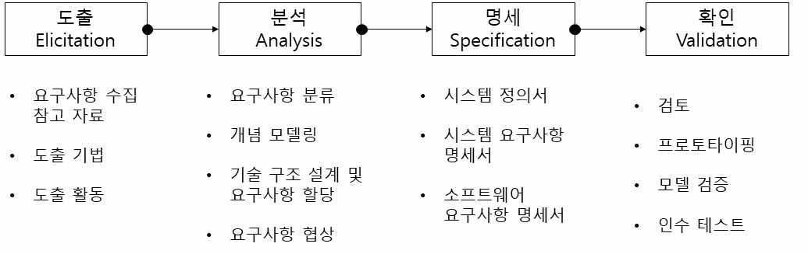

출처: 교육부(2015). 요구사항 확인(LM2001020201_14v2). 세종: 한국직업능력개발원. p.28.
[그림 1-1] 요구사항 개발 프로세스
2. 요구사항 도출
요구사항 도출은 소프트웨어 시스템에 요구되는 기능 및 제약 사항을 수집해야 한다.

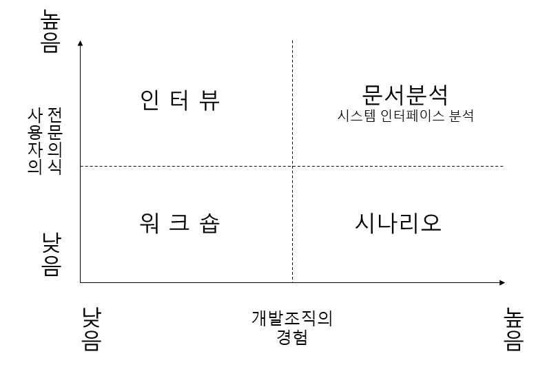

출처: 교육부(2017). 시스템SW 요구사항 분석(LM2001020801_16v2). 세종:
한국직업능력개발원. p.64.
[그림 1-2] 요구사항 도출 기법의 활용
(1) 요구사항 도출 기법
(가) 인터뷰
소프트웨어 개발에 참여하는 이해관계자들과의 직접적인 질문과 대화를 통해 정
보를 추출하는 일반적인 요구사항 도출 방법이다.
(나) 시나리오 작성
소프트웨어 시스템과 사용자 간의 상호작용을 시나리오 형식으로 작성하여 시스
템에 대한 요구사항을 도출하는 방법이다. 유스케이스, 사용자 스토리 등의 기법
들이 있다.
(다) 그룹 회의
제품의 기능적 요구사항과 품질 요구사항에 대한 결과나 아이디어를 얻기 위해
사용자 대표 그룹과 회의하여 요구사항을 도출하는 방법이다.
(라) 관찰
사용자의 워크플로를 관찰함으로써 현 시스템의 문제나 새로운 시스템의 요구사
항을 찾을 수 있는 방법이다.
(마) 워크숍
소수의 전문가 집단(Subject Matter Expert Group)이 모여 브레인스토밍 방식
으로 회의를 진행하여 요구사항을 도출하는 방법이다.
(바) 시스템 인터페이스 분석
시스템 인터페이스 분석 방법은 다른 요구사항 도출 방법과 달리 독립적으로 수
행되는 방법으로, 개발 대상 시스템과 연계할 다른 시스템에 대한 조사를 수행한
다. 시스템 인터페이스 분석을 통해 주로 시스템 간 데이터 교환 및 서비스에 관
한 기능 요구사항을 도출한다.
(사) 문서 분석
문서 분석은 소프트웨어 요구사항을 도출하기 위해 기존의 문서를 조사하는 방
법이다.
(2) 요구사항 도출 및 검토 기준(ISO/IEC 25030 반영)
요구사항 품질 특성 기준은 <표 1-2>와 같다.
<표 1-2> 요구사항 도출 및 검토 기준(ISO/IEC 25030 반영)
품질 특성
설명 예시
기준
요구사항이 모호함 없이 -사용자가 '데이터 로드' 버튼을 클릭했
명확성
정확하고 이해하기 쉽게 을 때, 시스템은 5초 이내에 모든 데
(Clarity)
작성되었는지를 나타냄 이터를 로드해야 한다.
일관성 요구사항 간에 충돌이나 -사용자는 비밀번호를 8자 이상 16자
(Consistency) 모순이 없음을 의미 이하로 설정해야 한다.
-사용자는 유효한 사용자 ID와
비밀번호를 입력하여 로그인할 수
시스템 구현에 있다. 로그인 성공 시 메인 페이지로
필요한 모든 정보가 이동하며, 로그인 실패 시 ‘사용자 ID
완전성
요구사항에 또는 비밀번호가 올바르지
(Completeness)
포함되어 있음을 않습니다.’라는 메시지를 표시하고
의미 로그인 화면에 머무른다. 또한 5회
연속 로그인 실패 시 해당 사용자
계정은 5분간 잠금 처리된다.
-시스템은 신규 사용자 등록 시, 입력
요구사항은 모호하지 않고,
필드마다 툴팁으로 입력 형식을
검증 가능성 측정 가능하며,
안내해야 하며, 모든 필수 필드 입력
(Verifiability) 테스트 케이스를 작성할 수
오류 시 0.5초 이내에 오류 메시지를
있도록 구체적이어야 함
표시해야 한다.
-기능들이 모듈별로 독립되어 있어,
요구사항에 변경이 특정 모듈의 요구사항이 변경되어도
발생했을 때, 그 변경이 다른 모듈에 영향을 주지 않도록
변경 용이성 시스템 전체에 미치는 설계해야 한다.
(Modifiability) 영향을 최소화하면서 -사용자 인터페이스(UI)와 비즈니스
효율적으로 반영할 수 로직을 분리하여, 화면 디자인을
있는 정도 변경하더라도 내부 로직을 수정할
필요가 없도록 해야 한다.
품질 특성
설명 예시
기준
각 요구사항이 어디에서
시작되었고(예: 비즈니스
목표), 어떤 설계 요소에
-로그인한 사용자는 ‘마이페이지’에서
추적 가능성 영향을 미치며, 어떤
자신의 주문 내역을 날짜별로 조회할
(Traceability) 코드와 연관되고, 어떤
수 있다.
테스트 케이스로
검증되는지 등을 추적할
수 있음을 의미
• 요구사항 정리와 기록
1. 자료 정리
요구사항 관련 자료 수집과 도출 활동이 완료된 후 최종 자료에 대해 정리한다. 이때,
ISO/IEC 25010의 기능적 적합성, 사용성, 보안성 등을 기준으로 요구사항을 재분류하
거나 태깅할 수 있다.
2. 요약 보고
정리된 자료에 대해서는 요약 보고서를 작성하여 요약 보고를 한다.
3. 정리된 자료의 접근 통제
요구사항에 관련된 자료는 조직 내에서 매우 중요하게 관리해야 하며, 해당 자료에 대
해 권한 그룹을 생성하고, 문서･정보의 보안이 이루어질 수 있도록 한다.
수행 내용 / 요구사항 도출하기
재료·자료
• 정보시스템 구축 관련 ISP 산출물, 중장기 경영 및 IT 컨설팅 자료, 현업 업무 매뉴얼,
사용 중인 각종 장표, 서식, 전산 운영자 매뉴얼, 전산 사용자 매뉴얼, 업무 파악을 위
한 교육 자료, 개념·논리·물리 모델, 테이블 및 칼럼 명세서
• 아이디어 기획서, 상품 기획서, 제품 기획서, 기획 보고서, 마케팅 보고서 등
기기(장비･공구)
• 컴퓨터, 문서 작성 도구, 빔 프로젝터
안전･유의 사항
• 요구사항 도출 주관자는 관련 도메인에 대한 경험과 지식을 보유하고 있어야 한다. 대
상 업무에 대한 지식을 빠르게 효과적으로 습득하고 프로젝트 관련 산출물에 대해서도
이해해야 한다.
• 인터뷰 진행자는 관련 도메인에 대한 경험과 지식을 보유하고 있어야 하며, 인터뷰 시
간, 장소 등 계획서 준비를 철저히 해야 한다.
• 시스템의 이해관계자를 빠뜨리지 않고 인터뷰를 진행하도록 한다.
• 제품의 경우에는 고객과 경쟁자의 분석을 이해관계자 인터뷰로 대체할 수 있다.
• 이해관계자별로 각자의 시스템에 대한 기대가 다르고, 시스템을 사용하고자 하는 입장
에도 차이가 있기 때문에 이해관계자 인터뷰를 통해 시스템의 정확한 요구를 이해하는
것이 매우 중요하다.
• 기존 시스템 현황 조사를 통해서 확인한 사항은 질문서에 미리 포함하여 이미 알고 있
는 내용을 재차 묻지 않도록 한다.
• 이해관계자와 자주 만나서 신뢰 관계를 형성한다.
• 요구사항 정의서의 항목 중 작성이 어려운 것은 비워 둔다. 비워진 항목은 추후 요구사
항 분석과 명세서 작성에서 기록한다.
수행 순서
• 요구사항 도출을 위한 정보를 수집한다.
비즈니스 목적 도메인 지식, 이해 당사자, 비즈니스 규칙, 조직 환경 등 다양한 요구사항
도출을 위한 정보를 수집한다.
1. 요구사항 도출 시 필요한 정보를 정의한다.
(1) 사용자 관련 정보를 정의한다.
(2) 업무 관련 정보를 정의한다.
(3) 기술 관련 정보를 정의한다.
2. 요구사항 도출 시 필요한 정보를 수집한다.
(1) 특정 목적, 특정 사용자를 위한 컴퓨터 관련 서비스용 애플리케이션 개발과 관련한 정보
를 수집한다.

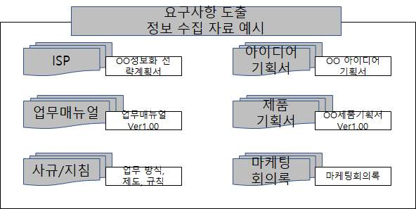

출처: 교육부(2021). 애플리케이션 요구사항 분석(LM2001020219_19v5). p.10.
[그림 1-3] 요구사항 도출 정보 수집 관련 자료(예시)
(가) IT서비스를 위한 컨설팅, BPR/ISP, 관련 회의록 등의 요구사항 관련 자료를 수집
한다.
1) BPR/ISP 산출물을 확보한다.
2) 경영 및 IT 컨설팅 결과물을 확보한다.
3) 업무 매뉴얼을 확보한다.
4) 교육 자료를 확보한다.
5) 회의록 등의 관련 자료를 확보한다.
(나) 범용 소프트웨어 제품이나 솔루션(solution) 아이디어 기획서, 관련 회의록 등의 요
구사항 관련 자료를 수집한다.
1) 아이디어 기획서를 확보한다.
2) 상품/제품 기획서를 확보한다.
3) 회의록 등의 관련 자료를 확보한다.
(다) 현행 시스템 관련 정보와 자료를 수집한다.
1) 정보 시스템 구성･기능 및 인터페이스 관련 자료를 수집한다.
2) 현행 시스템 아키텍처 및 소프트웨어 관련 자료를 수집한다.
3) 하드웨어 및 네트워크 관련 자료를 수집한다.
<표 1-3> 현행 시스템 관련 자료 목록(예시)
구분 학습 목표 성취수준
정보시스템 구 정보시스템 구성도, 기 -해당 자료가 없을 경우 운영자 매뉴얼, 사용자
성･기능 및 인 능 구성도, 인터페이스 매뉴얼, 현행 시스템 구축 제안서, 분석서, 설
터페이스 현황 계서에서 관련 자료를 발췌할 수 있다.
-관련 자료가 문서로 존재하지 않는 경우 현행
현행 시스템 아 현행 시스템 아키텍처
시스템 담당자와 면담 등을 통해서 작성해야
키텍처 및 소프 구성도,소프트웨어 구
한다.
트웨어 성도
-자료를 취득할 경우 자료의 출처, 수령한 시점,
현행 시스템과 동기화 여부, 담당자 의견 등을
기록한다.
-현행 시스템 관련 자료에는 대외비 정보가 다
하드웨어 및 네 하드웨어 구성도
수 포함되어 있으므로, 자료 취급 시 보안 관
트워크 네트워크 구성도
리 절차를 철저히 준수해야 하며, 접근 권한
통제·암호화·보관·폐기 절차 등을 반드시 지켜
야 한다.
출처: 교육부(2021). 애플리케이션 요구사항 분석(LM2001020219_19v5). 한국직업능력연구원. p.11.
• 요구사항 도출 계획을 수립한다.
프로젝트 초반에 비즈니스 분석가는 프로젝트 요구사항 도출 접근법을 계획해야 한다. 도
출 자원, 일정, 산출물에 대한 명시적 협의를 해야 한다. 도출 계획에는 사용할 시기, 목적
을 포함해야 하며, 아래와 같은 항목을 포함해야 한다.
1. 도출 목표를 설정한다.
(1) 전체 프로젝트에 대한 도출 목표를 설정한다.
(2) 계획된 도출 활동에 대한 각각의 목표를 설정한다.
2. 도출 범위와 도출 활동 방법에 맞는 안건을 계획한다.
전체 프로젝트에 대한 도출 목표와 계획된 각 도출 활동의 목표를 설정한다.
(1) 가용 시간을 고려한 도출 범위를 결정한다.
(2) 주제나 질문을 활용하여 범위를 결정한다.
(3) 찾아야 하는 특정 프로세스 흐름이나 유스케이스 목록을 만든다.
(4) 주제, 주제에 대한 시간, 대상 목표를 항목별로 적는다.
(5) 사전에 이해관계자와 세션을 공유한다.
3. 도출 전략에 따른 도출 계획 기법을 설정한다.
다양한 이해관계자의 상황이나 수준에 따라 인터뷰, 설문지, 워크숍 등의 사용할 기법
이 무엇인지를 설정한다.
(1) 접촉하는 다양한 이해관계자의 업무 환경이나 시간 제약 등을 파악한다.
(2) 접촉하는 다양한 이해관계자의 시스템에 대한 지식 수준을 파악한다.
(3) 이해관계자 그룹마다 어떤 기법을 사용할 것인지를 설정한다.
<표 1-4> 프로젝트 특성에 따른 요구사항 도출 기법 활용표
포
시스템 사용자 문
인 워 커 설
관 인터 인터 서
구분 터 크 스 문
찰 페이스 페이스 분
뷰 숍 그 지
분석 분석 석
룹
대중 시장 소프트웨어 ✔ ✔ ✔
사내 소프트웨어 ✔ ✔ ✔ ✔ ✔ ✔
기존 시스템 교체 ✔ ✔ ✔ ✔ ✔ ✔
기존 시스템 개선 ✔ ✔ ✔ ✔ ✔
신규 애플리케이션 ✔ ✔ ✔
패키지 소프트웨어 구현 ✔ ✔ ✔ ✔ ✔
임베디드 시스템 ✔ ✔ ✔ ✔
지리적으로 분산된 이해관계자 ✔ ✔ ✔
출처: 교육부(2021). 애플리케이션 요구사항 분석(LM2001020219_19v5). 한국직업능력연구원. p.12.
4. 도출을 위한 관련 자료를 준비한다.
(1) 도출 협의를 위한 객실, 회의실, 프로젝트, 화상 회의 장비 등의 물리적 자원을 파악하
고, 필요시 예약한다.
(2) 시차와 지리적으로 떨어져 있는 경우를 생각하여 일정에 반영한다.
(3) 다양한 정보를 얻을 수 있는 문서를 수집한다.
(4) 시스템에 대해 파악한다.
(5) 기존 시스템에 대해 다양한 정보를 습득한다.
5. 이해관계자를 파악한다.
(1) 요구사항 도출과 관련이 있는 이해관계자를 파악한다.
(2) 이해관계자의 문화적･지리적 성향을 파악한다.
(3) 이해관계자의 직업, 연령, 전문성 등을 파악한다.
6. 일정 및 자원을 추정한다.
(1) 고객과 개발자의 업무와 역할을 파악한다.
(2) 사용자 클래스를 식별하여 필요한 자원 요구를 파악한다.
(3) 도출을 준비하는 예상 시간을 산정한다.
(4) 도출 후 분석에 소요되는 예상 시간을 산정한다.
(5) 도출에 소요되는 일정과 자원을 산정한다.
7. 질문 사항을 준비한다.
(1) 질문 시작 시의 분위기를 제고할 수 있는 질문을 준비한다.
(2) 고객을 특정 방향으로 유도하지 않는 질문을 준비한다.
(3) 예외 상황에 대한 질문을 준비한다.
(4) 질문 종료 시의 추가 사항에 대한 질문을 준비한다.
8. 분석 모델 초안을 준비한다.
(1) 사용자들이 일에 대해 생각하는 방법과 가장 유사한 모델 초안을 만든다. 유스케이스나
프로세스 흐름을 작성한다.
(2) 기존 문서를 읽고 재사용할 수 있는 내용을 식별한다.
(3) 요구사항 도출에 대해 충분히 학습하기 위해 주제 전문가와 일대일 인터뷰를 실시한다.
(4) 함께 일하는 그룹을 통해 모델에 대해 이야기를 듣는다.
(5) 이해관계자 그룹마다 어떤 기법을 사용할 것인지를 준비한다.
9. 도출 활동에 따른 예상 결과물을 이해하고 활용성을 파악한다.
(1) 요구 분석 결과물의 작성 절차를 파악한다.
(2) 요구 분석 결과물 작성 내용과 항목을 파악한다.
(3) 요구 분석 결과물의 활용성을 파악한다.
10. 도출 활동에 따른 위험 요소를 예측하고 회피 방법을 파악한다.
(1) 요구 분석의 도출 활동을 지연시키는 요소를 파악한다.
(2) 파악된 요소의 위험 정도를 산정한다.
(3) 산정된 위험 요소를 완화하거나 제어하는 방법을 결정한다.
수행 tip
•효과적인 요구사항 도출을 위해 모든 사람의 시간과 지
혜를 최대한 활용할 준비가 되어 있어야 한다.
•세션 참가자의 규모가 클수록 준비가 더 중요하다.
• 요구사항 도출 활동을 수행한다.
요구사항 도출은 인터뷰, 시나리오 작성, 프로토타입 제작, 그룹 회의, 관찰, 사용자 스토
리 작성 등 제시된 요구사항 도출 기법을 활용하여 애플리케이션의 요구사항을 도출한다.
1. 이해관계자에게 교육을 한다.
(1) 이해관계자에게 사용하는 도출 기법을 설명한다.
(2) 사용하는 도출 기법을 선택한 이유를 이해관계자에게 설명한다.
(3) 요구사항 도출을 위해 유스케이스 기법과 프로세스 흐름 등을 교육한다.
(4) 더 좋은 요구사항 도출을 위해 이해관계자가 기여할 수 있는 방법을 설명한다.
(5) 정보 추출 방법을 설명하고, 요구사항 도출 후 검토할 수 있는 자료를 제공한다.
수행 tip
•이해관계자(Stakeholder)의 예시
- 발주자/의사결정권자: 프로젝트를 발주하거나 예산·일정을 승인하는 경영진
- 최종 사용자(End User): 실제로 시스템이나 서비스를 사용할 현업 직원, 고객
- 업무 담당자: 현재 업무 절차를 수행하며, 개선 요구나 제약 조건을 제시할 수 있는
사람
- 개발 팀: 분석가, 설계자, 개발자, 테스트 담당자 등 구현을 담당하는 팀
- 운영·유지보수 담당자: 시스템 배포 후 안정적 운영과 장애 대응을 맡는 인력
- 외부 협력사·공급업체: 시스템 구축에 필요한 솔루션, 장비, 서비스를 제공하는 업체
- 규제 기관·감사 부서: 법률, 규제, 표준 준수를 검토하거나 승인하는 기관
2. 요구사항 도출을 위한 논의와 기록을 한다.
(1) 서기를 참석시킨다.
논의에 적극적으로 참여하지 않아도 되나, 정확하게 기록할 수 있는 인원으로 선정
한다.
(2) 빠르게 기록할 장비를 준비하고 활용한다.
빨리 기록할 방법을 준비하고 빨리 기록하거나, 참가자의 동의를 받아 녹음을 한다.
화이트보드나 벽에 종이를 붙여 기록하고 사진을 찍어 둔다.
(3) 요구사항 도출에 대한 논의를 하고 노트에 기록한다.
참가자 목록, 초대받았지만 참석하지 않은 사람 목록, 결정된 사항, 향후 해야 할
일과 주관자, 미해결 사항, 핵심 논의 사항 등을 포함하여 기록해야 한다.
(4) 다이어그램은 신속한 수행을 위해서 화이트보드나 종이에 스케치하고, 사진을 찍거나
복사를 한다.
다이어그램을 도출할 때는 복잡한 소프트웨어를 사용하지 않고 손으로 스케치하는
것이 빠르다.
(5) 물리적 공간을 활용한다.
가시성을 높이고 함께 토론을 효과적으로 할 수 있도록 하기 위해 프로젝트 다이어
그램이나 시나리오 등을 벽에 붙여서 활용한다.
3. 요구사항 도출 프로세스를 수행한다.
(1) 업무 용어를 정리하고 용어를 정의한다.
(2) 요구사항 도출 프로세스 진행 시의 고려 사항을 활용한다.
(3) 프로젝트 관련자 및 최종 사용자를 식별한다.
(4) 현 시스템의 문제점을 파악한다.
(5) 시스템의 목적을 명확화한다.
(6) 시스템 구축 가능성과 효과를 분석한다.
(7) 시스템 사용자 조직의 특성을 파악한다.
(8) 시스템 구축과 관련된 제약 사항(비용, 납기, 성능, 플랫폼)들을 식별한다.
(9) 프로젝트 특성에 따른 요구사항 도출 기법을 활용한다.
(10) 논의된 요구사항을 정리한다.
(11) 반복적인 분석 및 검토 과정을 거쳐 요구사항을 확정한다.
<표 1-5> 요구사항 도출 프로세스 진행 시의 고려 사항
고려 사항
1. 방법이 아니라, 무엇을 해야 하는지에 초점을 맞추어 기술한다.
2. 적정한 문법과 철자법으로 완전한 문장을 작성한다.
3. 능동적인 어법을 사용한다.
4. 용어집에 정의된 용어를 일관성 있게 사용한다.
5. 모호하지 않은 수준까지 분해하여 작성한다.
6. 가시성을 높이기 위해 가능한 한 목록, 테이블 및 그래프를 사용한다.
7. 주관적이거나 모호한 용어는 피한다.
8. 대부분의 요구사항은 비즈니스 문제로부터 시작된다.
9. 대부분의 요구사항은 현 시스템을 기반으로 한다.
출처: 교육부(2021). 애플리케이션 요구사항 분석(LM2001020219_19v5). 한국직업능력연구원. p.15.
4. 요구사항 도출 기법을 활용하여 요구사항을 도출한다.
요구사항 도출 기법은 인터뷰, 워크숍, 시나리오 작성, 프로토타입 제작, 그룹 회의, 관
찰, 시스템 인터페이스 분석, 문서 분석 등이 있으나, 여기서는 2개의 기법만 서술하기
로 한다.
(1) 인터뷰
인터뷰는 서면이나 이메일로 수집된 요구사항을 구체화 및 명확화하거나 업무의 이
해 및 업무 절차를 조사하고 추가적인 요구사항을 수집하기 위해 1~2명의 관리자
또는 실무자와 대면하여 질의응답을 통해 정보를 수집하는 방법이다.
(가) 인터뷰를 계획한다.
1) 인터뷰 일정은 고객과 협의하여 수립한다.
2) 인터뷰 수행팀을 구성한다(일반적으로 질문자 1명, 기록자 1명).
3) 인터뷰 질의에 사용할 질문 목록을 준비한다.
4) 인터뷰 응답을 기록할 수 있는 양식을 준비한다.
<표 1-6> 인터뷰 질문(예시)
질문 유형 예시
- 하루에 주문은 몇 개 받는가?
폐쇄형 - 고객은 어떻게 주문하는가?
- 일별, 주별, 월별 매출 보고에 포함할 정보는 무엇인가?
- 현재 주문 방식은 무엇입니까?
자유 대답형 - 주문의 문제점은 무엇입니까?
- 주문에서 개선 사항은 어떤 것인가요?
- 왜 그렇게 생각하나요?
유도형 - 그러한 사례가 어떤 것인지요?
- 좀 더 구체적으로 설명해 주세요.
출처: 교육부(2021). 애플리케이션 요구사항 분석(LM2001020219_19v5). 한국직업능력연구원. p.16.
(나) 인터뷰를 수행한다.
1) 인터뷰 담당자에 대한 소개 및 인사를 한다.
<표 1-7> 주문 관리 시스템 인터뷰 시나리오(예시)
구분 예시
목표 주문 처리 프로세스 파악
참여자 영업 담당자 1명, IT 담당자 1명
- 하루 평균 주문 건수는? (폐쇄형)
- 고객이 주문을 생성하는 전형적인 절차는? (자유형)
진행 - 주문 오류 사례는 어떤 게 있나요? (유도형)
- 현재 시스템에서 가장 개선이 필요한 점은 무엇인가요? (자유형)
- 어떤 상황에서 주문을 취소하시나요? (예외 질문)
2) 친밀하고 부드러운 인터뷰가 되도록 분위기를 유도한다.
3) 질문 목록에 따라 질의응답한다.
4) 서면 또는 이메일로 이미 수집한 요구사항에 대한 구체적인 설명을 요청한다.
(다) 인터뷰 내용을 정리하고 결과를 분석한다.
1) 인터뷰한 내용을 정리한다.
<표 1-8> 주문 관리 시스템 인터뷰 정리 양식(예시)
인터뷰 도출
참여자 질문 응답
일시 요구사항
7/5 김OO 하루 주문 일일 주문 건수
약 30건
14:00 (영업) 건수는? 관리 기능 필요
2) 공식적인 인터뷰 정리 양식을 이용하여 결과를 표준화한다.
3) 추가적인 데이터 요구사항을 추출하고 확인한다.
<표 1-9> 인터뷰 보고서(예시)

| 인터뷰 보고서 |  |  |  |  |  |
| --- | --- | --- | --- | --- | --- |
| 인터뷰 대상자 | 권기학 | 직위 | 부장 | 부서 | 마케팅부 |
| 인터뷰 진행자 | 권순우 |  |  |  |  |
| 인터뷰 목적 | 1. 현 시스템을 이용하여 작성된 매출 현황 보고서 개선2. 미래 영업 정보 시스템 구축을 위한 요구사항 수렴 |  |  |  |  |
| 인터뷰 요약 | 1. 현재 모든 매출 보고서를 이 보고서에 첨부2. 현재 시스템에는 몇 가지 문제1) 데이터 실시간 현행화 미흡(영업부서는 실시간 매출 정보가 필요하나, 현재 정보는 4시간 후에 제공됨)2) 현재 시스템에서 발견된 오류는 대리점 정보가 누락되어 있음 |  |  |  |  |
| 미해결 이슈 | 1. 현재 매출 정보는 영업지원 팀(구내전화 2232)으로부터 접수2. 매출 자료 실시간을 위해 영업지원 팀 A사원과 인터뷰 계획 |  |  |  |  |

출처: 교육부(2021). 애플리케이션 요구사항 분석(LM2001020219_19v5). 한국직업능력연구원. p.17.
(라) 인터뷰를 결과를 피드백한다.
1) 분석 결과를 인터뷰 대상자에게 피드백한다.
2) 분석 결과에 따라 재인터뷰 계획을 수립하고 실행한다.
3) 인터뷰 응대에 대하여 이메일 또는 선물로 감사 표시를 한다.
4) 최종으로 요구사항을 정리한다.
(2) 워크숍
(가) 워크숍의 필요성을 파악한다.
요구사항 수집을 위해 전문 진행자의 진행하에 프로젝트의 현업 부서 측과 IT 인
력 측의 주요 구성원들이 함께 논의를 해야 한다. 여러 부서와 이해관계가 걸려
있는 요구사항을 확정해야 하고 사업 범위에 대한 조정을 해야 한다. 또 프로젝트
의 원활한 수행을 위한 문화적인 교류가 필요할 때 워크숍을 진행하여 해결한다.
(나) 워크숍을 준비한다.
워크숍을 통한 최종적인 목표와 구체적인 논의 사항을 도출하기 위해 사전에
철저한 준비가 필요하다.
1) 워크숍 과제를 선정하고 계획을 수립한다.
2) 참가 대상자를 선정한다.
3) 참가 대상자에 대한 사전 브리핑 및 교육 훈련을 실시한다.
4) 착수 회의(Kick-off)를 수행한다.
5) 워크숍 자료를 준비한다.
6) 설비와 물품을 준비한다.
7) 워크숍 장소를 선정한다.
8) 워크숍 기간 동안 수행할 프로그램을 준비한다.
(다) 워크숍을 진행한다.
아래와 같이 워크숍 절차에 따라 워크숍을 진행한다.
<표 1-10> 워크숍 진행 절차
진행 절차 진행 내용
- 워크숍의 시작을 알리고 간략한 인사말을 한다.
워크숍 개시 - 부수적인 항목들(휴게실 위치, 흡연 구역 등)에 대해서 공지한다.
- 일정을 확인한다.
- 워크숍의 목적과 접근 방법의 개요를 설명한다.
워크숍 수행 준비 - 사용자로 하여금 워크숍의 목적을 재확인하도록 한다.
- 워크숍 기간 동안 작업을 수행하기 위해 필요한 기법들을 습득한다.
- 구체적인 워크숍 수행 방식은 형태나 특정 목적에 따라 다르게 수행
한다.
워크숍 수행
- 워크숍의 목적에 맞게 진행될 수 있도록 조정하고 관찰한다.
- 세부적인 진행 방법 등은 기법을 이용한다.
- 종료할 때는 진행 일정을 확인하고 진행 사항을 요약한다.
워크숍 종료 - 워크숍 과정에서 도출된 요구사항을 공유할 수 있도록 요약하고, 책
임자가 전체에게 공유하여 일차적으로 검토를 받을 수 있도록 한다.
출처: 교육부(2021). 애플리케이션 요구사항 분석(LM2001020219_19v5). 한국직업능력연구원. p.18.
수행 tip
•최고 경영자와의 면담은 각별히 신경을 써서 준비하고
예의를 지키도록 한다.
•최고 경영자는 시간적 여유가 많지 않으므로 간단명료한
질문으로 핵심적인 내용을 중심으로 면담을 수행한다.
• 도출된 요구사항을 정리하고 기록한다.
요구사항 추출 내용을 관리하기 위해 요구사항의 출처와 요구 내용을 상세하게 기록한다.
1. 요구사항 도출 수행 활동 관련 노트 및 자료를 정리한다.
(1) 요구사항 수행 활동 직후 논의 내용을 노트에 정리한다.
인터뷰나 워크숍을 주도했다면, 머릿속에 생생하게 남아 있을 때 노트 정리를 해야
한다.
(2) 필요할 때 참고할 수 있도록 노트 원본을 보관한다.
(3) 참가자에게 보강한 노트를 공유하고 검토 요청을 한다.
(4) 논의에 참석하지 않은 이해관계자에게 노트를 공유하고 검토와 의견을 요청한다.
2. 미해결 이슈를 문서화한다.
(1) 각 이슈에 대해 이슈 해결과 관련된 모든 자료, 진행 상황, 소유자, 기한 등을 기록한다.
(2) 개발 팀과 테스트팀에서 사용할 수 있도록 동일한 이슈 추적 도구를 사용한다.
3. 고객의 의견을 분류한다.
(1) 요구사항 유형 분류표를 참고하여 고객의 의견을 분류한다.
<표 1-11> 요구사항 유형 분류표
구분 내용
재무, 시장, 고객이나 개발 조직이 얻고자 하는 비즈니스 혜택이다.
비즈니스 요구사항
예: -“A지역의 시장 점유율을 3개월 안에 25% 향상시켜야 합니다.”
사용자 목표나 사용자가 수행해야 하는 비즈니스 업무를 표현한 일반적인 문
사용자 요구사항 장이며, 일반적으로 유스케이스, 시나리오, 사용자 스토리보드로 표현한다.
예: -“저는 선임 장비 관리자로서 매일 아침 펌프 컨트롤러를 조정해야 합니다.”
고객이 특정 조건하에서 어떤 활동을 수행해야 하는 것을 말한다.
비즈니스 규칙 예: -“반드시 준수해야 한다.”
-“반드시 ~에 따라야 한다.” 등
구분 내용
특정 조건하에서 시스템이 보여 주거나 사용자가 시스템을 사용할 수 있게
하는 행동을 식별할 수 있게 하는 행위를 말한다.
기능적 요구사항
예: -“사용자는 프로젝트 목록을 알파벳순이나 역순으로 정렬할 수 있어야
합니다.”
시스템이 무엇을 얼마나 잘 제공하느냐에 대한 설명으로 빠르게, 쉽게, 사용
품질 속성 자 친화적인, 신뢰할 수 있는, 안전한, 바람직한 등의 단어를 활용한다.
예: -“모바일 소프트웨어는 사용자의 터치 명령에 빠르게 반응해야 합니다.”
시스템 자체를 제외한 모든 것의 연결하는 단어로, ‘∼로부터 신호를 읽어야 한
외부 인터페이스 다.’,‘사용자 인터페이스 요소는 <표준>을 준수해야 한다.' 등과 같은 문구이다.
요구사항 예: -“모바일 앱(app)은 제가 송금하는 수표를 촬영하고 나면 그 이미지를
은행에 전송할 수 있어야 합니다.”
설계 및 구현 시에 현실적으로 따르는 문제로서 임베디드SW를 포함하는 장
제약 조건 비는 크기나 무게, 인터페이스 등의 물리적인 제약 조건을 고려해야 한다.
예: -“컴퓨터로 전송하는 파일은 10GB를 초과할 수 없습니다.”
고객이 데이터 요소에 대한 포맷이나 타입, 허용된 값, 기본값 또는 복잡한
데이터 요구사항 비즈니스 요구사항의 조합이나 보고서 출력 등을 설명할 때 나타난다.
예: -“우편 번호는 5자리이다.”
누군가가 어떤 행동을 수행하기 위해 시스템과 상호작용 하는 특정 방법을
솔루션(solution)
설명한다면 솔루션(solution)을 제안한다고 볼 수 있다.
아이디어
예: -“저는 드롭다운 목록에서 소포를 보내고 싶은 주를 선택합니다.”
출처: 교육부(2021). 애플리케이션 요구사항 분석(LM2001020219_19v5). 한국직업능력연구원. p.20.
4. 요구사항목록을 작성한다.
도출된 요구사항을 아래의 요구사항 후보 목록에 정리한다. 요구사항 내용은 가능한 한
이해관계자가 사용한 용어를 그대로 작성하도록 한다.
<표 1-12> 요구사항 후보 목록(예시)
요구사항
번호 요구사항목록 요구사항(기능) 개요
출처
1 고객 정보 관리 - 고객 정보의 신규 등록, 수정, 삭제 등을 관리 영업 담당
2 제품 정보 관리 - 제품 정보의 신규 등록, 수정, 삭제 등을 관리 영업 담당
- 공급자 정보를 기존의 공급자 관리 시스템과 연동하여
3 공급자정보조회 영업 담당
조회
- 고객이 상품 주문을 위해서 아이디(ID), 비밀번호
4 로그인 영업 담당
(password)를 입력하여 로그인
- 상품 정보에서 원하는 상품의 종류와 수량을 입력
인터뷰
5 상품 주문 - 배송받을 주소, 연락 가능한 전화번호, 배송 희망 일자
-마케팅
등을 입력
요구사항
번호 요구사항목록 요구사항(기능) 개요
출처
- 주문 입력된 상품에 대해 주문 내용과 주문자의 정보를 인터뷰
6 주문 처리
검토 승인 -마케팅
- 주문 상품에 대한 재고를 시스템에서 자동으로 조회 인터뷰
7 재고 조회
- 재고가 충분하면 배송 처리 단계로 이관 -마케팅
- 사용자가 입력한 정보에서 발생할 수 있는 모든 오류 제안
8 오류 응답 시간
정보는 즉시 제시 요청서
- 시스템은 저장된 정보를 보관하고, 변경 이력을 기록하 제안
9 데이터 관리
고 관리해야 함 요청서
출처: 교육부(2021). 애플리케이션 요구사항 분석(LM2001020219_19v5). 한국직업능력연구원. p.21.
• 요구사항 도출 후 검토/보완 프로세스를 진행한다.
요구사항 도출 후 효과적인 검토 및 보완 프로세스는 프로젝트 성공에 결정적인 역할을
한다.
1. 목록화된 요구사항을 확인하고 부족한 부분을 보완한다.
파편화된 정보를 체계적으로 구조화하여 이후 검토 및 분석을 용이하게 한다.
<표 1-13> 목록화된 요구사항 정리
구분 내용
모든 요구사항에 고유한 식별자를 부여하여 추적성을 확보한다.
요구사항 식별자 예) REQ-SYS-001 (시스템 요구사항),
(ID) 부여 REQ-FUNC-001 (기능 요구사항),
REQ-NFR-001 (비기능 요구사항)
해당 요구사항이 어디서 나왔는지 명확히 한다. 이는 나중에 요구사항 변경
출처 기록
이나 오해 발생 시 원인을 파악하는 데 필수적이다.
이 요구사항이 어떤 비즈니스 목표나 사용자 문제를 해결하는지 간략하게
목적 명시
요약한다.
관련 이해관계자 이 요구사항에 직접적인 영향을 받거나 관련된 이해관계자를 명시한다.
기록 이는 향후 논의나 승인 과정에서 중요한 역할을 한다.
요구사항의 중요도와 시급성에 따라 우선순위를 부여한다.
우선순위 부여
(예: Must-have, Should-have, Could-have, Won't-have)
<표 1-14> 정리된 요구사항 사례
관련
요구사항 우선
내용 출처 목적 이해
ID 순위
관계자
사용자,
REQ- 사용자는 로그인 시 5회 보안 강화
사용자 시스템 Must-
FUNC- 연속 실패하면 계정이 5분간 및 무단
인터뷰 관리자, have
01 잠금 처리되어야 한다. 접근 방지
보안 팀
REQ- 고객은 상품 상세 페이지에서 고객 구매 마케팅 팀,
비즈니스 Should-
FUNC- ‘장바구니 담기’ 버튼을 통해 편의성 고객,
분석서 have
02 상품을 추가할 수 있다. 증대 개발 팀
시스템은 동시 사용자 1000명
REQ- 사용자
접속 시에도 페이지 로드 성능요구 기획 팀, Must-
NFR- 경험
시간이 3초를 초과하지 않아야 사항 개발 팀 have
01 최적화
한다.
2. 내부 피어 리뷰(Internal Peer Review)를 진행한다.
요구사항명세서 작성자 외의 팀원들이 초기 단계에서 오류, 누락, 모호성 등을 발견하
고 개선하기 위해 진행한다.
<표 1-15> 내부 피어 리뷰
구분 내용
요구사항명세서 작성자가 자신의 요구사항에 대해 팀원들에게
작성자 설명 설명하고, 의도를 공유한다. 이는 팀원들의 이해도를 높이고 질문을
유도하는 효과적인 방법
팀원들은 설명 내용을 바탕으로 질문을 하고, 잠재적인 문제점,
팀원 피드백
개선 아이디어, 의문점 등을 자유롭게 제시
공식적인 검토 회의보다는 편안하고 비공식적인 분위기에서 진행하여
비공식적 분위기
솔직한 의견 교환을 장려
<표 1-16> 내부 피어 리뷰 사례
구분 내용
개발팀 A가 새로 작성한 로그인 기능 요구사항에 대해 피어 리뷰를
상황
진행한다.
“로그인 기능 요구사항입니다. 특히 ‘비밀번호 5회 실패 시 잠금’
작성자 부분에 대해 개발 팀 의견을 듣고 싶습니다.
잠금 해제 방식에 대한 고려가 필요할까요?”
“비밀번호 실패 횟수는 어떻게 카운트할 건가요? IP 기준인가요,
계정 기준인가요? 그리고 잠금 해제는 자동으로 5분 후 해제되는 것인
팀원 1
지, 아니면 관리자가 수동으로 풀어 주어야 하는 것인지 명확하지
않습니다.”
“5분이라는 시간이 적절한지, 아니면 보안요구사항에 따라 더 길게
팀원 2
가져가야 할지 보안 팀과 논의해 볼 필요가 있겠네요.”
작성자는 이 피드백을 바탕으로 요구사항에 ‘계정 기준 잠금’ 및
피드백 반영 ‘5분 후 자동 해제’ 명시, 그리고 보안 팀과 추가 논의 필요성을
기록한다.
3. 결함 체크리스트에 기반한 리뷰(Checklist-based Review)를 진행한다.
사전에 정의된 품질 기준에 따라 요구사항을 체계적으로 검토하여 누락 없이 결함을
발견하도록 한다.
<표 1-17> 결함 체크리스트 기반 리뷰
구분 내용
요구사항의 명확성, 일관성, 완전성, 검증 가능성, 변경 용이성,
체크리스트 준비 추적 가능성 등 앞서 정의된 품질 특성을 기준으로 체크리스트를
작성
각 요구사항을 체크리스트 항목에 따라 점검하며, 해당 항목에
체크리스트 활용
부합하지 않거나 문제가 있는 경우 ‘결함’으로 기록
체크리스트 검토는 한 명 이상의 검토자가 독립적으로 수행할 수
담당자 지정
있으며, 교차 검토를 통해 효율을 높일 수 있음.
<표 1-18> 결함 체크리스트 기반 리뷰 사례
체크리스트 REQ-FUNC-01 REQ-FUNC-02 REQ-NFR-01
비고
항목 (로그인 잠금) (장바구니 담기) (성능)
명확성:
모호한 표현 O O O
없음?
일관성: 다른
요구사항과 O O O
충돌 없음?
완전성: 모든 잠금 해제 방식,
시나리오 X O O 실패 횟수 카운팅
고려? 기준 불명확
5회 실패 기준
검증 가능성:
및 잠금 해제
테스트 X O O
로직 테스트
가능?
방법 불분명
변경 용이성:
독립적으로 O O O
변경 가능?
추적 가능성:
출처/목적 O O O
명확?
완전성과 검증
가능성 부족.
잠금 해제 방식,
결함 요약 없음 없음
카운팅 기준
명확화
필요
4. 인스펙션 또는 워크스루 실시(Inspection or Walkthrough)를 진행한다.
공식적인 검토 회의를 통해 요구사항의 품질을 종합적으로 평가하고, 결함을 체계적으
로 식별 및 기록한다.
<표 1-19> 인스펙션 또는 워크스루
구분 특징 설명
역할(모더레이터, 리더, 기록자, 검토자)이 명확히
정형화된 프로세스 지정되고, 사전 준비, 회의 진행, 후속 조치 등
엄격한 절차를 따름
인스펙션 논의보다는 결함 발견에 집중하며, 회의 중에는
결함 식별 중심
해결책을 제시하기보다 결함만 기록
앞서 정의된 결함 체크리스트를 활용하여 체계적인
체크리스트 활용
검토를 진행
인스펙션보다는 덜 정형화되어 있으며, 작성자가
비공식적 논의 요구사항을 설명하고 참가자들이 자유롭게 질문하고
의견을 제시
이해 증진 및 주로 팀원들의 이해도를 높이고 초기 단계의 명백한
워크스루
초기 결함 발견 결함을 발견하는 데 중점을 둠
특정 시나리오(예: 사용자 스토리)를 따라가며
시나리오 기반 요구사항이 적절한지 확인하는 방식으로 진행될 수
있음
<표 1-20> 인스펙션 사례
구분 내용
요구사항 작성자, 모더레이터(회의 진행), 기록자(결함 기록),
참여자
개발 팀 대표, 테스트 팀 대표, 기획 팀 대표
“REQ-FUNC-01 로그인 잠금 기능 요구사항에 대해 인스펙션을
모더레이터 시작하겠습니다. 먼저 작성자가 요구사항을 설명하고, 각 검토자는
체크리스트에 따라 결함을 찾아 주십시오.”
“REQ-FUNC-01은 사용자가 비밀번호를 5회 잘못 입력하면 계정을
작성자
5분 동안 잠그는 기능입니다. 사용자 보안 강화를 위함입니다.”
“체크리스트 ‘완전성’ 항목에 따라, 5회 실패 카운트가 ‘누적’인지,
‘연속’인지 명확하지 않습니다. 또한, 5분 잠금 이후 자동으로 풀리는
테스트팀 대표
것인지, 관리자 개입이 필요한지도 명시되어야 합니다.”
(결함으로 기록)
“체크리스트 ‘검증 가능성’ 항목에 따라, 이 요구사항이 충족되었는지
개발 팀 대표 어떻게 테스트할지 구체적인 방법이 필요합니다. 예를 들어, ‘5회’
실패가 어떤 방식으로 시뮬레이션될 것인가요?” (결함으로 기록)
결과 인스펙션 후, 검토 결과서, 결함 목록, 시정 조치서를 작성한다.

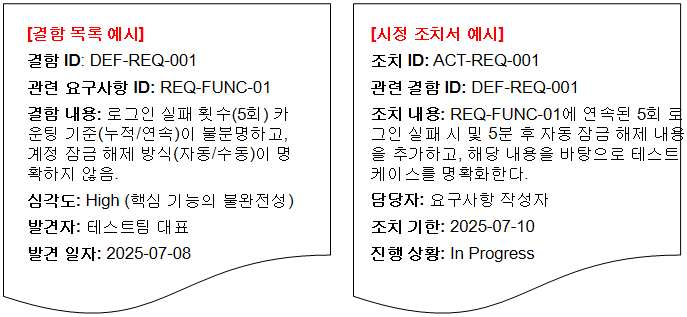

출처: 집필진 제작(2025)
[그림 1-4] 결함 목록 및 시정 조치서 사례
5. 요구사항 추적표(Requirements Traceability Matrix)를 작성한다.
각 요구사항이 시스템의 설계, 구현, 테스트와 어떻게 연결되는지 시각적으로 보여 주
어, 변경 관리와 영향도 분석을 용이하게 한다.
<표 1-21> 요구사항 추적표
구분 내용
요구사항 ID를 행(Row)으로, 관련 설계 문서 ID, 코드 모듈 ID,
매트릭스 생성
테스트 케이스 ID 등을 열(Column)로 하는 표를 만든다.
각 교차점에 해당 요소와의 연결 여부를 표시한다.
연결 관계 명시
(예: X, O, 해당 ID).
요구사항에서 설계/테스트로의 순방향 추적뿐만 아니라, 설계/테스트
에서 요구사항으로의 역방향 추적도 가능해야 한다. 이는 특정 설계
양방향 추적성
변경이 어떤 요구사항에 영향을 미치는지, 특정 테스트 실패가 어떤
요구사항의 문제인지를 파악하는 데 유용하다
<표 1-22> 요구사항 추적표 사례
상위 비즈니스
요구사항 ID 설계 문서 ID 코드 모듈 ID 테스트 케이스 ID
목표
REQ-FUNC BM-002
SD-AUTH-01 C-AUTH-001 TC-AUTH-001
-01 (보안 강화)
REQ-FUNC BM-001
SD-CART-01 C-CART-001 TC-CART-001
-02 (매출 증대)
REQ-NFR BM-003
SD-PERF-01 C-PERF-001 TC-PERF-001
-01 (고객 만족)

| 학습 1 | 교수·학습 방법 |
| --- | --- |

교수 방법
• SW 요구사항 정의, SW 요구사항 중요성에 대해 요구사항 부재나 오류로 인한 비용,
일정 증가 사례를 제시하여 설명한다.
• SW 요구사항 유형의 종류에 대해 기능 요구사항, 비기능 요구사항, 도메인 요구사항을
비교하는 표와 예시를 들어 설명한다.
• SW 요구사항 도출을 위한 운영 매뉴얼, 사용자 매뉴얼, 제안서, 설계서 등 실물 자료
시연을 통해 설명한다.
• SW 요구사항 개발 프로세스에 대해 프로세스 흐름도를 보여 주고 단계별 산출물 예시
를 제시하여 설명한다.
• SW 요구사항 도출을 위해 인터뷰, 설문조사 활용 기법과 작성 방법에 관해 설명한다.
• SW 요구사항 도출 자료의 정리 방법에 관해 설명한다.
학습 방법
• SW 요구사항의 정의, SW 요구사항의 중요성에 대해 교수자가 제시한 사례를 분석하여
문제 원인과 해결책을 도출하면서 학습한다.
• SW 요구사항의 종류에 따라 요구사항을 분류(기능/비기능/도메인)하고 근거 작성을 통
해서 요구사항 분석 방법을 학습한다.
• SW 요구사항 도출을 위한 자료의 종류를 식별하고 매뉴얼·제안서·설계서에서 요구사항
추출 연습을 통해 학습한다.
• SW 요구사항의 개발 프로세스에 대해 단계별 산출물을 보고 흐름도 작성을 통해 학습
한다.
• SW 요구사항의 도출 기법 활용과 작성 방법에 대해 학습한다.
• SW 요구사항의 도출 자료 정리 방법에 대해 학습한다.

| 학습 1 | 평 가 |
| --- | --- |

평가 준거
• 평가자는 학습자가 학습 목표를 성공적으로 달성하였는지를 평가해야 한다.
• 평가자는 다음 사항을 평가해야 한다.

| 학습 내용 | 학습 목표 | 성취수준 |  |  |
| --- | --- | --- | --- | --- |
|  |  | 상 | 중 | 하 |

- 비즈니스 목적, 도메인 지식, 이해당사자, 비즈니스 규칙,
조직 환경 등 다양한 요구사항 도출을 위한 정보를 수집
할 수 있다.
- 인터뷰, 시나리오 작성, 프로토타입 제작, 그룹 회의, 관
요구사항 도출
찰, 사용자 스토리 작성 등 제시된 기법을 통해 애플리케
이션의 요구사항을 도출할 수 있다.
- 요구사항 추출 내용을 관리하기 위해 요구사항의 출처와
요구 내용을 상세하게 기록할 수 있다.
평가 방법
• 서술형 시험

| 학습 내용 | 평가 항목 | 성취수준 |  |  |
| --- | --- | --- | --- | --- |
|  |  | 상 | 중 | 하 |

- 요구사항 도출을 위한 원천 자료에 대한 각 자료명과 각
자료에 대한 이해 정도
- 요구사항 도출을 위한 계획 수립 이해 정도
요구사항 도출
- 요구사항 도출 기법에 대한 각 기법별 이해 정도
- 요구사항 도출 프로세스의 이해 정도
- 요구사항 정의서 항목별 이해 정도
• 논술형 시험

| 학습 내용 | 평가 항목 | 성취수준 |  |  |
| --- | --- | --- | --- | --- |
|  |  | 상 | 중 | 하 |

- 요구사항 도출을 위한 관련 자료 수집 절차에 대한 전개
능력
- 요구사항 도출을 위한 계획 수립 전개 능력
요구사항 도출
- 요구사항 도출 기법에 대한 각 기법의 활용 능력
- 요구사항 도출 프로세스의 전개 능력
- 요구사항 정의서 작성 능력
• 평가자 질문

| 학습 내용 | 평가 항목 | 성취수준 |  |  |
| --- | --- | --- | --- | --- |
|  |  | 상 | 중 | 하 |

- 요구사항 도출을 위한 원천 자료에 대한 각 자료명과 각
자료에 대한 이해 정도
- 요구사항 도출을 위한 계획 수립 이해 정도
- 요구사항 도출 기법에 대한 각 기법별 이해 정도
- 요구사항 도출 프로세스의 이해 정도
- 요구사항 정의서 항목별 이해 정도
요구사항 도출
- 요구사항 도출을 위한 관련 자료 수집 절차에 대한 전개
능력 정도
- 요구사항 도출을 위한 계획 수립 전개 능력 정도
- 요구사항 도출 기법에 대한 각 기법의 활용 능력 정도
- 요구사항 도출 프로세스의 전개 능력 정도
- 요구사항 정의서 작성 능력 정도
• 평가자 체크리스트

| 학습 내용 | 평가 항목 | 성취수준 |  |  |
| --- | --- | --- | --- | --- |
|  |  | 상 | 중 | 하 |

- 요구사항 도출을 위한 원천 자료에 대한 각 자료명과 각
자료에 대한 이해 여부
- 요구사항 도출을 위한 계획 수립에 대한 이해 여부
- 요구사항 도출 기법에 대한 각 기법별 이해 여부
- 요구사항 도출 프로세스의 이해 여부
- 요구사항 정의서 항목별 이해 여부
요구사항 도출
- 요구사항 도출을 위한 관련 자료 수집 절차에 대한 숙지
여부
- 요구사항 도출을 위한 계획 수립 숙지 여부
- 요구사항 도출 기법에 대한 각 기법의 활용 능력을 점검
- 요구사항 도출 프로세스의 숙지 여부
- 요구사항 정의서 작성 숙지 여부
• 구두 발표

| 학습 내용 | 평가 항목 | 성취수준 |  |  |
| --- | --- | --- | --- | --- |
|  |  | 상 | 중 | 하 |

- 요구사항 자료 수집 계획 발표 능력
- 요구사항 도출 계획 및 준비 사항 발표 능력
요구사항 도출
- 요구사항 도출 기법 적용 계획 발표 능력
- 요구사항 도출 내용 정리 발표 능력

| 학습 내용 | 평가 항목 | 성취수준 |  |  |
| --- | --- | --- | --- | --- |
| 피드백 |  |  |  |  |
| 1. 서술형 시험- 성취수준이대한 요구사항을 | 낮은 학습자들에게는 요구사항 도출 과정의 핵심 개념을 적용해직접 작성하게 한 뒤, 미흡한 경우 보완 과제를 제출하도록 | 특정한다. | 시나리오에 |  |
| 2. 논술형 시험- 성취수준이에 맞는 최적의 | 낮은 학습자들에게는 다양한 요구사항 도출 기법의 장단점을기법을 논술하게 한 뒤, 불충분한 경우 심화 학습 보고서를 | 비교하고제출하도록 | 특정 | 상황한다. |
| 3. 평가자 질문- 성취수준이통해 학습자의 | 낮은 학습자들에게는 요구사항의 모호성을 줄이는 구체적인사고 과정을 평가하고, 답변이 부족하면 관련해서 설명해 준다. | 방안에 | 대한 | 질문을 |
| 4. 평가자 체크리스트- 성취수준이비즈니스 목적과 | 낮은 학습자들에게는 요구사항 도출 기법, 요구사항의 출처와도메인 지식의 연결 관련해서 구체적으로 설명한다. | 내용 | 기록 | 방법, |
| 5. 구두 발표 - 성취수준이비즈니스 목적과 | 낮은 학습자들에게는 요구사항 도출 기법, 요구사항의 출처와도메인 지식의 연결 관련해서 설명해 준다. | 내용 | 기록 | 방법, |

학습 1 요구사항 도출하기

| 학습 2 | 요구사항 분석하기 |
| --- | --- |

학습 3 요구사항 명세화하기
학습 4 요구사항 검증하기
2-1.
요구사항 분석
•요구사항 분석과 협상을 위해 도출한 요구사항을 기능적 요구사항과 비기능적 요구사항으로
분류할 수 있다.
•도출한 요구사항의 내용을 분석하여 구현을 위한 우선순위를 결정할 수 있다.
학습 목표 •도출한 요구사항이 개발하고자 하는 애플리케이션 전체 또는 단위 컴포넌트에 영향이 있는지
를 분석하여 요구사항의 적용 범위를 확인할 수 있다.
•요구사항 분석 결과를 토대로 사용자와 협상을 통해 요구사항, 우선순위, 영향 범위 등을 확정
할 수 있다.
필요 지식 /
• 기능 요구사항 분석 기법
1. 기능 분할
시스템 관점에서 외부에 제공해야 하는 서비스(기능)를 유형별로 최하위 단위 구성 요
소에 도달할 때까지 분할해 가는 방식으로 분석하는 방법이다.
2. 유스케이스와 사용자 스토리
유스케이스(Use Case)란 시스템 경계 밖에 위치한 액터가 특정 목적을 달성하기 위해
시스템이 제공하는 기능을 이용하여 시스템과 일련의 상호작용을 주고받는 시나리오로
나타낸 것이다. 액터(Actor)란 시스템을 사용하거나 시스템과 상호작용 하는 사람이나
타(他) 시스템을 의미한다.

| 학습 내용 | 평가 항목 | 성취수준 |  |  |
| --- | --- | --- | --- | --- |
| 출처: 교육부(2017).[그림 2-1] 유스케이스와 | 애플리케이션 요구사항 분석(LM2001020219_19v5). p.28. 사용자 스토리를 이용한 기능적 요구사항과 테스트를 도출하는 | 방법 |  |  |
| 3. 유스케이스 접근법 |  |  |  |  |
| (1) 유스케이스(UseUML의 근간이이해관계자인와 구조를<표 2-1> 유스케이스요소명시스템 경계액터(Actor)유스케이스연관포함확장일반화출처: 교육부(2017). | Case) 표기법 되는 주요 기법의 하나로, 유스케이스 다이어그램은액터(Actor)와 상호작용을 나타내는 유스케이스(Use가장 개괄적으로 보여 주는 도표이다. 표기법 표기 설명 시스템의 범위 표시 시스템과 상호작용 하는 시스템시스템에 의해 수행되는 행위액터(Actor)와 유스케이스 간의하나의 유스케이스가 또 다른하는 것을 나타내는 두 유스케이스하나의 유스케이스가 또 다른또는 기능을 추가하는 것을 이스 간의 관계 액터(Actor)와 액터, 유스케이스와간의 관계로 두 개체 간에는 시스템SW 요구사항 분석(LM2001020801_16v2). 세종: | Case)외부또는 기능상호작용유스케이스를간의유스케이스에나타내는일반화한국직업능력개발원. | 시스템에간의객체관계관계두 유스케이스관계가p.72. | 대한관계사용행위유스케있음 |

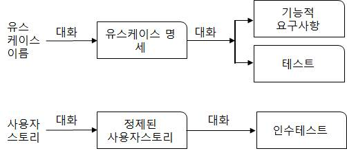

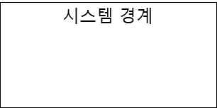

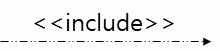

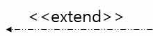

| 학습 내용 | 평가 항목 | 성취수준 |  |  |
| --- | --- | --- | --- | --- |
| (2) 유스케이스(Use유스케이스는간의 일련의상호작용 하는위자를 파악하기<표 2-2> 유스케이스내용 - 시스템 내에- 누가(또는- 누가(또는출처: 교육부(2021). | Case) 행위자 식별 행위자에게 가치를 제공하는 결과를 도출하는 시스템과상호작용을 설명한다. 행위자는 유스케이스를 수행하기사람 또는 다른 소프트웨어 시스템이나 하드웨어위해서는 다음과 같은 질문을 활용한다, 행위자 식별을 위한 질문(예시) 어떤 일이 발생했을 때 누구(또는 무엇)에게 알리는가? 무엇이) 시스템에 정보나 서비스를 제공하는가? 무엇이) 시스템 작업에 대응하거나 이를 완료하는 데 도움을애플리케이션 요구사항 분석(LM2001020219_19v5). | 위해장비를주는가?한국직업능력연구원. | 외부말한다.p.29. | 행위자시스템과행 |
| 4. 개념 모델링(Conceptual | Modeling) |  |  |  |
| (1) 개념 모델의실세계 문제에발생하는 문제 도메인의 | 역할 대한 모델링이 소프트웨어 요구사항 분석의 핵심이며,상황에 대한 이해를 증진시키고 해결책을 설명한다. 엔티티(Entity)들과 그들의 관계 및 종속성을 반영한다. | 따라서 | 모델은개념 | 문제가모델은 |
| (2) 개념 모델의유스케이스태 모델(StateInteractions),한 모델을Language)을출처: 교육부(2017). | 종류와 표기법 다이어그램(Use Case Diagram), 데이터 흐름 모델(DataModel), 목표 기반 모델(Goal-based Model), 사용자객체 모델(Object Model), 데이터 모델(Data Model)작성할 수 있다. 대부분의 모델링 표기법은 UML(Unified사용한다. 시스템SW 요구사항 분석(LM2001020801_16v2). 세종: | Flow등과 | Model),인터랙션(User같은 | 상다양Modeling |
| 한국직업능력개발원.[그림 2-2] | p.65. 유스케이스 다이어그램(예시1) |  |  |  |

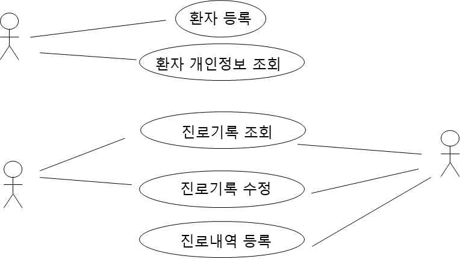

| 학습 내용 | 평가 항목 | 성취수준 |  |  |
| --- | --- | --- | --- | --- |
| (3) UML 다이어그램의사용 시나리오를다이어그램(Structure추상화 및행위 Behavior)를• 요구사항 분류 요구사항 분석과고, 이를 여러 가지화해 나가는 것이다.• 요구사항 우선순위고객의 기대치가한 한 빨리 제공할 | 사용 나타내기 위해 유스케이스 다이어그램이 많이 Diagram)은 시스템의 정적 구조(Static 구현 수준에서 시스템의 구성 요소, 구성 요소들 간의다이어그램(Behavior Diagram)은 시스템 내 객체들의 동적인보여 주며, 시간의 변화에 따른 시스템의 연속된 변경을협상을 위해 도출된 각각의 요구사항을 좀 더 풍부하고방법으로 표현함으로써 요구사항을 분류하고 조직화하여할당 높고 일정이 짧은 경우, 제품이 가장 중요하거나 가치수 있는지 확인해야 한다. | 사용되고Structure)와관계를상세하게있는 | 있다.보여행위(Dynamic설명해명세를기능을 | 구조다양한준다.준다.이해하구체가능 |
| 1. 우선순위 할당우선순위 할당 | 요청 시 고객의 반응은 “모든 기능이 필요하다. 그냥 | 모두 | 다 해 | 주세 |
| 요.”이다. 우선순위가 | 프로젝트 수행에 반드시 필요하지만 우선순위를 |  | 줄이기는 | 매우 |
| 어렵다. 비즈니스에서 | 일부 핵심 기능은 다른 기능보다 훨씬 중요한 | 경우가 | 있다. |  |
| 2. 우선순위 할당 | 기법 |  |  |  |
| (1) 할까/하지모든 우선순위계자 그룹을 | 말까 할당 방법 중 가장 간단한 것은 요구사항목록 작업을확보하고, 요구사항 각각에 대해 할지, 하지 말지 | 양자택일을 | 수행할 | 이해관하는 것 |
| 이다. |  |  |  |  |
| (2) 짝 비교와사람들은 종종록의 순위를우선순위인지 | 순위 나누기 각 요구사항에 고유한 우선순위 번호를 할당하려고나눌 경우 모든 것들에 대해 짝 비교를 하게 되므로판단할 수 있다. | 한다.어떤 | 것이 | 요구사항목높은 |
| (3) 3단계 규모일반적인 급성이라는 | 조정 우선순위 할당 접근 방식은 요구사항을 세 가지 범주로두 항목을 고려하는 것이다. 즉, 다음과 같은 네 가지 | 나누는조합을 | 것이다.준다. | 긴 |
| (가) 높은 | 우선순위의 요구사항은 긴급하고 중요하다. |  |  |  |
| (나) 중간 | 우선순위의 요구사항은 중요하지만 긴급하지 않다. |  |  |  |
| (다) 낮은 | 우선순위의 요구사항은 중요하지도 긴급하지도 않다. |  |  |  |
| (라) 낮은 | 우선순위이거나 삭제할 요구사항은 긴급하게 보이나 실제로는 | 중요하지 | 않다. |  |
| (4) MoSCoW‘MoSCoW’의법 형식을 | 4개의 대문자는 하나의 요구사항 집합을 위한 네나타낸다. | 가지 | 우선순위 | 분류 |
| (가) Must: | 솔루션(solution)이 성공하기 위해 반드시 만족해야 하는 | 요구사항(꼭 |  | 필요함) |
| (나) Should:사항(필요함) | 중요하고, 가능하면 솔루션에 포함되어야 하지만 성공에 | 필수는 | 아닌 | 요구 |
| (다) Could:자원이 | 괜찮은 기능이지만 일정을 미루거나 제거해도 되는 허용하는 경우에만 개발(필요할 수도 있음) | 요구사항이며, |  | 시간이나 |
| (라) Won't: | 지금 개발할 필요는 없는 요구사항이지만, 다음번에 | 포함될 | 수 | 있음(필요 |
| 없음) |  |  |  |  |
| (5) 총합이 한정된예를 들면항 후보들 중 | 가치 배분 우선순위 할당팀에서 가상의 100달러를 준다. 팀 개발하고자 하는 항목을 구매하기 위해 이 돈을 | 구성원은할당한다. | 전체 | 요구사 |
| 3. 가치와 비용, 위험에이해관계자가경우 분석적인기 위한, 거의Deployment)라고 | 따른 우선순위 상대적으로 비정형 기법으로 할당된 요구사항 우선순위에방법을 사용하는 것이 유용하다. 제시된 제품 기능에 고객완벽하고 엄격한 방법은 품질 기능 전개, 즉 하는 기법을 활용하는 것이다. | 가치를QFD(Qualify | 동의하지 | 않는연관시키Function |
| 4. 요구사항 이해관계자가상충되는 경우, | 협상(Requirement Negotiation) 서로 상충되는 내용을 요구하거나 또는 기능과 비기능어느 한쪽을 지지하기보다는 적절한 균형(trade-off) | 요구사항들이지점에서 |  | 서로합의가 |
| 중요하다. 요구사항에며, 요구사항들 | 우선순위를 부여하는 것은 중요한 요구사항을간 상충되는 문제를 해결하는 데 이용될 수 있다. | 필터링할 | 수 | 있으 |
| 수행 내용 / 재료·자료 • 요구사항 도출• 요구사항 정의서기기(장비･공구) • 컴퓨터, 문서 작성안전･유의 사항 • 요구사항 분석트 관련 산출물에• 요구사항 분석구사항 분석 계획서• 기능 및 비기능의• 이해관계자와 자주수행 순서 • 기능 요구사항을 | 요구사항 분석하기 자료 도구, 빔 프로젝터 주관자는 대상 업무에 대한 지식을 빠르고 효과적으로대해서도 이해해야 한다. 주관자는 관련 도메인에 대한 경험과 지식을 보유하고준비를 철저히 해야 한다. 요구 분석에 대한 차이점을 이해하는 것이 매우 만나서 신뢰 관계를 형성한다. 분석한다. | 습득하고,있어야중요하다. | 하며, | 프로젝요 |
| 1. 유스케이스를 분석하고자 하는 | 도출한다. 시스템의 유스케이스를 도출한다. 필요시 유스케이스 | 모델링을 |  | 실시한 |
| 다. 기능 요구사항관계(Relation)를 | 후보 목록과 자료로부터 액터와 유스케이스를 파악한다. | 식별하고, | 이들 | 간의 |
| (1) 액터(Actor)를액터를 식별하기위해 사용하는는 애플리케이션을 | 식별한다. 위해 시스템을 이용하는 사용자(User)를 확인한다.사람이나 시스템을 파악한다. 애플리케이션인 경우이용하는 다른 소프트웨어 시스템의 액터를 | 또사람인파악한다. | 액터 | 식별을액터보다 |
| (가) 액터를<표 2-3>내용 - 누가- 누구- 누가가?- 누가- 개발될출처: | 찾기 위한 질문을 활용한다. 액터를 찾기 위한 질문(예시) 정보를 제공하고, 사용하고, 삭제하는가? 또는 어떤 조직에서 개발될 시스템을 사용할 것인가? 요구사항에 대해 관심을 가지고 있으며, 시스템이 만들어 낸시스템이 잘 운영될 수 있도록 유지･보수하고 운영･관리하는가?시스템과 상호작용 하는 하드웨어나 소프트웨어 시스템은 교육부(2021). 애플리케이션 요구사항 분석(LM2001020219_19v5). | 결과에무엇인가?한국직업능력연구원. | 관심이 | 있는p.34. |
| (나) 주 액터를주 | 식별한다. 액터(Primary Actor)를 파악하기 위해 유스케이스를 시작하는 |  | 사용자 | 액터를 |
| 파악한다. |  |  |  |  |
| (다) 보조 액터를보조 유스케이스<표 2-4>구분 조건 유스케이스주 액터보조 액터출처: | 식별한다. 액터(Secondary Actor)를 파악한다. 직접 유스케이스를시나리오 진행 중에 시스템과 상호작용 하는 액터를주 액터와 보조 액터 판별 예시 설명 노트북 컴퓨터에 연결된 프린터를 이용해 문서를 PC 운영체제가 설치된 프린터 드라이버가 제공하는PC 사용자 물리적으로 인쇄를 담당하는 프린터의 하드웨어와교육부(2021). 애플리케이션 요구사항 분석(LM2001020219_19v5). | 시작하지는찾는다.인쇄하는기능소프트웨어한국직업능력연구원. | 경우 | 않지만p.34. |
| (2) 유스케이스를기능 요구사항을 달성하기기능 하나로는 여러 개의 | 식별한다. 후보 목록으로부터 유스케이스를 식별한다. 위해 액터가 수행하는 단위 행위를 나타내기 때문에구성되기도 하지만, 보통은 특정 목적을 달성하기 위해단위 기능들이 모여 하나의 유스케이스를 구성한다. | 유스케이스는경우에서로 | 특정따라관련이 | 목적단위있 |
| (가) 일반적인 | 문장으로 포괄적인 유스케이스를 식별한다. |  |  |  |
| (나) 점차 | 구체적인 사용 시나리오로 발전시키면서 유스케이스를 분할한다. |  |  |  |

(다) 개별 기능들을 각각의 유스케이스로 식별한다.
(라) 시나리오를 작성하면서 좀 더 일반화시켜 그룹화한다.
<표 2-5> 유스케이스를 찾기 위한 질문 내용(예시)
질문 내용
- 액터가 원하는 시스템 제공 기능은 무엇인가?
- 액터는 시스템에 어떤 정보를 생성, 수정, 조회, 삭제하고 싶어 하는가?
- 액터는 시스템의 갑작스러운 외부 변화에 대해 어떤 정보를 필요로 하는가?
- 시스템이 어떤 기능을 제공하면 액터의 일상 작업이 효율적이고 편리해지는가?
- 모든 기능 요구사항들을 만족할 수 있도록 유스케이스가 모두 식별되었는가?
출처: 교육부(2021). 애플리케이션 요구사항 분석(LM2001020219_19v5). 한국직업능력연구원. p.35.
<표 2-6> 다양한 애플리케이션의 유스케이스 사례
애플리케이션 유스케이스 사례
- 로그인
- 고객 프로필 관리
온라인 쇼핑몰 - 상품 검색
- 상품 구매
- 물품 배송 등
- 관리 회계 항목의 입력, 수정, 삭제
- 회계 명세서 조정
관리 회계 시스템
- 판매 업체용 세금 계산서 출력
- 거래처 입력, 출력 등
- 민원서류 판별 기능
주민자치센터
- 민원서류 출력 기능
키오스크(kiosk)
- 수수료 입금 기능(동전, 지폐 구분 기능) 등
- 컴퓨터 부품 요청
- 컴퓨터 부품 입출력
컴퓨터 부품 관리시스템 - 컴퓨터 부품 발주 변경
- 주문 상태 확인 및 변경
- 일별/주별/월별 보고서 생성 등
출처: 교육부(2021). 애플리케이션 요구사항 분석(LM2001020219_19v5). 한국직업능력연구원. p.35.
<표 2-7> 유스케이스의 몇 가지 사례와 이에 대한 사용자 스토리
애플리케이션 유스케이스 사례 사용자 스토리
- 나는 고객이 원하는 신용 카드로 비용이 청구될 수
온라인 쇼핑몰 고객 프로필 관리
있도록 고객 스스로 프로필을 관리하도록 한다.
관리 회계 - 나는 소규모 판매자로서 고객에게 비용을 청구할 수
세금 계산서 출력
시스템 있도록 세금 계산서를 만들고자 한다.
주민자치센터 - 나는 민원인으로서 내가 목적으로 하는 서류를 확인
민원서류 확인
키오스크(kiosk) 하고 출력할 수 있도록 한다.
컴퓨터 부품 컴퓨터 부품 요 - 나는 과학자로서 컴퓨터를 만들 수 있도록 컴퓨터
관리시스템 청 부품을 요청하고자 한다.
출처: 교육부(2021). 애플리케이션 요구사항 분석(LM2001020219_19v5). 한국직업능력연구원. p.36.
(3) 유스케이스 다이어그램을 작성한다.
식별된 액터와 유스케이스는 유스케이스 다이어그램으로 작성한다.
(가) 시스템 경계(Boundary)를 나타내는 직사각형 하나를 다이어그램 중앙에 표시한다.
(나) 시스템 경계 안에 식별된 모든 유스케이스를 표시한다.
(다) 유스케이스 개수가 다소 많더라도 처음에는 모두 하나의 유스케이스 다이어그램 안
에 표시한다.
(라) 위에서 작성된 액터 목록에 있는 모든 액터를 시스템 경계 밖에 표시한다.

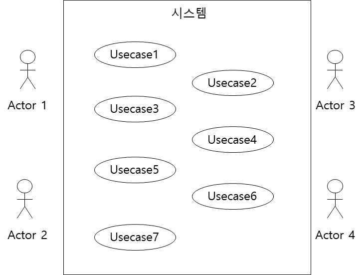

출처: 교육부(2017). 시스템SW 요구사항 분석(LM2001020801_16v2). 세종: 한국직업능력개발원. p.72.
[그림 2-3] 유스케이스 다이어그램(예시2)

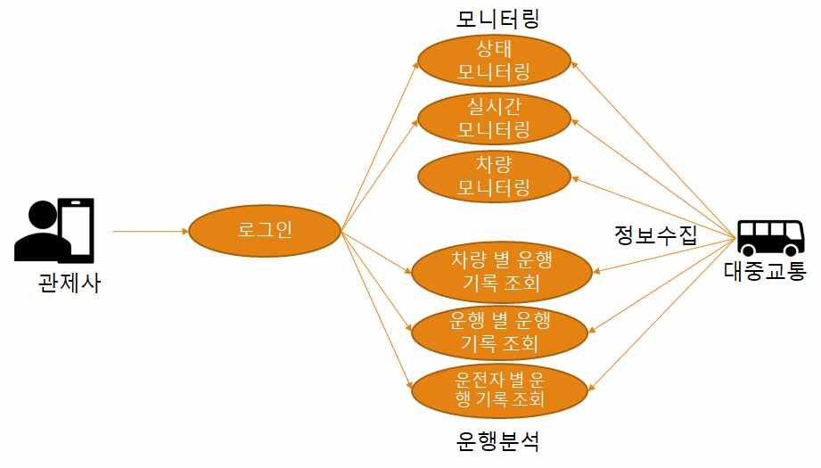

출처: 교육부(2021). 애플리케이션 요구사항 분석(LM2001020219_19v5). p.37.
[그림 2-4] 유스케이스 다이어그램(예시3)
(4) 유스케이스 관계를 식별한다.
액터와 액터, 액터와 유스케이스, 유스케이스와 유스케이스 간의 관계를 정의하여
유스케이스 다이어그램을 구체화한다.
<표 2-8> 유스케이스 관계를 식별하기 위한 질문(예시)
구분 질문 내용
연관 관계
- 액터와 유스케이스 간에 상호작용이 존재하는가?
(Association)
포함 관계 - 이 유스케이스를 실행하기 위해 반드시 실행되어야 하는 유스케이스가
(Include) 존재하는가?
확장 관계
- 이 유스케이스를 실행함으로써 선택적으로 실행되는 유스케이스가 있는가?
(Extend)
일반화 관계 - 액터 또는 유스케이스가 구체화된 다른 여러 액터나 유스케이스를 가
(Generalization) 지고 있는가?
출처: 교육부(2021). 애플리케이션 요구사항 분석(LM2001020219_19v5). 한국직업능력연구원. p.37.
2. 요구사항을 정제한다.
(1) 유스케이스 흐름을 정의한다.
유스케이스별로 개요, 시작 조건, 선행 조건, 후행 조건, 기본 흐름, 대안 흐름, 예
외 흐름 및 규칙을 정의하여 유스케이스가 액터와 상호작용 하며 제공하는 기능에
대해 명세화한다.
(2) 유스케이스를 재구조화한다.
유스케이스의 흐름을 정의할 때 식별된 공통 흐름에 대해 포함 관계 또는 확장 관
계로 구조화한다.
• 기능 요구사항과 비기능 요구사항을 분류한다.
1. 기능 요구사항에 관련된 내용을 정리하고 분류한다.
2. 비기능 요구사항에 관련된 내용을 정리하고 분류한다.
ISO/IEC 25010의 소프트웨어 품질 모델 기준에 따라 다음과 같은 품질 특성을 요구
사항 항목으로 구분하여 다루면 좋다.
<표 2-9> ISO/IEC 25010 품질 특성 기반 비기능 요구사항 항목 구성 예시
구분 설명 요구사항 항목 예시
- ERP 시스템과 매일 자정에 CSV 파일 형식
다른 시스템, 제품, 구성 요
호환성(Compati 으로 매출 데이터를 자동 교환해야 한다.
소와 정보를 교환하고 이를
bility) - 웹 서비스는 RESTful API 표준을 준수하여
사용할 수 있는 정도
외부 애플리케이션에서 호출 가능해야 한다.
- 시스템은 연속 24시간 동작 시 오류율이 1%
신뢰성 시스템이 일정 시간 동안 미만이어야 한다.
(Reliability) 오류 없이 작동하는 능력 - 장애 발생 시 1분 이내에 복구 절차가 자동
으로 작동해야 한다.
- 3회 이내의 클릭으로 주요 기능에 접근 가능
사용자가 시스템을 쉽게
사용성 해야 한다.
배우고 사용할 수 있는
(Usability) - 관리자 메뉴는 5명 이상의 사용자가 UI 테스
정도
트에서 ‘만족’을 선택해야 한다.
성능 효율성 자원을 효율적으로 - 페이지 응답 시간은 2초 이내여야 한다.
(Performance 사용하면서 적절한 반응 - 동시 접속자 100명까지 성능 저하 없이 동작
Efficiency) 시간을 제공하는 능력 해야 한다.
시스템이 데이터와 기능에
보안성 - 모든 로그인 요청은 HTTPS로 처리되어야 한다.
대해 비인가 접근을
(Security) - 3회 이상 로그인 실패 시 계정이 잠겨야 한다.
방지하는 정도
- 소스코드는 모듈화되어 기능별로 분리되어야
유지보수성 시스템을 쉽게 수정, 개선할 한다.
(Maintainability) 수 있는 능력 - 수정 시 단위 테스트가 자동으로 수행되어야
한다
- 시스템은 Windows, macOS, Linux 환경에
시스템이 다양한 환경에서
이식성 서 모두 설치 가능해야 한다.
쉽게 설치되고 동작할 수
(Portability) - Docker 컨테이너 형태로 배포할 수 있어야
있는 능력
한다
3. 요구사항 작성 시 유의 사항을 파악한다.
(1) 요구사항은 발주자와 수주자 모두가 이해하기 쉽고 간결하게 작성한다.
(2) 요구사항은 이해성을 높이기 위해 다이어그램이나 그래프 등을 사용하여 표현할 수 있다.
(3) 요구사항은 시스템의 외부 행위를 기술하는 것으로, 특정 구조나 알고리즘 등 기술적인
내용이나 설계 내용을 포함하지 않도록 한다.
(4) 시스템이 수행할 기능이나 시스템에 영향을 미치는 제약 조건을 기술한다.
(5) 업무 및 시스템 특성에 따라 반드시 필요한 품질 속성은 기술한다.
4. 요구사항을 분류하고 식별자(ID: Identifier)를 부여한다.
(1) 기능 요구사항과 비기능 요구사항 분류 예시를 참조하여 요구사항을 분류한다.
<표 2-10> SW 관련 요구사항 분류 기준 내용(예시)
요구사항 분류 기준 내용
목표 시스템(사업)이 반드시 수행되어야 하거나 목표 시스템을 이용하
여 사용자가 반드시 수행할 수 있어야 하는 기능(동작)에 대해 기술
함. 단, 개별 기능 요구사항은 전체 시스템의 계층적 구조 분석을 통
기능 기능 요구사항
해 단위 업무별 기능 구조를 도출한 후, 이에 대한 세부 기능별 상세
요구사항을 작성하는 것을 원칙으로 하며, 기능 수행을 위한 데이터
요구사항과 연계를 고려하여 기술함
시스템 장비 목표 사업 수행을 위해 필요한 하드웨어, 소프트웨어, 네트워크 등의
구성 요구사항 도입 장비 내역 등 시스템 장비 구성에 대한 요구사항을 기술함
목표 시스템의 처리 속도 및 시간, 처리량, 동적･정적 적용량, 가용성
성능 요구사항
등 성능에 대한 요구사항을 기술함
목표 시스템과 외부를 연결하는 시스템 인터페이스와 사용자 인터페
이스에 대한 요구사항을 기술한 것으로 타 소프트웨어, 하드웨어 및
인터페이스
통신 인터페이스, 타 시스템들과의 정보 교환에 이용되는 프로토콜과
요구사항
의 연계도 포함하여 기술함. 단, 인터페이스 요구사항의 경우 사용자
편의성, 사용자 경험 등의 사용자 중심의 요구사항을 기술함
비기능 도입되는 장비의 성능 테스트(BMT) 또는 구축된 시스템이 계획된 목
테스트 요구사항 표 대비 제대로 운영되는가를 테스트하고 점검하기 위한 테스트 요구
사항을 기술함
정보 자산의 기밀성과 무결성을 확보하기 위해 목표 시스템의 데이터
보안요구사항
및 기능, 운영 접근을 통제하기 위한 요구사항을 기술함
목표 사업의 원활한 수행 및 운영을 위해 관리가 필요한 품질 항목,
품질 요구사항 품질 평가 대상 및 목표에 대한 요구사항을 기술함. 신뢰성, 사용성,
유지･관리성, 이식성, 보안성으로 구분하여 기술함
목표 시스템 설계, 구축, 운영과 관련하여 사전에 파악된 기술, 표준,
제약 사항
업무, 법･제도 등 제약 조건 등을 파악하여 기술함
요구사항 분류 기준 내용
프로젝트 관리 프로젝트의 원활한 수행을 위한 관리 방법 및 추진 단계별 수행 방안
요구사항 요구사항을 기술함
프로젝트의 원활한 수행을 위해 필요한 지원 사항 및 방안에 대한 요
프로젝트 지원
구사항을 기술함. (예: 시스템/서비스 안정화 및 운영, 교육 훈련 및
요구사항
기술 지원, 하자 보수 또는 유지･관리 요구사항)
출처: 과학기술정보통신부(2018). 요구사항 상세화 실무 가이드라인, 정보통신산업진흥원. p.9.
<표 2-11> SW사업 유형별 요구사항 적용(예시)
소프트웨어 사업 유형
요구사항 소프트웨어 시스템 정보화
유지･관리
개발 운용 환경 전략 계획
기능 요구사항 ● ◐ ◐ ◐
시스템 장비 구성 요구사항 ● ●
성능 요구사항 ● ● ◐
인터페이스 요구사항 ● ◐ ◐
데이터 요구사항 ● ● ◐
비
기 테스트 요구사항 ● ● ◐
능 보안요구사항 ● ● ●
품질 요구사항 ● ● ●
요
제약 사항 ● ● ● ●
구
프로젝트 관리 요구사항 ● ● ● ●
사 프로젝트 지원 요구사항 ● ● ● ●
항
유지･관리 수행 ●
유지･관리 인력 ●
컨설팅 ●
공사
출처: 과기정보통신부(2018). 요구사항 상세화 실무 가이드라인, 정보통신산업진흥원. p.11.
(2) 식별된 단위 요구사항의 기능/비기능 유형에 따라 식별자(ID)를 부여한다.
(3) 식별자는 명명 규칙을 정하여 중복되지 않도록 부여한다.
(4) 부여된 식별자는 요구사항 관리를 위해 중요하게 사용된다.
(5) 유스케이스 기법을 적용한 경우 유스케이스 ID가 요구사항 식별자가 된다.
<표 2-12> 요구사항 식별자 부여(예시)
식별자 구분 ID 부여 규칙
System Function
기능 요구사항(SFR) SFR-000
Requirement
성능 요구사항 Performance Requirement PER-000
System Interface
인터페이스 요구사항 SIR-000
Requirement
데이터 요구사항 Data Requirement DAR-000
보안요구사항 Security Requirement SER-000
품질 요구사항 Quality Requirement QUR-000
제약 사항 Constraint Requirement COR-000
기타 요구사항 Others Requirement OTR-000
출처: 교육부(2021). 애플리케이션 요구사항 분석(LM2001020219_19v5). 한국직업능력연구원. p.40.
• 우선순위를 할당한다.
이해관계자가 상대적으로 비정형 기법으로 할당된 요구사항 우선순위에 동의하지 않는 경우
분석적인 방법을 사용하는 것이 유용할 수 있다. 제시된 제품 기능에 QFD(Quality Function
Deployment)라고 하는 기법을 활용하는 것이다.
1. 우선순위 결정 과정의 참가자를 선정한다.
(1) 프로젝트 관리자를 선정한다.
프로젝트 관리자는 프로세스를 이끌고, 충돌에 대해 중재하며 우선순위 자료를 조정
한다.
(2) 비즈니스 분석가를 선정한다.
비즈니스 분석가는 요구사항을 비즈니스와 비교하여 순위를 조정한다.
(3) 제품 챔피언을 선정한다.
제품 챔피언은 이익과 불이익에 대한 순위를 제공한다.
(4) 고객 대표를 선정한다.
고객 대표는 이익과 불이익에 대한 순위를 제공한다.
(5) 개발 팀 대표를 선정한다.
개발 팀 대표는 비용과 위험에 대한 순위를 제공한다.
2. 가치와 비용, 위험에 따른 우선순위를 부여한다.
요구사항에 상대적 가중치를 부여한 방법을 이용하여 우선순위를 부여한다.
(1) 우선순위를 정하고자 하는 모든 기능 또는 기능적 요구사항목록을 적는다.
모든 기능, 즉 유스케이스, 유스케이스 흐름, 사용자 스토리 또는 기능적 요구사항
목록을 적는다. 모든 항목은 동일한 추상화 수준이어야 한다. 즉 기능, 유스케이스
또는 사용자 스토리를 기능적 요구사항과 섞어서는 안 된다. 특정 기능은 논리적으
로 연결되어 있거나(기능 A가 포함된 경우에만 기능 B 구현) 의존성(기능 A는 기능
B보다 먼저 구현되어야 함)을 가지고 있을 수 있다. 그러한 경우 분석을 통해 영향
력이 큰 기능만 넣는다.
(2) 고객 각 대표가 상대적인 이익을 평가한다.
고객 각 대표가 각 기능이 고객이나 비즈니스에 제공하는 상대적인 이익을 1∼9등
급으로 평가한다. 1등급은 가치가 낮은 것이고, 9등급은 가치가 가장 높은 것이다.
이러한 이익 평가는 제품의 기능과 비즈니스 목표에 부합한지를 나타낸다.
(3) 이익과 불이익의 전체 가치를 계산한다.
각 기능이 포함되지 않을 경우 고객이나 비즈니스가 겪게 될 불편에 대한 상대적
불이익을 산출하며, 1∼9등급으로 구분하여 부여한다. 경쟁사 제품이 그 기능을 자
랑하고, 심지어 사용할 계획이 없는 고객도 당연히 있을 것으로 기대하는 경우 높은
불이익을 가져올 수 있다. 이러한 것을 마케팅에서는 ‘체크 박스 기능’이라고 한다.
즉, 대부분이 신경 쓰지 않는 기능이더라도 가지고 있다고 해야 한다.
<표 2-13> 불이익 등급 부여 시 고려 사항
고려 사항
✔ 그 기능을 가진 다른 제품과 비교해 여러분의 제품이 손해를 보는가?
✔ 법적 또는 계약상 어떤 영향이 있는가?
✔ 사용자가 일부 필요하거나 기대하는 기능을 실행할 수 없게 되는가?
✔ 정부 또는 업계 표준을 위반한 것인가?
✔ 나중에 확장을 통해 이 기능을 추가하기가 많이 어려운가?
✔ 마케팅에서 일부 고객에게 약속한 기능이기에 문제가 생기는가?
출처: 교육부(2021). 애플리케이션 요구사항 분석(LM2001020219_19v5). 한국직업능력연구원. p.41.
(4) 이익과 불이익 수치를 합한 것으로 기능의 전체 가치를 계산한다.
모든 기능의 가치를 합산하고 전체 가치에 대한 각 기능의 비율을 계산한다.
(5) 개발자가 각 기능을 구현하는 데 드는 상대적 비용을 계산한다.
1은 빠르고 9는 오래 걸리도록 등급으로 부여한다. 기능의 복잡성, 사용자 인터페이
스 작업의 규모, 기존 코드를 재활용하기 위한 잠재 능력, 필요한 테스트양 등을 기
반으로 비용을 추정한다.
(6) 상대적인 기술적 위험을 평가한다.
1∼9등급으로 부여한다. 9등급은 어려운 것으로 실현 가능성, 팀 전문 지식, 생소한
개발 도구와 새로운 기술 사용, 요구사항에 숨겨진 복잡성 등의 심각한 상황이 있을
때 부여한다.
(7) 각 기능에 대한 우선순위를 계산한다.
우선순위는 다음과 같이 계산한다.
가치(%)
우선순위 =
/
비용(%)+위험(%)
(8) 가장 오른쪽에 우선순위에 따라 내림차순으로 기능 목록을 정렬한다.
기능 목록에서 맨 위에 있는 기능은 가치, 비용, 위험 측면에서 가장 유리한 균형을
가지고 있으며, 다른 조건에 변동이 없다면 가장 높은 우선순위를 가져야 한다.
3. 요구사항 우선순위 평가 템플릿을 작성한다.
ISO/IEC 25030 (요구사항 품질 요건) 및 ISO/IEC 25010을 바탕으로, 우선순위 부여
시 품질 속성 중 시스템 전반에 미치는 영향도, 위험도 기반 접근(Risk-based
prioritization), 고객 가치/비용/기술적 난이도 등 다면 평가 방식을 기준으로 하는 것
이 좋다.
<표 2-14> 우선순위 평가 템플릿(예시)
요구사항 품질 특성 영향도 리스크 고객 가치 기술 난이도 개발 비용 MoSCoW
실시간 성능
높음 중 높음 보통 보통 Must
재고 조회 효율성
2단계
로그인 인 보안성 높음 높음 높음 낮음 낮음 Must
증
음성 주문 사용성 낮음 낮음 높음 높음 높음 Could
<표 2-15> 컴퓨터 부품 관리 시스템에 대한 우선순위 매트릭스(예시)
상대적 가중치 2 1 1 0.5
상 상 전 가치 상 비용 상 위험 우 선
대 대 체 (%) 대 (%) 대 (%) 순위
적 적 가 적 적
기능
이 불 치 비 위
익 이 용 험
익
1.전기 안전 규제
2 4 8 5.2 1 2.7 1 3,0 1.22
자료 인쇄
2.판매 업체 주문
5 3 13 8.4 2 5.4 1 3.0 1.21
상태 조회
3.컴퓨터 부품 재고
9 7 25 16.1 5 13.5 3 9.1 0.89
보고서 생성
상대적 가중치 2 1 1 0.5
상 상 전 가치 상 비용 상 위험 우 선
대 대 체 (%) 대 (%) 대 (%) 순위
적 적 가 적 적
기능
이 불 치 비 위
익 이 용 험
익
4.특정 부품 이력
5 5 15 9.7 3 8.1 2 6.1 0.87
보기
5.특정 부품에 대한
판매 업체 카탈로그 9 8 26 16.8 3 8.1 8 24.2 0.83
검색
6.위험 전기 규제품
3 9 15 9.7 3 8.1 4 12.1 0.68
목록 관리
7.보류 중인 규제
4 3 11 7.1 3 8.1 2 6.1 0.64
부품 요청 변경
8.실험실 재고 보고서
6 2 14 9.0 4 10.8 3 9.1 0.59
생성
9.규제 부품 교육
기록 데이터베이스 3 4 10 6.5 4 10.8 2 6.2 0.47
확인
10.긴급 부품 수배
7 4 18 11.6 9 24.3 7 21.2 0.33
도구에서 불러오기
합계 53 49 155 100.0 37 100.0 33 100.0
출처: 교육부(2021). 애플리케이션 요구사항 분석(LM2001020219_19v5). 한국직업능력연구원. p.43.
• 비기능 요구사항을 분석한다.
1. 비기능 요구사항목록을 1차 정제한다.
비기능 요구사항 후보들을 비기능 요구사항 유형으로 정렬한다. 요구사항 내용, 관련
기능 요구사항, 출처 등을 검토하여 요구사항의 내용이 일치하거나 유사한 경우 같은
요구사항으로 합칠 수 있는지 확인한다. 합칠 수 없는 경우에는 개별 요구사항으로 간
주하고 우선순위를 부여하는 단계에서 통합 가능 여부를 재검토한다.
2. 우선순위를 부여한다.
개발 대상 애플리케이션 SW의 비기능 요구사항 후보들 간의 비교를 통해 우선순위를
부여한다. 여기서는 브로소(Brosseau)의 방법을 이용하여 품질 속성 유형으로 도출된
비기능 요구사항의 우선순위를 부여하는 것을 소개한다.
(1) 비기능 요구사항 후보를 동일한 순서로 매트릭스의 행과 열 제목에 기입한다.

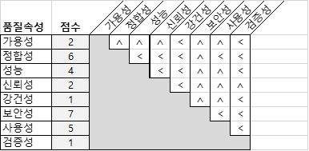

출처: 교육부(2021). 애플리케이션 요구사항 분석(LM2001020219_19v5). p.44.
[그림 2-5] 비기능 요구사항 우선순위 부여(Brosseau) 방법 예시
(2) 매트릭스의 대각선 상단 행렬(Upper Triangular Matrix)의 각 항목은 해당 행과 열의
비기능 요구사항의 상대적 중요도를 평가하여 표시한다. 만약 행(Row)의 요구사항이 더
중요하면 ‘˂’로, 열(Column)의 요구사항이 더 중요하면 ‘˄’로 표시한다.
(3) 상대적 중요도 평가를 모두 마친 후 각 요구사항에 대한 행과 열의 선택을 점수로 합산
하여 우선순위 랭킹을 정한다.
(4) 평가자의 우선순위 랭킹을 모두 합산하여 종합 랭킹을 정한다.
요구사항에 우선순위를 제대로 부여함으로써 얻을 수 있는 장점은 첫째, 우선순위가
있는 요구사항 기준선(Baseline)은 SW개발 프로젝트를 성공시킬 확률이 매우 높
다. 둘째, 서로 다른 요구사항이 상충될 때 이해관계자들이 어떻게 대응해야 할지를
알려 준다는 점이다.
<표 2-16> 우선순위가 부여된 비기능 요구사항목록(예시)
요구사항 번호 요구사항명 작성자 우선순위
PER-001 가용성 김분석 2
PER-002 정합성 김분석 6
PER-003 성능 김분석 4
PER-004 신뢰성 김분석 3
PER-005 강건성 김분석 8
PER-006 보안성 김분석 7
PER-007 사용성 김분석 5
PER-008 검증성 김분석 1
출처: 교육부(2021). 애플리케이션 요구사항 분석(LM2001020219_19v5). 한국직업능력연구원. p.45.
수행 tip
•요구사항 식별자(ID)를 반드시 부여하여 다음 단계인
설계 및 구현 시에도 추적이 가능하도록 한다.
•요구사항을 기술할 때 불명확하거나 검증이 어려운 모
호한 용어나 표현은 피하도록 한다.
•핵심 용어는 용어 사전(Glossary)을 작성하여 의사소통
에 문제가 없도록 한다.
•여러 명의 이해관계자로부터 요구사항을 받도록 노력하
여 누락되는 비기능 요구사항이 없도록 한다.

| 학습 2 | 교수·학습 방법 |
| --- | --- |

교수 방법
• SW 요구사항 분석의 중요성에 대해 실제 프로젝트에서 요구사항 분석 부실로 실패한
사례와 성공 사례를 비교하여 설명한다.
• SW 요구사항 분류 관련 기능/비기능 요구사항 구분 기준에 대해 설명한다.
• SW 사업 유형별 요구사항 분류에 관해 패키지 SW, 맞춤형 개발, 클라우드 기반 SW
별로 각각의 요구사항 특징을 제시하면서 설명한다.
• 기능 요구사항 분석 기법 활용에 대해 설명한다.
• SW 요구사항 우선순위 할당 작성 실습에 대해 설명한다..
• 유스케이스 모델링 작성에 대해 설명한다.
학습 방법
• SW 요구사항 분석의 중요성에 대해 제시된 실패/성공 사례 분석 후 원인과 개선 방안
을 정리하면서 학습한다.
• 주어진 SW 요구사항목록을 기능/비기능으로 분류해 학습한다.
• SW 사업 유형별 요구사항 분류와 적용에 대해 학습한다.
• 기능 요구사항 분석 기법 활용에 대해 학습한다.
• 팀별로 요구사항 우선순위 산출 후, 다른 팀과 결과 비교·토론을 통해 SW 요구사항 우
선순위 할당 작성 실습을 한다.
• 액터와 주요 시나리오를 도출하고 다이어그램을 작성하면서 유스케이스 모델링에 대해
학습한다.

| 학습 2 | 평 가 |
| --- | --- |

평가 준거
• 평가자는 학습자가 학습 목표를 성공적으로 달성하였는지를 평가해야 한다.
• 평가자는 다음 사항을 평가해야 한다.

| 학습 내용 | 학습 목표 | 성취수준 |  |  |
| --- | --- | --- | --- | --- |
|  |  | 상 | 중 | 하 |

- 요구사항 분석과 협상을 위해 도출한 요구사항을 기능적
요구사항과 비기능적 요구사항으로 분류할 수 있다.
- 도출한 요구사항의 내용을 분석하여 구현을 위한 우선순
위를 결정할 수 있다.
요구사항 분석
- 도출한 요구사항이 개발하고자 하는 애플리케이션 전체
또는 단위 컴포넌트에 영향이 있는지를 분석하여 요구사
항의 적용 범위를 확인할 수 있다.
- 요구사항 분석 결과를 토대로 사용자와 협상을 통해 요구
사항, 우선순위, 영향 범위 등을 확정할 수 있다.
평가 방법
• 서술형 시험

| 학습 내용 | 평가 항목 | 성취수준 |  |  |
| --- | --- | --- | --- | --- |
|  |  | 상 | 중 | 하 |

- 기능 요구사항과 비기능 요구사항 분류에 대한 항목별 이
해 정도
- 기능 요구사항 분석 기법에 대한 이해 정도
요구사항 분석
- 개념 모델링과 유스케이스에 대한 기술 능력
- 요구사항 우선순위 할당에 대한 기술 능력
- 비기능 요구사항의 우선순위에 대한 기술 능력
• 논술형 시험

| 학습 내용 | 평가 항목 | 성취수준 |  |  |
| --- | --- | --- | --- | --- |
|  |  | 상 | 중 | 하 |

- 기능 요구사항과 비기능 요구사항 분류에 대한 항목별 설
명 능력
- 기능 요구사항 분석 기법에 대한 전개 능력
요구사항 분석
- 개념 모델링에 대한 전개 능력
- 유스케이스에 대한 전개 능력
- 비기능 요구사항의 우선순위 할당에 대한 전개 능력
• 평가자 질문

| 학습 내용 | 평가 항목 | 성취수준 |  |  |
| --- | --- | --- | --- | --- |
|  |  | 상 | 중 | 하 |

- 기능 요구사항과 비기능 요구사항 각각에 대한 이해 정도
- SW 유형별 요구사항 적용에 대한 이해 정도
- 기능 요구사항 분석 기법에 대한 이해 정도
- 개념 모델링에 대한 이해 정도
요구사항 분석
- 요구사항 우선순위 할당에 대한 이해 정도
- 우선순위 할당 기법에 대한 이해 정도
- 이익과 불이익의 전체 가치에 대한 분석과 우선순위 할당
능력
• 평가자 체크리스트

| 학습 내용 | 평가 항목 | 성취수준 |  |  |
| --- | --- | --- | --- | --- |
|  |  | 상 | 중 | 하 |

- 기능 요구사항과 비기능 요구사항 각각에 대한 이해 여부
- SW 유형별 요구사항 적용에 대한 이해 여부
- 기능 요구사항 분석 기법에 대한 이해 여부
요구사항 분석 - 개념 모델링에 대한 이해 여부
- 요구사항 우선순위 할당에 대한 이해 여부
- 우선순위 할당 기법에 대한 이해 여부
- 이익과 불이익의 전체 가치에 대한 분석과 우선순위 할당
능력을 점검
• 구두 발표

| 학습 내용 | 평가 항목 | 성취수준 |  |  |
| --- | --- | --- | --- | --- |
|  |  | 상 | 중 | 하 |

- 요구사항 분류 사항 발표 능력
- 유스케이스 시나리오 및 모델링 내용 사항 발표 능력
- 요구사항 우선순위 할당 내용 발표 능력
요구사항 분석
- 이익과 불이익의 전체 가치를 계산한 우선순위 매트릭스
발표 능력
- 요구사항목록 발표 능력

| 학습 내용 | 평가 항목 | 성취수준 |  |  |
| --- | --- | --- | --- | --- |
| 피드백 |  |  |  |  |
| 1. 서술형 시험- ‘요구사항생들은 추가 | 분석하기’ 학습 내용의 각 평가 항목과 관련하여, 평가 결과 일정학습 후 재시험 또는 학습 결과를 제출하도록 한다. | 점수 | 이하인 | 학 |
| 2. 논술형 시험- ‘요구사항생들은 추가 | 분석하기’ 학습 내용의 각 평가 항목과 관련하여, 평가 결과 일정학습 후 재시험 또는 학습 결과를 제출하도록 한다. | 점수 | 이하인 | 학 |
| 3. 평가자 질문- ‘요구사항결과 일정 점수 | 분석하기’ 학습 내용의 각 평가 항목과 관련하여 피평가자에게이하인 학생들은 추가 학습 후 재시험 또는 학습 결과를 | 질문을제출하도록 | 하고,한다. | 평가 |
| 4. 평가자 체크리스트- 평가 결과가기준과 기법,으로 설명해 | 미흡할 때는 기능적 요구사항과 비기능적 요구사항 구분 방법,요구사항 영향도 분석, 사용자와의 협상 절차와 전략 관련준다. | 항목에 | 우선순위대해 | 결정구체적 |
| 5. 구두 발표 - 성취수준이결정 기준과 | 낮은 학습자들에게는 기능적 요구사항과 비기능적 요구사항 구분기법, 요구사항 영향도 분석, 사용자와의 협상 절차와 전략을 | 방법,설명해 | 우선순위준다. |  |

학습 1 요구사항 도출하기
학습 2 요구사항 분석하기

| 학습 3 | 요구사항 명세화하기 |
| --- | --- |

학습 4 요구사항 검증하기
3-1.
요구사항 명세
•애플리케이션 사용자 또는 활용 분야의 관점에서 요구사항을 분석한 결과를 정리한 상위 수준
의 사용자 요구사항 정의서를 작성할 수 있다.
•구현하고자 하는 애플리케이션이 구동되는 시스템이나 하드웨어 관련 내용을 구체화하여 시스
학습 목표 템 요구사항 문서를 작성할 수 있다.
•구현하고자 하는 애플리케이션에 대해 설명, 검증 및 테스트, 계약을 위해 사용자 요구사항 정
의서와 시스템 요구사항 문서를 토대로 요구사항을 구체화하여 소프트웨어 요구사항명세서
(SRS, Software Requirement Specification)를 작성할 수 있다.
필요 지식 /
• 요구사항 문서화

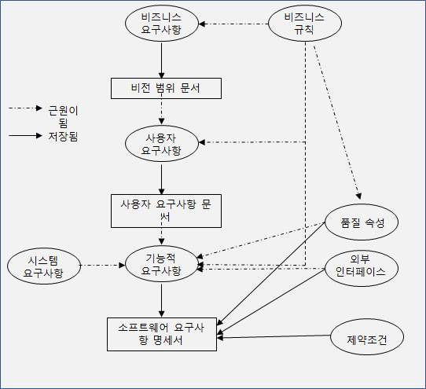

출처: 교육부(2021). 애플리케이션 요구사항 분석(LM2001020219_19v5). p.52.
[그림 3-1] 요구사항 유형별 문서와 정보 관계도

| 학습 내용 | 평가 항목 | 성취수준 |  |  |
| --- | --- | --- | --- | --- |
| 요구사항 개발의 비전 범위 문서와 | 결과는 개발해야 하는 프로젝트에 대한 이해관계자 간의사용자 요구사항 문서, 소프트웨어 요구사항명세서로 구분할 | 문서화로수 | 있다. | 나타나며, |
| 1. 비즈니스 요구사항재무, 시장, | 문서화 고객이나 개발 조직이 제품에서 얻고자 하는 비즈니스 | 혜택을 | 포함해야 | 한 |
| 다. 예를 들면1년 내에 15% | “중부 지역의 시장 점유율을 6개월 안에 10% 절감한다.” 등으로 나타낸다. | 향상시킨다.”, |  | “전기료를 |
| 2. 비즈니스 규칙고객이 특정 예를 들면 “반드시 | 문서화 조건하에서 특정 사용자만 어떤 활동을 수행해야 한다고준수해야 하는 ~ ”, “만약 어떤 조건이 참(true)이라면 |  | 말하는어떤 | 것이다.일이 |
| 발생한다.”, “신규승인은 사내 인사 | 고객은 컨설팅 비용과 경비의 20%를 사전에 지불해야관련 휴가 정책을 준수해야 한다.” 등으로 나타낸다. |  | 한다.”, | “휴가 |
| 3. 사용자 요구사항사용자가 수행해야나리오, 사용자해야 합니다.”, | 문서화 하는 업무를 표현한 일반적인 문장으로, 일반적으로스토리로 표현된다. 예를 들면 “A는 패키지에 붙일“저는 프로젝트 관리자로서 매일 아침 스토리지 사용 | 우편물현황을 | 유스케이스,라벨을 | 시출력점검해야 |
| 합니다.” 등으로 | 나타낸다. |  |  |  |
| 4. 기능적 요구사항기능적 요구사항은수 있게 하는우 경고음이 등으로 나타낸다. | 문서화 특정 조건하에서 시스템이 보여 주거나 사용자가행동을 식별할 수 있는 행위이다. 예를 들면 “스토리지가울려야 합니다.”, “사용자는 목록을 역순으로도 정렬할 수 | 시스템을90%있어야 | 초과할 | 사용할경합니다.” |
| 5. 품질 속성 문서화시스템이 무엇을등의 특성을 치 명령에 신속히한 기능으로 | 얼마나 잘 제공하느냐에 대한 설명으로 빠르게, 쉽게,설명하는 단어를 사용한다. 예를 들면 “모발일 소프트웨어는반응해야 한다.”, “장바구니 기능은 고객이 구매를조작되어야 한다.” 등으로 나타낸다. | 신뢰할쉽게 | 수사용자의하도록 | 있는터간단 |
| 6. 외부 인터페이스시스템과 시스템을의 파일을 읽을연계해야 합니다.”,송과 연계해야 | 문서화 제외한 모든 것의 연결로서 “∼로부터 신호를 수 있어야 한다.” 등이며, 예를 들면 “주문 실행 “모바일 앱은 A가 입금하는 수표를 촬영하고 그합니다.” 등으로 나타낸다. | 읽어야시스템은이미지를 | 한다.”,상품 | “포맷목록과은행 전 |
| 7. 제약 조건 문서화개발자가 실행할 | 수 있는 정당한 방법으로 제한해야 한다. “특정 | 프로그래밍 | 언어로 | 작 |
| 성해야 한다.”(GB)를 초과할야 한다.” 등으로 | 등으로, 예를 들면 “컴퓨터를 통한 파일 전송은 그 수 없다.”, “브라우저는 모든 보안 처리에 64비트(bit)나타낸다. | 크기가암호화를 | 5기가바이트 | 사용해 |
| 8. 데이터 요구사항데이터 요소에보고서 출력 등을5자리이며, ‘_’와 | 문서화 대한 포맷 타입, 허용된 값, 기본값 또는 복잡한 나타낼 때 데이터 요구사항도 포함해야 한다. 예를함께 기본값이 네 자리 숫자를 추가로 포함할 수 | 비즈니스들면있다.”로 | 나타낸다. | 요구사항의“우편번호는 |
| 9. 솔루션(solution)사용자로부터행동을 수행하기볼 수 있다. 예를싶은 주를 (Swype) 할 수• 소프트웨어 요구사항명세서 | 아이디어 문서화 얻는 대부분의 요구사항은 실제로 솔루션 아이디어이다.위해 시스템과 상호작용 하는 방법을 설명한다면 들면 “그런 다음 저는 드롭다운(Dropdown) 목록에서선택합니다.”, “전화는 화면 간 탐색을 위해 사용자가 있어야 합니다.” 등으로 나타난다. | 솔루션을손가락으로 | 누군가가소포를 | 어떤제안한다고보내고스와이프 |
| 1. 소프트웨어 소프트웨어 구 문서(BRD:스템 명세서, <표 3-1> 소프트웨어사용 예시 - 고객, 마케팅- 프로젝트 - 소프트웨어- 테스터는 - 유지･보수 및 | 요구사항명세서 정의 요구사항명세서는 다양한 이름으로 불리는 경우가 많다.Business Requirements Document)나 기능 명세서,아니면 단순히 요구사항 문서라 부르기도 한다. 요구사항명세서의 사용(예시) 부서, 영업 직원은 각자가 어떤 제품을 받을 거라 예상하는지관리자는 요구사항에 대한 일정이나 노력, 자원 예측을 기반으로개발 팀은 무엇을 개발해야 하는지 알아야 한다. SRS를 이용해 요구사항 기반 테스트, 테스트 일정, 테스트 절차를고객 지원 직원은 제품의 각 부분이 어떤 일을 하는지 이해하기 | 이를제품알아야한다.개발한다.위해 | 비즈니스명세서,한다.SRS를 | 요시 |
| 사용한다.- 문서 작성자는 | SRS와 사용자 인터페이스 디자인을 기반으로 사용 설명서와 | 도움말 | 화면을 |  |
| 작성한다.- 교육 담당자는- 법무 팀 직원은- 하청업체는출처: 교육부(2021). | SRS와 사용자 문서를 사용해 교육 자료를 개발한다. 요구사항이 해당 법률과 규정을 준수할 수 있게 한다. 자신의 업무를 토대로 법적으로 명시된 요구사항을 충족시킬 수애플리케이션 요구사항 분석(LM2001020219_19v5). 한국직업능력연구원. | 있다. | p.54. |  |
| <표 3-2> 소프트웨어사용 예시 - 필요한 모든- 절, 하위 절,- 일관되고 력한 사람들은- 독자가 필요한- 모든 그림과- 요구사항을참조하는 - 문서를 이퍼링크를- 가능한 한- 문서가 논리 | 요구사항명세서의 가독성 향상 방법(예시) 정보를 체계적으로 정리하기 위해 적절한 템플릿을 사용하자.개별 요구사항에 일관성 있는 이름과 형식을 부여하자. 신중하게 시각적으로 강조하자, 색상으로 강조할 경우에 색맹이거나이를 인지할 수 없으리라는 점을 기억하라. 정보를 손쉽게 찾아볼 수 있도록 목차를 만들어 두자. 표에 숫자를 부여하고 캡션(caption)으로 연결해 두자. 문서에 저장한다면 쪽 번호나 절의 번호를 그냥 적지 말고, 워드프로세스의 상호 참고 기능을 사용하라. 사용한다면 독자가 SRS나 기타 다른 파일의 관련 절로 바로 이동할정의하자. 쉽게 이해할 수 있도록 정보를 시각적으로 표현하자. 정연하고 일관된 어휘와 레이아웃을 사용하도록 숙련된 편집자와 | 문서의 다른수 | 흑백으로위치를있도록협조하여 | 출 하 작 |
| 성한다. 출처: 교육부(2021). | 애플리케이션 요구사항 분석(LM2001020219_19v5). 한국직업능력연구원. |  | p.54. |  |
| 2. 요구사항 명명하기모든 요구사항은 | 유일하고 영구적인 식별자가 필요하다. |  |  |  |
| (1) 일련번호 가장 간단한일련번호를말하는 것과 | 방법은 모든 요구사항에 UC(UseCase)-9이나 FR-26과부여하는 것이다. FR(Function Requirements)이 같이, 접두사는 요구사항 유형을 가리킨다. | 기능적 | 같은요구사항임을 | 고유한 |
| (2) 계층 번호대부분 난다면 모든더 자세한 | 공통적으로 사용하는 규칙에서 만약 기능적 요구사항이 이름표는 ‘3.4’로 시작한다. 이후의 숫자는 하위 것을 나타내는데, ‘3.4.1.2’는 ‘3.4.1’의 하위 요구사항이라는 | SRS의요구사항과 | 3.4항에것을 | 나타같은 좀알 수 |
| 있다. 일반적으로 | 요구사항 관리 번호는 계층 번호를 지원한다. |  |  |  |
| (3) 계층적 문자계층적 문자용하더라도적 요구사항으로 | 태그 태그를 사용하면 또 다른 문제를 해결할 수 있다. 어떤요구사항 간의 부모-자식 관계를 갖게 될 것이다. 부모작성된 경우, 자식과 부모 간의 관계에 혼란이 | 계층일어날 | 조직을요구사항이수도 | 사기능있다. |
| 3. 불완전한 요구사항때로는 특정 시하기 위해 발자나 테스터가 | 다루기 요구사항에 대한 정보가 누락된 것을 알고 있을 것이다.TBD(To Be Determined) 표기법을 사용한다. 남아에러(Error)를 만들고 재작업하게 되는 위험성을 | 이러한있는 높인다. | 격차를불확실성은 | 표개 |
| 4. 사용자 인터페이스와사용자 인터페이스는 가용 사용자 | SRS 디자인을 SRS에 통합하는 것은 장단점을 모두 갖고인터페이스 탐색, 시뮬레이션 도구 등을 통해 요구사항을 | 있다. | 현실화한다는 | 장점으로 |
| 것이다. 단점으로는설명할지라도• 소프트웨어 요구사항명세서모든 소프트웨어의릿은 여러 종류가<표 3-3> 소프트웨어 | 화면 이미지와 사용자 인터페이스 아키텍처가실제 요구사항은 아닐 수 있다는 것이다. 템플릿 개발은 프로젝트에 대해 표준 SRS 템플릿을 도입해야있는데, 프로젝트 유형에 맞는 템플릿을 도입하는 것이요구사항명세서 템플릿(예시) | 한다.좋다. | 솔루션(solution)을SRS | 템플 |
| 1. 소개 |  |  |  |  |
| 1.1 목적 |  |  |  |  |
| 1.2 문서 규칙 |  |  |  |  |
| 1.3 프로젝트 범위 |  |  |  |  |
| 1.4 참조 |  |  |  |  |
| 2. 전반적인 설명 |  |  |  |  |
| 2.1 제품 관점 |  |  |  |  |
| 2.2 사용자 클래스 | 및 특징 |  |  |  |
| 2.3 운영환경 |  |  |  |  |
| 2.4 설계 및 구현 | 제약 조건 |  |  |  |
| 2.5 가정 및 의존성 |  |  |  |  |
| 3. 시스템 기능 |  |  |  |  |
| 3.1 시스템 기능 |  |  |  |  |
| 3.1.1 설명 |  |  |  |  |
| 3.1.2 기능적 | 요구사항 |  |  |  |
| 4. 데이터 요구사항 |  |  |  |  |
| 4.1 논리 데이터 | 모델 |  |  |  |
| 4.2 데이터 사전 |  |  |  |  |
| 4.3 보고서 |  |  |  |  |
| 4.4 데이터 수집, | 무결성, 보존 및 폐기 |  |  |  |
| 5. 외부 인터페이스 | 요구사항 |  |  |  |
| 5.1 사용자 인터페이스 |  |  |  |  |
| 5.2 소프트웨어 | 인터페이스 |  |  |  |
| 5.3 하드웨어 | 인터페이스 |  |  |  |
| 5.4 통신 인터페이스 |  |  |  |  |
| 6. 품질 속성 |  |  |  |  |
| 6.1 사용성 |  |  |  |  |
| 6.2 성능 |  |  |  |  |
| 6.3 보안 |  |  |  |  |
| 6.4 안전 |  |  |  |  |
| 6.5 기타 |  |  |  |  |
| 7. 국제화 및 현지화 | 요구 |  |  |  |
| 8. 기타 요구사항부록 A: 용어 사전부록 B: 분석 모델출처: 교육부(2021).수행 내용 / 재료·자료 • 요구사항 분석• 요구사항 모델링• 요구사항 우선순위기기(장비･공구) • 컴퓨터, 문서 작성안전･유의 사항 • 요구사항 문서화젝트 관련 산출물에• 요구사항 문서화요구사항 문서화• 기능과 비기능의• 요구사항명세서의• 이해관계자와 자주 | 애플리케이션 요구사항 분석(LM2001020219_19v5). 한국직업능력연구원.요구사항 명세하기 자료 자료 할당 자료 도구, 빔 프로젝터 주관자는 대상 업무에 대한 지식을 빠르게 효과적으로대해서도 이해해야 한다. 주관자는 관련 도메인에 대한 경험과 지식을 보유하고준비를 철저히 해야 한다. 요구사항에 대한 특성을 이해하는 것이 매우 중요하다.절차에 대해 이해하는 것이 매우 중요하다. 만나서 신뢰 관계를 형성한다. |  | p.56.습득하고있어야 | 프로하며, |

수행 순서
• 비전 범위 문서를 작성한다.
1. 비즈니스 요구사항을 작성한다.
비즈니스 요구사항은 신규 시스템이 스폰서(sponsor)나 구매자, 사용자에게 제공할 주
요 이득을 설명해야 한다. 비즈니스 요구사항은 개발해야 하는 사용자 요구사항과 진행
순서에 직접적으로 영향을 미친다.
(1) 배경을 작성한다.
새로운 제품이나 기존 제품의 변경에 대한 이론적 근거나 콘텍스트(context)를 요
약한다. 제품 개발을 결정할 기록이나 상황도 설명한다.
(2) 비즈니스 기회를 작성한다.
기업 정보 시스템의 경우 사용되는 환경뿐만 아니라 해결하는 비즈니스 문제, 개선
하는 프로세스 등을 설명한다. 하지만 설계나 구현 관련 세부적인 내용은 나타내지
않는다.
(가) 기존 제품의 비교 평가를 작성한다.
(나) 가시적인 해결책 없이 해결될 수 없는 문제에 대해 설명한다.
(다) 시장 동향이나 기술의 진화, 기업 전략 방향에 얼마나 부합하는지 표현한다.
(라) 고객에게 솔루션(solution)을 제공하는 데 필요한 기술, 프로세스, 자원을 나타낸다.
(마) 일반적인 고객이나 표적 시장의 니즈를 설명한다.
(바) 신규 제품이 해결하는 고객의 문제를 제시한다.
(3) 비즈니스 목표를 작성한다.
제품이 제공하는 중요한 비즈니스 이득을 정량적이고 측정이 가능한 방법으로 요약
하며, 재무적 목표와 비재무적 목표를 기술한다.
<표 3-4> 재무적 비즈니스 목표와 비재무적 비즈니스 목표의 예

| 재무적 목표 | 비재무적 목표 |
| --- | --- |

- 8개월 안에 A제품군에서 100억 원 - 3개월 안에 배포하는 새로운 버전에서 고객
의 매출을 신장시킨다. 만족도를 5% 더 향상한다.
- 1년 안에 영업 이익 150억 원을 달 - 트랜잭션 처리 생산성을 5% 향상하고, 데이
성한다. 터 정확도를 10% 개선한다.
- 매월 영업 경비는 매출의 0.1% 이 - 1년 안에 시장에서 신뢰도 최고가 되도록
내로 사용한다. 한다.
- 매월 고객 만족도를 98% 이상으로 - 6개월 내에 관련 제품군을 위한 확장 가능한
유지한다. 플랫폼을 개발하고 핵심 역량을 확보한다.
출처: 교육부(2021). 애플리케이션 요구사항 분석(LM2001020219_19v5). 한국직업능력연구원. p.58.
(4) 성공 지표를 작성한다.
프로젝트의 성공을 정의하고 측정하기 위해 이해관계자가 사용할 지표를 명시한다.
조직의 통제 권한 안팎의 요인을 포함해 성공에 가장 가까운 영향을 미치는 요소를
식별한다. 성공 지표는 프로젝트가 비즈니스 목표 달성을 위해 잘 진행되고 있는지
여부를 나타낸다.
<표 3-5> 관리 시스템을 위한 비즈니스 목표 모델의 예

| 구분 | 비즈니스 문제 | 비즈니스 목표 |
| --- | --- | --- |

- 컴퓨터 부품 재고 창고를 수동으로
- 첫해에 컴퓨터 부품 구매 비용
1단계 관리하는 데 비용이 너무 많이 들
30% 절감
고 비효율적임
2- - 재고가 충분히 문서화되어 있지 않 - 1년 안에 컴퓨터 본체 부품의 90%,
1 아 컴퓨터 부품이 낭비되고 있음 주변 기기 부품의 80%를 관리할 것
2
2- - 컴퓨터 부품을 주문하는 데 복잡하 - 전체 컴퓨터 주문 건의 90%에 대
단
2 고 오래 걸림 해 주문 시간을 20분으로 줄일 것
계
2- - 사내 규정 준수를 위한 보고서를
- 사내 보고 규정을 100% 준수할 것
3 수동으로 작성해서 비효율적임
제품
- 2-1은 재고 관리, 2-2는 단일 주문 포털, 2-3은 보고서 자동 생성
콘셉트
출처: 교육부(2021). 애플리케이션 요구사항 분석(LM2001020219_19v5). 한국직업능력연구원. p.59.
(5) 비전 선언문을 작성한다.
비전 선언문은 다양한 이해관계자의 기대를 충족할 수 있도록 균형 잡힌 시각을 반
영해야 한다. 다소 이상적일 수도 있지만 기존 시장이나 예상 시장, 전사 아키텍처,
기업 전략 방향, 자원 제약 등에 대해 현실에 기초해서 작성한다.
(가) 대상 고객을 작성한다(For).
(나) 니즈나 기회를 포함하여 작성한다(Who).
(다) 제품 이름을 작성한다(The).
(라) 제품 범주를 작성한다(Is).
(마) 주요 경쟁 대안, 현재 시스템, 현재 비즈니스 프로세스와의 차이점을 작성한다
(Unlike).
(바) 주요 기능, 주요 혜택, 구매 또는 사용해야 하는 설득력 있는 이유를 작성한다(That).
(사) 신규 제품의 주요 차별점과 장점을 작성한다(Our Product).

| 학습 내용 | 평가 항목 | 성취수준 |  |  |
| --- | --- | --- | --- | --- |
| <표 3-6> 컴퓨터컴퓨터 시스템업체의 단일위치, 재고템은 사내의거나 사용써 컴퓨터세스와는규정을 출처: 교육부(2021). | 시스템의 비전 선언문(예시) 주문이 필요한 과학자에게 컴퓨터 관리 시스템은 컴퓨터접점을 제공하는 정보 시스템이다. 본 시스템은 사내의 모든수량, 각 부품의 위치 및 사용 내역에 대한 모든 기록을 저장할이용 가능한 컴퓨터 시스템을 모두 사용할 수 있게 하고,기한이 지난 시스템을 폐기하며, 표준 컴퓨터 시스템 구매 시스템에 대한 화사의 지출 비용을 30% 절약할 것이다. 기존의달리 우리 제품은 컴퓨터 시스템의 사용 및 보관, 폐기 현황을준수하는 데 필요한 모든 보고서를 생성할 것이다. 애플리케이션 요구사항 분석(LM2001020219_19v5). | 시스템컴퓨터것이다.사용 프로세스를수동한국직업능력연구원. | 창고나이빈도가사용함으로주문의무화하는 | 공급시스템의시스떨어지프로사내p.60. |
| (6) 비즈니스 위험을업무와 관련된장 경쟁, 시기 | 작성한다. 주요 비즈니스 위험에 대해 요약하여 작성한다.문제, 사용자 허용, 구현 문제, 비즈니스에 부정적인 | 위험의영향 | 범주에는등이 | 시있다. |
| (7) 비즈니스 가정가정이란 | 및 의존성을 작성한다. 증명이나 확실한 이론적 근거는 없지만 참(true)이라 | 생각되는 | 것을 | 말한 |
| 다. 비즈니스위한 비전 | 가정은 비즈니스 요구사항과 관련이 있다. 프로젝트를문서를 작성할 때 이해관계자가 근거하는 가정을 기록한다. |  | 구상하고 | 이를 |
| 2. 범위 및 한계를 | 작성한다. |  |  |  |
| (1) 주요 기능을제품의 주요점을 강조하여영구적인 | 작성한다. 기능이나 사용자 기능을 나열하고, 기존 제품이나작성한다. 각 기능은 다른 시스템 요소가 추적할 수이름을 부여한다. | 경쟁 있도록 | 제품과의 | 차별고유하고 |
| (2) 초기 출시제품의 첫되지만, 사용자될 수도 있다. | 범위를 작성한다. 출시에 포함될 기능을 요약한다. 범위는 일반적으로스토리나 유스케이스, 유스케이스 흐름, 외부 이벤트 | 기능 | 관점에서관점에서 | 정의정의 |
| (3) 후속 출시이해관계자가특성을 나열한다.<표 3-7> 제한어떤 사용자가이 기능은 | 범위를 작성한다. 기대하고 있지만 제품이나 특정 출시에 포함되지범위에서 제외되는 항목을 나열해 두면 후속 범위에서및 제외(예시) 책상 앞에서도 휴대전화로 시스템에 접근할 수 있는범위에 해당하지 않는 것으로 간주되었다. 이에 대해 다음과 | 않는 모든기능을같이 | 참고가요청했지만, | 기능이나된다.명확하게 |
| 명시한다.“신규 시스템은출처: 교육부(2021). | 모바일 플랫폼을 지원하지 않을 것이다.” 애플리케이션 요구사항 분석(LM2001020219_19v5). | 한국직업능력연구원. |  | p.61. |

(4) 제한 및 제외를 작성한다.
이해관계자가 기대하고 있지만 제품이나 특정 출시에 포함되지 않는 모든 기능이나
특성을 작성한다.
3. 비즈니스 콘텍스트(context)를 작성한다.
이해관계자 유형의 프로파일과 프로젝트 관리 우선순위, 솔루션(solution) 개발 계획
중 고려해야 할 요소를 요약하여 작성한다.
(1) 이해관계자 프로파일을 작성한다.
이해관계자 프로파일은 프로젝트의 고객과 기타 다른 주요 이해관계자의 다양한 유
형에 대해 설명한다. 각기 다른 유형의 고객이나 표적 시장 세그먼트(segment), 그
리고 각 세그먼트에 속하는 다양한 사용자 유형에 초점을 맞추어 작성한다.
(가) 이해관계자가 제품에서 얻을 수 있는 주요 가치나 이득에 관련된 내용을 작성한다.
1) 생산성 향상
2) 재작업 및 낭비 감소
3) 비용 절감
4) 비즈니스 프로세스 간소화
5) 기존 수동 작업의 자동화
6) 완전히 새로운 작업을 수행할 수 있는 능력
(나) 제품에 대한 태도나 사고방식
(다) 주요 기능이나 특징에 대한 관심
(라) 반드시 수용해야 하는 알려진 제약 조건
(2) 프로젝트의 우선순위를 작성한다.
효과적인 의사 결정을 위해 프로젝트의 우선순위에 대해 고객과 합의한다. 기능, 품
질, 일정, 비용, 인력 등의 중요한 사항에 대해서 합의한다. 각 기준은 <표 3-8>의
세 가지 범주 중 하나에 포함하도록 작성한다.
<표 3-8> 고객과 합의 기준 범주

| 구분 | 내용 |
| --- | --- |

제약 조건 프로젝트 관리자가 반드시 고려해야 하는 요소
추진 요인 제한된 유연성 안에서 조정을 위해 중요한 성공 목표
기타 다른 관점과 비교해서 이를 조정하거나 균형을 맞추는 데 있어 프
자유도
로젝트 관리자가 갖는 자유 요소
출처: 교육부(2021). 애플리케이션 요구사항 분석(LM2001020219_19v5). 한국직업능력연구원. p.62.

| 학습 내용 | 평가 항목 | 성취수준 |  |  |
| --- | --- | --- | --- | --- |
| <표 3-9> 관점 제약출시기능 품질 를일정 비용 직원 출처: 교육부(2021). | 프로젝트의 우선순위 문서(예시) 조건 추진 요인 자유도3.0에 계획된 기능은 완벽하게 작동해야 한다. 사용자 인수 테스트의 99% 통과해야 한다. 계획된년 며, 출시12월까지예산폰서(sponsor)수용팀 규모는 프로젝트 관리 자 1명, BA 1명, 개발자 1명, QA 1명이며, 추가 개발자가 필요할 수 있다. 애플리케이션 요구사항 분석(LM2001020219_19v5). | 출시6월까지4.0은초과는가능하다.한국직업능력연구원. | 3.0은출시해야가능해야10%까지검토 | 2018하2019년한다.스없이p.62. |
| (3) 배포 고려운영환경에서해 요약한다.시스템을 가 언제 데이터 저장소,인프라가 에 대한 교육을정보를 기록한다.• 소프트웨어 요구사항명세서를기능 요구사항 명세를기능 요구사항뿐만템플릿과, 템플릿에을 숙지한다. | 사항을 작성한다. 솔루션(solution)을 효과적으로 개발하는 데 필요한사용자가 여러 시간대에 분산되어 있든 서로 가까이이용하는 데 필요한 접근 권한에 대해 설명한다. 여러시스템에 접근해야 하는지 언급하도록 한다. 만약 기능이나데이터 마이그레이션(migration) 등에 대한 소프트웨어변경되어야 한다면 이러한 변화를 설명한다. 신규 솔루션준비하거나 비즈니스 프로세스를 변경하는 사람들에게작성한다. 소프트웨어 요구사항 문서로 작성한다. 소프트웨어아니라 비기능 요구사항 명세도 포함한다. 소프트웨어요구사항 명세 내용을 작성하는 지침이 있는 경우 | 정보와있든장소에배포와요구사항이를 | 활동에있는네트워크니즈를필요한요구사항확보하여 | 대상관없이,사용자연결,위해함께 이모든문서는문서내용 |
| 1. 소개를 작성한다.소프트웨어 | 요구사항명세서의 구조와 사용법을 이해하도록 작성한다. |  |  |  |
| (1) 목적을 작성한다. |  |  |  |  |
| 개발자, 프로젝트도하는 고객복잡하면 해당 | 관리자, 마케팅 직원, 사용자, 테스터, 문서 작성자유형을 설명한다. 변경 번호나 배포 버전 번호를부분이나 서브 시스템을 식별하여 작성한다. | 등포함한다. | 문서가 | 의시스템이 |
| (2) 문서 규칙을특정 문자판 규칙을항 명명 형식을 | 작성한다. 스타일이나 강조, 표기법의 의미를 포함해서 사용하는설명한다. 요구사항의 이름은 새로운 요구사항을 추가하기구체적으로 설명해야 한다. | 모든 | 표준이나쉽도록 | 조요구사 |
| (3) 프로젝트 범위를소프트웨어에목표 또는문서가 별도로인 배포를서를 포함하여 | 작성한다. 대한 간략한 설명과 목적을 작성한다. 소프트웨어는비즈니스 목표나 전략과 관련되어 있다. 비전 범위 존재한다면 참조할 수 있게 작성한다. 진화하는명시하는 경우 장기 전략 제품 비전의 하위 요소로서작성한다. | 사용자나문서나제품에고유한 | 이와대한범위 | 회사의유사한점진적기술 |
| (4) 참조를 작성한다.참조하는 모든경우 하이퍼링크도관련 제품의치, URL 등 | 문서나 기타 자료 목록을 나열한다. 변하지 않는포함한다. 사용자 인터페이스 스타일가이드,요구사항명세서를 포함한다. 제목이나 저자, 버전, 충분한 정보를 제공해서 독자가 각 참조에 접근할 수 | 주소를인터페이스일자,있도록 | 갖고소스,한다. | 있는명세,저장 위 |
| 2. 전반적인 설명을제품과 제품이내용을 포함하여 | 작성한다. 사용되는 환경, 기대 사용자, 알려진 제약 조건이나작성한다. | 가정, | 의존성 | 등의 |
| (1) 제품 관점을제품의 케이션의 관계를 설명하고, | 작성한다. 콘텍스트(context)와 기원을 설명한다. 시스템의 차기 대안인지 아니면 완전히 새로운 제품인가를 표시한다.이들 간 주요 인터페이스를 식별할 수 있도록 | 버전인지전반적인작성한다. | 기본 | 애플리시스템의 |
| (2) 사용자 클래스프로젝트에서 | 및 특징을 작성한다. 사용이 예상되는 다양한 사용자 클래스를 식별하고 | 이들의 | 특징을 | 기 |
| 술한다. 사용자 | 클래스는 비전 범위 문서에 기술된 이해관계자의 | 그룹 중 | 일부를 | 대 |
| 변한다. 마스터자 클래스 | 사용자 클래스 카탈로그가 있다면 정보를 중복설명에 대해 카탈로그를 가리키는 것으로 표시하여 | 기술하지작성한다. | 않고 | 사용 |
| (3) 운영환경을하드웨어 전, 사용자, | 작성한다. 플랫폼을 비롯해 소프트웨어가 작동할 환경을 기술한다.서버 및 데이터베이스의 지리적 위치, 관련 데이터베이스, |  | 운영체제서버 | 및 버및 웹 |
| 사이트를 트웨어 구성광범위한 인프라 | 호스팅 하는 조직 등을 포함하여 작성한다. 시스템과요소나 애플리케이션을 나열하여 작성한다. 신규 기술적인 인프라 작업이 수행되어야 한다면, 이를 자세히요구사항명세서를 작성한다. | 연계되는시스템설명하는 | 모든개발과 | 소프함께별개의 |
| (4) 설계 및 구현특정 프로그래밍개발자의 | 시 제약 조건을 작성한다. 언어나 필요에 의해 오랜 시간 개발된 특정 코드선택을 제한하는 모든 요소와 각 제약 조건의 이론적 | 근거를 | 라이브러리 | 등기술하도록 |
| 한다. 니즈보다는은 설계 제약 | 솔루션(solution) 아이디어의 형태로 통합되거나조건에 포함하는 데 불필요한 경우도 있으므로 이를 | 작성된 | 주의하도록 | 요구사항한다. |
| (5) 가정 및 가정이란 | 의존성을 작성한다. 증명이나 확실한 이론적 근거는 없지만 참(true)이라 | 생각되는 | 것을 | 말한 |
| 다. 개발자는있지만, 비즈니스로젝트 관리자는고려하여 구성 요소에에 Microsoft | 애플리케이션에 대한 특정 기능 집합을 직접 구현할분석가는 기존 프로젝트로부터 재사용한다고 상용 기능 라이브러리를 구입할 거라고 예상할작성한다. 개발 중인 프로젝트나 시스템의 제어 영역대한 모든 의존성도 식별하여 작성한다. 예를 들어.NET Framework 4.5 이상의 버전이 설치되어야 | 거라고가정할 수수도바깥의제품이한다면 | 가정할있고，있다는외부실행되기이 | 수프점을요소나전또한 |
| 의존성이다. |  |  |  |  |
| 3. 시스템 기능을기능 영역이나구사항을 정리하여들 요소의 계층적인방법을 선택하여 | 작성한다. 프로세스 흐름, 운영 방식, 사용자 클래스, 자극, 반응에작성한다. 필요시 사용자 클래스 내에서 유스케이스를조합으로 작성한다. 제품이 의도한 기능을 이해하기작성한다. | 따라쉬운 | 기능적정리하고, | 요이구조적인 |
| (1) 시스템 기능(X)를특징의 이름을위 절은 1.X.1과 | 작성한다. 몇 개의 단어로 표현하여 작성한다. 각 시스템 1.X.2와 같이 반복하여 작성한다. | 기능에서 | 1.X절의 | 하 |
| (가) 설명을기능에우선순위는를 사용할 | 작성한다. 대한 간략한 설명과 함께 높음, 중간, 낮음 등의 종종 동적이며, 프로젝트 진행에 따라 변화한다.경우 요구사항의 속성으로서 우선순위를 정의하여 | 우선순위를요구사항작성한다. | 관리 | 작성한다.도구 |
| (나) 기능적해당 특징과자가 특징에해야 하는 | 요구사항을 작성한다. 관련된 특정 기능적 요구사항을 항목별로 나열하여해당하는 서비스를 이행하거나 유스케이스를 수행하기소프트웨어의 기능을 나타낸다. 예상되는 에러(Error) |  | 작성한다.위해 꼭상황이나 | 사용구현잘못된 |

입력, 행동에 대한 제품의 반응을 설명한다. 각 기능적 요구사항에 고유한 이름을
붙인다. 요구사항 관리 도구를 사용하는 경우 각 기능적 요구사항에 이론적 근거,
기원, 상태 등과 같은 여러 속성을 할당하여 작성한다.
<표 3-10> 단위 기능 요구사항명세서(예시1)
요구사항 분류 기능 요구사항
요구사항 고유 번호 SFR-001
요구사항 명칭 고객 정보 관리
∙ 상품 고객에 대한 신규 등록, 정보 수정 및 삭제 등을 관
리하는 기능
요구사항 세부 내용 ∙ 고객 관리 기능은 고객 데이터 추가･수정･삭제 및 조회 기
능으로 구성
∙ 고객 데이터를 바탕으로 분석 리포트 2종 생성
산출 정보 고객 리포트 2종
관련 요구사항 SFR-002
출처: 교육부(2021). 애플리케이션 요구사항 분석(LM2001020219_19v5). 한국직업능력연구원. p.65.
<표 3-11> 단위 기능 요구사항명세서(예시2)
요구사항명 얼굴 특징 추출 및 엑셀 저장
요구사항 ID SR-003 업무 영역 서버 애플리케이션
개요 PCA를 통해 고유 특징을 추출하고 엑셀 파일에 저장한다.
고유 특징을 엑셀 파일에 저장한 후, 나중에 소켓을 통해 해당
사용자 ID를 전달받으면 테스트(test) 사진의 특징을 추출하여
상세 설명 일정 거리 이하이면 인식을 성공했다고 판단한다(모든 사용자의
요구 특징과 비교하는 것이 아닌, 해당 사용자의 학습 시 저장된 특
사항 징과 새로운 특징만을 일대일 매칭한다.).
내역
유형 소프트웨어 기능 요구사항
중요도 상 난이도 상
구현 도구 OpenCV, dlib 개발 담당자 권순우
출처: 교육부(2021). 애플리케이션 요구사항 분석(LM2001020219_19v5). 한국직업능력연구원. p.66.
<표 3-12> 단위 기능 요구사항명세서(예시3)
유스케이스, 식별자/명 L-003 영상 촬영, 고객 확인
-포인트 등록, 결제를 위해 카메라로 촬영한다.
-촬영한 정보는 전처리 되어서 서버로 이동한다.
개요
-비교 후 매칭된 아이디를 3개까지 보내 준다.
→ 사용자 확인 후 입력
주 행위자 사용자, 사업자
사전 조건 포인트 결제, 포인트 등록
기본 흐름
행위자 시스템
3. 영상 정보와 DB에 있는 저장된 얼굴 정
1. 포인트 결제, 포인트 등록이 실행된다.
보와 비교한 후 맞는 아이디 데이터를
2. 사진을 촬영한다.
보내 준다(최대 3개).
4. 아이디를 확인 후 등록을 누른다.
5. 아이디에 쿠폰을 등록한다.
대안 흐름
행위자 시스템
[A1. 사용자 인식이 안 되는 경우]
1. 전화번호를 통해 등록한다. 2. 기본 흐름 3, 5를 실행한다.
2. 차후 사업자 앱(App)을 통해 등록한다.
예외 상황 시나리오
행위자 시스템
[E1. 서버의 반응이 없는 경우]
없음
1. 차후 앱(App)을 통해 등록한다.
출처: 교육부(2021). 애플리케이션 요구사항 분석(LM2001020219_19v5). 한국직업능력연구원. p.66.
4. 데이터 요구사항을 작성한다.
시스템이 데이터를 입력으로 사용하거나 어떤 방식으로 처리하여, 출력으로 생성하는
등 데이터의 다양한 측면을 작성한다.
(1) 논리 데이터 모델을 작성한다.
데이터 모델은 시스템이 처리하거나 서로 관계가 있는 데이터 객체 및 모음에 대한
시각적인 표현으로 작성한다. 개체 관계 다이어그램, URL 클래스 다이어그램 등 데
이터 모델링을 위한 표기법을 활용하여 작성한다. 시스템에 의해 운영되는 비즈니스
나 시스템이 다루어야 할 데이터의 논리적인 표현을 위해 데이터 모델을 포함한다.
이는 데이터베이스 설계를 통해 실현되는 데이터 모델 구현과는 다르다.
(2) 데이터 사전을 작성한다.
데이터 사전은 데이터 구조와 이를 구성하는 데이터 요소의 의미, 유형, 크기, 형식,
허용값의 조합을 포함하여 작성한다. 상용 데이터 모델링 도구는 데이터 사전 구성
요소를 포함하기도 한다. 다른 프로젝트에서 재사용 가능성을 증가시킬 수 있도록
데이터 사전을 중간에 삽입하기보다 별도의 산출물로 저장하여 작성한다.
(3) 보고서를 작성한다.
애플리케이션이 보고서를 생성해야 한다면 여기서 명시하고 특징을 설명하여 작성한
다. 보고서가 미리 정의된 특정 레이아웃을 준수해야 하는 경우에 제약 조건을 정하
고, 이에 대한 예를 함께 보여 줄 수 있도록 작성한다. 필요시 보고서 레이아웃의
구체화를 설계 단계로 미루고 보고서 콘텐츠, 정렬 순서, 전반적인 수준 등에 대한
논리적인 기술에 초점을 두어 작성한다.
(4) 데이터 수집, 무결성, 보존 및 폐기에 대해 작성한다.
데이터 수집 및 유지 방법을 설명하여 작성한다. 시스템의 데이터 무결성 보호에 필
요한 모든 요구사항을 기술한다. 백업, 체크 포인팅, 미러링, 데이터 정확성 검증과
같이 필요한 모든 기법을 명시한다. 임시 데이터, 메타 데이터, 잔여 데이터(삭제된
기록)，캐시 데이터, 지역 복사본, 기록, 중간 백업(back-up)본 등에 대한 데이터의
보존 및 폐기와 관련해서 시스템이 시행해야 하는 정책을 기술한다.
<표 3-13> 데이터 요구사항명세서(예시1)
요구사항 분류 데이터 요구사항
요구사항 고유 번호 DAR-001
요구사항 명칭 데이터 분석
개발되는 시스템 또는 SW를 위해 데이터 현황 자료 산출 및 정
요구사항 세부 내용
보 분석을 위한 지원 요청 시 지원해야 한다.
산출 정보 데이터 분석 결과
관련 요구사항 -
출처: 교육부(2021). 애플리케이션 요구사항 분석(LM2001020219_19v5). 한국직업능력연구원. p.68.
<표 3-14> 데이터 요구사항명세서(예시2)
요구사항 분류 데이터 요구사항
요구사항 고유 번호 DAR-002
요구사항 명칭 데이터 입력
입력 및 검증 작업 과정을 표준화하고, 이에 필요한 사항은 검증
요구사항 세부 내용
목록을 통해 검증함으로써 결과 산출물의 품질을 확보해야 한다.
산출 정보 유사 업무 데이터 검증 목록
관련 요구사항 -
출처: 교육부(2021). 애플리케이션 요구사항 분석(LM2001020219_19v5). 한국직업능력연구원. p.68.
<표 3-15> 데이터 요구사항명세서(예시3)
요구사항 분류 데이터 요구사항
요구사항 고유 번호 DAR-003
요구사항 명칭 DB 설계
- DB 구조의 설계는 관련 업무 처리 절차를 반영하여 유기적으
로 구조화하고, 향후 업무 변동에 따른 확장성을 충분히 고려
해야 한다.
- 데이터의 정합성을 유지하면서 시스템의 성능을 저하시키지 않
요구사항 세부 내용
도록 DB설계가 이루어져야 하며, DB 전문 인력을 통해 이에
대한 검증이 이루어져야 한다.
- 해당 기관의 표준 가이드와 행정 정보 DB표준화 지침을 준수
하여 DB설계를 해야 한다.
산출 정보 유사 업무 DB설계서, ERD
관련 요구사항 -
출처: 교육부(2021). 애플리케이션 요구사항 분석(LM2001020219_19v5). 한국직업능력연구원. p.68.
5. 외부 인터페이스 요구사항을 작성한다.
시스템이 사용자나 하드웨어·소프트웨어 구성 요소와 제대로 소통할 수 있는 정보를 작
성한다. 여러 개의 하위 구성 요소로 이루어진 복잡한 시스템은 별도의 인터페이스 명
세나 시스템 아키텍처 명세를 작성한다. 필요시 인터페이스 문서는 다른 문서의 참조
자료로서 통합한다. 예를 들어 장비가 소프트웨어에 전달하는 에러(Error) 코드 목록이
포함된 하드웨어 장비 설명서를 가리킬 수 있도록 작성한다.
(1) 사용자 인터페이스를 작성한다.
시스템에 필요한 각 사용자 인터페이스의 논리적 특성을 설명하여 작성한다. 포함되
어야 할 항목은 아래와 같다.
(가) 사용자 인터페이스 표준이나 제품군 스타일 가이드에 대한 참조
(나) 폰트 아이콘, 버튼 레이블, 필드 탭, 이동 순서, 일반적으로 사용되는 컨트롤, 상표
이미지, 저작권 및 개인정보보호 공지 등에 대한 표준
(다) 화면 크기나 레이아웃, 해상도 제약 조건
(라) 도움말 버튼처럼 모든 화면에 나타나는 표준 버튼이나 기능, 탐색 링크
(마) 단축키
(바) 메시지 표시 및 표현 규칙
(2) 소프트웨어 인터페이스를 작성한다.
(가) 애플리케이션, 데이터베이스, 운영체제, 도구, 라이브러리, 웹사이트, 통합된 상용 구
성 요소 등을 포함하는 다른 소프트웨어 구성 요소 간의 연결 관계를 기술하여 작성
한다.
(나) 소프트웨어 구성 요소 간에 주고받는 메시지, 데이터, 제어값에 대한 목적과 형식,
내용을 설명한다.
(다) 시스템 간에 주고받는 입출력 데이터의 연관 관계와 하나의 시스템이 다른 시스템으
로부터 얻는 데이터를 생성하는 모든 전환 과정을 명시한다.
(라) 외부 소프트웨어 구성 요소에 필요한 서비스나 내부 구성 요소 간 소통의 본질을 설
명한다.
(마) 소프트웨어 구성 요소 간에 교환하거나 공유하는 데이터를 식별하여 작성한다.
(바) 반응 시간이나 주기, 보안 또는 보안 제어나 제한에 대한 서비스 수준과 같이 인터
페이스에 영향을 미치는 비기능적 요구사항을 명시하여 작성한다.
(3) 하드웨어 인터페이스를 작성한다.
(가) 소프트웨어 구성 요소와 하드웨어 구성 요소 간의 각 인터페이스의 특성을 기술하여
작성한다.
(나) 지원하는 장비 유형, 소프트웨어와 하드웨어 간의 데이터 및 제어 작용, 사용되는
통신 프로토콜을 포함하여 작성한다.
(다) 입출력과 이들의 형식, 유횻값이나 범위, 개발자가 알고 있어야 하는 타이밍 이슈를
나열하여 작성한다.
(라) 정보가 광범위한 경우 별도의 인터페이스 명세 문서를 만든다.
(4) 통신 인터페이스를 작성한다.
(가) 이메일, 웹 브라우저, 네트워크 프로토콜, 전자 서식 등 제품이 사용하는 모든 통신
기능에 대한 요구사항을 기술하여 작성한다.
(나) 모든 관련 메시지 형식을 정의한다. 통신 보안 및 암호화 이슈, 데이터 전송 속도,
핸드셰이킹, 동기화 메커니즘을 명시한다.
(다) 특정 형식의 이메일 첨부 파일이 허용 가능한지에 대한 여부 등 이들 인터페이스와
관련된 모든 제약 조건을 기술한다.
<표 3-16> 인터페이스 요구사항명세서(예시1)
요구사항 분류 인터페이스 요구사항
요구사항 고유 번호 SIR-001
요구사항 명칭 사용자 편의성
개발되는 시스템 또는 SW의 사용자 편의성을 위해 온라인 도
요구사항 세부 내용 움말, 사용 단말을 고려한 화면 사이즈 제공, 오류 메시지에 대
한 내용이 포함되어야 한다.
산출 정보 사용자 편의성 확보를 위한 고객 검토 보고서
관련 요구사항 -
출처: 교육부(2021). 애플리케이션 요구사항 분석(LM2001020219_19v5). 한국직업능력연구원. p.70.
<표 3-17> 인터페이스 요구사항명세서(예시2)
요구사항 분류 인터페이스 요구사항
요구사항 고유 번호 SIR-002
요구사항 명칭 작업 효율성
개발되는 시스템 또는 SW의 통일성을 확보하기 위한 통합 UI
요구사항 세부 내용
를 구성해야 한다.
산출 정보 사용자 편의성 확보를 위한 고객 검토 보고서
관련 요구사항 -
출처: 교육부(2021). 애플리케이션 요구사항 분석(LM2001020219_19v5). 한국직업능력연구원. p.70.
<표 3-18> 인터페이스 요구사항명세서(예시3)
요구사항 분류 인터페이스 요구사항
요구사항 고유 번호 SIR-003
요구사항 명칭 시스템 인터페이스
- 개발되는 시스템 또는 SW의 성능에 미치는 영향을 고려하
여 갱신 주기, 연계 애플리케이션 실행 시간 등을 설정해야
한다.
- 데이터 연계의 정확성을 위해 개발 및 테스트 환경을 구성
요구사항 세부 내용
하고, 연계 애플리케이션의 기능 수행 정확도를 검증한 후
운영 시스템에 이관하여 시스템을 운영해야 한다.
- 사용자 또는 정보 증가 시에도 안정적인 성능을 제공해야
하며, 추가 라이선스 비용 등이 발생하지 않아야 한다.
산출 정보 사용자 편의성 확보를 위한 고객 검토 보고서
관련 요구사항 -
출처: 교육부(2021). 애플리케이션 요구사항 분석(LM2001020219_19v5). 한국직업능력연구원. p.71.
6. 품질 속성을 작성한다.
본 수행 내용에서는 비기능적 요구사항을 명시한다. 이 품질 요구사항은 비기능적 요구
사항으로 구체적이어야 하며, 정량적이고 검증이 가능하도록 작성한다. 쉬운 학습보다
쉬운 사용, 성능보다 보안 등 다양한 속성에 대한 상대적인 우선순위를 작성한다.
(1) 사용성을 작성한다.
학습의 용이함, 쉬운 사용, 오류 방지 및 복구, 상호작용의 효율성, 접근 용이성 등
을 작성한다.
(2) 성능에 대해 작성한다.
구체적인 성능 요구사항을 기술하여 작성한다. 서로 다른 기능적 요구사항이나 특성
이 각기 다른 성능 요구사항을 갖는다면 각 기능적 요구사항에 상응하는 성능 목표
를 구체화하여 작성한다.
<표 3-19> 성능 요구사항명세서(예시1)
요구사항 분류 성능 요구사항
요구사항 고유 번호 PER-001
요구사항 명칭 응답 시간
- 온라인성 업무 응답 시간은 3초 이내에 적용되어야 한다.
- 온라인 배치성 업무 응답 시간은 3분 이내에 적용되어야 한다.
요구사항 세부 내용 - 배치성 업무 응답 시간은 10초 이내에 적용되어야 한다.
- 웹 페이지 디스플레이 시간은 10초 이내에 적용되어야 한다.
- 오류 응답 시간은 3초 이내에 적용되어야 한다.
산출 정보 응답 시간 측정 계획 및 측정 내역
관련 요구사항 -
출처: 교육부(2021). 애플리케이션 요구사항 분석(LM2001020219_19v5). 한국직업능력연구원. p.72.
<표 3-20> 성능 요구사항명세서(예시2)
요구사항 분류 성능 요구사항
요구사항 고유 번호 PER-002
요구사항 명칭 처리량
개발되는 시스템 또는 SW의 동시 사용자 접속 수는 1,000명의
요구사항 세부 내용
처리 능력을 확보해야 한다.
산출 정보 동시 접속 처리 시뮬레이션 결과
관련 요구사항 -
출처: 교육부(2021). 애플리케이션 요구사항 분석(LM2001020219_19v5). 한국직업능력연구원. p.72.
<표 3-21> 성능 요구사항명세서(예시3)
요구사항 분류 성능 요구사항
요구사항 고유 번호 PER-003
요구사항 명칭 자원 사용량
개발되는 시스템 또는 SW는 CPU 사용률과 메모리 사용률이
요구사항 세부 내용
70%를 넘지 않아야 한다.
산출 정보 자원사용 시뮬레이션 결과
관련 요구사항 -
출처: 교육부(2021). 애플리케이션 요구사항 분석(LM2001020219_19v5). 한국직업능력연구원. p.72.
(3) 보안성에 대해 작성한다.
구체적인 제품에 대한 접근이나 사용을 제한하는 보안이나 개인정보보호 이슈에 관
한 모든 요구사항을 구체화하여 작성한다. 소프트웨어 보안과 관련이 있는 보안요구
사항은 비즈니스 규칙으로부터 발생하기도 하므로 제품이 준수해야 하는 모든 보안
또는 개인정보보호 정책이나 규정을 식별하여 작성한다. 만약 이러한 요구사항이 비
즈니스 규칙 저장소에 문서화되어 있다면 참조하기만 하면 된다.
<표 3-22> 보안요구사항명세서(예시1)
요구사항 분류 보안요구사항
요구사항 고유 번호 SER-001
요구사항 명칭 기술적 보안 관리
- 공유 자원에 대한 접근 제어가 사용자 권한에 따라 이루어지는
지 관리한다.
- 네트워크 관리자 접속용 계정의 패스워드는 기본 패스워드가
아닌 복잡도가 높은 패스워드로 변경하여 사용한다.
- 구축 및 운용 시스템에 대한 서버 보안 취약점 점검 및 FTP,
Telnet, Finger 등 불필요한 서비스 포트 제거 등 보안 사항
요구사항 세부 내용 을 점검하고 조치한다.
- 사업 계획 및 개발 단계에서부터 소스 프로그램의 안전성을 고
려해서 개발하고, 시스템 간 상호 연계 시 표준 보안 API를
적용한다.
- 불의의 사고로 인해 시스템이나 파일이 피해를 입더라도 최근
에 백업(back-up)한 시점의 내용으로 복구할 수 있는 백업
정책을 수립하여 시행한다.
산출 정보 -
관련 요구사항 -
출처: 교육부(2021). 애플리케이션 요구사항 분석(LM2001020219_19v5). 한국직업능력연구원. p.73.
<표 3-23> 보안요구사항명세서(예시2)
요구사항 분류 보안요구사항
요구사항 고유 번호 SER-002
요구사항 명칭 구간 암호화
- 사용자 PC부터 웹 서버 구간 간 암호화 방식을 적용하여 구현한다.
- 정보시스템 로그인 시 정보 통신망으로 전송되는 중요 정보(아
요구사항 세부 내용 이디, 패스워드와 같은 로그인 정보 및 주민 등록 번호 등)를
스니핑 등의 위협으로부터 보호하기 위해 SSL, TLS 등 네트
워크 구간 암호화 조치를 수행한다.
산출 정보 -
관련 요구사항 -
출처: 교육부(2021). 애플리케이션 요구사항 분석(LM2001020219_19v5). 한국직업능력연구원. p.73.
(4) 안전성과 제약 요구사항에 대해 작성한다.
제품 사용 시 발생할 수 있는 손실이나 손상, 피해에 대한 요구사항을 구체적으로
설명한다. 꼭 예방해야 하는 잠재적인 위험 행동뿐만 아니라, 반드시 수행해야 하는
모든 안전 조치나 행동을 포함하여 작성한다. 그리고 제품이 준수해야 하는 모든 안
전 인증, 정책, 규정을 포함하여 작성한다.
<표 3-24> 제약 요구사항명세서(예시1)
요구사항 분류 제약 사항
요구사항 고유 번호 COR-001
요구사항 명칭 표준화 항목
- 기구축, 운영 중인 시스템을 확대 고도화하는 경우, 기존 시스
템의 기술 표준 규격을 최우선으로 준수한다.

| 구분 | 검토 항목 |  | 내역 |
| --- | --- | --- | --- |
| 행정업무표준 | 업무 | 업무 처리 절차 | 해당 사항 없음. |
|  | 업무 | 업무 처리에 필요한정보 항목 | 해당 사항 없음. |
| 행 정 업 무 표 준 | 정보(데이터/코드) | 업무용 코드행정 업무용표준 코드 | 현재 운영 중인기관별 표준 코드 활용 |
| 정 업 무 | 정보 (데이터 /코드) | 각종 서식 | 신규 제·개정되는 서식에 대해서는 DM 3.0을 최대한 준수 및 활용하여 설계 |
| 준 |  | 정보 공동 활용에필요한 연계 정보항목 및 연계 절차 | 정보 연계 방안 및 절차 마련 |
|  | 사업관리 | 사업 관리, 유지･보수 평가 등에 대한지침 및 규정 | 사업 관리, 유지･보수 등에 관련된 전자 정부 사업 관련 지침 및 규정준수 |

요구사항 세부 내용
산출 정보 -
관련 요구사항 -
출처: 교육부(2021). 애플리케이션 요구사항 분석(LM2001020219_19v5). 한국직업능력연구원. p.74.
<표 3-25> 제약 요구사항명세서(예시2)
요구사항 분류 제약 사항
요구사항 고유 번호 COR-002
요구사항 명칭 정보화 기반 표준
- 전자 정부 구축을 위한 기술 아키텍처 표준을 제시한 ‘행정 기
관 및 공공 기관 정보 시스템 구축·운영 기술 지침(행정안전
요구사항 세부 내용 부 고시 제2018-98호)’을 준수
- 한국형 웹 콘텐츠 접근성 지침 2.0 (KICS OT-10.0003/R1)
- 전자 정부 서비스 호환성 준수 지침(행정안전부 고시 제2012-44호)
산출 정보 -
관련 요구사항 -
출처: 교육부(2021). 애플리케이션 요구사항 분석(LM2001020219_19v5). 한국직업능력연구원. p.75.
(가) 기타 사항을 작성한다.
제품 품질 속성 각각에 대해 고객이나 개발자, 유지･보수 담당자에게 중요한 특
성을 기술하기 위한 별도의 요구사항을 만든다.
7. 국제화 및 현지화 요구사항을 작성한다.
제품이 만들어진 곳 이외의 국가나 문화, 지리적인 위치에서 사용하기에 적합하게 작성
한다.
8. 기타 요구사항을 작성한다.
요구사항명세서 어디에도 다루어지지 않은 요구사항을 정의한다. 법률이나 규제, 금융
규정 준수 및 표준 요구사항이나 제품 설치, 설정, 구동, 종료에 대한 요구사항, 로깅,
모니터링, 감사 추적 요구사항이 이러한 예를 포함하여 작성한다.
9. 용어 사전을 작성한다.
사용자가 이해하기 쉽게 알아야 할 모든 전문 용어, 약어 등을 정의한다. 각 두문자어
를 간단히 설명하고 정의를 제공한다.

| 학습 3 | 교수·학습 방법 |
| --- | --- |

교수 방법
• 실제 프로젝트에서 문서화의 미흡으로 발생한 오류·비용 증가 사례와, 문서화가 잘된
성공 사례를 비교하면서 SW 요구사항 문서화의 중요성에 대해 설명한다.
• 속성(우선순위, 상태, 출처, 변경 이력 등)별 의미와 관리 방법 시연을 통해 SW 요구사
항 속성과 ID 부여 규칙에 대해 설명한다.
• SW 기능 요구사항 작성 기준과 충족 요건에 대해 설명한다.
• 기업 비전과 프로젝트 목표를 연결하는 사례를 제시하고 비전 문서 작성 방법에 대해
설명한다.
• 프로젝트 우선순위 할당 작성 방법에 대해 설명한다.
• 표준 목차 구조(IEEE 830, ISO/IEC 29148) 설명을 통해 소프트웨어 요구사항명세서
작성 방법에 대해 설명한다.
학습 방법
• 제시된 사례를 분석해 문서화의 필요성 정리를 통해 SW 요구사항 문서화의 중요성에
대해 학습한다.
• 샘플 요구사항목록에 ID를 부여하고 속성값 입력을 통해 SW 요구사항 속성과 ID 부여
규칙에 대해 학습한다.
• 불완전한 요구사항을 기준에 맞게 수정하면서 SW 기능 요구사항 작성 기준과 충족 요
건에 대해 학습한다.
• 비전 문서 작성 방법에 대해 학습한다.
• 프로젝트 우선순위 할당 작성 실습을 한다.
• SRS 표준 양식에 맞춰 실제 과제 요구사항 작성을 통해 소프트웨어 요구사항명세서 작
성 방법에 대해 학습한다.

| 학습 3 | 평 가 |
| --- | --- |

평가 준거
• 평가자는 학습자가 학습 목표를 성공적으로 달성하였는지를 평가해야 한다.
• 평가자는 다음 사항을 평가해야 한다.

| 학습 내용 | 학습 목표 | 성취수준 |  |  |
| --- | --- | --- | --- | --- |
|  |  | 상 | 중 | 하 |

- 애플리케이션 사용자 또는 활용 분야의 관점에서 요구사
항을 분석한 결과를 정리한 상위 수준의 사용자 요구사항
정의서를 작성할 수 있다.
- 구현하고자 하는 애플리케이션이 구동되는 시스템이나 하
드웨어 관련 내용을 구체화하여 시스템 요구사항 문서를
요구사항 명세 작성할 수 있다.
- 구현하고자 하는 애플리케이션에 대해 설명, 검증 및 테
스트, 계약을 위해 사용자 요구사항 정의서와 시스템 요
구사항 문서를 토대로 요구사항을 구체화하여 소프트웨어
요구사항명세서(SRS, Software Requirement Specific
ation)를 작성할 수 있다.
평가 방법
• 서술형 시험

| 학습 내용 | 평가 항목 | 성취수준 |  |  |
| --- | --- | --- | --- | --- |
|  |  | 상 | 중 | 하 |

- SW 요구사항 문서화의 중요성에 대한 이해 정도
- SW 요구사항 속성과 ID 부여 규칙에 대한 이해 정도
- SW 기능 요구사항 작성 기준과 충족 요건에 대한 이해
정도
요구사항 명세
- 비전 문서 작성 절차와 사항에 대한 이해 정도
- 프로젝트 우선순위 할당에 대한 이해 정도
- 소프트웨어 요구사항명세서 작성 절차와 사항에 대한 이
해 정도
• 논술형 시험

| 학습 내용 | 평가 항목 | 성취수준 |  |  |
| --- | --- | --- | --- | --- |
|  |  | 상 | 중 | 하 |

- SW 요구사항 문서화의 중요성에 대한 논리적 전개 능력
- SW 요구사항 속성과 ID 부여 규칙에 대한 논리적 전개
능력
- SW 기능 요구사항 작성 기준과 충족 요건에 대한 논리
요구사항 명세 적 전개 능력
- 비전 문서 작성 절차와 사항에 대한 논리적 전개 능력
- 프로젝트 우선순위 할당에 대한 논리적 전개 능력
- 소프트웨어 요구사항명세서 작성 절차와 사항에 대한 논
리적 전개 능력
• 평가자 질문

| 학습 내용 | 평가 항목 | 성취수준 |  |  |
| --- | --- | --- | --- | --- |
|  |  | 상 | 중 | 하 |

- SW 요구사항 문서화의 중요성에 대한 이해 정도
- SW 요구사항 정보 관계도에 대한 이해 정도
- SW 기능 요구사항 작성 기준과 충족 요건에 대한 이해
정도
- 비전 문서 작성 절차와 사항에 대한 이해 정도
요구사항 명세
- 프로젝트 우선순위 할당에 대한 이해 정도
- 소프트웨어 요구사항명세서 작성 절차와 사항에 대한 이
해 정도
- 이익과 불이익의 전체 가치에 대한 분석과 우선순위에 대
한 이해 정도
• 평가자 체크리스트

| 학습 내용 | 평가 항목 | 성취수준 |  |  |
| --- | --- | --- | --- | --- |
|  |  | 상 | 중 | 하 |

- SW 요구사항 문서화의 중요성에 대한 이해 여부
- SW 요구사항 정보 관계도에 대한 이해 여부
- SW 기능 요구사항 작성 기준과 충족 요건에 대한 이해
여부
요구사항 명세 - 비전 문서 작성 절차와 사항에 대한 이해 여부
- 프로젝트 우선순위 할당에 대한 이해 여부
- 소프트웨어 요구사항명세서 작성 절차와 사항에 대한 이
해 여부
- 이익과 불이익의 전체 가치에 대한 분석과 우선순위에 대
한 이해 여부
• 구두 발표

| 학습 내용 | 평가 항목 | 성취수준 |  |  |
| --- | --- | --- | --- | --- |
|  |  | 상 | 중 | 하 |

- 요구사항 도출 과정 발표 능력
- 요구사항 ID 부여 규칙 발표 능력
요구사항 명세 - 기능 요구사항 작성 기준과 충족 요건 발표 능력
- 비전 선언문 작성 절차와 항목 발표 능력
- 비전 선언문 작성 절차와 항목 발표 능력

| 학습 내용 | 평가 항목 | 성취수준 |  |  |
| --- | --- | --- | --- | --- |
| 피드백 |  |  |  |  |
| 1. 서술형 시험- 성취수준이능적 요구사항을 | 낮은 학습자들에게는 특정 시스템 시나리오를 제시하고, 그에명세서 형식에 맞춰 과제를 제출하도록 한다. | 따른 | 기능적/비기 |  |
| 2. 논술형 시험- 성취수준이불완전성 등)을 | 낮은 학습자들에게는 요구사항 명세화 과정에서 발생할 수 있는분석하고, 이를 해결하는 방법을 다시 설명해 준다. |  | 문제점(모호성, |  |
| 3. 평가자 질문- 성취수준이 | 낮은 학습자들에게는 요구사항명세서 개선 방안을 발표하는 | 과제를 | 진행하도록 |  |
| 한다. |  |  |  |  |
| 4. 평가자 체크리스트- 평가 결과가사항명세서 | 미흡할 때는 사용자 요구사항 정의서, 시스템 요구사항 문서,간의 차이와 관계에 대해 구체적으로 설명해 준다. | 소프트웨어 |  | 요구 |
| 5. 구두 발표 - 성취수준이요구사항명세서 | 낮은 학습자들에게는 사용자 요구사항 정의서, 시스템 요구사항간의 차이와 관계, 각 문서 구성 요소와 작성 포인트에 대해 | 문서,설명해 | 소프트웨어준다. |  |

학습 1 요구사항 도출하기
학습 2 요구사항 분석하기
학습 3 요구사항 명세화하기

| 학습 4 | 요구사항 검증하기 |
| --- | --- |

4-1.
요구사항 검증
•소프트웨어 요구사항명세서가 문서 표준을 준수하여 사용자가 이해 가능한 내용으로 일관성
있고, 완성도 있게 작성되었는지를 검증할 수 있다.
•작성한 요구사항명세서의 오류, 잘못된 가정, 불명확한 설명, 비표준적인 내용 등이 있는지 확
학습 목표 인을 위해 조사(Inspection) 혹은 검토(Review)를 실시할 수 있다.
•기술 환경, 구현 가능성, 안정성 등을 고려하여 요구된 도출 사항들을 검증할 수 있다.
•분석 단계의 개념 모델링 결과물이 있을 경우 표기법, 모델 원칙 준수 여부 판단 등을 통해
모델을 검증할 수 있다.
필요 지식 /
• 소프트웨어 요구사항 검증
1. SW 요구사항 검증
SW 요구사항 검증이란 SW 개발의 기준선(Baseline)이 되는 요구사항명세서가 올바르
게 작성되었는지 점검하는 것을 의미한다.
2. SW 요구사항 검증(Verification)과 확인(Validation)의 차이
SW 제품을 만드는 각 공정의 중간 산출물의 품질을 지속적으로 점검하는 두 가지 점
검 방식은 크게 검증(Verification)과 확인(Validation)으로 나뉜다.
(1) 검증(Verification)
SW 제품 개발의 각 단계 초기에 부여된 조건에 대한 만족 여부를 결정하기 위한
SW 평가 절차이다.
(2) 확인(Validation)
SW 제품을 개발하는 동안 또는 마지막 단계에 SW 요구사항 명세에 대한 만족 여
부를 결정하기 위한 SW 평가 절차이다.

| 학습 내용 | 평가 항목 | 성취수준 |  |  |
| --- | --- | --- | --- | --- |
| 3. SW 요구사항 검증SW 요구사항도록 올바르게 | 범위 검증은 요구사항명세서가 미리 정해진 산출물 작성 작성되었는지 점검하는 것이다. | 품질 | 기준에 | 부합하 |
| 4. SW 요구사항 검증요구사항명세서를준을 만족시킬관계자들이 합의한 | 기준 검증하기 위한 품질 기준을 의미하며, 이해관계자의수 있도록 요구사항을 올바르게 기술하였는지를 검증하기객관적인 검증 기준이 필요하다. | 기대와 | 위해서는 | 품질 표이해 |
| (1) SW 요구사항<표 4-1>은<표 4-1> SW 요구사항품질 특성 완전성 정확성 명확성 일관성 검증 가능성 우선순위 추적성 이해 가능성 출처: 교육부(2021). | 품질 특성 및 평가 항목 SW 요구사항 품질 특성 및 평가 항목을 나타낸 것이다.품질 특성 및 평가 항목(예시) 평가 항목 평가 방법요구사항과 필요한 정보가 요구사항요구 기능 완전성 기술되어 있는지 여부 SW가 제대로 개발될 수 있도록요구 기능 정확성 술되어 있는지 여부 이해관계자가 기대하는 가치를요구사항 명확성 요구사항이 기술되어 있는지 여부기록한 용어와 개념이 일관성요구사항 내부 일관성 호 모순이 없는지 여부 요구사항 전(후)방 기록된 요구사항이 모호하지 않아일관성 로만 해석 가능한지 여부 시스템 제약 사항 및 운영환경요구사항 검증 가능성 항을 구현할 수 있는지 여부요구사항의 의미가 이해관계자요구사항 우선순위 관성 있게 이해되는지 여부 성공 여부에 대한 평가 기준이요구사항 내부 추적성 있는지 여부 요구사항 전(후)방 중요도와 제공하는 가치에 따라추적성 져 있는지 여부 요구사항의 출처나 근거가 명확하게요구사항 이해 가능성 는지 여부 애플리케이션 요구사항 분석(LM2001020219_19v5). 한국직업능력연구원. | 제공할있게한내에서의모두에게분명히우선순위가 | 명세에요구사항이수 사용되어가지쉽고기술되어기술되어p.83. | 모두기있도록상의미요구사일정해있 |
| 5. 요구사항 검증 | 기법 |  |  |  |
| (1) 동료 검토동료 검토(Peer에서 결함을가 요구사항작성하였는지 | Review)는 산출물 작성자와 이해관계자가 참여하여찾는 것으로, 명문화된 산출물 표준을 준수하여 내용을 동일하게 이해할 수 있도록 쉽고 명확하게,등을 점검한다. | 기록하였는지,그리고 | 요구사항명세서일관성 | 검토자있게 |
| (2) 프로토타이핑요구사항을확인할 수 | 프로토타이핑(Prototyping)은 시각화하기 어려운 요구사항 명세를검증하는 기법으로, SW엔지니어가 요구사항을 얼마나있을 뿐만 아니라, 새로운 요구사항을 도출할 수도 있다. | 실제처럼잘 |  | 만들어이해했는지 |
| (3) 기능 테스트기능 테스트게 작동해야 | 설계 설계는 실행이 가능한 SW로 테스트를 실행하기 훨씬하는지에 대한 비전을 제시함으로써 기능 요구사항을 | 이전에검증할 | SW가수 | 어떻있다. |
| 6. ISO/IEC25010–시스템ISO/IEC25010은평가 모델로서,는 데 도움을<표 4-2> 카테고리기능 적합성(Functional성능 효율성(Performance호환성(Compatibility)사용성(Usability)신뢰성(Reliability)보안성(Security)이식성(Portability)출처: 교육부(2021). | 및 SW 품질 요구사항 및 평가 모델 SW 품질 평가를 위해 광범위한 기준을 제공하는SW 제품의 품질을 평가할 때 어떤 특성이 고려되어야준다. ISO/ISE25010 SW 품질 모델 구성 하위 카테고리 기능 완전성, 기능 정확성, 기능 적정성Suitability) 시간 효율성, 자원 효율성, 수용 능력 Efficiency) 공존성, 상호 호환성 인지된 적절성, 학습 용이성, 운영 용이성,지, 사용자 인터페이스 심미성, 접근성성숙성, 가용성, 내고장성, 회복 가능성기밀성, 무결성, 부인 방지성, 책임 추적성,유지･보수성(Maintainability) 모듈성, 재사용성, 분석 가능성, 수정 적응성, 설치 용이성, 교체 용이성 애플리케이션 요구사항 분석(LM2001020219_19v5). | 품질한는지를사용자인증용이성,한국직업능력연구원. | 요구사항오류테스트 | 및결정하방용이성p.84. |

수행 내용 / 요구사항 검증하기
재료·자료
• 프로젝트 비전 문서
• 요구사항명세서
기기(장비･공구)
• 개인용 컴퓨터, 빔 프로젝터
• 웹 브라우저
• 문서 작성용 소프트웨어, 문서 조회용 소프트웨어(PDF 조회 등)
안전･유의 사항
• 요구사항 검증 주관자는 대상 업무에 대한 지식을 빠르게 효과적으로 습득하고. 프로젝
트 관련 산출물에 대해서도 이해해야 한다.
• 요구사항 검증 주관자는 관련 도메인에 대한 경험과 지식을 보유하고 있어야 하며, 요
구사항 검증 준비를 철저히 해야 한다.
• 비전 문서 작성 절차와 항목에 대해 이해하는 것이 매우 중요하다.
• 요구사항명세서 작성 절차와 항목에 대해 이해하는 것이 매우 중요하다.
• 이해관계자와 자주 만나서 신뢰 관계를 형성한다.
수행 순서
• 애플리케이션 SW 요구사항 검증 기준을 수립한다.
고품질의 애플리케이션SW를 구현하기 위한 전제 조건은 요구사항을 제대로 도출하고 올
바르게 기록하는 것이다. 또 요구사항 명세가 올바르게 이루어졌는가를 점검하기 위해서는
요구사항 검증을 위한 기준 수립이 선행되어야 한다. 요구사항 검증 기준은 요구사항 명세
를 위한 품질 특성과 이를 평가하기 위한 평가 항목으로 구성된다.
1. SW 요구사항 검증을 위한 품질 특성을 정의한다.
요구사항 검증은 SW 요구사항 명세를 올바르게 기록하였는지 점검하는 행위로 품질
특성을 고려해야 한다. 품질 특성을 적용하여 요구사항을 검증하는 것이 바람직하지만,
개발할 SW의 성격이나 개발 프로세스의 특성에 따라 중요도가 높은 품질 특성만 적용
할 수도 있다.
2. SW 요구사항 명세 품질 평가 항목을 정의한다.
요구사항 검증은 정의된 요구사항 명세 품질 특성의 항목에 대해 객관적인 평가를 통
해 이루어진다. 평가 항목의 선정과 측정을 위한 상세화는 품질 특성 정의에서와 마찬
가지로 SW의 성격과 개발 프로세스의 특성에 따라 유연하게 적용할 수 있다.
<표 4-3> 요구사항 품질 평가 항목별 측정 방법(예시)
품질 특성 체크리스트(예시) 활용 도구(예시)
- 모든 사용자 요구사항이 목록에 포함되어
있는가? - 요구사항 추적
완전성
- 누락된 기능/비기능 항목이 없는가? 매트릭스(RTM)
(기능·비기능)
- 요구사항 간 범위 중복 없이 전체 범위를 - 표준 요구사항목록 템플릿
포괄하는가?
- 요구사항의 내용이 논리적으로 타당한가? - 요구사항 검토
- 사용된 용어가 일관되고 표준화되어 있는가? 체크리스트(IEEE 830/ISO
정확성
- 모호한 표현(예: ‘빠르게’, ‘적절히’)이 29148 기반)
(기능·비기능)
없는가? - 명세서 문법 검사 툴(예:
- 검증이 가능하도록 측정 기준이 명확한가? LanguageTool, Grammarly)
- 동일 용어가 동일 의미로 사용되는가? - 요구사항 관리 도구(Jira,
- 동일 기능 요구사항이 문서 내 여러 곳에서 IBM DOORS, Polarion
일관성 상충 없이 기술되었는가? ALM)
- 다른 문서(분석서, 설계서)와 불일치가 - 용어 사전(Glossary) 자동
없는가? 비교 스크립트
3. SW 요구사항 명세 품질 평가표를 작성(선택적 수행)한다.
요구사항 검증을 위한 품질 특성 및 평가 항목을 바탕으로 요구사항 명세 품질 평가표
를 작성하여 검증 수행 시 품질 체크리스트와 함께 활용할 수 있도록 한다.
<표 4-4> 요구사항 명세 품질 평가표(예시)
평가
품질 수
평가 항목 평가 방법 적
특성 정
합
요
식별된 요구사항에 누락된 사항이 존재하는지
완전성 요구 품질 완전성 ✔
여부 파악
식별된 요구사항에 논리적으로 정확하게 기술
정확성 요구 품질 정확성 ✔
된 명세 항목의 비율 파악
평가
품질 수
평가 항목 평가 방법 적
특성 정
합
요
요구사항 명세에 사용된 용어가 모호하지 않고
명확성 요구사항 명확성 ✔
이해관계자들이 이해할 수 있는지 여부 파악
요구사항 내부 식별된 요구사항 명세 항목의 연관 관계와 종
✔
일관성 속 관계 항목 간의 불일치 존재 여부 파악
일관성
요구사항 전(후)방 요구사항명세서 내용이 이전(후) 단계 산출물
✔
일관성 의 연관 항목과의 불일치 존재 여부 파악
검증 요구사항 검증 요구사항 명세에 대한 검증 기준 및 방법이
✔
가능성 가능성 제시되었는지의 여부 파악
요구사항목록에 우선순위가 모두 부여되었는지
우선순위 요구사항 우선순위 ✔
파악
식별된 요구사항 명세 항목의 연관 및 종속
요구사항 내부
관계가 있는 항목 간의 추적 관계 식별 여부 ✔
추적성
파악
추적성
요구사항 전(후)방 요구사항명세서 내용이 이전(후) 단계 산출물
✔
추적성 간 연관 항목의 추적 관계 식별 여부 파악
명세서에 작성된 문장이 표준 형식을 따르고,
이해 요구사항 이해
다중 문장을 가능한 한 배제하여 용이하게 이 ✔
가능성 가능성
해 가능한지 여부 파악
출처: 교육부(2021). 애플리케이션 요구사항 분석(LM2001020219_19v5). 한국직업능력연구원. p.86.
4. 애플리케이션 SW 요구사항 검증 계획을 수립한다.
수립된 애플리케이션 SW 기능 요구사항 검증 기준에 따라서 이해관계자와 협의하여
애플리케이션 SW의 기능 요구사항을 검증해야 한다. 이는 수집된 요구사항이 올바르고
명세가 제대로 작성되었는지 확인하는 작업이다. 먼저 기능 요구사항 검증을 위한 계획
을 수립한다. 요구사항 검증 계획에는 아래와 같은 내용이 포함한다.
(1) 요구사항 검증 목적을 작성한다.
(2) 요구사항 검토 방법을 정한다.
<표 4-5> SW 요구사항 검토 방법(예시)
검토 방법 진행 방법 검토 도구 검토 결과
요구사항명세서 작성자가 요구사항명세서를 설명 검토 결과서
동료 검토 하고, 이해관계자들이 설명을 들으면서 결함을 체크리스트 결함 목록
발견 시정 조치서
워크스루 검토 결과서
검토 자료를 회의 전에 배포해서 사전 검토한 후 짧
(Walk-thr 체크리스트 결함 목록
은 시간 동안 검토 회의를 진행하면서 결함을 발견
ough) 시정 조치서
작성자 이외의 전문 검토 그룹이 요구사항명세서 검토 결과서
인스펙션
를 상세히 조사하여 결함, 표준 위배, 문제점 등 체크리스트 결함 목록
(Inspection)
을 파악 시정 조치서
검토 결과서
자동화된 요구사항 관리 도구를 이용하여 요구사 요구사항 관리
CASE 도구 결함 목록
항 추적성과 일관성을 검토 CASE 도구
시정 조치서
출처: 교육부(2021). 애플리케이션 요구사항 분석(LM2001020219_19v5). 한국직업능력연구원. p.88.
(3) 일정 계획 수립 및 예상 자원을 산정한다.
(4) 요구사항 검증에 필요한 보조 자료를 작성한다.
(5) 검증 활동 참여자를 선정한다.
검증할 요구사항의 범위와 검증 기법을 고려하여 검증 활동에 참여할 참여자를 선
정한다.
<표 4-6> SW 요구사항 검토 참여자의 역할과 책임(예시)
소속 구분 담당자 역할 및 책임
-프로젝트 품질 관리 계획 승인, 품질 보증 책임
프로젝트 관리자
-품질 활동 시정 조치 지휘, 의사 결정 사항 보고
-품질 활동 계획 수립, 방법론 수립 및 교육, 표준 및 절
품질 관리자
차 이행 확인 및 관리
프로젝트
-기술 아키텍처 설계 및 구축, 성능 테스트 및 튜닝
수행 조직 TA
-기술적 이슈 및 위험 요소 해결 지원
SA -소프트웨어 아키텍처 설계 및 구축, 개발 표준 수립
테스트 관리자 -테스트 계획 수립, 테스트 진행 관리
분석/설계자 -요구사항 도출, 정의, 분석 및 인터페이스 설계 수행
인수 책임자 -요구사항 조정 및 변경에 대한 의사 결정
고객(사용자)
그룹 시스템 사용자 -사용자 요구사항 정의 및 검토
출처: 교육부(2021). 애플리케이션 요구사항 분석(LM2001020219_19v5). 한국직업능력연구원. p.88.
(6) 검증 참고 자료를 확보한다.
요구사항 검증 활동 시 참고할 수 있는 요구사항 도출 및 분석 결과물과 관련 자료를
확보한다.
(7) 검증 수행 가이드를 준비한다.
적용된 검증 기법에 따라 수행할 검증의 절차, 참고할 자료, 검증 참여자의 역할 및
책임, 결과 정리에 대한 지침 등을 준비하여 제한된 시간에 요구사항 명세에 존재하
는 결함을 최대한 찾아낼 수 있도록 한다.
(8) 결함 체크리스트를 준비한다.
검토 방식으로 검증을 수행할 경우 검토자에게 결함 체크리스트를 제공하여 빈번히
발생하는 전형적인 결함을 놓치지 않도록 돕는다.
(9) 요구사항 검증 결과 산출물을 작성한다.
<표 4-7> 요구사항명세서 검토 체크리스트 예시
산출물 요구사항 검토 체크리스트
1. 이해관계자 관련
- 시스템과 관련된 이해관계자의 요구사항을 빠짐없이 도출하였는가?
- 시스템 관리자, 인수 책임자의 요구사항을 모두 도출하였는가?
2. 요구사항 도출의 완전성
- 기능/비기능 요구사항을 모두 도출하였는가?
- 요구사항 수용을 위해 필요한 전제 조건을 빠짐없이 기술하였는가?
- 소프트웨어 설계 및 개발에 영향을 주는 기술적인 제약 사항을 모두 기술하였는가?
- 요구사항 정의서에 기술된 내용에 영향을 주는 가정을 모두 기술하였는가?
- 요구사항 간의 중복 및 충돌은 발생하지 않는가?
- 업무 범위서 및 프로젝트 수행 계획서와 비교하여 범위를 벗어나는 요구사항이 없는가?
요
- 업무 범위서, 유스케이스와 비교하여 누락된 요구사항은 없는가?
구
- 인터페이스 아키텍처와 인터페이스 데이터 설계를 위해 필요한 정보가 도출되었는가?
사
3. 요구사항 표현의 정확성
항
- 주관적인 해석이 가능하지 않도록 요구사항을 명확히 기술하였는가?
명
- 명확한 표현을 사용하여 수행 주체 및 처리 내용을 기술하였는가?
세
- 요구사항은 리뷰 또는 테스트를 통해서 검증 및 측정할 수 있도록 기술하였는가?
서
- 비기능 요구사항은 정량적으로 측정이 가능하도록 기술하였는가?
- 요구사항의 출처를 명시하여 근거 자료를 확보하였는가?
4. 관련 근거
- 요구사항과 관련된 인터뷰 결과서, 회의록 등을 명시하였는가?
- 요구사항을 요청한 요청자(조직, 포커스 그룹 등)를 명시하였는가?
5. 수용 여부 판단
- 중요도는 비즈니스적인 관점에서 식별하였는가?
- 기술 난이도는 프로젝트 환경(비용, 인적 자원 등) 및 구현 방안 등을 고려하여 식별
하였는가?
- 중요도 및 기술 난이도를 고려하여 수용 범위를 확정하였는가?
출처: 교육부(2021). 애플리케이션 요구사항 분석(LM2001020219_19v5). 한국직업능력연구원. p.89.
• 요구사항명세서 작성 내용을 확인한다.
1. 요구사항 변수와 절차를 확인한다.
비즈니스 요구사항이 사용자 요구사항, 기능 요구사항을 거쳐 비즈니스 규칙, 품질 속
성, 제약 사항, 외부 인터페이스, 보안 사항의 변수를 고려하였는지 확인한다. 그리고
요구사항 상세화 절차는 추진 사업의 이해, 현황 분석, 요구사항 도출, 요구사항 검토
및 확정 절차로 추진하였는지 확인한다.
2. 요구사항 속성 및 내용을 확인한다.
요구사항은 정확성, 명확성, 완전성, 일관성, 수정 용이성, 추적성의 특성을 가지는 점
에 유의하여 작성한다. 아래의 <표 4-8>을 참고한다.
<표 4-8> 상세 요구사항 검토 속성 및 내용
구분 내용
명세화된 요구사항이 실제 시스템 구현 시 필요한 것인지 알 수 있도록 정확해야
정확성
한다.
명확성 요구사항을 혼동하지 않도록 한 가지 단어로 해석되어야 한다.
완전성 시스템이 구현될 때 필요한 요구사항이 빠짐없이 모두 반영되어야 한다.
일관성 요구사항들 간의 충돌이 없어야 한다.
수정
구조와 스타일의 일관성이 유지되면서 요구사항 수정이 용이하여야 한다.
용이성
추적성 각각의 요구사항들이 관련 있는 요구사항들과 유기적으로 연결되어야 한다.
출처: 교육부(2021). 애플리케이션 요구사항 분석(LM2001020219_19v5). 한국직업능력연구원. p.90.
3. 요구사항별 ID 부여 규칙을 확인한다.
요구사항은 사업 특성 및 유형에 따라 달라지기 때문에 사업 내용을 파악하여 정확하
게 요구사항 유형별 ID를 부여한다.
(1) 요구사항 분류에 따라 요구사항을 도출하는 데 필요한 ID 부여 규칙과 요구사항 수를
포함한 요구사항 현황을 확인한다.
(2) 요구사항의 구분을 위해 ID 부여 규칙을 결정하고 요구사항 수와 형태에 따라 식별 번
호를 부여한다.
(3) 요구사항이 많을 경우, 요구사항 목록에 대한 좀 더 자세한 안내를 위해 ID 부여를 기준
으로 목록표를 참고한다.
<표 4-9> 요구사항 분류와 ID 부여 규칙(예시)
ID 부여 요구사항
요구사항 구분
규칙 수
SFR -
기능-SFR System Function Requirement XX
000
PER -
성능-PER Performance Requirement XX
000
시스템 장비 구성- (Equipment Composition Require ECR -
XX
ECR ment) 000
인터페이스-SIR (System Interface Requirement) SIR - 000 XX
DAR(Data Requirement) DAR -
데이터-DAR XX
CNR(Consulting Requirement) 000
TER -
테스트-TER TER(Test Requirement) XX
000
SER -
보안-SER SER(Security Requirement) XX
000
QUR -
품질-QUR QUR(Quality Requirement) XX
000
COR -
제약 사항-COR COR(Constraints Requirement) XX
000
프로젝트 관리 - PMR(Pjt Management Requirem PMR -
XX
PMR ent) 000
프로젝트 지원- PSR -
PSR(Pjt Support Requirement) XX
PSR 000
유지･관리 수행- Maintenance Project MPR -
XX
MPR Requirement 000
유지･관리 인력- (Maintenance Human MHR -
XX
MHR Requirement) 000
CNR -
컨설팅-CNR Consulting Requirement XX
000
ENR -
공사-ENR Engineering Requirement XX
000
합계 XXX
출처: 교육부(2021). 애플리케이션 요구사항 분석(LM2001020219_19v5). 한국직업능력연구원. p.91.
4. 기능 요구사항 작성 기준과 기능 요구사항 충족 요건을 확인한다.
기능 요구사항은 목표 시스템이 반드시 수행해야 하거나 목표 시스템을 이용하여 사용
자가 반드시 수행할 수 있어야 하는 기능(동작)에 대해 기술한다.
<표 4-10> 기능 요구사항 작성 기준에 따른 검증 기준(예시)
구분 내용
개별 기능 요구사항은 전체 시스템의 계층적 구조 분석을 통해 단위 업무별
기능 구조를 도출한 후, 이에 대한 세부 기능별 상세 요구사항을 작성하는 것
목표 시스템
을 원칙으로 하며, 기능 수행을 위한 데이터 요구사항과 연계를 고려하여 기
술되었는지 여부
기능 요구사항은 사용자가 목표 시스템을 통해 수행하거나 제공받고자 하는
기능(동작)에 대한 요건으로, 각 기능은 입력을 받고 출력을 제공하는 의미 있
작성 Level
는 가장 작은 프로세스 수준을 의미함. 이때 기능은 로그인, 정보 등록, 정보
삭제, 정보 조회 등과 같이 최소 Level 4단계까지 상세화되었는지 여부
기능 목록의 분할 수준은 개발 시스템 규모나 복잡도에 따라 달라질 수 있으
애플리케이
므로 기능 요구사항을 작성하기 전에 애플리케이션 또는 애플리케이션 부분
션 단위
집합을 확인하고, 측정되는 애플리케이션과 외부 애플리케이션 또는 사용자 영
기능
역 사이의 경계가 수립되었는지 여부
기능 내용에는 기능을 제공하는 일련의 절차와 비정상적인 상황에서의 행위에
비기능
대한 오류(Error) 처리와 복구를 명시하며, 기능과 관련된 비기능 인터페이스
요구사항과
데이터 요구사항 및 제약 사항이 있는 경우 기능 내용에 명시하거나 별도로
연계 명시
해당 요구사항으로 분류하여 관리되는지 여부
출처: 교육부(2021). 애플리케이션 요구사항 분석(LM2001020219_19v5). 한국직업능력연구원. p.92.
<표 4-11> 기능 요구사항 충족 요건에 따른 검증 기준(예시)
구분 내용
기능 이름 각 기능에 분명한 이름을 붙여서 기능이 섞이지 않았는지 여부
애플리케이션 이름 기능을 제공할 애플리케이션 이름과 연계되었는지 여부
사용자나 외부 시스템으로부터 입력되는 정보로, 이 정보가 어디에서 나오는
기능의 입력 정보
지(일반적으로 엔티티)가 분명하게 설명되는지 여부
기능을 통해 보여 줄 정보로, 이 정보가 어디에서 나오는지(일반적으로 엔티
티)와 어떤 상세 내용을 보여 줄 것인지를 분명하게 설명함. 목록을 보여 주는
기능의 출력 정보 정보에 대해 총계 또는 다른 요약 정보를 보여 준다면, 목록 자체에서 각 항
목에 대한 정보와 따로 그 정보를 지정하도록 함. 보이지 않거나 명시적으로
지정된 정보만 보인다고 선언할 정보를 표시해 줌. 이러한 사항의 만족 여부
구분 내용
기능에서 사용하는 입출력 정보에 대해서는 기능 점수 계산을 위해 입출력
입출력 유형
유형(외부 입력, 외부 출력, 외부 조회)이 명시되었는지 여부
관련 파일 및 기능에서 사용하는 입출력 정보에 대해서는 기능 점수 계산을 위해 관련 파
유형 일과 파일 유형(내부 논리 파일, 외부 인터페이스 파일)이 명시되었는지 여부
입출력 순서 및 입력을 출력으로 변환하거나 실행 중에 정보를 계산하는 방
기능 내용 법, 정상적인 동작의 처리 순서와 처리 방법, 비정상적인 상황에서의 행위에
대한 오류(Error) 처리와 복구에 대해 명시되었는지 여부
기능 수행의 평가 방법 및 기준, 입출력 데이터에 대한 유효성 검사 기준이
기능 검증
명시되었는지 여부
관련 요구사항 기능이 지켜야 하는 비기능 요구사항, 연동되는 인터페이스 요구사항, 기능에
정보 영향을 끼치는 제약 사항에 대해 요구사항 번호가 명시되었는지 여부
출처: 교육부(2021). 애플리케이션 요구사항 분석(LM2001020219_19v5). 한국직업능력연구원. p.92.
• 요구사항을 검증한다.
1. 비공식 동료 검토(Informal Peer Review)를 이용하여 요구사항을 검증한다.
비공식 동료 검토는 작성자를 포함한 2명 이상의 동료가 함께 공식적인 절차 없이 빠
르게 요구사항명세서에 있는 결함을 찾기 위해 수행하는 검토 방식이다. 조기에 결함을
발견하기 위한 목적으로 흔히 사용하며, 검토 결과를 반드시 문서화할 필요는 없지만
발견된 결함을 조치하고 이를 확인하기 위한 용도의 결함 목록을 작성하는 것은 필요
하다. 보통 체크리스트를 준비하거나 공식적인 절차를 따르지 않기 때문에 모든 결함을
찾아내기에는 적합하지 않고, 검토하는 사람에 따라 성과가 달라질 수 있다. 따라서 개
발 다음 단계(시스템SW 기본 설계)로 넘어가기 전에 엄격한 공식 검토를 수행하는 것
이 바람직하다.
(1) 요구사항 검증을 위한 진행 절차를 수행한다.
정해진 공식적인 검토 진행 절차는 없으나 대략 다음과 같은 절차로 진행한다.
(가) 요구사항명세서 작성자 또는 동료가 검토를 시작한다.
(나) 검토할 산출물(시스템SW 기능 요구사항명세서)을 출력하여 검토하거나 빔 프로젝터
가 준비된 회의실 또는 개인용 컴퓨터 모니터상에서 검토한다.
(다) 결함을 발견한 경우 출력된 산출물에 표시하거나, 직접 파일에 표시한다.
(라) 필요한 경우 결함 목록을 작성하여 조치한 결과를 확인할 수 있도록 한다.
(마) 결함 조치 후에는 비공식 검토나 공식 검토를 다시 진행한다.
(2) 요구사항 검증 진행 시 아래와 같은 내용은 유의한다.
비공식 동료 검토를 진행할 때 아래의 사항에 유의한다.
(가) 가능한 한 산출물을 작성한 직후 이른 시기에 실시한다.
(나) 검토 시간은 너무 길지 않게 한다.
(다) 산출물의 분량이 많은 경우 검토자를 나누거나 회의 시간을 나누어 진행한다.
(라) 발견한 결함은 요구사항명세서에 내용을 주석으로 달거나, 직접 구두로 산출하여 작
성자에게 명확히 전달한다.
수행 tip
•조기에 결함을 발견하는 것이 중요하므로 미리 간단한
형식의 체크리스트를 배포하면 검토의 품질을 높일 수
있다.
2. 워크스루(Walk-through)를 이용하여 요구사항을 검증한다.
동료 검토의 일종으로 작성자를 포함한 2명 이상의 동료가 참여하여 명세서를 검토하
고, 질의를 통해 의견을 제시한다. 검토 결과, 발견된 결함과 제기된 이슈 사항을 기록
한다. 워크스루는 비공식적인(Informal) 특성이 많지만 공식적인(Formal) 검토로 분류
된다. 공식 동료 검토의 경우 작성자가 산출물 품질에 대한 궁극적인 책임을 갖지만, 검
토 참여자도 산출물 품질에 대한 공동 책임을 갖기 때문에 주의가 필요하다.
(1) 참여자 역할을 정한다.
(가) 리더(Leader): 워크스루 회의를 진행하고 제어하며, 보통 작성자가 겸한다.
(나) 작성자(Author): 요구사항명세서를 작성하고 결함을 조치한다.
(다) 검토자(Reviewer): 검토 회의에 참여하여 요구사항명세서의 내용 가운데 결함일 수
있는 것에 대해 의견을 제시한다.
(라) 기록자(Recorder): 검토 회의에서 논의된 결함 가능 대상, 결정 사항, 작업 항목 등
을 기록한다.
(2) 요구사항 검증 진행 절차를 수행한다.
워크스루(Walk-through)는 공식 동료 검토이지만 몇 가지 특성을 제외하면 진행이
비교적 자유롭다는 측면에서 비공식적인 성격도 띤다. 따라서 IEEE-Std-102에서 권고
한 공식 동료 검토 절차를 따를 수도 있지만, 이렇게 하면 인스펙션(Inspection) 진
행 방식과 크게 다르지 않고 시간과 비용이 많이 들기 때문에 보통 워크스루는 간
소화된 절차를 따른다.

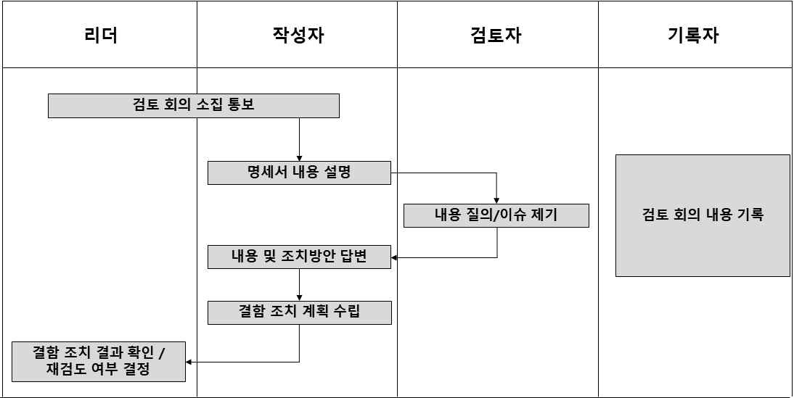

출처: 교육부(2017). 시스템SW 요구사항 분석(LM2001020801_16v2). 세종: 한국직업능력개발원. p.81.
[그림 4-1] 워크스루(Walk-through) 수행 절차
3. 인스펙션(Inspection)을 이용하여 요구사항을 검증한다.
가장 엄격하고 정형화된 공식 검토 방식인 인스펙션은 작성자가 아닌 중재자가 검토
회의를 진행하고 제어한다. 사전에 준비한 체크리스트를 기반으로 종료 조건이 있는 절
차에 따라 진행한다.
(1) 참여자 역할을 정한다.
(가) 진행자(Moderator): 검토 회의 진행자로 회의를 계획하고 역할을 할당한다.
(나) 작성자(Author): 요구사항명세서를 작성하고 결함을 조치한다.
(다) 리더(Reader): 검토자를 대표하여 산출물을 낭독한다.
(라) 검토자(Reviewer): 사전에 산출물을 충분히 검토하고 발견한 결함에 대한 의견을
제시한다.
(마) 기록자(Recorder): 검토 회의에서 논의된 내용을 기록하고 정리하여 문서화한다.
(2) 인스펙션 절차를 수행한다.
(가) 인스펙션 절차 수행을 위한 준비를 한다.
1) 작성자는 인스펙션을 요청한다.
2) 진행자는 검토 대상이 검사할 만한 수준인지 확인한다.
3) 진행자는 인스펙션의 역할별 참여자를 선정한다.
4) 진행자는 인스펙션의 일정 계획을 수립하고 이를 참여자에게 통보한다.
(나) 개인별로 준비한다.
1) 인스펙션 참여자는 검토 자료를 받고 인스펙션 공지를 받았을 때 검토를 시작한다.
2) 자료 배포는 인스펙션 회의 2일 전에는 전달한다.
3) 사전 설명회를 개최할 수 있다.
4) 사전에 개별적으로 검토한다.
(다) 검토 회의를 실시한다.
1) 발견한 결함을 논의한다.
2) 결함 해결책은 논의하지 않는다.
3) 기록자는 논의되는 내용을 기록한다.
4) 반복되는 결함은 한 번만 논의하고, 이후 반복된 결함에 대해서는 위치만 표시한
후 넘어간다.
5) 인스펙션 회의가 끝나면 진행자는 참여자들의 결함 기록을 회수한다.
6) 발견한 결함에 대한 상세 검토가 필요할 경우 충분한 시간을 두고 결정한다.
7) 진행자는 발견한 결함에 대해 종합한다.
8) 인스펙션의 재시행 여부, 인스펙션의 유형 등을 작성자에게 알려 준다.
9) 폐회한다.
(라) 발견된 결함을 수정한다.
1) 작성자는 발견된 결함을 확인하고 필요한 조치를 한다.
2) 조치가 완료된 후, 인스펙션 진행자와 다시 인스펙션이 필요한지 여부를 상의한다.
<표 4-12> 시정 조치서(예시)
시정 조치서 항목 내용
번호 부여된 고유 번호
제목 오류 내용을 알 수 있도록 기술
내용 오류 내용과 조치할 내용
심각도 1: 심각, 2: 보통, 3: 경미한 문제
우선순위 High: 높음, Middle: 중간, Low: 낮음
심각도와 우선순위를 기반으로 수정 여부를 판단
수정 여부 - Must to Fix: 반드시 수정,
- Like to Fix: 되도록 수정
시정 조치 등록자/등록 날짜 등록한 사람과 등록한 날짜
시정 조치 담당자/조치 날짜 해결한 사람과 해결한 날짜
시정 조치 확인자/확인 날짜 수정을 확인하고 닫은 사람, 날짜
출처: 교육부(2021). 애플리케이션 요구사항 분석(LM2001020219_19v5). 한국직업능력연구원. p.96.
(마) 후속 조치를 수행한다.
1) 진행자는 인스펙션에서 발견된 결함이 모두 수정되었는지 확인한다.
2) 경우에 따라 인스펙션 팀원들의 도움을 받을 수 있다.
3) SW 품질 관리자 및 관계자들에게 종합 보고를 한다.
4) 인스펙션을 종료한다.
4. 테스트 기반 요구사항을 검증한다.
테스트 기반 요구사항 검증 사례를 추가하여 요구사항을 검증한다. 이는 단순히 기능이
작동하는지 확인하는 것을 넘어, 정의된 요구사항이 명확하고 테스트 가능한 형태로 작
성되었는지 검증하는 데 중점을 둔다.
<표 4-13> 테스트 가능성 판단 기준(예시)
기준 내용 예시
(가능)신규 사용자 20명을 대상으로
한 사용성 평가에서 작업 성공률
- 주어(주체)·행위(동사)·대상(목적어)이
90% 이상, 로그인까지 평균 3회
분명하다.
구체성/명확성 클릭 이하, SUS 점수 75점 이상을
- 모호한 표현(편리한, 신속한, 적절히
달성해야 한다
등)을 쓰지 않는다.
(불가능)사용자에게 편리한 화면을
제공해야 한다
(가능)메인 페이지 TTFB 95퍼센타일
300ms 이하, 완전 렌더링
측정
- 수치/단위/기준(%, 초, MB, 건수 95퍼센타일 2.0초 이하(모바일 4G,
가능성(정량
등)과 합격 기준(임곗값)이 있다. 10개 이미지, 캐시 미스 조건).
지표)
(불가능)페이지는 빠르게 로딩되어야
한다.
(가능)월간 가동률 99.9% 이상, 장애
관찰 - 측정 데이터의 출처(로그, 모니터 발생 시 MTTR 10분 이내 복구.
가능성(증거 링, UI, DB, 모의 계측)가 정의되 가동률 산정은 플랫폼 모니터링 지표
출처) 어 있다 기준
(불가능)서비스는 안정적이어야 한다.
<표 4-14> 주문 생성 기능 요구사항(예시 1)
요구사항 내용
Request 1 사용자는 최소 1개 이상의 주문 항목을 입력해야 주문을 생성할 수 있다.
사용자가 하루 50건 이상의 주문을 생성할 경우, 시스템은 경고 메시지를
Request 2
표시해야 한다.
주문 생성 시, 재고가 부족한 항목이 포함되면 주문을 완료할 수 없으며
Request 3
사용자에게 해당 사실을 알려야 한다.
(1) 요구사항에 대한 테스트 케이스 설계를 진행한다.
각 요구사항을 검증하기 위한 구체적인 테스트 케이스(Test Case)를 작성한다.
<표 4-15> 주문 생성 기능 요구사항(예시 2)
요구사항 테스트 케이스 테스트 케이스 내용
테스트 케이스 주문 항목을 전혀 입력하지 않고 ‘저장’ 버튼을 클릭했을
Request 1
1-1 때, 오류 메시지가 올바르게 출력되는지 확인한다.
(최소 1개
이상의 주문
테스트 케이스 유효한 주문 항목을 1개 이상 입력하고 ‘저장’ 버튼을
항목 입력)
1-2 클릭했을 때, 주문이 성공적으로 생성되는지 확인한다.
특정 사용자가 하루 동안 49건의 주문을 생성한 후,
테스트 케이스
50번째 주문을 생성했을 때 경고 메시지가 출력되지
2-1
Request 2 않는지 확인한다.
(1일 50건 이상
주문 시 경고 특정 사용자가 하루 동안 50건의 주문을 생성한 후,
메시지) 테스트 케이스 51번째 주문을 생성했을 때 “일일 주문 한도를
2-1 초과했습니다.”와 같은 경고 메시지가 올바르게 출력되는지
확인한다.
테스트 케이스 주문 생성 시 재고가 충분한 항목만 포함했을 때, 주문이
3-1 성공적으로 생성되는지 확인한다.
Request 3
(재고 부족 시
주문 생성 시 재고가 부족한 항목을 포함했을 때, 주문
주문 불가 및
테스트 케이스 생성이 실패하고 “재고가 부족한 항목이 포함되어 주문을
알림)
3-2 완료할 수 없습니다.”와 같은 오류 메시지가 올바르게
출력되는지 확인한다.
(2) 요구사항에 대한 검증 기준을 구성한다.
각 요구사항 및 테스트 케이스에 대한 검증 기준을 명확히 정의한다. 이는 요구사항
의 품질을 평가하고, 개발된 시스템이 요구사항을 충족했는지 판단하는 데 사용된다.
<표 4-16> 주문 생성 기능 요구사항(예시 3)
수용 기준 테스트 설계 가능성
검증 가능성
(어떤 조건을 (요구사항으로부터
항목 설명 (명확히 테스트할
만족하면 완료로 테스트 케이스 생성
수 있는가?)
간주하는가?) 가능한가?)
- 주문 항목 미
입력하고 ‘저장’
사용자는 최소 높음: 주문 항목
버튼 클릭 시 오류 높음: 오류 메시지
1개 이상의 주문 입력 여부에 따라
메시지 (“최소 출력 여부 및 주문
Request 1 항목을 입력해야 시스템 동작을
1개의 주문 성공 여부를 테스트
주문을 생성할 수 명확히 확인할 수
항목을 케이스로 구성 가능
있다. 있음
입력해주세요.”)
출력
- 50건 이하 주문
시 경고 메시지 미
사용자가 하루 출력
높음: 특정 주문
50건 이상의 - 51번째 높음: 주문 건수
건수를 기준으로
주문을 생성할 주문부터 “일일 시나리오를 통해
Request 2 경고 메시지 출력
경우, 시스템은 주문 한도를 테스트 케이스를
여부를 확인할 수
경고 메시지를 초과했습니다.” 명확하게 구성 가능
있음
표시해야 한다. 경고 메시지 출력
및 주문 생성 가능
여부 확인
- 재고 충분 시
주문 생성 시
주문 성공
재고가 부족한
높음: 재고 상태에 - 재고 부족 시
항목이 포함되면 높음: 재고 상태를
따른 주문 처리 및 주문 실패 및
주문을 완료할 수 가정한 테스트
Request 3 오류 메시지 출력 “재고가 부족한
없으며 케이스 구성 및
여부를 확인할 수 항목이 포함되어
사용자에게 해당 메시지 확인 가능
있음 주문을 완료할 수
사실을 알려야
없습니다.” 오류
한다.
메시지 출력
이와 같이 테스트 기반으로 요구사항을 검증하면, 요구사항이 모호하지 않고 구체적
이며 테스트 가능한 형태로 작성되었는지 확인할 수 있다. 이는 개발 과정에서 발생
할 수 있는 오해를 줄이고, 최종적으로 사용자의 기대를 충족하는 고품질의 소프트
웨어를 만드는 데 기여한다.
5. 테스트 기반 요구사항 검증의 결과의 추적 관리를 위해 커버리지 매트릭스(Coverage Matrix)를
활용한다.
테스트 기반 요구사항 검증을 수행한 후, 그 결과를 체계적으로 관리하고 추적하기 위
해 커버리지 매트릭스(Coverage Matrix)를 활용할 수 있다. 이 매트릭스는 요구사항
이 얼마나 테스트로 커버되었는지, 그리고 해당 테스트를 통해 어떤 결함이 발견되었는
지를 한눈에 파악할 수 있게 해 준다.
<표 4-17> 커버리지 매트릭스 역할
역할 내용
요구사항 누락 모든 요구사항이 최소한 하나 이상의 테스트 케이스로 커버 되었는지 확인할
방지 수 있음
테스트 진행 각 요구사항에 대한 테스트가 성공했는지, 실패했는지, 그리고 결함이 발생했는
상황 추적 지를 명확히 알 수 있음
결함 추적 및 발견된 결함이 어떤 요구사항과 어떤 테스트 케이스에서 발생했는지 명확히 연
관리 결하여, 결함 수정 및 재테스트 과정을 효율적으로 관리할 수 있음
<표 4-18> 커버리지 매트릭스 예시
테스트 케이스
요구 ID 요구사항 내용 결함 여부 비고(결함 상세)
ID
사용자는 상품을 장바구니에 TC_CART_
REQ001 없음 정상 동작 확인
추가할 수 있다. 001
장바구니에 담긴 상품의 TC_CART_
REQ002 없음 정상 동작 확인
수량을 변경할 수 있다. 002
장바구니에서 상품을 삭제할 TC_CART_
REQ003 없음 정상 동작 확인
수 있다. 003
유효하지 않은 코드
주문 시 할인 코드를 TC_ORDER_0
REQ004 있음 입력 시 오류 메시지
적용할 수 있다. 01
미표시 (CRITICAL)
배송지 정보를 입력하고 TC_ORDER_0
REQ005 없음 정상 동작 확인
수정할 수 있다. 02
<표 4-19> 커버리지 매트릭스 분석 예시
매트릭스 분석 내용
이 매트릭스를 보면 모든 요구사항(REQ001 ~ REQ05)이 최소한 하나의 테스트
요구사항 누락
케이스로 커버되었음을 알 수 있음. 만약 특정 요구 ID에 해당하는 테스트 케이
방지
스가 없다면, 해당 요구사항은 테스트 되지 않았음을 즉시 파악할 수 있음
‘결함 여부’ 칼럼을 통해 각 요구사항에 대한 테스트 결과(성공/실패)를 명확히
테스트 진행
알 수 있음. 예를 들어, REQ004는 테스트 과정에서 결함이 발견되었음을 확인
상황 추적
할 수 있음
결함 추적 및 REQ004의 경우, ‘유효하지 않은 코드 입력 시 오류 메시지 미표시’라는 결함이
관리 발견되었고, 중요도가 CRITICAL 수준임을 알 수 있음

| 학습 4 | 교수·학습 방법 |
| --- | --- |

교수 방법
• 실제 프로젝트 실패/성공 사례 비교를 통해 검증 부실이 미친 영향을 제시하고 SW 기
능 요구사항 검증의 중요성에 대해 설명한다.
• ISO/IEC 25010 기반 품질 특성(완전성, 정확성, 일관성 등) 정의 및 하위 항목 시연을
통해 SW 요구사항 품질 속성과 평가 항목에 대해 설명한다.
• 리뷰, 워크스루, 인스펙션, 테스트 기반 검증의 차이점 및 장단점 시연을 통해 SW 기
능 요구사항 검증 기법에 대해 설명한다.
• 실제 팀 내 리뷰 절차 시연(예: Git PR 리뷰 화면)을 통해 비공식 동료 검증 기법 활용
에 대해 설명한다.
• 워크스루(Walk-through)를 이용한 검증 방법에 대해 설명한다.
학습 방법
• 제시된 사례를 분석하고, 실패 원인과 개선 방법 보고서 작성을 통해 SW 기능 요구사
항 검증의 중요성에 대해 학습한다.
• 주어진 요구사항목록을 품질 속성별로 평가하고 점수 매기기를 통해 SW 요구사항 품질
속성과 평가 항목에 대해 학습한다.
• 동일 요구사항을 여러 검증 기법으로 평가해 보고, 결과 차이 분석을 통해 SW 기능 요
구사항 검증 기법에 대해 학습한다.
• 비공식 동료 검증 기법 적용에 대해 학습한다.
• 역할 분담 후 시나리오 기반 문서 검증을 통해 워크스루(Walk-through)를 이용한 검
증 방법에 대해 실습한다.

| 학습 4 | 평 가 |
| --- | --- |

평가 준거
• 평가자는 학습자가 학습 목표를 성공적으로 달성하였는지를 평가해야 한다.
• 평가자는 다음 사항을 평가해야 한다.

| 학습 내용 | 학습 목표 | 성취수준 |  |  |
| --- | --- | --- | --- | --- |
|  |  | 상 | 중 | 하 |

- 소프트웨어 요구사항명세서가 문서 표준을 준수하여 사용
자가 이해 가능한 내용으로 일관성 있고, 완성도 있게 작
성되었는지를 검증할 수 있다.
- 작성한 요구사항명세서의 오류, 잘못된 가정, 불명확한 설
명, 비표준적인 내용 등이 있는지 확인을 위해 조사
(Inspection) 혹은 검토(Review)를 실시할 수 있다.
요구사항 검증
- 기술 환경, 구현 가능성, 안정성 등을 고려하여 요구된
도출 사항들을 검증할 수 있다.
- 분석 단계의 개념 모델링 결과물이 있을 경우 표기법,
모델 원칙 준수 여부 판단 등을 통해 모델을 검증할 수
있다.
평가 방법
• 서술형 시험

| 학습 내용 | 평가 항목 | 성취수준 |  |  |
| --- | --- | --- | --- | --- |
|  |  | 상 | 중 | 하 |

- SW 기능 요구사항 검증의 중요성에 대한 이해 정도
- SW 요구사항 품질 속성과 평가 항목에 대한 이해 정도
- SW 기능 요구사항 검증 기법에 대한 이해 정도
요구사항 검증
- 비공식 동료 검증 기법에 대한 이해 정도
- 워크스루(Walk-through)를 이용한 검증 방법에 대한 이
해 정도
• 논술형 시험

| 학습 내용 | 평가 항목 | 성취수준 |  |  |
| --- | --- | --- | --- | --- |
|  |  | 상 | 중 | 하 |

- SW 기능 요구사항 검증의 중요성에 대한 논리적 전개
능력
- SW 요구사항 품질 속성과 평가 항목에 대한 논리적 전
개 능력
요구사항 검증
- SW 기능 요구사항 검증 기법에 대한 논리적 전개 능력
- 비공식 동료 검증 기법에 대한 논리적 전개 능력
- 워크스루(Walk-through)를 이용한 검증 방법에 대한 논
리적 전개 능력
• 평가자 질문

| 학습 내용 | 평가 항목 | 성취수준 |  |  |
| --- | --- | --- | --- | --- |
|  |  | 상 | 중 | 하 |

- SW 기능 요구사항 검증의 중요성에 대한 이해 여부
- SW 요구사항 품질 속성과 평가 항목에 대한 이해 여부
- SW 기능 요구사항 검증 기법에 대한 이해 여부
요구사항 검증
- 비공식 동료 검증 기법에 대한 이해 여부
- 워크스루(Walk-through)를 이용한 검증 방법에 대한 이
해 여부
- 이익과 불이익의 전체 가치에 대한 분석과 우선순위에 대
한 이해 여부
• 평가자 체크리스트

| 학습 내용 | 평가 항목 | 성취수준 |  |  |
| --- | --- | --- | --- | --- |
|  |  | 상 | 중 | 하 |

- SW 기능 요구사항 검증의 중요성에 대한 이해 여부
- SW 요구사항 품질 속성과 평가 항목에 대한 이해 여부
- SW 기능 요구사항 검증 기법에 대한 이해 여부
요구사항 검증
- 비공식 동료 검증 기법에 대한 이해 여부
- 워크스루(Walk-through)를 이용한 검증 방법에 대한 이
해 여부
- 이익과 불이익의 전체 가치에 대한 분석과 우선순위에 대
한 이해 여부
• 구두 발표

| 학습 내용 | 평가 항목 | 성취수준 |  |  |
| --- | --- | --- | --- | --- |
|  |  | 상 | 중 | 하 |

- SW 기능 요구사항 검증의 중요성에 대한 발표 능력
- SW 요구사항 품질 속성과 평가 항목에 발표 능력
- SW 기능 요구사항 검증 기법에 대한 발표 능력
요구사항 검증
- 공식 동료 검증 기법에 대한 절차와 항목 발표 능력
- 워크스루(Walk-through)를 이용한 검증 방법에 대한 절
차와 항목 발표 능력

| 학습 내용 | 평가 항목 | 성취수준 |  |  |
| --- | --- | --- | --- | --- |
| 피드백 |  |  |  |  |
| 1. 서술형 시험- 성취수준이거나, 발견한 | 낮은 학습자들에게는 다른 명세서를 주고 오류를 수정하는 재검증오류의 원인과 해결 방안을 보고서로 작성하여 제출하도록 한다. | 과제를 |  | 부여하 |
| 2. 논술형 시험- 성취수준이수립하고 논리적 | 낮은 학습자들에게는 가상 프로젝트의 요구사항명세서를 주고근거를 제시하는 보고서를 제출하도록 한다. | 실제 | 검증 | 계획을 |
| 3. 평가자 질문- 성취수준이른 학습자의 | 낮은 학습자들에게는 질문에 대한 추가 자료를 조사하여 답변을검증 결과와 비교 분석하여 설명하는 보고서를 제출하도록 한다. |  | 보충하거나, | 다 |
| 4. 평가자 체크리스트- 평가 결과가기술적 타당성 | 미흡할 때는 요구사항명세서 문서 표준과 품질 기준, 검증 검증, 분석 모델 검증 관련해서 구체적으로 설명해 준다. | 활동의 | 차이와 | 절차, |
| 5. 구두 발표 - 성취수준이와 절차, 기술적 | 낮은 학습자들에게는 요구사항명세서 문서 표준과 품질 기준,타당성 검증, 분석 모델 검증 방법에 관해 설명해 준다. | 검증 | 활동의 | 차이 |

•과학기술정보통신부(2018). SW사업 요구사항 상세화 및 RFP 작성. 진천: 정보통신산업진흥원.
•교육부(2016). 소프트웨어 개발 방법론(LM2001020229_16v4). 세종: 한국직업능력개발원.
•교육부(2016). 시스템SW 요구사항 분석(LM2001020801_16v2). 세종: 한국직업능력개발원.
•교육부(2016). 요구사항 확인(LM2001020201_14v2). 세종: 한국직업능력개발원.
•교육부(2016). SW아키텍처 요구 분석(LM2001020103_14v2). 세종: 한국직업능력개발원.
•교육부(2017). 비즈니스 환경 분석(LM2001010301_14v2). 세종: 한국직업능력개발원.
•교육부(2017). 정보 기술 환경 분석(LM2001010302_14v2). 세종: 한국직업능력개발원.
•교육부(2021). 애플리케이션 요구사항 분석(LM2001020219_19v5). 한국직업능력연구원.
•김은경(2013). 『창의적 공학 설계』. 한빛아키데미.
•한국정보통신기술협회(2009). TTAK.KO-11.0091 소프트웨어 요구사항 명세 품질 평가 지침. TTA.
•Bourque, P. & Fairley, R. E.(2014). Guide to the Software Engineering Body of
Knowledge(SWEBOK ®), Ver.3.0. IEEE Computer Society Press.
•IEEE Std 830-1998. IEEE Recommended Practice for Software Requirements
Specifications.
•IEEE Std 1028-2008. IEEE Standard for Software Reviews and Audits.
•ISO/IEC 25010: 2011. Systems and Software engineering. Systems and Software Quality
Requirements and Evaluation(SQuaRE). System and Software quality models.
•Karl Wiegers & Joy Beaty 저/ 최상호․임성국 역(2013). 『소프트웨어 요구사항 3(Software
Requirements 3)』. 위키북스.
•Pressman, R. S.(2010). Software Engineering: A Practitioner’s Approach , 7th ed.
IL: McGraw-Hill.
•Robert W. Sebesta(2011). Concepts of Programming Languages, 10th ed. USA:
Pearson.
•Sommerville, I.(2011). Software Engineering , 9th ed. BS: Addison-Wesley.
•Wiegers, K. & Beatty, J.(2013). Software requirements, 3rd ed. WC: Pearson
Education.
NCS학습모듈 개발이력
발행일 2015년 12월 31일
세분류명 응용SW엔지니어링(20010202)
개발기관 한국소프트웨어기술진흥협회
강석진(이비스톰)* 김승현(경희대학교)
김보운(이화여자대학교) 엄기영(우리에프아이에스)
김홍진(LG CNS) 장온순(한국IT컨설팅)
유은희 조상욱(세종대학교)
집필진 검토진
장현섭((주)커리텍) 조성호(삼성카드)
주선태(T3Q)
진권기(이비스톰)
최재준 *표시는 대표집필자임
발행일 2017년 12월 31일
세분류명 응용SW엔지니어링(20010202)
개발기관 (사)한국정보통신기술사협회
박미화(동국대학교)* 권순명((주)씨에이에스)
김승환((주)캐롯아이) 김태형((사)한국정보통신기술사협회)
김원기(LG CNS) 양승화(라이나생명보험)
김종명(SM신용정보) 이성화(시스원)
박현기(프리랜서) 황극인((주)코스콤)
집필진 검토진
유현주((사)한국정보통신기술사협회)
이구성(한국아이씨티(주))
이숙희(서초문화예술정보학교)
최창선(한빛디엔에스(주))
홍민표(한화S&C) *표시는 대표집필자임
발행일 2018년 12월 31일
학습모듈명 애플리케이션 요구사항 분석(LM2001020219_16v4)
개발기관 (사)한국정보통신기술사협회
김광국((주)코스콤)* 류갑상(동신대학교)
권기혁(세종대학교) 엄기영(우리에프아이에스)
김승환((주)캐롯아이) 장성수(세명컴퓨터고등학교)
김유석(한국정보통신기술사협회) 장희수((주)유알피시스템)
집필진 검토진
문정기(교보정보통신)
박미화(동국대학교 융합SW교육원)
이주희((주)유알피시스템)
홍민표(한화S&C) *표시는 대표집필자임
발행일 2021년 12월 31일
학습모듈명 애플리케이션 요구사항 분석(LM2001020219_19v5)
개발기관 (사)한국정보통신기술사협회(개발책임자: 온기현)
발행일 2025년 12월 31일
학습모듈명 애플리케이션 요구사항 분석(LM2001020219_23v6)
개발기관 한국정보공학기술사회(개발책임자: 박철수)
이주희(웨이버스)* 김창남(세명컴퓨터고등학교)
김동욱(한국기술교육대학교) 서경석(미라콤아이앤씨)
김지영(LG CNS) 서인순(프리랜서)
문정기(태하기술사사무소) 유두규(건국대학교)
집필진 검토진
신현범(셈틀웨어)
이근수(분당경영고등학교)
정은주(한국정보기술단)
조민양(동서울대학교)
*표시는 대표집필자임
(참고) 검토진으로 참여한 집필진은 본인의 원고가 아닌 타인의 학습모듈을 검토함
애플리케이션 요구사항 분석(LM2001020219_23v6)
저작권자 교육부
연구사업기관 한국직업능력연구원
발행일 2025. 12. 31.
ISBN 979-11-4240-199-2
※ 이 학습모듈은 자격기본법 시행령(제8조 국가직무능력표준의 활용)에 의거하여 개발하였으며,
NCS통합포털사이트(http://www.ncs.go.kr)에서 다운로드할 수 있습니다.

