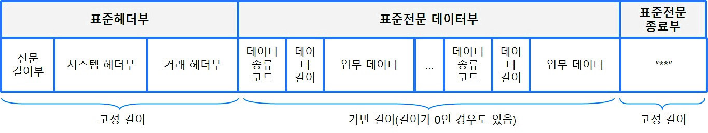
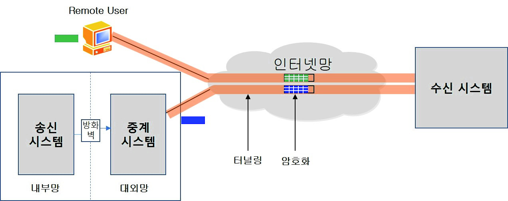
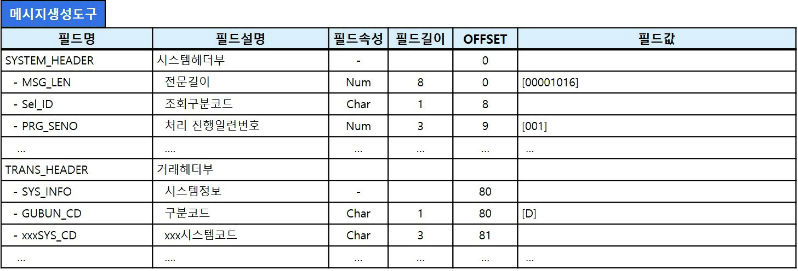
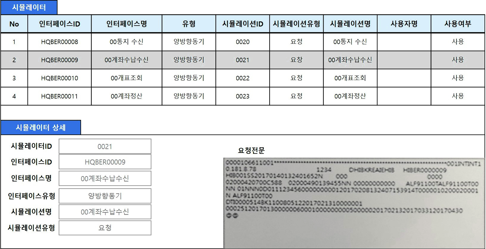

# LM2001020212_23v6_.인터페이스+구현_20251108

대분류/20
정보통신 중분류/01
정보기술 소분류/02
정보기술개발 세분류/02
응용SW엔지니어링 능력단위/12
NCS학습모듈
인터페이스 구현
LM2001020212_23v6
[NCS학습모듈 활용 시 유의 사항]
1. NCS학습모듈은 교육훈련기관에서 출처를 명시하고 교육적 목적으로 활용할 수 있습니다. 다
만, NCS학습모듈에는 국가(교육부)가 저작재산권 일체를 보유하지 않은 저작물(출처가 표기된
도표‧사진‧삽화‧도면 등)이 포함되어 있으므로, 이러한 저작물의 변형‧각색‧복제‧공연‧
배포 및 공중 송신 등과 이러한 저작물을 활용한 2차적 저작물을 작성하려면 반드시 원작자
의 동의를 받아야 합니다.
2. NCS학습모듈은 개발 당시의 산업 및 교육 현장을 반영하여 집필하였으므로, 현재 적용되는
법령‧지침‧표준 및 교과 내용 등과 차이가 있을 수 있습니다. NCS학습모듈 활용 시 법령
‧지침‧표준 및 교과 내용의 개정 사항과 통계의 최신성 등을 확인하시기를 바랍니다.
3. NCS학습모듈은 산업 현장에서 요구되는 능력을 교육훈련기관에서 학습할 수 있게 구성한 자
료입니다. 다만, NCS학습모듈 지면의 한계상 대표적 예시(예: 활용도 또는 범용성이 높은 제
품, 서비스) 중심으로 집필하였음을 이해하시기를 바랍니다.
NCS학습모듈의 이해
NCS학습모듈의 이해
※ 본 NCS학습모듈은 「NCS 국가직무능력표준」사이트(http://www.ncs.go.kr) 에서 확인 및 다운로드할 수 있습니다.

| Ⅰ | NCS학습모듈이란? |
| --- | --- |

•국가직무능력표준(NCS: National Competency Standards)이란 산업현장에서 직무를
수행하기 위해 요구되는 지식･기술･소양 등의 내용을 국가가 산업부문별･수준별로 체계
화한 것으로 산업현장의 직무를 성공적으로 수행하기 위해 필요한 능력(지식, 기술, 태도)
을 국가적 차원에서 표준화한 것을 의미합니다.
•국가직무능력표준(이하 NCS)이 현장의 ‘직무 요구서’라고 한다면, NCS학습모듈은 NCS
의 능력단위를 교육훈련에서 학습할 수 있도록 구성한 ‘교수･학습 자료’입니다. NCS학습
모듈은 구체적 직무를 학습할 수 있도록 이론 및 실습과 관련된 내용을 상세하게 제시하
고 있습니다.

| NCS 및 NCS학습모듈 개발 절차 |
| --- |
| NCS산업계개발 계획 수립NCSNCS학습모듈NCS학습모듈 개발개발 계획 수립 |

•NCS학습모듈은 다음과 같은 특징을 가지고 있습니다.
첫째, NCS학습모듈은 산업계에서 요구하는 직무능력을 교육훈련 현장에 활용할 수 있도
록 성취목표와 학습의 방향을 명확히 제시하는 가이드라인의 역할을 합니다.
둘째, NCS학습모듈은 특성화고, 마이스터고, 전문대학, 4년제 대학교의 교육기관 및 훈
련기관, 직장교육기관 등에서 표준교재로 활용할 수 있으며 교육과정 개편 시에도
유용하게 참고할 수 있습니다.
i
•NCS와 NCS학습모듈 간의 연결 체계를 살펴보면 아래 그림과 같습니다.

| NCS와 NCS학습모듈의 연결 체계 |
| --- |
| NCS NCS학습모듈능력단위 NCS학습모듈명능력단위 정의 NCS학습모듈의 목표능력단위 기술서 학습명능력단위 요소 학습 내용수행준거 학습 목표지식 필요 지식기술 수행 내용- 재료･자료태도- 기기(장비･공구)- 안전･유의 사항- 수행 순서적용범위 및 작업상황고려 사항 교수･학습 방법자료 및 관련 서류 교수 방법장비 및 도구 학습 방법평가 지침 평가평가 방법 평가 준거평가 시 고려 사항 평가 방법피드백참고 자료･활용 서식･부록 |

|  |  | NCS |  |  |  |  |  |  |  |  | NCS학습모듈 |  |  |  |  |
| --- | --- | --- | --- | --- | --- | --- | --- | --- | --- | --- | --- | --- | --- | --- | --- |
|  | 능력단위 |  |  |  |  |  |  |  |  | NCS학습모듈명 |  |  |  |  |  |
|  | 능력단위 | 능력단위 |  |  |  |  |  |  |  | NCS학습모듈명 | NCS학습모듈명 |  |  |  |  |
|  | 능력단위 정의 |  |  |  |  |  |  |  |  | NCS학습모듈의 목표 |  |  |  |  |  |
|  | 능력단위 정의 | 능력단위 정의 |  |  |  |  |  |  |  | NCS학습모듈의 목표 | NCS학습모듈의 목표 |  |  |  |  |
|  | 능력단위 기술서 능력단위 요소 | 능력단위 기술서 능력단위 요소 |  |  |  |  |  |  |  | 학습명 학습 내용 | 학습명 학습 내용 |  |  |  |  |
|  | 능력단위 기술서 |  |  |  |  |  |  |  |  | 학습명 |  |  |  |  |  |
|  | 능력단위 기술서 | 능력단위 기술서 |  |  |  |  |  |  |  | 학습명 | 학습명 |  |  |  |  |
|  | 능력단위 요소 |  |  |  |  |  |  |  |  | 학습 내용 |  |  |  |  |  |
|  | 능력단위 요소 | 능력단위 요소 |  |  |  |  |  |  |  | 학습 내용 | 학습 내용 |  |  |  |  |
|  | 수행준거 |  |  |  |  |  |  |  |  | 학습 목표 |  |  |  |  |  |
|  | 수행준거 | 수행준거 |  |  |  |  |  |  |  | 학습 목표 | 학습 목표 |  |  |  |  |
|  | 지식기술태도 |  |  |  |  |  |  |  |  | 필요 지식수행 내용- 재료･자료- 기기(장비･공구)- 안전･유의 사항- 수행 순서 |  |  |  |  |  |
|  | 기술 | 기술 |  |  |  |  |  |  |  | 수행 내용 | 수행 내용 |  |  |  |  |
|  |  |  |  |  |  |  |  |  |  | - 재료･자료 | - 재료･자료 |  |  |  |  |
|  | 태도 | 태도 |  |  |  |  |  |  |  | - 기기(장비･공구) | - 기기(장비･공구) |  |  |  |  |
|  |  |  |  |  |  |  |  |  |  | - 기기(장비･공구) | - 기기(장비･공구) |  |  |  |  |
|  |  |  |  |  |  |  |  |  |  | - 안전･유의 사항 | - 안전･유의 사항 |  |  |  |  |
|  | 적용범위 및 작업상황 |  |  |  |  |  |  |  |  | - 수행 순서 | - 수행 순서 |  |  |  |  |
|  | 고려 사항자료 및 관련 서류장비 및 도구 |  |  |  |  |  |  |  |  | 교수･학습 방법 | 교수･학습 방법 교수 방법 학습 방법 |  |  |  |  |
|  | 자료 및 관련 서류 장비 및 도구 | 자료 및 관련 서류 장비 및 도구 |  |  |  |  |  |  |  | 교수 방법학습 방법 |  |  |  |  |  |
|  | 평가 지침 |  |  |  |  |  |  |  |  | 평가 |  |  |  |  |  |
|  | 평가 방법평가 시 고려 사항 |  |  |  |  |  |  |  |  | 평가 준거평가 방법피드백 |  |  |  |  |  |
|  | 평가 시 고려 사항 | 평가 시 고려 사항 |  |  |  |  |  |  |  | 평가 방법 | 평가 방법 |  |  |  |  |
|  |  |  |  |  |  |  |  |  |  | 참고 자료･활용 서식･부록 |  |  |  |  |  |

ii
NCS학습모듈의 이해

| Ⅱ | NCS학습모듈의 체계 |
| --- | --- |

•NCS학습모듈은 1. NCS학습모듈의 위치 , 2. NCS학습모듈의 개요 , 3. NCS학습모듈의 내용 체계 ,
4. 참고 자료 , 5. 활용서식/부록 으로 구성되어 있습니다.
1. NCS학습모듈의 위치
•NCS학습모듈의 위치는 NCS 분류 체계에서 해당 학습모듈이 어디에 위치하는지를 한 눈에
볼 수 있도록 그림으로 제시한 것입니다.

| [NCS-학습모듈의 위치] |  |  |  |  |  |  |  |
| --- | --- | --- | --- | --- | --- | --- | --- |
| 대분류 | 문화·예술·디자인·방송 |  |  |  |  |  |  |
| 중분류 |  | 문화콘텐츠 |  |  |  |  |  |
| 소분류 |  |  |  |  |  | 문화콘텐츠제작 |  |
| 세분류 |  |  |  |  |  |  |  |
| 세분류 |  |  |  |  |  |  |  |
| 방송콘텐츠제작 |  |  |  |  | 능력단위 |  | 학습모듈명 |
| 영화콘텐츠제작 프로그램 기획 프로그램 기획음악콘텐츠제작 아이템 선정 아이템 선정광고콘텐츠제작 자료 조사 자료 조사게임콘텐츠제작 프로그램 구성 프로그램 구성애니메이션캐스팅 캐스팅콘텐츠제작만화콘텐츠제작 제작계획 제작계획캐릭터제작 방송 미술 준비 방송 미술 준비스마트문화앱방송 리허설 방송 리허설콘텐츠제작영사 야외촬영 야외촬영스튜디오 제작 스튜디오 제작… … |  |  |  |  | 프로그램 기획 |  | 프로그램 기획 |
| 음악콘텐츠제작 |  |  |  |  | 아이템 선정 |  | 아이템 선정 |
| 광고콘텐츠제작 자료 |  |  |  |  | 자료 조사 |  | 자료 조사 |
| 게임콘텐츠제작 |  |  |  |  | 프로그램 구성 |  | 프로그램 구성 |
| 애니메이션 콘텐츠제작 |  |  |  |  | 캐스팅 |  | 캐스팅 |
| 만화콘텐츠제작 |  |  |  |  | 제작계획 |  | 제작계획 |
| 캐릭터제작 방송 |  |  |  |  | 방송 미술 준비 |  | 방송 미술 준비 |
| 스마트문화앱 방송 콘텐츠제작 |  |  |  |  | 방송 리허설 |  | 방송 리허설 |
| 영사 |  |  |  |  | 야외촬영 |  | 야외촬영 |
|  |  |  |  |  | 스튜디오 제작 |  | 스튜디오 제작 |
|  |  |  |  |  | … |  | … |

|  | 학습모듈은 |
| --- | --- |
| NCS 능력단위 1개당 1개의 학습모듈 개발을 원칙으로 합니다. 그러나 필요에 따라고용단위 및 교과단위를 고려하여 능력단위몇 개를 묶어 1개 학습모듈로 개발할 수있으며, NCS 능력단위 1개를 여러 개의학습모듈로 나누어 개발할 수도 있습니다. |  |

iii
2. NCS학습모듈의 개요
•NCS학습모듈의 개요는 학습모듈이 포함하고 있는 내용을 개략적으로 설명한 것으로
학습모듈의 목표 , 선수학습 , 학습모듈의 내용 체계 , 핵심 용어 로 구성되어 있습니다.

| 학습모듈의 목표 | 해당 NCS 능력단위의 정의를 토대로 학습 목표를 작성한 것입니다. |
| --- | --- |

| 선수학습 | 해당 학습모듈에 대한 효과적인 교수･학습을 위하여 사전에 이수해야 하는 학습모듈, 학습 내용, 관련 교과목 등을 기술한 것입니다. |
| --- | --- |

| 학습모듈의내용 체계 | 해당 NCS 능력단위요소가 학습모듈에서 구조화된 체계를 제시한 것입니다. |
| --- | --- |

| 핵심 용어 | 해당 학습모듈의 학습 내용, 수행 내용, 설비･기자재 등 가운데 핵심적인 용어를 제시한 것입니다. |
| --- | --- |

| 제작계획 학습모듈의 개요 |  |  |  |
| --- | --- | --- | --- |
| 학습모듈의 목표본격적인 촬영을 준비하는 단계로서, 촬영 대본을 확정하고 제작 스태프를 조직하며촬영 장비와 촬영 소품을 준비할 수 있다.선수학습제작 준비(LM0803020105_13v1), 섭외 및 제작스태프 구성(LM0803020104_13v1),촬영 제작(LM0803020106_13v1), 촬영 장비 준비(LM0803040204_13v1.4), 미술디자인 협의하기(LM0803040203_13v1.4)학습모듈의 내용체계 |  |  |  |
| 학습 | 학습 내용 | NCS 능력단위 요소 |  |
| 코드번호 요소 명칭 |  | 코드번호 | 요소 명칭 |
| 1. 촬영 대본 1-1. 촬영 구성안 검 촬영 대본0803020114_16v3.1확정하기 토와 수정 확정하기2-1. 기술 스태프 조직2. 제작 스태프 제작 스태프2-2. 미술 스태프 조직 0803020114_16v3.2조직하기 조직하기2-3. 전문 스태프 조직3. 촬영 장비 3-1. 촬영 장비 점검 촬영 장비0803020114_16v3.3계획하기 과 준비 계획하기4-1. 촬영 소품 목록4. 촬영 소품 작성 촬영 소품0803020114_16v3.4계획하기 4-2. 촬영 소품 제작 계획하기의뢰 |  |  |  |
| 핵심 용어촬영 구성안, 제작 스태프, 촬영 장비, 촬영 소품 |  |  |  |

|  | 학습모듈의 목표는 |
| --- | --- |
| 학습자가 해당 학습모듈을 통해 성취해야할 목표를 제시한 것으로, 교수자는 학습자가 학습모듈의 전체적인 내용흐름을 파악하도록 지도할 수 있습니다. |  |

|  | 선수학습은 |
| --- | --- |
| 교수자 또는 학습자가 해당 학습모듈을 교수·학습하기 이전에 이수해야 하는 교과목또는 학습모듈(NCS 능력단위) 등을 표기한것입니다. 따라서 교수자는 학습자가 개별학습, 자기 주도 학습, 방과 후 활동 등 다양한 방법을 통해 이수할 수 있도록 지도하는 것을 권장합니다. |  |

|  | 핵심 용어는 |
| --- | --- |
| 해당 학습모듈을 대표하는 주요 용어입니다. 학습자가 해당 학습모듈을 통해 학습하고 평가받게될 주요 내용을 알 수 있습니다. 「NCS 국가직무능력표준」 사이트(www.ncs.go.kr)의 색인 (찾아보기) 중하나로 이용할 수 있습니다. |  |

iv
NCS학습모듈의 이해
3. NCS학습모듈의 내용 체계
•NCS학습모듈의 내용은 크게 학습 , 학습 내용 , 교수･학습 방법 , 평가 로 구성되어 있습니다.

| 학습 | 해당 NCS 능력단위요소 명칭을 사용하여 제시한 것입니다.학습은 크게 학습 내용, 교수･학습 방법, 평가로 구성되며 해당 NCS 능력단위의능력단위 요소별 지식, 기술, 태도 등을 토대로 내용을 제시한 것입니다. |
| --- | --- |

| 학습 내용 | 학습 내용은 학습 목표, 필요 지식, 수행 내용으로 구성되며, 수행 내용은 재료･자료, 기기(장비･공구), 안전･유의 사항, 수행 순서, 수행 tip으로 구성한 것입니다.학습모듈의 학습 내용은 실제 산업현장에서 이루어지는 업무활동을 표준화된 프로세스에 기반하여 다양한 방식으로 반영한 것입니다. |
| --- | --- |

| 교수･학습 방법 | 학습 목표를 성취하기 위한 교수자와 학습자 간, 학습자와 학습자 간 상호 작용이활발하게 일어날 수 있도록 교수자의 활동 및 교수 전략, 학습자의 활동을 제시한것입니다. |
| --- | --- |

| 평가 | 평가는 해당 학습모듈의 학습 정도를 확인할 수 있는 평가 준거 및 평가 방법, 평가 결과의 피드백 방법을 제시한 것입니다. |
| --- | --- |

학습 1 촬영 대본 확정하기

|  | 학습은 |
| --- | --- |
| 해당 NCS 능력단위요소 명칭을 사용하여제시하였습니다. 하나의 학습은 일반교과의 ‘대단원’에 해당되며, 학습모듈을 구성하는 가장 큰 단위가 됩니다. 또한 하나의 직무를 수행하기 위한 가장 기본적인단위로 사용할 수 있습니다 |  |

| 학습 2 | 제작 스태프 조직하기 |
| --- | --- |

학습 3 촬영 장비 계획하기
학습 4 촬영 소품 계획하기

|  | 학습 내용은 |
| --- | --- |
| NCS 능력단위요소별 수행준거를 기준으로제시하였습니다. 일반교과의 ‘중단원’에 해당합니다. |  |

2-1. 기술 스태프 조직
학습 목표 •프로그램 제작에 적합한 기술 스태프를 조직할 수 있다.

|  | 학습 목표는 |
| --- | --- |
| 학습 내용을 이수할 때 학습자가 갖춰야할행동 수준을 의미합니다. 따라서 수업시간의 과목 목표로 활용할 수 있습니다. |  |

필요 지식 /
(cid:49684) 기술 스태프의 구성

|  | 필요 지식은 |
| --- | --- |
| 해당 NCS의 지식을 토대로 학습에 대한이해와 성과를 제고하기 위해 반드시 알아야 할 주요 지식을 제시하였습니다. 필요 지식은 수행에 꼭 필요한 핵심 내용을위주로 제시하여 교수자의 역할이 매우중요하며, 이후 수행 순서와 연계하여 교수·학습으로 진행할 수 있습니다. |  |

프로그램의 장르에 따라 구성하는 기술 스태프는 많은 차
이가 있다. 같은 장르의 프로그램이라도 그 형식이나 내
용, 규모에 따라서 구성되는 기술 스태프의 종류와 인원
수는 천차만별이다.
1. 스튜디오 프로그램
토크쇼, 종합 구성, 예능과 같은 스튜디오 프로그램은
부조정실과 스튜디오를 사용하여 제작하기 때문에 많
은 기술 스태프가 필요하다.
v

|  | 수행 내용은 |
| --- | --- |
| 해당 학습모듈에서 제시한 내용 중 기술(skill)을 습득하기 위한 실습과제로 활용할 수 있습니다. |  |

수행 내용 / 기술 스태프 구성표 작성하기
재료·자료

|  | 재료･자료는 |
| --- | --- |
| 수행 내용을 수행하는데 필요한 재료 및 준비물로 실습 시 활용할 수 있습니다. |  |

• 방송프로그램 제작 기획서 및 방송 대본, 콘티(continuity), 제작
일정, 운용표
• 장비 및 시설, 제작 시설 배정 의뢰서 및 배정표, 방송 기술 스
태프 데이터베이스(DB) 자료

|  | 기기(장비･공구)는 |
| --- | --- |
| 수행 내용에 필요한 기본적인 장비 및 도구를 제시하였습니다. 제시된 기기 외에도 수행에 필요한 다양한 도구나 장비를 활용할수 있습니다. |  |

기기(장비･공구)
• 컴퓨터 등
안전･유의 사항

|  | 안전･유의사항은 |
| --- | --- |
| 수행 내용을 수행하는 데 있어 안전상 주의해야할 점 및 유의사항을 제시하였습니다. 실습 시 유념해야 하며, NCS의 고려사항도 추가적으로 활용할 수 있습니다. |  |

• 프로그램의 내용과 제작 방법을 분석하고, 각 스태프들의 역할
을 신중하게 검토한다.
수행 순서
(cid:49684) 방송 대본이나 콘티(continuity), 큐 시트를 분석하고, 프로그램

|  | 수행 순서는 |
| --- | --- |
| 실습 과제의 진행 순서로 활용할 수 있습니다. |  |

의 내용적 특성, 제작 과정에 대한 자료를 수집한다.
(cid:49685) 프로그램 제작 방법을 결정한다.

|  | 수행 tip은 |
| --- | --- |
| 수행 내용에서 실습을 용이하게 할 수 있는아이디어를 제시하였습니다. 수행 tip은 지도상의 안전 및 유의사항 외에 전반적으로적용되는 주안점 및 수행 과제 목적에 대한보충설명, 추가사항 등으로 활용할 수 있습니다. |  |

1. 스튜디오 녹화를 할 것인가, 야외 촬영을 할 것인가 검토한
다.
수행 tip
•스태프의 결정은 스태프 간의 호흡을 중
요시하여 선정해야 프로그램의 질을 향
상시킬 수 있다.

| 학습2 | 교수·학습 방법 |
| --- | --- |

|  | 교수･학습 방법은 |
| --- | --- |
| 학습 목표를 성취하는 데 필요한 교수 방법과 학습 방법을 제시하였습니다. |  |

교수 방법

|  | 교수 방법은 |
| --- | --- |
| 해당 학습 활동에 필요한 학습 내용, 학습내용과 관련된 자료명, 자료 형태, 수행 내용의 진행 방식 등에 대하여 제시하였습니다. 또한 학습자의 수업참여도 제고 방법및 수업 진행상 유의사항 등도 제시하였습니다. 선수학습이 필요한 학습을 학습자가숙지하였는지 교수자가 확인하는 과정으로활용할 수도 있습니다. |  |

• 방송 프로그램의 기술적 요소, 미술 구성 요소, 특수 촬영에 대해
설명한다.
• 방송 프로그램 제작에서 각 기술 스태프의 역할에 대해 설명한다.
• 방송 프로그램을 분석하고 필요한 기술 스태프를 구성할 수 있도
록 지시한다.
학습 방법

|  | 학습 방법은 |
| --- | --- |
| 해당 학습 활동에 필요한 학습자의 자기주도 학습 방법을 제시하였습니다. 또한학습자가 숙달해야 할 실기 능력과 학습과정에서 주의해야 할 사항 등도 제시하였습니다. 학습자가 학습을 이수하기 전반드시 숙지해야 할 기본 지식을 학습하였는지 스스로 확인하는 과정에 활용할수 있습니다. |  |

• 방송 프로그램의 기술적 요소, 미술 구성 요소, 특수 촬영에 대해
서 알아본다.
• 프로그램 제작에 필요한 기술 스태프의 역할을 이해하고, 기술 스
태프 구성표를 작성한다.
vi
NCS학습모듈의 이해

| 학습2 평 가평가 준거• 평가자는 학습자가 학습 목표를 성공적으로 달성하였는지를 평가해야 한다.• 평가자는 다음 사항을 평가해야 한다.성취수준학습 내용 학습 목표상 중 하기술 스태프 - 프로그램 제작에 적합한 기술 스태프를 조조직 직할 수 있다.미술 스태프 - 프로그램 제작에 적합한 미술 스태프를 조조직 직할 수 있다.전문 스태프 - 프로그램 특수 촬영을 위한 전문 스태프를조직 조직할 수 있다.평가 방법• 사례 연구성취수준학습 내용 평가 항목상 중 하- 프로그램에서 기술적 요소의 파악 여부기술 스태프 - 기술 스태프의 역할 파악 여부조직 - 프로그램에 필요한 기술 스태프 구성표 작성 능력피드백1. 사례 연구- 프로그램을 선택하여 기술 스태프, 미술 스태프, 전문 스태프 구성표를 예시와 같이 작성하였는지 개인별 능력을 평가한 후, 그결과를 모든 학습자에게 공유하도록 한다. | 학습2 | 평 가 |
| --- | --- | --- |

|  | 평가는 |
| --- | --- |
| NCS 능력단위의 평가 방법과 평가 시 고려사항을 준용하여 작성합니다. 교수자와학습자가 평가 항목별 성취수준 확인 시활용할 수 있습니다. |  |

|  | 평가 준거는 |
| --- | --- |
| 학습자가 학습을 어느 정도 성취하였는지평가하기 위한 기준을 제시하고 있습니다.학습 목표와 연계하여 단위수업 시간에 평가 항목 별 성취수준을 평가하는 데 활용할수 있습니다. |  |

| 학습 내용 | 학습 목표 | 성취수준 |  |  |
| --- | --- | --- | --- | --- |
|  |  | 상 | 중 | 하 |

| 4. 참고 자료•교육부(2013). | 섭외 및 제작스태프 구성(LM0803020104_13v1). |  |  |  |
| --- | --- | --- | --- | --- |
| 한국직업능력개발원. |  |  |  |  |
| 5. 활용 서식/부록직종 이름기술감독 조명감독 [디지털제1조(목적) 이 고시는램 및 방송광고의 | 스튜디오 기술 스태프 구성표 연락처 소속 특이사항텔레비전 방송프로그램 음량 등에 관한 기준] 제정 2014. 11. 29. 미래창조과학부 고시제1창 총칙 방송법 제70조의2제1항에 따라 방송사업자가 디지털 텔레비전음량을 일정하게 유지하기 위해 필요한 사항을 규정함을 | 비고목적으로 | 제2014-87호방송프로그한다. |  |

|  | 평가 방법은 |
| --- | --- |
| NCS 능력단위의 평가 방법을 참고하였으며, 평가 준거에 따른 평가 방법을 2개 이상 제시합니다. 평가 방법의 종류는 포트폴리오, 문제해결 시나리오, 서술형 시험, 논술형 시험, 사례 연구, 평가자 체크리스트,작업장 평가 등이 있으며, NCS 능력단위요소 별 수행 수준을 평가하는 데 가장 적절한 방법을 선정하여 활용할 수 있습니다. |  |

| 학습 내용 | 평가 항목 | 성취수준 |  |  |
| --- | --- | --- | --- | --- |
|  |  | 상 | 중 | 하 |

| 4. 참고 자료•교육부(2013). | 섭외 및 제작스태프 구성(LM0803020104_13v1). |  |  |  |
| --- | --- | --- | --- | --- |
| 한국직업능력개발원. |  |  |  |  |
| 5. 활용 서식/부록직종 이름기술감독 조명감독 [디지털제1조(목적) 이 고시는램 및 방송광고의 | 스튜디오 기술 스태프 구성표 연락처 소속 특이사항텔레비전 방송프로그램 음량 등에 관한 기준] 제정 2014. 11. 29. 미래창조과학부 고시제1창 총칙 방송법 제70조의2제1항에 따라 방송사업자가 디지털 텔레비전음량을 일정하게 유지하기 위해 필요한 사항을 규정함을 | 비고목적으로 | 제2014-87호방송프로그한다. |  |

|  | 피드백은 |
| --- | --- |
| 평가 후에 학습자들에게 평가 결과를 피드백하여 학습 목표를 달성하는 데 활용할 수 있습니다. |  |

|  | 참고 자료는 |
| --- | --- |
| 해당 학습모듈에 제시된 인용 자료의 출처를 제시하였습니다. 교수·학습의 과정에서참고로 활용할 수 있습니다. |  |

|  | 활용 서식은 |
| --- | --- |
| 평가 서식, 실습 시트 등 교수·학습 시 활용할 수 있는 다양한 서식들로 구성하였습니다. 수행에서 평가에 이르기까지 필요한서식을 해당 모듈의 특성에 맞춰 개발하거나 기존의 양식을 활용하여 제시하였습니다. |  |

|  | 부록은 |
| --- | --- |
| 활용 서식 이외에 교수·학습 과정에서 참고할수 있는 자료가 있는 경우 제시하였습니다. |  |

[NCS-학습모듈의 위치]

| 정보 통신 |  |  |
| --- | --- | --- |
|  | 정보 기술 |  |
|  |  | 정보기술개발 |

대분류
중분류
소분류
세분류

| SW아키텍처 |  |  | 능력단위 | 학습모듈명 |
| --- | --- | --- | --- | --- |
| 응용SW엔지니어링 |  |  | 요구사항 확인 | 요구사항 확인 |
| 임베디드SW 엔지니어링 |  |  | 데이터 입출력 구현 | 데이터 입출력 구현 |
| DB엔지니어링 |  |  | 통합 구현 | 통합 구현 |
| NW엔지니어링 |  |  | 정보시스템 이행 | 정보시스템 이행 |
| 보안엔지니어링 |  |  | 제품소프트웨어 패키징 | 제품소프트웨어 패키징 |
| UI/UX엔지니어링 |  |  | 서버 프로그램 구현 | 서버 프로그램 구현 |
| 시스템SW엔지니어링 |  |  | 인터페이스 구현 | 인터페이스 구현 |
| 빅데이터플랫폼구축 |  |  | 애플리케이션 배포 | 애플리케이션 배포 |
| 핀테크엔지니어링 |  |  | 애플리케이션 리팩토링 | 애플리케이션 리팩토링 |
| 데이터아키텍처 |  |  | 인터페이스 설계 | 인터페이스 설계 |
| loT시스템연동 |  |  | 애플리케이션 요구사항 분석 | 애플리케이션 요구사항 분석 |
| 인프라스트럭쳐 아키텍처 구축 |  |  | 기능 모델링 | 기능 모델링 |
|  |  |  | 애플리케이션 설계 | 애플리케이션 설계 |

| 정적모델 설계 | 정적모델 설계 |
| --- | --- |
| 동적모델 설계 | 동적모델 설계 |
| 화면 설계 | 화면 설계 |
| 화면 구현 | 화면 구현 |
| 애플리케이션 테스트 관리 | 애플리케이션 테스트 관리 |
| 애플리케이션 테스트 수행 | 애플리케이션 테스트 수행 |
| 소프트웨어공학 활용 | 소프트웨어공학 활용 |
| 소프트웨어개발 방법론 활용 | 소프트웨어개발 방법론 활용 |
| 프로그래밍 언어 응용 | 프로그래밍 언어 응용 |
| 프로그래밍 언어 활용 | 프로그래밍 언어 활용 |
| 응용SW 기초 기술 활용 | 응용SW 기초 기술 활용 |
| 개발자 환경 구축 | 개발자 환경 구축 |
| 개발 환경 운영 지원 | 개발 환경 운영 지원 |
| 자료구조 활용 | 자료구조 활용 |

차 례
학습모듈의 개요 1
학습 1. 인터페이스 설계서 확인하기
1-1. 인터페이스 설계서 확인 3
1-2. 인터페이스 표준 확인 20
• 교수・학습 방법 32
• 평가 33
학습 2. 인터페이스 기능 구현하기
2-1. 인터페이스 기능 정의 36
2-2. 인터페이스 공통 기능 구현 50
2-3. 인터페이스 보안 기능 구현 65
• 교수・학습 방법 71
• 평가 72
학습 3. 인터페이스 구현 검증하기
3-1. 인터페이스 구현 검증 도구 준비 75
3-2. 인터페이스 구현 검증 83
• 교수・학습 방법 91
• 평가 92
참고 자료 95
활용 서식 96
인터페이스 구현 학습모듈의 개요
학습모듈의 목표
인터페이스 설계서를 확인하고, 인터페이스 설계서에 따라 기능을 구현하고 검증할 수 있다.
선수학습
애플리케이션 배포(2001020214_23v6), 애플리케이션 테스트 수행(2001020227_23v6), 프로그래밍 언어
응용(2001020230_23v5), 프로그래밍 언어 활용(2001020231_23v5), 화면 구현(2001020225_23v6)
학습모듈의 내용 체계

| 학습 | 학습 내용 | NCS 능력단위 요소 |  |
| --- | --- | --- | --- |
|  |  | 코드 번호 | 요소 명칭 |

1-1. 인터페이스 설계서 확인
1.인터페이스 설계서 인터페이스 설계서
2001020212_23v6.1
확인하기 확인하기
1-2. 인터페이스 표준 확인
2-1. 인터페이스 기능 정의
2.인터페이스 기능 인터페이스 기능
2-2. 인터페이스 공통 기능 구현 2001020212_239v6.2
구현하기 구현하기
2-3. 인터페이스 보안 기능 구현
3-1. 인터페이스 구현 검증 도구 준비
3.인터페이스 구현 인터페이스 구현
2001020212_23v6.3
검증하기 검증하기
3-2. 인터페이스 구현 검증
핵심 용어
인터페이스 설계서, 인터페이스 솔루션, 인터페이스 데이터 표준, 프로토콜, 데이터 포맷, 인터페이스 공통
기능, 인터페이스 예외처리, 인터페이스 테스트, 인터페이스 모니터링

| 학습 1 | 인터페이스 설계서 확인하기 |
| --- | --- |

학습 2 인터페이스 기능 구현하기
학습 3 인터페이스 구현 검증하기
1-1.
인터페이스 설계서 확인
•인터페이스 설계서를 기반으로 외부 및 내부 모듈 간의 공통적으로 제공되는 기능과 각 데이
터의 인터페이스를 확인할 수 있다.
학습 목표
•개발하고자 하는 응용소프트웨어와 관련된 외부 및 내부 모듈 간의 연계가 필요한 인터페이스
의 기능을 식별할 수 있다.
필요 지식 /
(cid:49684) 인터페이스 개념
1. 시스템 인터페이스 정의
시스템 인터페이스는 서로 다른 시스템 간에 데이터를 교환하거나 기능을 호출·제공하
기 위해 프로토콜, 데이터 형식, 처리 로직 등을 정의하고 구현하는 기술 또는 활동을
말한다. 즉, 송신 시스템에서 생성한 데이터를 수신 시스템으로 전달하고, 필요시 그
결과를 다시 수신하는 정보 전달의 통로 역할을 한다.
2. 시스템 인터페이스 목적
시스템 인터페이스의 목적은 송신 시스템과 수신 시스템 간의 데이터 교환, 업무 연계,
기능 공유 등을 하는 것이다.
3. 시스템 인터페이스의 특징
(1) 이기종 시스템 통합
(2) 표준화된 규약 준수 필요
(3) 데이터 무결성·보안 중요
(4) 실시간·배치 등 다양한 방식 존재

출처: 집필진 제작(2025)
[그림 1-1] 시스템 인터페이스의 특징 예
4. 주요 기능 범위

출처: 집필진 제작(2025)
[그림 1-2] 시스템 인터페이스 주요 기능 범위 예
(1) 송수신 시스템
송신 시스템은 데이터를 전송하고, 수신 시스템은 이를 수신하며 필요시 응답 데이
터를 송신 시스템으로 반환하는 기능이다. 통상 송신 시스템과 수신 시스템은 하나
의 장치에 구성되어 송신과 수신이 동시에 가능하다.
(2) 데이터 형식/포맷
송신 시스템과 수신 시스템에서 데이터를 주고받는 데이터의 형식과 포맷에 대한
규약이 필요하다.
(3) 네트워크 프로토콜
송신 시스템과 수신 시스템에서 데이터를 송신하고 수신하는 데 필요한 통신 네트
워크 프로토콜이 필요하다.
(4) 보안 및 예외처리
송신 시스템과 수신 시스템 간 데이터의 송수신 과정에서 암호화 등 정보보안이 필
요하고 예외처리가 필요하다.
(5) 로그 관리 등
송신 시스템과 수신 시스템 간 데이터의 송수신 기록 등 로그 관리가 필요하다.
5. 시스템 인터페이스 구성 요소
시스템 인터페이스는 송신 시스템, 수신 시스템, 중계 시스템, 프로토콜, 데이터 포맷
등으로 구성된다.

출처: 집필진 제작(2025)
[그림 1-3] 시스템 인터페이스 구성 요소 예
<표 1-1> 시스템 인터페이스 구성 요소
구성 요소 설명 예시/비고
데이터를 생성·가공하여 인터페이스를 호출
송신 시스템 Source System
하는 시스템
송신 시스템으로부터 데이터를 수신하고 처
수신 시스템 Target System
리·저장하는 시스템
구성 요소 설명 예시/비고
송수신 간 데이터 변환, 프로토콜 변환, 모
중계 시스템 EAI, ESB, FEP 등
니터링 수행
프로토콜 데이터 전송 규칙을 정의 HTTP, FTP, TCP/IP, MQ 등
JSON, XML, CSV, 고정/가변 길이
데이터 포맷 데이터 표현 형식 (문자열, 구조체 등)
전문 등
(cid:49685) 인터페이스 유형
1. 시스템 인터페이스 유형 분류
(1) 동작 방식에 의한 유형
동작 방식에 의한 인터페이스 유형은 동기 방식과 비동기 방식으로 구분할 수 있다.
(2) 처리 방식에 의한 유형
처리 방식에 의한 인터페이스 유형은 온라인과 배치 방식으로 구분할 수 있다.
(3) 기술 기반에 의한 유형
기술 기반에 의한 인터페이스 유형은 REST API, SOAP, Socket, RPC/RMI/DCO
M, DB Link 방식으로 구분할 수 있다.
<표 1-2> 시스템 인터페이스 유형
기준 구분 설명
동기(Synchronous) 송신 후 응답을 즉시 받아야 진행 가능
동작 방식
비동기(Asynchronous) 송신 후 응답 없이 후속 처리 가능, 응답은 별도 수신
온라인 사용자 요청 시 실시간 처리
처리 방식
배치 대량 데이터 일괄 처리(주기적/일시적)
REST API HTTP 기반, URL로 자원 식별
SOAP XML 기반, WSDL 사용
기술 기반 Socket TCP/IP 기반 실시간 통신
RPC/RMI/DCOM 원격 시스템 메서드 호출
DB Link DB 간 직접 링크
2. 인터페이스 구현 기술
인터페이스 프로토콜을 기반으로 응용프로그램에서 사용할 수 있는 다양한 인터페이스
구현 기술이 존재한다.
<표 1-3> 인터페이스 구현 기술 유형
인터페이스 기술 설명 특징
웹상의 리소스를 데이터 구조(리소스, 메서드,
REST 메시지 레벨의 세밀한 품질관
메시지)로 정의하여 주고받을 수 있는 기술. H
(Representatio 리가 필요하지 않을 경우 사
TTP 기본 메서드인 GET/PUT/POST/ DELE
nal State 용. Stateless 클라이언트/서
TE 형태로 접근하며 모든 정보 자원은 URI로
Transfer) 버 구조. 경량, 단순
정의하여 접근
XML 기반 메시지를 네트워크상에서 신뢰성 있
SOAP(Simple 보안, 정책, 안정적인 메시지
게 전송할 수 있는 기술. 정보 자원의 상태 변
Object Access 전달 보장. WS-Security,
경(생성, 변경, 삭제 등)이 발생하는 서비스에
Protocol) WS-Policy 등 표준 지원
적합
웹에서 미리 서비스를 구독 요청한 클라이언트
RSS(Really 업데이트된 정보 자원을 지속
에 정기적으로 메시지를 제공하는 기술. 별도
Simple 적으로 제공할 경우 사용. 메
클라이언트 개발 없이 RSS 리더로 쉽게 사용
Syndication) 시지 암호화 불가
가능
프로그램 레벨에서 TCP/IP 기반으로 안정적인 낮은 레벨 통신 지원. 빠른 처
소켓(Socket) 인터페이스를 구현하는 기술. 별도의 송수신 모 리 속도. 데몬 생성, 관리 필
듈과 데몬 관리 필요 요
원격 프로시저
시스템 간 원격제어를 위해 다른 시스템의 함
호출(RPC: 분산 네트워크 환경. Java:
수, 프로세스를 실행할 수 있게 하는 프로세스
Remote RMI, MS: DCOM 등
간 통신 기술. 언어별로 구현 방식 상이
Procedure Call)
송신 시스템의 데이터베이스 내에서 수신 시스
동일 DBMS 환경에서만 가
DB Link 템의 데이터베이스로 내부적으로 Link를 하여
능. 영향도 분석, 관리 어려움
인터페이스 하는 기술
클라이언트가 필요한 데이터만 요청할 수 있도
단일 엔드포인트. 데이터 최적
록 설계된 쿼리 언어 기반의 API 기술. REST
GraphQL 화. 다양한 시스템과 연계 시
대비 Overfetching, Underfetching 문제를
유용
해결
구글이 개발한 고성능 오픈소스 RPC 프레임워
크. HTTP/2 기반 바이너리 프로토콜을 사용. 빠른 속도, 스트리밍 지원, 다
gRPC
프로토콜 버퍼(Protobuf)를 메시지 포맷으로 중 언어 호환성
사용
금융기관 간 전자결제, 송금,
국제 금융 메시지 표준으로 XML 기반의 풍부 증권 등 활용. SWIFT, 국내
ISO 20022 한 데이터 표현이 가능. 금융 거래의 데이터 은행권 표준화 추진. 데이터
의미(Semantic)를 표준화 모델링 명세 제공. JSON 지
원 확대 중
실시간 데이터 전송. 낮은 지
TCP 기반으로 실시간 양방향 통신을 지원하는
WebSocket 연시간. 채팅, 게임, 실시간
웹 기술. HTTP 업그레이드 프로토콜로 시작
피드 등에 활용
EDI(Electronic 주로 B2B 환경에서 사용. 전
표준 포맷으로 상거래 서류를 전자적으로 교환
Data 통적이나 여전히 대규모 기업
하는 기술. X12, EDIFACT 등 국제 표준 존재
Interchange) 간 거래에 활용
3. 인터페이스 데이터 포맷
인터페이스 구현 시 데이터를 전송하기 위해 데이터를 다양한 포맷으로 작성, 변환하여
전달한다.
(1) 전문 형식
일반적인 인터페이스 데이터 전달 포맷으로 전송 데이터를 문자열 형태로 조립하여
전송하는 포맷을 말한다.
(가) 고정길이 방식
인터페이스에서 전달하는 데이터를 고정길이의 메시지로 정의하고 메시지 내 위
치, 길이에 따라서 데이터의 의미를 구분하는 방식을 말한다.
(나) 가변길이 방식
인터페이스에서 전달하는 데이터를 크기가 고정되어 있지 않고 메시지 내 구분
값, 속성값에 따라서 데이터의 의미를 구분하는 방식을 말한다.
<표 1-4> 가변길이 데이터 포맷 유형
데이터 포맷 설명 비고
XML(eXtensible 태그 기반으로 데이터의 계층적 구조, 가독성 좋음, SOAP, 시스템 간
Markup Language) 의미를 명확하게 기술 무겁고 용량 큼 데이터 교환
JSON(JavaScript Key-Value 쌍으로 데이 가볍고 빠름, 가독성 높음, REST API, 모바
Object Notation) 터 표현 REST API 표준 일 앱, 웹 서비스
MTOM(Message
Transmission SOAP 기반에서 대용량 바이너리 데이터 최적화 전 SOAP API, 파일
Optimization 바이너리 파일 전송 지원 송 전송
Mechanism)
CSV(Comma 데이터 항목을 쉼표로 구 경량, 가독성, 범용성, 유니 배치 데이터 전송,
Separated Values) 분하는 단순 포맷 코드 지원 부족 통계 데이터
YAML(YAML Ain’t Key-Value 구조로 계층 가독성 우수, 주석 지원, 클라우드 설정 파
Markup Language) 적 데이터 표현 JSON보다 가볍고 쉽다. 일, DevOps
Protocol Buffers 구글이 개발한 이진(binar 매우 가볍고 빠름, 스키마 gRPC, 고성능 마
(ProtoBuf) y) 직렬화 포맷 기반, 다중 언어 지원 이크로 서비스
ISO 20022 금융 메시지를 의미 기반으 국제 금융 표준, 메시지 명 금융 거래, 송금,
XML/JSON 로 표준화한 데이터 포맷 세 제공, 변환 매핑 용이 결제, 증권
(2) 파일 형식
많은 양의 데이터를 전송할 경우 전송 데이터를 파일로 생성하고 파일 형식으로 전
달한다.
(3) 테이블 형식
송신 시스템의 데이터베이스 내 테이블을 그대로 전송할 때 테이블 형식을 사용한다.
4. 인터페이스 솔루션
인터페이스 구현은 인터페이스 구현 기술, 데이터 포맷 등에 따라서 상이할 수 있으므
로 인터페이스를 통합적으로 등록, 관리할 수 있는 환경 및 기능을 제공하는 다양한 유
형의 솔루션이 존재한다.
<표 1-5> 인터페이스 솔루션
인터페이스
설명 비고
솔루션
MCI (Multi 다양한 채널(웹, 모바일, 단말 등)과 기업 내부 디지털 채널 확대와 함께 중
Channel 시스템 간의 인터페이스를 통합 관리. 공통 인터 요성 증가. Omnichannel
Interface) 페이스를 재사용 가능 대응 솔루션으로 진화
EAI (Enterprise 기업 내부 시스템 간 인터페이스를 통합 관리.
기존 레거시 연계 중심이었으
Application 데이터 변환, 라우팅, 트랜잭션 처리, 공통 API
나 API 기반으로 진화 중
Integration) 제공
기업 내부 시스템과 대외 기관 간 인터페이스를 전용회선, 공인망을 통한 안
FEP (Front End
관리. 특히 금융권에서 대외 기관 인터페이스에 정적 연계. ISO20022 등 표
Processor)
특화 준 수용 중요
다수의 시스템과 서비스를 연계하는 버스(bus) SOA, MSA 기반 서비스 통
ESB (Enterprise
구조의 통합 플랫폼. 메시지 라우팅, 변환, Flow 합 허브. Cloud Native
Service Bus)
처리 등 통합 제공 ESB로 발전 중
마이크로서비스, 클라우드 환
API 중심 아키텍처에서 API 호출 라우팅, 인증,
API Gateway 경에서 필수. 기존 ESB 일부
트래픽 제어, 정책 관리 등 수행
기능 대체
iPaaS
클라우드 기반 통합 플랫폼. 데이터 연계, API
(Integration SaaS 간 통합, 멀티클라우드
통합, 이벤트 기반 처리 등을 클라우드 서비스 형
Platform as a 연동에 최적. 운영 부담 낮음
태로 제공
Service)
- 고객의 서비스 요청에 대해서 백단의 다양한
다수의 시스템을 복합적으로
시스템을 인터페이스, 조정, Flow 처리를 통해서
ESB (Enterprise 인터페이스하고 프로그래밍
고객이 원하는 서비스를 제공하는 솔루션
Service Bus) 처리를 하여 맞춤형 서비스를
- SOA(Service Oriented Architecture)의 기
제공하는 방식
반을 구현
(cid:49686) 인터페이스 설계 단계
1. 인터페이스 범위 정의 단계
인터페이스 범위 정의 단계에서는 대상 시스템 식별(내부/외부 시스템), 송수신 주체
식별 및 인터페이스 목적 등을 정의하며, 주요 산출물은 인터페이스 목록 정의서 및 인
터페이스 개요서가 있다.
2. 인터페이스 요건 정의 단계
인터페이스 요건 정의 단계에서는 데이터 발생·수신 조건, 데이터 발생 주기(실시간, 배
치), 트랜잭션 범위, 데이터 볼륨 예측, 성능 요건(응답 시간, 동시 처리량) 등을 정의하
며, 주요 산출물로는 인터페이스 요구사항 정의서가 있다.
3. 인터페이스 상세 설계 단계
인터페이스 설계 단계에서는 데이터 항목 명칭, 타입, 길이, 필수 여부, 암호화 여부,
민감정보 식별, JSON, XML, ProtoBuf, CSV 등 포맷 결정, 오류 코드, 에러 시 재처
리 정책 등을 결정하며, 주요 산출물로는 인터페이스 상세 설계서, 데이터 매핑 명세서
전문(메시지) 레이아웃 정의서 등이 있다.
4. 연계 방식 설계
연계 방식 설계에서는 API 명세(OpenAPI/Swagger), ESB, EAI, API Gateway 활용
여부 결정, 시퀀스다이어그램 작성, 엔드포인트 설계(URL, Method, Parameter 등)
등을 하며, 주요 산출물로는 API 명세서, 연계 시퀀스다이어그램, 인터페이스 구성도
등이 있다.
5. 테스트 설계 단계
테스트 설계 단계에서는 테스트 케이스 작성, Mock Data 생성, 예외 시나리오 정의
등을 하며, 주요 산출물로는 인터페이스 테스트 시나리오, 테스트 데이터 세트 등을 준
비한다.
6. 운영 관리 설계
운영 관리 설계 단계에서는 장애 모니터링 항목 선정, 로그 관리 체계 수립, 운영 시
대처 시나리오 작성 등을 하며, 주요 산출물로는 운영 가이드, 모니터링 설계 문서 등
이 있다.
<표 1-6> 인터페이스 설계 단계 및 활동
단계 주요 활동 산출물
- 인터페이스 대상 시스템 식별 - 인터페이스 목록 정의서
인터페이스
- 송수신 주체 식별 - 인터페이스 개요서
범위 정의
- 인터페이스 목적 정의
인터페이스 - 인터페이스의 데이터 항목 식별 - 인터페이스 요구사항 정의서
단계 주요 활동 산출물
- 주기/실시간 여부 결정
요건 정의 - 동기/비동기 여부 결정
- 성능 요건 수립
- 데이터 항목 상세 정의(명칭, 타입, 길이, 규칙) - 인터페이스 설계서(명세서)
인터페이스 - 프로토콜/포맷 결정(JSON, XML, ISO20022 등) - 데이터 매핑 명세서
상세 설계 - 보안 요구사항 설계(암호화, 인증) - 데이터 레이아웃 정의서
- 오류 및 예외처리 설계
- API 스펙 문서
- API 설계(REST, SOAP 등)
(Swagger/OpenAPI)
연계 방식
- 메시지 구조 설계 - 시퀀스다이어그램
설계
- 데이터 흐름 설계 - 연계 시스템 구성도
- 인터페이스 솔루션 선정(EAI, ESB, API GW 등)
- 테스트 데이터 정의 - 인터페이스 테스트 시나리오
테스트 설계 - Mockup 준비 - Mock 데이터 스펙
- 시나리오 정의
- 모니터링 항목 정의 - 모니터링 설계 문서
운영 관리
- 로그 관리 기준 수립 - 인터페이스 운영 가이드
설계
- 재처리 방안 수립
수행 내용 / 인터페이스 설계서 확인하기
재료･자료
• 인터페이스 설계서(정의서)
• 애플리케이션, 네트워크, 보안, 서버 구성 지식 및 자료
• 시스템에 대한 요구사항 정의서
• 인터페이스 구성도, 인터페이스 솔루션 구성도
• 송신, 수신 프로그램 설계서
기기(장비･공구)
• 전산 장비: 인터넷, 컴퓨터, 프린터, 복사기, 빔 프로젝터 등
• 지원 도구: 문서 작성 도구, 문서 발표 도구
안전･유의 사항
• 외부 및 내부 모듈 간의 인터페이스 된 기능은 중요 기능 중심으로 빠짐없이 도출하도
록 한다.
• 외부 및 내부 모듈 간의 인터페이스 된 기능을 통해 도출된 인터페이스 기능은 토의를
통해서 상호 검증을 받는다.
수행 순서
(cid:49684) 시스템의 인터페이스 구성도를 확인한다.
시스템의 인터페이스 구성도를 통해서 인터페이스 대상 시스템, 인터페이스 구현을 위한
서버 구성 내역 및 인터페이스 구현을 위한 인터페이스 솔루션 적용 여부를 확인한다.

출처: 교육부(2021). 인터페이스 구현(LM2001020212_19v5). 한국직업능력연구원. p.9.
[그림 1-4] 인터페이스 구성도 예시
1. 전체적인 인터페이스 구성 내역을 확인한다.
인터페이스 구성도를 통해서 전체적인 인터페이스 구성 내역 및 처리 흐름을 확인한다.
(1) 대상 시스템 간의 전체적인 인터페이스 구성 흐름을 확인한다.
구현하려는 시스템과 인터페이스가 발생하는 내부 시스템, 외부의 대외 기관을 확인
한다.
(2) 인터페이스 구현을 위한 서버 구성 내역을 확인한다.
인터페이스와 관련된 송신 시스템과 수신 시스템 간에 직접적인 인터페이스를 하는
지 중계 서버, 인터페이스 솔루션이 적용되어 있는 환경인지 확인한다.
2. 인터페이스 구현을 위한 구현 방법을 확인한다.
인터페이스 구현을 위해서 제시된 인터페이스 프로토콜, 인터페이스 구현 기술이 무엇
인지 확인한다. 인터페이스 솔루션을 사용하는 경우 해당 인터페이스 솔루션에서 제시
하는 개발 방법, 개발 가이드를 확인한다.
(cid:49685) 인터페이스 정의서(목록)를 확인한다.
인터페이스 정의서(목록)를 통해서 개발하려는 인터페이스의 개발 요건, 송신 시스템, 수신
시스템, 인터페이스 유형, 인터페이스 기술 등을 확인한다.
<표 1-7> 인터페이스 정의서(목록) 예시
인터페
송신 수신 프로 조직 및
이스 요건 주기 암호화 유형 방식 건수
시스템 시스템 토콜 담당자
ID
결과 고객 공시 00담당
IF001 매일 일반 배치 EAI FTP 1,000
입수 시스템 시스템 김대리
대금 인터넷 계정 실시 온라인 TCP/ 00담당
IF002 암호화 MCI 1
조회 뱅킹 시스템 간 (Sync) IP 이과장
신용도 대출 신용평 실시 온라인 TCP/ 00기관
IF003 암호화 FEP 1
조회 시스템 가기관 간 (Async) IP 박대리
이하 생략
출처: 교육부(2021). 인터페이스 구현(LM2001020212_19v5). 한국직업능력연구원. p.10.
1. 각 인터페이스의 특성을 확인한다.
인터페이스 정의서(목록)상의 인터페이스 특성을 다음 기준으로 확인한다.
(1) 인터페이스 유형을 확인한다.
인터페이스의 처리 유형이 온라인 처리 방식인지 배치 처리 방식인지 확인한다.
(가) 동기 처리(Sync)
인터페이스 발생 시 송신 시스템에서 인터페이스를 보낸 후 수신 시스템의 응답
을 실시간으로 받아 이후 프로그램을 처리하는 방식을 말한다. 수신 시스템의 응
답이 늦어질 경우 서비스 응답 지연이 발생될 수 있다.
(나) 비동기 처리(Async)
인터페이스 발생 시 송신 시스템에서 인터페이스를 보낸 후 수신 시스템의 응답
을 받지 않고 이후 프로그램을 처리하는 방식을 말한다. 수신 시스템의 응답은
수신 시스템 내의 처리가 완료된 이후 별도의 방식(알림, 결과 테이블 또는 파일
조회 등)으로 처리한다.
(다) 배치 처리
송신 시스템에서 많은 양의 데이터를 파일 또는 테이블로 만든 후 수신 시스템
에 일괄적으로 전송하는 방식을 말한다. 데이터의 양이 많은 경우 데이터를 적정
크기로 분할하여 전송하고 전송 후 수신 시스템에서 이를 순서대로 조합하는 처
리가 필요하다.
(2) 인터페이스 방식을 검토한다.
개발하려는 인터페이스 요건이 기업 내에서 기반 인프라로 제공되는 인터페이스 솔
루션 중 어떤 것이 있는지 확인한다. 제공되는 인터페이스 솔루션이 없는 경우 인터
페이스 송수신 프로그램에 대한 개발 방안을 검토한다.
(3) 인터페이스 건수 및 주기를 검토한다.
배치 방식의 인터페이스의 경우 인터페이스 건수 및 인터페이스 주기를 확인한다.
건수 및 주기가 많은 경우 시스템 성능에 영향을 주고 처리시간이 길어질 수 있으
므로 성능 개선을 위한 방안을 검토한다.
(4) 조직 및 담당자를 확인한다.
각 인터페이스별로 수신 시스템을 담당하는 담당 조직 및 담당자 정보를 확인한다. 인
터페이스 개발을 위해서는 상호 개발 일정 및 테스트 일정을 맞추어야 하므로 사전에
해당 담당자와 개발 일정을 협의한다. 특히 대외 기관의 경우 인터페이스 개발 및 테
스트 일정 조율이 쉽지 않으므로, 충분한 기간 여유를 갖고 개발 일정을 수립한다.
(cid:49686) 인터페이스 설계서를 확인한다.
송수신 시스템의 인터페이스 프로그램 모듈의 기능을 각각 확인하고 인터페이스 구현 시
주고받는 데이터 내역을 파악한다.
1. 인터페이스 설계서를 통해 외부 및 내부 모듈의 기능을 확인한다.
인터페이스 설계서에 작성된 송신, 수신 시스템의 프로그램 설계 내역을 통해서 송수신
프로그램 각 모듈의 기능을 확인한다.
(1) 외부 및 내부 모듈의 기능을 확인한다.
수신 시스템을 기준으로 볼 때 인터페이스 설계서상의 송신 부분은 외부 개발자가
개발하는 외부 모듈로 구분하고, 수신 부분은 내부 개발자가 개발하는 내부 모듈로
구분한다.

출처: 교육부(2021). 인터페이스 구현(LM2001020212_19v5). 한국직업능력연구원. p.11.
[그림 1-5] 인터페이스 설계서를 통한 외부 및 내부 모듈 기능 확인 예시
(2) 외부 및 내부 모듈의 개발 내역을 확인한다.
상세 인터페이스 설계를 통하여 외부 및 내부 모듈의 상세 기능을 확인할 수 있다.
인터페이스와 연관된 프로그램 내 오퍼레이션(메서드)과 해당 오퍼레이션의 사전 조
건, 사후 조건을 통해서 해당 오퍼레이션의 명확한 기능 내역을 확인한다.

출처: 교육부(2021). 인터페이스 구현(LM2001020212_19v5). 한국직업능력연구원. p.12.
[그림 1-6] 상세 기능 인터페이스 정의서를 통한 외부 및 내부 모듈 기능의 확인 예시
(가) 외부 모듈의 개발 내역을 확인한다.
외부 모듈에서 인터페이스를 통해서 전달되는 데이터의 포맷(전문, XML, JSON
등) 유형을 확인한다.
(나) 내부 모듈의 개발 내역을 확인한다.
인터페이스를 통해서 데이터를 전달받은 후 내부 모듈에서 처리하는 처리 로직
및 프로그램 처리 흐름 내역을 확인한다. 인터페이스 솔루션이 없는 경우 응답
결과 회신, 데이터 포맷 변환, 암호화 처리 등의 방안도 검토한다.
2. 인터페이스 설계서를 통해서 전송되는 데이터 내역을 확인한다.
전송되는 데이터 내역을 확인하고 데이터의 속성, 변환 여부를 확인한다.
<표 1-8> 인터페이스 설계서 – 데이터 레이아웃 예시
인터페이스 ID IF0001 인터페이스명 납세자 정보 조회
순번 한글명 영문명 Type 길이 요청 응답 반복 필수 암호화 비고
고객
1 CSNO N 10 Y Y
번호
주민 JUMI
2 N 13 Y Y Y
번호 N_NO
응답 R_CO
3 N 3 Y Y
코드 DE
출처: 교육부(2021). 인터페이스 구현(LM2001020212_19v5). 한국직업능력연구원. p.12.
(1) 데이터 항목을 확인한다.
인터페이스를 통해서 주고받는 데이터 항목을 확인한다. 데이터 각 항목의 한글명,
영문명, Type, 길이 등의 속성을 확인하고 내부 모듈 개발 시 내부에서 사용되는
데이터 항목과 매핑되는 항목을 확인한다. 또 매핑되는 데이터 항목 간에 영문명,
Type, 길이의 차이가 없는지 확인한다.
(2) 데이터 속성을 확인한다.
인터페이스를 통해서 주고받는 데이터 항목의 필수값 여부, 암호화 여부, 반복되는
배열 항목 여부 등을 확인하고 해당 데이터의 구조를 파악한다.
(3) 내부 모듈에 대한 변환처리 내역을 확인한다.
내부에서 관리하는 데이터 항목 정보와 상이하거나 다수의 데이터를 조합, 변경해서
처리를 해야 하는 경우 변환처리 하는 프로그램 처리 절차, 처리 로직 및 참조하는
내부 데이터 항목을 확인한다.
수행 tip
•인터페이스 설계서의 경우 외부 모듈을 제공하는 개발
자와 내부 모듈을 개발하는 개발자 간에 인터페이스 데
이터 항목에 대한 이해가 다를 수 있다. 그러므로 각
개발자 간에 상호 검토 및 협의를 통해서 인터페이스
설계서를 확인하는 것이 필요하다.
•대외 기관 내 시스템과 인터페이스가 발생하는 대외 인
터페이스의 경우 대외 기관 내 개발자가 원활한 협의,
검토가 어려우므로 사전에 개발 및 테스트 일정을 공식
적인 문서로 공유하고 일정에 맞춰서 진행하는 것이 필
요하다.
(cid:49687) 인터페이스와 관련된 외부 및 내부 모듈의 프로그램 설계서를 확인한다.
구현하려는 인터페이스를 호출하는 외부 및 내부 모듈 프로그램 설계 내역을 통해서 외부
모듈과 내부 모듈에서 인터페이스를 호출하기 전과 호출한 후의 처리 내역을 파악한다.
1. 외부 및 내부 모듈 내 인터페이스 처리 흐름을 파악한다.
인터페이스가 포함된 외부 및 내부 모듈의 기능을 시나리오 형태로 구체화하여 구현
내역을 상세화한다.
<표 1-9> 외부 및 내부 모듈 간 인터페이스 된 처리 흐름 예시
구분 주요 기능 프로그램 처리 흐름
1. 사전 조건
- 급여 일자 및 코드가 세팅되어야 한다.
- 급여 대상자가 확정되어야 한다.
- 급여 대상자의 근무 일자가 확정되어야 한다.
- 대상자의 급여 정보가 세팅되어야 한다.
- 대상자의 상여 정보가 세팅되어야 한다.
- 대상자의 비과세 항목이 세팅되어야 한다.
- 대상자의 4대 보험 공제 정보가 세팅된다.
- 대상자의 회사 공제 항목이 세팅된다.
내부 모듈 급여 계산 2. 기능 동작 시나리오
- 급여가 급여 정보에 따라 계산한다.
- 상여가 상여 기준에 따라 계산한다.
- 근무 일수에 따라 급여를 계산한다.
- 소득세, 주민세가 계산된다.
- 세팅된 공제 항목들이 공제된다.
- 최종 결과가 저장된다.
3. 사후 조건
- 전표 발생 기본 정보가 생성된다.
- 일자, 귀속 부서, 금액, 거래처, 회계 계정 등
구분 주요 기능 프로그램 처리 흐름
1. 사전 조건
- 급여가 계산된다.
2. 기능 동작 시나리오
급여 결과
- 개인별, 조직별, 직급별 급여 명세서가 조회된다.
확인
- 회계 전표 발생 전 예상되는 회계 전표 결과 보고서가 출력된다.
3. 사후 조건
- 회계 전표 보고서 기준으로 전표가 발생된다.
1. 사전 조건
- 회계 전표 발생에 필요한 정보를 계산한다.
2. 기능 동작 시나리오
급여 전표 - 급여 결과를 회계 정보에 맞추어 변환하여 전표를 작성한다.
외부 모듈
발생 - 급여 전표는 회계 계정별, 귀속 부서별로 그루핑을 진행한다.
3. 사후 조건
- 입력값과 결괏값의 정합성이 맞는지 체크한다.
(인원수, 부서별, 총 sum을 체크)
출처: 교육부(2021). 인터페이스 구현(LM2001020212_19v5). 한국직업능력연구원. p.14.
2. 외부 및 내부 모듈 처리 흐름과 인터페이스 처리 흐름을 정리한다.
외부 및 내부 모듈의 프로그램 설계서를 기반으로 외부 모듈에서의 인터페이스 호출에
서부터 내부 모듈의 처리 후 처리 결과를 응답하는 절차까지의 전체 처리 흐름을 상세
화하여 정리한다.
<표 1-10> 인터페이스 전체 처리 흐름 식별
순번 내부 모듈 인터페이스 기능 외부 모듈
- 전표 발생을 위한 필수 입
1
력값을 입력받아 생성한다.
- 00 시스템에서 전표를 발
2 생할 수 있도록 데이터 표
준에 맞게 값을 세팅한다.
- 급여 결과를 회계 정
- 00 시스템에서 전표 발생 - 00 시스템에서 전표 발
3 보에 맞추어 변환하
을 요청한다. 생을 요청한다.
여 전표를 작성한다.
- 입력값과 결괏값의 정
4
합성을 체크한다.
- 00 시스템에서 처리된 전
5 - 최종 결과를 저장한다.
표 처리 결과를 수신한다.
출처: 교육부(2021). 인터페이스 구현(LM2001020212_19v5). 한국직업능력연구원. p.15.
3 수신 프로그램이 기개발된 경우 해당 프로그램의 인터페이스 스펙을 확인한다.
기존에 개발되어 인터페이스를 제공하고 있는 프로그램의 경우 해당 프로그램의 인터페
이스 정보와 제공하는 오퍼레이션, 오퍼레이션별 요청, 응답 데이터 항목 명세를 정의
해 두고 있으며, 해당 인터페이스 스펙을 참조하여 프로그램 설계서를 확인한다.
<표 1-11> 수신 프로그램 인터페이스 스펙 제공 예시
우체국 정보 서비스 개요

| 서비스 정보 | 서비스명(국문) | 우체국 정보 전국 우체국 현황에 대한 데이터를 제공하며 세부 총괄국명과 관내 우체국명, 우체국의 정보, 구분 코드 정보를 제공 | 제공하며 지방청을 기준으로 주소 정보, 전화번호 |
| --- | --- | --- | --- |
| 서비스 정보 | 서비스명(영문) |  |  |
|  | 서비스 설명 | 전국 우체국 현황에 대한 데이터를 제공하며 세부 총괄국명과 관내 우체국명, 우체국의 정보, 구분 코드 정보를 제공 | 제공하며 지방청을 기준으로 주소 정보, 전화번호 |
| 제공자 정보 | 기관명 | 과학기술정보통신부 우정사업본부 044-200-8052 |  |
|  | 담당자 연락처 | 044-200-8052 |  |
| 서비스 보안 | 서비스 인증/권한 | 서비스 Key 방식 |  |
| 적용 기술 | 인터페이스 기술 | SOAP ( ), REST (O), RSS ( ) XML ( ), JSON (O), MTOM ( ) |  |
|  | 데이터 포맷 | XML ( ), JSON (O), MTOM ( ) |  |
| 사용 시 제약사항 |  | 이용 허락 범위 제한 없음 |  |
| 서비스명 | 오퍼레이션명(영문) | 오퍼레이션명(국문) | 메시지명 |

출처: 공공데이터포털(https://data.go.kr.)에서 2025. 08. 17. 검색.
수행 tip
•내부 및 외부 모듈에 대한 프로그램 처리 흐름을 구체
적으로 파악하여 인터페이스 구현 시 구현해야 하는 프
로그램 처리 내역을 상세하게 확인할 수 있도록 한다.
•인터페이스 설계서에 정의된 메서드명, 메서드 호출 시
데이터 요청, 응답 메시지 항목은 송신 프로그램과 수
신 프로그램 간의 약속이므로 가능한 한 변경하지 않도
록 한다.
•인터페이스 설계서 변경 시에는 송신 프로그램, 수신
프로그램 각 부분의 변경 영향도를 사전에 파악하고 변
경 내역을 사전에 공지하도록 한다.
1-2.
인터페이스 표준 확인
•개발하고자 하는 응용소프트웨어와 관련된 외부 및 내부 모듈 간의 인터페이스를 위한 데이터
학습 목표
표준을 확인할 수 있다.
필요 지식 /
(cid:49684) 기업 내 인터페이스 표준
기업 내 인터페이스 표준은 기업 내부 시스템 간, 그리고 외부 기관과의 인터페이스가 일
관되고 안정적으로 작동하도록 설계된 규칙과 기준을 의미한다.
1. 기업 내 인터페이스 개념
시스템 간 인터페이스 개발 시 각기 다른 팀이나 벤더, 외부 기관 간에도 공통된 규칙
을 적용해 데이터 정합성과 통신 표준화를 유지하기 위한 기준을 설정한다. 기업의 디
지털 전환, API Economy, 클라우드 전환 등 최신 IT 환경 변화에 따라 API 중심, 보
안 표준 강화, 데이터 표준화가 중요한 화두가 되고 있으며, 규제 준수(예: ISO20022,
GDPR, 전자금융 감독 규정 등)도 기업 인터페이스 표준의 필수 고려 요소로 자리 잡
고 있다.
2. 기업 내 인터페이스 표준 중요성
시스템 간 데이터 교환의 상호 호환성, 유지보수성, 운영 안정성을 확보하기 위해 필요
한 기술, 프로토콜, 데이터 규격, 처리 규칙 등을 통합적으로 규정하며, 기업 내에서는
내부 시스템 및 외부 기관과의 인터페이스의 상호 호환성, 운영 안정성 및 유지보수성
향상을 위해서 인터페이스 적용 기술, 인터페이스 솔루션, 인터페이스 데이터 항목을
표준화한다.
3. 애플리케이션 간 인터페이스 원칙
기업 내에서는 애플리케이션 간 체계적인 인터페이스 구현 및 관리를 위해 인터페이스
유형에 따른 인터페이스 원칙을 정의하여 관리한다.
<표 1-12> 애플리케이션 간 인터페이스 원칙 예시
인터페이스 유형 세부 유형 인터페이스 솔루션
사용자 채널 -> 내부 시스템 온라인 동기 처리 MCA, API Gateway
내부 시스템 <--> 내부 시 온라인 처리
EAI, ESB, API Gateway, iPaaS
스템 배치 처리 (파일 , DB)
대외 기관 <--> 내부 시스 온라인 처리
전용선 기반 FEP, ESB
템 (전용선) 배치 처리 (파일)
인터페이스 유형 세부 유형 인터페이스 솔루션
대외 기관 <--> 내부 시스 온라인 처리 인터넷 기반 FEP, API Gateway,
템(인터넷) 배치 처리(파일) VPN
패키지 특화 별도 솔루션, API, 메시지 브로커
직접 인터페이스
대용량 처리 (Kafka 등)
4. 인터페이스 데이터 구조 표준
기업 내 인터페이스 운영 중 로그 추적 및 오류 발생 시 원인 파악을 가능하게 하는
공통 데이터 구조를 말한다. 인터페이스 데이터 구조는 공통 정보를 관리하는 헤더부와
업무별 데이터를 전송하는 데이터부로 구분한다.

출처: 교육부(2021). 인터페이스 구현(LM2001020212_19v5). 한국직업능력연구원. p.18.
[그림 1-7] 인터페이스 데이터 구조 표준 예시
<표 1-13> 인터페이스 데이터 구조 설명
구분 설명
시스템 헤더부 시스템 공통 정보(전문 길이, 트랜잭션 ID, 송수신 시스템 코드 등)
서비스 헤더부 업무 처리 공통 정보(서비스 코드, 사용자 ID, 채널 정보 등)
표준 전문 데이터부 실제 업무 데이터를 구성하는 본문
표준 전문 종료부 메시지 끝을 나타내는 마커(Marker)
(cid:49685) 인터페이스 데이터 표준
인터페이스 데이터 표준은 시스템 간 데이터 교환 시 데이터 항목명, 데이터 형식, 데이터
길이, 의미, 값의 범위 등을 일관되게 정의하고 관리하는 규칙으로서, 데이터의 정확성, 무
결성, 호환성을 확보하고 시스템 간 데이터 매핑과 변환 비용을 최소화하기 위한 필수 요
소다.
1. 데이터 표준 개념
데이터 표준이란 시스템 내에서 데이터 저장, 처리 및 인터페이스 시 전달되는 데이터
들의 형식과 명칭을 말한다.
2. 데이터 표준 중요성
시스템의 일관된 개발, 데이터 중복 방지 및 오류 방지를 위해서 데이터 표준을 준수하
는 것이 필요하다. 데이터 표준은 표준 용어와 도메인으로 구성된다. 각 시스템에서 데
이터가 생성·저장·처리·전송될 때, 데이터의 명칭, 형태, 의미 등을 표준화함으로써 시스
템 간 통합과 연계의 일관성을 확보한다. 최근 ISO 20022, 데이터 거버넌스, 클라우드
네이티브 환경에서 데이터 표준화의 중요성이 더욱 강조되고 있다.
3. 표준 용어
업무에서 사용하는 명사형 용어를 정리한 표준 단어 집합을 의미한다. 표준 용어 사용
을 통해서 시스템 내에 사용되는 칼럼, 변수명, 인터페이스 데이터 항목 등에 대해 의
미를 분명하게 정의하고 이음동의어의 사용을 방지하며, 단어 의미를 명확히 하여 개발
생산성을 향상시킬 수 있다. 시스템 내·외부에서 데이터 항목으로 사용되는 명칭을 통
일하고 의미를 정의한다.
(1) 표준 용어 예
(가) ‘고객 번호(CUST_NO)’ → 고객 식별 Key, 숫자 10자리
(나) ‘거래 일자(TRX_DT)’ → YYYYMMDD 형식의 날짜 데이터
4. 표준 도메인
도메인은 각 용어 속성의 특징, 유형을 분류한 것으로 번호, 코드 등의 데이터 유형을
말한다. 도메인에는 해당 도메인에서 허용되는 데이터 타입, 길이, 허용되는 값의 범위
에 대한 정의가 포함된다.
<표 1-14> 표준 도메인 예시
도메인명 도메인 유형 소분류 데이터 속성 설명
금액 그룹 금액 NUMBER(12,2) 금액, 가격
채권 상태 코드 코드 통합 CHAR(2)
일자 그룹 일자 CHAR(8) YYYYMMDD
5. 인터페이스 데이터 변환
송수신 시스템 간 데이터 표준이 다를 경우, 데이터 변환(Mapping, Transformation)
을 통해 호환성을 확보한다. 변환이 없으면 데이터 정합성 오류, 시스템 장애가 발생할
수 있으며, 인터페이스 데이터 항목 중 상호 데이터 표준이 맞지 않는 경우 인터페이스
를 위해 한쪽의 데이터를 변환한다.
(1) 데이터 변환 방식의 유형
데이터 변환 방식에는 포맷 변환, 데이터 매칭, 코드 변환, 단위 변환 등이 있다.
<표 1-15> 데이터 변환 방식의 유형
구분 설명 특징
포맷 변환 XML ↔ JSON, CSV ↔ JSON 등 최신 API 환경에서 필수
데이터 매핑 항목명을 기준으로 데이터 변환 ETL, EAI 솔루션 사용
코드 변환 코드 체계가 다른 경우 변환 공공기관 ↔ 민간 코드 매핑
단위 변환 통화 단위, 수량 단위 환산 글로벌 거래, IoT 데이터
(2) 인터페이스 포맷에 따른 데이터 변환 방식
데이터 변환 방식에는 인터페이스 포맷이 동일한 경우와 데이터 포맷이 상이한 경
우가 있다.

출처: 교육부(2021). 인터페이스 구현(LM2001020212_19v5). 한국직업능력연구원. p.19.
[그림 1-8] 표준 데이터 정의에 따른 인터페이스 데이터 변환 방식
6. 인터페이스 내 데이터 표준 예시
송수신 시스템 내 인터페이스 대상 프로그램에서 사용하는 데이터 표준을 바탕으로 인
터페이스 데이터 표준을 정의하고 산출물에 표현한다.
(1) 송신 측 모듈의 데이터 표준
송수신 시스템의 프로그램에서 사용하는 테이블 정의서 내용과 유사하나 이중 인터
페이스에서 사용되는 부분을 별도로 발췌하여 작성한다.

출처: 교육부(2021). 인터페이스 구현(LM2001020212_19v5). 한국직업능력연구원. p.20.
[그림 1-9] 인터페이스 송신 측의 데이터 표준
(2) 인터페이스 모듈의 데이터 표준
인터페이스에서 사용되는 데이터 항목의 명칭, 길이, 형식 등 일관된 구조를 의미한
다. 인터페이스에서 주고받는 데이터 형태는 JSON, XML 등 다양한 형태로 표현할
수 있다. 각 시스템 프로그램에서 사용하는 데이터 정의서와 인터페이스 정의서 간
차이가 없도록 표준 관리가 필요하다. 표준 준수 여부를 데이터 표준 관리 시스템
(MDM, Metadata 관리 도구 등)을 통해 검증이 가능하다.

출처: 교육부(2021). 인터페이스 구현(LM2001020212_19v5). 한국직업능력연구원. p.20.
[그림 1-10] 인터페이스 모듈의 데이터 표준 정의 문서(테이블 형태)
수행 내용 / 인터페이스 표준 확인하기
재료･자료
• 인터페이스 설계서(정의서)
• 애플리케이션, 네트워크, 보안, 서버 구성 지식 및 자료
• 시스템에 대한 요구사항 정의서
• 인터페이스 구성도, 인터페이스 솔루션 구성도, 기업 내 인터페이스 원칙
• 송신, 수신 프로그램 설계서
• 기업 내 데이터 표준 관리 기준, 데이터 표준 관리 시스템
기기(장비･공구)
• 전산 장비: 인터넷, 컴퓨터, 프린터, 복사기, 빔 프로젝터 등
• 지원 도구: 문서 작성 도구, 문서 발표 도구
안전･유의 사항
• 기업 내 인터페이스 원칙을 사전에 이해하고 구현하려는 인터페이스 처리 유형에 적합
한 인터페이스 기준 및 가이드를 준수하여 수행한다.
• 인터페이스 송수신 데이터 항목은 기업 내 용어, 도메인 표준을 준수하여 작성하고 데
이터 표준 관리 시스템을 통해서 데이터 표준 준수 적정성을 확인받는다.
수행 순서
(cid:49684) 기업 내에서 정의된 인터페이스 표준을 확인한다.
기업 내 정의된 애플리케이션 아키텍처를 통해서 전사적으로 적용하는 인터페이스 표준을
확인한다.
1. 전사 인터페이스 구성을 확인한다.
전사 인터페이스 구성도를 통해서 구현하려는 인터페이스 개발 대상에 대한 처리 기준
과 사용하는 인터페이스 솔루션을 확인한다.

출처: 교육부(2021). 인터페이스 구현(LM2001020212_19v5). 한국직업능력연구원. p.22.
[그림 1-11] 전사 인터페이스 구성도 예시
(1) 사용할 인터페이스 솔루션을 확인한다.
전사 인터페이스 표준에 따라 구현할 인터페이스 상황에 맞는 인터페이스 솔루션을
확인한다.
(2) 적용 대상 인터페이스 솔루션의 상세한 인터페이스 케이스를 확인한다.
전사 인터페이스에서 유형별 인터페이스 솔루션에서 제공하는 인터페이스 케이스를
확인하고 구현하려는 인터페이스 사항이 해당되는지 확인한다.
<표 1-16> EAI의 인터페이스 케이스 예시
인터페이스 케이스 설명 비고
. 송신 시스템이 요청한 인터페이스를 수신 시스템
양방향 동기 전송 타임아웃 관리 필요
에서 실시간으로 응답하는 방식
. 송신 시스템에서 요청한 후 수신 시스템의 응답을
양방향 비동기 받지 않고 이후 프로그램 처리를 진행하고 수신 요청 응답 내역을
전송 시스템의 응답을 다른 서비스를 통해서 이후에 응 찾아서 연결 필요
답하는 방식
. 송신 시스템에서 인터페이스 요청 후 수신 시스템
단방향 비동기 별도의 데이터 정합
으로부터 응답을 받지 않는 방식
전송 성 방안 제시 필요
. 정합성 보장이 필요하지 않은 경우 사용
. 송신 시스템의 DB 테이블 내 데이터를 수신 시스
DB to DB 전송 배치 프로그램 필요
템의 DB 테이블 내 데이터로 전송하는 방식
. 송신 시스템 내 파일 데이터를 수신 시스템 내 파
File to File 전송 배치 프로그램 필요
일로 전송하는 방식
DB to DB 디퍼 . 송신 시스템 내 DB 데이터를 수신 시스템 내 데
드 전송 이터로 여러 건을 준 실시간으로 전송하는 방식
출처: 교육부(2021). 인터페이스 구현(LM2001020212_19v5). 한국직업능력연구원. p.22.
(3) 적용 대상 인터페이스 솔루션에서 사용하는 전사 인터페이스 데이터 구조를 확인한다.
인터페이스 정보에 대한 효율적인 관리 및 오류 발생 시 추적을 위해서 전사적으로
정의된 인터페이스 데이터 구조를 확인한다.
<표 1-17> 전사 인터페이스 데이터 표준 항목 예시
구분 데이터 항목 내용
전문 길이 전체 전문의 길이
Unique ID 인터페이스 식별을 위한 Unique Key
전송 시스템 코드 인터페이스를 요청하는 시스템의 구분 코드
수신 시스템 코드 수신 시스템의 구분 코드
EAI 인터페이스 ID EAI 호출, 사용을 위한 구분 코드
시스템
동기화 구분 코드 서비스 요청 내역의 동기화, 비동기화 처리 유무
헤더
요청 응답 구분 코드 인터페이스 요청, 응답 여부 구분
요청 일시 인터페이스 요청 일시
응답 일시 인터페이스 응답 일시
응답 구분 코드 인터페이스 응답의 처리 결과, 오류 구분
오류 코드 인터페이스 오류 발생 시 오류 메시지 코드
메시지 연속 코드 전송 데이터가 많을 경우 연속 데이터 구분
다음 페이지 요구
전송 데이터 페이지 처리 시 페이지 구분
코드
취소 정정 구분 코드 인터페이스에 대한 취소, 정정 처리 구분
로그 기록 구분 코드 로그 기록을 남길지 여부에 대한 구분
거래 헤더 사용자 ID 시스템을 사용 중인 사용자
사용자 권한 사용자의 권한, Role
부서 정보 사용자의 소속 부서
요청 페이지 번호 여러 데이터 중 요청한 page 부분
전체 건수 전체 조회 목록 건수
출처: 교육부(2021). 인터페이스 구현(LM2001020212_19v5). 한국직업능력연구원. p.23.
(cid:49685) 인터페이스 설계서 내 데이터 항목을 데이터 표준에 맞게 조정한다.
인터페이스 설계서 내에 작성된 데이터 항목과 데이터의 의미를 파악하고 데이터 표준 준
수를 위해 보완할 사항을 파악하고 조정한다.
1. 인터페이스 설계서 내 데이터 항목의 데이터 표준 준수 여부를 확인한다.
각 인터페이스에서 정의된 데이터 항목의 입력값, 출력값의 의미를 파악하고 해당 데이
터 항목에 대해 정의된 데이터 표준을 확인한다.
(1) 인터페이스 데이터 항목의 의미를 파악한다.
인터페이스 설계서 내에 작성된 각 입력 데이터 항목, 출력 데이터 항목이 의미하는
내용을 파악한다. 각 데이터 항목이 의미하는 바와 데이터의 형식, 특성 등을 구체
적으로 작성한다.
<표 1-18> 인터페이스 데이터 항목의 의미 작성 예시
구분 데이터 항목 의미
- 급여 처리를 위한 작업 단위 Key 값
급여 코드
예시) 2021년 6월 정규직 급여: 202106R001
- 급여를 지급하는 일자
급여 일자
(인터페이스 시 회계 일자로 활용)
입력값 - 직원별 급여 계산 내역
- 총금액(급여, 상여 구분), 공제 금액(소득세, 주민세, 국민연
급여 계산 결과
금, 건강 보험, 고용 보험, 사내 공제 금액 구분), 직원 계
좌 정보
- 각 항목별 전표에 들어가야 할 계정
전표 계정 정보
(급여 계정, 건강 보험료 계정, 소득세/주민세 계정 등)
- 발생 시기, 전표의 성격(매입/매출 등), 세금 신고 여부, 보
전표 일반 정보
조 정보를 통한 전표의 설명
- 각 부서별 지급, 공제 항목에 대한 금액
전표 금액
출력 정보 - 개인별 지급 금액
- 각 계정별 마스터 정보 발생(급여, 상여금, 사내 공제 항목)
재무 상태 내역
- 디테일 정보(각 귀속 부서별 급여 sum) 발생
거래처 정보 - 각 개인별 지급을 위한 거래처(직원) 및 계좌 정보
출처: 교육부(2021). 인터페이스 구현(LM2001020212_19v5). 한국직업능력연구원. p.24.
(2) 인터페이스 데이터 항목의 데이터 표준 준수 여부를 확인한다.
인터페이스 설계서 내에 정의된 각 데이터 항목이 의미하는 바가 무엇인지 이해하
고 이를 기반으로 데이터 표준 준수 여부를 확인한다.
<표 1-19> 인터페이스 데이터 항목의 데이터 표준 작성 예시
구분 데이터 항목 데이터 표준
- 급여 지급 연월을 숫자 6자리(예: 202106)로 명시
- 정규직은 A, 계약직은 Z(예: 202106R)
급여 코드
- 급여 코드 증가 시 코드 번호를 늘린다. 해당 월에 처음
부여된 코드는 1번을 부여(예: 202106R001)
급여 일자 - YYYYMMDD 형태의 8자리로 표현(예: 20210605)
- 직원별 급여 계산 결과 항목: 직원 사번, 근무 일수, 소속
부서, 직급, 급여, 상여, 교통비, 총지급 금액, 소득세, 주민
급여 계산 결과 세, 국민연금, 건강 보험, 고용 보험, 회사 공제 금액, 총공
입력값
제 금액, 실지급액
*데이터 포맷은 엑셀로 차후 정의
- 급여 계정, 상여 계정, 소득세, 주민세, 국민연금, 건강 보
험, 고용 보험, 회사 공제 금액 계정, 지급 은행 코드, 지
급 계좌
전표 계정 정보 - 각 계정은 회사 회계 계정에 맞게 코드화 입력[급여 계정:
ABC3343F(예시 코드)]
- 은행 코드는 임의 자리로 정의(XX 은행: KBY)
- 지급 계좌는 - 없이 숫자로 입력
- 발생 시기: YYYY-MM-DD
- 전표 구분: 매입 01 매출 02
전표 일반 정보
- 세금 신고 여부: TEX_YN
- 보조 정보를 통한 전표의 설명: CHAR 형태 500자 이내
- 각 부서별 지급, 공제 항목에 대한 금액: unsigned Int
전표 금액 (-, 소수점 자리 없음)
출력 정보 - 개인별 지급 금액: unsigned int
- 각 계정별 마스터 정보(급여, 상여금, 사내 공제 항목)
재무 상태 내역 - 디테일 정보(각 귀속 부서별 급여 sum) 발생
*데이터 포맷은 차후 엑셀 정의
- 거래처(직원): 사번/직함/이름
거래처 정보
- 계좌 정보: 은행 코드/은행 계좌 번호
출처: 교육부(2021). 인터페이스 구현(LM2001020212_19v5). 한국직업능력연구원. p.25.
2. 데이터 표준 준수를 위해서 추가, 보완할 사항을 확인한다.
송수신 프로그램의 처리 기능을 통해서 인터페이스 설계서에서 정의된 데이터 표준 및
데이터 항목에 대해서 추가 보완할 부분이 없는지 확인한다.
(1) 인터페이스 기능 구현을 위해 추가, 보완할 사항을 파악한다.
식별된 인터페이스 기능 구현을 위해 추가, 보완할 인터페이스 데이터 항목을 분석
하고 나열한다. 송수신 프로그램 설계서에서 정의된 사전 조건, 사후 조건 처리를
위해서 추가적으로 필요한 데이터 항목 또는 변경이 필요한 데이터 항목이 없는지
전체 프로그램 처리 흐름을 기반으로 검토한다.
<표 1-20> 인터페이스 기능을 통한 필요 인터페이스 데이터 항목 식별 예시
인터페이스 기능 수행을 위한 기식별된
인터페이스 기능
필요 데이터 항목 데이터 인터페이스 항목
전표 발생을 위한 필수 입
- 급여 코드, 급여 일자, 급
력값을 외부 모듈로부터
여 계산 결과 전표
필수 입력값
수신한다.
- 계정 정보(발의, 귀속 부서는
- 처리 일자, 비용 계정, 발생 금액
급여 결과에 포함되고 모두
- 발의 부서, 귀속 부서
지급되는 항목임, 직원 거래
00 시스템으로 전표 발생 - 거래처, 지급 여부
처 이미 등록되어 있음)
을 요청한다.
*추가될 항목 없음
전표 일반 정보
필수 수신값 - 전표 금액
00 시스템에서 발생한 전 - 전표 발생 여부 - 차, 대변 금액
표 발생 작업의 결과를 수 - 재무제표 검증 여부 - 거래처 정보
신받는다. - 조직별 금액, 계정별 금액 (대부분 정보가 들어가 있으나
- 총지급, 공제 금액 전표 재무제표 검증 결과는
추가가 필요함)
출처: 교육부(2021). 인터페이스 구현(LM2001020212_19v5). 한국직업능력연구원. p.26.
3. 인터페이스 데이터 항목을 최종 확정한다.
송수신 시스템의 인터페이스 기능 및 인터페이스 데이터 항목 중 데이터 표준 준수를
위해 조정해야 할 항목을 검토, 확인하고 인터페이스 데이터 항목을 최종적으로 확정한
다. 확인된 데이터 표준은 표준을 검토한 출처(데이터 인터페이스, 인터페이스 기능)를
구분하여 작성한다.
<표 1-21> 인터페이스 데이터 항목 확정 예시
파라미터 확인
구분 데이터 표준
(변수) 출처
- 급여 지급 연월을 숫자 6자리(예: 202106)로 명시
- 정규직은 R, 계약직은 T(예: 202106R)
데이터
급여 코드 - 3자리 숫자로 급여 코드 증가 시 숫자를 늘린다.
인터페이스
해당 월에 처음 부여된 코드는 1번을 부여
입력값
(예: 202106R001)
데이터
급여 일자 - YYYYMMDD 형태로 표현(예: 20210605)
인터페이스
파라미터 확인
구분 데이터 표준
(변수) 출처
- 각 직원별 급여 계산 결과 항목: 사번, 근무 일수, 소속,
직급, 급여, 상여, 비과세 급여, 총지급 금액, 소득세, 주
급여 계산 데이터
민세, 국민연금, 건강 보험, 고용 보험, 회사 공제 금액,
결과 인터페이스
총공제 금액, 실지급액
*데이터 포맷은 엑셀로 차후 정의
- 급여 계정, 상여 계정, 소득세, 주민세, 국민연금, 건강
보험, 고용 보험, 회사 공제 금액 계정, 지급 은행 코드,
지급 계좌
전표 계정 데이터
- 각 계정은 회사 회계 계정에 맞게 코드화 입력[급여 계정
정보 인터페이스
ABC3343F(예시 코드)]
- 은행 코드는 임의 자리로 정의(XX 은행: KBY)
- 지급 계좌는 - 없이 숫자로 입력
- 발생 시기: YYYYMMDD 형식
전표 일반 - 전표 구분: 매입 AP 매출 AR 데이터
정보 - 세금 신고 여부: TEX_YN 인터페이스
- 보조 정보를 통한 전표의 설명: CHAR 형태 500자 이내
- 각 부서별 지급, 공제 항목에 대한 금액: unsigned Int
데이터
전표 금액 (-, 소수점 자리 없음)
인터페이스
- 개인별 지급 금액: unsigned int
- 각 계정별 마스터 정보 발생
출력
재무 상태 (급여, 상여금, 사내 공제 항목) 데이터
정보
내역 - 디테일 정보(각 귀속 부서별 급여 sum) 발생 인터페이스
*데이터 포맷은 차후 엑셀 정의
- 계정별, 부서별 항목 수와 총금액 검증
예시) 부서별 검증
재무 상태 인터페이스
급여 계산값: 부서 XXX 인원 ○○명 금액 0000
검증 기능
전표 발생: 부서 XXX 인원 ○○명 금액 0000
XXX 부서 검증 결과: 정상 발생
거래처 - 거래처(직원): 사번_이름 형태로 정의 데이터
정보 - 계좌 정보: 은행 코드/계좌 번호로 정의 인터페이스
출처: 교육부(2021). 인터페이스 구현(LM2001020212_19v5). 한국직업능력연구원. p.27.
수행 tip
•데이터 인터페이스와 인터페이스 기능이 일치하는지 검토
하고 필요시 인터페이스 데이터를 추가 또는 조정한다.
•수신 프로그램을 호출하기 위해서 필요한 요청, 응답
데이터 항목 중에서 정확한 의미 파악이 어려운 항목에
대해서는 관련 업무 담당자 또는 실제 사용되는 데이터
값의 내역을 통해서 정확한 의미를 파악한다.

| 학습 1 | 교수·학습 방법 |
| --- | --- |

교수 방법
• 기업 내 정보시스템의 인터페이스 구성도와 표준을 사례를 통해 설명하고 분석하는 방
법을 지도한다.
• 인터페이스 솔루션의 구조와 기능을 소개하고 주요 요소를 비교 분석하도록 지도한다.
• 인터페이스 설계서의 목적, 구성 요소, 특징을 설명하고 학습자가 직접 요소를 식별하
도록 지도한다.
• 설계서 내 내부·외부 모듈을 구분하고, 토의를 통해 그 역할을 검토하고 검증할 수 있
도록 지도한다.
• 설계서를 기반으로 요청·응답 데이터 항목을 추출하고, 매핑 및 변환 절차를 실습하도
록 지도한다.
• 데이터 표준의 개념과 목적을 설명하고, 이를 활용한 항목 변환 실습을 통해 적용 방법
을 익히게 지도한다.
학습 방법
• 인터페이스 구성도와 표준을 이해하고 실제 사례를 분석한다.
• 인터페이스 솔루션의 기능과 구조를 비교하며 분석한다.
• 설계서의 구성 요소를 분석하고 기능별 특징을 파악한다.
• 내부·외부 모듈을 구분하고 그 기능을 도식화하여 정리한다.
• 요청·응답 데이터 항목을 분석하고, 매핑 및 변환을 실습한다.
• 데이터 표준을 적용하여 항목 변환을 수행하고 그 원리를 파악한다.

| 학습 1 | 평 가 |
| --- | --- |

평가 준거
• 평가자는 학습자가 학습 목표를 성공적으로 달성하였는지를 평가해야 한다.
• 평가자는 다음 사항을 평가해야 한다.

| 학습 내용 | 학습 목표 | 성취수준 |  |  |
| --- | --- | --- | --- | --- |
|  |  | 상 | 중 | 하 |

- 인터페이스 설계서를 기반으로 외부 및 내부 모듈 간의 공
통적으로 제공되는 기능과 각 데이터의 인터페이스를 확인
인터페이스 설계서 할 수 있다.
확인 - 개발하고자 하는 응용소프트웨어와 관련된 외부 및 내부
모듈 간의 연계가 필요한 인터페이스의 기능을 식별할 수
있다.
인터페이스 표준 - 개발하고자 하는 응용소프트웨어와 관련된 외부 및 내부 모
확인 듈 간의 인터페이스를 위한 데이터 표준을 확인할 수 있다.
평가 방법
• 서술형 시험

| 학습 내용 | 평가 항목 | 성취수준 |  |  |
| --- | --- | --- | --- | --- |
|  |  | 상 | 중 | 하 |

- 기업 내 인터페이스 구성도, 인터페이스 솔루션 기능 내
역을 보고 전체 인터페이스 흐름을 파악하는 능력
인터페이스 설계서 - 인터페이스 설계서를 보고 인터페이스 구현을 위한 처리
확인 방안을 파악하는 능력
- 인터페이스 및 프로그램 설계서를 보고 인터페이스 처리
흐름을 파악하는 능력
- 기업 내 인터페이스 표준, 원칙을 보고 개발 대상 인터페
이스의 유형 구분 및 적용 기준을 파악하는 능력
인터페이스 표준
확인
- 기업 내 데이터 표준을 이해하고 인터페이스 요청, 응답
데이터 항목을 변경하는 능력
• 평가자 체크리스트

| 학습 내용 | 평가 항목 | 성취수준 |  |  |
| --- | --- | --- | --- | --- |
|  |  | 상 | 중 | 하 |

- 기업 내 인터페이스 구성도, 인터페이스 솔루션 기능 내
역을 빠짐없이 도출하는 능력
인터페이스 설계서 - 인터페이스 설계서를 보고 인터페이스 구현을 위한 처리
확인 방안을 파악하는 능력
- 인터페이스 및 프로그램 설계서를 보고 인터페이스 처리
흐름을 파악하는 능력
- 기업 내 인터페이스 표준, 원칙을 보고 개발 대상 인터페
인터페이스 표준 이스의 유형 구분 및 적용 기준을 도출하는 능력
확인 - 기업 내 데이터 표준을 이해하고 인터페이스 요청, 응답
데이터 항목을 도출하는 능력
• 구두 발표

| 학습 내용 | 평가 항목 | 성취수준 |  |  |
| --- | --- | --- | --- | --- |
|  |  | 상 | 중 | 하 |

- 기업 내 인터페이스 구성도, 인터페이스 솔루션 기능 내
역을 보고 전체 인터페이스 흐름을 설명하는 능력
인터페이스 설계서 - 인터페이스 설계서를 보고 인터페이스 구현을 위한 처리
확인 방안을 설명하는 능력
- 인터페이스 및 프로그램 설계서를 보고 인터페이스 처리
흐름을 설명하는 능력
- 기업 내 인터페이스 표준, 원칙을 보고 개발 대상 인터페
인터페이스 표준 이스의 유형 구분 및 적용 기준을 설명하는 능력
확인
- 기업 내 데이터 표준을 이해하고 인터페이스 요청, 응답
데이터 항목을 설명하는 능력

| 학습 내용 | 평가 항목 | 성취수준 |  |  |
| --- | --- | --- | --- | --- |
| 피드백 |  |  |  |  |
| 1. 서술형 시험- ‘인터페이스시험 결과를평가 결과가가 ‘하’인 | 설계서 확인’, ‘인터페이스 표준 확인’ 학습 내용의 평가 항목에확인한다. 학습자의 평가 결과가 ‘상’인 경우는 모범 예시로‘중’인 경우는 부족한 부분을 보완할 수 있도록 설명한다. 경우는 모범 예시를 참조하여 다시 구축할 수 있도록 유도한다. | 관련한공유한다.학습자의 | 학습자의평가 | 서술형결과 |
| 2. 평가자 체크리스트- ‘인터페이스을 제출받는다.결과가 ‘중’인인 경우는 | 설계서 확인’, ‘인터페이스 표준 확인’ 학습 내용의 평가 항목에학습자의 평가 결과가 ‘상’인 경우는 모범 예시로 공유한다.경우는 부족한 부분을 보완할 수 있도록 설명한다. 학습자의모범 예시를 참조하여 다시 구축할 수 있도록 유도한다. | 관련한평가 | 학습자의결과가 | 산출물평가‘하’ |
| 3. 구두 발표 - ‘인터페이스준별 등급을학습자의 평가평가 결과가 | 설계서 확인’, ‘인터페이스 표준 확인’ 학습 내용의 발표 결과에고려하여 평가한다, 학습자의 평가 결과가 ‘상’인 경우는 해당결과가 ‘중’인 경우는 부족한 부분을 보완할 수 있도록‘하’인 경우는 발표 우수 예시를 참조하여 다시 발표할 수 있도록 | 따라내용을설명한다. | 학생의공유한다.학습자의유도한다. | 수 |

학습 1 인터페이스 설계서 확인하기

| 학습 2 | 인터페이스 기능 구현하기 |
| --- | --- |

학습 3 인터페이스 구현 검증하기
2-1.
인터페이스 기능 정의
•개발하고자 하는 응용소프트웨어와 연계 대상 모듈 간의 세부 설계서를 확인하여 일관되고 정
학습 목표
형화된 인터페이스 기능 구현을 정의할 수 있다.
필요 지식 /
(cid:49684) 인터페이스 개발 환경
기업에서 일반적인 인터페이스 개발은 인터페이스 솔루션을 사용하여 개발되며, 인터페이
스 솔루션은 효율적인 인터페이스 개발을 위한 개발 환경을 제공한다.

출처: 교육부(2021). 인터페이스 구현(LM2001020212_19v5). 한국직업능력연구원. p.32.
[그림 2-1] 인터페이스 개발 환경 구성도 예시

| 학습 내용 | 평가 항목 | 성취수준 |  |  |
| --- | --- | --- | --- | --- |
| <표 2-1> 인터페이스구성 요소 송신 프로그램 중계 Agent 어댑터 수신 프로그램 인터페이스 데이터항목 관리 공통 기능 시뮬레이터 출처: 교육부(2021). (cid:49685) 인터페이스 구현 방법인터페이스 구현이용한 구현, 나눌 수 있다. | 개발 환경 구성 내역 설명 비고 인터페이스를 기동시키고 인터페이스 응답 결과를 받아서 이후 처리를 수행하는 프로그램 주요 개발일반적으로 프로그램 처리 스텝 중에 대내 또는 대 프로그램외 시스템에 인터페이스를 통해서 서비스를 요청하 는 부분이 포함된다. 송신 인터페이스 솔루션(EAI)에서 송신 시스템의 송신 프 발 언어에로그램과 통신을 위해서 제공되는 라이브러리 또는 공(JavaAPI 등) 중계 Agent와 통신하여 송신, 수신 프로그램의 전 송 데이터를 받고 송신되는 데이터와 수신받는 데이 인터페이스터 간의 프로토콜, 포맷, 데이터 항목, 데이터값의 에서 기본차이를 변환하는 인터페이스 솔루션 내 프로그램 인터페이스 요청을 받아서 요청 내역을 처리하고 결 기개발되어과를 회신하는 프로그램 로그램일반적으로 완성된 서비스 형태를 갖고 있음 인터페이스 데이터 항목 스키마를 등록하여 인터페 프로그램이스 솔루션 내에서 구조체로 선언해서 관리함 록 필요인터페이스 구현 및 관리를 위해 필요한 공통 기능 (전송 이력, 로그, 에러처리, 암호화 등)을 말하며, 일반적으로 인터페이스 솔루션에서 제공함 구현된 인터페이스에 대해서 개발 환경 내에서 임의 의 데이터값을 입력하여 인터페이스 동작 여부를 테 테스트스트할 수 있는 도구 또는 기능을 말함 인터페이스 구현(LM2001020212_19v5). 한국직업능력연구원. p.33.방식은 여러 가지가 있지만 대표적인 방법으로는 온라인인터페이스 테이블을 이용한 구현 및 배치 프로그램을 통한 | 대상프로그램의맞게버전, C제공있는또는개발시 활용구현 | 개제버전솔루션프서비스전 등서비스 | 호출을방법으로 |
| 1. 온라인 서비스송신 시스템의스템의 온라인(Parsing) 하여 | 호출을 통한 인터페이스 구현 온라인 프로그램에서 인터페이스 형식에 맞춘 데이터프로그램 인터페이스를 대상으로 전송하고 이를해석하는 방식이다. 주로 JSON 및 XML 형식의 | 포맷을수신데이터 | 측에서포맷을 | 수신 시파싱사용 |
| 한다. |  |  |  |  |
| (1) JSON(JavaScriptJSON은 위한 텍스트and XML)에서에 독립적이어서 | Object Notation) 속성-값 쌍(attribute-value pairs)으로 이루어진 데이터기반의 개방형 표준 데이터 포맷이다. Ajax(Asynchronous많이 사용되고 XML을 대체하는 주요 데이터 다양한 프로그래밍 언어에서 사용되고 있다. | 객체를포맷이다. | 개발 | 전달하기JavaScript언어 |
| (가) JSON의JSON의<표 2-2>구분 수(Number)문자열 (String)배열(Array)객체(Object)출처: | 기본 자료형 기본 자료형은 다음과 같이 사용된다. JSON 자료형 예시 내역 설명 - 정수 • 기본 자료형,- 실수(고정 소수점) • 표현 방법은- 실수(부동 소수점) “1234”, “Test", "문자”, • 큰따옴표로 묶음“\”, json\"" • \는 특수 기호• 배열은 대괄호([• 배열의 각 [10, {"A": 20}, [30, "다음"]] 거나 배열, • 각 요소는 • 객체는 이름 :중괄호({ })를{"test2": 50, "test3": "값3", • 이름은 문자열이기"test1": true} 따옴표로 표현하며료형임 교육부(2021). 인터페이스 구현(LM2001020212_19v5). 한국직업능력연구원. | 8진수나지원하지문자를])로요소는객체임쉼표(,)로값사용함p.34. | 16진수않음표현나타냄기본 구분됨쌍의 때문에값은 기본 | 자료형이집합으로반드시자 |
| (나) JSON의데이터<표 2-3>예시 { "이름":"나이":"성별":"주소":"특기":"가족관계":"회사":} 출처: | 사용 예시 전송 내역을 JSON을 이용하여 다음과 같이 작성할 수JSON을 활용한 데이터 전송 포맷 예시 "홍길동", 38, "남“, "경기도 용인시 기흥구 중동", ["프로그래밍", "영어"], {"#": 3, "아내": "전지현", "딸": "김고은"}, "서울시 강남구 논현동" 교육부(2021). 인터페이스 구현(LM2001020212_19v5). 한국직업능력연구원. | 있다.p.34. |  |  |
| (2) XML(eXtensibleXML을 다른종류의 데이터를쉽게 주고받을 | Markup Language) 마크업 언어를 만드는 데 사용하는 다목적 마크업기술하는 데 사용될 수 있으며, 다른 종류의 수 있게 만들 수 있다. | 언어로시스템끼리 | 다른 | 많은데이터를 |
| (가) XML의XML 언어가<표 2-4>구분 유니코드XML 마크업(Mark(Content)엘리먼트(element)XML 선언출처: | 주요 특징 가지는 주요 특징은 다음과 같다. XML의 주요 특징 예시 문자 XML은 유니코드를 지원하며, 거의 모든 문자를XML 문서 내 마크업 구조를 분석하고 필요파서(Parser) 로그램에 추출 결과를 넘긴다. XML 문서는 마크업과 콘텐츠로 구분되며up)과 내용 갖고 있다. 마크업으로 구성되는 문자열은 `<'로 시작하여로 시작하여 문자 `;'로 끝난다. 문서의 논리 요소, 구분 항목으로 태그 `<', `>'자식 엘리먼트를 포함할 수 있음 * 예시: <Greeting><child>Hello 엘리먼트의 문서상의 속성 정보이다. 어트리뷰트(Attribute) * 예시: <step number="3">Connect A tonumber는 step 엘리먼트의 속성 XML 문서는 맨 상단에 문서에 대한 정보를* 예시: <?xml version="1.0" encoding="UTF-8"교육부(2021). 인터페이스 구현(LM2001020212_19v5). 한국직업능력연구원. | 표현할정보를간단한`>'로로world</child></Greeting>B</step>선언한다.p.35. | 수추출하여문법끝나거나작성된다.?> | 있다. 프규칙을`&' |
| (나) XML의다음은<표 2-5> XML을예시 <?xml <note> <to>Tove</to><from>Jani</from><body>Don't</note>출처: 교육부(2021). | 사용 예시 XML을 통하여 데이터 전송 포맷을 만든 예시이다. 활용한 데이터 전송 포맷 예시 version="1.0" encoding="UTF-8" standalone="no"?> <heading>Reminder</heading> forget me this weekend!</body> 인터페이스 구현(LM2001020212_19v5). 한국직업능력연구원. | p.35. |  |  |

2. 데이터베이스 테이블을 통한 인터페이스 구현
인터페이스 송신, 수신 시스템 사이에 별도의 인터페이스 테이블을 두어 인터페이스를
구현하는 방식이다. 데이터베이스 접속 API를 통해서 각 시스템의 데이터베이스에 접
속해서 테이블 내의 데이터값을 송수신한다.

출처: 교육부(2021). 인터페이스 구현(LM2001020212_19v5). 한국직업능력연구원. p.36.
[그림 2-2] 인터페이스 테이블을 사용하여 인터페이스 구현
전송되는 데이터 항목은 테이블 내의 칼럼으로 매핑되며, 칼럼이나 데이터값의 변환이
필요한 경우 별도 변환 프로그램이 추가되어 변환 후 수신 시스템의 인터페이스 대상
테이블에 전송 후 저장된다.
3. 배치 프로그램을 통한 인터페이스 구현
인터페이스에서 주고받은 데이터의 크기가 크거나 데이터 건수가 많은 경우 데이터
내역을 파일 또는 데이터 구조체로 분할하고 별도의 배치 프로그램을 통해서 인터페이
스를 수행할 수 있다.
수행 내용 / 인터페이스 기능 정의하기
재료·자료
• 인터페이스 설계서(정의서), 송신/수신 프로그램 설계서
• 애플리케이션, 네트워크, 보안, 서버 구성 지식 및 자료
• 시스템에 대한 요구사항 정의서
• 인터페이스 구성도, 인터페이스 솔루션 구성도, 기업 내 인터페이스 원칙
• 데이터 표준 관리 시스템
기기(장비･공구)
• 전산 장비: 인터넷, 컴퓨터, 프린터, 복사기, 빔 프로젝터 등
• 지원 도구: 문서 작성 도구, 문서 발표 도구
• 인터페이스 솔루션 개발 환경, 개발 도구
• 애플리케이션 개발 환경, 개발 도구
• 실습 대상 수신 프로그램 또는 오픈 API
안전･유의 사항
• 원활한 인터페이스 개발 환경을 구성하기 위해서는 보안 및 네트워크 담당자를 통해서
인터페이스 대상 서버 간 방화벽을 통한 네트워크 접속을 설정해 두어야 한다.
• 애플리케이션 개발 환경 및 인터페이스 개발 환경을 일관되게 구성해야 한다.
• 수신 프로그램까지 동시에 개발을 진행하기는 어려우니 기개발된 프로그램 또는 대중에
게 공개된 오픈 API 등을 사용하도록 한다.
수행 순서
(cid:49684) 인터페이스가 포함된 수신 프로그램의 세부 설계서를 확인한다.
인터페이스를 호출하는 수신 프로그램의 세부 설계서를 통해서 수신 프로그램에서 제공하
는 인터페이스 대상 메서드와 해당 메서드 호출 시 정의된 요청, 응답 데이터 항목을 확인
한다.
1. 수신 프로그램의 컴포넌트 명세서를 확인한다.
인터페이스를 호출하는 수신 프로그램의 컴포넌트 명세서에 정의된 기능을 확인한다.
(1) 컴포넌트의 주요 기능을 확인한다.
컴포넌트 명세서를 통해 컴포넌트의 목적 및 컴포넌트가 가지고 있는 주요 기능을
확인한다.

출처: 교육부(2021). 인터페이스 구현(LM2001020212_19v5). 한국직업능력연구원. p.38.
[그림 2-3] 컴포넌트 명세서를 통한 컴포넌트의 주요 기능 확인
(2) 인터페이스 클래스 설계 내역을 확인한다.
컴포넌트 명세서 내 인터페이스 클래스 설계 내역을 통해서 정의된 인터페이스 메
서드와 해당 인터페이스 메서드를 호출하기 위해 필요한 요청, 응답 데이터 항목을
확인한다.
2. 송신 프로그램의 클래스 상세 설계서를 확인한다.
송신 프로그램의 클래스 상세 설계서 또는 시퀀스다이어그램을 통해서 송신 프로그램의
처리 흐름을 파악하고, 송신 프로그램 내에서 인터페이스 호출 부분 로직과 인터페이스
호출 전후 조건 및 처리 로직을 상세하게 파악한다.

출처: 교육부(2021). 인터페이스 구현(LM2001020212_19v5). 한국직업능력연구원. p.39.
[그림 2-4] 송신 프로그램 시퀀스다이어그램 예시
(cid:49685) 인터페이스를 구현한다.
인터페이스 설계서를 바탕으로 인터페이스 기능을 구현한다. 인터페이스 솔루션을 통해서
인터페이스 데이터 항목을 등록하는 방식, 프로그램에서 직접 인터페이스 데이터 항목 구
조체를 만드는 방식과 인터페이스 테이블을 활용한 방식을 다루어 본다.
1. 인터페이스 솔루션을 통해서 인터페이스를 구현한다.
인터페이스 설계서에 정의된 입력, 출력 데이터 항목을 인터페이스 솔루션에 등록하고
송신, 수신 시스템이 인터페이스 데이터 스키마 정보를 참조할 수 있도록 배포한 후 송
신 프로그램을 구현한다.
(1) 인터페이스 데이터 항목을 등록한다.
인터페이스 솔루션에서 제공하는 인터페이스 데이터 항목 입력 화면을 통해서 인터
페이스에서 송수신될 데이터 항목을 입력하여 등록한다.

출처: 교육부(2021). 인터페이스 구현(LM2001020212_19v5). 한국직업능력연구원. p.40.
[그림 2-5] 인터페이스 데이터 항목 등록 예시
인터페이스 솔루션 내 데이터 항목 등록은 인터페이스 데이터 항목의 내용을 구분
하여 송신(소스) Input 항목, 수신(타깃) Input 항목, 수신(타깃) Output 항목, 송
신(소스) Output 항목으로 분리하고 다음 작성 항목에 유의하여 등록한다.
<표 2-6> 인터페이스 데이터 항목 등록 시 작성 내역 예시
작성 항목 설명 비고
한글명 인터페이스 데이터 항목의 한글명 데이터 표준 준수
인터페이스 데이터 항목의 영문명
영문명 데이터 표준 준수
송, 수신 프로그램 개발 시 사용
배열 형식의 데이터인 경우 반복 데이터에 대한
반복건 순번
순번
반복 수 MAX 배열 형식의 데이터인 경우 최대 반복 수
필수 여부 필수 입력값 여부 누락 여부 체크
Depth 배열 형식의 데이터인 경우 배열의 Depth 이중 배열, 삼중 배열
데이터 Type 데이터 항목의 Type
실데이터의 길이가 전체 길이보다 작은 경우
채우기 값
패딩 처리하는 값
기본값 항상 고정적으로 입력되는 값
캐릭터 세트 항목별로 변환이 필요한 캐릭터 세트 지정 MS949, UTF-8
출처: 교육부(2021). 인터페이스 구현(LM2001020212_19v5). 한국직업능력연구원. p.40.
(2) 인터페이스 데이터 항목을 매핑한다.
데이터 항목을 모두 등록한 후 송신 데이터 항목과 수신 데이터 항목 간의 변환되
는 부분을 매핑한다. 송신 데이터 항목과 수신 데이터 항목이 일치하는 경우에는 동
일하게 작성하고, 변환이 필요한 경우에는 인터페이스 설계서상의 변환 처리 내역을
확인하여 변환 처리 조건을 입력한다.

출처: 교육부(2021). 인터페이스 구현(LM2001020212_19v5). 한국직업능력연구원. p.41.
[그림 2-6] 인터페이스 데이터 항목 매핑 예시
(3) 인터페이스 데이터 항목을 개발 환경에 배포한다.
인터페이스 데이터 항목에 대한 구조체를 관련 프로그램에서 참조할 수 있게 송신,
수신 시스템에 배포한다. 별도의 인터페이스 데이터 항목 관리 시스템이 있는 경우
에는 중계 시스템에도 인터페이스 데이터 항목을 배포한다.
(4) 송신 프로그램에서 인터페이스를 호출하는 코드를 작성한다.
인터페이스 데이터 항목 구조체가 배포된 후 송신 프로그램의 인터페이스 솔루션에
서 사전에 제공된 Agent를 참조하고 Agent에서 제공하는 API를 통해서 해당 인터
페이스를 호출하는 코드를 작성한다.
<표 2-7> 송신 프로그램 내 인터페이스 호출 코드 예시 (Java 기준)
예시
@Resoruce (name = “IFService”)
private InterfaceService IFService;
public void callExternalInterface() {
// 인터페이스 ID : IFTEST001
// 인터페이스 데이터 항목, 구조체 : employeeVoReq
// 인터페이스 응답 객체 : spring.enterprise.sample.entity.EmployeeVO
EmployeeVO employeeVo = (EmployeeVO) IFService.execute (“IFTEST001”,
employeeVoReq, “spring.enterprise.sample.entity.EmployeeVO”);
}
출처: 교육부(2021). 인터페이스 구현(LM2001020212_19v5). 한국직업능력연구원. p.41.
2. 데이터 구조체를 직접 생성하여 인터페이스를 구현한다.
해당 시스템의 아키텍처 기준상 정의된 인터페이스 구현 방식을 통해서 인터페이스를
구현한다.
(1) 인터페이스 객체를 생성한다.
인터페이스 객체를 생성할 데이터를 선택한다. 선택한 데이터는 아키텍처 기준상 정
의된 데이터 포맷을 이용하여 인터페이스 객체를 만드는 데 사용한다.
(가) 인터페이스 객체를 생성하기 위한 데이터를 선택한다.
인터페이스 설계서에 정의된 내역을 바탕으로 인터페이스 객체를 생성할 데이터
를 선택한다. SQL을 통하여 필요한 데이터 Set을 선언하여 데이터 객체를 생성
하거나 송수신 데이터 항목 내역을 별도 데이터 객체로 선언한다.
<표 2-8> DB에서 sql로 데이터를 가져오는 예시(JAVA 기준)
예시
Statement stmt; // sql을 실행하는 자료 구조
ResultSet rs; // 실행한 sql을 저장하는 자료 구조
String sql; sql을 작성할 변수
sql = " SELECT EMPNO, NAME, JIKGUB, ORG_NM ..
\n FROM EMP_HISTORY
\n WHERE EMPNO = 'XXX' --사번
\n AND HISTORY_NO = 'DDD' -- 발령 번호"
try{
rs = stmt.executeQuery(sql); // sql 실행 rs에 저장
}catch(Exception e){
throw e;
}
return rs; //실행 결과 return
출처: 교육부(2021). 인터페이스 구현(LM2001020212_19v5). 한국직업능력연구원. p.42.
(나) 인터페이스 객체를 구현한다.
SQL 실행 결과를 통하여 객체를 생성하는 경우 SQL 실행 결과를 가져와서 데
이터 객체를 생성한다. 사용하는 개발 언어의 형식에 따라서 데이터 객체를 선언
한다.
<표 2-9> JSON 인터페이스 객체를 만드는 예시(jquery 사용)
예시
JSONObject obj = new JSONObject();
obj.put("EMONP",${rs.EMPNO}); //jquery로 데이터를 매핑
obj.put("NAME",${rs.NAME});
....
출처: 교육부(2021). 인터페이스 구현(LM2001020212_19v5). 한국직업능력연구원. p.42.
(2) 인터페이스 전송 결과를 반환받는다.
인터페이스 객체를 작성한 후 정해진 인터페이스 처리 방식에 따라 인터페이스 객
체를 수신 측으로 전송하고 해당 결과를 수신 측으로부터 회신받는다.
(가) 송신 측에서 인터페이스 객체를 송신한다.
인터페이스 객체를 수신 측에 송신한다. Ajax 기술을 이용하는 경우 JSON 데이
터 형식을 사용하여 수신 측에 전달한다.
<표 2-10> Ajax를 이용한 JSON 인터페이스 객체 전달 예시
예시
JSONObject json = (JSONObject)JSONValue.parse(jsonParam);
..... // json 세팅
$.Ajax({
type :"POST",
data Type : "json"7
url :"/company/receiveInterface" // 수신받는 주소
data : {
json : obj
} ,
}) // click 같은 이벤트로 데이터 전달 시에 이벤트 function
// 안에 해당 내용을 포함한다.
출처: 교육부(2021). 인터페이스 구현(LM2001020212_19v5). 한국직업능력연구원. p.43.
(나) 수신 측에서 처리 결과를 반환한다.
수신 측에서 인터페이스 객체를 수신받고 이를 파싱 후 수신 측 프로그램 내의
기능을 처리한다. 기능 처리 후 처리 결과를 송신 측에 전달한다. 처리 결과 중
에 인터페이스 성공 여부를 포함하여 반환한다.
<표 2-11> JSON Request를 처리하고 Response하는 예시(서버사이드, Servlet 형태 가정)
예시
JSONObject json = (JSONObject)JSONValue.parse(jsonParam);
/* 인터페이스 객체에서 데이터를 select */
String if_name = (String)json.get("NAME")
...... // 데이터를 select하고 이를 트랜잭션 한다.
response.setStatus(200) // success를 나타냄
출처: 교육부(2021). 인터페이스 구현(LM2001020212_19v5). 한국직업능력연구원. p.43.
3. 인터페이스 테이블을 사용하는 인터페이스를 구현한다.
데이터베이스 내 테이블을 인터페이스 데이터 항목으로 정의하여 인터페이스를 구현한
다. 인터페이스 솔루션을 사용하는 경우 별도의 인터페이스 테이블을 사용하고, 사용하
지 않는 경우 송수신 인터페이스 테이블을 각각 사용할 수도 있다.
(1) 송신 측 인터페이스 테이블에 데이터를 쓰고 전송한다.
별도의 인터페이스 솔루션을 사용하지 않는 경우 송신 시스템에 송신 관련 정보(인
터페이스 처리 일시, 송신 일시, 송신 상태 등)를 관리하기 위한 항목을 인터페이스
테이블에 추가한다.
(가) 송신 측에서 송신 내역을 기록한다.
인터페이스 발생 시에 인터페이스 테이블에 인터페이스 송신 내역을 기록한다.
데이터 무결성 유지 및 인터페이스 이력 관리를 위해서 갱신 및 삭제는 할 수
없다.
(나) 송신 측에서 데이터를 전송한다.
정의된 인터페이스 시점(즉시 또는 특정 기간 이후, 주기적)에 수신 측으로 데이
터를 전송한다. 인터페이스 테이블을 통한 처리는 온라인 처리보다는 주로 배치
방식으로 처리한다.
(2) 수신 측 인터페이스 테이블에서 데이터를 읽고 처리한다.
별도의 인터페이스 솔루션을 사용하지 않는 경우 수신 시스템에 수신 관련 정보(수
신 일시, 처리 일시, 수신 상태 등)를 관리하기 위한 항목을 인터페이스 테이블에
추가한다.
(가) 수신 측 인터페이스 테이블에서 데이터를 읽는다.
인터페이스 데이터가 수신 측 인터페이스 테이블에 입력되면 정해준 주기에 따
라 데이터를 읽는다.
<표 2-12> 수신 측 인터페이스 테이블 레이아웃 예시(송신 테이블도 대부분 유사함)
구분 예외 원인 예외처리 방안
수신 일시 데이터를 수신한 일시
변경 구분 입력, 수정, 삭제 운영 DB 처리 시 참고
인터페이스 데이터 1
인터페이스 데이터 2 송신 시스템에서 송신한
운영 DB 반영 사항
….. 데이터
인터페이스 데이터 N
송신 일시 데이터 송신 일시 운영 DB 처리 순서 구분
처리 일시 수신 후 처리 일시
구분 예외 원인 예외처리 방안
처리 상태 성공/실패/보류
오류 코드 오류 발생 시 코드
오류 내용 오류 발생 상세 내용
출처: 교육부(2021). 인터페이스 구현(LM2001020212_19v5). 한국직업능력연구원. p.44.
(나) 수신 측 인터페이스 테이블에서 읽은 인터페이스 데이터를 처리한다.
수신 측 시스템에서는 인터페이스 데이터를 읽은 후 수신 프로그램 내의 처리를
수행한다. 프로그램 처리 중 오류가 발생하면 오류 코드 칼럼에 정의된 오류 코
드와 오류 내용을 기록한다.
수행 tip
•인터페이스 솔루션을 사용하는 경우 대부분의 인터페이
스 처리를 솔루션 내에서 구현하므로 인터페이스 솔루
션의 데이터 항목 등록, 매핑, 배포 및 API 사용법을
충분히 숙지한 후 개발해야 한다.
•인터페이스 데이터 항목을 등록하여 구조체로 생성할
때 구조체 명칭은 기업 내에 정의된 명명 규칙을 준수
하여 사용한다.
•JSON 생성을 위해 sql read 및 데이터 Write 할 때
에는 각자 시스템 환경 및 개발 도구에 맞게 적절한 기
법을 사용한다.
•인터페이스 테이블 활용 시 DB에 부하를 줄 수 있는
트리거를 통한 데이터 전송은 지양한다.
•인터페이스 구현 시 송신 시스템과 수신 시스템이 동일
한 네트워크 구간에 없는 경우, 사전에 보안 담당자에
게 방화벽 허용을 요청해서 시스템 간 네트워크 통신이
가능하도록 설정해야 한다.
•대외 기관의 시스템과 인터페이스를 하는 경우 대외 기
관 개발 및 테스트 가능한 네트워크 회선이 있는지 사
전에 확인해야 한다.
2-2.
인터페이스 공통 기능 구현
•개발하고자 하는 응용소프트웨어와 연계 대상 모듈 간의 세부 설계서를 확인하여 공통적인 인
터페이스를 구현할 수 있다.
학습 목표
•개발하고자 하는 응용소프트웨어와 연계 대상 내외부 모듈 간의 연계 목적을 고려하여 인터페
이스 기능 구현 실패 시 예외처리 방안을 정의할 수 있다.
필요 지식 /
(cid:49684) 인터페이스 공통 기능의 구성
시스템 간 인터페이스를 구현하고 런타임 환경에서 동작 시 발생하는 오류를 적절하게 예
외처리를 하기 위해서는 다음과 같은 공통 기능이 필요하다.

출처: 교육부(2021). 인터페이스 구현(LM2001020212_19v5). 한국직업능력연구원. p.46.
[그림 2-7] 인터페이스 공통 기능 구성도
<표 2-13> 인터페이스 주요 공통 기능
공통 기능 설명 구현 영역
인터페이스 응답값에 따라서 성공, 실패를 판단하고 송신 프로그램
예외처리
실패 시 예외처리 로직을 구현함 내 처리
프로토콜(HTTP) 요청받은 메시지를 수신 시스템에 전달 가능한 프로
변환 토콜 형태로 변환
인터페이스 데이터 항목 작성 시 작성한 속성값을
메시지 검사 기반으로 요청 메시지의 유효성을 검사함 송신 어댑터
(필수 여부, 기본값, 값의 범위 등 체크)
요청 메시지의 데이터값을 인터페이스 데이터 항목
메시지 매핑
구조체로 매핑
프로토콜(HTTP) 송신 프로그램이 응답을 받는 프로토콜로 응답 메시
송신 어댑터
응답 지를 전송함
인터페이스 요청에 대한 응답 시 처리 결과에 대한 수신 프로그램
응답코드
상태를 코드화하여 결과를 전송함 내 처리
리모트상에 떨어진 수신 시스템의 호출 대상 서비
원격 호출
스, 기능을 호출함
수신 프로그램을 통해서 전달받은 응답 메시지의
응답 메시지 검사 유효성을 검사함(필수 여부, 기본값, 값의 범위 등
체크) 수신 어댑터
프로토콜(HTTP) 응답받은 메시지를 송신 시스템이 처리 가능한 프로
매핑 토콜 형태로 변환
응답 메시지의 데이터값을 인터페이스 데이터 항목
메시지 응답 매핑
구조체로 매핑
인터페이스 데이터 내역이 송수신되는 전체 처리 절
로그 관리
차, 처리 내역에 대한 로그를 남김
온라인 인터페이스가 아닌 배치 작업에 의한 인터페
배치 관리
이스인 경우 특정 시간, 이벤트에 배치 작업을 기동
인터페이스 처리 내역에 대한 성공, 실패 및 진행
이력 관리
상태에 대한 이력을 저장, 관리함
인터페이스 솔루션
대용량 데이터를 전송하는 인터페이스의 경우 전송
흐름 제어 메시지 단위를 분할, 순서화하고 순번에 따라서 메
시지를 재조립함
대용량 또는 온라인 트랜잭션이 급증할 경우 인터
유량 제어 페이스 건별 처리량을 제한하거나 일정 시간을 지
연시킴
출처: 교육부(2021). 인터페이스 구현(LM2001020212_19v5). 한국직업능력연구원. p.47.
(cid:49685) 인터페이스의 주요 보안 취약점
인터페이스는 네트워크를 통하여 시스템 간 데이터 통신 및 교환이 발생하므로 데이터 위
변조, 유실, 탈취 등의 보안 위협이 존재한다.
1. 전송 구간 암호화
인터페이스 전송 메시지에 대한 유출, 위변조 방지 등 보안을 보장하기 위해서는 인터
페이스 전송 구간이 암호화되어 있어야 한다. 전송 구간을 암호화하기 위한 방법으로는
전용선 통신 또는 인터넷망의 경우 VPN(Virtual Private Network)을 통한 통신 방식
이 있다.
(1) 전용선 통신
송신 시스템, 중계 시스템, 수신 시스템이 모두 전용선을 통해서 연결되는 방식을
말한다. 기업 내부 시스템의 경우 폐쇄된 네트워크 내에 위치하여 시스템 간 통신을
하게 되고, 대외 기관의 외부 시스템의 경우 별도의 전용회선을 연결하여 구성한다.
전용회선은 외부에서 접근이 불가하며, 사전에 인가된 서버를 통해서만 접근, 사용
이 가능하다.
(2) VPN(Virtual Private Network)
송신 시스템 또는 수신 시스템과의 연결을 전용선으로 하기 어렵고 인터넷망을 사
용해야 하는 경우 VPN 장비를 도입, 설치하여 인터넷망상에서 암호화된 통신 환경
을 구성할 수 있다.

출처: 교육부(2021). 인터페이스 구현(LM2001020212_19v5). 한국직업능력연구원. p.48.
[그림 2-8] VPN 구성도
(가) 터널링
네트워크상에 해당 데이터 패킷만 전송할 수 있는 가상의 통로를 만드는 기술로
IPsec, SSL(Service Socket Layer) 등의 터널링 프로토콜 기술을 활용하여 구
현한다.
(나) 전송 패킷 암호화
VPN 내에서 전송되는 데이터 전송 패킷 전체를 암호화하여 전송 데이터가 비인
가자에게 유출되는 위험을 방지한다.
2. 데이터 암호화
데이터의 기밀성을 유지하기 위해 개인정보와 같은 민감한 데이터는 암호화하여 저장해
야 한다.
(1) 암호화 알고리즘
암호화 알고리즘은 크게 해시 알고리즘, 대칭 키 암호 알고리즘, 비대칭 키 알고리
즘이 사용된다.
<표 2-14> 주요 암호화 알고리즘
구분 내용
대칭 키 암호 알고리즘 ARIA 128/192/256, SEED
해시 알고리즘 SHA -256/384/512, HAS-160
비대칭 키 알고리즘 RSA, ECDSA
출처: 교육부(2021). 인터페이스 구현(LM2001020212_19v5). 한국직업능력연구원. p.49.
(2) 암호화 방식
데이터 암호화 방식으로는 애플리케이션에서 암호화를 수행하는 API 방식과 데이터
베이스에서 암호화를 수행하는 플러그인 방식, API 방식과 플러그인 방식을 혼합한
하이브리드 방식이 있다.
<표 2-15> 주요 데이터 암호화 방식
구분 API 방식 Filter(플러그인) 방식 하이브리드 방식
API 방식과 플러그인 방식
DB 레벨의 확장성 프러
APP 레벨에서 암호 모 을 결합 또는 플러그인 방
시저를 이용, DBMS에
개념 듈(API)을 적용하는 APP 식에 SQL문 처리를 수행
플러그인 되어 모듈로
수정 방식 하는 어플라이언스를 제공
동작하는 방식
하는 방식
암호화/보안
별도의 AP 개발/통합 DB 내 설치/연동 어플라이언스/DB 내 설치
방식
서버 성능 APP 서버에 DB와 어플라이언스에서
DB 서버에 부하 발생
부하 부하 발생 부하 분산 처리
시스템 통합
APP 변경 개발 필요 APP 변경 불필요 APP 변경 불필요
용이성
APP 변경 및 암호화 관리자용 관리 화면 이
관리자용 GUI 이용, 다수 DB
관리 편의성 필드 변경에 따른 유지 용, 다수 DB 통합 관리
통합 관리 가능, 편의성 높음
보수 필요 가능
출처: 교육부(2021). 인터페이스 구현(LM2001020212_19v5). 한국직업능력연구원. p.49.
(3) 암호화 대상
정부의 ‘개인정보보호법’ 내 개인정보의 안정성 확보 조치 기준 제7조 ‘개인정보의
암호화 부분’에 따르면 개인의 고유 식별 정보, 비밀번호, 바이오 정보 등은 데이터
전송 및 저장 시 안전한 암호 알고리즘을 통해서 암호화해야 한다.
<표 2-16> 데이터 암호화 대상
구분 암호화 기준
정보통신망,
보조 저장
고유 식별 정보, 비밀번호, 바이오 정보 암호화 송신
매체를 통한
송신 시
주민등록번호 암호화 저장
고유 인터넷 구간
여권번호 암호화 저장
정보 처리 식별 DMZ에 저장
외국인등록번호
시스템에 정보 내부망에 개인정보 영향 평가 결과에
운전면허번호
저장 시 저장 따라 암호화 적용 여부 정의
비밀번호 일방향 암호화 저장
바이오 정보 암호화 저장
PC, 모바일
암호화 저장
기기에 저장 고유 식별 정보, 비밀번호, 바이오 정보
(비밀번호는 일방향 암호화)
시
출처: 교육부(2021). 인터페이스 구현(LM2001020212_19v5). 한국직업능력연구원. p.50.
3. 시큐어 코딩
웹 애플리케이션에 대한 보안 취약점은 매년 OWASP(Open Web Application Security
Project) Top 10을 통해서 발표되고 있으며, KISA(한국인터넷진흥원)에서도 SW 보안 약
점 가이드를 통해서 SW 보안 취약점 및 대응 방안이 구체적으로 제시하고 있다.
<표 2-17> 보안 취약점에 대한 시큐어 코딩 항목
구분 내용
입력 데이터
XSS, SQL 인젝션을 방지하기 위해 소스코드 취약점 점검
검증 및 표현
API 이용 gets(), system.exit() 등 시스템 접근 API 오용
인증, 접근 제어, 기밀성, 암호화, 권한 관리, 취약한 알고리즘, 부적절
보안 특성
인가로 인한 취약점
프로세스 동시 수행 시, system call 등을 동시 수행 시 잘못된 권한
시간 및 상태
위임 가능성
구분 내용
에러처리 에러처리가 부적절하거나 에러에 정보가 과도하게 많이 포함된 경우
코드 품질 복잡한 소스코드가 가독성과 유지보수성을 떨어뜨림
캡슐화 중요 데이터의 불충분한 캡슐화로 악의적 접근 가능
출처: 교육부(2021). 인터페이스 구현(LM2001020212_19v5). 한국직업능력연구원. p.50.
수행 내용 / 인터페이스 공통 기능 구현하기
재료･자료
• 모듈 세부 설계서(컴포넌트 명세서, 인터페이스 명세서), 인터페이스 정의서, 정적･동적
모형 설계도, 식별된 인터페이스 기능, 인터페이스 데이터 표준, 구현된 인터페이스와
애플리케이션
• 애플리케이션, 네트워크, 보안, 서버 구성 지식 및 자료
• 시스템에 대한 요구사항 정의서, 아키텍처 구성도
기기(장비･공구)
• 전산 장비: 인터넷, 컴퓨터, 프린터, 복사기, 빔 프로젝터 등
• 지원 도구: 문서 작성 도구, 문서 발표 도구
안전･유의 사항
• 다양한 예외 발생 시나리오를 가정하여 각각의 예외처리 방안을 수립해야 한다.
• 인터페이스 구현 방법에 따른 예외처리 방안을 수립하여야 한다.
• 인터페이스 실패 시 예외처리 방안에 대해서 상호 검증을 받는다.
수행 순서
(cid:49684) 인터페이스 처리 시 발생 가능한 예외에 대한 처리 방안을 정의한다.
정의된 인터페이스를 구현하고 난 후 동작 시에 인터페이스 기능이 실패할 경우 예외처리
방안을 사전에 정의하고 상황 발생 시 정의된 에러 처리 방안을 실행한다.
1. 데이터 통신을 사용하는 인터페이스 동작 간 기능 실패 시 예외처리 방안을 정의한다.
JSON, XML 등 인터페이스 객체를 이용하여 인터페이스를 구현하고 동작 간 기능이
실패할 때에는 송신, 수신 측면에서 각각 예외처리 방안을 정의한다.
(1) 인터페이스 객체 송신 시 예외처리 방안을 정의한다.
인터페이스 객체 송신 시 예외가 발생하는 케이스를 정의하고 각 예외 케이스마다
예외처리 방안을 정의한다. 예외가 발생하는 경우는 시스템의 환경과 송신하는 데이
터, 프로그램 자체의 원인이 있을 수 있다.
<표 2-18> 인터페이스 객체 송신 시 예외처리 방안 예시
구분 예외 원인 예외처리 방안
- post 이후 에러 메시지를 확인
- 404일 경우 네트워크, 서버 상태 확인
시스템 환경 네트워크 불안정
예) 404: 서버를 찾지 못할 때
400, 500: 내부 로직 수행 시 오류
- 적절한 송신 데이터 및 데이터 형태로 전송
송신 데이터 크기, 데이
되도록 사전에 데이터를 정제
송신 데이터 터 정합성에서 오류가 발
- 송신 시 데이터 정합성 및 크기를 체크하는
생하는 경우
정합성 체크 기능을 추가하여 예방
- 논리적 결함을 수정함
프로그램 자체 송신 데이터 생성 시 - 충분한 테스트로 사전 예방함
원인 프로그램의 논리적 결함 - 프로세스에 따라 예상되는 예외 사항을 메
시지를 통해 사용자에게 알려 줌
출처: 교육부(2021). 인터페이스 구현(LM2001020212_19v5). 한국직업능력연구원. p.52.
(2) 인터페이스 객체 수신 시 예외처리 방안을 정의한다.
인터페이스 객체 수신 시 예외가 발생하는 케이스를 정의하고 예외처리 방안을 정
의한다. 예외가 발생하는 경우는 시스템의 환경적인 측면과 수신된 입력 데이터, 프
로그램 자체의 원인이 있을 수 있다.
<표 2-19> 인터페이스 객체 수신 시 예외처리 방안 예시
구분 예외 원인 예외처리 방안
- 입력 대기 큐를 통해서 요청을 쌓아 놓고
시스템 환경 네트워크 및 서버 장애 순차적으로 처리하여 시스템 정상 가동 시
이어서 동작할 수 있도록 한다.
데이터 정합성 체크 - 특수 문제 입력 케이스를 사전에 파악하여
수신 데이터 (특수 문자 등 파싱 시 파싱 시 특수 문자는 오류가 나지 않은 문
오류) 자로 대치한 후 추후 재처리한다.
- 논리적 결함을 수정한다.
- 충분한 테스트로 사전에 예방한다.
프로그램 수신 인터페이스 프로그 - 프로세스에 따라 예상되는 예외를 메시지를
자체 원인 램의 논리적 결함 통해 사용자에게 알려 준다.
- 예외 사항이 들어오지 않도록 송신 측 프로
그램을 수정한다.
출처: 교육부(2021). 인터페이스 구현(LM2001020212_19v5). 한국직업능력연구원. p.52.
2. 인터페이스 테이블을 사용하는 인터페이스 처리 시 예외처리 방안을 정의한다.
인터페이스 테이블을 사용하여 인터페이스 동작을 할 때 실패하면 해당 테이블에 인터
페이스의 실패 결과와 원인을 작성하여 이력을 남긴다. 사용자, 관리자에게 실패 결과
를 알려 주어 후속 조치를 취할 수 있게 한다. 송수신 인터페이스 테이블을 예시로 예
외처리 방안을 정의한다.
(1) 송수신 인터페이스 테이블에서 인터페이스 기능 실패 시 예외처리 방안을 정의한다.
송수신 인터페이스 테이블을 통한 인터페이스 트랜잭션이 실패하였을 경우 인터페이
스 프로세스 구간별로 예외처리 방안을 검토한다.
<표 2-20> 송수신 인터페이스 테이블을 통한 인터페이스 기능 실패 시 예외처리 방안 예시
구분 프로세스 예외 유형 예외처리 방안
- 사용자에게 오류 발생 시 알림
SQL 오류
인터페이스 (오류 원인을 포함)
프로그램 오류
데이터 생성 - 예외 케이스가 재발하지 않도록 프로
객체 생성 오류
그램 개선
- 입력 실패 결과와 원인을 인터페이스
인터페이스 테이블에 기록
입력 SQL의 오류
테이블에 - 사용자에게 실패 결과 알림
데이터 정합성 오류
입력 - 예외 케이스를 분석하여 예외 케이스
송신 가 발생하지 않도록 프로그램 개선
인터페이스
- 통신 결과를 읽어서 실패 결과와 원
테이블 DB Connection
인을 인터페이스 테이블에 기록
(네트워크 설정 등)
- 실패 결과 및 원인을 사용자, 관리자에
오류
게 메일 등 별도 매체를 통해 알림
인터페이스
데이터 전송 - 실패 결과, 원인을 등록
- 사용자, 관리자에게 별도 매체를 통
데이터 전송 주체의
해 결과 전송
논리적 오류
- 예외 케이스가 재발생하지 않도록 프
로그램 개선
- 수신 측 사용자에게 예외 발생 알림
인터페이스 데이터 선택 시 오류 (원인 포함)
데이터 Read (SQL, 프로그램) - 인터페이스 테이블에 오류 로그 기록
- 재발되지 않도록 프로그램 개선
수신
데이터 트랜잭션 시 - 사용자에게 예외 알림
인터페이스 데이터
프로그램의 논리상 오 - 인터페이스 테이블에 오류 로그 기록
테이블 트랜잭션
류 - 재발되지 않도록 프로그램 개선
DB Connection - 인터페이스 테이블에 오류 로그 기록
처리 결과
(네트워크 서버 설정 - 송･수신자에게 오류 사항 발생 여부
응답
등) 오류 를 메일 등을 통해 알림
출처: 교육부(2021). 인터페이스 구현(LM2001020212_19v5). 한국직업능력연구원. p.53.
3. 인터페이스 예외 발생 시 예외 케이스별 오류 코드를 정의한다.
식별된 예외 케이스에 대해서 예외 발생 시 프로그램에서 예외 유형에 대한 식별을 쉽
게 하기 위해서 오류 코드를 정의한다. 오류 코드는 송수신 프로토콜에서 사전에 정의
한 오류 코드와 수신 프로그램에서 정의한 오류 코드로 구분된다.
<표 2-21> 오류 코드 정의 예시
구분 오류 코드 설명
400 클라이언트가 올바르지 못한 요청을 보냄
401 로그인을 하지 않아 요청 권한이 없음
403 금지된 페이지, 접근할 수 없음
404 찾을 수 없는 페이지, NOT FOUND
HTTP 408 요청 시간 초과됨
501 해당 요청을 처리하는 기능이 만들어지지 않음
502 요청 중간에 메시지가 유실됨
503 수신 프로그램 내부 오류
504 프로그램 내 문제, 시간 초과
E01 애플리케이션 에러
E02 데이터베이스 에러
E03 데이터 없음
E05 서비스 연결 실패
E10 잘못된 요청 파라미터
E11 요청 파라미터 내 필수값 누락
수신
E12 해당 오픈 API 서비스가 없거나 폐기
프로그램
E20 서비스 접근 거부
(오픈 API)
E21 일시적으로 사용할 수 없는 서비스 키
E22 서비스 요청 제한 횟수 초과
E30 등록되지 않은 서비스 키
E31 기간 만료된 서비스 키
E33 서명되지 않은 호출
E99 기타 오류
출처: 교육부(2021). 인터페이스 구현(LM2001020212_19v5). 한국직업능력연구원. p.54.
(cid:49685) 인터페이스 예외처리를 적용한다.
인터페이스를 구현 후 운영 중에 시스템 환경, 인터페이스 입력값 등 다양한 이유로 예외
가 발생할 수 있으며, 인터페이스 방식에 따라 다양한 예외처리 방식을 적용한다,
1. 데이터 통신을 사용한 인터페이스에서 예외를 처리한다.
Ajax에서 JSON 객체를 사용하여 인터페이스를 구현한 경우 Ajax 방식의 예외처리 방
식에 따라 예외를 처리한다.
(1) 송신 측에서 예외를 처리한다.
Ajax 호출 후 반환값을 받아 다음 처리 부분을 호출하는 부분에서 예외를 처리한
다. 반환 케이스는 크게 성공과 실패 두 가지 경우로 나뉘며, 수신 측에서 정의한
메시지에 따라 세부적으로 반환 후 기능이 나뉠 수가 있다. 예외처리는 실패 시 일
어나며, 예외처리 반환 메시지에 따라 세부적으로 예외처리 기능이 나누어진다.
<표 2-22> Ajax를 이용한 JSON 인터페이스 객체 송신 시 예외처리
예시
$.Ajax({
type :"POST",
data Type : "json"
url :"/company/receiveInterface" // 수신받는 주소
data : {
json : obj
} ,
success : function(data){ //성공 시 처리 (Call Back함수 호출)
if(data.answer = "flag1"){
....
error : function(e){ //에러 시 처리 (Call Back함수 호출)
alert(error);
})
출처: 교육부(2021). 인터페이스 구현(LM2001020212_19v5). 한국직업능력연구원. p.55.
Ajax는 비동기 방식으로 통신 효율성을 위해 응답을 받을 때까지 기다리지 않는다.
하지만 <표 2-22>에서 보듯이 특정 이벤트가 발생 시 호출자의 함수를 호출하는 콜
백(Call Back) 방식을 사용하여 비동기 방식 예외처리를 한다.
(2) 수신 측에서 예외를 처리한다.
수신 측에서 받은 인터페이스 데이터 객체 처리 시에 try~catch 구문을 이용하여
발생한 예외를 처리하고 처리 결과를 송신 측에 전달한다.
<표 2-23> 수신 측에서 JSON 인터페이스 객체 처리 도중 예외처리
예시
JSONObject json = (JSONObject)JSONValue.parse(jsonParam);
/* 인터페이스 객체에서 데이터를 select */
try {
String if_name = (String)json.get("NAME")
...... // 데이터를 select 하고 이를 트랜잭션 한다.
}catch(JSONException e){ // error 처리
log.e.("json error==>"e.toString);
}
출처: 교육부(2021). 인터페이스 구현(LM2001020212_19v5). 한국직업능력연구원. p.56.
2. 인터페이스 테이블을 사용하여 예외를 처리한다.
인터페이스 테이블을 사용하는 경우 인터페이스 처리 시 예외 사항이 발생하면 예외처
리 메시지와 함께 예외처리가 발생한 원인을 인터페이스 테이블에 동시에 기록한다.
(1) 송신 인터페이스 테이블에서 인터페이스 예외를 처리한다.
인터페이스 송신 시 예외가 발생하였을 때 예외 유형에 따른 예외 코드와 세부 예
외 원인을 송신 인터페이스 테이블에 입력한다.
(2) 수신 인터페이스 테이블에서 인터페이스 예외를 처리한다.
인터페이스 수신 시 예외가 발생하였을 때 오류 코드와 상세 사유를 수신 인터페이
스 테이블에 기록한다.
수행 tip
•인터페이스 각 단계와 구현 방법을 이해하고 단계별로
예외 사항 발생 시 대응 방안을 정의한다.
•사용자에게 예외 사항 유형과 원인을 알려 주어야 하
며, 동일 예외 사항이 발생하지 않도록 프로그램을 개
선해야 한다.
•오픈 API를 사용하여 인터페이스를 구현하는 경우 오픈
API 사용 가이드를 통해서 제공되는 오류 메시지 코드
를 확인하고 각 오류 메시지에 적합한 예외처리를 구현
한다.
(cid:49686) 인터페이스의 보안 취약점을 분석한다.
인터페이스 구현 내역이 어떻게 구성되어 있는지 각 구간별 구성 내역을 파악하고 각 구
간에 어떤 보안 취약점이 있는지를 분석한다.
1. 인터페이스 각 구간의 구현 현황을 분석한다.
(1) 인터페이스 송수신부의 구현 현황을 파악한다.
인터페이스 보안 취약점을 분석하기 위해 송수신 영역의 네트워크를 포함한 인프라
구성, 애플리케이션 구성 기술 및 특징을 파악한다. 송수신 구간 내 각 구간별로 시
스템 구성 내역을 가능한 한 상세하게 정리한다.
<표 2-24> 인터페이스 송수신부의 구현 현황 분석 예시(인터페이스 객체 전송 예시)
구분 Application 영역 DataBase 영역 Network 영역
데이터베이스에서 송신
송신 데이터 APP 데이터를 Application Application과 Database 간
데이터를 선택할 수
선택 영역에서 선택한다. DB Connection을 진행한다.
있다.
송신 객체 JSON, XML 등 객체를
생성 생성한다.
인터페이스 생성된 객체를 수신 측으 송신 측과 수신 측의 네트
송신 로 송신한다. 워크를 연결한다.
인터페이스 생성된 객체를 수신하고
수신 파싱한다.
선택된 데이터를 처
데이터 처리 파싱한 데이터를 처리하 Application과 Database 간
리하고 최종 결과를
결과 전송 고 최종 결과를 반환한다. DB Connection을 진행한다.
반환한다.
출처: 교육부(2021). 인터페이스 구현(LM2001020212_19v5). 한국직업능력연구원. p.57.
2. 인터페이스 각 구간의 보안 취약점을 분석한다.
인터페이스 각 시스템 영역별 현황을 바탕으로 인터페이스 각 영역별로 보안 취약점을
분석한다. 각 단계 영역별로 일어날 수 있는 보안 위험을 가정하여 분석한다.
<표 2-25> 인터페이스 송수신부의 보안 취약점 분석 예시(인터페이스 객체 전송 예시)
단계 영역 보안 취약점
- 송신 데이터 선택 객체 접근 권한 탈취 가능
Application
- 객체 선택 시 Sql 검증 필요
송신 데이터
DataBase - 불완전한 입력값으로 인한 Sql Injection
선택
Network - DB 정보 전달 시 탈취 가능성, 악의적 서버 변조 가능
송신 객체 - 생성 객체 접근 권한 탈취 가능
Application
생성 - 객체 생성 시 악의적인 코드 삽입 가능
Application - 송신 시점에서 악의적인 사이트로 전달 가능(수신 변조)
인터페이스
송신
Network - 송수신 네트워크 통신 내역 탈취 및 위변조
인터페이스 - 파싱 시 악의적 파서를 만들어 공격 가능
Application
수신 - 수신 객체 접근 권한 탈취 가능
- 데이터 처리 객체 접근 권한 탈취 가능
Application
- 악의적 데이터 삽입 및 위변조 가능
데이터 처리
- 프러시저에 악의적 입력값 삽입 가능(sql injection)
DataBase
결과 전송
- 에러처리 미흡으로 강제적 내부 오류 발생 시 미인지 가능
- DB 정보 전달 시 탈취 가능성, 악의적으로 반환값 변조
Network
가능
출처: 교육부(2021). 인터페이스 구현(LM2001020212_19v5). 한국직업능력연구원. p.58.
(cid:49687) 분석된 보안 취약점을 근거로 보안 기능을 적용한다.
분석된 인터페이스 기능 및 보안 취약점을 근거로 적합한 보안 기능을 적용한다. 다양한
구현 방식이 있으나, 일반적으로 크게 네트워크, 애플리케이션 및 데이터베이스 영역으로
구분하여 보안 기능을 적용한다.
1. 네트워크 구간에 보안 기능을 적용한다.
인터페이스 데이터 전송 중 중간자에 의한 데이터 탈취, 위변조를 막기 위해서는 네트
워크 전송 구간 및 전송 데이터에 대한 암호화가 필요하다. 해당 시스템의 인터페이스
아키텍처에 정의된 기준에 따라 네트워크 보안 기능을 적용한다.
<표 2-26> 네트워크 구간 보안 기능 적용 시 고려 사항 예시
단계 고려 사항 보안 기능 적용
IPSec AH(Authentication Header) 적용,
상대방 인증을 적용
Transport IKE(Internet Key Exchange) 프로토콜 적용
Layer
IPSec ESP(Encapsulation Security Payload)
Network 데이터 기밀성 보장 필요
적용
보안
End-to-End 보안 적용 IPSec Transport mode 적용
서버만 공개 키 인증서를 SSL(Secure Soket Layer)의 서버 인증 모드
Application
가지고 통신(위험 분산) 운영
Layer
Network
연결 단위 외 메시지 단위로 S-HTTP 적용하여 메시지 암호화(상호 인증 필
보안
도 인증 및 암호화 필요 요, 성능 일부 저하됨)
출처: 교육부(2021). 인터페이스 구현(LM2001020212_19v5). 한국직업능력연구원. p.59.
2. 애플리케이션에 보안 기능을 적용한다.
애플리케이션 보안의 경우 프로그램 내에 구현된 코드상의 보안 취약점을 보완하는 방
향으로 보안 기능을 적용한다. 주로 시큐어 코딩 가이드를 참조하여 보안 기능을 적용
한다.
<표 2-27> 애플리케이션 보안 기능 적용 시 고려 사항 예시
고려 사항 보안 기능 적용
-객체 접근 권한을 고려하여 구현한다(public, private, protected 권한 관리
비인가자 접근 등).
권한 관리 -변수를 직접 핸드링할 수 없게 하고 접근 권한을 가진 함수(메서드)만 접근할
수 있게 한다.
악의적 코드 -특수 문자를 통한 sql 변조 시도 등 악의적인 공격 패턴을 입력하지 못하도록
삽입 금지 사전에 방지한다.
악의적 시도 시 -악의적 공격 시도 시 사용자 정의 예외처리를 적용하고 에러처리 내용이 외부
에러처리 에서 조회되지 않도록 한다.
출처: 교육부(2021). 인터페이스 구현(LM2001020212_19v5). 한국직업능력연구원. p.59.
3. 데이터베이스에 보안 기능을 적용한다.
데이터 영역의 경우 데이터베이스의 접근 권한, 데이터베이스 객체(SQL, 프러시저, 트
리거 등)의 보안 취약점을 해결하는 보안 기능을 적용한다. 민감 데이터의 경우에는 데
이터 자체의 보안 방안(암호화, 비식별화 등)을 적용한다.
<표 2-28> 데이터베이스 보안 기능 적용 시 고려 사항 예시
고려 사항 보안 기능 적용
데이터베이스, 스키마, 테이블의 접근 권한 관리를 한다.
데이터베이스 접근 권한 (접근 권한 객체 관리 수준은 성능과 보안성을 고려하여 관리한다.)
예시: 테이블 권한 관리 시 성능이 저하, 민감 테이블만 관리
프러시저(Procedure), 트리거(Trigger), 배치(Batch) 등 데이터베이스 객체
악의적 코드 삽입 금지
의 동작상에 악의적인 코드가 삽입되지 않도록 동작 간에 처리할 수 있다.
개인정보나 업무상 민감 데이터는 암호화, 복호화나 익명화 처리를 통
민감 데이터 관리
해 데이터베이스에서 관리한다.
공격 패턴에 대한 사용자 정의 예외처리를 적용하고 에러처리 내용이
악의적 시도 시 에러처리
외부에서 조회되지 않도록 권한 관리를 한다.
출처: 교육부(2021). 인터페이스 구현(LM2001020212_19v5). 한국직업능력연구원. p.60.
수행 tip
•구현된 인터페이스의 기능을 파악하여 해당하는 보안
취약점을 구체적으로 분석한다.
•보안 개선 시 중요도가 높은 것을 먼저 조치하고 인터페
이스 성능 저하 요소가 있음을 인지하고 이를 고려한다.
2-3.
인터페이스 보안 기능 구현
•응용소프트웨어와 관련된 내외부 모듈 간의 연계 데이터의 중요성을 고려하여 인터페이스 보
학습 목표
안 기능을 적용할 수 있다.
필요 지식 /
(cid:49684) 인터페이스 공통 기능의 구성
시스템 간 인터페이스를 구현하고 런타임 환경에서 동작 시 발생하는 오류를 적절하게 예
외처리를 하기 위해서는 다음과 같은 공통 기능이 필요하다.

출처: 교육부(2021). 인터페이스 구현(LM2001020212_19v5). 한국직업능력연구원. p.46.
[그림 2-9] 인터페이스 공통 기능 구성도
<표 2-29> 인터페이스 주요 공통 기능
공통 기능 설명 구현 영역
인터페이스 응답값에 따라서 성공, 실패를 판단하고 송신 프로그램
예외처리
실패 시 예외처리 로직을 구현함 내 처리
프로토콜(HTTP) 요청받은 메시지를 수신 시스템에 전달 가능한 프로
변환 토콜 형태로 변환
인터페이스 데이터 항목 작성 시 작성한 속성값을
메시지 검사 기반으로 요청 메시지의 유효성을 검사함 송신 어댑터
(필수 여부, 기본값, 값의 범위 등 체크)
요청 메시지의 데이터값을 인터페이스 데이터 항목
메시지 매핑
구조체로 매핑
프로토콜(HTTP) 송신 프로그램이 응답을 받는 프로토콜로 응답 메시
송신 어댑터
응답 지를 전송함
인터페이스 요청에 대한 응답 시 처리 결과에 대한 수신 프로그램
응답 코드
상태를 코드화하여 결과를 전송함 내 처리
리모트상에 떨어진 수신 시스템의 호출 대상 서비
원격 호출
스, 기능을 호출함
수신 프로그램을 통해서 전달받은 응답 메시지의 유
응답 메시지 검사 효성을 검사함(필수 여부, 기본값, 값의 범위 등 체
크) 수신 어댑터
프로토콜(HTTP) 응답받은 메시지를 송신 시스템이 처리 가능한 프로
매핑 토콜 형태로 변환
응답 메시지의 데이터값을 인터페이스 데이터 항목
메시지 응답 매핑
구조체로 매핑
인터페이스 데이터 내역이 송수신되는 전체 처리 절
로그 관리
차, 처리 내역에 대한 로그를 남김
온라인 인터페이스가 아닌 배치 작업에 의한 인터페
배치 관리
이스인 경우 특정 시간, 이벤트에 배치 작업을 기동
인터페이스 처리 내역에 대한 성공, 실패 및 진행
이력 관리
상태에 대한 이력을 저장, 관리함
인터페이스 솔루션
대용량 데이터를 전송하는 인터페이스의 경우 전송
흐름 제어 메시지 단위를 분할, 순서화하고 순번에 따라서 메
시지를 재조립함
대용량 또는 온라인 트랜잭션이 급증할 경우 인터
유량 제어 페이스 건별 처리량을 제한하거나 일정 시간을 지
연시킴
출처: 교육부(2021). 인터페이스 구현(LM2001020212_19v5). 한국직업능력연구원. p.47.
수행 내용 / 인터페이스 보안 기능 구현하기
재료･자료
• 모듈 세부 설계서(컴포넌트 명세서, 인터페이스 명세서), 인터페이스 정의서, 정적･동적
모형 설계도, 식별된 인터페이스 기능, 인터페이스 데이터 표준, 구현된 인터페이스와
애플리케이션
• 애플리케이션, 네트워크, 보안, 서버 구성 지식 및 자료
• 시스템에 대한 요구사항 정의서, 아키텍처 구성도
기기(장비･공구)
• 전산 장비: 인터넷, 컴퓨터, 프린터, 복사기, 빔 프로젝터 등
• 지원 도구: 문서 작성 도구, 문서 발표 도구
안전･유의 사항
• 다양한 예외 발생 시나리오를 가정하여 각각의 예외처리 방안을 수립해야 한다.
• 인터페이스 구현 방법에 따른 예외처리 방안을 수립하여야 한다.
• 인터페이스 실패 시 예외처리 방안에 대해서 상호 검증을 받는다.
수행 순서
(cid:49684) 인터페이스 처리 시 발생 가능한 예외에 대한 처리 방안을 정의한다.
정의된 인터페이스를 구현하고 난 후 동작 시에 인터페이스 기능이 실패할 경우 예외처리
방안을 사전에 정의하고 상황 발생 시 정의된 에러 처리 방안을 실행한다.
1. 데이터 통신을 사용하는 인터페이스 동작 간 기능이 실패할 경우 예외처리 방안을 정의한다.
JSON, XML 등 인터페이스 객체를 이용하여 인터페이스를 구현하고 동작 간 기능이
실패할 때에는 송신, 수신 측면에서 각각 예외처리 방안을 정의한다.
(1) 인터페이스 객체 송신 시 예외처리 방안을 정의한다.
인터페이스 객체 송신 시 예외가 발생하는 케이스를 정의하고 각 예외 케이스마다
예외처리 방안을 정의한다. 예외가 발생하는 경우는 시스템의 환경과 송신하는 데이
터, 프로그램 자체의 원인이 있을 수 있다.
2. 데이터 암호화 방식을 정의한다.
데이터의 기밀성을 유지하기 위해 개인정보와 같은 민감한 데이터는 암호화하여 저장해야 한다.
(1) 암호화 알고리즘을 파악한다.
암호화 알고리즘은 크게 대칭 키 암호 알고리즘, 해시 알고리즘, 비대칭 키 알고리
즘이 사용된다.
<표 2-30> 주요 암호화 알고리즘
구분 내용
대칭 키 암호 알고리즘 ARIA 128/192/256, SEED
해시 알고리즘 SHA -256/384/512, HAS-160
비대칭 키 알고리즘 RSA, ECDSA
출처: 교육부(2021). 인터페이스 구현(LM2001020212_19v5). 한국직업능력연구원. p.49.
(2) 암호화 방식을 파악한다.
데이터 암호화 방식으로는 애플리케이션에서 암호화를 수행하는 API 방식과 데이터
베이스에서 암호화를 수행하는 플러그인 방식, API 방식과 플러그인 방식을 혼합한
하이브리드 방식이 있다.
<표 2-31> 주요 데이터 암호화 방식
구분 API 방식 Filter(플러그인) 방식 하이브리드 방식
API 방식과 플러그인 방식
DB 레벨의 확장성 프러
APP 레벨에서 암호 모 을 결합 또는 플러그인 방
시저를 이용, DBMS에
개념 듈(API)을 적용하는 APP 식에 SQL문 처리를 수행
플러그인되어 모듈로 동
수정 방식 하는 어플라이언스를 제공
작하는 방식
하는 방식
암호화/보안
별도의 AP 개발/통합 DB 내 설치/연동 어플라이언스/DB 내 설치
방식
서버 성능 DB와 어플라이언스에서
APP 서버에 부하 발생 DB 서버에 부하 발생
부하 부하 분산 처리
시스템 통합
APP 변경 개발 필요 APP 변경 불필요 APP 변경 불필요
용이성
APP 변경 및 암호화 관리자용 관리 화면 이
관리자용 GUI 이용, 다수 DB
관리 편의성 필드 변경에 따른 유지 용, 다수 DB 통합 관리
통합 관리 가능, 편의성 높음
보수 필요 가능
출처: 교육부(2021). 인터페이스 구현(LM2001020212_19v5). 한국직업능력연구원. p.49.
(3) 암호화 대상을 파악한다.
정부의 ‘개인정보보호법’ 내 개인정보의 안정성 확보조치 기준 제7조 ‘개인정보의
암호화 부분’에 따르면 개인의 고유 식별 정보, 비밀번호, 바이오 정보 등은 데이터
전송 및 저장 시 안전한 암호 알고리즘을 통해서 암호화해야 한다.
<표 2-32> 데이터 암호화 대상
구분 암호화 기준
정보통신망,
보조 저장
고유 식별 정보, 비밀번호, 바이오 정보 암호화 송신
매체를 통한
송신 시
주민등록번호 암호화 저장
고유 인터넷 구간
여권번호 암호화 저장
정보 처리 식별 DMZ에 저장
외국인등록번호
시스템에 정보 내부망에 개인정보 영향 평가 결과에
운전면허번호
저장 시 저장 따라 암호화 적용 여부 정의
비밀번호 일방향 암호화 저장
바이오 정보 암호화 저장
PC, 모바일
암호화 저장
기기에 저장 고유 식별 정보, 비밀번호, 바이오 정보
(비밀번호는 일방향 암호화)
시
출처: 교육부(2021). 인터페이스 구현(LM2001020212_19v5). 한국직업능력연구원. p.50.
3. 시큐어 코딩 방식을 파악한다.
웹 애플리케이션에 대한 보안 취약점은 매년 OWASP(Open Web Application Securit
y Project) Top 10을 통해서 발표되고 있으며, KISA(한국인터넷진흥원)에서도 SW 보안
약점 가이드를 통해서 SW 보안 취약점 및 대응 방안이 구체적으로 제시하고 있다.
<표 2-33> 보안 취약점에 대한 시큐어 코딩 항목
구분 내용
입력 데이터
XSS, SQL 인젝션을 방지하기 위해 소스코드 취약점 점검
검증 및 표현
API 이용 gets(), system.exit() 등 시스템 접근 API 오용
인증, 접근 제어, 기밀성, 암호화, 권한 관리, 취약한 알고리즘, 부적절
보안 특성
인가로 인한 취약점
프로세스 동시 수행 시, system call 등을 동시 수행 시 잘못된 권한
시간 및 상태
위임 가능성
에러처리 에러처리가 부적절하거나 에러에 정보가 과도하게 많이 포함된 경우
코드 품질 복잡한 소스코드가 가독성과 유지 보수성을 떨어뜨림
캡슐화 중요 데이터의 불충분한 캡슐화로 악의적 접근 가능
출처: 교육부(2021). 인터페이스 구현(LM2001020212_19v5). 한국직업능력연구원. p.50.
(cid:49685) 인터페이스의 주요 보안 취약점을 파악한다.
인터페이스는 네트워크를 통하여 시스템 간 데이터 통신 및 교환이 발생하므로 데이터 위
변조, 유실, 탈취 등의 보안 위협이 존재한다.
1. 전송 구간 암호화를 파악한다.
인터페이스 전송 메시지에 대한 유출, 위변조 방지 등 보안을 보장하기 위해서는 인터페이
스 전송 구간이 암호화되어 있어야 한다. 전송 구간을 암호화하기 위한 방법으로는 전용선
통신 또는 인터넷망의 경우 VPN(Virtual Private Network)을 통한 통신 방식이 있다.
(1) 전용선 통신
송신 시스템, 중계 시스템, 수신 시스템이 모두 전용선을 통해서 연결되는 방식을
말한다. 기업 내부 시스템의 경우 폐쇄된 네트워크 내에 위치하여 시스템 간 통신을
하게 되고, 대외 기관의 외부 시스템의 경우 별도의 전용회선을 연결하여 구성한다.
전용회선은 외부에서 접근이 불가하며, 사전에 인가된 서버를 통해서만 접근, 사용
이 가능하다.
(2) VPN(Virtual Private Network)
송신 시스템 또는 수신 시스템과의 연결을 전용선으로 하기 어렵고 인터넷망을 사
용해야 하는 경우 VPN 장비를 도입, 설치하여 인터넷망상에서 암호화된 통신 환경
을 구성할 수 있다.

출처: 교육부(2021). 인터페이스 구현(LM2001020212_19v5). 한국직업능력연구원. p.48.
[그림 2-10] VPN 구성도
(가) 터널링
네트워크상에 해당 데이터 패킷만 전송할 수 있는 가상의 통로를 만드는 기술로
IPsec, SSL(Service Socket Layer) 등의 터널링 프로토콜 기술을 활용하여 구
현한다.
(나) 전송 패킷 암호화
VPN 내에서 전송되는 데이터 전송 패킷 전체를 암호화하여 전송 데이터가 비인
가자에게 유출되는 위험을 방지한다.

| 학습 2 | 교수·학습 방법 |
| --- | --- |

교수 방법
• 모듈 간 인터페이스 설계서를 분석하고, 기능 정의 실습을 진행한다.
• 기능에 맞는 구현 기술을 안내하고, 직접 구현하도록 지도한다.
• 실패 및 예외 상황 정의와 처리 방법을 설명하고 실습한다.
• 인터페이스 보안 취약점과 보안 기능 적용 방법을 설명하고 적용 실습을 진행한다.
학습 방법
• 설계서를 분석해 인터페이스 기능을 정의하고, 토의와 검토를 수행한다.
• 기능 정의를 바탕으로 다양한 방식으로 인터페이스를 구현한다.
• 예외처리 방법을 익히고, 관련 실습을 수행한다.
• 보안 취약점을 분석하고, 보안 기능을 적용하는 실습을 수행한다.

| 학습 2 | 평 가 |
| --- | --- |

평가 준거
• 평가자는 학습자가 학습 목표를 성공적으로 달성하였는지를 평가해야 한다.
• 평가자는 다음 사항을 평가해야 한다.

| 학습 내용 | 학습 목표 | 성취수준 |  |  |
| --- | --- | --- | --- | --- |
|  |  | 상 | 중 | 하 |

- 개발하고자 하는 응용소프트웨어와 연계 대상 모듈 간의
인터페이스
세부 설계서를 확인하여 일관되고 정형화된 인터페이스
기능 정의
기능 구현을 정의할 수 있다.
- 개발하고자 하는 응용소프트웨어와 연계 대상 모듈 간의
세부 설계서를 확인하여 공통적인 인터페이스를 구현할
인터페이스 공통 수 있다.
기능 구현 - 개발하고자 하는 응용소프트웨어와 연계 대상 내외부 모
듈 간의 연계 목적을 고려하여 인터페이스 기능 구현 실
패 시 예외처리 방안을 정의할 수 있다.
- 응용소프트웨어와 관련된 내외부 모듈 간의 연계 데이터
인터페이스
의 중요성을 고려하여 인터페이스 보안 기능을 적용할 수
보안 기능 구현
있다.
평가 방법
• 서술형 시험

| 학습 내용 | 평가 항목 | 성취수준 |  |  |
| --- | --- | --- | --- | --- |
|  |  | 상 | 중 | 하 |

- 모듈 간 설계서(컴포넌트 명세서, 인터페이스 명세서 등)
인터페이스 의 인터페이스 기능 분석 능력
기능 정의 - 모듈 간 설계서를 분석한 내용을 바탕으로 인터페이스 기
능 구현을 정의하는 능력
- 응용소프트웨어와 연계 대상 모듈 간의 세부 설계서를
인터페이스 확인하여 공통적인 인터페이스를 구현하는 능력
공통 기능 구현 - 인터페이스 예외 발생 상황을 분석하고 이를 토대로 예외
발생 시 처리 방안을 수립하는 능력
- 인터페이스 동작 간 보안 취약점을 분석하는 능력
인터페이스 보안
- 각 동작 및 구성 요소의 보안 취약점을 극복하기 위한
기능 구현
보안 기능 적용 방안을 수립하는 능력
-
인터페이스 구현을 어떻게 할지 정의된 인터페이스 기능 구현을 자세히 분석하는 능력
• 평가자 체크리스트

| 학습 내용 | 평가 항목 | 성취수준 |  |  |
| --- | --- | --- | --- | --- |
|  |  | 상 | 중 | 하 |

- 모듈 간 설계서(컴포넌트 명세서, 인터페이스 명세서 등)
의 인터페이스 기능이 빠짐없이 적절하게 분석되었는지
인터페이스
여부
기능 정의
- 모듈 간 설계서를 분석한 내용을 바탕으로 인터페이스가
적절하게 기능 구현이 정의되었는지 여부
- 정의된 기능 구현이 빠짐없이 적절하게 구현되었는지
인터페이스 공통 여부
기능 구현 - 인터페이스 예외 상황의 분석이 잘되었고 이를 인터페이
스에 구현하였는지 여부
- 인터페이스 동작 간 환경을 고려하여 각 구성 요소의 보
인터페이스 보안 안 취약점이 분석되었는지 여부
기능 구현 - 적절하게 분석된 보안 취약점을 극복하는 보안 기능이 적
용되었는지 여부
• 사례 연구

| 학습 내용 | 평가 항목 | 성취수준 |  |  |
| --- | --- | --- | --- | --- |
|  |  | 상 | 중 | 하 |

- 모듈 간 설계서(컴포넌트 명세서, 인터페이스 명세서 등)
의 인터페이스 기능을 빠짐없이 적절하게 파악하였는지
인터페이스
여부
기능 정의
- 모듈 간 설계서를 분석한 내용을 바탕으로 인터페이스가
적절하게 기능 구현을 하였는지 여부
- 정의된 기능 구현을 빠짐없이 적절하게 파악하였는지 여부
인터페이스 공통
- 인터페이스 예외 상황의 분석이 잘되었고 이를 인터페이
기능 구현
스에서 적절하게 파악하였는지 여부
- 인터페이스 동작 간 환경을 고려하여 각 구성 요소의 보
인터페이스 보안 안 취약점을 적절하게 파악하였는지 여부
기능 구현 - 적절하게 분석된 보안 취약점을 극복하는 보안 기능을 적
절하게 파악하였는지 여부

| 학습 내용 | 평가 항목 | 성취수준 |  |  |
| --- | --- | --- | --- | --- |
| 피드백 |  |  |  |  |
| 1. 서술형 시험- ‘인터페이스용의 평가는 모범 예시로도록 설명한다.있도록 유도한다. | 기능 구현’, ‘인터페이스 공통 기능 구현’, ’인터페이스 보안 기능항목에 관련한 서술형 시험 결과를 확인한다. 학습자의 평가공유한다. 학습자의 평가 결과가 ‘중’인 경우는 부족한 부분을학습자의 평가 결과가 ‘하’인 경우는 모범 예시를 참조하여 | 구현‘결과가다시 | 학습‘상’인보완할 수구축할 | 내경우있수 |
| 2. 평가자 체크리스트- ‘인터페이스용의 평가예시로 공유한다. | 기능 구현’, ‘인터페이스 공통 기능 구현’, ‘인터페이스 보안 기능항목에 관련한 산출물을 제출받는다. 학습자의 평가 결과가학습자의 평가 결과가 ‘중’인 경우는 부족한 부분을 보완할 | 구현’‘상’인수 | 학습경우는있도록 | 내모범설 |
| 명한다. 학습자의 | 평가 결과가 ‘하’인 경우는 모범 예시를 참조하여 다시 | 구축할 | 수 | 있도록 |
| 유도한다. |  |  |  |  |
| 3. 사례 연구 - ‘인터페이스용의 구현‘상’인 경우는완할 수 있도록구축할 수 | 기능 구현’, ’인터페이스 공통 기능 구현’, ‘인터페이스 보안 기능결과를 보고 학생의 수준별 등급을 고려하여 평가한다. 학습자의모범 예시로 공유한다. 학습자의 평가 결과가 ‘중’인 경우는설명한다. 학습자의 평가 결과가 ‘하’인 경우는 모범 예시를있도록 유도한다. | 구현’부족한 | 학습평가 부분을참조하여 | 내결과가보다시 |

학습 1 인터페이스 설계서 확인하기
학습 2 인터페이스 기능 구현하기

| 학습 3 | 인터페이스 구현 검증하기 |
| --- | --- |

3-1.
인터페이스 구현 검증 도구 준비
학습 목표 •구현된 인터페이스 명세서를 참조하여 구현 검증에 필요한 감시 및 도구를 준비할 수 있다.
필요 지식 /
(cid:49684) 인터페이스 테스트 및 검증 도구
구현된 인터페이스의 동작을 검증하기 위해 인터페이스 테스트 도구 및 모니터링 도구를
통해서 인터페이스 내역을 확인, 검증할 수 있다.
1. 인터페이스 시뮬레이터
인터페이스 테스트 시 송신 프로그램, 수신 프로그램의 개발자가 모두 다르고 개발 일
정이 차이 날 수 있어 원활한 테스트가 어렵다. 이때 송신 또는 수신 프로그램이 미개
발 상태이거나 담당 개발자와 공동 테스트 작업이 어려운 경우 시뮬레이터를 통해서
대리 송신 프로그램, 대리 수신 프로그램을 만들어 인터페이스를 테스트할 수 있다.

출처: 교육부(2021). 인터페이스 구현(LM2001020212_19v5). 한국직업능력연구원. p.65.
[그림 3-1] 인터페이스 시뮬레이터 구성

| 학습 내용 | 평가 항목 | 성취수준 |  |  |
| --- | --- | --- | --- | --- |
| 인터페이스 신 또는 수신송신 프로그램(대요청)의경우 호출받은 | 시뮬레이터는 사전에 약속된 인터페이스 데이터 항목 프로그램에서 입력할 인터페이스 데이터 항목의 값을경우 인터페이스 기동을 호출하고, 수신서비스에 대한 응답을 처리하여 인터페이스 테스트를 | 스키마를임의로수행할 | 선언하고프로그램(대응답)의수 | 송설정하여있다. |
| 2. 인터페이스 검증인터페이스 검증은인되어야 하며,일반적으로 <표 3-1> 인터페이스구분 인터페이스 목록전송 이력 전송 상세 내역오류 내역 출처: 교육부(2021).(cid:49685) 인터페이스 테스트인터페이스 테스트를이고, 실제 업무 야 한다. 테스트 | 도구 송수신된 인터페이스와 데이터 내역이 정확하게다음 사항들이 기록되고 관리되어야 한다. 해당 검증인터페이스 솔루션의 관리 기능에서 제공된다. 검증 항목 검증 사항 각 인터페이스별 동작 상태 확인 각 인터페이스의 송수신 내역의 성공 여부 각 송수신 내역상의 송수신 데이터 내역, 데이터값 오류 발생 인터페이스 내역, 오류 코드, 오류 데이터 인터페이스 구현(LM2001020212_19v5). 한국직업능력연구원. p.66.도구 단독적으로 테스트하는 것은 각 인터페이스에 대한상황을 반영한 통합 테스트를 통해서 인터페이스 부분도도구는 테스트 자동화 도구, 테스트 케이스, 테스트 | 전송이도구비고인터페이스내 관리조회 기능단위같이데이터로 | 되었는지및도구에서제공테스트구분할 | 확기능은솔루션상태테스트되어수 |
| 있다. |  |  |  |  |
| 1. 테스트 자동화테스트 자동화도구가 사용되고을 높일 수 있다.<표 3-2> 테스트도구 설명단위xUnit 동화 | 도구 도구는 개발 환경과 긴밀하게 인터페이스 되어 다양한있다. 테스트 자동화 도구를 이용하여 단위 및 통합자동화 도구 테스트 프레임워크, TDD(Test Driven Development)와 결합하여 개발 중 개발자Java(Junit), C++(Cppunit), .Net(Nunit) 등 다양한 언어를 지원 | 테스트의단위 | 테스트테스트를 | 자동화효율성자 |
| 도구 설명STAF 서비스웹FitNesse 워크NTAF NaverSelenium 다양한watir Ruby출처: 교육부(2021). | 호출, 컴포넌트 재사용 등 다양한 환경을 지원하는 테스트기반 테스트 케이스를 작성하여 서버단 프로그램 기능을 확인하는테스트 자동화 프레임워크, STAF와 FitNesse를 통합 브라우저 지원 및 개발 언어를 지원하는 웹 애플리케이션기반 웹 애플리케이션 테스트 프레임워크 인터페이스 구현(LM2001020212_19v5). 한국직업능력연구원. p.67. | 프레임워크테스트 | 테스트프레임워크 | 프레임 |
| 2. 테스트 시나리오테스트 시나리오는성되며, 각 처리료로 작성되지만,테스트 시나리오 | 및 테스트 케이스 실제 사용자 업무 또는 시스템 내 프로그램의 처리절차에서 수행하는 작업이 테스트 케이스로 작성된다.테스트 자동화 도구를 사용할 경우 테스트 자동화및 테스트 케이스를 코드화하여 작성할 수 있다. | 절차에보통은도구를 |  | 따라 작문서 자이용하여 |
| 3. 테스트 데이터테스트 수행을데이터를 개발자가스트를 수행하기를 확보하는 것이 | 위해 필요한 테스트 데이터를 사전에 확보한다. 테스트임의로 작성하여 만들 수도 있지만, 다양한 실제위해서는 실제 운영 상황에서 발생하거나 발생 좋다. | 데이터는케이스에가능성이 | 있는 | 가상의대한 테데이터 |
| 수행 내용 / 재료･자료 • 모듈 세부 모형 설계도, • 인터페이스 검증• 애플리케이션,• 시스템에 대한기기(장비･공구) • 전산 장비: 인터넷,• 지원 도구: 문서안전･유의 사항 • 인터페이스 상세• 검증 시나리오상의석해야 한다. • 학습을 통하여• 각 시스템에 대한이 산출한 결과에수행 순서 (cid:49684) 인터페이스 검증에 | 인터페이스 구현 검증 도구 준비하기 설계서(컴포넌트 명세서, 인터페이스 명세서), 인터페이스식별된 인터페이스 기능, 인터페이스 데이터 표준, 구현된및 감시 도구 네트워크, 보안, 서버 구성 지식 및 자료 요구사항 정의서, 아키텍처 구성도 컴퓨터, 프린터, 복사기, 빔 프로젝터 등 작성 도구, 문서 발표 도구 기능 및 아키텍처를 고려한 검증 도구를 선정하여야예측된 결괏값과 도구로 측정한 값을 비교하여도출된 결과는 반드시 재평가하여 피드백한다. 인터페이스 검증하기는 각기 주관적일 수 있으니대하여 상호 검증을 받는다. 필요한 테스트 및 검증 도구를 준비한다. | 정의서,한다.차이점을토의를 | 인터페이스상세히통하여 | 정적･동적분자신 |
| 1. 인터페이스 구현인터페이스 | 검증에 필요한 도구의 요건을 도출한다. 설계서의 세부 기능을 참조하여 구현 검증 및 감시에 | 필요한 | 기능을 | 분석 |
| 한다. <표 3-3> 검증에기능 구현 정의 | 필요한 테스트 및 검증 도구 요건 분석 검증 도구 요건 모니터링 요건 |  |  |  |
| 1. 송신 측 인터페이스 대상선택 전송 | - 데이터베이스- 입력한 대상과 생성된 인터페이스 객체의 - 조회 처리데이터 항목이 일치하는지 확인 - JSON 객체 | SQL모니터링생성 | 모니터링모니터링 |  |
| 기능 구현 정의 | 검증 도구 요건 모니터링 요건- 암호화된 통신으로 전달되었는지 확인 - 전달된 정보가 수신된 정보와 일치 여부 - 통신 암호화 | 여부 |  |  |
| 2. 인터페이스객체 전송 | 확인 - 패킷 정보- 파싱된 정보가 송신된 정보와 일치 여부 - 연결된 트랜잭션확인 | 모니터링 | 처리 | 모니터링 |
| 3. 수신 후 트랜잭션과 결과반환 출처: 교육부(2021). | - 수신된 데이터와 연관 있는 이후 트랜잭 - 객체 입력,션의 예측값과 일치 여부 - 객체 동작인터페이스 구현(LM2001020212_19v5). 한국직업능력연구원. p.69. | 출력값성공, | 모니터링실패 여부 |  |
| 2. 인터페이스 구현인터페이스 하는 테스트 지원지 않는 경우 | 검증에 필요한 도구를 준비한다. 솔루션을 통해서 인터페이스를 구현하는 경우 인터페이스기능 및 지원 도구를 파악한다. 별도의 인터페이스인터페이스 테스트 및 검증을 위해 필요한 도구를 | 솔루션솔루션을선택하여 | 내에도입할 | 제공사용하수 |
| 있다. (cid:49685) 인터페이스 테스트준비된 인터페이스트 케이스와 테스트 | 케이스 및 테스트 데이터를 준비한다. 테스트 및 검증 도구를 사용하여 인터페이스 테스트데이터를 준비한다. | 수행을 | 위한 | 테스 |
| 1. 테스트 시나리오테스트 및 검증트를 위한 테스트항목을 기준으로발생되지 않도록<표 3-4> 테스트Junit 테스트 케이스public class@Testpublic | 및 테스트 케이스를 작성한다. 도구의 사용 방법을 숙지하고 해당 도구를 사용하여시나리오 및 테스트 케이스를 작성한다. 인터페이스의도출이 가능한 테스트 케이스를 충분히 식별하여작성한다. 케이스 작성 예시 (JAVA) 작성 예시 CustomerTest { void testStatementRegular() { Customer customer = new Customer("kim"); Movie movie = new Movie("Forrest Gump", 0); Rental rental = new Rental(movie, 2); customer.addRental(rental); | 누락되는 | 인터페이스입력 | 테스데이터케이스가 |
| } | String result = customer.statement(); assertTrue(customer.getTotalAmount() == 2.0); assertTrue(customer.getFrequentRenterPoints() == | 1); |  |  |
| (중략) 출처: 교육부(2021). | 인터페이스 구현(LM2001020212_19v5). 한국직업능력연구원. p.70. |  |  |  |
| 2. 테스트 데이터를테스트 케이스테스트 데이터는만, 실제적인 게 별도의 테스트스 관리자를 (cid:49686) 인터페이스 테스트를테스트 환경이 | 확보한다. 작성 후 테스트 케이스 수행을 위한 테스트 데이터를테스트 케이스 내에 코드로 작성하거나 임의의 값을테스트를 위해서는 운영 시 발생된 데이터를 받거나데이터를 생성해야 한다. 운영 데이터 사용 시 회사통해서 사전에 신청해 둔다. 수행한다. 준비되면 테스트 수행 일정에 따라 테스트를 수행한다. | 확보한다.입력할프로그램내의 | 수로직에 | 간단한있지맞데이터베이 |
| 1. 인터페이스 교육부(2021). 인터페이스3-2] 시뮬레이터 내 테스트인터페이스 를 선택한 후시뮬레이터를하는지 확인한다. | 시뮬레이터를 수행한다. 구현(LM2001020212_19v5). 한국직업능력연구원. p.70. 데이터 입력 예시 솔루션에서 제공하는 시뮬레이터 도구에 접속하여 테스트인터페이스 입력 데이터 항목에 테스트 데이터를 입력한다.동작시켜서 연결된 인터페이스를 통해 수신 프로그램이 | 대상 | 정상적으로 | 인터페이스응답 |

| 학습 내용 | 평가 항목 | 성취수준 |  |  |
| --- | --- | --- | --- | --- |
| 교육부(2021). 인터페이스3-3] 시뮬레이터 내 인터페이스수신 프로그램이않거나 중계 이 오는 것을 | 구현(LM2001020212_19v5). 한국직업능력연구원. p.71. 테스트 예시 정상적으로 응답하지 않을 경우 수신 프로그램이시스템상의 문제가 있는 경우이므로 해당 문제를 해결하여확인한 후 테스트를 수행한다. | 아직 | 준비되어정상적인 | 있지응답 |
| 2. 송신 프로그램을사전에 작성된테스트 기동 화 도구를 사용하는수 있다. | 테스트한다. 테스트 시나리오 및 테스트 케이스를 기반으로 입력프로그램을 통해서 송신 프로그램에 대한 테스트를 수행한다.경우 테스트 수행 스케줄을 등록하여 일괄적으로 | 화면을테스트를 | 테스트 | 사용하거나자동수행할 |
| 3. 테스트 결과를송신 프로그램에시뮬레이터를었으므로 송신외 처리 루틴에그램 처리의 | 확인한다. 대한 각 테스트 케이스별 테스트를 수행하고 테스트통해서 인터페이스 통신과 수신 프로그램의 정상 동작프로그램 내의 프로그램 오류 여부를 확인한다. 예외맞게 처리되는지와 데이터베이스 내에 저장된 데이터를정확성, 완결성을 확인한다. | 결과를여부는발생 시 | 확인이계획된확인하여 | 확인한다.되예프로 |

수행 tip
•테스트 데이터 확보 시 고객 식별 정보 및 민감 정보가
포함된 경우 해당 데이터를 익명 처리 또는 가명 처리
를 하여 개인정보가 노출되지 않도록 주의한다.
•인터페이스 구현 시 기업에서 사용하는 인터페이스 솔
루션의 운영, 관리 기능을 확인하고, 인터페이스 검증
및 테스트를 위한 관리 기능 사용 방법을 충분히 숙지
한 후 인터페이스 검증 및 테스트를 수행한다.
•인터페이스를 테스트할 때 수신 프로그램의 개발자와
사전에 테스트 일정을 협의하고, 테스트 수행 시 오류
나 문제 사항이 생겼을 경우 협업할 수 있도록 한다.
•수신 시스템이 대외 기관이거나 외부 시스템인 경우 운
영 회선 이외에 테스트 가능한 회선이 없을 수 있다.
이때는 해당 대외 기관 개발자와 테스트 일정, 테스트
요청 건에 대한 구분 코드 등을 사전에 협의하여 운영
요청 건과 테스트 요청 건을 구분할 수 있게 한 후 테
스트를 수행한다.
3-2.
인터페이스 구현 검증
•인터페이스 구현 검증을 위하여 외부 시스템과의 연계 모듈 상태를 확인할 수 있다.
학습 목표
•인터페이스 오류 처리 사항을 확인하고 보고서를 작성할 수 있다.
필요 지식 /
(cid:49684) 인터페이스 오류 유형
인터페이스는 다수의 시스템과 프로그램이 관련되어 있어 인터페이스를 구성하는 각 영역
에서 오류가 발생할 수 있다.
<표 3-5> 인터페이스 오류 유형 예시
구분 오류 유형 문제 사항
중계 서버 다운 전체 인터페이스 수행 불가
어댑터 프로세스 오류 해당 어댑터에 연결된 인터페이스 수행 불가
중계 시스템
메시지 변환 오류 특정 인터페이스 내 메시지 송수신 내역 오류
중계 서버 용량 부족 전체 인터페이스 응답 시간 지연
데이터값 오류 인터페이스 요청 응답 실패, 오작동
송신 프로그램 데이터 접속 오류 인터페이스 호출 사전, 사후 처리 불가
Exception 발생 인터페이스 호출 사전, 사후 처리 불가
접속 오류 인터페이스 호출 불가, 응답 대기
데이터 접속 오류 요청 사항에 대한 결과 응답 회신 불가
수신 프로그램
인터페이스 응답 처리 불가
Exception 발생
사전에 정의된 오류 코드에 따른 회신
출처: 교육부(2021). 인터페이스 구현(LM2001020212_19v5). 한국직업능력연구원. p.73.
(cid:49685) 인터페이스 오류 처리 방법 및 오류 처리 보고서
인터페이스에 대한 오류 처리 방법은 이기종 시스템 간에 오류를 처리하는 방식, 오류 메
시지 코드, 메시지 내용 등이 상이하기 때문에 다소 복잡하고 관리하기 어렵다. 인터페이
스 오류는 일반적으로 시스템의 기능 중 중요한 업무 처리와 관련이 있고 장애 시 해당
서비스가 불가한 상황이 많으므로 오류 처리 보고서를 작성하여 보고하는 것이 필요하다.
1. 인터페이스 오류 처리 방법
인터페이스 오류 처리 방법은 사용자 화면에서 오류 메시지를 전달하는 방법, 인터페이
스 솔루션에 오류 로그를 별도로 기록하여 파일로 보관하는 방법, 별도 테이블에 인터
페이스 오류 사항을 기록하는 방법이 있다.
(1) 사용자 화면에 오류 메시지 전달
가장 일반적으로 사용하는 방법으로 인터페이스 오류 발생 시 오류 발생 내역을 사
용자 화면에 알림창 또는 알림 메시지로 표시한다. 이때 알림 메시지는 사용자가 인
지할 수 있도록 사용자 친화적인 메시지를 사용하여 오류가 발생된 업무와 대체하
여 처리할 수 있는 방법을 제공한다.
(2) 인터페이스 오류 로그 생성
상세한 인터페이스 오류 내역은 시스템 내 오류 로그를 통해서 기록한다. 시스템 관
리자나 운영자는 해당 오류 로그를 필요시 확인할 수 있으며, 상세 오류 내역을 파
악할 수 있도록 인터페이스 ID, 송수신 데이터 내역, 인터페이스 오류 코드 및 시스
템 오류 메시지가 모두 작성된다.
<표 3-6> 인터페이스 오류 로그 생성 예시
예시
[2021-07-27 10:01:070001][ERRORCODE100] 인사발령번호 = 2021-444
(EMP_NOTC_NM) = xxxxxxxx 인사 발령 구분
Length Exceed Exception : 발령 내역 길이가 초과하였습니다.
출처: 교육부(2021). 인터페이스 구현(LM2001020212_19v5). 한국직업능력연구원. p.74.
(3) 인터페이스 관련 테이블에 오류 사항 기록
인터페이스 오류 내역을 모니터링 관리 화면을 통해서 실시간 조회를 하는 경우 오
류 내역을 테이블에 기록하고 관리자 모니터링 화면을 통해서 지속적으로 조회, 알
림을 주도록 구현한다.
<표 3-7> 인터페이스 관련 테이블에 오류 사항 기록 예시
발령 발령
송신일 구분 사번 처리 일시 처리 상태 오류 코드 오류 내용
번호 내역
2021 신규 채 DB
7.27 입력 228 7.27 실패 E-003
-111 용 연결 오류
( 중략 )
출처: 교육부(2021). 인터페이스 구현(LM2001020212_19v5). 한국직업능력연구원. p.74.
2. 인터페이스 오류 처리 보고서
인터페이스에서 오류가 발생 시 해당 IT 운영 조직의 장애 관리 프로세스에 따라서
인터페이스 오류 처리 보고서를 작성하여 보고한다.
(1) 인터페이스 오류 처리 보고서 형식
해당 IT 운영 조직에서 정해진 오류 보고서 양식에 따라서 보고서를 작성한다(활용
서식 ’장애 보고서’ 참조).
<표 3-8> 장애 보고서
장애 (발생/진행/완료) 보고서 보고 번호
장애 발생 일시 2021년 7월 27일 09:00 대상 시스템 00 시스템
장애 조치 일시 2021년 7월 27일 09:10 종료 여부 완료
2등급
장애 종료 일시 2021년 7월 27일 11:00 장애 등급
(영향도-B, 중요도-상)
(장애 내용 및 증상)
- 00 시스템 00 서비스 인터페이스 오류
(장애 원인)
- 00 서비스 인터페이스 항목 변경 사항 불일치
(조치 사항)
- 00 서비스 장애 공지 후 인터페이스 전문 수정 후 즉시 재배포
(재발 방지 계획 및 의견)
- 00 서비스 인터페이스 변경 개발 시 테스트 환경에서 검증 필수 수행
- 00 서비스 인터페이스에 대한 테스트 환경 개선
출처: 교육부(2021). 인터페이스 구현(LM2001020212_19v5). 한국직업능력연구원. p.75.
수행 내용 / 인터페이스 구현 검증하기
재료･자료
• 모듈 세부 설계서(컴포넌트 명세서, 인터페이스 명세서), 인터페이스 정의서, 정적･동적
모형 설계도, 식별된 인터페이스 기능, 인터페이스 데이터 표준, 구현된 인터페이스
• 인터페이스 검증 및 감시 도구
• 애플리케이션, 네트워크, 보안, 서버 구성 지식 및 자료
• 시스템에 대한 요구사항 정의서, 아키텍처 구성도
기기(장비･공구)
• 전산 장비: 인터넷, 컴퓨터, 프린터, 복사기, 빔 프로젝터 등
• 지원 도구: 문서 작성 도구, 문서 발표 도구
안전･유의 사항
• 다양한 오류 사항 확인 방법의 장단점을 숙지하고 오류 사항을 확인하여야 한다.
• 오류 보고는 오류 보고서 양식에 맞추어 신속하고 명확하게 작성하여야 한다.
• 학습을 통하여 도출된 결과는 반드시 재평가하여 피드백한다.
• 인터페이스 오류 처리 확인 및 보고서 작성하기는 각기 주관적일 수 있으니 토의를 통
하여 자신이 산출한 결과에 대하여 상호 검증을 받는다.
• 토의를 진행할 때에는 비판적인 자세보다는 더 나은 생각을 개진하는 생산적인 방향으로
진행하여야 하며, 상대방의 비판 및 의견을 열린 마음으로 수용하는 자세가 중요하다.
수행 순서
(cid:49684) 인터페이스 동작 상태를 확인한다.
인터페이스 구현 검증 도구를 통해 송수신 시스템과 인터페이스 모듈 간의 동작 상태를
확인한다.
1. 외부 시스템과 인터페이스 모듈의 동작 상태를 확인한다.
인터페이스 구현 검증 도구를 통해서 외부 시스템(송신 또는 수신)과 인터페이스 모듈
(수신 또는 송신)의 동작 상태를 점검한다. 인터페이스에 필요한 각 데몬 또는 프로세
스가 정상적으로 동작 중인지를 확인하고 인터페이스 처리가 발생한 내역을 확인하여
정상적으로 인터페이스가 송수신 처리되고 있는지 점검한다.
<표 3-9> 인터페이스 검증 도구를 통한 인터페이스 검증 시나리오 예시
인터페이스 기능 시나리오 예상값 검증 도구 확인 실젯값
1. 최초 데이터 과장 xx명 입사 xx명의 사번이 확정 FLAG를 가
예상값과 동일
입력 발령 확정 지고 저장
입사자 과장 xx xx명의 인사 발령 정보,
2. DB에서 조회 예상값과 동일
명 정보 조회 기본 정보 선택
3. 송신 객체 DB에서 조회된 동일 정보가 확
전송 버튼 클릭 예상값과 동일
생성 정된 xx명에 대해서 JSON 생성
4. 송신 객체 xx명 과장 입사 발령 확정 내용
예상값과 동일
전송 송신 이력 적재
수신된 객체를 파싱한 결과와 송
5. 수신 및 파싱 예상값과 동일
신 결과 동일
6. 데이터 수신 회사 인사 파싱된 결과는 수신 측의 프로그
예상값과 동일
트랜잭션 정보로 입력 램 처리 순서에 따라 처리
7. 수신 결과 전송 회사 입사 - 수신 결과 송신 측 반환
예상값과 동일
반환 자 정보 조회 - 이력 테이블에 해당 내역 입력
출처: 교육부(2021). 인터페이스 구현(LM2001020212_19v5). 한국직업능력연구원. p.77.
2. 외부 시스템과 인터페이스 모듈의 동작 상태를 감시한다.
인터페이스 처리가 진행되는 동안 인터페이스가 정상적으로 동작하는지 모니터링한다.
인터페이스 동작 여부, 에러 발생 여부 등 감시 도구에서 제공해 주는 모니터링 기능을
사용한다.
3. 인터페이스 수행 내역을 확인한다.
인터페이스 검증 도구를 통해서 온라인 또는 배치 작업을 통한 인터페이스 모듈에 대
한 수행 내역과 성공, 실패 여부를 확인한다.
(1) 온라인 인터페이스 수행 내역을 확인한다.
온라인 인터페이스의 송수신 내역에 대한 처리 시간, 응답 시간, 응답 결과와 에러
발생 시 에러 코드를 확인한다.

출처: 교육부(2021). 인터페이스 구현(LM2001020212_19v5). 한국직업능력연구원. p.78.
[그림 3-4] 온라인 인터페이스 처리 결과 조회 예시
(2) 배치 인터페이스 수행 내역을 확인한다.
온라인 인터페이스의 송수신 내역에 대한 처리 시간, 처리 결과와 배치 작업 내 총
건수, 성공 건수, 실패 건수를 확인한다.

출처: 교육부(2021). 인터페이스 구현(LM2001020212_19v5). 한국직업능력연구원. p.78.
[그림 3-5] 배치 인터페이스 처리 결과 조회 예시
(cid:49685) 인터페이스 오류 사항을 확인한다.
인터페이스 모니터링 도구를 통해서 인터페이스 오류 상황을 확인하고 오류 처리를 위한
대응을 수행한다.
1. 인터페이스 오류 내역을 확인한다.
인터페이스 오류 발생 시 화면에서 즉시 인지할 수 있거나 시스템 관리자에게 오류 발
생 SMS나 이메일을 자동으로 발송하여 오류 발생을 즉시 인지하여 조치하도록 한다.
<표 3-10> 인터페이스 오류 발생 즉시 확인 방법
구분 내용 장점 단점
시스템 에러 사용자 화면에서 에러 메시지를 사용자가 발생 즉시 인 운영/관리자가
메시지 알람 확인 알람 형태로 보여 줌 지 가능 늦게 인지 가능
사용자는 모를 수 있
오류 내역 사용자/관리자에게 오류 발생 비교적 빠르게 알 수
으며 조기에 메일 확
이메일 전송 시 이메일을 통해 알림 있고 비용이 적음
인 필요
오류 발생 시 사용자/관리자에게 오류 발생 오류 발생 시 즉시
통신 비용 발생
SMS 전송 시 SMS를 통해 알림 인지 가능
출처: 교육부(2021). 인터페이스 구현(LM2001020212_19v5). 한국직업능력연구원. p.79.
2. 상세 오류 내역을 확인한다.
인터페이스 모니터링 도구 또는 프로그램 내 로그 정보를 바탕으로 상세 오류 내역을
확인한다. 인터페이스에서 송수신된 데이터의 값을 확인하고 오류 데이터가 없는지 확
인한다.

출처: 교육부(2021). 인터페이스 구현(LM2001020212_19v5). 한국직업능력연구원. p.79.
[그림 3-6] 인터페이스 송수신 데이터 값 확인 예시
3. 인터페이스 오류 사항에 대해서 사후 처리를 수행한다.
오류 사항에 대한 원인 분석 및 원인 해결 후 인터페이스 오류 사항에 대한 사후 처리
를 수행한다. 시간 내 재처리 및 재전송이 가능한 인터페이스의 경우 즉시 재처리 및
재전송을 수행하여 수신 시스템 및 관련 대외 기관에 피해가 발생하지 않도록 한다.
4. 인터페이스 오류 발생 내역을 분석한다.
시스템 로그나 인터페이스 오류 관련 테이블 등을 시스템 관리자가 주기적으로 분석하
여 자주 발생하는 오류 유형을 파악하고 근본적인 오류 원인을 해결하기 위한 개선 방
안을 세운다.
<표 3-11> 인터페이스 오류 발생 내역 분석 방법
구분 내용 장점 단점
인터페이스 오류 인터페이스 오류 로그만 별도 오류 내역 및 원인을 로그 파일 보기가 어
로그 확인 로 생성하여 보관 구체적으로 확인 가능 려움(전문성 필요)
아주 구체적이지 않음,
인터페이스 오류 인터페이스 관련 테이블에 오 트랜잭션과 오류 내
별도 분석 필요할 수
테이블 확인 류 내역 작성 역 매칭, 관리 용이
있음
인터페이스 감시
인터페이스 감시 도구를 활용하 전반적인 상황을 모 상용 도구 비용 발생,
도구(monitoring)
여 주기적으로 오류 발생 확인 두 관제 가능 사용 방법 숙지 필요
활용
출처: 교육부(2021). 인터페이스 구현(LM2001020212_19v5). 한국직업능력연구원. p.80.
(cid:49686) 인터페이스 오류 처리 보고서를 작성한다.
인터페이스 오류에 대해서 해당 조직에서 정의한 장애 처리 절차에 따라서 오류 보고서를
작성하고 보고한다.
1. 인터페이스 오류 처리 보고서를 작성하고 보고한다.
오류 처리 보고서는 인터페이스 오류 발생 시 즉시 최초 발생 보고를 하고, 진행되는
상황에 따라서 시간 경과에 따라 추가적인 보고서를 작성한다.
<표 3-12> 인터페이스 오류 처리 보고 시기에 따른 보고서 작성 예시
구분 특징 보고서 내용
SMS, 메일, 간이 보고서를 활용,
최초 발생 보고 상황을 인지하고 신속하게 보고한다.
오류 발생 구간 시점, 업무 영향도 등
오류 처리 조치 사항,
오류 처리 경과 최초 인지 후 진행되고 있는 상황을
대안 서비스, 고객사 공지 사항, 완료
보고 보고한다.
예상 시점 등
최종 조치 완료 후 내부 조직 및 고 최초 발생 시점, 조치 경과, 오류 원인
완료 보고
객사에 보고한다. 재발 방지 대책 등
출처: 교육부(2021). 인터페이스 구현(LM2001020212_19v5). 한국직업능력연구원. p.80.
수행 tip
•인터페이스 오류 내역은 중요한 영향도를 가지는 서비
스가 많으므로 발생 시 즉시 인지가 가능하고 재발이
방지되도록 모니터링을 해야 한다.
•오류 발생 시 거짓 없이 신속하게 조직에서 정의한 보
고 라인으로 보고하는 것이 실무에서 중요하다.
•인터페이스 오류 발생 시 실시간 또는 특정 시간 내에
처리해야 하는 요건의 경우 즉시 재처리 및 재전송이
필요하므로 인터페이스 관리 속성상 재처리, 재전송 가
능 여부를 체크하여 관리하는 것이 필요한다.
•인터페이스 재처리, 재전송 수행 시 프로그램 영향도를
분석하고 인터페이스 설계서에 반영하여 데이터가 중복
되거나 이중 처리가 되지 않도록 한다.

| 학습 3 | 교수·학습 방법 |
| --- | --- |

교수 방법
• 인터페이스 명세서를 분석하고, 검증 도구 요건을 도출하도록 토의와 실습을 진행한다.
• 다양한 검증 도구를 비교하고 목적에 맞는 도구를 선정해 적용하도록 지도한다.
• 외부 연동 시나리오를 직접 설계하고, 검증 도구를 활용해 기능을 테스트하도록 지도한다.
• 오류 사례를 제시하고, 진단 및 재현 실습을 통해 문제 해결 능력을 확보하도록 지도한다.
• 오류 보고서를 작성하고, 상호 피드백을 통해 개선 방향을 도출하도록 지도한다.
학습 방법
• 명세서를 분석해 검증 도구 요건을 정의하고 실습 환경을 구성한다.
• 도구를 비교해 선정하고, 선정 후 기능 검증을 수행한다.
• 연동 시나리오를 작성하고, 이를 기반으로 테스트와 모니터링을 수행한다.
• 로그를 분석해 오류를 재현하고 원인과 해결 방안을 정리한다.
• 오류 보고서를 작성하고, 발표 및 피드백을 통해 보완한다.

| 학습 3 | 평 가 |
| --- | --- |

평가 준거
• 평가자는 학습자가 학습 목표를 성공적으로 달성하였는지를 평가해야 한다.
• 평가자는 다음 사항을 평가해야 한다.

| 학습 내용 | 학습 목표 | 성취수준 |  |  |
| --- | --- | --- | --- | --- |
|  |  | 상 | 중 | 하 |

인터페이스 구현 - 구현된 인터페이스 명세서를 참조하여 구현 검증에 필요
검증 도구 준비 한 감시 및 도구를 준비할 수 있다.
- 인터페이스 구현 검증을 위하여 외부 시스템과의 연계 모
인터페이스 구현 듈 상태를 확인할 수 있다.
검증 - 인터페이스 오류처리 사항을 확인하고 보고서를 작성할
수 있다.
평가 방법
• 서술형 시험

| 학습 내용 | 평가 항목 | 성취수준 |  |  |
| --- | --- | --- | --- | --- |
|  |  | 상 | 중 | 하 |

- 구현된 인터페이스 명세서를 참조하여 구현 검증에 필요
한 요건을 도출하는 능력
인터페이스 구현
검증 도구 준비
- 구현된 인터페이스 명세서를 참조하여 구현 검증에 필요
한 적절한 검증 및 감시 도구를 도출하는 능력
- 인터페이스 구현 검증을 위하여 인터페이스 검증 및 감시
도구를 사용하여 외부 시스템과의 인터페이스 모듈 상태
를 확인하는 능력
인터페이스 구현
- 인터페이스 오류 사항 발생 시 이를 즉시 또는 주기적으
검증
로 확인하는 능력
- 보고 시점에 따른 인터페이스 오류 보고서를 작성할 수
있는 능력
• 평가자 체크리스트

| 학습 내용 | 평가 항목 | 성취수준 |  |  |
| --- | --- | --- | --- | --- |
|  |  | 상 | 중 | 하 |

- 구현된 인터페이스 명세서를 참조하여 구현 검증에 필요
한 요건을 구체적으로 도출했는지 여부
인터페이스 구현
검증 도구 준비
- 구현된 인터페이스 명세서를 참조하여 구현 검증에 필요
한 적절한 검증 및 감시 도구를 도출했는지 여부
- 인터페이스 구현 검증을 위하여 인터페이스 검증 및 감시
도구를 사용하여 외부 시스템과의 인터페이스 모듈 상태
를 확인하였는지 여부
인터페이스 구현
- 인터페이스 오류 사항 발생 시 이를 확인하고 주기적으로
검증
확인하는지 여부
- 보고 시점에 따른 인터페이스 오류 보고서를 작성할 수
있는지 여부
• 사례 연구

| 학습 내용 | 평가 항목 | 성취수준 |  |  |
| --- | --- | --- | --- | --- |
|  |  | 상 | 중 | 하 |

- 구현된 인터페이스 명세서를 참조하여 구현 검증에 필요
한 요건을 구체적으로 도출했는지 여부
인터페이스 구현
검증 도구 준비
- 구현된 인터페이스 명세서를 참조하여 구현 검증에 필요
한 적절한 검증 및 감시 도구를 도출했는지 여부
- 인터페이스 구현 검증을 위하여 인터페이스 검증 및 감시
도구를 사용하여 외부 시스템과의 인터페이스 모듈 상태
를 확인하였는지 여부
인터페이스 구현 - 인터페이스 오류 사항 발생 시 이를 확인하고 주기적으로
검증 확인하는지 여부
- 보고 시점에 따른 인터페이스 오류 보고서를 작성할 수
있는지 여부

| 학습 내용 | 평가 항목 | 성취수준 |  |  |
| --- | --- | --- | --- | --- |
| 피드백 |  |  |  |  |
| 1. 서술형 시험- `인터페이스서술형 시험- 학습자의 평가우는 부족한예시를 참조하여- 인터페이스잘못 작성된- 인터페이스확인하고 | 구현 검증 도구 준비', `인터페이스 구현 검증' 학습 내용의 평가결과를 확인한다. 결과가 ‘상’인 경우는 모범 예시로 공유한다. 학습자의 평가부분을 보완할 수 있도록 설명한다. 학습자의 평가 결과가다시 구축할 수 있도록 유도한다. 검증 도구 준비에서 필요한 검증 환경, 도구를 적절하게 부분에 대해서 피드백한다. 검증 시 수행해야 할 작업, 점검 포인트와 검증 방법을 적절하게피드백한다. | 항목과결과가‘하’인작성하였는지 | ‘중’인경우는확인하고작성하였는지 | 관련한경모범 |
| 2. 평가자 체크리스트- `인터페이스고 평가 - 학습자의 평가우는 부족한예시를 참조하여- 인터페이스악하고 대응 | 구현 검증 도구 준비', `인터페이스 구현 검증' 학습 내용의 수행체크리스트 기반으로 학습자의 작업 결과를 평가, 피드백한다. 결과가 ‘상’인 경우는 모범 예시로 공유한다. 학습자의 평가부분을 보완할 수 있도록 설명한다. 학습자의 평가 결과가다시 구축할 수 있도록 유도한다. 검증 시 발생되는 오류 사항, 실패 사항에 대해서 학습자가방안을 제시하고 있는지 확인하고 피드백한다. | 결과를결과가‘하’인적절하게 | ‘중’인경우는원인을 | 확인하경모범파 |
| 3. 사례 연구 - `인터페이스제시된 다양한 | 구현 검증 도구 준비', ‘인터페이스 구현 검증’ 학습 내용의사례에 맞춰서 내용을 파악하고 사례별 대응 방안을 제시하였는지 | 구현 | 결과를확인, | 보고피드 |
| 백한다. - 학습자의 평가우는 부족한예시를 참조하여- 인터페이스고 있는지- 인터페이스있는지 확인하고 | 결과가 ‘상’인 경우는 모범 예시로 공유한다. 학습자의 평가부분을 보완할 수 있도록 설명한다. 학습자의 평가 결과가다시 구축할 수 있도록 유도한다. 검증 도구 준비에서 제시된 사례별로 필요한 검증 환경, 도구를확인하고 피드백한다. 검증 시 제시된 사례별로 수행해야 할 작업과 수행 방법을피드백한다. | 결과가‘하’인적절하게적절하게 | ‘중’인경우는설명하고 | 경모범설명하 |

•공공 데이터 포털. https://www.data.go.kr에서 2021. 07. 26. 검색.
•교육부(2021). 인터페이스 구현(LM2001020212_19v5). 한국직업능력연구원.
•교육부(2023). 애플리케이션 배표(LM2001020214_23v6). 한국직업능력연구원.
•교육부(2023). 애플리케이션 테스트 수행(LM2001020227_23v6). 한국직업능력연구원.
•교육부(2023). 프로그래밍 언어 응용(LM2001020230_23v5). 한국직업능력연구원.
•교육부(2023). 프로그래밍 언어 활용(LM2001020231_23v5). 한국직업능력연구원.
•교육부(2023). 화면 구현(LM2001020225_23v6). 한국직업능력연구원.
•정보통신단체표준(2012). 『CBD 소프트웨어 산출물 개발 지침』. 한국정보통신기술협회.
•지식경제부(2012. 12.). 『소프트웨어 사업 요구사항 분석･적용 가이드』. 정보통신산업진흥원.
•최은만(2007). 『소프트웨어 공학』. 정익사.
•최은만(2014). 『새로 쓴 소프트웨어 공학』. 정익사.
•한국인터넷진흥원. https://www.kisa.or.kr에서 2021. 07. 26. 검색.
•IEEE Computer Society(1986). 『IEEE 트랜잭션s on Software Engineering』. Advances
in Software Inspections.
•IEEE Computer Society(1998). 『IEEE Recommended Practice for Software
Requirements Specifications』.
•IEEE Computer Society(2004). 『Guide to the Software Engineering Body of Knowledge』.
•NIA 한국정보화진흥원(2011). 『CBD SW개발 표준 산출물 관리 가이드』. 한국정보화진흥원.
•NIPA 정보통신산업진흥원(2011). 『SW 아키텍처 설계 지침』. SW공학센터.

장애 보고서
장애 (발생/진행/완료) 보고서 보고 번호
장애 발생 일시 대상 시스템
장애 조치 일시 종료 여부
장애 종료 일시 장애 등급
(장애 내용 및 증상)
-
(장애 원인)
-
(조치 사항)
-
(재발 방지 계획 및 의견)
-
NCS학습모듈 개발이력
발행일 2015년 12월 31일
세분류명 응용SW엔지니어링(20010202)
개발기관 한국소프트웨어기술진흥협회
강석진(이비스톰)* 김승현(경희대학교)
김보운(이화여자대학교) 엄기영(우리에프아이에스)
김홍진(LG CNS) 장온순(한국IT컨설팅)
유은희 조상욱(세종대학교)
집필진 검토진
장현섭((주)커리텍) 조성호(삼성카드)
주선태(T3Q)
진권기(이비스톰)
최재준 *표시는 대표집필자임
발행일 2017년 12월 31일
세분류명 응용SW엔지니어링(20010202)
개발기관 (사)한국정보통신기술사협회
박미화(동국대학교)* 권순명((주)씨에이에스)
김승환((주)캐롯아이) 김태형((사)한국정보통신기술사협회)
김원기(LG CNS) 양승화(라이나생명보험)
김종명(SM신용정보) 이성화(시스원)
박현기(프리랜서) 황극인((주)코스콤)
집필진 검토진
유현주((사)한국정보통신기술사협회)
이구성(한국아이씨티(주))
이숙희(서초문화예술정보학교)
최창선(한빛디엔에스(주))
홍민표(한화S&C) *표시는 대표집필자임
발행일 2018년 12월 31일
학습모듈명 인터페이스 구현(LM2001020212_16v4)
개발기관 (사)한국정보통신기술사협회
김광국((주)코스콤)* 류갑상(동신대학교)
권기혁(세종대학교) 엄기영(우리에프아이에스)
김승환((주)캐롯아이) 장성수(세명컴퓨터고등학교)
김유석(한국정보통신기술사협회) 장희수((주)유알피시스템)
집필진 검토진
문정기(교보정보통신)
박미화(동국대학교 융합SW교육원)
이주희((주)유알피시스템)
홍민표(한화S&C) *표시는 대표집필자임
발행일 2021년 12월 31일
학습모듈명 인터페이스 구현(LM2001020212_19v5)
개발기관 (사)한국정보통신기술사협회(개발책임자: 온기현)
김승환((주)캐롯아이)* 안응원(미라콤아이앤씨)
김원기(LG 춘) 유현주(한국전산감리원)
집필진 박주형((주)오아시스비즈니스) 검토진 홍필두(한국폴리텍대학)
엄기영(우리FIS)
윤혜경(만도) *표시는 대표집필자임
발행일 2025년 12월 31일
학습모듈명 인터페이스 구현(LM2001020212_23v6)
개발기관 한국정보공학기술사회(개발책임자: 박철수)
이주희(웨이버스)* 김창남(세명컴퓨터고등학교)
김동욱(한국기술교육대학교) 서경석(미라콤아이앤씨)
김지영(LG CNS) 서인순(프리랜서)
문정기(태하기술사사무소) 유두규(건국대학교)
집필진 검토진
신현범(셈틀웨어)
이근수(분당경영고등학교)
정은주(한국정보기술단)
조민양(동서울대학교)
*표시는 대표집필자임
(참고) 검토진으로 참여한 집필진은 본인의 원고가 아닌 타인의 학습모듈을 검토함
인터페이스 구현(LM2001020212_23v6)
저작권자 교육부
연구사업기관 한국직업능력연구원
발행일 2025. 12. 31.
ISBN 979-11-4240-195-4
※ 이 학습모듈은 자격기본법 시행령(제8조 국가직무능력표준의 활용)에 의거하여 개발하였으며,
NCS통합포털사이트(http://www.ncs.go.kr)에서 다운로드할 수 있습니다.

