# LM2001020222_23v6_정적모델+설계_20251108

대분류/20
정보통신 중분류/01
정보기술 소분류/02
정보기술개발 세분류/02
응용SW엔지니어링 능력단위/22
NCS학습모듈
정적모델 설계
LM2001020222_23v6
[NCS학습모듈 활용 시 유의 사항]
1. NCS학습모듈은 교육훈련기관에서 출처를 명시하고 교육적 목적으로 활용할 수 있습니다. 다
만, NCS학습모듈에는 국가(교육부)가 저작재산권 일체를 보유하지 않은 저작물(출처가 표기된
도표‧사진‧삽화‧도면 등)이 포함되어 있으므로, 이러한 저작물의 변형‧각색‧복제‧공연‧
배포 및 공중 송신 등과 이러한 저작물을 활용한 2차적 저작물을 작성하려면 반드시 원작자
의 동의를 받아야 합니다.
2. NCS학습모듈은 개발 당시의 산업 및 교육 현장을 반영하여 집필하였으므로, 현재 적용되는
법령‧지침‧표준 및 교과 내용 등과 차이가 있을 수 있습니다. NCS학습모듈 활용 시 법령
‧지침‧표준 및 교과 내용의 개정 사항과 통계의 최신성 등을 확인하시기를 바랍니다.
3. NCS학습모듈은 산업 현장에서 요구되는 능력을 교육훈련기관에서 학습할 수 있게 구성한 자
료입니다. 다만, NCS학습모듈 지면의 한계상 대표적 예시(예: 활용도 또는 범용성이 높은 제
품, 서비스) 중심으로 집필하였음을 이해하시기를 바랍니다.
NCS학습모듈의 이해
NCS학습모듈의 이해
※ 본 NCS학습모듈은 「NCS 국가직무능력표준」사이트(http://www.ncs.go.kr) 에서 확인 및 다운로드할 수 있습니다.

| Ⅰ | NCS학습모듈이란? |
| --- | --- |

•국가직무능력표준(NCS: National Competency Standards)이란 산업현장에서 직무를
수행하기 위해 요구되는 지식･기술･소양 등의 내용을 국가가 산업부문별･수준별로 체계
화한 것으로 산업현장의 직무를 성공적으로 수행하기 위해 필요한 능력(지식, 기술, 태도)
을 국가적 차원에서 표준화한 것을 의미합니다.
•국가직무능력표준(이하 NCS)이 현장의 ‘직무 요구서’라고 한다면, NCS학습모듈은 NCS
의 능력단위를 교육훈련에서 학습할 수 있도록 구성한 ‘교수･학습 자료’입니다. NCS학습
모듈은 구체적 직무를 학습할 수 있도록 이론 및 실습과 관련된 내용을 상세하게 제시하
고 있습니다.

| NCS 및 NCS학습모듈 개발 절차 |
| --- |
| NCS산업계개발 계획 수립NCSNCS학습모듈NCS학습모듈 개발개발 계획 수립 |

•NCS학습모듈은 다음과 같은 특징을 가지고 있습니다.
첫째, NCS학습모듈은 산업계에서 요구하는 직무능력을 교육훈련 현장에 활용할 수 있도
록 성취목표와 학습의 방향을 명확히 제시하는 가이드라인의 역할을 합니다.
둘째, NCS학습모듈은 특성화고, 마이스터고, 전문대학, 4년제 대학교의 교육기관 및 훈
련기관, 직장교육기관 등에서 표준교재로 활용할 수 있으며 교육과정 개편 시에도
유용하게 참고할 수 있습니다.
i
•NCS와 NCS학습모듈 간의 연결 체계를 살펴보면 아래 그림과 같습니다.

| NCS와 NCS학습모듈의 연결 체계 |
| --- |
| NCS NCS학습모듈능력단위 NCS학습모듈명능력단위 정의 NCS학습모듈의 목표능력단위 기술서 학습명능력단위 요소 학습 내용수행준거 학습 목표지식 필요 지식기술 수행 내용- 재료･자료태도- 기기(장비･공구)- 안전･유의 사항- 수행 순서적용범위 및 작업상황고려 사항 교수･학습 방법자료 및 관련 서류 교수 방법장비 및 도구 학습 방법평가 지침 평가평가 방법 평가 준거평가 시 고려 사항 평가 방법피드백참고 자료･활용 서식･부록 |

|  |  | NCS |  |  |  |  |  |  |  |  | NCS학습모듈 |  |  |  |  |
| --- | --- | --- | --- | --- | --- | --- | --- | --- | --- | --- | --- | --- | --- | --- | --- |
|  | 능력단위 |  |  |  |  |  |  |  |  | NCS학습모듈명 |  |  |  |  |  |
|  | 능력단위 | 능력단위 |  |  |  |  |  |  |  | NCS학습모듈명 | NCS학습모듈명 |  |  |  |  |
|  | 능력단위 정의 |  |  |  |  |  |  |  |  | NCS학습모듈의 목표 |  |  |  |  |  |
|  | 능력단위 정의 | 능력단위 정의 |  |  |  |  |  |  |  | NCS학습모듈의 목표 | NCS학습모듈의 목표 |  |  |  |  |
|  | 능력단위 기술서 능력단위 요소 | 능력단위 기술서 능력단위 요소 |  |  |  |  |  |  |  | 학습명 학습 내용 | 학습명 학습 내용 |  |  |  |  |
|  | 능력단위 기술서 |  |  |  |  |  |  |  |  | 학습명 |  |  |  |  |  |
|  | 능력단위 기술서 | 능력단위 기술서 |  |  |  |  |  |  |  | 학습명 | 학습명 |  |  |  |  |
|  | 능력단위 요소 |  |  |  |  |  |  |  |  | 학습 내용 |  |  |  |  |  |
|  | 능력단위 요소 | 능력단위 요소 |  |  |  |  |  |  |  | 학습 내용 | 학습 내용 |  |  |  |  |
|  | 수행준거 |  |  |  |  |  |  |  |  | 학습 목표 |  |  |  |  |  |
|  | 수행준거 | 수행준거 |  |  |  |  |  |  |  | 학습 목표 | 학습 목표 |  |  |  |  |
|  | 지식기술태도 |  |  |  |  |  |  |  |  | 필요 지식수행 내용- 재료･자료- 기기(장비･공구)- 안전･유의 사항- 수행 순서 |  |  |  |  |  |
|  | 기술 | 기술 |  |  |  |  |  |  |  | 수행 내용 | 수행 내용 |  |  |  |  |
|  |  |  |  |  |  |  |  |  |  | - 재료･자료 | - 재료･자료 |  |  |  |  |
|  | 태도 | 태도 |  |  |  |  |  |  |  | - 기기(장비･공구) | - 기기(장비･공구) |  |  |  |  |
|  |  |  |  |  |  |  |  |  |  | - 기기(장비･공구) | - 기기(장비･공구) |  |  |  |  |
|  |  |  |  |  |  |  |  |  |  | - 안전･유의 사항 | - 안전･유의 사항 |  |  |  |  |
|  | 적용범위 및 작업상황 |  |  |  |  |  |  |  |  | - 수행 순서 | - 수행 순서 |  |  |  |  |
|  | 고려 사항자료 및 관련 서류장비 및 도구 |  |  |  |  |  |  |  |  | 교수･학습 방법 | 교수･학습 방법 교수 방법 학습 방법 |  |  |  |  |
|  | 자료 및 관련 서류 장비 및 도구 | 자료 및 관련 서류 장비 및 도구 |  |  |  |  |  |  |  | 교수 방법학습 방법 |  |  |  |  |  |
|  | 평가 지침 |  |  |  |  |  |  |  |  | 평가 |  |  |  |  |  |
|  | 평가 방법평가 시 고려 사항 |  |  |  |  |  |  |  |  | 평가 준거평가 방법피드백 |  |  |  |  |  |
|  | 평가 시 고려 사항 | 평가 시 고려 사항 |  |  |  |  |  |  |  | 평가 방법 | 평가 방법 |  |  |  |  |
|  |  |  |  |  |  |  |  |  |  | 참고 자료･활용 서식･부록 |  |  |  |  |  |

ii
NCS학습모듈의 이해

| Ⅱ | NCS학습모듈의 체계 |
| --- | --- |

•NCS학습모듈은 1. NCS학습모듈의 위치 , 2. NCS학습모듈의 개요 , 3. NCS학습모듈의 내용 체계 ,
4. 참고 자료 , 5. 활용서식/부록 으로 구성되어 있습니다.
1. NCS학습모듈의 위치
•NCS학습모듈의 위치는 NCS 분류 체계에서 해당 학습모듈이 어디에 위치하는지를 한 눈에
볼 수 있도록 그림으로 제시한 것입니다.

| [NCS-학습모듈의 위치] |  |  |  |  |  |  |  |
| --- | --- | --- | --- | --- | --- | --- | --- |
| 대분류 | 문화·예술·디자인·방송 |  |  |  |  |  |  |
| 중분류 |  | 문화콘텐츠 |  |  |  |  |  |
| 소분류 |  |  |  |  |  | 문화콘텐츠제작 |  |
| 세분류 |  |  |  |  |  |  |  |
| 세분류 |  |  |  |  |  |  |  |
| 방송콘텐츠제작 |  |  |  |  | 능력단위 |  | 학습모듈명 |
| 영화콘텐츠제작 프로그램 기획 프로그램 기획음악콘텐츠제작 아이템 선정 아이템 선정광고콘텐츠제작 자료 조사 자료 조사게임콘텐츠제작 프로그램 구성 프로그램 구성애니메이션캐스팅 캐스팅콘텐츠제작만화콘텐츠제작 제작계획 제작계획캐릭터제작 방송 미술 준비 방송 미술 준비스마트문화앱방송 리허설 방송 리허설콘텐츠제작영사 야외촬영 야외촬영스튜디오 제작 스튜디오 제작… … |  |  |  |  | 프로그램 기획 |  | 프로그램 기획 |
| 음악콘텐츠제작 |  |  |  |  | 아이템 선정 |  | 아이템 선정 |
| 광고콘텐츠제작 자료 |  |  |  |  | 자료 조사 |  | 자료 조사 |
| 게임콘텐츠제작 |  |  |  |  | 프로그램 구성 |  | 프로그램 구성 |
| 애니메이션 콘텐츠제작 |  |  |  |  | 캐스팅 |  | 캐스팅 |
| 만화콘텐츠제작 |  |  |  |  | 제작계획 |  | 제작계획 |
| 캐릭터제작 방송 |  |  |  |  | 방송 미술 준비 |  | 방송 미술 준비 |
| 스마트문화앱 방송 콘텐츠제작 |  |  |  |  | 방송 리허설 |  | 방송 리허설 |
| 영사 |  |  |  |  | 야외촬영 |  | 야외촬영 |
|  |  |  |  |  | 스튜디오 제작 |  | 스튜디오 제작 |
|  |  |  |  |  | … |  | … |

|  | 학습모듈은 |
| --- | --- |
| NCS 능력단위 1개당 1개의 학습모듈 개발을 원칙으로 합니다. 그러나 필요에 따라고용단위 및 교과단위를 고려하여 능력단위몇 개를 묶어 1개 학습모듈로 개발할 수있으며, NCS 능력단위 1개를 여러 개의학습모듈로 나누어 개발할 수도 있습니다. |  |

iii
2. NCS학습모듈의 개요
•NCS학습모듈의 개요는 학습모듈이 포함하고 있는 내용을 개략적으로 설명한 것으로
학습모듈의 목표 , 선수학습 , 학습모듈의 내용 체계 , 핵심 용어 로 구성되어 있습니다.

| 학습모듈의 목표 | 해당 NCS 능력단위의 정의를 토대로 학습 목표를 작성한 것입니다. |
| --- | --- |

| 선수학습 | 해당 학습모듈에 대한 효과적인 교수･학습을 위하여 사전에 이수해야 하는 학습모듈, 학습 내용, 관련 교과목 등을 기술한 것입니다. |
| --- | --- |

| 학습모듈의내용 체계 | 해당 NCS 능력단위요소가 학습모듈에서 구조화된 체계를 제시한 것입니다. |
| --- | --- |

| 핵심 용어 | 해당 학습모듈의 학습 내용, 수행 내용, 설비･기자재 등 가운데 핵심적인 용어를 제시한 것입니다. |
| --- | --- |

| 제작계획 학습모듈의 개요 |  |  |  |
| --- | --- | --- | --- |
| 학습모듈의 목표본격적인 촬영을 준비하는 단계로서, 촬영 대본을 확정하고 제작 스태프를 조직하며촬영 장비와 촬영 소품을 준비할 수 있다.선수학습제작 준비(LM0803020105_13v1), 섭외 및 제작스태프 구성(LM0803020104_13v1),촬영 제작(LM0803020106_13v1), 촬영 장비 준비(LM0803040204_13v1.4), 미술디자인 협의하기(LM0803040203_13v1.4)학습모듈의 내용체계 |  |  |  |
| 학습 | 학습 내용 | NCS 능력단위 요소 |  |
| 코드번호 요소 명칭 |  | 코드번호 | 요소 명칭 |
| 1. 촬영 대본 1-1. 촬영 구성안 검 촬영 대본0803020114_16v3.1확정하기 토와 수정 확정하기2-1. 기술 스태프 조직2. 제작 스태프 제작 스태프2-2. 미술 스태프 조직 0803020114_16v3.2조직하기 조직하기2-3. 전문 스태프 조직3. 촬영 장비 3-1. 촬영 장비 점검 촬영 장비0803020114_16v3.3계획하기 과 준비 계획하기4-1. 촬영 소품 목록4. 촬영 소품 작성 촬영 소품0803020114_16v3.4계획하기 4-2. 촬영 소품 제작 계획하기의뢰 |  |  |  |
| 핵심 용어촬영 구성안, 제작 스태프, 촬영 장비, 촬영 소품 |  |  |  |

|  | 학습모듈의 목표는 |
| --- | --- |
| 학습자가 해당 학습모듈을 통해 성취해야할 목표를 제시한 것으로, 교수자는 학습자가 학습모듈의 전체적인 내용흐름을 파악하도록 지도할 수 있습니다. |  |

|  | 선수학습은 |
| --- | --- |
| 교수자 또는 학습자가 해당 학습모듈을 교수·학습하기 이전에 이수해야 하는 교과목또는 학습모듈(NCS 능력단위) 등을 표기한것입니다. 따라서 교수자는 학습자가 개별학습, 자기 주도 학습, 방과 후 활동 등 다양한 방법을 통해 이수할 수 있도록 지도하는 것을 권장합니다. |  |

|  | 핵심 용어는 |
| --- | --- |
| 해당 학습모듈을 대표하는 주요 용어입니다. 학습자가 해당 학습모듈을 통해 학습하고 평가받게될 주요 내용을 알 수 있습니다. 「NCS 국가직무능력표준」 사이트(www.ncs.go.kr)의 색인 (찾아보기) 중하나로 이용할 수 있습니다. |  |

iv
NCS학습모듈의 이해
3. NCS학습모듈의 내용 체계
•NCS학습모듈의 내용은 크게 학습 , 학습 내용 , 교수･학습 방법 , 평가 로 구성되어 있습니다.

| 학습 | 해당 NCS 능력단위요소 명칭을 사용하여 제시한 것입니다.학습은 크게 학습 내용, 교수･학습 방법, 평가로 구성되며 해당 NCS 능력단위의능력단위 요소별 지식, 기술, 태도 등을 토대로 내용을 제시한 것입니다. |
| --- | --- |

| 학습 내용 | 학습 내용은 학습 목표, 필요 지식, 수행 내용으로 구성되며, 수행 내용은 재료･자료, 기기(장비･공구), 안전･유의 사항, 수행 순서, 수행 tip으로 구성한 것입니다.학습모듈의 학습 내용은 실제 산업현장에서 이루어지는 업무활동을 표준화된 프로세스에 기반하여 다양한 방식으로 반영한 것입니다. |
| --- | --- |

| 교수･학습 방법 | 학습 목표를 성취하기 위한 교수자와 학습자 간, 학습자와 학습자 간 상호 작용이활발하게 일어날 수 있도록 교수자의 활동 및 교수 전략, 학습자의 활동을 제시한것입니다. |
| --- | --- |

| 평가 | 평가는 해당 학습모듈의 학습 정도를 확인할 수 있는 평가 준거 및 평가 방법, 평가 결과의 피드백 방법을 제시한 것입니다. |
| --- | --- |

학습 1 촬영 대본 확정하기

|  | 학습은 |
| --- | --- |
| 해당 NCS 능력단위요소 명칭을 사용하여제시하였습니다. 하나의 학습은 일반교과의 ‘대단원’에 해당되며, 학습모듈을 구성하는 가장 큰 단위가 됩니다. 또한 하나의 직무를 수행하기 위한 가장 기본적인단위로 사용할 수 있습니다 |  |

| 학습 2 | 제작 스태프 조직하기 |
| --- | --- |

학습 3 촬영 장비 계획하기
학습 4 촬영 소품 계획하기

|  | 학습 내용은 |
| --- | --- |
| NCS 능력단위요소별 수행준거를 기준으로제시하였습니다. 일반교과의 ‘중단원’에 해당합니다. |  |

2-1. 기술 스태프 조직
학습 목표 •프로그램 제작에 적합한 기술 스태프를 조직할 수 있다.

|  | 학습 목표는 |
| --- | --- |
| 학습 내용을 이수할 때 학습자가 갖춰야할행동 수준을 의미합니다. 따라서 수업시간의 과목 목표로 활용할 수 있습니다. |  |

필요 지식 /
(cid:49684) 기술 스태프의 구성

|  | 필요 지식은 |
| --- | --- |
| 해당 NCS의 지식을 토대로 학습에 대한이해와 성과를 제고하기 위해 반드시 알아야 할 주요 지식을 제시하였습니다. 필요 지식은 수행에 꼭 필요한 핵심 내용을위주로 제시하여 교수자의 역할이 매우중요하며, 이후 수행 순서와 연계하여 교수·학습으로 진행할 수 있습니다. |  |

프로그램의 장르에 따라 구성하는 기술 스태프는 많은 차
이가 있다. 같은 장르의 프로그램이라도 그 형식이나 내
용, 규모에 따라서 구성되는 기술 스태프의 종류와 인원
수는 천차만별이다.
1. 스튜디오 프로그램
토크쇼, 종합 구성, 예능과 같은 스튜디오 프로그램은
부조정실과 스튜디오를 사용하여 제작하기 때문에 많
은 기술 스태프가 필요하다.
v

|  | 수행 내용은 |
| --- | --- |
| 해당 학습모듈에서 제시한 내용 중 기술(skill)을 습득하기 위한 실습과제로 활용할 수 있습니다. |  |

수행 내용 / 기술 스태프 구성표 작성하기
재료·자료

|  | 재료･자료는 |
| --- | --- |
| 수행 내용을 수행하는데 필요한 재료 및 준비물로 실습 시 활용할 수 있습니다. |  |

• 방송프로그램 제작 기획서 및 방송 대본, 콘티(continuity), 제작
일정, 운용표
• 장비 및 시설, 제작 시설 배정 의뢰서 및 배정표, 방송 기술 스
태프 데이터베이스(DB) 자료

|  | 기기(장비･공구)는 |
| --- | --- |
| 수행 내용에 필요한 기본적인 장비 및 도구를 제시하였습니다. 제시된 기기 외에도 수행에 필요한 다양한 도구나 장비를 활용할수 있습니다. |  |

기기(장비･공구)
• 컴퓨터 등
안전･유의 사항

|  | 안전･유의사항은 |
| --- | --- |
| 수행 내용을 수행하는 데 있어 안전상 주의해야할 점 및 유의사항을 제시하였습니다. 실습 시 유념해야 하며, NCS의 고려사항도 추가적으로 활용할 수 있습니다. |  |

• 프로그램의 내용과 제작 방법을 분석하고, 각 스태프들의 역할
을 신중하게 검토한다.
수행 순서
(cid:49684) 방송 대본이나 콘티(continuity), 큐 시트를 분석하고, 프로그램

|  | 수행 순서는 |
| --- | --- |
| 실습 과제의 진행 순서로 활용할 수 있습니다. |  |

의 내용적 특성, 제작 과정에 대한 자료를 수집한다.
(cid:49685) 프로그램 제작 방법을 결정한다.

|  | 수행 tip은 |
| --- | --- |
| 수행 내용에서 실습을 용이하게 할 수 있는아이디어를 제시하였습니다. 수행 tip은 지도상의 안전 및 유의사항 외에 전반적으로적용되는 주안점 및 수행 과제 목적에 대한보충설명, 추가사항 등으로 활용할 수 있습니다. |  |

1. 스튜디오 녹화를 할 것인가, 야외 촬영을 할 것인가 검토한
다.
수행 tip
•스태프의 결정은 스태프 간의 호흡을 중
요시하여 선정해야 프로그램의 질을 향
상시킬 수 있다.

| 학습2 | 교수·학습 방법 |
| --- | --- |

|  | 교수･학습 방법은 |
| --- | --- |
| 학습 목표를 성취하는 데 필요한 교수 방법과 학습 방법을 제시하였습니다. |  |

교수 방법

|  | 교수 방법은 |
| --- | --- |
| 해당 학습 활동에 필요한 학습 내용, 학습내용과 관련된 자료명, 자료 형태, 수행 내용의 진행 방식 등에 대하여 제시하였습니다. 또한 학습자의 수업참여도 제고 방법및 수업 진행상 유의사항 등도 제시하였습니다. 선수학습이 필요한 학습을 학습자가숙지하였는지 교수자가 확인하는 과정으로활용할 수도 있습니다. |  |

• 방송 프로그램의 기술적 요소, 미술 구성 요소, 특수 촬영에 대해
설명한다.
• 방송 프로그램 제작에서 각 기술 스태프의 역할에 대해 설명한다.
• 방송 프로그램을 분석하고 필요한 기술 스태프를 구성할 수 있도
록 지시한다.
학습 방법

|  | 학습 방법은 |
| --- | --- |
| 해당 학습 활동에 필요한 학습자의 자기주도 학습 방법을 제시하였습니다. 또한학습자가 숙달해야 할 실기 능력과 학습과정에서 주의해야 할 사항 등도 제시하였습니다. 학습자가 학습을 이수하기 전반드시 숙지해야 할 기본 지식을 학습하였는지 스스로 확인하는 과정에 활용할수 있습니다. |  |

• 방송 프로그램의 기술적 요소, 미술 구성 요소, 특수 촬영에 대해
서 알아본다.
• 프로그램 제작에 필요한 기술 스태프의 역할을 이해하고, 기술 스
태프 구성표를 작성한다.
vi
NCS학습모듈의 이해

| 학습2 평 가평가 준거• 평가자는 학습자가 학습 목표를 성공적으로 달성하였는지를 평가해야 한다.• 평가자는 다음 사항을 평가해야 한다.성취수준학습 내용 학습 목표상 중 하기술 스태프 - 프로그램 제작에 적합한 기술 스태프를 조조직 직할 수 있다.미술 스태프 - 프로그램 제작에 적합한 미술 스태프를 조조직 직할 수 있다.전문 스태프 - 프로그램 특수 촬영을 위한 전문 스태프를조직 조직할 수 있다.평가 방법• 사례 연구성취수준학습 내용 평가 항목상 중 하- 프로그램에서 기술적 요소의 파악 여부기술 스태프 - 기술 스태프의 역할 파악 여부조직 - 프로그램에 필요한 기술 스태프 구성표 작성 능력피드백1. 사례 연구- 프로그램을 선택하여 기술 스태프, 미술 스태프, 전문 스태프 구성표를 예시와 같이 작성하였는지 개인별 능력을 평가한 후, 그결과를 모든 학습자에게 공유하도록 한다. | 학습2 | 평 가 |
| --- | --- | --- |

|  | 평가는 |
| --- | --- |
| NCS 능력단위의 평가 방법과 평가 시 고려사항을 준용하여 작성합니다. 교수자와학습자가 평가 항목별 성취수준 확인 시활용할 수 있습니다. |  |

|  | 평가 준거는 |
| --- | --- |
| 학습자가 학습을 어느 정도 성취하였는지평가하기 위한 기준을 제시하고 있습니다.학습 목표와 연계하여 단위수업 시간에 평가 항목 별 성취수준을 평가하는 데 활용할수 있습니다. |  |

| 학습 내용 | 학습 목표 | 성취수준 |  |  |
| --- | --- | --- | --- | --- |
|  |  | 상 | 중 | 하 |

| 4. 참고 자료•교육부(2013). | 섭외 및 제작스태프 구성(LM0803020104_13v1). |  |  |  |
| --- | --- | --- | --- | --- |
| 한국직업능력개발원. |  |  |  |  |
| 5. 활용 서식/부록직종 이름기술감독 조명감독 [디지털제1조(목적) 이 고시는램 및 방송광고의 | 스튜디오 기술 스태프 구성표 연락처 소속 특이사항텔레비전 방송프로그램 음량 등에 관한 기준] 제정 2014. 11. 29. 미래창조과학부 고시제1창 총칙 방송법 제70조의2제1항에 따라 방송사업자가 디지털 텔레비전음량을 일정하게 유지하기 위해 필요한 사항을 규정함을 | 비고목적으로 | 제2014-87호방송프로그한다. |  |

|  | 평가 방법은 |
| --- | --- |
| NCS 능력단위의 평가 방법을 참고하였으며, 평가 준거에 따른 평가 방법을 2개 이상 제시합니다. 평가 방법의 종류는 포트폴리오, 문제해결 시나리오, 서술형 시험, 논술형 시험, 사례 연구, 평가자 체크리스트,작업장 평가 등이 있으며, NCS 능력단위요소 별 수행 수준을 평가하는 데 가장 적절한 방법을 선정하여 활용할 수 있습니다. |  |

| 학습 내용 | 평가 항목 | 성취수준 |  |  |
| --- | --- | --- | --- | --- |
|  |  | 상 | 중 | 하 |

| 4. 참고 자료•교육부(2013). | 섭외 및 제작스태프 구성(LM0803020104_13v1). |  |  |  |
| --- | --- | --- | --- | --- |
| 한국직업능력개발원. |  |  |  |  |
| 5. 활용 서식/부록직종 이름기술감독 조명감독 [디지털제1조(목적) 이 고시는램 및 방송광고의 | 스튜디오 기술 스태프 구성표 연락처 소속 특이사항텔레비전 방송프로그램 음량 등에 관한 기준] 제정 2014. 11. 29. 미래창조과학부 고시제1창 총칙 방송법 제70조의2제1항에 따라 방송사업자가 디지털 텔레비전음량을 일정하게 유지하기 위해 필요한 사항을 규정함을 | 비고목적으로 | 제2014-87호방송프로그한다. |  |

|  | 피드백은 |
| --- | --- |
| 평가 후에 학습자들에게 평가 결과를 피드백하여 학습 목표를 달성하는 데 활용할 수 있습니다. |  |

|  | 참고 자료는 |
| --- | --- |
| 해당 학습모듈에 제시된 인용 자료의 출처를 제시하였습니다. 교수·학습의 과정에서참고로 활용할 수 있습니다. |  |

|  | 활용 서식은 |
| --- | --- |
| 평가 서식, 실습 시트 등 교수·학습 시 활용할 수 있는 다양한 서식들로 구성하였습니다. 수행에서 평가에 이르기까지 필요한서식을 해당 모듈의 특성에 맞춰 개발하거나 기존의 양식을 활용하여 제시하였습니다. |  |

|  | 부록은 |
| --- | --- |
| 활용 서식 이외에 교수·학습 과정에서 참고할수 있는 자료가 있는 경우 제시하였습니다. |  |

[NCS-학습모듈의 위치]

| 정보 통신 |  |  |
| --- | --- | --- |
|  | 정보 기술 |  |
|  |  | 정보기술개발 |

대분류
중분류
소분류
세분류

| SW아키텍처 |  |  | 능력단위 | 학습모듈명 |
| --- | --- | --- | --- | --- |
| 응용SW엔지니어링 |  |  | 요구사항 확인 | 요구사항 확인 |
| 임베디드SW 엔지니어링 |  |  | 데이터 입출력 구현 | 데이터 입출력 구현 |
| DB엔지니어링 |  |  | 통합 구현 | 통합 구현 |
| NW엔지니어링 |  |  | 정보시스템 이행 | 정보시스템 이행 |
| 보안엔지니어링 |  |  | 제품소프트웨어 패키징 | 제품소프트웨어 패키징 |
| UI/UX엔지니어링 |  |  | 서버 프로그램 구현 | 서버 프로그램 구현 |
| 시스템SW엔지니어링 |  |  | 인터페이스 구현 | 인터페이스 구현 |
| 빅데이터플랫폼구축 |  |  | 애플리케이션 배포 | 애플리케이션 배포 |
| 핀테크엔지니어링 |  |  | 애플리케이션 리팩토링 | 애플리케이션 리팩토링 |
| 데이터아키텍처 |  |  | 인터페이스 설계 | 인터페이스 설계 |
| loT시스템연동 |  |  | 애플리케이션 요구사항 분석 | 애플리케이션 요구사항 분석 |
| 인프라스트럭쳐 아키텍처 구축 |  |  | 기능 모델링 | 기능 모델링 |
|  |  |  | 애플리케이션 설계 | 애플리케이션 설계 |

| 정적모델 설계 | 정적모델 설계 |
| --- | --- |
| 동적모델 설계 | 동적모델 설계 |
| 화면 설계 | 화면 설계 |
| 화면 구현 | 화면 구현 |
| 애플리케이션 테스트 관리 | 애플리케이션 테스트 관리 |
| 애플리케이션 테스트 수행 | 애플리케이션 테스트 수행 |
| 소프트웨어공학 활용 | 소프트웨어공학 활용 |
| 소프트웨어개발 방법론 활용 | 소프트웨어개발 방법론 활용 |
| 프로그래밍 언어 응용 | 프로그래밍 언어 응용 |
| 프로그래밍 언어 활용 | 프로그래밍 언어 활용 |
| 응용SW 기초 기술 활용 | 응용SW 기초 기술 활용 |
| 개발자 환경 구축 | 개발자 환경 구축 |
| 개발 환경 운영 지원 | 개발 환경 운영 지원 |
| 자료구조 활용 | 자료구조 활용 |

차 례
학습모듈의 개요 1
학습 1. 정적 분석모델 검증하기
1-1. 정적모델 상세 분석 3
1-2. 정적 분석모델 정합성 검증 14
• 교수・학습 방법 25
• 평가 26
학습 2. 정적모델 상세화하기
2-1. 정적 설계모델 상세화 28
2-2. 정적 설계모델 명세화 50
2-3. 정적 설계모델 도식화 62
• 교수・학습 방법 82
• 평가 83
참고 자료 85
활용 서식 86
정적모델 설계 학습모듈의 개요
학습모듈의 목표
요구사항 확인을 통한 상세 분석 결과, 소프트웨어 아키텍처 가이드라인 및 소프트웨어 아키텍처 산출물에
의거하여 애플리케이션 구현을 위한 정적모델을 설계하고 검증할 수 있다.
선수학습
개발 방법론의 이해, 소프트웨어 아키텍처의 이해, 객체지향 설계의 이해, UML 도구의 이해, 기능 모델링
(2001020220_23v3)
학습모듈의 내용체계

| 학습 | 학습 내용 | NCS 능력단위 요소 |  |
| --- | --- | --- | --- |
|  |  | 코드번호 | 요소 명칭 |

1-1. 정적모델 상세 분석
1.정적 분석모델 정적 분석모델
2001020222_23v6.1
검증하기 검증하기
1-2. 정적 분석모델 정합성 검증
2-1. 정적 설계모델 상세화
2.정적모델 상세화하기 2-2. 정적 설계모델 명세화 2001020222_23v6.2 정적모델 상세화하기
2-3. 정적 설계모델 도식화
핵심 용어
정적모델, 객체지향, UML 모델링, 설계 패턴, 분석 클래스, 엔티티 클래스, 경계 클래스, 제어 클래스

| 학습 1 | 정적 분석모델 검증하기 |
| --- | --- |

학습 2 정적모델 상세화하기
1-1.
정적모델 상세 분석
학습 목표 •소프트웨어 아키텍처 설계 가이드라인을 참조하여 정적모델 상세 분석 내역을 확인할 수 있다.
필요 지식 /
(cid:49684) UML(Unified Modeling Language)의 이해
UML은 소프트웨어의 청사진을 작성하는 표준 언어로, 이를 이용하여 산출물을 통한 가시
화, 명세화, 문서화가 가능한 도구이다. 소프트웨어 아키텍처 설계 소프트웨어에 대한 요구
사항 정의, 분석과 설계 모델링 작업에서 널리 활용되고 있다.
1. UML의 구성 요소
UML은 모델의 기본 요소인 사물과 사물 간의 관계를 나타내는 관계, 사물들 간의 관
계를 도식화한 다이어그램 등으로 구성된다.

출처: 교육부(2021). 정적모델 설계(LM2001020222_19v5). 한국직업능력연구원. p.3.
[그림 1-1] UML의 구성 요소
(1) 사물(Things)
모델 구성의 기본 요소로 추상적인 개념이다. 시스템의 구조와 행위 등을 표현하고
개념들을 그룹화하기 위한 것들로 구성되어 있다.
(2) 관계(Relationships)
사물 간의 연결 관계를 추상화하여 표현한다.
(가) 연관 관계 (Association): 구조적 관점에서 사물들의 연결을 표현한다.
(나) 포함 관계 (Composition): 사물 사이의 포함 관계를 표현한다.
(다) 일반화 관계 (Generalization): 사물 간의 특수화, 일반화 관계를 표현한다.
(라) 의존 관계 (Dependency): 사물 간의 서로 영향을 미치는 관계를 표현한다.
(마) 실체화 관계 (Realization): 사물이 수행하기로 되어 있는 제약을 명세화한 것이다.
(3) 다이어그램(Diagram)
사물들 간의 관계를 도형으로 표현한 것으로, 여러 관점에서 시스템을 가시화한 뷰
(View)를 제공함으로써 의사소통에 도움을 준다. 정적 모델링에서 사용하는 구조적
다이어그램, 동적 모델링에서 사용하는 행위 다이어그램을 주로 사용한다.
2. 정적 다이어그램과 동적 다이어그램
(1) 정적(구조) 다이어그램
시스템의 정적인 부분을 가시화하기 위하여 다이어그램을 이용하여 표현한 것으로 주요
다이어그램은 아래와 같다.
(가) 클래스 다이어그램(Class Diagram)
시스템을 구성하는 클래스와 인터페이스 사이의 정적인 관계를 나타낸 다이어그
램이다. 클래스 다이어그램을 통해 주요 시스템 구조를 파악하고 구조상의 문제
점을 도출할 수 있다.
(나) 객체 다이어그램(Object Diagram)
클래스 다이어그램에 포함된 사물들의 인스턴스(Instance)를 특정 시점의 객체와
객체 사이의 관계로 표현한 다이어그램이다.
(다) 컴포넌트 다이어그램(Component Diagram)
실제 구현 모듈인 컴포넌트 간의 관계를 표현하는 다이어그램이다.
(라) 배치 다이어그램(Deployment Diagram)
노드와 노드 사이에 존재하는 컴포넌트들의 물리적인 구성을 표현한다.
(2) 동적 다이어그램
시스템의 동적인 부분을 가시화하기 위해 다이어그램을 이용하여 표현한 것으로 주
요 다이어그램은 아래와 같다.
(가) 유스케이스 다이어그램(Use Case Diagram)
시스템의 요구사항 중 기능적인 요구사항을 유스케이스 단위로 표현하고 액터
(Actor)와 이들 간의 관계를 다이어그램으로 표현한다.
(나) 시퀀스다이어그램(Sequence Diagram)
시스템의 내부적인 로직 흐름을 동적으로 표현한 다이어그램이다. 객체와 객체
사이의 관계와 객체들끼리 상호 교환하는 메시지의 순서를 강조하여 표현한다.
(다) 상태 다이어그램(State Diagram)
시스템의 동적인 상태를 나타내는 다이어그램으로 이벤트에 따라 순차적으로 발
생하는 객체의 상태 변화를 표현한다.
(라) 활동 다이어그램(Activity Diagram)
시스템의 내부 활동에 대한 흐름을 행위에 따라 변화하는 객체의 상태를 표현하
는 다이어그램이다.
3. UML을 이용한 모델링
(1) 기능 모델링
요구사항의 정의 단계에서 주로 유스케이스 다이어그램을 사용하여 시스템으로부터
도출된 기능적 요구사항을 표현한다.
(2) 정적 모델링
정적 모델링은 시스템의 구조적 측면, 즉 시간이 지나도 변하지 않는 시스템 내의
구성 요소와 그 관계를 표현한다. 정적 모델 분석의 목적은 문제 도메인 내의 중요
한 클래스와 관계를 식별하고, 소프트웨어 구조의 기반을 마련하는 것이다. 시스템
의 정적 구조를 클래스와 클래스 간에서 객체가 상호 관계할 수 있는 메시지로 표현한
다. 주로 클래스 다이어그램, 패키지 다이어그램 등을 활용한다.
(3) 동적 모델링
시스템을 구성하는 시간의 흐름에 따라 요소들 간에 인스턴스 된 객체들 사이에 메
시지를 교환함으로써 객체의 상호 작용을 표현한다. 주로 시퀀스다이어그램과 활동
다이어그램, 상태 다이어그램 등을 활용한다.
(cid:49685) 설계 패턴, MVC(Model-View-Controller) 패턴 이해
소프트웨어 아키텍처 설계 가이드 라인에 정의된 설계 패턴을 바탕으로 해당 패턴 요소별
정적모델 설계 요소들을 상세 분석하고, 이를 바탕으로 소프트웨어 응용 설계를 진행하게
되므로 설계 패턴에 대한 이해가 중요하다.
실무에서 많이 사용하는 설계 패턴 중 하나인 MVC 패턴은 상호 작용 애플리케이션을
Model, View, Controller의 3개의 컴포넌트로 구분한 아키텍처 패턴이다. 사용자 인터페
이스 컴포넌트와 모델 컴포넌트를 엄격히 분리하여 다양한 뷰를 가진 단일 모델을 함께
구현할 수 있다.

출처: 교육부(2021). 정적모델 설계(LM2001020222_19v5). 한국직업능력연구원. p.6.
[그림 1-2] MVC 패턴 흐름의 이해
1. 컨트롤러(Controller) 컴포넌트
전체적인 제어 흐름을 관리하는 역할을 하는 영역으로 모델과 뷰 영역 간 흐름을 조정
하는 역할을 한다. 사용자 인터페이스에서 발생된 이벤트를 입력받아 처리한다.
2. 모델(Model) 컴포넌트
애플리케이션에서 비즈니스 핵심 기능 로직과 데이터를 다루는 영역이다. 데이터를 캡
슐화하고 애플리케이션에 특화된 프로세스 로직을 수행하는 영역이다.
3. 뷰(View) 컴포넌트
클라이언트에게 보여지는 프레젠테이션 로직이 구현되는 영역이다. 다양한 뷰로 구현이
가능하며 다양한 방법으로 모델 컴포넌트 영역에서 처리한 정보를 보여 준다. 주로 화
면 출력과 관련된 로직으로 구성된다.
수행 내용 / 정적모델 상세 분석하기
재료·자료
• 요구사항 정의서, 유스케이스 기술서
• 소프트웨어 아키텍처 설계 가이드라인
기기(장비･공구)
• 전산 장비(컴퓨터, 프린터, 빔 프로젝터, 네트워크 장비 등)
• OA 도구(워드프로세서, 스프레드시트, 프레젠테이션 도구 등)
• 설계용 소프트웨어(UML 모델링 도구)
안전･유의 사항
• UML의 정적 다이어그램(클래스, 패키지 등)은 국제 표준 표기법이므로 기본 구조와 표
기 규칙을 반드시 숙지한 후, 실습한다.
• 팀원과 협업할 때 파일 덮어쓰기나 충돌 방지를 위해 공용 폴더나 클라우드 공유 시 주
의하여 파일을 저장한다.
• UML 작성 도구(예: StarUML)는 저장을 주기적으로 수행하고, 작업한 파일은 버전 이
름을 명확히 기재하여야 한다.
• 실습 예제에 실제 사용자 이름, 전화번호, 이메일 등 개인정보와 민감정보를 입력하지
않도록 주의한다.
수행 순서
(cid:49684) 소프트웨어 아키텍처 설계 가이드라인을 확인한다.
설계 가이드라인에서 정의된 설계 패턴을 바탕으로 해당 패턴 요소별 정적모델 설계 요소
들을 확인한다. 업무 규칙 및 표준 개발 가이드 등을 확인하여 설계 시 참고해야 할 사항,
클래스와 메서드에 대한 기술 방식을 참조한다.
1. 설계 가이드라인에서 정의된 설계 패턴을 파악한다.

출처: 교육부(2021). 정적모델 설계(LM2001020222_19v5). 한국직업능력연구원. p.7.
[그림 1-3] MVC 모델을 기반으로 한 설계 클래스 패턴 (예시)
소프트웨어 설계 가이드라인에 정의된 설계 패턴(예를 들면, MVC 패턴, Layer 계층
패턴 등)과 개발 플랫폼, DBMS 등을 확인한다. 정적모델 설계는 분석 단계에서 도출
된 정적모델을 설계 클래스로 변환하는 작업이므로 적용하려는 설계 패턴에 대한 이해
가 필요하다.
2. 소프트웨어 설계를 위한 표준 설계 지침 등을 확인한다.
정적모델 상세 설계를 위한 업무 규칙, 명명 규칙, 개발 표준 가이드 등을 확인한다.
설계 문서 작성 및 설계 작업은 프로젝트 참가자들이 모두 이해할 수 있고 참고할 수
있어야 하므로 표준 지침에 따라서 작성한다.
(1) 소프트웨어 개발 플랫폼 환경에 대한 시스템 레이어: 패키지 구조
(2) 클래스, 속성, 오퍼레이션에 대한 기술 방식과 명명 규칙
(3) 클래스 다이어그램 작성 단위
(4) 개발 표준 가이드 및 구현 사례
(5) SQL 표준과 구현 사례
(6) 메시지 표준
(7) 용어사전 및 업무 규칙
(8) 형상관리 표준: 문서 및 소스 관리, 관련 도구
(cid:49685) 정적모델 상세 분석에 필요한 요소들을 확인한다.
유스케이스 기술서와 분석 단계에서 도출된 분석 클래스 등을 이용하여 정적모델 상세 요
소들을 식별하고 정적모델 요소 간의 관계를 확인한다.
1. 설계 가이드라인에서 정의된 설계 패턴의 요소별 정적모델 요소를 식별한다.
시스템의 기능과 정적모델 분석을 통해 시스템 구조를 식별하여 요구사항과 기능을 파
악한다. 정의된 설계 패턴의 요소별 정적모델 요소가 식별되었는지 확인한다.
<표 1-1> 정적모델 요소 식별 (예시)
구분 식별 요소
Controller 유스케이스상 행위들의 그룹으로 정의된 클래스를 식별한다.
Model 클래스에서의 세부 기능들에 대한 연산, 관계, 요소들을 식별한다.
VO(Value
클래스의 속성, 요소들을 식별한다. 이때 정의된 DBMS 종속성을 고려한다.
Object)
View 사용자 화면에 보여 줄 기능과 요소 등을 식별한다.
출처: 교육부(2021). 정적모델 설계(LM2001020222_19v5). 한국직업능력연구원. p.8.
2. 유스케이스 분석을 통해 정적모델을 상세 분석한다.
클래스(객체)의 이름, 클래스(객체) 속성, 클래스(객체) 간의 관계와 오퍼레이션 등을 식
별하고 상세 분석한다.

출처: 교육부(2021). 정적모델 설계(LM2001020222_19v5). 한국직업능력연구원. p.9.
[그림 1-4] 유스케이스 분석을 통한 정적모델 상세 분석
(1) 유스케이스의 각 행위(동작)에 할당된 정적 분석 클래스를 확인한다.
유스케이스의 행위별로 도출된 객체에 할당된 클래스를 확인한다.
(2) 유스케이스 행위(동작)를 기준으로 하여 클래스 내의 속성 요소를 확인한다.
유스케이스 행위(동작)에 매칭되는 클래스 내의 속성 요소를 확인한다.
(3) 유스케이스 행위(동작)를 기준으로 하여 클래스상의 오퍼레이션들이 도출되었는지 확인한다.
유스케이스를 기준으로 클래스 오퍼레이션과 메시지 규칙 등의 요소를 확인한다.
(4) 유스케이스 전체 기능이 각각 정적모델 간의 관계로 도출되었는지 확인한다.
유스케이스의 관계에 대응하는 정적모델 간의 관계로 도출되었는지 확인한다.

출처: 교육부(2021). 정적모델 설계(LM2001020222_19v5). 한국직업능력연구원. p.9.
[그림 1-5] 유스케이스와 정적모델 간의 관계 분석
(5) 식별된 정적모델 요소로 상관 분석한다.
각각 정적모델로 도출되어 식별된 요소들을 분석한다. 어떠한 클래스가 있어야 하고
어떠한 오퍼레이션이 수행되어야 하는지, 어떻게 서로 간에 메시지를 주고받는지 분
석한다.
3. 분석 단계에서 도출된 분석 클래스 요소들을 상세 분석한다.
분석 단계에서 도출되는 경계 클래스, 제어 클래스, 엔티티 클래스의 요소들을 상세 분
석하고, 이들 간의 관계 요소에 대하여 상세 분석한다. 아래의 다섯 가지 항목에 대한
검토 기준을 참고하여 각각의 클래스를 상세 분석한다.
(1) 클래스와 해당 클래스 구성 요소에 대하여 상세 분석한다.
클래스와 클래스를 구성하는 속성과 오퍼레이션, 협력 관계 등에 대하여 상세 분석
한다.
(가) 각 클래스가 명확하고 이해할 수 있는 이름으로 명명되어 있는지 확인한다.
사례) 클래스명: Order (주문)
- 명확성: ‘주문’이라는 도메인 개념을 직관적으로 표현
- 일관성: DB, UI, API 등에서 동일하게 Order 사용
- 피해야 할 클래스명: OrderInfo, OrderDate(의미가 불분명, 중복 가능)
(나) 클래스의 이름과 속성, 오퍼레이션 간에 일관성이 있는지 확인한다.
사례)
1) 속성(orderid, status)
- orderid: 주문을 구별하는 식별자
- status: 주문 상태(승인, 취소) 등의 열거형(Enum) 값
2) 오퍼레이션(place, cancel)
- place(): 주문 등록
- cancel(reason): 주문 취소
속성–오퍼레이션: ‘주문’이라는 개념과 관련된 정보/행위로 일관성 있음
(다) 클래스의 역할, 책임을 제공하기 위하여 서로 협력 관계가 표현되어 있는지 확인한다.
사례) Order – OrderItem(1:N)
- 주문은 여러 개의 품목(OrderItem)으로 구성됨(1:N)
- 고객이 주문을 하고, 주문이 품목과 연결되는 책임 구조가 잘 표현됨
(2) 경계 클래스를 상세 분석한다.
경계 클래스는 외부 액터와 시스템 간의 상호 작용을 제공하는 클래스이다. 아래 항
목에 대하여 상세 분석한다.
(가) 액터와의 상호 작용은 경계 클래스만 제공하고 있는지 확인한다.
(나) 유스케이스 기능 중 입력과 출력에 대한 기능만 제공하고 있는지 확인한다.
(다) 액터와의 상호 작용을 위한 경계 클래스가 정의되어 있는지 확인한다.
경계 클래스 확인 항목)
- 경계 전용 상호 작용: 사용자 입력/화면 표시/HTTP 요청·응답/외부 시스템
콜백 수신은 모두 경계 클래스인지 확인하고, 서비스/엔티티가 직접 화면·HTTP·
외부 API를 호출하지 않는지 확인한다.
- 경계(입력·출력 한정): 경계는 형식 검증, DTO/뷰 모델 변환, 상태 코드 매핑
까지만 수행하는지 확인하고, 비즈니스 규칙, 트랜잭션, 상태 전이는 제어/도메
인에 있는지 확인한다.
- 액터별 경계 정의: 사람 액터용(UI/Controller)과 시스템 액터용(Adapter/
Webhook)이 구분되어야 하고, 하나의 컨트롤러에 여러 액터(사람+외부 시스템)
요청을 뒤섞어 처리하지 않는지 확인한다.
(3) 제어 클래스를 상세 분석한다.
제어 클래스는 유스케이스의 비즈니스 로직과 제어 로직 등을 제공하는 클래스이다.
(가) 유스케이스의 비즈니스 로직과 제어 로직을 위한 제어 클래스가 정의되어 있는지 확
인한다.
(나) 제어 클래스의 오퍼레이션이 공유할 정보는 속성으로 정의되어 있는지 확인한다.
사례) 회원가입 유스케이스에서는 제어 클래스가 존재한다. 이 클래스는 회원가
입 절차를 단계별로 관리하며, 사용자가 입력한 이메일과 인증 여부, 임시로 생
성된 회원 객체를 속성으로 보관한다. 따라서 ‘시작 → 이메일 인증 → 가입 완
료’라는 흐름을 하나의 제어 클래스에서 일관되게 다룰 수 있다.
(4) 엔티티 클래스를 상세 분석한다.
엔티티 클래스는 영속적인 정보의 저장 등 정보의 관리 기능을 제공하기 위한 클래
스이다. 아래 항목에 대하여 상세 분석한다.
(가) 영속적인 데이터 관리 및 저장에 관한 기능을 제공하기 위해서 엔티티 클래스가 정
의되고 있는지 확인한다.
(나) 엔티티 클래스는 데이터 로직만 제공되었는지 확인한다.
(다) 엔티티 클래스의 속성은 고유의 정보만 정의되어 있는지 확인한다.
사례) 회원(User) 엔티티
- 정의 여부: 이메일, 이름, 비밀번호 해시, 가입일, 잠금 여부 등 회원 기본 정
보를 영속하기 위해 User 엔티티가 정의되어 있다.
- 데이터 로직: 이메일 형식 검증, 비밀번호 해시 비교 같은 데이터 무결성/저장
적합성 범위만 수행한다. 인증 메일 발송, 세션 생성, 접근 권한 판단 같은
프로세스 제어는 제어에서 처리한다.
- 고유 속성: 이메일, 해시, 프로필, 상태, 생성/수정일 등 회원 자체의 속성만
포함한다. ‘최근 화면 경로’, ‘응답용 토큰’, ‘UI 체크박스 값’ 등 요청·응답
전용 값은 포함하지 않는다.
- 나쁜 예: 엔티티가 이메일 발송을 직접 호출한다.
- 좋은 예: 엔티티는 ‘이메일 인증됨 여부’만 저장하고, 발송/검증 흐름은 제어에
서 수행한다.
(5) 분석 클래스 간의 관계를 상세 분석한다.
분석 클래스 간의 관계는 유스케이스 모델 실현을 위한 클래스 간의 관계를 표현한
것이다. 클래스 간의 메시지 전달을 통해 상호 작용을 할 수 있도록 클래스 간에 적
절한 관계가 정의되어야 한다.
(가) 제어 클래스 간의 관계는 비즈니스 로직 및 제어 로직 간의 관계를 표현한다.
사례) ‘주문 확정’ 제어 클래스와 ‘결제 승인’ 제어 클래스는 서로 협력해야 한
다. 주문 확정 과정에서 결제 승인을 호출하고, 결제 결과를 받아 주문 상태를
변경한다. 이는 비즈니스 로직 간의 관계를 잘 보여 준다.
(나) 엔티티 클래스 간의 관계는 지속적인 데이터 간의 관계를 표현한다.
사례) 주문(Order) 엔티티와 상품(Product) 엔티티는 “주문은 여러 상품을 포함
한다.”라는 관계로 연결된다. 이처럼 엔티티 간의 관계는 지속적으로 유지되는
데이터 간의 연결을 의미한다.
(다) 분석 클래스 간의 협력이 필요하며 이를 위해 분석 클래스 간의 관계가 정의되어야
한다.
사례) 회원가입 제어 클래스는 사용자(User) 엔티티와 이메일 인증 경계 클래스
와 협력한다. 이를 통해 입력을 받고, 데이터를 검증하고, 영속화하는 일련의 흐
름이 유스케이스로 실현된다.
(라) 제어 클래스가 경계 클래스에서 반드시 하나 이상 사용되었는지 확인한다.
사례) 로그인 화면(경계 클래스)은 반드시 로그인 제어 클래스를 사용하여 인증
로직을 수행한다. 즉, 경계는 단독으로 로직을 처리하지 않고 제어를 통해 비즈
니스를 수행한다.
(마) 엔티티 클래스가 제어 클래스에서 반드시 하나 이상 사용되었는지 확인한다.
사례) 결제 제어 클래스는 결제(Payment) 엔티티를 반드시 사용한다. 결제 금
액, 승인 번호, 상태 같은 데이터는 엔티티를 통해 관리되므로 제어는 엔티티와
협력해야 한다.
(바) 클래스의 계층 구조에서 상위 클래스와 하위 클래스는 is a의 관계를 만족하고 의미
적 차이가 적절한지 확인한다.
사례) ‘관리자(AdminUser)’ 클래스는 ‘사용자(User)’ 클래스를 상속한다. 관리자
는 사용자이지만 권한이 더 확장된 형태이므로 is-a 관계를 만족하고, 반대로,
‘주문(Order)’이 ‘상품(Product)’을 상속한다면 의미적으로 어울리지 않으므로
잘못된 관계이다.
수행 tip
•경계는 창구, 제어는 뇌, 엔티티는 기억으로 점검하면
쉽게 구분할 수 있다.
•응용 소프트웨어를 구축할 개발 환경, DBMS, 언어 등
을 고려하여 정적모델을 상세분석하도록 한다.
1-2.
정적 분석모델 정합성 검증
학습 목표 •분석된 정적모델을 대상으로 분석모델의 정합성을 검증할 수 있다.
필요 지식 /
(cid:49684) 정적 분석모델의 이해
1. 소프트웨어 분석 단계와 설계 단계에서의 정적모델
소프트웨어 분석 단계에서의 관점이 요구사항을 이해하는 관점이라면, 설계 단계에서는
구체적으로 요구사항을 어떻게 해결할 것인가의 관점이라고 할 수 있다. 또 분석 단계
의 클래스는 기능적 요구사항의 분석인 반면, 설계 단계에서의 클래스는 기능적 요구사
항뿐 아니라 비기능적 요구사항까지 고려해야 한다. 무엇보다도 개발 플랫폼을 고려하
여 설계되어야 한다.

출처: 교육부(2021). 정적모델 설계(LM2001020222_19v5). 한국직업능력연구원. p.12.
[그림 1-6] 소프트웨어 개발 단계에서의 클래스 구조
2. 정적모델의 구성 요소
소프트웨어 설계 단계에서 활용되는 정적모델인 클래스 다이어그램의 구성 요소는 아래
와 같다.
(1) 클래스(Class)
공통의 속성과 메서드, 관계, 의미 등을 공유하는 객체들의 집합이다.
(2) 속성(Attribute)
클래스가 가지는 구조적 특성에 이름을 부여한 것으로 인스턴스가 가질 수 있는 값
의 범위와 타입을 기술한다. 보통 영문 소문자로 시작하는 이름으로 명명한다.
(3) 메서드(Method)
이름, 타입, 매개변수들과 연관된 행위를 호출하는 데 있어 제약사항들을 나타내는
행위적 특징이다.
(4) 관계(Relationship)
클래스 간에 정보 교환 및 참조가 발생하는 경우 아래와 같은 관계로 정의할 수 있다.

출처: 교육부(2021). 정적모델 설계(LM2001020222_19v5). 한국직업능력연구원. p.13.
[그림 1-7] 클래스의 관계
(5) 접근 제한자
클래스 및 속성이나 메서드 선언 시 외부에서 접근이 가능한 범위를 결정한다.
<표 1-2> 접근 제한자
접근 제한자 표기법 설명
public + 자신의 속성이나 행위를 외부에서 아무런 제약 없이 접근이 가능하다.
해당 클래스의 인스턴스에서만 접근이 가능하며, 상속 관계인 하
private -
위 클래스에서도 직접 접근이 불가하다.
동일 패키지에 속하는 모든 클래스에서 접근이 가능하며, 이 패키지
protected #
를 상속한 하위 클래스의 멤버 함수들도 접근이 가능하다.
같은 패키지 내에서만 접근이 가능하다. 접근 제한자는 따로 표
default
기하지 않아도 된다.
출처: 교육부(2021). 정적모델 설계(LM2001020222_19v5). 한국직업능력연구원. p.13.
(cid:49685) 정적모델 검증에 필요한 정적 분석 규칙
정적모델의 각 요소들에 대한 명명 규칙과, 정의된 플랫폼 환경에 따라 규칙을 정의함으로
써 정적 분석모델을 검증할 수 있다.
1. 정적모델 명명 규칙
소프트웨어 설계 가이드라인에 정의된 명명 규칙을 준수하는지 검증할 수 있는 규칙들
을 정의한다. 상세 설계 단계에서는 실제 구현 단계에서 명명된 이름을 사용할 수 있도
록 영문으로 된 이름을 기술해야 한다.
<표 1-3> 정적모델 명명 규칙
요소 설명
항상 대문자로 시작하는 이름으로 기술한다.
클래스명
유스케이스 기술서의 기능명과 연관되도록 명명한다.
항상 소문자로 시작하는 이름으로 기술한다.
속성
상속 관계인 경우 상위 유형과 유사한 속성 이름으로 지정한다.
항상 소문자로 시작하는 이름으로 기술한다.
오퍼레이션
해당 오퍼레이션 기능을 유추할 수 있는 이름으로 기술한다.
출처: 교육부(2021). 정적모델 설계(LM2001020222_19v5). 한국직업능력연구원. p.14.
2. 개발 플랫폼 기반 설계 패턴 규칙
개발 플랫폼의 종류에 따라 정적모델 요소 식별 및 식별된 요소들 간의 관계, 예를 들
어 인프라 클래스의 상속 여부 등을 규칙으로 정한다. 설계 패턴 요소들 간의 정의된
룰을 준수하여 기술적 관점에 위배되지 않도록 표준 기술을 적용해야 한다. <표 1-4>
에 제시된 내용은 MVC 패턴을 이용한 스프링 플랫폼 기반의 설계 패턴 규칙들이다.
<표 1-4> 개발 플랫폼 기반 설계 규칙 (예시)
규칙 설명
[ Controller ] 업무명+Controller (예) EmployeeController
[ VO(Value object) ] 테이블명+VO (예) EmployeeVO
설계 패턴
요소 규칙
[ Service ] 업무명+Service (예) EmployeeService
[ DAO(Data Access Object) ] 업무명+DAO (예) EmployeeDAO
- Client는 항상 Controller 클래스를 통해 Service를 호출해야 한다.
요소 간
- 데이터베이스와의 관계는 VO 클래스를 통해야 한다.
관계 규칙
- 엔티티 클래스는 DAO 클래스와 매핑되어야 한다.
출처: 교육부(2021). 정적모델 설계(LM2001020222_19v5). 한국직업능력연구원. p.15.
3. 정적모델 정합성 검증을 위한 체크리스트
(1) 작성된 정적모델이 해당 업종이나 업무에서 사용하는 개념 클래스들을 잘 파악하고 있는
지 확인한다.
(2) 프로젝트 참여자들이 정적모델을 보고 업무(개념, 용어, 관계 등)를 쉽게 이해할 수 있는
지 확인한다.
(3) 핵심 주요 클래스들의 주요 속성과 오퍼레이션이 파악되었는지 확인한다.
(4) 유스케이스 기술서에 표현된 내용(특히 속성)이 클래스 다이어그램에 누락되지 않고 모두
반영되었는지 확인한다.
(5) 클래스 간 연관성이 잘 정의되었는지 검토한다.
(6) 명명된 클래스명, 속성명, 오퍼레이션명, 연관명 등이 일관성 있고, 명명된 이름이 이해
할 수 있을 정도로 충분한 의미를 담고 있는지 확인한다.
(7) 클래스의 수준이 적절하고, 너무 작거나 큰 클래스가 존재하는지 확인한다.
(8) 클래스 간 통합 또는 추상화가 필요 없는지 확인한다.
(9) 프로젝트 참여자들이 작성된 클래스 모델을 이해하고 공감하는지 파악한다.
수행 내용 / 정적 분석모델 정합성 검증하기
재료·자료
• 소프트웨어 아키텍처 설계 가이드라인
• 요구사항 정의서, 유스케이스 기술서, 분석 클래스 모델
기기(장비･공구)
• 전산 장비 (컴퓨터, 프린터, 빔 프로젝터, 네트워크 장비 등)
• OA 도구 (워드프로세서, 스프레드시트, 프레젠테이션 도구 등)
• 설계용 소프트웨어 (UML 모델링 도구)
안전･유의 사항
• UML의 정적 다이어그램(클래스, 패키지 등)은 국제 표준 표기법이므로 기본 구조와 표
기 규칙을 반드시 숙지한 후, 실습한다.
• 팀원과 협업할 때 파일 덮어쓰기나 충돌 방지를 위해 공용 폴더나 클라우드 공유 시 주
의하여 파일을 저장한다.
• UML 작성 도구(예: StarUML)는 저장을 주기적으로 수행하고, 작업한 파일은 버전 이
름을 명확히 기재하여야 한다.
• 실습 예제에 실제 사용자 이름, 전화번호, 이메일 등 개인정보와 민감정보를 입력하지
않도록 주의한다.
수행 순서
(cid:49684) 소프트웨어 설계 가이드라인에서 정의된 설계 지침을 준수하였는지 확인한다.
설계 지침의 명명 규칙, 설계 패턴에 따른 준수 사항 및 업무 규칙 등이 제대로 적용되었
는지 체크리스트를 통해 확인한다.
1. 설계 가이드라인의 설계 지침 준수 사항을 체크리스트로 작성한다.
체크해야 할 항목을 선정하고 이를 정해진 양식에 정리함으로써 검토자가 각 항목에
대해 체크할 수 있도록 한다.
<표 1-5> 설계 가이드라인의 설계 지침 준수 사항 체크리스트 (예시)
검토자 홍길동 검토일 xxxx. xx. xx.
번호 체크 항목 Yes No 비고
소프트웨어 아키텍처 설계 가이드라인의 설계 패턴에 대해 숙지하였는
1
가?
설계 패턴에 따른 개발 플랫폼, DBMS 등 개발 환경에 대해 이해
2
하였는가?
클래스, 속성, 오퍼레이션에 대한 명명 규칙을 확인하고 클래스 다
3
이어그램의 작성 단위를 확인하였는가?
4 개발 표준 가이드 및 구현 사례를 확인하였는가?
5 SQL 구현 표준과 구현 사례를 확인하였는가?
6 메시지 표준과 구현 사례를 확인하였는가?
7 형상관리를 위한 문서 및 소스 관리 표준을 숙지하였는가?
프로젝트 참가자들과의 의사소통을 위한 용어사전 및 업무 규칙 등
8
을 확인하고 숙지하였는가?
출처: 교육부(2021). 정적모델 설계(LM2001020222_19v5). 한국직업능력연구원. p.17.
2. 체크리스트를 검토하여 정적 분석모델을 보완한다.
(cid:49685) 유스케이스를 기반으로 정적모델 비즈니스 설계 관점에서 정합성을 검증한다.
유스케이스와 정적모델 상관분석을 통해 도출된 내용들을 정합성 검증을 통해 보완한다.

출처: 교육부(2021). 정적모델 설계(LM2001020222_19v5). 한국직업능력연구원. p.17.
[그림 1-8] 유스케이스와 정적 분석모델 정합성 검증
1. 유스케이스와 정적 분석모델 사이의 모든 요소들이 도출되었는지 검증한다.
(1) 유스케이스에서 도출된 전체 시스템 업무 기능들이 모두 정적 분석모델의 요소로 도출되
었는지 확인한다.
(2) 유스케이스의 객체와 객체 규칙들이 클래스로 도출되었는지 확인한다.
(3) 유스케이스의 메시지들이 클래스의 오퍼레이션으로 도출되었는지 확인한다.
(4) 유스케이스의 메시지들이 클래스 간의 관계로 도출되었는지 확인한다.
2. 유스케이스와 정적 분석모델 사이의 CRUD 매트릭스를 작성한다.
유스케이스 행위(동작)와 정적 분석모델 사이의 상관분석 및 정합성을 검증하기 위해
CRUD(Create, Read, Update and Delete) 매트릭스를 작성한다.
(1) 유스케이스와 정적 분석모델에 정의된 클래스들을 나열하여 정리한다.
분석 단계에서 설계된 유스케이스와 정적 분석모델에 정의된 업무 클래스를 기준으
로 작성하고 보완이 필요하다면 수정하여 작성한다.
(2) 업무 클래스에 포함될 기능들을 나열하여 정리한다.
업무 클래스에 구현하기 위해 필요한 기능들을 나열하여 작성한다.
(3) 나열하여 정리한 클래스와 기능들 사이의 관계를 C(Create), R(Read), U(Update),
D(Delete) 기호를 이용하여 정확하게 작성한다.
업무 기능과 작성된 클래스, 기능을 상호 비교하여 빠짐없이 작성될 수 있도록 한다.
3. 작성된 CRUD 매트릭스를 이용하여 정적모델 정합성을 검증한다.
작성된 매트릭스상의 기능과 클래스 간의 CRUD 관계가 빠지거나 모호한 부분이 없도
록 명확하고 정확하게 적용되었는지 검증한다.

출처: 교육부(2021). 정적모델 설계(LM2001020222_19v5). 한국직업능력연구원. p.18.
[그림 1-9] CRUD 매트릭스 (예시)
4. 정적모델 정합성을 검증하고 체크리스트를 작성하여 검토한다.
5. 체크리스트 검토 결과를 확인하여 정적 분석모델을 보완한다. [활용 서식 참조: 체크리스트
양식]
(cid:49686) 분석 단계에서 도출된 분석 클래스의 요소 관점에서 정적 분석모델의 정합성을 검증한다.
분석 클래스의 클래스, 속성, 오퍼레이션 등의 요소 관점에서 정합성을 검증한다.
1. 분석 클래스 요소 관점에서 정합성을 검증한다.
(1) 클래스 요소를 확인한다.
(가) 클래스의 이름이 명확하고 구체적인지 확인한다.
(나) 클래스의 이름과 속성, 오퍼레이션 간에 일관성이 있는지 확인한다.
(다) 클래스는 유형별로 하나의 대상과 개념만을 나타내는지 확인한다.
(2) 속성 요소를 확인한다.
(가) 속성명이 구체적이고 의미 있는 이름인지 확인한다.
(나) 속성은 하나의 구체적인 정보를 정의하고 있는지 확인한다.
(다) 다른 클래스와 독립적으로 그 자신만의 고유한 정보를 정의하는지 확인한다.
(라) 속성은 전체 객체에 공통적인 의미를 가졌는지 확인한다.
(마) 동일 클래스를 구성하는 속성들이 클래스의 의미와 오퍼레이션 측면에서 밀접하게
관련되어 있는지 확인한다.
(바) 속성은 전체 객체에 공통적인 특성을 가졌는지 확인한다.
(3) 오퍼레이션 요소를 확인한다.
(가) 오퍼레이션명이 구체적이고 의미 있는 이름으로 명명되었는지 확인한다.
(나) 오퍼레이션은 객체가 제공하는 행위/동작을 표현했는지 확인한다.
(다) 사용하지 않는 오퍼레이션이 존재하는지 확인한다.
(라) 오퍼레이션이 전체 객체에 공통적인 의미를 가졌는지 확인한다.
(마) 오퍼레이션이 하나의 기능만 제공하고 있는지 확인한다.
(바) 오퍼레이션의 구현 방법이나 정보가 외부로 노출되지 않는지 확인한다.
(사) 동일 클래스를 구성하는 오퍼레이션들이 서로 밀접히 관련되게 표현되어 있는지 확
인한다.
2. 각 분석 클래스별로 정적 분석모델의 정합성을 검증한다.
경계 클래스, 제어 클래스, 엔티티 클래스와 이들 간의 관계에 대한 정합성을 검증한다.

출처: 교육부(2021). 정적모델 설계(LM2001020222_19v5). 한국직업능력연구원. p.20.
[그림 1-10] 분석 클래스의 정합성 검증
(1) 경계 클래스의 정합성을 검증한다.
(가) 액터와의 상호 작용은 경계 클래스만 제공하는지 확인한다.
(나) 유스케이스 기능 중 입력과 출력에 대한 기능만 제공하는지 확인한다.
(다) 액터와의 상호 작용을 위한 경계 클래스가 정의되어 있는지 확인한다.
(2) 제어 클래스의 정합성을 검증한다.
(가) 유스케이스의 비즈니스 로직과 제어 로직을 위한 제어 클래스가 정의되었는지 확인
한다.
(나) 제어 클래스의 오퍼레이션이 공유할 정보는 속성으로 정의되었는지 확인한다.
(3) 엔티티 클래스의 정합성을 검증한다.
(가) 영속적인 데이터 관리 기능 제공을 위한 엔티티 클래스가 정의되어 있는지 확인한다.
(나) 엔티티 클래스는 데이터 로직만 제공하는지 확인한다.
(다) 엔티티 클래스의 속성은 고유의 정보만 정의되어 있는지 확인한다.
(4) 분석 클래스 간의 관계에 대한 정합성을 검증한다.
(가) 제어 클래스 간의 관계는 비즈니스 로직 및 제어 로직 간의 관계를 표현하고 있는지
확인한다.
(나) 엔티티 클래스 간의 관계가 지속적인 데이터들 사이의 관계를 표현하고 있는지 확인
한다.
(다) 분석 클래스들과의 협력을 위해 분석 클래스 간의 관계가 정의되고 있는지 확인한다.
(라) 제어 클래스가 필수적으로 하나 이상의 경계 클래스에서 사용되고 있는지 확인한다.
(마) 엔티티 클래스가 필수적으로 하나 이상의 제어 클래스에서 사용되고 있는지 확인한다.
3. 정합성 검증을 위한 체크리스트를 작성한다.
작성된 체크리스트를 기반으로 정합성을 검증하고 검증 결과를 보완하여 정적 분석모델
을 보완한다.
<표 1-6> 분석 클래스 정합성 검증 (예시)
검토자 홍길동 검토일 xxxx. xx. xx.
분류 체크 항목 Yes No 비고
클래스명이 명확하고 의미 있는 이름인가?
속성명이 명확하고 의미 있는 이름인가?
클래스
구성 오퍼레이션명이 명확하고 의미 있는 이름인가?
요소
오퍼레이션 구현 방법이 외부로 노출되지 않았는가?
동일 클래스를 구성하는 속성과 오퍼레이션들이 서로 밀접한
관련성이 있게 구성되어 있는가?
액터와의 상호 작용은 경계 클래스만 제공하는가?
경계 유스케이스 기능에서 입출력에 대한 기능만을 제공하고 있는
클래스 가?
액터와의 상호 작용을 위한 경계 클래스가 정의되어 있는가?
유스케이스의 비즈니스/제어 로직을 위한 제어 클래스가 정의
제어 되어 있는가?
클래스 제어 클래스의 오퍼레이션이 공유할 정보가 속성으로 정의되어
있는가?
검토자 홍길동 검토일 xxxx. xx. xx.
영속적인 데이터 관리 기능을 제공하는 엔티티 클래스가 정의
되어 있는가?
엔티티
엔티티 클래스가 데이터 로직만을 제공하는가?
클래스
엔티티 클래스 속성이 고유의 정보만을 표현하고 있는가?
분석 클래스들과의 협력을 위한 관계들이 정의되어 있는가?
제어 클래스가 하나 이상의 경계 클래스에서 사용되고 있는가?
분석
클래스 엔티티 클래스가 하나 이상의 제어 클래스에서 사용되고 있는
관계 가?
제어 클래스 사이의 관계가 비즈니스/제어 로직 사이의 관계로
정의되고 있는가?
출처: 교육부(2021). 정적모델 설계(LM2001020222_19v5). 한국직업능력연구원. p.21.
4. 작성된 체크리스트를 이용하여 리뷰를 통해 검증한다.
프로젝트 이해관계자들과 모여 리뷰(Review)나 인스펙션(Inspection) 등을 통해 체크
리스트를 중심으로 검토하고 정적 분석모델을 검증한다.

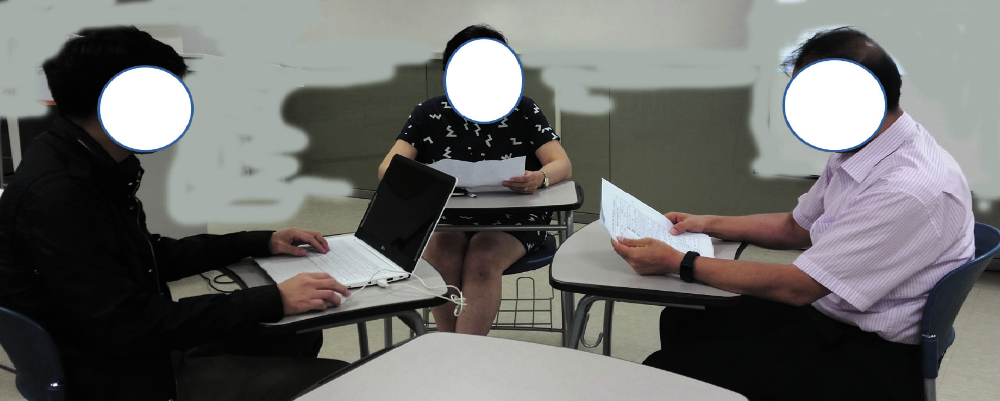

출처: 교육부(2021). 정적모델 설계(LM2001020222_19v5). 한국직업능력연구원. p.22.
[그림 1-11] 체크리스트 리뷰 사례
(1) 리뷰 참석 대상자인 프로젝트 이해관계자들에게 미리 체크리스트를 전달한다.
리뷰 검토 시간을 최소화하기 위해 미리 관련 자료를 메일로 전달하고 리뷰 전에
체크리스트 항목을 작성하도록 고지한다. [활용 서식 참조: 체크리스트 양식]
(2) 체크리스트를 기반으로 각 항목에 대해 리뷰 검토를 진행한다.
각자 사전에 작성된 체크리스트 항목에 대해 의견을 검토한다.
(3) 체크리스트 검토 항목에 대한 의견을 취합하고 이를 통해 정적 분석모델을 보완한다.
프로젝트 이해관계자들의 검토 의견을 반영하여 정적 분석모델을 보완한다.
(cid:49687) 개발 플랫폼에서의 기술적인 관점에서 정적 분석모델을 검증한다.
실제 소프트웨어가 구현될 개발 플랫폼에 기반하여 기술적인 부분을 식별하고 검증한다.
설계 패턴 요소 간의 이동이나 설계 패턴 요소별 관계 검증, 개발 플랫폼 구현에서의 규칙
등을 검증한다.
1. 개발 플랫폼에 기반하여 기술적인 부분을 고려한 규칙들이 적용되었는지 검증한다.
시스템 동작을 정의하는 공통 클래스에서 정의된 역할과 책임이 추후 발생할 수 있는
변경 가능성에 대비하여 확장성과 재사용성이 고려되었는지 확인한다. 그리고 객체 및
클래스 사이의 구조 및 협력, 상속, 연관 관계 등을 기술적 관점에서 확인한다.
2. 보안, 성능, 외부 인터페이스 등 비기능적인 행위(동작)들이 플랫폼에 기반하여 기술적으로
고려되었는지 검증한다.
보안, 성능, 외부 시스템 간의 연계 등의 시스템 기능에 대한 기술적 제약사항이 정적
분석모델에 반영되었는지 확인한다.
3. 검증 결과를 토대로 정적 분석모델을 보완한다.
수행 tip
•소프트웨어 정적모델 설계를 구현할 때 디자인 패턴 등
을 적용하여 확장성과 재사용성을 고려해야 한다.

| 학습 1 | 교수·학습 방법 |
| --- | --- |

교수 방법
• 정적모델에 대한 기본적인 개념과 구성 요소들에 대해 전반적인 이해를 할 수 있도록
설명한다.
• 소프트웨어 아키텍처에서의 설계 가이드라인이 제시하는 항목들을 설명한다.
• 설계 가이드라인에서 제시하는 주요한 설계 패턴에 대해 설명한다.
• 설계 패턴을 기준으로 정적모델 설계 시 적용할 주요 항목들과 적용 방법 등을 설명한다.
• 응용 소프트웨어 분석 단계와 설계 단계에서의 정적모델의 차이를 목적과 모델링 표현
방법의 비교를 통해 설명한다.
학습 방법
• 정적모델의 개념에 대해 파악하고 구성 요소들에 대한 표현 방법에 대해 학습한다.
• 소프트웨어 아키텍처 설계 가이드라인 내용을 학습한다.
• MVC 패턴, 레이어 계층 패턴 등 실무에서 주로 사용하는 설계 패턴을 학습한다.
• 설계 패턴을 기준으로 정적모델 설계 방법을 학습한다.
• 응용 소프트웨어의 단계별 주요 활동 및 산출물 작성 등을 통해 정적모델이 단계별로
어떻게 설계되고 활용되는지 학습한다.

| 학습 1 | 평 가 |
| --- | --- |

평가 준거
• 평가자는 학습자가 학습 목표를 성공적으로 달성하였는지를 평가해야 한다.
• 평가자는 다음 사항을 평가해야 한다.

| 학습 내용 | 학습 목표 | 성취수준 |  |  |
| --- | --- | --- | --- | --- |
|  |  | 상 | 중 | 하 |

- 소프트웨어 아키텍처 설계 가이드라인을 참조하여 정적모
정적모델 상세 분석
델 상세 분석 내역을 확인할 수 있다.
정적 분석모델 정 - 분석된 정적모델을 대상으로 분석모델의 정합성을 검증할
합성 검증 수 있다.
평가 방법
• 포트폴리오

| 학습 내용 | 평가 항목 | 성취수준 |  |  |
| --- | --- | --- | --- | --- |
|  |  | 상 | 중 | 하 |

- 설계 패턴을 참조한 프로토타이핑 수행 능력
정적모델 상세 분석
- 정적모델 상세 분석을 위한 요소 도출 능력
- 설계 패턴 기반 정적 분석모델 검증 수행 능력
정적 분석모델 정
합성 검증
- 정적 분석모델 정합성 체크리스트 작성 능력
• 평가자 체크리스트

| 학습 내용 | 평가 항목 | 성취수준 |  |  |
| --- | --- | --- | --- | --- |
|  |  | 상 | 중 | 하 |

- 소프트웨어 아키텍처 설계 가이드라인의 이해 여부
정적모델 상세 분석
- 정적모델의 개념과 구성 요소에 대한 이해 여부
- 설계 패턴 기반 정적 분석모델 검증 능력
정적 분석모델 정
합성 검증
- 정적 분석모델의 정합성 체크리스트 작성 능력

| 학습 내용 | 평가 항목 | 성취수준 |  |  |
| --- | --- | --- | --- | --- |
| 피드백 |  |  |  |  |
| 1. 포트폴리오 - 프로토타이핑원들과 함께- 프로토타입하도록 한다.- 제출한 정적체크하여 보완할- 정적 분석모델- 학습자별로 | 완성도에 따라 보완할 수 있도록 사례 등 추가 학습 자료를프로토타이핑 완성도를 보완할 수 있도록 지도한다. 완성도를 높이기 위해 우수 사례를 참고하고 팀원들과 피드백을분석모델 정합성 체크리스트 항목을 점검하여 필수 체크 항목이수 있도록 한다. 체크리스트를 활용해 누락·미흡 항목을 스스로 점검하고 미흡한 부분을 구체적으로 피드백한다. | 제공하고주고받으며미흡한보완하도록 | 학습한다. | 팀개선부분을 |
| 예) ‘사용자및 네이밍 | 로그인 시나리오에서 예외 처리 흐름이 누락되어 있음’, ‘UI규칙 불일치로 가독성이 떨어짐’ 등 | 구성 요소 | 간 | 정렬 |
| 2. 평가자 체크리스트- 소프트웨어학습 내용을 | 설계 가이드라인의 이해 정도에 따라 학습 자료를 추가 제공하고공유하고 추가 학습할 수 있도록 한다. | 학습 | 팀원들과 |  |
| 예) ‘객체 간- 설계 패턴에례를 추가로여, 팀 과제에· 중복 코드,· 실제 코드- 정적모델에향상시킬 수상호 검증하고,· 시나리오별· 객체 간· 시퀀스다이어그램과 | 의존도 최소화’, ‘단일 책임 원칙(SRP)’ 등 대한 이해 정도에 따라 미흡한 부분을 보완할 수 있도록 설계제시하여 이해도를 향상시킬 수 있도록 지도한다. 실제 사례를적용하면서 부족한 부분을 보완하도록 한다. 결합도(coupling) 감소, 응집도(cohesion) 향상 등 개선 효과 확인수준(예: UML → Class 구현)으로 연결 가능성 확인 대한 이해 정도에 따라 정적모델을 실제 팀원들과 설계 실습을있도록 지도한다. 유스케이스 기반 설계 실습을 통해 팀원들과다음 항목을 개선하여 이해도를 높이도록 한다. 흐름의 논리적 일관성 메시지 전달의 명확성 클래스 다이어그램 간 대응 관계 | 패턴에추가로통해서로의 | 대한이해도를 | 사학습하모델을 |

학습 1 정적 분석모델 검증하기

| 학습 2 | 정적모델 상세화하기 |
| --- | --- |

2-1.
정적 설계모델 상세화
•분석된 정적모델을 정적 설계모델로 변환하기 위해 변환 규칙을 정의할 수 있다.
학습 목표
•정적 설계모델의 엔티티 클래스, 경계 클래스, 제어 클래스를 상세화할 수 있다.
필요 지식 /
(cid:49684) 분석 클래스 모델의 이해
분석 클래스 모델을 구성하는 분석 클래스들은 그 역할과 책임에 따라 경계 클래스, 제어
클래스, 엔티티 클래스로 분류할 수 있다.

출처: 교육부(2021). 정적모델 설계(LM2001020222_19v5). 한국직업능력연구원. p.27.
[그림 2-1] 분석 클래스 모델 유형
1. 경계 클래스(Boundary Class)
시스템과 외부 액터와의 상호 작용을 표현하는 데 사용되는 클래스로 주로 화면, 외부
시스템과의 인터페이스 등이 정의된다. 시스템 기능 중 입력과 출력을 담당하는 클래스
라고 할 수 있다.

| 학습 내용 | 평가 항목 | 성취수준 |  |  |
| --- | --- | --- | --- | --- |
| <표 2-1> 경계 클래스의구분 UI 클래스 SI 클래스 DI 클래스 출처: 교육부(2021). | 유형 액터 유형 역할 사용자 사용자 인터페이스와의 입력/출력시스템 외부 연동 시스템과의 데이터 내외부 장치 내외부 장치의 모니터링과 제어정적모델설계(LM2001020222_19v5). 한국직업능력연구원. p.28. | 요청/수신 |  |  |
| (1) UI 클래스(UI사용자 면의 인터페이스를 | Boundary Class) 인터페이스를 모델링할 때 사용하는 경계 클래스 유형으로위한 역할과 관계를 표현한다. |  | 사용자와 | UI 화 |
| (가) UI 클래스의UI 클래스는출처: [그림 2-2] | 구성 요소 클래스 이름과 화면을 구성하는 속성과 오퍼레이션으로교육부(2021). 정적모델 설계(LM2001020222_19v5). 한국직업능력연구원.UI 클래스의 구성 요소 | p.28. | 표현된다. |  |
| (나) UI 클래스의UI 화면과출처: [그림 2-3] | 관계 UI 화면 사이의 관계를 표현한다. 교육부(2021). 정적모델 설계(LM2001020222_19v5). 한국직업능력연구원.UI 클래스의 관계 | p.28. |  |  |

| 학습 내용 | 평가 항목 | 성취수준 |  |  |
| --- | --- | --- | --- | --- |
| (2) SI 클래스(System외부 시스템과의신할 때 어떠한토콜을 기술한다. | Boundary Class) 상호 작용을 위한 기능을 정의하는 클래스이다.기능을 사용하고 그 기능의 파라미터는 어떤 것인지 | 외부 | 시스템과구체적인 | 통프로 |
| (3) DI 클래스(Device내부, 외부터 어떤 | Boundary Class) 장치와의 상호 작용을 위한 기능을 정의하는 클래스이다.모니터링 데이터를 수집할지, 장치의 어느 부분을 제어할지 | 기계나등을 | 정의한다. | 장치로부 |
| 2. 제어 클래스(Control비즈니스 로직의 | Class) 처리 흐름을 제어 또는 조정하거나 트랜잭션을 | 처리할 | 때 | 사용되는 |
| 클래스이다. 경계로직에 따라 | 클래스에서 입력된 값을 전달받아 제어 클래스에서출력값을 제공한다. | 정의한 |  | 비즈니스 |
| (1) 제어 클래스의제어 클래스는야 하는 기능을출처: 교육부(2021).[그림 2-4] 제어 | 구성 요소 주로 Controller라는 단어를 붙여서 사용하고 제어오퍼레이션으로 정의한다. 정적모델 설계(LM2001020222_19v5). 한국직업능력연구원.클래스의 구성 요소 | 클래스가p.29. |  | 제공해 |
| (2) 제어 클래스의구현되어야의존, 집합출처: 교육부(2021).[그림 2-5] 제어 | 관계 할 기능 범위가 복잡하거나 큰 경우에는 보조 제어 관계 등을 사용하여 관계를 표현한다. 정적모델 설계(LM2001020222_19v5). 한국직업능력연구원.클래스의 관계 (예시) | 클래스를p.29. | 두고 | 포함, |

| 학습 내용 | 평가 항목 | 성취수준 |  |  |
| --- | --- | --- | --- | --- |
| 3. 엔티티 클래스(Entity비즈니스 로직하는 클래스이다.야 하므로 영구적인출처: 교육부(2021).[그림 2-6] 엔티티 | Class) 처리 흐름이 수행되는 과정에서 저장소에 저장되어야엔티티 클래스의 정보는 시스템이 종료된다 해도데이터가 파일 또는 데이터베이스로 구현된다.정적모델 설계(LM2001020222_19v5). 한국직업능력연구원. p.30.클래스 (예시) | 하는정보값이 | 정보를 | 표현유지되어 |
| (1) 엔티티 클래스엔티티 클래스는속성과 출처: 교육부(2021).[그림 2-7] 엔티티 | 구성 요소 클래스 이름과 엔티티 클래스가 관리해야 하는오퍼레이션으로 표현된다. 정적모델 설계(LM2001020222_19v5). 한국직업능력연구원.클래스의 구성 요소 | 항목을p.30. |  | 구성하는 |
| (2) 엔티티 클래스데이터를 스와 협력 | 관계 관리하는 로직을 제어하는 DAO 클래스와 연관 관계를관계를 표현한다. | 가지며 | 다른 | 클래 |

| 학습 내용 | 평가 항목 | 성취수준 |  |  |
| --- | --- | --- | --- | --- |
| (cid:49685) 클래스 설계 원칙의클래스 설계 원칙은지침을 제공한다. | 이해 객체지향 설계에서 클래스의 구조와 동작을 정의하는 | 데 | 있어 | 중요한 |
| 1. 객체지향 프로그래밍의객체지향 가지 원칙을 출처: 집필진 제작(2025)[그림 2-8] 객체지향 | 4대 핵심 원칙 프로그래밍은 현실 세계의 개체들을 소프트웨어 객체로기반으로 한다. 프로그래밍의 4대 핵심 원칙 | 모델링을 | 할 | 때 네 |
| (1) 캡슐화(Encapsulation)캡슐화는 을 제한하는통해서만 상호<표 2-2> 캡슐화의주요 이점데이터 보호구현 은닉인터페이스 | 객체의 데이터와 메서드를 하나의 단위로 묶고, 외부에서의원칙이다. 이를 통해 객체의 내부 구현을 숨기고 작용을 할 수 있도록 한다. 주요 이점 설명 객체의 내부 상태를 외부의 부적절한 접근으로부터내부 구현 변경 시 외부 코드에 미치는 영향 최소화명확화 객체와 상호 작용을 하는 명확하고 일관된 방법 | 공개된보호제공 | 직접적인인터페이스를 | 접근 |

| 학습 내용 | 평가 항목 | 성취수준 |  |  |
| --- | --- | --- | --- | --- |
| (2) 상속(Inheritance)상속은 기존 | 클래스의 속성과 메서드를 새로운 클래스가 재사용할 | 수 | 있게 | 하는 메 |
| 커니즘이다.<표 2-3> 상속의설계 지침Is-a 관계리스코프 치환깊은 상속 구조 | 이를 통해 코드 재사용성을 높이고 계층적 관계를 설계 지침 설명 확인 하위 클래스가 상위 클래스의 특수화인지 확인원칙 준수 하위 클래스가 상위 클래스를 완전히 대체지양 복잡성을 피하기 위해 상속 깊이 제한 | 표현할 수가능해야 | 있다.함 |  |
| (3) 다형성(Polymorphism)다형성은 수 있는 통해 구현된다.<표 2-4> 다형성의구현 방식메서드 오버라이딩인터페이스메서드 오버로딩 | 동일한 인터페이스를 통해 서로 다른 타입의 객체들을능력이다. 이는 런타임에 적절한 메서드가 호출되도록 구현 방식 설명 하위 클래스에서 상위 클래스의 메서드를 재정의구현 공통 인터페이스를 구현한 다양한 클래스들의 동일한같은 이름의 메서드를 매개변수에 따라 다르게 | 동일하게하는 동적처리구현 |  | 처리할바인딩을 |
| (4) 추상화(Abstraction)추상화는 이를 통해<표 2-5> 추상화의구현 방식추상 클래스인터페이스인터페이스 | 복잡한 구현 세부 사항을 숨기고 핵심적인 특징만을복잡성을 관리하고 시스템을 이해하기 쉽게 만든다. 구현 방식 설명 일부 구현을 제공하면서 하위 클래스에서 완성하도록구현 없이 계약만을 정의하는 추상적 타입 명확화 반복되는 설계 문제에 대한 추상적 해결책 | 강조하는하는 | 클래스 | 원칙이다. |
| 2. SOLID 원칙: SOLID 원칙은소프트웨어 | 객체지향 설계의 핵심 Robert C. Martin이 제시한 다섯 가지 객체지향 설계개발에서 클래스의 구조와 동작을 정의하는 데 있어 가장 | 중요한 | 원칙으로, | 현대지침 중 |
| 하나이다. 출처: 집필진 제작(2025)[그림 2-9] 객체 지향 | 설계의 SOLID |  |  |  |
| (1) 단일 책임클래스는 하는 이유는리하는 기능을 | 원칙(Single Responsibility Principle, SRP) 하나의 책임만 가져야 하며, 단일 기능만을 수행해야 한다.오직 하나여야 한다. 예를 들어 파일을 읽고 쓰는별도의 클래스로 분리하여 하나의 단일 기능만을 | 기능과가지게 | 클래스를데이터를한다. | 변경처 |

| 학습 내용 | 평가 항목 | 성취수준 |  |  |
| --- | --- | --- | --- | --- |
| <표 2-6> 단일구현 전략응집도 최대화결합도 최소화변경 영향 | 책임 원칙의 구현 전략 설명 관련된 기능들을 하나의 클래스에 집중 서로 다른 책임 영역 간의 의존성 제거 최소화 한 가지 이유로만 클래스가 변경되도록 설계 |  |  |  |
| (2) 개방-폐쇄소프트웨어수정하지 나 추상 도록 한다.<표 2-7> 개방-폐쇄구현 전략추상화 활용전략 패턴의존성 주입 | 원칙(Open-Closed Principle, OCP) 엔티티는 확장에는 열려 있고 수정에는 닫혀있어야않고도 새로운 기능을 추가할 수 있도록 설계한다. 예를클래스를 사용하여 새로운 기능을 기존 코드 변경 없이원칙의 구현 전략 설명 인터페이스나 추상 클래스를 통한 확장점 제공알고리즘을 캡슐화하여 런타임에 변경이 가능하게외부에서 구현체를 주입받아 유연성 확보 | 한다.들어쉽게설계 | 기존추가할 | 코드를인터페이스수 있 |
| (3) 리스코프 치환상위 타입의않도록 서브을 유지하고,모 클래스의유지하도록<표 2-8> 리스코프구현 전략계약 준수행위 호환성사전 조건 강화 | 원칙(Liskov Substitution Principle, LSP) 객체를 하위 타입의 객체로 치환해도 소프트웨어의클래스는 언제나 부모 클래스의 기능을 대체할 수 상속 구조에서 예상치 못한 동작을 방지하는 목적이다.메서드를 서브 클래스가 오버라이드 할 때, 부모 하는 원칙이다. 치환 원칙의 구현 전략 설명 상위 클래스의 계약을 하위 클래스에서 위반하지클라이언트가 기대하는 행위를 하위 클래스에서도금지 하위 클래스에서 더 제한적인 입력 조건을 요구하지 | 정확성이있어야클래스의않음동일하게않음 | 한다.예를기대제공 | 깨지지다형성들어 부동작을 |
| (4) 인터페이스클라이언트는원칙은 를 들어 하나의제공하게 하는<표 2-9> 구현 전략인터페이스클라이언트인터페이스응집력 있는 | 분리 원칙(Interface Segregation Principle, ISP) 자신이 사용하지 않는 메서드에 의존하도록 강요받지인터페이스를 작고 구체적으로 설계하여 불필요한 의존성을큰 인터페이스를 여러 개의 작은 인터페이스로원칙이다. 인터페이스 분리 원칙의 구현 전략 설명 세분화 큰 인터페이스를 역할별로 분리 맞춤형 각 클라이언트의 필요에 맞는 최소한의 인터페이스인터페이스 관련된 메서드들만 함께 그룹화 | 않아야줄이게나누어제공 | 특정 | 한다. 이된다. 예기능만 |
| (5) 의존관계 역전고수준 모듈은이 원칙은들어 구체적인 | 원칙(Dependency Inversion Principle, DIP) 저수준 모듈에 의존해서는 안 되며, 둘 다 추상화에구현이 아닌 추상화에 의존하여 유연성과 재사용성을클래스 대신 인터페이스나 추상 클래스를 의존하도록 | 높이게 | 의존해야된다.설계하는 | 한다.예를원칙 |
| 이다. <표 2-10> 구현 전략의존성 주입서비스 로케이터팩토리 패턴 | 의존관계 역전 원칙의 구현 전략 설명 외부에서 의존성을 주입받는 방식 중앙화된 레지스트리에서 의존성 해결 객체 생성 책임을 별도 클래스로 분리 |  |  |  |
| 3. 클래스 설계 품질응집도(Cohesion)와 | 요소, 응집도와 결합도의 이해 결합도(Coupling)는 클래스 설계의 품질을 | 결정짓는 | 핵심 | 요소이 |
| 다. 두 개념은는 높은 응집도와 | 객체지향 설계의 기본 원칙과 밀접하게 관련 있으며,낮은 결합도를 가진다. | 잘 | 설계된 | 클래스 |
| (1) 응집도(Cohesion)응집도는 접하게 연관되어 | 모듈의 독립성을 나타내는 개념으로 클래스 내부 구성있는지를 나타내는 지표이며, 모듈 내부 구성 요소 | 요소가간 | 얼마나연관 | 밀정도를 |
| 측정한다. 성과 재사용성을<표 2-11> 구분 특징 장점 설계 원칙 | 높은 응집도를 가진 클래스는 하나의 책임을 명확히높인다. 응집도의 주요 내용 항목 설명 높은 응집도 클래스가 하나의 책임을 수행하며 관련된클래스가 여러 책임을 혼합하여 수행하거나낮은 응집도 능을 포함 코드의 가독성 향상 클래스의 역할이 명확하여 이해하기 쉬움변경 용이성 특정 기능 수정 시 다른 기능에 영향을클래스가 독립적으로 설계되어 다른재사용성 증가 사용 가능 단일 책임 원칙 준수 단일 책임 원칙(SRP)을 준수하여 클래스를유스케이스 분석을 통해 클래스의 역할과클래스의 R&R 정의 | 수행하며,기능만미치지시스템에서도설계 | 포함관련 없는않음책임을 | 유지보수기쉽게명확히 |
| (2) 결합도(Coupling)결합도는 | 클래스(모듈) 간의 상호 의존성을 나타내며, 낮은 결합도를 |  | 유지하는 | 것이 |
| 중요하다. 낮은<표 2-12> 구분 특징 장점 설계 원칙 | 결합도는 클래스 간의 독립성을 높이고, 변경 시 결합도의 주요 내용 항목 설명 낮은 결합도 클래스가 다른 클래스의 내부 구현에클래스가 다른 클래스의 내부 구현 세부높은 결합도 변경 시 영향을 받음 유지보수성 향상 클래스 간 의존성이 적어 변경이 용이확장성 증가 새로운 기능 추가 시 기존 클래스 수정테스트 용이성 독립적인 클래스는 단위 테스트가 쉽고,의존 역전 원칙(DIP) 의존 역전 원칙(DIP)을 준수하여 고수준준수 모듈에 의존하지 않도록 설계 인터페이스와 추상 클래스를 활용하여클래스 간의 의존성 성을 줄임 | 영향을의존하지사항에없이버그를클래스 | 최소화한다.않음확장찾기모듈이간의 | 의존하여가능 쉬움저수준의존 |
| (3) 응집도와 응집도와 높은 응집도와개발할 수설계 원칙을 | 결합도를 고려한 정적 모델링 결합도는 정적 모델링에서 클래스 설계의 품질을 결정짓는낮은 결합도를 유지하면 유지보수성과 확장성이 있다. 이를 위해 단일 책임 원칙(SRP), 의존 역전 원칙(DIP)준수하고, UML을 활용하여 설계를 체계적으로 진행한다. | 핵심뛰어난 | 소프트웨어를등 | 요소이다.객체지향 |
| (가) 응집도클래스의속성을 | 유지 책임을 명확히 정의하여 관련 없는 기능을 분리하고,유스케이스와 매핑하여 설계한다. | 클래스의 |  | 역할과 |
| (나) 결합도인터페이스를사용하여 | 감소 활용하여 클래스 간의 의존성을 줄이고, 의존성클래스 간의 결합도를 낮추도록 설계한다. | 주입(DI) |  | 패턴을 |
| (다) UML 클래스계(연관,수행 내용 / 정적재료·자료 • 요구사항 분석• 애플리케이션 분석• 소프트웨어 기기(장비･공구) • 전산 장비(컴퓨터,• OA 도구(워드프로세서,• 설계용 소프트웨어(UML안전･유의 사항 • UML의 정적 | 다이어그램 작성 다이어그램을 통해 클래스의 속성과 메서드를 정의한상속, 집합)를 시각화하여 결합도를 평가한다. 설계모델 상세화하기 산출물 단계의 정적 분석 클래스 아키텍처에 정의된 설계 패턴 프린터, 빔 프로젝터, 네트워크 장비 등) 스프레드시트, 프레젠테이션 도구 등) 모델링 도구, StarUML) 다이어그램(클래스, 패키지 등)은 국제 표준 표기법이므로 | 후 클래스기본 | 구조와 | 간의 관표 |

기 규칙을 반드시 숙지한 후, 실습한다.
• 팀원과 협업할 때 파일 덮어쓰기나 충돌 방지를 위해 공용 폴더나 클라우드 공유 시 주
의하여 파일을 저장한다.
• UML 작성 도구(예: StarUML)는 저장을 주기적으로 수행하고, 작업한 파일은 버전 이
름을 명확히 기재하여야 한다.
• 실습 예제에 실제 사용자 이름, 전화번호, 이메일 등 개인정보와 민감정보를 입력하지
않도록 주의한다.
수행 순서
(cid:49684) 정적 분석모델 상세화는 다음과 같은 순서로 진행한다.
분석 단계에서의 분석 클래스 모델은 유스케이스 모델과 유스케이스 명세서와 같은 요구사
항 분석 자료를 참고하여 여러 번 검증하면서 보완되고, 설계 단계는 실제 코드에 가까운
모양으로 상세화된다.
설계 단계에서의 클래스 모델은 새로운 클래스가 추가되기도 하고, 하나의 클래스가 여러
개의 클래스로 세분화되어 확장될 수도 있으며, 여러 개의 클래스가 통합될 수도 있다. 또
클래스 모델의 속성과 오퍼레이션이 구체적으로 상세하게 정의되어야 한다. 이때 각 속성
과 오퍼레이션에 대한 가시성이 함께 정의되어야 한다.

출처: 교육부(2021). 정적모델 설계(LM2001020222_19v5). 한국직업능력연구원. p.31.
[그림 2-10] 정적모델 상세화 절차
(cid:49685) 정적 분석모델을 정적 설계모델로 변환하기 위한 규칙을 정의한다.
애플리케이션 분석 단계의 분석 클래스들을 소프트웨어 아키텍처 설계에서 정의된 설계 패
턴에 따라 책임과 역할을 가진 설계 클래스들로 변환하기 위한 규칙을 정의한다.
1. 정적 설계모델의 명명 규칙을 정의한다.
소프트웨어 설계 가이드라인과 용어사전 등을 참고하여 명명 규칙을 정의한다.
<표 2-13> 설계 클래스의 명명 규칙 정의 (예시)
구분 명명 규칙 정의 예시
UI 클래스 의미 있는 명칭으로 직관적으로 이해 가능하게 정의 LoginForm
Controller 클래스 의미 있는 명칭 + Controller LoginController
Service 클래스 의미 있는 명칭 + Service LoginService
DAO 클래스 의미 있는 명칭 + DAO LoginDAO
SqlXml 클래스 SqlMap + 의미 있는 명칭 + Xml SqlMapLoginXml
속성 의미 있는 명칭 userId
오퍼레이션 동사+명사(의미 있는 명칭) searchUser
출처: 교육부(2021). 정적모델 설계(LM2001020222_19v5). 한국직업능력연구원. p.32.
2. 정적 분석모델과 설계 클래스 변환 규칙을 정의한다.
설계 클래스의 상세화 작업에 앞서 용어사전 및 표준 개발 가이드라인 등을 참고하여 실
제 구현에 활용할 수 있는 이름이나 규칙 등이 적용되도록 명명 규칙을 정의한다.
<표 2-14> 설계 클래스 변환 규칙 (예시)
분석 클래스 유형 설계 클래스 유형 변환 규칙 정의
UI 클래스 경계 클래스별 하나의 UI 클래스를 생성한다.
경계 클래스
경계 클래스별 하나의 Controller 클래스를 생성
Controller 클래스
한다.
제어 클래스별 하나의 BizLogicService 클래스를
제어 클래스 Service 클래스
생성한다.
엔티티 클래스별 하나의 DataAccessObject 클
DAO 클래스
래스를 생성한다.
엔티티 클래스
엔티티 클래스별 하나의 SQL 매핑 클래스를 생
SqlXML 클래스
성한다.
분석 오퍼레이션별 하나의 설계 오퍼레이션을 생
분석 오퍼레이션 설계 오퍼레이션
성한다.
분석 객체 상호 작용별로 하나의 설계 객체 상호
분석 객체 관계 설계 객체 관계
작용을 생성한다.
출처: 교육부(2021). 정적모델 설계(LM2001020222_19v5). 한국직업능력연구원. p.32.
3. 정적 설계모델 상세화 규칙을 숙지하고 이를 기준으로 상세화를 진행하도록 한다.
정적 설계모델 상세화 규칙은 다음과 같다. 다음의 정적모델 상세화 규칙을 숙지하고
클래스 상세화를 진행하도록 한다.

| 정적 설계모델 상세화 규칙 |
| --- |
| 1. 경계 클래스는 외부에 구체적인 구현 방법이 노출되어서는 안 된다.경계 클래스의 속성, 타입, 오퍼레이션, 인자 타입, 반환 타입 등이 외부에 노출되면 경계 클래스와 엔티티 클래스 중 어느 한쪽에 변경이 있을 경우 다른 쪽에도 변경 사항을 반영해야 하는상황이 발생한다. 그리고 요구사항 변동이 있을 때마다 모든 클래스에 변경 사항을 반영해야 하므로 향후 유지보수에 있어 어려움이 발생한다.2. 경계 클래스의 변경이 경계 클래스를 이용하는 제어 클래스의 불필요한 변경을 유발하지 않아야한다.이러한 제어 클래스의 불필요한 변경을 예방하려면 정보 은닉 원칙을 준수하여야 한다. 변경 가능성이 높은 경계 클래스 내부의 구현 방법을 경계 클래스의 외부에서는 알 수 없어야 한다.3. 제어 클래스는 경계 클래스와 엔티티 클래스에 독립적으로 표현해야 한다.제어 클래스는 경계 클래스나 엔티티 클래스가 변경되어도 영향을 받지 않아야 하기 때문에 이들과 독립적으로 표현되어야 한다.4. 제어 클래스의 비즈니스 로직을 구현하는 방법이 노출되지 않아야 한다.제어 클래스의 비즈니스 로직을 구현할 때 각 오퍼레이션은 하나의 기능만 제공하도록 설계되어야 한다. 이를 위해 응집도가 높은 오퍼레이션을 구현하여 내부 로직이 외부에 노출될 가능성을낮춰야 한다.5. 엔티티 클래스는 데이터 로직만을 제공해야 한다.엔티티 클래스는 다른 클래스의 역할인 액터와의 상호 작용 및 비즈니스 로직을 제공하지 않아야 한다.6. 엔티티 클래스는 구현 방법이 외부에 노출되지 않아야 한다.엔티티 클래스의 오퍼레이션은 데이터 관리 기능인 생성/조회/수정/삭제 등과 같은 기능을 제공한다. 엔티티 클래스의 오퍼레이션 이름, 인자 정보, 반환 타입 등이 JDBC, ODBC 등과 같은구체적인 구현 방법에 독립적이어야 한다. |

4. 정적 설계모델 클래스별 변환 규칙을 정의한다.
경계 클래스, 제어 클래스, 엔티티 클래스별로 상세하게 변환 규칙을 정의한다.
(1) 경계 클래스의 변환 규칙을 정의한다.
(가) 경계 클래스 명칭의 명명 규칙을 정의한다.
사용자 인터페이스를 위한 클래스인 경우 구현 단계에서 사용될 파일명과 동일
하게 클래스 이름을 정의한다.
(나) 경계 클래스의 수와 구현할 화면의 수가 일치하도록 정의한다.
일치하지 않는 경우에는 아키텍처 담당자 등 이해관계자들과 협의한 후 의견을
수렴하여 작업하도록 해야 한다.
(다) 외부 액터 연계에 필요한 경계 클래스의 변환 규칙을 정의한다.
외부 액터 연계에 필요한 경계 클래스 이름은 의미 있는 직관적인 이름으로 정
의한다. 이는 모든 프로젝트 이해관계자들이 이해하고, 이를 활용하여 다음 작업
을 진행할 수 있도록 해 준다.
(라) 타 시스템의 서브 업무와의 연계 시에는 경계 클래스가 아닌 인터페이스로 정의해야
한다.
타 시스템 간의 연계는 주로 인터페이스로 정의해야 시스템 간의 표준 및 내부
로직이 변경되었을 때에도 유연하게 대응할 수 있다.
(2) 제어 클래스의 변환 규칙을 정의한다.
(가) 엔티티 클래스에 정의된 속성과 중복되지 않게 정의한다.
엔티티 클래스에 정의된 속성을 추가로 정의하지 않아야 하며 오퍼레이션 정보
는 정확하게 도출해야 한다.
(나) 하나의 유스케이스에 하나의 제어 클래스가 생성되도록 정의한다.
유스케이스는 시스템이 제공하는 독립적인 기능을 정의한다. 따라서 하나의 기능
에 하나의 제어 클래스를 생성하는 것이 바람직하다. 비즈니스 로직이나 제어 로
직이 복잡한 경우에는 보조 제어 클래스를 정의한다.
(다) 관련된 여러 유스케이스에 대해서는 하나의 제어 클래스를 생성한다.
서로 밀접한 관련이 있는 기능들은 하나의 제어 클래스로 정의한다.
(라) 제어 클래스의 오퍼레이션에는 적절한 예외를 정의한다.
제어 클래스의 오퍼레이션이 담당하는 비즈니스 로직이 성공적으로 수행되지 못
했을 때 적절한 예외 사항을 정의한다.
(3) 엔티티 클래스의 변환 규칙을 정의한다.
(가) 각 클래스가 담당한 책임과 역할에 적합한 클래스 이름을 정의한다.
엔티티 클래스의 이름으로 그 클래스의 책임과 역할을 유추할 수 있도록 정의한다.
(나) 영속적으로 저장할 정보를 엔티티 클래스의 속성으로 정의한다.
주로 구현 단계에서 사용할 데이터베이스의 칼럼 속성을 참조하여 속성명으로
정하고 UI 클래스의 속성을 엔티티 클래스의 속성으로 정의한다.
(다) 영속적인 정보에 대한 관리 기능을 엔티티 클래스의 오퍼레이션으로 표현한다.
영속적인 정보를 관리하는 기능이나 다른 연관된 객체들을 관리하는 기능 등을
표현한다.
(cid:49686) 경계 클래스를 상세화한다.
1. UI 클래스를 상세화한다.
사용자 인터페이스를 위한 화면을 구성하는 입력, 출력 유형에 따른 속성, 오퍼레이션
등을 표현한다.

출처: 교육부(2021). 정적모델 설계(LM2001020222_19v5). 한국직업능력연구원. p.35.
[그림 2-11] UI 클래스 (예시)
(1) 사용자가 화면을 통해 입력, 출력하는 항목을 UI 클래스의 속성으로 표현한다. 하나의
입력, 출력 항목에 대하여 하나의 속성으로 표현한다. [그림 2-11]에서 보면 ID와 비밀
번호 속성은 사용자가 로그인 화면에서 입력하는 속성임을 나타낸다.
<표 2-15> UI 클래스의 입출력 유형
구분 스트레오 타입 설명
입력 <<in>> 사용자 입력 항목
출력 <<out>> 시스템이 출력하는 항목, 사용자 수정 불가능
입출력 <<inout>> 시스템이 출력 후 사용자가 수정 가능
내부 <<hidden>> 화면 내부에서 저장하는 정보
출처: 교육부(2021). 정적모델 설계(LM2001020222_19v5). 한국직업능력연구원. p.35
(2) 사용자 이용 시 화면에서 발생하는 이벤트를 UI 클래스의 오퍼레이션으로 표현한다.
사용자가 시스템 기능을 이용할 때 발생하는 사용하는 버튼, 링크 등을 UI 클래스
의 오퍼레이션으로 표현한다. [그림 2-11]의 예에서는 로그인 버튼과 취소 버튼을
클릭 시 발생하는 이벤트를 오퍼레이션으로 표현한다.
2. SI 클래스를 상세화한다.
SI 클래스는 외부 시스템에 기능을 요청하거나 외부 시스템으로부터의 요청을 받아 처
리한다. 이러한 기능을 할 수 있도록 속성과 오퍼레이션을 상세화하는 작업이다.
(1) 외부 시스템의 기능 요청 및 수신을 SI 클래스의 오퍼레이션으로 표현한다.
외부 시스템에 어떤 기능을 수행하도록 요청하거나, 그 수행 결과를 수신받는 기능
을 SI 클래스의 오퍼레이션으로 표현한다.
(가) 외부 시스템 기능 수행 요청 오퍼레이션 상세화
구현할 시스템에서 관련된 외부 시스템에 요청할 기능을 오퍼레이션으로 정의한다.
(나) 외부 시스템 기능 수행 수신 오퍼레이션 상세화
외부 시스템에 요청한 기능을 수행하고 그 결과를 구현할 시스템에서 출력받는
기능을 오퍼레이션으로 정의한다.
(2) 외부 시스템과 상호 작용을 할 때 필요한 정보를 SI 클래스의 속성으로 표현한다.
(가) 외부 시스템 연동을 위한 정보
구현할 시스템과 외부 시스템 간의 연동을 위해 필요한 정보를 SI 클래스의 속
성으로 표현한다.
(나) 외부 시스템의 상태 정보
외부 시스템과의 기능 호출과 출력 정보 수신 시 오퍼레이션 수행 후 결괏값 등
을 SI 클래스의 속성으로 표현한다.
3. DI 클래스를 상세화한다.
외부 장치를 모니터링하거나 제어하는 역할이 DI 클래스이다. 이러한 작업을 수행하도
록 DI 클래스의 속성과 오퍼레이션을 상세화한다.
(1) 외부 장치의 모니터링과 제어 작업을 DI 클래스의 오퍼레이션으로 표현한다.
장치의 유형에 따라 DI 클래스의 오퍼레이션은 영향을 받는다. 입력 장치인 경우
외부 장치로부터 입력을 수신하는 기능이 오퍼레이션으로 표현되고, 출력 장치인 경
우 외부 장치를 제어하는 기능이 오퍼레이션으로 표현된다.
(2) 외부 장치와 상호 작용을 하는 정보를 DI 클래스의 속성으로 표현한다.
외부 장치와 인터페이스를 통하여 사용되는 데이터를 DI 클래스의 속성으로 표현
한다.
(가) 입력 장치의 DI 클래스 속성
외부 입력 장치별로 정의된 데이터를 DI 클래스의 속성으로 표현한다.
(나) 출력 장치의 DI 클래스 속성
외부 출력 장치를 제어할 때 필요한 데이터를 DI 클래스의 속성으로 표현한다.
(cid:49687) 제어 클래스를 상세화한다.
시스템의 비즈니스 로직과 제어의 역할을 담당하는 제어 클래스를 상세화한다.
1. 시스템이 처리해야 할 비즈니스 로직 및 제어 로직을 제어 클래스의 오퍼레이션으로 표현한다.
제어 클래스가 경계 클래스의 입력값을 받아서 비즈니스 로직을 처리하고, 올바른 처리와
제어를 수행하며, 경계 클래스에 출력값을 전달하는 등의 기능을 수행할 수 있도록 한다.

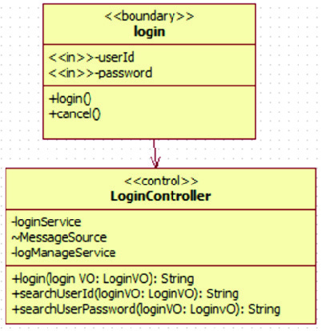

출처: 교육부(2021). 정적모델 설계(LM2001020222_19v5). 한국
직업능력연구원. p.37.
[그림 2-12] 제어 클래스 상세화 (예시)
2. 제어 클래스의 오퍼레이션들이 공유하는 정보를 속성으로 표현한다.
제어 클래스가 제공하는 여러 오퍼레이션들이 함께 사용하는 데이터가 있거나 오퍼레이
션 호출 사이에 유지되어야 하는 데이터를 제어 클래스의 속성으로 표현한다.
(cid:49688) 엔티티 클래스를 상세화한다.
엔티티 클래스는 시스템에서 장시간 또는 영속적으로 유지해야 하는 정보의 표현과 관리를
제공하는 클래스이다. 주로 파일이나 데이터베이스 등을 사용하기 위한 속성과 오퍼레이션
을 정의하는 작업이다.

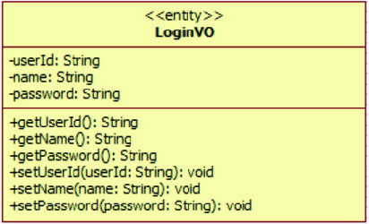

출처: 교육부(2021). 정적모델 설계(LM2001020222_19v5). 한국직
업능력연구원. p.37.
[그림 2-13] 엔티티 클래스 (예시)
1. 영속적으로 유지되어야 하는 정보를 엔티티 클래스의 속성으로 표현한다.
영속적으로 저장되어야 할 정보를 엔티티 클래스의 속성으로 표현한다. 가시성 표현 및
초깃값을 정의할 수 있다.
2. 영속적인 정보의 관리를 위한 기능을 엔티티 클래스의 오퍼레이션으로 표현한다.
영속적인 정보를 저장하기 위하여 필요한 입력, 수정, 삭제, 조회 등 영속적인 정보의
관리를 위한 오퍼레이션을 표현한다.
(cid:49689) 상세화된 클래스 모델을 통합, 분할, 제거 작업을 통해 개선한다.
설계 업무 범위가 큰 경우에는 유스케이스 명세서에서 정의되어 있는 기능 분류대로 클래
스를 분할하거나 통합해서 작성한다. 또 불필요한 클래스는 제거한다.
1. 클래스 모델 간의 관계를 검토하여 보완한다.
유스케이스 전체 기능의 일부만을 정적모델 클래스에서 제공하는 경우가 많으며, 이를
위해서는 다른 클래스와의 협력이 필요하다. 다른 클래스와 협력하려면 메시지 전달을
위한 관계(연관 또는 의존)가 정의되어야 한다. 이러한 협력 관계를 비롯하여 클래스
간의 연관 관계, 집합 관계, 의존 관계, 일반화 관계, 실체화 관계 등을 검토하여 보완
한다.
2. 클래스 모델을 통합, 분할하여 작성한다.
클래스의 역할, 범위 등을 검토하여 너무 큰 경우 세분화하여 클래스를 분할하여 정의
하고, 서로 연관성이 있는 작은 규모의 클래스들은 통합하여 작성한다.
3. 클래스 모델을 제거하여 작성한다.
아래 대상이 다음 내용에 해당하는 경우 제거하여 클래스 모델을 개선한다.
<표 2-16> 클래스 모델의 제거 대상
대상 내용
클래스
- 중복(Redundant)된 대상을 제거한다.
속성
- 부적절(Irrelevant)한 대상을 제거한다.
오퍼레이션
- 모호한(Vague)한 대상을 제거한다.
관계
출처: 교육부(2021). 정적모델 설계(LM2001020222_19v5). 한국직업능력연구원. p.38.
4. 체크리스트를 작성하여 클래스 모델을 검토 후 개선한다.
설계 단계에서 상세화되는 클래스는 유스케이스 모델링 및 분석 단계에서 도출된 분석 클래스
를 기반으로 한다. 따라서 설계 단계에서 상세화되어 도출된 클래스 모델이 유스케이스 명세
서, 분석 클래스 모델과 일관성을 가지도록 해야 한다.
<표 2-17> 클래스 점검 체크리스트 (예시)
클래스 ID
검토자 홍길동 검토일 xxxx. xx, xx
번호 체크 항목 Yes No 비고
1 클래스명, 오퍼레이션명, 속성명이 명명 규칙을 따라 정의되었는가?
2 클래스명이 클래스의 책임(responsibility)을 명확하게 나타내는가?
클래스의 책임이 명확히 정의되었고, 다른 클래스와의 관계가 명확
3
하게 정의되었는가?
4 클래스 간 관계의 다중도(Multiplicity)가 정확하게 정의되었는가?
5 각각의 클래스가 개별적인 용도로 정의되었는가?
6 클래스에 정의된 속성과 오퍼레이션은 모두 필수적인가?
7 오퍼레이션명이 오퍼레이션의 기능을 정확하게 나타내는가?
오퍼레이션의 입출력 데이터 항목의 항목명, 데이터 타입이 올바르
8
게 정의되었는가?
오퍼레이션의 입출력 데이터 항목이 개발 플랫폼 언어에 맞게 정
9
의되었는가?
10 속성명이 속성이 저장하는 정보를 잘 표현하는가?
경계 클래스의 구체적인 구현 방법이 외부에 노출되지 않는가?(연
11
산의 이름, 인자 정보, 반환 정보 등)
12 엔티티 클래스는 데이터 관련 로직만 제공하고 있는가?
엔티티 클래스가 자신의 속성(필드) 중에 다른 엔티티(클래스)를
13
참조하고 있는가?
14 제어 클래스는 경계 클래스와 엔티티 클래스에 대해 독립적인가?
출처: 교육부(2021). 정적모델 설계(LM2001020222_19v5). 한국직업능력연구원. p.39.
(cid:49690) 상세화된 클래스 모델에 설계 패턴을 적용하여 설계 클래스를 생성한다.
분석 단계에서 도출된 분석 클래스 모델과 유스케이스 명세서를 기반으로 상세화된 설계
클래스를 생성한다. 아래의 설계 클래스가 갖추어야 할 특성을 이해하고 이를 기준으로 설
계 클래스를 생성한다.
<표 2-18> 설계 클래스가 갖추어야 할 특성
구분 설명
완전성 설계 클래스는 필요한 속성과 오퍼레이션을 모두 정의하여야 한다.
설계 클래스에 정의한 오퍼레이션은 하나의 서비스만 달성하는 데 집중
독립된 기능 해야 한다. 특정 서비스를 제공하는 오퍼레이션이 있다면 동일 서비스를
제공하는 다른 오퍼레이션이 있어서는 안 된다.
구분 설명
응집도가 높은 설계 클래스는 크기는 작지만 집중된 책임을 가져야 한
높은 응집도 다. 또 책임을 구현하는 속성과 오퍼레이션은 한 가지 목적만 가져야
한다.
설계모델의 여러 설계 클래스는 서로 협업이 필요하나 협업은 최소로
낮은 결합도 유지되어야 한다. 서로 강하게 연결되어 있는 경우 요구사항 변경에 따
른 시스템 유지 관리가 어렵다.
출처: 교육부(2021). 정적모델 설계(LM2001020222_19v5). 한국직업능력연구원. p.40.
1. 설계 클래스와 클래스 유형과의 관계를 숙지한다.
소프트웨어 아키텍처 가이드라인에서 제시된 설계 패턴에 상세화된 클래스들을 적용한
다. 다음은 MVC 패턴을 사례로 적용한 사례이다.
<표 2-19> 설계 패턴 적용 (예시)
설계 클래스 클래스 유형 설명
경계 클래스 기능 중 화면 입력, 출력에 대한 기능
UI 클래스 경계 클래스
을 UI 클래스로 적용한다.
Controller 클래스 경계 클래스 경계 클래스별로 하나의 Controller 클래스를 적용한다.
제어 클래스별로 하나의 Service 클래스를 적용하
Service 클래스 제어 클래스
여 비즈니스/제어 로직을 구현하도록 한다.
DAO 클래스 엔티티 클래스 엔티티 클래스별로 하나의 DAO 클래스를 적용한다.
SqlXml 클래스 엔티티 클래스 엔티티 클래스별로 하나의 Sql 매핑 클래스를 적용한다.
출처: 교육부(2021). 정적모델 설계(LM2001020222_19v5). 한국직업능력연구원. p.40.
2. 설계 클래스 속성과 오퍼레이션을 상세 정의한다.
애플리케이션 분석 단계에서의 분석 클래스 모델은 클래스 간의 관계와 개념 수준의
클래스의 속성과 오퍼레이션이 표현된다. 설계 단계에서는 정적모델 설계 상세화 작업
을 통해 보다 구체적이고 상세한 클래스의 속성과 오퍼레이션을 정의한다.
(1) 설계 클래스의 속성을 추가하거나 변경하여 상세화한다.
유스케이스 시나리오를 상세히 분석하여 설계 클래스의 속성을 상세화한다. 속성의
가시성을 표현하고 속성명을 실제 구현에 사용할 영문명으로 정의하고 구체화한다.
(2) 설계 클래스의 오퍼레이션을 추가하거나 변경하여 상세화한다.
유스케이스 시나리오를 상세히 분석하여 설계 클래스의 오퍼레이션을 상세화한다.
오퍼레이션의 가시성을 표현하고 오퍼레이션명을 실제 구현에 사용할 영문명으로 정
의하고 구체화시킨다.
3. 클래스 간의 상호 관계를 상세 정의한다.
클래스 간의 상호 작용 관계를 연관 관계, 포함 관계, 일반화 관계, 실체화 관계 등으
로 정의할 수 있다. 다음과 같은 사항을 고려하여 클래스 간의 상호 관계를 적용한다.
(1) 연관 관계는 객체들끼리 메시지를 주고받는 방식과 일관성 있게 정의한다.
(2) 불필요한 상속 관계를 가지지 않도록 일반화 관계를 정의한다.
(3) UI 클래스 간 관계는 사용자 인터페이스 화면 간의 관계로 표현한다.
(4) UI 클래스는 비즈니스 로직과 제어 로직의 수행 요청을 위해 하나의 제어 클래스와 관
계를 가지도록 정의한다.
(5) 클래스 간의 협력을 위해 클래스 간의 관계를 정의한다.
4. 인스펙션을 통해 설계 클래스 모델을 검토하고 보완한다.
클래스 모델의 통합, 분할, 제거 등의 작업을 통해 클래스 모델의 개선 작업을 한다. 또
분석 클래스 모델과 유스케이스 모델 간의 일관성 규칙을 검토하기 위하여, 클래스와 객
체의 일관성 규칙 및 오퍼레이션과 메시지 간의 일관성 규칙을 검토하여 보완한다.
다음과 같이 인스펙션을 진행하여 설계 클래스 모델을 검토하도록 한다.
(1) 인스펙션 팀원들에게 검토 자료를 보내고 인스펙션에 대해 공지한다.
(2) 인스펙션 참여자들은 사전에 받은 검토 자료를 검토한다.
(3) 검토 회의를 실시한다.
(4) 검토 회의 결과 발견된 결함이나 조치 사항에 대해 정리하고 이를 보완한다.
(5) 조치 사항에 대해 보완이 되었는지 확인한다.
수행 tip
•UI 클래스 상세화는 구현 화면에 대한 구성 및 목적을
직관적으로 파악할 수 있는 화면 초안으로도 대체할 수
있다.
2-2.
정적 설계모델 명세화
학습 목표 •상세화된 정적 설계모델의 명세서를 작성할 수 있다.
필요 지식 /
(cid:49684) 정적 설계모델 명세서의 작성 방법
소프트웨어 관점이나 설계 관점에서 구현 단계를 고려하여 각 클래스별로 상세한 명세를
기술한다. 패키지를 이용하여 조직화된 정적 설계모델 정보를 상세히 기술한다.
1. 작성 방법
분석 패키지를 이용하여 계층적으로 구조화하고, 클래스 이름, 속성 및 오퍼레이션을
정확하고 구체적으로 정의하고, 각각의 클래스는 상세하게 명세를 기술한다.
2. 작성 항목
소프트웨어 관점이나 설계 관점에서의 설계 클래스 모형을 작성하고 클래스별 상세한
명세를 기술한다.
(1) 개요
정적 설계모델 명세서의 작성 목적과 개략적인 요약 내용을 기술한다.
(2) 시스템 구성
시스템을 구성하고 있는 분석 패키지와 분석 클래스 명세들을 기술한다. 최상위 수
준의 분석 패키지와 그 하위 패키지를 계층적으로 기술한다. 각 패키지는 클래스 다
이어그램으로 표현하고 이에 대한 개략적인 설명을 기술한다.
(가) 분석 패키지 구조도
전체 분석 패키지의 구조를 상위･하위 패키지 구조로 표현하여 계층적으로 중첩
된 패키지 형태로 기술한다.
(나) 최상위 분석 패키지 개요
최상위 수준으로 정의된 분석 패키지 정보를 테이블 표 형식으로 패키지명과 설
명을 간단하게 기술한다.
(다) 분석 패키지 명세
최상위 분석 패키지의 각각의 하위 분석 패키지에 대한 명세를 기술한다.
1) 분석 클래스 다이어그램
해당 분석 패키지를 구성하는 분석 클래스들의 클래스 다이어그램을 표현한다.
2) 분석 클래스 개요
해당 분석 패키지를 구성하는 분석 클래스에 대한 설명을 간략하게 기술한다.
3) 분석 클래스 명세
해당 분석 패키지를 구성하는 분석 클래스에 대한 속성 및 오퍼레이션 명세
를 기술한다.
<표 2-20> 분석 클래스 명세 항목
구분 설명
해당 분석 클래스를 구성하는 속성 정보를 테이블 표 형식으로
속성 명세
기술한다.
해당 분석 클래스의 오퍼레이션 정보를 테이블 표 형식으로 기
오퍼레이션 명세
술한다.
출처: 교육부(2021). 정적모델 설계(LM2001020222_19v5). 한국직업능력연구원. p.43.
(3) 유스케이스 실현 명세
유스케이스 명세서에 작성된 유스케이스별로 실현 모델을 각각 기술한다. 각 유스케
이스별로 기본 시나리오와 대안 시나리오들을 제시하고 시퀀스다이어그램으로 표현
한다.
(cid:49685) 정적 설계모델 명세서 검토
효율적인 애플리케이션 구현과 유지 관리를 위해 각 클래스들이 패키지에 적절하게 배치되
어야 한다. 정적 설계모델 명세서를 작성한 후 아래 기준에 따라 검토한다.
1. 분석 클래스 모델의 조직화 검토 기준
(1) 분석 패키지 구조도
(가) 패키지의 이름은 패키지에 속한 모든 클래스를 대표하는가?
(나) 패키지는 높은 응집도와 낮은 결합도를 가져야 한다.
(다) 패키지들 간에 순환적 의존 관계는 없는가?
(2) 분석 패키지 개요
(가) 패키지의 핵심 기능이 명확하고 간결하게 기술되어 있는가?
(나) 분석 패키지 구조도의 각 패키지별로 설명되어 있는가?
2. 분석 클래스 명세서 검토 기준
각 분석 패키지 내의 분석 클래스 다이어그램을 구성하는 경계 클래스, 제어 클래스,
엔티티 클래스와 이들 간의 관계에 대해 검토한다. 다음은 대표적인 검토 기준의 사례
이다.
(1) 경계 클래스
(가) 액터와의 상호 작용은 경계 클래스만 제공하고 있는가?
(나) 경계 클래스는 구체적인 구현 방법이 외부에 노출되고 있지 않은가?
(다) 화면을 통해 입출력되는 사용자 인터페이스 항목을 UI 클래스의 속성으로 표현하고
있는가?
(2) 제어 클래스
(가) 제어 클래스의 연산들이 공유하는 정보를 속성으로 표현하고 있는가?
(나) 제어 클래스가 경계 클래스나 엔티티 클래스와 독립적으로 표현되었는가?
(3) 엔티티 클래스
(가) 엔티티 클래스는 데이터의 로직만 제공하고 있는가?
(나) 엔티티 클래스는 데이터 로직의 구현 방법이 외부로 노출되고 있지 않은가?
(다) 엔티티 클래스 고유의 정보만을 속성으로 정의하고 있는가?
(4) 클래스 간 관계
(가) UI 클래스는 비즈니스 로직과 제어 로직의 수행을 위해 하나의 제어 클래스와 관계
를 표현하고 있는가?
(나) 엔티티 클래스가 하나 이상의 제어 클래스에 의해서 반드시 이용되고 있는가?
<표 2-21> 분석 클래스 명세서 검토 체크리스트
구분 체크리스트
- 액터 I/O는 모두 경계가 담당한다.
경계 클래스 - 내부 세부(스키마·스택 등)를 응답에 노출하지 않는다.
- UI 항목(필수/단위/검증/표시 규칙)이 UI 속성 표에 있다.
- 유스케이스 공통 컨텍스트(식별자, 로드된 엔티티, 외부 TxID)를
속성으로 가진다.
제어 클래스 - Pre/Post, 예외, 트랜잭션·보상·멱등성 정책이 오퍼레이션에 명시
되어 있다.
- 화면·저장 기술 세부에 직접 의존하지 않는다.
- 불변식/제약/상태전이 등 데이터 로직만 갖는다.
엔티티 클래스 - 구현 세부는 계약에 노출하지 않는다.
- 고유 정보만 속성에 포함하고, UI/요청 맥락 데이터는 배제한다.
- 각 UI는 최소 하나의 제어와 연결되어 있다(직접 엔티티 호출 금지)
- 각 엔티티는 하나 이상의 제어에서 실제로 사용된다.
클래스 간 관계
- is-a 관계는 문장 테스트 LSP 원칙을 만족한다.
- ERD와 다중성/삭제 전파/합성 정책이 일치한다.
수행 내용 / 정적 설계모델 명세화하기
재료·자료
• 분석 클래스 상세 모델
• 정적모델 명세서 작성 가이드라인
기기(장비･공구)
• 전산 장비(컴퓨터, 프린터, 빔 프로젝터, 네트워크 장비 등)
• OA 도구(워드프로세서, 스프레드시트, 프레젠테이션 도구 등)
• 설계용 소프트웨어(UML 모델링 도구)
안전･유의 사항
• UML의 정적 다이어그램(클래스, 패키지 등)은 국제 표준 표기법이므로 기본 구조와 표
기 규칙을 반드시 숙지한 후, 실습한다.
• 팀원과 협업할 때 파일 덮어쓰기나 충돌 방지를 위해 공용 폴더나 클라우드 공유 시 주
의하여 파일을 저장한다.
• UML 작성 도구(예: StarUML)는 저장을 주기적으로 수행하고, 작업한 파일은 버전 이
름을 명확히 기재하여야 한다.
• 실습 예제에 실제 사용자 이름, 전화번호, 이메일 등 개인정보와 민감정보를 입력하지
않도록 주의한다.
수행 순서
(cid:49684) 상세화된 정적 설계모델을 숙지한다.
정적 설계모델 명세서 작성을 위해 상세화된 정적 설계모델을 확인하여 숙지한다.
1. 제어 클래스, 경계 클래스, 엔티티 클래스 등의 속성과 연산 등을 확인한다.
각 클래스별 속성과 연산 및 가시성 표현, 상호 연관 관계 등을 확인한다.
2. 설계 패턴이 적용된 설계 클래스들을 확인한다.
UI 클래스, SI 클래스, DI 클래스, Control 클래스, Service 클래스, DAO 클래스,
SqlXml 클래스 등을 확인한다.
(cid:49685) 정적 설계모델 명세서 작성 가이드라인을 확인한다.
소프트웨어 표준 산출물 작성 가이드에 정의된 정적 설계모델 명세서 작성 가이드라인 내
용을 확인하여 명세서 양식 및 작성 방법을 숙지한다.
(cid:49686) 정적 설계모델 명세서를 작성한다.
정적 설계모델 명세서 작성 가이드라인을 참고하여 작성한다. [활용 서식 참조: 정적모델
설계 명세서 양식]
1. 개요 항목을 작성한다.
정적 설계모델 명세서의 작성 목적과 함께 전체적인 문서 내용을 요약하여 기술한다.
2. 시스템 구성 항목을 작성한다.
분석 패키지 구조와 함께 이를 구성하는 각 분석 패키지별 분석 클래스 명세를 작성한다.
(1) 분석 패키지 구조도를 작성한다.
시스템을 구성하는 전체 분석 패키지 구조를 패키지 다이어그램으로 표현하고 이를
이용하여 명세서를 작성한다.

출처: 교육부(2021). 정적모델 설계(LM2001020222_19v5). 한국직업능력연구원. p.46.
[그림 2-14] 전체 분석 패키지 구조도 (예시)
(가) 분석 패키지별 분석 클래스를 표현한다.
(나) 각 분석 패키지의 상호 동작을 관계 표현을 이용하여 작성한다.
(2) 각 분석 패키지 개요를 작성한다.
해당 분석 패키지의 목록과 분석 패키지별 요약 내용을 간략하게 기술한다.

출처: 교육부(2021). 정적모델 설계(LM2001020222_19v5). 한국직업능력연구원. p.46.
[그림 2-15] 분석 패키지 개요 (예시)
(3) 각 분석 패키지 구조도를 작성한다.
각 분석 패키지의 정보와 이를 구성하는 분석 패키지 간의 상호 연관 관계를 표현
하고 이를 명세서에 기술한다.

출처: 교육부(2021). 정적모델 설계(LM2001020222_19v5). 한국직업능력연구원. p.47.
[그림 2-16] 분석 패키지 구조도 예시
(4) 분석 패키지 명세를 작성한다.
분석 패키지를 구성하는 분석 클래스들의 명세를 클래스 다이어그램으로 표현하고
클래스 정보 및 클래스 속성과 연산 명세를 작성한다.
(가) 분석 클래스 다이어그램을 작성한다.
분석 클래스들을 다이어그램으로 표현하고 이들 간의 관계를 표시한다.

출처: 교육부(2021). 정적모델 설계(LM2001020222_19v5). 한국직업능력연구원. p.47.
[그림 2-17] 분석 클래스 다이어그램 (예시)
(나) 분석 클래스 개요를 작성한다.
분석 클래스들의 목록과 각 클래스별로 간략한 설명을 기술한다.

출처: 교육부(2021). 정적모델 설계(LM2001020222_19v5). 한국직업능력연구원. p.47.
[그림 2-18] 분석 클래스 개요 (예시)
(다) 분석 클래스 명세를 작성한다.
분석 클래스를 구성하는 속성과 연산 정보를 기술한다.

출처: 교육부(2021). 정적모델 설계(LM2001020222_19v5). 한국직업능력연구원. p.48.
[그림 2-19] 분석 클래스 속성/오퍼레이션 명세 예시
1) 속성 명세를 작성한다.
실제 구현 단계에서 사용될 수 있는 속성명을 사용하고 속성 타입과 가시성
을 기재한다. 또 속성에 대한 간략한 설명을 기술한다.
2) 연산 명세를 작성한다.
실제 구현 단계에서 사용할 수 있는 연산(Method)명을 사용한다. 연산에 대
한 가시성을 기재하고 연산에 대한 간단한 설명을 기술한다.
(5) 외부 시스템과 연동하는 패키지나 공통 패키지 등의 명세를 작성한다.
해당 분석 패키지가 존재하는 경우 작성 양식을 기준으로 분석 패키지 명세 및 패
키지 명세를 작성한다.
3. 유스케이스 실현 명세 항목을 작성한다.
유스케이스 명세서에 기술된 유스케이스별 시나리오를 기술하고 시퀀스다이어그램으로
표현하여 해당 항목을 작성한다.
(1) 기본 시나리오 항목을 작성한다.
(2) 대안 시나리오 항목을 작성한다.
<표 2-22> 유스케이스 실현 명세 예시(로그인 기능)
구분 시나리오
1. 사용자가 로그인 화면에서 아이디와 비밀번호를 입력한다.
기본 2. 시스템은 계정을 확인하고 비밀번호를 검증한다.
시나리오 3. 인증이 성공하면 시스템은 사용자 세션을 생성하고 메인 화면을 표시
한다.
대안 - 잘못된 비밀번호: 시스템은 오류 메시지를 보여 주고 재입력을 요청한다.
시나리오 - 계정 잠김: 시스템은 로그인 시도를 차단하고 계정 잠금 안내를 제공한다.
(cid:49687) 정적 설계모델 명세서 작성 사례를 찾아보고 참조한다.
1. 정적 설계모델 명세서의 목차 작성 사례를 참조한다.
다음은 정적 설계모델 명세서의 전체적인 목차 사례이다.
<표 2-23> 정적 설계모델 명세서 목차 (예시)
목차
개요 .............................................................................................................................
Ⅰ
2
Ⅱ 시스템 구성 ................................................................................................................. 8
1 분석 패키지 구조도 ............................................................................................. 10
2 최상위 분석 패키지의 개요 ................................................................................. 12
3 분석 패키지 명세: 사용자 관리 ......................................................................... 13
3.1 분석 패키지 구조도 .................................................................................. 15
3.2 분석 패키지 개요 ...................................................................................... 18
3.3 분석 패키지 명세: 로그인 관리 ................................................................ 19
3.3.1 분석 클래스 다이어그램 ............................................................... 20
3.3.2 분석 클래스의 개요 ...................................................................... 23
3.3.3 클래스 명세: 로그인 화면 ............................................................ 25
(1) 속성명세 ............................................................................... 30
(2) 연산명세 ............................................................................... 32
3.4 분석 패키지 명세: 개인정보 관리 ............................................................ 39
3.4.1 분석 클래스 다이어그램 .............................................................. 42
3.4.2 분석 클래스의 개요 ...................................................................... 45
3.4.3 클래스 명세: 개인정보 조회 화면 .................................................. 48
(1) 속성명세 ............................................................................... 49
(2) 연산명세 ............................................................................... 53
4 분석 패키지 명세: 외부 시스템 연동 .................................................................. 58
4.1 분석 패키지 구조도 .................................................................................. 60
4.2 분석 패키지 개요 ...................................................................................... 62
4.3 분석 패키지 명세: 메일 발송 연동 ............................................................ 64
4.3.1 분석 클래스 다이어그램 ............................................................... 66
4.3.2 분석 클래스의 개요 ...................................................................... 68
Ⅲ 유스케이스 실현 명세 ................................................................................................. 70
1 개인정보 검색 ..................................................................................................... 72
1.1 기본 시나리오 ............................................................................................ 73
1.2 대안 시나리오 ............................................................................................ 75
출처: 교육부(2021). 정적모델 설계(LM2001020222_19v5). 한국직업능력연구원. p.49.
2. 정적 설계모델 명세서의 작성 예시를 참조한다.
다음은 정적 설계모델 명세서의 일부 내용을 작성한 예시이다.

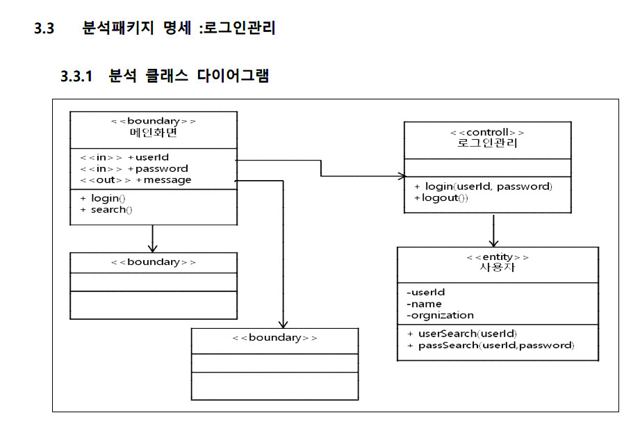

출처: 교육부(2021). 정적모델 설계(LM2001020222_19v5). 한국직업능력연구원. p.51.
[그림 2-20] 정적 설계모델 명세서 작성 (예시)
(cid:49688) 작성된 정적 설계모델 명세서를 검토하여 미흡한 부분을 보완한다.
필수 항목이 빠짐없이 작성되었는지, 구현 단계를 고려하여 상세하게 작성되었는지 확인한다.
1. 정적 설계모델 명세서 작성 가이드라인에 준하여 작성되었는지 확인한다.
클래스명, 속성 및 오퍼레이션 항목 등이 작성 가이드라인에 제시된 대로 작성되었는지
확인한다.
2. 정적 설계모델 명세서가 구현 단계를 고려하여 상세하게 작성되었는지 확인한다.
정적 설계모델 명세서를 바탕으로 정적 설계모델 다이어그램을 도식화하고 이를 사용한
설계 문서를 소프트웨어 구현 단계에서 사용하게 된다. 따라서 구현 단계에서 사용할
수 있을 정도로 상세하게 작성되어야 한다.
3. 검토된 사항을 정리하여 정적 설계모델 명세서를 보완한다.
프로젝트 이해관계자들이 한자리에 모여 설계모델 명세서를 함께 검토하고 의견을 청취
하고 보완할 수 있도록 한다.

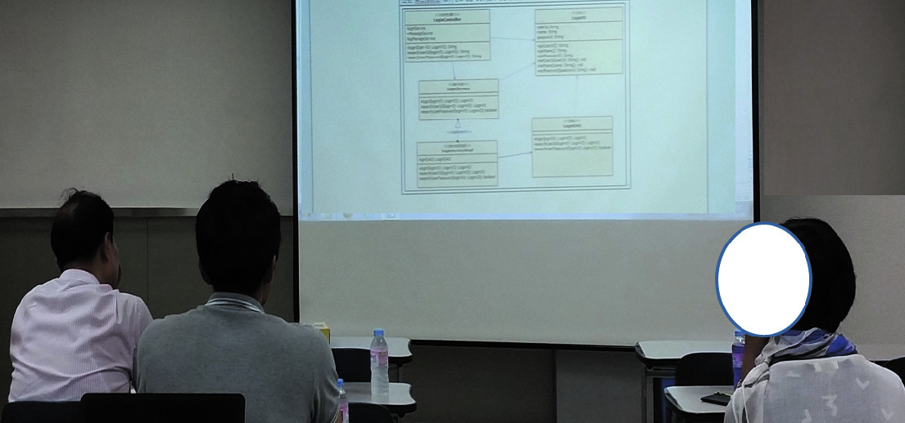

출처: 교육부(2021). 정적모델 설계(LM2001020222_19v5). 한국직업능력연구원. p.52.
[그림 2-21] 정적 설계모델 명세서 리뷰 검토 장면
수행 tip
•정적 설계모델 명세서는 클래스 다이어그램을 도식화하
기 위한 산출물 중 하나이므로 가시성 등이 정확히 표
시되고 속성과 오퍼레이션 정보가 구체적이고 정확하게
작성되어야 한다.
2-3.
정적 설계모델 도식화
학습 목표 •설계용 도구를 활용하여 정적 설계모델을 도식화할 수 있다.
필요 지식 /
(cid:49684) 클래스 다이어그램의 개요
클래스 다이어그램은 정적 설계모델의 대표적인 다이어그램으로 시스템을 구성하는 클래
스, 클래스 요소들, 클래스 간의 관계를 표현한다.
1. 클래스 다이어그램의 기본 구성 요소
(1) 클래스(Class)
클래스는 사각형으로 표현되고 클래스명, 속성, 오퍼레이션으로 구성된다. 클래스는
구체적으로 의미 있는 이름으로 명명하고 <<stereotype>>을 정의할 수 있다.

출처: 교육부(2021). 정적모델 설계(LM2001020222_19v5). 한국직업능력연구원. p.53.
[그림 2-22] 클래스의 기본 구성 요소
(2) 속성(Attribute)
클래스가 표현하고자 하는 객체들의 정보와 상태를 표현하는 변수들로 정의되어 있
다. 클래스의 속성은 가시성, 타입, 이름, 다중성, 초깃값으로 구성된다.

출처: 교육부(2021). 정적모델 설계(LM2001020222_19v5). 한국직업능력연구원. p.53.
[그림 2-23] 클래스의 속성 구성 정보
(가) 가시성(Visibility)
외부 클래스에서 해당 속성에 대한 접근의 허용 정도를 표현한다. UML에서의
가시성 유형은 public, protected, private, package 등으로 정의하고 있다.

출처: 교육부(2021). 정적모델 설계(LM2001020222_19v5). 한국직업능력연구원. p.54.
[그림 2-24] 가시성에 따른 접근 허용
1) public: 다른 클래스 및 패키지와 상관없이 접근이 가능하다
2) protected: 같은 패키지 범위에서만 접근이 가능하다.
3) private: 같은 클래스 범위에서만 접근이 가능하다.
4) default: 가시성을 표현하지 않을 때를 말하며 같은 패키지 범위에서 접근이 가능
하다.
(나) 속성명: 속성 타입(Name: type)
속성명은 객체의 정보나 상태를 의미하는 명사로 명명한다. 속성 타입은 해당 속
성에 적합한 값의 범위를 결정한다. 속성 타입으로는 UML의 기본 타입인
Unlimited, Integer, Boolean, Real 등이 있으며 Java나 C++ 등에서 사용하
는 프로그램 언어 타입도 사용할 수 있다.
(다) [다중성] = 기본값 ( [multiplicity] = value )
다중성은 동일 이름으로 여러 가지 값이 존재할 수 있음을 표현한다. 예를 들어
이메일 : String[2]인 경우 이메일[0], 이메일[1] 등 두 개의 값을 가질 수 있다.
기본값의 경우는 객체를 생성할 때 초깃값을 부여해야 할 때 사용한다.
<표 2-24> 다중성의 표현
표기 방법 설명
1 하나
* 다수
1..1 하나만 있음
1..* 하나 이상 존재
0..1 없거나 하나가 존재함
0..* 0 이상의 개수
1..3, 10..10 1에서 3개, 그리고 10에서 10개
3..6.10 3.4.5.6이거나 10개
출처: 교육부(2021). 정적모델 설계(LM2001020222_19v5). 한국직업능력연구원. p.55.
(3) 오퍼레이션(Operation)
객체의 상태나 정보를 바탕으로 이벤트나 행동으로 표현한 것이 오퍼레이션이다.
오퍼레이션은 가시성, 오퍼레이션명, 인자 정보, 반환 타입으로 구성된다.

출처: 교육부(2021). 정적모델 설계(LM2001020222_19v5). 한국직업능력연구원. p.55.
[그림 2-25] 클래스의 오퍼레이션 구성 정보
(가) 가시성(Visibility)
외부 클래스가 해당 오퍼레이션에 접근할 수 있는 범위를 지정한다. UML에서의
가시성 유형은 public, protected, private, package 등으로 정의하고 있다.
추가적인 내용은 학습 내용 2-3의 필요 지식의 (2) 속성 단락을 참고하도록 한다.
(나) 오퍼레이션명(Name)
오퍼레이션 이름은 주로 객체가 제공하는 행동을 동사로 표현한다. 또 오퍼레이
션은 인자의 개수와 타입을 다르게 정의한 오버로딩(overloading)이 가능하다.
이 기능을 이용하여 동일 이름으로 다양한 기능을 수행하게 할 수 있다.
(다) 인자 방향 인자이름: 타입... ( param: type [multiplicity]= value )
인자 방향이란 호출자와 피호출자 간의 값의 전달 방향을 말한다. UML 모델에
서는 in, out, inout의 세 가지 유형으로 정의한다.
<표 2-25> 인자 방향 유형
인자 방향 유형 설명
in 호출자에서 피호출자 방향으로 값이 전달된다.
out 피호출자에서 호출자 방향으로 값이 전달된다.
호출자에서 피호출자에게 값을 전달하고, 피호출자에서 값을 변경할
inout
수 있다.
출처: 교육부(2021). 정적모델 설계(LM2001020222_19v5). 한국직업능력연구원. p.55.
인자 이름은 인자 중 고유한 이름을 부여하고 의미 있는 이름으로 표현한다.
타입은 전달되는 값의 타입을 말한다. UML의 기본 타입인 Unlimited, Integer,
Boolean, Real 등이 있으며 Java나 C++ 등에서 사용하는 프로그램 언어 타입
도 사용할 수 있다.
(라) 반환 타입(Return type)
오퍼레이션 수행 후 반환되는 값의 타입을 지정한다. 값을 반환하지 않는 경우라
면 void를 사용하여 표현할 수 있다.
(마) 오퍼레이션 설계 가이드
1) 오퍼레이션 명명
동사+명사 형태, 기능이 명확히 드러나도록 작성한다.
예: registerUser(), updatePassword()
2) 단일 기능 원칙
하나의 오퍼레이션은 하나의 기능만 수행한다.
예: saveUser()는 저장 기능, validateUser()는 검증 기능
3) 파라미터/반환 타입 명확화
입력/출력 데이터 타입, Null 허용 여부, 예외 상황을 정의한다.
예: User findUserById(String id) throws UserNotFoundException
4) 가시성(접근 제어) 명확히
외부에 노출 필요가 없는 오퍼레이션은 private, protected를 사용한다.
5) 예외처리/오류 명세
예상되는 오류 상황, 예외처리 방법을 오퍼레이션에 명확히 기술한다.
예: 로그인 실패 시 AuthenticationException 발생
6) 불필요한 오퍼레이션 제거
사용하지 않는, 중복된, 불명확한 오퍼레이션은 삭제한다.
7) 오버로딩/오버라이딩 활용
같은 동작에 대해 입력 타입이 다를 때만 오버로딩을 활용하고, 상속 구조에
서는 오버라이딩 시 부모의 역할을 해치지 않게 설계한다.
8) 외부 연동 명세
외부 시스템 호출 시, 인터페이스/프로토콜/데이터 포맷을 명확히 명세한다.
(4) 관계(Relationships)
클래스 다이어그램에서는 클래스들 사이의 관계를 비롯하여 클래스와 인터페이스 간
에 발생하는 다양한 관계를 표현할 수 있다.
(가) 연관 관계(Association)
클래스들 간에 서로 어떻게 관련이 있는지를 나타낸다. 연관 관계의 양 끝에는
다중도를 표시하고 연관 관계의 특성이 잘 나타나는 문자열을 표기한다.

출처: 교육부(2021). 정적모델 설계(LM2001020222_19v5). 한국직업능력연구원. p.56.
[그림 2-26] 연관 관계 (예시)
(나) 집합 연관(Aggregation)
전체와 부분 관계를 나타내는 특수한 관계의 형태로 집합 연관 관계의 다른 클
래스에 속하는 인스턴스를 자신의 속성으로 가지는 특성을 가진다. 일반적으로
‘is a part of’의 관계가 성립되거나 ‘is composed of’ 관계가 성립될 때 이
관계로 표현한다. 전체 개념의 클래스 쪽에 흰색 다이아몬드로 표시한다.

출처: 교육부(2021). 정적모델 설계(LM2001020222_19v5). 한국직업능력연구원. p.56.
[그림 2-27] 집합 연관 관계 (예시)
(다) 합성 연관(Composition)
합성 연관 관계는 집합 연관 관계와 같이 전체와 부분 개념의 관계 표현이며 전
체 개념의 클래스 인스턴스가 소멸되면 부분 개념도 같이 소멸되는 관계로, 집합
관계의 강한 연결 관계의 표현이다. 전체 개념의 클래스 쪽에 검정색 다이아몬드
로 표시한다.

출처: 교육부(2021). 정적모델 설계(LM2001020222_19v5). 한국직업능력연구원. p.57.
[그림 2-28] 합성 연관 관계 (예시)
(라) 일반화 관계(Generalization)
공유해야 할 속성과 오퍼레이션이 존재하는 경우 일반화 관계로 표현한다. 상위
클래스(슈퍼 클래스)에서는 공유되는 속성과 오퍼레이션을 포함한 요소들을 정의
하고, 하위 클래스(서브 클래스)에서는 상위 클래스에서 정의된 속성과 오퍼레이
션 등을 좀 더 구체적으로 정의한다. 상위 클래스와 하위 클래스는 실선으로 연
결하여 표현하고 상위 클래스에 흰색 삼각형으로 표기한다.

출처: 교육부(2021). 정적모델 설계(LM2001020222_19v5). 한국
직업능력연구원. p.57.
[그림 2-29] 일반화 관계 (예시)
(마) 의존 관계(Dependency)
클래스가 연관, 상속, 집합 관계로 연결되어 있지 않지만, 한 클래스가 변경되면
그 클래스를 사용하는 클래스도 변경되는 관계를 표현한다. 클래스 사이는 점선
의 화살표로 표시하고 의존하는 클래스 쪽에 화살표의 머리를 표현한다.

출처: 교육부(2021). 정적모델 설계(LM2001020222_19v5). 한국직업능력연구원. p.58.
[그림 2-30] 의존 관계 (예시)
(바) 실체화 관계(Realization)
클래스 간에 의미적 관계를 가지는 경우 한 클래스가 다른 클래스가 수행하기로
한 계약을 표현할 때 사용한다. 주로 인터페이스와 클래스 관계, 인터페이스와
컴포넌트 관계를 표현한다. 인터페이스 쪽에 흰색 삼각형이 있는 점선으로 표시
한다.

출처: 교육부(2021). 정적모델 설계(LM2001020222_19v5).
한국직업능력연구원. p.57.
[그림 2-31] 실체화 관계 (예시)
(cid:49685) 정적 설계모델 설계서의 작성 방법
소프트웨어 관점이나 설계 관점에서 구현 단계를 고려하여 정적 설계모델을 상세하게 작성
한다.
1. 작성 방법
설계 클래스를 도출하기 위해서는 우선 유스케이스별로 시퀀스다이어그램을 작성하도록
하고, 여기서 도출된 객체 및 클래스의 연관 관계를 파악하여 유스케이스별로 클래스
다이어그램를 작성한다. 설계 클래스 다이어그램에서는 클래스명, 속성과 오퍼레이션을
명확하고 구체적으로 표현하고 각각의 클래스는 상세한 명세를 기술하도록 한다.
2. 작성 항목
소프트웨어 관점이나 설계 관점에서의 설계 클래스 모형을 작성하고 클래스별로 상세한
명세를 기술한다.
(1) 설계 클래스 목록
유스케이스별로 대응되도록 작성한다. 설계 클래스의 ID, 이름, 해당 설계 클래스와
관련된 유스케이스 정보를 기술한다.
<표 2-26> 설계 클래스 목록의 항목
구분 설명
설계 클래스 ID 설계 클래스별로 유일한 ID를 부여한다.
설계 클래스명 설계 클래스 이름을 부여한다.
해당 설계 클래스와 관련된 유스케이스 명세서에 정의된 유스케이
관련 유스케이스 ID
스 ID를 기술한다.
출처: 교육부(2021). 정적모델 설계(LM2001020222_19v5). 한국직업능력연구원. p.59.
(2) 시퀀스다이어그램
유스케이스별로 대응되도록 작성하며, 시퀀스다이어그램 ID, 시퀀스다이어그램 명,
관련 유스케이스 ID, 주요 액터 및 주요 클래스를 기술한다.
<표 2-27> 시퀀스다이어그램 항목
구분 설명
시퀀스다이어그램 ID 시퀀스다이어그램별로 유일한 ID를 부여한다.
시퀀스다이어그램명 시퀀스다이어그램 이름을 부여한다.
해당 시퀀스다이어그램과 관련된 유스케이스 명세서에 정의된 유스
관련 유스케이스 ID
케이스 ID를 기술한다.
출처: 교육부(2021). 정적모델 설계(LM2001020222_19v5). 한국직업능력연구원. p.59.
(3) 설계 클래스 다이어그램
유스케이스별로 대응되도록 작성하며, 설계 클래스 ID와 설계 클래스명, 관련 유스
케이스 ID 등을 기술한다.
<표 2-28> 설계 클래스 다이어그램 항목
구분 설명
설계 클래스 ID 설계 클래스 다이어그램별로 유일한 ID를 부여한다.
설계 클래스명 설계 클래스 다이어그램 이름을 부여한다.
해당 설계 클래스 다이어그램과 관련된 유스케이스 명세서에 정의
관련 유스케이스 ID
된 유스케이스 ID를 기술한다.
출처: 교육부(2021). 정적모델 설계(LM2001020222_19v5). 한국직업능력연구원. p.59.
(4) 설계 클래스 상세 정의
설계 클래스별로 클래스, 속성, 오퍼레이션 정보를 상세하게 작성한다.
<표 2-29> 설계 클래스 상세 정의 항목
구분 설명
상세 클래스 ID 정의하려는 설계 클래스 ID를 기입한다.
클래스
상세 클래스명 정의하려는 설계 클래스 이름을 기입한다.
속성명 정확한 명칭으로 기입한다.
가시성 속성의 정확한 가시성 유형을 기입한다.
속성 타입 속성의 정확한 타입을 기입한다.
기본값 속성의 기본값이 있으면 그 값을 기술한다.
설명 속성이 가지는 의미와 역할을 기술한다.
오퍼레이션명 오퍼레이션의 정확한 명칭으로 기입한다.
가시성 오퍼레이션의 정확한 가시성 유형을 기입한다.
오퍼레이션 파라미터 오퍼레이션의 파라미터가 있는 경우 기입한다.
반환 타입 오퍼레이션의 반환 값이 있는 경우 타입을 기술한다.
설명 오퍼레이션이 가지는 의미와 역할을 기술한다.
출처: 교육부(2021). 정적모델 설계(LM2001020222_19v5). 한국직업능력연구원. p.60.
수행 내용 / 정적 설계모델 도식화하기
재료·자료
• 상세화된 분석 클래스 모델
• 정적 설계모델 명세서
기기(장비･공구)
• 전산 장비(컴퓨터, 프린터, 빔 프로젝터, 네트워크 장비 등)
• OA 도구(워드프로세서, 스프레드시트, 프레젠테이션 도구 등)
• 설계용 소프트웨어(UML 모델링 도구)
안전･유의 사항
• UML의 정적 다이어그램(클래스, 패키지 등)은 국제 표준 표기법이므로 기본 구조와 표
기 규칙을 반드시 숙지한 후, 실습한다.
• 팀원과 협업할 때 파일 덮어쓰기나 충돌 방지를 위해 공용 폴더나 클라우드 공유 시 주
의하여 파일을 저장한다.
• UML 작성 도구(예: StarUML)는 저장을 주기적으로 수행하고, 작업한 파일은 버전 이
름을 명확히 기재하여야 한다.
• 실습 예제에 실제 사용자 이름, 전화번호, 이메일 등 개인정보와 민감정보를 입력하지
않도록 주의한다.
수행 순서
(cid:49684) 설계용 도구를 설치하고, 도구 사용자 가이드 문서를 참고하여 사용법을 익힌다.
오픈소스 UML 설계 도구를 이용하여 정적 설계모델을 도식화한다.
1. 설계용 도구 다운로드 사이트에 접속하여 설치 파일을 다운로드받는다.
설계용 도구 설치 파일을 제공하는 오픈소스 사이트에 접속하거나 저장 장치에 제공되
는 설치 파일을 이용한다.
2. 다운로드받은 설치 파일을 이용하여 설치한다.
설치 파일을 클릭하여 설치 안내에 따라 설치하고 성공적으로 설치되었음을 나타내는
메시지가 나오면 설치가 완료된다.
3. 설치된 UML 설계 도구의 사용법을 숙지한다.
제공된 사이트나 문서를 통해 사용자 가이드를 이용하여 UML 모델링 설계 도구 사용
법에 대하여 파악한다.
(1) UML 설계 도구 사용자 가이드를 숙지한다.
(2) UML 설계 도구의 화면 구성을 파악한다.

출처: 교육부(2021). 정적모델 설계(LM2001020222_19v5). 한국직업능력연구원. p.61.
[그림 2-32] UML 설계 도구 화면 구성 (예시)
(cid:49685) 도식화할 클래스 다이어그램을 종이에 미리 스케치한다.
클래스 다이어그램들을 UML 설계 도구를 이용해 작성하기 전에 종이나 화이트보드 등을
이용하여 미리 스케치해 보고 작성함으로써 시행착오를 크게 줄일 수 있다.

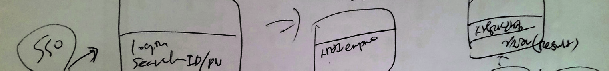

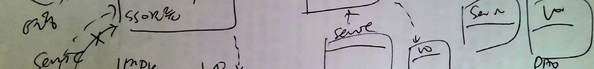

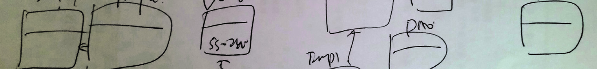

출처: 교육부(2021). 정적모델 설계(LM2001020222_19v5). 한국직업능력연구원. p.62.
[그림 2-33] 클래스 다이어그램 스케치 (예시)
(cid:49686) 정적 설계모델 가운데 클래스 다이어그램을 도식화한다.
정적 설계모델 명세를 보고 클래스 다이어그램을 도식화한다.
1. 다이어그램 모델을 선택한다.
설치된 UML 설계 도구의 ‘Diagram Explorer’에서 ‘Class Diagrams’의 ‘Main’을 클
릭하면 해당 ‘properties’가 제시된다.

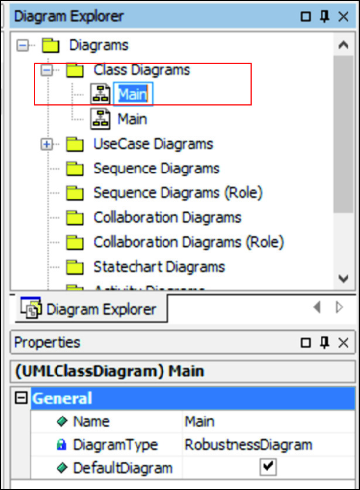

출처: 교육부(2021). 정적모델 설계(LM2001020222_19v5).
한국직업능력연구원. p.62.
[그림 2-34] 다이어그램 모델 선택 (예시)
2. 클래스를 생성한다.
ToolBox에서 원하는 클래스 요소를 선택하고 Main View 작업 공간에 클래스를 생성
하여 LoginController라는 클래스명을 입력한다.

출처: 교육부(2021). 정적모델 설계(LM2001020222_19v5). 한국직업능력연구원. p.63.
[그림 2-35] 클래스 생성 (예시)
3. 클래스의 속성을 추가한다.
아래의 [그림 2-36]에서 클래스명 오른쪽 파란색 아이콘을 클릭하면 속성이 추가된다.
추가된 속성 항목에 원하는 속성명을 입력한다. 여기에서 속성명은 의미 있는 명칭으로
정의하도록 한다.

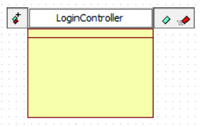

출처: 교육부(2021). 정적모델 설계(LM2001020222_19v5).
한국직업능력연구원. p.63.
[그림 2-36] 클래스의 속성 추가 1 (예시)
다른 속성을 추가하려면 [그림 2-37]에서 속성명 옆의 +/- 아이콘을 이용하여 추가,
삭제하면 된다. 또한 ↑↓ 화살표를 이용하여 속성명의 위치를 변경할 수 있다.

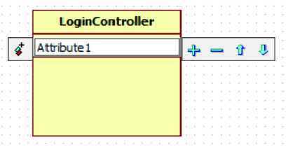

출처: 교육부(2021). 정적모델 설계(LM2001020222_19v5). 한국직업능력
연구원. p.64.
[그림 2-37] 클래스의 속성 추가 2 (예시)
마지막으로 [그림 2-38]에서 속성명의 왼쪽 아이콘을 클릭하면 가시성(Visibility)을 추
가할 수 있다. 클래스의 접근 제한에 따른 public, protected, private, package 중에
서 하나를 선택하면 된다.

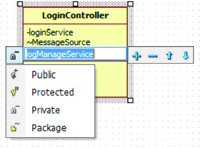

출처: 교육부(2021). 정적모델 설계(LM2001020222_19v5). 한국직업능
력연구원. p.64.
[그림 2-38] 클래스의 속성 추가 3 (예시)
4. 클래스의 오퍼레이션을 추가한다.
아래 [그림 2-39]에서 클래스명 오른쪽 빨간색 아이콘을 클릭하면 오퍼레이션이 추가
된다. 추가된 오퍼레이션 항목에 원하는 오퍼레이션명을 입력한다. 여기에서 오퍼레이
션명은 업무에서 사용하는 의미 있는 명칭으로 정의하도록 한다.

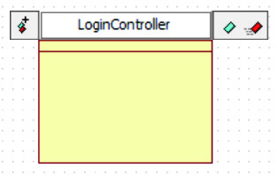

출처: 교육부(2021). 정적모델 설계(LM2001020222_19v5). 한국직
업능력연구원. p.64.
[그림 2-39] 클래스 오퍼레이션 추가1 (예시)
다른 오퍼레이션을 추가하려면 [그림 2-40]에서와 같이 오퍼레이션명 옆의 +/- 아이콘
을 이용하여 추가/삭제하면 된다. 또한 ↑↓ 화살표를 이용하여 오퍼레이션 명의 위치
를 변경할 수 있다.

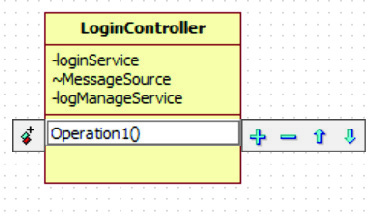

출처: 교육부(2021). 정적모델 설계(LM2001020222_19v5). 한국직
업능력연구원. p.65.
[그림 2-40] 클래스 오퍼레이션 추가 2 (예시)
마지막으로 [그림 2-41]의 오퍼레이션명의 왼쪽 아이콘을 클릭하면 가시성(Visibility)을 추가할
수 있다. 접근 제한에 따른 public, protected, private, package 중에서 하나를 선택한다.

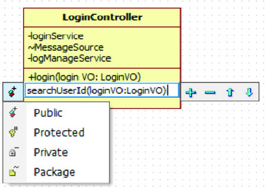

출처: 교육부(2021). 정적모델 설계(LM2001020222_19v5). 한국
직업능력연구원. p.65.
[그림 2-41] 클래스 오퍼레이션 추가 3(예시)
5. 클래스 간의 관계를 추가한다.
아래 [그림 2-42]와 같이 ToolBox의 관계 요소를 클릭하고, 해당하는 클래스에서 드
래그(Drag) 하여 관계를 생성하고자 하는 클래스까지 드롭(Drop)하면 클래스 간의 관
계가 추가된다.

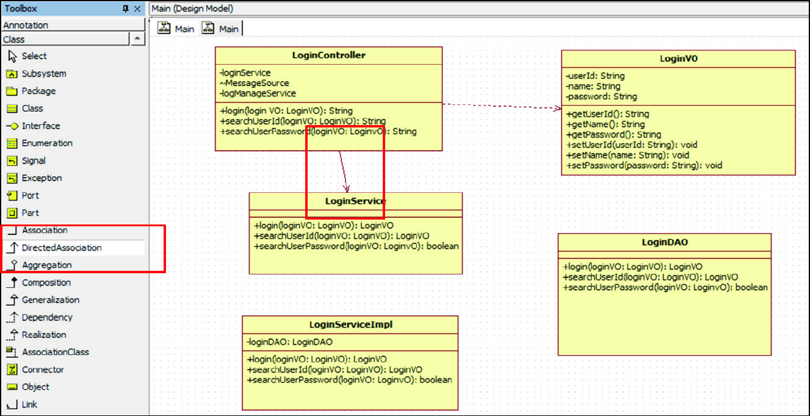

출처: 교육부(2021). 정적모델 설계(LM2001020222_19v5). 한국직업능력연구원. p.66.
[그림 2-42] 클래스 간의 관계 추가 (예시)
6. 클래스를 보완하여 완성한다.
클래스와 클래스 구성 요소(속성, 오퍼레이션, 관계) 등을 편집하려면 ‘Properties’ 창을
이용하여 수정한다. 특히 클래스 관계에서 방향, 역할 이름, 다중도 등은 ‘Properties’
창에서 지정하면 된다.

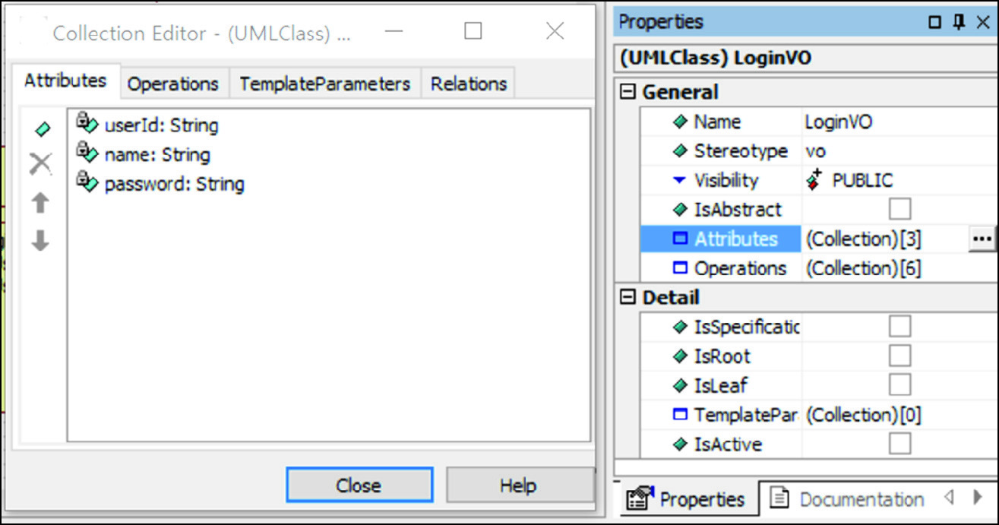

출처: 교육부(2021). 정적모델 설계(LM2001020222_19v5). 한국직업능력연구원. p.66.
[그림 2-43] 클래스 다이어그램 요소 편집을 위한 Properties 창 (예시)
7. 다음과 같이 완성된 로그인 관리 클래스 다이어그램의 사례를 참조한다.

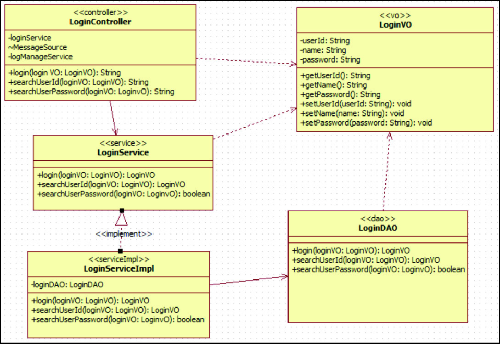

출처: 교육부(2021). 정적모델 설계(LM2001020222_19v5). 한국직업능력연구원. p.67.
[그림 2-44] 로그인 관리 클래스 다이어그램 (예시)
(cid:49687) 정적 설계모델 설계서를 작성한다.
정적 설계모델 명세서와 클래스 다이어그램 모형을 이용하여 정적 설계모델 설계서를 작성
한다. 이는 추후 애플리케이션 설계 산출물로서 이해관계자들의 의사소통 도구이자 구현
단계의 입력물로 활용된다.
1. 정적 설계모델 설계서를 작성한다.
도식화된 클래스 다이어그램 모형을 이용하여 클래스 설계서를 작성한다.
(1) 업무의 개략적 내용을 작성한다.
시스템의 업무 영역, 단위 업무, 작성 일자와 버전 정보를 기재한다. 이는 설계 문
서를 관리하고, 향후 변경이나 업데이트 시 추적할 수 있도록 한다.
(2) 설계 클래스 목록을 작성한다.
해당 단위 업무에 속하는 설계 클래스들을 기재한다. 클래스 이름과 함께 클래스의
역할을 간단히 설명하여, 클래스가 왜 필요한지 명확히 한다.
(3) 시퀀스다이어그램을 작성한다.
유스케이스 시나리오를 참고로 시퀀스다이어그램을 작성하고 이를 캡처하여 해당란
에 추가한다. 작성된 시퀀스다이어그램은 그림(캡처) 형태로 문서에 첨부하여, 누구
나 쉽게 흐름을 이해할 수 있도록 한다.
(4) 설계 클래스 다이어그램을 작성한다.
도식화된 설계 클래스 다이어그램을 캡처하여 해당란에 추가하여 누구나 쉽게 흐름
을 이해할 수 있도록 한다.
(5) 설계 클래스를 작성한다.
설계 클래스를 구성하는 속성과 오퍼레이션 정보를 작성한다. 모든 정보를 상세하게
작성해야 하며, 가시성(Visibility)과 타입은 반드시 포함하여 코드 구현 시 혼동이 없
도록 한다.
- 클래스의 속성(Attributes): 이름, 데이터 타입, 접근 제어자(예: public, private)
를 명시한다.
- 클래스의 오퍼레이션(Operations): 메서드 이름, 매개변수, 반환 타입, 가시성
(Visibility) 등을 구체적으로 기재한다.
2. 작성된 정적 설계모델 설계서를 검토하고 수정하여 완성한다.

출처: 교육부(2021). 정적모델 설계(LM2001020222_19v5). 한국직업능력연구원. p.69.
[그림 2-45] 정적 설계모델 클래스 설계서 (예시)
수행 tip
•클래스 설계서는 실제 구현 단계에서 활용되기 때문에
프로젝트 참가자들이 모두 이해할 수 있도록 쉽게 구체
적이고 정확하게 작성되어야 한다.

| 학습 2 | 교수·학습 방법 |
| --- | --- |

교수 방법
• 정적모델 설계 상세화 절차를 정적모델 변환 규칙 정의, 설계모델 클래스 생성 및 클래
스 설계서 작성 등으로 설명한다.
• 정적모델 설계를 위한 변환 규칙들의 개념과 중요성을 중심으로 설명한다.
• 경계 클래스, 제어 클래스, 엔티티 클래스의 상세화 과정을 사례와 함께 설명한다.
• 각 클래스의 상세화 후 정적 설계모델 명세서를 작성하는 방법을 설명한다.
• 모델링 도구의 사용 방법과 정적 설계모델 명세서를 참고하여 다이어그램으로 표현하는
방법을 설명한다.
학습 방법
• 정적모델 설계 상세화 과정을 정적모델 변환 규칙 정의, 설계모델 클래스 생성 및 클래
스 설계서 작성 등의 단계로 실습을 통해 학습한다.
• 정적모델 설계 변환 규칙에 대해 기본 지식과 제약사항 등을 학습하고 체크리스트를 작
성한다.
• 경계 클래스, 제어 클래스, 엔티티 클래스의 기본 개념을 학습하고 각 클래스의 상세화
과정을 실습한다.
• 정적 설계모델 명세서 양식을 이용하여 명세서 작성을 실습한다. [활용 서식 참조: 정적
모델 설계 명세서 양식]
• 모델링 도구를 설치하고 이를 이용하여 정적 설계모델 명세서에 따른 다이어그램 도식
화를 실습한다.

| 학습 2 | 평 가 |
| --- | --- |

평가 준거
• 평가자는 학습자가 학습 목표를 성공적으로 달성하였는지를 평가해야 한다.
• 평가자는 다음 사항을 평가해야 한다.

| 학습 내용 | 학습 목표 | 성취수준 |  |  |
| --- | --- | --- | --- | --- |
|  |  | 상 | 중 | 하 |

- 분석된 정적모델을 정적 설계모델로 변환하기 위해 변환
정적 설계모델 상 규칙을 정의할 수 있다.
세화 - 정적 설계모델의 엔티티 클래스, 경계 클래스, 제어 클래
스를 상세화할 수 있다.
정적 설계모델 명
- 상세화된 정적 설계모델의 명세서를 작성할 수 있다.
세화
정적 설계모델 도 - 설계용 도구를 활용하여 정적 설계모델을 도식화할 수
식화 있다.
평가 방법
• 포트폴리오

| 학습 내용 | 평가 항목 | 성취수준 |  |  |
| --- | --- | --- | --- | --- |
|  |  | 상 | 중 | 하 |

- 설계모델로의 변환 규칙의 정의에 대한 리스트 도출 능력
- 경계 클래스 상세화 도출 능력
정적 설계모델 상
세화
- 제어 클래스 상세화 도출 능력
- 엔티티 클래스 상세화 도출 능력
- 정적 설계모델 명세서 작성 항목의 완전성
정적 설계모델 명
세화
- 정적 설계모델 명세서의 적정성
- 클래스 다이어그램 도식화의 완전성
정적 설계모델 도
식화
- 클래스 다이어그램의 적정성
• 평가자 체크리스트

| 학습 내용 | 평가 항목 | 성취수준 |  |  |
| --- | --- | --- | --- | --- |
|  |  | 상 | 중 | 하 |

| 정적 설계모델 상세화 정적 설계모델 명세화 정적 설계모델 도식화 피드백 | - 설계모델로의 변환 규칙에 대한 이해 여부 - 경계 클래스 상세화 과정에 대한 이해 여부 - 제어 클래스 상세화 과정에 대한 이해 여부 - 엔티티 클래스 상세화 과정에 대한 이해 여부 - 정적 설계모델 명세서 작성 요령에 대한 이해 여부 - 정적 설계모델 명세서 작성 능력 - 모델링 도구의 활용 능력 - 클래스 다이어그램의 작성 능력 |  |  |  |
| --- | --- | --- | --- | --- |
| 1. 포트폴리오 - 설계모델로크해 주고 추가- 정적 설계모델의여 재작업할- 정적 설계모델백 정보와- 도식화된 피드백 정보와 | 변환하기 위한 규칙의 정의를 목록화한 체크리스트를 평가하여학습 자료를 제공함으로써 보완할 수 있도록 한다. 상세화의 이해 정도가 미흡하다면 성취수준이 상위인 수 있도록 한다. 명세서의 작성 완성도와 적정성을 평가하여 미흡한 부분을추가 참고 자료를 제시함으로써 보완할 수 있도록 한다. 클래스 다이어그램의 완성도와 적정성 등을 평가하여 미흡한 성취수준이 상위인 포트폴리오를 참고하여 재작업할 수 있도록 | 미흡한포트폴리오를체크해부분을한다. | 부분을주고체크해 | 체참고하피드주고 |
| 2. 평가자 체크리스트- 정적 설계모델등을 포함한- 경계 클래스,학습 내용을- 정적 설계모델피드백 정보와- 클래스 보와 추가 참고 | 상세화를 위한 변환 규칙에 대한 이해 정도에 따라 추가해야학습 자료를 제공함으로써 이해 정도를 높이도록 한다. 제어 클래스, 엔티티 클래스 상세화 과정에 대한 이해 정도에공유할 수 있는 기회를 마련하여 추가 학습할 수 있도록 한다.명세서 작성에 대한 이해 및 산출물을 평가하여 미흡한 추가 참고 자료를 제시함으로써 보완할 수 있도록 지도한다.다이어그램에 대한 이해 및 완성도 정도에 따라 미흡한 부분을 자료를 제시함으로써 클래스 다이어그램을 작성할 수 있도록 | 할따라부분을체크하여지도한다. | 지식과팀원들과체크해피드백 | 사례주고정 |

•교육부(2021). 『정적모델 설계(LM2001020222_19v5)』. 한국직업능력연구원.
•아사이마이 외(2008). 『UML 실무 테크닉』. 삼양미디어.
•채흥석(2004). 『클래스 구조의 이해와 설계』. 한빛미디어.
•채흥석(2009). 『UML과 JAVA로 배우는 객체지향 CBD 실전 프로젝트』. 한빛미디어.
•최은만(2014). 『새로 쓴 소프트웨어 공학』. 정익사.
•최은만(2017). 『객체지향 소프트웨어 공학』. 한빛아카데미.
•CBD SW 개발 표준 산출물 관리 가이드. NIA.
•2004-777 공공 부문_UML적용 지침(1222)-기술보고서. TTAS.KO.

체크리스트 양식

| 검토자 |  |  | 검토일 |  |  |  |  |
| --- | --- | --- | --- | --- | --- | --- | --- |
| 번호 | 체크 항목 |  |  |  | Yes | No | 비고 |
| 1 |  |  |  |  |  |  |  |
| 2 |  |  |  |  |  |  |  |
| 3 |  |  |  |  |  |  |  |
| 4 |  |  |  |  |  |  |  |
| 5 |  |  |  |  |  |  |  |
| 6 |  |  |  |  |  |  |  |
| 7 |  |  |  |  |  |  |  |
| 8 |  |  |  |  |  |  |  |
| 9 |  |  |  |  |  |  |  |
| 10 |  |  |  |  |  |  |  |
| 11 |  |  |  |  |  |  |  |
| 12 |  |  |  |  |  |  |  |
| 13 |  |  |  |  |  |  |  |
| 14 |  |  |  |  |  |  |  |
| 15 |  |  |  |  |  |  |  |

정적모델 설계 명세서 양식
Ⅰ. 개요
Ⅱ. 시스템 구성
1. 분석 패키지 구조도
2. 최상위 분석 패키지 개요
3. 분석 패키지 명세
3.1 분석 패키지 구조도
3.2 분석 패키지 개요

| 패키지명 | 설명 |
| --- | --- |

3.3 분석 패키지 명세
3.3.1 분석 패키지 다이어그램
3.3.2 분석 클래스 개요

| 클래스명 | 설명 |
| --- | --- |

3.3.3 분석 클래스 명세
3.3.3.1 속성 명세

| 속성명 | 설명 |
| --- | --- |

3.3.3.2 연산 명세

| 연산명 | 설명 |
| --- | --- |

Ⅲ. 유스케이스 실현 명세
1. [응용 모듈명]
1.1 기본 시나리오
1.2 대안 시나리오
NCS학습모듈 개발이력
발행일 2015년 12월 31일
세분류명 응용SW엔지니어링(20010202)
개발기관 한국소프트웨어기술진흥협회
강석진(이비스톰)* 김승현(경희대학교)
김보운(이화여자대학교) 엄기영(우리에프아이에스)
김홍진(LG CNS) 장온순(한국IT컨설팅)
유은희 조상욱(세종대학교)
집필진 검토진
장현섭((주)커리텍) 조성호(삼성카드)
주선태(T3Q)
진권기(이비스톰)
최재준 *표시는 대표집필자임
발행일 2017년 12월 31일
세분류명 응용SW엔지니어링(20010202)
개발기관 (사)한국정보통신기술사협회
박미화(동국대학교)* 권순명((주)씨에이에스)
김승환((주)캐롯아이) 김태형((사)한국정보통신기술사협회)
김원기(LG CNS) 양승화(라이나생명보험)
김종명(SM신용정보) 이성화(시스원)
박현기(프리랜서) 황극인((주)코스콤)
집필진 검토진
유현주((사)한국정보통신기술사협회)
이구성(한국아이씨티(주))
이숙희(서초문화예술정보학교)
최창선(한빛디엔에스(주))
홍민표(한화S&C) *표시는 대표집필자임
발행일 2018년 12월 31일
학습모듈명 정적모델 설계(LM2001020222_16v4)
개발기관 한국직업능력개발원
발행일 2021년 12월 31일
학습모듈명 정적모델 설계(LM2001020222_19v5)
개발기관 (사)한국정보통신기술사협회(개발책임자: 온기현)
발행일 2025년 12월 31일
학습모듈명 정적모델 설계(LM2001020222_23v6)
개발기관 한국정보공학기술사회(개발책임자: 박철수)
이주희(웨이버스)* 김창남(세명컴퓨터고등학교)
김동욱(한국기술교육대학교) 서경석(미라콤아이앤씨)
김지영(LG CNS) 서인순(프리랜서)
문정기(태하기술사사무소) 유두규(건국대학교)
집필진 검토진
신현범(셈틀웨어)
이근수(분당경영고등학교)
정은주(한국정보기술단)
조민양(동서울대학교)
*표시는 대표집필자임
(참고) 검토진으로 참여한 집필진은 본인의 원고가 아닌 타인의 학습모듈을 검토함
정적모델 설계(LM2001020222_23v6)
저작권자 교육부
연구사업기관 한국직업능력연구원
발행일 2025. 12. 31.
ISBN 979-11-4240-201-2
※ 이 학습모듈은 자격기본법 시행령(제8조 국가직무능력표준의 활용)에 의거하여 개발하였으며,
NCS통합포털사이트(http://www.ncs.go.kr)에서 다운로드할 수 있습니다.

