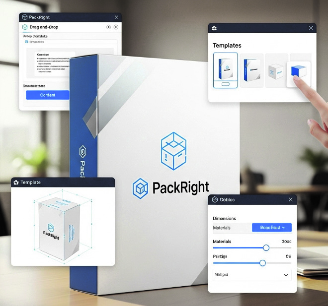
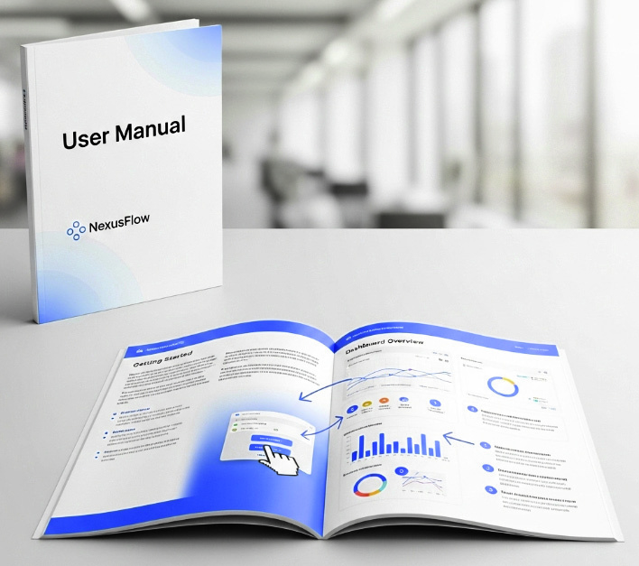

# LM2001020209_23v6_제품소프트웨어+패키징_20251108

대분류/20
정보통신 중분류/01
정보기술 소분류/02
정보기술개발 세분류/02
응용SW엔지니어링 능력단위/09
NCS학습모듈
제품 소프트웨어 패키징
LM2001020209_23v6
[NCS학습모듈 활용 시 유의 사항]
1. NCS학습모듈은 교육훈련기관에서 출처를 명시하고 교육적 목적으로 활용할 수 있습니다. 다
만, NCS학습모듈에는 국가(교육부)가 저작재산권 일체를 보유하지 않은 저작물(출처가 표기된
도표‧사진‧삽화‧도면 등)이 포함되어 있으므로, 이러한 저작물의 변형‧각색‧복제‧공연‧
배포 및 공중 송신 등과 이러한 저작물을 활용한 2차적 저작물을 작성하려면 반드시 원작자
의 동의를 받아야 합니다.
2. NCS학습모듈은 개발 당시의 산업 및 교육 현장을 반영하여 집필하였으므로, 현재 적용되는
법령‧지침‧표준 및 교과 내용 등과 차이가 있을 수 있습니다. NCS학습모듈 활용 시 법령
‧지침‧표준 및 교과 내용의 개정 사항과 통계의 최신성 등을 확인하시기를 바랍니다.
3. NCS학습모듈은 산업 현장에서 요구되는 능력을 교육훈련기관에서 학습할 수 있게 구성한 자
료입니다. 다만, NCS학습모듈 지면의 한계상 대표적 예시(예: 활용도 또는 범용성이 높은 제
품, 서비스) 중심으로 집필하였음을 이해하시기를 바랍니다.
NCS학습모듈의 이해
NCS학습모듈의 이해
※ 본 NCS학습모듈은 「NCS 국가직무능력표준」사이트(http://www.ncs.go.kr) 에서 확인 및 다운로드할 수 있습니다.

| Ⅰ | NCS학습모듈이란? |
| --- | --- |

•국가직무능력표준(NCS: National Competency Standards)이란 산업현장에서 직무를
수행하기 위해 요구되는 지식･기술･소양 등의 내용을 국가가 산업부문별･수준별로 체계
화한 것으로 산업현장의 직무를 성공적으로 수행하기 위해 필요한 능력(지식, 기술, 태도)
을 국가적 차원에서 표준화한 것을 의미합니다.
•국가직무능력표준(이하 NCS)이 현장의 ‘직무 요구서’라고 한다면, NCS학습모듈은 NCS
의 능력단위를 교육훈련에서 학습할 수 있도록 구성한 ‘교수･학습 자료’입니다. NCS학습
모듈은 구체적 직무를 학습할 수 있도록 이론 및 실습과 관련된 내용을 상세하게 제시하
고 있습니다.

| NCS 및 NCS학습모듈 개발 절차 |
| --- |
| NCS산업계개발 계획 수립NCSNCS학습모듈NCS학습모듈 개발개발 계획 수립 |

•NCS학습모듈은 다음과 같은 특징을 가지고 있습니다.
첫째, NCS학습모듈은 산업계에서 요구하는 직무능력을 교육훈련 현장에 활용할 수 있도
록 성취목표와 학습의 방향을 명확히 제시하는 가이드라인의 역할을 합니다.
둘째, NCS학습모듈은 특성화고, 마이스터고, 전문대학, 4년제 대학교의 교육기관 및 훈
련기관, 직장교육기관 등에서 표준교재로 활용할 수 있으며 교육과정 개편 시에도
유용하게 참고할 수 있습니다.
i
•NCS와 NCS학습모듈 간의 연결 체계를 살펴보면 아래 그림과 같습니다.

| NCS와 NCS학습모듈의 연결 체계 |
| --- |
| NCS NCS학습모듈능력단위 NCS학습모듈명능력단위 정의 NCS학습모듈의 목표능력단위 기술서 학습명능력단위 요소 학습 내용수행준거 학습 목표지식 필요 지식기술 수행 내용- 재료･자료태도- 기기(장비･공구)- 안전･유의 사항- 수행 순서적용범위 및 작업상황고려 사항 교수･학습 방법자료 및 관련 서류 교수 방법장비 및 도구 학습 방법평가 지침 평가평가 방법 평가 준거평가 시 고려 사항 평가 방법피드백참고 자료･활용 서식･부록 |

|  |  | NCS |  |  |  |  |  |  |  |  | NCS학습모듈 |  |  |  |  |
| --- | --- | --- | --- | --- | --- | --- | --- | --- | --- | --- | --- | --- | --- | --- | --- |
|  | 능력단위 |  |  |  |  |  |  |  |  | NCS학습모듈명 |  |  |  |  |  |
|  | 능력단위 | 능력단위 |  |  |  |  |  |  |  | NCS학습모듈명 | NCS학습모듈명 |  |  |  |  |
|  | 능력단위 정의 |  |  |  |  |  |  |  |  | NCS학습모듈의 목표 |  |  |  |  |  |
|  | 능력단위 정의 | 능력단위 정의 |  |  |  |  |  |  |  | NCS학습모듈의 목표 | NCS학습모듈의 목표 |  |  |  |  |
|  | 능력단위 기술서 능력단위 요소 | 능력단위 기술서 능력단위 요소 |  |  |  |  |  |  |  | 학습명 학습 내용 | 학습명 학습 내용 |  |  |  |  |
|  | 능력단위 기술서 |  |  |  |  |  |  |  |  | 학습명 |  |  |  |  |  |
|  | 능력단위 기술서 | 능력단위 기술서 |  |  |  |  |  |  |  | 학습명 | 학습명 |  |  |  |  |
|  | 능력단위 요소 |  |  |  |  |  |  |  |  | 학습 내용 |  |  |  |  |  |
|  | 능력단위 요소 | 능력단위 요소 |  |  |  |  |  |  |  | 학습 내용 | 학습 내용 |  |  |  |  |
|  | 수행준거 |  |  |  |  |  |  |  |  | 학습 목표 |  |  |  |  |  |
|  | 수행준거 | 수행준거 |  |  |  |  |  |  |  | 학습 목표 | 학습 목표 |  |  |  |  |
|  | 지식기술태도 |  |  |  |  |  |  |  |  | 필요 지식수행 내용- 재료･자료- 기기(장비･공구)- 안전･유의 사항- 수행 순서 |  |  |  |  |  |
|  | 기술 | 기술 |  |  |  |  |  |  |  | 수행 내용 | 수행 내용 |  |  |  |  |
|  |  |  |  |  |  |  |  |  |  | - 재료･자료 | - 재료･자료 |  |  |  |  |
|  | 태도 | 태도 |  |  |  |  |  |  |  | - 기기(장비･공구) | - 기기(장비･공구) |  |  |  |  |
|  |  |  |  |  |  |  |  |  |  | - 기기(장비･공구) | - 기기(장비･공구) |  |  |  |  |
|  |  |  |  |  |  |  |  |  |  | - 안전･유의 사항 | - 안전･유의 사항 |  |  |  |  |
|  | 적용범위 및 작업상황 |  |  |  |  |  |  |  |  | - 수행 순서 | - 수행 순서 |  |  |  |  |
|  | 고려 사항자료 및 관련 서류장비 및 도구 |  |  |  |  |  |  |  |  | 교수･학습 방법 | 교수･학습 방법 교수 방법 학습 방법 |  |  |  |  |
|  | 자료 및 관련 서류 장비 및 도구 | 자료 및 관련 서류 장비 및 도구 |  |  |  |  |  |  |  | 교수 방법학습 방법 |  |  |  |  |  |
|  | 평가 지침 |  |  |  |  |  |  |  |  | 평가 |  |  |  |  |  |
|  | 평가 방법평가 시 고려 사항 |  |  |  |  |  |  |  |  | 평가 준거평가 방법피드백 |  |  |  |  |  |
|  | 평가 시 고려 사항 | 평가 시 고려 사항 |  |  |  |  |  |  |  | 평가 방법 | 평가 방법 |  |  |  |  |
|  |  |  |  |  |  |  |  |  |  | 참고 자료･활용 서식･부록 |  |  |  |  |  |

ii
NCS학습모듈의 이해

| Ⅱ | NCS학습모듈의 체계 |
| --- | --- |

•NCS학습모듈은 1. NCS학습모듈의 위치 , 2. NCS학습모듈의 개요 , 3. NCS학습모듈의 내용 체계 ,
4. 참고 자료 , 5. 활용서식/부록 으로 구성되어 있습니다.
1. NCS학습모듈의 위치
•NCS학습모듈의 위치는 NCS 분류 체계에서 해당 학습모듈이 어디에 위치하는지를 한 눈에
볼 수 있도록 그림으로 제시한 것입니다.

| [NCS-학습모듈의 위치] |  |  |  |  |  |  |  |
| --- | --- | --- | --- | --- | --- | --- | --- |
| 대분류 | 문화·예술·디자인·방송 |  |  |  |  |  |  |
| 중분류 |  | 문화콘텐츠 |  |  |  |  |  |
| 소분류 |  |  |  |  |  | 문화콘텐츠제작 |  |
| 세분류 |  |  |  |  |  |  |  |
| 세분류 |  |  |  |  |  |  |  |
| 방송콘텐츠제작 |  |  |  |  | 능력단위 |  | 학습모듈명 |
| 영화콘텐츠제작 프로그램 기획 프로그램 기획음악콘텐츠제작 아이템 선정 아이템 선정광고콘텐츠제작 자료 조사 자료 조사게임콘텐츠제작 프로그램 구성 프로그램 구성애니메이션캐스팅 캐스팅콘텐츠제작만화콘텐츠제작 제작계획 제작계획캐릭터제작 방송 미술 준비 방송 미술 준비스마트문화앱방송 리허설 방송 리허설콘텐츠제작영사 야외촬영 야외촬영스튜디오 제작 스튜디오 제작… … |  |  |  |  | 프로그램 기획 |  | 프로그램 기획 |
| 음악콘텐츠제작 |  |  |  |  | 아이템 선정 |  | 아이템 선정 |
| 광고콘텐츠제작 자료 |  |  |  |  | 자료 조사 |  | 자료 조사 |
| 게임콘텐츠제작 |  |  |  |  | 프로그램 구성 |  | 프로그램 구성 |
| 애니메이션 콘텐츠제작 |  |  |  |  | 캐스팅 |  | 캐스팅 |
| 만화콘텐츠제작 |  |  |  |  | 제작계획 |  | 제작계획 |
| 캐릭터제작 방송 |  |  |  |  | 방송 미술 준비 |  | 방송 미술 준비 |
| 스마트문화앱 방송 콘텐츠제작 |  |  |  |  | 방송 리허설 |  | 방송 리허설 |
| 영사 |  |  |  |  | 야외촬영 |  | 야외촬영 |
|  |  |  |  |  | 스튜디오 제작 |  | 스튜디오 제작 |
|  |  |  |  |  | … |  | … |

|  | 학습모듈은 |
| --- | --- |
| NCS 능력단위 1개당 1개의 학습모듈 개발을 원칙으로 합니다. 그러나 필요에 따라고용단위 및 교과단위를 고려하여 능력단위몇 개를 묶어 1개 학습모듈로 개발할 수있으며, NCS 능력단위 1개를 여러 개의학습모듈로 나누어 개발할 수도 있습니다. |  |

iii
2. NCS학습모듈의 개요
•NCS학습모듈의 개요는 학습모듈이 포함하고 있는 내용을 개략적으로 설명한 것으로
학습모듈의 목표 , 선수학습 , 학습모듈의 내용 체계 , 핵심 용어 로 구성되어 있습니다.

| 학습모듈의 목표 | 해당 NCS 능력단위의 정의를 토대로 학습 목표를 작성한 것입니다. |
| --- | --- |

| 선수학습 | 해당 학습모듈에 대한 효과적인 교수･학습을 위하여 사전에 이수해야 하는 학습모듈, 학습 내용, 관련 교과목 등을 기술한 것입니다. |
| --- | --- |

| 학습모듈의내용 체계 | 해당 NCS 능력단위요소가 학습모듈에서 구조화된 체계를 제시한 것입니다. |
| --- | --- |

| 핵심 용어 | 해당 학습모듈의 학습 내용, 수행 내용, 설비･기자재 등 가운데 핵심적인 용어를 제시한 것입니다. |
| --- | --- |

| 제작계획 학습모듈의 개요 |  |  |  |
| --- | --- | --- | --- |
| 학습모듈의 목표본격적인 촬영을 준비하는 단계로서, 촬영 대본을 확정하고 제작 스태프를 조직하며촬영 장비와 촬영 소품을 준비할 수 있다.선수학습제작 준비(LM0803020105_13v1), 섭외 및 제작스태프 구성(LM0803020104_13v1),촬영 제작(LM0803020106_13v1), 촬영 장비 준비(LM0803040204_13v1.4), 미술디자인 협의하기(LM0803040203_13v1.4)학습모듈의 내용체계 |  |  |  |
| 학습 | 학습 내용 | NCS 능력단위 요소 |  |
| 코드번호 요소 명칭 |  | 코드번호 | 요소 명칭 |
| 1. 촬영 대본 1-1. 촬영 구성안 검 촬영 대본0803020114_16v3.1확정하기 토와 수정 확정하기2-1. 기술 스태프 조직2. 제작 스태프 제작 스태프2-2. 미술 스태프 조직 0803020114_16v3.2조직하기 조직하기2-3. 전문 스태프 조직3. 촬영 장비 3-1. 촬영 장비 점검 촬영 장비0803020114_16v3.3계획하기 과 준비 계획하기4-1. 촬영 소품 목록4. 촬영 소품 작성 촬영 소품0803020114_16v3.4계획하기 4-2. 촬영 소품 제작 계획하기의뢰 |  |  |  |
| 핵심 용어촬영 구성안, 제작 스태프, 촬영 장비, 촬영 소품 |  |  |  |

|  | 학습모듈의 목표는 |
| --- | --- |
| 학습자가 해당 학습모듈을 통해 성취해야할 목표를 제시한 것으로, 교수자는 학습자가 학습모듈의 전체적인 내용흐름을 파악하도록 지도할 수 있습니다. |  |

|  | 선수학습은 |
| --- | --- |
| 교수자 또는 학습자가 해당 학습모듈을 교수·학습하기 이전에 이수해야 하는 교과목또는 학습모듈(NCS 능력단위) 등을 표기한것입니다. 따라서 교수자는 학습자가 개별학습, 자기 주도 학습, 방과 후 활동 등 다양한 방법을 통해 이수할 수 있도록 지도하는 것을 권장합니다. |  |

|  | 핵심 용어는 |
| --- | --- |
| 해당 학습모듈을 대표하는 주요 용어입니다. 학습자가 해당 학습모듈을 통해 학습하고 평가받게될 주요 내용을 알 수 있습니다. 「NCS 국가직무능력표준」 사이트(www.ncs.go.kr)의 색인 (찾아보기) 중하나로 이용할 수 있습니다. |  |

iv
NCS학습모듈의 이해
3. NCS학습모듈의 내용 체계
•NCS학습모듈의 내용은 크게 학습 , 학습 내용 , 교수･학습 방법 , 평가 로 구성되어 있습니다.

| 학습 | 해당 NCS 능력단위요소 명칭을 사용하여 제시한 것입니다.학습은 크게 학습 내용, 교수･학습 방법, 평가로 구성되며 해당 NCS 능력단위의능력단위 요소별 지식, 기술, 태도 등을 토대로 내용을 제시한 것입니다. |
| --- | --- |

| 학습 내용 | 학습 내용은 학습 목표, 필요 지식, 수행 내용으로 구성되며, 수행 내용은 재료･자료, 기기(장비･공구), 안전･유의 사항, 수행 순서, 수행 tip으로 구성한 것입니다.학습모듈의 학습 내용은 실제 산업현장에서 이루어지는 업무활동을 표준화된 프로세스에 기반하여 다양한 방식으로 반영한 것입니다. |
| --- | --- |

| 교수･학습 방법 | 학습 목표를 성취하기 위한 교수자와 학습자 간, 학습자와 학습자 간 상호 작용이활발하게 일어날 수 있도록 교수자의 활동 및 교수 전략, 학습자의 활동을 제시한것입니다. |
| --- | --- |

| 평가 | 평가는 해당 학습모듈의 학습 정도를 확인할 수 있는 평가 준거 및 평가 방법, 평가 결과의 피드백 방법을 제시한 것입니다. |
| --- | --- |

학습 1 촬영 대본 확정하기

|  | 학습은 |
| --- | --- |
| 해당 NCS 능력단위요소 명칭을 사용하여제시하였습니다. 하나의 학습은 일반교과의 ‘대단원’에 해당되며, 학습모듈을 구성하는 가장 큰 단위가 됩니다. 또한 하나의 직무를 수행하기 위한 가장 기본적인단위로 사용할 수 있습니다 |  |

| 학습 2 | 제작 스태프 조직하기 |
| --- | --- |

학습 3 촬영 장비 계획하기
학습 4 촬영 소품 계획하기

|  | 학습 내용은 |
| --- | --- |
| NCS 능력단위요소별 수행준거를 기준으로제시하였습니다. 일반교과의 ‘중단원’에 해당합니다. |  |

2-1. 기술 스태프 조직
학습 목표 •프로그램 제작에 적합한 기술 스태프를 조직할 수 있다.

|  | 학습 목표는 |
| --- | --- |
| 학습 내용을 이수할 때 학습자가 갖춰야할행동 수준을 의미합니다. 따라서 수업시간의 과목 목표로 활용할 수 있습니다. |  |

필요 지식 /
(cid:49684) 기술 스태프의 구성

|  | 필요 지식은 |
| --- | --- |
| 해당 NCS의 지식을 토대로 학습에 대한이해와 성과를 제고하기 위해 반드시 알아야 할 주요 지식을 제시하였습니다. 필요 지식은 수행에 꼭 필요한 핵심 내용을위주로 제시하여 교수자의 역할이 매우중요하며, 이후 수행 순서와 연계하여 교수·학습으로 진행할 수 있습니다. |  |

프로그램의 장르에 따라 구성하는 기술 스태프는 많은 차
이가 있다. 같은 장르의 프로그램이라도 그 형식이나 내
용, 규모에 따라서 구성되는 기술 스태프의 종류와 인원
수는 천차만별이다.
1. 스튜디오 프로그램
토크쇼, 종합 구성, 예능과 같은 스튜디오 프로그램은
부조정실과 스튜디오를 사용하여 제작하기 때문에 많
은 기술 스태프가 필요하다.
v

|  | 수행 내용은 |
| --- | --- |
| 해당 학습모듈에서 제시한 내용 중 기술(skill)을 습득하기 위한 실습과제로 활용할 수 있습니다. |  |

수행 내용 / 기술 스태프 구성표 작성하기
재료·자료

|  | 재료･자료는 |
| --- | --- |
| 수행 내용을 수행하는데 필요한 재료 및 준비물로 실습 시 활용할 수 있습니다. |  |

• 방송프로그램 제작 기획서 및 방송 대본, 콘티(continuity), 제작
일정, 운용표
• 장비 및 시설, 제작 시설 배정 의뢰서 및 배정표, 방송 기술 스
태프 데이터베이스(DB) 자료

|  | 기기(장비･공구)는 |
| --- | --- |
| 수행 내용에 필요한 기본적인 장비 및 도구를 제시하였습니다. 제시된 기기 외에도 수행에 필요한 다양한 도구나 장비를 활용할수 있습니다. |  |

기기(장비･공구)
• 컴퓨터 등
안전･유의 사항

|  | 안전･유의사항은 |
| --- | --- |
| 수행 내용을 수행하는 데 있어 안전상 주의해야할 점 및 유의사항을 제시하였습니다. 실습 시 유념해야 하며, NCS의 고려사항도 추가적으로 활용할 수 있습니다. |  |

• 프로그램의 내용과 제작 방법을 분석하고, 각 스태프들의 역할
을 신중하게 검토한다.
수행 순서
(cid:49684) 방송 대본이나 콘티(continuity), 큐 시트를 분석하고, 프로그램

|  | 수행 순서는 |
| --- | --- |
| 실습 과제의 진행 순서로 활용할 수 있습니다. |  |

의 내용적 특성, 제작 과정에 대한 자료를 수집한다.
(cid:49685) 프로그램 제작 방법을 결정한다.

|  | 수행 tip은 |
| --- | --- |
| 수행 내용에서 실습을 용이하게 할 수 있는아이디어를 제시하였습니다. 수행 tip은 지도상의 안전 및 유의사항 외에 전반적으로적용되는 주안점 및 수행 과제 목적에 대한보충설명, 추가사항 등으로 활용할 수 있습니다. |  |

1. 스튜디오 녹화를 할 것인가, 야외 촬영을 할 것인가 검토한
다.
수행 tip
•스태프의 결정은 스태프 간의 호흡을 중
요시하여 선정해야 프로그램의 질을 향
상시킬 수 있다.

| 학습2 | 교수·학습 방법 |
| --- | --- |

|  | 교수･학습 방법은 |
| --- | --- |
| 학습 목표를 성취하는 데 필요한 교수 방법과 학습 방법을 제시하였습니다. |  |

교수 방법

|  | 교수 방법은 |
| --- | --- |
| 해당 학습 활동에 필요한 학습 내용, 학습내용과 관련된 자료명, 자료 형태, 수행 내용의 진행 방식 등에 대하여 제시하였습니다. 또한 학습자의 수업참여도 제고 방법및 수업 진행상 유의사항 등도 제시하였습니다. 선수학습이 필요한 학습을 학습자가숙지하였는지 교수자가 확인하는 과정으로활용할 수도 있습니다. |  |

• 방송 프로그램의 기술적 요소, 미술 구성 요소, 특수 촬영에 대해
설명한다.
• 방송 프로그램 제작에서 각 기술 스태프의 역할에 대해 설명한다.
• 방송 프로그램을 분석하고 필요한 기술 스태프를 구성할 수 있도
록 지시한다.
학습 방법

|  | 학습 방법은 |
| --- | --- |
| 해당 학습 활동에 필요한 학습자의 자기주도 학습 방법을 제시하였습니다. 또한학습자가 숙달해야 할 실기 능력과 학습과정에서 주의해야 할 사항 등도 제시하였습니다. 학습자가 학습을 이수하기 전반드시 숙지해야 할 기본 지식을 학습하였는지 스스로 확인하는 과정에 활용할수 있습니다. |  |

• 방송 프로그램의 기술적 요소, 미술 구성 요소, 특수 촬영에 대해
서 알아본다.
• 프로그램 제작에 필요한 기술 스태프의 역할을 이해하고, 기술 스
태프 구성표를 작성한다.
vi
NCS학습모듈의 이해

| 학습2 평 가평가 준거• 평가자는 학습자가 학습 목표를 성공적으로 달성하였는지를 평가해야 한다.• 평가자는 다음 사항을 평가해야 한다.성취수준학습 내용 학습 목표상 중 하기술 스태프 - 프로그램 제작에 적합한 기술 스태프를 조조직 직할 수 있다.미술 스태프 - 프로그램 제작에 적합한 미술 스태프를 조조직 직할 수 있다.전문 스태프 - 프로그램 특수 촬영을 위한 전문 스태프를조직 조직할 수 있다.평가 방법• 사례 연구성취수준학습 내용 평가 항목상 중 하- 프로그램에서 기술적 요소의 파악 여부기술 스태프 - 기술 스태프의 역할 파악 여부조직 - 프로그램에 필요한 기술 스태프 구성표 작성 능력피드백1. 사례 연구- 프로그램을 선택하여 기술 스태프, 미술 스태프, 전문 스태프 구성표를 예시와 같이 작성하였는지 개인별 능력을 평가한 후, 그결과를 모든 학습자에게 공유하도록 한다. | 학습2 | 평 가 |
| --- | --- | --- |

|  | 평가는 |
| --- | --- |
| NCS 능력단위의 평가 방법과 평가 시 고려사항을 준용하여 작성합니다. 교수자와학습자가 평가 항목별 성취수준 확인 시활용할 수 있습니다. |  |

|  | 평가 준거는 |
| --- | --- |
| 학습자가 학습을 어느 정도 성취하였는지평가하기 위한 기준을 제시하고 있습니다.학습 목표와 연계하여 단위수업 시간에 평가 항목 별 성취수준을 평가하는 데 활용할수 있습니다. |  |

| 학습 내용 | 학습 목표 | 성취수준 |  |  |
| --- | --- | --- | --- | --- |
|  |  | 상 | 중 | 하 |

| 4. 참고 자료•교육부(2013). | 섭외 및 제작스태프 구성(LM0803020104_13v1). |  |  |  |
| --- | --- | --- | --- | --- |
| 한국직업능력개발원. |  |  |  |  |
| 5. 활용 서식/부록직종 이름기술감독 조명감독 [디지털제1조(목적) 이 고시는램 및 방송광고의 | 스튜디오 기술 스태프 구성표 연락처 소속 특이사항텔레비전 방송프로그램 음량 등에 관한 기준] 제정 2014. 11. 29. 미래창조과학부 고시제1창 총칙 방송법 제70조의2제1항에 따라 방송사업자가 디지털 텔레비전음량을 일정하게 유지하기 위해 필요한 사항을 규정함을 | 비고목적으로 | 제2014-87호방송프로그한다. |  |

|  | 평가 방법은 |
| --- | --- |
| NCS 능력단위의 평가 방법을 참고하였으며, 평가 준거에 따른 평가 방법을 2개 이상 제시합니다. 평가 방법의 종류는 포트폴리오, 문제해결 시나리오, 서술형 시험, 논술형 시험, 사례 연구, 평가자 체크리스트,작업장 평가 등이 있으며, NCS 능력단위요소 별 수행 수준을 평가하는 데 가장 적절한 방법을 선정하여 활용할 수 있습니다. |  |

| 학습 내용 | 평가 항목 | 성취수준 |  |  |
| --- | --- | --- | --- | --- |
|  |  | 상 | 중 | 하 |

| 4. 참고 자료•교육부(2013). | 섭외 및 제작스태프 구성(LM0803020104_13v1). |  |  |  |
| --- | --- | --- | --- | --- |
| 한국직업능력개발원. |  |  |  |  |
| 5. 활용 서식/부록직종 이름기술감독 조명감독 [디지털제1조(목적) 이 고시는램 및 방송광고의 | 스튜디오 기술 스태프 구성표 연락처 소속 특이사항텔레비전 방송프로그램 음량 등에 관한 기준] 제정 2014. 11. 29. 미래창조과학부 고시제1창 총칙 방송법 제70조의2제1항에 따라 방송사업자가 디지털 텔레비전음량을 일정하게 유지하기 위해 필요한 사항을 규정함을 | 비고목적으로 | 제2014-87호방송프로그한다. |  |

|  | 피드백은 |
| --- | --- |
| 평가 후에 학습자들에게 평가 결과를 피드백하여 학습 목표를 달성하는 데 활용할 수 있습니다. |  |

|  | 참고 자료는 |
| --- | --- |
| 해당 학습모듈에 제시된 인용 자료의 출처를 제시하였습니다. 교수·학습의 과정에서참고로 활용할 수 있습니다. |  |

|  | 활용 서식은 |
| --- | --- |
| 평가 서식, 실습 시트 등 교수·학습 시 활용할 수 있는 다양한 서식들로 구성하였습니다. 수행에서 평가에 이르기까지 필요한서식을 해당 모듈의 특성에 맞춰 개발하거나 기존의 양식을 활용하여 제시하였습니다. |  |

|  | 부록은 |
| --- | --- |
| 활용 서식 이외에 교수·학습 과정에서 참고할수 있는 자료가 있는 경우 제시하였습니다. |  |

[NCS-학습모듈의 위치]

| 정보 통신 |  |  |
| --- | --- | --- |
|  | 정보 기술 |  |
|  |  | 정보기술개발 |

대분류
중분류
소분류
세분류

| SW아키텍처 |  |  | 능력단위 | 학습모듈명 |
| --- | --- | --- | --- | --- |
| 응용SW엔지니어링 |  |  | 요구사항 확인 | 요구사항 확인 |
| 임베디드SW 엔지니어링 |  |  | 데이터 입출력 구현 | 데이터 입출력 구현 |
| DB엔지니어링 |  |  | 통합 구현 | 통합 구현 |
| NW엔지니어링 |  |  | 정보시스템 이행 | 정보시스템 이행 |
| 보안엔지니어링 |  |  | 제품소프트웨어 패키징 | 제품소프트웨어 패키징 |
| UI/UX엔지니어링 |  |  | 서버 프로그램 구현 | 서버 프로그램 구현 |
| 시스템SW엔지니어링 |  |  | 인터페이스 구현 | 인터페이스 구현 |
| 빅데이터플랫폼구축 |  |  | 애플리케이션 배포 | 애플리케이션 배포 |
| 핀테크엔지니어링 |  |  | 애플리케이션 리팩토링 | 애플리케이션 리팩토링 |
| 데이터아키텍처 |  |  | 인터페이스 설계 | 인터페이스 설계 |
| loT시스템연동 |  |  | 애플리케이션 요구사항 분석 | 애플리케이션 요구사항 분석 |
| 인프라스트럭쳐 아키텍처 구축 |  |  | 기능 모델링 | 기능 모델링 |
|  |  |  | 애플리케이션 설계 | 애플리케이션 설계 |
|  |  |  | 정적모델 설계 | 정적모델 설계 |

| 동적모델 설계 | 동적모델 설계 |
| --- | --- |
| 화면 설계 | 화면 설계 |
| 화면 구현 | 화면 구현 |
| 애플리케이션 테스트 관리 | 애플리케이션 테스트 관리 |
| 애플리케이션 테스트 수행 | 애플리케이션 테스트 수행 |
| 소프트웨어공학 활용 | 소프트웨어공학 활용 |
| 소프트웨어개발 방법론 활용 | 소프트웨어개발 방법론 활용 |
| 프로그래밍 언어 응용 | 프로그래밍 언어 응용 |
| 프로그래밍 언어 활용 | 프로그래밍 언어 활용 |
| 응용SW 기초 기술 활용 | 응용SW 기초 기술 활용 |
| 개발자 환경 구축 | 개발자 환경 구축 |
| 개발 환경 운영 지원 | 개발 환경 운영 지원 |
| 자료구조 활용 | 자료구조 활용 |

차 례
학습모듈의 개요 1
학습 1. 제품소프트웨어 패키징하기
1-1. 사용자 중심의 패키징 수행 3
1-2. 릴리즈 노트 작성 12
1-3. 패키징 도구 활용 20
• 교수・학습 방법 31
• 평가 33
학습 2. 제품소프트웨어 매뉴얼 작성하기
2-1. 제품소프트웨어 매뉴얼 작성 35
2-2. 배포용 미디어 제작 46
• 교수・학습 방법 52
• 평가 54
학습 3. 제품소프트웨어 버전관리하기
3-1. 제품소프트웨어 버전관리 56
• 교수・학습 방법 69
• 평가 71
참고 자료 73
제품소프트웨어 패키징 학습모듈의 개요
학습모듈의 목표
개발이 완료된 제품소프트웨어를 고객에게 전달하기 위한 형태로 패키징하고, 설치와 사용에 필요한 제반
절차 및 환경 등 전체 내용을 포함하는 매뉴얼을 작성하며, 제품소프트웨어에 대한 패치 개발과 업그레이드
를 위해 버전관리를 수행할 수 있다.
선수학습
애플리케이션 설계(2001020221_23v6), 개발자 환경 구축 (2001020233_23v5), 개발 환경 운영 지원
(2001020234_23v2), 정보 시스템 이행(2001020208_23v5)
학습모듈의 내용 체계

| 학습 | 학습 내용 | NCS 능력단위 요소 |  |
| --- | --- | --- | --- |
|  |  | 코드 번호 | 요소 명칭 |

1-1. 사용자 중심의 패키징 수행
1. 제품소프트웨어 제품소프트웨어
1-2. 릴리즈 노트 작성 2001020209_23v6.1
패키징하기 패키징하기
1-3. 패키징 도구 활용
2-1. 제품소프트웨어 매뉴얼 작성
2. 제품소프트웨어 제품소프트웨어
2001020209_23v6.2
매뉴얼 작성하기 매뉴얼 작성하기
2-2. 배포용 미디어 제작
3. 제품소프트웨어 제품소프트웨어
3-1. 제품소프트웨어 버전관리 2001020209_23v6.3
버전관리하기 버전관리하기
핵심 용어
소프트웨어 패키징, 소프트웨어 빌드, 모듈화, 형상관리, 버전관리, 설치 매뉴얼, 사용자 매뉴얼, DRM
(Digital Rights Management), 백업(Backup)

| 학습 1 | 제품소프트웨어 패키징하기 |
| --- | --- |

학습 2 제품소프트웨어 매뉴얼 작성하기
학습 3 제품소프트웨어 버전관리하기
1-1.
사용자 중심의 패키징 수행
•신규 개발, 변경, 개선된 제품소프트웨어의 소스들로부터 모듈들을 빌드하고 고객의 편의성을
학습 목표
고려하여 패키징할 수 있다.
필요 지식 /
(cid:49684) 제품소프트웨어 패키징의 개요
제품소프트웨어 패키징은 고객 편의성 중심으로 진행되며, 이를 위한 매뉴얼 및 버전관리
를 포함한다. 따라서 전체적인 개념을 먼저 이해하고 작업을 진행한다.
1. 제품소프트웨어 패키징의 개념
제품소프트웨어 패키징은 개발이 완료된 제품소프트웨어를 고객에게 전달하기 위한 형
태로 패키징하고, 설치와 사용에 필요한 제반 절차 및 환경 등 전체 내용을 포함하는
매뉴얼을 작성하며, 제품소프트웨어에 대한 패치 개발과 업그레이드를 위해 버전관리를
수행하는 능력이다.
2. 제품소프트웨어 적용상의 특성
(1) 제품소프트웨어는 개발자가 아닌 사용자 중심으로 진행된다.
(2) 신규 및 변경 개발 소스를 식별하고, 이를 모듈화하여 상용 제품으로 패키징한다.
(3) 고객의 편의성을 위해, 신규/변경 이력을 확인하고, 이를 버전관리 및 릴리즈 노트를 통
해 지속적으로 관리한다.
(4) 사용자의 실행 환경을 이해하고, 범용 환경에서 사용이 가능하도록 일반적인 배포 형태
로 분류하여 패키징이 진행된다.
(cid:49685) 제품소프트웨어 패키징을 위한 모듈 빌드
제품소프트웨어 패키징은 모듈들을 통해 수행되므로, 최초 소스 개발 시 해당 모듈의 개념
및 모듈화를 통해 제품소프트웨어 패키징을 가져간다. 소프트웨어의 모듈 및 모듈화를 이
해하고 이를 빌드하는 기법을 통해 패키징을 성공적으로 수행한다.
1. 소프트웨어의 모듈 및 패키징
(1) 소프트웨어 모듈의 이해
(가) 모듈 및 모듈화
- 소프트웨어 설계에서 기능 단위로 분해하고 추상화되어 재사용 및 공유가 가
능한 수준으로 만들어진 단위를 모듈로 규정하고, 소프트웨어의 성능을 향상
하거나 시스템의 디버깅, 시험, 통합 및 수정이 용이하도록 하는 소프트웨어
설계 기법을 모듈화라고 한다.
(나) 모듈화의 장점
- 프로그램의 효율적인 관리 및 성능 향상
- 전체적인 소프트웨어 이해의 용이성 증대 및 복잡성 감소
- 소프트웨어 시험, 통합, 수정 시 용이성 제공
- 기능의 분리가 가능하고 인터페이스가 단순
- 오류의 파급 효과를 최소화
- 모듈의 재사용 가능으로 개발과 유지보수가 용이
(2) 제품소프트웨어의 모듈 및 패키징
제품소프트웨어에서는 모듈 개념을 명확히 이해하고, 기능 단위에 맞게 패키징을 수
행하는 것이 중요하다. 이러한 모듈 단위 패키징은 배포 시 제품소프트웨어의 성능
을 향상시킬 뿐 아니라, 배포 전 시험 및 수정 작업을 체계적으로 수행할 수 있도록
지원한다.
2. 제품소프트웨어 모듈 빌드 기법
(1) 소프트웨어 빌드
소프트웨어 빌드(Software Build)는 소스 코드 파일을 컴퓨터에서 실행할 수 있는
제품소프트웨어의 단위로 변환하는 과정을 말하거나 그에 대한 결과물을 일컫는다.
소프트웨어 빌드는 소스 코드 파일이 실행 코드로 변환되는 컴파일 과정을 핵심으
로 수행하며, 빌드에 따른 결과물에 대한 상세 확인이 필요하다.
(2) 제품소프트웨어를 위한 빌드 기법
소프트웨어 빌드 시스템의 기본 개념을 알고, 빌드의 실행 단위 컴파일, 이를 위한
빌드 도구의 특징 및 사례들의 사전 확인이 필요하다. 빌드 도구는 이를 도와주는
유용한 유틸리티이며 이를 활용하여 컴파일 이외에도 제품소프트웨어 완성을 위해
다양한 일을 할 수 있다. 대표적인 빌드 도구로는 Ant, Make, Maven, Gradle 등
이 있다.
(cid:49686) 사용자 중심의 패키징 작업 이해
제품소프트웨어 패키징은 사용자를 위해 진행되는 작업으로서, 고객 편의성 및 사용자 실
행 환경을 우선 고려하여 진행한다.
1. 사용자 실행 환경의 이해
고객 편의성을 위해 사용자 실행 환경을 우선 고려하여 패키징을 진행한다. 여기서의
사용자 환경은 OS부터 시작하여 실행 환경, 시스템 사양 및 고객의 사용 방법까지 상
세 분류하여 실행 환경을 사전에 정의한다. 만약 여러 가지 실행 환경이 나오게 된다면
해당 경우에 맞는 배포본을 분류하여 패키징 작업을 여러 번 수행할 수도 있다.
2. 사용자 관점에서의 패키징 고려 사항
고객 편의성을 위해 사용자 환경을 확인하여 다음과 같이 여러 가지 케이스를 사전에
고려한다.
(1) 사용자의 시스템 환경 즉, 운영체제(OS), CPU 메모리 등의 수행 최소 환경을 정의한다.
(2) 사용자가 직관적으로 확인할 수 있는 UI(User Interface)를 제공하고, 매뉴얼과 일치시
켜 패키징 작업을 한다.
(3) 제품소프트웨어는 하드웨어와 함께 통합 적용될 수 있도록, 패키징은 위탁 관리 서비스
(Managed Service) 형태로 제공되는 것이 좋다.
(4) 제품소프트웨어는 고객 편의성을 위해 안정적 배포가 가장 중요하고, 다양한 사용자군
(群)의 요구사항을 반영하기 위해 항상 패키징의 변경 및 개선 관리를 고려하여 패키징을
배포한다.
수행 내용 / 사용자 중심의 패키징 수행하기
재료·자료
• 신규 개발 소스
• 모듈 정의서, UI 정의서
• 사용자 환경과 맞는 최소 시스템 사양
기기(장비･공구)
• 컴퓨터, 인터넷
• 모듈 빌드 프로그램
안전･유의 사항
• 제품소프트웨어 패키징 시 저작권 보호(Copyright Protection)는 배포되는 소프트웨어
의 지식 재산(IP: Intellectual Property)을 법적으로 보호하고, 불법 복제·무단 사용·
소스 코드 도용을 방지해야 한다.
• 제품소프트웨어의 종류에 적합한 암호화 알고리즘을 선택하여 배포 시 범용성에 지장이
없도록 해야 한다.
• 제품소프트웨어 활용 데이터는 신규 패키징한 제품소프트웨어의 변경, 개선 사항의 이
해를 위해 오류, 자원 사용량 등을 포함한다.
• 다양한 사용자 요구사항을 반영하기 위해 패키징의 변경 및 개선 관리를 항상 염두에
두고 패키징을 배포한다.
• 설치 과정의 화면과 절차가 사용자 매뉴얼의 내용과 완전히 일치하는지 확인해야 한다.
설치 에러 메시지와 예외 상황에 대한 설명도 매뉴얼에 명시되어야 한다.
• 설치 시 중요한 설정 파일이나 데이터가 안전한 경로에 저장되고, 필요한 경우 암호화
가 적용되는지 확인해야 한다.
• 최종 배포용 미디어나 설치파일이 악성 코드에 감염되지 않았는지, 혹은 변조되지 않았
는지 최종 검증 절차를 거쳐야 한다.
• 신규 개발 소스 및 빌드에 대한 이력을 배포 시점부터 정확하게 관리하여, 추후 패치나
업그레이드 시 문제가 발생하지 않도록 준비한다.
수행 순서

출처: 집필진 제작(2025)
[그림 1-1] 패키징 작업 수행
(cid:49684) 소프트웨어가 수행하는 주요 기능과 해당 기능을 위한 입출력 데이터를 명확히 정의하고 식별
한다.
1. 기능 수행을 위한 입출력 데이터 정의: 소스 기능을 통해 처리되는 정수형(int), 문자형(char)
데이터이다.
2. 전체적인 기능 정의 및 데이터 흐름 파악: 소스 내부 메인 함수의 기능 식별, 관련 데이터의
흐름 및 출력 절차를 확인한다.
3. 함수(Function) 단위 및 출력(Output)에 대한 상세 정의: 메인 함수 이외의 호출 함수를 정
의하고 이에 대한 출력값을 식별한다.
(cid:49685) 모듈 단위 분류 및 모듈화를 순서에 맞게 진행한다.
1. 수행을 위한 기능 단위 및 서비스 분류: 식별된 기능을 모듈로 분류할 수 있는 기능 및 서비
스 단위로 분류한다.
2. 패키징 개념에서의 기능의 공유와 재활용 분류: 여러 번 호출되는 공유, 재활용 함수를 분류
한다.
3. 모듈 간 결합도와 모듈 내 응집도 식별: 모듈 간 결합도는 최소화(Loose Coupling)하고, 모
듈 내 응집도는 최대화(Strong Cohesion)하도록 모듈화를 수행한다.

출처: 집필진 제작(2025)
[그림 1-2] 모듈 간 결합도와 모듈 내 응집도
(cid:49686) 제품소프트웨어의 빌드 도구를 활용한 빌드를 단위별로 진행한다.
1. 신규 개발 소스 및 컴파일 결과물 준비: 빌드 진행을 위한 신규 소스 및 결과물을 준비한다.
2. 정상 기능 단위 및 서비스 분류: 정상으로 빌드가 되는 기능 및 서비스를 사전에 분류한다.
소프트웨어 빌드는 다음과 같은 과정을 걸쳐 진행된다.
<표 1-1> 소프트웨어 빌드 절차
단계 설명 비유(요리)
컴파일 전에 소스 코드 내의 매크로 등을 레시피에 필요한 재
1. 전처리
실제 코드로 확장하거나 필요한 파일을 포 료를 모두 준비하고
(Preprocessing)
함시킨다. 계량하는 과정
사람이 작성한 소스 코드(고급 언어)를 컴퓨
레시피에 따라 재료
2. 컴파일 터가 이해할 수 있는 기계어(Object Code)
를 썰고, 섞고, 조리
(Compiling) 로 변환한다. 이 단계에서 문법 오류를 검
하는 과정
사한다.
컴파일된 여러 개의 기계어 파일(오브젝트 조리된 여러 음식을
3. 링킹 파일)과 프로그램에서 사용하는 외부 라이 하나의 근사한 요리
(Linking) 브러리 파일들을 하나로 묶어 실행이 가능 세트로 최종적으로
한 파일로 만든다. 담아 내는 과정
최종 실행 파일과 함께 필요한 모든 파일 완성된 요리를 고객
4. 아카이브/패키징 (설정 파일, 리소스 파일, 문서 등)을 묶어 에게 전달하기 위해
(Packaging) 배포하기 쉬운 하나의 압축된 패키지 형태 포장하고 상자에 담
로 만든다. 는 과정
3. 빌드 도구 확인 및 정상 수행: 빌드 도구의 사전 선택 확인 및 빌드 도구를 통한 빌드를 수
행한다.
<표 1-2> 대표적인 빌드 도구
개발 환경 대표적인 도구 주요 특징
프로젝트 객체 모델(POM)이라는 XML 파일을 사용하여 프
Maven
로젝트의 빌드, 보고, 문서화를 중앙에서 관리하며, 표준화
(메이븐)
된 디렉터리 구조와 의존성 관리가 특징이다.
Java
Groovy 또는 Kotlin DSL 기반으로 유연성이 높으며, 증분
Gradle
빌드를 지원하여 빌드 속도가 빠르다. 대규모 멀티 프로젝
(그레들)
트 빌드에 강점을 가진다.
가장 오래되고 널리 사용되는 도구로, Makefile을 사용하
Make 여 파일 간의 의존성을 정의하고 필요한 부분만 다시 컴파
일하여 빌드 시간을 단축한다.
C/C++
다양한 플랫폼과 컴파일러에서 사용할 수 있는 빌드 시스템
생성기로서 CMakeLists.txt 파일을 기반으로 실제 빌드
CMake
도구(예: Make, Visual Studio 프로젝트 파일 등)를 생성
한다.
Microsoft의 공식 빌드 플랫폼으로, Visual Studio 프로젝
Microsoft
MSBuild 트 파일을 읽어 빌드 과정을 관리한다. XML 기반의 프로
(Windows)
젝트 파일을 사용한다.
Node.js 기반 프로젝트의 의존성(패키지) 관리 및 스크립트
npm/yarn
실행(빌드, 테스트 등)을 담당한다.
Front-End
(web) 여러 모듈(자바스크립트, CSS, 이미지 등)을 하나의 파일로
Webpack 묶어(번들링) 웹 브라우저가 효율적으로 로드할 수 있도록
최적화하는 도구이다.
4. 컴파일 이외의 도구의 다양한 기능 확인: 컴파일 이외의 에디터, 지속적 통합을 위한
CI(Continous Integration) 도구 등 관련 도구들에 대한 추가 학습을 진행한다.

출처: 집필진 제작(2025)
[그림 1-3] 빌드 자동화 도구인 Maven을 이용한 빌드 과정
(cid:49687) 고객 편의성을 위한 사용자의 요구사항 및 사용 환경을 사전에 분석한다.
1. 최소 사용자 환경 사전 정의: 패키징 수행 시 실제 사용할 User의 사용자 환경인 운영체제
(OS), CPU, 메모리, 기타 필수 소프트웨어/라이브러리 등을 사전에 정의한다.
2. 모듈 단위의 여러 가지 기능별 사용자 환경 테스트: 다양한 사용자의 실행 환경을 이해하고,
범용적인 환경에서 사용할 수 있도록 일반적인 배포 형태로 분류하여 패키징을 준비하고, 모
듈화의 결과에 따른 여러 가지 사용자 테스트를 수행한다.
(cid:49688) 최종 패키징에 대해서 사용자 입장에서 불편한 점을 확인한다.
1. 사용자 환경에서의 패키징 적용 시험: 사용자 환경과 똑같은 상황으로 패키징을 적용하여
SW 테스팅을 수행한다.
2. UI 및 시스템상의 편의성 체크: SW가 UI 및 시스템 환경과 맞지 않는 것이 있는지, 불편한
부분이 있는지 사전에 체크한다. 사용자의 편의성을 고려한 안정적인 배포가 가장 중요한 고
려 사항이다.
(cid:49689) 사용자 입장을 반영하여 패키징에서 변경 및 개선을 진행한다.
1. 패키징 적용 시 변경점 도출
사용자 입장을 반영하여 재패키징을 대비해 변경 부분을 정리한다.
2. 사용자 환경에서 서비스 가능한 최소 수준의 개선
현재 사용자 환경 내에서 가능한 최소 수준의 개선 포인트를 도출한다.
3. 모듈 및 빌드 수정을 통한 개선 버전의 재배포를 실습
도출된 변경점을 기준으로 모듈, 빌드 수정을 하고 재배포를 수행한다.
수행 tip
•패키징 작업 시 최소 수준의 신규 소스에 대한 분석 및
이에 대한 모듈화, 빌드의 작업을 흐름에 맞게 순차적
으로 진행할 수 있는지가 중요하다. 가장 기본이 되어
야 할 고객 편의성 측면과 이에 따른 개선 사항을 도출
해 내는 것도 중요한 사항이다.
1-2.
릴리즈 노트 작성
•이전 릴리즈 이후의 변경, 개선 사항을 포함하여 신규 패키징한 제품소프트웨어에 대한 릴리즈
학습 목표
노트를 작성할 수 있다.
필요 지식 /
(cid:49684) 릴리즈 노트(Release Note)란?
릴리즈 노트는 소프트웨어 개발 및 운영 과정에서 필수적인 문서로, 소프트웨어의 생명 주
기 전반에 걸쳐 중요한 역할을 한다.
1. 개념
릴리즈 노트는 소프트웨어 패키징 작업이 완료된 후, 새롭게 배포되는 소프트웨어 버전
의 주요 변경 사항, 개선 사항, 버그 수정 내용, 새로운 기능, 알려진 이슈 등을 사용자
나 이해관계자에게 안내하기 위해 작성되는 공식 문서이다.
2. 주요 목적
(1) 정보 제공
소프트웨어의 새로운 버전에서 어떤 점이 새로워졌고, 무엇이 수정되었는지 명확하
게 전달한다.
(2) 투명성 확보
사용자와 개발자, 운영 팀 등 이해관계자에게 변경 내용을 투명하게 공개한다.
(3) 문제 예방
주요 변경 사항이나 제거된 기능으로 인해 발생할 수 있는 사용자의 혼란을 최소화
한다.
3. 중요성
(1) 릴리즈 노트에는 테스트 결과와 정보가 포함된다.
사용자에게 최종 배포된 릴리즈 노트를 보면 테스트가 어떻게 진행됐는지, 개발 팀
의 제공 사양을 얼마나 준수했는지를 확인해 볼 수 있다.
(2) 사용자에게 더욱더 확실한 정보를 제공한다.
(3) 기본적으로 전체적인 제품의 수행 기능 및 서비스의 변화를 공유한다.
(4) 자동화 개념과 함께 적용할 수 있다. 이를 통해 전체적인 버전관리 및 릴리즈 정보를 체
계적으로 관리할 수 있다.
(cid:49685) 릴리즈 노트 작성 시 고려 사항
사실 개발 조직 차원에서의 릴리스 노트에 대한 표준 형식은 없다. 하지만 통상적으로 배
포되는 정보의 유형과 사용자의 요구사항에 기초하여 작성되어야 한다.
1. 릴리즈 노트 작성 주체
릴리즈 노트는 개발 팀에서 주도권(Ownership)을 가지고 직접 작성하여야 한다. 현재
시제로 작성되어야 하며, 명확하고 정확하며 완전한 정보를 제공한다.
2, 이력 관리 및 협업
신규 소스, 빌드 등을 배포 시부터 이력을 정확하게 관리하여 진행한다. 개발자와 테스
터가 함께 협업해야 하며 최초 및 변경, 개선 항목까지 연결되어 다음 항목에 대한 정
보들이 릴리즈 노트를 통해 작성되어야 한다.
3. 릴리즈 노트 추가 작성 및 개선 사항 발생 등 예외 사례
릴리즈 정보의 예외 사례 발생에 따른 추가 및 개선 항목이 나타날 수 있으므로 릴리
즈 노트의 항목이 추가될 수 있다. 테스트 단계에서 베타 버전이 출시되거나, 긴급 버
그 수정, 자체 기능 향상 등의 특이한 경우가 발생할 수 있으므로 이러한 경우에도 추
가 항목이 작성되어야 한다.
(1) 베타 버전 발생을 가정한 테스트 단계
추가 개선에 대한 베타 버전을 이용하여 테스트를 수행한다.
(2) 긴급 버그 수정
테스트 중에 발생한 긴급 버그를 즉시 수정한다.
(3) 추가 기능 향상
버그 이외에 추가 기능 향상을 위해 작은 기능을 수정한다.
(4) 사용자 요청에 따른 추가 개선
사용자 요청 발생 시 이에 따른 기능 개선을 계획하고 반영하여 수정한다.
수행 내용 / 릴리즈 노트 작성하기
재료·자료
• 신규 개발 소스
• 모듈 정의서, UI 정의서
• 사용자 환경과 맞는 최소 시스템 사양
기기(장비･공구)
• 컴퓨터, 인터넷
• 릴리즈 노트 작성용 Office, 모듈 빌드 프로그램
안전･유의 사항
• 릴리즈 노트 작성 시 소스 코드의 보안 취약점에 대한 상세한 기술적 설명이나, 해결된
보안 문제의 구체적인 공격 경로는 사용자에게 알리지 않도록 주의해야 한다.
• 향후 개발 예정이거나 경쟁사에 노출되면 안 되는 핵심 기술, 비즈니스 전략, 내부 개
발 목표 등은 포함하지 않아야 한다.
• 내부 개발 용어는 사용하지 않고, 사용자나 외부 이해관계자가 이해할 수 있는 공식 용
어만 사용해야 한다.
• 소프트웨어 사용으로 인해 발생할 수 있는 잠재적인 문제나 손해에 대한 면책 조항
(Disclaimer)을 포함하여 법적 책임을 한정해야 한다.
• 테스트되지 않은 기능이나 불확실한 개선 효과를 과장하여 기재해서는 안 되며 명확한
사실과 검증된 내용만을 다루어야 한다.
수행 순서
(cid:49684) 신규 패키징 제품의 모듈, 빌드 내용을 식별한다.
1. 릴리즈 노트 작성을 위한 수정, 개선된 모듈 및 빌드 내용 정리: 모듈 및 빌드 수행 후 릴리
즈 노트 기준의 항목 순서대로 정리한다.
2. 입출력 데이터, 전체적인 기능 정의 및 데이터 흐름 파악: 소스 기능을 통해 처리되는 정수
형(int), 문자형(char) 데이터, 기능 및 데이터의 흐름을 정리한다.

출처: 집필진 제작(2025)
[그림 1-4] 릴리즈 노트 작성
3. 함수(Function) 단위 및 출력(Output)에 대한 상세 정의: 메인 함수 이외의 호출 함수를 정
의하고 이에 대한 출력값을 식별한다.
(cid:49685) 패키징된 릴리즈 정보를 확인한다.
1. 문서 이름(릴리스 노트 이름), 제품 이름: 릴리즈 노트 작성을 위해 문서명, 제품명의 릴리즈
기본 정보를 확인한다.
2. 버전 번호, 릴리즈 날짜: 최초 패키징 버전 작성을 위한 번호, 초기 릴리즈 날짜를 확인한다.
3. 참고 날짜, 노트 버전: 매번 패키징 수행 진행 날짜 및 릴리즈 노트의 갱신 버전을 확인한다.
(cid:49686) 빌드 내용에 따라 릴리즈 노트의 개요를 작성한다.
1. 제품 및 변경에 대한 간략한 전반적인 개요: 빌드 이후에 제품 및 패키징에 대하여 간략히
메모한다.
2. 개발 소스의 빌드에 따른 결과물: 빌드 이후의 패키징본에 대한 결과를 기록한다.
3. 버전 및 형상 관리에 대한 전반적인 노트(Note): 버전 번호 내용, 버전관리 사항 등을 릴리
즈 노트에 기록한다.
(cid:49687) 이슈, 버그 및 추가 영향도를 점검하여 기술한다.
1. 버그의 간단한 설명 또는 릴리즈 추가 항목: 발생된 버그의 설명, 개선한 릴리즈 항목을 기
술한다.
2. 버그에 대한 재현 및 재현 내용: 버그 발견을 위한 재현 테스트 및 재현 환경을 기록한다.
3. S/W 및 사용자 입장에서의 영향도 파악: 이슈, 버그 발생에 따른 영향도를 상세히 기술한다.
(cid:49688) 학습한 항목에 따른 내용을 포함하여 정식 릴리즈 노트를 작성한다.
1. 릴리즈 정보, Header 및 개요 반드시 포함: 위의 내용을 포함하여 정식 릴리즈 노트에 기본
사항을 포함하여 기술한다.
2. 이번 정보의 릴리즈 노트 개요: 정식 버전을 기준으로 릴리즈 노트의 개요를 작성한다
3. 이슈, 버그 등 개선에 따른 원인 재현 내용: 개선한 포인트를 중심으로 원인, 테스트 내용을
기술한다.
4. 영향도: 이슈, 버그에 따른 영향도를 상세히 기술한다.

출처: OpenAI(https://help.openai.com/en/articles/6825453-chatgpt-release-notes)에서 2025. 10. 16. 스크린샷.
[그림 1-5] ChatGPT 릴리즈 노트 예시
<표 1-3> 릴리즈 노트 작성 항목
작성 항목 설명
헤더 문서 이름(릴리스 노트 이름), 제품 이름, 버전 번호, 릴리즈 날짜,
(Header) 참고 날짜, 노트 버전 등
개요 제품 및 변경에 대한 간략한 전반적 개요
릴리스 버전의 새로운 기능 목록과 릴리스 노트의 목적에 대한 간략
목적
한 개요. 버그 수정 및 새로운 기능 기술
이슈 요약 버그의 간단한 설명 또는 릴리즈 추가 항목 요약
재현 항목 버그 발견에 따른 재현 단계 기술
수정/개선 내용 수정/개선의 간단한 설명 기술
버전 변경에 따른 최종 사용자 기준의 기능 및 응용 프로그램상의
사용자 영향도
영향도 기술
SW 지원 영향도 버전 변경에 따른 SW의 지원 프로세스 및 영향도 기술
노트 SW 및 HW Install 항목, 제품, 문서를 포함한 업그레이드 항목 메모
회사 및 표준 제품과 관련된 메시지. 프리웨어, 불법 복제 방지, 중
면책 조항
복 등 참조에 대한 고지 사항
연락 정보 사용자 지원 및 문의 관련한 연락처 정보
출처: 교육부(2021). 제품소프트웨어 패키징(LM2001020209_19v5). 한국직업능력연구원. p.10.
(cid:49689) 추가 개선에 따른 추가 항목을 식별하여 릴리즈 노트를 작성한다.
1. 베타 버전 발생을 가정한 테스트 단계: 추가 개선에 대한 베타 버전을 이용하여 테스트를 수
행한다.
2. 긴급 버그 수정: 테스트 중 발생한 긴급 버그를 즉시 수정한다.
3. 추가 기능 향상: 버그 이외에 추가 기능 향상을 위해 작은 기능을 수정한다.
4. 사용자 요청에 따른 추가 개선: 사용자 요청 발생 시 이에 따른 기능 개선을 계획하고 수정
한다.
(1) 테스트 단계에서의 베타 버전 출시
제품소프트웨어의 차기 버전이나 신규 버전의 베타 버전 테스트 단계에서도 릴리즈
버전으로 정보를 체크하여 릴리즈 노트를 작성할 수 있다. 이럴 때는 자체에서 기준
을 수립하여 현 베타 버전을 신규 소스로 하여 릴리즈를 할지, 예외 사항으로 베타
버전에 대한 릴리즈 노트를 따로 만들지 사전에 정의해야 한다.
(2) 긴급 버그 수정 시
긴급한 버그가 발견되어 이를 수정할 경우 릴리즈 노트를 작성한다. 보통 긴급히 버
그가 수정되면 릴리즈 노트 작성을 놓치는 경우가 많다. 반드시 버그 번호를 포함한
모든 수정된 버그를 기술하여 릴리즈 노트에 추가한다.
(3) 자체 기능 향상을 포함한 모든 추가 기능의 향상
자체적으로 기능 개선을 완료했을 때 정식으로 릴리즈 버전을 추가하고, 이에 따른
신규 릴리즈 노트를 작성한다. 업그레이드는 SW 및 HW에 대한 항목까지 포함된다.
(4) 사용자 요청에 따른 특이한 사례 발생
제품소프트웨어가 사용자에 배포됨에 따라 기존에 배포된 릴리즈 노트의 연락처 정
보를 통해 사용자의 의견이 접수된 경우이다. 개발 팀 내부에서 허용되는 범위 내에
서 요청이 접수될 경우 이를 자체 기능 향상과는 별도의 버전으로 새로 추가하여
릴리즈 노트를 작성할 수 있다.
수행 tip
•릴리즈 노트 작성 시, 기본적인 정식 릴리즈 노트에 대
한 헤더(Header) 정보 및 버전 개요를 우선 정의하고,
정식 노트를 작성하는 것이 필요하다. 그리고 이에 대한
정식 노트를 기준으로 추가, 개선 버전에 대해서 점차적
으로 버전을 향상하여 릴리즈 노트를 작성해 나간다.
<표 1-4> 릴리즈 노트 작성 시 고려 사항
고려 사항 상세 내용
작성 주체 개발 팀에서 소유권을 갖고 직접 작성해야 한다.
정확하고 완전한 정보를 기반으로 하며, 과장되거나 불확실한 내용은 제
정보의 정확성
외해야 한다.
최종 사용자의 입장에서 쉽게 이해할 수 있도록 전문 용어 사용을 최소
사용자 관점
화하고 간결하게 작성해야 한다.
릴리즈 노트는 현재 시점의 변경 사항을 전달하는 문서이므로, 현재 시
현재 시제
제로 작성하는 것이 원칙이다.
신규/변경 이력을 정확하게 관리하고, 이를 버전관리와 연계하여 지속적
이력 관리
으로 관리해야 한다.
사례: 릴리즈 노트 예시
■ ProductX v2.1.0 Release Note
■ Release Date: 2025-07-14
○ 새로운 기능
- 사용자 대시보드 새 디자인 적용
- 실시간 알림 기능 추가
○ 주요 개선 사항
- 로그인 속도 최적화
- 데이터 백업 속도 20% 향상
○ 버그 수정 내역
- 일부 사용자에서 파일 업로드 시 발생하던 오류 수정
- 다크 모드에서 버튼 텍스트가 안 보이는 문제 해결
⚠ 알려진 이슈
- macOS에서 일부 플러그인 충돌 가능성이 있음 (임시 해결 방법 제공)
1-3.
패키징 도구 활용
•저작권 보호를 위해 암호화/보안 기능을 제공하는 패키징 도구를 활용하여, 제품소프트웨어의
학습 목표
설치, 배포 파일을 생성할 수 있다.
필요 지식 /
(cid:49684) 제품소프트웨어 패키징 도구
제품소프트웨어 패키징 도구는 패키징 과정에서 암호화와 보안 기능을 적용할 수 있도록
지원한다. 특히 디지털 콘텐츠의 불법 사용이나 복제를 방지하고, 과금 서비스를 통한 정
당한 사용자 인증이 가능한 저작권 보호 기술을 지원하는 도구를 활용하여 패키징하는 것
이 중요하다.
1. 제품소프트웨어 패키징 도구의 개념
제품소프트웨어 패키징 도구는 배포를 위한 패키징 시에 디지털 콘텐츠의 지적 재산
권을 보호하고 관리하는 기능을 제공하며, 안전한 유통과 배포를 보장하는 도구이자
솔루션이다. 특히 패키징 도구는 불법 복제로부터 디지털 콘텐츠의 지적 재산권을 보
호해 주는 사용 권한 제어 기술, 패키징 기술, 라이선스 관리, 권한 통제 기술 등을
포함한다.
2. 패키징 도구 활용 시 고려 사항
(1) 반드시 암호화/보안을 고려한다.
패키징 시 사용자에게 배포되는 소프트웨어임을 감안하여 반드시 내부 콘텐츠에 대
한 암호화 및 보안을 고려한다.
(2) 추가로 다양한 이기종 연동을 고려한다.
패키징 도구를 활용하여 여러 가지 이기종 콘텐츠 및 단말기 간 DRM(디지털 권한
관리, Digital Rights Management) 연동을 고려한다.
(3) 사용자 편의성을 위한 복잡성 및 비효율성 문제를 고려한다.
패키징 도구를 고려하면 사용자의 입장에서 불편해질 수 있는 문제를 고려하여, 최
대한 효율적으로 적용될 수 있도록 한다.
(4) 제품소프트웨어의 종류에 적합한 암호화 알고리즘을 적용한다.
암호화 알고리즘이 여러 가지 종류가 있는데, 제품소프트웨어의 종류에 맞는 알고리
즘을 선택하여 배포 시 범용성에 지장이 없도록 고려한다.
(cid:49685) 제품소프트웨어 저작권 보호의 이해와 필요성
1. 저작권의 이해
문학 학술(學術) 또는 예술의 범위에 속하는 창작물인 저작물에 대한 배타적 독점적 권
리로 타인의 침해를 받지 않을 고유한 권한을 말한다.
2. 저작권 보호 기술의 개념
콘텐츠 및 컴퓨터 프로그램과 같이 복제가 용이한 저작물에 대해 불법 복제 및 배포
등을 막기 위한 기술적인 방법을 통칭한다. 저작권 보호 기술은 다음과 같은 특성을 가
진다.
(1) 콘텐츠 복제의 제한적 허용: 복제는 허용하나 사용자 확인을 거쳐 과금, 제품소프트웨어
패키징 시에 사용자 확인에 대해 상용화 과금 정책 수립이 연계
(2) 종량제 BM을 갖는 제품소프트웨어의 경우 요금 부과는 Clearing House를 통한 이용
시간에 비례한 과금(종량제 실현)
(3) 패키징 도구는 암호화/보안 등의 기능을 고려: 패키징 제작자가 지정한 업무 규칙
(Business Rule)과 암호가 함께 패키징(Packaging)되어 배포
3. 저작권 보호 기술의 필요성
(1) 배포된 제품소프트웨어의 무한 복제가 가능하고 원본과 복사본이 동일하게 배포될 특성
을 가진다
(2) 제품소프트웨어가 상용으로 배포되면 다양한 부가 가치를 가질 수 있는 상품으로 바뀜에
따라 패키징 시에 원작자에 대한 권리 보호가 우선하여 필요하다.
(cid:49686) 저작권 보호 측면의 패키징 도구 활용
1. 패키징 수행과 디지털 저작권 관리(DRM)의 절차 및 흐름
(1) 저작권 관리의 흐름
콘텐츠 제공자, 분배자, 소비자 간의 패키징 배포 및 관리의 주체를 중앙의 클리어
링 하우스에서 키 관리 및 라이선스 발급을 관리한다.

출처: 집필진 제작(2025)
[그림 1-6] 저작권 관리 흐름도
<표 1-5> 저작권 관리 구성 요소
구성 요소 설명
콘텐츠 제공자
콘텐츠를 제공하는 저작권자
(Contents Provider)
콘텐츠 분배자
콘텐츠 유통 시스템 등으로서 암호화된 콘텐츠 제공
(Contents Distributor)
패키저(Packager) 콘텐츠를 메타 데이터와 함께 배포가 가능한 단위로 묶는 기능
보안 컨테이너 원본을 안전하게 유통하기 위한 전자적 보안 장치
DRM 컨트롤러 배포된 콘텐츠의 이용 권한을 통제
클리어링 하우스
키 관리 및 라이선스 발급 관리
(Clearing House)
출처: 교육부(2021). 제품소프트웨어 패키징(LM2001020209_19v5). 한국직업능력연구원. p.16.
2. 암호화/보안 기능 중심의 패키징 도구 기술 동향
올바른 패키징 도구의 활용을 위해서는 암호화/보안 기능 중심의 요소 기술을 정확히
이해하고 있어야 한다. 이 기술을 바탕으로 패키징 작업을 할 때에 도구를 이용하여 나
오는 결과물에 대해서도 신뢰할 수 있도록 작업이 되어야 한다.
(1) 패키징 도구 벤더에 의해 개발되던 각종 기술이 표준화를 통해 통합 플랫폼화
(2) 클라우드 환경에서 디지털 콘텐츠의 투명한 접속, 이용, 이동 등의 사용 편리성 보장
(3) 특정 도구나 환경에서만 적용되지 않는 범용성 확보, 벤더 간 식별 체계, 상호 호환성
표준화 노력
수행 내용 / 패키징 도구 활용하기
재료·자료
• 신규 개발 소스
• 사용자 환경과 맞는 최소 시스템 사양
• 패키징 도구
기기(장비･공구)
• 컴퓨터, 인터넷
• 모듈 빌드 프로그램
안전･유의 사항
• 제품소프트웨어 패키징 시 저작권 보호(Copyright Protection)는 배포되는 소프트웨어
의 지식 재산(IP: Intellectual Property)을 법적으로 보호하고, 불법 복제·무단 사용·
소스 코드 도용을 방지하기 위한 핵심 절차이다.
• 제품소프트웨어 활용 데이터는 신규 패키징한 제품소프트웨어의 변경, 개선 사항의 이
해를 위해 오류, 자원 사용량 등을 포함한다.
• 패키징 도구는 라이선스를 확인하고 이를 위배하지 않도록 주의해야 한다.
수행 순서
(cid:49684) 신규 패키징 제품의 모듈, 빌드 내용을 식별한다.
1. 릴리즈 노트 작성을 위한 모듈 및 빌드: 모듈화, 패키징을 통한 릴리즈 노트의 항목을 정리
한다.
2. 입출력 데이터, 전체적인 기능 정의 및 데이터 흐름: 소스 기능을 통해 처리되는 int, char
형 데이터, 기능 및 데이터의 흐름을 정리한다.
3. 함수(Function) 단위 및 출력(Output)에 대한 상세 정의: 메인 함수 이외의 호출 함수를 정
의하고, 이에 대한 출력값을 식별한다.
(cid:49685) 패키징 자동화 도구를 식별한다.
1. 소프트웨어 개발 및 배포 현장에서 널리 활용되는 대표적인 패키징 자동화 도구의 특징을 검
토한다.

출처: 집필진 제작(2025)
[그림 1-7] 소프트웨어제품 패키징 자동화 도구 기능 예시
(1) 아파치 메이븐(Apache Maven)
자바 기반 프로젝트에서 가장 널리 사용되는 빌드 및 패키징 도구로서 프로젝트의
의존성 관리, 컴파일, 테스트, 패키징(JAR/WAR/EAR), 배포까지 자동화한다.

출처: Apache Maven(https://maven.apache.org)에서
2025. 10. 09. 스크린샷.
[그림 1-8] Apache Maven 로고
(가) 사용 환경
대형 금융권, 공공기관, IT 서비스 기업 등에서 표준화된 빌드 및 배포 파이프라
인 구축에 필수적으로 사용한다.
(나) 사용 사례
Spring Framework, Apache Hadoop 등 오픈소스 프로젝트의 공식 빌드 및
릴리즈 도구로 채택한다.
(2) 그레들(Gradle)
그루비(Groovy) 스크립트 언어를 사용하는 현대적 빌드 및 패키징 도구로서 자바뿐
아니라 다양한 언어와 플랫폼을 지원하며, 빠른 빌드 속도와 유연한 설정이 강점이다.

출처: Gradle(https://gradle.org/)에서 2025. 10. 09. 스크린샷.
[그림 1-9] Gradle 로고
(가) 사용 환경
Android 앱 개발에서 공식 빌드 및 패키징 도구로 채택한다.
(나) 사용 사례
대규모 마이크로서비스 프로젝트에서 멀티모듈 빌드와 CI/CD 자동화에 활용한다.
(3) npm (Node Package Manager)
Node.js 기반 프로젝트의 패키지 관리 및 배포 자동화 도구이다. 수많은 오픈소스
패키지의 설치, 의존성 관리, 빌드, 배포를 지원한다.
(가) 사용 환경
프론트엔드(React, Vue, Angular) 및 백엔드(Node.js) 프로젝트의 표준 패키징
도구이다.
(나) 사용 사례
글로벌 웹 서비스 기업이 프론트엔드 자산 번들링, 테스트, 배포 자동화에 사용
한다.
(4) Docker
애플리케이션과 모든 종속성을 컨테이너 이미지로 패키징하여 어디서나 동일한 환경
에서 실행할 수 있게 하는 도구이다.
(가) 사용 환경
마이크로서비스, 클라우드 환경에서 이식성 및 확장성을 극대화하기 위해 활용한다.
(나) 사용 사례
쿠버네티스(Kubernetes) 기반의 대규모 서비스의 배포를 자동화한다.
(5) MSI 패키징 도구(WiX Toolset, Advanced Installer)
Windows 환경에서 소프트웨어를 설치 파일(MSI)로 패키징하는 도구이다.
(가) 사용 환경
Windows 기반 애플리케이션 패키징에 활용한다.
(나) 사용 사례
Microsoft Office, Autodesk AutoCAD, Adobe Creative Cloud 등 상용 소
프트웨어나 애플리케이션의 공식 배포 패키지 제작에 사용한다.
2. 자동화 도구의 사용 사례를 조사하고 개발 환경에 최적화된 패키징 도구를 선택한다.
그레들(Gradle)과 메이븐(Maven)은 자바 개발자가 편하게 개발할 수 있도록 도와주는
자동화 도구이다. 최근 그레들을 더 많이 사용하고 있지만, 기업에서는 여전히 메이븐
도 많이 사용하고 있다. 두 개의 자동화 도구의 차이점을 파악하고 패키징에 적절한 도
구를 선정한다.
<표 1-6> 그레들(Gradle)과 메이븐(Maven)의 특징
항목 Gradle Maven
Groovy 또는 Kotlin 사용
스크립트 언어 (build.gradle 또는 XML (pom.xml)
build.gradle.kts)
빠름 - 필요한 부분만
속도 느림 - 전체 재빌드
빌드(Incremental Build)
상대적으로 덜 유연함 -
유연성 매우 유연-커스텀 작업이 쉬움
XML구조가 정형화되어 있음
학습 난이도 약간 어려움 - 코드처럼 작성 쉬움 - 구조화된 XML기반
DSL 기반
구조 (Groovy/Kotlin Domain Specific 선언적 방식 (XML 중심)
Language)
표준화된 구성
구성 가능성 높음
빌드 구성 (CoC: Convention over
(Highly Configurable)
Configuration)
(1) Maven의 특징
단순하고 일관된 빌드 생명 주기를 제공하며, 표준화된 프로젝트 관리에 뛰어나기
때문에 간단한 프로젝트나 명확한 구조와 표준화가 요구되는 프로젝트에 적합하다.
(가) 프로젝트에 필요한 설정 정보를 ‘프로젝트 객체(Project Object)’라는 개념으로 모델
링하여 관리한다.
(나) 프로젝트 객체 정보는 Project Object Model(POM) 파일인 pom.xml에 작성한다.
(다) pom.xml 파일은 Maven 프로젝트의 핵심 파일로, 프로젝트의 의존성, 플러그인,
빌드 설정 등을 정의한다.
<표 1-7> 메이븐(Maven)의 라이프사이클(LefeCycle)
단계 Maven LifeCycle
Clean 이전 빌드 시 생성되었던 파일들 삭제하는 단계 (target 폴더 삭제)
프로젝트 상태 점검 후 빌드에 필요한 모든 정보의 존재 유무를 확인하는
Validate
단계
Compile 프로젝트의 소스 코드를 컴파일하는 단계
단위 테스트를 수행하는 단계 (테스트 실패 시 빌드 실패로 처리, 스킵
Test
가능)
실제 컴파일된 소스 코드와 리소스를 JAR/WAR 등의 배포를 위한 패키
Package
지로 만드는 단계
통합 테스트 결과에 대한 검사를 실행하여 품질 기준을 충족하는지 확인
Verify
하는 단계
Install 패키지를 로컬 저장소에 설치하는 단계 (Compile + Package)
Site 프로젝트 문서와 사이트 작성, 생성하는 단계
Deploy 만들어진 package를 원격 저장소에 배포(release)하는 단계
사례: Maven 빌드 파일(pom.xml)
<project xmlns="http://maven.apache.org/POM/4.0.0"
xmlns:xsi="http://www.w3.org/2001/XMLSchema-instance"
xsi:schemaLocation="http://maven.apache.org/POM/4.0.0
http://maven.apache.org/xsd/maven-4.0.0.xsd">
<modelVersion>4.0.0modelVersion>
<groupId>com.examplegroupId>
<artifactId>my-appartifactId>
<version>1.0-SNAPSHOTversion>
<properties>
<maven.compiler.source>1.8maven.compiler.source>
<maven.compiler.target>1.8maven.compiler.target>
properties>
<dependencies>
<dependency>
<groupId>junitgroupId>
<artifactId>junitartifactId>
<version>4.12version>
<scope>testscope>
dependency>
dependencies>
<build>
<plugins>
<plugin>
<groupId>org.apache.maven.pluginsgroupId>
<artifactId>maven-compiler-pluginartifactId>
<version>3.8.0version>
<configuration>
<source>1.8source>
<target>1.8target>
configuration>
plugin>
plugins>
build>
project>
(2) Gradle의 특징
유연한 구성과 뛰어난 성능을 제공하며, Groovy 스크립트 언어를 사용하여 복잡한
빌드 요구사항을 효과적으로 처리할 수 있어 성능 최적화가 필요하거나 복잡한 빌
드 프로세스를 관리해야 하는 경우에는 Gradle을 사용한다.
(가) Groovy 기반 스크립트 방식을 사용하여 ‘build.gradle’이라는 빌드 파일을 만들기
때문에 가독성이 좋고, 또 스크립트를 통해 여러 가지 상황에 적합한 빌드를 만들어
낼 수 있어 유연하다.
(나) 빌드 과정에서 병렬 처리와 캐싱을 활용하여 Maven보다 10배~100배까지 향상된
성능을 구현한다.
(다) Gradle은 안드로이드 개발을 위한 공식 빌드 도구로 지정한다.
사례: Gradle 빌드 스크립트(build.gradle)
// 자바를 컴파일하기 위해 java plugin을 설정
apply plugin: 'java'
// application으로 컴파일하기 위해 설정
apply plugin: 'application'
// 저장소를 입력하는 섹션. 주로 Maven의 저장소를 그대로 사용
repositories {
mavenCentral()
}
// 종속성을 입력하는 섹션. 기존에는 compile이 있었으나 3.0버전부터 deprecated 됨
dependencies {
// 'group:name:version'순으로 작성.
api 'com.google.guava:guava:32.1.2-jre' // 직간접 의존하는 모든 모듈을 rebuild
implementation 'junit:junit:4.13.2' // 직접 의존하는 모듈만 rebuild
}
application {
// 메인 class의 위치와 이름 작성
mainClass = 'package.name.AppClass'
}
(cid:49686) 최종 패키징 완료 후 암호화/보안 기능이 정상적으로 적용되었는지 확인한다.
1. 암호화/보안 기능 적용 확인: 패키징 도구의 암호화/보안의 기능이 적용되었는지 확인한다.
2. 제품소프트웨어 배포본 기준으로 암호화/보안 기능 체크리스트 확인: 빌드 도구를 통해 패키
징을 수행하고, 최종본에서 암호화/보안을 중심으로 체크리스트를 확인한다.
<표 1-8> 패키징 도구 구성 요소
구성 요소 설명
-콘텐츠 및 라이선스를 암호화하고, 전자 서명을 할 수 있는
암호화(Encryption) 기술
-PKI, Symmetric/Asymmetric Encryption, DiGital Sinature
키 관리 -콘텐츠를 암호화한 키에 대한 저장 및 배포 기술
(Key Management) (Centralized, Enveloping)
구성 요소 설명
암호화 파일 생성 -콘텐츠를 암호화된 콘텐츠로 생성하기 위한 기술
(Packager) -Pre-packaging, On-the-fly Packaging
식별 기술 -콘텐츠에 대한 식별 체계 표현 기술
(Identification) -DOI, URI
저작권 표현 -라이선스의 내용 표현 기술
(Right Expression) -XrML/MPGE-21 REL, ODRL
정책 관리 -라이선스 발급 및 사용에 대한 정책 표현 및 관리 기술
(Policy management) -XML, Contents Management System
-크랙에 의한 콘텐츠 사용 방지 기술
크랙 방지 -Code Obfuscation, Kernel Debugger Detection,
(Tamper Resistance) Module Certification
-Secure DB, Secure Time Management, Encryption
-라이선스 발급 및 사용의 기준이 되는 사용자 인증 기술
인증(Authentication)
-User/Device Authentication, SSO, DiGital Certificate
출처: 교육부(2021). 제품소프트웨어 패키징(LM2001020209_19v5). 한국직업능력연구원. p.17.
수행 tip
•패키징 도구 활용 시, 작업 진행 시에 암호화/보안 기
능을 고려하여 패키징할 수 있도록 하는 것이 가장 중
요하다. 불법 사용 방지, 복제 방지, 과금 기술 등의 주
요 요소 기술들을 숙지하여 패키징 결과에 신뢰성을 확
보할 수 있도록 한다.

| 학습 1 | 교수·학습 방법 |
| --- | --- |

교수 방법
• 교수자의 주도로 샘플 버전의 신규 소스를 설명하고, 패키징 활용을 위한 패키징 도구
를 설명한다.
• 교수자의 주도로 샘플 버전의 신규 소스를 설명하고, 릴리즈 노트 작성을 위한 패키징
개요를 설명한다.
• 릴리즈 노트 작성을 위해 Header 정보를 공유한다.
• 릴리즈 노트의 개요 및 목적 등을 설명하고, 노트 작성을 지도한다.
• 릴리즈 노트의 변경, 개선을 위한 이슈, 버그 및 추가 영향도를 제시한다.
• 이슈, 버그 및 추가 영향도에 따른 추가 개선 버전의 릴리즈 노트를 작성하도록 하고,
구두 발표를 진행한다.
• 암호화/보안의 중요성을 설명하고, 패키징 도구의 선택 방향을 제시한다.
• DRM의 개념 및 저작권 보호에 따른 패키징 방향을 제시한다.
• 패키징 도구를 활용할 때 효과적으로 암호화/보안을 수행할 수 있도록 요소 기술을 설
명한다.
• 패키징 도구를 활용하여 설치 및 배포 작업을 하고, 결과를 피드백할 수 있도록 지도한다.
학습 방법
• 신규 소스 및 릴리즈 노트 작성을 위해 소스의 기능, 패키징 도구의 개요를 파악한다.
• Header의 항목에 따라 릴리즈 정보를 식별한다.
• 릴리즈 노트의 개요 및 목적을 통해 릴리즈 노트를 작성한다.
• 릴리즈 버전의 추가 개선을 통해 대응 방향 및 영향도를 파악한다.
• 개선 버전의 릴리즈 노트를 추가 작성하고, 이에 따른 릴리즈 버전관리를 수행한다.
• 패키징 도구에서의 암호화/보안을 학습한다.
• DRM의 흐름 및 저작권 보호에 대한 개념을 파악한다.
• 패키징 도구에 적용된 주요 요소 기술을 학습한다.
• 패키징 도구를 통해 작업된 제품소프트웨어에 대한 저작권 진단을 하고 체크리스트를
작성한다.

| 학습 1 | 평 가 |
| --- | --- |

평가 준거
• 평가자는 학습자가 학습 목표를 성공적으로 달성하였는지를 평가해야 한다.
• 평가자는 다음 사항을 평가해야 한다.

| 학습 내용 | 학습 목표 | 성취수준 |  |  |
| --- | --- | --- | --- | --- |
|  |  | 상 | 중 | 하 |

- 신규 개발, 변경, 개선된 제품소프트웨어의 소스들로부터
사용자 중심의 패
모듈들을 빌드하고 고객의 편의성을 고려하여 패키징할
키징 수행
수 있다.
- 이전 릴리즈 이후의 변경, 개선 사항을 포함하여 신규 패
릴리즈 노트 작성 키징한 제품소프트웨어에 대한 릴리즈 노트를 작성할 수
있다.
- 저작권 보호를 위해 암호화/보안 기능을 제공하는 패키징
패키징 도구 활용 도구를 활용하여, 제품소프트웨어의 설치, 배포 파일을 생
성할 수 있다.
평가 방법
• 문제해결 시나리오

| 학습 내용 | 평가 항목 | 성취수준 |  |  |
| --- | --- | --- | --- | --- |
|  |  | 상 | 중 | 하 |

- 신규 개발, 변경, 개선된 제품소프트웨어 소스들의 기본
모듈 및 기능 식별 능력
사용자 중심의 패
키징 수행 - 모듈 단위로 분류 및 빌드를 수행하는 능력
- 고객의 편의성을 고려한 사용자 환경 검토 능력
- 이전 릴리즈 및 이후의 변경, 개선 사항 분류 능력
- 신규 패키징한 제품소프트웨어에 대한 릴리즈 노트의 개
릴리즈 노트 작성 요 및 Layout 작성 능력
- 정식 릴리즈 노트에 패키징 이후 추가 개선 사항의 반영
능력
- 저작권 보호를 위한 암호화/보안 기능 숙지 수준
패키징 도구 활용 - 패키징 도구 사용법 및 활용 능력
- 패키징 도구를 활용한 제품소프트웨어의 설치, 배포 능력
• 평가자 체크리스트

| 학습 내용 | 평가 항목 | 성취수준 |  |  |
| --- | --- | --- | --- | --- |
|  |  | 상 | 중 | 하 |

| 사용자 중심의 패키징 수행 릴리즈 노트 작성패키징 도구 활용피드백 | - 신규 개발, 변경, 개선된 제품소프트웨어 소스들의 기본모듈 및 기능 식별 능력 - 모듈 단위로 분류 및 빌드를 수행하는 능력 - 고객의 편의성을 고려한 사용자 환경 검토 능력 - 이전 릴리즈 및 이후의 변경, 개선 사항 분류 능력 - 신규 패키징한 제품소프트웨어에 대한 릴리즈 노트의 개요 및 Layout 작성 능력 - 정식 릴리즈 노트에 패키징 이후 추가 개선 사항의 반영능력 - 저작권 보호를 위한 암호화/보안 기능 숙지 수준 - 패키징 도구 사용법 및 활용 능력 - 패키징 도구를 활용한 제품소프트웨어의 설치, 배포 능력 |  |  |  |
| --- | --- | --- | --- | --- |
| 1. 문제해결 시나리오- 제품소프트웨어력을 확인하여으로 설명해- 제시한 사용자 중심의법과 사용자 | 패키징을 위한 상황을 제시하고 릴리즈 버전을 고려한 릴리즈성취수준이 낮은 학습자에게는 릴리즈 노트의 구성과 그준다. 제품소프트웨어 패키징 상황을 인지하고 패키징 도구를 활용하여설치가 가능한지 확인하여 성취수준이 낮은 학습자에게는중심의 패키징을 위한 방법을 구체적으로 설명해 준다. | 노트내용에저작권을패키징 | 작성대해 보호하고도구 | 능구체적사용 |
| 2. 평가자 체크리스트- 릴리즈 버전을리즈 노트의- 패키징 도구를준이 낮은으로 설명해준다. | 고려한 릴리즈 노트 작성 능력을 확인하여 성취수준이 낮은구성과 그 내용에 대해 구체적으로 설명해 준다. 활용하여 저작권을 보호하고 사용자 중심의 설치가 가능한지학습자에게는 패키징 도구 사용법과 사용자 중심의 패키징을 위한 | 확인하여방법을 | 학습자에게는 | 릴성취수구체적 |

학습 1 제품소프트웨어 패키징하기

| 학습 2 | 제품소프트웨어 매뉴얼 작성하기 |
| --- | --- |

학습 3 제품소프트웨어 버전관리하기
2-1. 제품소프트웨어 매뉴얼 작성
• 사용자가 제품소프트웨어를 설치하는 데 참조할 수 있도록 제품소프트웨어 설치 매뉴얼의 기
본 구성을 수립하고 작성할 수 있다.
학습 목표
• 사용자가 제품소프트웨어를 사용하는 데 참조할 수 있도록 제품소프트웨어 사용자 매뉴얼의
기본 구성을 수립하고 작성할 수 있다.
필요 지식 /
(cid:49684) 제품소프트웨어 설치 매뉴얼
1. 제품소프트웨어의 설치 매뉴얼 개요
제품소프트웨어의 매뉴얼은 제품소프트웨어 개발 단계부터 적용한 기준이나 패키징 이
후 설치 및 사용자 측면의 주요 내용 등을 문서로 기록한 것이며, 사용자 중심의 기능
및 방법을 나타낸 설명서와 안내서를 의미한다.
실제 개발자들이 많이 겪어 보지 못하는 영역이어서 개발보다도 더 어려움을 겪는 작
업이다. 요즘은 매뉴얼 작성 프로그램이나 툴을 이용하기도 하지만 전통적으로 작성 내
용에 맞추어 항목별로 작성하게 된다.
2. 설치 매뉴얼 작성의 기본 사항
(1) 설치 매뉴얼은 개발자의 기준이 아닌 사용자의 기준으로 작성한다.
(2) 최초 설치 실행부터 완료까지 순차적으로 진행한다.
(3) 각 단계별 메시지 및 해당 화면을 순서대로 전부 캡처하여 설명한다.
(4) 설치 중간에 이상 발생 시 해당 메시지 및 에러에 대한 내용을 분류하여 설명한다.

| 학습 내용 | 평가 항목 | 성취수준 |  |  |
| --- | --- | --- | --- | --- |
| (cid:49685) 제품소프트웨어 사용자제품소프트웨어 사용자지원까지를 포함한다. | 매뉴얼 매뉴얼은 사용자 관점으로 진행되며, 이를 위한따라서 제품소프트웨어의 특성을 먼저 이해하고 작성을 | 제품 | 기능 및진행한다. | 고객 |
| 1. 사용자 매뉴얼제품소프트웨어위한 형태로 함하는 매뉴얼을전관리를 수행한다.의 기능, 패키지의터 등의 설명이 | 작성의 기본 사항 사용자 매뉴얼은 개발이 완료된 제품소프트웨어를패키징하고, 설치와 사용에 필요한 제반 절차 및 환경작성하며, 제품소프트웨어에 대한 패치 개발과 개발된 컴포넌트를 사용할 때에 알아야 할 내용을인터페이스, 포함하고 있는 메서드나 오퍼레이션과포함되어 있다 | 고객에게등 전체업그레이드를기술하며메서드의 | 내용을 | 전달하기포위해 버패키지파라미 |
| 2. 사용자 매뉴얼의실제 사용자 | 구성 요소 환경에 필요한 정보를 제공할 수 있는 요소로 사용자 | 매뉴얼을 | 구성한다. |  |
| (1) 제품소프트웨어의 | 기능 |  |  |  |
| (2) 구성 객체 | 목록 |  |  |  |
| (3) 객체별 메서드 |  |  |  |  |
| (4) 메서드의 | 파라미터 및 설명 |  |  |  |
| (5) 실제 사용 | 예제 |  |  |  |
| (6) 사용자 환경 | 세팅 방법 |  |  |  |
| 3. 사용자 매뉴얼의개발된 제품의함께 검토하면 | 주요 내용 기능을 제대로 설명하는지, 제품 사용 시 필요한 기능을더 효과적이다. | 해당 |  | 개발자와 |
| (1) 사용자 화면 | 및 UI |  |  |  |
| (2) 주요 기능 | 분류 |  |  |  |
| (3) 응용 프로그램 | / 설정 |  |  |  |
| (4) 장치 연동 |  |  |  |  |
| (5) 네트워크 환경 |  |  |  |  |
| (6) Profile 설명 |  |  |  |  |
| 수행 내용 / 재료·자료 • 제품소프트웨어• 제품 기능 정의서,• 사용자 환경과기기(장비･공구) • 컴퓨터, 인터넷• Office, Document안전･유의 사항 • 제품소프트웨어트웨어의 지식사용·소스 코드• 제품소프트웨어해를 위해 오류,• 패키징 도구는수행 순서 (cid:49684) 사용자가 제품소프트웨어를구성을 수립하고 | 제품소프트웨어 매뉴얼 작성하기 샘플 UI 정의서 맞는 최소 시스템 사양 구동 프로그램 매뉴얼 작업 시 저작권 보호(Copyright Protection)는재산(IP: Intellectual Property)을 법적으로 보호하고,도용을 방지하기 위한 핵심 절차이다. 활용 데이터는 신규 패키징한 제품소프트웨어의 변경,자원 사용량 등을 포함한다. 라이선스를 확인하고 이를 위배하지 않도록 주의해야설치하는 데 참조할 수 있도록 제품소프트웨어작성할 수 있다. | 불법개선한다.설치 | 배포되는사항의매뉴얼의 | 소프복제·무단이기본 |
| 1. 제품소프트웨어 | 설치 매뉴얼의 기본 작성 항목 식별 |  |  |  |
| (1) 목차 및 개요 |  |  |  |  |
| (가) 목차 매뉴얼 | 전체의 내용을 순서대로 요약 |  |  |  |
| (나) 개요 - 설치- 설치 | 매뉴얼의 주요 특징에 대해 정리 매뉴얼에서의 구성과 설치 방법, 순서 등에 대해 기술함 |  |  |  |
| (2) 서문 |  |  |  |  |
| (가) 문서 이력제품소프트웨어검토자,<표 2-1> 문서버전v0.1변경 내용출처: 교육부(2021). | 정보 설치 매뉴얼의 문서 이력 정보인 문서 버전,검토 일시 등에 대한 정보를 작성한다. 이력 정보 작성자 작성일 검토자 일시홍길동 2015-10-01 최초 작성 제품소프트웨어 패키징(LM2001020209_19v5). 한국직업능력연구원. | 작성자, | 작성검수인p.25. | 일자, |
| (나) 설치 - 주의표시 - 참고내용 주석 | 매뉴얼의 주석 사항: 사용자가 제품 설치 시 반드시 숙지해야 하는사항: 설치 관련하여 영향을 미치는 특별한 사용자 환경표시 | 중요한및 | 정보상황에 | 주석대한 |
| (다) 설치 도구의- 프로그램exe /- 폴더 및- 설치제품<표 2-2> 환경확인 항목사용자 환경응용 프로그램업그레이드백업 폴더출처: 교육부(2021). | 구성 파일 구성(설치 파일 및 폴더) dll / ini / chm 등 해당 설치 관련 파일 설명 설치 프로그램 실행 파일 설명 이후에 설치 결과를 기록하는 Log 폴더 설명 설치와 관련하여 아래의 환경 체크 항목들을 공지한다.체크 항목 체크할 내용 사용자의 CPU 및 Memory, OS 등의 적합설치 전 다른 응용 프로그램의 종료 버전 업그레이드 이전 버전에 대한 존재 유무 확인확인 데이터 저장 폴더를 확인하여 설치 시 폴더제품소프트웨어 패키징(LM2001020209_19v5). 한국직업능력연구원. | 환경동기화 | p.26. |  |
| (3) 기본 사항기본적으로이때 간략한 | 제품소프트웨어 관련하여 설명되어야 할 항목들은 다음과기능 및 UI를 첨부하고, 요약한다. |  | 같다. |  |
| <표 2-3> 매뉴얼기본 사항제품소프트웨어설치 관련설치 프로그램관련 추가출처: 교육부(2021). | 기본 사항 항목 설명 - 제품소프트웨어의 주요 기능 및 UI개요 - UI 및 화면상의 버튼, 프레임 등을- 제품소프트웨어를 설치하기 위한 관련파일 - 설치 구동을 위한 exe 실행 - ini나 log 파일 같은 관련 파일 아이콘(Installation) - Windows 구동용 설치 아이콘 설명- 해당 소프트웨어 삭제 시 원래대로삭제 설명 - 제품소프트웨어 이외의 관련 설치정보 (Build) 관련 프로그램 제작사 추가제품소프트웨어 패키징(LM2001020209_19v5). 한국직업능력연구원. | 설명 도식화하여파일삭제하는프로그램정보 기술 | 설명설명p.26. | 방법을정보 |
| 2. 제품소프트웨어 | 설치 매뉴얼 작성 방법 상세 가이드 |  |  |  |
| (1) 설치 매뉴얼제품소프트웨어의하여 사용자가 | 내용 설치 방법을 순서대로 상세하게 설명한다. 주로이해하기 쉽도록 구성한다. | 화면을 | 계속 | 캡처 |
| (가) 설치 화면- 설치- 메인내용- 표시되는 | 및 UI 실행: exe 등의 Install 파일을 실행하도록 화면 첨부화면 및 안내창: 이미지로 해당 내용을 직접 첨부하여설명 내용 및 안내창의 메시지 설명 | 설치 | 시 | 나타나는 |
| (나) 설치 이상- 설치가- 해당ex) 시스템 | 시 메시지 설명 잘못되었거나 잘못된 환경일 경우 메시지 이상 내용에 따른 메시지를 설명 이상/ xx 파일 오류 등등으로 해당 항목에 대한 설치가 | 불가능합니다. |  |  |
| 1. 해당 원인 | 및 메시지 설명/오류 코드 등을 표로 첨부 |  |  |  |
| 2. 해당 화면- 설치 | 캡처 첨부 단계별 참고 사항, 주의 사항 등을 메모로 추가 |  |  |  |
| (다) 설치 완료- 정상- 정상 | 및 결과 설치 완료 시 최종 메시지 출력 결과 및 사용에 대한 안내를 함으로써 설치가 잘되었음을 | 최종 | 통지 |  |
| (라) FAQ - 실제을 때를 | 설치 시 자주 발생하는 어려움들을 FAQ로 정리하여대비한다. | 제품이 | 설치되지 | 않 |
| (마) 설치 시- 설치 전- 사용자- 설치 | 점검 사항 사용자 환경에 맞추어 점검할 내용들을 설명한다.계정 및 설치 권한에 대해 확인할 수 있도록 한다.중간에 에러 발생 시 체크할 사항을 설명한다. |  |  |  |
| (바) 네트워크- 설치 시n) 여부를- 보안 및있도록 | 환경 및 보안 네트워크 문제로 인해 오류가 발생하지 않도록 사전에체크한다. 방화벽 등의 문제로 설치가 안 될 경우에 대비해가이드한다. | 환경을 | 연결(Connectio체크할 | 수 |
| (2) 고객 지원- 유선 및- 설치 관련하여나 해당주의: 요청<표 2-4> 고객국가 한국 출처: 교육부(2021). | 방법(Customer Support) 이메일(E-mail), 웹사이트 주소(URL) 기술적인 지원이나 제품 서비스를 원하시면, 아래의구입사에 문의하십시오. 시 제품 번호가 필요합니다. 지원 방법 Website 전화 www.Website.com 02)123-4567 제품소프트웨어 패키징(LM2001020209_19v5). 한국직업능력연구원. | 표를Emailsupport@Website.com | p.27. | 참조하거 |
| (3) 준수 정보 &- Serial 보존,- 저작권 정보 | 제한 보증(Compliance Information & Limited Warranty)불법 등록 사용 금지 등의 준수 사항 권고 관련 작성(출처: Android, Microsoft) |  |  |  |
| 1. 저작권자 소유권Copyright ⓒ | 정보 제품소프트웨어 ® Corporation, 2015. 모든 권리는 저작권자의 |  | 소유입니다. |  |
| 2. SW 허가권 관련Android는 GoogleGoogle ™, | 명시 Inc의 등록 상표입니다. 이 상표 사용 허가권은 Google에Google 로고, Android ™, Android 로고 및 Gmail ™은 Google | 있습니다.Inc의 |  | 상표입 |
| 니다. 이 상표의는 미국, 대한민국, | 사용 허가권은 Google에 있습니다. Microsoft, MS, Windows,및/또는 기타 국가에서 Microsoft Corporation의 등록 상표 | 또는 | MS 상표입니 | Office |
| 다. 여기서 언급된 | 기타 다른 제품과 회사 이름은 각각 그 소유자의 상표일 수 | 있습니다. |  |  |
| 3. 확장 플랫폼, | 응용 애플리케이션(Application) |  |  |  |
| 본 제품은 다양한Android 플랫폼을 | 기반 응용 프로그램 소프트웨어에 의해 확장될 수 있는탑재하고 있습니다. | Linux에 | 기반을 | 둔 |
| 4. 통신 규격 Wi-Fi 및 Wi-FiBluetooth 및 | CERTIFIED 로고는 Wireless Fidelity Alliance에 등록된Bluetooth 로고는 Bluetooth SIG, Inc가 소유한 상표입니다. | 상표입니다. |  |  |
| 5. 저장 장치 microSD ™은 | SD Card Association의 상표입니다. |  |  |  |
| 6. 개발 언어 Java, JME 및상표 또는 등록 | 기타 Java 기반 마크는 미국 및 기타 국가에서 Sun 상표입니다. | Microsystems, |  | Inc의 |
| 7. 연동 프로그램연동 프로그램은로그램은 ABC, | ABC, Inc의 등록 상표입니다. All rights reserved(모든 권리Inc의 상표 또는 등록 상표입니다. All rights reserved(모든 | 보유).권리 | 연동보유). | 프 |
| 8. 문서 효력 본 문서의 어떠한단으로도 복사, | 부분도 ViewSonic Corporation의 사전 서면 허가 없이재생산, 또는 전달될 수 없습니다. | 어떠한 | 목적 및 | 수 |
| 9. 지적 소유권본 제품에 속하는(cid:49685) 사용자가 제품소프트웨어를본 구성을 수립하고제품소프트웨어 법을 위주로 작성되는<표 2-5> 사용자 매뉴얼작성 단계 | 정보 모든 기술 및 제품에 대한 권리는 관련 소유자의 재산입니다.사용하는 데 참조할 수 있도록 제품소프트웨어작성한다. 사용자 매뉴얼은 실제 사용자를 위한 전체적인 서문 및것이 일반적이다. 작성 절차 단계별 설명 사용자 매뉴얼을 작성하기 위한 지침을 설정한다. | 사용자사용자사용자 | 매뉴얼의환경,매뉴얼은 | 기사용 |
| (1) 작성 지침 정의 | 실제 사용자 환경에 필요한 정보를 제공할 수 있는수 있도록 하여야 한다. - 제품소프트웨어의 기능 | 형태로 | 작성될 |  |
| (2) 구성 요소 정의 | - 실제 사용 예시 - 사용자 환경 세팅 방법 |  |  |  |
| (3) 내용 작성 | 제품소프트웨어 구성 요소별로 내용을 작성한다.작성된 사용자 매뉴얼이 개발된 제품의 기능을제품 사용 시 모자라는 정보가 없는지 등을 별 관련 개발자와 함께 검토하면 기능 내용이나 | 제대로검사한다.인터페이스 | 설명하는지,해당 | 기능 등이 |
| (4) 사용자 매뉴얼출처: 교육부(2021). | 검토 보다 정확히 반영할 수 있어서 더욱 효과적이다.- 개발된 프로그램을 사용자 지침서의 내용에 따라- 프로그램과 맞지 않는 부분이 있는지를 점검한다.- 점검 사항을 반영하여 사용자 지침서를 수정,제품소프트웨어 패키징(LM2001020209_19v5). 한국직업능력연구원. | 수행한다.보완한다.pp.32-33. |  |  |
| 1. 제품소프트웨어 | 사용자 매뉴얼의 기본 작성 항목 |  |  |  |
| (1) 목차 및 개요 |  |  |  |  |
| (가) 목차 매뉴얼 | 전체의 내용을 순서대로 요약 |  |  |  |
| (나) 개요 - ex) 여러- 사용자각 항목에 | 제품소프트웨어의 주요 특징에 대해 정리 Windows 기반의 PC에서 제공하는 운영체제와 SW의기능을 갖는 소프트웨어임 매뉴얼에서의 구성과 실행 방법, 메뉴에 대한 설명을따른 점검 기준, 그리고 설정 방법 등에 대해 기술함 | 중요한비롯하여 | 특징에 | 대한사용법, |
| (2) 서문 |  |  |  |  |
| (가) 문서 이력<표 2-6> 사용자버전 v0.1변경 내용출처: 교육부(2021). | 정보 매뉴얼 문서 이력 정보 작성자 작성일 검토자 일시홍길동 2015-10-01 최초 작성 제품소프트웨어 패키징(LM2001020209_19v5). 한국직업능력연구원. |  | 검수인p.34. |  |
| (나) 사용자- 주의참고 | 매뉴얼의 주석 사항: 사용자가 반드시 숙지해야 하는 중요한 정보의사항: 특별한 사용자 환경 및 상황에 대한 내용의 주석 | 주석 표시표시 |  |  |
| (다) 기록 보관- 제품- 향후- 인터넷을- 제품소프트웨어<표 2-7> 사용자매뉴얼 기록제품 명칭제품소프트웨어의모델명(버전명)기록 항목에서 번호 | 등록과 관련한 내용 기재 필요한 경우나 도움이 되는 추가 제품 정보를 받기 위한이용한 지원이 가능하도록 Website URL 기재 USB 등을 통해 우편 또는 팩스로 지원을 보낼매뉴얼 기록 항목 항목 기재할 내용 제품소프트웨어의 명칭 기재 버전을 포함한 제품소프트웨어의 자체 모델명을대한 문 제품소프트웨어 Rev. 버전 날짜 등등의 고유한 | 내용수 있는기재문서번호 | 기재양식기재 | 제공 |
| 매뉴얼 기록제품 번호구입 날짜출처: 교육부(2021). | 항목 기재할 내용 고유한 제품의 시리얼 넘버(Serial Number) 기재사용자가 직접 기재할 수 있도록 빈 공란으로제품소프트웨어 패키징(LM2001020209_19v5). 한국직업능력연구원. | 공백 | 처리함p.35. |  |
| (3) 기본 사항 기본적으로이때 간략한<표 2-8> 사용자기본 사항 제품소프트웨어제품소프트웨어제품소프트웨어모델, 버전별기능, I/F의 특징제품소프트웨어환경 출처: 교육부(2021). | 제품소프트웨어와 관련하여 설명할 항목들은 다음과기능 및 UI를 첨부하고, 요약한다. 매뉴얼 기본 사항 항목 설명 - 제품소프트웨어의 주요 기능 및 UI 설명 개요 - UI 및 화면상의 버튼, 프레임 등을 도식화하여- 제품소프트웨어를 사용하기 위한 최소 환경- PC 사양(CPU, Memory 등), OS 버전 명시- 제품소프트웨어 최초 동작을 위한 설명(실행사용 URL 등) - 주의 사항: 제품소프트웨어 동작 시 프로그램안전하게 이용하기 위한 주의 사항(개인정보,된 사항까지 명시) 관리 - 제품소프트웨어의 사용 종료 및 관리 등에 대한특징 - 제품 구별을 위한 모델, 버전별 UI 및 기능의 차이- 제품의 기능 및 Interface의 특징을 간단히- 개발 언어 및 호환 OS 구동 - 설치 마법사(Setup Wizard) 이후 사용자가과정 요약(Windows, Linux) 제품소프트웨어 패키징(LM2001020209_19v5). 한국직업능력연구원. | 같다.설명설명 파일 or충돌보안내용간단히기술 p.35. | Website사항등에기재기술구동하기까지의 | 혹은 관련 |
| 2. 제품소프트웨어 | 사용자 매뉴얼 작성 방법 상세 가이드 |  |  |  |
| (1) 사용자 매뉴얼제품소프트웨어의면을 계속 | 내용 사용 방법을 다양한 측면별로 나누어 상세하게캡처하여 사용자가 이해하기 쉽도록 구성한다. | 설명한다. |  | 주로 화 |
| (가) 사용자- 주의- 참고 | 화면 및 UI 사항: 사용자가 반드시 숙지해야 하는 중요한 정보의사항: 특별한 사용자 환경 및 상황에 대한 내용의 주석 | 주석 표시표시 |  |  |
| (나) 주요 기능- 설명할- 동작하는ex) | 분류 기능을 포함할 화면을 첨부 기능을 화면의 순서대로 차례로 분류 기능별로 동작이나 해당 화면명을 기술하며 설명하면 이해가 쉽다. |  |  |  |
| 1. A기능: | XX하는 동작입니다. |  |  |  |
| 2. B기능:- 기능 | 버튼명/기능명 등등 표시 동작 시 참고 사항, 주의 사항 등을 메모로 추가 |  |  |  |
| (다) 응용 - 되어- - | 프로그램/설정(Settings) 제품소프트웨어 동작 시 함께 동작하는 애플리케이션(Application)이나충돌될 수 있는 응용 프로그램에 대해 보여 준다. 제품소프트웨어 동작 시 사전에 실행해야 할 애플리케이션이제품소프트웨어의 설정과 관련한 사항이나 기본값에 대한 | 있으면내용을 | 설명한다. | 설치기술한다. |
| (라) 장치 연동- (Device)에는 | 제품소프트웨어가 임베디드(Embedded) 관련된 제품일어떤 것이 있는지, 연동되는 장치에는 무엇이 | 경우에있는지 | 해당 | 장치설명한다. |
| (마) - - 네트워크에기술 | 네트워크(Network) 환경 제품소프트웨어와 관련한 네트워크 정보 표시(Status) 정상적으로 연결되었는지, 이를 위한 관련 설정값은 |  | 무엇이 | 있는지 |
| (바) 프로파일(Profile)- - 환경- 필수 | 설명 제품소프트웨어 구동 시 체크하는 환경 파일 파일의 경로 변경, 이동 금지 파일의 내용 간략히 설명 |  |  |  |
| (2) 액세서리(Accessory): | SW Toolkit, Device |  |  |  |
| (3) 고객 지원유선 및 기술적인 에 문의하십시오.주의: 요청 시<표 2-9> 고객 지원국가 한국 출처: 교육부(2021). | 방법(Customer Support) 이메일(E-mail), 웹사이트 주소(Website URL) 지원이나 제품 서비스를 원하시면, 아래의 표를 참조하거나제품 번호가 필요합니다. 방법 웹사이트 전화 이메일www.website.com 02)123-4567 제품소프트웨어 패키징(LM2001020209_19v5). 한국직업능력연구원. | support@website.comp.37. | 해당 | 구입 사 |

(4) 준수 정보 & 제한 보증(Compliance Information & Limited Warranty)
- 시리얼 번호(Serial No.) 보존, 불법 등록 사용 금지 등의 준수 사항 권고
- 저작권 정보 관련 작성(출처: Android, Microsoft)

출처: 집필진 제작(2025)
[그림 2-1] 소프트웨어 사용자 매뉴얼 예시
수행 tip
•설치 매뉴얼 작업 시 전체적인 기능이 화면 및 UI별로
순서대로 진행되는지가 중요하다. 가장 기본이 되어야
할 고객 편의성 측면과 이에 따른 절차적 설명을 도출
해 내는 것이 중요한 포인트이다.
•사용자 매뉴얼 작업 시 전체적인 기능이 사용자의 이해
가 쉽도록 진행되는지가 중요하다. 가장 기본이 되어야
할 고객 편의성 측면과 이에 따른 기술적 지원 포인트
를 도출해 내는 것이 중요한 포인트이다.
2-2.
배포용 미디어 제작
•사용자가 제품소프트웨어를 설치하고 사용하는 데 필요한 제품소프트웨어의 설치 파일 및 매
학습 목표
뉴얼을 배포용 미디어로 제작할 수 있다.
필요 지식 /
(cid:49684) 제품소프트웨어 배포본의 개요
제품소프트웨어 배포본은 최종 완성 단계에서 사용자가 정상적으로 사용할 수 있도록 반드
시 공식적인 인증 절차를 통하여 사용자에게 배포되도록 한다.
1. 제품소프트웨어 배포본의 개념
제품소프트웨어 배포본은 개발된 컴포넌트 또는 패키지에 대해 제품화하고 배포 정보를
포함하여 진행하는 것으로 버전, 시스템의 설치 및 운영을 위한 요구사항, 설치 방법,
달라진 기능, 알려진 버그 및 대처 방법 등을 포함하여 배포한다.
2. 제품소프트웨어 배포본의 중요 사항
(1) 제품소프트웨어의 배포본은 최종 완성된 제품으로 안정성을 고려하여 배포한다.
(2) 신규 및 변경을 고려하여 배포본에는 고유 버전 및 배포 단위의 기준을 정한다.
(3) 배포용 미디어를 제작할 때에는 저작권 및 보안에 유의하여 제작한다.
(4) 배포본은 자체의 고유 시리얼 넘버(Serial Number)를 반드시 부착하여 복제 및 사후
지원을 고려하여 제작한다.
(cid:49685) 제품소프트웨어 매뉴얼의 배포용 미디어 제작
제품소프트웨어 배포용 미디어 제작 시 필수 항목이 포함되어 있는지를 사전에 확인하고
제작한다. 그리고 여러 미디어에 따라 특성에 맞추어 제작한다.
1. 제품소프트웨어의 설치 파일 및 매뉴얼의 미디어 기본 구성
배포용 미디어 제작 시 다음과 같은 항목을 포함하여 제작한다.
<표 2-10> 배포용 미디어 포함 항목
미디어 포함 항목 항목 설명
버전 정보 제품소프트웨어 패키징의 버전 정보를 포함한다.
요구 사양 시스템이 설치되고 운영되기 위한 H/W, S/W의 사양을 포함한다.
설치 방법 설치하고 운영이 가능하게 하는 방법을 포함한다.
미디어 포함 항목 항목 설명
새로운 기능 이전 버전에 비해 나아진 기능을 포함한다.
현재까지 개발된 시스템의 알려진 오류를 기술하고, 대처 방안
알려진 오류/대처 방법
이 있으면 함께 포함한다.
현재까지 개발된 시스템이 설치, 운영상에서 어떤 제약 사항이
제약 사항
있다면 함께 포함한다.
출처: 교육부(2021). 제품소프트웨어 패키징(LM2001020209_19v5). 한국직업능력연구원. p.43.
2. 배포용 미디어 제작 방법
배포용 미디어는 온라인, 오프라인으로 각각 제작할 수 있으며, 각 유형별로 특성에 맞
추어 제작한다.
(1) 오프라인 미디어
CD와 같이 오프라인상으로 제품을 배포할 수 있도록 제작한다.
CD에는 반드시 고유의 시리얼 넘버(Serial Number)를 포함하여 복제 등의 불법
유통을 방지한다. 시리얼 넘버(Serial Number)는 이를 체계적으로 등록 관리를 해
야 하며, 미디어 제작과는 별개로 이에 대한 관리 시스템을 사전에 확보해야 한다.
배포본에는 패키지 설치 기준의 Install 버전을 작성하고, Document 파일은 사용
자 매뉴얼 및 설치 매뉴얼이 전부 포함될 수 있도록 한다.
<표 2-11> 배포용 미디어 제작 단계
미디어 제작 단계 항목 설명
오프라인 미디어 준비 공 CD 등 제작할 오프라인 미디어를 준비
시리얼 넘버(Serial Number)
제품 고유의 시리얼 넘버(Serial Number) 등록 및 관리
확인
매뉴얼 확인 설치 매뉴얼, 사용자 매뉴얼
Install 파일 확인 제품 설치용 Install 파일의 정상 준비 확인
제작, 정상 동작 확인 제품 CD 정상 제작 및 동작 확인
출처: 교육부(2021). 제품소프트웨어 패키징(LM2001020209_19v5). 한국직업능력연구원. p.43.
(2) 온라인 미디어
최근에는 온라인상에도 제품의 업그레이드나 패치 버전 등을 만들어 배포한다. 업그
레이드나 오류 패치, 기능 수정 등은 빈번하게 일어날 수 있으므로, 사용자의 편의
를 위해 정식 버전에 한하여 제품 지원을 계속한다.
따라서 온라인상에서 제작되는 미디어는 그 특성에 맞도록 실행 파일로 통합하여
제작한다. 또 이때에는 이전 버전 및 추가 버전에 대해서도 통합 관리를 해야 한다.
온라인상으로 제작되어 제공되는 내용들은 다음과 같다.
(가) 기능 업그레이드
(나) 제품 패치
(다) 기능적 오류 수정
(라) OS 등의 업그레이드에 따른 호환성 제공
수행 내용 / 배포용 미디어 제작하기
재료·자료
• 제품소프트웨어 배포본
• 구현 명세서, 사용자 지침서
• 작성용 배포용 미디어
기기(장비･공구)
• 컴퓨터, 인터넷,
• Office, Document 구동 프로그램
• 미디어 작성용 SW 및 ODD
안전･유의 사항
• 배포용 미디어 작업 시 저작권 보호(Copyright Protection)는 배포되는 소프트웨어의
지식 재산(IP: Intellectual Property)을 법적으로 보호하고, 불법 복제·무단 사용·소스
코드 도용을 방지하기 위한 핵심 절차이다.
• 배포용 미디어 활용 데이터는 신규 패키징한 제품소프트웨어의 변경, 개선 사항의 이해
를 위해 오류, 자원 사용량 등을 포함한다.
• 패키징 도구는 라이선스를 확인하고 이를 위배하지 않도록 주의해야 한다.
수행 순서

출처: 집필진 제작(2025)
[그림 2-2] 배포용 미디어 제작 순서
(cid:49684) 제품소프트웨어 배포용 미디어를 선정한다.
1. 온라인, 오프라인 해당 미디어를 선정한다.
배포용 미디어 선정을 위해 온라인, 오프라인을 전부 조사하여 선정한다.
2. 미디어 작성용 소프트웨어(SW) 및 하드웨어(HW)를 통해 제작한다.
미디어 작성은 소프트웨어 및 하드웨어를 총망라하여 제작한다. 최근 소프트웨어는 클
라우드 기반 다운로드, 온라인 스토어, 구독 서비스 등을 통해 이루어지고 있으므로 이
를 고려하여 제작한다.

출처: 집필진 제작(2025)
[그림 2-3] 소프트웨어 배포용 미디어 예시
(cid:49685) 시리얼 번호(Serial Number) 등록 및 관리 체계를 확인한다.
1. 시리얼 넘버의 부여 체계
시리얼 넘버의 체계 및 규칙을 사전에 정의한다.
2. 관리를 위한 시리얼 넘버의 등록
시리얼 넘버를 일괄 관리할 수 있도록 등록 및 관리 체계를 수립한다.
3. 시리얼 넘버의 제품 관리 시스템 사전 준비
시리얼 넘버 관리 체계를 정립하고 이를 시스템화한다.
(cid:49686) 설치 파일 및 매뉴얼을 최종 확인한다.
1. 설치 파일을 확인하고 실제 설치(Install)가 정상적으로 가능한 실행 파일인지 확인한다.
2. 설치 매뉴얼 및 사용자 매뉴얼 이상 유무를 확인한다.
설치 매뉴얼 및 사용자 매뉴얼을 확인하여 미디어 제작 전에 이상이 없는지 최종 체크
한다.
(cid:49687) 배포용 미디어로 제작되기 전의 최종 배포본이 명세서대로 구현되고 테스트되었는지를 확인한다.
1. 배포용 미디어 제작용 최종 버전은 테스트 완료된 완성 버전
배포용 미디어 제작용 버전은 테스트가 완료되었는지 여부를 최종 확인한다.
2. 미디어 제작 시 최종 확인하는 절차
미디어 제작 시 사전에 최종 버전, 테스트 완료 여부, 매뉴얼 완료 여부를 최종 확인한다.
(cid:49688) 사용자가 배포용 미디어를 이용하여 제품을 사용하는 데 충분한 정보를 담고 있는지를 확인한다.
1. 제품 설치 및 사용에 이상이 없도록 소프트웨어 및 문서(Document) 정보 포함
배포용 미디어에서 소프트웨어 및 문서 정보를 추가 확인한다.
2. 소프트웨어
설치(Install)를 위한 소프트웨어를 의미한다.
3. 사용자 매뉴얼 등 문서
사용 지원을 위한 매뉴얼을 의미한다.
(cid:49689) 미디어로 제작되기 전에 인증 활동을 통하여 인증을 받았는지 확인한 후 배포한다.
1. 소프트웨어 인증
최종 완성본의 테스트가 완료되었는지 확인한다.
2. 미디어(Media) 인증
미디어 작성용 CD 및 ODD에는 이상이 없는지 확인한다.
수행 tip
•배포용 미디어 제작 작업 시 무조건 미디어를 제작하는
것이 아닌 최종 버전이 맞는지의 확인이 중요하다. 최종
버전 그리고 안정적인 버전이 배포용 미디어에 그대로
담기지 못하면, 미디어 자체를 다시 제작해야 할 수도
있다. 또 시리얼 넘버(Serial Number)의 등록 관리 체
계를 통해 배포용 미디어의 복제 등에도 주의해야 한다.

| 학습 2 | 교수·학습 방법 |
| --- | --- |

교수 방법
• 교수자의 주도로 제품소프트웨어의 배포본를 제공하고, 간략한 내용을 설명한다.
• 개발자가 어려워하는 설치 매뉴얼 작성을 항목 위주로 전달되도록 수업을 진행한다.
• 설치 매뉴얼 실습 시 사용자 관점에서 직접 순서대로 작성된 내용을 공유하도록 하여
설치 매뉴얼 작업 시 무엇을 중시해야 하는지 의견을 나눌 수 있도록 지도한다.
• 개발자가 어려워하는 사용자 매뉴얼 작성에 대하여 항목 위주로 전달되도록 수업을 진
행한다.
• 사용자 매뉴얼 실습 시 사용자 관점에서 메인 화면 및 기능을 공유하도록 하여, 사용자
매뉴얼 작업 시 무엇을 중시해야 하는지 의견을 나눌 수 있도록 지도한다.
• 배포용 미디어 제작용 SW 및 ODD 등의 HW를 제공한다.
• 제작용 SW 등의 사용 방법을 실습하고, 제작 시 진행의 흐름에 맞게 순차적으로 진행
하도록 지도한다.
• 배포본에는 SW 및 매뉴얼이 전부 포함되었는지 확인할 수 있도록 지도한다.
• 배포용 미디어를 스스로 제작하고 각자 완성본을 얻는 시간이 되도록 지도한다.
• 불법 복제 등의 제작 시 유의할 사항을 느껴 보고, 사용자의 입장이 되어 미디어를 받
아 보기 위하여 무엇을 중시해야 하는지 의견을 나눌 수 있도록 지도한다.
학습 방법
• 최종 배포본를 통해 제품의 미디어 배포 과정과 절차를 파악한다.
• 설치 환경 및 고객 편의성의 중요성을 각자 정리하여 동료들과 공유한다.
• 사용자 중심의 순차적인 작업이 진행될 수 있도록, 최종 결과물에 대해 피드백을 남길
수 있도록 실습을 진행한다.
• 사용자 화면, 환경 및 고객 편의성의 중요성을 각자 정리하여 동료들과 공유한다.
• 사용자 중심의 매뉴얼이 순차적으로 작성될 수 있도록 하고, 최종 결과물에 대해 피드
백을 남길 수 있도록 실습을 진행한다.
• 직접 배포용 미디어를 제작해 봄으로써, 제품소프트웨어의 특징을 파악한다.
• 그간 준비했던 배포본 및 매뉴얼을 미디어로 제작함으로써 중요성을 숙지한다.
• 각자 직접 배포용 미디어를 제작해 보고 소감을 정리하여 동료들과 공유한다.
• 시리얼 넘버(Serial Number) 등을 자체 부여하고 이에 대해 체계적인 제작이 진행될
수 있도록 하고, 이에 피드백을 남길 수 있도록 실습을 진행한다.

| 학습 2 | 평 가 |
| --- | --- |

평가 준거
• 평가자는 학습자가 학습 목표를 성공적으로 달성하였는지를 평가해야 한다.
• 평가자는 다음 사항을 평가해야 한다.

| 학습 내용 | 학습 목표 | 성취수준 |  |  |
| --- | --- | --- | --- | --- |
|  |  | 상 | 중 | 하 |

- 사용자가 제품소프트웨어를 설치하는 데 참조할 수 있도
록 제품소프트웨어 설치 매뉴얼의 기본 구성을 수립하고
작성할 수 있다.
제품소프트웨어 매
뉴얼 작성 - 사용자가 제품소프트웨어를 설치하는 데 참조할 수 있도
록 제품소프트웨어 사용자 매뉴얼의 기본 구성을 수립하
고 작성할 수 있다.
- 사용자가 제품소프트웨어를 설치하고 사용하는 데 필요한
배포용 미디어 제작 제품소프트웨어의 설치 파일 및 매뉴얼을 배포용 미디어
로 제작할 수 있다.
평가 방법
• 문제해결 시나리오

| 학습 내용 | 평가 항목 | 성취수준 |  |  |
| --- | --- | --- | --- | --- |
|  |  | 상 | 중 | 하 |

- 제품소프트웨어 설치 매뉴얼의 작성 항목 숙지 능력
- 제품소프트웨어 설치 매뉴얼 항목별 가이드 제시 수준
- 제품소프트웨어 설치 순서 및 그림/표 등을 통한 사용자
제품소프트웨어 매 중심의 매뉴얼 작성 능력
뉴얼 작성 - 제품소프트웨어 사용자 매뉴얼의 작성 항목 숙지 능력
- 제품소프트웨어 사용자 매뉴얼 항목별 가이드 제시 수준
- 제품소프트웨어 사용자 관점에 맞는 그림/표 및 사용자
환경 등을 통한 사용자 중심의 매뉴얼 작성 능력
- 제품소프트웨어의 최종본 분류 및 최종 SW 인증 완수
능력
- 제품소프트웨어의 설치 파일 및 매뉴얼의 배포용 미디어
배포용 미디어 제작
선택 및 제작 능력
- 배포용 미디어로 제작 시 저작권, DRM 등을 반영한 제
작 능력
• 평가자 체크리스트

| 학습 내용 | 평가 항목 | 성취수준 |  |  |
| --- | --- | --- | --- | --- |
|  |  | 상 | 중 | 하 |

| 제품소프트웨어 매뉴얼 작성 배포용 미디어 제작피드백 | - 제품소프트웨어 설치 매뉴얼의 작성 항목 숙지 능력 - 제품소프트웨어 설치 매뉴얼 항목별 가이드 제시 수준 - 제품소프트웨어 설치 순서 및 그림/표 등을 통한 사용자중심의 매뉴얼 작성 능력 - 제품소프트웨어 사용자 매뉴얼의 작성 항목 숙지 능력 - 제품소프트웨어 사용자 매뉴얼 항목별 가이드 제시 수준- 제품소프트웨어 사용자 관점에 맞는 그림/표 및 사용자환경 등을 통한 사용자 중심의 매뉴얼 작성 능력 - 제품소프트웨어의 최종본 분류 및 최종 SW 인증 완수능력 - 제품소프트웨어의 설치 파일 및 매뉴얼의 배포용 미디어선택 및 제작 능력 - 배포용 미디어로 제작 시 저작권, DRM 등을 반영한 제작 능력 |  |  |  |
| --- | --- | --- | --- | --- |
| 1. 문제해결 시나리오- 제품소프트웨어인하고 평가- 제품소프트웨어는 설치 매뉴얼- 제품소프트웨어결과가 미흡할 | 패키징을 위한 상황을 제시하고 설치 매뉴얼의 작성 항목을결과가 미흡할 때는 설치 매뉴얼 작성 항목을 설명해 준다.사용자 매뉴얼의 작성 항목을 숙지하였는지 확인하고 평가작성 항목을 설명해 준다.. 설치 파일 및 매뉴얼을 배포용 미디어로 제작할 수 있는지때는 배포용 미디어 제작 방법을 설명해 준다.. | 결과가 | 숙지하였는지미흡할확인하고 | 확때평가 |
| 2. 평가자 체크리스트- 제품소프트웨어설치 매뉴얼- 제품소프트웨어는 설치 매뉴얼- 제품소프트웨어결과가 미흡할 | 설치 매뉴얼의 작성 항목을 숙지하였는지 확인하고 평가작성 항목을 설명해 준다. 사용자 매뉴얼의 작성 항목을 숙지하였는지 확인하고 평가작성 항목을 설명해 준다.. 설치 파일 및 매뉴얼을 배포용 미디어로 제작할 수 있는지때는 배포용 미디어 제작 방법을 설명해 준다. | 결과가결과가 | 미흡할미흡할확인하고 | 때는때평가 |

학습 1 제품소프트웨어 패키징하기
학습 2 제품소프트웨어 매뉴얼 작성하기

| 학습 3 | 제품소프트웨어 버전관리하기 |
| --- | --- |

3-1.
제품소프트웨어 버전관리
•형상관리 지침을 활용하여 제품소프트웨어의 신규 개발, 변경, 개선과 관련된 버전을 등록할
수 있다.
•형상관리 지침을 활용하여 제품소프트웨어의 신규 개발, 변경, 개선과 관련된 버전관리 도구를
학습 목표
사용할 수 있다.
•버전관리 도구를 활용하여 제품소프트웨어에 대한 버전 현황 관리와 소스, 관련 자료 백업을
수행할 수 있다.
필요 지식 /
(cid:49684) 제품소프트웨어 패키징의 형상관리
1. 제품소프트웨어의 형상관리 파악
제품소프트웨어에서 형상관리 목적은 기본적으로 작성된 패키지의 변경 내용을 관리하
기 위함이다. 이는 SW의 변화를 시간에 따라 기록하고 특정 시점의 버전을 다시 꺼내
올 수 있도록 관리하는 체계를 의미한다. S/W에서 Baseline(변경 통제 시점)을 정하
고, 변경을 철저히 관리･통제하는 것이 중요하며, 이에 따라 전체적인 버전 체계가 관
리된다.
2. 제품소프트웨어의 형상관리 중요성
(1) 제품소프트웨어는 지속적으로 변경되는데 이에 대한 개발 통제가 중요하다.
(2) 제품소프트웨어의 형상관리가 잘되지 않으면 배포판의 버그 및 수정에 대한 추적의 결여
및 무절제한 변경이 난무할 수 있다.
(3) 형상관리가 잘되지 않으면 제품소프트웨어의 가시성(Visibility)의 결핍이 일어난다. 전체
적인 조망이나 Insight가 결여되어 장기적인 관리 체계에 문제를 야기할 수 있다.
3. 제품소프트웨어의 형상관리 역할
(1) 형상관리를 통해 이전 리비전이나 버전에 대한 정보에 언제든지 접근이 가능하여 배포본
관리에 아주 유용

| 학습 내용 | 평가 항목 | 성취수준 |  |  |
| --- | --- | --- | --- | --- |
| (2) 불필요한 | 사용자의 소스 수정 제한 |  |  |  |
| (3) 동일한 프로젝트에 | 대해 여러 개발자 동시 개발 가능 |  |  |  |
| (4) 에러가 발생했을 | 경우 빠른 시간 내에 복구 가능 |  |  |  |
| (5) 사용자의 요구에(cid:49685) 제품소프트웨어의제품소프트웨어 변화에 따른 변경을항목들을 이해하고<표 3-1> 버전관리버전관리 항목가져오기 (Import) 체크아웃 (Check-out)체크인 (Check-in)커밋 (Commit) 저장소 (Repository)출처: 교육부(2021).이러한 용어들을러 가지 추가 | 따라 적시에 최상의 소프트웨어 공급 버전관리 항목 버전관리는 SW 개발과 관련하여 코드와 라이브러리, 관련관리하는 전체 활동을 의미한다. 버전관리와 관련하여이에 맞는 버전 등록 및 갱신, 수정 등을 통해 버전을항목 항목 설명 로컬 디렉터리 파일을 처음으로 저장소(Repository)에저장소(Repository) 파일 받기 저장소(Repository)에 새로운 버전으로 갱신 체크인 시 이전 갱신 사항이 있는 경우 충돌(conflict)도구 이용 수정, Commit 과정 수행 파일의 현재 버전과 변경 이력 정보를 저장하는제품소프트웨어 패키징(LM2001020209_19v5). 한국직업능력연구원.기반으로 Git를 예로 들었을 때 명령(Command)상에명령어들을 볼 수 있다. | 문서여러저장소p.52.다음과 | 등가지관리한다.복사알림, | 시간의관련diff같은 여 |

출처: 집필진 제작(2025)
[그림 3-1] Git 명령어
□3 제품소프트웨어의 버전관리 도구
1. 버전관리 도구의 파악
제품소프트웨어의 버전관리 도구를 통해 현업에서는 다양한 방향으로 버전관리를 진행
해 간다. 버전관리 도구를 이용하는 사례는 다음과 같다.
- 버전관리를 기존의 개발 도구에 단순히 포함하는 형태에서 벗어나 ALM(Applicaton
Lifecycle Management)같이 전체 라이프 사이클을 관리
- ITIL 기반의 ITSM 도입으로 SW뿐 아니라 HW까지 전체적인 서비스 관점으로 버전
관리를 진행
- 버전관리는 EAMS, PPM 등의 전사 IT 거버넌스의 한 부분으로 정의되어 비즈니스
영속성을 유지하기 위해 통합
2. 버전관리 도구 사용 시 유의 사항
(1) 효율적인 버전관리 도구 사용을 위해서는 관리 도구의 다양한 기능적 활용, 지속적인 버
전관리와 버전관리 기준 등이 필요하며, 버전관리 도구 사용 관련, 문제 발생 시 해결
매뉴얼 사전 준비 필요
(2) 제품소프트웨어의 기능이 작을수록 버전관리 정도를 그에 맞게 적절히 조정
(3) 버전관리 항목을 정하고 버전관리 도구에 의한 변경 사항은 공식적인 합의에 의하여 실시
(4) 배포 후 수정 중인 SW의 버전관리 도구 사용은 신중하게 진행
수행 내용 / 제품소프트웨어 버전관리하기
재료·자료
• 제품소프트웨어 신규/수정본 샘플
• 버전관리 도구
• 저장소(Repository)
기기(장비･공구)
• 컴퓨터, 인터넷
• 버전관리 구동 프로그램
안전･유의 사항
• 제품소프트웨어 버전관리를 위한 등록 시 저작권 보호(Copyright Protection)는 배포
되는 소프트웨어의 지식 재산(IP: Intellectual Property)을 법적으로 보호하고, 불법
복제·무단 사용·소스 코드 도용을 방지하기 위한 핵심 절차이다.
• 버전관리를 위한 데이터는 신규 제품소프트웨어의 변경, 개선 사항의 이해를 위해 오
류, 자원 사용량 등을 포함한다.
• 버전관리 도구는 라이선스를 확인하고 이를 위배하지 않도록 주의해야 한다.
수행 순서

출처: 집필진 제작(2025)
[그림 3-2] 버전 등록 절차
(cid:49684) 버전관리의 개념 및 의미를 파악한다.
1. 버전의 의미 및 관리의 필요성
버전의 정의 및 버전관리의 필요성을 파악한다.
2. 변경 관리 및 기준선
변경 관리 및 변경에 대한 기준선의 의미를 파악한다.
(cid:49685) 버전관리가 필요한 이유를 체크한다.
1. 버전관리를 통한 동시 개발 및 수정
버전관리 개념을 통해 개발자가 동시에 개발 및 수정할 상황을 적용한다.
2. 정보에 대한 편리한 접근
여러 가지 개발 버전에 대해 다양한 정보를 버전별로 확인할 수 있다.
3. 권한 체크를 통한 불필요한 사용자의 접근 제한
권한 제어를 통해 허가된 개발자 이외에 접근을 제한할 수 있도록 권한 관리를 학습한다.
(cid:49686) 버전관리 도구 사용법을 숙지한다.
1. 버전관리 도구를 식별한다.
제품소프트웨어 개발 조직이나 기배포된 제품이 있는 조직에서는 기보유 제품 버전과 새
로 개발된 버전을 동시에 유지, 관리하여야 한다. 따라서 활용성 중심으로 버전관리 도구
의 상세 기능을 활용하여 새 버전을 유지하면서 기존 버전의 관리도 함께 수행하여야 한
다. 이를 위해 백업 및 장애 복구 등의 추가적인 사항도 유형별로 고려해야 한다.
(1) 저장 방식에 따른 도구 유형
<표 3-2> 버전관리 도구 유형
버전관리 도구 유형 버전관리 도구 설명
- 매일 개발 완료 파일은 약속된 위치의 공유 폴더에 복사
공유 폴더 방식 - 담당자 한 명이 매일 공유 폴더의 파일을 자기 PC로 복사하
(RCS, SCCS) 고 컴파일하여 에러 확인과 정상 동작 여부 확인
- 정상 동작일 경우 다음날 각 개발자들이 동작 여부 확인
- 중앙에 버전관리 시스템이 항시 동작
클라이언트/서버 방식 - 개발자들의 현재 작업 내용과 이전 작업 내용 축적 용이
(CVS, SVN) - 서로 다른 개발자가 같은 파일을 작업했을 때 경고 출력
- Trac이나 CVS view와 같은 GUI 툴을 이용 모니티링 가능
- 로컬 저장소와 원격 저장소 구조
- 중앙의 저장소에서 로컬에 복사(clone)한 순간 개발자 자신만
분산 저장소 방식
의 로컬 저장소에 생성
(Git, Bitkeeper 등)
- 개발 완료한 파일 수정 이후 로컬 저장소에 커밋한 이후 다시
원격 저장소에 반영(Push)하는 방식
출처: 교육부(2021). 제품소프트웨어 패키징(LM2001020209_19v5). 한국직업능력연구원. p.58.
(2) 저장소 구분 등에 따른 도구 유형
버전관리 도구는 저장소나 소스 공개 유형에 따라 다음과 같이 구분된다.
<표 3-3> 버전관리 도구 구분
구분 유형 예시
로컬 버전관리 시스템 rcs
저장소 구분 중앙 집중형 버전관리 시스템 CVS, SVN, Clear Case
분산형 버전관리 시스템 Git, Mercurial
Open Source 툴 CVS, SVN
소스 공개 유형
상용 버전관리 툴 PVCS, Clear Case
출처: 교육부(2021). 제품소프트웨어 패키징(LM2001020209_19v5). 한국직업능력연구원. p.58.
(3) 현업에서 쓰이는 다양한 버전관리 도구별 특징
<표 3-4> 버전관리 도구의 유형별 분류
관리 도구 버전관리 도구별 특징
CVS
- 서버와 클라이언트로 구성되어 다수의 인원이 동시에 범용적인 운
(Concurrent
영체제로 접근이 가능하여 버전관리를 가능하게 한다.
Versions
- Client가 이클립스에 내장되어 있다.
System)
- GNU의 버전관리 시스템으로 CVS의 장점은 이어받고 단점은 개
Subversion
선하여 2000년에 발표되었다. 사실상 업계 표준으로 사용되고 있
(SVN)
으며 SVN으로 불리고 있다.
RCS
- CVS와 달리 소스 파일의 수정을 한 사람만으로 제한하여 다수의
(Revision
사람이 파일의 수정을 동시에 할 수 없도록 파일을 잠금하는 방식
Control
으로 버전 컨트롤을 수행한다.
System)
- SVN과 비슷한 중앙 통제 방식의 버전 컨트롤 도구로서 대규모 프
Bitkeeper
로젝트에서 빠른 속도를 내도록 개발되었다.
- 기존 리눅스 커널의 버전 컨트롤을 하는 Bitkeeper를 대체하기 위
해서 나온 새로운 버전 컨트롤로 현재의 리눅스는 이것을 통해 버
전 컨트롤이 되고 있다.
- Git은 속도에 중점을 둔 분산형 버전관리 시스템(DVCS)이며, 대형
프로젝트에서 효과적이고 실제로 유용하다.
- Git은 SVN과 다르게 Commit은 로컬 저장소에서 이루어지고
push라는 동작으로 원격 저장소에 반영된다.(로컬 저장소에서 작
Git 업이 이루어져 매우 빠른 응답을 받을 수 있다.)
- 또 받을 때도 Pull 또는 Fetch로 서버에서 변경된 내역을 받아 올
수 있다. 주요 특징은 다음과 같다.
1) Git의 작업 폴더는 모두 전체 기록과 각 기록을 추적할 수 있는
정보를 포함하는 완전한 형태의 저장소
2) 네트워크에 접근하거나 중앙 서버에 의존하지 않음
3) Git은 GNU 일반 공중 사용 허가서 v2하에 배포되는 자유 소프
트웨어
- IBM에서 제작. 복수 서버, 복수 클라이언트 구조이며 서버가 부족
Clear Case
할 때 필요한 서버를 하나씩 추가하여 확장성을 기할 수 있다.
출처: 교육부(2021). 제품소프트웨어 패키징(LM2001020209_19v5). 한국직업능력연구원. p.59.
2. 버전관리 도구 설치 및 계정을 설정한다.
다양한 버전관리 도구를 설치하고 해당 계정을 설정한다.
3. 버전관리 도구 메뉴별 기능을 숙지한다.
(1) 버전관리 도구 도입 사용 사례
다양한 유형의 버전관리 도구 중에서 제품과 상황에 맞는 버전관리 도구를 도입하는
것이 중요하다. 이를 위해 다음과 같이 버전관리 도구 도입 사용 사례를 소개한다.
<표 3-5> 버전관리 도구 사용 사례
사용 제시 사례 버전관리 도구 검토 항목
제품소프트웨어 최종 - 최종 배포본 이후의 사용자 지원에 따른 버전관리의 어려움
배포본만 관리 - 변경 관리, 추가 버전 등의 이유로 버전관리 도구 검토
- 최종 배포 이후 고객 지원 팀은 직접 문의에 대한 수작업 기
고객 지원 팀의 경우
술지원이 많은 부분 차지
수작업 소요
- 수작업 및 유지보수 개선 관점에서의 버전관리 도구 검토
- 버전관리 도구를 사용하지 않으면 인력 등의 투입으로 공수에
예산 및 비용에 대한
대한 비용 발생
부담
- 비용에 맞는 버전관리 도구에 대한 도입 효과 측정
- 버전관리 도구의 사용 미숙으로 오히려 일정 및 개발 복잡도
제품 개발 및 사용상
증대
의 미숙으로 인한 어
- 사용법이 일반화되고 충분히 접근이 쉬운 버전관리 도구의 사
려움
용법 전파
출처: 교육부(2021). 제품소프트웨어 패키징(LM2001020209_19v5). 한국직업능력연구원. p.60.
(2) 형상관리 지침을 고려한 버전관리 도구 사용
제품소프트웨어의 개발 환경은 다양한 종류의 개발 도구들과 다양한 종류의 OS 환
경을 지니고 있으며, 제품 배포를 위해 다양한 개발자들이 함께 작업함으로써 많은
개발 소스 파일들을 체계적으로 관리할 필요가 있다.
또 소프트웨어에 대한 형상관리를 하지 않고서는 소프트웨어에 대한 품질을 확신하
기 힘들다. 수작업을 통해 이러한 것들을 체계적으로 관리하는 데에는 한계가 있고,
많은 시간과 수고와 노력이 필요하기 때문에 이런 문제를 해결하기 위해서 버전관
리 도구를 이용하여 관리한다. 내부 형상관리 지침과 버전관리 도구를 연계하여 필
요성을 생각해 볼 수 있다. 다음의 사항을 참고하여 버전관리 도구를 사용한다.
4. 버전관리 도구의 Check-out 기능을 확인한다.
버전관리 도구의 가장 기본적 기능인 Check-out을 실습한다.
(cid:49687) 버전관리 도구를 통해 버전을 등록한다.
1. 컴포넌트 저장소(Repository)
인증을 받은 컴포넌트를 등록하는 저장소로서 사용자는 저장소를 통하여 손쉽게 컴포넌
트를 이용할 수 있다. 저장소는 컴포넌트의 최신 버전을 유지하며, 컴포넌트의 버전별
상태도 유지하고 관리함으로써 사용자가 컴포넌트 이용을 용이하도록 한다.
버전을 등록할 때 가장 중요한 점은 기존 보유 버전과 새로 등록할 버전 간의 통합 관
리가 체계적으로 이루어지고 있는지 여부이다. 따라서 버전 등록 시 이러한 사항을 반
드시 점검할 수 있도록 절차를 마련하고, 이를 체크리스트 형태로 구성하여 모든 개발
자가 공유하고 준수하도록 한다.
2. 작업 단계별 버전 등록 절차
최종 인증을 받은 패키징 버전만 컴포넌트 저장소에 등록한다. 등록된 컴포넌트는 권한
이 부여된 사용자만 사용할 수 있으며, 무엇보다 기존에 구현되어 등록된 컴포넌트의
체계적인 버전관리에 각별한 주의가 필요하다.

출처: 집필진 제작(2025)
[그림 3-3] 버전 등록 절차
일반적으로 버전관리 도구에서 사용되는 버전 등록 순서는 다음과 같다.
(1) 추가(Add)
개발자가 신규로 어떤 파일을 저장소(Repository)에 추가(Add)한다.
(2) 인출(Check-out)
추가되었던 파일을 개발자가 인출(Check-out)한다.
(3) 예치(Commit)
개발자가 인출된 파일을 수정한 다음, 저장소에 예치(Commit)하면서 설명을 붙인다.
(4) 동기화(Update)
Commit 작업 이후 새로운 개발자가 자신의 작업 공간을 동기화(Update)한다. 이
때 기존 개발자가 추가했던 파일이 전달된다.
(5) 차이(Diff)
새로운 개발자가 추가된 파일의 수정 기록(Change Log)을 보면서 기존 개발자가
처음 추가한 파일과 이후 변경된 파일의 차이를 본다(Diff).
(cid:49688) 버전관리 도구를 통해 Commit 및 Update한다.
1. 최초 Add 및 Check-out 이후 관련 실습
최초 Add 및 Check-out 기능을 우선 실습한다.
2. 개발자가 인출된 파일을 수정한 다음 Commit 실습
개발자가 추가 개발 및 수정 후 Commit 기능을 실습한다.
3. Commit 작업 이후 새로운 개발자가 자신의 작업 공간 Update
Commit 작업 이후 신규로 개발한 부분을 추가로 Update 실습한다.
<표 3-6> 버전관리 도구 사용 시 유의점
No 사용 시 유의점
☞ 형상관리 지침에 의거 버전에 대한 정보를 언제든지 접근할 수 있어야 한다.
제품소프트웨어를 신규 개발하거나, 배포본 수정을 하거나, 버그 수정을 하거나 기타 여러 가지
이유로 인해 프로젝트 단위 접근이든 프로젝트를 구성하고 있는 파일 단위의 접근이든 간에 개발
1
자가 원하는 때에 원하는 모습을 다시 구성할 수 있어야 하는 것은 가장 기본적인 사항이다. 따라
서 버전관리 도구를 통해 언제든 접근이 가능하도록 그리고 언제든 복구가 가능하도록 시기에 관
계없이 버전관리 도구를 사용할 준비가 되어 있어야 한다.
☞ 제품소프트웨어 개발자, 배포자 이외에 불필요한 사용자가 소스를 수정할 수 없도록 해야 한다.
개발 및 배포 환경의 보안은 가장 중요하다. 버전관리 도구를 사용할 때에는 권한 문제가 있어서
더욱 그러하다. 의도하였든 의도하지 않았든 버전관리에 대한 권한은 버전관리 도구 사용 시에 미
리 정리되어 있지 않으면 사용 시에 문제를 일으킬 수 있다. 일례로 중요한 파일이 신입 사원의
손에 의해 권한 구분 없이 변경이 된다면, 버전관리 도구 사용 자체의 의미가 없어질 수 있다. 따
2 라서 이에 대한 권한 문제를 버전관리 도구를 사용할 때에 우선으로 고려해야 한다. 중요한 버전
관리 도구에 관련한 권한 체크 항목은 다음과 같다.
- 서버에 대한 권한
- 버전관리 디렉터리의 권한
- 버전 파일의 권한
- 사용자 행위에 대한 권한
☞ 버전관리의 기본 개념: 동일한 프로젝트에 대해서 여러 개발자가 동시에 개발할 수 있어야 한다.
버전관리 도구 사용 시 프로젝트 내부에서 두 사람 이상이 동시에 작업하는 경우가 많이 있다. 버
전관리 도구 사용 방법에 주의를 기울이지 않으면, 다른 개발자에 의해서 자신이 작업한 소스가
덮어쓰여질 수 있게 된다. 이때 다른 개발자들 간에 어떻게 두 개의 모듈을 병합하겠는가도 생각
해 볼 문제다. 단순히 두 개의 파일을 비교해서 병합한다고 해도 많은 수작업을 필요로 한다. 위
3
에서 언급한 내용까지 감안한다면 특정 파일은 불필요한 개발자들의 접근을 막고, 다른 파일은 개
발자가 동시에 접근을 해야 하고, 이런 파일들이 같은 디렉터리에 존재한다면, 단순히 디렉터리의
파일 권한 정도로는 해결이 안 된다는 것을 쉽게 알 수 있다. 버전관리 도구는 파일을 동시에 접
근하는 데 해결책을 제시해 준다. 버전관리 도구 사용 시 이와 같은 버전관리 개념에 대해서 기본
적으로 숙지하고 사용하는 것이 중요하다.
☞ 에러 발생 시 최대한 빠른 시간 내에 복구한다.
제품소프트웨어 개발 이후 배포가 완료된 시점에 발생하는 것이 에러나 버그에 대한 부분이다. 실
제로 아주 완벽히 배포가 된 제품 패키지라고 해도 버그 없이 계속 서비스될 확률은 찾기 어렵다.
피해갈 수 없는 상황이므로 최대한 빠른 시간 내에 이를 복구하는 것이 해답이다. 우리는 1장부터
4
사용자 편의성을 고려한 제품소프트웨어 패키징을 위해 노력해 왔다. 사용자는 최대한 빠른 시간
내에 복구를 원할 것이다. 버전관리 도구의 효과적 사용을 통해 빠른 시간 내에 담당자가 버그에
대한 사실을 알 수 있도록 하고, 이전 버전 및 자료를 탐색하는 데 걸리는 시간도 줄여 주게 된
다. 이것이 버전관리 도구의 필요성이다.
출처: 교육부(2021). 제품소프트웨어 패키징(LM2001020209_19v5). 한국직업능력연구원. pp.60-61.
(cid:49689) 버전 현황 관리 및 백업, 장애 복구를 확인한다.
제품소프트웨어 버전관리는 SW 개발과 관련하여 코드와 라이브러리, 관련 문서 등 시간의
변화에 따른 변경을 관리하는 전체 활동을 의미한다.
1. 버전관리 도구를 활용한 통합 버전 현황 관리
버전관리 도구를 활용한 버전 현황 관리 작업에는 기존의 고유한 버전관리 외에도 버
전관리 도구에서 지원하는 모든 관리 작업 전체를 관리할 수 있도록 해야 한다. 여기에
는 기존의 버전관리의 버전별 공동 작업 이외에도 백업 및 복구 작업, 공동 솔루션 기
반의 여러 가지 작업 등이 통합되어 현황 관리된다.
<표 3-7> 버전 현황 관리
관리 작업 활용 사례 비고
이전 버전으로의 복구 필요시
버전관리
백업, 복구
백업 및 복구
이전 버전의 기능을 재활용 시
동일 버전의 소스 코드를 두 명 이상의 개발
공동 작업
동일 버전 자가 수정할 경우
공동 작업 분산 환경에서 두 명 이상의 개발자가 동일
분산 버전관리 툴 필요
한 버전의 소스를 수정할 경우
여러 버전 하나의 솔루션을 기반으로 여러 버전의 제품
브랜치 관리 기능 필요
솔루션 작업 을 개발할 경우
출처: 교육부(2021). 제품소프트웨어 패키징(LM2001020209_19v5). 한국직업능력연구원. p.64.
2. 버전관리 도구를 활용한 제품소프트웨어 소스 및 자료 백업
(1) 제품소프트웨어 소스 및 자료 백업의 의미
소스 및 자료 백업의 목적은 크게는 천재지변이나 해킹, 작게는 소프트웨어 버그 및
오동작 등으로 인한 각종 재해에 대비해 System을 Recovery 가능한 상태로 만들
기 위해 준비하는 것이다.
손실의 예방 및 최소화를 우선해야 하고, 정작 재해가 발생하였을 때에는 최단 기간
에 정상 업무에 복구하도록 버전관리 도구를 적절히 사용할 수 있어야 한다. 또 버
전관리 도구의 사용 방법을 숙지하여 복구 과정의 효과적 통제/관리가 이루어질 수
있도록 해야 한다. 이를 통해 제품소프트웨어의 소스 및 자료를 정보 자산으로 훌륭
하게 보호할 수 있다.
(2) 버전관리 도구 활용 시 자료 백업 정책 및 방법
버전관리 도구를 활용한 제품소프트웨어 백업은 내부의 명확한 백업 정책을 먼저 세
워야 하고, 상세 백업 방법을 공유해야 한다. 백업 정책 사례 및 방법은 다음과 같다.
<표 3-8> 자료 백업 정책 및 방법
항목 항목 설명
- 버전관리 라이브러리에 대한 백업 파일은 버전관리 라이브러리가 저장된 Disk와
분리된 Disk에 저장
백업
- Disk 백업은 1일 1회(예. 매일 03시) 실시(단, 일요일은 제외함)
정책
- CD 백업은 1주일 1회(예. 매주 금요일) 실시
- 실수에 의한 삭제를 예방하기 위해 백업은 최소 D-2일분 이상 보관
- 변경된 부분만 백업하는 경우(증분 백업) 편리해 보이기는 하나, 복구 시 복잡한
과정을 거쳐야 하고, 증분 백업 파일에 문제가 발생되는 경우 어려움이 생길 수
백업 있으므로 버전 라이브러리의 백업은 빠른 복구를 위해 Full 백업
방법 - 백업 작업에 대한 임시/신규 요청 또는 중지 요청은 절차에 따라 실시
- 백업 결과는 버전관리를 담당하는 CMO(Change Mgt Officer)가 주기적으로
점검하며, 그 결과를 버전관리 정기 보고 시 함께 보고
출처: 교육부(2021). 제품소프트웨어 패키징(LM2001020209_19v5). 한국직업능력연구원. p.65.
(3) 버전관리 도구를 활용한 소스 및 자료 백업
(가) 디렉터리를 신규로 만들며 물리적 복사: Repository Backup
버전관리 도구 Git을 사례로 들면,
Git 자체가 소스 코드 백업용으로 쓰이지만, 2차 백업 개념으로 ./.Git 폴더의
내용 디렉터리를 물리적으로 다른 곳에 보관하여 백업한다.
새로 만든 디렉터리나 이미 파일이 있는 디렉터리에서 Git init 명령을 실행하면
Git은 데이터를 저장하고 관리하는 .Git 디렉터리를 만든다. 이 디렉터리를 복사
하기만 해도 저장소가 백업된다. 이처럼 1차로 가장 기본적인 원시 백업 방법으
로 디렉터리 자체를 복사하여 백업한다.
(나) 버전관리 도구의 백업 기능 활용: Git bundle
Git 리포지토리(Repository)의 번들(bundle)을 생성하는 프로세스(process)를
통해 백업 자체를 버전관리 도구에서 자동화하여 백업을 진행해 주는 백업 방법
이다. 다음과 같은 방식을 갖는다.
Git backup [-d DESTINATION DIR] [-f BUNDLENAME]
환경값은 Git config file에 세팅을 하며, Git Repository의 bundle을 생성할
수 있게 된다. $HOME/.Gitconfig 파일에는 Repository에 대한 구성 설정이
들어 있다. 또 백업 이후 이를 복구할 때는 Git-restore를 활용하여 복구한다.
Git config 관련한 설정값은 다음과 같다.
backup.directory = string
- the directory for the backup bundles
backup.prefix-date = boolean
-- date in the format: "YYYY-MM-DD - " -- default = true
backup.prefix-time = boolean
- time in the format: "HH:MM:SS - " -- default = false
수행 tip
•버전관리 도구 사용 시 신규 버전은 정상 등록하고 수
정 버전은 Update하여 버전관리가 정상적으로 진행되
는지가 중요하다. 무엇보다 버전관리의 개념을 이해하고
용어를 정확히 알고 난 이후에 버전관리 도구의 해당
메뉴별 기능이 동작되어야 한다.
•버전관리 도구 사용 시 다양한 버전관리 도구 중에서
필요한 기능을 사용할 줄 아는 것이 중요하다. 여러 가
지 버전관리 도구가 있지만 내부 형상관리 지침에 맞는
도구를 도입하는 것이 중요한 포인트이다.
•버전관리 도구의 활용 시 기본 기능 이외에 도구에서
제공하는 여러 가지 추가 기능을 활용해 본다. 버전관
리 도구를 통한 백업 관리 및 이를 통한 복구에 대해서
다양한 상황을 고려하여 실습한다.

| 학습 3 | 교수·학습 방법 |
| --- | --- |

교수 방법
• 교수자의 주도로 샘플 버전의 신규 및 수정 버전을 제공하고, 간략한 내용을 설명한다.
• 버전관리의 버전의 개념과 관리의 필요성을 설명한다.
• 버전관리에서 쓰이는 고유한 용어들을 설명하고, 의미에 맞게 버전관리 실습을 유도한다.
• 버전관리 도구의 추가 기능에 대한 사용법을 설명한다.
• 버전관리 도구에서 각 메뉴별 기능을 설명하고, 동작에 맞게 버전관리 도구를 통해 실
습을 유도한다.
• 버전관리 도구의 다양한 유형별로 버전 등록 및 Update를 실제로 실습을 해 보고, 어
떠한 특징을 가지고 있는지 의견을 나눌 수 있도록 지도한다.
• 버전관리 도구에서 버전 현황 및 백업 등의 기능을 설명하고, 동작에 맞게 버전관리 도
구를 통해 실습을 유도한다.
• 버전관리 도구의 활용 기능을 사례로 주어 실습하고, 각 실습자별 버전에 맞게 실습하
도록 지도한다.
• 버전관리 도구의 동일 버전, 여러 가지 버전 등으로 나누어 실습을 해 보고, 어떠한 특
징을 가지고 있는지 의견을 나눌 수 있도록 지도한다.
학습 방법
• 버전관리 및 버전의 개념과 역할을 파악한다.
• 프로젝트에서 버전관리를 반드시 해야 하는 이유를 확인한다.
• 버전관리 도구에 대한 개념과 사용법을 숙지한다.
• 프로젝트에서 버전관리 도구의 기능을 사용하여 버전관리를 실습한다.
• 다양한 유형별로 버전관리 도구의 사용법을 정확히 확인한다.
• 형상관리 지침 및 정책에 맞는 버전관리 도구의 사용법을 숙지한다.
• 각 유형별 다양한 버전관리 도구를 사용해 보고 어떨 때 사용하는 것이 유리한지 확인
한다.
• 버전관리 도구에 대한 추가 기능의 활용 사용법을 확인한다.
• 프로젝트에서 버전관리 도구의 추가 기능을 사용하여 버전 현황 관리, 백업 관리를 직
접 실습한다.
• 다양한 유형별로 버전관리 도구의 활용법을 정확히 숙지한다.
• 백업 정책에 맞는 버전관리 도구의 백업 방법을 숙지한다.
• 각 사례에 맞는 버전관리 도구 기능을 사용해 보고, 어떨 때 사용하는 것이 유리한지
확인한다.

| 학습 3 | 평 가 |
| --- | --- |

평가 준거
• 평가자는 학습자가 학습 목표를 성공적으로 달성하였는지를 평가해야 한다.
• 평가자는 다음 사항을 평가해야 한다.

| 학습 내용 | 학습 목표 | 성취수준 |  |  |
| --- | --- | --- | --- | --- |
|  |  | 상 | 중 | 하 |

- 형상관리 지침을 활용하여 제품소프트웨어의 신규 개발,
변경, 개선과 관련된 버전을 등록할 수 있다.
제품소프트웨어 버 - 형상관리 지침을 활용하여 제품소프트웨어의 신규 개발,
전관리 변경, 개선과 관련된 버전관리 도구를 사용할 수 있다.
- 버전관리 도구를 활용하여 제품소프트웨어에 대한 버전
현황 관리와 소스, 관련 자료 백업을 수행할 수 있다.
평가 방법
• 문제해결 시나리오

| 학습 내용 | 평가 항목 | 성취수준 |  |  |
| --- | --- | --- | --- | --- |
|  |  | 상 | 중 | 하 |

- 버전 및 버전관리에 대한 기본 개념 숙지 능력
- 형상관리의 개념 및 지침에 대한 숙지 능력
- 제품소프트웨어의 신규 개발, 변경, 개선과 관련된 버전의
등록 수준
- 버전관리 도구의 특성 및 사용법 숙지 능력
제품소프트웨어 버 - 다양한 버전관리 도구의 특성별 이해 수준
전관리
- 형상관리 지침과 연계한 상황에 맞는 버전관리 도구 사용
능력
- 버전관리 도구를 활용한 버전 현황 관리 수행 능력
- 버전관리 도구를 활용한 기능별 관련 자료 백업 수행
능력
- 실제 버전관리 도구를 활용한 자료 복구 수준
• 평가자 체크리스트

| 학습 내용 | 평가 항목 | 성취수준 |  |  |
| --- | --- | --- | --- | --- |
|  |  | 상 | 중 | 하 |

| 제품소프트웨어 버전관리 피드백 | - 버전 및 버전관리에 대한 기본 개념 숙지 능력 - 형상관리의 개념 및 지침에 대한 숙지 능력 - 제품소프트웨어의 신규 개발, 변경, 개선과 관련된 버전의등록 수준 - 버전관리 도구의 특성 및 사용법 숙지 능력 - 다양한 버전관리 도구의 특성별 이해 수준 - 형상관리 지침과 연계한 상황에 맞는 버전관리 도구 사용능력 - 버전관리 도구를 활용한 버전 현황 관리 수행 능력 - 버전관리 도구를 활용한 기능별 관련 자료 백업 수행능력 - 실제 버전관리 도구를 활용한 자료 복구 수준 |  |  |  |
| --- | --- | --- | --- | --- |
| 1. 문제해결 시나리오- 제품소프트웨어있는지를 준수하여 | 패키징을 위한 상황을 제시하고 그에 맞는 패키징 및 평가하고 평가 결과가 미흡할 때는 제품소프트웨어 상황에 맞는버전관리 도구를 활용할 수 있도록 관련 항목에 대해 구체적으로 | 버전관리를형상관리설명해 | 수행할준다. | 수지침을 |
| 2. 평가자 체크리스트- 버전관리의했는지 평가하고할 수 있도록 | 개념을 정확히 숙지하고, 그에 맞는 기능으로 제품소프트웨어에평가 결과가 미흡할 때는 형상관리 지침을 준수하여 버전관리관련 항목에 대해 구체적으로 설명해 준다. | 효과적으로 | 도구를 | 적용활용 |

∙교육부(2021). 제품소프트웨어 패키징(LM2001020209_19v5). 한국직업능력연구원.
∙Allan Kelly(2008). 『Changing Software Development』. Wiley
∙Apache Maven, https://maven.apache.org
∙Chacon, Scott, Straub, Ben(2014). 『Pro Git』. Apress
∙Duvall, Paul(2007). 『Continuous Integration』. Addison-Wesley
∙David Thomas, Andrew Hunt(2004). 『PRAGMATICVERSION CONTROLUSING CVS』.
O'REILLY
∙Donald J. Reifer(2011). 『software change management : Case studies and practical
advice』. Microsoft Press
∙Gradle, https://gradle.org
∙GUNDERLOY(2004). 『CODER TO DEVELOPER』. SYBEX
∙Hundhausen, Richard(2005). 『Working With Microsoft Visual Studio 2005 Team
System』. Microsoft
∙Jon Loeliger(2009). 『Version Control with Git: Powerful Tools and Techniques for
Collaborative Software Development』. O'ReillyMedia
∙Michael E. Bays, Michael Bays(1999). 『Software Release Methodology』. PrenticeHall
∙Minna(2000). 『Software change management processes in the development of
embedded software』. Technical Research Centre of Finland
∙Neil Matthew(2003). 『BEGINNING LINUX PROGRAMMING』. Wiley Publishing
∙Online, http://Git-scm.com/book/ko
∙Online, http://www.appfusions.com/display/StashSCMImporter/CVCS+vs. +DVCS+I
n+a+Nutshell
∙OpenAI, https://help.openai.com/en/articles/6825453-chatgpt-release-notes
∙Roger S. Pressman(2009). 『Software Engineering: A Practitioner's Approach』.
McGraw-Hill
∙Second International Conference Sera(2004). 『Software Engineering Research And
Applications : 29. MARMI-RE : A METHOD AND TOOLS FOR LEGACY SYSTEM
MODERNIZATION』
NCS학습모듈 개발이력
발행일 2015년 12월 31일
세분류명 응용SW엔지니어링(20010202)
개발기관 한국소프트웨어기술진흥협회
강석진(이비스톰)* 김승현(경희대학교)
김보운(이화여자대학교) 엄기영(우리에프아이에스)
김홍진(LG CNS) 장온순(한국IT컨설팅)
유은희 조상욱(세종대학교)
집필진 검토진
장현섭((주)커리텍) 조성호(삼성카드)
주선태(T3Q)
진권기(이비스톰)
최재준 *표시는 대표집필자임
발행일 2018년 12월 31일
학습모듈명 제품소프트웨어 패키징(LM2001020209_16v4)
개발기관 한국직업능력개발원
발행일 2021년 12월 31일
학습모듈명 제품소프트웨어 패키징(LM2001020209_19v5)
개발기관 (사)한국정보통신기술사협회(개발책임자: 온기현)
발행일 2025년 12월 31일
학습모듈명 제품소프트웨어 패키징(LM2001020209_23v6)
개발기관 한국정보공학기술사회(개발책임자: 박철수)
이주희(웨이버스)* 김창남(세명컴퓨터고등학교)
김동욱(한국기술교육대학교) 서경석(미라콤아이앤씨)
김지영(LG CNS) 서인순(프리랜서)
문정기(태하기술사사무소) 유두규(건국대학교)
집필진 검토진
신현범(셈틀웨어)
이근수(분당경영고등학교)
정은주(한국정보기술단)
조민양(동서울대학교)
*표시는 대표집필자임
(참고) 검토진으로 참여한 집필진은 본인의 원고가 아닌 타인의 학습모듈을 검토함
제품소프트웨어 패키징(LM2001020209_23v6)
저작권자 교육부
연구사업기관 한국직업능력연구원
발행일 2025. 12. 31.
ISBN 979-11-4240-193-0
※ 이 학습모듈은 자격기본법 시행령(제8조 국가직무능력표준의 활용)에 의거하여 개발하였으며,
NCS통합포털사이트(http://www.ncs.go.kr)에서 다운로드할 수 있습니다.

