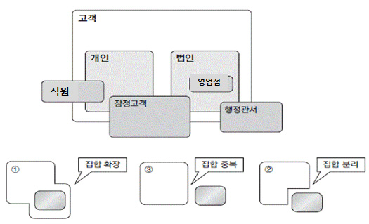
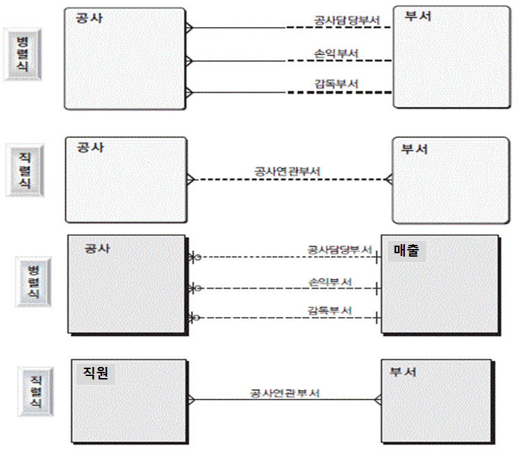
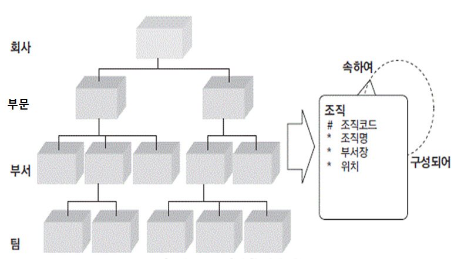
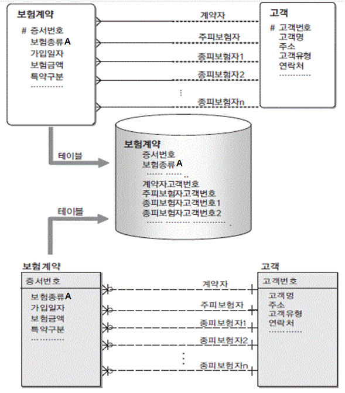
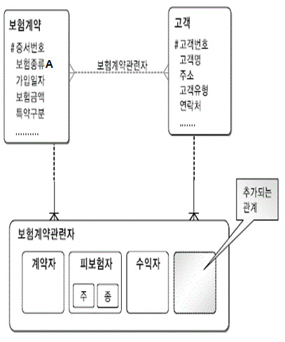
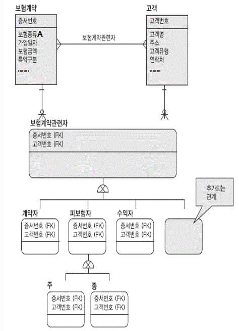
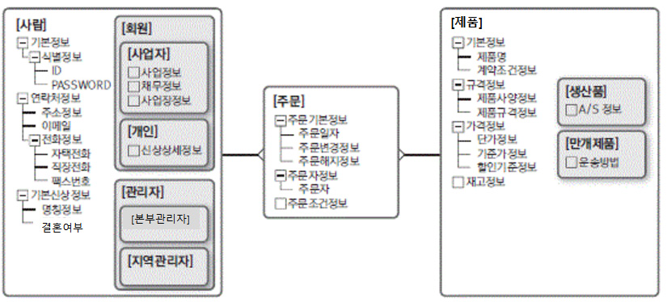

# LM2001020402_개념데이터+모델링

대분류/20

정보통신 중분류/01
정보기술 소분류/02
정보기술개발 세분류/04
DB엔지니어링 능력단위/02

| NCS학습모듈 |
| --- |

개념데이터 모델링

LM2001020402_19v4

[NCS-학습모듈의 위치]

| 정보통신 |  |  |
| --- | --- | --- |
|  | 정보기술 |  |
|  |  | 정보기술개발 |

대분류
중분류
소분류
세분류

| SW아키텍쳐 |  |  | 능력단위 | 학습모듈명 |
| --- | --- | --- | --- | --- |
| 응용SW 엔지니어링 |  |  | 데이터베이스 요구사항 분석 | 데이터베이스 요구사항 분석 |
| 임베디드SW 엔지니어링 |  |  | 개념데이터 모델링 | 개념데이터 모델링 |
| DB엔지니어링 |  |  | 논리 데이터베이스 설계 | 논리 데이터베이스 설계 |
|  |  |  | 논리 데이터베이스 설계 | 논리 데이터베이스 설계 |
| NW엔지니어링 |  |  | 물리 데이터베이스 설계 | 물리 데이터베이스 설계 |
| 보안엔지니어링 |  |  | 데이터베이스 구현 | 데이터베이스 구현 |
|  |  |  | 데이터베이스 성능확보 | 데이터베이스 성능확보 |
|  |  |  | 데이터 전환 설계 | 데이터 전환 설계 |
| 핀테크엔지니어링 |  |  | 데이터 전환 | 데이터 전환 |
| 데이터아키텍처 |  |  | SQL활용 | SQL활용 |
| IoT시스템연동 |  |  | SQL응용 | SQL응용 |
| 인프라스트럭쳐 아키텍처 구축 |  |  | SQL작성 | SQL작성 |

차 례
학습모듈의 개요 1
학습 1. 주제 영역 정의하기
1-1. 데이터 주제 영역 분류 원칙 수립 3
1-2. 데이터 주제 영역 도출 및 정의 11
• 교수⋅학습 방법 18
• 평가 19
학습 2. 핵심 개체 정의하기
2-1. 핵심 개체 정의 21
2-2. 식별자 및 핵심 속성 정의 29
• 교수⋅학습 방법 35
• 평가 36
학습 3. 핵심 관계 정의하기
3-1. 핵심 개체 간 관계 정의 38
• 교수⋅학습 방법 48
• 평가 49
학습 4. 개념 E-R 다이어그램 작성하기
4-1. 개념 E-R 다이어그램 도식화 51
• 교수⋅학습 방법 59
• 평가 60
참고 자료 62
개념데이터 모델링 학습모듈의 개요
학습모듈의 목표
비즈니스 도메인에 대한 데이터 주제 영역을 분류하고 핵심 개체, 식별자, 핵심 속성, 핵심 관계를 도출하
여 개념 E-R 다이어그램으로 표현하고 검증할 수 있다.
선수학습
데이터베이스 요구 사항 분석(LM2001020401_14v2), 논리 데이터베이스 설계(LM2001020403_14v2)
학습모듈의 내용체계

| 학습 | 학습 내용 | NCS 능력단위 요소 |  |
| --- | --- | --- | --- |
|  |  | 코드 번호 | 요소 명칭 |

1-1. 데이터 주제 영역 분류 원칙
수립
1. 주제 영역 정의하기 2001020402_19v4.1 주제 영역 정의하기
1-2. 데이터 주제 영역 도출 및
정의
2-1. 핵심 개체 정의
2. 핵심 개체 정의하기 2001020402_19v4.2 핵심 개체 정의하기
2-2. 식별자 및 핵심 속성 정의
3. 핵심 관계 정의하기 3-1. 핵심 개체 간 관계 정의 2001020402_19v4.3 핵심 관계 정의하기
4. 개념 E-R 다이어그램 개념 E-R 다이어그램
4-1. 개념 E-R 다이어그램 도식화 2001020402_19v4.4
작성하기 작성하기
핵심 용어
주제 영역(Subject Area), 개체(엔티티, Entity), 키 엔티티(Key Entity), 메인 엔티티(Main Entity), 관계
(Relationship) 식별자 (UID, Unique Id, Identifier), 속성 (Attribute), 기수성 (Degree/Cardinality),
선택성(Optionality), E-R 다이어그램(Entity-Relationship Diagram)

| 학습 1 | 주제 영역 정의하기 |
| --- | --- |

학습 2 핵심 개체 정의하기
학습 3 핵심 관계 정의하기
학습 4 개념 E-R 다이어그램 작성하기
1-1.
데이터 주제 영역 분류 원칙 수립
•데이터 관점에 충실하여 데이터 중복을 최소화하고 데이터 확장성을 보장하는 주제 영역 분류
학습 목표
원칙을 정의할 수 있다.
필요 지식 /
① 개념 데이터 모델 (Conceptual Data Model)
개념 데이터 모델이란 업무 요건을 충족하는 데이터의 주제 영역과 핵심 데이터 집합을
정의하고 상호 간의 관계를 정의한 모델을 의미한다.
1. 개념 데이터 모델 정의
조직 또는 사용자의 데이터 요구 사항을 찾고 분석하여 중요한 데이터(자료)와
유지되어야 하는 데이터(자료)를 결정한다.
또한 개체(엔티티, Entity)와 개체와의 관계를 E-R 다이어그램으로 표현하여, 전사의
모든 개체를 상세하게 표현하는 것뿐만 아니라, 핵심 개체를 중심으로 핵심 개체
간의 관계를 정의하고 핵심 개체의 본질을 명확하게 정의하게 된다.
E-R 다이어그램은 조직과 다양한 데이터베이스 사용자에게 어떠한 데이터가
중요한지 나타내기 위해 사용되며, 주로 전 조직에 걸쳐 이루어지는 전사적 데이터
모델링에서 많이 사용된다.
2. 개념 데이터 모델의 중요 기능
개념 데이터 모델을 통해 조직의 데이터 요구 사항을 공식화하며 두 가지 중요한
기능을 지원한다.
(1) 개념 데이터 모델은 각 시스템, 애플리케이션 단계에서 전사 차원의 데이터에 대한 개념을
준수할 수 있도록 기준을 제시하여 특정 데이터에 대한 전사적인 동일 관점을 유지하고
논리 모델 개발 시 모델의 기본 골격을 제공함으로써 기업 내 참조 모델의 역할을 수행한다.
(2) 개념 데이터 모델은 사용자와 시스템 개발자가 데이터 요구 사항을 발견하고 검토하
는 것에 기반한다. 개념 데이터 모델은 추상적이기 때문에 그 모델은 상위의 문제에
대한 구조화를 쉽게 하며, 사용자와 개발자가 시스템 기능에 대해 논의할 수 있는 기
초 자료가 된다.
3. 개념 데이터 모델의 역할
데이터 모델은 데이터 아키텍처의 가장 핵심을 나타내는 부분으로 기업 내에 존재하
는 데이터에 대한 비즈니스 관점의 필요요건과 실제 서비스되는 데이터의 정합성을
일치시키고, 장기적으로 기업의 핵심자산으로 활용될 수 있도록 유지.관리 할 수 있
는 체계를 지원한다. 각 관점별 데이터 모델의 정의는 아래와 같다.
(1) 개괄 데이터 모델링 단계에서는 데이터 모델의 최상위 단계로 기업이 경영 목표를 달성하기
위해 필요한 주요 비즈니스 데이터의 대상 및 범위로서 데이터 주제 영역을 정의한다.
데이터 주제 영역은 전사 데이터 관리에 적용할 전체적이고 일관된 분류기준을 제시하고,
각 시스템별로 분산된 데이터에 대해 전사 관점에서 특정한 데이터 주제로 조망할 수 있는
기준을 제시한다. 이러한 데이터 분류기준을 데이터 분류 기준별 표준 개념,논리 데이터
참조모델의 개발 및 관리의 단위를 제공하여 개별 시스템 간 정보의 상호 운용성을 높이며
신규 시스템 개발 시 참조하여 투자 효율성을 높인다.
(2) 개념 데이터 모델링 단계에서는 기업에서 관리하는 핵심 개체와 개체 간의 주요 구조
를 표현함으로써 기업에서 관리하는 데이터의 골격을 만드는 작업인 개념 데이터 모
델을 표현한다. 실제 구현 단계인 각 시스템, 애플리케이션 단계에서 전사 차원의 데
이터에 대한 개념을 준수할 수 있도록 기준을 제시하여 특정 데이터에 대한 전사적인
동일 관점을 유지하고 논리 모델 개발 시 모델의 기본 골격을 제공함으로써 기업 내
참조 모델의 역할을 수행한다. 이 단계에서 표현되는 모델은 개체와 개체간의 관계를
표현하는 E-R 다이어그램으로 표현되며, 전사의 모든 개체를 상세하게 표현하는 것
이 아니라, 핵심 개체를 중심으로 각 개체 간의 관계를 정의하고 개체의 본질을 명확
히 정의한다.
(3) 논리 데이터베이스 설계 단계에서는 기업 내 각 애플리케이션을 수행하는 데 있어서 필요한
모든 개체와 속성을 표현한다. 기본 구조는 상위 레벨인 개념 모델에서 제시한 구조를 논리
모델의 기본 구조로 적용하여 해당 애플리케이션에서 필요한 개체와 속성에 대한 정의를
하며, 각 개체가 수용하는 데이터의 범위와 정의를 명시한다. 논리 데이터 모델은 특정
하드웨어 및 DBMS 시스템에 관계없이 논리적으로 특정 기능 및 업무를 수행하는 필요한
데이터를 명확히 하는 데 중점을 두어야 하며, 각 개체를 명확히 식별할 수 있도록 표현하고,
각 개체가 포함하는 속성 개개에 대한 비즈니스적인 정의 및 개체간 관계를 명시하고 정규화한
다. 즉, 논리 데이터 모델링 단계에서는 정의한 핵심 개체와 관계를 바탕으로 상세 속성을
정의하고 식별자를 확정하며 정규화와 같은 상세화 과정을 수행하는 것이다.
(4) 마지막으로 물리 데이터베이스 설계 단계에서는 애플리케이션의 실제적인 구현을 목
표로 사용자 또는 프로그램이 직접 접근하여 사용할 수 있는 물리적인 모습으로 표현
되며, 논리 단계에서 정의한 각각의 개체가 이 단계에서 필요에 따라 분할, 병합 또
는 반정규화 등의 작업을 통하여 실제 프로그램 구현 시 직접 데이터를 저장하고, 액
세스되는 테이블 및 파일 형태로 표현된다. 결과적으로 논리 데이터 모델을 기반으로
목표하는 DBMS의 특성 및 구현 환경 등을 감안한 스키마(데이터 구조)를 일정한 기
준과 규칙에 의해 도출하고 칼럼(Column)의 데이터 타입과 크기를 정의한다. 또한
데이터 사용량을 분석 예측하는 과정을 통해 효율적인 데이터베이스가 될 수 있도록
인덱스의 정의 및 역정규화 작업을 수행한다.

[그림 1-1] 데이터 모델 단계
② 주제 영역 (Subject Area)
1. 주제 영역의 정의
주제 영역은 기업이 사용하는 데이터의 최상위 집합이다. 산업별 차이는 존재하나,
예를 들어 제조업의 경우 개발, 구매, 재무, 마케팅 등의 주제 영역이 있을 수 있다.
하나의 주제 영역으로 정의되는 데이터 간의 관계는 밀접하고, 다른 주제 영역에
포함되는 데이터 간의 상호작용은 최소화할 수 있도록 정의되어야 한다. 데이터는
기본적으로 관계 구조로 표현된다. 관계 구조는 데이터 간의 관계가 복수 개로
표현되면서 서로 연결되어 있기 때문에 하향식 분석이 용이하지 않다. 따라서 계획
수립 단계는 하향식 분석을 원칙으로 하되 검증을 위해서는 부분적으로 상향식
분석을 사용한다. 데이터를 하향식으로 분석하기 위한 개념으로 유용한 것이 주제
영역이다. 주제 영역은 계층적으로 표현될 수 있다. 주제 영역을 분해하면 하위
수준의 주제 영역이나 개체가 나타난다.
2. 주제 영역 분류 원칙
주제 영역은 기업 내에서 구성원들이 보편 타당하다고 생각되는 분류 원칙이 세워져
적용되어야 한다. 다음과 같은 원칙이 적용되지 않고, 데이터 주제 영역이 분류되면 데이터
모델의 중복은 물론, 데이터 관리를 위한 기업의 자산이 낭비될 가능성이 높다.
(1) 데이터의 중복 최소화
동일한 기능을 하는 자원(지역 및 정보)이 중복되어 낭비되지 않도록 체계적인 분
류 작업이 필요하다.
(2) 데이터 확장성 보장
가까운 미래의 추가되어지는 정보에 대해 최대한의 확장성을 고려하여 분류체계
가 설계되어야 한다.
(3) 데이터 관련성 및 편의성 확보
(가) 타 자원 (정보 및 지역)의 인접성을 고려해 설계한다.
(나) 고객 편의(정보 요건)를 고려한 자원 내의 핵심적인 데이터 집합에 대한 것을 명시한다.
(다) 핵심 관계에 대한 것도 명시한다.
(라) 필요에 따라서는 표준화된 타 영역의 설계(참조모델)도 참조하여 데이터 분류를 생성한다.
3. 주제 영역 분류 기준
기업 내 데이터의 주제 영역은 아래와 같은 분류 기준으로 데이터의 원자성을 보장
하는 관점에서 분류하는 것을 원칙으로 하며, 업무 요건의 변경 또는 추가로 인한
데이터 구조의 변경이 발생하였을 경우, 유연하게 변경 또는 추가될 수 있도록 하며,
각 영역 간의 분류 수준 및 방식의 균형을 유지하여 분류하는 것이 중요하다.
(1) 데이터의 관점의 분류
(가) 업무의 주체, 대상 및 행위 등의 데이터 관점에서 데이터를 생성시키고 사용하는
유형에 근거한 분류로 데이터와 업무 영역의 개념이 혼재되지 않도록 한다.
(나) 데이터와 시스템/애플리케이션 간의 독립성이 계속 증가되는 추세 하에서는 더욱
더 장기적이고 전사적인 관점에서 데이터 유사성을 고려하여야 한다.
(다) 시스템이나 애플리케이션이 다르더라도 동일한 유형의 데이터를 유사한 방식으로 활용한
다면 이를 동일한 영역으로 분류하여 통합된 관점에서 데이터를 관리하여야 한다.
(2) 업무 요건 추가에 대한 유연성 보장
(가) 업무 요건의 변경이나 추가 시 유연성을 보장할 수 있도록 전사 분류 체계를 설정한다.
(나) 업무 요건 변경에 대해서 데이터 구조의 변경을 최소화하려면 동일한 유형의 데
이터를 본질이 희석되지 않는 한도 내에서 최대한 집합으로 통합해야 한다. 이렇
게 함으로써 모델의 유연성과 확장성, 융통성이 보장되어 신규, 추가 요건에 대해
기존의 분류 구조에 적절하게 수용될 수 있다.
(3) 주제 영역 간 균형 유지
(가) 데이터 분류는 일부분에 국한된 것이 아니고 전체적인 균형을 유지하는 것이 중
요하다.
(나) 특정 부분을 너무 상세하게 분류하거나, 분류 방식이 다른 방식으로 되어 있으면
전체적인 혼란을 야기할 수 있다.
(다) 데이터 분류에 대한 추가나 변경이 발생할 경우 해당 부분만을 고려하여 수행하
기보다는 타 영역의 분류 체계와의 형평성 및 균형을 고려하여 분류 구조를 관리
한다.
4. 주제 영역 명명 규칙
(1) 실 업무에서 보편적으로 사용하는 업무 용어를 부여하는 것이 바람직하다.
예: 개발, 구매, 재무, 마케팅, 판매 등
(2) 유일한 단수형 명사를 사용한다.
(3) 업무 활동(Activity)을 의미하는 이름을 배제하고 데이터의 그룹을 의미하는 이름을
부여한다.
수행 내용 / 데이터 주제 영역 분류 원칙 수립하기
재료·자료
• 현행 E-R 다이어그램, 현행 DB 스키마, 현행 직무 기술서, 조직도, 데이터베이스 요구 사
항 분석서
기기(장비･공구)
• 컴퓨터, 소프트웨어(데이터 모델링 도구, 문서 작성 도구)
안전･유의 사항
• 데이터 모델링에서 사용하는 용어들에 대해 국제적인 표준화가 되어있지 않아 DBMS 공
급업체나 전문 개발자들 사이에 약간의 차이가 존재할 수 있음을 유의한다.
• 용어들이 한글화된 용어와 외래어가 혼용하고 사용되고 있으나 본 학습모듈에서는 한글화된
용어를 표준으로 사용하고 있음을 유의한다.
수행 순서
① 데이터 현황분석을 수행한다.
1. 현행 데이터 아키텍처 관련 자료를 수집한다.
(1) 현행 데이터 아키텍처를 작성하기 위한 데이터 현황 자료 수집이 우선이며, 반드시
필수 자료를 현업에게 요청하여 수집할 수 있도록 하여야 한다.
(2) 빠짐없는 정보 수집을 위해서는 인터뷰 및 최대한의 관련 자료를 분석하여야 한다.
(3) 현업에게 자료를 요청하기 위해서는 사전에 자료 목록 및 자료 작성을 위한 템플릿을
제공하여 혼동이 없도록 하며, 현업 내에서 적절한 담당자를 선정하여 일정과 자료의
품질에 대한 관리를 할 수 있도록 한다.
(4) 현업에게 반드시 요청하여 제공받아야 하는 자료는 아래와 같으며, 존재하지 않은 경
우 이에 준하는 문서를 수집하여 제공받을 수 있도록 하여야 한다.
(가) 현행 E-R 다이어그램
(나) 현행 DB 스키마
(다) 현행 직무 기술서, 조직도
(라) 데이터베이스 요구 사항 분석서 등
(5) 현행 데이터 아키텍처의 작성(수립)은 현행 데이터 아키텍처가 갖는 다양한 특성과 장
단점, 문제점 등을 제대로 밝혀내서 취할 것, 버릴 것, 부족한 것을 명확하게 구별해
야 한다. 이를 현행 데이터 관련 각종 자료의 수집과 분석, 인터뷰와 설문조사 등을
통해 도출된 현행 데이터 분석 내용을 종합하여 현행 정보 시스템의 고도화를 위한
아키텍처 수립 및 새로운 정보 시스템 구축을 위한 아키텍처 수립에서 데이터 관점의
시사점을 도출하고 방향성 제시의 근거를 마련하기 위한 것이다.
2. 현행 데이터 아키텍처를 수립하고 분석한다.
(1) 현행 데이터 아키텍처의 수립 범위는 현행 정보 시스템 전체 범위를 대상으로 하거
나, 현행 정보 시스템에서 가장 큰 문제점을 안고 있는 아키텍처 부분만을 대상으로
설정해 현행 데이터 아키텍처를 수립할 수 있다.
(2) 전체 또는 일부 영역에 대한 데이터 아키텍처 수립일지라도 현행 데이터에 대한 자료
의 수집과 분석을 통해서 현행 데이터 주제 영역을 작성하고 현행 데이터 아키텍처를
도출하여 문제점 및 시사점을 도출하는 일련의 수립 절차는 동일하다.
(3) 하지만 일반적인 EA 프레임워크 상의 Planner, Owner, Designer, Builder 수준까
지 상세화 수준을 도출하는 것은 사업의 성격, 시간적 제약 등으로 모든 데이터 영역
에 대한 작업이 어려울 수 있으므로, 현행 데이터 아키텍처 수립은 전체 범위에 대해
서는 Planner, Owner 수준에서 작성하고, 핵심 영역에 대해서는 Designer,
Builder 수준까지 상세한 수준의 아키텍처를 도출하는 것이 대안이 될 수 있으며, 일
반적이다.
(4) 어떤 업무영역에 대해서 상세한 수준까지 데이터 아키텍처를 도출할지는 [표 1-1] 에
서와 같은 평가 요소에 의해서 현행 정보 시스템의 각 업무 영역을 평가한 후 우선순
위에 의해서 핵심영역을 선정하여 추진하는 것이 바람직하다.
<표 1-1> 현행 데이터 아키텍처 도출을 위한 평가요소
평가 요소 (데이터 중심) 설명
업무범위의 주체와 대상인가? 핵심 업무 행위의 주체와 대상에 대한 아키텍처 도출
모든 업무 행위 중 핵심 업무 행위를 식별하여 이에 대한 상
핵심 업무 행위인가?
세한 수준의 아키텍처 도출
핵심 업무 행위의 주체 및 대상, 업무 행위 자체가 아니더라
대량의 데이터를 관리하는가? 도 대량의 데이터를 관리할 필요가 있는 경우 시스템에 미치
는 영향이 클 수 있으므로 이에 대한 아키텍처 도출
정보로 활용되는 빈도가 정보로서 활용 빈도가 높은 데이터는 상세 수준의 철자한 아
높은가? 키텍처 도출이 필요함.
적정 수준 이상을 만족하여야 하나, 특정 업무에서는 매우 철
데이터 품질이 매우 중요한
저하게 품질이 관리되어야 할 필요성이 있으므로 이에 대한
업무 영역인가?
아키텍처를 도출할 필요성이 있음.
실시간 또는 배치 프로세스상에서 기대 수준 이하의 성능을
시스템 성능 저하에 영향을
유발하는 데이터에 대해서는 Builder수준의 상세한 아키텍처
미치는가?
도출이 필요함.
3. 현행 주제 영역을 분석한다.
(1) 현행 주제 영역은 하향식(Top-Down) 접근에 의해 세분화하며, 이미 존재하는 현행
E-R 다이어그램과 DB 스키마 정보 등 각종 자료 등을 이용하여 논리 및 개념 모델
을 도출하는 상향식(Bottom-Up) 접근을 활용한다.
(2) 현행 핵심 주제 영역에 대해서는 현행 논리, 물리 데이터 모델수준의 분석이 필요하
며, 현행 데이터 모델에 대한 자료가 명확하지 않거나, 현행화되어 있지 않은 경우
리버스 모델링(Reverse Modeling)을 통하여 현행 정보 시스템이 안고 있는 구체적
인 문제점을 도출하여 기업의 데이터 구조, 흐름, 현재 가지고 있는 문제점을 도출하
여 기업의 데이터 구조, 흐름, 분산 정도 및 데이터 특성에 대해서 상세한 수준까지
파악하고, 이러한 문제점들에 대한 발생 원인을 분석하여 현행 정보 시스템의 고도화
및 새로운 정보 시스템 구축을 위한 아키텍처가 갖추어야 할 구체적인 방향에 대한
힌트를 제공하는 시사점을 도출한다.
(3) 현행 주제 영역 작성 시에는 현업 담당자와의 인터뷰를 통하여 검토하여 누락된 영역
과 구성요소가 없는지 확인한다.
(4) 도출된 시사점들은 개선 또는 새로운 정보 시스템이 갖추어야 할 요건에 대한 방향성
을 결정하는 중요한 요소이며, 반드시 반영하거나 고려해야 할 사항들은 가급적 상세
한 수준까지 해결 방향을 제시하여야 한다.
② 주제 영역 분류 원칙을 수립하고 기준을 도출한다.
1. 주제 영역 분류 원칙을 수립한다.
전사 데이터를 특정 시스템 및 개별 기능에 종속되지 않은 독립적인 데이터 중심의
전체적이고 일관된 분류 기준을 제시한다.
2. 주제 영역 분류를 위한 기준을 도출한다.
(1) 전사 데이터 관리 적용할 전체적이고 일관된 분류 기준을 제시한다.
(2) 전사 데이터를 특정한 주제로 전체적인 관점에서 조망할 수 있는 기준을 제시한다.
수행 tip
• 리버스 모델링(Reverse Modeling)이란
- 기존 시스템의 모델 비 보유 혹은 미 현행화 시에
시스템의 메타 정보를 활용하여 모델을 작성하는 것
으로 데이터 모델링 도구를 활용하여 DBMS
Dictionary 혹은 기존 산출물을 통해 메타 정보를
수집하여 이 정보를 토대로 테이블과 칼럼을 분석한
후 이들의 관계를 파악하여 모델을 작성하는 것을
말한다.
1-2.
데이터 주제 영역 도출 및 정의
• 주제 영역 도출 방법에 따라 주제 영역을 계층적으로 분류하고 주제 영역 간 균형을 유지
하며 정의할 수 있다.
학습 목표
• 주제 영역 계층 수준, 주제 영역명, 단위 주제 영역 설명, 대표 개체를 표현하는 주제 영역
정의서를 작성할 수 있다.
필요 지식 /
① 데이터 주제 영역의 분류 기준
데이터 주제 영역은 키(Key) 주제 영역과 메인(Main) 주제 영역으로 구분할 수 있으며
주제 영역 선정을 위한 분석 대상 데이터는 지속성이 있는 데이터, 업무 기능을 지원하
기 위한 비즈니스 데이터, 다른 데이터들로부터 유도될 수 있는 데이터가 아닌 원천을
대상으로 한다.

[그림 1-2] 데이터 주제 영역 분류 기준
1. 주제 영역의 종류 및 대상 데이터
(1) 키 주제 영역은 비즈니스의 주체와 대상, 이를 지원하는 자원 및 장소에 관련 영역으
로 기능이나 데이터 발생에 종속성이 없는 영역을 의미한다.
(2) 메인 주제 영역은 키 데이터 주제 영역들이 관계한 사실을 바탕으로 상태, 방법, 행
위 등을 설명하기 위한 비즈니스 정보가 대상이며, 일반적인 기능 목적과 정보 속성
에 따라 분류에 국한되는 것이 아니라 향하 데이터의 통합 및 분산, 표준 및 품질 등
에 관련된 사항도 포함하여야 한다.
<표 1-2 > 키 데이터 주제 영역 선정 기준 (예시)
주제 영역 선정 기준 기대 효과
통합 고객 정보를 지원하고 활용하기
고객 정보의 일관성, 즉시성, 정합성을
이해관계자 위한 전사적인 고객 데이터 구조 정의
유지하며 동일한 뷰를 제공함.
가 필요함.
전사 관점에서 내.외부 조직 정보와 조 전사적인 조직의 관계 체계, 집계 기준,
조직
직 간의 관계를 제공하기 위함 관리 단위의 정보를 동일하게 제공
원활한 데이터 교환을 수행할 수 있는
정보 분석을 위한 코드의 품질향상과
공통 기준 코드 품질을 제공하고, 정보의 재사용
기준 정의
성을 향상함.
자산을 식별하고 관리하는 기준을 제공하 담보물, 내부 자산등의 데이터 정확도
자산
여 자산 정보의 신뢰도를 높이기 위함. 를 높여 제공정보의 신뢰도 향상
외부에서 제공되는 지역적인 정보와 내
위치 채널, 가상 공간, 실세계 위치 및 경로
부에서 관리 기준을 가지고 정의한 위
(장소) 를 통합하여 관리 가능하게 함
치 및 경로 정보를 제공하기 위함
정보 분석을 위한 코드의 품질향상과 전사적인 조직의 관리 체계, 집계 기준,
공통 기준
기준정의 관리 단위의 정보를 동일하게 제공
② 데이터 주제 영역의 분류
1. 1차 분류: 주요 데이터 집합의 유형 정의
(1) 정의
(가) 기존의 시스템별로 제공되는 데이터의 성격 및 특성을 고려하여 영역을 분류한다.
(나) 업무에 변화에 민감하지 않도록 정의한다.
(2) 1차 분류(예시)
(가) 데이터를 발생시키는 주체로서의 분류: 관계자, 상품과 서비스, 자산, 채널 등
(나) 데이터를 발생시키는 주체 간의 상호 작용으로 발생하는 대상으로서의 분류: 계
약, 리스크, 상품, 조건 등
(다) 공통 및 관리 성격의 상위 개념으로서의 분류: 경영 관리(정보, 방침, 지원 등)
2. 2차 분류: 비즈니스 활동에 필요한 데이터 분류
(1) 정의
(가) 비즈니스 활동에 필요한 분석 주제와 현황 등의 영역으로 분류한다.
(나) 기본, 상세, 관계 등과 같은 데이터의 기능적 구성 관점에서 접근하여 1차 분류를
세분화한다.
(다) 업무 변화 수용의 융통성을 반영하여 정의한다.
(2) 2차 분류 (예시)
(가) 관계자: 관계자 기본, 관계자 상세, 관계자 관계, 관계자 분류 등
3. 3차 분류: 2차 영역의 세부 주제 영역 분류
(1) 정의
(가) 비즈니스 활동에 필요한 분석 주제와 현황 등의 영역으로 분류한다.
(나) 사용자에게 제공되는 실제 데이터로서의 관점에 근거하여 정의한다.
(다) 업무적인 관점에서 분류한다.
(2) 3차 분류(예시)
(가) 관계자(기본): 고객, 법인, 조직, 직원 등
(나) 계약(기본): 수신 계약, 예금 계약, 신탁 계약 등
③ 데이터 주제 영역의 효용
To-Be 데이터 주제 영역의 효율성은 구축에 있는 것이 아니라 지속적이 운영 관리를
통한 현행화에 있다. 또한 전사 차원에서 보유하고 있거나 보유 예정 데이터를 분류,
식별 가능하게 정의하고 관련 데이터 모델의 구축은 일회성으로 끝나는 것이 아니라 지
속적으로 관리되고 보완하여 시간을 절약할 수 있다.
1. 목적
(1) 데이터의 계층적 구조를 파악하는 데 도움이 된다.
(2) 업무 기능과 병행하여 분석하는 경우 분석의 최상위 단위 역할을 하여 품질 확보에
기여한다.
2. 장점
(1) 데이터 및 업무 활동 모델의 품질 보증의 기초 자료가 된다.
(2) 데이터의 그룹, 분석의 최상위 단위 역할로 단위별 관리가 가능케 되어 프로젝트 관
리에 용이하다.
(3) 단위별 모델 개발 조정이 용이하다.
(4) 데이터 저장소 (Repository) 관리 단위가 주제 영역으로 정의되어 개념, 논리, 물리
적으로 용이하다.
④ 데이터 주제 영역 목록 및 정의 항목
1. 데이터 주제 영역 목록
주제 영역의 계층 수준을 레벨이라 하여 1차, 2차...., 단위 또는 최상위, 단위 주제
영역으로 계층 분류한다.
(1) 최상위 주제 영역 (Root Subject Area)
(가) 분석 대상 영역의 전체 범위
예시: “**생명주식회사” 혹은 “보험 계약”
(2) 단위 주제 영역 (Primitive Subject Area)
(가) 더 이상 주제 영역을 포함하지 않고, 엔티티 타입과 관계로 구성된 최하위 주제
영역 (일반적으로 3~4차가 대상이 됨)
(나) 핵심 엔티티 타입이 존재
(다) 단위 업무 기능(Primitive Function)과 대응
2. 데이터 주제 영역 정의 항목
데이터 주제 영역의 정의항목은 아래 <표 1-3 > 과 같다.
<표 1-3> 데이터 주제 영역 정의항목 (주제 영역 정의서)
레벨 주제 영역명 정의 항목 설명
설명 주제 영역에 대한 설명
범위 각 주제 영역별 관리 대상 데이터의 범위
정의
주제 영역별 분류되는 정보 유형이나
분류
대표/핵심 개체
모델 관점 주제 영역내에서 모델링 전환시 고려 사항
통합/분산 데이터의 통합 및 분산 시 고려 사항
고려
관점 애플리케이션/시스템 구축시 고려 사항
사항
(레벨) (주제 영역명)
표준/품질 개발, 유지 보수 시 표준 및 품질관점에서의
관점 고려사항
현재 사용하고 있는 데이터 구조 및 내용
현행 데이터
예시, 특징 및 제약 사항
관련 관련
관련 To-Be 애플리케이션
사항 애플리케이션
주제 영역별 사례 모델 또는 주요 실체의 기준
사례 모델
모델
수행 내용 / 데이터 주제 영역 도출 및 정의하기
재료·자료
• 현행 E-R 다이어그램, 데이터 주제 영역 분류 원칙
기기(장비･공구)
• 컴퓨터, 소프트웨어(데이터 모델링 도구, 문서 작성 도구)
수행 순서
① 데이터 주제 영역을 아래와 같은 접근 방식으로 도출한다.

[그림 1-3] 데이터 주제 영역 정의 절차
1. 업무에서 사용하는 데이터의 명사형을 도출한다.
정보 수집 소스로부터 명사형을 찾는다.
2. 업무 기능의 이름으로부터 도출한다.
데이터와 업무 활동의 상호 보완 관계를 형성한다.
3. 하향식(Top-down) 접근 방법으로 도출한다.
주제 영역에서 출발하여 개체(엔티티) 타입으로 전개한다.
4. 상향식(Bottom-up)접근 방법
개체(엔티티) 타입을 그룹핑하여 주제 영역 도출한다.
5. 분석 단계에서의 도출
아키텍처 모델을 정련하는 과정에서 도출한다.
② 데이터 주제 영역을 분류한다.
1. 시스템과 업무 규모를 반영하여 도출된 주제 영역을 분류하고 세분화한다.
(1) 주요 데이터의 성격 및 발생 주체별 특성을 고려하여 1차 분류를 수행한다.
(2) 비즈니스 활동에 필요한 데이터 2차 분류로 데이터의 기능적 구성 관점에서 1차 분
류를 세분화한다.
(3) 2차 영역의 세부 주제 영역 분류인 3차 분류를 사용자에게 제공되는 실제 데이터로
서의 업무적 관점에서 분류한다.

[그림 1-4] 데이터 주제 영역 분류/세분화(예시)
③ 데이터 주제 영역 목록 및 정의서를 작성한다.
1. 데이터 주제 영역 목록의 내용은 아래와 같으며, 정의서에는 아래 목록을 포함하여 작성
한다.
(1) 레벨: 주제 영역의 계층 수준 (1차, 2차, ...., 단위)
(2) 주제 영역명
(3) 정의 항목 : 정의, 고려 사항, 관련 사항 등
(4) 설명(단위 주제 영역의 경우 상세히 표현)

[그림 1-5] 데이터 주제 영역 정의서 (예시)
수행 tip
• 새로운 시스템을 구축하고자 할 경우에는 하향식(Top-
down) 분석이 용이하며, 기존의 시스템을 개선하거나
체계화하고자 할 경우에는 상향식(Bottom-Up) 방식
이 용이하다.

| 학습 1 | 교수·학습 방법 |
| --- | --- |

교수 방법
• 데이터 아키텍처상에서의 개념 데이터 모델링의 개념, 역할과 기능을 교육한다.
• 현행 데이터 아키텍처를 수립하고 분석하여 시사점을 도출할 수 있도록 그의 분석방법과
시사점 도출 방안을 교육한다.
• 도출된 시사점의 개선 사항을 새로운 시스템에 반영할 수 있는 방안과 절차를 교육한다.
• 기업 내 데이터들의 분류방법 및 그 체계에 대한 개념을 설명한다.
• 주제 영역에 대한 개념을 교육하고, 주제 영역 도출을 위한 주제 영역의 분류 원칙 및 기
준의 정의와 수립방법을 교육한다.
• 주제 영역의 도출 방법을 교육한다.
• 주제 영역 정의서 작성 방법을 교육한다.
학습 방법
• 개념 데이터 모델링의 개념과 데이터 아키텍처상에서의 역할과 기능을 이해한다.
• 현행 데이터 아키텍처를 수립하거나 분석하기 위한 자료 수집 목록을 숙지하고 자료별 적
용방안을 학습한다.
• 수집된 자료를 통한 분석 방안을 학습하며, 분석을 통해 의미 있는 시사점 도출을 통해
새로운 시스템에 반영하여 개선할 수 있는 방안을 학습한다.
.• 개념 데이터 모델에서 주제 영역에 대한 개념을 학습한다.
• 주제 영역의 분류 원칙 및 기준 정의 방법과 도출 방법을 학습한다.
• 도출된 주제 영역에 대해 현업과의 리뷰를 통하여 검증하여 새로운 시스템에 반영할 수
있는 방안을 학습한다.
• 주제 영역 정의서 작성 방법을 학습하여 실제 도출하고 작성한다.

| 학습 1 | 평 가 |
| --- | --- |

평가 준거
• 평가자는 학습자가 학습 목표를 성공적으로 달성하였는지를 평가해야 한다.
• 평가자는 다음 사항을 평가해야 한다.

| 학습 내용 | 학습 목표 | 성취수준 |  |  |
| --- | --- | --- | --- | --- |
|  |  | 상 | 중 | 하 |

데이터 주제 영역 - 데이터 관점에 충실하여 데이터 중복을 최소화하고 데이터
분류 원칙 수립 확장성을 보장하는 주제 영역 분류 원칙을 정의할 수 있다.
- 주제 영역 도출 방법에 따라 주제 영역을 계층적으로 분류하
고 주제영역 간 균형을 유지하며 정의할 수 있다.
데이터 주제 영역
도출 및 정의
- 주제 영역 계층 수준, 주제 영역명, 단위 주제 영역 설명,
대표 개체를 표현하는 주제 영역 정의서를 작성할 수 있다.
평가 방법
• 평가자 질문

| 학습 내용 | 평가 항목 | 성취수준 |  |  |
| --- | --- | --- | --- | --- |
|  |  | 상 | 중 | 하 |

-데이터 관점에 충실하여 데이터 중복을 최소화하기 위한 체
데이터 주제 영역 계적인 분류 작업의 능력을 평가함
분류 원칙 수립 -데이터 확장성을 보장하는 주제 영역 분류 원칙과 분류체계
가 설계되었는지를 평가함.
-주제 영역 방법에 따라 주제 영역을 계층적으로 분류하고
주제 영역 간 균형을 유지하며 정의할 수 있는지를 질문함.
-타 영역의 분류체계와 형평성 및 균형을 고려하여 분류 구
조를 관리할 수 있는지를 평가함.
데이터 주제 영역
도출 및 정의
-주제 영역 계층 수준, 주제 영역명, 단위 주제 영역 설명, 대표
개체를 표현하는 주제 영역 정의서 작성 능력을 평가함.
-작성된 주제 영역서가 데이터 구성 및 통합에 대한 방향 제
시를 할 수 있도록 지속적 관리 체계의 구성여부를 질문함.
• 평가자 체크리스트

| 학습 내용 | 평가 항목 | 성취수준 |  |  |
| --- | --- | --- | --- | --- |
|  |  | 상 | 중 | 하 |

| 데이터 주제 영역분류 원칙 수립 데이터 주제 영역도출 및 정의 피드백 | - 주제 영역 계층 수준, 주제 영역 명, 단위 주제 영역 설명, 대표개체를 표현하는 주제 영역 정의서를 작성 능력을 평가함. |  |  |
| --- | --- | --- | --- |
| 1. 평가자 질문- 개념 데이터 - 현행 데이터 - 주제 영역의 | 모델의 역할과 기능에 대한 이해도를 확인한다. 아키텍처 분석 및 시사점 도출에 대한 중요성을 이해하고 답하는지를개념과 분류 원칙, 기준, 도출 방법 등을 충분히 이해하고 답하는지를 | 확인한다. 확인한다. |  |
| 2. 평가자 체크리스트- 현행 데이터 - 주제 영역 정의서 | 아키텍처 분석을 위한 자료 수집 목록과 수립 방안에 대한 절차를작성시, 주제 영역명, 계층 등을 정확하게 적용하고 표기했는지를 | 확인한다. 확인한다. |  |

학습 1 주제 영역 정의하기

| 학습 2 | 핵심 개체 정의하기 |
| --- | --- |

학습 3 핵심 관계 정의하기
학습 4 개념 E-R 다이어그램 작성하기
2-1.
핵심 개체 정의
• 업무 활동상 관리 대상이며 데이터 동질성과 독립성을 가지고 다수 행과 열로 표현되는 후보
개체를 식별할 수 있다.
• 후보 개체에서 주제 영역을 대표할 수 있는 행위의 주체 또는 대상이 될 수 있는 독립적인
학습 목표
기본 개체를 정의할 수 있다.
• 후보 개체에서 주제 영역을 대표할 수 있는 기본 개체의 행위로 표현되며 다수의 자식 개체
를 가지는 업무의 중심 개체를 정의할 수 있다.
필요 지식 /
① 개체(엔티티, Entity) 정의
1. 정의
(1) 개체(엔티티, Entity)란 업무 활동상 지속적인 관심을 가지고 있어야 하는 대상으로서
그 대상에 대한 데이터를 저장할 수 있고 대상들 간의 동질성을 지닌 개체 또는 행위
의 집합을 의미한다.
(2) 개체를 정의할 때는 어떤 대상이 그 개체에 속하는지 혹은 속하지 않는지를 명확하게
정의할 수 있어야 한다.
2. 정의의 조건
(1) 우리가 관리하고자 하는 것인지를 확인한다.
(2) 가로와 세로를 가진 면적(집합)의 개념인지를 확인한다(주로 명사로 표현되며, 집합의
개념이 있다.)
(3) 대상 개체들 간의 동질성이 있는지를 확인한다.
(4) 다른 개체와 확연히 구분되는 독립성을 가지는지를 확인한다.
(5) 순수한 개체이거나 개체가 행위를 한 행위 집합인지를 확인한다.

| 학습 내용 | 평가 항목 | 성취수준 |  |  |
| --- | --- | --- | --- | --- |
| ② 후보 개체(Entity)후보 개체 수집 사용하는 장표 및관련 서적을 활용할만약, 프로세스 흐름도 내의 데이터현업 담당자들이개발자와 모델러 | 수집 방법으로는, 기존 시스템이 존재할 경우 시스템 도큐먼트가보고서가 있다. 또한 현업 인터뷰를 통해 후보 개체를수도 있다. 모델링이 데이터 모델링보다 먼저 수행되어 자료 흐름도가스토어가 후보 개체가 되기도 한다. 기안한 각종 보고 자료 및 현장에 가서 직접 업무를간의 동일한 업무 수준을 가지게 되어 의사소통에 | 있고,도출할함께 도움이 | 수도정의되었으면,조사하는되기도 | 현업에서있으며,것도한다. |
| 1. 기존 시스템 시스템 도큐먼트에는부터 사용자를 | 도큐먼트 데이터 구조 및 프로세스 명세들이 나타나 있는위한 지침서에 이르기까지 다양한 도큐먼트가 있다. | 설계 |  | 자료에서 |
| 2. 현업 장표/보고서현업 업무의 많은 종류의 료가 되는 정보가필요한지를 | 효과적인 처리를 위한 장표와 처리된 업무의 집계, 분석,보고서가 존재한다. 이러한 장표나 보고서에서 개체를무엇인지, 이 자료를 만들기 위한 어떤 본질적인분석해야 한다. |  | 관리를선별하려면데이터의 | 위해서원재집이 |
| 3. 현업 인터뷰 후보 개체를 법이며, 사전에통해 최대한 많은 | 도출하기 위해서는 현업 담당자와의 인터뷰를 시작하는충분한 자료 분석을 통해 현업 담당자와의 인터뷰정보를 얻을 수 있도록 한다. | 것이시 | 최선의많은 | 방질문을 |
| 4. 관련 전문 서적기존 자료 및된 전문 서적을 | 현업 인터뷰를 통해 얻을 수 있는 정보의 한계를 참고하도록 한다. | 극복하기 | 위해 | 관련 |
| 5. 데이터 흐름도업무 파악 및데이터 저장소와 | 시스템 분석을 위한 기능 설계를 데이터 흐름도로 작성했다면,데이터 사전에 있는 정보를 이용하여 후보 개체를 | 도출할 | 여기에수 | 있는있다. |
| 6. 타/유사 시스템관계사 또는 유사쉽게 찾을 수 | 업종의 시스템 도큐먼트를 입수하여 참조하는 있는 방법이다. | 방법은 | 후보 | 개체를 |
| 7. 현장 조사 모델러와 개발자간의만들기 위해서는 | 공통적인 의사소통 수단(Communication본격적인 모델링 작업 전에 현장 조사를 실시하는 | Protocol)을것이 | 좋다. | 쉽게 |
| ③ 후보 개체 식별 다양한 경로를 통해단 기준으로 후보후보 개체 식별은 | 후보 개체를 수집하는 과정에서 가장 중요한 것은개체를 식별할 것인가에 대한 것이다. 다음의 세 가지 단계에 대한 검증을 통해 객관화될 | 이들수 있다. | 중 | 어떤 판 |
| 1. 후보 개체의 개념후보 개체로 검토한 집합이 검토를 진행하도록 | 정립을 명확히 한다. 대상된 최초 상태는 단어에 불과하지만, 이 단어가무엇인지를 정의해야 한다. 구체적 집합을 정의한 다음,한다. | 다음 | 의미하는단계에 | 진정대한 |
| 2. 현재 관리 또는후보 개체로 과연 이 후보하고 있는 것뿐만재 관리하고 정도 매우 전략적인 | 향후 관리 여부를 확인하여 후보 개체를 식별한다. 선정하기 위해 개념을 정립해 둔 단어에 대해 검토해야개체가 관리하고자 하는 대상이 맞는지를 확인하는아니라 앞으로는 관리해야 할 것을 모두 포함하고있다는 것을 확인하는 것도 쉽지 않지만, 앞으로 관리할판단이 필요하다. | 할일이다.있다. | 첫현재것에 | 작업은관리사실 현대한 결 |
| 3. 집합 개념 여부를개체는 집합이어야고자 하는 대상이④ 수집된 후보 우선 적용 대상 이터 영역별 분류를 | 확인한다. 하지만 모든 집합이 모두 개체화되는 것은 아니기집합이 되는지의 여부만 확인한다. 개체(Entity)의 분류 분류를 통하여 식별된 후보 개체를 분류하여 핵심 통해 선별된 핵심 개체를 데이터 영역별로 분류한다. | 개체를 | 때문에선별하고, | 검토하데 |
| 1. 우선 적용 대상식별된 후보 의하여 키 티티들을 액션 | 분류를 수행한다. 개체를 선별하여 주요 개체를 먼저 도출한다. 도출된엔티티(Key Entity)와 메인 엔티티(Main Entity)로 엔티티(Action Entity)로 분류한다. | 개체들은분류하고, | 나머지 | 기준에엔 |
| (1) 키 엔티티(Key | Entity) |  |  |  |
| (가) 부모를 | 가지지 않는 독립적인 엔티티이다. |  |  |  |
| (나) 키 엔티티는 | 전체 E-R 다이어그램(개체-관계도)에서 가장 주어가 |  | 되는 | 엔티티들 |
| 이다.이것은 | 예를 들어 사원과 일대다 관계를 맺는 부서라는 엔티티가릴레이션십의 문제로 실제 사원 데이터가 발생하는 것과는 | 있을 | 수아무런 | 있지만연관이 |
| 없다.받는 | 그리고 부서가 없는 사원도 있을 수 있다(일반적으로 신입도중에는 부서가 없다.) |  | 사원으로 | 연수를 |
| (다) 엔티티다른 티티들에서예: 사원, 고객, | 후보들을 찾을 때, 가장 우선해서 키 엔티티들을 찾아내야엔티티들을 파생시킬 수 있다(찾아내지 못한 키 엔티티들은도출될 수도 있다). 강좌, 학생, 교수, 상품, 계정 | 한다.나중에 |  | 그래야만다른 엔 |
| (2) 메인 엔티티(Main | Entity) |  |  |  |
| (가) 부모를 | 가지지만 스스로 업무의 핵심이 되어서 많은 자손 | 엔티티들을 | 가지는 | 엔 |
| 티티이다. |  |  |  |  |
| (나) 업무에는우, 주문 또한 다른예: 주문, | 이러한 데이터들이 많이 존재한다. 예를 들어 주문과상품이나 고객과 같은 주문이라는 데이터를 낳게 한 부모들을엔티티는 다른 엔티티들에서 파생된 엔티티이기는 하지만엔티티들을 많이 파생시키기도 한다. 가입 계약, 납입 계약, 보험 계약, 예금 원장 등 | 같은업무의 | 엔티티의가지고 | 경있다.중심으로, |
| (3) 액션 엔티티 | (Action Entity) |  |  |  |
| (가) 키 엔티티나 | 메인 엔티티가 아닌 나머지를 액션 엔티티라고 한다. |  |  |  |
| (나) 액션 는 기록을 | 엔티티는 메인 엔티티에서 파생되어 나온 엔티티들이다.엔티티에서 파생되어 나온 주문 상세 엔티티 또는, 키 관리하는 접속 기록 엔티티와 같은 경우가 그 예이다. | 예를엔티티인 | 들어 고객의 | 주문이라접속 |
| (다) 액션 예: 주문 | 엔티티들도 나중에 업무가 변화하고 확장되면 메인 엔티티로상세, 접속 기록 등 | 향상될 | 수 | 있다. |
| 2. 데이터 주제 영역별분류된 키 분류하여 해당<표 2-1> 데이터 주제모델 사람 물품 이벤트 위치 개념 재무 조직 | 분류를 수행한다. 엔티티(Key Entity)와 메인 엔티티(Main Entity)를 데이터주제 영역에 배치한다. 영역별 분류 (예시) 대상 후보 개체 직원, 고객, 가입자, 회원, 학생, 교사, 환자, 의사 등 부품, 원재료, 연료, 저장품, 상품, 건물 등 계약, 수주, 주문, 발주, 재해, 고장, 입고 등 창고, 생산 라인, 행정 구역, 하천, 선거구, 공항 등 판매 목표, 생산 계획, 평가 기준, 할인 기준 등 입금, 청구, 차입금, 예적금, 예산, 융자, 대출 등 부서, 판매망, 채널, 거래처, 법인 조직, 대리점 등 | 주제 |  | 영역별로 |
| ⑤ 핵심 개체의 선정분류된 키 엔티티와하여 핵심 개체를 | 메인 엔티티를 가지고 핵심 개체로서의 조건을 선정하고 정의한다. | 만족하는지 | 확인 |  |
| 1. 개체의 특성 또는 | 속성을 제거한다. |  |  |  |
| 2. 중복된 명사를 | 제거한다. |  |  |  |
| 3. 주제 영역별 핵심수행 내용 / 핵심재료·자료 • 기존 시스템 기기(장비･공구) • 컴퓨터, 안전･유의 사항 • 본 학습모듈에서는엔티티, 액션 수행 순서 ① 다양한 경로를 통해 | 개체를 선정한다. 개체 정의하기 도큐먼트, 현업 장표/보고서, 관련 참고 서적, 데이터 흐름도,소프트웨어(데이터 모델링 도구, 문서 작성 도구) 한글화된 용어를 표준으로 사용하는 것을 원칙으로 하나,엔티티의 경우 의미파악의 용이를 위해 엔티티로 혼용함을후보 개체를 수집한다. | 주제키유의해야 | 영역엔티티와 | 정의서메인한다. |
| 1. 기존 시스템 후보 개체를 데이터 구조 및 | 도큐먼트를 검토한다. 도출하는 데 가장 유용한 자료로 기존 시스템 도큐먼트가프로세스 명세들의 설계 자료와 사용자 사용 설명서 | 등이 | 있다.있다. | 이것은 |
| (1) 현행 E-R | 다이어그램 |  |  |  |
| (2) 현행 DB | 스키마 |  |  |  |
| (3) 현행 직무 | 기술서, 조직도 등 |  |  |  |
| 2. 현업 장표/보고서를 | 검토한다. |  |  |  |
| 실제 업무를 무상 오래전부터 | 수행하는 조직에서는 대체적으로 정보 시스템을 활용하지그들이 수행하는 업무의 처리를 위해 많은 오프라인 |  | 않더라도,장표를 | 업가지고 |
| 있다. 또한 처리된장표나 보고서에서이 필요한지를성들의 주인이무엇이 될것인지 | 업무의 통계, 분석, 관리를 위한 보고서를 작성하고엔티티를 찾으려면 이 자료를 만들기 위해 어떠한분석해야 하며, 자료에 기술된 항목들을 속성이라고될 본질적인 집합, 즉 가공된 결과가 아닌 원천이사전에 검토하여야 한다. | 가정할되는 | 있다.본질적인때,원천 | 이러한집합이 속정보가 |
| 3. 현업 인터뷰를인터뷰 전 사전철저히 질문지를보가 되는 엔티티 | 실시한다. 업무 분석을 통해 짧은 인터뷰 시간에 많은 것을작성하는 것이 중요하며, 현업 담당자와의 인터뷰를후보를 가장 많이 도출할 수 있도록 한다. | 확인할 | 수통해 | 있도록원천 정 |
| 4. 관련 전문 서적을현업 담당자가있는 그대로 관련 전문 서적을 | 참고한다. 업무에 대해 가장 많은 개선 사항을 파악하고는 있지만,형상화하는 것이 아니라 좀 더 개선되고 발전된 방향으로통하여 필요한 아이디어나 힌트를 얻을 수 있도록 | 모델링하기한다. | 현재의 | 업무를위해서는 |
| 5. 데이터 흐름도를 | 분석한다. |  |  |  |
| (1) 업무 파악 및데이터 저장소와 | 시스템 분석을 위해 기능 설계를 데이터 흐름도로 데이터 사전에 있는 정보를 이용하여 개체(엔티티) 후보를 | 작성했다면, | 여기데도출할 수 | 있는있다. |
| (2) 데이터 흐름도를사실은 특정때문에 실제 | 작성할 때 생성되는 데이터 저장소는 비록 데이터를 저장해야 한다는 데이터의 추상화된 집합이모델링을 통하여 많은 엔티티가 표현될 수 있도록 하여야 | 테이블처럼 | 엔티티가한다. | 표현되지만아니기 |
| 6. 타 시스템 자료를 | 조사한다. |  |  |  |
| (1) 타 시스템이 | 가지고 있는 개체를 조사하여 수집된 후보 개체와 | 비교한다. |  |  |
| (2) 관계사 또는 | 유사 업종의 시스템 도큐먼트를 입수하여 참조한다. |  |  |  |
| 7. 모델러와 개발자② 후보 개체(엔티티,다양한 경로를 통해 | 간의 공통적인 의사소통 수단의 형상을 위해 현장 조사를Entity)를 식별한다. 수집된 후보 개체를 단계별로 검증하여 후보 개체를 | 함께식별한다. |  | 실시한다. |
| 1. 후보 개체의 개념을진정한 집합의로 정립힌다. | 정립한다. 의미로 정의될 수 있는지를 판단하여 구체적으로 정의하여 | 그 개념을 |  | 객관적으 |
| 2. 관리 대상을 현재 관리되고보 개체로 선정하기 | 판정한다. 있는 것을 확인하고 판단해야 하며, 앞으로 관리할위해 개념을 정립해 둔 단어에 대해 검토한다. | 것인지에 |  | 대해 후 |
| 3. 유의 사항을 | 참고하여 후보 개체를 선정한다. |  |  |  |
| (1) 개체 가능성이개체 후보라고보들과 비교하나씩 | 있다고 예상되면 검토 대상 후보로 구분한다. 해서 모두 최종적으로 개체가 되는 것은 아니며,검토됨으로써 결정되는 것이므로 이런 후보들을비교하면서 검토하게 된다. | 후보란충분히 | 수집한 | 다른 후후 |
| (2) 필요 이상의후보의 자격이 | 검토 작업은 피한다. 있다/없다 정도만 판단하고, 후보 간 검토를 통하여 |  | 결정한다. |  |
| (3) 같은 의미로특정 단어의예를 들어용하지만 회사한 의미로지만 정확하게함부로 버릴 | 이해하고 함부로 판단하지 않는다. 경우에는 의미를 일반적인 의미와는 다르게 사용하는회사에 따라서는 상품과 제품이 있는데 일반적으로비즈니스에 따라 다른 의미로 사용하는 경우도여겨지지만 실제 정의된 집합은 같지 않을 수가 있고,일치하지 않는 경우도 발견된다. 그러므로 게 아니라 일단 후보로 도출하는 것이 중요하다. | 동일한있다.동의어처럼 | 경우가의미로이처럼비슷하기는 | 많다.사동일하보인다고 |
| (4) 프로세스에모든 업무를않으면 시간도 없다는 | 너무 집착하지 않는다. 프로세스 중심으로 이해했기 때문에 프로세스 중심으로이해하기가 어렵다. 하지만 데이터 모델에는 프로세스가것이 명심해야 한다. | 없으며, | 설명을 | 듣지흐름도 |
| (5) 예외 경우에예외 처리의여 설계에 | 연연하지 않는다. 경우 개체의 서브타입이나 관계를 정의하는 단계에서 반영되기 때문에 개념 모델링 단계에서는 상세화할 | 예외의필요는 | 경우를없다. | 분석하 |
| 3. 집합 여부를 개체(엔티티, | 확인한다. Entity)는 집합이어야 하지만 모든 집합이 모두 | 개체화되는 | 것은 | 아니 |
| 다. 여기서는검토하고자 하는 | 엔티티를 결정하는 것이 아니라 엔티티 후보를 대상이 집합이 되는지 여부만 확인한다. | 선정하려는 |  | 것이므로 |
| 4. 적절한 개체(엔티티)개체(엔티티, | 명칭을 부여한다. Entity)에 적절한 명칭을 붙여 주는 작업은 생각보다 | 매우 | 중요한 | 일이 |
| 다. 도출한 집합의에서 오류를 줄일 | 의미에 가장 어울리는 명칭을 부여해야만 앞으로의수 있고, 의미 전달이 명확히 될 수 있기 때문이다. |  | 커뮤니케이션 |  |
| ③ 식별된 후보 개체를우선 적용 대상 이터 영역별 분류를 | 분류한다. 분류를 통하여 식별된 후보 개체를 분류하여 핵심 통해 선별된 핵심 개체를 데이터 영역별로 분류한다. | 개체를 | 선별하고, | 데 |
| 1. 우선적용 대상식별된 후보 의하여 키 티티를 액션 | 분류를 수행한다. 개체를 선별하여 주요 개체를 먼저 도출한다. 도출된엔티티(Key Entity)와 메인 엔티티(Main Entity)로 엔티티 (Action Entity)로 분류한다. | 개체들은분류하고, | 나머지 | 기준에엔 |
| 2. 데이터 주제 영역별분류된 키 로 분류를 수행한다.④ 핵심 개체를 선정한다.분류된 키 엔티티와여 주제 영역별 핵심 | 분류를 수행한다. 엔티티(Key Entity) 와 메인 엔티티(Main Entity)를 메인 엔티티를 가지고 핵심 개체로서의 조건을개체를 선정한다. 수행 tip • 엔티티들을 키 엔티티, 메인 엔티티,누는 것에 크게 주의를 기울일 필요는것은 가장 먼저 찾아야 하는 것이 키 | 데이터만족하는지액션엔티티이다. | 주제엔티티로없다. | 영역별확인하나중요한 |
| 2-2. 식별자•기본 개체와개체의목표 •식별자속성을 추가필요 지식 / ① 핵심 개체의 핵심 개체의 의미가 | 및 핵심 속성 정의 중심 개체의 최소성과 유일성을 만족하는 후보 식별자를 식별하고데이터 생성을 가장 적절하게 설명하는 식별자를 정의할 수 있다.이외의 속성 중 기본 개체와 중심 개체의 존재와 특성을 잘 설명할정의할 수 있다. 식별자(UID)정의 명확하게 정의되고 대표될 수 있는 본질 식별자를 | 그중수 있는정의한다. | 핵심핵심 |  |
| 1. 본질 식별자의모델링 진행 서는 더 이상예를 들어, 신용서 상속 받는상속 관계를 | 정의 및 의의 과정에서 본질 식별자를 중시하는 이유는 집합의 의미가객관적인 판단을 진행하는 것이 의미가 없기 때문이다.카드라는 개체의 본질 식별자인 고객 번호와 상품관계 속성이며, 이 부모들은 바로 키 엔티티이다.규명해 올라 갔을 때 최상위에 존재하는 것이 바로 키 | 코드는즉, 본질 | 모호한엔티티이다. | 상태에부모에게식별자로 |
| 2. 후보 식별자의각 인스턴스를로 속성 집합을 | 정의 및 의의 유일하게 식별할 수 있는 속성 또는 속성들의 조합이며,선택하는 경우에는 개념적으로 유일해야 한다. |  | 후보 | 식별자 |
| 3. 대체(보조) 식별자의보조 식별자란 | 정의 및 의의 원래의 식별자를 대신할 수 있는 또 다른 속성들이나 |  | 릴레이션십을 |  |
| 말한다. 가령지만, 만약 주민정의되었다면분히 갖추고 보조 식별자로 | 사원 엔티티에 공식적으로 부여된 식별자(실질 식별자)는등록 번호 속성이 유일한 값을 가지면서 비록 공식적인 식별자는 아니지만 식별자로서의 역할을있다. 특히 보조 식별자는 여러 참조 엔티티 중에서연결을 맺는 것이 자신에게는 훨씬 유리한 경우에 | 필수적(mandatory)으로할원래의의미가 | 사원자격은있게 | 번호이충식별자보다된다. |
| 4. 인조 식별자의인조 식별자란수 없는 여러로 대체하여 는 속성 중에서 | 정의 및 의의 식별자 확정 시 기존의 본질 식별자를 그대로 실질가지 상황이 발생했을 때, 전부 혹은 일부를 임의의새롭게 구성한 식별자를 말한다. 가령, 사원 엔티티에원래의 본질 식별자를 찾으라고 한다면 주민 등록 | 식별자로값을이미번호가 | 가진존재하고될 | 인정할속성들있것이 |
| 다. 그러나 이게 사원 번호라는지 부여받은 | 속성은 너무 길고 관리상 여러 가지 문제점이 발생하기임의의 값을 가진 인조 속성을 영입하여 공식적인것이다. |  | 때문에식별자 | 새롭자리까 |
| 5. 실질 식별자의실질 식별자는식별자나 인조② 핵심 개체의 서브타입개체의 명확화 명시하는 것이다. | 부여 및 의의 인스턴스를 식별하기 위해 공식적으로 부여된 식별자를식별자 모두가 실질 식별자가 될 수 있다. 정의시 고려 사항 단계에서는 개체 내에 들어가는 두체적인 부문 | 집합(서브타입)의 | 말한다. | 본질종류를 |
| 1. 서브타입 지정 시 | 고려 사항 |  |  |  |
| (1) 교집합 허용서브타입 간에 | 불가 교집합을 허용하지 않는다. |  |  |  |
| (2) 서브타입의서브타입을 | 합이 전체집합 모두 결합하면 반드시 전체 집합이 되도록 해야 한다. |  |  |  |
| (3) 서브타입 서브타입의며 이러한고자 하는 | 표현의 기준 표현은 추후 궁극적으로 물리모델에서 테이블 분할의목적 이외에 개별 속성/개별 관계를 가지는 경우와경우의 기준을 가지고 있어야 한다. | 기준가독성을 | 역할을 | 하증진시키 |
| 2. 서브타입 도출시 | 확인 사항 |  |  |  |
| (1) 분류 속성분류 속성에 | 따라 개체의 정보가 차별화되는 경우, 서브 타입을 | 도출한다. |  |  |
| (2) 다수의 선택적 | 속성 |  |  |  |
| (3) 선택적 관계가서브타입으로 | 존재하는 경우 분할함으로써 관계가 필수적으로 변하는지를 확인한다. |  |  |  |
| 3. 서브타입 활용 |  |  |  |  |
| (1) 데이터 모델에 | 업무 규칙을 명확히 표현하여 업무를 정확히 이해할 | 수 | 있다. |  |
| (2) 서브타입의Off) 관계가 | 표현은 업무 규칙의 명확성과 표현의 복잡성이라는 적절히 조화를 이루어야 한다. | 트레이드 |  | 오프(Trade |
| 수행 내용 / 재료·자료 • 주제 영역별 핵심기기(장비･공구) • 컴퓨터, 소프트웨어(문서안전･유의 사항 • 해당 사항 없음.수행 순서 ① 핵심 개체의 식별자를핵심 개체의 의미가② 정확한 식별자 정의를 | 식별자 및 핵심 속성 정의하기 개체 리스트 작성 도구) 파악한다. 명확하게 정의되고 대표될 수 있는 본질 식별자를 위해 코드성 키 엔티티 도출의 필요성 여부를 판단한다. | 정의한다. |  |  |
| 1. 자식 엔티티 유무를해당 개체가 다른을 하는 개체는 | 확인한다. 개체의 본질 식별자가 되고 있는지를 조사하는반드시 초기 단계에서 도출하여 한다. | 것이다. | 부모 | 역할 |
| 2. 속성 존재 여부를해당 개체가 현재다른 속성을 가질자기만의 사유재산이격이 있다. 이런엔티티가 분명히 | 확인한다. 혹은 미래에 단순한 코드명이나 코드의 의미에수 있는가를 확인한다. 개체가 이러한 속성을 있다는 것을 의미하므로 반드시 독립적인 개체개체는 다른 개체와 다양한 관계를 형성하며, 자신을발생하게 될 것이다. | 대한가지고 | 설명있다는집합으로써참조하는 | 외에 또것은자행위 |
| 3. 관계 존재 여부를개체가 향후 질 가능성이 | 확인한다. 부모로써의 관계뿐만 아니라 일반적인 관계까지 모두있다면 반드시 현 단계에서 도출하여야 한다. | 포함한 | 관계를 | 가 |
| ③ 핵심 개체의 명칭을 | 명확히 부여하고 서브타입을 지정한다. |  |  |  |
| 1. 적절한 핵심 개체의개체에 적절한제3자에게 설명할가장 어울리는 | 명칭을 부여한다. 명칭을 부여하는 것은 앞으로의 커뮤니케이션의때도 의미 전달이 명확히 하기 위한 것으로 도출한명칭을 부여한다. | 오류를 | 집합의 | 감소시키고의미에 |
| 2. 서브타입을 | 구체적으로 지정하고 도출한다. |  |  |  |
| (1) 분류 속성을 | 확인한다. |  |  |  |
| (2) 분류 속성값에 | 의해 분류되는 서브타입을 파악한다. |  |  |  |
| (3) 분류 속성에 | 따라 필수적.선택적 분할을 정의한다. |  |  |  |
| (4) 서브타입별 | 속성을 할당한다. |  |  |  |
| (5) 슈퍼타입의④ 핵심 개체의 통합과핵심 개체의 독립성을 | 관계를 해당 서브타입에 정의한다. 분할을 결정한다. 확인하여 통합과 분할을 결정한다. |  |  |  |
| 1. 개체의 독립성개체를 결정하기개체가 이미 정의한[그림 2-1]에서 볼될 가능성을 가진개체를 검토한다면집합이 아니다.독립적인 집합이명확히 해야 한다.알아야만 다른[그림 2-1] 개체의 독립성 | 확인 위해서 우리가 따져 보아야 할 독립성이란, 우리가어떤 개체에도 포함되지 않는 독립적인 집합인지를수 있듯이 고객이라는 개체의 동질성을 우리 회사의 구매사람이나 법인, 단체로 규정했을 경우, 이때 새롭게이 집합에 속할 개체들은 이미 고객개체에 속할 수 있기고객 개체를 사람의 집합으로만 국한해서 동질성을된다. 우리가 독립성을 따질 때는 먼저 검토할 엔티티그것은 자신의 집합에 어떠한 개체들이 속해 개체와의 독립성을 확인할 수 있다. 확인(예시) | 확인하는주체가때문에부여했다면있는지를 | 정의하고자법인이라는후보의 | 하는것이다.되었거나후보독립적인법인은의미를구체적으로 |

| 학습 내용 | 평가 항목 | 성취수준 |  |  |
| --- | --- | --- | --- | --- |
| ⑤ 분류된 개체의 통합과 | 분할 |  |  |  |
| 1. 집합 간에는 포함되거나, 아니면합 간에 서로동질성을 구분하면필요해지는 것이며, | 상품과 고객처럼 전혀 포함 관계를 가지지 않거나, 고객과사원과 임원처럼 전체가 포함되는 세 가지 경우가포함되지 않는 경우라도 동질성을 크게 확장하면 포함될별도로 분리될 수도 있는 것이기 때문에 상황에 따라그 판단의 합리성에 따라 모델의 품질은 크게 영향을 | 존재한다.수도받게 | 사원처럼있고,종합적인된다. | 일부가그런 집반대로판단이 |
| 2. 개체를 크게 하나로은 향후 데이터유연성을 증가하지만,[그림 2-2] 집합 ⑥ 핵심 개체 정의 기술과 | 통합할 것인지 아니면 여러 개의 개별 개체로 분할할모델링의 많은 과정에 영향을 미친다. 좋은 형태의나쁜 형태의 통합은 본질을 희석시켜 모호한 집합을이합집산(예시) 정의서를 작성한다. | 통합은 | 것인지의변화에만들게 | 결정대한된다. |
| 1. 핵심 개체 정의 | 기술 |  |  |  |
| (1) 데이터 집합의 | 개념 및 성격 |  |  |  |
| (2) 집합 구성상의 | 특징 |  |  |  |
| (3) 데이터 생성, | 변경, 삭제 시의 특이 사항 또는 데이터 오너십 등 | 기타 특이 | 사항 |  |
| 2. 핵심 개체 정의서개념 데이터 모델링설계 시 작성하는아래의 서식은 | 작성 단계의 핵심 개체 정의서는 논리 데이터베이스 설계와개체 정의서(엔티티 정의서)와 같이 상세하게 작성하기는모델링 단계를 진행하면서 점차 보완할 수 있도록 | 물리한다. | 데이터베이스어렵다. | 따라서 |

(1) 엔티티 정의서 작성 방법

| 엔티티 ID |  |  |  | 엔티티명 |  |  |  |  |  |
| --- | --- | --- | --- | --- | --- | --- | --- | --- | --- |
| 관련 클래스 ID |  |  |  | 관련 클래스명 |  |  |  |  |  |
| 엔티티 설명 (개요) |  |  |  |  |  |  |  |  |  |
| 속성명 | 동의어 | 타입 | 길이 | N O TNULL | PK | FK | INX | 기본값 | 제약조건 |
|  |  |  |  | Y/N | Y/N | Y/N | Y/N |  |  |

[그림 2-3] 개체 정의서(양식)
(가) 엔티티 ID: 엔티티별로 유일한 ID를 부여하여 기입한다.
(나) 엔티티명: 도출된 엔티티의 명칭을 기입한다.
(다) 엔티티 설명: 엔티티에 대한 설명을 객관적이고 오해가 없도록 간략히 기술한다.
(라) 속성명: 엔티티 속성의 내용과 특성을 인식할 수 있는 명칭을 기술한다.
(마) 동의어: 동일한 의미로 사용되지만 하나의 용어로 표준화되지 못한 속성명을 기술한다.
(바) 타입 속성의 타입을 문자, 숫자, 날짜 등으로 기술한다.
(사) 길이: 속성의 최대 허용 길이를 기술한다.
(아) NOT NULL: 필수항목 여부를 기술한다.
(자) PK(Primary Key): 기본 키를 의미한다.
(차) FK(Foreign Key): 외래 키를 의미한다.
(카) INX(Index): 인덱스를 의미한다.
(타) 기본 값 : 속성의 기본 값이 있는 경우에 그 값을 기재한다.
(파) 제약 조건 : 속성의 특이한 제약 조건이 있는 경우 기재한다.
수행 tip
• 엔티티의 독립성을 확보하는 것은 전체적인 모델링 작
업의 기본이 되는 것이다. 따라서 독립성 확보를 위해
서는 현업 담당자 및 업무 전문가와의 충분한 토의와
사업의 발전 가능성을 고려하여 엔티티의 명칭, 개념을
정의하고 구성원들의 공감대를 형성하여야 한다.

| 학습 2 | 교수·학습 방법 |
| --- | --- |

교수 방법
• 관리하고자 하는 데이터의 대상과 개체(엔티티) 자격 기준의 정립을 위해 개체의 개념을
정확하게 교육한다.
• 후보 개체 수집 방법별 활용방안과 핵심 개체 식별 방안을 교육한다.
• 선정된 개체가 관리대상 데이터 내의 당위성과 기능 및 핵심 개체로서의 자격 및 의의를
설명한다.
• 핵심 개체 선정 방안과 그 유의 사항에 대해 교육한다.
• 선정된 핵심 개체가 가지는 의의와 활용방안에 대해 설명한다.
• 식별자 및 핵심 속성의 개념을 교육한다.
• 핵심 개체 정의서 작성 방안을 예시를 들어 교육한다.
학습 방법
• 관리 대상의 데이터 구별과 개체 자격 기준 정립을 통해 엔티티의 개념을 명확하게 이해한다.
• 선정된 개체의 당위성 검증 방안을 학습한다.
• 핵심 개체 선정을 위한 후보 개체 수집 방법별 유의 사항 및 활용 방안을 학습한다.
• 식별된 후보 개체에 대한 핵심 개체 선정 방안에 대한 유의 사항을 학습한다.
• 핵심 개체에 대한 식별자 및 핵심 속성의 개념을 학습한다.
• 선정된 핵심 개체 및 속성에 대한 당위성 검증 방안을 학습한다.
• 핵심 개체 정의서 예시를 참고하여 작성 방안을 학습하고 직접 작성하여 본다.

| 학습 2 | 평 가 |
| --- | --- |

평가 준거
• 평가자는 학습자가 학습 목표를 성공적으로 달성하였는지를 평가해야 한다.
• 평가자는 다음 사항을 평가해야 한다.

| 학습 내용 | 학습 목표 | 성취수준 |  |  |
| --- | --- | --- | --- | --- |
|  |  | 상 | 중 | 하 |

- 업무 활동상 관리 대상이며 데이터 동질성과 독립성을 가지
고 다수 행과 열로 표현되는 후보 개체를 식별할 수 있다.
- 후보 개체에서 주제 영역을 대표할 수 있는 행위의 주체 또는
핵심 개체 정의 대상이 될 수 있는 독립적인 기본 개체를 정의할 수 있다.
- 후보 개체에서 주제 영역을 대표할 수 있는 기본 개체의
행위로 표현되며 다수의 자식 개체를 가지는 업무의 중심
개체를 정의할 수 있다.
- 기본 개체와 중심 개체의 최소성과 유일성을 만족하는 후보
식별자를 식별하고 그중 핵심 개체의 데이터 생성을 가장
식별자 및 핵심 적절하게 설명하는 식별자를 정의할 수 있다.
속성 정의
- 식별자 이외의 속성 중 기본 개체와 중심 개체의 존재와 특성을
잘 설명할 수 있는 핵심 속성을 추가 정의할 수 있다.
평가 방법
• 평가자 질문

| 학습 내용 | 평가 항목 | 성취수준 |  |  |
| --- | --- | --- | --- | --- |
|  |  | 상 | 중 | 하 |

| 핵심 개체 정의 식별자 및 핵심 속성 정의 • 평가자 체크리스트핵심 개체 정의 식별자 및 핵심 속성 정의 피드백 | - 업무 활동상 관리 대상의 데이터이며 데이터 동질성과 독립성을 가지고 다수 행과 열로 표현되는 후보 개체를 식별할수 있는 방안을 평가함. - 후보 개체에서 주제 영역을 대표할수 있는 행위의 주체 또는 대상이 될 수 있는 독립적인 기본 개체를 정의할 수 있는지를 평가함. - 후보 개체에서 주제 영역을 대표할 수 있는 기본 개체의행위로 표현되며 다수의 자식 개체를 가지는 업무의 중심개체를 정의할 수 있는 능력을 확인함. - 기본 개체와 중심 개체의 최소성과 유일성을 만족하는 후보식별자를 식별하고 그중 핵심 개체의 데이터 생성을 가장적절하게 설명하는 식별자 정의 능력이 있는지를 확인함. - 식별자 이외의 속성 중 기본 개체와 중심 개체의 존재와특성을 잘 설명할 수 있는 핵심 속성을 추가 정의할 수 있는 능력을 평가함. - 선정된 핵심 개체에 명칭을 부여하고, 식별자 및 핵심 속성에대한 정의능력을 확인함. - 핵심 개체의 속성을 최대한 상세한 표현한 정의서 작성 능력을평가함. |  |  |  |
| --- | --- | --- | --- | --- |
| 1. 평가자 질문- 관리 대상 데이터- 도출된 개체에서내는 절차를 | 구별방안 및 개체 도출 방안에 대한 방법 및 절차에 대해 핵심개체의 의의 및 도출방안에 대해 확인하고, 핵심개체의정확히 이해하고 대답하는 지를 질문한다. | 확인한다.핵심속성을 | 구별해 |  |
| 2. 평가자 체크리스트- 핵심 개체 정의서 | 작성시, 표준에 의해 정확히 작성되고, 적용되었는지를 확인한다. |  |  |  |

| 학습 내용 | 평가 항목 | 성취수준 |  |  |
| --- | --- | --- | --- | --- |
|  |  | 상 | 중 | 하 |

| 핵심 개체 정의 식별자 및 핵심 속성 정의 피드백 | - 선정된 핵심 개체에 명칭을 부여하고, 식별자 및 핵심 속성에대한 정의능력을 확인함. - 핵심 개체의 속성을 최대한 상세한 표현한 정의서 작성 능력을평가함. |  |  |  |
| --- | --- | --- | --- | --- |
| 1. 평가자 질문- 관리 대상 데이터- 도출된 개체에서내는 절차를 | 구별방안 및 개체 도출 방안에 대한 방법 및 절차에 대해 핵심개체의 의의 및 도출방안에 대해 확인하고, 핵심개체의정확히 이해하고 대답하는 지를 질문한다. | 확인한다.핵심속성을 | 구별해 |  |
| 2. 평가자 체크리스트- 핵심 개체 정의서 | 작성시, 표준에 의해 정확히 작성되고, 적용되었는지를 확인한다. |  |  |  |

학습 1 주제 영역 정의하기
학습 2 핵심 개체 정의하기

| 학습 3 | 핵심 관계 정의하기 |
| --- | --- |

학습 4 개념 E-R 다이어그램 작성하기
3-1.
핵심 개체 간 관계 정의
• 주제 영역 내 또는 주제 영역 간 핵심 개체 사이의 존재, 기능, 사건 등 관계 유형을 통해
상호 관계를 식별할 수 있다.
• 핵심 개체 간 식별된 상호 관계의 1:1, 1:M, M:M 관계를 의미하는 기수성 (Cardinality)과
학습 목표
필수와 선택의 관계를 의미하는 선택성(Optionality)을 정의할 수 있다.
• 식별된 상호 관계가 있는 두 핵심 개체 간에, 한 개체의 식별자 속성이 다른 개체의 식별자
속성으로 구성 여부를 결정하는 식별/비식별 관계를 정의할 수 있다.
필요 지식 /
① 관계(Relationship)의 정의과 관점
1. 정의
개체(Entity)와 개체 사이의 관계를 의미하는데, 관리하고자 하는 업무 영역 내의 특
정한 두 개의 개체 사이에 존재하는 많은 관계 중 특별히 관리하고자 하는 직접적인
관계 (업무적 연관성)로 정의된다.

[그림 3-1] 집합 간의 다양한 관계 표현(예시)

| 학습 내용 | 평가 항목 | 성취수준 |  |  |
| --- | --- | --- | --- | --- |
| 2. 이해와 관점 |  |  |  |  |
| (1) 항상 두 개체즉, 관계는 두수 있다. 관계를 | 간에 존재한다. 개체 사이에 그 목적과 내용이 다른 여러 개의 관계가목적에 따라 크게 묶을 수도 있고, 구체적으로 | 분할시킬 | 동시에수도 | 존재할있다. |
| (2) 직접 관계를개체 간의즉, 많은 관계 | 관계라고 한다. 관계는 무수히 존재하나, 이러한 모든 관계를 표현하는중에서 직접 종속인 것만을 관계로 보고 모델링 | 하는 | 것은것이다. | 아니다. |
| (3) 데이터의 두 개의 개체예를 들어이지만 피보험자이력까지 따라 하나의하나 이상의계를 가진다.[그림 3-2] 복수 | 양방향 업무 규칙(Business Rule)을 표현한다. 간에는 서로 다른 업무 규칙을 가진 별개의 관계가보험 계약과 고객의 관계는 [그림 3-2]에서 보듯 관계는 M:M이 될 수 있다. 물론 명의 변경을관리하곘다고 한다면, 계약자 관계도 다시 M:M이보험 계약에 여러 명의 고객이 피보험자가 될 수보험 계약에 피보험자가 될 수 있으므로 이 관계는관계(M:M) 예시 | 존재할계약자할된다.있으며, | 수관계는수도 보험고객당연히 | 있다.1:M있고 그종류에또한M:M관 |
| (4) 외래 키(Foreign관계는 외래터 정합성을② 관계(Relationship)의 | Key)로 구현되어 참조 무결성으로 데이터의 정합성을키로 구현되며, 참조 무결성 (RI, Referential 유지하는 역할을 한다. 형태 | Integrity)으로 | 유지한다. | 데이 |
| 1. 1:1 관계 1:1 관계란 어느가지는 것을 | 쪽 당사자의 입장에서 상대를 보더라도 반드시 단뜻한다. | 하나씩과 |  | 관계를 |
| (1) 특징 현실에서 매우형태에서 많이 | 드물게 보이는 관계 형태로 업무의 흐름에 따라나타나며, 엔티티 수직 분할 시에 많이 나타난다. | 데이터가 |  | 설계된 |

| 학습 내용 | 평가 항목 | 성취수준 |  |  |
| --- | --- | --- | --- | --- |
| (2) 필수(Mandatory)한쪽은 실선이고대응되는 우측대응되는 좌측 | - 선택(Optional) 형태 다른 쪽은 점선이 되는 모습으로 좌측에 있는엔티티의 개체가 반드시 존재해야 하지만 우측엔티티의 개체는 없을 수도 있다. | 엔티티의엔티티의 |  | 개체는개체와 |
| (3) 필수(Mandatory)양쪽 모두 것이 증명되는데,이러한 데이터들은 | - 필수(Mandatory) 형태 실선인 모습으로 이 관계를 수학적으로 설명하면 두 엔티티는대부분의 경우가 데이터양을 감안하여 수직 분할을 한논리적 관점에서 보면 하나의 데이터 집합이라고 볼 | 같은수 | 경우이다.있다. | 엔티티라는하지만 |
| (4) 선택(Optional)바커 표기법에서는두 타원(Oval)이 | - 선택(Optional) 형태 양쪽 모두가 점선인 모습으로, IE 표기법에서는나타는 모습으로 자주 발생하지 않는 형태이다. |  | 양쪽 | 끝에 모 |
| 2. M:1 관계 M:1 관계는 가장의 관계처럼 | 흔하게 나타나는 매우 일반적인 형태로 이는 마치계층적인 구조로 이해할 수 있다. |  | 부모와 | 자식과 |
| (1) 특징 가장 흔하게드시 하나만참조하는 이고 다른 | 나타나는 관계의 형태로 내가 참조할(부모쪽) 정보는존재해야 참조(Join)할 때 내 집합에 변화가 생기지엔티티는 반드시 1쪽이 될 수 밖에 없다. M:1 관계는한쪽은 1(one)인 것을 말한다. | 나에한쪽은 | 대해서않으므로 | 반내가M(many) |
| (2) One to many현실 세계에서주문이 여러의미가 없고 | relationship(Both Side Mandatory) 가끔 발생하는 형태로 예를 들면, 주문과 주문 아이템의개의 아이템을 포함하고 있는 경우, 주문 아이템이 없는마찬가지로 주문이 없는 주문 아이템도 의미가 없다. | 주문은 | 관계에서 | 하나의업무적으로 |
| (3) One to many현실 세계에서간의 관계에서나도 없는 | relationship(One Optional) 가장 흔한 형태로 가끔 발생하는 형태로, 예를모든 사원은 반드시 하나의 부서에 소속되어야부서도 존재할 수 있는 경우이다. | 들면하지만, | 부서와사원이 | 사원하 |
| (4) One to manyOne to many예를 들어 | relationship(Many Optional) 관계에서 현실적으로 드문 형태이다. 설명하면 여러번의 납품 건에 대해서 한번에 모아 | 대금 | 청구를 | 하는 |
| 경우이다. 즉,않는 납품건은 | 선 납품 후 대금 청구하는 계약 조건에서 아직청구 번호가 정해지지 않은 경우로 [그림 3-3]을 | 대금이참조할 | 수 | 청구되지있다. |
| [그림 3-3] 바커 | 표기법(上) 과 IE 표기법(下)에 따른 M:1 관계 예시 |  |  |  |
| (5) One to many현실 세계에서델의 모호성이 | relationship(Both Side Optional) 흔한 형태 중의 하나로 관계의 선택성(Optional)이증가하므로 가능한 선택성을 해소해야 한다. |  | 증가할수록 | 모 |
| 3. M:M 관계 |  |  |  |  |
| (1) 특징 M:M 관계는 | 관계를 가진 양쪽 당사자 모두에서 1:M 관계가 | 존재할 | 때 | 나타나는 |
| 모습이다.관계는 의외로는 M:M이M:M 관계는Entity)를1:M의 관계로1:M의 관계로관계가 완전히 | M:M관계의 선택 사양은 양쪽 모두가 선택적인 것이아주 빈번하게 발생되는 관계이지만 데이터 모델링이존재하지 않도록 관계를 해소시켜야 한다. 관계가 해소되면서 새로운 엔티티(Relation 생성시킨다. 새로 생성된 Relation 엔티티와 기존분해된 새로운 관계가 나타난다. M:M 관계를분해되지는 않으며, 계속적으로 동일한 분해 해소될 때까지 관계를 분해해야 한다. | 기본형이다.엔티티작업을 | 완료된Entity/Intersection분해했을때통해 | M:M후에사이에는항상M:M의 |

| 학습 내용 | 평가 항목 | 성취수준 |  |  |
| --- | --- | --- | --- | --- |
| [그림 3-4] 바커 | 표기법(左) 과 IE 표기법(右)에 따른 다중 관계 해소 예시 |  |  |  |
| 4. 다중 관계 처리 |  |  |  |  |
| (1) 특징 다중 관계란서로 다른 | 어떤 두 엔티티의 사이에 하나 이상의 관계를 가지고엔티티 사이에도 경우에 따라 얼마든지 하나 이상의 다양한 | 있는관계가 | 상태를존재할 | 말한다.수 |
| 있다. 관계도있고(병렬식[그림 3-5] 바커 | 집합이기 때문에 내용을 엄격하게 구분하여 여러 개의관계), 크게 묶어서 한두 개로 정의(직렬식 관계)할 수도표기법(上) 과 IE 표기법(下)에 따른 다중관계 예시 | 관계로있다. | 정의할 | 수도 |

| 학습 내용 | 평가 항목 | 성취수준 |  |  |
| --- | --- | --- | --- | --- |
| 5. 특수한 형태 관계 |  |  |  |  |
| (1) 순환 하나의 엔티티가라고 한다.델이라고 하며 | 관계(Recursive Relationship) 다른 엔티티가 아닌 자기 자신과 관계를 맺는이와 같은 순환 관계를 표현한 모델을 순환 구조그 특징은 다음과 같다. | 관계를모델 | 순환또는 | 관계순환 모 |
| (가) 하나의 | 순환 엔티티는 각 엔티티의 모든 속성을 포함해야 한다. |  |  |  |
| (나) 각 계층에 | 있는 속성은 동일하게 하는 것이 좋다. |  |  |  |
| (다) 순환 모델은 | 필수(직선) 관계로 취급될 수 없고, 반드시 선택 사양 |  | 관계이어야 | 한다. |
| (라) 순환 [그림 3-6] 순환 | 모델의 특징은 조직의 변경(추가/삭제)에 쉽게 대응할 수관계(예시) | 있다는 | 것이다. |  |
| (2) BOM(Bill ofBOM 관계의게 사용하게하며, 상세관계로 구성된 | Material) 관계 모델을 네트워크 구조라 한다. 이러한 네트워크 구조를되면서 BOM 모델이라고 불리게 되었다. BOM 모델은모델링 과정에서 새로운 관계 엔티티를 추가하여 두개의모델로 구체화한다. | 제조업에서M:M | 순환 일대다 | 활발하관계라고(1:M) |
| (3) Arc (Mutually어떤 엔티티가(Exclusive)관계가 서로통합함으로 | Exclusive) 관계 두 개 이상의 다른 엔티티의 합집합과 관계를 관계 혹은 아크(Arc) 관계라고 한다. 이러한 아크 관계는다른 하나 이상의 엔티티와 배타적으로 관계를 갖고발생하게 되며 그 특징은 다음과 같다, | 가지는있을때 | 것을동일한이를 | 배타적의미의하나로 |
| (가) 아크 내에 | 있는 릴레이션십은 보통 동일하다. |  |  |  |
| (나) 아크 내에 | 있는 릴레이션십은 항상 필수이거나 선택 사양이어야 | 한다. |  |  |
| (다) 아크는 | 반드시 하나의 엔티티에만 속해야 한다. |  |  |  |

| 학습 내용 | 평가 항목 | 성취수준 |  |  |
| --- | --- | --- | --- | --- |
| (라) 어떤 사용되어야수행 내용 / 핵심재료·자료 • 현행 직무 기술서,정의서, 핵심 개체기기(장비･공구) • 컴퓨터, 수행 순서 ① 관계를 정의할 수항상 두 엔티티 간에개체를 선발한다. | 엔티티는 다수의 아크를 가질 수 있다. 하지만 지정된 관계는한다. 개체간 관계 정의하기 조직도, 현행 E-R 다이어그램, 데이터베이스 요구 사항정의서 소프트웨어(데이터 모델링 도구, 문서 작성 도구) 있는 두 개의 핵심 개체 간의 관계를 도출한다. 존재하며, 업무적 연관성을 가지고 양방향의 관점을 | 단 하나의분석서,가지고 | 주제있는 | 아크에만영역핵심 |
| 1. 업무 기술서, 장표, | 인터뷰 정리 문서에서 동사를 구분한다. |  |  |  |
| 2. 도출된 핵심 개체와 | 관계를 이용하여 관계 정의를 작성한다. |  |  |  |
| 3. 관계를 더 세분화하고② 핵심 개체 간의 데이터의 양방향치를 상승할 수 | 정확하게 도출하는 작업을 한다. 관계성을 정의한다. 업무 규칙을 표현하는 것으로 관계를 통하여 정보로서의있도록 정합성을 유지한다. |  | 활용 가 |  |
| 1. 기수성(Degree/Cardinality)의 | 관계 형태를 검토하여 정의한다. |  |  |  |
| (1) 하나 이상(Many)보통 까마귀반드시 하나존재하고 있다는 것을 | 발가락처럼 표시되는 모양은 하나 이상 (Many)을 나타낸다.이상이 되어야 한다는 것이 아니라 하나 이상인 것이있다는 것을 의미한다. 이 말은 1:M의 관계에는 1:1의의미한다. 향후 관계 형태를 검토할 때도 하나 이상인 | 적어도관계가경우가 | 하나 한한 | 이상이란가지는포함되어가지라도 |
| 있는지에 대해 | 집중적으로 검토함으로써 이 관계를 분석하게 된다. |  |  |  |
| (2) 단 하나(Only관계를 나타내는선이거나 | One) 선에 있는 수평선을 단 하나임을 뜻하며, 여기서점선으로 표현될 수도 있으며 이것은 정의할 선택 | 사항에 | 수평선이란따라 | 직결정된 |
| 다. 단 검토함으로써 | 하나뿐임을 규명하는 것 또한 하나 이상인 경우가 하나라도관계를 분석할 수 있다. |  | 존재하는지를 |  |
| 2. 선택성(Optionality)의 | 관계 형태를 검토하여 정의한다. |  |  |  |
| (1) 일반적인 형태주로 참조하는많이 나타난다.경우가 가장 | 개체는(M쪽) 참조되는 개체(1쪽)가 반드시 존재해야반대로 1쪽 개체는 M쪽 개체와 반드시 관계를일반적인 형태라고 할 수 있다. | 맺지 | 하는않아도 | 경우가되는 |
| (2) 바람직한 형태우리는 즉, M쪽 (Entity)에정합성에 많은 | 모델링에서 가능한 직선 관계를 가지도록(특히 자식 관계의 선택 사양을 직선 관계로 만들려고 노력해야개체가 존재하지 않는 자식 엔티티에 개체가 많이문제점이 생기게 된다. | 쪽에서)한다.발생한다면 | 해야부모 | 한다.개체정보의 |
| 3. 관계명을 정의한다. |  |  |  |  |
| (1) 두개의 관계각자 상대방 | 멤버십에 각각 부여 입장에서의 관계명을 기술한다. |  |  |  |
| (2) 현업에서 두 엔티티 | 사용하는 간결한 동사형으로 표현 타입간의 업무적 연관성을 나타내는 이름을 부여하고 현재 | 시제를 | 사용한다. |  |
| (3) 업무적 의미가예: ~(관계가)③ 식별 관계를 설정한다. | 없거나 애매모호한 용어는 배제 있다. ~(관련이) 있다. ~한다. ~ 할 수 있다 등 |  |  |  |
| 1. Identifying는경우에 설정한다. | 관계를 통하여 이주한 부모의 식별자가 자식의 주 | 식별자의 | 일부가 | 되는 |
| 2. Non-Identifying별하는 데 관계하지 | 는 부모의 주 식별자가 자식의 non-key 영역으로않는다. | 이주하고 | 자식을 | 식 |
| ④ 관계의 성격을 구분하여병렬 관계, 직렬 | 관계를 확정한다. 관계, 배타적 관계를 업무의 규칙에 따라 관계를 | 확정한다. |  |  |
| 1. 병렬식 관계 병렬식이란 말로써 여러 개의병렬식으로 계로 정의하겠다는테이블 구조를[그림 3-7] 바커 표기법(上) | 그대로 두 엔티티 사이에 존재하는 관계들을 별도의관계 선분이 나란히 병렬로 관계가 맺어지게 되는결정한다는 것은 예시에서처럼 계약자, 피보험자, 수익자의미로 IE 표기법으로 정의했을 때 관계형 보여 주고 있다. 과 IE 표기법(下)에 따른 병렬식 관계 예시 | 관계로경우이다.등을데이터베이스 | 별도의 | 간주함으관설계시 |
| 2. 직렬식 관계 두 엔티티 사이에의 관계로 관리하는계의 명칭 또한 | 존재하는 몇 개의 관계를 모아 상위 개념으로방법이다, 이때 여러 가지의 관계를 하나로 당연히 상향으로 조정되어야 한다. | 통합함으로써통합했기 | 때문에 | 하나관 |

[그림 3-8] 바커 표기법(上) 과 IE 표기법(下)에 따른 직렬식 관계 예시

| 학습 3 | 교수·학습 방법 |
| --- | --- |

교수 방법
• 개념 데이터 모델의 핵심 개체 간 관계의 개념과 관계 간 관점을 이해할 수 있도록 교육
한다.
• 핵심 개체 간 관계 정의 방법과 절차를 교육한다.
• 핵심 개체 간 관계의 다양한 형태를 이해하고, 관계에 대한 정확한 정의를 내릴 수 있도
록 충분히 설명하고 이해시킨다.
• 관계 간 표현법을 교육하며 관점에 대한 관계정의를 중요성을 다시 한번 숙지시킨다.
• 관계 간 예외 사항 및 특수 사항에 대한 표현 및 해소 방법 등을 교육한다.
• 관계 표현을 위한 대표적인 표기법의 차이점을 숙지하고 이해할 수 있도록 교육한다.
학습 방법
• 관계의 개념과 관계 간의 상호 관점을 이해할 수 있도록 학습한다.
• 관계 정의 방법과 절차 및 명명 규칙 등을 상세히 학습한다.
• 핵심 개체 간 관계의 다양한 형태를 충분히 이해하고, 관계 간 간결한 정의와 표현법을
이해한다.
• 정의된 관계에 대하여 관점별 검증 방안을 학습하여 정확한 관계 정의가 될 수 있도록 한다.
• 관계 간 예외 사항 및 특수 사항에 대한 표현 및 해소방법 등을 학습한다.
• 관계 표현을 위한 표기법을 숙지하고 실습을 통하여 학습한다.

| 학습 3 | 평 가 |
| --- | --- |

평가 준거
• 평가자는 학습자가 학습 목표를 성공적으로 달성하였는지를 평가해야 한다.
• 평가자는 다음 사항을 평가해야 한다.

| 학습 내용 | 학습 목표 | 성취수준 |  |  |
| --- | --- | --- | --- | --- |
|  |  | 상 | 중 | 하 |

-주제 영역 내 또는 주제 영역 간 핵심 개체 사이의 존재,
기능, 사건 등 관계 유형을 통해 상호관계를 식별할 수 있다.
-핵심 개체 간에 식별된 상호 관계의 1:1, 1:M, M:N 관계
핵심 개체 간 를 의미하는 기수성(Cardinality)과 필수와 선택관계를 의미
관계 정의 하는 선택성(Optionality)을 정의할 수 있다.
-식별된 상호 관계가 있는 두 핵심 개체 간에, 한 개체의 식
별자 속성이 다른 개체의 식별자 속성으로 구성 여부를 결
정하는 식별/비식별 관계를 정의할 수 있다.
평가 방법
• 평가자 질문

| 학습 내용 | 평가 항목 | 성취수준 |  |  |
| --- | --- | --- | --- | --- |
|  |  | 상 | 중 | 하 |

- 주제 영역 내 또는 주제 영역 간 핵심 개체간에 존재, 기
능, 사건 등 관계 유형을 통해 상호관계를 식별할 수 있는
능력과 관점을 이해할 수 있는 능력
- 핵심 개체 간에 식별된 상호 관계의 1:1, 1:M, M:N 관계
를 의미하는 기수성(Cardinality)과 필수와 선택관계를 의미
핵심 개체 간
하는 선택성(Optionality)을 정의하고, 복잡한 관계에 대한
관계 정의
해소방안 및 해결능력
- 관계의 표현의 간결성과 명확한 표현에 대한 능력
- 식별된 상호 관계가 있는 두 핵심 개체간에, 한 개체의 식
별자 속성이 다른 개체의 식별자 속성으로 구성 여부를 결
정하는 식별/비식별 관계 정의 능력
• 평가자 체크리스트

| 학습 내용 | 평가 항목 | 성취수준 |  |  |
| --- | --- | --- | --- | --- |
|  |  | 상 | 중 | 하 |

| 핵심 개체 간 관계 정의 피드백 | - 관계의 유형 및 형태를 이해하고, 이를 바탕으로 관계명을 명확히 정의하고, 표현할 수 있는 능력 |  |  |  |
| --- | --- | --- | --- | --- |
| 1. 평가자 질문- 관계의 유형,- 개체별 관점에- 관점에 따른를 확인한다. | 형태, 식별자에 대한 의미를 충분히 이해하고 대답하는지 확인한다.대한 관계정의를 이해하고 있는지를 확인한다. 정의와 그에 따른 표기법을 충분히 숙지하고 제대로 표시할 수 | 있는지에 | 대한 | 여부 |
| 2. 평가자 체크리스트- 핵심 개체간 관계- 관계 정의에 대한 | 정의가 명확하고 복잡하지 않은지를 확인한다. 규칙 및 방안에 따라 올바르게 정의 되었는지에 대한 검증방법을 |  | 이해 여부를 |  |
| 확인한다. - 정의된 관계명과 | 표현이 개념 데이터 모델상에 잘 도식화되고 명명되었는지를 | 확인한다. |  |  |

학습 1 주제 영역 정의하기
학습 2 핵심 개체 정의하기
학습 3 핵심 관계 정의하기

| 학습 4 | 개념 E-R 다이어그램 작성하기 |
| --- | --- |

4-1.
개념 E-R 다이어그램 도식화
• 비즈니스 도메인에서 공통으로 사용하는 E-R 표기법에 따라 주제 영역별로 핵심 개체와 식
별자를 포함한 핵심 속성을 도식화할 수 있다.
• 비즈니스 도메인에서 공통으로 사용하는 E-R 표기법에 따라 핵심 개체 간에 기수성, 선택성,
학습 목표
식별/비식별 관계를 도식화할 수 있다.
• 핵심 개체, 식별자를 포함한 핵심 속성, 핵심 관계에 대한 정의 또는 부가적인 설명을 추가할 수
있다.
필요 지식 /
① E-R 다이어그램의 도식화 기법
E-R 다이어그램을 도식화하는 기법은 크게 바커 표기법과 I/E 표기법이 혼용되고 있다.
바커 표기법은 영국 컨설팅 회사 CACI에 의해 처음 개발되었고 리차드 바커(Richard
Barker)에 의해 지속으로 업그레이드되었다. 오라클에서 Case Method(Custom
Development Method)로 채택하여 사용하고 있다.
정보공학 방법론(Information Engineering(I/E))은 1981년에 Clive Finkelstein과
James Martin이 공동 저술로 발표하였으며, 80년대 중반에 James Martin에 의해 그
체계가 정리되면서 본격적으로 활용이 되었고, 정보 시스템을 구축하는 데 있어서 데이
터 분석(Data Analysis)과 데이터베이스 설계(Database Design)를 위한 매우 유용한
기법으로 자리 잡게 되었다.
이 모델은 관계의 다(Many) 쪽을 나타내기 위해 까마귀 발을 사용하기 때문에 때때로
까마귀 발 모델(Crow’s Foot Model)이라고 부른다.
개체와 관계 간의 다이어그램을 효과적으로 작성하는 방법은 아래와 같다.
1. 개체(엔티티, Entity)
(1) 작성 방법
(가) 사각형의 도형 안에 엔티티명을 기록

| 학습 내용 | 평가 항목 | 성취수준 |  |  |
| --- | --- | --- | --- | --- |
| (나) 업무 상에서 | 흐름의 진행 순서와 관련된 엔티티는 진행 순서를 고려하여하로 중심부에 배열 (“주문”→“출고”) |  | 좌에서 우 | 또는 |
| (다) 중심에배열 | 배열된 엔티티와 관계를 가진 연관 엔티티 (종속 엔티티)를(“주문”, “주문 품목”, “출고”, “출고 품목”) |  | 가까운 | 쪽으로 |
| (라) 배열된주문”, | 엔티티와 관계를 갖는 핵심 엔티티 (Kernal Entity)을“고객”, “영업 담당자”, “창고”, “품목”, “제품”) | 외곽으로 |  | 전개 (“ |
| (2) 표기법 [그림 4-1] | 개체(엔티티) 표기 예시 |  |  |  |
| 2. 속성(애트리뷰트, | Attribute) |  |  |  |
| (1) 작성 방법 |  |  |  |  |
| (가) 속성은 | 하나의 엔티티에 종속되는 명사적 단어들을 말한다. |  |  |  |
| (나) 일반적으로되고 | 명사적 단어들 중에 구성 요소를 포함하고 있는그렇지 못한 명사들은 속성이 된다. | 명사들은 |  | 엔티티가 |
| (다) 속성의하는 존재하지 | 상태에는 두 가지 종류가 있다. 해당 속성에 어떤 값을경우에는 Mandatory를 표시하며 해당 속성에 어떤 값이않을 수도 있는 경우에는 Optional를 표시하게 된다. | 반드시존재할 | 수도 | 저장해야있고 |
| (2) 표기법 [그림 4-2] 속성(애트리뷰트) | 표기 예시 |  |  |  |
| 3. 관계(릴레이션십,두 개의 엔티티 | Relationship) 간에 Conditional을 표기한 후 해당 엔티티의 | 가까운 | 위치에 | 관계 |

| 학습 내용 | 평가 항목 | 성취수준 |  |  |
| --- | --- | --- | --- | --- |
| 명칭을 표기하고단어들을 표기한다. | 관계(Relationship)는 실세계의 해당 엔티티에서 | 발생하는 |  | 동사적 |
| (1) 작성 방법 |  |  |  |  |
| (가) 엔티티와 | 엔티티와의 관계 |  |  |  |
| 1) 해당관계의[그림 | 엔티티의 한 건에 대한 상대 엔티티의 기수성을 상대 기수성을 표기한다. 4-3] 관계(릴레이션십) 기수성 표기 | 엔티티쪽에 | 표기함으로써 |  |
| 2) 해당[그림 | 엔티티의 한 건에 대한 상대 엔티티의 선택성을 상대함으로써 관계의 선택성을 표기한다. 4-4] 관계(릴레이션십) 선택성 표기 |  | 엔티티쪽에 | 표기 |
| (나) 엔티티와 | 엔티티 간 상관관계의 조건 |  |  |  |
| 1) 필수 | 사항은 실선으로 표시하고 상대 엔티티에 대해 해당만족하는 엔티티가 반드시 존재할 경우에 표시한다. | 엔티티에 |  | 조건을 |
| 2) 선택 | 사항은 점선으로 표시하고 상대 엔티티에 대해 해당만족하는 엔티티가 존재할 수도, 존재하지 않을 수도, 있을 | 엔티티에경우 | 표시한다. | 조건을 |
| (2) 표기법 [그림 4-5] 관계(릴레이션십) | 표기 예시 |  |  |  |

| 학습 내용 | 평가 항목 | 성취수준 |  |  |
| --- | --- | --- | --- | --- |
| 4. 식별자 (UID,식별자란 하나의있는 속성을 통 식별자와 터 모델링 단계에서 | Unique Identifier) 엔티티에 구성되어 있는 여러 개의 속성 중에 의미하며 하나의 엔티티는 반드시 하나의 식별자가키(Key)를 동일하게 생각하고 있는 경우가 있는데 사용하고 키는 물리 데이터 모델링 단계에서 | 엔티티를존재해야식별자는사용한다. | 대표할한다.논리 | 수보데이 |
| (1) 작성 방법 |  |  |  |  |
| (가) 바커 바커 | 표기법 표기법에서는 식별자 앞에 # 기호를 표시하고 여러 개# | 기호를 |  | 반복적으로 |
| 표시한다. |  |  |  |  |
| (나) I/E 표기법엔티티는식별자는 | 그들을 지칭하거나 식별해 주는 속성인 식별자를 엔티티의 상단에 나타나며, 그림과 같이 수평선이 식별자 | 가지고밑에 | 있다. | 속성의그려진다. |
| (2) 표기법 [그림 4-6] | 식별자(UID) 표기 예시 |  |  |  |
| 5. 서브타입(Sub | Type) |  |  |  |
| (1) 작성 방법 |  |  |  |  |
| (가) 바커 바커 | 표기법 표기법에서는 슈퍼타입(super-type) 안에 서브타입(sub-type)을 |  |  | 상자로 |

| 학습 내용 | 평가 항목 | 성취수준 |  |  |
| --- | --- | --- | --- | --- |
| 나타낸다.서브타입은 | 이것은 다이어그램에서 공간을 적게 사용하는 장점을서브타입의 중복을 허락하지 않는 상호 배타적 | 관계이다 | 가지고 | 있다. |
| (나) I/E 표기법서브타입은아야 1개의또는 그 | 배타적 또는 포괄적일 수 있다. 만일 배타적이라면서브타입과 관련될 수 있다. 만일 포괄적이라면이상의 서브타입과 관련될 수 있다. |  | 슈퍼타입은슈퍼타입은 | 많1개 |
| (2) 표기법 [그림 4-7] ② 개념 E-R 다이어그램의 | 서브타입 표기 예시 실무적 의미 |  |  |  |
| 1. 개념 E-R | 다이어그램은 데이터베이스의 형상을 결정하는 매우 중요한 | 그림이자 |  | 기초 자 |
| 료이다. |  |  |  |  |
| 2. 개념 E-R 두 표현되어야여 작성되어야 | 다이어그램은 업무 흐름을 나타낼 수 있어야 하며, 중요한한다. 따라서 E-R 다이어그램은 표현 규칙 및 작성규칙을한다. | 데이터 | 속성들이충실히 | 모준수하 |

③ 개념 데이터 모델 예시
1. 바커 표기법

[그림 4-8] 개념 데이터 모델 예시(바커 표기법)
2. I/E 표기법

[그림 4-9] 개념 데이터 모델 예시(I/E 표기법)
수행 내용 / E-R 다이어그램 작성하기
재료·자료
• 핵심 개체 정의서, 핵심 개체 간 관계 정의
기기(장비･공구)
• 컴퓨터, 소프트웨어(데이터 모델링 도구, 문서 작성 도구)
안전･유의 사항
• 본 학습모듈에서는 한글화된 용어를 표준으로 사용하는 것을 원칙으로 하나, 의미 파악의
용이를 위해 E-R 다이어그램의 도식화에서는 개체를 엔티티로 혼용함을 유의해야 한다.
수행 순서
개념 E-R 다이어그램의 작성은 다음의 세 가지 경우로 수행 순서가 정의될 수 있으며, 고객사
의 상황 및 보유 자료, 수행 방법론에 따라 적절히 수행할 수 있다
① 개괄 데이터 모델로부터 상세화하여 작성하는 경우의 순서는 아래와 같이 정의된다
1. 개괄 데이터 모델 또는 전사 개념 데이터 모델로부터 개념 데이터 모델을 작성할 단위
주제 영역을 결정한다.
2. 도출된 핵심 엔티티를 주제 영역과 매핑한다.
3. 주제 영역별로 해당 엔티티들 간의 관계를 정의하여 개념 데이터 모델(E-R 다이어그램) 을
작성한다.
4. 개념 데이터 모델(E-R 다이어그램)을 상위 수준의 애플리케이션 모델이나 프로세스 모 델과
비교하여 검증한다.
② 수집된 후보 개체(엔티티, Entity)로부터 작성하는 경우의 순서는 아래와 같이 정의된다.
1. 수집된 후보 엔티티들은 검토하고 분류하여 핵심 개체(엔티티, Entity)를 도출한다.
2. 수집된 후보 엔티티들과 핵심 엔티티들을 분류하여 데이터 주제 영역을 정의한다.
3. 데이터 주제 영역별로 해당하는 핵심 엔티티들을 배치하고 이들 간의 관계를 정의하여
개념 데이터 모델(E-R 다이어그램)을 작성한다.
4. 개념 데이터 모델을 상위 수준의 애플리케이션 모델이나 프로세스 모델과 비교하여 검 증한다.
③ 현행 데이터 리버스를 통해 작성하는 경우의 순서는 아래와 같이 정의된다.
1. 현행 물리 데이터 모델을 생성하고 상세 및 논리화를 거쳐 현행 논리 데이터 모델을 작성한다.
2. 현행 논리 데이터 모델의 엔티티들을 분류하여 핵심 엔티티를 도출하고 현행 데이터 주제
영역에 매핑한다.
3. 현행 논리 데이터 모델로부터 현행 핵심 엔티티 간의 관계를 정의하여 현행 개념 데이터
모델을 작성한다.
4. 사용자 요구 사항이나 현행 시스템 분석 결과 또는 선진 사례 등을 검토하여 개선 사항을
반영함으로써 현행 개념 데이터 모델로부터 목표 개념 데이터 모델을 생성한다.
5. 목표 개념 데이터 모델을 상위 수준의 애플리케이션 모델이나 프로세스 모델과 비교하여
검증한다.
수행 tip
• 엔티티를 식별하고 관계를 도출한 후, E-R 다이러그램
도식법에 맞추어 작성해야 반복 작업을 줄일수 있으며,
E-R 다이어그램을 그리다 보면 선이 겹치는 경우가
많은데, 최대한 간략히 정리되어야 한다.

| 학습 4 | 교수·학습 방법 |
| --- | --- |

교수 방법
• E-R 다이어그램 작성을 위해 고객사 보유 자료의 확보와 자료별 활용에 대한 방안과 절
차를 설명하고 이해시킨다.
• 고객사의 상황 및 보유 자료, 수행 방법론에 따라 E-R 다이어그램의 도식화 방안과 절차
를 학습한다.
• E-R 다이어그램 도식화를 위한 표기법의 종류를 소개하고 그 표기법을 교육한다.
• 표기법 이해를 위한 각종 예시와 주제 영역별 실습을 통하여 도식화 방안을 교육한다.
• 개념 데이터 모델의 품질검증을 위한 검토 방법과 절차를 교육한다.
• 검토 방안별 상세 기준을 교육한다.
• 검토 결과에 대한 적용방안과 향후 E-R 다이어그램에 대한 변경 이력 관리 및 현행화 방안
절차를 교육한다.
학습 방법
• E-R 다이어그램 작성을 위한 자료 확보와 수집된 자료의 활용 방안을 학습한다.
• E-R 다이어그램 도식화 방안과 고객사 상황을 이해하고 그 절차를 정의할 수 있도록 학
습한다.
• 표기법의 종류를 상세히 이해를 위한 예시를 통하여 표기법의 의미와 간략한 표현법을 학습한다.
• 개념 데이터 모델의 품질검증을 위한 검토 방법과 절차를 학습한다.
• E-R 다이어그램의 도식화 실습과 연계하여 품질검증을 실습한다.
• 검토 방안별 상세 기준을 학습하여 데이터 모델의 품질을 향상시킬 수 있도록 한다.
• 검토 결과에 대한 E-R 다이어그램 적용과 변경에 대한 이력 및 현행화 방안에 대해 숙지한다.

| 학습 4 | 평 가 |
| --- | --- |

평가 준거
• 평가자는 학습자가 학습 목표를 성공적으로 달성하였는지를 평가해야 한다.
• 평가자는 다음 사항을 평가해야 한다.

| 학습 내용 | 학습 목표 | 성취수준 |  |  |
| --- | --- | --- | --- | --- |
|  |  | 상 | 중 | 하 |

- 비즈니스 도메인에서 공통으로 사용하는 E-R 표기법에 따
라 주제 영역별로 핵심 개체와 식별자를 포함한 핵심 속성
을 도식화할 수 있다.
개념 E-R
- 비즈니스 도메인에서 공통으로 사용하는 E-R 표기법에 따
다이어그램
라 핵심 개체 간에 기수성, 선택성, 식별/비식별 관계를 도
도식화
식화할 수 있다.
- 핵심 개체, 식별자를 포함한 핵심 속성, 핵심 관계에 대한
정의 또는 부가적인 설명을 추가할 수 있다.
평가 방법
• 평가자 질문

| 학습 내용 | 평가 항목 | 성취수준 |  |  |
| --- | --- | --- | --- | --- |
|  |  | 상 | 중 | 하 |

- 비즈니스 도메인에서 공통으로 사용하는 E-R 표기법에 따
라 주제 영역별로 핵심 개체와 식별자를 포함한 핵심 속성
의 도식화 방안과 절차 구현 능력
개념 E-R - 비즈니스 도메인에서 공통으로 사용하는 E-R 표기법에 따
다이어그램 라 핵심 개체 간에 기수성, 선택성, 식별/비식별 관계의 구
도식화 별과 도식화 능력
- 핵심 개체, 식별자를 포함한 핵심 속성, 핵심 관계에 대한
상세한 이해에 따른 정의와 부가적인 설명을 할 수 있는
이해력
• 평가자 체크리스트

| 학습 내용 | 평가 항목 | 성취수준 |  |  |
| --- | --- | --- | --- | --- |
|  |  | 상 | 중 | 하 |

| 개념 E-R 다이어그램 도식화 피드백 | - 비즈니스 도메인에서 공통으로 사용하는 E-R 표기법에 따라 핵심 개체, 식별자를 포함한 핵심 속성, 핵심 관계에 대한 도식화 방안 능력 및 시각적표현 능력 |  |  |  |
| --- | --- | --- | --- | --- |
| 1. 평가자 질문- E-R 다이어그램의 | 표기법 및 도식화를 위한 내용을 충분히 이해하고 대답하는지 | 확인한다. |  |  |
| 2. 평가자 체크리스트- E-R 다이어그램이 | 표기법에 맞게 도식화 되었는지 확인한다. |  |  |  |

∙ 손호성(2006), 『소설처럼 읽는 DB모델링 이야기』, 영진닷컴.
• 한국데이터베이스진흥원 데이터전문가지식포털(DBGuide.net), ｢데이터 모델링의 이해｣, ｢개념
데이터 모델링｣.
• 한국데이터베이스진흥원, ｢데이터 품질관리 지침(ver2.0)｣.
• Mano Tadash(2005), 『실천적 데이터 모델링 입문』,영진닷컴.
NCS학습모듈 개발이력
발행일 2015년 12월 31일
세분류명 DB엔지니어링(20010204)
개발기관 한국소프트웨어기술진흥협회, 한국직업능력개발원
편흥열(에이비엔아이)* 김보운(이화여자대학교)
강성구(명지대학교) 여권동(NDS시스템)
김승현(경희대학교) 정금묵(베이스존)
박미화(투이컨설팅) 주선태(T3Q)
집필진 검토진
박준자(한국오라클) 진권기(이비스톰)
임영섭(비투엔컨설팅)
장온순(한국IT컨설팅)
장인혁(청운) *표시는 대표집필자임
발행일 2018년 12월 31일
학습모듈명 개념데이터 모델링(LM2001020402_16v3)
개발기관 한국직업능력개발원
발행일 2021년 12월 31일
학습모듈명 개념데이터 모델링(LM2001020402_19v4)
개발기관 (사)한국정보통신기술사협회(개발책임자: 온기현), 한국직업능력연구원
개념데이터 모델링(LM2001020402_19v4)
저작권자 교육부
연구기관 한국직업능력연구원
발행일 2021. 12. 31.
※ 이 학습모듈은 자격기본법 시행령(제8조 국가직무능력표준의 활용)에 의거하여 개발하였으며,
NCS통합포털사이트(http://www.ncs.go.kr)에서 다운로드 할 수 있습니다.

