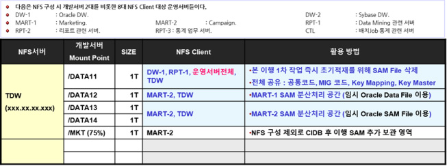
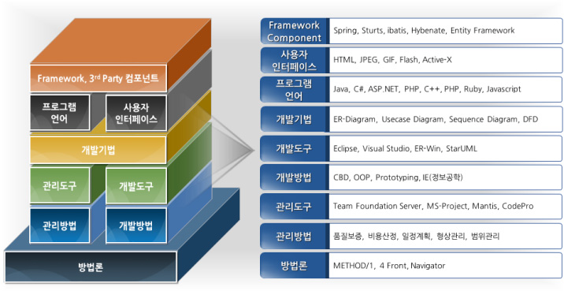
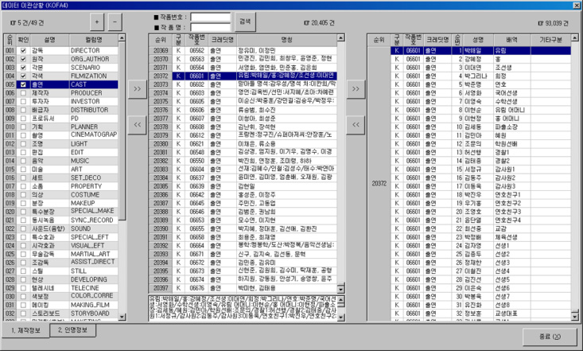
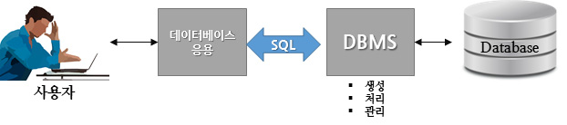
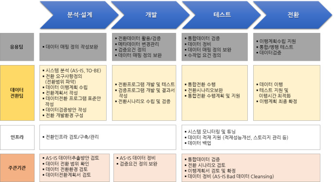
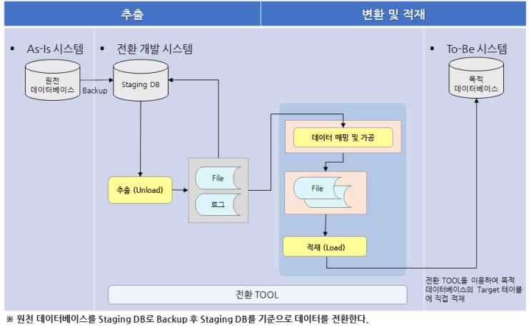
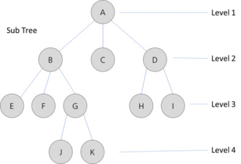
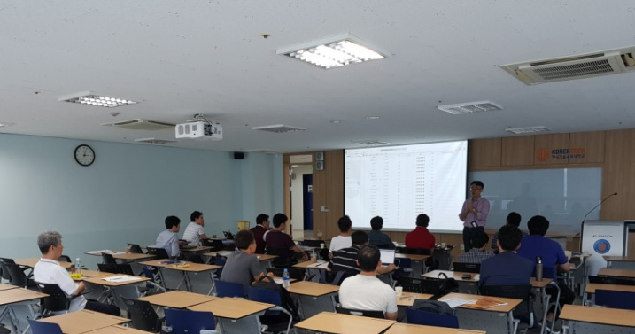

# LM2001020412_데이터+전환

대분류/20

정보통신 중분류/01
정보기술 소분류/02
정보기술개발 세분류/04
DB엔지니어링 능력단위/12

| NCS학습모듈데이터 전환 |
| --- |

LM2001020412_19v4

[NCS-학습모듈의 위치]

| 정보통신 |  |  |
| --- | --- | --- |
|  | 정보기술 |  |
|  |  | 정보기술개발 |

대분류
중분류
소분류
세분류

| SW아키텍쳐 |  |  | 능력단위 | 학습모듈명 |
| --- | --- | --- | --- | --- |
| 응용SW 엔지니어링 |  |  | 데이터베이스 요구사항 분석 | 데이터베이스 요구사항 분석 |
| 임베디드SW 엔지니어링 |  |  | 개념데이터 모델링 | 개념데이터 모델링 |
| DB엔지니어링 |  |  | 논리 데이터베이스 설계 | 논리 데이터베이스 설계 |
| NW엔지니어링 |  |  | 물리 데이터베이스 설계 | 물리 데이터베이스 설계 |
| 보안엔지니어링 |  |  | 데이터베이스 구현 | 데이터베이스 구현 |
| UI/UX엔지니어링 |  |  | 데이터베이스 성능확보 | 데이터베이스 성능확보 |
| 시스템SW엔지니어링 |  |  | 데이터 전환 설계 | 데이터 전환 설계 |
| 빅데이터플랫폼구축 |  |  | 데이터 전환 | 데이터 전환 |
| 핀테크엔지니어링 |  |  | SQL활용 | SQL활용 |
| 데이터아키텍처 |  |  | SQL응용 | SQL응용 |
| loT시스템연동 |  |  | SQL작성 | SQL작성 |

인프라스트럭쳐
아키텍처 구축
차 례
학습모듈의 개요 1
학습 1. 데이터 전환 프로그램 구현하기
1-1. 데이터 전환 프로그램 구현 및 최적화 3
1-2. 데이터 전환 수행 시간 산정 15
• 교수・학습 방법 27
• 평가 28
학습 2. 데이터 전환 수행하기
2-1. 데이터 전환 계획서 및 체크리스트 작성 30
2-2. 데이터 전환 및 모니터링 41
• 교수・학습 방법 50
• 평가 51
학습 3. 데이터 정합성 검증하기
3-1. 데이터 정합성 검증 53
• 교수・학습 방법 62
• 평가 63
학습 4. 데이터 정제하기
4-1. 오류 데이터 측정 및 정제 65
4-2. 데이터 정제요청서 및 정제보고서 작성 78
• 교수・학습 방법 85
• 평가 86
참고 자료 88
활용 서식 89
데이터 전환 학습모듈의 개요
학습모듈의 목표
원천의 데이터베이스, 파일, 문서로부터 목적 데이터베이스 구축에 필요한 데이터를 추출하고 목적 시스템
의 데이터 모델에 적합하게 변환, 정제하여 목적 데이터베이스에 적재한 후 그 결과를 검증하여 운영 가능
한 데이터베이스를 구축할 수 있다.
선수학습
데이터 표준화(2001020409_16v3), SQL 활용(2001020413_16v3), SQL 응용(2001020414_16v3)
학습모듈의 내용 체계

| 학습 | 학습 내용 | NCS 능력단위 요소 |  |
| --- | --- | --- | --- |
|  |  | 코드 번호 | 요소 명칭 |

1-1. 데이터 전환 프로그램 구현 및
1. 데이터 전환 프로그램 최적화 2001020412_19v4.1 데이터 전환 프로그램
구현하기 구현하기
1-2. 데이터 전환 수행 시간 산정
2-1. 데이터 전환 계획서 및
2. 데이터 전환 수행하기 체크리스트 작성 2001020412_19v4.2 데이터 전환 수행하기
2-2. 데이터 전환 및 모니터링
3. 데이터 정합성 검증
3-1. 데이터 정합성 검증 2001020412_19v4.3 데이터 정합성 검증하기
하기
4-1. 오류 데이터 측정 및 정제
4. 데이터 정제하기 2001020412_19v4.4 데이터 정제하기
4-2. 데이터 정제요청서 및
정제보고서 작성
핵심 용어
데이터 전환, 데이터 이행, 원천 데이터베이스, 목적 데이터베이스, ETL(Extraction, Transformation,
Load), 데이터 정제

| 학습 1 | 데이터 전환 프로그램 구현하기 |
| --- | --- |

학습 2 데이터 전환 수행하기
학습 3 데이터 정합성 검증하기
학습 4 데이터 정제하기
1-1.
데이터 전환 프로그램 구현 및 최적화
•작성된 데이터 변환 설계서의 데이터 변환 논리를 실행 가능한 변환 프로그램으로 구현할 수
있다.
학습 목표
•구현된 변환 프로그램을 데이터 전환 개발 환경에서 테스트하여 프로그램의 정상 동작을 확인
하고 성능을 최적화할 수 있다.
필요 지식 /
(cid:2) 데이터 전환 전략
데이터 전환은 기존의 원천 시스템에서 데이터를 추출하여 목적 시스템의 데이터베이스에
적합한 형식과 내용으로 변환(Transformation)한 후, 목적 시스템에 적재(Loading)하는
일련의 과정을 말한다. 기존에 운영되던 데이터를 목적 시스템으로 안정적으로 전환할 수
있도록 [그림 1-1]과 같이 데이터 전환 전략을 이용하여 전환을 수행한다.

출처: 교육부(2018). 데이터 전환(LM2001020412_16v3). 한국직업능력개발원. p.3.
[그림 1-1] 데이터 전환 전략
(cid:3) ETL(Extraction, Transformation, Loading) 방법론
일반적으로 데이터 전환은 ‘데이터 이행(Data Migration)’ 또는 ‘데이터 이관’으로 표현되어
사용되는 경우가 대부분이나, 이 학습모듈에서는 데이터 이행이나 이관을 ‘데이터 전환’으로
통칭하여 사용한다.

출처: 교육부(2018). 데이터 전환(LM2001020412_16v3). 한국직업능력개발원. p.4.
[그림 1-2] 데이터 전환 방법론
1. 데이터 전환 절차
데이터 전환 절차는 데이터 전환 환경에 따라 다소 차이가 발생할 수 있기 때문에 포괄적인
개념에서 접근 및 적용이 필요하다. 데이터 전환도 시스템 개발 프로젝트와 유사한 측면이
있기 때문에 요구사항 분석 단계(전환 계획 및 요건정의), 설계 단계(전환 설계), 구현
단계(전환 개발), 테스트 단계(전환 테스트 및 검증)로 구분할 수 있고, 세부적으로 22가지
상세 단계로 나누어진다.
2. 데이터 전환 수행 단계
(1) 데이터 전환 계획 및 요건정의 단계
데이터 전환 수행을 위해서는 우선 데이터 전환 프로젝트의 계획을 수립하고 현행
정보 시스템(As-Is) 및 원천 데이터의 구조를 분석해야 한다. 현행 정보 시스템의 데이터
구조 분석은 IT 시스템을 활용하는 각 업무 영역들에 대한 분석으로 볼 수 있다. 현행
정보 시스템의 분석이 끝나면 목표 시스템(To-Be)에 대한 분석을 진행한다.
(가) 프로젝트 계획
프로젝트의 목표와 범위를 명확히 하고, 추진 체계와 절차 및 투입 인력을 명시한다.
데이터 품질 관리 계획과 보안 관리에 대한 내용도 파악하여 기록한다.
(나) 프로젝트 환경 구축
데이터 전환 프로젝트를 수행하기 위한 개인용 컴퓨터와 네트워크 환경 등 개발
환경을 구축한다.
(다) 현행 시스템(As-Is) 분석
현행 정보 시스템의 환경을 분석한다. 장비 및 솔루션 현황, 그리고 네트워크 구성도를
파악해야 하며, 원천 데이터 형식이 어떻게 시스템에 저장되어 있는지 경로 및
크기도 함께 분석한다.
(라) 목표 시스템(To-Be) 분석
데이터가 최종 적재되는 목표 시스템에 대한 분석 및 데이터베이스 구조를 정
확히 분석하고 이해한다.
(마) 데이터 전환 요건정의
데이터 전환 시 고객과 이해 관계자의 요건을 명확히 정의한다.
(2) 데이터 전환 설계 단계
데이터 전환 계획 및 요건정의 단계에서 정의된 내용을 근거로 데이터 전환을 위한
데이터 매핑 및 검증 규칙을 설계한다.
(가) 로지컬 매핑(Logical Mapping)
목적 데이터베이스를 기준으로 하여 필요 원천 데이터의 추출 및 변환·가공,
적재 로직과 업무 영역별 비즈니스 흐름이 잘 반영되어야 한다.
(나) 코드 매핑(Code Mapping)
요건정의 단계에서 분석한 데이터를 기반으로 한 원천 데이터와 목적 데이터베이스를
데이터 표준에 맞게 정의(테이블, 필드, 코드 등)하고, 해당 데이터들의 매핑 관계를
기술한다.
(다) 검증 규칙(Rule) 정의
데이터 변환에 의한 전환이 이루어진 경우, 검증 규칙을 명확히 정의해야 한다.
(라) 전환 설계서 작성
원천 데이터를 목적 데이터베이스에 적재하기 위한 매핑을 정의한 데이터 전환
설계서를 작성한다.
(3) 데이터 전환 개발 단계
데이터 전환 설계 단계에서 정의된 대로 전환 프로그램을 구현한다.
(가) 전환 개발 환경 구축
개발 표준과 개발방법론에 맞게 데이터 전환 개발 환경을 구축한다.
(나) 전환 프로그램 개발
데이터 변환 설계서에 따라 데이터 전환 프로그램을 구현한다.
(다) 검증 프로그램 개발
데이터 검증 설계서의 데이터 검증 논리로 실현 가능한 검증 프로그램을 구현한다.
(4) 데이터 전환 테스트 및 검증 단계
데이터 전환 개발이 완료되면 전환 테스트를 진행하고, 계획된 대로 전환이 되었는지를
검증한다.
(가) 전환 검증 설계
원천 데이터의 추출 및 변환 후, 목적 데이터베이스에 전환하기 위한 검증 방법과
단계를 설계한다 .
(나) 추출 검증
원천의 데이터베이스, 파일, 문서로부터 전환하기 위한 데이터를 정확히 추출했는지
검증한다.
(다) 변환 결과 검증
추출된 원천 데이터를 목적 데이터베이스에 전환하기 위해 변환 작업에 대한
검증을 수행한다.
(라) 최종 전환 설계
검증 과정에서 발견된 수정 사항을 반영하여 최종 전환 설계를 완성한다.
(마) 전환 인프라 구축
실제 데이터 전환을 위한 인프라를 구성한다.
(바) n차 전환 검증
반복적인 데이터 전환 테스트를 통해 데이터 정합성을 확보한다.
(5) 데이터 전환 단계
데이터 전환 검증이 완료되면 실제 원천 시스템의 데이터를 목적 시스템에 전환한다.
(가) 최종 전환
실제 원천 데이터를 목적 데이터베이스에 전환하도록 수행한다. 검증된 변환
프로그램을 이용하여 전환을 실시하고 전환 결과를 검증한다.
(나) 안정화 지원
전환된 데이터는 신규 시스템에서 운영하는 데 문제가 없는지 확인하고, 안정
화 기간 동안 모니터링을 진행하여 문제 발생 시 즉각적으로 원인을 파악하고
대응한다.
(다) 후속 단계 데이터 전환
안정화 지원 시 발생된 문제점을 파악하여 후속 단계 데이터 전환을 진행한다.
(라) 전환 완료보고서 작성
최종 전환 작업이 완료되면 전환 완료보고서를 작성하여 의사 결정자에게 보
고를 진행하고 확인을 받는다.
수행 내용 / 데이터 전환 프로그램 구현 및 최적화하기
재료·자료
• 데이터 전환 설계서
• 논리 데이터베이스 설계서
• 물리 데이터베이스 설계서
• DBMS 제조사가 제공하는 각종 가이드 및 매뉴얼
• 현행 정보 시스템 구성 및 역할
기기(장비･공구)
• 전산 장비: 인터넷, 컴퓨터, 프린터, 복사기, 빔 프로젝터
• 지원 도구: 문서 작성 도구, 문서 발표 도구
안전･유의 사항
• 기술적 환경과 기술 요소를 파악하여 개발 표준을 확립하고 개발 환경을 구축해야 한다.
수행 순서
(cid:2) 개발에 필요한 기술 요소를 파악하고 개발 환경을 구축한다.
데이터 전환 계획 수립 시에 작성된 데이터 전환 수행 계획서를 분석하여 데이터 전환
프로그램 구현을 위한 하드웨어, 운영 체제, 소프트웨어, DBMS(Database Management
System), 도구를 포함하는 기술적 환경과 기술 요소들을 파악하고, 개발 표준을 확인하
여 개발 환경을 구축한다.
1. 기술적 환경과 기술 요소를 파악한다.
(1) 데이터 전환 수행 계획서를 분석한다.
계획서에 기초한 데이터 전환은 상용 전환 도구(ETL Tool)를 사용하는 방법과 요구사항
에 맞게 새로운 전환 도구를 개발하는 방법이 있다. 상용 전환 도구를 구입하여 사용하는
방법도 데이터 전환에 대한 사용자 요구사항을 반영하기 위해서는 부분 수정 개발
(Customizing)이 필요하다. 두 가지 방법 중 데이터 전환에 소요되는 기간 및 예산,
요구사항 반영 범위를 분석하여 신중한 선택이 되도록 한다.
사례: 데이터 전환 수행 계획서
다음은 실제 데이터 전환을 위한 수행 계획서의 목차를 나타낸 것이다. 데이터 전환 계획서에는 프로
젝트의 목표와 성공 요인, 전제 조건과 제약사항을 명확히 명시해야 한다. 또 데이터 전환의 범위와 환
경, 조직과 역할 그리고 수행 일정을 자세히 기술한다. 데이터 전환 방안은 물론이고 데이터 전환 후
검증 계획과 문제점 발생 시 비상 대책과 데이터 복구 대책까지 모든 상황을 대비한 계획을 수립한다.
<표 1-1> 데이터 전환 수행 계획서 목차
1. 문서 개요 --------------------------------------------------------- 4
2. 데이터 전환 개요 ----------------------------------------------------- 4
2.1. 데이터 전환 목표 ---------------------------------------------------- 4
2.2. 주요 성공 요인 ---------------------------------------------------- 4
2.3. 전제 조건 및 제약사항 --------------------------------------------- - 5
3. 데이터 전환 범위 ---------------------------------------------------- 6
4. 데이터 전환 환경 ---------------------------------------------------- 8
4.1. 현행 시스템 구성도 ------------------------------------------------- 8
4.2. 목표 시스템 구성도 ------------------------------------------------- 8
4.3. 데이터 전환 단계별 DISK 사용 ---------------------------------------- 9
5. 데이터 전환 조직 및 역할 --------------------------------------------- 10
5.2. 조직별 역할 ------------------------------------------------------ 11
5.3. 업무 분담 계획 --------------------------------------------------- 12
6. 데이터 전환 일정 --------------------------------------------------- 13
7. 데이터 전환 방안 --------------------------------------------------- 14
7.1. 사전 준비 ------------------------------------------------------- 14
7.2. 데이터 전환 설계 -------------------------------------------------- 17
7.3. 프로그램 개발 및 테스트 ---------------------------------------------18
7.4. 데이터 전환 리허설 ------------------------------------------------ 19
7.5. 데이터 전환 ----------------------------------------------------- 19
7.5.1. 선전환 ------------------------------------------------------- 19
7.5.2. 본전환 ------------------------------------------------------- 20
7.5.3. 데이터 검증 ---------------------------------------------------- 21
8. 비상 계획 -------------------------------------------------------- 23
9. 데이터 복구 대책 -------------------------------------------------- 24
(2) 기술적 환경을 분석한다.
데이터 전환 프로그램을 구현하기 위한 시스템 구성도 및 데이터베이스 정보를
확인한다. 원천 데이터(데이터베이스, 파일, 문서 등)가 있는 서버 정보와 목적 데
이터베이스가 설치된 서버 정보를 모두 확인하고, 전환 데이터의 정합성을 위해
데이터 전환 D-4일 이후 사용자를 제한한다.
(가) 원천 데이터 정보: 서버 IP, 서버 계정, 파일 경로, 데이터베이스 정보, 데이터베이스
계정 등
(나) 목적 데이터베이스 정보: 서버 IP, 서버 계정, 데이터베이스 정보, 데이터베이스
계정 등

출처: 교육부(2018). 데이터 전환(LM2001020412_16v3). 한국직업능력개발원. p.9.
[그림 1-3] 시스템 구성도(예시)
(다) 개발 서버 정보: 서버 IP, 서버 계정, 가용 자원 정보(CPU, 메모리, 스토리지 등)

출처: 교육부(2018). 데이터 전환(LM2001020412_16v3). 한국직업능력개발원. p.9.
[그림 1-4] 데이터 전환을 위한 개발 서버의 가용 자원 정보(예시)
(3) 기술 요소를 분석한다.
확인된 원천 데이터 정보와 목적 데이터베이스 정보로 파일 접근 및 데이터베이스 접속이 가능한지
확인하고, 필요에 따라 데이터 접근을 위한 관련 소프트웨어를 파악한다.
(가) 클라이언트 접속 프로그램: 데이터베이스 시스템을 만드는 제조사별로 클라이언트 접속
프로그램이 상이하기 때문에 데이터베이스 제품을 확인하여 접속할 PC에 제조사에서
제공하는 클라이언트 접속 프로그램을 설치한 후 서버의 데이터베이스에 접속한다.
(나) 원천 데이터 파일: 원천 데이터 파일의 종류에 따라 데이터 접근 및 데이터 검증
을 위한 필요 프로그램을 확인한다.
1) 엑셀(Excel) 파일
2) 이미지(Image) 파일(bmp, png, jpg, gif, tiff 등)
3) 텍스트 파일
4) 순차 접근 방법(SAM: Sequential Access Method) 파일
5) 기타(PDF, HTML, XML 등)
2. 개발 환경을 구축한다.
정보 시스템 개발을 위한 개발 표준과 개발방법론의 내용을 바탕으로 기술 요소를 반영한
개발 환경을 구축한다.

출처: 교육부(2018). 데이터 전환(LM2001020412_16v3). 한국직업능력개발원. p.10.
[그림 1-5] 개발 환경 구축 예시
(cid:3) 데이터 전환 설계서의 변환 논리를 프로그래밍하여 테스트한 후 성능을 최적화한다.
일반적으로 데이터 변환 프로그램은 데이터 전환 설계서에 기술된 매핑 정의를 바탕으
로 원천 데이터를 목적 데이터베이스로 전환하는 작업을 수행한다. 데이터 변환 프로그
램은 두 가지 주요 모듈로 구성된다.

출처: 교육부(2018). 데이터 전환(LM2001020412_16v3). 한국직업능력개발원. p.11.
[그림 1-6] 데이터 변환 프로그램 UI 예시
1. 원천 데이터 분석 모듈을 구현한다.
원천 데이터로부터 데이터의 속성 정보인 메타 데이터를 생성하고 메타 데이터로부터
해당 데이터의 운영 환경을 분석하여 분석 보고서를 생성한다. 데이터 분석 모듈은 별도의
도구 없이 수작업으로도 분석이 가능하기 때문에 상황에 따라 구현 대상이 되지 않을
수도 있다.
2. 데이터 전환 엔진 모듈을 구현한다.
원천 데이터로부터 스키마, 데이터 및 비즈니스 로직을 순서대로 매핑하여 실제적인
변환을 수행한다. 엔진 모듈은 데이터 변환 설계서에 정의된 바와 같이 원천 데이터
의 추출, 변환·가공을 통한 목적 데이터베이스로의 적재 역할을 수행한다.
(1) 데이터 추출(Extraction)
원천 데이터의 종류에 따라 데이터 추출 방법이 결정된다. 데이터베이스에서 데
이터를 추출할 경우에는 SQL문을 활용하며, 순차적 접근 방법(SAM) 파일에서
데이터를 추출할 경우에는 파일 오픈 후 레코드(Record) 단위로 데이터를 읽어
들여 처리한다. 데이터 추출을 위한 SQL문의 구현 방법에 따라 전환 프로그램의
성능이 좌우된다(SQL 튜닝 참조).
사례: 데이터 전환 프로그램
INSERT INTO TARGET.TSMFA01 X (
X.고객식별번호, X.고객관리부서코드, X.배정구분, X.등록직원번호,
X.등록년월일, X.최종확정년월일, X.작업일시)
SELECT B.고객식별번호, A.고객관리부서코드, SUBSTR(A.배정구분, 5, 1),
A.등록직원번호, A.등록년월일, A.최종확정년월일, A.작업일시)
FROM SOURCE1.TSARMCB01 A, SOURCE1.TASACMSA11 B
WHERE A.주민등록번호 = B.고객식별번호(+)
AND A.등록년월일 BETWEEN ‘20170901’
AND TO_CHAR(SYSDATE, ‘YYYYMMDD’);
COMMIT;
(2) 데이터 변환(Transformation)
데이터 전환 설계서의 변환 규칙(rule)에 따라 데이터 변환이 이루어지도록 프로그램을
구현한다. 데이터 변환 규칙은 기본 변환 정제 규칙, 일반 규칙, 그리고 변환용 파일
및 테이블(Table) 규칙으로 나눌 수 있다.
<표 1-2> 기본 변환 정제 규칙 예시
데이터 타입 유형 변환 규칙
CHAR(Text 성) Null/Blank #(단, 의미적으로 날짜 성격일 경우 아래 날짜 값으로 변환)
CHAR(Code 성) Null/Blank 아래 날짜들을 포함하여 ASIS 값은 아래 기준 값으로 변환
NUMBER Null 0
Null 99991231(ANSI 값 변환 포함)
DATE → CHAR
오류 HEADER 2번째 Column 날짜
Null 235959(ANSI 값 변환 포함)
TIME → CHAR
오류 HEADER 2번째 Column TIME
Null 99991231235959(ANSI 값 변환 포함)
TIMESTAMP
오류 원천 그대로 MOVE
CHAR(1): 여부 Null / Blank #
<표 1-3> 일반 규칙 예시
규칙 기준 비고
선전환 시 개발 서버에서 변환 복잡 시 일부
일부 Data Stage 연속적인 작업은 가능한 한 Shell로 처리
대부분 Shell, Load/Unload-UTL,
Shell, Pro*C, UTL 프로그램 성능을 최우선적으로 고려
Pro*C
성능, 영향, 난이도에 따라 2개월 이상
전환 데이터 이력 1개월, 영구 전체 단위 처리
가능
<표 1-4> 데이터 전환용 SAM 파일 및 테이블 규칙 예시
규칙 기준 비고
DBOWNER_Table명_LEXX_Option_
SAM File(.dat) Option_Seq: 프로그램이나 Legacy 규칙 참조
NNN
Temp Table MT_Table명_ELXX_Option_NNN 프로그램명과 유사(Owner 대신 MT로 변경)
임시 비교 Table ASIS_Table명, TOBE_Table명 사용 예, “일 Batch 당월”의 전환 검증 방법
앞뒤 Trim, Delimiter ‘\’ 사용 ‘\’를 Value로 사용 시 다른 문자 사용 값에 ‘\’이
File Format
위는 기준이며 ‘|’를 사용할 수 있음 존재하면 ‘|’으로 사용
(3) 데이터 적재(Loading)
목적 데이터베이스에 맞게 변환된 데이터를 데이터베이스에 저장한다.
3. 개발 환경에서 테스트하고 각 기능별 성능을 최적화한다.
(1) 구현된 변환 프로그램을 개발 환경에서 테스트한다.
원천 데이터 건수와 크기를 확인하고 목적 데이터베이스의 건수와 크기를 확인하여
비교한다. 누락되거나 잘못된 데이터가 없는지 확인하고 반복적으로 테스트를 진행한다.
(2) 전환 시간을 확인하고 프로그램 성능을 최적화한다.
데이터 추출에 걸리는 시간과 적재 시간을 나누어 측정하고 시간이 많이 걸리는 부분의
코드를 최적화한다. 주로 데이터 추출 시 걸리는 시간이 많기 때문에 인덱스(index)와
조인(join) 부분을 튜닝(tuning)하여 최적화한다.
(가) 튜닝 단계의 인덱스 선정
쿼리(Query) 실행 시 사용되는 인덱스를 확인하기 위해서는 ‘EXPLAIN PLAN’
명령을 사용하여 실행하면 액세스 경로 및 사용되는 인덱스를 확인할 수 있다.
효율적인 인덱스 선정을 위해 수행해야 할 내용은 다음과 같다.
1) 해당 테이블의 액세스 형태를 수집한다.
2) 대상 컬럼의 선정 및 분포도를 조사한다.
3) 반복 수행되는 액세스 경로(Critical Access Path)를 해결한다.
4) 클러스터링을 검토한다.
5) 인덱스 컬럼의 조합 및 순서를 결정한다.
(나) 조인(Join)의 최적화
최적의 경로를 찾을 수 있도록 하기 위해서는 인덱스(Index), 클러스터(Cluster)
등의 최적화 요소(Optimizing Factor)를 어떻게 지정해야 하며, 특이한 경우의
처리를 위해서는 어떤 힌트나 사용 제한 기능을 이용해야 옵티마이저(Optimizer)가
자신이 원하는 액세스 경로를 선택하도록 유도할 수 있는지 아는 것이 중요하다.
수행 tip
•데이터를 전환하는 프로그램에 수많은 예외 처리를 지정하려
고 하지 말고, 가능한 규칙(Rule)을 벗어나는 원천 데이터를
정제해 규칙을 준수하도록 교정하고, 전환 프로그램에서는
규칙을 준수한 데이터 집합만을 처리하는 것이 가장 이상적인
방법이다.
•데이터 전환에서 업무 분담은 중요한 부분을 차지한다.
업무 분담만 잘 해도 데이터 전환의 절반 이상은 성공
했다고 말할 수 있다.
1-2.
데이터 전환 수행 시간 산정
학습 목표 •구현된 데이터 변환 프로그램을 기반으로 데이터 전환 수행 시간을 산정할 수 있다.
필요 지식 /
(cid:2) 구조적 질의어(SQL: Structured Query Language)
SQL은 데이터베이스를 구축하고 활용하기 위해 사용되는 언어로 IBM 산호세 연구소에서
개발되었다. SQL은 관계형 데이터 모델(Relation Data Model)로 표현되는 다양한 데이터베이
스에 널리 사용되는 언어로 미국 국립표준협회가 표준으로 제정하면서 가장 많이 사용되고
있다.

출처: 교육부(2018). 데이터 전환(LM2001020412_16v3). 한국직업능력개발원. p.15.
[그림 1-7] 데이터베이스 시스템의 구성 요소
1. SQL 언어의 분류
(1) 데이터 정의어(DDL: Data Definition Language)
DDL은 데이터베이스 구조, 데이터 형식, 데이터 접근 방식 등 데이터베이스를 구축하거
나 변경할 목적으로 사용하는 언어로, 데이터 사전에 저장되며 데이터베이스 객체의
구조를 정의(CREATE) 및 변경(ALTER)하거나 삭제(DROP) 처리한다.
(2) 데이터 조작어(DML: Data Manipulation Language)
DML은 데이터 처리를 위해 응용 프로그램과 데이터베이스 관리 시스템(DBMS) 간의
인터페이스를 위한 언어로, 데이터의 검색(SELECT), 삽입(INSERT), 삭제(DELETE),
갱신(UPDATE) 연산을 수행한다.
(3) 데이터 제어어(DCL: Data Control Language)
DCL은 데이터의 보안, 무결성, 데이터 회복, 병행 수행 제어 등을 정의하는 데 사용되는
언어로, 데이터베이스 관리자(DBA: Database Administrator)가 데이터 관리를 목적
으로 사용한다.
2. 테이블(Table)의 정의
(1) 테이블 생성
테이블을 생성할 때에는 CREATE TABLE 명령문을 사용한다.
CREATE TABLE 테이블명
(칼럼1 자료형 1,
칼럼2 자료형 2,
...
칼럼n 자료형 n);
칼럼에 사용되는 대표적인 자료형은 다음 표와 같다.
<표 1-5> 칼럼의 자료형
자료형 설명 비고
CHAR(n) 길이가 n인 고정 길이 문자열
VARCHAR(n) 길이가 최대 n인 가변 길이 문자열
INT 정수형
FLOAT(n) n개의 자릿수를 갖는 부동 소수점형
DATE 날짜형
TIME 시간형
출처: 김종훈(2013). 컴퓨터 개론. http://terms.naver.com에서 2017. 06. 16. 검색.
(2) 테이블 수정
기존 테이블의 칼럼을 추가, 수정, 삭제하는 명령문은 ALTER TABLE이며, 사용
형식은 다음과 같다.
ALTER TABLE 기존 테이블명
ADD 칼럼 이름 자료형;
칼럼을 삭제하는 형식은 다음과 같다.
ALTER TABLE 기존 테이블명
DROP 칼럼 이름;
(3) 테이블 삭제
테이블을 삭제할 때의 명령문은 DROP TABLE이며, 사용 형식은 다음과 같다.
DROP TABLE 테이블명;
3. 데이터 조작
(1) 검색
검색 명령의 기본 형식은 다음과 같이 SELECT, FROM, WHERE로 구성된다. FROM에
나오는 테이블 리스트에 대해 카르테시안 곱(Cartesian Product)을 수행한 후, WHERE
에 나오는 조건을 만족하는 테이블에서 SELECT에 나오는 칼럼들을 추출한다.
SELECT 칼럼_리스트
FROM 테이블_리스트
WHERE 조건;
(2) 삽입
관계에 투플(tuple)을 삽입하는 명령은 INSERT이며 형식은 다음과 같다.
INSERT INTO 테이블_이름 (칼럼이름1, 칼럼이름2, …, 칼럼이름N)
VALUES(값1, 값2, …, 값n);
여러 투플을 한 번에 삽입할 수도 있는데 이때는 SELECT를 사용하면 된다. 다
음은 학생 관계에서 학과명이 ‘컴퓨터’인 학생들의 학번, 이름, 성별을 검색해서
그 결과를 컴퓨터학과 학생 테이블에 삽입하는 명령이다.
INSERT INTO 컴퓨터과 학생(학번, 이름, 성별)
SELECT 학번, 이름, 성별
FROM 학생
WHERE 학과명='컴퓨터';
(3) 갱신
관계의 칼럼값을 갱신할 때 사용하는 명령은 UPDATE이며 형식은 다음과 같다.
UPDATE 테이블_이름
SET 칼럼1=수식1, 칼럼2=수식2, …, 칼럼n=수식n
WHERE 조건;
(4) 삭제
관계를 삭제하는 명령은 DELETE이며 형식은 다음과 같다.
DELETE FROM 테이블_이름
WHERE 조건;
(cid:3) 프로그래밍 지식
프로그램의 구현은 상세 설계나 사용자 지침서에 기술된 것과 일치되도록 코딩(coding)
되어야 한다. 프로그램 단계에서 가장 중요한 작업 중의 하나는 코딩 표준을 정하고 정
확하고 명확하게 작성하는 것이다. 소프트웨어의 품질은 결국 원시 코드(Source code)
에 모두 반영된다.
1. 코딩 원리
코딩 작업은 무엇보다 원하는 결과를 만들어 내기 위해 오류가 적은 품질 좋은 프로
그램을 만드는 데 목표가 있다. 신속히 작성해야 하는 것은 이차적인 목표다. 견고한
코드를 작성하는 것은 연습이 많이 필요하다. 정확하고 간결한 좋은 프로그램을 작
성하는 것은 프로그래밍 언어의 선택과 관계가 없다. 최근의 프로그래밍 언어들은
이미 구조적 접근법을 고려하여 설계되었기 때문에 프로그램을 자동으로 구조화한
다. 구조적 프로그래밍을 따른다고 하여 명확하고 효율적인 프로그램이 작성되는 것
은 아니며, 중요한 것은 구조적 스타일로 프로그램을 작성하는 것이다.
2. 코딩 스타일
원시 코드의 간결성은 시스템이 얼마나 잘 설계되었는가에 좌우된다. 설계에서 모듈
화의 목표, 높은 응집력, 낮은 결합도를 달성하였다면 모듈은 간결해진다. 또 명명
규칙, 포인터와 레퍼런스, 자료형, 문장과 수식, 오류 처리, 코드 문서화의 원칙을 잘
지켜 나간다면 좋은 프로그래밍 스타일을 유지할 수 있다.
3. 리팩토링(Refactoring)
리팩토링은 이미 존재하는 코드의 설계를 안전하게 향상시키는 기술이라고 할 수 있
다. 리팩토링은 문제가 있는 코드를 찾아내어 여러 가지 측면에서 안정성을 향상시
키는 방법을 제공해 준다. 단순히 코딩 스타일만을 개선하는 것이 아니라 성능과 코
드의 구조, 즉 좋은 설계가 되도록 개선시키는 과정을 의미한다. 객체 지향의 경우,
코드를 쉽게 이해할 수 있음은 물론이고, 변화에 쉽게 적응할 수 있는 융통성을 가
지도록 하는 것이 매우 중요하다. 다음은 리팩토링을 하는 목적이다.
(1) 리팩토링은 소프트웨어의 디자인을 개선시킨다.
(2) 리팩토링은 소프트웨어를 이해하기 쉽게 만들어 준다.
(3) 버그를 빨리 찾을 수 있도록 도움을 준다.
(4) 리팩토링은 프로그램을 빨리 작성할 수 있도록 도와준다.
4. 코드 품질 향상 기법
코드의 품질을 높이는 방법은 흔히 테스팅이 가장 일반적인 방법이라고 알고 있다.
프로그램을 수행시켜 보는 것 대신에 읽어 보고 눈으로 확인하는 방법이 있는데, 이
를 코드 인스펙션이라고 한다. 테스팅의 일종으로 볼 수 있지만, 프로그램에 데이터
를 주어 실행시켜 보는 것이 아니라 수행되지 않은 데드 코드(dead code)가 없는
지, 선언이 되지 않고 사용한 변수가 없는지 등을 검사하는 정적 분석도 있다.
(1) 코드 인스펙션(code inspection): 코드에 묻혀 있는 결함을 발견하기 위한 검사이다.
(2) 정적 분석(static analysis): 프로그램 테스트를 조직적으로 분석하여 결함을 찾아내기
위한 분석이다.
(3) 증명: 이상적인 방법이긴 하지만 소프트웨어 품질이 아주 중요한 경우에 주로 활용된다.
예를 들면 항공기 탑재 시스템이나 원전 제어 시스템 등에 사용된다.
(cid:4) 데이터 전환 수행 시간 단축 방안
데이터 전환 시 예정된 전환 시간 준수를 위해 전환 환경과 데이터 특성에 따라 최적의 ETL(Extract,
Transform and Load) 프로세스 처리 방안을 마련해야 한다.

출처: 집필진 제작(2021)
[그림 1-8] ETL 처리 Process
1. 우선순위
중요도(Critical Path)에 따라 우선순위(1~3순위)를 조정한다. 예를 들어 1순위 데이
터는 코드 데이터, 마스터 데이터, Working Map(후행 프로세스에서 공유할 수 있
는 선행 프로세스 데이터), 분할 데이터(상위 5% 이내의 데이터로 전체 데이터의
90% 이상 성격의 데이터), 연동 데이터 등이다.
2. 멀티 프로세스(Group Process 수)
이행 데이터를 N개 그룹으로 분리하여 동시에 N개 프로세스로 이행하며, 각 그룹
(Group)에 중요 데이터들을 1순위에 배치한다. 각 그룹 프로세스들의 균등한 처리
시간을 위해 그룹별 대상 테이블(Table) 배치한다.
3. 데이터 분할
빅 데이터(Big Data)들에 대해 이행 시점을 분할하며 분할 대상들은 각 그룹별 1순위에
배치하여 처리 시간을 균등화한다.
4. 튜닝 팁(Tip) 및 인덱스/통계 활용
(1) 대용량(Bulk) 배치 작업 성격에 맞는 임시 ETL용 파라미터를 조정한다.
(2) Direct(No-Logging) 기법 및 병렬 기법을 활용한다.
(3) 반복 테스트를 통한 튜닝 포인트(Point)를 최적화한다.
(4) Index는 가능한 전체 적재 후, 병렬로 Index 생성, 분할 등 대상 index 생성 시점을
조정한다.
(5) 통계 Dictionary를 활용하여 사전에 생성된 통계 정보를 활용한다.
수행 내용 / 데이터 전환 수행 시간 산정하기
재료·자료
• 데이터 전환 설계서
• 데이터 검증 설계서
• 원천 시스템과 목적 시스템의 하드웨어, 네트워크, 소프트웨어 구성도
• 원천 시스템과 목적 시스템의 데이터 모델
• DBMS 제조사가 제공하는 각종 가이드 및 매뉴얼
• 현행 정보 시스템 구성 및 역할
• 프로젝트 관련 문서(제안서, 프로젝트 계획서, 작업 기술서, WBS 등)
기기(장비･공구)
• 전산 장비: 인터넷, 컴퓨터, 프린터, 복사기, 빔 프로젝터
• 지원 도구: 문서 작성 도구, 문서 발표 도구
• 서버, 네트워크, 데이터베이스 관리 시스템(DBMS: Database Management System)
• 데이터베이스 클라이언트 도구
• 데이터 전환 도구(ETL 도구, SQL, 절차형 데이터베이스 언어 등)
안전･유의 사항
• 목표한 데이터 전환 시간 준수를 위해 전환 환경과 데이터 특성에 맞는 최적의
ETL(Extract, Transform and Load) 프로세스 처리 방안을 마련해야 한다.
수행 순서
(cid:2) 데이터 검증 설계서를 분석하고 검증 프로그램을 구현한다.
검증 설계서상에 데이터 검증 종류와 방법을 파악하고 검증 설계 방향을 분석한다. 데
이터 검증 프로그램을 구현하고 성능을 최적화한다.
사례: 데이터 검증 설계서
다음은 실제 데이터 전환 후 검증을 위한 설계서의 작성 가이드를 나타낸 것이다. 데이터 검증계획
서에는 검증 프로그램 목록, 검증 프로그램의 명세(업무 영역, 프로그램, 처리 사항 등), 프로그램 검
증 로직 및 최종 확인 사항을 기술한다. 필요에 따라 추가적으로 관련 작업, 기법 및 각종 지침, 고
려 사항을 기술한다.
<표 1-6> 데이터 검증 설계서 작성 가이드
1.1 개요
기존 시스템에서 사용하던 데이터를 새로 구현될 시스템에서의 데이터 검증을 위한 세부 데이터 항
목으로 기술하고, 검증 처리 로직을 설계한다.
1.2 항목 설명
검증 프로그램 목록
업무 영역: 해당 업무 영역을 기술한다.
프로그램: 변환 프로그램의 이름(영문/한글)을 기술한다.
용도(기능): 해당 프로그램의 목적․기능에 대해 간략히 기술한다.
검증 프로그램 명세
업무 영역: 해당 업무 영역을 기술한다. 추가로 하위 영역별로 기술하려면 복수 행으로 기술한다.
프로그램: 변환 프로그램의 이름(영문/한글)을 기술한다.
개요: 해당 프로그램의 기능에 대해 간략히 기술한다.
처리 사항: 처리 과정에서 주요한 내용을 기술한다.
프로그램 검증
검증 로직: 해당 프로그램의 처리 로직을 간략히 기술한다.
처리 건수와 처리 내용: 입력 데이터 건수와 처리한 데이터 건수
최종 확인: 입력과 출력에서 처리 건수와 처리 내용이 일치하면 프로그램 단위 테스트 결과는 정상
이라고 판단한다.
1.3 관련 작업
프로그램 개발
1.4 관련 기법
N/A
1.5 지침 및 고려 사항
N/A
1. 데이터 검증 설계서를 분석한다.
데이터 전환 과정에서 데이터의 누락이나 오류가 발생하지 않도록 데이터 검증 설계
서에 정의된 단계별 검증 방법과 처리 건수 및 처리 내용을 프로그램하는 방법을 분
석한다. 데이터 검증 단계는 다음과 같다.
(1) 원천 데이터 추출을 검증한다.
(2) 전환 검증: 변환 규칙이 정확히 적용되었는지 검증한다.
(3) 적재 검증: 변환된 데이터가 목적 데이터베이스에 정확히 등록되었는지 검증한다.
(4) 업무 검증: 현업 업무별 조회 화면을 통해 주요 업무 데이터를 검증한다.
(5) 통합 검증: 목적 데이터베이스에 적재된 데이터와 원천 데이터의 개수, 데이터 합계
값이 맞는지 검증한다.

출처: 교육부(2018). 데이터 전환(LM2001020412_16v3). 한국직업능력개발원. p.22.
[그림 1-9] 전환 프로그램 명세서 예시
<표 1-7> 데이터 검증 방안 예시

| 단계 | 내용 | 역할 |
| --- | --- | --- |

• 데이터 추출 시 작업 시간, 추출 건수 Log 생성
• 데이터 변환 실행 시간(시작, 끝) Log 생성
• 데이터 오류건 발생 시 Log 생성
전환 작업 • 최종적으로 구성된 적재 SAM 파일을 Bulk Loader를 활용 데이터전환 팀
하여 타깃 테이블에 적재된 Log 생성
• 작업 결과 DB에 적재된 각 단계별 작업 결과를 조회하여
추출, 변환, 적재의 작업 진행 현황 확인
• 메타 품질관리를 통하여 TO_BE 테이블의 RI 검증
• 메타 품질관리를 통하여 통합 코드 매핑 Rule 검증
• 원천 데이터 vs 목적 데이터베이스 테이블의 검증
1단계 데이터전환 팀
• 테이블 간 전환된 전체 건수 비교
(전환 검증) 메타관리 팀
- 테이블 정의서의 변화가 없는 전환 대상 테이블의Column
유횻값 비교
- 숫자 Column이 있는 테이블의 Group By SUM 비교
(1) 현 시스템에서 작업
• 각 업무별 조회 화면 확보
• 보고서 프로그램 실행 후 자료 확보 업무운영 팀
• 주요 테이블에 대하여 업무적으로 중요한 데이터를 산출한
자료 확보
2단계 (2) 신시스템에서 작업
(업무 검증) • 각 업무별 조회 화면 확보
• 보고서 프로그램 실행 후 자료 확보 업무개발 팀
• 주요 테이블에 대하여 업무적으로 중요한 데이터를 산출한
자료 확보
업무운영 팀
(3) 현 시스템 vs 신시스템 검증 대사 자료 확인
업무개발 팀
2. 데이터 검증 논리를 적용한 검증 프로그램을 구현한다.
개발 표준과 개발방법론에 맞추어 데이터 검증 프로그램을 구현한다. 데이터 전환에
대한 검증은 다음의 세 가지 조건을 충족시켜야 한다.
(1) 완전성(Exhaustiveness): 원천 데이터의 모든 데이터는 하나도 빠짐없이 변환 규칙을
적용하여 목적 데이터베이스에 적재되어야 한다.
(2) 데이터값의 일관성(Consistency): 전환된 데이터는 목적 데이터베이스에 존재하는 요
구사항과 제약 조건을 충족시켜야 한다. 예를 들어, 원천 데이터에 성별(Sex)이란 항
목이 존재한다고 가정할 때, 원천 데이터에서는 ‘U’(Unknown)라는 속성값이 허용되
지만 목적 데이터베이스에서 허용되지 않는다면, ‘U’값이 가지는 모호성 문제를 해결
하거나 목적 데이터베이스가 이 값을 허용하도록 조정해야 한다.
(3) 관계의 일관성(Coherence): 원천 데이터의 데이터 간 관계(Dependencies)는 보전되어
목적 데이터베이스로 이전되어야 한다. 예를 들어, 원천 데이터에 존재하던 고객 주문과
고객 간의 관계는 목적 데이터베이스에서도 동일하게 적용되어야 한다.
3. 개발 환경에서 테스트하고 성능을 최적화한다.
검증 시 많은 시간이 걸리는 단계 순으로 프로그램을 최적화하여 검증 효율을 높인다.
(cid:3) 데이터 전환 개발 환경에서 테스트하여 정상 동작을 확인하고 성능을 최적화한다.
1. 구현된 검증 프로그램을 개발 환경에서 테스트한다.
먼저 원천 데이터 건수와 크기를 확인하고 전환된 목적 데이터베이스의 건수와 크기
를 확인하여 비교한다. 누락되거나 서로 상이한 데이터가 없는지 데이터 건별로 값
을 비교하고 확인한다. 반복적으로 테스트를 진행한다.
2. 검증 프로그램의 성능을 최적화한다.
검증 단계별 가장 많은 시간이 소요되는 단계부터 프로그램을 검증하고 최적화를 수행한다.
(cid:4) 데이터 전환 수행 시간을 단축한다.
데이터 전환 수행 시간을 단축하기 위해 데이터 추출 방식 및 이행 범위를 조정한다.
1. 데이터 추출 방식을 조정한다.
[그림 1-10]은 As-Is 시스템으로부터 데이터 추출 방식을 최적화하여 데이터 전환
시간을 줄이는 방법이다.

출처: 교육부(2018). 데이터 전환 설계(LM2001020411_16v3). 한국직업능력개발
원. p.64.
[그림 1-10] 데이터 전환 시간을 줄이는 방법
2. 데이터 이행 범위를 조정한다.
[그림 1-11]은 테이블별 전환 범위 조정을 통한 대용량 데이터의 사전 정비로 불필요한
데이터의 전환을 최소화하는 방법이다.

출처: 교육부(2018). 데이터 전환 설계(LM2001020411_16v3). 한국직업능력개
발원. p.64.
[그림 1-11] 데이터 전환을 최소화하는 방법
(cid:5) 데이터 전환 수행 시간을 산정한다.
변환 프로그램과 검증 프로그램의 수행 시간을 근거로 데이터 전환 수행 시간을 산정한다.
1. 원천 데이터의 전체 건수와 추출 시간을 체크한다.
원천 데이터의 테이블별 건수를 파악하여 기록하고, 테이블별 추출 시간을 기록한다. 건수별
추출 시간의 평균을 산정하여 추출 시간이 많이 걸리는 테이블은 추출 쿼리(Query)나
전환 프로그램의 로직을 최적화한다.
2. 변환 규칙(Rule)을 적용하여 목적 데이터베이스에 적재하기 위한 데이터 변환 시간을 체크한다.
추출된 원천 데이터를 목적 데이터베이스에 적재하기 위한 테이블별 변환 데이터 건
수와 시간을 확인한다. 목적 데이터베이스의 테이블별 변환된 건수 대비 시간이 많
이 걸리는 데이터는 변환 로직을 확인하여 최적화한다.
3. 목적 데이터베이스에 적재하는 시간을 체크한다.
변환이 완료된 원천 데이터를 목적 데이터베이스에 적재하기 위한 테이블별 적재 데
이터 건수와 적재 시간을 확인한다. 추출 로직과 변환 로직에 비하면 적재 로직은
비교적 단순하여 문제가 발생할 확률이 비교적 적다고 볼 수 있다.
4. 데이터 검증 프로그램이 검증하는 시간을 체크한다.
데이터 검증도 목적 데이터베이스의 테이블별로 검증 시간과 건수를 확인하며, 원천
데이터의 추출 건수와 변환 로직에 의한 건수를 모두 비교하여 확인해야 한다.
수행 tip
•전환 데이터의 검증은 데이터 전환팀뿐만 아니라 현업
인원도 함께 검증을 수행함으로써 검증의 정확성을 높
이면서 시간도 단축하는 것이 중요하다.

| 학습 1 | 교수·학습 방법 |
| --- | --- |

교수 방법
• 선수학습에서 제시된 내용이 왜 중요하고 의미가 있는지 충분히 설명한다.
• 수업 전 과정에서 진행 순서에 따라 단계적으로 지식 습득이 이루어질 수 있도록 지도한다.
• 실무에서 우선 데이터 전환 시 사용되는 용어를 정의하고 설명함으로써 학습자가 쉽게 이해할
수 있도록 지도한다.
• 데이터 전환 예시를 제시하고 데이터 전환 계획과 검증 계획을 설명한다.
• 데이터 전환 프로그램 구현을 위한 개발 환경과 기술 요소에 대해 설명한다.
• 데이터 전환 프로그램의 검증을 위한 테스트 방법을 설명한다.
• 데이터 변환 프로그램과 검증 프로그램의 수행 시간 산정 방법을 설명한다.
학습 방법
• 선수학습에서 제시된 내용을 사전에 충분히 학습한다.
• 수업 전 과정에서 진행 순서에 따라 단계적으로 충분히 학습한다.
• 데이터 전환을 이해할 수 있도록 기업의 다양한 사례를 수집하고 학습한다.
• 데이터 전환 계획서에 의해 전환 프로그램을 구현한다.
• 데이터 검증 계획서에 의해 검증 프로그램을 구현한다.
• 데이터 전환 프로그램과 검증 프로그램을 테스트하고 결과를 문서화한다.
• 데이터 변환 프로그램과 검증 프로그램의 수행 시간을 기반으로 데이터 전환 수행 시간을 산정한다.

| 학습 1 | 평 가 |
| --- | --- |

평가 준거
• 평가자는 학습자가 학습 목표를 성공적으로 달성하였는지를 평가해야 한다.
• 평가자는 다음 사항을 평가해야 한다.

| 학습 내용 | 학습 목표 | 성취수준 |  |  |
| --- | --- | --- | --- | --- |
|  |  | 상 | 중 | 하 |

- 작성된 데이터 변환 설계서의 데이터 변환 논리를 실행 가능한
데이터 전환 프로그램 전환 프로그램으로 구현할 수 있다.
구현 및 최적화 - 구현된 변환 프로그램을 데이터 전환 개발 환경에서 테스트하여
프로그램의 정상 동작을 확인하고 성능을 최적화할 수 있다.
데이터 전환 수행 - 구현된 데이터 변환 프로그램을 기반으로 데이터 전환 수행
시간 산정 시간을 산정할 수 있다.
평가 방법
• 논술형 시험

| 학습 내용 | 평가 항목 | 성취수준 |  |  |
| --- | --- | --- | --- | --- |
|  |  | 상 | 중 | 하 |

- 데이터 전환 설계서의 데이터 변환 논리를 작성할 수 있는 능력
데이터 전환 프로그램
- 구현된 전환 프로그램의 정상 동작 여부와 성능 최적화 방법의
구현 및 최적화
작성 능력
- 구현된 데이터 전환 프로그램과 검증 프로그램의 수행 시간
데이터 전환 수행
산정 방법의 작성 능력
시간 산정
- 데이터 전환 수행 시간 단축 능력
• 작업장 평가

| 학습 내용 | 평가 항목 | 성취수준 |  |  |
| --- | --- | --- | --- | --- |
|  |  | 상 | 중 | 하 |

| 데이터 전환 프로그램구현 및 최적화 데이터 전환 수행시간 산정 피드백 | - 작성된 데이터 전환 설계서의 데이터 변환 논리를 실행 가능한전환 프로그램으로 구현할 수 있는 능력 - 구현된 전환 프로그램을 데이터 전환 개발 환경에서 테스트하여 프로그램의 정상 동작을 확인하고 성능을 최적화할 수있는 능력 - 데이터 전환 수행 시간을 산정할 수 있는 능력 - 데이터 전환 수행 시간을 단축할 수 있는 능력 |  |  |  |
| --- | --- | --- | --- | --- |
| 1. 논술형 시험- 데이터 전환논술형 시험을- 원천 데이터와피드백을 통해 | 프로그램 및 데이터 검증 프로그램을 구현하기 위한 사전 지식과통해 확인한다. 목적 데이터베이스를 충분히 분석하고 이해하고 있는지 확인하여,수정하여 주고 우수한 내용은 발표를 통해 공유하도록 한다. | 기술이잘못된 | 충분한지 | 분석은 |
| 2. 작업장 평가- 주어진 시나리오에수정할 부분을- 전환 결과를 | 맞게 데이터 전환 프로그램과 검증 프로그램이 구현되었으면피드백한다. 확인하고, 시간이 많이 걸리는 부분을 최적화할 수 있도록 지도한다. | 장점을 | 칭찬하고 |  |

학습 1 데이터 전환 프로그램 구현하기

| 학습 2 | 데이터 전환 수행하기 |
| --- | --- |

학습 3 데이터 정합성 검증하기
학습 4 데이터 정제하기
2-1.
데이터 전환 계획서 및 체크리스트 작성
•데이터 전환 수행 계획서의 모의 전환 일정에 따라 ‘모의 데이터 전환 차수별 데이터 전환
계획서’와 ‘본 데이터 전환 계획서’를 작성할 수 있다.
학습 목표
•데이터 전환 수행자가 수행할 작업 항목, 작업 내용, 예정 시작/종료 시각, 작업 담당자를
포함하는 상세 체크리스트를 작성할 수 있다.
필요 지식 /
(cid:2) 데이터 전환 수행 절차
데이터 전환은 전환 담당자와 업무 담당자 간의 긴밀한 협조 체제하에 우선순위 등을
고려한 전환 상세 설계, 전환 및 검증 프로그램 개발과 통합 전환을 수행한다. 전환 단계
에서는 전환 시간 최적화를 위한 업무 간 병렬 처리, 전환 시나리오에 따른 일관된 통제
및 관리, 주기적으로 데이터 전환 테스트를 반복하는 등 통합된 체계적 접근이 필요하다.

출처: 교육부(2018). 데이터 전환(LM2001020412_16v3). 한국직업능력개발원. p.29.
[그림 2-1] 데이터 전환 수행 절차

| 학습 내용 | 평가 항목 | 성취수준 |  |  |
| --- | --- | --- | --- | --- |
| 1. 데이터 전환 범위데이터 전환의상세 내용과 에 따라서는 전환사례: ERP(Enterprise다음은 국내 기업의 ERP터베이스의 전환 대상별 | 성공과 실패는 범위에 달려 있다고 해도 과언이 데이터 형식 그리고 대상 건수까지 파악하여 명시하는제외 대상도 기록하는 것이 범위 파악에 도움이Resource Planning) 교체 프로젝트의 데이터 전환 시스템 교체에 따른 데이터 전환 사례를 나타낸 것이다. 이를테이블 개수를 명확히 명시하였고, 데이터 파일 중 전환 제외 | 아니다.것이된다.보면대상도 | 전환좋다.원천별도로 | 대상의필요데이기 |
| 록하였다. <표 2-1> 데이터 전환 범위No 검증 종류원천 1 데이터베이스2 원천 데이터 파일<표 2-2> 전환 대상 출 기준) 예시 No Table Owner1 DB_SALES 2 DB_PERSON3 DB_STOCK 4 DB_PRODUCT… 합계 ※ 세부 테이블 목록은 | 예시 내용 이전 ERP DBMS 데이터 중 전환 대상으로 선정된 대상(추출 기준 328개) ※ 영역별 테이블 상세 내역은 전환 대상 테이블 내역 참조/data/xml 이하 모든 파일 /data/unload 이하 [이관 제외 대상] 아래를 제외한 모든[이관 제외 대상] /data/upload/WEB-INF /data/upload/excel /data/upload/doc /data/upload/email /data/upload/rule 테이블(AS-IS, 데이터 추 <표 2-3> 전환 대상 테이블(TO-BE, 데이터TableNo 영역명 Table 개수 적재 대상65 1 영업 50 50 2 인사 30 5 3 재고 3 208 4 생산 118 … 328 합계 265 “ERP-IDC-C09-별첨.01(AS-IS전환대상테이블목록)_V.2.1” 참조 | 테이블폴더적재개수120256085 | 및 파일기준)수작업 업로드 | 예시 |
| 2. 데이터 전환 일정데이터 전환 의 결정은 통합역할을 나타내고 | 일정은 팀별 업무를 분장하여 팀별 역할과 납기를 전환 계획 및 테스트 계획에 의해 결정된다. 다음있다. | 기록한다. | 전환예시에서는 | 차수팀별 |
| (1) 통합 전환 팀: | 데이터 전환 전반의 통제 및 의사 결정 |  |  |  |
| (2) 응용 팀: | 데이터 적재 결과 확인 및 전환 프로그램의 정상 동작 여부 | 확인 |  |  |
| (3) 전환 팀: | 데이터 전환 및 전환 검증 수행 |  |  |  |
| (4) 인프라 팀:출처: 교육부(2018). 데이터[그림 2-2] 데이터 전환 일정 | 인프라(서버, DB 등) 관련 작업 수행 전환(LM2001020412_16v3). 한국직업능력개발원. p.31. 예시 |  |  |  |
| 3. 데이터 전환 절차현행(As-Is) 각 단계별 작업백업하여 | 시스템에서 목표(To-Be) 시스템으로 데이터 전환을 위한내용과 사용되는 도구를 별도로 기록한다. 원천 스테이징(Staging) 데이터베이스로 복구한 후, 정비 및 변환 | 단계를데이터베이스의작업을 |  | 구분하고데이터는수행한다. |

이는 원천 데이터베이스의 손상과 변형을 막기 위한 방법이다. 데이터 전환이 완료된
후 검증 단계에서는 스테이징 데이터베이스가 아닌, 원천 데이터베이스와 비교하여 데이터
오류를 확인해야 한다.

출처: 교육부(2018). 데이터 전환(LM2001020412_16v3). 한국직업능력개발원. p.32.
[그림 2-3] 데이터 전환 절차
데이터 전환 단계별 작업 내용은 다음 표와 같다.
<표 2-4> 데이터 전환 시 작업 내용 예시
단계 작업 내용 사용 도구
전환 대상 데이터의 추출 작업
추출 전환 도구
현행 데이터베이스의 데이터를 SAM 파일 형태로 추출한다.
추출된 데이터의 정비
개발, 테스트 단계 중 발견된 정비 요건은 사전에 정비함을 기본으로 한
정비 전환 도구
다. 사전에 정비할 수 없는 경우에는 정비 요건을 추출하고 전환 프로그
램에 반영하여 정비 작업을 수행한다.
As-Is 데이터 추출 SAM 파일을 To-Be SAM((Target SAM)) 파일로 변환
전환 As-Is DB와 To-Be DB 간 매핑 정의에 의해 데이터의 변환 작업을 진행한다. 전환 도구
As-Is 코드와 To-Be 코드 간 매핑 정의에 의해 전환 작업을 수행한다.
To-Be SAM(Target SAM) 파일을 To-Be DB에 적재
적재 SQL-LOADER
To-Be DB와 같은 구조로 변환된 데이터를 To-Be DB에 적재한다.
추출, 변환, 적재 단계별로 데이터 검증
추출, 변환, 적재 단계별로 검증 프로그램이 검증 자료를 생성한다.
검증 프로그램
검증 단계별로 생성된 자료를 통합하여 결과를 판정한다.
및 Eye Check
별도로 전환 도구에서 수행한 프로그램별 로그 기록을 확인한다.
값 검증(건수, 합계, 코드 등)을 위해 샘플링 검사를 한다.
수행 내용 / 데이터 전환 계획서 및 체크리스트 작성하기
재료·자료
• 데이터 전환 설계서
• 논리 데이터베이스 설계서
• 물리 데이터베이스 설계서
• 프로젝트 관련 문서(제안서, 프로젝트 계획서, 작업 기술서, WBS 등)
• 현행 정보 시스템 구성 및 역할
기기(장비･공구)
• 전산 장비: 인터넷, 컴퓨터, 프린터, 복사기, 빔 프로젝터
• 지원 도구: 문서 작성 도구, 문서 발표 도구
• DBMS(Database Management System)
• 데이터베이스 클라이언트 도구
• 데이터 전환 도구(ETL 도구, SQL, 절차형 데이터베이스 언어 등)
안전･유의 사항
• 전환 차수별 데이터 전환 계획서와 데이터 전환 담당자가 점검할 항목들이 담긴 체크리스트가
작성되어야 한다.
수행 순서
(cid:2) ‘모의 데이터 전환 차수별 전환 계획서’를 작성한다.
데이터 전환 차수별 전환 계획의 목적은 본 데이터 전환 시 수행하는 전환 작업(task)을
사전에 식별하여 반복적으로 리허설(rehearsal)을 수행함으로써 전환 시나리오를 검증 및
보완하고 전환 시간을 단축하고자 하는 데 있다.
1. ‘모의 데이터 전환 차수별 전환 계획서’를 작성한다.
본 데이터 전환의 추진 계획은 다음 3단계로 나누어 추진한다.
• 사전 준비 단계(환경 구성 및 제반 작업) : 시작 일자~종료 일자
• n차 모의 전환(데이터 전환) : 시작 일자~종료 일자
• 데이터 검증 및 정제 : 시작 일자~종료 일자
각 단계별 전환 완료 후 수행 결과를 파악하여 정상 여부 판단 및 다음 모의 데이터
전환을 위한 최종 전환 차수와 교훈(Lessons Learned)을 확인한다.
(1) 개요
n차 데이터 전환 계획의 목적, 전환 계획, 그리고 참여 인력의 역할에 대해 작성한다.

출처: 교육부(2018). 데이터 전환(LM2001020412_16v3). 한국직업능력개발원. p.34.
[그림 2-4] 차수별 데이터 전환 계획서 – 개요 예시
(2) 수행 범위
n차 데이터 전환 단계 중 사전 준비, 데이터 전환 및 점검, 그리고 애플리케이션 점검을
범위에 포함하여 진행한다.
<표 2-5> 차수별 데이터 전환 계획서 – 수행 범위
단계 단계별 작업 내용 일정
• 환경 구성 및 점검
사전 준비
사전 준비 • 제반 준비 사항 식별 및 점검 시작일~종료일
단계
• 수작업 업로드 데이터․스크립트 취합
• 현행 업무 마감
현행 시스템 마감 시작일~종료일
• As-Is 시스템 마감 및 시스템 Cut-Off
• 수작업 업로드 이관
데이터 전환 • 본이행 전환(추출, 변환, 적재) 시작일~종료일
전환 단계 • 전환 후속 작업(인덱스 생성 및 통계)
• 전환 데이터 검증
데이터 점검 시작일~종료일
• 전환 데이터 보완(후속 SQL 수행)
• 조직 동기화 및 각종 시스템 연동 작업
시스템 전환 시작일~종료일
• 시스템 최종 환경 점검 및 기동
(3) 수행 방안
n차 데이터 전환 수행 시 필요한 기준 데이터, 작업 환경, 그리고 관리 지표를 결정하여
기록한다.
<표 2-6> 차수별 데이터 전환 계획서 – 수행 방안 예시

| 수행 목적 | • 모의 데이터 확보 및 전환 프로세스 검증, 이전 차수 모의 데이터 전환 결과 반영• 현 서버에서의 전환 프로그램 정상 수행 여부 및 수행 시간 확인 |  |  |
| --- | --- | --- | --- |
| 수행 범위 | • 전환 대상 As-Is 테이블 데이터 추출• 전환 대상 Key Mapping 생성 및 변환• To-Be 테이블 적재 |  |  |
| 기준 데이터 | • 기준 일자 As-Is 원천 데이터베이스 백업분 |  |  |
| 작업 환경 | • 전환 기동 환경(개발 서버)- 개발 AP 서버: CPU(3Core), Memory(16GB), 파일 작업 영역(500GB)• 데이터 적재 환경(운영 DB #1)- 운영 DB 서버: CPU(4Core), Memory(32GB), DB Space(1TB) |  |  |
| 관리 지표 | 적재율 | 전환 대상 테이블 중 적재 완료 테이블 수 | (적재 완료 테이블 수 / 전환 대상 테이블 수) × 100 |
| 관리 지표 | 오류율 | 전환 과정에서 발생한 오류 데이터율 | (오류 데이터 / 전체 데이터) × 100 |
|  | 전환시간 | 전환 총 시간 | 추출, 변환, 적재, 후속 작업까지의 총 소요시간(DB 백업 시간은 제외) |

(4) 통합 전환 조직
프로젝트 수행 시와는 별도로 데이터 전환 시 조직을 구성하여 운영한다. 데이터
전환 조직은 통합적인 관점의 데이터 전환을 통제하기 위하여 전환 기간(회차별
사전 준비~전환 종료) 동안 ‘통합 이행 조직’에 포함되어 운영한다.

출처: 교육부(2018). 데이터 전환(LM2001020412_16v3). 한국직업능력개발원. p.36.
[그림 2-5] 차수별 데이터 전환 계획서 – 통합 전환 조직 예시
(5) 종합상황실 및 의사소통 체계
데이터 전환 당일에는 종합상황실을 구성, PM 그룹에 전환 진행 상황을 실시간 공유하고,
메신저를 통한 이행 WBS Level별 통제에 따라 정해진 순서대로 작업을 수행한다.
2. ‘본 데이터 전환 계획서’를 작성한다.
데이터 전환 계획서에 모의 데이터 전환 계획서의 내용을 수정·보완하여 ‘본 데이터 전환
계획서’를 작성한다. 본 데이터 전환 계획서에는 다음의 내용을 담아 구성한다.
<표 2-7> 본 데이터 전환 계획서 목차 예시

| 본 데이터 전환 계획서 목차 |  |
| --- | --- |
| 1. 데이터 전환 개요1.1 개요1.2 범위 | 4. 데이터 전환 환경 구성4.1 전환 구축(테스트) 단계 환경 구성4.2 통합 테스트 및 전환 단계 환경 구성 |
| 2. 데이터 전환 일정 | 4.2 테스트 및 전환 단계 환경 구성 |
| 3. 데이터 전환 방안3.1 데이터 전환 절차3.2 품질 검증 및 검증 방법3.3 데이터 모델 변경 관리 절차 | 5. 데이터 정비 방안5.1 데이터 정비 개요5.2 데이터 정비 일정 및 조직 |

(cid:3) 상세 체크리스트를 작성한다.
데이터 전환 작업자가 수행할 작업 항목, 작업 내용을 꼼꼼히 확인한다.
1. 데이터 전환 작업자가 수행할 작업을 확인한다.
데이터 전환을 위한 각 단계별 작업 내용을 가능한 한 상세하게 분할하고 작업자가
작업 시 주의해야 할 특이 사항을 기록한다.
<표 2-8> 데이터 전환 시 작업 내용 예시

| 단계 | 작업 내용 |  | 작업자 | 특이 사항 |
| --- | --- | --- | --- | --- |
| 사전 준비 | 1 | 운영 환경에 대한 설정 및 점검 |  |  |
| 사전 준비 | 2 | 전환 환경에 대한 사전 점검 |  |  |
|  | 3 | DB 상태 점검 수행(가동․접속 여부, 스페이스 확인) |  |  |
| 데이터 전환 | 4 | 수작업 테이블 이관 <총 000개> |  |  |
| 데이터 전환 | 5 | 데이터 추출, 변환, 적재, 수행 <총 000개> |  |  |
|  | 6 | 인덱스 리빌드, 권한 재설정 |  |  |
| 데이터 점검 | 7 | 전환 검증 요건 항목 검증 <000개 항목 검사 수행> |  |  |
|  | 8 | 업무계 0개 테이블에 대한 후속 SQL 작업 |  |  |

2. 작업 담당자를 포함한 체크리스트를 작성한다.
작업 내용을 확인하고 팀별 작업 담당자를 할당한다. 전환 데이터의 점검은 업무를 이해하고
있는 담당자를 배정하여 점검할 수 있도록 한다. 각 작업자는 작업을 수행한 후 실제
전환 작업에 대한 시작 시간, 종료 시간 및 전환된 데이터 건수를 기록할 수 있도록 한다.
<표 2-9> 데이터 전환 체크리스트 예시
작업 예정 시간
수행
단계 작업 내용 작업자 시작 종료
실적
시간 시간
1 운영 환경에 대한 설정 및 점검
사전
2 전환 환경에 대한 사전 점검
준비
3 DB 상태 점검 수행(가동․접속 여부, 스페이스 확인)
4 수작업 테이블 이관 <총 000개>
데이터
5 데이터 추출, 변환, 적재, 수행 <총 000개>
전환
6 인덱스 리빌드, 권한 재설정
7 전환 검증 요건 항목 검증 <000개 항목 검사 수행>
데이터
점검 8 업무계 0개 테이블에 대한 후속 SQL 작업(응용 팀)

출처: 교육부(2018). 데이터 전환 설계(LM2001020411_16v3). 한국직업능력개발원. p.61.
[그림 2-6] 데이터 이행 실무사례 예시
3. 개인정보 중 민감 정보는 별도 추출/관리, 암복호화 이슈 등을 체크리스트에 추가한다.
현행 시스템과 목적 시스템의 데이터 암호화 솔루션이 동일하다면 별다른 조치 없이
데이터 전환을 수행하면 된다. 만약 상이하다면 민감 정보는 복호화하여 처리해야
하므로 보안에 취약해지므로 별도의 조치가 필요하다.
(cid:4) 데이터 복구 대책을 수립한다.
데이터 전환 오류 및 이행 실패에 대비한 데이터 백업 및 복구를 위한 방안을 기술한다.
1. 데이터 백업 및 복구 시점을 정의한다.
데이터 전환 작업자가 수행할 작업 항목, 작업 내용을 꼼꼼히 확인한다.
2. 백업 및 복구 방안을 구체적으로 정의한다.
<표 2-10> 백업 및 복구 방안 예시

| 구 분 | 처리 내역 |
| --- | --- |

- 백업: 10/5 06~, 10/5일 ASIS ETL(Target 적재용 SAM 파일만 백업)
전체 Tape
- 본이행 전 Control-M 등 ASIS 환경 및 관련 정보 모두 백업
백업 백업
- 기준: eDBM(15T 이상), 백업 속도: 800G/1H(최대 19시간)
전체 Tape - Tape 백업과 복구 시간 동일, ASIS ETL 적용 시간 추가
복구 복구 - 기준: DW-1(15T 이상), 복구 속도: 800G/1H(최대 24시간)
- 24시간 상황실 운영: 문제 시 즉각 조치할 수 있도록 개별 프로그램 진행 상태 주
단위 PGM
기적 점검
복구
- Legacy와 SYNC: Legacy의 진행 상태를 수시로 확인
출처: 교육부(2018). 데이터 전환 설계(LM2001020411_16v3). 한국직업능력개발원. p.64.
수행 tip
•원천 데이터가 오래될수록, 복잡할수록 정제 작업의 중
요성과 소요 시간은 늘어나지만, 100% 완벽하게 정제
하기에는 어려움이 따른다. 이때에는 고객과의 대화를
통해 지속적으로 정리를 수행하고 적정선에서 타협을
하는 것이 관건이다.
2-2.
데이터 전환 및 모니터링
• 작성된 데이터 전환 계획서와 체크리스트에 따라 데이터 변환 프로그램들을 실행하고 정상 동
학습 목표
작하는지 여부를 모니터링할 수 있다.
필요 지식 /
(cid:2) 구조적 질의어 Ⅱ(SQL: Structured Query Language)
1. 데이터 검색 기능
데이터를 검색하기 위해 필요한 SQL문은 SELECT이며 다양한 검색 유형을 지원한다.
(1) 산술식을 이용한 검색
SELECT 절에 사용되는 산술식은 속성 이름과 ‘+’, ‘-’, ‘*’, ‘/’ 등의 산술 연산자와
상수로 구성된다.
SELECT 제품명, 매출단가 * 95 AS 조정단가 FROM 매출;
(2) 조건 검색
조건에 만족하는 데이터만 검색하는 방법은 WHERE 절에 비교 연산자와 함께 검색
조건을 제시한다.
SELECT [ ALL | DISTINCT ] 속성_리스트
FROM 테이블_리스트
[ WHERE 조건 ];
<표 2-11> 비교 연산자
연산자 의미
= 같다
<> 다르다
< 작다
> 크다
<= 작거나 같다
>= 크거나 같다
<표 2-12> 논리 연산자
연산자 의미
AND 모든 조건을 만족해야 검색한다.
OR 여러 조건 중 한 가지만 만족해도 검색한다.
NOT 조건을 만족하지 않는 것만 검색한다.
(3) LIKE 검색
검색 조건을 정확히 알지 못해 부분적으로 일치하는 데이터를 검색하고 싶다면 LIKE
키워드를 사용한다.
<표 2-13> LIKE 키워드와 함께 사용할 수 있는 연산자
연산자 의미
% 0개 이상의 문자(문자의 내용과 개수는 상관없음)
_ 한 개의 문자(문자의 내용은 상관없음)
(4) NULL 검색
검색 조건에서 특정 속성값이 널(Null) 값인지를 비교하려면 ‘IS NULL’ 키워드를 사용하
고, 특정 속성값이 널 값이 아닌지를 비교하려면 ‘IS NOT NULL’ 키워드를 사용한다.
(5) 정렬 검색
SELECT 문의 검색 결과는 일반적으로 데이터베이스 관리 시스템(DBMS)에서 정
한 순서로 출력된다. 검색 결과를 사용자가 원하는 순서로 출력하기 위해서는
ORDER BY 키워드를 사용한다.
SELECT [ ALL | DISTINCT ] 속성_리스트
FROM 테이블_리스트
[ WHERE 조건 ]
[ ORDER BY 속성_리스트 [ ASC | DESC ] ];
(6) 집계 함수를 이용한 검색
통계적으로 계산된 결과를 검색하기 위해서는 집계 함수(Aggregate Function)를
이용한다. 집계 함수는 열 함수(Column Function)라고도 하며 개수, 합계, 평
균, 최댓값, 최솟값의 계산 기능을 제공한다. SUM과 AVG 함수는 숫자 데이터
타입의 속성에만 사용할 수 있고, 나머지 함수는 숫자뿐만 아니라 문자와 날짜
데이터 타입의 속성에도 사용될 수 있다.
<표 2-14> 집계 함수
함수 의미 사용 가능한 속성의 타입
COUNT 속성값의 개수
MAX 속성값의 최댓값 모든 데이터
MIN 속성값의 최솟값
SUM 속성값의 합계
숫자 데이터
AVG 속성값의 평균
집계 함수는 사용할 때 다음 두 가지 사항에 주의해야 한다.
• 집계 함수는 널(NULL)인 속성값은 제외하고 계산한다.
• 집계 함수는 WHERE 절에서는 사용할 수 없고 SELECT 절이나 HAVING 절
에서만 사용할 수 있다.
(7) 그룹별 검색
테이블에서 특정 속성값이 같은 투플(Tuple)을 모아 그룹을 만들고, 그룹별로 검
색을 하기 위해 GROUP BY 키워드를 사용한다. 그룹에 대한 조건 검색을 추가
하려면 GROUP BY 키워드를 HAVING 키워드와 함께 사용하면 된다. GROUP
BY 키워드가 없는 SELECT 문에서는 테이블 전체를 하나의 그룹으로 인지하고
검색을 진행한다.
SELECT [ ALL | DISTINCT ] 속성_리스트
FROM 테이블_리스트
[ WHERE 조건 ]
[ GROUP BY 속성_리스트 [ HAVING 조건 ] ]
[ ORDER BY 속성_리스트 [ ASC | DESC ] ];
(cid:3) 전환 프로그램의 종류
1. SQL 스크립트 직접 변환
SQL 스크립트를 이용하여 소스 DB에서 목적 DB로 직접 변환하는 방법이다.
2. 프로그램 직접 변환
응용 프로그램을 이용하여 소스 DB에서 목적 DB로 직접 변환하는 방법이다.
3. 프로그램 경유 변환
응용 프로그램을 이용하여 소스 DB를 중간 형태의 파일로 변환하고 다시 목적 DB로
변환하는 방법이다.
(cid:4) ETL(Extract, Transform, Load) 솔루션 종류
ETL 솔루션들로는 상용 솔루션(마이크로소프트 SSIS, IBM DataStage, Infomatica사의
제품 등)과 Java 오픈소스 ETL(Talend사 Open Studio와 Pentaho사 Kettle)로 나눠 볼
수 있다. 우리는 아무래도 상대적으로 도입이 쉬운 오픈소스 제품을 주로 소개하고자 한다.
1. Pentaho Data Integration (Kettle)
Pentaho Data Integration은 Pentaho사에서 Kettle이라는 오픈소스를 제품화한 것이
다. Pentaho사에서 기술 지원과 안정성을 보장하는 상용 라이선스 버전도 있으며, 무료로
사용할 수 있는 부분도 비교적 기능적인 제약이 적은 편이다. 그리고 비교적 오래된 사용자
커뮤니티를 보유하고 있는 것도 강점이다.
Kettle은 GUI 작업 환경을 제공하는 Spoon, 작성된 작업을 Console에서 실행할
수 있는 Kitchen과 Pan, 원격 및 분산 실행을 위한 서버인 Carte로 이루어져 있
다. 이들 모두가 주방과 관련된 이름으로 되어 있다는 것이 흥미롭다.
2. Talend Open Studio
Talend Open Studio는 2006년부터 시작된 프로젝트로 비교적 역사는 오래되지
않았으나 최근 빠른 발전 속도를 보이는 도구로, 현재 200여 개의 데이터 처리 컴
포넌트를 제공하고 있다. Eclipse Rich Client Platform(RCP)을 바탕으로 한 GUI
화면을 제공해서 Eclipse 사용자라면 화면 구성이 더 친숙하게 느껴질 것이다(화면
출처는 http://www.talend.com/의 데모 페이지).
(1) 제품의 특징
Talend Open Studio는 작업의 결과물로 Java나 Perl 코드를 직접 생성하는 것
이 특징이다. Java나 Perl에 익숙한 개발자라면 이 툴에서 생성하는 결과물을 다
른 프로그램에 연결시키는 것도 어렵지 않을 것이다.
(2) 사용 시 유의 사항
원격 실행, 그리드 지원, 팀 작업 기능, 배포 기능 등과 기술 지원은 유료 라이선
스를 구매해야만 제공된다. Talend사와 제휴한 국내 기술 지원 업체가 있으므로
유료로 구매한다면 교육 등의 현장 지원에는 많은 이점이 따를 것이다. 이 툴은
Jasper사와 제휴해서 Jasper ETL이라는 이름으로도 똑같이 공급되고 있다.
3. 그 외 오픈소스 ETL 도구들
앞의 대표적인 두 도구 외에도 많은 오픈소스 ETL 툴들이 존재한다
(http://www.manageability.org/blog/stuff/open-source-etl 참조). 그 중 몇 가
지의 특징을 정리하면 다음과 같다.
(1) CloverETL(www.cloveretl.com/)
CloverETL Server, Engine, Designer의 세 가지 구성으로 제품이 이뤄진다.
배치 작업을 Graph-Node-Edge의 계층적 개념을 써서 나타내게 한다. 꼭 GUI
화면을 통하지 않고도 XML 설정만으로도 작업을 작성할 수 있다. 서버 모듈, 기
술 지원은 유료로 제공된다.
(2) ETL integrator(http://www.glassfishwiki.org/jbiwiki/Wiki.jsp? page=ETLSE)
Open-ESB 프로젝트의 하위 프로젝트로 ETL 기능이 웹서비스로 노출될 수 있도
록 만들어졌다. JSR-208 표준 스펙에 근거하고 있다.
(3) Scriptella( http://scriptella.javaforge.com/)
단순하게 XML 설정으로 사용할 수 있고, SQL, JavaScript, Velocity 등으로 작
성된 스크립트를 실행할 수 있다. Ant의 SQL 태스크를 대신할 수 있기 때문에
빌드 과정에 포함되어 테스트 데이터를 넣을 때도 활용해 볼 만하다.
(4) Jitterbit(www.jitterbit.com)
읽기, 변환, 쓰기의 간단한 Flow를 GUI로 잘 표현해서 사용하기 쉽도록 되어 있
다. Admin tool, Server 등이 제공되고, 기술 지원은 유료로 제공된다.
(5) Apatar(http://apatar.com/)
Flickr, Amazon, Saleforce.com 등 인터넷 서비스에서 제공하는 Open API와 직접
연결할 수 있는 컴포넌트를 제공하는 점이 특이하다. 매쉬업 데이터를 붓는 툴로서
유용하다.
https://kdata.or.kr/info/info_04_view.html?field=&keyword=&type=techrepo
rt&page=135&dbnum=128486&mode=detail&type=techreport에서 2021. 08.
20. 검색
수행 내용 / 데이터 전환 및 모니터링하기
재료·자료
• 데이터 전환 설계서
• 데이터 전환 상세 체크리스트
• 컬럼 매핑 테이블
• 논리 데이터베이스 설계서
• 물리 데이터베이스 설계서
• 프로젝트 관련 문서(제안서, 프로젝트 계획서, 작업 기술서, WBS 등)
• 현행 정보 시스템 구성 및 역할
기기(장비･공구)
• 전산 장비: 인터넷, 컴퓨터, 프린터, 복사기, 빔 프로젝터
• 지원 도구: 문서 작성 도구, 문서 발표 도구
• DBMS(DataBase Management System)
• 데이터베이스 클라이언트 도구
• 데이터 전환 도구(ETL 도구, SQL, 절차형 데이터베이스 언어 등)
안전･유의 사항
• 전환 방식별로 장단점이 매우 크므로 추진하는 프로젝트에 적합한 데이터 전환 프로그램을
선정해야 한다.
수행 순서
(cid:2) 작성된 데이터 전환 계획서를 리뷰한다.
여러 단계를 거치도록 작성된 전환 계획서를 리뷰하여 데이터 전환 시 발생할 수 있는
리스크를 최대한 줄인다.
1. 단위 시스템별 데이터 이행 및 검증 계획을 리뷰한다.
(1) 단위 시스템별 작성된 이행 흐름(Flow)에 의거해서 점검한다.
(2) 주기별 수행 결과에 따른 단위 시스템별 이행 흐름을 점검한다.
(3) 단위 테이블 별 검증 요건에 따른 검증을 실시한다.
(4) 검증 요건 상세화 및 검증을 실행한다.
2. 전체 시스템 데이터 전환 시나리오 작성 및 검증 계획을 리뷰한다.
(1) 데이터 전환에 따른 총 이행 소요 시간을 측정하고 최적화(Turning)한다.
(2) 단위 업무 간 중복 참조되는 전환 데이터를 통합한다.
(3) 데이터 전환 대상 누락분 확인 및 동결 시점 이후 데이터 처리 방안을 확정한다.
(4) 데이터 흐름에 따른 정합성을 검증한다.
3. 최종 데이터 전환 시뮬레이션 검증 계획을 리뷰한다.
(1) 데이터 전환 후 시스템 온라인 거래 트랜잭션(Transaction)을 모니터링한다.
(2) 데이터 전환 시간 측정 및 순서를 확정한다.
(3) 모의 계획 시나리오 기반 데이터를 이행한다.
(4) 미반영 데이터 분에 대한 확정 및 테스트를 실시한다.

출처: 집필진 제작(2021)
[그림 2-7] 데이터 전환 데이터 흐름도
(cid:3) 작성된 데이터 전환 체크리스트를 리뷰한다.
전환 프로그램의 에러, 시간의 제약, 업무 프로세스의 변경, 빈번한 업무 요건의 변경,
하드웨어 장애 등의 위험 요소에 최대한 대응하가 위해 작성된 체크리스트를 리뷰한다.
1. 체크리스트 필수 기재 항목을 리뷰한다.
(1) 데이터 전환 수행자가 수행할 작업의 상세 항목을 점검한다.
(2) 작업 내용, 예정 시작/종료 시각을 점검한다.
(3) 작업 담당자 및 관리자를 확인한다.
2. 체크리스트 단계별로 수행해야 할 작업 내용을 리뷰한다.
(1) 운영 환경, 전환 환경에 대한 설정 및 DB 상태 점검 수행(가동ㆍ접속 여부, 스페이스
확인) 등 사전 준비 단계를 점검한다.
(2) 데이터 추출, 변환, 적재, 수행 등 데이터 전환 단계를 점검한다.
(3) 전환 검증 요건 항목 검증 등 데이터 점검 단계를 최종 확인한다.
(cid:4) 데이터 전환 프로그램들을 실행하고 정상 동작 여부를 확인한다.
추진하는 프로젝트에 맞는 데이터 전환 방식을 선택하고, 데이터 전환 프로그램의 세부 작업에
대한 정상 동작 여부를 검증한다.
1. 데이터 전환 방식을 선택한다.
다양한 데이터 전환 방식이 있으며, 전환 방식별 장단점이 있으므로 자신이 추진하는
프로젝트에 적합한 방식을 선택한다.
<표 2-15> 데이터 전환 방법
No 전환 종류 전환 방법
• Source DB에서 데이터를 테이블에 Flat File로 다운로드 받은 후
Target DB로 Upload
File • Redo Log에 기록이 남지 않게 되므로 적재 시에 추가적인 성능
1
Export/Import 저하 없음
• 매핑 Rule이 복잡하지 않은 경우에 사용이 용이
• 대용량 데이터 전환 시 전환 소요 시간으로 인하여 사용 곤란
• Java, C#과 같은 프로그래밍 언어와 SQL을 이용하여 구현
• 해당 프로그래밍 언어 숙련자의 경우 구현이 용이
프로그램 언어와 • 소규모형 데이터 전환에 적합
2
SQL • 대규모 데이터 전환은 곤란
-관리 대상 테이블이 많고 복잡하므로 프로그램 구현 및 절차형 SQL
로 데이터 전환 속도가 느림
• DB Link를 이용하여 다수의 데이터를 집합형 Batch 쿼리 수행
- 전환 속도 향상
Stored • 집합형 쿼리의 특성상 All or Nothing으로 인한 제약이 있음
3
Procedure - 데이터 전환 중 에러 발생 시 처음부터 재실행해야 함
• 사전 N차에 걸친 데이터 전환 리허설을 필요
- 오류 발생 가능 건에 대한 처리가 필요
• ETL은 솔루션 사용에 난이도가 있어 초기 학습 비용이 많이 소요
ETL 솔루션 • 복잡한 전환 Rule을 매핑하기 쉽지 않은 단점이 있음
4
이용 • 데이터 전환 설계가 그대로 전환 프로그램으로 생성
-공정의 자동화로 대규모 데이터 전환 시에 효율적임
2. 전환 프로그램의 정상 동작을 확인한다.
전환 프로그램을 이용하여 전환 작업 중 원천 데이터를 최종 목적 데이터베이스에
적재하는 과정의 정상 수행 여부를 점검한다. 전환 프로그램은 예상치 못한 데이터
값으로 오류가 발생할 수 있으니 오류 처리(Error Handler)에 특별히 신경을 써야
하며, 오류 발생 시 로그를 정확히 남길 수 있어야 한다.
(1) 데이터 전환을 위한 검증 수행 조직을 확인하고, 전환 결과에 대한 각자 역할을 수행한다.
(2) 전환 작업 특성상 많은 절차를 거쳐 가공 또는 변환된 데이터의 변경 및 유실이 발생
하지 않도록 점검한다.
(cid:5) 데이터 전환 프로그램들의 정상 동작 여부를 모니터링한다.
소스 데이터 추출(변화) 모니터링을 위해 운영 환경에 적용된 소스 데이터 추출(변환) 모듈을
정해진 규칙에 따라 주기적으로 모니터링하여 그 결과를 데이터 관리자에게 보고한다.

| 소스 데이터 추출(변환) 모니터링 결과 보고서 |  |  |  |  |  |  |
| --- | --- | --- | --- | --- | --- | --- |
| 부서명 |  | 담당 영역 |  |  | 담당자 |  |
| 모듈번호 | 모듈명 | 모듈 실행상태 | 모듈 실행속도 상태 | 소스 데이터현황 | 타깃 데이터적재 현황 | 조치사항 |

출처: 집필진 제작(2021)
[그림 2-8] 소스 데이터 변환 모니터링 결과 보고서 예시
수행 tip
•프로젝트 특성에 맞는 데이터 전환 방법을 선택하고, 실
환경과 유사한 환경에서 N차 테스트를 통해 전환 프로그램의
정상 동작 여부를 모니터링해야 한다.

| 학습 2 | 교수·학습 방법 |
| --- | --- |

교수 방법
• 선수학습에서 제시된 내용이 왜 중요하고 의미가 있는지 충분히 설명한다.
• 수업 전 과정에서 진행 순서에 따라 단계적으로 지식 습득이 이루어질 수 있도록 지도한다.
• 데이터 전환 방식별로 장단점이 매우 크므로 자신이 추진하는 프로젝트에 적합한 방식을
선택할 수 있도록 설명한다.
• 데이터 전환 프로그램은 예상치 못한 오류가 발생할 수 있으므로 오류 발생에 대비하여
오류 처리(Error Handler) 프로세스를 지도한다.
학습 방법
• 선수학습에서 제시된 내용을 사전에 충분히 숙지한다.
• 수업 전 과정에서 데이터 전환의 단계적 진행 순서에 따라 충분히 학습한다.
• 데이터 전환 방식별로 장단점이 매우 크므로 자신이 추진하는 프로젝트에 적합한 방식을
선택할 수 있도록 학습한다.
• 데이터 전환 프로그램은 예상치 못한 오류가 발생할 수 있으므로 오류 발생에 대비하여
오류 처리(Error Handler) 프로세스를 사전에 충분히 학습한다.

| 학습 2 | 평 가 |
| --- | --- |

평가 준거
• 평가자는 학습자가 학습 목표를 성공적으로 달성하였는지를 평가해야 한다.
• 평가자는 다음 사항을 평가해야 한다.

| 학습 내용 | 학습 목표 | 성취수준 |  |  |
| --- | --- | --- | --- | --- |
|  |  | 상 | 중 | 하 |

- 데이터 전환 수행 계획서의 모의 전환 일정에 따라 모의
데이터 전환 차수별 데이터 전환 계획서와 본 데이터 전환
데이터 전환 계획서 계획서를 작성할 수 있다.
및 체크리스트 작성 - 데이터 전환 수행자가 수행할 작업 항목, 작업 내용, 예정
시작/종료 시각, 작업 담당자를 포함하는 상세 체크리스트
를 작성할 수 있다.
- 작성된 데이터 전환 계획서와 체크리스트에 따라 데이터 변
데이터 전환 및
환 프로그램들을 실행하고 정상 동작하는지 여부를 모니터
모니터링
링할 수 있다.
평가 방법
• 논술형 시험

| 학습 내용 | 평가 항목 | 성취수준 |  |  |
| --- | --- | --- | --- | --- |
|  |  | 상 | 중 | 하 |

- 모의 데이터 전환 차수별 데이터 전환 계획서에 반드시 포
데이터 전환 계획서
함되어야 하는 항목 작성 능력
및 체크리스트 작성
- 데이터 전환 시 수행해야 할 상세 체크리스트 작성 능력
- 작성된 데이터 전환 계획서와 체크리스트에 따라 데이터 변
데이터 전환 및
환 프로그램 실행 후 결과 서술 능력
모니터링
- 데이터 변환 프로그램 정상 동작 여부 모니터링 항목 서술 능력
• 작업장 평가

| 학습 내용 | 평가 항목 | 성취수준 |  |  |
| --- | --- | --- | --- | --- |
|  |  | 상 | 중 | 하 |

| 데이터 전환 계획서및 체크리스트 작성데이터 전환 및 모니터링 피드백 | - 데이터 전환 차수별 데이터 전환 계획서와 본 데이터 전환계획서를 작성할 수 있는 능력 - 데이터 전환 수행자가 수행할 작업 항목, 작업 내용, 예정시작․종료 시각, 작업 담당자를 포함하는 상세 체크리스트작성 능력 - 작성된 데이터 전환 계획서와 체크리스트에 따라 데이터 변환 프로그램들을 실행할 수 있는 능력 - 데이터 변환 프로그램들이 정상 동작하는지 모니터링할 수있는 능력 |  |  |  |
| --- | --- | --- | --- | --- |
| 1. 논술형 시험- 평가한 후 틀린재평가를 실시할- 잘못된 분석은- 데이터 전환달 관리를후, 분석 - 데이터 전환연구할 수 | 문항에 대해 설명하고, 일정 수준 이하의 평가 결과에 대해서는수 있도록 피드백한다. 피드백을 통해 수정하여 주고, 우수한 내용은 발표를 통해 수행을 위한 효과적인 비용 관리, 품질 관리, 조직 구성, 의사소통,포함하는 관리적 계획에 대해 충분히 이해하지 못한 경우에는 실제보고서를 제출하게 한다. 수행 계획서 작성의 완성도 및 정확도가 떨어진 경우에는 산업체의있도록 한다. | 보충공유하도록위험사례를 | 학습한다.관리,실제 | 후조조사한사례를 |
| 2. 작업장 평가- 작성한 차수별- 데이터 전환 | 데이터 전환 계획서와 체크리스트의 장점을 칭찬하고 수정할계획서 구성 항목에 대한 이해가 부족한 부분에는 주요 항목을 | 부분을지적하여 | 피드백한다.설명해 | 준다. |

학습 1 데이터 전환 프로그램 구현하기
학습 2 데이터 전환 수행하기

| 학습 3 | 데이터 정합성 검증하기 |
| --- | --- |

학습 4 데이터 정제하기
3-1.
데이터 정합성 검증
•작성된 데이터 검증 설계서의 데이터 검증 논리를 실행 가능한 검증 프로그램으로 구현할 수 있다.
•구현된 검증 프로그램을 데이터 전환 개발 환경에서 테스트하여 프로그램의 정상 동작을 확인
하고 성능을 최적화할 수 있다.
학습 목표
•작성된 데이터 전환 계획서와 체크리스트에 따라 데이터 검증 프로그램들을 수행하여 전환 결
과를 검증할 수 있다.
•데이터 전환 과정과 데이터 검증 결과를 분석하여 데이터 전환 결과 보고서를 작성할 수 있다.
필요 지식 /
(cid:2) 데이터 정합성 검증 방안
프로젝트 기간 내 성공적인 데이터 전환을 위해 데이터 정합성 검증 시 데이터 이행 팀
을 중심으로 각 조직 간 유기적인 협조가 필요하다. 이행 대상들에 대한 품질 검증 시
검증 항목들의 분류, 검증 기준 및 검증 방법에 따라 검증해야 한다.
1. 참조 무결성(Reference Integrity)
테이블 간 칼럼 값, 레코드 건수 및 데이터의 정합성 등을 확인한다. 필수 권장 사항은
아니지만 데이터 품질을 높이기 위해 실시하는 것이 좋다.
2. 산술적 정당성
전환된 데이터가 목표 시스템의 모델(Model)을 준수하는지 확인한다. 기본적으로 반드시
수행해야 하는 프로세스이다.
(1) 전체 및 부분 간의 합계가 일치하는지 여부
(2) 전체 및 부분 간의 건수가 일치하는지 여부
(3) 범위 값이 일치하는지 여부

| 학습 내용 | 평가 항목 | 성취수준 |  |  |
| --- | --- | --- | --- | --- |
| 3. 물리적 정당성현행 시스템으로부터 | 매핑된 모든 데이터가 목표 시스템 내에서 적절한 | 형태로 | 전환되었는지 |  |
| 확인한다. 필수 | 권장 사항은 아니지만 데이터 품질을 높이기 위해 실시하는 |  | 것이 | 좋다. |
| (1) 데이터 형식이 | 일치하는지 여부 |  |  |  |
| (2) Null 값이 | 존재하는지 여부 |  |  |  |
| 4. 업무적 정합성(비즈니스매핑된 모든 게 반영되었는지 | 룰) 데이터가 목표 시스템의 비즈니스 룰을 준수하고 Cleansing확인한다. 필수 권장사항으로 실시해야 한다. |  | Data가 | 정확하 |
| (1) 통계 비교를 | 통한 데이터 일치성 확인 |  |  |  |
| (2) 업무 규칙을 | 적용하여 데이터 일치성 확인 |  |  |  |
| (2) 정제 규칙을 | 적용하여 데이터 일치성 확인 |  |  |  |
| 5. 물리 객체(Object)적재 이후 Table별사항은 아니지만<표 3-1> 데이터 검증No 검증1 2 통계3 (cid:3) 데이터 전환 결과데이터 전환 결과한 전환의 완전성을인 데이터 정제 | 인덱스(Index) 수 및 내용이 일치하며 정상 상태인지데이터 품질을 높이기 위해 실시하는 것이 좋다. 종류 종류 검증 방법 검증 대상 항목들에 대해 SQL Script(검증 PGM)를스크립트(Script) 처리를 구현하는 방법 정보 통계 정보(Report, 배치 결과)들을 활용하여 검증애플리케이션 애플리케이션(Application) 테스트를 통한 Finger(Application) 비정형 SQL 수행 등 비정형 검증하는 방법 보고서 보고서는 전환 결과를 분석하고 상세한 결과와 집계를높일 수 있도록 한다. 특히 오류 데이터 값을 요청이 필요한지 판단할 수 있는 근거를 제시해야 한다. | 확인한다.처리를& Eye분석하여 | 필수활용하여구현하는Check작성하여다음 | 권장검증방법목표단계 |
| 1. 데이터 전환 결과데이터 전환 결과는 | 분석 전환된 내용과 시간, 오류 내역, 오류율을 점검하여 | 원인을 |  | 분석한다. |
| 2. 분석 경과 반영한데이터 전환 결과기록하고 오류 | 결과 보고서 작성 보고서는 전환 결과 데이터를 분석하여 전환된 데이터에 대한 내역과 오류 원인을 기록한다. | 데이터의 | 결과 | 지표를 |

<표 3-2> 데이터 전환 결과 보고서 예시
No 주요 항목 주요 활동
- 현행 운영 서버에 있는 데이터를 새로 구축하는 신규 운영 서버
로 전환하는 작업
1 전체 개요
- 기존 시스템과 신규 시스템 간의 table 구조가 상이하므로 상호
간의 table 구조 동기화 작업의 선행 필요
- 데이터 전환 프로그램 작성: 2021-xx-xx(목) ~ xx-xx(금)
2 데이터 전환 일정 - 1차 데이터 전환: 2021-xx-xx(일)
- 2차 데이터 전환: 2021-xx-xx(일)
- 현재 시스템과 신규 시스템 간의 table 구조 동기화
3 데이터 전환 내역 - 기존 시스템에서의 데이터 추출
- 신규 시스템으로의 데이터 입력
데이터 전환 작업 - 총 3명 프로젝트 데이터 전환TF팀
4
인원 - 총 1명 현업 데이터 담당자
5 데이터 전환 장소 - 원격 접속을 통해 데이터 전환
6 데이터 전환 결과 - 전환 DATA LIST 첨부
수행 내용 / 데이터 정합성 검증하기
재료·자료
• 데이터 전환 설계서
• 데이터 전환 상세 체크리스트
• 칼럼 매핑 테이블
• 논리 데이터베이스 설계서
• 물리 데이터베이스 설계서
• 프로젝트 관련 문서(제안서, 프로젝트 계획서, 작업 기술서, WBS 등)
• 현행 정보 시스템 구성 및 역할
기기(장비･공구)
• 전산 장비: 인터넷, 컴퓨터, 프린터, 복사기, 빔 프로젝터
• 지원 도구: 문서 작성 도구, 문서 발표 도구
• DBMS(DataBase Management System)
• 데이터베이스 클라이언트 도구
• 데이터 전환 도구(ETL 도구, SQL, 절차형 데이터베이스 언어 등)
안전･유의 사항
• 데이터 전환 검증 시 대상 선정 및 정합성 점검을 위해 운영(현업) 팀의 절대적인 협조와 운영
팀과 이행 팀 간 데이터 클렌징(Cleansing) 작업을 공동 수행해야 한다.
수행 순서
(cid:2) 전환 프로그램을 실행하고 전환 결과를 검증한다.
데이터 변환 프로그램의 세부 작업에 대한 정상 동작 여부와 전환 결과를 검증 프로그램을
이용하여 검증한다.
1. 전환 프로그램의 정상 동작을 확인한다.
전환 프로그램을 이용하여 전환 작업 중 원천 데이터를 최종 목적 데이터베이스에
적재하는 과정의 정상 수행 여부를 점검한다. 전환 프로그램은 예상치 못한 데이터
값으로 오류가 발생할 수 있으니 오류 처리(Error Handler)에 특별히 신경을 써야
하며, 오류 발생 시 로그를 정확히 남길 수 있어야 한다.
(1) 데이터 전환을 위한 검증 수행 조직을 확인하고, 전환 결과에 대한 각자 역할을 수행한다.
(2) 전환 작업 특성상 많은 절차를 거쳐 가공 또는 변환된 데이터의 변경 및 유실이 발생하지
않도록 점검한다.
2. 데이터 전환 계획서와 체크리스트에 따라 전환 결과를 검증한다.
데이터 전환 계획서의 내용과 체크리스트의 작업 내용을 확인한다. 데이터 검증을
위한 수행 조직을 확인하고 각 팀별 검증 역할을 확인한 후 전환 단계별 결과를 확
인하고 전환 실적과 작업별 시작 시간과 종료 시간을 기록한다.
<표 3-3> 데이터 전환 검증 조직 및 역할
수행 조직 역할
∙ 전환 검증 결과 보고서 확인(Bad File 고객 1차 확인 후, 데이터
매핑정의 추가 반영)
응용
응용 팀 ∙ 기본 항목 검증을 위한 검증 항목의 정의
파트
∙ 응용 프로그램을 이용한 전환된 데이터의 테스트 실시 및 확인(전
환 데이터의 정합성은 데이터 매핑정의서를 기준으로 검증)
∙ 단계별 건수 검증
데이터 ∙ 기본 항목 검증 요건에 의한 검증 프로그램 작성, 수행
인프라
전환 팀 ∙ 전환 검증 결과 보고서 작성(오류 Bad File 제공)
∙ 데이터 매핑정의서를 기준으로 하여 To-Be 데이터에 대한 정합성 검증
∙ Source Table 건수 제시
고객 정보화 팀
∙ 전환 검증 결과 확인 및 정제(Bad File의 정제 대상 항목)
(1) 검증 종류와 내용을 확인한다.
전환 단계별 검증 종류와 내용을 확인하고 검증을 진행한다.
<표 3-4> 데이터 검증 종류
No 검증 종류 검증 내용
1 로그 검증 전환 시 수행되는 추출․적재 로그를 작성하여 검증
로그 검증 외에 응용 파트의 별도 검증 요청 항목을 기준으로 검증
2 기본 항목 검증
프로그램을 작성하여 파일 또는 데이터베이스 등을 이용하여 검증
응용 프로그램
3 응용 애플리케이션을 통한 검증
검증
4 응용 데이터 검증 사전 정의된 업무 규칙을 통하여 데이터 정합성 검증 수행
<표 3-5> 파일 이전 검증 종류
No 검증 종류 검증 내용
원천 시스템과 목적 시스템의 디렉터리별 파일 개수를 유닉스 명령어
1 개수 검증
로 검증
2 크기 검증 원천 시스템과 목적 시스템의 파일별 크기를 유닉스 명령어로 검증
(2) 전환 단계별 전환 결과를 검증한다.
(가) 추출 후
1) 시점: 현행 시스템에서 최초 원시 데이터에 대한 검증을 수행한다.
2) 목적
• 현행 시스템 데이터에 대한 정합성을 확인한다.
• 프로그램 작성 과정에서 발생할 수 있는 오류를 방지한다.
3) 방법
• 추출 SAM 파일에 대한 로그 파일을 작성한다.
• 추출 JOB Log상의 정상 종료 여부를 확인한다.
• 이행 시에는 정보 팀에서 전환 시점의 Source 테이블 건수를 제시하고
데이터 추출 로그 건수와 상호 비교하여 이상 없음을 확인한다.
(나) 변환 후
1) 목적
• 매핑정의서에 정의된 내용을 프로그램에 정확히 반영하였는지 확인한다.
• 매핑정의서의 오류 여부를 확인한다.
• 매핑 프로그램 오류 여부를 확인한다.
• 매핑 조건과 상이한 경우의 존재 여부를 확인한다.
2) 방법
• 코드 매핑 결과, 논리적인 조건을 이용한 전환, 산식을 이용한 전환, 기본값
(Default Setting) 등을 확인한다.
• 기본 항목 검증 요건에 의해 작성된 검증 프로그램으로 확인한다.
• 전환 결과서로 결과를 작성한다.
(다) 적재 검증
1) 목적
• Target SAM 파일을 SQL-LOADER로 RDB에 LOAD하는 과정에서 발
생할 수 있는 오류 및 데이터 누락․손실 등의 여부를 확인한다.
2) 방법
• 적재 오류 여부를 확인한다.
• 적재 건수를 확인한다.
• 전환 결과서로 결과를 작성한다.
(라) 데이터 적재 후 검증
1) 목적
• 데이터 전환의 최종 단계 완료에 따른 정확성을 확인한다.
2) 방법
• 기본 항목 검증 요건에 의해 작성된 검증 프로그램으로 확인한다.
• 코드 매핑 결과, 논리적인 조건을 이용한 전환, 산식을 이용한 전환, 기본값
(Default Setting) 등을 확인한다.
• 최종 단계에서는 기본 항목 검증 요건을 만족해야 한다.
(마) 데이터 전환 완료 후 검증
1) 목적
• 데이터 전환이 완료되었다 하더라도 데이터 전환 과정에서 수행한 검증 작업은
단순 매핑 결과에 대한 검증 역할밖에 할 수 없다. 따라서 이후 추가 검증
과정을 통하여 데이터 전환의 정합성을 검증하게 된다.
2) 방법
• 신규 시스템 테이블 상호 간의 논리적․물리적 정합성을 확인한다.
• 응용 애플리케이션을 통한 데이터를 확인한다.
• 특정 목적을 위한 Sample 데이터를 조회한다.
(cid:3) 데이터 전환 결과 보고서를 작성한다.
1. 데이터 전환 결과를 분석한다.
(1) 전환 수행 일자: 데이터 시작 일시~종료 일시 기록
예) 2017년 8월 1일(화) 23:00~8월 2일(수) 04:50
(2) 원천 데이터: 최종 마감 일시 및 백업 일시 기록
예) 2017년 8월 1일(화) 22:00 마감 및 데이터 백업분
(3) 목적 데이터베이스: 서버 및 데이터베이스 이름 기록
예) TO-BE 차세대 시스템 운영 DB #1
(4) 전환 대상: 업무별 테이블 개수 및 파일 수 기록
예) 전환 대상: 총 285개
(생산: 80개, 영업: 134개, 경영지원계: 65계, 홈페이지: 6개)
수작업 대상: 총 134개
(영업: 24개, 경영지원계: 37개, 공통: 7개, 배치: 48개, 팩스 18개)
(5) 적재율: (적재 완료 테이블 수 / 전환 대상 테이블 수) × 100
예) 97.54% ( = 278개 / 285개)
(6) 오류율: (오류 데이터 / 전체 데이터) × 100
예) 1.44% ( = 35,400건 / 2,453,600건)
(7) 검증 성공률: 기 수집된 검증 요건에 대한 As-Is / To-Be의 항목별 비교 검증 성공률
예) 100% ( = 185개 항목 / 185개 항목)
2. 분석 결과를 반영한 결과 보고서를 작성한다.
작성된 결과 보고서는 데이터 정제나 전환 프로그램 수정을 위한 근거 자료가 된다.
<표 3-6> 데이터 전환 결과 보고서 수행 개요 예시

| 수행 일자 | 2017. 07. 31. (화) 23:30~05:30 |  |  |
| --- | --- | --- | --- |
| 원천 데이터 | • 07/31일자 AS-IS DB 백업분 |  |  |
| 목적 데이터 | • 차세대 운영DB #1 |  |  |
| 전환 대상 | • 전환 대상: 총 285개(생산: 80개, 영업: 134개, 경영지원계: 65계, 홈페이지: 6개)• 수작업 대상: 총 134개(영업: 24개, 경영지원계: 37개, 공통: 7개, 배치: 48개, 팩스 18개) |  |  |
| 결과 지표 | 적재율 | (적재 완료 테이블 수 / 전환 대상테이블 수) × 100 | 98.0% (200 / 204) |
|  | 오류율 | (오류 데이터 / 전체 데이터) × 100 | 1.4% (499977 / 3,6343,793) |
|  | 오류율 (오류 데이터 / 전체 데이터) × 100 [오류 발생 테이블] 1) 수납: SXP104X / SXP105X 2) 보증: SXGU800S | (오류 데이터 / 전체 데이터) × 100 | [오류 발생 테이블]1) 수납: SXP104X / SXP105X2) 보증: SXGU800S |
|  | 전환시간 | 추출, 변환, 적재, 후속 작업까지의총 소요시간 | 총 3시간 20분 |
|  | 전환 추출, 변환, 적재, 후속 작업까지의 1) 수작업 업로드: 20분 시간 총 소요시간 2) 전환(추출, 변환, 적재): 2시간 30분 3) 전환 검증: 30분 | 추출, 변환, 적재, 후속 작업까지의 총 소요시간 | 1) 수작업 업로드: 20분2) 전환(추출, 변환, 적재): 2시간 30분3) 전환 검증: 30분 |
|  | 검증성공률 | 기 수집된 검증 요건에 대한 As-Is/ To-Be의 항목별 비교 검증 성공률 | 100% (176항목 / 176항목) |

<표 3-7> 테이블별 오류 내역 예시
오류 테이블
주제 영역 전환 매핑 비고
합계
오류 오류
SUM775M/SUM800M/SUM801H
출자 10 25 35
SIN706D/SIN100M/SUM217H/SUM617
보증 1 4 5 SXU100S/SCU310M/SGU350M
기간계
수납 3 3 XCA320A
공통 3 3 6 CIE110M/CIE140M/CIE105D/CIE300S
경영지원계 공통 1 1 TT_XLD120E
합 계 14 36 50
<표 3-8> 오류 데이터 상세 내역 예시
주제 영역 테이블 ID 오류 코드 비고
■ PKDUP:
XRP301
예금 ORA-00001: unique constraint PK 중복
A
(ACCOUNT.PK_XRP301A) violated
■ PKDUP
ORA-00001: unique constraint
(ACCOUNT.PK_SRP105N) violated
SRP105 UNCL_FEAM_NO = '201008000641'
예금 PK 중복
N BFR_UNCL_FEAM_NO='201008000639'
GURN_CRTF_NO='2010080002100274020
0'
■ PKDUP
SRP130
기간계 예금 ORA-00001: unique constraint PK 중복
B
(ACCOUNT.PK_SRP130B) violated
■ PKDUP
ORA-00001: unique constraint
(CREDIT.PK_DRP150B) violated
DRP150 ■ 코드오류 (PKDUP 원인)
신용 PK 중복
B TB_WA_CLOSE|CONT_KIND_TY|711001
TB_WA_CLOSE|CONT_KIND_TY|711002
TB_WA_CLOSE|CONT_KIND_TY|711003
……
■ PKDUP
DGU22
신용 ORA-00001: unique constraint PK 중복
0S
(CREDIT.PK_DGU220S) violated
수행 tip
•데이터 전환 시 데이터베이스에서 사용되는 코드가 서로
달라 한글 데이터가 깨져 정상적인 데이터 전환이 안 되는
경우가 발생한다. 예를 들어 IBM의 경우 EBCDIC 코드를
사용하고 있는데, 개발 시스템의 경우 ASCII 코드를 사용하고
있을 때, 우선적으로 코드 전환 작업이 선행되어야 한다.

| 학습 3 | 교수·학습 방법 |
| --- | --- |

교수 방법
• 원천 데이터는 현행 운영 데이터베이스 이외에도 백업 데이터, 정형․비정형 파일 데이터, 문서
데이터를 포함할 수 있다는 것을 지도한다.
• 수업 전 과정에서 데이터 전환의 단계적 진행 순서에 따라 충분히 설명한다.
• 본 데이터 전환 수행 이전에 여러 번의 모의 데이터 전환을 수행하여 전환 결과에 대한 사전
검증과 전환 시간 최적화를 수행해야 함을 설명한다.
• 데이터 변환 프로그램을 테스트하여 결과를 문서화하고 과제로 제출하도록 지도한다.
• 데이터 전환 결과와 검증 결과를 확인할 수 있도록 지도한다.
학습 방법
• 원천 데이터의 다양성을 이해하고 데이터 누락 없이 전환할 수 있도록 학습한다.
• 수업 전 과정에서 데이터 전환의 단계적 진행 순서에 따라 충분히 학습한다.
• 데이터 전환 개념, 절차, 방법, 기법, 도구에 대해 학습한다.
• 데이터 변환 프로그램과 검증 프로그램을 정확하게 구현한다.
• 데이터 전환 결과와 검증 결과를 확인할 수 있도록 학습한다.

| 학습 3 | 평 가 |
| --- | --- |

평가 준거
• 평가자는 학습자가 학습 목표를 성공적으로 달성하였는지를 평가해야 한다.
• 평가자는 다음 사항을 평가해야 한다.

| 학습 내용 | 학습 목표 | 성취수준 |  |  |
| --- | --- | --- | --- | --- |
|  |  | 상 | 중 | 하 |

- 작성된 데이터 검증 설계서의 데이터 검증 논리를 실행 가능한
검증 프로그램으로 구현할 수 있다.
- 구현된 검증 프로그램을 데이터 전환 개발 환경에서 테스트하여
프로그램의 정상 동작을 확인하고 성능을 최적화할 수 있다.
데이터 정합성 검증
- 작성된 데이터 전환 계획서와 체크리스트에 따라 데이터 검
증 프로그램들을 수행하여 전환 결과를 검증할 수 있다.
- 데이터 전환 과정과 데이터 검증 결과를 분석하여 데이터
전환 결과 보고서를 작성할 수 있다.
평가 방법
• 논술형 시험

| 학습 내용 | 평가 항목 | 성취수준 |  |  |
| --- | --- | --- | --- | --- |
|  |  | 상 | 중 | 하 |

- 데이터 검증 설계서의 검증 논리를 실행 가능한 검증 프로
그램으로 구현할 수 있는 능력
- 검증 프로그램을 데이터 전환 개발 환경에서 테스트하여 프로그램
의 정상 동작을 확인하고 성능을 최적화할 수 있는 능력
데이터 정합성 검증
- 데이터 전환 계획서와 체크리스트에 따라 데이터 검증 프로
그램들을 수행하여 전환 결과를 검증할 수 있는 능력
- 데이터 전환 과정과 데이터 검증 결과를 분석하여 데이터
전환 결과 보고서를 작성할 수 있는 능력
• 작업장 평가

| 학습 내용 | 평가 항목 | 성취수준 |  |  |
| --- | --- | --- | --- | --- |
|  |  | 상 | 중 | 하 |

| 데이터 정합성 검증피드백 | - 작성된 데이터 검증 설계서의 데이터 검증 논리를 실행 가능한 검증 프로그램으로 구현할 수 있는 능력 - 구현된 검증 프로그램을 데이터 전환 개발 환경에서 테스트하여 프로그램의 정상 동작을 확인하고 성능을 최적화할 수있는 능력 - 작성된 데이터 전환 계획서와 체크리스트에 따라 데이터 검증프로그램들을 수행하여 전환 결과를 검증할 수 있는 능력- 데이터 전환 과정과 데이터 검증 결과를 분석하여 데이터전환 결과 보고서를 작성할 수 있는 능력 |  |  |  |
| --- | --- | --- | --- | --- |
| 1. 논술형 시험- 데이터 검증있는지 확인한다.- 구현된 검증성능을 최적화할- 전환 계획서와있도록 한다. | 설계서의 데이터 검증 논리를 이해하고, 실행 가능한 검증 프로그램을 데이터 전환 개발 환경에서 충분히 테스트하여 정상수 있도록 한다. 체크리스트에 따라 데이터 검증 프로그램들을 수행하여 전환 | 프로그램으로동작을결과를 | 구현할확인하고검증할 | 수수 |
| 2. 작업장 평가- 데이터 전환- 데이터 전환 | 과정과 데이터 검증 결과를 분석하는 수준을 확인한다. 결과 보고서를 작성할 수 있는 수준을 확인한다. |  |  |  |

학습 1 데이터 전환 프로그램 구현하기
학습 2 데이터 전환 수행하기
학습 3 데이터 정합성 검증하기

| 학습 4 | 데이터 정제하기 |
| --- | --- |

4-1.
오류 데이터 측정 및 정제
•원천 데이터와 전환된 목적 데이터베이스 데이터의 품질을 분석하여 정상 데이터와 오류 데이터를
정량적으로 측정할 수 있다.
학습 목표
•발견된 오류를 분석하여 오류의 원인을 파악하고 원천 데이터와 응용 프로그램의 정제 필요
여부를 결정할 수 있다.
필요 지식 /
(cid:2) 데이터 품질 방법론
고품질의 데이터를 운영·관리하기 위하여 데이터 관리 정책 수립에서부터 데이터 표준
관리, 데이터 모델 관리, 데이터 흐름 관리, 데이터베이스 관리, 데이터베이스 보안 관
리, 데이터 활용 관리 및 요구사항 관리에 이르는 일련의 데이터 관리 활동들을 체계적
인 흐름으로 표현한 프로세스이다. 데이터 품질 방법론의 세부 관리 대상에는 데이터
관리 정책, 데이터 표준 관리, 데이터 모델 관리, 데이터 흐름 관리, 데이터베이스 관
리, 데이터 활용 관리, 요구사항 관리가 있다.
<표 4-1> 데이터 품질 관리 프레임워크
대상
데이터값 데이터 구조 데이터 관리 프로세스
조직
CIO/EDA(개괄적 관점) 데이터 관리 정책
개념 데이터 모델 데이터 표준 관리
DA(개념적 관점) 표준 데이터
데이터 참조 모델 요구사항 관리
데이터 모델 관리
Modeler(논리적 관점) 모델 데이터 논리 데이터 모델
데이터 흐름 관리
물리 데이터 모델 DB 관리
DBA(물리적 관점) 관리 데이터
데이터베이스 DB 보안 관리
User(운용적 관점) 업무 데이터 사용자 View 데이터 활용 관리
• 최고 정보화 임원(CIO: Chief Information Officer)
• 전사 데이터 관리자(EDA: Enterprise Data Administrator)
• 데이터 관리 책임자(DA: Data Administrator)
• 데이터베이스 관리자(DBA: Database Administrator)
출처: 한국데이터진흥원(2006). 『데이터 품질관리 지침(v2.1)』. 데이터 관리 프로세스. p.59.

출처: 한국데이터진흥원(2006). 『데이터 품질관리 지침(v2.1)』. 데이터 관리 프로세스. p.53.
[그림 4-1] 데이터 품질관리 프로세스
<표 4-2> 데이터 관리 책임과 역할
데이터 관리 총괄
CIO/EDA 데이터 관리 정책 수립
데이터 관리자 간 이슈 사항 조정
전사 데이터 변경 관리 총괄
DA 전사 데이터 통합 모델 관리
데이터 표준 개발 및 조정
해당 기능 영역의 데이터 요구사항 및 이슈 사항 조정과 통합
Modeler 해당 기능 영역의 비즈니스 요건을 토대로 데이터 모델링 수행
표준 확인 및 적용
DB 디자인
DBA DB와 데이터의 형상 관리 수행
DB의 모니터링 및 튜닝, 보안 관리
서비스 되는 데이터 및 운영·분석 데이터에 대한 활용
User
데이터에 대한 추가 요건 요청
출처: 한국데이터진흥원(2006). 『데이터 품질관리 지침(v2.1)』. 데이터 관리 프로세스. p.62.
1. 외부 프로세스
(1) OP1. 장해 발생
장해는 비정상적인 애플리케이션의 동작 및 데이터의 오류, 시스템의 오류 등으
로 인해 고객에 대한 서비스 품질을 떨어뜨리는 사건을 말한다. 우리가 일반적으
로 이야기하는 장해 관리라 함은 이러한 문제를 빠르게 해결함으로써 기업의 피
해를 최소화하는 작업을 말한다.
(2) OP2. 사업 계획 수립
사업 계획 수립 프로세스는 사업에 대한 기회 분석, 사업 전략 및 계획 수립, 실
행, 평가로 구성된다. 사업 기회 분석은 선진 사례 분석 및 기관의 환경 분석 결
과를 바탕으로 새로운 사업 기회를 도출하는 작업이며, 사업 전략 및 계획 수립
은 도출된 사업별로 전략을 수립하고 중장기 계획을 수립하는 작업으로, 이해관
계자에 대한 검증을 통해 사업 계획을 확정하는 작업이 필요하다.
(3) OP3. 신규 시스템 개발
신규 사업을 수행하는 데 필요한 시스템을 개발하고자 할 경우와 사용자의 수정·
보완 요청 사항 중 대규모·장기적인 작업이 필요한 요건인 경우에는 신규 시스템
개발 작업을 수행하며, 소규모·단기적인 요건은 변경 작업을 수행한다. 신규 시스
템의 개발은 각 기업별로 보유하고 있는 표준 개발방법론에 정의된 절차에 의해
진행되어야 하며, 표준 데이터 및 데이터 참조 모델을 통해 전사적인 DB 품질을
고도화하는 작업을 수행해야 한다.
(4) OP4. 애플리케이션 배포
애플리케이션 배포 프로세스는 테스트가 완료된 애플리케이션 및 DB를 운영 환
경에 이관하는 작업뿐만 아니라 사용자가 안정적으로 해당 프로그램을 사용할 수
있도록 하는 교육 활동까지 포함한다.
2. 데이터 관리 정책
(1) DQ2.1 데이터 관리 정책 수립
사업 계획에 기반을 둔 기업의 비전과 목표를 달성하기 위해 필요한 데이터 확보 계획과
확보된 데이터를 효과적으로 관리·유지하기 위한 체계 및 계획을 정의하는 작업
(2) DQ2.2 데이터 관리 정책 변경
데이터 관리 정책 수립 후 데이터를 관리하는 과정에서 고품질의 데이터 수집과
효율적인 관리를 위해 정책 변경 요구사항에 대한 검토를 통해 정책을 추가 및
변경하여 공표하는 작업
(3) DQ2.3 데이터 관리 정책 평가
데이터 관리 정책을 개선하기 위하여 데이터 관리 프로세스 평가 사항을 기반으
로 데이터 관리 정책 변경 요구사항을 도출하는 작업
3. 데이터 표준 관리
(1) DQ3.1 데이터 표준 정의
해당 기관에서 사용되는 용어 및 도메인, 코드, 데이터 관련 요소에 대한 표준을
전사적으로 정의하는 작업으로, 표준에 따른 원칙을 정의하고 사용자의 표준화
요건을 수렴한 후 각 표준화 요소에 대한 전사 표준을 정의
(2) DQ3.2 데이터 표준 변경
정의된 데이터 표준(단어·도메인·코드·데이터 관련 요소 표준)에 대한 요청 사항
을 반영하는 변경 관리 작업
(3) DQ3.3 데이터 표준 평가
해당 기관에서 전사적으로 정의한 용어, 도메인 및 코드 표준의 준수 현황을 평
가하는 작업으로, 정의된 표준과 데이터 모델과의 매핑을 통해 표준 준수 여부를
체크하고 미준수 데이터에 대해서는 원인 및 변경 영향도 분석 결과를 반영하여
개선 작업 수행
4. 데이터 모델 관리
(1) DQ4.1 데이터 모델 정의
신규 시스템 개발 시 데이터 모델링 작업을 통해 설계된 개념 데이터 모델, 데이
터 참조 모델, 논리 데이터 모델, 물리 데이터 모델을 전사적으로 생성·유지하기
위해 필요한 작업
(2) DQ4.2 데이터 모델 변경
사용자 요구사항에 적합한 서비스를 제공하기 위해 데이터 모델을 데이터 표준
및 데이터 참조 모델을 토대로 변경하는 작업
(3) DQ4.3 데이터 모델 평가
해당 기관에서 전사적으로 관리하고 있는 데이터 모델을 평가하는 작업
5. 데이터 흐름 관리
(1) DQ5.1 데이터 흐름 정의
소스 데이터(문서, Text, DB 등)를 수기로 생성하거나 추출, 변환, 적재, 가공을
통해 목표 DB에 저장하는 데이터의 라이프 사이클을 통제·관리하는 작업
(2) DQ5.2 데이터 흐름 평가
소스 데이터를 생성하여 타깃 데이터로 저장·관리되는 데이터의 정합성을 평가하는
작업
(3) DQ5.3 데이터 흐름 변경
데이터 추출 요건과 설계 검토를 통해 데이터 정합성을 지키지 않는 데이터 추출
요건 및 로직 등을 수정하고 오류 데이터를 수정
6. 데이터베이스 관리
(1) DQ6.1 DB 정의
DB를 안정적으로 운영·유지하기 위해 데이터 모델에 적합한 DB 구성 및 백업,
보안, 복구, 성능 등을 정기적·비정기적으로 관리하는 작업
(2) DQ6.2 DB 변경
요구사항에 따라 변경된 데이터 모델을 토대로 DB를 변경하는 작업
(3) DQ6.3 DB 평가
현재 설정된 DB의 객체에 지정한 제약 조건과 객체 유형을 확인하여 해당 규칙
이 최적의 성능을 보장하고 데이터의 오류를 방지하기에 적합한지 평가
7. 데이터베이스 보안
(1) DQ7.1 DB 보안 정의
DB에 저장된 데이터를 오류 및 훼손 없이 안정적으로 서비스할 수 있도록 하기
위해 접근 권한, 패스워드 정책 수립 및 암호화 등을 수행하는 작업
(2) DQ7.2 DB 보안 변경
기존의 보안 정책으로 정상적인 보안 수행이 어렵다고 판단되는 경우 DB 보안과
관련한 절차, 기준, 관련 교육 등에 대한 내용을 수정·보완하는 작업
(3) DQ7.3 DB 보안 평가
DB에 접근되고 사용되는 모든 내역을 로깅하고, 주기적으로 로깅된 감사 자료를
분석하여 변경 사유 및 이상 징후에 대한 판단을 수행하는 작업
8. 데이터 활용 관리
(1) DQ8.1 데이터 활용 평가
데이터의 활용 여부를 점검하거나 활용도를 높이기 위해 측정 대상 데이터와 품
질 지표를 선정하여 품질을 측정, 분석하여 품질을 충족시키지 못하는 경우, 원인
을 분석하여 담당자로 하여금 조치하도록 하는 작업
(2) DQ8.2 데이터 활용 개선
데이터의 활용도를 개선하기 위하여 활용 저하 원인별로 개선 방안을 마련하고,
도출된 개선 방안의 활동 계획에 따라 개선 활동을 수행한 후 개선 활동을 평가
하는 일련의 작업
9. 사용자 요구사항
(1) DQ9.1 요구사항 확인
비즈니스의 연속성 및 장해에 따른 위험성을 사전에 제거 및 최소화하기 위해 사
용자의 요구사항을 수립·분석하는 작업
(2) DQ9.2 요구사항 반영
변경 요청된 내역을 영향도 분석을 통해 관련 담당자를 소집하여 공식화한 후 변경
작업 계획 수립
(cid:3) 자료 구조 지식
대부분의 프로그램은 데이터(data)를 처리하여 유용한 정보(information)를 얻기 위해
개발된다. 프로그램에서 처리되는 데이터는 구조를 어떻게 구성하느냐에 따라 성능에
많은 영향을 미치게 된다. 그러므로 데이터의 추가, 삭제, 검색을 효율적으로 할 수 있
는 적절한 데이터 구조를 사용하는 게 중요하다. 자료 구조(data structure)란 프로그
램에서 쉽게 사용될 수 있도록 구성된 데이터들 간의 논리적인 관계이며, 대표적인 자
료 구조에는 배열(Array), 선형 리스트(Linear List), 스택(Stack), 큐(Queue), 트리
(Tree) 등이 있다.
1. 배열(Array)
같은 데이터 타입(type)의 요소들이 동일한 크기로 순차적으로 나열되어 있는 집합
으로, 같은 이름을 사용하고 첨자에 의해 서로 구분되는 집단적인 데이터 저장 영역
을 의미한다. 따라서 데이터마다 변수 이름을 따로 두지 않아 처리가 훨씬 간편하다
는 장점이 있다.

출처: 교육부(2018). 데이터 전환(LM2001020412_16v3). 한국직업능력개발원. p.58.
[그림 4-2] 크기가 n인 1차원 배열 arr 예시
위 그림처럼 각각의 요소는 arr[i]로 표현되는데, 이때 ‘i’를 ‘첨자’라고 하며, ‘arr’와
같은 요소의 묶음을 ‘배열 이름’이라고 한다. 배열은 첨자의 수에 따라 구분되는데,
첨자를 1개 사용하면 1차원 배열, 2개 사용하면 2차원 배열, 3개 사용하면 3차원
배열이라고 한다.
2. 선형 리스트(Linear List)
어떤 순서에 의해 나열된 데이터가 여러 개인 구조를 말한다. 선형 리스트는 배열을
이용하는 연속 리스트(contiguous list)와 포인터(pointer)를 이용하는 연결 리스트
(linked list)로 구분된다. 연결 리스트는 다시 단순 연결 리스트(singly linked list)
와 이중 연결 리스트(doubly linked list)로 구분된다.
3. 스택(Stack)
데이터의 삽입과 삭제가 한쪽 방향에서만 일어나는 자료 구조형이다. 스택은 가장
나중에 삽입된 데이터가 가장 먼저 삭제되므로 후입 선출(LIFO: Last-In First-Out)
구조라고도 한다.
4. 큐(Queue)
한쪽 방향으로 데이터가 삽입되고, 반대 방향으로 데이터가 삭제되는 데이터 구조이
다. 큐는 가장 먼저 삽입된 데이터가 가장 먼저 삭제되므로 선입 선출(FIFO:
First-In First-Out) 구조라고도 한다.
5. 트리(Tree)
트리 구조는 나무를 뒤집은 모습으로, 계층 구조를 표현하기에 적합하다. 조직도는
트리 구조의 대표적인 예로 원을 ‘노드(node)’라 하고, 노드와 노드를 연결하는 선을
‘링크(link)’라고 한다. 특히 가장 위에 위치한 노드를 ‘루트 노드(root node)’라고
하는데, 이는 한 개만 있어야 하며, 마지막에 위치한 노드를 ‘단말 노드(terminal
node)’ 또는 ‘리프 노드(leaf node)’라고 한다.

출처: 교육부(2018). 데이터 전환(LM2001020412_16v3). 한국직업능력개발원. p.58.
[그림 4-3] 깊이가 4인 트리 예시
트리에서 임의의 노드를 선택하면 이 노드와 이 노드 아래에 있는 노드들은 다시 트
리 구조가 되는데, 이런 구조를 ‘서브 트리(subtree)’라고 한다. 또 임의 노드의 조
상과 자손을 지칭할 수 있는데, 임의 노드 바로 위에 있는 노드를 ‘부모 노드
(parent node)’라고 하고, 바로 아래에 있는 노드를 ‘자식 노드(children node)’라
고 한다. 같은 부모 노드를 가지는 노드들을 ‘형제 노드(sibling node)’라고 한다.
루트 노드에서 임의 노드까지 방문한 노드의 수를 ‘레벨(level)’이라 하며, 최대 레벨
을 ‘깊이(depth)’라고 한다.
수행 내용 / 오류 데이터 측정 및 정제하기
재료·자료
• 데이터 전환 설계서
• 데이터 전환 체크리스트
• 논리 데이터베이스 설계서
• 물리 데이터베이스 설계서
• 프로젝트 관련 문서(제안서, 프로젝트 계획서, 작업 기술서, WBS 등)
• 현행 정보 시스템 구성 및 역할
기기(장비･공구)
• 전산 장비: 인터넷, 컴퓨터, 프린터, 복사기, 빔 프로젝터
• 지원 도구: 문서 작성 도구, 문서 발표 도구
• DBMS(Database Management System)
• 데이터베이스 클라이언트 도구
• 데이터 전환 도구(ETL 도구, SQL, 절차형 데이터베이스 언어 등)
안전･유의 사항
• 애로사항, VOC(Voice of Customer) 등 내외부 변화를 감지하고 적극적으로 대응하여야 한다.
• 부적합 사항이 인지되면 적극 개선하려는 의지를 가져야 한다.
수행 순서
(cid:2) 데이터 품질을 분석하고 오류 데이터를 측정한다.
원천 데이터를 분석하여 정합성 여부를 확인하고 오류 데이터의 유형과 건수를 측정한
다. 전환이 완료된 목적 데이터베이스도 검증 계획에 따라 예외가 발생된 데이터의 유
형과 건수를 측정한다.
1. 원천 데이터와 전환된 목적 데이터베이스의 품질을 분석한다.
(1) 원천 데이터의 품질을 분석한다.
원천 데이터의 품질이 보장되지 않으면 전환 후의 데이터도 정확하지 않으며, 전
환 후의 데이터 정합성 검증 시 오류가 발생할 때 그 원인을 찾기도 어렵다. 따
라서 전환 전에 원천 데이터의 품질을 검증함으로써 전환의 정확성을 보장할 수
있으며, 이전에 미처 발견하지 못한 데이터의 오류도 찾아낼 수 있다.
원천 데이터의 품질 검증을 위한 대표적인 정합성 항목은 다음과 같다.
(가) 필수 항목의 데이터가 모두 존재하는가?
(나) 데이터의 유형(문자형, 숫자형, 날짜형)이 정확하게 관리되고 있는가?
(다) 날짜의 경우 날짜로서 유효한 형태를 가지고 있는가?
(라) 금액의 경우 유효한 값의 범위인가?
(마) 계좌 번호 등이 정해진 법칙에 따른 번호인가?
(바) 영업점이 실제로 존재하는 영업점인가?
(사) 코드값이 정해진 범위에 속하는가?
(아) 개설 일자, 해지 일자 등 모든 일자의 시점이 업무 규칙에 위배되지 않고 정확하
게 설정되어 있는가? 특히 선후 관계가 정확하게 표현되어 있는가?
(자) 업무 규칙에 위배되는 잘못된 정보가 존재하는가(실명을 확인한 계좌인데 주민 등록
번호가 없는 경우 등)?
(차) 잔액의 총합이 회계 정보와 동일한가?
(카) 보고서값과 실제 데이터값이 일치하는가?
(2) 전환된 목적 데이터베이스의 품질을 분석한다.
원천 데이터와 목적 데이터베이스의 속성(Column) 간 대응 관계는 1:1 대응보
다 N:M 대응 관계가 더 많기 때문에 양자 간의 대응 관계를 정확히 표현하기
위해서는 데이터 레이아웃을 정확하게 파악하고 품질 검증을 진행해야 한다.
(가) 목적 데이터베이스의 전환 데이터 검증을 위한 고려 사항
1) 현재 업무에서 사용하는 보고서나 통계용 정보를 사전에 조사하여 검증에 필요한
내용을 선정하고, 현재의 원장을 바탕으로 검증용 정보를 도출한다.
2) 전환 데이터의 검증은 데이터 전환팀 인원뿐만 아니라, 현업 인원도 함께 검증을 수행함으로써
검증의 정확성을 높이고 시간을 단축시키는 것이 중요하다.
(나) 전환 데이터의 대표적인 정합성 검증 항목
1) 과목별 좌수 및 잔액
2) 특정 기준으로 분류된 좌수 및 잔액
3) 보고서 항목 또는 통계 수치
4) 계좌 및 고객을 Sampling하여 해당 사항을 모두 검증
5) 특수한 관계가 있는 고객을 추출하여 관련된 데이터가 정확한지 검증
2. 데이터 중 정상 데이터와 오류 데이터를 정량적으로 측정한다.
데이터 품질 기준에 따라 정상 데이터와 오류 데이터를 분리하고, 그 수량을 정확히
측정하여 오류 관리 목록에 기재한다.
(1) 정상 데이터의 건수를 정량적으로 측정한다.
전환 대상 범위의 데이터를 업무 영역별, 테이블별로 세분화하여 정상 데이터의
수량을 정확히 측정하고 기록한다.
(2) 오류 데이터의 유형과 건수를 정량적으로 측정한다.
원천 데이터의 정합성 기준을 근거로 업무별로 오류 위치와 유형을 파악하고 그
수량을 정확히 측정하여 기록한다.
<표 4-3> 원천 데이터 오류 관리 목록 예시

| 프로젝트 |  | ○○○ 시스템 재구축 프로젝트 |  |  |  |  |  |  |  |
| --- | --- | --- | --- | --- | --- | --- | --- | --- | --- |
| 시 스 템 |  | ERP 시스템 |  |  |  |  |  |  |  |
| 순번 | 오류ID | 정제ID | 오류 내용(원인) | 해결 방안 | 심각도 | 상태 | 발생일자 | 예상해결일자 | 담당자 |
| 1 | ERR001 | 20170812 | 국가 코드 미존재 | 코드 정보에미반영 국가추가 | 상 | Open | 2017-07-0113:00 | - |  |
| 2 | ERR002 | 20170815 | Default 값 없음 | NULL데이터의초기값 부여 | 하 | Assigned | 2017-07-0113:20 | - |  |

(cid:3) 오류 원인을 파악하고 정제 여부를 결정한다.
오류 목록의 내용을 확인하고 오류 해결 방안을 참조하여 원천 데이터의 정제를 요청할
것인지, 아니면 전환 프로그램을 수정할 것인지 데이터 정제 여부를 결정한다.
1. 발견된 데이터 오류를 분석하고 원인을 파악한다.
오류 관리 목록에 기록된 오류 내용을 확인하고 오류의 상태와 심각도를 결정한 후
오류 원인을 파악한다.
(1) 해결 방안
오류의 내용과 원인을 분석하여 해결 가능한 오류는 향후 처리 방침을 기술하고,
해결 불가한 오류는 고객과 협의한 내용을 기술한다.

출처: 교육부(2018). 데이터 전환(LM2001020412_16v3). 한국직업능력개발원. p.63.
[그림 4-4] 데이터 오류 내역 확인 및 해결 방안 회의 예시
(2) 심각도
데이터 전환 전반에 미치는 영향을 상·중·하로 나누어 부여한다.
(가) 상: 더 이상 데이터 이행을 진행할 수 없게 만드는 오류
(나) 중: 데이터 이행 전반에 영향을 미치는 오류
(다) 하: 데이터 이행의 흐름에는 영향을 미치지 않는 오류이나 상황에 맞지 않는 용
도 및 배치 오류
(3) 상태
데이터 전환 오류의 현재 상태를 기록한다.
(가) Open: 오류가 보고되었지만 아직 분석되지 않은 상태
(나) Assigned: 영향 분석 및 수정을 위해 오류를 개발자에게 할당한 상태
(다) Fixed: 개발자가 오류를 수정한 상태
(라) Closed: 오류가 수정되었는지 확인하고 재테스트 시 오류가 발견되지 않은 상태,
만약 수정된 오류가 만족스럽지 않을 경우 오류의 상태를 `Open'으로 변경
(마) Deferred: 오류 우선순위가 낮게 분류되었기 때문에 오류 수정을 연기한 상태
(바) Classified: 보고된 오류가 프로젝트 팀에 의해 오류가 아니라고 판단된 상태
2. 파악된 원인을 기반으로 원천 데이터와 전환 프로그램의 정제 필요 여부를 결정한다.
파악된 오류 원인을 기반으로 해결 방안을 협의하고, 무시해야 하는 오류가 아닌 경
우에는 원천 데이터의 정제를 통해 해결할 것인지, 전환 프로그램을 수정할 것인지
를 결정한다.
수행 tip
•프로젝트가 종료 시점에 이르면 프로젝트의 성패는 데이터
전환에 달려 있다고 얘기할 만큼 그 중요성이 확대된다.
만일 정해진 시간 동안에 데이터 전환을 완료하지 못하거나
또는 데이터의 완성도가 떨어져 시스템 오픈이 지연되는
경우, 모든 비난은 데이터 전환팀으로 몰리게 된다.
•이를 방지하기 위한 방안은 기존의 데이터 전환 방식처럼
현 시스템이 종료된 시점에서부터 모든 데이터를 주어진
시간 동안 한 번에 전환하려 하지 말고, 이 시간 제약을
분산시키는 방법이다. 시스템 종료 시점부터 순차적으로 나누
어 데이터 전환을 수행하면 시스템 이행 작업을 수행하기
전에 모든 데이터 전환을 완료할 수 있다. 또 데이터 사전
점검을 통해 데이터의 완전성 확보로 데이터 무결성도 보장할
수 있다.
4-2.
데이터 정제요청서 및 정제보고서 작성
•정제가 필요한 원천 데이터와 오류를 생성하는 원천 프로그램을 수정하기 위한 데이터 정제요
청서를 작성할 수 있다.
학습 목표
•정제된 원천 데이터를 확인하여 데이터 정제 수행 결과를 검증하고, 데이터 정제보고서를 작성할
수 있다.
필요 지식 /
(cid:2) SQL 성능 튜닝 방법
데이터베이스를 액세스하는 사용자 질의는 해(解)를 가장 효율적으로 구하지 못하는 것이
일반적이다. 따라서 시스템은 사용자의 질의를 효율적 실행이 가능한 내부 질의로 바꿔 주어야
한다. 이때 사용자의 질의와 내부 질의는 같은 결과를 구해 줘야 하며, 질의 처리 과정에서
중간 결과를 적게 산출하면서 빠른 시간 안에 해를 구할 수 있어야 한다.
1. 선정 연산은 가능한 한 일찍 수행한다.
선정 연산을 먼저 수행하면 질의 처리 과정에서 해에 속하거나 해를 구하는 데 꼭
필요한 중간 결과만을 만들게 된다. 중간 결과의 크기가 작으면 중간 결과를 저장하
기 위해 주기억 장치만을 사용하게 된다. 따라서 선정 연산을 가능한 한 일찍 수행
하는 것은 질의를 효율적으로 처리하는 데 도움이 된다.
2. 프로젝션 연산을 먼저 수행한다.
프로젝션 연산도 선정 연산과 마찬가지로 질의 처리 과정에서 중간 결과의 크기를 작게
할 수 있다. 즉, 선정 연산의 경우와 같이 프로젝션 연산을 통해 해에 속하거나, 해를
구하는 데 꼭 필요한 부분만 중간 결과로 남게 한다.
3. 조인 연산 순서를 최적화한다.
많은 릴레이션이 조인되어 결과 산출을 하는 경우에는 가급적 중간 결과가 적게 생기도록
릴레이션의 조인 순서를 정한다. 먼저 크기가 작은 릴레이션을 조인함으로써 조인 결과가
커지는 것을 방지할 수 있다. 이러한 규약은 조인 연산에 결합 법칙과 교환 법칙이 성립하기
때문에 가능하다. 위와 같은 질의 최적화 규칙은 다음과 같은 정보를 사용한다.
(1) 릴레이션을 구성하는 투플의 수
(2) 투플의 크기
4. 릴레이션의 속성에 나타난 서로 다른 값들의 수
이런 정보는 주기억 장치에 저장되어 있으면서 그 값들이 시스템의 상태를 정확하게 표현할
수 있도록 유지되어야 한다. 따라서 시스템은 부하가 적을 때 정확한 통계치를 구해야 한다.
(cid:3) 보고서 작성법
1. 보고서 정의
보고서는 특정 업무 현황을 보고하기 위해 작성하는 문서로, 현재 상태에 대한 현황
을 나타내고 분석하는 것이 목적이다. 기획서는 미래를 위해 새로운 업무나 목표를
작성하는 문서이며, 제안서는 마케팅, 업무, 프로젝트를 상대방 회사나 단체와 공동
추진하기 위해 작성되는 문서로 보고서와는 구분된다.
2. 보고서 작성 방법
(1) 계획 단계
육하원칙(六何原則)은 보고서 작성 시 지켜야 할 기본적인 원칙으로, ‘누가(Who), 언제
(When), 어디서(Where), 무엇을(What), 어떻게(How), 왜(Why)’의 여섯 가지(5W1H)
를 말하며, 육하원칙을 지켜서 글을 쓰면 좀 더 정확하고 자세하게 쓸 수 있을 뿐만
아니라 읽는 사람들이 이해하기도 쉽다.
(가) Who?: 누구에게 보고해야 하는가?
보고서 작성을 위해 보고받을 사람, 즉 수요자의 직급, 직책, 성향, 전문성, 의
사 결정 패턴, 친밀도 등을 사전에 파악하고 보고서를 계획해야 한다.
(나) When?: 언제 보고할 것인가?
현황 보고, 완료 보고, 대책 보고와 같은 경우에는 가능한 한 빠른 시간 안에
보고하는 것이 좋으며, 기획 보고나 정보 조사 보고는 시간보다는 완벽하게
보고하는 것이 중요하다.
(다) Where?: 자료는 어디에서 수집할 것인가?
필요한 정보를 사전에 올리고 수집처를 작성하여 꼭 필요한 정보를 수집할 수
있는 계획을 세운다.
(라) What?: 무엇을 보고할 것인가?
보고 주제의 결정은 1보고 1주제가 바람직하다.
(마) How?: 어떤 형식으로 보고할 것인가?
일반적으로 글을 쓸 때에는 서론, 본론, 결론 순으로 작성하지만, 보고서는 서두,
결론, 논거, 결미의 순으로 작성한다. 논거는 결론이 어떻게 도출되었는지, 결미는
향후 계획 등을 작성한다.
(바) Why?: 왜 보고하는 것인가?
보고의 이유를 명확히 작성한다.
수행 내용 / 데이터 정제요청서 및 정제보고서 작성하기
재료·자료
• 데이터 전환 설계서
• 데이터 전환 결과서
• 데이터 전환 체크리스트
• 논리 데이터베이스 설계서
• 물리 데이터베이스 설계서
• 프로젝트 관련 문서(제안서, 프로젝트 계획서, 작업 기술서, WBS 등)
• 현행 정보 시스템 구성 및 역할
기기(장비･공구)
• 전산 장비: 인터넷, 컴퓨터, 프린터, 복사기, 빔 프로젝터
• 지원 도구: 문서 작성 도구, 문서 발표 도구
• DBMS(DataBase Management System)
• 데이터베이스 클라이언트 도구
• 데이터 전환 도구(ETL 도구, SQL, 절차형 데이터베이스 언어 등)
안전･유의 사항
• 정보 보안과 정보 기술 운영 표준에 필요한 사항, 기준 등 다양한 정보를 숙지하여야 한다.
• 부적합 사항이 인지되면 적극 개선하려는 의지를 가져야 한다.
수행 순서
(cid:2) 데이터 정제요청서를 작성한다.
오류 내역 중 원천 데이터의 정제가 필요한 부분과 전환 프로그램의 수정이 필요한 부분으로
나누어 정제요청서를 작성한다.
1. 정제가 필요한 원천 데이터와 전환 프로그램의 수정이 필요한 부분을 확인한다.
분석된 오류 내용을 근거로 정제 유형을 분류하고 현재 정제 상태를 기록한다.
<표 4-4> 정제 요건 목록 예시

| 순번 | 정제 ID | 정제 제목 | 정제 유형 | 방법 | 상태 | 정제 요청 |  | 정제 조치 |  |  |
| --- | --- | --- | --- | --- | --- | --- | --- | --- | --- | --- |
| 번 |  |  |  |  |  | 일자 | 이름 | 검토자 | 조치자 | 확인자 |
| 1 | 20170812 | 국가 코드오류 | 일치성 | 원천 | 1차확인 | 07/30 | XXX | ○○○ |  |  |

(1) 정제 제목
정제 요건의 내용을 함축적으로 표현할 수 있는 소제목
(2) 정제 전략
(가) 주요 데이터 영역 및 데이터 유형 확정
(나) 데이터 유형별 정제 유형 및 규칙 확정
(다) 정제 불가의 오류 및 처리 방안 확정
(3) 정제 유형
(가) 완전성: 고객 정보에 주민 등록 번호/사업자 등록 번호가 없는 경우처럼 업무적
으로 반드시 있어야 하는 자료가 누락된 경우
(나) 유효성: 생년월일이 현재 일자보다 큰 경우처럼 항목의 값이 유효하지 않은 경우
(다) 일치성: 성별이 남자이면서 주민 등록 번호 뒤 7자리가 2 또는 4로 시작되는 경
우와 같이 상호 관련이 있는 자료 항목이 서로 상이한 경우
(라) 유일성: 서로 다른 사람의 주민 등록 번호가 동일하다면 정제 대상
(마) 기타: 그 외의 정제 유형
(4) 정제 방법
데이터 정제 방법을 기재한다.
(가) 원천: 원천 데이터 수정이 필요한 경우
(나) 전환: 전환 프로그램 수정이 필요한 경우
(다) 모두: 원천 데이터와 전환 프로그램 수정이 모두 필요한 경우
(5) 상태
진행 상태를 최종 변경자가 다음의 상태로 변경한다.
(가) 요건 제기: 정제 요건을 도출하여 데이터 정제 요건정의서 작성
(나) 1차 검토: 도출된 정제 요건을 검토 완료
(다) 1차 조치: 1차 검토 내용을 반영하여 조치 완료
(라) 1차 확인: 1차 조치 완료 후 조치 내역 확인 완료
(마) 2차 검토: 1차 확인 후 완전한 이슈 해결이 되지 않은 경우
(바) 2차 조치: 2차 검토 내용을 반영하여 조치 완료
(사) 2차 확인: 2차 조치 완료 후 조치 내역 확인 완료
(아) 3차 검토: 2차 확인 후 완전한 이슈 해결이 되지 않은 경우
(자) 3차 조치: 3차 검토 내용을 반영하여 조치 완료
(차) 3차 확인: 3차 조치 완료 후 조치 내역 확인 완료
(6) 검증 방법
(가) 데이터 통계학(Data Demographics)
행의 수(row count), 고유 값의 개수(distinct value count), 값의 변동
(value variance) 등을 확인한다.
(나) 도메인 위반(Domain Violation)
특정 칼럼에 가질 수 없는 값을 포함하는지 확인한다.
(다) 집계(Aggregation)
특정 칼럼의 값들을 집단화하여 개수나 합계를 비교 분석한다.
(라) 외부 조인 분석(Outer Join Analysis)
외부 조인을 통해 양쪽 테이블에 포함되지 않은 데이터를 비교 분석한다.
(마) 카티전 곱 분석(Cartesian Product Analysis)
상호 가질 수 있는 값들의 모든 경우를 확인하고 분석한다.
(바) 업무 규칙 유효성(Business Rule Validation)
업무 규칙의 내용이 모두 반영되었는지 확인하고 분석한다.
(사) 리포트 비교
최종 결과 리포트의 내용을 상호 비교 분석한다.
2. 데이터 정제와 전환 프로그램 수정을 위한 정제요청서를 작성한다.
데이터 정제요청서에는 전환 시 발생한 오류를 해결하기 위한 데이터 정제 요청 내
용을 작성한다. 정제 요청 내용에는 가능한 한 해결 방안을 같이 작성하여 정제 검
토 시 빠른 의사 결정을 내릴 수 있도록 도움을 준다.
(1) 정제 ID: 연월 순번으로 yyyymm-sss 형태로 작성하되, sss는 001부터 시작
(2) 정제 제목: 정제 요청 내용을 함축적으로 표현할 수 있는 소제목
(3) 관련 Table: 정제 요청 자료와 관련이 있는 Table
(4) 예상 처리 건수: 정제 처리를 해야 하는 자료의 예상 건수

출처: 교육부(2018). 데이터 전환(LM2001020412_16v3). 한국직업능력개발원. p.70.
[그림 4-5] 정제요청서 예시
(cid:3) 정제보고서를 작성한다.
정제요청서에 의해 정제된 원천 데이터를 확인하고 검증한다. 검증된 결과를 토대로 데
이터 정제보고서를 작성하고 수행 결과를 보고한다.
1. 정제된 원천 데이터를 확인하여 정제 수행 결과를 확인한다.
원천 데이터의 정제 여부 확인은 먼저 기존 오류 데이터의 목록을 근거로 육안 검사
를 수행한다. 그리고 전환 프로그램을 구동하여 오류 내역을 확인하고 최종적으로
변환된 데이터와 목적 데이터베이스에 적재된 데이터를 확인한다.
(1) 정제된 원천 데이터를 육안으로 확인한다.
정제를 요청한 원천 데이터와 정제된 데이터 항목을 육안으로 일일이 비교한다.
(2) 데이터 전환 프로그램을 가동하여 오류 내역을 확인한다.
정제된 데이터를 전환하여 기존 오류가 재발생되었는지를 1차 확인하고, 2차로
변환된 데이터와 최종 목적 데이터베이스에 적재된 데이터를 확인한다.
2. 데이터 정제보고서를 작성한다.
정제 결과를 확인한 후 정제된 결과를 반영한 정제보고서를 작성한다. 정제 결과서에는
원천 데이터의 오류 데이터 원인과 향후 대응 방안을 함께 작성한다.
(1) 정제 ID별로 정제 내역을 기록한다.
(2) 정제 요청 건과 비교하여 실제 정제 건수를 기록한다.
(3) 데이터 정제 후 데이터 전환 결과도 함께 기록한다.
(4) 만약 정제되지 않은 건은 그 이유와 건수를 함께 기록한다.
(5) 향후 대응 방안을 기록한다.
수행 tip
•데이터를 전환하기 위한 전환 프로그램의 로직에 수많
은 예외 처리를 일일이 지정하는 것보다 규칙에서 벗어
나는 데이터를 사전에 정제해 규칙을 준수하도록 교정
하는 것이 효율적이다. 전환 프로그램은 규칙을 준수하
는 데이터만을 처리하는 것이 가장 합리적이고 좋은 방
법이다. 관계형 데이터베이스(RDB)를 사용한다면 집합
을 처리하는 개념으로 되어 있는 몇 십 라인의 SQL
문장으로 모두 처리하는 것도 가능하다.

| 학습 4 | 교수·학습 방법 |
| --- | --- |

교수 방법
• 데이터 품질을 정의하는 기본 개념과 방법에 대하여 교육한다.
• 데이터 품질을 측정하는 기준 및 업무 규칙 등에 대해 설명하고, 원천 데이터와 목적 데
이터베이스의 정합성, 정확성 등 관리 항목에 대해 설명한다.
• 원천 데이터와 전환된 목적 데이터베이스 데이터의 품질을 분석할 수 있는 방안을 교육한다.
• 정상 데이터와 오류 데이터를 정량적으로 측정하고 판단할 수 있는 방안을 교육한다.
• 오류 데이터의 원인 파악을 위한 데이터 품질에 대한 기본 지식과 오류 데이터 정제 방안에
대한 전반적인 지식을 교육한다.
• 오류 데이터의 정제 결과에 대한 보고서 작성 방안을 교육한다.
학습 방법
• 데이터 품질을 측정하는 기본 지식에 대하여 학습한다.
• 데이터 전환 단계의 데이터 품질 관리 작업에 대한 의미를 파악하고 정제 수준을 결정할 수
있는 방안을 학습한다.
• 원천 데이터와 전환된 목적 데이터베이스 데이터의 품질을 분석할 수 있는 방안을 학습한다.
• 정상 데이터와 오류 데이터를 정량적으로 측정하고 판단할 수 있는 방안을 학습하고 데이터
품질 진단 보고서를 작성한다.
• 오류 데이터의 원인 파악을 위한 데이터 품질에 대한 기본 지식과 오류 데이터 정제 방안에
대한 전반적인 지식을 학습한다.
• 오류 데이터의 정제 결과에 대한 데이터 정제보고서를 작성한다.

| 학습 4 | 평 가 |
| --- | --- |

평가 준거
• 평가자는 학습자가 학습 목표를 성공적으로 달성하였는지를 평가해야 한다.
• 평가자는 다음 사항을 평가해야 한다.

| 학습 내용 | 학습 목표 | 성취수준 |  |  |
| --- | --- | --- | --- | --- |
|  |  | 상 | 중 | 하 |

- 원천 데이터와 전환된 목적 데이터베이스 데이터의 품질을 분석하
오류 데이터 여 정상 데이터와 오류 데이터를 정량적으로 측정할 수 있다.
측정 및 정제 - 발견된 오류를 분석하여 오류 원인을 파악하고 원천 데이터
와 응용 프로그램의 정제 필요 여부를 결정할 수 있다.
- 정제가 필요한 원천 데이터와 오류를 생성하는 원천 프로그
데이터 정제요청서 램을 수정하기 위한 데이터 정제요청서를 작성할 수 있다.
및 정제보고서 작성 - 정제된 원천 데이터를 확인하여 데이터 정제 수행 결과를
검증하고, 데이터 정제보고서를 작성할 수 있다.
평가 방법
• 논술형 시험

| 학습 내용 | 평가 항목 | 성취수준 |  |  |
| --- | --- | --- | --- | --- |
|  |  | 상 | 중 | 하 |

- 전환된 목적 데이터베이스 데이터의 품질을 분석하여 정상
오류 데이터 데이터와 오류 데이터를 정량적으로 측정할 수 있는 능력
측정 및 정제 - 발견된 오류를 분석하여 오류의 원인을 파악하고 원천 데이터와
응용 프로그램의 정제 필요 여부를 결정할 수 있는 능력
- 정제가 필요한 원천 데이터와 오류를 생성하는 원천 프로그
램을 수정하기 위한 데이터 정제요청서 구성에 대한 이해
데이터 정제요청서
및 작성 능력
및 정제보고서 작성
- 정제된 원천 데이터를 확인하여 데이터 정제 수행 결과를
검증하고, 데이터 정제보고서 작성 능력
• 작업장 평가

| 학습 내용 | 평가 항목 | 성취수준 |  |  |
| --- | --- | --- | --- | --- |
|  |  | 상 | 중 | 하 |

| 오류 데이터 측정 및 정제 데이터 정제요청서및 정제보고서 작성피드백 | - 전환된 목적 데이터베이스 데이터의 품질을 분석하여 정상데이터와 오류 데이터 정량적 측정 여부 -발견된 오류를 분석하여 오류의 원인을 파악하고 원천 데이터와 응용 프로그램의 정제 필요성 결정 여부 - 정제가 필요한 원천 데이터와 오류를 생성하는 원천 프로그램을 수정하기 위한 데이터 정제요청서 작성 여부 - 정제된 원천 데이터를 확인하여 데이터 정제 수행 결과를검증하고, 데이터 정제보고서 작성 여부 |  |  |  |
| --- | --- | --- | --- | --- |
| 1. 논술형 시험- 데이터 품질 | 측정 및 오류 데이터 정제에 대한 필요 항목을 충분히 숙지하여 | 이해하고 | 서술하는지 |  |
| 확인한다. - 데이터 정제를품질의 유지- 데이터 정제요청서수 있도록 한다.- 데이터 | 위한 담당자별 역할 분담 및 수행 절차에 대한 충분한 이해와방안 수립 능력을 확인한다. 작성의 완성도 및 정확도가 부족한 경우 산업체 실제 사례를정제보고서의 구성 항목과 내용에 대한 이해가 부족한 경우 주요 항목을 | 정제제시하고 | 후 지적하여 | 데이터연구할설명 |
| 해준다. |  |  |  |  |
| 2. 작업장 평가- 데이터 정제요청서- 데이터 | 작성을 위한 데이터 품질 측정과 오류 데이터 원인 및 유형 분석정제보고서에 데이터 정제 결과 및 지속적 품질 유지에 대한 방안 제시 | 수준을수준을 | 확인한다.확인한다. |  |

• 교육부(2018). 데이터 전환 설계(LM2001020411_16v3). 한국직업능력개발원.
•김종훈(2013). 『컴퓨터 개론』. 한빛아카데미.
•사회보장정보원(2016). SW 개발방법론 v1.1.
•신성호, 김광영, 이민호, 이원구, 홍순찬, 윤화목, 성원경, 최희윤(2011). 과학기술정보콘텐츠 데이터
마이그레이션 모델 설계 및 정합성 검증. 한국과학기술정보연구원(KISTI).
•신성호, 이민호, 이원구, 윤화묵, 성원경, 김광영(2011). 「과학기술정보콘텐츠 통합관리시스템 구축을
위한 데이터 마이그레이션 모델 수립 및 적용 사례」. 『한국컴퓨터정보학회논문지』. 16(11).
pp.123~136.
•우정사업정보센터(2015). 우정사업정보센터 시스템 개발방법론.
•특허청(2014). 소프트웨어(SW) 개발방법론.
•한국데이터진흥원(2006). 데이터 품질관리 지침(v2.1). 데이터 관리 프로세스.
•한국정보화진흥원(2011). CBD SW 개발 표준 산출물 관리 가이드.
•EN-CORE Research Center(2015). 데이터 이행을 위한 실전 방안.

데이터 전환 및 초기 데이터 설계서(산출물 사례)
▣ 제·개정 이력

| 날짜 | 버전 | 작성자 | 승인자 | 내용 |
| --- | --- | --- | --- | --- |

| D12 | 데이터 전환 및 초기 데이터 설계서 |  |  |  |  |  |
| --- | --- | --- | --- | --- | --- | --- |
| 시스템명 |  | ○○○시스템 재구축 | 서브시스템명 | ○○○관리시스템 |  |  |
| 단 계 명 |  | 설계 | 작 성 일 자 | 2017.09.30. | 버전 | v2.1 |

| 1. 개요 |  |  |  |  |  |  |
| --- | --- | --- | --- | --- | --- | --- |
| 1.1 목적기존의전환Planning) | 운영절차에 | 시스템(1단계 시스템) 자료를따라 새로운 업무 수행 체계로시스템이 성공적으로 운영될 수 | 취합 선정하여 정확한전환할 수 있도록있도록 한다. | 형태와 내용으로하여 ERP(Enterprise | 재구성하며 | 일정 및Resource |
| 1.2 범위현행 | 시스템에서 | 사용된 자료를 원래 상태 | 그대로(원천 데이터) | 또는 가공을 통해 | 가져오는 | 자료가 |
| 포함된다. |  |  |  |  |  |  |
| 1.3 참조본 | 데이터 | 문서(References) 전환 계획서가 참조하는 문서는 | 다음과 같다. |  |  |  |

| 시스템 | 구 분 | 문 서 명 | 용도 |
| --- | --- | --- | --- |
| 현 시스템현황 | 환경 구성도 | 분석 단계 산출물 중 현행 시스템 상세 현황 |  |
|  |  | 응용 시스템 HW 구성도 |  |
|  |  | 응용 시스템 NW 구성도 |  |
|  |  | 응용 시스템 모형도 |  |
|  |  | 응용 시스템 운영 환경 |  |
|  |  | 장비 사양 |  |
|  | 현행 시스템 현황 | 분석 단계 산출물 중 현행 시스템 상세 현황 중 응용 |  |

| 시스템 모형도 분석 단계 산출물 중 현행 시스템 DB 목록 분석 단계 산출물 중 현행 시스템 TABLE 목록 분석 단계 산출물 중 현행 시스템 TABLE 명세서 분석 단계 산출물 중 현행 시스템 코드집 신시스템 환경 구성 환경 구성도 소프트웨어 구성도 신 시스템 설계 단계 산출물 중 신규 테이블 목록 신 시스템 TABLE 현황 설계 단계 산출물 중 테이블 매핑 내역서 목록 설계 단계 산출물 중 데이터 매핑 내역서 신 시스템 코드집 설계 단계 산출물 중 신시스템 코드집 | 신 시스템 현황 | 환경 구성도 신 시스템 TABLE 목록 신 시스템 코드집 | 시스템 모형도 |  |  |
| --- | --- | --- | --- | --- | --- |
|  |  |  | 분석 단계 산출물 중 현행 시스템 DB 목록 |  |  |
|  |  |  | 분석 단계 산출물 중 현행 시스템 TABLE 목록 |  |  |
|  |  |  | 분석 단계 산출물 중 현행 시스템 TABLE 명세서 |  |  |
|  |  |  | 분석 단계 산출물 중 현행 시스템 코드집 |  |  |
| 신시스템 환경 구성 환경 구성도 소프트웨어 구성도 신 시스템 설계 단계 산출물 중 신규 테이블 목록 신 시스템 TABLE 현황 설계 단계 산출물 중 테이블 매핑 내역서 목록 설계 단계 산출물 중 데이터 매핑 내역서 신 시스템 코드집 설계 단계 산출물 중 신시스템 코드집 | 신 시스템현황 | 환경 구성도 | 신시스템 환경 구성 |  |  |
|  |  |  | 소프트웨어 구성도 |  |  |
| 신 시스템 설계 단계 산출물 중 신규 테이블 목록 신 시스템 TABLE 현황 설계 단계 산출물 중 테이블 매핑 내역서 목록 설계 단계 산출물 중 데이터 매핑 내역서 | 신 시스템 현황 | 신 시스템 TABLE목록 | 설계 단계 산출물 중 신규 테이블 목록 |  |  |
|  | 현황 | 신 시스템 TABLE | 설계 단계 산출물 중 테이블 매핑 내역서 |  |  |
|  |  |  | 설계 단계 산출물 중 데이터 매핑 내역서 |  |  |
|  |  | 신 시스템 코드집 | 설계 단계 산출물 중 신시스템 코드집 |  |  |
| 2. 중점 목표와 구축 전략2.1 중점 목표현재 운용되고 있는 운영 시스템을 대체하여, 1단계 시스템에 업무의 중단 없이 새로운 업무 수행체계로 완벽하고 신속하게 데이터를 전환한다.2.2 구축 전략• 데이터 전환 협의체 운영- 응용 시스템 부문 모델러 및 DBA와 협의체 구성- 현행 시스템 유지 보수팀과 협의체 구성- 긴밀한 상호 업무 협조 체계 유지• 자료 정비 및 절차 표준화- 정비 대상 자료 선정 및 지속적인 자료 정비 실시- 과거 자료 사전 구축 및 검증- 표준화된 절차를 적용한 전환 작업 자동화 실시• 철저한 사전 모의시험- 전환 프로그램 개발, 시험 환경 별도 구축- 데이터 전환 시나리오 개발- 사전 모의시험을 통한 전환 데이터 검증- 전환 시나리오에 의한 반복적 시험 수행을 통해 전환 절차 최적화2.3 구축 방법ERP 시스템의 초기 데이터 구축 시 전산실, 지방 지사에 산재해 있는 데이터를 각 서버에서 전환한후, 데이터를 압축하고 네트워크를 통해 전송하여 신ERP 시스템의 업무 통합 DB에 해당 데이터를로드하는 방법으로 한다. |  |  |  |  |  |

3. 전환 조직 및 전환 일정
3.1 전환 조직 및 역할

| 구분 | 책임과 역할 |
| --- | --- |
| 사업추진단 | • 초기 데이터 구축 범위 결정• 문서로 저장되어 있는 데이터의 파일화• 데이터의 사전 자료 정비• 구축 데이터의 검증• 진행 모니터링 및 현업 독려• 비상사태 발생 시 전체 조직을 대상으로 업무 협조 요청 |
| 프로젝트 관리자 | • 초기 데이터 구축 계획 및 방침 확정․시달• 초기 데이터 구축 자원(인적․물적) 확보 |
| 전환 부문 | • 데이터 구축 진행 총괄• 데이터 정비 기준 및 표준 포맷 작성• 각 업무별 전환 프로그램 시험, 데이터 로드• 문제점 도출 및 해결 방안 마련• 협업 부서와 긴밀한 협조 체제 유지 |
| 기반 기술 부문(DBA 포함) | • 개발 및 운영 장비 설치• HW 점검, NW 점검, SW 점검• 구축 데이터 로드 지원 |
| 응용 시스템 부문 | • 신규 시스템 및 기존 시스템 데이터 분석• 구축 데이터 선정 및 우선순위 결정• 각 업무별 전환 프로그램 개발, 매핑 데이터 검증 |

3.2 전환 작업 수행 Task

| 단계 | 작업 이름 | 시작일 | 종료일 | 산 출 물 | 비 고 |
| --- | --- | --- | --- | --- | --- |
| 분석단계 | 전환 계획 수립 | 17-06-23 | 17-07-12 | - 현행 시스템 상세 현황 - 현행 시스템 DB 목록 - 현행 시스템 TABLE 명세 서 - 현행 시스템 TABLE 목록 - 현행 시스템 코드집 |  |
| 분석 단계 | 현행 시스템 분석 | 17-07-14 | 17-08-23 | - 현행 시스템 상세 현황- 현행 시스템 DB 목록- 현행 시스템 TABLE 명세서- 현행 시스템 TABLE 목록- 현행 시스템 코드집 |  |
|  | 현행 시스템 표준화점검 | 17-08-25 | 17-10-04 |  |  |
|  | 고객과의 합의 | 17-10-06 | 17-11-01 |  |  |
| 설계단계 | 신시스템 분석 | 17-11-03 | 18-02-17 | - 신규 테이블 목록- 신시스템 코드집 | 코드 매핑 내역서 |
| 설계 단계 | 신구 데이터 매핑- 테이블․데이터매핑- 매핑 검증 | 18-02-17 | 18-03-18 | - 테이블 매핑 내역서- 데이터 매핑 내역서- 신규 항목 명세서- 누락 항목 명세서 | 코드 매핑내역서 |

| 구현시험 | 자료 정비 | 18-03-18 | 18-04-30 | - 전환 프로그램 목록 - 전환 프로그램 명세서 - 전환 프로그램 SOURCE - 전환 절차서 | 자료 정비명세서 |
| --- | --- | --- | --- | --- | --- |
|  | 전환 프로그램 설계 | 18-03-18 | 18-03-25 | - 전환 프로그램 목록- 전환 프로그램 명세서 |  |
| 구현 시험 | 전환 프로그램 작성 | 18-03-26 | 18-04-10 | - 전환 프로그램 SOURCE |  |
|  | 전환 시나리오 작성 | 18-04-12 | 18-04-14 | - 전환 절차서 |  |
|  | 전환 1, 2차 시험 | 18-04-15 | 18-04-16 |  | 전환 시험/결과서 |
| 전개단계 | 시험 운영 데이터구축 | 18-04-17 | 18-06-12 | - 데이터 전환 지침서 | - 단계별 시스템 Open - 전환 완료 확인서 |
| 전개 단계 | 시스템 설치 및 평가 | 18-06-15 | 18-06-25 | - 최종 이행 결과서 | - 단계별시스템Open- 전환완료확인서 |

3.3 시스템별 전환 상세 일정

| 시스템 | 본 운영 | 데이터 전환 일정 | 데이터 데이터 생성 | 전환 일정 DB Load | 검증 및 오류 처리 | 비고 |
| --- | --- | --- | --- | --- | --- | --- |
| 시스템 | 본 운영 | 구분 | 데이터생성 | DBLoad | 검증 및오류 처리 | 비고 |
| ○○○관리 | 0000.00.00. | 1차 | 4/30 | 5/07 | 5/11 | 기초 데이터 |
|  |  | 2차 | 5/13 | 5/14 | 5/15 | ~00.00.까지 데이터 전환 |
|  |  | 3차 | 5/31 | 5/31 | 5/31 | 2017년 5월 데이터 |
|  |  | 4차 | 6/30 | 6/30 | 6/30 | 2017년 6월 데이터 |

4. 전환 대상 및 범위
4.1 전환 시스템 및 범위
• 신업무 영역에 포함된 데이터만 전환

| 신시스템 | 시스템 설명 | 전환 여부 |
| --- | --- | --- |
| 재무·회계 관리 | 기업 내부에서 가치 흐름을 계획, 관리, 검사할 수 있도록 지원하며 원가 통제, 재무 분석, 비용관리와 예산 수립 업무 지원 등의기능을 제공 | 전환 제외 |
| 고객·상품 관리 | 고객에 관한 종합 관리(고객 관계 관리, CRM), 고객의 판매 주문, 가격 결정, 고객 현장 서비스, 서비스 품질관리 등 업무에 필요한 기능을 제공 | 전환 대상 |

4.2 전환 상세 데이터
4.2.1 현행 시스템 기준
업무 특성을 고려하여 전환 대상을 도출하면 전환 대상을 코드성 데이터와 가공을 통해 가져오는 것과
자료의 신규 데이터 생성이 있다. 전환 대상은 주로 RDB 형태의 IDC(HOST)에 있는 데이터로서
실사용하고 있는 디스크에 보관된 데이터이며, 백업으로 보관된 데이터는 전환 대상에서 제외한다.
전환 대상 데이터에 대한 전환 범위는 운영 중인 디스크에 저장된 데이터 전체로 하되, 보관 연수가
경과된 데이터인 경우에는 백업을 받고 신시스템으로 전환하지 않는다.
• 전환 대상 시스템

| 순번 | 시스템 | 서브시스템 | 전환 데이터 저장 위치 |  |  | 데이터 구분 | 비 고 |
| --- | --- | --- | --- | --- | --- | --- | --- |
|  |  |  | 전산소 | 1단계 | 기타 |  |  |
| 1 | xxx관리 | 회계 시스템 | ○ |  |  | 운영 |  |
| 2 | xxx | 인사 시스템 | ○ |  |  | 운영 |  |
| 3 |  | 자재 시스템 | ○ |  |  | 기초 |  |

• 전환 대상 데이터

| 서브시스템명 | 전환 대상 데이터 | 전환 범위 |
| --- | --- | --- |
| 주문 판매 | 전자 접수, 전자 동보 수취 정보, 상품 분류정보, 쇼핑 상품 정보, 약호 정보, 전자 기본요금, 전자 부가 요금 정보, 전자 특사 배달 요금 정보, 전자 감액률 정보 | 전체 데이터를 대상으로 전환 |
| 전자 | 정보, 쇼핑 상품 정보, 약호 정보, 전자 기본요 금, 전자 부가 요금 정보, 전자 특사 배달 요 | 2014년 발생분에 대해 전환 |
| 수탁 | 금 정보, 전자 감액률 정보 | 전체 데이터를 대상으로 전환 |

• 구시스템 테이블

| 시스템명 | 저장 위치 | 순번 | 테이블 ID | 테이블명 | 비고 |
| --- | --- | --- | --- | --- | --- |
| 판매 관리 | 전산소 서버 | 1 | Sales2015 | 주문정보 |  |
|  |  | 2 | Sales2045 | 결제정보 |  |
| 판매 관리 | 전산소 서버 | 3 | Sales2057 | 카드사별 입금정보 |  |
|  |  | 4 | Sales2063 | 수기 이체정보 |  |
|  |  | 5 | Sales2065 | 접수국입금미처리정보 |  |

4.2.2 신규 시스템 기준

| 시스템명 | 테이블총수 | 구축 주체 | 주체 응용팀 | 구축 시기 | 시기 OPEN 후 구축 | 테이블 성격 | 테이블 성격 통계성 | 기타 |
| --- | --- | --- | --- | --- | --- | --- | --- | --- |
| 시스템명 | 수 | 전환팀 | 응용팀 | 초기구축 | OPEN 후구축 | 코드성 | 통계성 | 기타 |
| 판매 관리 | 25 | 14 | 11 | 25 | 0 | 11 | 4 | 10 |

• 전환 구축 대상 업무 테이블

| 시스템명 | 서브시스템 | 순번 | 테이블 ID | 테이블명 | 비고 |
| --- | --- | --- | --- | --- | --- |
| 판매 관리 | 쇼핑 접수 | 1 | SHOP0010 | SHP_판매관리접수 |  |
|  | 쇼핑 접수 | 2 | SHOP0110 | SHP_쇼핑주문접수 |  |
|  | 쇼핑 접수 | 3 | SHOP0120 | SHP_쇼핑주문상품 |  |
|  | 쇼핑 접수 | 4 | SHOP0130 | SHP_쇼핑주문상품별수취인정보 |  |
| 판매 관리 | 전자 OO 접수 | 5 | SHOP0310 | SHP_전자OO접수 |  |
|  | 전자 OO 접수 | 6 | SHOP0320 | SHP_전자OO접수상세 |  |
|  | 쇼핑 정산 | 7 | SHOP0120 | SHP_접수국입금액정보 |  |
|  | 쇼핑 정산 | 8 | SHOP0130 | SHP_접수국입금미처리정보 |  |
|  | 쇼핑 정산 | 9 | SHOP0140 | SHP_공급국별이체금액정보 |  |

5. 전환 상세 절차
5.1 데이터 전환 작업 순서

5.2 데이터 전환 절차 및 역할
5.2.1 수행 주체 선정 및 역할

| 구분 | 전환 수행 | 주관 부서 | 지원 부서 | 역할 |
| --- | --- | --- | --- | --- |
| 전환분석 | • 전환 전략 수립 | 전환팀 | 유지보수팀 전산소 실무진 | 마스터 전환 일정 수립 |
| 전환 분석 | • 현행 시스템 분석 | 전환팀,응용팀 | 유지보수팀전산소 실무진 | 현행 시스템 상세 현황 작성현행 시스템 DB 목록 작성현행 시스템 TABLE 목록 작성현행 시스템 TABLE 명세서 작성현행 시스템 코드집 작성 |
| 전환설계 | • 신시스템 분석 | 응용팀,전환팀 | 유지보수팀 전산소 실무진 | 신규 테이블 명세서 작성신시스템 코드집 |
| 전환 설계 | • 신구 데이터 매핑 | 전환팀,응용팀 | 유지보수팀전산소 실무진 | 테이블 매핑 내역서 작성데이터 매핑 내역서 작성신규 항목 명세서누락 항목 명세서 |
| 전환구축및시험 | • 데이터 전환- 전환 프로그램 작성- 데이터 전환- 전환 데이터 전송- 데이터 검증- DB Load | 전환팀,응용팀 | 사업추진단DBA유지보수팀 | 데이터 전환 프로그램 작성데이터 전환전송 및 취합 확인검증전환 결과 DB Load 작업DB Load 데이터 결과 검토 |

|  | - DB 검증 | 전환팀, 응용팀, 현업 업무 담당 | 응용시스템팀 | 신구 데이터 매핑 결과 신규 테이블(데이터) 목록 작성 신규 테이블 항목 처리는 각 업무 개발팀에서 프로그램 개발, 신규 데이터 입력 및 검증 |
| --- | --- | --- | --- | --- |
|  | • 신규 데이터 처리- 작업 절차 정의- 입력 프로그램 작성- 자료 입력 및 검증 | 전환팀,응용팀,현업 업무담당 | 응용시스템팀 | 신구 데이터 매핑 결과신규 테이블(데이터) 목록 작성신규 테이블 항목 처리는 각 업무개발팀에서 프로그램 개발, 신규데이터 입력 및 검증 |

5.2.2 응용개발팀 협의 체제 구성
• 데이터 응용 담당

| 업무 영역 | 데이터 담당(정/부) | 전환 담당 | 비 고 |
| --- | --- | --- | --- |
| 업무 지원 | 김XX 과장(홍XX 대리) | 최XX 과장 |  |
| 판매 관리 | 김XX 과장(홍XX 대리) |  |  |
| 운송 용기 | 고XX 과장(임XX 대리) |  |  |
| 고객 관리 | 최XX 과장(임XX 대리) |  |  |

• 의사소통
응용개발팀에서 작성되는 엔티티 변경 내역에 대해 각 응용개발팀 데이터 모델 담당자와 전환팀(각
응용시스템별 담당자)과 1~2회/월 변경 요청서 및 신구 데이터 Mapping 자료(데이터 매핑정의서)를
가지고 협의한다.
5.2.3 유지보수팀 협의 체제 구성
신구 데이터 매핑 작업을 통하여 데이터 매핑 내역서가 작성되는데, 매핑 작업 결과에 대한 검증과
현행 시스템에서의 변경 관리 내용 정보 공유 및 현행 데이터의 정비가 필요할 경우 시스템적인
지원이 필요할 수 있기 때문에 협의체를 구성하여 협조 체제를 운영해야 한다.
• 유지보수팀 시스템별 담당

| 구분 | 담당 |
| --- | --- |
| 업무 지원 | 고XX 대리 |
| 판매 관리 | 이XX 대리, 고XX 대리 |
| 고객 관리 | 고XX 대리 |

• 유지보수팀과 의사소통
전환팀에서 작성한 신구 데이터 Mapping 자료(데이터 매핑내역서)를 가지고 유지보수팀과 최소 각
단계별로 1~2회(1, 2차 매핑 검증, 프로그램 구현 단계) 협의 및 검증 작업을 한다.
• 협조 요청 처리
신구 데이터 매핑 작업을 통하여 데이터 매핑 내역서가 완성되면 시스템별 검증 일정 계획을 수립하여
유지보수팀에 협조문을 발송하여 협조 요청할 예정이다.
5.3 신구 데이터 매핑 작업
신구 데이터 Mapping(데이터 매핑 내역서) 작업은 신구 데이터 상호 속성(엔티티) 및 필드 등
Mapping 작업을 시작으로 동일한 유형의 전환 프로그램 분류 작업, 전환을 하기 위한 알고리즘 정의,
전환 프로그램 구현까지의 일련의 반복 작업을 의미한다.
신구 데이터 매핑 시에는 현행 데이터의 엔티티 및 속성 등을 분석하여 각 응용 개발 시스템별
엔티티(속성) 대비 엔티티별로 Mapping 내역을 정의하며, 정의한 결과 1:1, 1:N으로 연계되는 순수
데이터 유형, 조합형 전환 데이터 유형, 신규로 발생되는 데이터의 유형 등을 분류하여 동일한 유형의
전환 프로그램 목록 작성, 전환 프로그램 구현 등 일련의 작업을 하기 위한 기초 자료가 되며, 전환
검증 시에도 참고 자료로 활용된다.
• 데이터 매핑 내역서의 산출물 형태는 다음과 같다.

| 업무 시스템 | 통합 접수 | 테이블 ID | RECIPT0020 | 테이블명 | 고객 정보 |
| --- | --- | --- | --- | --- | --- |

| 5.4 현행 시스템현행 시스템의테이블 레이아웃 | 데이터 전환 전환 대상 데이터는그대로 SAM | IDC 호스트파일 또는 | 서버이며, 데이터의Export 받아 압축하고, | 수집 방법은압축한 파일을 | 시스템별로 관련전환 환경 서버로 |
| --- | --- | --- | --- | --- | --- |
| 전송한다. |  |  |  |  |  |
| 5.4.1 현행• IDC 서버- 프로그램:- REF: - Database: | 시스템 데이터 전환../exe/czz_compgm123../ref/신규테이블ID.refxxxx................. | 프로그램 운용 | 환경 |  |  |

| 신시스템 |  | 현행 시스템 |  |  |  | 전환 내용 |  |
| --- | --- | --- | --- | --- | --- | --- | --- |
| 항목명 | 타입 | 테이블 ID | 테이블명 | 항목명 | 타입 | 구분 | 전환 기준 |
| 고객 번호 | VAR2(10) |  |  |  |  | 신규 | 용국기호+일련번호로신규 생성 |
| 고객명 | VAR2(04) | CUSTOMER | 인가자 정보 | 승인자명 | VAR2(10) | 전환 | MOVE |

| 업무 시스템 | 통합 접수 | 테이블 ID | RECIPT0020 | 테이블명 | 고객 정보 |
| --- | --- | --- | --- | --- | --- |
| 5.4.2 현행• IDC 서버 | 시스템 데이터 전환 | 및 전송 흐름도 |  |  |  |
| 5.4.3 전환 | 데이터 생성 |  |  |  |  |
| 5.4.3.1 전환• 주관: 전환팀이득하여 전환• 사용 도구:• 순서: 추출내용 발행• 오류 체크자동 부여• 산출물: 전체 건수, | 프로그램으로 SAM주관하며 현행담당자가 작업을Pro*C로 작성된프로그램 구동 →→ SAM 파일 생성및 처리 내용: 및 입력 데이터의신시스템으로 Load될Error 건수 등 | 파일 작성데이터의 취합은실행시킨다. 데이터 추출 현행 RDB로부터신시스템의 Not유효 범위 초과SAM 파일, | 유지보수팀에프로그램 데이터 추출 →Null 항목의 데이터시 오류 처리 오류 데이터 내역, | 작업을 의뢰하거나오류 체크 →누락 등이 발생할Default 값을 | 또는 작업 허가를오류 발생 시 오류경우 Default 값부여한 데이터 내역, |
| 5.4.3.2 전환• 주관: 전환팀이득하여 DBA가• 사용 도구:• 순서: 전환시 오류 내용• 오류 체크자동 부여• 산출물: 전체 건수, | 서버에서 전환주관하며 현행작업을 실행시킨다.Export/Import,대상 테이블 Export발행 → 전환및 처리 내용: 및 입력 데이터의신시스템으로 Import할Error 건수 등 | 프로그램으로 전환데이터의 취합은PL-SQL 프로그램→ 전환 데이터 생성(신규신시스템의 Not유효 범위 초과신규 테이블, | 데이터 생성 유지보수팀에서버로 Import → 테이블로 Insert)Null 항목의 데이터시 오류 처리 오류 데이터 내역, | 작업을 의뢰하거나PL/SQL 프로그램누락 등이 발생할Default 값을 | 또는 작업 허가를구동 → 오류 발생경우 Default 값부여한 데이터 내역, |

5.4.3.3 수작업 입력 SAM 파일 작성
• 주체: 현업 창구, 업무개발팀
• 사용 도구: 스프레드시트, PC용 DBMS 등
• 순서: 입력 작업 수행 → 오류 체크 → 오류 발생 시 오류 내역 발행 및 수정 → SAM 파일 생성
• 오류 체크 및 처리 내용
• 입력 시 신시스템의 Not Null 항목에 대해 데이터 누락 등이 발생할 경우 Default 값 자동 부여,
데이터의 유효 범위 초과 시 오류 메시지 출력
5.5 DB LOAD 및 데이터 입력
• SAM 파일의 신 Table로의 이관
- 주체: 전환팀
- 사용 도구: SQL*Loader
- 순서: SQL*Loader 구동 → 데이터 체크 → 부적합 데이터의 경우 내역 생성, 사후 처리 → 신규
DB에 입력 완료
- 데이터 체크 및 처리 내용: Table 간의 Constraint 설정, Foreign Key 설정 등의 사유로 간혹
발생되는 소량의 데이터에 대해서는 DB Load 작업 완료 후 Insert 문으로 처리한다.
• 데이터의 수작업 입력
- 주체: 업무개발팀, 현업 부서 담당
- 사용 도구: 입력용 프로그램
5.6 전환 결과 검증 및 오류 처리
• 수행 주체

| 오류 처리 | 수행 주체 |
| --- | --- |
| • 입력 데이터 자체의 오류데이터 오류 정도가 전체 시스템에 미치는 정도가 경미한 경우는 해당 데이터만 수정할 수 있으나 판단에 어려움이 따를 경우는 재작성을 거쳐 전체 작업을 재수행한다. | 현업 부서 담당자,응용팀,전환팀 |
| • 입력 프로그램상의 오류입력 프로그램을 재작성하거나 수정하여 입력 작업을 재수행한다. | 응용팀 |
| • 데이터 전환 프로그램상의 오류전환 프로그램을 재작성하거나 수정하여 전환 작업을 재수행한다. | 전환팀 |

• 전환 결과 검증 대상
- 전환된 자료와 근거 자료의 일치 여부 확인 등
- 전환된 자료에 포함된 각종 코드의 Master 존재 여부
- 테이블 간의 일관성을 확인하고 사전에 설정해 둔 관리 항목 확인
• 전환 결과 검증 방법
- 현행 시스템 전환 대상 데이터의 정확한 확인(관련 산출물: 테이블 매핑 내역서)
- 전환 작업 결과인 입출력 파일, 데이터 건수 등을 검토하여 전환 여부 검증(관련 산출물: 데이터
전환 작업 현황)
- 현행 시스템 데이터와 신규 시스템 데이터를 비교하여 값 일치 여부 검증(관련 산출물: 데이터 매핑
내역서)
- 현행 시스템 보고서와 신시스템의 보고서를 활용하여 검증
- 통계, 요금 계산 수치 등을 현행 시스템과 신시스템을 대비하여 비교 검증
- 고객 번호와 관련된 보고서를 원본 SAM 파일과 신Table로부터 각각 출력하여 비교 검증
- 오류 데이터는 오류 원인을 파악하여 재작업 처리
5.7 최종 데이터 전환 시 전환 작업 일정
5.7.1 단계별 주요 내용

| 작업 단계 | 작업 단계 설명 | 작업 내용 |  |
| --- | --- | --- | --- |
|  |  | 전환팀 | DBA/응용팀 |
| 1.사전준비작업 | OO물류 데이터전환 착수 전에확인할 사항을 검토한다. | 현행 데이터 취합/백업 작업전환 작업 준비, 점검• Work Volume, 전환• 대상 테이블 확인• CTRL문, DATABASE 확인 | <DBA>• 테이블 SPACE 생성- 인덱스 스페이스 ISAM 생성- 테이블 스페이스 ISAM 생성• 테이블 PK, FK 생성• 오브젝트 생성 및 권한 부여<응용팀>• 응용팀 초기 데이터 준비(코드성, 초기 수집) |
| 2.데이터전환 및검증작업 | 신구 데이터 매핑결과에 준하여 현행 데이터를 파일형태로 구축한다. | 현행 데이터 각 업무 영역별 데이터 전환 작업• LOAD SAM 파일 구축 전환데이터 검증 작업• Primary Key 체크(중복)• Foreign Key 체크 |  |
| 3.신테이블LOAD | 신시스템 테이블간의 참조 무결성관계에 의하여 테이블에 Load한다. | 전환 데이터 Load 작업 |  |
| 4. | 신시스템 테이블 |  | <DBA> |

| 전환 후사후작업 | 에 Load한 후 각테이블 Relation관계에 테이블 Ind e x i n g ,Analyze 등을 설정한다. |  | • 테이블 INDEX 작업• 오브젝트 생성• 테이블 ANALYZE 작업• 시스템 오픈 전 테이블 백업작업(COLD 백업)<응용팀>• 각 응용팀 해당 업무별 사후처리- 응용팀별 비전환 대상 테이블 데이터 구축- 데이터 검증 |
| --- | --- | --- | --- |

5.7.2 작업 단계별 세부 일정

| 구분 | 상세 작업 | 일정 |  |  |  | 비 고 |
| --- | --- | --- | --- | --- | --- | --- |
|  |  | D-3 | D-2 | D-1 | D |  |
| 1. 사전 준비 작업 | 응용팀 초기 데이터 준비(코드성, 초기 수집 등) | ○ | ○ ○ | ○ ○ ○ | ○ ○ | Export 파일 |
|  | 현행 테이블 데이터취합 및 백업 |  | ○ |  | ○ | 과거 데이터선 전환 |
| 1. 사전 준비 작업 | 전환 작업 준비, 점검 |  | ○ |  | ○ | Work Volume,전환 대상테이블 |
|  | 테이블 Space 생성 |  |  | ○ |  |  |
|  | 테이블 PK, FK, SP 생성 |  |  | ○ |  |  |
|  | 오브젝트 생성 및 권한부여 |  |  | ○ |  |  |
| 2. 데이터 전환 작업 | 업무 영역별 데이터전환 작업 |  |  |  | ○ | Load Sam 파일구축 |
| 2. 데이터 전환 작업 | 전환 데이터 검증 작업 |  |  |  | ○ | Primary Key,Foreign Key체크 |
| 3. 신테이블 LOAD | 전환 데이터 Load 작업 |  |  |  | ○ |  |
| 4. 전환 후 사후 작업 | 테이블 Index 작업 |  |  |  | ○ |  |
|  | 오브젝트 생성 |  |  |  | ○ |  |
|  | 테이블 Analyze 작업 |  |  |  | ○ |  |
|  | 테이블 백업 작업(Cold 백업) |  |  |  | ○ |  |
|  | 응용팀 전환 데이터 생성 |  |  |  | ○ |  |

6. 기타
6.1 신규 데이터 처리 방안
• 수행 역할
해당 응용개발팀에서 신규로 생성되는 데이터의 성격을 명확히 정의하며, 해당 응용개발팀에서 정의한
데이터의 성격에 맞게 전환팀과 해당 응용개발팀과의 협의(검증)를 거친 후 신규 데이터를 생성한다.
• 전환 방법
전환 방법은 데이터양이 대량이고 기본적으로 전산의 Logic 구현이 가능하여 데이터 전환이
일괄적으로 처리할 수 있는 방법과, 그 반대로 전산 Logic이 불가능하고 현업 담당자의 판단을 필요로
하는 소량의 데이터인 경우에는 수작업 처리로 한다(단, 데이터 전환 규칙이 정해지면 프로그램에 의한
일괄 처리를 함.).
• 활용 방법
불규칙한 소량의 데이터를 전환하기 위하여 각 응용 개발에서 개발되는 신시스템의 입력
프로그램(화면)으로 처리하는 유형이 있으며, 별도로 스프레드시트를 이용하여 신규 데이터를 입력시키는
방법 등이 있다. 활용 방법은 신구 데이터 Mapping 결과 신규로 발생되는 데이터의 유형(Tool을
이용할 것인지, 입력 화면으로 대체할 것인지)을 분석한 후 각 응용개발팀별 데이터 모델 담당자와
협의를 거쳐 활용 방법을 구체화해야 할 것이다.
6.2 초기 데이터 수집 구축
• 수집 대상

| 시스템명 | 순번 | 테이블 ID | 테이블명 | 비 고 |
| --- | --- | --- | --- | --- |
| 운송 용기 | 1 | PTTCT0012 | 용기 정보 |  |
| 자동화 설비 | 1 | POETT0013 | 창고 내 보관구역 정보 |  |
|  | 2 | POETT0021 | 자재창고 정보 |  |
|  | 3 | POMMT0052 | 재고 관리 |  |
|  | 4 | POMTT0016 | 자재기본 정보 |  |

• 수집 구축 절차

• 수집 형태
- 스프레드시트 파일
- 문서 서류 양식
• 상세 구축 내용
- 운송 용기

| 구 분 | 내 역 | 비 고 |
| --- | --- | --- |
| 작업 대상 | 집중국(특별주관국 용기계) |  |
| 작업 방법 | 수집 양식 배포(스프레드시트 파일)용기계에서 기초 데이터 작성자료 접수접수 자료 검토 및 데이터 Mapping(용기 번호-자산 번호)ERP 데이터 저장전환 데이터 등록 | 용기계 담당사업추진단개발팀ERP 담당전환팀 |
| 작업 일정 | • 양식 배포: 2017. 04.• 자료 검토 및 데이터 Mapping: 20○○.○○.○○~• ERP 데이터 저장: 2017. 05. 19. ~ 05. 22.• 전환 데이터 등록: 2017. 05. 19. ~ 05. 22. |  |

6.3 데이터 전환 시 비상 대책안
• 비상 요건 분석
- 전환 자료 저장 매체 용량 부족
- 전환 장비 사용 불가
- 전환에 사용될 HW 및 NW 장애
• 비상 대책

| 비상 유형 | 내용 및 대책 |
| --- | --- |
| 1. 전환 자료 저장 매체 용량부족 및 사용 불가 | MT나 CT Driver의 용량이 부족하여 작업이 진행될 수 없는 경우 공급업체 내부 사용분을 임시 사용할 수 있는 방안을 검토하고 만일의사태에 대비하여 여유분을 확보하도록 한다. 디스크가 부족한 경우에는 최소한의 작업 공간을 확보하도록 한다. |
| 2. 전환에 사용될 HW 및 NW장애 | HW나 NW에 장애 발생 시 복구할 수 있도록 사전에 업체 비상 연락망을 가동할 수 있도록 한다. |

NCS학습모듈 개발이력
발행일 2015년 12월 31일
세분류명 DB엔지니어링(20010204)
개발기관 한국소프트웨어기술진흥협회, 한국직업능력개발원
편흥열(에이비엔아이)* 김보운(이화여자대학교)
강성구(명지대학교) 여권동(NDS시스템)
김승현(경희대학교) 정금묵(베이스존)
박미화(투이컨설팅) 주선태(T3Q)
집필진 검토진
박준자(한국오라클) 진권기(이비스톰)
임영섭(비투엔컨설팅)
장온순(한국IT컨설팅)
장인혁(청운) *표시는 대표집필자임
발행일 2017년 12월 31일
학습모듈명 데이터 전환(LM2001020412_16v3)
개발기관 (사)한국정보통신기술사협회, 한국직업능력개발원
김광국((주)코스콤)* 이주연((주)씨에이에스)
김동욱(한국기술교육대학교) 장경애((사)한국정보통신기술사협회)
집필진 검토진
김준범(SK주식회사)
송정현((주)씨에이에스) *표시는 대표집필자임
발행일 2021년 12월 31일
학습모듈명 데이터 전환(LM2001020412_19v4)
개발기관 (사)한국정보통신기술사협회(개발책임자: 온기현), 한국직업능력연구원
황극인((주)코스콤)* 김희완(삼육대학교)
집필진 양지언(삼성SDS) 검토진 심형광(한국아이디정보(주))
엄태명(현대IT&E) *표시는 대표집필자임
데이터 전환(LM2001020412_19v4)
저작권자 교육부
연구기관 한국직업능력연구원
발행일 2021. 12. 31.
ISBN 979-11-339-9448-9
※ 이 학습모듈은 자격기본법 시행령(제8조 국가직무능력표준의 활용)에 의거하여 개발하였으며,NCS통합포털
사이트(http://www.ncs.go.kr)에서 다운로드 할 수 있습니다.

