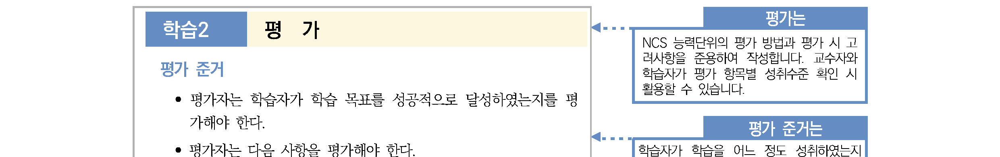
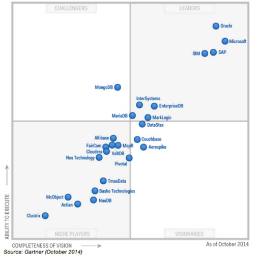
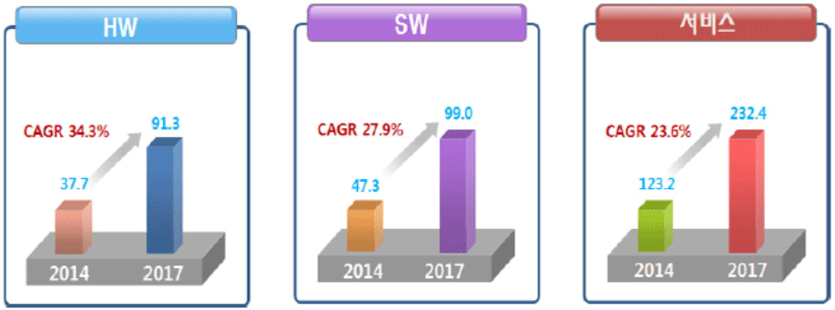
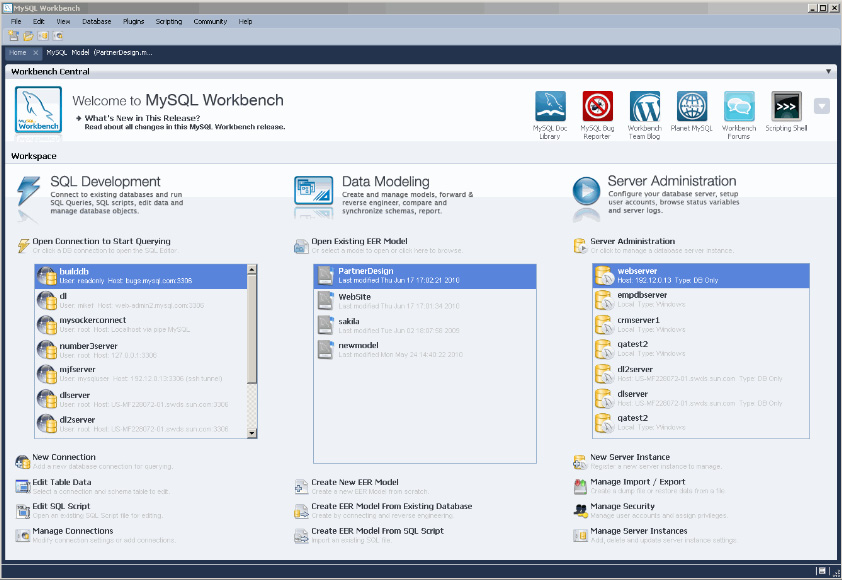

# LM2001020405_데이터베이스+구현

대분류/20

정보통신 중분류/01
정보기술 소분류/02
정보기술개발 세분류/04
DB엔지니어링 능력단위/05

| NCS학습모듈 |
| --- |

데이터베이스 구현

LM2001020405_19v4

[NCS-학습모듈의 위치]

| 정보통신 |  |  |
| --- | --- | --- |
|  | 정보기술 |  |
|  |  | 정보기술개발 |

대분류
중분류
소분류
세분류

| SW아키텍쳐 |  |  | 능력단위 | 학습모듈명 |
| --- | --- | --- | --- | --- |
| 응용SW 엔지니어링 |  |  | 데이터베이스 요구사항 분석 | 데이터베이스 요구사항 분석 |
| 임베디드SW 엔지니어링 |  |  | 개념데이터 모델링 | 개념데이터 모델링 |
| DB엔지니어링 |  |  | 논리 데이터베이스 설계 | 논리 데이터베이스 설계 |
| NW엔지니어링 |  |  | 물리 데이터베이스 설계 | 물리 데이터베이스 설계 |
| 보안엔지니어링 |  |  | 데이터베이스 구현 | 데이터베이스 구현 |
| UI/UX엔지니어링 |  |  | 데이터베이스 성능확보 | 데이터베이스 성능확보 |
| 시스템SW엔지니어링 |  |  | 데이터 전환 설계 | 데이터 전환 설계 |
| 빅데이터플랫폼구축 |  |  | 데이터 전환 | 데이터 전환 |
| 핀테크엔지니어링 |  |  | SQL활용 | SQL활용 |
| 데이터아키텍처 |  |  | SQL응용 | SQL응용 |
| loT시스템연동 |  |  | SQL작성 | SQL작성 |

인프라스트럭쳐
아키텍처 구축
차 례
학습모듈의 개요 1
학습 1. DBMS 설치하기
1-1. DBMS 선정 및 설치 계획 수립 3
1-2. DBMS 설치 12
1-3. DBMS 설치 검증 및 설치 완료 보고서 작성 18
• 교수⋅학습 방법 23
• 평가 24
학습 2. 데이터베이스 생성하기
2-1. 물리적 데이터베이스 용량 산정 26
2-2. 데이터베이스 생성 33
2-3. 데이터베이스 사용자 생성 및 권한 설정 39
2-4. 데이터베이스 설치 점검 및 완료 보고서 작성 44
• 교수⋅학습 방법 53
• 평가 54
학습 3. 데이터베이스 오브젝트 생성하기
3-1. DBMS 오브젝트 생성 계획 수립 56
3-2. 데이터베이스 오브젝트 생성 63
3-3. 데이터베이스 오브젝트 생성 완료 보고서 작성 71
• 교수⋅학습 방법 75
• 평가 76
참고 자료 78
데이터베이스 구현 학습모듈의 개요
학습모듈의 목표
설계된 데이터베이스 모델을 적용하기 위해 DBMS를 설치하고 데이터베이스와 데이터베이스 오브젝트를
생성할 수 있다.
선수학습
SQL 활용(LM2001020410_14v2) 또는 이에 해당하는 SQL 활용 지식
학습모듈의 내용 체계

| 학습 | 학습 내용 | NCS 능력단위 요소 |  |
| --- | --- | --- | --- |
|  |  | 코드 번호 | 요소 명칭 |

1-1.DBMS 선정 및 설치 계획 수립
1-2.DBMS 설치
1. DBMS 설치하기 2001020405_19v4.1 DBMS 설치하기
1-3.DBMS 설치 검증 및 설치 완
료 보고서 작성
2-1.물리적 데이터베이스 용량 산정
2-2.데이터베이스 생성
2-3.데이터베이스 사용자 생성 및 권한 데이터베이스
2. 데이터베이스 생성하기 2001020405_19v4.2
설정 생성하기
2-4.데이터베이스 설치 점검 및 완료
보고서 작성
3-1.DBMS 오브젝트 생성 계획 수립
3. 데이터베이스 오브젝트 3-2.데이터베이스 오브젝트 생성 데이터베이스
2001020405_19v4.3
생성하기 오브젝트 생성하기
3-3.데이터베이스 오브젝트 생성 완료
보고서 작성
핵심 용어
DBMS(DataBase Management System), 데이터베이스(DataBase), 메모리와 스왑(Swap), 사용자 권
한, DDL(Data Definition Language), 데이터베이스 오브젝트, 테이블, 인덱스, 뷰, 시퀀스

| 학습 1 | DBMS 설치하기 |
| --- | --- |

학습 2 데이터베이스 생성하기
학습 3 데이터베이스 오브젝트 생성하기
1-1.
DBMS 선정 및 설치 계획 수립
•데이터베이스 요구사항에 따라 하드웨어와 운영 체제에 적합한 DBMS를 선정하고 설치 계획을
학습 목표
수립할 수 있다.
필요 지식 /
① 데이터베이스 요구 사항과 DBMS 선정 기준
DBMS(DataBase Management System)를 한번 선정하면 추후 다른 제품으로 변경하기
쉽지 않다. 그러므로 데이터베이스를 구축하기 전에 먼저 어떤 DBMS를 선정할지 명확한
기준을 가지고 있어야 한다.
1. 일반적인 DBMS 선정 기준
<표 1-1> 일반적인 DBMS 선정 기준
기준 DBMS Oracle MySQL 참고
가능
가용성 가능
RAC, Data 인스턴스 가용성 여부
Cluser,Replication
Guard
VLDB 지원 VLDB에도 탁월 Web DB로 탁월 대용량 데이터 지원
다양한 개발 환경 좋음. 좋음. 다양한 개발 환경 지원
비용 수준 고비용 Free 또는 저비용 경제적인 구축 비용
좋음.(Enterprise 구입 주기적인 업그레이드와
지속적인 기술 지원 좋음.
시 가능) 기술 지원
2. 관계형 DBMS(RDBMS)와 NoSQL 선정 기준
NoSQL은 방대한 양의 데이터와 비정형 데이터가 포함된 데이터를 저장하고 사용하
는 기술이다. 대표적인 NoSQL제품은 Cassandra, HBase, MongoDB 등이 있다.
제품군에 따른 특성이 서로 다르기 때문에 특정 제품의 경험을 다른 제품에 적용하
기도 매우 어렵다. NoSQL의 경우 처음부터 스케일 아웃을 염두에 두고 설계되었기
때문에 데이터의 증가나 요청량이 증가하더라도 동일하거나 비슷한 사양의 새로운
하드웨어를 추가하면 대응이 가능하다.
<표 1-2> 관계형 DBMS와 NoSQL 선정 기준
기준 DBMS RDBMS NoSQL 참 고
ACID 준수 가능 불가능 ACID compliance 지원
OLAP/OLTP 가능 불가능 복잡한 쿼리나 분석 지원
스키마 유연성 없음. 유연성 좋음
데이터 포맷 유연성 없음. 좋음.
분산 처리 가능 가능
Sacle up/Out 유연성 가능 탁월함. 신속한 노드 추가, 삭제 지원
3. DBMS 시장 동향 분석
상용 제품으로는 오라클의 시장 점유가 여전하고, MySQL과 동일한 엔진을 사용하여
MariaDB 사용도 증가하고 있다. NoSQL로는 MongoDB, 인메모리 데이터베이스는 사용
증가 추세가 관계형 데이터베이스로 근접하고 있다.

출처: 가트너(2014), 『Operational DBMS Magic Quadrant』
[그림 1-1] 현행 DBMS 시장 분석
한국과학기술정보연구원은 2014년부터 2017년까지 빅 데이터 도입이 늘어나면서
빅데이터 인프라 시장의 성장세가 두드러질 것으로 판단하고 있다.

출처: 한국과학기술정보연구원(2013), 『빅 데이터 산업의 현황과 전망』
[그림 1-2] 빅 데이터 산업의 현황과 전망
② DBMS 설치 주요 용어
1. DBMS(Data Base Management System)
데이터베이스 관리 시스템(DBMS)은 데이터베이스(Database)를 관리하는 소프트웨어를
의미하며, 대표적인 기능은 데이터의 정의(Define), 생성, 조작, 공유, 보호, 유지 보수가
있다.
2. 데이터베이스(Database)
서로 관련되는 데이터들을 일정한 체계와 순서로 모아 놓은 데이터의 집합을 의미한다.
3. 스왑(Swap)
자료 처리를 위한 메모리 용량을 확보하기 위해 하드디스크의 저장 장치를 스왑 메모리로사용
하게 되므로, 스왑 메모리의 크기는 데이터 처리의 성능에 영향을 미칠 수 있다. 스왑
메모리의 크기는 메모리 용량의 1~2배 정도를 설정해 주는 것이 바람직하다.
<표 1-3> RAM과 스왑 공간 권장 크기
RAM SWAP Space
1~2GB RAM의 1.5배
2~16GB RAM과 동일한 크기
16GB 이상 16GB
16GB 이상 16GB
4. DBMS와 HDD(Hard disk drive)
비휘발성, 순차접근이 가능한 컴퓨터의 보조 기억 장치이다. 여러 가지 특성이 우수
한 반도체 기반의 기록 매체인 SSD(Solid State Drive)가 가격 하락과 함께 저장
매체 시장에 서서히 진입하고는 있으나, 여전히 하드 디스크에 비해 높은 가격을 가
지고 있다. 하지만 IO(Input/Output) 성능 향상을 위하여 데이터베이스 저장 매체
로 SSD를 사용이 증가하고 있는 추세이다. DBMS 설치를 위해서는 충분한 HDD의
여유 공간이 있어야 한다.
5. 커널(Kernel) 파라미터(Parameter)
다중 사용자(Multi-user) 사용자 환경인 유닉스(UNIX)와 리눅스(Linux) 운영 체제를
효과적으로 제어하기 위해서는 주요 커널 파라미터에 대해 이해하고 제어해야 한다. 보통
DBMS 설치 시 설정하는 커널 파라미터는 동시 세마포어(Semaphore) 수나 동시 파일(File)
핸들의 개수 등이 있다. 다른 유닉스(UNIX) 시스템과 달리, 리눅스(Linux) 운영 체제에서는
시스템이 실행 중인 상태에서 대부분의 커널 매개 변수를 수정할 수 있다.
6. 환경 변수
DBMS 설치 시에나 설치 완료 후에 데이터베이스에 접속하기 위해서는 환경 변수
설정이 필요하다. 오라클 데이타베이스 서버에 접속하기 위한 환경 변수는
ORACLE_BASE, ORACLE_HOME, PATH 등이다. 환경 변수의 설정을 위하여 오
라클은 유틸리티(oraenv)를 제공하고 있다.
③ 설치 사전 점검 작업(Task)
<학습 1-2. DBMS 설치>에 필요한 설치를 위한 사전 점검 작업을 이 시점에 수행하게 된다.
1. 릴리스 노트(Release Note) 확인
DBMS를 설치하기 전에 가장 먼저 확인해야 한다. 릴리스 노트를 꼼꼼하게 점검한 후,
지원되는 플랫폼(Platform)에서 가능한 DBMS 버전을 선택하여 설치한다. DBMS 별
최신 버전은 벤더사별 홈페이지에서 확인하면 된다.
2. 라이센스 정보(License Information) 확인
제품에 대해 구입한 라이센스 정보를 정확하게 확인 후 설치해야 한다. 오라클
DBMS인 경우, 많은 콤포넌트(Component)가 설치 미디어(Media)에 포함되어 있지
만 실제 라이센스를 구입한 콤포넌트만 사용이 허가된다. 구입하지 않은 콤포넌트
사용은 라이센스 계약에 위반됨을 명심해야 한다. MySQL DBMS는 Community
버전인 경우는 GPL 라이센스를 준수해야 한다.
3. 하드웨어 요구 사항 점검
DBMS 설치에 필요한 메인 메모리, 스왑(Swap) 메모리와 하드 디스크의 여유 공간을 점검한다.
(1) 메모리와 스왑(Swap) 확인
#grep MemTotal /proc/meminfo
#grep SwapTotal /proc/meminfo
(2) 하드 디스크 공간 확인
# df –h
4. 소프트웨어 요구 사항 점검
설치할 제품군에 따라서 운영 체제 버젼, 커널 요구 사항, 필요한 패키지 종류와 버
젼, 컴파일러 버전 등을 확인해야 한다.
(1) 운영 체제 확인
# cat /proc/version
(2) 패키지(Package) 요구 사항 확인
# rpm –qa
5. 운영체제(Operating System) 그룹과 사용자 점검
일반적으로 오라클 설치인 경우 oracle 계정, MySQL은 mysql 계정을 생성하며,
계정 생성 후 dba 그룹으로 등록한다.
6. 커널 파라미터(Parameter) 점검
데이터베이스 설치 매뉴얼의 커널 파라미터(Parameter) 권장 값은 보통 최소
(Minimum)값이다. 그러므로 권장 값 이상으로 변경한다.
텍스트 에디터(Editor)로 /etc/sysctl.conf를 편집하거나 /sbin/sysctl 명령어로 변
경한다.
<표 1-4> Linux 커널 파라미터와 권장 값
Parameter Value
semmsl 250
semmns 32000
semopm 100
4294967295 (32-bit Linux)
semmns
physical memory -1 byte(64-bit Linux)
shmmni 4096
file-max 6815744
7. 운영 체제 디렉토리 점검
소프트웨어 설치를 위해 필요한 디렉토리를 생성하고 생성된 디렉토리에 필요한 권
한을 부여한다. 오라클 DBMS 설치인 경우에는 ORACLE_BASE,ORACLE_HOME,
Oracle Inventory 디렉토리를 확인하고 생성한다. MySQL DBMS 설치인 경우라면
datadir,MYSQL_HOME을 생성하면 된다.
수행 내용 / DBMS 설치 계획 수립하기
재료·자료
• 물리 데이터베이스 설계서 또는 관련 자료, DBMS 제조사가 제공하는 설치 가이드
기기(장비･공구)
• 컴퓨터
안전･유의 사항
• 오라클 10g를 Linux OS 설치를 기준으로 예시하고 있으며, 더 상세한 내용은 각각의
DBMS별 설치 가이드를 참고한다.
• MySQL Community Server 5.6.26 for Linux - Generic 설치를 기준으로 예시하고
있으며, 더 상세한 내용은 각각의 DBMS별 설치 가이드를 참고한다.
수행 순서
① 오라클 DBMS를 설치한다.
1. 메모리와 스왑(Swap) 공간이 설치 최소 요구 사항을 만족하는지 확인한다.
#grep MemTotal /proc/meminfo
#grep SwapTotal /proc/meminfo
2. 하드 디스크 여유 공간을 확인한다.
# df –h
# df –h /tmp
3. 올바른 운영 체제, 패키지(Package) 요구 사항을 검증한다.
# cat /proc/version
# rpm –qa
4. 커널 파라미터(Parameter)를 설정한다.
(1) 텍스트 에디터(Editor)로 /etc/sysctl.conf를 편집한다.
fs.file-max = 6815744
kernel.shmall = 2097152
kernel.shmmax = 4294967295
kernel.shmmni = 4096
kernel.sem = 250 32000 100 128
net.ipv4.ip_local_port_range = 9000 65500
(2) 설정 값을 확인한다.
# /sbin/sysctl –a
5. 운영 체제 그룹과 사용자 계정을 생성한다.
# /usr/sbin/groupadd -g 502 dba
# /usr/sbin/groupadd -g 503 oper
# /usr/sbin/useradd -u 502 -g oinstall –G dba oracle
6. 운영 체제 디렉토리를 생성한다.
$ORACLE_HOME, 데이터베이스 디렉토리 생성 후 적절한 권한을 부여한다.
# df –h
# mkdir -p /u01/app/oracle
# chown -R oracle:oinstall /u01/app/oracle
# chmod -R 775 /u01/app/oracle
# mkdir /u01/app/oracle/oradata
# chown oracle:oinstall /u01/app/oracle/oradata
# chmod 775 /u01/app/oracle/oradata
② MySQL DBMS를 설치한다.
1. 메모리와 스왑(Swap) 공간이 설치 최소 요구 사항을 만족하는지 확인한다.
#grep MemTotal /proc/meminfo
#grep SwapTotal /proc/meminfo
2. 하드 디스크 여유 공간을 확인한다.
# df –h
# df –h /tmp
3. 올바른 운영 체제, 패키지(Package) 요구 사항을 검증한다.
# cat /proc/version
# rpm –qa
4. 커널 파라미터(Parameter)를 설정한다.
(1) 텍스트 에디터(Editor)로 /etc/sysctl.conf를 편집한다.
fs.file-max = 6815744
kernel.shmall = 2097152
kernel.shmmax = 4294967295
kernel.shmmni = 4096
kernel.sem = 250 32000 100 128
net.ipv4.ip_local_port_range = 9000 65500
(2) 설정 값을 확인한다.
# /sbin/sysctl –a
5. 운영 체제 그룹과 사용자 계정을 생성한다.
# /usr/sbin/groupadd -g 502 dba
# /usr/sbin/useradd -u 502 –G dba
mysql
6. 운영 체제 디렉토리를 생성한다.
$ORACLE_HOME, 데이터베이스 디렉토리 생성 후 적절한 권한을 부여한다.
# df –h
# mkdir –p /mysql
# chown –R mysql:dba /mysql
# chmod -R 775 /mysql
# mkdir /mysql/data
# chown mysql:dbal /mysql/data
# chmod 775 /mysql/data
수행 tip
• 오라클 소프트웨어를 Enterprise Edition으로 설치 시
메모리나 디스크 사용량이 크기 때문에 업무에 꼭 필
요한 구성 요소만 설치하는 것이 효과적이다.
• MySQL은 Enterprise Edition과 Community 버전이
모두 가능하다. 업무 요구 사항을 고려하여 설치할 버
전을 결정해야 한다.
• MySQL DBMS는 Community 설치 시에는 반드시
Bug fix 내용을 확인하고 버전을 선택해야 한다.
1-2.
DBMS 설치
•DBMS설치 계획에 따라 DBMS를 설치하고 저장소 연결, 환경 설정, 클라언트 접속 작업을
학습 목표
수행할 수 있다.
필요 지식 /
① DBMS 설치 주요 용어
1. DBMS(Data Base Management System)
데이터베이스 관리 시스템(DBMS)는 데이터베이스(Database)를 관리하는 소프트웨어를
의미하며, 대표적인 기능은 데이터의 정의(Define), 생성, 조작, 공유, 보호, 유지 보수가
있다.
2. 데이터베이스 사용자 계정
데이터베이스의 생성 및 관리, 데이터의 삽입, 수정, 변경 및 삭제를 수행하는 데이터베이스
계정을 의미한다.
(1) 관리자 계정(Administrator)
데이터베이스의 생성과 관리를 담당하는 슈퍼 유저 계정이며, 정의, 생성, 삭제 등의
작업이 가능하다. 데이터베이스에 대한 모든 권한과 책임을 가지는 계정이다.
오라클 데이터베이스 생성 시 관리자 계정인 SYS와 SYSTEM 계정이 자동으로 생성되어
있다. MySQL 데이터베이스인 경우에는 관리자 계정 root가 기본적으로 생성된다.
(2) 일반 계정(End user)
데이터베이스에 대하여 질의, 갱신, 보고서 작성 등의 작업을 수행할 수 있는 계
정이다. 일반 계정은 업무에 필요한 최소한의 권한만 가지는 것을 원칙으로 한다.
② DBMS 설치 방법
보통 Unix와 Linux인 경우 명령문(Command Line) 설치를 하고 Windows 환경인
경우 GUI 설치가 지원된다. 하지만 DBMS 제품군에 따라서 설치 방법이 상이하기 때
문에 설치 가이드를 반드시 참조한다.
1. 오라클 DBMS
Oracle 8i부터 OUI(Oracle Universal Installer)가 지원된다. OUI를 사용하면 간편
하게 DBMS설치가 가능하다. DBMS 설치 이전에 ORACLE_BASE, ORACLE_HOME,
PATH 등의 환경 변수 설정은 불필요하다. 설치 완료 후, 환경 변수의 설정을 용이
하게 하기 위하여 10g부터 oraenv 스크립트가 제공하고 있다.
2. MySQL DBMS
Unix와 Linux인 경우 명령문(Command Line) 설치 가능하며 Windows 환경인
경우 GUI 설치 완료 후 PATH 설정만 하면 DBMS에 접속할 수 있다. 접속을 위한
공통 파라미터의 설정은 .my.cnf을 이용하면 된다.
③ 클라이언트 접속 방법
DBMS 설치는 DBMS 소프트웨어만 설치 완료된 상태이며 아직 데이터베이스는 생성되지
않은 상태이다. MySQL DBMS인 경우는 멀티스레드(Multi-Threaded) 서버이므로 클라이언
트 접속의 의미가 있으나, 오라클인 경우에는 데이터베이스가 생성된 이후에나 클라이언트
접속의 의미가 있다. 클라이언트가 DBMS에 접속하기 위해서는 환경 변수 설정이 필요하다.
환경 변수 설정은 보통 셀에서 지원하는 프로파일에 설정하면 편리하다.
1. 오라클 DBMS
오라클사에서 제공하는 SQL*Plus나 상용 제품인 Orange, Toad 등 다양한 클라이언트
툴을 사용하여 DBMS에 접속할 수 있다.
2. MySQL DBMS
mysql 클라이언트 프로그램이나 무료 제품인 SQLyogi나 상용 제품인 Toad for
MySQL 등의 툴을 사용하여 DBMS에 접속할 수 있다.
수행 내용 / DBMS 설치하기
재료·자료
• 물리 데이터베이스 설계서 또는 관련 자료, DBMS 제조사가 제공하는 설치 가이드
기기(장비･공구)
• 컴퓨터, DBMS 설치 미디어(Media)
안전･유의 사항
• 오라클 10g를 Linux OS 설치를 기준으로 예시하고 있으며, 더 상세한 내용은 각각의
DBMS별 설치 가이드를 참고한다.
• MySQL Community Server 5.6.26 for Linux - Generic 설치를 기준으로 예시하고
있으며, 더 상세한 내용은 각각의 DBMS별 설치 가이드를 참고한다.
수행 순서
① 오라클 DBSMS를 설치한다.
1. 오라클 계정을 사용하여 로그인 후, OUI를 실행한다.
$ ./runInstaller
2. Welcome 화면에서‘Next’를 클릭한다.
3. Specify Inventory Directory and Credentials
디폴트 설정을 사용해도 무방하다. 그렇지 않은 경우, 올바른 inventory directory를
입력하고, operating system group name으로 oinstall을 입력한다.
4. 팝업 창에 명시된 디렉토리로 이동하여 스크립트를 실행한다.
서버에 처음 설치한 경우라면, orainstRoot.sh 스크립트를 root 계정에서 실행해야
한다는 팝업 창이 표시된다. orainstRoot.sh 스크립트를 root 계정에서 실행해야
한다는 팝업 창이 표시된다.
5. Specify File Locations 기본 값을 선택한다.
가이드의 설명을 그대로 따라 했다면, 디폴트 설정을 사용해도 무방하다. 그렇지 않은
경우 Source 경로와 Destination 경로가 올바르게 설정되었는지 확인한다.
6. Select Installation Type을 선택한다.
디폴트 설정(Enterprise Edition)을 그대로 사용한다.
7. Product-specific Prerequisite Checks 을 선택한다.
가이드의 설명을 그대로 따라 했다면, 점검 작업에서 아무런 문제가 발생되지 않을
것이다. 점검 작업이 실패한 경우, 다음 단계로 진행하기 전에 문제의 원인을 확인한
다. RHEL4 운영 체제에서 binutils, gcc, openmotif에 대한 점검 작업이 실패한
경우에는 경고 메시지를 무시하고 다음 단계로 진행한다. SLES9에서 openmotif에
대한 점검 작업이 실패한 경우에는 경고 메시지를 무시하고 다음 단계로 진행한다.
8. Specify Database Configuration Options 을 선택한다.
데이터베이스의 Global Database Name을 입력한다. ORACLE_SID와 서버의 domain
name을 연결하여 명명해야 한다.
(1) Global Database Name를 입력하면, SID는 자동으로 입력된다.
(2) 디폴트 Database Character Set을 그대로 사용한다.
(3) Create database with sample schemas을 선택한다.
9. Select Database Management Option 을 선택한다.
Use Database Control for Database Management을 선택한다.
10. Specify Database File Storage Option을 선택한다.
File System을 선택하고, 데이타베이스가 사용할 경로를 입력한다(예: /u02/oradata)
11. Specify Backup and Recovery Options을 선택한다.
Do not enable Automated backups를 선택한다.
12. Specify Database Schema Passwords을 선택한다.
Use the same password for all the accounts를 선택한 후, 패스워드를 반복 입력한다.
13. Install을 선택한다.
Summary 팝업에서 설치되는 제품에 대한 요약이 제공된다. 설치를 계속하기 위해
Install을 클릭한다.
14. Install 버튼을 선택한다.
(1) 소프트웨어의 설치가 진행되는 과정에 여러 단계의 스크린이 표시된다.
(2) 설치 과정의 마지막 단계에서 팝업 창을 통해 설정 정보가 표시된다. Enterprise
Manager URL을 확인한 후 OK를 클릭하여 창을 닫는다.
(3) "Setup Privileges” 팝업 창을 통해 root 계정으로 configuration script를 실행해
야 한다는 메시지가 표시된다.
(4) root로 로그인하여 팝업 창에 명시된 디렉토리로 이동한 뒤 root.sh 스크립트를 실행한다.
스크립트에서 local bin directory의 위치를 묻는 프롬프트가 뜨면, 디폴트 값을 승인하고
Enter를 누른다.
(5) 스크립트의 실행이 완료되면 Setup Privileges 창으로 돌아가 OK를 클릭한다.
15. Exit를 클릭한다.
End of Installation 요약 화면에 표시된 URL을 확인하고 Exit를 클릭한다.
② MySQL를 설치한다.
1. root 계정으로 서버와 클라이언트 rpm을 설치한다.
# rpm –i MySQL-server-VERSION.linux_glibc2.5.i386.rpm
# rpm –i MySQL-client-VERSION.linux_glibc2.5.i386.rpm
# rpm -hi MySQL-devel*.rpm
# rpm -hi MySQL-shared*.rpm
# rpm –hi MySQL-test*.rpm
2. MySQL 서버를 시작한다.
# service mysql start
3. MySQL 설치 보안(Security) 개선한다.
# /usr/bin/mysql_secure_installation
......
Enter current password for root (enter for none): oracle
OK, successfully used password, moving on...
...
You already have a root password set, so you can safely answer 'n'.
Set root password? [Y/n] n
... skipping.
...
Remove anonymous users? [Y/n] Y
... Success!
...
Disallow root login remotely? [Y/n] Y
... Success!
...
Remove test database and access to it? [Y/n] Y
... Success!
...
Reload privilege tables now? [Y/n] Y
... Success!
...
All done! If you've completed all of the above steps, your MySQL
installation should now be secure.
Thanks for using MySQL!
4. 설치 완료한 다음 mysql 계정으로 로그인 한 후 MySQL 서버에 접속한다.
$ mysql –uroot –poracle
mysql>
수행 tip
• 오라클 소프트웨어를 Enterprise Edition으로 설치 시
메모리나 디스크 사용량이 크기 때문에 업무에 꼭 필
요한 구성 요소만 설치할 것을 권장한다.
• MySQL DBMS를 RPM 설치 시에는 OS 버전에 따
라 기본 설치 디렉토리가 있으므로 설치 매뉴얼을 꼭
참조한다. 만약 MySQL을 별도로 디렉토리에 설치를
원하는 경우라면 TAR 설치를 권장한다.
1-3.
DBMS 설치 검증 및 설치 완료 보고서 작성
•설치된 DBMS를 검증 절차에 따라 데이터베이스 요구사항을 확인하고 DBMS 설치 완료 보
학습 목표
고서를 작성할 수 있다.
필요 지식 /
① 주요 용어
1. 운영 체제 사용자 계정
DBMS 소프트웨어의 설치 및 관리에 사용할 사용자 계정을 의미하며, 보통 설치 계
정과 일반적인 운영 계정을 분리할 것을 권장한다.
(1) DBMS 설치 계정(Administrator)
DBMS 소프트웨어의 소유자가 되며, 사용자 계정과 그룹을 가진다. DBMS 제품
군에 따라 계정을 분리한다. 설치된 DBMS 백업은 이 계정으로 작업해야 한다.
(2) 일반 계정(End user)
데이터베이스에 대하여 질의, 갱신, 보고서 작성 등의 작업을 수행할 수 있는 계
정이다. 일반 계정은 업무에 필요한 최소한의 권한만 가지는 것을 원칙으로 한다.
② 운영 체제 디렉토리
DBMS 소프트웨어를 설치할 대상 디렉토리가 반드시 필요하며, 충분한 여유 공간이 있어야
한다. 추후 DBMS의 추가적인 확장을 고려하여 디렉토리 구조를 가져가는 것이 바람직하다.
③ 환경 변수
DBMS 설치 시에나 설치 완료 후에 데이터베이스에 접속하기 위해서는 환경변수설정이
필요하다. 환경 변수는 접속 환경이 따라 상이할 수 있다. 환경 변수는 보통 로그인 프
로파일에 설정한다. 예를 들면 오라클 제품을 사용하는 경우 데이타베이스 서버에서 설
정해야 하는 환경 변수는 아래와 같다.
ORACLE_BASE, ORACLE_HOME, PATH
하나의 서버에 여러 가지의 오라클 제품 또는 데이타베이스를 운영하는 경우에는,
ORACLE_HOME, ORACLE_SID, PATH 변수를 변경해야 한다. ORACLE_BASE 변수
는 변경되어서는 안 되며, 변경이 필요한 경우 로그인 프로파일에서 설정해야 한다. 오
라클의 경우는 환경 변수의 설정을 위한 유틸리티(oraenv)를 제공하고 있다.
수행 내용 / DBMS 설치 검증하기
재료·자료
• DBMS 제조사가 제공하는 설치 가이드
기기(장비･공구)
• 컴퓨터, 설치 완료된 DBMS, DBMS 클라이언트 프로그램
안전･유의 사항
• 오라클 10g를 Linux OS 설치를 기준으로 예시하고 있으며, 더 상세한 내용은 각각의
DBMS별 설치 가이드를 참고한다.
• ySQL Community Server 5.6.26 for Linux - Generic 설치를 기준으로 예시하고 있
으며, 더 상세한 내용은 각각의 DBMS별 설치 가이드를 참고한다.
수행 순서
① 오라클 설치를 검증한다.
1. DBMS가 설치된 $ORACLE_BASE, $ORACLE_HOME 디렉토리를 확인한다.
디렉토리의 소유자가 oracle,그룹이 dba인지 반드시 확인한다.
설치 디렉토리의 여유 공간을 확인한다.
# cd $ORACLE_BASE
# ls –l
# cd $ORACLE_HOME
# ls –l
# df –h
2. DBMS 접속을 위한 환경 변수를 설정한다.
본(Bourne), 배시(Bash) 또는 콘(Korn) 쉘인 경우 .profile이나 .bash_profile에
환경 변수를 설정한다.
$ vi .bash_profile
export ORACLE_SID=RACDB1
export ORACLE_BASE=/u01/app/oracle
export ORACLE_HOME=/u01/app/oracle/product/10.2.0/db_1;
3. DBMS 버전이 정확하게 설치되었는지 확인한다.
sql*plus로 간단하게 확인하면 된다.
$ sqlplus / as sysdba
SQL> SELECT * FROM V$VERSION
4. DBMS가 설치된 디렉토리 전체를 백업한다.
DBMS가 실행 파일이 설치 된 디렉토리와 설치 Installer가 생성하는 스크립트와 사
용자 프로파일 정보는 모두 백업 대상이 된다. DBMS가 설치된 서버가 아닌 별도의
백업 서버에 할 것을 권장한다.
만약 별도의 백업용 서버가 가능하지 않다면 별도의 디스크 나 최소한 별도의 파티
션에 백업할 것을 권장한다.
예제에서는 별도의 파티션에 백업을 위한 운영 체제 디렉토리를 생성한다.
$ORACLE_HOME 이하를 백업하면 된다. 또한 인스톨 중 Installer가 생성하는
root.sh는 반드시 백업하도록 한다. 동일한 오라클 홈 디렉토리에 다른 제품군이 설
치되는 경우 기 존재하는 root.sh가 갱신되기 때문이다.
# mkdir /backup/oracle/10.2.0
# cp –r $ORACLE_HOME /backup/oracle/10.2.0
# cp $ORACLE_HOME/root.sh /backup/oracle/10.2.0 4
② MySQL 설치를 검증한다.
1. MySQL인 경우 설치된 디렉토리를 확인한다.
MySQL은 홈 디렉토리 개념은 있으나 홈 디렉토리를 지정하는 환경 변수가 없다.
다음 명령어로 DBMS가 설치된 디렉토리를 확인한다.
디렉토리의 소유자가 mysql, 그룹이 dba인지 반드시 확인한다.
또한 설치 디렉토리의 여유 공간도 확인한다.
# cd /var/lib/mysql
# ls –l
# cd /var/lib/mysql/data
# ls –l
# df –h
2. DBMS 접속을 위한 환경 변수를 설정한다.
본(Bourne), 배시(Bash) 또는 콘(Korn) 쉘인 경우 .profile이나 .bash_profile에
환경 변수를 설정한다.
$ vi .bash_profile
export PATH=$PATH:/var/lib/mysql/bin
3. DBMS 버전이 정확하게 설치되었는지 확인한다.
mysql 클라이언트 프로그램으로 확인하면 된다.
$ mysql –V

또는 다양한 클라이언트 툴을 사용하여 데이터베이스 접속을 하면 된다.
MySQL Workbench를 이용하면 SQL 수행과 데이터 모델링 작업도 지원된다.

[그림 1-3] MySQL Workbench
4. DBMS 설치 관련 운영 체제 디렉토리를 백업한다.
DBMS가 실행 파일이 설치된 디렉토리와 설치 Installer가 생성하는 스크립트와 사
용자 프로 파일 정보는 모두 백업 대상이 된다.
DBMS가 설치된 서버가 아닌 별도의 백업 서버에 할 것을 권장한다.
만약 별도의 백업용 서버가 가능하지 않다면 별도의 디스크나 최소한 별도의 파티션
에 백업할 것을 권장한다.
예제에서는 별도의 파티션에 백업을 위한 운영 체제 디렉토리를 생성한다.
파라미터 파일인 /etc/my.cnf도 잊지 말고 백업한다.
# mkdir /backup/mysql/5.6.12
# cp –r /var/lib/mysql /backup/mysql/5.6.12
# cp /etc/my.cnf /backup/mysql/5.6.12
수행 tip
• DBMS설치 이후의 변경 사항을 추적할 수 있도록 문서
작성 도구를 이용하여 DBMS 설치 검증 결과를 기록해
둘 것을 권장한다.

| 학습 1 | 교수·학습 방법 |
| --- | --- |

교수 방법
• 현재 사용하는 다양한 DBMS 제품군(RDBMS, noSQL 등)에 대해 알아보고, 업무에 적합한
DBMS 선정 기준에 대해 설명한다.
• 산업 현장에서 흔히 사용하는 상용 DBMS 선정하여 설치 방법에 대해 설명한다.
• 산업 현장에서 사용 추이가 증가하고 있는 오픈 소스 DBMS 선정하여 설치 방법에 대해 설명한다.
• DBMS별로 설치 방법이 상이하므로, 학습자가 관련 매뉴얼을 직접 찾을 수 있고, 매뉴얼을
충분히 숙지하여 활용할 수 있도록 설명한다.
• DBMS 설치와 관련된 환경과 관련 명령어에 대해 설명한다.
• DBMS 설치 완료 보고서를 학습자가 직접 작성하도록 하여 학습 효과를 높인다.
• 설치 과정에 대해 충분히 습득하도록 실습 위주로 교육한다.
학습 방법
• 산업 현장에서 사용하고 있는 상용 DBMS와 오픈 소스 DBMS는 어떤 종류가 있는지 파악한다.
• 일반적인 DBMS 선정 기준에 대해 학습한다.
• DBMS 설치 관련 매뉴얼을 직접 찾아보고 매뉴얼을 충분히 숙지하여 활용할 수 있도록
학습한다.
• DBMS 설치와 관련한 용어에 대해 충분히 숙지한다.
• DBMS 접속 다양한 클라이언트 툴에 대해 직접 찾아보고, 1개 이상의 툴을 직접 설치한
후 사용해 본다.
• DBMS 설치 완료 보고서 사례를 학습한다.
• 실습을 통하여 DBMS 설치하는 절차 및 방법을 충분히 숙지한다.

| 학습 1 | 평 가 |
| --- | --- |

평가 준거
• 평가자는 학습자가 학습 목표를 성공적으로 달성하였는지를 평가해야 한다.
• 평가자는 다음 사항을 평가해야 한다.

| 학습 내용 | 학습 목표 | 성취수준 |  |  |
| --- | --- | --- | --- | --- |
|  |  | 상 | 중 | 하 |

DBMS 선정 및 - 데이터베이스 요구 사항에 따라 하드웨어와 운영 체제에
설치 계획 수립 적합한 DBMS를 선정하고 설치 계획을 수립할 수 있다.
- DBMS 설치 계획에 따라 DBMS를 설치하고 저장소 연
DBMS 설치
결, 환경 설정, 클라언트 접속 작업을 수행할 수 있다.
DBMS 설치
- 설치된 DBMS를 검증 절차에 따라 데이터베이스 요구 사항을
검증 및 설치 완료
확인하고 DBMS 설치 완료 보고서를 작성할 수 있다.
보고서 작성
평가 방법
• 피평가자 체크리스트

| 학습 내용 | 평가 항목 | 성취수준 |  |  |
| --- | --- | --- | --- | --- |
|  |  | 상 | 중 | 하 |

DBMS 선정 및
- 설치 사전 점검 작업 작성
설치 계획 수립
- DBMS 설치하기
DBMS 설치
- 클라이언트 접속 환경 설정
DBMS 설치 - 설치된 SW 확인하기
검증 및 설치
완료 보고서 작성 - 완료 보고서 항목 작성
• 작업장 평가

| 학습 내용 | 평가 항목 | 성취수준 |  |  |
| --- | --- | --- | --- | --- |
|  |  | 상 | 중 | 하 |

DBMS 설치
- 설치 계획에 따라 DBMS를 설치하고 설치 검증 및 완료
검증 및 설치
보고서 작성
완료 보고서 작성
피드백
1. 피평가자 체크리스트
- DBMS 설치 계획 수립에 어려움을 느끼는 경우 요청서, 제안서, 계획서 등을 수집하여 정리하게
한다.
- 문서 작성에 어려움을 느끼는 경우 샘플 서식을 수집.배포하거나, 필요 항목을 추출하여 사례로
제시한다.
2. 작업장 평가
- 설치와 관련된 명령어 기능을 정리하여 문서로 작성해 보도록 한다.
- DBMS 설치 방법을 숙지하지 못한 경우 실습 시간을 추가로 할당하여 연습하도록 한다.
학습 1 DBMS 설치하기

| 학습 2 | 데이터베이스 생성하기 |
| --- | --- |

학습 3 데이터베이스 오브젝트 생성하기
2-1.
물리적 데이터베이스 용량 산정
•설계에 따른 테이블과 인덱스 등의 오브젝트에 기반하여 데이터 파일, 컨트롤 파일, 로그 파일
학습 목표
에 필요한 용량을 산정하고 형식을 정의할 수 있다.
필요 지식 /
① 데이터베이스 오브젝트(Object, 객체)
데이터베이스의 저장 공간을 차지하는 대표적인 오브젝트(객체)가 테이블과 인덱스이다.
테이블과 인덱스는 물리적인 데이터 파일에 저장된다.
1. 테이블(table)
테이블은 행(Row)과 칼럼(Column)으로 구성되는 가장 기본적인 데이터베이스 객체
로 데이터베이스 내에서 모든 데이터는 테이블을 통해 저장된다. 상용 DBMS들은
데이터를 저장하는 방식이 상이한 여러 종류의 테이블을 제공하고 있으므로 테이블
설계 시에 성능, 확장성, 가용성 등을 고려해 테이블 유형을 선택하여야 한다. 테이
블은 물리적으로는 OS상의 데이터 파일(Data file) 형태로 저장된다. DBMS 종류에
따라 데이터 파일에 저장되는 저장 형태, 위치 등은 다르다. 상세한 내용은 데이터베
이스 물리 속성 설계를 참조한다.
2. 인덱스(Index)
인덱스는 어떤 종류의 검색 연산을 최적화하기 위해 데이터베이스상에 로우들의 정
보를 구성하는 데이터 구조이다. 인덱스를 이용하면 전체 데이터를 검색하지 않고
데이터베이스에서 원하는 정보를 빠르게 검색할 수 있다. 테이블에 데이터가 수천만
개로 증가하여도 인덱스를 이용한 접근 경로와 검색 범위가 동일하다면 속도의 변화
는 거의 발생하지 않는다. DBMS 종류에 따라 인덱스가 테이터 파일에 함께 저장될
수도 있고, 별도의 인덱스 파일에 저장되기도 한다.
② 데이터 파일, 컨트롤 파일과 리두 로그 파일
데이터베이스 용량 산정에 포함되는 필수 파일들이다. 데이터베이스를 구성하는 필수 파일은
DBMS의 종류에 따라 다르다. 오라클 데이터베이스는 데이터파일, 컨트롤 파일과 리두 로그
파일이 필수 파일이다. 하지만 MySQL 데이터베이스는 데이터파일과 리두 로그 파일만이
필수 파일이다.
1. 데이터 파일(Data file)
테이블과 인덱스가 저장되는 파일, 즉 실제 데이터가 저장되는 파일이다. DBMS 종류에
따라 데이터와 인덱스가 별개의 파일로 저장되기도 한다.
(1) 오라클 데이터베이스
시스템 데이터와 사용자 데이터가 모두 저장된다. 테이블은 테이블 스페이스라는
논리적인 단위를 이용하여 관리하고, 테이블 스페이스는 물리적인 데이터 파일을
지정하여 저장된다. 테이블, 테이블 스페이스, 데이터 파일로 분리하여 관리함으
로써 논리적인 구성이 물리적인 구성에 종속되지 않고 투명성을 보장할 수 있다.
(2) MySQL 데이터베이스
MyISAM 엔진(Engine)을 사용하는 테이블은 데이터와 인덱스를 별도의 파일로
저장한다. InnoDB는 데이터와 인덱스가 동시에 한 개의 데이터 파일에 저장된
다. 대량 데이터 저장을 위해서는 테이블 당 한 개의 데이터 파일에 저장할 것을
권장한다.
2. 컨트롤 파일(Control File)
오라클 데이터베이스의 필수 파일이다. 데이터베이스의 동기화 정보를 저장하고 있는
이진(Binary) 파일이며, 데이터베이스를 시작하고 성공적으로 운영하는 데 반드시 필요한
필수 파일이다. 데이터베이스가 가동 중인 동안 계속적으로 갱신된다. 만약, 컨트롤 파일이
유실되는 경우 데이터베이스는 정상적으로 가동되지 않는다.
3. 리두 로그 파일(Redo Log File)
데이터베이스의 모든 변경 사항을 기록하는 파일이며, 이 로그 파일이 손상되는 경우
데이터의 유실(Loss)과 관계된다.
(1) 오라클 데이터베이스
데이터베이스의 모든 변경 사항을 기록하는 파일이다. 운영 중인 데이터베이스에
서 리두 로그 파일이 손상되는 경우 데이터의 유실(Loss)이 발생할 수 있다. 그러
므로, 데이터베이스 벤더들은 로그 파일을 이중화(Mirroring)할 것을 권장한다.
(2) MySQL 데이터베이스
InnoDB의 모든 변경 사항을 기록하는 파일이며, 트랜잭션 로그(Transaction
Log)라고도 한다. 운영 중인 데이터베이스에서 리두 로그 파일이 손상되는 경우
데이터의 유실(Loss)이 발생할 수 있다. 로그 파일을 이중화(Mirroring) 할 것을
권장한다.
기본적으로 2개의 그룹이 생성된다. MySQL은 리두 로그의 크기를 가능하면 크
게 1G 이상으로 가져 갈 것을 권장한다.
만약, 복제 슬레이브(Replication Slave)를 구성했다면 빈 로그(BinaryLog) 파일
도 필수적인 파일에 포함된다. 빈 로그는 증분(Incremental) 백업을 위한 용도와
복제 슬레이브가 있는 경우 반드시 활성화되어야 한다.
③ 데이터베이스 용량 산정
1. 용량 산정 목적
데이터베이스에 저장될 각종 오브젝트(Object)가 얼마나 많은 디스크 공간을 차지할
것인지 용량을 산정하여 디스크 사용의 효율을 높이기 위함이다.
2. 용량 산정 방법
설계 단계에서 분석된 테이블의 행의 크기, 트랜잭션 양, 보관 주기 등을 고려하여
데이터 용량을 정확히 산정하는 것이 중요하다. 테이블과 함께 인덱스도 저장 공간
을 차지한다는 것을 염두에 두어야 한다.
용량 계산에는 데이터베이스 시스템 파일(컨트롤 파일, 리두 로그 파일 등)도 포함해야
한다.
수행 내용 / 데이터베이스 용량 산정하기
재료·자료
• 물리 데이터베이스 설계서 또는 관련 자료, DBMS 제조사가 제공하는 데이터베이스 설치
가이드
기기(장비･공구)
• 컴퓨터, 문서 작성 도구 또는 CASE 툴
안전･유의 사항
• 해당 사항 없음.
수행 순서
① 오라클 데이터베이스 용량을 산정한다.
1. 테이블스페이스별 용량을 산정한다.
<표 2-1>에서와 같이 주요 오브젝트를 위한 용량을 계산한다. 오브젝트명, 용량, 테이블
스페이스명, 데이터 파일명 등을 작성한다. 대표적인 오브젝트는 테이블과 인덱스가 있다.
DB 물리 모델이 완성되었기 때문에 <표 2-1)>의 내용을 일일이 작성할 필요가 없다.
CASE 툴을 사용하면 간단하게 원하는 정보를 추출할 수 있다.
테이블이 추가적으로 확장 될 것을 감안하여 대략 40% 정도의 스페이스를 더 확보한다.
<표 2-1> 테이블 스페이스 용량 조사
오브젝트명 용 량 테이블 스페이스명 데이터 파일명
사용자 500M code_ts code01.dbf
부서 500M code_ts code01.dbf
주문 1024M sales_ts sales01.dbf
2. 데이터 파일별 용량을 산정한다.
<표 2-2>에서와 같이 데이터 파일명, 파일 용량, 데이터 파일이 저장될 디렉토리, 데이터파일
의 크기를 결정한다. <표 2-2>에서와 같이 데이터파일별 용량을 계산한다. 데이터 파일명,
용량, 데이터 파일 디렉토리, 테이블 스페이스 명, 디스크명 등을 작성한다.
<표 2-2> 데이터 파일 용량 조사
데이터 파일명 데이터 파일 용량 데이터 파일 디렉토리 테이블 스페이스명 디스크명
data001.dbf 500M /u01/oradata/mydb code_ts /u01
data002.dbf 500M /u01/oradata/mydb code_ts /u01
data003.dbf 1024M /u02oradata/mydb sales_ts /u02
3. 컨트롤 파일 용량을 산정한다.
2개 이상을 권장한다. DBCA로 생성 시 기본적으로 3개가 생성된다. OMF로 생성
하는 경우 기본 크기는 100MB이다. 이 경우라면 최대 300MB이면 충분하다.
4. 리두 로그 파일의 용량을 산정한다.
리두 로그 파일은 논리적으로는 리두 로그 그룹으로 관리된다. 리두 로그 그룹은 반
드시 2개 이상이어야 하며, DBCA로 생성 시 기본적으로 3개가 생성된다. 각 리두
로그 그룹은 둘 이상의 멤버(Member)로 구성할 것을 권장한다. 또한 OMF로 생성
시 기본 크기는 100MB이다. 3개인 경우 600MB이면 충분하다.
<표 2-3>에서와 같이 그룹 번호, 리두 로그 파일명, 파일 용량, 디렉토리, 디스크명
등을 작성한다. 10g부터는 Redo log Advisor를 사용하여 업무 로드에 최적의 리두
로그 파일 크기를 쉽게 확인 가능하다.
<표 2-3> 리두 로그 파일 용량 조사
그룹 번호 리두 로그 파일 명 리두 로그 파일 용량 디렉토리 디스크
redo01_01.log 100M /u01/onlinelog /u01
1
redo01_02.log 100M /u02onlinelog /u02
redo02_01.log 100M /u01/onlinelog /u01
2
redo02_02.log 100M /u02/onlinelog /u02
redo03_01.log 100M /u01/onlinelog /u01
3
redo03_02.log 100M /u02/onlinelog /u02
5. 디스크별 용량을 산정한다.
<표 2-4>를 참조하여 디스크별로 데이터 파일이 적절하게 분산 배치되도록 작성한다.
파일명에는 데이터 파일, 컨트롤 파일, 리두 로그 파일명을 모두 기재한다.
<표 2-4> 디스크 용량 조사
디스크
사용한
디스크명 디렉토리 전 체 파일명 파일 용량
디스크 용량
용량
data001.dbf 500M
/u01 /u01/oradata/mydb 2G 1G
data002.dbf 500M
/u02 /u02oradata/mydb 2G 1G data003.dbf 1024M
② MySQL 데이터베이스 용량을 산정한다.
1. 오브젝트별 용량을 산정한다.
<표 2-1>에서와 같이 주요 오브젝트를 위한 용량을 계산한다. InnoDB인 경우는 테
이블 한 개가 하나의 데이터 파일로 저장된다. 대표적인 오브젝트는 테이블과 인덱
스가 있다. MyISAM인 경우 데이터와 인덱스가 별도의 파일로 저장된다. 테이블명,
용량, 데이터 파일명 등을 작성한다. DB 물리 모델이 완성되었기 때문에 <표 2-1)>
의 내용을 일일이 작성할 필요가 없다. CASE 툴을 사용하면 간단하게 원하는 정보
를 추출할 수 있다.
테이블이 추가적으로 확장될 것을 감안하여 대략 40% 정도의 여유 공간을 더 확보한다.
<표 2-1> 오브젝트별 용량 조사
오브젝트명 용량 데이터 파일명
사용자 500M data001.dbf
부서 500M data001.dbf
주문 1024M sales001.dbf
2. 데이터 파일별 용량을 산정한다.
<표 2-2>에서와 같이 데이터 파일별 용량을 계산한다. 데이터 파일명, 용량, 데이터
파일 디렉토리, 디스크명 등을 작성한다.
<표 2-2> 데이터 파일 용량 조사
데이터 파일명 데이터 파일 용량 데이터 파일 디렉토리 디스크명
data001.dbf 500M /u01/oradata/mydb /u01
data002.dbf 500M /u01/oradata/mydb /u01
data003.dbf 1024M /u02oradata/mydb /u02
3. 리두 로그 파일의 용량을 산정한다.
리두 로그 파일은 논리적으로는 리두 로그 그룹으로 관리된다. 리두 로그 그룹은 반
드시 2개 이상이어야 하며, 3개 이상을 권장한다. 1G로 인스턴스를 시작하며 로그
스위치 간격을 통하여 리두 로그 파일 크기를 최적화하면 된다.
<표 2-3>에서와 같이 그룹 번호, 리두 로그 파일 명, 파일 용량, 디렉토리, 디스크명
등을 작성한다.
<표 2-3> 리두 로그 파일 용량 조사
그룹 번호 리두 로그 파일명 리두 로그 파일 용량 디렉토리 디스크
1 redo01.log 1024M /u01/onlinelog /u01
2 redo02.log 1024M /u02/onlinelog /u02
3 redo03.log 1024M /u03/onlinelog /u03
4. 디스크별 용량을 산정한다.
<표 2-4>를 참조하여 디스크별로 데이터 파일이 적절하게 분산 배치되도록 작성한다.
파일명에는 데이터 파일, 리두 로그 파일명을 모두 기재한다.
<표 2-4> 디스크 용량 조사
디스크
사용한
디스크명 디렉토리 전체 파일명 파일 용량
디스크 용량
용량
data001.dbf 500M
/u01 /u01/oradata/mydb 2G 1G
data002.dbf 500M
/u02 /u02oradata/mydb 2G 1G data003.dbf 1024M
수행 tip
• 업무 요구사항을 기반으로 정확한 데이터 용량을 산정
하도록 한다. 적절한 분산을 통해 디스크 입출력시 경
합을 최소화한다.
• 테이블이 추가적으로 확장될 것을 감안하여 대략 40%
정도의 디스크 공간을 더 확보한다.
2-2.
데이터베이스 생성
• 관리자 도구 혹은 명령어를 이용하여 데이터베이스 블록 사이즈, 로그 관리, 환경 설정을 적
학습 목표
용하고 확인할 수 있다.
필요 지식 /
① 데이터베이스 생성에 필요한 옵션
데이터베이스 생성(CREATE DATEABASE) 명령문과 생성 시의 필수 옵션은 DBMS 종류에
따라 다르다.
1. 오라클 데이터베이스
(1) 데이터베이스 블록(Database Block) 사이즈
오라클 데이터베이스의 IO(Input Output)의 최소 단위이며, 데이터베이스 생성 시
지정한다. 오라클 11g에서는 2K, 4K, 8K, 16K, 32K가 지원된다. 온라인 (Online)
업무인 경우는 상대적으로 작은 블록 사이즈를 권장하며, DW(Data Warehouse)
업무에는 16K, 32K등 블록 사이즈가 클수록 IO의 성능 향상이 기대된다. 일단 데이터베
이스가 생성된 후에는 데이터베이스 블록 크기는 변경할 수 없다.
(2) 데이터베이스 식별자(SID)
기본적으로 데이터베이스명과 동일하며, 인스턴스를 유일하게 식별하는 역할을 한다.
(3) 캐릭터 셋(Chracter Set)
데이터베이스 캐릭터 세트(Database Character Set)는 SQL이 저장되는 캐릭터 세트이
므로ASCII가 포함된 문자 집합이어야 하고 오라클은 유니코드(Unicode) AL32UTF8을
권장한다. 국가 캐릭터 세트(National Character Set)은 NVARCHAR2, NCHAR
데이터 타입의 문자를 저장할 때 사용되는 문자 집합이다.
DBMS별로 지원 가능한 캐릭터 세트는 상이할 수 있으므로 설치 매뉴얼을 참조
한다.
예를 들면, 오라클은 AL32UTF8 유니코드(Unicode) 캐릭터 세트를 지원하나,
MySQL은 UTF8 캐릭터 세트를 지원한다.
2. MySQL 데이터베이스
(1) 데이터베이스 페이지(Page) 사이즈
MySQL 데이터베이스의 IO(Input Output)의 최소 단위이며, 데이터베이스 생성
시 지정한다. 4K, 6K, 16K의 페이지 사이즈가 지원된다. 페이지 블록 사이즈가
클수록 IO의 성능이 향상된다. 일단 데이터베이스가 생성된 이후에는 블록 사이
즈는 변경 되지 않는다.
(2) 캐릭터 세트(Chracter Set)
데이터베이스 캐릭터 세트((Database Character Set)는 SQL이 저장되는 캐릭터 세트
이므로ASCII가 포함된 문자집합이어야 하고 오라클은 유니코드(Unicode) AL32UTF8
을 권장한다. 국가 캐릭터 세트(National Character Set)는 NVARCHAR2, NCHAR데
이터타입의 문자를 저장할 때 사용되는 문자 집합이다.
DBMS별로 지원 가능한 캐릭터 세트를 상이할 수 있으니 설치 매뉴얼을 참조한다.
예를 들면, 오라클은 AL32UTF8 유니코드(Unicode) 캐릭터 세트를 지원하나,
MySQL은 UTF8 캐릭터 세트를 지원한다.
② 데이터베이스 생성 방법
1. GUI 툴(Tool)
오라클 데이터베이스는 웹(Web) 기반 툴인 Oracle Enterprise Manager(이하, OEM)이나
dbca(DataBase Configuration Assistant)를 사용하면 된다. MySQL은 MySQL
Workbench를 이용하면 편리하다. Orange, Toad 등의 상업용(Commercial) 3rd파티
(Party) 툴도 있으며, SQLyogi 등의 무료 소프트웨어도 있다.
툴에서 제공하는 매뉴얼을 참조하면 몇 번의 버튼 클릭으로 간단하게 데이터베이스
를 생성할 수 있다.
2. 명령어(Command-Line) 도구
오라클의 SQlL*Plus, MySQL의 mysql이 해당된다. 대화식(Interactive)이나 배치
(Batch) 방식으로 모두 수행 가능하다. 이 경우는 DDL(Data Definition
Language)를 사용하여 데이터베이스를 생성해야 하므로 CREATE DATABASE
SQL 구문을 이해해 두어야 한다.
(1) 오라클 데이터베이스
CREATE DATABASE sample
CONTROLFILE REUSE
LOGFILE
GROUP 1 ('diskx:log1.log', 'disky:log1.log') SIZE 50K,
GROUP 2 ('diskx:log2.log', 'disky:log2.log') SIZE 50K
MAXLOGFILES 5
MAXLOGHISTORY 100
MAXDATAFILES 10
MAXINSTANCES 2
ARCHIVELOG
CHARACTER SET AL32UTF8
NATIONAL CHARACTER SET AL16UTF16
DATAFILE
'disk1:df1.dbf' AUTOEXTEND ON,
'disk2:df2.dbf' AUTOEXTEND ON NEXT 10M MAXSIZE UNLIMITED
DEFAULT TEMPORARY TABLESPACE temp_ts
UNDO TABLESPACE undo_ts
SET TIME_ZONE = '+02:00';
(가) CHARACTER SET: 저장할 데이터의 캐릭터 세트를 지정한다.
(나) MAXDATAFILES: 컨트롤 파일의 초기 크기를 결정하며, DB_FILES에 도달한
후 데이터파일을 추가하게 되면, 자동으로 컨트롤 파일의 크기가 연장된다.
(다) LOGFILE: 리두 로그 파일을 지정하며, 최소 2개 이상의 그룹을 지정해야 한다.
(라) SYSAUX: 10g부터는모든 데이터베이스에는 SYSTEM과 SYSAUX 테이블 스페이스가
반드시 생성되어야 한다.
(2) MySQL 데이터베이스
CREATE DATABASE mydb
DEFAULT CHARACTER SET utf8
DEFAULT COLLATE utf8_general_ci;
(가) CHARACTER SET: 저장할 데이터의 캐릭터 세트를 지정한다.
(나) COLLATE: 문자 집합의 정렬 방식을 지정한다.
오라클인 경우 파라미터 파일 생성 구문도 익혀 둔다.
PFILE에서 SPFILE을 생성하는 명령어이다.
CREATE SPFILE = 's_params.ora'
FROM PFILE = '$ORACLE_HOME/work/t_init1.ora';
수행 내용 / 데이터베이스 생성하기
재료·자료
• 물리 데이터베이스 설계서 또는 관련 자료, DBMS 제조사가 제공하는 데이터베이스 설치 가이드
기기(장비･공구)
• 컴퓨터, 문서 작성 도구 또는 CASE 툴
안전･유의 사항
• 데이터베이스 설치 예제는 오라클 10g를 Linux OS 설치를 기준으로 예시하고 있으며,
더 상세한 내용은 각각의 DBMS별 설치 가이드를 참고한다.
• MySQL Community Server 5.6.26 for Linux - Generic 설치를 기준으로 예시하고
있으며, 더 상세한 내용은 각각의 DBMS별 설치 가이드를 참고한다.
수행 순서
① 오라클 데이터베이스를 생성한다.
1. 파라미터 파일을 준비한다.
파라미터 파일을 준비한다. 파라미터 파일은 $ORACLE_HOME/dbs에 위치하고 있다.
2. DBA 권한으로 인스턴스에 접근한다.
$ SQLPLUS as SYSDBA
3. 서버 파라미터 파일을 사용하여 인스턴스를 시작할 것을 권장한다.
CREATE SPFILE='/u01/oracle/dbs/spfilemynewdb.ora' FROM
PFILE='/u01/oracle/admin/initmynewdb/scripts/init.ora';
SHUTDOWN;
EXIT;
4. 인스턴스를 NOMOUNT 단계로 시작한다.
STARTUP NOMOUNT
5. 데이터베이스를 생성한다.
예제는 CREATE DATABASE 구문을 사용하여 데이터베이스를 생성한다. dbca 툴을
사용하여 빠르고 간단하게 데이터베이스를 생성할 수도 있다.
CREATE DATABASE mynewdb
USER SYS IDENTIFIED BY pz6r58
USER SYSTEM IDENTIFIED BY y1tz5p
LOGFILE GROUP 1 ('/u01/oracle/oradata/mynewdb/redo01.log') SIZE 100M,
GROUP 2 ('/u01/oracle/oradata/mynewdb/redo02.log') SIZE 100M,
GROUP 3 ('/u01/oracle/oradata/mynewdb/redo03.log') SIZE 100M
MAXLOGFILES 5
MAXLOGMEMBERS 5
MAXLOGHISTORY 1
MAXDATAFILES 100
MAXINSTANCES 1
CHARACTER SET US7ASCII
NATIONAL CHARACTER SET AL16UTF16
DATAFILE '/u01/oracle/oradata/mynewdb/system01.dbf' SIZE 325M REUSE
EXTENT MANAGEMENT LOCAL
SYSAUX DATAFILE '/u01/oracle/oradata/mynewdb/sysaux01.dbf' SIZE 325M
REUSE
DEFAULT TABLESPACE tbs_1
DEFAULT TEMPORARY TABLESPACE tempts1
TEMPFILE '/u01/oracle/oradata/mynewdb/temp01.dbf'
SIZE 20M REUSE
UNDO TABLESPACE undotbs
DATAFILE '/u01/oracle/oradata/mynewdb/undotbs01.dbf'
SIZE 200M REUSE AUTOEXTEND ON MAXSIZE UNLIMITED;
6. 데이터 딕셔너리 뷰를 생성한다.
CONNECT SYS/password AS SYSDBA
@/u01/oracle/rdbms/admin/catalog.sql
@/u01/orcle/rdbms/admin/catproc.sql
7. 데이터베이스를 백업한다.
데이터베이스를 정상 종료한 후 전체 백업(Full Backup)을 수행한다.
② MySQL 데이터베이스를 생성한다.
1. 파라미터 파일을 준비한다.
기본 위치에 파라미터 파일 my.cnf를 준비한다. 파라미터 파일은 기본적으로 /etc 또는
MySQL 설치 디렉토리에 위치한다.
2. DBA권한으로 인스턴스에 접근한다.
$ mysql –uroot –poracle
3. 데이터베이스를 생성한다.
CREATE DATABASE my_newdb
DEFAULT CHARACTER SET UTF8
DEFAULT COLLATE utf8_general_ci;
4. 데이터베이스를 백업한다.
데이터베이스를 정상 종료한 후 전체 백업(Full Backup)을 수행한다. 별도의 백업
툴(Tool) 이 없다면 OS 명령어를 사용하여 백업한다.
수행 tip
• 오라클 데이터베이스 생성 시 MAXDATAFILES는 여유
있게 설정할 것을 권장한다.
• 데이터베이스 기본 캐릭터 세트는 다국어 지원을 위한
유니코드를 권장한다. 또한 데이터베이스 페이지 크기
는 일단 데이터베이스가 생성된 후에는 변경이 불가능
하다.
2-3.
데이터베이스 사용자 생성 및 권한 설정
•데이터베이스에 대한 관리자, 사용자 계정을 이해하고 데이터베이스 사용 규칙에 따라 계정별
학습 목표
권한 설정을 적용할 수 있다.
필요 지식 /
① 데이터베이스 계정
1. 관리자 계정(Administrator Account)
데이터베이스의 생성과 관리를 담당하는 슈퍼 유저(Super User) 계정이며, 오브젝트
(Object)의 생성, 변경, 삭제 등의 작업이 가능하다. 데이터베이스에 대한 모든 권한과
책임을 가지는 계정이다.
2. 사용자 계정(General User Account)
데이터베이스에 대하여 질의(Query), 갱신, 보고서 작성 등의 작업을 수행할 수 있는
계정이다. 일반 계정은 보안을 위하여 업무에 필요한 최소한의 권한만 가지는 것을 원칙으로
한다.
② 데이터베이스 계정 생성
Create User 명령어로 생성한다. 비밀번호 변경은 Alter user로 가능하다.
1. 오라클 데이터베이스
create user joe identified by black
default tablespace hr_data01
temporary tablespace temp;
alter user joe identified by white;
2. MySQL 데이터베이스
MySQL은 사용자 계정 생성시에 접속 호스트 정보가 필요하다.
create user ‘joe’@’localhost’ identified by black;
③ 권한(Privileges)
DBMS 종류에 따라 제공되는 권한이 다르다. 사용자 계정에 권한을 부여할 때는 최소
한의 원칙을 준수해야 한다.
1. 시스템 권한 (System Privilege)
오라클 접속, 테이블.뷰.인덱스 생성 권한 등이 있다. 관리자 계정에 부여 되는 권한이다.
SYS, SYSTEM 계정으로 부여 가능하다.
2. 객체 권한 (Object Privilege)
테이블.뷰.시퀀스.함수에 대한 DML(select, insert, delete) 사용 권한이다. 객체의
소유자나 관리자 계정으로 부여 가능하다.
④ 권한 생성과 변경
Grant 명령어로 권한을 부여하며, Revoke 명령어로 권한을 취소한다.
1. 오라클 데이터베이스
생성된 계정은 권한이 없기 때문에 데이터베이스에 로그인을 할 수 없다. 로그인에
필요한 권한이 create session 권한이다.
grant create session, create table to joe;
grant select on dept to public;
revoke create table from joe;
2. MySQL 데이터베이스
데이터베이스에 로그인을 위해서는 오라클과는 달리 별도의 권한이 필요 없다.
MySQL에서 생성된 데이터베이스 계정에 대해 로그인을 제한할 방법이 없다.
grant create table on *.* to ‘joe’@’localhost’;
revoke create table on *.* from‘joe’@’localhost’;
수행 내용 / 데이터베이스 사용자 생성과 권한 설정하기
재료·자료
• 물리 데이터베이스 설계서 또는 관련 자료, DBMS 제조사가 제공하는 데이터베이스 사용자(user)
매뉴얼
기기(장비･공구)
• 컴퓨터
안전･유의 사항
• 데이터베이스 종류에 따라 지원되는 권한이 서로 상이하기 때문에 사용자 매뉴얼을 참조한다.
• 데이터베이스 종류에 따라 SQL 구문상의 차이점이 있기 때문에 반드시 사용자 매뉴얼을
참조한다.
수행 순서
① 오라클 사용자 생성과 권한을 관리한다.
1. 데이터베이스 관리자 계정으로 접속한다.
$ sqplus / as sysdba
2. 계정은 joe이며 비밀번호는 black인 데이터베이스 사용자 계정을 생성한다.
create user joe identified by black
default tablespace hr_data01
temporary tablespace temp;
3. 계정 joe로 데이터베이스에 접속한다. 접속 권한이 없기 때문에 오류가 발생함을 확인한다.
$sqlplus joe/black
4. 이번에는 joe에게 데이터베이스 접속 권한(create session), 테이블 생성 권한(create table)권을
부여한다.
grant create session, create table to joe;
5. joe 계정으로 데이터베이스 접속 후 dept 테이블을 생성한다.
$ sqplus joe/black
SQL> create table dept(deptno number(3),
dname varchar2(20));
6. joe가 소유한 dept 테이블에 대한 select 권한을 alice에게 부여한다.
SQL> grant selecton dept to alice;
② MySQL 사용자 생성과 권한을 관리한다.
1. 데이터베이스 관리자 계정으로 접속한다.
$ mysql –uroot –poracle
2. localhost에서 접속하는 계정명은 joe이며 비밀번호는 black인 데이터베이스 사용자 계정을
생성한다.
create user ‘joe’@’localhost’ identified by black;
3. 계정 joe로 데이터베이스에 접속한다. MySQL 계정은 생성과 동시에 모두 데이터베이스
접속 가능하다. 그러므로 오라클처럼 접속을 위한 별도의 권한은 필요하지 않다.
$mysql –ujoe -pblack
4. 이번에는 joe에게 테이블 생성(create table)권한을 부여한다.
grant create table on *.* to ‘joe’@’localhost’;
5. joe 계정으로 데이터베이스 접속 후 dept 테이블을 생성한다.
$mysql –ujoe -pblack
mysql> create table dept(deptno int(3),
dname varchar(20));
6. joe가 소유한 dept 테이블에 대한 select 권한을 alice에게 부여한다.
SQL> grant select on *.dept to alice;
수행 tip
• 오라클 데이터베이스 사용자 계정을 생성할 때는 Password
Expire로 생성을 권장한다. 또한 비밀번호는 프로파일을
사용하여 주기적으로 변경하는 것이좋다.
• MySQL은 ALTER USER구문으로 Password Expire
로 생성을 권장한다. 비밀번호는 주기적으로 변경하는
것이 좋다.
• 사용자에게 권한을 부여할 때는 업무에 적합한 최소한의
권한만을 부여함을 원칙으로 한다.
2-4.
데이터베이스 설치 점검 및 완료 보고서 작성
•생성된 데이터베이스의 용량, 권한, 환경 설정을 점검하고 데이터베이스 명세적 검증을 통하여
학습 목표
데이터베이스 완료 보고서를 작성할 수 있다.
필요 지식 /
① 데이터 딕셔너리(Data Dictionary)
데이터베이스의 구조 정보, 즉 메타(Meta) 데이터를 담고 있다. 메타 데이터는 Data about
Data라고 하며, 데이터베이스의 용량, 권한 등의 정보를 담고 있다. DBMS 종류에 따라
제공되는 메타 데이터가 상이하다. MySQL의 데이터 딕셔너리는 오라클에 비해 다양하지
않다. 하지만 5.6.6 이후에는 다양한 성능 정보 뷰가 추가되어 SQL 튜닝 시 유용하게 사용할
수 있다.
② 데이터베이스 용량 정보 점검
1. 오라클 데이터베이스
(1) v$datafile
데이터 파일 정보를 담고 있다. 인스턴스 시작과 동시에 조회가 가능하다.
(2) v$control_file
데이터베이스의 동기화 정보를 저장하고 있는 이진(Binary) 파일이며, 데이터베이스를
시작하고 성공적으로 운영하는 데 필수적인 파일이다. 데이터베이스가 가동 중인 동안
계속적으로 갱신된다.
(3) v$logfile
데이터베이스의 동기화 정보를 저장하고 있는 이진(Binary) 파일이며, 데이터베이
스를 시작하고 성공적으로 운영하는 데 필수적인 파일이다. 데이터베이스가 가동
중인 동안 계속적으로 갱신된다.
2. MySQL 데이터베이스
(1) tables
데이터 파일과 인덱스 파일의 크기 정보를 담고 있다.
③ 권한 정보 점검
1. 오라클 데이터베이스
(1) dba_sys_privs
사용자에게 부여된 시스템(System) 권한을 담고 있다. 시스템 권한은 DBA가 부여
가능한 권한이다.
(2) dba_tab_privs
데이터베이스의 기본 정보를 담고 있다. Archive 로그 모드 여부, open 상태,
마지막 SCN 정보 등을 알 수 있다.
2. MySQL 데이터베이스
(1) user
사용자에게 부여된 모든 권한을 담고 있다.
(2) col_privs
컬럼별로 사용자에게 부여된 모든 권한을 담고 있다.
④ 파라미터 설정 점검
1. 오라클
(1) v$database
데이터베이스의 기본 정보를 담고 있다. Archive 로그 모드 여부, open 상태, 마지막
SCN 정보 등을 알 수 있다.
(2) show parameter
2. MySQL
(1) global_variables
(2) show variables
(3) innodb_buffer_pool_stats
show engine innodb status와 동일한 결과를 제공하는 뷰이다. 전체 버퍼풀의 크기,
사용중인 버퍼 풀, 변경된 버퍼풀 페이지 수, 히트율 정보를 담고 있다.
⑤ 클라이언트 접속 환경 점검
1. 오라클
(1) 로컬 네이밍(Local Naming)
로컬에 설정 파일이 필요하다.
(2) Easy Connect
TCP/IP 클라이언트인 경우 기본적으로 지원된다.
2. MySQL
(1) TCP/IP 방식
(2) Socket 방식
UNIX, LINUX 환경에서 로컬 접속 시 지원된다.
수행 내용 / 데이터베이스 설치 점검 및 완료 보고서 작성하기
재료·자료
• 물리 데이터베이스 설계서 또는 관련 자료
• DBMS 제조사가 제공하는 데이터베이스 설치 가이드
기기(장비･공구)
• 컴퓨터
• 문서 작성 도구
• DBMS 클라이언트 프로그램
안전･유의 사항
• 데이터베이스 설치 완료 보고서는 어떤 형식으로 작성하여도 무방하다.
• 수행 순서에서 제시된 설치 완료 보고서를 참조하여 산업 현장의 요구 사항을 수용하여 적절한
형식으로 조정하는 것이 바람직하다.
수행 순서
① 오라클 설치 완료 보고서를 작성한다.
1. 테이블스페이스 목록을 작성한다.
dba_tablespaces를 조회하여 <표 2-5>에 테이블 스페이스명, 블록 크기, 상태, 세
그먼트 공간관리, 빅 파일 여부 등을 작성한다.
SELECT TABLESPACE_NAME block_size,SEGMENT_SPACE_MANAGEMENT,STATUS
FROM DBA_TABLESPACES;
<표 2-5> 테이블 스페이스 목록
테이블 스페이스명 블록 크기 세그먼트 공간 관리 상태
2. 데이터 파일 목록을 작성한다.
dba_datafiles를 조회하여 <표 2-6>에 파일명, 바이트, 블록 개수, 상태, AUTOEXTENSIB
LE여부, 온라인 여부, 테이블 스페이스명 등을 작성한다.
SELECT FILE_SNAME, BYTES, BLOCKS, STATUS ,AUTOEXTENSIBLE
,ONLINE_STATUS,TABLESPACE_NAME
FROM DBA_DATA_FILES;
<표 2-6> 데이터 파일 목록
블록 AUTOEXTENSIBLE 온라인 테이블
데이터 파일명 바이트 상태
개수 여부 여부 스페이스명
3. 콘트롤 파일 목록을 작성한다.
컨트롤 파일은 2개 이상 미러링되어 있는지 확인해야 한다. v$controlfile을 조회하여
<표 2-7>에 콘트롤 파일명을 작성한다.
SELECT NAME
FROM V$CONTROLFILE;
<표 2-7> 콘트롤 파일,리두 로그 파일 목록
파일 명 위치 크기 리두 그룹 번호
4. 리두 로그 파일 목록을 작성한다.
리두 로그 그룹이 3개 이상 생성되어 있는지 확인해야 한다. v$logfile을 조회하여
<표 2-7>에 위치, 크기, 리두 그룹 번호를 작성한다.
SELECT f.MEMBER, f.BYTES, g.GROUP#,
FROM V$LOG g, V$LOGFILE f
WHRE g.GROUP# = f.GROUP#
ORDER BY GROUP#;
5. 데이터베이스 계정 목록을 작성한다.
생성한 데이터베이스 계정을 DBA_USERS을 조회하여 <표 2-8>에 계정명, 만료 일자,
기본테이블 스페이스, 임시 테이블 스페이스, 프로파일, 인증 타입을 작성한다.
SELECT USERNAME,
EXPIRY_DATE,DEFAULT_TABLESPACE,TEMPORARY_TABLESPACE
,PROFILE,AUTHENTICATION_TYPE
FROM DBA_USERS;
<표 2-8> 데이터베이스 계정 목록
계정명 만료 일자 기본 테이블 스페이스 임시 테이블 스페이스 프로파일 인증 타입
6. 생성한 시스템 권한과 객체 권한 목록을 작성한다.
계정별로 부여된 시스템 권한과 객체별 권한을 확인하고
<표 2-9>에 권한 대상자, 계정, 권한명, 권한 양도 여부을 작성한다.
SELECT GRANTEE, USERNAME, PRIVILEGE,ADMIN_OPTION
FROM DBA_SYS_PRIVS;
SELECT GRANTEE, OWNER,TABLE_NAME, GRANTOR,PRIVILEG
FROM DBA_TAB_PRIVS;
<표 2-9> 시스템 권한
권한 대상자 계정 권한 명 양도 여부
<표 2-10>에 권한 대상자, 객체 소유자, 객체명, 권한명, 권한 부여 계정을 작성한다.
SELECT GRANTEE, OWNER,TABLE_NAME, PRIVILEGE, GRANTOR
FROM DBA_TAB_PRIVS;
<표 2-10> 객체 권한
권한 대상자 객체 소유자 객체명 권한명 권한 부여 계정
② MySQL 데이터베이스 완료 보고서를 작성한다.
1. 데이터 파일 목록을 작성한다.
INNODB_SYS_DATAFILES를 조회하여 <표 2-6>에 파일명, 테이블 스페이스명을
작성한다.
SELECT PATH, SPACE “TablespaceName”
FROM INNODB_SYS_DATAFILES;
<표 2-6>은 오라클 기준으로 작성되었으며 MySQL은 보여 주는 메타 정보의 양이
적으므로 적절하게 표를 수정하여 사용하면 된다.
<표 2-6> 데이터 파일 목록
블록 AUTOEXTENSIBLE 온라인 테이블
데이터파일명 바이트 상태
개수 여부 여부 스페이스명
2. 리두 로그 파일 목록을 작성한다.
리두 로그 그룹이 3개 이상 생성되어 있는지 확인해야 한다. 설정 variables를 조회
하여 <표 2-7>에 위치, 크기, 리두 그룹 개수를 작성한다.
show variables
where variable_name in (‘innodb_log_files_in_group’,
‘innodb_log_file_size’,
‘,innodb_log_group_home_dir’);
<표 2-7> 콘트롤 파일, 리두 로그 파일 목록 예시
이름 위치 크기 리두 그룹 번호
3. 데이터베이스 계정 목록을 작성한다.
생성한 데이터베이스 계정을 user을 조회하여 <표 2-8>에 계정명, 상태, 만료 일자를
작성한다.
SELECT USERNAME, EXPIRE_DATE,STATUS
,PROFILE,AUTHENTICATION_TYPE
FROM mysql.user
<표 2-8> 데이터베이스 계정 목록
계정명 만료 일자 기본 테이블 스페이스 임시 테이블 스페이스 프로파일 인증 타입
4. 계정별 권한 목록을 작성한다.
계정별로 부여된 시스템 권한과 객체별 권한을 확인하고 <표 2-9>에 권한 대상자,대
상, 권한명, 권한 양도 여부을 작성한다.
SELECT GRANTEE, TABLE_CATALOG,PRIVILEGE_TYPE,IS_GRANTABLE
FROM USER_PRIVILEGES;
<표 2-9> 시스템 권한
권한 대상자 계정 권한명 양도 여부
<표 2-10>에 권한 대상자, 데이터베이스, 객체명, 권한명을 작성한다.
SELECT GRANTEE, TABLE_SCHEMA,TABLE_NAME,PRIVILEGE_TYPE,
FROM TABLE_PRIVILEGES;
<표 2-10> 객체 권한
권한 대상자 객체 소유자 객체명 권한명 권한 부여 계정
수행 tip
• 데이터베이스 설치 완료 보고서는 정형화된 형식은 없다.
하지만 변경 관리를 위해서 꼭 필요한 작업이므로 생략하면
안 된다. 어떤 형식으로 작성하여도 무방하다.
• 표들은 오라클 기준으로 작성되었으며 MySQL은 보여
주는 메타 정보의 양이 상대적으로 적으므로 적절하게
표를 수정하여 사용하면 된다.

| 학습 2 | 교수·학습 방법 |
| --- | --- |

교수 방법
• 데이터베이스에 저장될 각종 오브젝트(Object)들을 기반으로 데이터베이스의 용량을 산정
하는 방법을 알려 주고, 적절한 분산을 통해 디스크 입출력 경합을 최소화하도록 교육한다.
• 용량 계산 시 데이터베이스의 시스템 파일인 컨트롤 파일, 리두 로그 파일 등도 포함하도록
교육한다.
• 데이터베이스 생성 시 필수 옵션은 DBMS별로 상이하므로, 학습자가 관련 매뉴얼과 가이드
등을 충분히 활용하도록 교육한다.
• 관리자 계정(Administrator Account)과 사용자 계정(General User Account)에 대해
교육한다.
• 계정별 권한 부여 방법과 권한의 종류에 대해 교육한다.
• 데이터베이스 생성, 계정 생성, 권한 부여를 수행하는 SQL 명령어에 대해 학습자가 잘 숙지할
수 있도록 교육한다.
• 데이터베이스 생성 과정에 대해 충분히 습득하도록 실습 위주로 교육한다.
학습 방법
• DBMS별로 데이터베이스 생성 명령어 CREATE DATABASE에 대해 학습한다.
• 사용자 매뉴얼을 통해 데이터베이스 생성 시 필수적인 옵션인 캐릭터 세트(Chracter Set),
데이터베이스 블록(Database Block), 데이터베이스 페이지(Page) 사이즈에 대해 학습한다.
• DBMS별 CREATE USER 명령어에 대해 학습한다.
• DBMS별 GRANT/REVOKE 명령어에 대해 학습한다.
• 데이터베이스 구조 정보를 조회할 수 있는 데이터 딕셔너리(Data Dictionary)에 대해 학습한다.
• DBMS 접속용 다양한 클라이언트 프로그램에 대해 학습한다.

| 학습 2 | 평 가 |
| --- | --- |

평가 준거
• 평가자는 학습자가 학습 목표를 성공적으로 달성하였는지를 평가해야 한다.
• 평가자는 다음 사항을 평가해야 한다.

| 학습 내용 | 학습 목표 | 성취수준 |  |  |
| --- | --- | --- | --- | --- |
|  |  | 상 | 중 | 하 |

-설계에 따른 테이블과 인덱스 등의 오브젝트에 기반하여 데
물리적 데이터베이스
이터 파일, 컨트롤 파일, 로그 파일에 필요한 용량을 산정하
용량 산정
고 형식을 정의할 수 있다.
-관리자 도구 혹은 명령어를 이용하여 데이터베이스 블록 사
데이터베이스 생성
이즈, 로그 관리, 환경 설정을 적용하고 확인할 수 있다.
데이터베이스 사용자 -데이터베이스에 대한 관리자, 사용자 계정을 이해하고 데이터베이
생성 및 권한 설정 스 사용 규칙에 따라 계정별 권한 설정을 적용할 수 있다.
데이터베이스 설치 -생성된 데이터베이스의 용량, 권한, 환경 설정을 점검하고
점검 및 완료 보고서 데이터베이스 명세적 검증을 통하여 데이터베이스 완료 보
작성 고서를 작성할 수 있다.
평가 방법
• 피평가자 체크리스트

| 학습 내용 | 평가 항목 | 성취수준 |  |  |
| --- | --- | --- | --- | --- |
|  |  | 상 | 중 | 하 |

-물리 설계의 오브젝트에 기반하여 데이터 파일 용량 산정
물리적 데이터베이스
용량 산정
-컨트롤 파일, 로그 파일 용량 산정
데이터베이스 생성 -SQL을 이용하여 데이터베이스 생성
-데이터베이스 계정 생성
데이터베이스 사용자
생성 및 권한 설정
-권한 설정 방법
데이터베이스 설치 -데이터베이스의 설치 점검
점검 및 완료 보고서
작성 -완료 보고서 작성 보고서 작성
• 작업장 평가

| 학습 내용 | 평가 항목 | 성취수준 |  |  |
| --- | --- | --- | --- | --- |
|  |  | 상 | 중 | 하 |

| 물리적 데이터베이스용량 산정 데이터베이스 생성 데이터베이스 사용자생성 및 권한 설정데이터베이스 설치 점검 및 완료 보고서작성 피드백 | -설계 오브젝트에 기반하여 데이터베이스 용량 산정 -SQL 명령어를 이용하여 데이터베이스를 생성 -데이터베이스 사용자 계정 생성과 권한 부여 -데이터베이스 설치 환경 설정을 점검하고 완료 보고서를 작성 |  |  |  |
| --- | --- | --- | --- | --- |
| 1. 피평가자 체크리스트- 문서 작성에 | 어려움을 느끼는 경우 샘플 서식을 수집 또는 배포하거나, 필요 항목을 | 추출하여 |  | 사례로 |
| 제시한다. - 데이터베이스돌려 준다. | 용량 산정 실습 과정 등에서 검토 항목별로 평가한 후 개선할 사항 | 등을 | 정리하여 |  |
| 2. 작업장 평가 - 데이터베이스- 데이터베이스꼼히 평가한 후 | 생성 SQL문을 잘 숙지하도록 추가적인 정보를 제공해 준다. 생성을 잘 숙지하지 못하는 경우 실습 시간을 추가로 할당하며,개선 사항을 알려준다. | 수행한 | 결과를 | 꼼 |

학습 1 DBMS 설치하기
학습 2 데이터베이스 생성하기

| 학습 3 | 데이터베이스 오브젝트 생성하기 |
| --- | --- |

3-1.
데이터베이스 오브젝트 생성 계획 수립
•테이블, 인덱스, 제약 조건을 이해하고 데이터베이스 설계에 따라 설치된 DBMS에 적합한 오
학습 목표
브젝트 생성 계획을 수립할 수 있다.
필요 지식 /
① 데이터베이스 오브젝트 생성 계획 수립
1. 생성 계획 수립의 필요성
데이터베이스에 저장될 많은 수의 오브젝트(Object)(대표적으로 테이블, 인덱스)를
빠뜨리지 않고 오브젝트 생성에 필요한 옵션 등을 정확하게 구현하기 위해서이다.
2. 계획 수립 방법
설계 단계에서 분석된 테이블에 대해 정확한 데이터 타입과 데이터의 길이, 기본 값
(Default), 인덱스의 종류, 인덱스 컬럼의 개수와 순서, 뷰(View), 시퀀스(Sequence)
등을 재점검한 후 오브젝트 생성 작업을 수행해야 한다.
② 데이터베이스 오브젝트(Object, 객체)
데이터베이스의 저장 공간을 차지하는 대표적인 오브젝트(객체)가 테이블과 인덱스이다.
테이블과 인덱스는 물리적인 데이터 파일에 저장된다.
1. 일반(Normal) 테이블(table)
테이블은 행(Row)과 칼럼(Column)으로 구성되는 가장 기본적인 데이터베이스 객체
로 데이터베이스 내에서 모든 데이터는 테이블을 통해 저장된다. 상용 DBMS들은
데이터를 저장하는 방식이 상이한 여러 종류의 테이블을 제공하고 있으므로 테이블
설계 시에 성능, 확장성, 가용성 등을 고려해 테이블 유형을 선택하여야 한다. 테이
블은 물리적으로는 OS상의 데이터 파일(Data file) 형태로 저장된다. DBMS 종류에

| 학습 내용 | 평가 항목 | 성취수준 |  |  |
| --- | --- | --- | --- | --- |
| 따라 데이터 파일에이스 물리 속성 | 저장되는 저장 형태, 위치 등은 다르다. 상세한설계를 참조한다. | 내용은 |  | 데이터베 |
| (1) 오라클 오라클의 기본CREATE ( , last_nameNULL , , hire_date, salary, ) TABLESPACESTORAGE | 데이터베이스 테이블은 힙 테이블(Heap Table)이라고 한다. TABLE employees_demo employee_id NUMBER(6) VARCHAR2(25) CONSTRAINT emp_last_name_nnphone_number VARCHAR2(20) DATE DEFAULT SYSDATE CONSTRAINT emp_hire_date_nn NOT NULL NUMBER(8,2) department_id NUMBER(4) example (INITIAL 6144 NEXT 6144 MINEXTENTS 1 MAXEXTENTS 5 ); |  | NOT |  |
| (2) MySQL MySQL의 기본오라클에서는하는 키 값의탐침하는 경로가빠르게 액세스할저장되어야CREATE`ID` int(11)`Name``CountryCode``District``Population`PRIMARY) ENGINE=MyISAM | 데이터베이스 테이블은 클러스터 키 테이블(Clustered IndexIOT(Index Organized Table)이라고 한다. 데이터 순서로 정렬되어 있기 때문에 프리 패치가 가능하고, 단축되기 때문에 일반적인 인덱스를 이용하는 수 있다.그러나 데이터가 삽입될 때 키 순서에 따라하므로 데이터 페이지를 유지하는 데 많은 비용이 TABLE `City` ( NOT NULL auto_increment, char(35) NOT NULL default '', char(3) NOT NULL default '', char(20) NOT NULL default '', int(11) NOT NULL default '0', KEY (`ID`) DEFAULT CHARSET=latin1; | Table)페이지가인덱스에서것보다발생한다. | 데이터를지정된 | 구조이며,검색하고자테이블로더위치에 |
| 2. 인덱스(Index) 인덱스는 어떤보를 구성하는데이터베이스에서개로 증가하여도는 거의 발생하지수도 있고, 별도의인덱스를 이용하면빠르게 검색할 수 | 종류의 검색 연산을 최적화하기 위해 데이터베이스상에데이터 구조이다. 인덱스를 이용하면 전체 데이터를원하는 정보를 빠르게 검색할 수 있다. 테이블에인덱스를 이용한 접근 경로와 검색 범위가 동일하다면않는다. DBMS 종류에 따라 인덱스가 테이터 파일에인덱스 파일에 저장되기도 한다. 전체 데이터를 검색하지 않고 데이터베이스에서있다. | 데이터가원하는 | 로우들의검색하지속도의함께 | 정않고수천만변화저장될정보를 |
| (1) 오라클 오라클의 list)이다. indexe), 도메인와 함수 기반- B트리CREATE- 함수 기반CREATE | 데이터베이스 Normal 인덱스는 B*트리 인덱스이며, 양방향 비트맵 인덱스((Bitmap Index), 함수 기반 인덱스((Domain Index) 등이 제공된다. 예제는인덱스를 생성한다. 인덱스 생성 INDEX ix_emp_01 ON emp (deptno) TABLESPACE 인덱스 생성 INDEX emp_lastname ON EMPLOYEES (UPPER(LAST_NAME)); | 연결(doubly인덱스(Function-basedindex_tbs; | B트리 | linked인덱스 |
| (2) MySQL MySQ의 기본지원하지 않는다.CREATECREATEALTER TABLE | 데이터베이스 인덱스는 B+트리 인덱스이며, 5.7까지 현재 함수TABLE lookup (id INT) ENGINE = MEMORY; INDEX id_index ON lookup (id) USING BTREE; t2 ADD INDEX (d), ADD UNIQUE (a); | 기반 |  | 인덱스는 |
| 3. 파티션 테이블(Partitioned대용량의 테이블을하되는 것을 는 방식에 따라결합 분할(Composite | Table) 파티션이라는 보다 작은 논리적인 단위로 나눔으로써방지하고 관리를 보다 수월하게 하고자 하는 개념으로,범위 분할(Range Partitioning), 해시 분할(HashPartitioning) 등이 있다. |  | 성능이파티셔닝을Partitioning), | 저하 |
| (1) 오라클 CREATEASSM_TBS1,ASSM_TBS2,ASSM_TBS3); | 데이터베이스 TABLE sales (sales_no NUMBER, sale_year INT NOT NULL, sale_month INT NOT NULL, sale_day INT NOT NULL, customer_name VARCHAR2(30), price NUMBER) PARTITION BY RANGE (sale_year, sale_month, sale_day)(PARTITION sales_q1 VALUES LESS THAN (2005, 01, 01) PARTITION sales_q2 VALUES LESS THAN (2005, 07, 01) PARTITION sales_q3 VALUES LESS THAN (MAXVALUE,12, 31) | TABLESPACETABLESPACETABLESPACE |  |  |
| (2) MySQL MySQL의 CREATEyear_colsome_data) PARTITIONPARTITIONPARTITIONPARTITIONPARTITIONPARTITIONPARTITION); | 데이터베이스 5.7까지도 Local 파티션된 인덱스만 지원한다. TABLE sales( INT, INT BY RANGE (year_col) ( p0 VALUES LESS THAN (1991), p1 VALUES LESS THAN (1995), p2 VALUES LESS THAN (1999), p3 VALUES LESS THAN (2002), p4 VALUES LESS THAN (2006), p5 VALUES LESS THAN MAXVALUE |  |  |  |
| 4. 뷰(View) 데이터의 보안인 데이터의 독립성 | 유지를 구려하며, 다양한 관점에서의 데이터를 제시한다.유지를 고려하기 위해 사용하는 데이터베이스 | 객체이다 | 또한 | 논리적 |

수행 내용 / 오브젝트 생성 계획하기
재료·자료
• 물리 데이터베이스 설계서 또는 관련 자료
• DBMS 제조사가 제공하는 데이터베이스 사용자(user) 매뉴얼
기기(장비･공구)
• 컴퓨터
• 물리 데이터베이스 설계서 또는 관련 자료
안전･유의사항
• 테이블 정의서, 인덱스 정의서, 뷰 정의서 등은 단지 예시일뿐이며, 사용하는 CASE 툴에
따라 형식은 다를 수 있다.
수행 순서
① 오라클 데이터베이스 오브젝트 생성을 계획한다.
1. 일반 테이블 생성을 위한 정의서를 작성한다.
<표 3-1>에서 같이 테이블 정의서를 작성한다.
업무 영역, 사용자, 테이블 스페이스, 테이블 한글명, 테이블 영문명, PCTUSED,PCTFREE,
컬럼 한글명, 컬럼 영문명, 데이터 타입, Not NULL 여부, PK(Primary Key),
FK(Foreign Key), 기본값 등을 작성한다. DB 물리 모델이 완성되었기 때문에 <표
3-1)>의 내용을 일일이 작성할 필요가 없다. CASE 툴을 사용하면 간단하게 원하는
정보를 추출할 수 있다.
테이블 객체를 위한 테이블 스페이스와 인덱스 객체를 위한 테이블 스페이스를 분리
구성 한다.
<표 3-1> 테이블 정의서 - 예시

| 업무영역 |  |  |  |  | 사원 |  |  |  |
| --- | --- | --- | --- | --- | --- | --- | --- | --- |
| 사용자 |  | SCOTT |  |  | 테이블스페이스 |  |  | hr_data |
| 테이블 한글명 |  | 사원 |  |  | 테이블 영문명 |  |  | EMP |
| PCTUSED |  | 70 |  |  | PCTFREE |  |  | 50 |
| 컬럼 한글명 | 컬럼 영문명 |  | 데이터 타입 | 길이 | NN여부 | PK | FK | 기본값 |
| 사원번호 EMPNO | EMPNO |  | VARCHAR2 | 6 | Y | Y |  |  |
| 사원명 EMPNM | EMPNM |  | VARCHAR2 | 40 | Y |  |  |  |
| 주민번호 JUMINNO | JUMINNO |  | VARCHAR2 | 13 | N |  |  |  |
| 부서번호 DEPTNO | DEPTNO |  | VARCHAR2 | 2 | Y |  | Y |  |
| 입사일자 HREDATE | HREDATE |  | DATE |  | Y |  |  | SYSDATE |

2. 인덱스 정의서를 작성한다.
<표 3-2>에서와 같이 테이블 한글명, 테이블 영문명, 인덱스명, 컬럼명, 데이터 타
입, 테이블 스페이스명, 인덱스 유형, 정렬, 키 구분 등을 작성한다.
<표 3-2> 인덱스 정의서 - 예시

| 테이블 한글명 | 테이블 영문명 | 인덱스명 | 컬럼명 | 데 이 터타입 | 테이블 스페이스명 | 인덱스 유형 | 정렬 | 키 구분 |
| --- | --- | --- | --- | --- | --- | --- | --- | --- |
| 부서 | DEPT | I_DEPT01 | DEPTNO | NUMBER(2) | ISTEST01 | UNIQUE | ASC | PK |
| 사원 | EMP | I_EMP01 | EMPNO | VARCHAR2(6) | ISTEST01 | UNIQUE | ASC | PK INDEX |
| 사원 | EMP | I_EMP02 | EMPNO | VARCHAR2(6) | ISTEST01 | N O TUNIQUE | DESC | INDEX |
|  |  |  | HIREDATE | VARCHAR2(8) |  |  |  |  |

3. 파티션 테이블 생성을 위한 정의서를 작성한다.
<표 3-3> 타피션 테이블 정의서 - 예시

| 업무 영역 |  |  |  |  | 사원 |  |  |  |
| --- | --- | --- | --- | --- | --- | --- | --- | --- |
| 사용자 |  | SCOTT |  |  | 테이블 스페이스 |  |  | hr_data |
| 테이블 한글명 |  | 사원 |  |  | 테이블 영문명 |  |  | EMP |
| PCTUSED |  | 70 |  |  | PCTFREE |  |  | 50 |
| 컬럼 한글명 | 컬럼 영문명 |  | 데이터 타입 | 길이 | NN 여부 | PK | FK | 기본 값 |
| 사원 번호 EMPNO | EMPNO |  | VARCHAR2 | 6 | Y | Y |  |  |
| 사원명 EMPNM | EMPNM |  | VARCHAR2 | 40 | Y |  |  |  |
| 주민 번호 JUMINNO | JUMINNO |  | VARCHAR2 | 13 | N |  |  |  |
| 부서 번호 DEPTNO | DEPTNO |  | VARCHAR2 | 2 | Y |  | Y |  |
| 입사 일자 HREDATE | HREDATE |  | DATE |  | Y |  |  | SYSDATE |

4. 뷰 생성을 위한 정의서를 작성한다.
<표 3-4>에서 같이 뷰 정의서를 작성한다.
뷰 명, 뷰 설명, Base 테이블, 컬럼명, 데이터 타입 등을 작성한다.
<표 3-4> 뷰 정의서 - 예시

| 뷰명 | 뷰 설명 | 관련 테이블 | 컬럼명 | 데이터 타입 |
| --- | --- | --- | --- | --- |
| V_EMP | 회계 시스템과 인터페이스 | EMP | EMPNOEMPNMHIREDATE | Varchar2(6) Varchar2(40) DATE |
| V_ORDERITEM | 주문과 주문 목록을 함께 처리 | ORDER | ORDERNOORDERNMORDERDATE | Varchar2(6) Varchar2(40) DATE Varchar2(6) Number(10) |
|  |  | ORDERITEM | ITEMNOPRICE | Varchar2(6) Number(10) |

수행 tip
• 오브젝트 생성 계획 작업을 꼼꼼하게 수행해야만 오브
젝트가 빠짐없이 생성 가능하다.
• DB 물리 모델 단계에서 빠진 것이 있다면 이 단계에서
보완해야 한다.
3-2.
데이터베이스 오브젝트 생성
•물리 데이터베이스 설계에 따라 데이터베이스 오브젝트를 생성하기 위한 DDL(Data Definition
학습 목표
Language)을 작성할 수 있고 생성된 오브젝트에 대한 유효성 여부를 검사할 수 있다.
필요 지식 /
① 데이터 정의어(DDL)
데이터베이스 오브젝트(객체)를 생성, 변경과 삭제 시 사용하는 SQL문을 DDL이라고
한다. 객체에는 테이블, 인덱스, 뷰, 시퀀스, 트리거, 프로시저 등이 있다.
<표 3-5> DDL 문장

| 객체 종류 | DDL |
| --- | --- |

CREATE TABLE
ALTER TABLE
테이블
DROP TABLE
TRUNCATE
CREATE INDEX
인덱스 ALTER INDEX
DROP INDEX
CREATE VIEW
뷰 ALTER VIEW
DROP VIEW
② 테이블 생성
1. 오라클 데이터베이스
CREATE TABLE 테이블명
( 컬럼명 1 데이터 타입,
, 컬럼명 2 데이터 타입 [{제약 조건}],....]);
• 테이블명은 user 내에서 unique하다.
• 테이블명은 문자로 시작하며 문자, 숫자, _$# 등의 특수 문자를 사용할 수 있다.
• 테이블명의 길이는 30byte 이내로 한다.
<표 3-6> 주로 사용되는 데이터 형식
유형 데이터 형식(Data Type) 설명
­정수, 실수 등 숫자 정보(Oracle의 경우 NUMBER로 SQL Server
의 경우 다수의 숫자 타입이 존재함.)
숫자 NUMBER ­Oracle의 NUMBER는 전체 자릿수를 먼저 지정한 후, 소수 부분의
자릿수를 지정한다.
­ex: 123.45 = NUMBER(3,2)
­고정 길이 문자열 정보(Oracle, SQL Server 모두) CHAR로
표기
­기본 길이 1바이트, 최대 길이 2,000바이트 이상(Oracle은 2,000
CHARACTER
바이트, SQL Server는 8,000바이트)
­설정하는 만큼 최대 길이를 갖고, 할당된 변수의 길이가 지정된
길이보다 작을 경우 그 차이는 공간으로 채워진다.
문자 ­가변 길이 문자열 정보, CHARACTER VARYING의 약자이다.
(Oracle의 경우 VARCHAR2로 SQL Server의 경우 VARCHAR로
표기)
VARCHAR ­최소 1바이트에서 최대 4,000바이트 이상의 길이를 할당할 수
있다.(Oracle은 4,000바이트, SQL Server는 8,000바이트)
­설정된 만큼 길이를 갖지만 가변적으로 적용되어 할당된 변수의
길이 만큼만 바이트가 적용된다.
­날짜와 시각에 대한 정보(Oracle의 경우 DATA로 SQL Server의
경우 DATETIME로 표기)
날짜 DATETIME ­Oracle은 1초 단위, SQL Server는 3.33ms(millisecond) 단위
로 관리된다.
* 1ms = 1/1000초
<표 3-7> Constraint 종류
Constraint 설명
UNIQUE 컬럼의 데이터가 중복되지 않도록 한다.
NOT NULL 컬럼에 NULL 값이 입력되지 않도록 한다.
PRIMARY KEY 컬럼 값을 primary key로 정의한다.
FOREIGN
KEY, 컬럼 값이 다른 컬럼에 반드시 존재해야 한다.
REFERENCES
CHECK 컬럼 값의 범위 등을 지정한다.
2. MySQL 데이터베이스
CREATE TABLE 테이블명
( 컬럼명1 데이터 타입 [NOT NULL auto_increment],
, 컬럼명2 데이터 타입 [{제약 조건}],....])
) ENGINE=엔진명DEFAULT CHARSET=캐릭터 세트;;
• 테이블명은 데이터베이스 내에서 unique하다.
• 테이블명은 문자로 시작하며 문자, 숫자, _$# 등의 특수 문자를 사용할 수 있다.
• 테이블명의 길이는 30byte 이내로 한다.
③ 인덱스
1. 오라클 데이터베이스
Primary key, Unique constraint 정의 시에는 자동으로 인덱스가 생성된다.
테이블의 데이터를 갱신하면 자동으로 인덱스의 내용도 갱신된다.
CREATE [UNIQUE] INDEX 인덱스명
ON 테이블명 (컬럼명 [, 컬럼명, …])
2. MySQL 데이터베이스
Primary key, Unique constraint 정의 시에는 자동으로 인덱스가 생성된다.
CREATE [UNIQUE] INDEX 인덱스명
ON 테이블명 (컬럼명 [, 컬럼명, …]) [USING BTREE;];
ALTER TABLE 테이블명 ADD INDEX (컬럼명 [, 컬럼명, …]) ;
④ 뷰(View)
1. 오라클 데이터베이스
CREATE [OR REPLACE] [FORCE | NOFORCE] VIEW 뷰 이름 [(alias [, alias,
…])]
AS Subquery
[WITH CHECK OPTION]
[WITH READ ONLY]
•  함수를 사용한 컬럼은 반드시 alias를 지정해야 한다.
NOFORCE 기본 테이블이 있을 때에만 뷰를 생성한다.
2. MySQL 데이터베이스
CREATE VIEW 뷰 이름
ALGORITHM = MERGE
AS
SELECT employee_id, last_name, department_id, job_id
FROM employees
WHERE job_id IN ( 'PU_CLERK' ,'SH_CLERK' , job_id = 'ST_CLERK');
수행 내용 / 데이터베이스 오브젝트 생성하기
재료·자료
• 물리 데이터베이스 설계서 또는 관련 자료
기기(장비･공구)
• 컴퓨터
• DBMS 접속 툴
안전･유의 사항
• 오브젝트 생성 DDL문은 설치된 DBMS의 버전에 따라 새로운 옵션이 추가되기도 하며,
경우에 따라 옵션이 Deprecated되기도 한다.
• 자세한 내용은 각각의 DBMS별로 제공하는 SQL Reference를 참고한다.
수행 순서
① 오라클 데이터베이스 오브젝트를 생성한다.
1. 일반 테이블을 생성한다.
CREATE TABLE employees
( employee_id NUMBER(6)
, last_name VARCHAR2(25) CONSTRAINT emp_last_name_nn NOT
NULL
, phone_number VARCHAR2(20)
, hire_date DATE DEFAULT SYSDATE
CONSTRAINT emp_hire_date_nn NOT NULL
, salary NUMBER(8,2)
, department_id NUMBER(4)
)
TABLESPACE example
STORAGE (INITIAL 6144
NEXT 6144
MINEXTENTS 1
MAXEXTENTS 5 );
2. 인덱스를 생성한다.
- B트리인덱스 생성
CREATE INDEX ix_emp_01 ON emp (deptno) TABLESPACE index_tbs;
- 함수 기반 인덱스 생성
CREATE INDEX emp_lastname ON EMPLOYEES (UPPER(LAST_NAME));
3. RANGE 파티션 테이블(Partitioned Table) sales를 생성한다.
CREATE TABLE sales
(sales_no NUMBER,
sale_year INT NOT NULL,
sale_month INT NOT NULL,
sale_day INT NOT NULL,
customer_name VARCHAR2(30),
price NUMBER)
PARTITION BY RANGE (sale_year, sale_month, sale_day)
(PARTITION sales_q1
VALUES LESS THAN (2005, 01, 01) TABLESPACE ASSM_TBS1,
PARTITION sales_q2
VALUES LESS THAN (2005, 07, 01) TABLESPACE ASSM_TBS2,
PARTITION sales_q3
VALUES LESS THAN (MAXVALUE,12, 31) TABLESPACE ASSM_TBS3);
4. 뷰(View)를 생성한다.
CREATE VIEW clerk AS
SELECT employee_id, last_name, department_id, job_id
FROM employees
WHERE job_id IN ( 'PU_CLERK' ,'SH_CLERK' , job_id = 'ST_CLERK');
5. 생성된 뷰 객체를 사용한다.
SELECT * FROM clerk
WHERE job_id ='PU_CLERK' ;
6. 1000에서 시작하고, 1씩 증가하는 customers_seq 시퀀스를 생성한다.
CREATE SEQUENCE customers_seq
START WITH 1000
INCREMENT BY 1
NOCACHE
NOCYCLE;
7. customers_seq 시퀀스를 조회한다.
select customers_seq.CURRVAL from dual;
select customers_seq.NEXTVAL from dual;
8. 데이터 딕셔너리를 사용하여 생성된 테이블 정보를 점검한다.
select owner, table_name,
INI_TRANS,MAX_TRANS,INITIAL_EXTENTMIN_EXTENTS,tablespace_name
from dba_tables
where table_name in(‘SALES’,‘EMPLOYEES’)
order by owner, tablespace_name, table_name;
② MySQL 데이터베이스 오브젝트를 생성한다.
1. 일반 테이블을 생성한다.
CREATE TABLE lookup (id INT) ENGINE = MEMORY;
CREATE INDEX id_index ON lookup (id) USING BTREE;
ALTER TABLE t2 ADD INDEX (d), ADD UNIQUE (a);
2. 인덱스를 생성한다.
CREATE TABLE lookup (id INT) ENGINE = MEMORY;
CREATE INDEX id_index ON lookup (id) USING BTREE;
ALTER TABLE t2 ADD INDEX (d), ADD UNIQUE (a);
3. RANGE 파티션 테이블(Partitioned Table) sales를 생성한다.
CREATE TABLE sales
(sales_no NUMBER,
sale_year INT NOT NULL,
sale_month INT NOT NULL,
sale_day INT NOT NULL,
customer_name VARCHAR2(30),
price NUMBER)
PARTITION BY RANGE (sale_year, sale_month, sale_day)
(PARTITION sales_q1
VALUES LESS THAN (2005, 01, 01) TABLESPACE ASSM_TBS1,
PARTITION sales_q2
VALUES LESS THAN (2005, 07, 01) TABLESPACE ASSM_TBS2,
PARTITION sales_q3
VALUES LESS THAN (MAXVALUE,12, 31) TABLESPACE ASSM_TBS3);
4. clerk뷰 객체를 생성한다.
CREATE VIEW clerk
ALGORITHM = MERGE
AS
SELECT employee_id, last_name, department_id, job_id
FROM employees
WHERE job_id IN ( 'PU_CLERK' ,'SH_CLERK' , job_id = 'ST_CLERK');
5. 생성된 뷰 객체를 사용한다.
SELECT * FROM clerk
WHERE job_id ='PU_CLERK' ;
수행 tip
• 객체 생성 방법은 DBA 직접 DDL을 수동으로 작성하는
방법보다는 CASE 툴을 통한 일괄 생성 방법을 이용하게
된다. 하지만 이 경우에도 DDL문 구문에 대한 기본적인
이해가 선행되어야 한다.
3-3.
데이터베이스 오브젝트 생성 완료 보고서 작성
•생성된 데이터베이스 오브젝트의 적정성과 무결성을 판단하고 데이터베이스 오브젝트 명세를
학습 목표
포함한 완료 보고서를 작성할 수 있다.
필요 지식 /
① 데이터 딕셔너리
데이터베이스 오브젝트의 무결성 정보, 구조 정보 등을 조회할 수 있다. 객체의 종류에
따라 다른 종류의 딕셔너리를 조회해야 한다.
② 주요 데이터 딕셔너리
1. 오라클 데이터 베이스
조회 정보 예제 비고
SELECT object_name, object_type
오브젝트 조회
FROM user_objects;
Data dictionary
SELECT table_name FROM user_tables; 에서 검색 조건 부
테이블 조회
SELECT * FROM tab; 여 시 테이블명, 컬
럼명은 반드시 대
SELECT column_name, data_type, data_length,
문자로 지정해야
data_precision, data_scale, nullable, data_default
컬럼 정보 조회 한다.
FROM user_tab_columns
WHERE table_name = 'DEPT' ;
SELECT column_name, data_type, data_length,
data_precision, data_scale, nullable, data_default
인덱스 조회
FROM use_indexes
WHERE table_name = 'DEPT' ;
SELECT text
뷰 조회 FROM user_views
where view_name=’EMP_vw’;
2. MySQL 데이터베이스
조회 정보 예제 비고
SELECT table_schema,table_name,auto_increment
테이블 조회
FROM information_schema.tables;
SELECT column_name, column_type, column_comment
컬럼 정보 조회 FROM information_schema.columns
WHERE table_name = 'DEPT' ;
SELECT column_name, data_type, data_length,
data_precision, data_scale, nullable, data_default
인덱스 조회
FROM statistics
WHERE table_name = 'DEPT' ;
SELECT view_name,text
뷰 조회 FROM views
WHERE table_name = 'DEPT' ;
수행 내용 / 데이터베이스 오브젝트 완료 보고서 작성하기
재료·자료
• 논리적.물리적 데이터베이스 설계서 또는 관련 자료
기기(장비･공구)
• 컴퓨터
• 데이터 모델링 도구
• DBMS 클라이언트 프로그램
안전･유의 사항
• 성능 개선 효과가 크고 영향도가 적은 성능 개선 방안부터 순서대로 개선 활동을 수행한다.
• 성능 개선 방안 선정 시 성능 항목별 트레이드오프를 고려해야 한다.
수행 순서
① 오라클 데이터베이스
1. 생성한 오브젝트 정보를 조회한다.
SELECT object_name, object_type, status
FROM user_objects
WHERE object_type IN ('JAVA SOURCE', 'JAVA CLASS', 'JAVA RESOURCE')
ORDER BY object_type, object_name;
2. 테이블 오브젝트에 대해 상세한 정보는 USER_TABLES를 조회한다.
SELECT table_name, tablespace_name, init_trans, pct_free, pct_used
FROM user_tables;
3. 인덱스 오브젝트에 대해 상세한 정보는 USER_INDEXES,USER_IND_COLUMNS를 조
회한다.
SELECT index_name, index_type, table_name,uniqueness
FROM use_indexes
WHERE table_name = 'DEPT' ;
SELECT index_name, column_position, column_name
FROM use_ind_columns
WHERE table_name = 'DEPT' ;
4. 뷰 오브젝트에 대해 상세한 정보는 USER_VIEWS를 조회한다.
SELECT text,view_type
FROM use_views
WHERE view_name=’DEPT_10_VW’;
② MySQL 데이터베이스
1. 테이블 오브젝트에 대해 상세한 정보는 TABLES를 조회한다.
SELECT table_schema,table_name,auto_increment
FROM information_schema.tables
where table_name in(‘SALES’,‘EMPLOYEES’);
SELECT COLUMN_NAME, DATA_TYPE, IS_NULLABLE, COLUMN_DEFAULT
FROM INFORMATION_SCHEMA.COLUMNS
WHERE table_name = 'DEPT';
2. 인덱스 오브젝트에 대해 상세한 정보는 statistics를 조회한다.
SELECT index_name,index_type,seq_in_index,column_name
FROM statistics
WHERE table_name = 'DEPT' ;
3. 뷰 오브젝트에 대해 상세한 정보는 VIEWS를 조회한다.
SELECT table_name, view_definition,check_option
FROM views
WHERE table_name=’DEPT_10_VW’;
수행 tip
• 데이터베이스 오브젝트 완료 보고서는 정형화된 형식은 없다.
하지만 변경 관리를 위해서 꼭 필요한 작업이므로 생략하면
안 돤다. 어떤 형식으로 작성하여도 무방하다.

| 학습 3 | 교수·학습 방법 |
| --- | --- |

교수 방법
• 데이터베이스의 대표 오브젝트인 테이블, 인덱스, 뷰 등의 생성 계획 방법에 대해 설명한다.
• 데이터베이스의 대표 오브젝트인 테이블, 인덱스, 뷰를 생성하는 방법에 대해 설명한다.
• DBMS별로 오브젝트 생성 방법이 상이하므로, 학습자가 관련 매뉴얼과 가이드 등을 충분히
활용하도록 설명한다.
• DBMS별 오브젝트 생성에 필요한 DDL과 DCL 명령에 대해 학습자가 잘 숙지할수 있도록
설명한다.
• 계정 생성과 권한 부여에 대해 설명한다.
• 데이터베이스 오브젝트 생성 완료 보고서 작성 방법에 대해 잘 숙지할 수 있도록 설명한다.
• 데이터베이스 생성 과정에 대해 충분히 습득하도록 실습 위주로 교육한다.
학습 방법
• DBMS별 CREATE TABLE 명령어에 대해 학습한다.
• DBMS별 CREATE INDEX 명령어에 대해 학습한다.
• DBMS별 CREATE VIEW명령어에 대해 학습한다.
• DBMS별 CREATE USER와 GRANT 명령어에 대해 학습한다.
• DBMS별로 테이블 생성 시의 물리적인 옵션에 대해 숙지한다.
• DBMS별로 지원하는 인덱스 유형과 특징에 대해 파악한다.
• 오브젝트 정보를 조회할 수 있는 데이터 딕셔너리(Data Dictionary)에 대해 학습한다.
• 데이터베이스 오브젝트 생성 완료 보고서 작성 사례에 대해 학습한다.

| 학습 3 | 평 가 |
| --- | --- |

평가 준거
• 평가자는 학습자가 학습 목표를 성공적으로 달성하였는지를 평가해야 한다.
• 평가자는 다음 사항을 평가해야 한다.

| 학습 내용 | 학습 목표 | 성취수준 |  |  |
| --- | --- | --- | --- | --- |
|  |  | 상 | 중 | 하 |

-테이블, 인덱스, 제약 조건을 이해하고 데이터베이스 설계에
DBMS 오브젝트
따라 설치된 DBMS에 적합한 오브젝트 생성 계획을 수립할
생성 계획 수립
수 있다.
-물리 데이터베이스 설계에 따라 데이터베이스 오브젝트를 생성하기
데이터베이스
위한 DDL(Data Definition Language)을 작성할 수 있고 생성된
오브젝트 생성
오브젝트에 대한 유효성 여부를 검사할 수 있다.
데이터베이스
-생성된 데이터베이스 오브젝트의 적정성과 무결성을 판단하고 데이
오브젝트 생성
터베이스 오브젝트 명세를 포함한 완료보고서를 작성할 수 있다.
완료 보고서 작성
평가 방법
• 서술형 시험

| 학습 내용 | 평가 항목 | 성취수준 |  |  |
| --- | --- | --- | --- | --- |
|  |  | 상 | 중 | 하 |

-테이블, 인덱스, 제약 조건 이해
DBMS 오브젝트
-설치된 DBMS(Data Base Management System)에 적합
생성 계획 수립
한 오브젝트 생성 계획 수립
데이터베이스
-물리 데이터베이스 설계에 따라 데이터베이스 오브젝트를 생성
오브젝트 생성
데이터베이스
-생성된 데이터베이스 오브젝트의 적정성과 무결성 점검
오브젝트 생성
완료 보고서 작성 -데이터베이스 오브젝트 완료 보고서 작성
• 평가자 체크리스트

| 학습 내용 | 평가 항목 | 성취수준 |  |  |
| --- | --- | --- | --- | --- |
|  |  | 상 | 중 | 하 |

| DBMS 오브 젝트생성 계획 수립 데이터베이스 오브젝트 생성 데이터베이스 오브젝트 생성 완료 보고서 작성피드백 | -오브젝트 생성 계획 수립 -데이터베이스 오브젝트 생성 -오브젝트별 데이터 딕셔너리 이해 |  |  |  |
| --- | --- | --- | --- | --- |
| 1. 서술형 시험- 서술된 내용을 | 검토하여 틀린 점과 잘된 점을 표시하여 돌려준다. |  |  |  |
| 2. 평가자 체크리스트- 평가 점수‘하’를- 문서 작성에추출하여 | 받은 체크리스트 항목에 대해서는 보충 설명을 수행한다. 어려움을 느끼는 경우 샘플 서식을 수집 또는 배포하거나, CASE제시한다. | 툴에서 | 산출물을 |  |

∙권순용(2011), 『초보자를 위한 Oracle 10g』(개정판), 정보문화사(주).
∙이춘식(2009), 『데이터베이스설계와 구축』(개정판), 한빛미디어(주).
∙한국데이터베이스진흥원, 데이터전문가지식포털(DBGuide.net), 『DB구축가이드』- 설치가이드
∙한국데이터베이스진흥원,데이터전문가지식포털(DBGuide.net), 『지식라이브러리』- 데이터베이스
선정에는 비밀이 있다
∙한국과학기술정보연구원, http://www.kisti.re.kr, 『빅데이터 산업의 현황과 전망』.
∙오라클, http://www.oracle.com, Oracle 10g Media
∙오라클 OTN, http://otn.oracle.com, Oracle Technology Network
∙MySQL ,http://www.mysql.com/products/, MySQL 5.6 Community Server Media
∙MySQ DEV,http://dev.mysql.com/doc/refman/5.6/en/, MySQL 5.6 Reference
∙GNU, http://www.gnu.org/licenses/old-licenses/gpl-2.0.html, GNU General Public
LicenseV2.0
∙Altibase, http://altibase.com/, In-Memory Database
∙Gartner, www.gartner.com/, Magic Quadrant Report,2014
∙Zdnet, http://www.zdnet.com/article/rdbms-vs-nosql-how-do-you-pick/, RDBMS와
NoSQL선정=
NCS학습모듈 개발이력
발행일 2015년 12월 31일
세분류명 DB엔지니어링(20010204)
개발기관 한국소프트웨어기술진흥협회, 한국직업능력개발원
편흥열(에이비엔아이)* 김보운(이화여자대학교)
강성구(명지대학교) 여권동(NDS시스템)
김승현(경희대학교) 정금묵(베이스존)
박미화(투이컨설팅) 주선태(T3Q)
집필진 검토진
박준자(한국오라클) 진권기(이비스톰)
임영섭(비투엔컨설팅)
장온순(한국IT컨설팅)
장인혁(청운) *표시는 대표집필자임
발행일 2018년 12월 31일
학습모듈명 데이터베이스 구현(LM2001020405_16v3)
개발기관 한국직업능력개발원
발행일 2021년 12월 31일
학습모듈명 데이터베이스 구현(LM2001020405_19v4)
개발기관 (사)한국정보통신기술사협회(개발책임자: 온기현), 한국직업능력연구원
데이터베이스 구현(LM2001020405_19v4)
저작권자 교육부
연구기관 한국직업능력연구원
발행일 2021. 12. 31.
※ 이 학습모듈은 자격기본법 시행령(제8조 국가직무능력표준의 활용)에 의거하여 개발하였으며,
NCS통합포털사이트(http://www.ncs.go.kr)에서 다운로드 할 수 있습니다.

