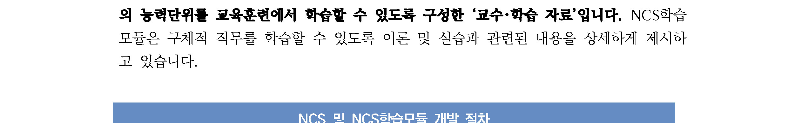
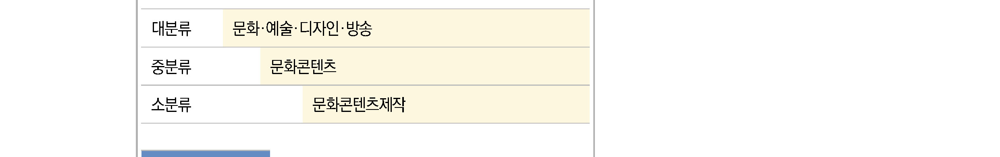
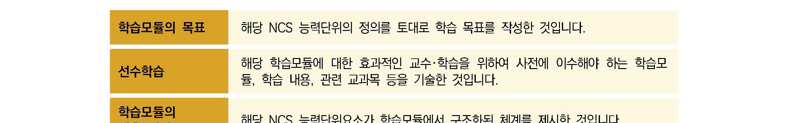
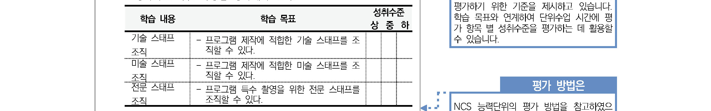
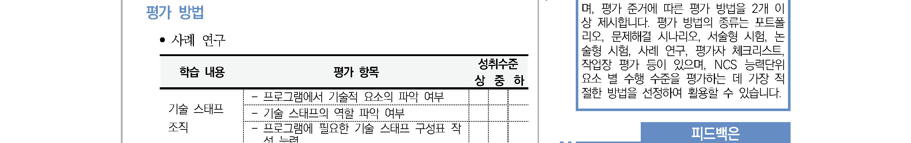

# LM2001020408_데이터베이스+성능확보

대분류/20

정보통신 중분류/01
정보기술 소분류/02
정보기술개발 세분류/04
DB엔지니어링 능력단위/08

| NCS학습모듈 |
| --- |

데이터베이스 성능확보

LM2001020408_19v4

[NCS-학습모듈의 위치]

| 정보통신 |  |  |
| --- | --- | --- |
|  | 정보기술 |  |
|  |  | 정보기술개발 |

대분류
중분류
소분류
세분류

| SW아키텍처 |  |  | 능력단위 | 학습모듈명 |
| --- | --- | --- | --- | --- |
| 응용SW 엔지니어링 |  |  | 데이터베이스 요구사항 분석 | 데이터베이스 요구사항 분석 |
| 임베디드SW 엔지니어링 |  |  | 개념데이터 모델링 | 개념데이터 모델링 |
| DB엔지니어링 |  |  | 논리 데이터베이스 설계 | 논리 데이터베이스 설계 |
| NW엔지니어링 |  |  | 물리 데이터베이스 설계 | 물리 데이터베이스 설계 |
| 보안엔지니어링 |  |  | 데이터베이스 구현 | 데이터베이스 구현 |
| UI/UX엔지니어링 |  |  | 데이터베이스 성능확보 | 데이터베이스 성능확보 |
| 시스템SW엔지니어링 |  |  | 데이터 전환 설계 | 데이터 전환 설계 |
| 빅데이터플랫폼구축 |  |  | 데이터 전환 | 데이터 전환 |
| 핀테크엔지니어링 |  |  | SQL활용 | SQL활용 |
| 데이터아키텍처 |  |  | SQL응용 | SQL응용 |
| loT시스템연동 |  |  | SQL작성 | SQL작성 |

인프라스트럭쳐
아키텍처 구축
차 례
학습모듈의 개요 1
학습 1. 성능 분석하기
1-1. 데이터베이스 성능 분석 자료 수집 3
1-2. 데이터베이스 설계 문제점 분석 13
1-3. SQL문 개선항목 도출 21
1-4. 데이터베이스 시스템 성능 문제점 분석 29
1-5. 데이터베이스 성능 개선 계획 수립 34
• 교수・학습 방법 39
• 평가 41
학습 2. 성능 개선하기
2-1. 데이터베이스 성능 개선 방안 도출 43
2-2. 데이터베이스 설계 개선 49
2-3. SQL문 개선 57
2-4. 데이터베이스 시스템 성능 개선 69
• 교수・학습 방법 76
• 평가 77
학습 3. 성능 개선결과 평가하기
3-1. 성능 개선 항목의 정량적 평가 79
3-2. 추가적인 데이터베이스 성능 개선 83
• 교수・학습 방법 87
• 평가 89
참고 자료 91
활용 서식 92
데이터베이스 성능확보 학습모듈의 개요
학습모듈의 목표
데이터베이스 성능확보는 성능상의 문제점을 분석하고 성능 개선 목표를 설정하며 성능 개선 수행 방법의
정의, 성능 개선 수행, 성능 개선 결과를 정량적으로 평가하며 각 단계별 산출물 및 수행 활동을 규정할
수 있다.
선수학습
데이터베이스 요구사항 분석(2001020401_19v4), 논리 데이터베이스 설계(2001020403_19v4), 물리 데
이터베이스 설계(2001020404_19v4), 데이터베이스 구현 (2001020405_19v4), SQL활용 (2001020410
_19v4)
학습모듈의 내용체계

| 학습 | 학습 내용 | NCS 능력단위요소 |  |
| --- | --- | --- | --- |
|  |  | 코드번호 | 요소명칭 |

1-1. 데이터베이스 성능 분석 자료 수집
1-2. 데이터베이스 설계 문제점 분석
1.성능 분석하기 1-3. SQL문 개선항목 도출 2001020408_19v4.1 성능 분석하기
1-4. 데이터베이스 시스템 성능 문제점 분석
1-5. 데이터베이스 성능 개선 계획 수립
2-1. 데이터베이스 성능 개선 방안 도출
2-2. 데이터베이스 설계 개선
2.성능 개선하기 2001020408_19v4.2 성능 개선하기
2-3. SQL문 개선
2-4. 데이터베이스 시스템 성능 개선
3.성능 개선결과 3-1. 성능 개선 항목의 정량적 평가 성능 개선결과
2001020408_19v4.3
평가하기 평가하기
3-2. 추가적인 데이터베이스 성능 개선
핵심 용어
데이터베이스 성능 모니터링, 데이터베이스 성능 분석, 데이터베이스 성능 튜닝, SQL 튜닝, 성능을 고려한
데이터베이스 설계, 성능 개선 효과 평가, 성능 항목, 성능 측정 지표, 데이터베이스 객체, 질의 최적화기

| 학습 1 | 성능 분석하기 |
| --- | --- |

학습 2 성능 개선하기
학습 3 성능 개선결과 평가하기
1-1.
데이터베이스 성능 분석 자료 수집
•데이터베이스 객체 현황을 분석하고 성능상의 문제점 분석을 위한 모니터링 수행을 통해 자료를
학습 목표
수집할 수 있다.
필요 지식 /
① 데이터베이스 성능 개선 절차
데이터베이스 성능 개선 방법론은 성능 개선을 위해 필요한 다양한 수행 방법과 각 수행
방법을 효율적으로 처리하기 위한 처리 단계, 단계별 수행 목록, 산출물, 도구 등을 표준화한
것이다. 데이터베이스 성능 개선 절차는 분석, 이행, 평가의 3단계이다.
1. 분석 단계
분석 단계에서는 데이터베이스 성능 요구사항에 대한 목표 설정을 주요 내용으로 진행한다.
(1) 자료 수집
데이터베이스 모니터링과 데이터베이스 객체 현황 파악 및 논리 데이터베이스 설계,
물리 데이터베이스 모델링에 대해 성능과 관련된 자료들을 분석하기 위한 기초 자료를
수집하는 단계이다.
(2) 목표 설정
수집된 자료를 기초로 데이터 모델 분석, 액세스 패스(Access Path) 분석, 시스
템 자원 현황 분석, SQL 성능 분석, SQL 효율 분석 등을 종합하여 성능상의 병
목이나 지연 등과 같은 문제 요소 등을 구체적으로 파악하고 성능 튜닝의 대상이
되는 목표를 구체화하는 단계이다.
2. 이행 단계
데이터베이스 성능 개선 이행 단계에서는 성능상의 문제 요소로 파악된 대상에 대한
목표 대비 최적화 방안을 수립하고 적용하는 단계이다.
- 데이터베이스 파라미터(Parameter) 조정
- 전략적인 저장 기법 적용을 위한 물리 설계 및 디자인 검토
- 비효율적으로 수행되는 SQL문에 대한 최적화
- 네트워크 부하 등을 고려한 데이터베이스 분산 구조에 대한 최적화
- 적절한 인덱스 구성 및 사용을 위한 인덱스 설계 등의 최적화 작업
3. 평가 단계
데이터베이스 성능 개선 평가 단계에서는 분석 단계에서 수집된 자료와 목표 설정 대비
이행 단계에서 구체적인 성능 개선 작업의 수행 이후 성과를 비교 측정하는 단계이다.
데이터베이스 성능 개선 목표와 성과의 차이가 있다면 추가적으로 성능 개선이 필요하다.
② 데이터베이스 성능 요구사항
데이터베이스 성능은 데이터베이스 시스템이 비즈니스 기능을 수행할 때 얼마나 빠르고
효율적으로 처리할 수 있는지를 정의하는 것으로, 성능 요구사항은 특정 조건에서 기능
을 수행할 때 필요한 시간이나 처리량 또는 자원의 최대 사용치를 기술한 것이다.
1. 성능 요구사항 구성
데이터베이스 성능 요구사항 이름은 해당 성능을 나타낼 수 있는 이름을 부여하고, 요구사항
내용은 시간 효율성, 처리 효율성, 자원 효율성 측면에서의 개선 목표를 정의한다.
(1) 시간 효율성: 처리 시간
시스템이 정상이나 부하 상태에서 기능을 수행할 때 처리에 필요한 평균 시간을
기술한다.
- 평균 응답 시간
- 평균 처리 시간
- 평균 전송 시간
(2) 처리 효율성: 처리량
시스템이 정상이나 부하 상태에서 기능을 수행할 때 동시 또는 최대로 처리할 수 있는
양을 기술한다.
- 동시 처리 능력 : 동시 접속자 수, 동시 데이터 처리 수
- 최대 처리 능력 : 최대 사용자 수, 최대 데이터 처리 수
(3) 자원 효율성: 자원사용량
시스템이 정상이나 부하 상태에서 기능을 수행할 때 필요한 자원의 최대 사용치를
기술한다.
- 메인 메모리 사용률
- CPU 사용률(부하율)
- 입출력 자원 사용률
2. 데이터베이스 성능 요구사항 분석 절차
데이터베이스 성능 요구사항 분석은 자료 수집 단계와 목표 수립 단계로 구성된다.
<표 1-1> 성능 요구사항 분석
구분 수행 방법
데이터베이스 모니터링
데이터베이스 객체 현황 분석
자료 수집 데이터베이스 개념 모델링, 논리적, 물리적 설계 현황 분석
비효율적 SQL 문장 분석
데이터베이스 시스템 구성 분석
데이터 모델 개선 목표 수립
목표 수립 SQL 문장 개선 목표 수립
데이터베이스 시스템 구성 개선 목표 수립
출처: 한국데이터베이스진흥원.
(1) 자료 수집
자료 수집은 데이터베이스 시스템의 성능상의 병목 또는 지연 현상을 분석하여 개선
항목을 도출하기 위해 데이터베이스의 모니터링 수행을 통해 성능 개선에 필요한 자료를
수집하는 단계이다.
(가) 데이터베이스 성능 평가 기준치(Baseline) 설정
성능 기준치는 시스템이 정상적인 서비스를 제공하고 있는 시점에서 표준 업무
시간대 또는 업무 시간대 기준 사용량 최고치 시간대를 기준으로 확보하였다가
성능상의 저하 현상, 또는 장애가 발생한 경우 비교∙분석하여 그 원인을 효율적으로
파악할 수 있다.
(2) 목표 수립
데이터베이스 성능 목표 수립은 수집된 자료를 기초로 1) 데이터 모델 개선, 2) SQL
문장, 3) 데이터베이스 시스템 구성 측면에서 성능 개선 목표를 수립하는 단계이다.
데이터베이스 성능 목표는 다음 사항을 고려하여 수립한다.
- 성능 목표는 검증이 가능하도록 목표 값을 가능한 정량적으로 기술한다.
- 업무 형태(예를 들어, 온라인 트랜잭션 또는 일괄 처리 업무)에 따라 성능 요구 값이
다를 수 있는 것을 고려하여 목표를 정의한다.
- 자원 효율성 관련 목표는 시스템 확장성을 고려하여 정의한다.
- 비용 대비 효율성을 고려하여 목표 값을 기술한다.
수행 내용 / 데이터베이스 성능 분석 자료 수집하기
재료·자료
• 데이터베이스 성능 모니터링 도구
• 데이터 모델링 산출물
• 데이터베이스 성능 요구사항 정의서
• 데이터베이스 운영 매뉴얼
기기(장비･공구)
• 데이터베이스 성능 모니터링 도구
• 데이터 모델링 도구
• DBMS 클라이언트 프로그램
• 컴퓨터
안전･유의사항
• 안전 해당사항 없음.
• 유의사항
- 데이터베이스 분석을 위한 성능 측정 항목은 성능 모니터링 목표에 맞게 선정한다.
- 데이터베이스 성능 모니터링은 운영자의 매뉴얼을 적극적으로 활용하고 성능 요구사항을
수집한다.
수행 순서
① 데이터베이스 성능분석 자료 수집을 위해 사전 준비 작업을 수행한다.
1. 데이터베이스 성능 요구사항을 검토한다.
(1) SLA의 요구 성능 수준을 분석한다.
서비스 사용자가 요구하는 응답 시간, 또는 처리량, 가동률, 성능 장애율 등 서비스
수준에 대한 기대치를 참고하여 성능 관리의 임계치를 정의한다.
(2) 사용자 만족도 및 요구사항을 확인한다.
사용자의 만족도를 수치화, 정량화하여 성능 관리 임계치 또는 성능 관리 목표에 반영하며,
사용자가 느끼는 성능상의 불만 사항은 성능 측정 항목 산정 시 반영한다.
2. 데이터베이스 관련 현황 자료를 수집한다.
(1) 데이터 모델 자료를 수집한다.
핵심 데이터 영역 및 업무 영역에 초점을 맞추어 논리 데이터베이스 설계, 물리 데이터베이
스 설계 자료를 수집한다.
(가) 논리 데이터베이스 설계 자료 수집
- 논리 데이터 모델 자료
- 데이터 담당자 인터뷰 자료
(나) 물리 데이터 모델링 자료 수집
데이터 객체, 데이터 용량, 인덱스, 데이터 파일, 테이블 스페이스, 임시 테이블
등 기초 자료를 수집한다.
- 물리 데이터 모델 자료: 테이블, 인덱스 정보
- 데이터 파일, 테이블스페이스 및 용량 정보
(2) SQL 문장 자료를 수집한다.
성능 저하를 야기하는 비효율적인 SQL 문장을 개선할 때 참고할 수 있도록 SQL 문장의
목록과 해당 SQL문을 활용하는 응용프로그램 정보, 개발 담당자 정보를 수집한다.
(3) 데이터베이스 시스템 구성 자료를 수집한다.
(가) DBMS 운영 환경 조사
- 서버, OS, 네트워크 구성 요소
- CPU / Memory / Disk 현황
- 재해복구(DR, Disaster Recovery), 디스크 분산 저장(RAID, Redundant
Array Inexpensive Disks) 구성 현황
(나) DBMS 구성 환경 조사
- DBMS 버전 등 구성 현황
- DBMS 공유 메모리, 캐시 메모리, 데이터/로그 버퍼 등 DBMS 파라미터
3. 데이터베이스 성능 평가 기준치(Baseline)를 설정한다.
성능상의 문제점이 대두된 기간과 비교∙분석할 수 있도록 서비스가 정상적으로 운영될
때의 기준치를 미리 보유한다.
② 데이터베이스 성능 측정 항목과 측정 방법을 정의한다.
1. 데이터베이스 성능 측정 항목을 선정한다.
데이터베이스 성능 관리 대상은 스키마, SQL 문장/저장 프로시저, 공유 메모리 영
역, 데이터베이스 파일 관리, 정렬 영역, 롤백 로그 관리, Locking 관리, 세션 관리
영역으로 분류할 수 있으며, 각 대상별로 세부적인 측정 항목을 선정한다. 사용자의
SLA 및 성능 만족도를 충족시키기 위한 응답 시간(Response Time), 처리량
(Throughput), 자원 사용량(Utilization), 효율성(Efficiency)을 판단하여 성능 관리
측정 대상 항목을 결정한다.
<표 1-2> 성능 측정 대상별 측정 항목 및 주기
대상 측정 항목 측정주기
- 과도한 정규화로 인한 조인의 발생(속도 저하) 구축 시
- 과도한 반정규화로 인한 중복 데이터 발생(공간 낭비) 구축 시
데이터베이스
- 인덱스 부재로 인한 Full Table Scan 발생(과도한 I/O) 구축 시
모델
- 비정상적으로 작성된 인덱스의 사용 월간/비정기
- 사용되지 않는 인덱스 월간/비정기
- 80/20 법칙을 적용하여 Top SQL 문장을 선정
주간
- Full Table Scan을 발생시키는 SQL 문장
응용 프로그램 주간
(과도한 Disk I/O)
(SQL, 저장 매일
- CPU 자원을 과도하게 사용하는 SQL 문장
프로시저) 매일
- Buffer Cache를 과도하게 사용하는 SQL 문장
매일
- OLTP 업무 수행 시간대에 실행되는 배치성 SQL 문장
- 공유 메모리 내 Buffer Cache의 매일
Read/Write/Update/Free 상태 검사
- Database Object 중 공유 메모리에 캐시된 Object 주간
검사(Trigger, Procedure, Package body, SQL)
- 공유 메모리 적중률을 측정 매일
공유 메모리
- 공유 메모리에 Cache된 SQL Text 검사 주간
영역
- 자료사전(Data Dictionary) 정보 관련 Parameter 통계 주간
- 데이터 블록 경합(Contention) 통계정보 매일
- 공유 메모리 사용 요약 정보 주간
- SQL 문장의 Parsing 영역에 대한 Miss Ratio 정보 주간
- Redo Log Buffer에 대한 대기(Wait) 횟수 검사 매일
- 데이터 파일의 분산배치 구축 시
- 컨트롤 파일의 분산배치 및 이중화 구축 시
- 로그 파일의 분산배치 및 이중화 구축 시
- 아카이브 모드의 데이터베이스 운용여부 구축/운영중
- 특정 데이터파일을 이용하는 User 검사 매일
데이터베이스
- 데이터베이스를 구성하고 있는 데이터 파일 정보 조사 월간
파일 관리
- 특정 크기보다 큰 디스크 사이즈를 가진 테이블스페이스 월간
- 테이블스페이스 여유공간 검사 주간
- 테이블스페이스에서 연속된 공간의 Size 검사 주간
- 테이블스페이스를 구성하는 데이터파일 검사 월간
- 데이터파일의 상태 검사 월간
대상 측정 항목 측정주기
- 과도한 정렬 작업을 발생시키는 프로세스 매일
- 과도한 정렬 작업을 발생시키는 SQL 문장의 판단 매일
- 메모리 정렬 영역 및 매개변수 조정 여부 주간
정렬 영역
- 메모리 정렬 대비 디스크 정렬 작업의 비율 주간
- 임시 영역 세그먼트 할당 및 할당 해제 주간
- 정렬(Sort) 통계 정보 월간
- Deadlock 정보 검사 매일
- 데이터베이스에 발생하고 있는 모든 Lock 정보 매일
로깅 관리
- 데이터베이스 내에 Lock 관련 정보와 Object 정보 매일
- 사용자 세션이 소유하고 있는 Lock 정보 매일
- User당 Buffer 적중률이 80% 이하인 User 정보
- 프로세스 유휴 시간 체크 매일
- 가장 CPU를 많이 사용하고 있는 Process 정보 매일
- Process, Session, Client, Idle Time, OS User 매일
정보 주간
사용자 프로
- 특정 Cursor에서 실행중인 SQL 정보 월간
세스 관리
- 현재 트랜잭션이 Active한 세션, 프로세스, OS사용자 매일
정보 월간
- 데이터베이스에 생성된 사용자 정보 비정규적
- 프로세스가 수행하고 있는 트랜잭션 정보(SQL정보) 비정규적
- 세션이 수행하고 있는 트랜잭션 정보 및 Undo Size
출처: 정보시스템 성능 관리 지침(정보통신부).
2. 데이터베이스 성능 측정 방법을 정의한다.
(1) 데이터베이스 성능 측정 항목별로 임계치를 설정한다.
각 측정 항목의 임계치는 SLA를 만족하는 기준에 의해 설정하며, 사용자의 만족
도와 추가적인 요구사항을 고려하여 설정한다.
(2) 데이터베이스 측정 항목별로 성능 모니터링에 적절한 도구를 선택하고 측정 방법을
정의한다.
(가) Windows 서버에서 실행되는 응용 프로그램 모니터링 도구
- 시스템 모니터, 성능 로그 및 경고, 작업 관리자
(나) DBMS 구성요소 모니터링 도구
- (SQL Server) SQL tracer, SQL Server 프로파일러, Distributed Replay
Utility, SQL Server Management Studio 작업 모니터 등
- (ORACLE) SQL tracer, AWR, 성능 뷰/딕셔너리 뷰 등
- (ALTIBASE) V$DBMS_STATS 성능 뷰 등 딕셔너리 뷰, trace log 등
- (DBMS 연계 도구) Orange, Toad 등

[그림 1-1] DBMS Space 모니터링 화면(Orange 화면)

[그림 1-2] DBMS 운영 현황 모니터링 화면(Orange 화면)

[그림 1-3] DBMS 통계 정보(딕셔너리 뷰) 조회 화면(Orange 화면)
③ 데이터베이스 성능 측정 환경을 구성하고 모니터링을 통해 성능 분석 자료를 수집한다.
1. 데이터베이스 성능 측정 환경을 구성한다.
데이터베이스 성능 모니터링 도구를 구성하고 성능 측정 항목별로 모니터링 방법을
설정한다. 예를 들어 모니터링 시 필요한 시스템 자원을 최소화하기 위해 성능 측정
항목과 관련된 최소한의 데이터만 포함할 수 있도록 선택할 수 있다.
2. 데이터베이스 성능 측정 주기별로 성능을 측정하고 자료를 수집한다.
(1) 일간 성능 측정
- 각 관리 항목별 시간대별 성능 추이를 조사, 정리하며 전일 대비 특이 사항이
없는지 점검한다.
- 일별 성능 데이터는 월간 성능 데이터에 누적되어 해당 월의 항목별 성능 추이를
점검한다.
(2) 주간 성능 측정
- 업무 특성상 일주일 주기로 발생하는 트랜잭션에 대하여 성능 분석 요구가 발생할 경우
실시한다. 예를 들어 주 단위로 데이터베이스 백업을 실시할 경우, 성능 장애로 인하여
제시간에 백업이 이루어지지 않아 업무 시간대까지 진행되는 경우 등에 한하여 데이터
베이스 백업 오퍼레이션에 대한 성능 측정을 수행한다.
- 필요시 주간 성능 데이터를 누적하여 월간 성능 추이 분석에 활용한다.
(3) 월간 성능 측정
- 업무 시스템 단위로 적용하여 전후 1주일 간의 성능 데이터를 수집한다.
- 주간 성능 측정 데이터를 유지하는 경우에는 4주간의 누적치를 합산하여 월간
성능 추이를 분석한다.
- 성능지표에 대한 월간 성능 변화 분석 성능 지표에 해당하는 항목의 성능 데이
터를 수집한다.
(4) 비정기적 성능 측정
- 정기적인 성능 측정 외에 SLA 조건을 위반하는(임계치를 초과하는) 현상이 발
생하거나, 사용자의 긴급한 성능 분석 요구가 발생한 경우 등에 한하여 비정기
적인 성능 측정 및 분석을 수행한다.
- 비정기적으로 발생하는 성능 측정 및 분석 결과는 정기적으로 실시하는 성능
측정에 반영하지 않는다.
수행 tip
• 데이터베이스 성능 개선 목표는 비즈니스 상황에 따라
항상 변화하므로 원하는 목표까지 지속적이고 반복적으
로 수행하는 것이 중요하다.
• 일상적인 고장 장애를 모니터링하기 위한 항목은 성능
관리 측정 항목에 포함할 필요가 없다.
• 데이터베이스 성능 측정 주기는 비즈니스 순환 주기
(Business Cycle)에 근간을 두고 정의한다.
1-2.
데이터베이스 설계 문제점 분석
•데이터베이스 객체 구조 및 개념 모델링, 논리적, 물리적 데이터베이스 설계상의 문제점을 분
학습 목표
석할 수 있다.
필요 지식 /
① 슈퍼·서브 타입 변환
슈퍼·서브타입 데이터 모델은 업무를 구성하는 데이터의 특징을 공통점과 차이점을 고려하여
효과적으로 표현한 확장 ER 모델의 구성 요소이다. 공통점을 슈퍼타입으로 모델링하고 차이점
은 서브타입에 표현한 후 공통 속성이 필요한 경우 슈퍼타입으로부터 상속받아 사용할 수 있
게 구성하여, 업무의 모습을 정확하게 표현하면서도 물리 데이터 모델로 변환할 때 선택의 폭
을 넓힐 수 있다는 장점이 있다. 슈퍼·서브타입을 물리 데이터 모델로 변환할 때에는 데이터
양과 해당 테이블에 발생하는 트랜잭션의 유형에 따라 변환 기준을 결정한다.
1. 소량 데이터를 갖는 슈퍼·서브 타입 변환
데이터가 소량일 경우 성능에 영향을 미치지 않기 때문에 데이터 처리의 유연성을 고려하여
가급적 슈퍼 𐤟 서브타입 간 1:1 관계를 유지하는 것이 좋다. 데이터양이 아주 적고 시스템을 운영하는
중에도 증가하지 않는다면 전체를 하나의 테이블로 묶는 것도 좋은 방법이다.
2. 대량 데이터를 갖는 슈퍼·서브 타입 변환
데이터양이 많고 지속적으로 증가하는 양도 많다면 슈퍼·서브타입의 물리 모델로
변환할 때 자주 발생하는 트랜잭션의 유형에 따라 변환 방법을 신중하게 선택해야
한다.
(1) 개별 테이블 구성
업무적으로 발생하는 트랜잭션이 슈퍼타입과 서브타입 각각에 대해 발행하는 경
우는 각각을 개별 테이블로 구성한다. 즉, 슈퍼타입과 서브타입 각각을 꼭 필요한
속성만으로 구성한 개별 테이블로 변환하여 1:1 관계를 갖도록 구성한다.
(2) 슈퍼타입+서브타입 테이블 구성
슈퍼타입과 서브타입을 묶어서 접근하는 트랜잭션이 발생할 때에는 슈퍼타입과
서브타입을 하나로 묶어 테이블을 구성하는 것이 효율적이다.
(3) 하나의 테이블 구성
슈퍼타입과 서브타입에 모두 접근하는 트랜잭션이 발생할 경우에는 전체를 하나의
테이블로 변환한다. 슈퍼타입과 서브타입을 개별로 분리할 경우 조인을 유발하거나
UNION ALL과 같은 연산을 수행하는 경우가 발생해 성능이 저하될 수 있다.
② 트랜잭션 분석
데이터베이스 트랜잭션 분석은 테이블에 발생하는 트랜잭션양에 따라 데이터베이스 용
량을 산정하여 데이터베이스 구조를 최적화하는 데 목적이 있다. 데이터베이스에 어떤
트랜잭션이 어느 정도 발생하는지를 분석하고 그에 따라 데이터베이스 용량 및 구조 설
계를 적절하게 수행한다.
1. CRUD 매트릭스를 이용한 트랜잭션 분석
애플리케이션 프로세스 모델링에서 도출한 단위 프로세스와 테이블과의 데이터베이
스 연산 관계를 표현한 CRUD 매트릭스를 기반으로 트랜잭션 분석서를 생성한다.
<표 1-3> 트랜잭션 분석서 구성 항목
구성 항목 설명
업무를 발생시키는 가장 작은 단위의 프로세스, 업무 기능을 분해하
단위 프로세스
는 과정에서 더 이상 분해할 수 없는 프로세스 정의
단위 프로세스가 테이블에 영향을 주는 Create, Read, Update,
CRUD 연산
Delete 연산
테이블∙컬럼명 단위 프로세스가 액세스하는 테이블∙컬럼명
테이블 참조 횟수 단위 프로세스당 테이블 참조 횟수
단위 프로세스에 대해 주기별로(일, 월, 분기, 년) 트랜잭션이 발생하는
트랜잭션 수
횟수
발생 주기 일, 월, 분기, 년 등 발생 주기를 특정 단위로 표준화 관리
2. 트랜잭션 분석서 이용
트랜잭션 분석서는 데이터베이스 용량 산정 및 디스크 구성 전략 수립 시 근거 자료로
이행한다.
(1) 데이터베이스 용량 산정 근거 자료
모든 테이블에 대해 데이터양을 초기에 알 수는 없지만 알 수 있는 테이블의 모
든 생성 트랜잭션 수를 파악한 다음 그 테이블에서 연관된 테이블들의 생성 트랜
잭션을 분석해 나가면 각 테이블에 저장되는 데이터양을 유추할 수 있다.
(2) 디스크 구성 근거 자료
테이블에 발생하는 트랜잭션 수가 많을 경우, 디스크 I/O의 집중화 현상을 방지
하기 위해 데이터베이스 파일을 여러 개의 디스크에 나누어 설계하고, 테이블 공
간도 여러 디스크에 나누어 설계할 수 있다.
(3) 데이터베이스 연계 채널 분산
트랜잭션 관리 미들웨어는 데이터베이스와 통신하기 위해 데이터베이스와 미리 세션을
맺고 연결된 세션을 통해 업무 프로세스가 데이터베이스와 통신할 수 있도록 트랜잭션을
제어한다. 이때 각 채널별로 집중화된 트랜잭션을 분산시켜 연결 대기 현상이나 타임아웃
오류가 발생하는 것을 방지할 수 있다.
③ 채번 방식
어떤 채번 방법을 적용하는지에 따라 성능 저하가 발생하는 경우도 있으므로 데이터양과
트랜잭션 수를 고려하여 적절한 채번 방식을 선택해야 한다.
1. 채번 테이블 사용
별도의 채번 테이블을 이용하여 일련 번호를 증가시키는 방법으로, 중복된 값이 입
력되는 오류가 없고 순차적인 데이터 입력이 가능하지만, 채번 테이블에 대한 잠금
현상이 유발되어 성능이 저하되고 채번 테이블을 관리하는 비용이 발생한다.
데이터 트랜잭션이 적을 때, 업무 특성상 성능이 문제되지 않을 때 적용 가능하다.
트랜잭션이 대량으로 발생해서 중복 오류가 발생할 가능성이 있고 데이터도 순차적
으로 입력이 되어야 할 경우 채번 테이블을 이용한다.
2. 테이블에 최댓값 적용
해당 테이블의 일련 번호에 최댓값 + 1을 가져와서 입력하는 방법으로 순차적 데이터
입력이 가능하고 빠른 성능과 별도의 관리 비용이 발생하지 않는다는 장점이 있지만,
트랜잭션이 동시에 많이 발생할 경우 중복 오류가 발생할 수 있다.
트랜잭션이 아주 많지 않고 데이터 중복 에러에 대해 보완 처리가 가능하다면 최댓값
기반 채번 방식을 사용한다.
3. 시퀀스 오브젝트 이용
DBMS에서 제공하는 일련 번호 증가 객체를 이용하여 처리하는 방법으로 빠른 성능과
중복 에러가 없으나 순차적인 일련 번호 입력은 불가능하다.
대량의 트랜잭션이 발생하고 순차적 데이터 입력이 요구되지 않는다면 시퀀스 오브젝트를
이용한다.
수행 내용 / 데이터베이스 설계 문제점 분석하기
재료·자료
• 데이터 모델링 산출물
• 데이터베이스 용량 설계 내용
• 데이터베이스 객체 정보(테이블, 인덱스, 파티션 등)
• 데이터베이스 트랜잭션 수행 정보
• 데이터베이스 비기능 요구사항
기기(장비･공구)
• 데이터 모델링 도구
• DBMS 클라이언트 프로그램
• 컴퓨터
안전･유의사항
• 현행화된 데이터베이스 모델링 산출물과 용량 설계 정보를 분석한다.
수행 순서
① 데이터베이스 구축 과정에서 데이터베이스 설계 문제점을 분석한다.
1. 데이터베이스 설계 자료와 데이터베이스 성능 관련 요구사항을 수집한다.
데이터베이스 설계 과정에서 작성된 ERD와 테이블․컬럼․인덱스 명세서, 데이터베이스
물리 설계 자료, 데이터베이스 성능 관련 사용자 요구사항 정의서 등을 수집한다.
(1) 데이터베이스 논리․물리 모델링 자료를 수집한다.
(2) 데이터베이스 ERD가 없는 경우 Reverse Modeling을 수행한다.
(3) 데이터베이스 객체 정보를 수집한다.
(4) 데이터베이스 객체 용량 정보를 수집한다.
(5) 데이터베이스 트랜잭션 수행 현황 정보를 수집한다.
(6) 데이터베이스 성능과 관련된 사용자 비기능 요구사항을 수집한다.
(7) 데이터베이스 성능과 관련된 사용자 만족도 점수를 수집한다.
(8) 데이터베이스와 관련된 SLA 항목 정보를 수집한다.
2. 데이터베이스 논리 모델(ERD)과 요구사항을 기반으로 데이터베이스 물리 설계 시 반영해야
할 성능 고려 요소와 성능 모델링이 필요한 대상을 정의한다.
(1) 데이터베이스 시스템 구조와 성능 요구사항을 기반으로 요구 응답 시간, 분산 데이터
베이스 환경, 동시 사용자의 수, 데이터의 크기, 병렬 프로세싱 등 물리 설계 시 반
영해야 할 성능 요소를 도출한다.
(2) 논리 모델을 검토하여 성능 요소와 관련된 성능 모델링 대상을 선정한다.
정규화 대상 테이블, 식별자 순서 조정이 필요한 테이블, 슈퍼․서브 타입 등 성능
모델링 대상을 선정한다.
(가) 정규화가 되지 않은 테이블들을 검토하여 정규화 대상으로 선정한다.
특히, 반정규화로 인해 조회․입력․수정․삭제 성능이 저하된 테이블을 정규화
대상 테이블로 선정한다.
(나) 데이터 모델이 복잡한 경우, 데이터 모델링 개선 대상으로 선정한다.
특히, 관계가 연결되어 있지 않고 통합되어야 할 테이블들이 몇 개로 분리되어
있거나 또는 테이블이 과도하게 통합되어 하나의 테이블로 표현된 경우, SQL 구문이
길어지고, 잦은 조인이 발생하는 경우가 있어 데이터 모델을 단순화할 필요가 있다.
(다) 슈퍼․서브타입 데이터 모델의 경우, 데이터양과 트랜잭션의 처리 유형에 따라 물리
모델로 전환되었는지 검토하고 적절하지 않은 경우, 성능 개선 대상으로 선정한다.
- 트랜잭션은 항상 일괄로 처리하는데 테이블은 개별로 유지되는 경우
- 트랜잭션은 항상 서브타입 개별로 처리하는데 테이블은 하나로 통합되어 있는
경우
- 트랜잭션은 항상 슈퍼․서브 타입을 공통으로 처리하는데 개별로 유지되어
있거나, 한 테이블로 통합되어 있는 경우
(라) 복합키로 구성된 PK의 경우, 자주 사용되는 SQL문의 조건을 검토하여 동등 비
교문이 사용되는 순서대로 구성되었는지 검토한 후 그렇지 않은 경우 PK 순서
조정 대상으로 선정한다.
(3) 데이터베이스 논리 모델을 전체적으로 검토하여 기본키(Primary Key), 외래키
(Foreign Key) 정의가 누락된 테이블을 조사하여 성능 모델링 검토 대상에 추가한다.
(4) 물리 모델을 검토하여 성능 요소와 관련된 성능 모델링 대상을 선정한다.
비정규화 대상 테이블, 파티션 대상 테이블, 인덱스가 필요한 컬럼 등 성능 모델
링 대상을 선정한다.
(가) 데이터 조회 성능 향상이 필요한 테이블들을 검토하여 반정규화 대상으로 선정한다.
특히, 데이터를 조회할 때 디스크 I/O양이 많아서 성능이 저하된다든지, 또는
경로가 너무 멀어 조인으로 인한 성능 저하가 예상된다거나, 컬럼을 계산하여
읽을 때 성능이 저하될 것이 예상되는 경우 반정규화 대상으로 선정한다.
(나) 트랜잭션 처리 현황을 기반으로 특정 테이블에 트랜잭션이 집중되는 테이블을 선
별하여 테이블 수직/수평 분할 대상으로 선정한다.
특히, 대용량의 데이터가 하나의 테이블에 집중되어 하나의 공간에 저장된 경우
트랜잭션을 분산 처리할 수 있도록 테이블 분할 대상으로 선정한다.
(다) 채번 방식에 대해 트랜잭션 발생량과 순차적 발생 요구 등을 검토하여 채번 방식이
적절하지 않은 경우 개선 대상으로 선정한다.
3. 성능 모델링 대상에 대한 데이터베이스 물리 설계 자료와 결과를 검토하여 물리 설계 문
제점을 분석한다.
(1) 성능을 고려한 물리 설계가 진행되지 않은 객체를 조사하여 물리 설계 수정 목록을
작성한다.
(2) 물리 설계 수정 목록에 해당하는 객체들에 대한 성능 저하 영향을 분석하고, 영향도가
큰 객체 순서로 설계 변경에 대한 우선순위를 부여한다.
② 데이터베이스 운영 과정에서 데이터베이스 설계 문제점을 분석한다.
1. 데이터베이스 설계와 관련된 성능 측정 항목별 성능 추이 및 성능 수준을 분석한다.
(1) 정규화, 인덱스, 테이블 스토리지 등 데이터베이스 설계와 관련되어 나타나는 성능 문
제를 식별할 수 있는 성능 측정 항목의 성능 추이 정보를 수집한다.
<표 1-4> 데이터베이스 설계 문제점 도출 시 성능 측정 항목
측정 항목 현상 데이터베이스 설계 문제점
과도한 정규화
응답 속도 속도 저하 발생
비정상적으로 작성된 인덱스
자원 사용현황 공간 자원 사용량이 과도한 경우 과도한 비정규화
자원 사용현황 과도한 I/O 발생 인덱스 부재
객체 사용현황 사용되지 않은 인덱스 잘못 생성된 인덱스
스토리지 사용현황 과도한 확장 영역(Extent) 사용 테이블 스토리지 부족
출처: 정보시스템 성능 관리 지침(정보통신부).
(2) 임계치를 초과하는 성능 측정 항목에 대한 성능측정 보고서를 작성한다.
<표 1-5> 성능측정 보고서 양식
성능측정 보고서
년 월 일

| 측정 부서 |  | 담당자 | (인) |
| --- | --- | --- | --- |
| 직급/직위 |  | 성능 관리담당자 | (인) |
| 전화번호 |  | 성능 관리책임자 | (인) |
| E-Mail |  | 협조부서 |  |

| 분석 배경 |  | 성능 저하업무 |  |
| --- | --- | --- | --- |
| 분석 목표 |  | 관련프로그램 |  |
| 분석 대상 |  | 업무 영향도 |  |
| 분석 기간 |  | 성능 저하 발생시점 |  |
| 예상되는 성능저하 원인 | □데이터베이스 설계 □SQL □데이터베이스시스템 □ 기타(AP서버, N/W 등) |  |  |

| 구분 | 측정결과 | 분석 및 평가 | 비고 |
| --- | --- | --- | --- |

| 종합의견 |  |
| --- | --- |

2. 문제 영역을 식별하고 원인을 분석한다.
(1) 성능측정 보고서의 내용을 검토하고 원인을 분석한다.
성능측정 보고서의 성능 저하 업무와 성능 저하 발생시간, 성능 분석 결과를 기
반으로 성능 저하 현상의 원인을 추정한다.
(2) 성능 개선이 필요한 데이터베이스 객체 또는 성능 개선 대상을 식별하고 성능 개선
의뢰서를 작성한다.
<표 1-6> 성능 개선 의뢰서 양식
성능 개선 의뢰서
년 월 일

| 접수 번호 |  | 접수 일시 |  |
| --- | --- | --- | --- |
| 접수 부서 |  | 접수 담당자 | (인) |
| 직급/직위 |  | 성능 관리담당자 | (인) |
| 전화번호 |  | 성능 관리책임자 | (인) |
| E-Mail |  | 협조부서 |  |

| 성능 저하업무 | 응답 시간 요구수준 처리량 | 요구수준 | 응답 시간 |  |
| --- | --- | --- | --- | --- |
| 관련프로그램 | 처리량 |  | 처리량 |  |
| 업무 영향도 | 응답 시간 현상태 처리량 | 현상태 | 응답 시간 |  |
| 성능 저하 발생시점 | 처리량 |  | 처리량 |  |
| 예상되는 성능 저하원인 | □데이터베이스 설계 □SQL □데이터베이스시스템 □ 기타(AP서버, N/W 등) |  |  |  |

| 구분 | 측정결과 | 분석 및 평가 | 비고 |
| --- | --- | --- | --- |

| 요청사항 |  |
| --- | --- |

수행 tip
• 데이터베이스 운영 시점에서 데이터베이스 설계 문제점
을 식별하고 조정하는 경우 매우 큰 비용이 발생하므
로 데이터베이스 시스템의 구조와 성능을 최대한 고려
하여 물리적 설계를 해야 한다.
1-3.
SQL문 개선항목 도출
•데이터베이스 성능 모니터링을 통해 비효율적으로 수행되는 SQL 문장의 개선 항목을 도출할
학습 목표
수 있다.
필요 지식 /
① 질의처리(Query Processing)
DBMS에서 SQL문 처리를 담당하는 모듈을 질의 처리기(Query Processor)라고 한다.
질의 처리기는 사용자가 수행을 요구한 SQL문에 대해 정당성을 검사한 후 데이터베이
스에 접근하는 최적의 접근 순서와 방법을 결정하고, 이에 따라 조건에 맞는 레코드를
검색한 후 필요한 연산을 수행하여 마지막으로 클라이언트에게 처리한 값을 돌려 준다.
질의처리 수행 과정은 다음과 같다.
(1) 구문 분석(Parsing)
SQL문의 문법을 검사(syntax 검사)하고 구문 분석 정보를 저장하는 파스 트리
(Parse Tree)를 생성한다.
(2) 정당성(Validation) 검사
SQL문의 의미상 정당성을 검사(semantic 검사)하고 메타 테이블을 검색하여 파스
트리를 확장한다.
(3) 최적화(Optimization)
주어진 파스 트리에 기반을 두어 다양한 통계 정보와 접근 비용을 계산하여 최적화된
실행 계획을 생성한다.
(4) 바인딩(Binding)
호스트 변수값(host variable value)을 생성된 실행 계획에 연결한다.
(5) 실행(Execution)
실행 계획 트리에 따라 SQL문을 실행한다.
② 질의 옵티마이저와 실행계획
1. 질의 옵티마이저
질의 옵티마이저(Query optimizer)는 SQL을 분석하여 가능한 실행 계획을 작성하고,
이에 대한 비용을 평가하여 가장 효율적인 실행 계획을 선택한다. 질의 성능의 대부분이
이 과정에서 결정되며, 복잡한 질의일수록 질의 최적화 과정의 정확성에 의해서 성능이
좌우된다.
질의문은 최적화 이전 단계에서 구문 분석(parsing)과 의미 분석(validation) 과정을
거친다. 이 과정에서 파싱 트리가 생성되는데, 옵티마이저는 이 파싱 트리로부터 각
종 비용을 평가하여 효율적인 실행 계획 트리(plan tree)를 생성한다.
2. 옵티마이저 구성요소
옵티마이저는 크게 Query Rewriter, Logical Plan Generator, Physical Plan
Generator로 구성된다. 각 구성요소의 역할은 다음과 같다.
(1) Query Rewriter
주어진 파스 트리를 이용하여 동일한 결과를 가지면서 최적화에 더 유리하도록
질의를 변환한다.
(2) Logical Plan Generator
변형된 질의와 통계정보를 이용하여 실행 비용을 계산함으로써 최적화된 논리적 질의
플랜을 생성한다.
(3) Physical Plan Generator
최적화된 질의 플랜을 이용하여 물리적 실행 계획 트리를 생성한다.
3. 실행 계획 트리
실행 계획은 트리 구조로 구축되기 때문에 실행 계획 트리 또는 Plan tree 라고 불
리기도 한다. 질의 옵티마이저가 가장 효율적이라는 판단에 의해 결정된 실행 계획
은 실제로 SQL문의 실행 시간에 큰 영향을 끼친다.
(1) 실행 계획 트리 활용
SQL문을 직접 실행하지 않고도 실행 계획 트리를 볼 수 있어 SQL문의 실행 방
법을 볼 수 있다. 뿐만 아니라, 다른 실행 계획 트리와 비교할 수도 있어 SQL문
의 성능 향상에 도움이 될 수 있다. 실행 계획 트리에서 다음과 같은 정보를 얻
을 수 있다
- 옵티마이저에 의해 생성된 실행 계획, Objects (테이블, 인덱스, 등)의 속성,
사용된 index, 사용된 조인 방법, 최적화된 조인 순서
(2) 실행 계획 트리의 해석
각 실행 노드들이 트리 형태로 연결된 전체 실행 계획 트리를 따라가면서 실행
순서가 결정된다. 실행 계획 트리에서 하나의 노드는 한 행에 표시된다. 왼쪽으로
들여쓰기가 많이 되어 있는 노드일수록 하위 노드이며 가장 먼저 수행된다.

[그림 1-4] 실행 계획 트리 예제
위의 예제에서 가장 먼저 데이터베이스에 접근하는 노드는 T1 SCAN 노드이고,
그 다음 T2 SCAN 노드, T3 SCAN 노드의 순서로 수행된다. 노드 옆에 명시한
숫자가 노드 수행 순서이다.
③ 액세스 방법과 조인 방법
1. 액세스 방법
액세스 방법은 데이터베이스에서 데이터를 가져오는 방법을 말한다. 일반적으로 테
이블에서 작은 수의 레코드를 가져오는 경우에는 인덱스를 사용하는 것이 더 효율적
이고, 많은 수의 레코드에 접근하는 경우에는 전체 테이블 스캔이 더 효율적이다.
(1) 전체 테이블 스캔
테이블의 모든 로우를 읽어서 선택 기준을 만족하지 않는 로우를 걸러내는 방법
으로 인덱스가 없을 때와 테이블에서 많은 양의 데이터에 접근할 때 사용된다.
(2) 인덱스 스캔
(가) 인덱스 범위 스캔(Index Range Scan)
인덱스 범위 스캔은 인덱스 트리의 루트에서 리프까지 수직적으로 탐색한 후에
리프들에서 필요한 범위만 스캔하는 방식이다. 즉, 조건을 만족하는 최솟값의 위치와
최댓값의 위치만을 결정하고 해당 조건에 대한 별도의 비교 없이 그 범위 내의
모든 데이터를 스캔함으로써 매우 우수한 성능을 보장한다.
(나) 인덱스 전체 스캔(Index Full Scan)
특정 범위만 탐색하는 인덱스 범위 스캔과 달리 리프 노드를 처음부터 끝까지 탐색하는
방식이다. 인덱스를 이용하여 범위 검색은 할 수 없으나, 인덱스의 리프 노드를
차례로 스캔하면서 저장되어 있는 키값으로 비교 연산을 수행하는 방법으로 인덱스를
저장하고 있는 페이지만을 접근하여 비교함으로써 데이터 페이지에 대한 접근 횟수를
줄여 성능이 향상될 수 있다.
2. 조인 방법
(1) 내포된 루프(Nested Loop) 조인 계열
(가) 완전 내포된 루프 조인(Full nested loop join)
한 테이블의 모든 레코드를 다른 테이블의 모든 레코드와 조인하는 방법이다. 이
방법은 일반적으로 아래 질의와 같이 조인 관계가 존재하지 않는 두 테이블 간의
조인 시 사용될 가능성이 높다.
(나) 완전 저장 내포된 루프 조인(Full store nested loop join)
반복 테이블(inner table)의 결과를 저장한 후 full nested loop join을 적용
하는 방법이다. 이 방법은 조인 조건 외의 조건 처리에 의하여 결과 집합이
매우 줄어드는 경우 적용될 가능성이 높으며, 일반적으로 조인 그룹 간의
Cartesian product(교차 조인)에 의하여 사용될 가능성이 높다.
(다) 인덱스 내포된 루프 조인(Index nested loop join)
인덱스를 이용하여 조인 조건을 처리하는 방법이다. 기준 테이블 (outer
table)의 레코드 수가 적고 반복 테이블(inner table)에 인덱스가 존재하는 경
우에 사용될 가능성이 높다.
(라) 반 외부 내포된 루프 조인(Anti outer nested loop join)
완전 외부 조인(FULL OUTER JOIN)의 처리를 위해서만 사용된다. 기준 테이
블 (outer table)과 반복 테이블 (inner table) 모두 조인 조건에 해당하는
칼럼에 인덱스가 정의되어 있을 때 다른 조인 방법에 비해 이 방법이 선택될
가능성이 높다.
(마) 역 인덱스 내포된 루프 조인(Inverse index nested loop join)
세미조인(SEMI JOIN)의 처리를 위해서만 사용된다. 기준 테이블(outer
table)에 인덱스가 있고 반복 테이블(inner table)에는 인덱스가 없는 경우에
사용될 가능성이 높다. 특히 기준 테이블의 레코드 수가 반복 테이블보다 상
대적으로 많을 때 더욱 유리하다. 하지만 반복 테이블에 인덱스가 존재한다면
인덱스 내포된 루프 조인(Index nested loop join)이 선택될 가능성이 높다.
(2) 정렬 기반(Sort-based) 조인 계열
정렬 기반 조인 방법은 반복 테이블(inner table)을 정렬된 순서로 저장하고 조인
조건을 이용하여 범위 검색을 하는 방법이다. 일반적으로 이 방법은 아래와 같이 질의에
부등호 조인 조건이 사용되고 인덱스가 없을 때 선택될 가능성이 높다.
(가) 단일 경로 정렬 기반 조인(One-pass sort-based join)
반복 테이블(inner table)의 데이터양이 적어 임시 공간 내에서 관리가 가능
할 때 사용된다.
(나) 이중 경로 정렬 기반 조인(Two-pass sort-based join)
반복 테이블(inner table)의 데이터양이 방대하여 임시 공간의 범위 내에서
관리할 수 없을 때 사용된다. 이이 방법은 기준 테이블(outer table)과 반복
테이블(inner table)을 모두 정렬하여 임시 공간에 저장한다. 그런 다음 기준
테이블(outer table)의 데이터 정렬 순서로 조인 조건을 검사함으로써 반복
테이블(inner table)의 동일한 디스크 페이지 접근 확률을 높인다. 결국 디스
크 I/O 비용이 줄어든다.
(다) 역 정렬 기반 조인(Inverse sort-based join)
세미 조인(SEMI JOIN) 또는 역 조인(ANTI JOIN)의 처리를 위해서만 사용된
다. 역 정렬 기반 조인(Inverse sort-based join)은 조인 결과를 정렬해서 반
환하기 때문에 추가 정렬을 하지 않아도 된다는 장점이 있다.
(3) 해시 기반(Hash-based) 조인 계열
해시 기반(Hash-based) 조인 방법은 반복 테이블(inner table)을 해시 구조로 저장하고,
조인 조건을 이용하여 범위 검색을 하는 방법이다. 이 방법은 아래와 같이 질의의
조인 조건에 등호 연산자가 사용되고 인덱스가 없을 때 선택될 가능성이 높다.
(가) 단일 경로 해시 기반 조인(One-pass hash-based join)
반복 테이블(inner table)의 데이터양이 적어 임시 공간 내에서 관리가 가능
할 때 사용된다. 메모리 테이블이 반복 테이블(inner table)로 사용될 경우에
는 항상 이 방법이 사용된다.
(나) 이중 경로 해시 기반 조인(Two-pass hash-based join)
반복 테이블(inner table)의 데이터양이 방대하여 임시 공간의 범위 내에서
관리할 수 없을 때 사용된다. 기준 테이블(outer table)과 반복 테이블은 모두
동일한 hash 함수를 사용하여 분할되어 임시 공간의 여러 테이블에 저장된다.
그런 다음, 각 임시 테이블끼리 조인 조건을 검사함으로써 반복 테이블(inner
table)의 동일한 디스크 페이지 접근 확률을 높인다.
(다) 역 해시 기반 조인(Inverse hash-based join)
세미 조인(SEMI JOIN), 역 조인(ANTI JOIN) 또는 왼쪽 외부 조인(LEFT
OUTER JOIN)의 처리를 위해서만 사용되며, 기준 테이블(outer table)보다
반복 테이블(inner table)이 상대적으로 클 경우 선택될 확률이 높다.
(4) 합병(Merge) 조인 계열
합병 조인 방법은 두 테이블의 데이터가 정렬될 경우 매우 효율적인 방법이다.
이 방법에는 기준 테이블과 반복 테이블의 개념이 없으며 양쪽 테이블을 순차적
으로 진행하면서 조인 조건을 검사한다. 합병 조인이 사용되기 위해서는 양쪽 테
이블이 모두 조인키를 기준으로 정렬되어야 한다.
수행 내용 / SQL문 개선항목 도출하기
재료·자료
• 데이터 모델링 산출물
• 데이터베이스 통계 자료
• 인덱스 구조, 인덱스 대상 컬럼 조합, 인덱스 순서
• SQL 문장, SQL 변경 및 SQL 액세스 유형
• SQL 수행 회수, 트랜잭션 개수
기기(장비･공구)
• 데이터베이스 성능 모니터링 도구
• 데이터 모델링 도구
• DBMS 클라이언트 프로그램
• 컴퓨터
안전･유의사항
• 안전 해당사항 없음.
• 유의사항
- SQL 수행 회수, 트랜잭션 개수 등을 고려한 SQL 문장 개선 목표 수립한다.
- 데이터베이스의 I/O 대기 시간, 실행 시간 등을 기준으로 SQL을 분석한다.
수행 순서
① 성능 분석이 필요한 SQL문을 선정하고 SQL 실행 계획(PLAN)을 분석한다.
1. SQL과 저장 프로시저와 관련된 성능 측정 항목별 성능 추이 및 성능 수준을 분석한다.
(1) TOP N SQL, Full Table Scan SQL 등 SQL문과 관련되어 나타나는 성능 문제를
식별할 수 있는 성능 측정 항목의 성능 추이 정보를 수집한다.
<표 1-5> SQL 문제점 도출 시 성능 측정 항목
측정 항목 분석 대상 문제점
잘못된 SQL/Access Path로 인한
TOP N SQL SQL 실행 PLAN
속도 저하
Full Table Scan 잘못된 SQL/Access Path로 인한
DBMS System Event
문장 속도 저하
자원 사용량 성능 딕셔너리 뷰(Performance
(CPU, 메모리, Dictionary View)를 통한 자원 사용량 과도한 CPU 사용, 과도한 메모리 사용
Disk I/O) 판단
OLTP 업무 시간대에 실행되는 배치성
배치성 SQL 문장 속도 저하 및 자원 사용량 증가
SQL 문장 사용 경향
성능 딕셔너리 뷰를 통한 Locking 현황
DBMS 성능 저하 발생
분석(Deadlock 모니터링 포함) 및
Locking 애플리케이션 로직 오류와 밀접하게
SQL 문장과 SQL이 실행되는 세션 추
관련되어 발생함.
적 검사
출처: 정보시스템 성능 관리 지침(정보통신부).
(가) 응답 시간이 오래 걸리는 SQL문을 식별한다.
사용자가 요청한 SQL문에 대해 다음 정보를 수집한다.
- 질의를 요청한 클라이언트
- 실행 시각
- 질의문
- 수행 소요 시간
- 사용된 인덱스
- 버퍼․디스크 접근 비용
- 실행 계획
(나) 응용프로그램 내에서 SQL문 수행 시간을 측정한다.
ODBC, JBDC 등을 사용한 응용프로그램 개발 시 응용프로그램 내에서 시간
을 구하는 함수를 이용하여 SQL문 처리에 소요되는 시간을 측정한다.
(2) 임계치를 초과하는 성능 측정 항목에 대한 성능측정 보고서를 작성한다.
성능측정 보고서 양식은 활용 서식에 있는 [성능측정 보고서] 양식을 활용하거나
상황에 맞게 수정해서 사용한다.
2. 문제 영역을 식별하고 원인을 분석한다.
(1) 성능측정 보고서의 내용을 검토하고 원인을 분석한다.
(가) 실행 계획 분석하기
SELECT, INSERT, UPDATE, DELETE 등의 DML문의 실행 계획에 대해 다
음을 확인한다.
- 액세스 방법이 효율적인가?
- 조인 순서 및 방법은 바람직한가?
- 적절한 데이터 타입 및 연산을 사용하는가?
- 불필요한 해싱(Hashing) 및 정렬(Sorting)이 수행되지 않는가?
(나) 실행 계획 분석을 통해 나타난 문제점에 대해 원인을 파악한다.
<표 1-6> SQL과 관련된 성능 이슈와 원인
원인 설명
한 트랜잭션 내에서 DML 문을 여러 개 사용하여 여러 테이블에 접근하
는 경우, 응용프로그램에서 테이블에 접근하는 순서를 잘못 설계했다면
접근 순서
Lock을 획득하기 위해 대기하는 시간으로 인해 전체 응용 프로그램 성능
이 저하될 수도 있다.
레코드 건수가 많은 테이블에 대해서는 Predicate 내 컬럼값을 비교하는
데 발생하는 비용이 성능에 큰 영향을 미친다. 데이터 변환과 비교 비용
을 최소화할 수 있는 적합한 데이터 타입을 선정하는 것이 중요하다. 가
데이터 타입
능한 적은 수의 레코드에 접근하도록 SQL문을 작성하여 비교하는 횟수를
줄이고, 비교 연산 시 데이터 변환이 일어나지 않도록 컬럼의 데이터 타
입과 비교되는 값의 데이터 타입을 선정한다.
응용프로그램의 특성 및 자원 활용의 효율에 따라 메모리 테이블 및 디스
크 테이블의 사용을 적절히 고려하여야 한다.
데이터베이스
응용 프로그램에서 사용되는 SQL문의 종류를 고려해 각 SQL문별로 테
스키마와 용량
이블에 접근하는 횟수, 접근하는 레코드 수 및 디스크 페이지 수가 최소
비용이 되도록 테이블 스키마의 구성과 인덱스 구성에 유의한다.
SQL문의 처리 시 성능에 영향을 미치는 시스템 리소스는 가용한 메모리의
크기, 메모리 버퍼의 크기, 디스크 성능과 CPU 성능이다.
시스템 자원
즉, 디스크 테이블을 검색할 경우 질의 수행 시점의 환경에 따라 많은 성능
차이를 보이게 된다.
ORDER BY절 또는 GROUP BY절 등이 포함된 질의를 처리할 때, 질의
처리기는 정렬(Sorting) 기법이나 해싱(Hashing) 기법을 사용한다. 이 과
해싱(Hashing),
정에서 중간 결과를 저장하기 위해 메모리 임시 공간 또는 디스크 임시
정렬(Sorting)
공간을 사용하게 되는데 이때 메모리 스와핑으로 인한 성능 저하가 발생
할 수 있다.
(2) 성능 개선이 필요한 SQL 문장/저장 프로시저, 인덱스를 식별하고 성능 개선 의뢰서
를 작성한다.
성능 개선 의뢰서 양식은 활용 서식에 있는 [성능 개선 의뢰서] 양식을 활용하거나
상황에 맞게 수정해서 사용한다.
수행 tip
• SQL 문장 분석은 운영체제의 TOP Process 분석과도
밀접하게 관련되어 있으므로 운영체제에 대한 분석이
병행되어야 한다.
• Locking 관련 이슈는 애플리케이션 로직 상의 오류와
밀접하게 관련되어 있으므로 Application Locking
Algorithm을 통하여 개선될 수 있다.
1-4.
데이터베이스 시스템 성능 문제점 분석
•데이터베이스 시스템 모니터링을 통해 데이터베이스 성능에 영향을 미치는 문제점을 분석할
학습 목표
수 있다.
필요 지식 /
① DBMS 메모리 구조
메모리는 사용 용도에 따라 애플리케이션 코드 영역, 시스템 메모리 영역, 프로그램 영
역으로 나눌 수 있다. 애플리케이션 코드 영역은 수행되고 있거나 수행될 수 있는 애플
리케이션의 코드를 저장하기 위한 메모리 영역이다. 시스템 메모리 영역은 모든 프로세
스가 공유하는 영역으로 데이터베이스 버퍼와 로그 버퍼로 구성되어 있다. 프로그램 영
역은 프로세스가 시작될 때 DBMS에 의해서 할당되는 비공유 메모리 영역으로 프로세
스에서 필요로 하는 데이터나 제어 정보 등을 저장한다.
1. 데이터베이스 버퍼
데이터베이스 버퍼는 데이터 파일로부터 읽어들인 데이터 블록의 복사본을 가지고 있는
메모리로 수정되었지만 아직 디스크에 기록하지 않은 데이터를 저장하고 있는 더티(Dirty)
목록과 비어 있는 버퍼와 현재 접근 중인 버퍼 등을 가리키는 LRU 목록을 가지고 있다.
2. 로그 버퍼
데이터베이스의 변경 사항 정보를 유지하는 것으로 INSERT, DELETE, UPDATE
또는 DROP 작업으로 변경된 데이터를 재구성하거나 복구하는 데 필요한 정보를 포
함한다. 로그 버퍼의 내용은 서버 프로세스에 의해 로그 파일에 기록된다.
3. SQL 캐시/딕셔너리 캐시
(1) ORACLE 공유 풀(SHARED POOL)
라이브러리 캐시는 SQL 영역, 저장 SQL 프로시저 영역, 제어 구조 등을 공유하
고 딕셔너리 캐시는 데이터 딕셔너리 정보를 공유한다. 여러 세션이 사용하는 공
유 풀 항목은 원래 항목을 생성한 프로세스가 종료되어도 해당 항목이 유효한 경
우 계속 메모리에 남아 있다. 이를 통해 SQL을 실행하기 위한 파싱 오버헤드와
처리가 최소한으로 유지된다.
(2) ALTIBASE SHARED CACHE
모든 프로세스가 공유하는 캐시 영역은 SQL Plan Cache, Stored Procedure
Cache, Meta Cache로 구성된다. 새로운 SQL 실행 계획이 생성될 때마다 실행
계획은 SQL Plan Cache 영역에 저장되며 모든 세션이 이를 공유하게 된다. 저
장 프로시저의 실행 계획이 새로 생성될 때 Stored Procedure Cache 영역에
저장되어 공유된다. 데이터베이스 객체에 대한 모든 정보를 수록하고 있는 메타
데이터는 빠른 접근을 위해서 Meta Cache에 저장된다.
4. 정렬 영역
인덱스를 생성하거나 SQL문에 GROUP BY 연산, ORDER BY가 있을 경우 정렬
작업을 수행한다. 이때 사용되는 메모리 영역이 정렬 영역이다. 정렬되어야 하는 데
이터양이 메모리 영역을 초과할 때에는 데이터를 작은 부분으로 나눈 후 각 부분을
개별적으로 정렬하고 병합하여 최종 결과를 생성한다. 일정한 성능을 유지하려면 적
당한 정렬 영역의 크기를 설정하고 불필요한 정렬 작업을 최소화해야 한다.
② DBMS 데이터베이스 저장 구조
1. 데이터 블록
DBMS가 데이터를 저장하는 가장 작은 단위를 데이터 블록(페이지)이라고 하며 디스
크상의 물리적 데이터베이스 영역의 특정 바이트 수에 해당된다. 데이터 블록은 물
리적인 디스크의 입출력량을 결정하므로 성능에 직접적인 영향이 있다.
2. 데이터 확장 영역(EXTENT)
특정 유형의 정보를 저장하기 위해 할당된 몇 개의 연속적인 데이터 블록이다. 테이
블을 생성할 때 DBMS가 지정된 몇 개의 초기 확장 영역을 할당한다. 할당된 데이
터 블록이 모두 차면 새로운 확장 영역을 자동으로 할당하게 되는데 확장 영역의 크
기와 한계를 적절하게 결정함으로써 불필요한 저장 공간 낭비를 줄이고 무한정 확정
되는 것을 방지할 수 있다.
3. 세그먼트
테이블스페이스 내에 논리적인 구조를 정의하기 위해 할당된 확장 영역의 집합으로
테이블, 인덱스, 임시용 세그먼트가 사용된다. 각 테이블은 하나 이상의 확장 영역을
할당하여 해당 테이블의 데이터 세그먼트를 형성하고, 각 인덱스는 하나 이상의 확
장 영역을 할당하여 테이블이 인덱스 세그먼트를 형성한다.
4. 테이블스페이스
테이블의 데이터를 저장하는 논리적인 파일 공간, 물리적으로는 해당 테이블스페이
스와 연관된 데이터 파일에 저장한다.
수행 내용 / 데이터베이스 시스템 성능 문제점 분석하기
재료·자료
• 데이터베이스 성능 모니터링 도구
• 데이터베이스 성능 요구사항 정의서
• 데이터베이스 운영 매뉴얼
기기(장비･공구)
• 데이터베이스 성능 모니터링 도구
• 데이터 모델링 도구
• DBMS 클라이언트 프로그램
• 컴퓨터
안전･유의사항
• 안전 해당사항 없음.
• 유의사항
- DBMS 벤더별 구성요소와 특성을 고려하여 데이터베이스 시스템 구성 현황을 파악한다.
- 데이터베이스 병목 현상을 방지하기 위해 데이터베이스 초기 설계와 서버 운영 사항을
함께 고려한다.
수행 순서
① 데이터베이스 시스템 구성요소와 관련된 성능 측정 항목별 성능 추이 및 성능 수준을 분석한다.
1. DBMS 메모리와 관련된 성능 측정 항목들에 대한 성능 추이 및 성능 수준을 분석한다.
(1) 공유 메모리 영역, Database Buffer Cache, Redo Log Buffer 등 메모리 영역의
성능 문제를 식별할 수 있는 성능 측정 항목의 성능 추이 정보를 수집한다.
<표 1-7> 메모리 영역 문제점 도출 시 사용되는 성능 측정 항목
측정 항목 분석 대상 문제점
성능 딕셔너리 뷰의 메모리 영역별 적중률,
Buffer 캐시 적중률 과도한 I/O 발생
Cache되어 있는 Object 정도
Library, 딕셔너리
성능 딕셔너리 뷰의 메모리 영역별 적중률 과도한 I/O 발생
캐시 적중률
리두 로그 버퍼 경합
로그 버퍼 대기율 메모리 블록의 경합에 대한 모니터링
발생
메모리 정렬 대비 성능 딕셔너리 뷰의 임시 영역 세그먼트 과도한 정력 작업, 세
디스크 정렬 작업 비율 할당 및 해제, Sort 통계 등 그먼트 단편화 발생
롤백 세그먼트 롤백 세그먼트 경합
성능 딕셔너리 뷰의 롤백 상태 정보 뷰
Wait(Oracle) 발생
출처: 정보시스템 성능 관리 지침(정보통신부).
(2) 임계치를 초과하는 성능 측정 항목에 대한 성능측정 보고서를 작성한다.
성능측정 보고서 양식은 활용 서식에 있는 [성능측정 보고서] 양식을 활용하거나
상황에 맞게 수정해서 사용한다.
2. 저장 영역과 관련된 성능 측정 항목들에 대한 성능 추이 및 성능 수준을 분석한다.
(1) 데이터베이스 파일과 세그먼트, Block과 같은 저장 영역의 크기 등 데이터 저장 영역
의 성능 문제를 식별할 수 있는 성능 측정 항목의 성능 추이 정보를 수집한다.
<표 1-8> 저장 영역 문제점 도출 시 사용되는 성능 측정 항목
측정 항목 분석 대상 문제점
성능 딕셔너리 뷰를 이용하여 Disk I/O
데이터 파일 배치
가 집중하여 발생하는 경향 분석 Disk I/O 집중으
컨트롤/로그 파일의
(자료사전, 데이터, 인덱스, 정렬 영역, 로 인한 속도 저하
분산/이중화
롤백영역의 Disk I/O 분산 여부)
성능 딕셔너리 뷰를 이용하여 테이블스 저장공간 부족, 단
테이블스페이스
페이스 사용 공간, 여유 공간, 단편화 편화로 인한 저장
여유 공간
여부 확인 공간 낭비
테이블/인덱스의 스토리지 파라미터, 데 Disk I/O 증가,
스토리지 파라미터
이터를 보유한 block 수 등 저장공간 낭비
출처: 정보시스템 성능 관리 지침(정보통신부).
(2) 임계치를 초과하는 성능 측정 항목에 대한 성능측정 보고서를 작성한다.
성능측정 보고서 양식은 활용 서식에 있는 [성능측정 보고서] 양식을 활용하거나
상황에 맞게 수정해서 사용한다.
3. 문제 영역을 식별하고 원인을 분석한다.
(1) 성능측정 보고서의 내용을 검토하고 원인을 분석한다.
성능측정 보고서의 성능 저하 업무와 성능 저하 발생시간, 성능 분석 결과를 기
반으로 성능 저하 현상별로 원인을 추정한다.
(2) 성능 개선이 필요한 데이터베이스 시스템의 메모리 영역, 저장 영역을 식별하고 성능
개선 의뢰서를 작성한다.
성능 개선 의뢰서 양식은 활용 서식에 있는 [성능 개선 의뢰서] 양식을 활용하거
나 상황에 맞게 수정해서 사용한다.
1-5.
데이터베이스 성능 개선 계획 수립
학습 목표 •데이터베이스 성능 목표를 수립하고 목표에 대한 구체화 및 성능 개선 일정을 수립할 수 있다.
필요 지식 /
① 성능 개선 목표
데이터베이스 성능 개선을 위한 개선 목표를 설정하는 것으로, 데이터베이스 특성을 고
려하여 4가지 영역에서 목표를 설정한다.
1. 처리 능력(Throughput)
처리 능력은 해당 작업을 수행하기 위해서 소요되는 시간으로 정의된다.
- 작업을 수행하기 위해 소요되는 시간(단위시간 당 처리되는 트랜잭션 수 )
- 처리 능력 = 트랜잭션 수/시간
- 전체 시스템 시각에서 측정 및 평가
2. 처리 시간(Throughput Time)
처리 시간은 작업이 완료되는 데 소요되는 시간으로 정의된다.
- 작업이 완료되는 데 소요되는 시간
- 주로 배치 프로그램의 성능 목표로 설정
- 대량 배치 작업의 수행 시간 단축이 주요 목적
3. 응답 시간(Response Time)
응답 시간은 입력을 위해 사용자가 키를 누른 때부터 시스템이 응답할 때까지 시간
으로, 최종 사용자가 느끼는 시스템의 성능 척도로 정의된다.
- 사용자가 키를 누른 때부터 시스템이 응답할 때까지 시간
- OLTP 시스템의 성능 지표
- 응답 시간 최소화가 주요 목적
4. 로드 시간(Load Time)
로드 시간은 다음날의 비즈니스 수행을 위해 매일 밤 데이터를 로드하거나 시스템을 재구축하
고, 목표 시간 내에 데이터 마이그레이션을 완료해야 하는데, 이와 같은 정기적 또는 비정기적
으로 데이터베이스에 데이터를 로드하는 작업 수행 시간으로 정의된다.
- 데이터베이스에 데이터를 적재하는 작업 수행 시간
- 정해진 시간 이내에 데이터 적재 완료가 주요 목적
② 성능 개선 목표 수립 시 고려 사항
성능 개선 목표 수립 시 아래 고려 사항을 고려하여 성능측정 항목과 목표 수준을 정의한다.
1. 가능한 한 적은 블록을 접근할 수 있도록 SQL문을 작성한다.
SQL문 수행 시 블록을 불필요하게 많이 읽는다는 것은 과도한 I/O를 발생시켜 성
능 저하를 가져온다. 가령, 하나의 테이블에서 얻을 수 있는 정보를 두 개의 테이블
에서 읽는 경우 불필요한 조인으로 인해 처리 속도가 감소한다.
2. 블록을 되도록 메모리에서 읽을 수 있어야 한다.
데이터베이스 시스템의 캐시 적중률을 높여야 한다. SQL 문장의 실행계획이나 읽어
올 데이터 값을 메모리(캐시 영역)에서 찾지 못한다면 SQL 문장을 다시 파싱하거나
데이터를 디스크에서 읽어 오는 디스크 I/O를 증가시키므로 결과적으로 성능이 저
하된다.
3. 애플리케이션이나 사용자들이 동일한 SQL/PL SQL을 사용하도록 한다.
동일한 SQL/PL SQL을 사용하게 되면 문장을 다시 파싱하지 않기 때문에 성능이
증가된다. 자주 사용하는 문장은 스크립트로 저장하여 사용하거나 Bind 변수를 사용
하여 문장이 수행된 경우 파싱된 결과를 공유할 수 있도록 한다. 또한 Stored 프로
시저나 함수, 패키지 사용 빈도를 높여야 한다.
4. 가능한 빨리 읽기/쓰기 작업을 수행해야 한다.
사용자는 트랜잭션이 시작된 후에는 가능하다면 빨리 트랜잭션을 종료해야 한다. 계
속적으로 트랜잭션이 활성화되어 있으면 다른 사용자가 동일한 데이터에 대한 작업
을 진행할 경우 로킹이 발생한다. 사용자 프로세스가 로킹이 해제될 때까지 대기하
는 상황이 자주 발생할 경우는 성능 저하로 이어질 가능성이 높다.
5. 사용자가 자원을 기다리지 않도록 해야 한다.
다수의 사용자가 작업을 진행하다 보면 동일한 자원에 대한 경합이 발생하게 되고 그에
따라 자원을 차지하지 못하는 사용자 프로세스는 대기 상태가 되어 성능이 저하된다.
자원을 효율적으로 분배하여 최대한으로 경합과 대기가 발생하지 않도록 해야 한다.
수행 내용 / 데이터베이스 성능 개선 계획 수립하기
재료·자료
• 데이터베이스 성능 요구사항 정의서
• 데이터베이스 설계 문제점
• SQL문 개선 항목
• 시스템 구성 성능 문제점
• 데이터베이스 성능 개선 의뢰서
기기(장비･공구)
• DBMS 클라이언트 프로그램
• 컴퓨터
안전･유의사항
• 성능 향상을 위한 데이터베이스 성능 개선 목표는 측정 가능하도록 정량적으로 설정한다.
• 데이터베이스 성능 목표를 달성할 수 있도록 적절한 성능 개선 계획을 수립한다.
• 성능 개선 계획은 성능활동과 관련된 모든 이해관계자들과 공동으로 수립한다.
수행 순서
① 데이터베이스 성능 개선 대상을 선정한다.
성능 개선을 위한 조정 대상으로 선정되는 항목들은 단순하게 임계치를 초과하는 기준에
의해서 선정될 수는 없다. 개선 대상이 되는 항목은 업무 목표를 달성할 수 없는 상태의
근본 원인을 분석하여 그 자원의 효율성을 개선할 수 있는 것을 대상으로 삼아야 한다.
1. 성능 분석 결과 SLA 위반의 근본 원인이 되는 요소를 성능 개선 대상으로 선정한다.
서비스 시간, 응답속도, 배치 적시 처리율, 시스템 장애 발생 건수, 동일 장애 발생
률, 시스템 장애 조치 시간, 서비스 요청 적기 처리율, 고객 만족도 등과 같이 SLA
를 위반하게 되는 근본 원인에 해당되는 요소를 성능 개선 대상으로 선정한다.
2. 성능지표(임계치)를 초과하는 요소를 성능 개선 대상으로 선정한다.
각 성능측정 항목별로 지정된 임계치와 사용자가 요구한 임계치, 제작사로부터 권고
된 임계치, 기타 운영상의 목표로부터 설정된 임계치를 초과하는 성능 요소를 개선
대상으로 선정한다.
3. 기준치(Baseline)와 비교하였을 때 현격한 성능 차이를 보이는 요소를 성능 개선 대상으
로 선정한다.
(1) 과거 성능 테스트 자료와 비교한 결과 급격한 변화가 있는 요소를 성능 개선 대상으로
선정한다.
(2) 외부 툴 또는 프로그램을 이용하여 정상적으로 운영될 때의 기준치 데이터와 현재 상
태의 데이터를 지속적으로 비교하도록 설정 한 경우 현격한 분석 값의 격차를 보이는
측정 항목을 개선 대상으로 선정한다.
4. 애플리케이션 담당자 및 사용자의 성능 조정 요청이 있는 경우, 해당 요소를 성능 개선
대상으로 선정한다.
(1) 애플리케이션 담당자 또는 개발자로부터 특정 SQL 문장 또는 저장 프로시저에 대한
성능 분석 및 개선 의뢰가 있는 경우 해당 SQL 성능을 검토하고 문제 시 개선 대상
으로 선정한다.
(2) 애플리케이션의 특정 기능을 수행하기 위하여 DBMS의 자원(CPU, 메모리, 디스크 I/O
등)의 할당, 파라미터 조정을 요청한 경우 해당 자원을 성능 개선 대상으로 선정한다.
② 데이터베이스 성능 개선 목표를 수립한다.
데이터베이스 성능 자료 수집에 근거하여 실행 가능한 구체적인 성능 개선 목표를 수립
한다.
1. 데이터 모델의 성능 개선 목표를 수립한다.
데이터 모델 성능 개선 목표는 수집된 논리 데이터베이스 설계, 물리 데이터베이스 설계
자료를 토대로 데이터 모델의 문제점을 분석하고 기준점 대비 개선 목표를 수립한다.
(1) 데이터 모델 문제점을 기반으로 모델 개선 목표를 수립한다.
논리, 물리 데이터 모델 상의 문제점을 분석하고 개선 목표를 수립한다.
- 데이터베이스 성능 개선을 위한 물리적 요소(데이터 객체) 도출
- 성능 향상을 위한 논리적∙물리적 설계 변경
- 정규화, 반정규화 등 성능을 고려한 데이터 설계 전략 도출
2. SQL 성능 개선 목표를 수립한다.
SQL 문장 성능 개선 목표는 수집된 최적화가 필요한 SQL 문장을 기반으로 문제점
을 분석하고 기준점 대비 개선 목표를 수립한다.
(1) SQL 문장 및 SQL 액세스 유형 문제점을 기반으로 개선 목표를 수립한다.
데이터베이스 성능에 영향을 미치는 SQL 문장을 도출하고 분석하여 SQL 문장
성능 개선 목표를 수립한다.
- SQL 문장 현황 분석 및 최적화 대상 SQL 추출
- SQL 변경 및 SQL 액세스 유형 변경
- SQL 수행 회수, 트랜잭션 개수 등을 고려한 SQL 문장 개선 목표 수립
3. 데이터베이스 시스템 구성에 대한 성능 개선 목표를 수립한다.
데이터베이스 시스템 구성에 대한 성능 개선 목표를 정의하기 위해 데이터베이스 운
영 환경과 데이터베이스 구성 환경을 조사하여 데이터베이스 성능에 영향을 미치는
문제점을 분석하고 기준점 대비 개선 목표를 수립한다.
(1) 데이터베이스 운영 환경과 구성 환경의 문제점을 개선할 수 있는 성능 개선 목표를 수립한다.
데이터베이스 성능에 영향을 미치는 데이터베이스 운영 환경과 구성 환경의 문제
점을 도출하고 분석하여 최적의 시스템 구성을 개선 목표를 수립한다.
- CPU, Disk I/O 등 부하 요소 도출 및 개선 목표 수립
- DBMS 구성(Parameter) 문제점 분석 및 변경
- CPU, Memory, I/O, NW 현황 분석 및 개선 목표 수립
③ 성능 개선에 참여할 담당자를 선정하고 일정 계획을 수립한다.
1. 성능 관리 담당자를 선정한다.
성능 관리 책임자와 관련 담당자(시스템 관리자, 데이터베이스 관리자, 응용 소프트웨어
관리자, 네트워크 관리자 등)를 대상으로 성능 관리 요소별로 실행 담당자를 선정한다.
2. 성능 관리 일정 계획을 수립한다.
성능 관리 요소별로 성능 관리 담당자는 성능 관리 책임자와 관련 담당자들과 협의
하여 성능 개선 일정을 수립한다.

| 학습 1 | 교수·학습 방법 |
| --- | --- |

교수 방법
• 데이터베이스 성능 모니터링 및 자료 수집을 위한 방법론을 교육한다.
• 데이터베이스 성능 모니터링 수행 절차를 교육한다.
• 데이터베이스 성능 모니터링 시 활용할 수 있는 도구를 교육한다.
• 데이터베이스 성능 개선 목표에 대해서 교육한다.
• 데이터베이스 성능 현황 측정 및 개선 목표 수립에 필요한 성능 관리 지표를 교육한다.
• 데이터베이스 성능 개선 접근 방법에 대해서 교육한다.
• 데이터베이스 성능 저하 원인 분석 방법에 대해서 교육한다.
• 데이터베이스 성능 개선 목표 수립 방법에 대해서 교육한다.
• 데이터베이스 설계 방법론을 교육한다.
• SQL 문장 처리 과정을 교육한다.
• 데이터베이스관리시스템(DBMS) 성능 관리 도구들을 교육한다.
• 데이터베이스관리시스템(DBMS) 구성 환경을 교육한다.
학습 방법
• 데이터베이스 성능 개선 방법론을 학습한다.
• 데이터베이스 성능 모니터링 및 자료 수집 절차를 학습한다.
• 데이터베이스 모델 자료를 분석하는 방법을 학습한다.
• 데이터베이스 물리 모델을 분석하고 문제점을 식별하는 방법을 학습한다.
• SQL 문장을 분석하는 방법을 학습한다.
• SQL 문장 처리과정과 실행계획 분석 방법을 학습한다.
• SQL 문장의 실행계획을 분석하고 문제점을 식별하는 방법을 학습한다.
• 데이터베이스관리시스템 구성 환경을 분석하는 방법을 학습한다.
• 데이터베이스관리시스템 환경 설정 변수들을 학습한다.
• 데이터베이스관리시스템 성능 문제점을 분석하는 방법을 학습한다.
• 시스템 자원의 성능 분석 방법을 학습한다.
• 시스템 자원의 성능 문제점을 식별하는 방법을 학습한다.
• 데이터베이스 성능 목표 수립을 위한 방법을 학습한다.

| 학습 1 | 평 가 |
| --- | --- |

평가 준거
• 평가자는 학습자가 학습 목표를 성공적으로 달성하였는지를 평가해야 한다.
• 평가자는 다음 사항을 평가해야 한다.

| 학습 내용 | 학습 목표 | 성취수준 |  |  |
| --- | --- | --- | --- | --- |
|  |  | 상 | 중 | 하 |

데이터베이스 성능 -데이터베이스 객체 현황을 분석하고 성능상의 문제점 분석
분석 자료 수집 을 위한 모니터링 수행을 통해 자료를 수집할 수 있다.
데이터베이스 설계 -데이터베이스 객체 구조 및 개념 모델링, 논리적, 물리적 데
문제점 분석 이터베이스 설계상의 문제점을 분석할 수 있다.
-데이터베이스 성능 모니터링을 통해 비효율적으로 수행되는
SQL문 개선항목 도출
SQL 문장의 개선 항목을 도출할 수 있다.
데이터베이스 시스템 -데이터베이스 시스템 모니터링을 통해 데이터베이스 성능에
성능 문제점 분석 영향을 미치는 문제점을 분석할 수 있다.
데이터베이스 성능 -데이터베이스 성능 목표를 수립하고 목표에 대한 구체화 및
개선 계획 수립 성능 개선 일정을 수립할 수 있다.
평가 방법
• 문제해결 시나리오

| 학습 내용 | 평가 항목 | 성취수준 |  |  |
| --- | --- | --- | --- | --- |
|  |  | 상 | 중 | 하 |

데이터베이스 설계 -데이터베이스 설계 문제점을 도출하고 성능 저하 원인을 설명
문제점 분석 할 수 있는 능력
-SQL 문장의 문제점을 도출하고 성능 저하 원인을 설명할 수
SQL문 개선항목 도출
있는 능력
데이터베이스 시스템 -시스템 측면의 데이터베이스 성능 문제점을 도출하고 성능 저하
성능 문제점 분석 원인을 파악할 수 있는 능력
• 평가자 체크리스트

| 학습 내용 | 평가 항목 | 성취수준 |  |  |
| --- | --- | --- | --- | --- |
|  |  | 상 | 중 | 하 |

| 데이터베이스 성능 분석자료 수집 데이터베이스 설계 문제점 분석 SQL문 개선항목 도출 데이터베이스 시스템 성능 문제점 분석 데이터베이스 성능 개선계획 수립 피드백 | - 데이터베이스 모니터링을 위한 성능 항목을 정의할 수 있는능력 - 성능 항목별로 베이스라인을 설정하는 능력 - 데이터베이스 논리 모델의 특징 파악 능력 - 논리 모델을 물리 모델로 전환 능력 - 논리 모델의 문제점을 파악 능력 - 물리 모델의 문제점을 파악 능력 - Reverse Modeling 방법 파악 능력 - 데이터베이스 성능 모니터링을 통해 자원 점유율 높은 Top N질의 조회 - SQL 실행 계획 조회 - SQL 실행 계획 해석 - SQL 실행 계획 보고 문제점 파악 - 데이터베이스 시스템 모니터링을 통해 메모리 사용 현황 파악하고 문제점 도출 - 데이터베이스 시스템 모니터링을 통해 디스크 사용 현황 파악하고 문제점 도출 - 모니터링을 통해 시스템 자원과 네트워크 자원의 현황 조회및 문제점 도출 - 데이터베이스 성능 문제점을 기반한 성능 개선 목표의 수립능력 - 성능 개선 작업을 수행할 이해관계자들과 적절한 성능 개선일정을 수립하고 R&R수립 능력 |  |  |  |
| --- | --- | --- | --- | --- |
| 1. 문제해결 시나리오- 실습 과정에서요구사항 등을석 결과를 평가 | 시스템/DBMS 환경, 사용자 수, DB 구조, DB 크기, 성능 저하포함한 문제해결 시나리오를 제시하고 학습자가 수행한 문제점한 후 정답과 함께 분석 과정을 설명한다. | 현상과도출 및 | 사용자원인 | 분 |
| 2. 평가자 체크리스트- 평가 점수 ‘하’를 | 받은 체크리스트 항목에 대해서는 보충 설명을 수행한다. |  |  |  |

학습 1 성능 분석하기

| 학습 2 | 성능 개선하기 |
| --- | --- |

학습 3 성능 개선결과 평가하기
2-1.
데이터베이스 성능 개선 방안 도출
•성능분석을 통해 수집된 자료를 바탕으로 논리적, 물리적 데이터베이스 설계, 비효율 SQL, 시
학습 목표
스템 성능 문제에 대한 개선 방안을 도출할 수 있다.
필요 지식 /
① 데이터베이스 성능 개선 접근 방법
데이터베이스 성능 문제는 하드웨어(CPU, 메모리, 네트워크 등) 자원 부족, DBMS 설계,
SQL 비효율 등의 문제로 발생되는 경우가 대부분이며, 많은 비용을 들여 고성능의 하드웨어
교체 및 증설을 통해 성능상의 문제를 해결하기 이전에 데이터베이스 성능상의 문제점을
파악한 후 문제점의 개선을 통한 데이터베이스 최적화를 우선적으로 고려해야 한다.

출처: 한국데이터베이스 진흥원
[그림 2-1] 데이터베이스 성능 저하 요인

| 학습 내용 | 평가 항목 | 성취수준 |  |  |
| --- | --- | --- | --- | --- |
| 출처: 한국데이터베이스[그림 2-2] 데이터베이스 | 진흥훤 성능 개선 접근 방법 |  |  |  |
| 1. 시스템 구축 시시스템 구축 시가 가장 좋은 려해서 모델링한다면 | 성능 개선 순서 성능 개선을 일반적으로 다음과 같은 순서로 진행해야성능을 낼 수 있다. 구축 시 데이터베이스를 설계할 나중에 성능 문제점을 개선하는 시간과 비용을 | 때부터줄일 | 데이터베이스성능을수 | 고있다. |
| (1) 데이터베이스데이터베이스데이터베이스테이블을 생성해야작업을 애플리케이션 | 설계 개선 모델링 단계부터 성능을 고려한 데이터 모델링을설계가 잘못되었을 경우에는 테이블 구조를 변경시키거나하는 경우가 발생한다. 또한 SQL 문장만으로프로그램으로 처리해야 하는 문제점을 발생시킬 | 수행해야해결할수 | 더수있다. | 한다.많은있는 |
| (2) 애플리케이션애플리케이션의이션에서 스의 성능에을 작성할 때하도록 작성한다면 | 개선 화면 설계에서부터 관련된 SQL 문장을 튜닝해야사용하는 SQL 문장을 얼마나 정확하게 작성하느냐에커다란 영향을 미친다. 가령, 애플리케이션에서 사용하는인덱스를 스캔하여 처리할 수 있는 경우임에도 전체성능 저하가 발생한다. | 한다.따라 | 데이터베이SQL테이블을 | 애플리케문장스캔 |
| (3) 메모리 크기DBMS 공유자의 트랜잭션이있을 것이다.하고 해당 설정해야 한다. | 조정 메모리 영역을 적절하게 구성해야 한다. 데이터베이스의메모리에서 원하는 값을 읽을 수 있다면 최적의데이터베이스 관리자는 DBMS 메모리 영역의 파라미터 값을 적절하게 조정함으로써 공유 메모리 | 성능을사용현황을크기를 | 모든 | 사용낼 수모니터링최적으로 |

| 학습 내용 | 평가 항목 | 성취수준 |  |  |
| --- | --- | --- | --- | --- |
| (4) I/O 개선 데이터를 읽고메모리에 있는여러 개의 분산해야 한다. | 쓰기 위해서는 디스크에 있는 데이터를 DBMS 메모리로데이터를 디스크로 내려 써야 한다. 이때 서로 다른디스크에 대해 병목 현상이 발생하지 않도록 읽기 쓰기 | I/O작업을 | 가져오거나채널을 | 갖는적절하게 |
| (5) 데이터베이스경합이란 하나의을 말한다. 태가 된다는 | 경합 개선 자원을 둘 이상의 프로세스가 점유하려고 할 때경합이 발생한다는 것을 자원을 점유하지 못한 프로세스들이것을 의미하며, 이러한 현상을 데이터베이스 성능에 | 커다란 | 발생하는대기 | 현상상영향을 |
| 미친다. 이를 방지하기도록 경합이 | 위해 DBMS에서 제공하는 자원 경합 관리 방법들을발생하지 않도록 해야 한다. |  | 활용해서 | 되 |
| (6) OS 자원 개선운영체계 자원의운영체제 행했음에도 성능② 성능 관리 역할과 책임 | 활용도를 높이기 위해 CPU, 메모리 추가, 디스크측면에서 개선 방안을 수립하는 것으로 (1)~(5)번 방법을문제를 해결할 수 없는 경우 마지막에 수행한다. | 분산 | 구성적절하게 | 등수 |
| 1. 성능 관리 책임자성능 관리를 위한른 성능 분석 및 | 협의된 서비스 수준을 만족하도록 계획을 수립하고개선을 수행하는 책임을 가지며 다음 역할을 수행한다. | 그 | 계획에 | 따 |
| (1) 성능 관리에 | 필요한 정책 및 관리 계획의 수립 및 변경, 통제 업무 | 수행 |  |  |
| (2) 성능 관리 | 계획서를 작성하며 성능 보고서의 통합 및 통합적인 분석 | 수행 |  |  |
| (3) 성능 개선 방안 | 수립 및 검토, 개선 실행 등의 업무를 수행 |  |  |  |
| 2. 성능 관리 담당자서버, 네트워크,을 수행하고 성능 | 데이터베이스, 응용 소프트웨어 등의 성능 분석 문제점에 대한 해결 방안을 수립하는 책임을 지며 | 대상별로다음 | 성능역할을 | 분석수 |
| 행한다. |  |  |  |  |
| (1) 성능 분석 | 요구사항 수집 및 성능 측정 계획 수립 |  |  |  |
| (2) 성능 관리 항목별 | 성능 목표 설정 및 성능 측정 환경 구현 |  |  |  |
| (3) 성능 모니터링 | 및 성능 데이터 수집, 보관 |  |  |  |
| (4) 수집된 성능 | 데이터와 임계치를 비교하여 사용 수준 분석 |  |  |  |
| (5) 성능 튜닝을 | 위한 변경요청서 작성 |  |  |  |
| (6) 성능 개선 방안 | 수립, 개선 실행 |  |  |  |
| (7) 성능 측정 대상별수행 내용 / 재료·자료 • 데이터베이스 성능• 데이터베이스 성능• 데이터베이스 성능기기(장비･공구) • 데이터베이스 성능• 데이터 모델링 도구• DBMS 클라이언트• 컴퓨터 안전･유의사항 • 안전 해당사항 없음.• 유의사항 - 성능 개선 효과가- 성능 개선 방안수행 순서 ① 성능 개선 효과와 | 성능 추이 분석 및 보고서 작성 데이터베이스 성능 개선 방안 도출하기 문제점 개선 대상 요구사항 정의서 모니터링 도구 프로그램 크고 영향도가 적은 성능 개선 방안부터 순서대로 개선선정 시 성능 항목별 트레이드오프를 고려해야 한다.영향도를 고려하여 데이터베이스 성능 개선 방안을 선정한다. | 활동을 |  | 수행한다. |
| 1. 데이터베이스 성능출발하여 직접적으로 | 개선 효과와 영향도를 고려하여 가장 효과를 크게 미칠사용자가 원하는 성능을 제공하는 포인트에 집중하여 | 수 있는성능 | 개선 | 범위에서범위를 |
| 선정한다. |  |  |  |  |
| (1) DBMS 성능가장 큰 효과를 | 개선 효과는 애플리케이션 로직 및 데이터베이스 스키마볼 수 있으나 운영 상태에서 변경과 조정이 매우 | 설계힘들다. |  | 레벨에서 |
| (2) 2차적으로 가장 | 큰 효과를 볼 수 있는 것은 애플리케이션 튜닝(SQL | 문장 | 및 | 저장 |
| 프로시저)이다. |  |  |  |  |
| (3) 그다음으로 | 하드웨어의 증설을 통한 용량 변경 성능 조정이 영향력이 | 크다. |  |  |
| (4) 마지막으로 튜닝이 영향력이 | DBMS 서버의 파라미터 튜닝 및 데이터베이스 파일의가장 적다. | 재배치, |  | 운영체제 |
| 2. 성능 개선 범위을 작성한다. | 별로 성능 관리 책임자 및 관련 담당자와의 협의하여 개선 | 대상 | 및 | 방안 |
| (1) 성능 개선이 | 업무에 미치는 영향도를 분석한다. |  |  |  |
| (2) 성능 개선을 | 위한 참여자를 확정한다. |  |  |  |
| (3) Trade off를한 항목의 성능을trade off를<표 2-1> 성능 개선 방안성능 개선 범위데이터베이스설계 SQL DBMS 시스템출처: 정보시스템 성능 | 고려하여 성능 개선 방안을 수립한다. 개선하였을 경우 다른 항목의 성능이 나빠질 수고려하여야 한다. 예시 개선 방안 구분 개선 방안 핵심 데이터 영역에 대한 논리∙물리적극적 개선 방안 모델 수정 및 보완 근본적인 모델의 문제점 개선 성능 향상을 위한 물리 설계만 변경소극적 개선 방안 부분적인 모델 개선 액세스 유형에 따라 최적화된 인덱스인덱스 개선 생성(인덱스 대상 컬럼 선정, 인덱스합 및 순서 결정) 불필요한 조인 제거, 조인 방식 및SQL 문장 수정 변경, 테이블 필터링, 바인드 변수인덱스 수정 적절한 인덱스 사용, 인덱스 생성실행 계획 수정 실행 계획 분리, 인덱스 Hint 제공시스템 자원 CPU, Disk I/O 부하 요소 개선 DBMS 환경 설정 메모리, 정렬 영역 등 환경 변수 조정관리 지침(정보통신부). | 있으므로데이터선정컬럼조인사용 등등 | 및조순서 | 반드시 |
| (4) 성능 개선의응답 시간 또는표를 정의한다. | 목표를 구체적으로 정의한다. 처리량(트랜잭션양으로 환산한 값)에 대한 구체적인 | 성능 | 개선 | 목 |
| (5) 성능 개선 테스트성능 개선 후지를 검사할 수 | 계획을 정의한다. 문제점이 발견된 응용프로그램을 다시 수행하여 있도록 테스트 계획을 수립한다. | 문제가 | 해결되었는 |  |
| (6) 성능 모니터링성능 개선 여부를 | 대상을 조정한다. 지속적이고 반복적으로 관리할 수 있도록 성능 | 모니터링 |  | 대상을 |
| 추가한다. ② 데이터베이스 성능 | 개선 절차를 수립하고 성능 개선 참여자의 역할과 책임을 |  | 정의한다. |  |
| 1. 성능 개선 프로세스를 | 정의하고 세부 액티비티를 정의한다. |  |  |  |
| (1) 성능 개선 형태로 진행한다. | 프로세스는 병목 요인을 발견하고 이것을 제거해 나가는 | 과정을 |  | 반복하는 |
| (2) 성능 목표를 | 명확하게 설정한 상태에서 성능 개선 프로세스를 진행할 | 수 | 있도록 | 한다. |
| (3) 성능은 새로운변화, 업무 특성성능 개선 | 사용자의 추가, 애플리케이션의 수정과 패치, 시스템의등 여러 가지 요인에 의해 다시 나빠질 가능성이프로세스는 지속적으로 진행할 수 있도록 한다. | 존재하기 | 하드웨어적인 | 때문에 |
| 2. 성능 개선 프로세스에성능 관리 책임자,네트워크 관리자뒤 작업을 승인하고할 담당자와 책임자를 | 포함된 액티비티를 수행할 참여자를 정의한다. 시스템 관리자, 데이터베이스 관리자, 응용 등 유관 담당자들을 대상으로 성능 개선 방안을결과를 보고 하는 등의 일련의 성능 개선 정의한다. | 소프트웨어수립하고액티비티(활동)를 |  | 관리자,검토한담당 |
| 2-2. •논리적,목표 수행하며,필요 지식 / ① 반정규화 반정규화는 논리 데이터성능 향상, 개발과반정규화할 때 중요하게성과 무결성을 우선으로 | 데이터베이스 설계 개선 물리적 데이터베이스 설계상의 문제점에 대한 개선 방안을 수립하고,설계 변경 항목에 대한 영향도 검토를 수행할 수 있다. 모델링 작업 과정에서 정규화된 테이블, 속성,운영을 단순화하기 위해 데이터 모델을 통합하는 검토해야 할 기준은 테이블의 속성과 관계에 할지 데이터베이스 단순화와 성능을 우선으로 | 관계를프로세스를대해할지이다. | 설계데이터 | 변경을시스템의말한다.정합 |
| 1. 정규화와 반정규화정규화된 논리 수정, 삭제가 이블이 여러 개개의 테이블을 정규화된 테이블을개의 테이블을 지만, 데이터가되는 경우가 발생할 | 데이터 모델은 테이블, 속성, 관계들이 중복되지 않아발생하여도 데이터 값이 변질되거나 이질화될 가능성이생성되어야 하므로 개발 시 SQL 문장 작성이 용이하지조인해야 하므로 조회 성능이 저하될 가능성이 있다.통합하거나 컬럼을 분할하거나 하는 반정규화를읽지 않아도 되므로 SQL문이 단순해지고 성능이 향상될여러 테이블에 걸쳐 존재하므로 똑같은 성격의 데이터수 있다. | 데이터의없다. | 대신않고수행하면가능성이값이 | 입력,테여러여러많다르게 |
| 2. 반정규화 절차 |  |  |  |  |
| (1) 반정규화 대상 | 조사 |  |  |  |
| (가) 자주 사용되는조회하는 | 테이블에 접근하는 프로세스의 수가 많고, 항상경우 반정규화를 검토한다. | 일정한 |  | 범위만을 |
| (나) 테이블에범위를 | 대량의 데이터가 있고 대량의 데이터 범위를 자주 일정하게 줄이지 않아 성능을 보장할 수 없을 때 반정규화를 | 처리하는검토한다. | 경우 | 처리 |
| (다) 통계 정보가 | 필요할 때 별도의 통계 테이블을 생성한다. |  |  |  |
| (라) 테이블에정규화를 | 지나치게 많은 조인이 걸려 데이터를 조회하는 작업이검토한다. | 어려울 | 경우 | 반 |
| (2) 반정규화 대상에 | 대한 다른 방법 검토 |  |  |  |
| (가) 지나치게면 해결될 | 많은 조인이 걸려 데이터를 조회하는 작업이 어려울수도 있다. | 경우 | 뷰를 | 사용하 |
| (나) 대량의 스를 | 데이터 처리로 인해 성능이 저하되는 경우 클러스터링을조정함으로써 성능을 향상시킬 수 있다. | 적용하거나 |  | 인덱 |
| (다) 대량의 할 수 있다. | 데이터는 PK의 성격에 따라 파티셔닝 기법을 적용해서 | 성능 | 저하를 | 방지 |
| (3) 반정규화 적용 |  |  |  |  |
| (가) 테이블 | 통합, 분할, 테이블 추가 등 테이블 반정규화를 통해 | 성능을 | 향상할 | 수 |
| 있다. |  |  |  |  |
| (나) 중복 컬럼,를 통해 | 추가, 유도 컬럼 추가, 이력 테이블 기능 컬럼 추가 등성능을 향상할 수 있다. | 컬럼 |  | 반정규화 |
| (다) 데이터 조회성능을 ② 식별/비식별 관계 개선데이터 모델 관계적 특징, 조인 관계, | 경로를 단축하기 위해 관계를 중복 추가(PK 컬럼향상할 수 있다. 도출 시 식별 관계와 비식별 관계의 의미를 정확하게PK 구성을 고려하여 식별과 비식별 관계를 결정해야 | 중복한다. | 추가)를이해하고 | 통해업무 |
| 1. 식별 관계 부모 테이블과PK에 포함되는상속받은 PK 속성은 | 자식 테이블 간의 식별 관계는 부모 테이블의 키가강한 연결 관계를 말한다. 자식 테이블은 부모 테이블에다른 테이블과 관계를 맺을 때 또 다시 이전될 | 자식수 | 종속적이며있다. | 테이블의 |
| 2. 비식별 관계 부모 테이블의 | PK가 자식 테이블의 일반 속성에 포함되는 약한 연결 |  | 관계를 | 말한 |
| 다. 자식 테이블의이 자식 테이블과되지 않는다. | PK 구성을 부모 테이블 PK와 독립적으로 구성하며,선택적으로 참여한다. 상속받은 PK 속성은 다른 | 테이블에 | 부모 | 테이블재상속 |
| 3. 식별과 비식별 관계 | 영향 |  |  |  |
| (1) 식별 관계만을관련된 SQL | 이용하여 데이터 모델링을 수행할 경우, PK 속성의구문이 복잡해져 개발 오류를 유발하게 된다. | 숫자가 |  | 증가할수록 |
| (2) 비식별 관계만을유발하여 조인에 | 이용하여 데이터 모델링을 수행할 경우, 테이블 간의의한 성능 저하가 발생할 수 있다. | 과다한 |  | 조인을 |
| ③ 이력 관리 개선 이력 데이터는 시간에테이블에 적재될 | 따라 반복적으로 발생하기 때문에 다른 테이블에 비해가능성이 크다. 이로 인해 성능에 영향을 주는 경우가 | 대량의많다. |  | 데이터가 |
| 1. 이력 테이블 유형 |  |  |  |  |
| (1) 내부 스냅샷별도의 테이블구조로 이력변경되어도 전체 | 이력 없이 시간에 다라 자기 자신의 테이블에 이력 테이블이 마스터이므로 관계를 통해 PK가 상속되며속성 값이 생성되는 단점이 있다. | 데이터가일부 | 속성 | 발생되는값이 |
| (2) 1:M 스냅샷별도의 테이블의일부 속성 값이 | 전체 이력 마스터 테이블의 현재 정보를 포함해 변경된 모든변경되어도 전체 속성 값이 생성된다. | 정보를 |  | 보관한다. |
| (3) 1:M 스냅샷마스터 테이블에는 | 과거 이력 현재 정보만 존재하고 이력 테이블에는 과거 | 변경 | 정보만 | 보 |
| 관한다. 일부 | 속성 값이 변경되어도 전체 속성 값이 생성된다. |  |  |  |
| (4) 1:M 스냅샷마스터 테이블의현재 정보를컬럼을 묶어서 | 군집 이력 일부 컬럼들을 묶어 별도의 이력 테이블들을 생성하고포함한 모든 변경된 정보를 보관한다. 트랜잭션 형식이이력 테이블을 구성한다. | 마스터비슷하게 |  | 테이블의발생하는 |
| (5) 1:M 스냅샷1:M 스냅샷 | 군집 과거 이력 군집 이력 형식에서 현재 정보를 제외한 과거 정보만 |  | 저장한다. |  |
| 2. 로우 생성에 따른 | 이력 유형 |  |  |  |
| (1) 로우 단위 이력:체적으로 기록된다. | 이력 테이블에는 마스터 테이블의 변경된 내용이 | 하나의 | 로우에 | 전 |
| (2) 컬럼 단위 이력:나의 컬럼 변경된 | 이력 테이블에는 마스터 테이블의 변경된 내용이내용이 기록된다. | 하나의 | 로우에 | 하 |
| 3. 발생 방법에 따른 | 이력 |  |  |  |
| (1) 변경 이력: | 마스터 테이블의 컬럼이 변경되면 이력을 관리한다. |  |  |  |
| (2) 발생 이력: | 마스터 테이블의 PK를 포함하여 전체에 대해 인스턴스를 | 생성한다. |  |  |
| (3) 진행 이력: 업무계속 영향을 | 진행 상태에 따라 업무의 상태 정보를 관리하는 형태로미친다. |  | 상태 | 정보가 |
| 4. 기능성 컬럼을 이용한 | 이력 관리 |  |  |  |
| (1) 발생 이력, 변경저하를 예방한다. | 이력은 최신 값에 대한 기능성 컬럼(최신 여부 컬럼)을 |  | 추가해서 | 성능 |
| (2) 진행 이력은성능 저하를수행 내용 / 재료·자료 • 데이터베이스 성능• 데이터베이스 운영• 데이터 모델링 산출물• 데이터베이스 용량• 데이터베이스 객체• 데이터베이스 트랜잭션기기(장비･공구) • 데이터베이스 성능• 데이터 모델링 도구• DBMS 클라이언트• 컴퓨터 안전･유의사항 • 데이터베이스 용량• 성능 개선 활동이설계 변경 영향도를 | 시작과 종료에 대한 기능성 컬럼(유효 시작일∙종료일예방한다. 데이터베이스 설계 개선하기 요구사항 정의서 매뉴얼 설계 내용 정보(테이블, 인덱스, 파티션 등) 수행 정보 모니터링 도구 프로그램 설계와 트랜잭션 정보를 고려하여 적절한 개선 방안을진행되는 시점이 시스템 구축 단계인지 운영 단계 인지를 구분하여파악한다. | 컬럼)을수립한다. | 데이터베이스 | 추가해서 |
| 수행 순서 ① 성능 개선 효과와 변경통해 성능 개선 목표 | 영향도를 고려하여 데이터베이스 스키마를 재설계하고달성 여부를 측정한다. |  | 시뮬레이션을 |  |
| 1. 데이터베이스 용량 | 산정과 발생하는 트랜잭션 유형을 파악한다. |  |  |  |
| (1) 데이터베이스각각의 테이블에악하고, 대용량 | 테이블에 대한 용량을 파악한다. 대한 용량 산정을 통해 어떤 테이블에 데이터가테이블을 선별한다. |  | 집중되는지 | 파 |
| (2) 데이터베이스에CRUD matrix,으로 테이블에 | 발생하는 트랜잭션의 유형을 파악한다. 트랜잭션 모니터링 결과, 화면별 데이터 처리 대한 트랜잭션 유형을 파악한다. | 이벤트 | 등을 | 기반 |
| 2. 테이블 용량과 도출하고 모델을 | 트랜잭션 유형, SQL 구문 등을 기반으로 성능 개선을 위한재설계한다. |  | 모델링 | 요소를 |
| (1) 지나친 반정규화에 | 의한 성능 저하가 발생한 경우 정규화를 통해 성능을 |  | 향상한다. |  |
| (가) 반정규화된 | 속성들로 인해 데이터 조회 수가 과도하게 발생하는 | 경우 |  | 정규화를 |
| 수행한다. |  |  |  |  |
| (나) 속성 중복으로[그림 2-3] | 인해 다수의 인덱스가 필요한 경우 정규화를 통해속성 중복 예제 | 개선한다. |  |  |

(2) 자주 조회되는 정보는 반정규화를 통해 조회 성능을 개선한다.
자주 조회되는 속성들의 최신값을 반정규화해서 조회 성능을 개선한다.

[그림 2-4] 속성 반정규화 사례
(3) PK 순서가 잘못되어 성능 저하가 나타난 경우, 자주 사용되는 조건절을 분석하여 PK
순서를 조정한다.
복합키로 구성된 PK의 순서를 잘못 지정한 경우, 의도하지 않은 순서의 PK 인
덱스가 생성되며, 조회 시 성능 저하 현상이 나타날 수 있다. 이로 인해 인덱스
를 추가할 경우 입력∙수정∙삭제 시 불필요한 내부 작업이 증가해 성능에 나쁜 영
향을 미치게 된다.

[그림 2-5] PK 조정 사례
(4) 비식별 관계만으로 구성되어 불필요한 조인이 발생하는 경우, 식별 관계를 적절하게
사용하여 조회 성능을 개선한다.
비식별 관계만으로 모델을 작성할 경우, 간단한 조회문인 경우에도 자식 테이블에서
부모 테이블을 조회해야 하는 경우가 빈번하게 발생할 수 있다. 자주 조회 조건으로
사용되는 식별 속성의 경우, 식별 관계를 사용해서 조회 성능을 향상할 수 있다.
(5) 대량으로 데이터가 적재되는 이력 테이블의 경우, 성능을 고려한 기능성 컬럼을 추가
하거나 테이블 및 통합 분리를 통해 성능을 개선한다.
(가) 변경 이력, 최신 이력은 최신 값에 대한 기능성 컬럼을 추가해서 성능 저하를 개
선한다.
최신 여부를 기록하는 기능성 컬럼을 추가할 경우, 최신 데이터를 찾는 SQL
문의 조회 성능을 향상할 수 있다.
(나) 진행 이력의 경우, 시작과 종료에 대한 기능성 컬럼을 추가해 성능을 향상한다.
(다) 이력 데이터의 양이 적다면 테이블을 통합하여 데이터 입력, 수정, 삭제 시 관리
해야 하는 부가적인 작업을 단순화한다.
(6) 조인과 트랜잭션 빈도, 데이터양을 기반으로 테이블을 통합/분리한다.
(가) 테이블 분할로 인해 SQL 실행 시 많은 조인이 빈번하게 발생할 경우 대상 테이블들을
통합하여 조회 성능을 향상할 수 있다.
(나) 지나친 테이블 통합으로 인해 물리적으로 데이터가 집약되고 업무상 처리해야 하
는 트랜잭션이 하나의 테이블로 집중되는 현상이 일어나 성능이 저하되는 경우,
테이블을 분리한다.
데이터양과 트랜잭션 빈도가 많지 않은 경우 통합된 데이터 모델을 구성하여
단순성을 확보한다.
(7) 대량의 데이터가 존재하는 테이블에 많은 트랜잭션이 발생하여 성능이 저하되는 경우
테이블을 수평 또는 수직으로 분할한다.
(가) 컬럼 수가 지나치게 많아서 디스크 I/O 양이 증가하는 테이블은 1:1로 수직 분할한다.
(나) 테이블에 많은 양의 데이터가 예상될 경우 파티셔닝을 적용하거나 PK를 기준으로
테이블을 수평 분할한다.
<표 2-2> 파티셔닝 기법
파티셔닝 기법 설명
대상 테이블이 날짜 또는 숫자 값으로 분리가 가능하고 각 영역
Range Partition 별로 트랜잭션이 분리될 경우 적용, 데이터 보관 주기에 따라 테
(범위 기준 분할) 이블의 데이트를 쉽게 지울 수 있어 데이터 보관 주기에 따른 테
이블 관리가 용이함.
지점, 사업소, 사업장, 핵심적인 코드값 등으로 PK가 구성되어
List Partition 있고 대량의 데이터가 있는 테이블일 경우 값 각각에 대해 파티
(특정 값 지정) 션을 구성함, 조건절에 자주 사용되는 컬럼을 파티션 기분으로 선
정하는 것이 효과적임.
지정된 해시 조건에 따라 해시 알고리즘이 적용되어 테이블이 분리됨
Hash Partition 접수번호처럼 변별력이 좋고 데이터 분포가 고른 컬럼을 파티션 기준
(해시 적용) 컬럼으로 선정해야 효과적, 병렬 질의 성능 향상과 동시 입력이 많은
대용량 테이블이나 인덱스에 발생하는 경합을 줄일 수 있음.
② 데이터베이스 변경 관리 절차에 따라 데이터베이스 스키마를 변경한다.
1. 변경된 데이터베이스 모델 개선안을 담당자에게 전달하고 개선 사항 적용 가능 여부를 확인한다.
데이터 모델을 변경할 경우 영향 받는 테이블, SQL, 응용프로그램 등을 식별하고
발생할 수 있는 부작용은 없는지 검토한다.
2. 개선 사항 적용이 가능한 경우 변경 이력을 기록하고 데이터베이스 스키마를 변경한다.
2-3.
SQL문 개선
•비효율적으로 수행되는 SQL 문장을 진단하고 성능 목표에 부합되는 SQL 문장을 개선하고,
학습 목표
최적화하며 SQL 문장 테스트를 진행할 수 있다.
필요 지식 /
① 옵티마이저 실행계획 최적화 방법
1. 인덱스 선택 방법
옵티마이저는 주어진 조건과 해당 테이블의 인덱스를 이용하여 가장 효율적인 액세
스 방법을 결정한다. 이 과정에서 옵티마이저는 다양한 통계 정보를 이용하여 각 인
덱스의 사용에 따른 비용을 평가하며, 이 중 가장 효율적인 액세스 방법을 선택한
후 각 조건들에 대하여 처리 방법(key range 처리, filter 처리 등)을 결정한다.
옵티마이저는 각 인덱스에 대한 비용 계산 시 인덱스를 이용하여 처리할 수 있는 조건을
선택하고 이를 기반으로 비용을 계산한다. 이때 비용에 가장 큰 영향을 미치는 것이 인덱스에
관련된 조건의 효율성이다. 이를 조건의 선택도(selectivity)라고 한다. 조건의 선택도는
전체 레코드 중 조건에 의해 선택되는 레코드들의 비율을 의미한다. 즉, 조건의 선택도가
낮을수록 결과 레코드의 수가 줄어들어 성능을 향상할 수 있다.
(1) 인덱스와 비교 연산자
인덱스가 존재하고 해당 칼럼에 대한 조건이 존재한다고 해서 반드시 인덱스를
사용할 수 있는 것이 아니라 조건절의 기술 형태와 비교 연산자의 종류에 따라
인덱스의 사용 가능 여부가 결정된다.
<표 2-3> 비교 연산자의 종류와 인덱스 사용 가능 여부

| 비교 연산자 | 인덱스 사용여부 |
| --- | --- |
| = | O |
| != | O |
| < | O |
| <= | O |
| > | O |
| >= | O |
| BETWEEN | O |
| NOT BETWEEN | O |
| IN | O |
| NOT IN | O |
| LIKE | O |
| NOT LIKE | X |
| IS NULL | O |
| IS NOT NULL | O |
| EXISTS | X |
| NOT EXISTS | X |
| UNIQUE | X |
| NOT UNIQUE | X |
| =ANY | O |
| !=ANY | O |
| <ANY | O |
| <=ANY | O |
| >ANY | O |
| >=ANY | O |
| =ALL | O |
| != ALL | O |
| < ALL | O |
| <= ALL | O |
| > ALL | O |
| >= ALL | O |

종류 비고
단순 비교
범위 비교
멤버 비교
가능: LIKE abc%
패턴 비교 불가: LIKE %abc
NULL 비교
존재 비교
Quantify ANY
Quantify ALL
출처: 알티베이스 DBMS 성능 관리 가이드
(2) 인덱스와 조건절 형태
인덱스가 존재하고 인덱스를 사용할 수 있는 비교 연산자라 하더라도 항상 인덱스를
사용할 수 있는 것이 아니라 조건절의 형태에 따라 인덱스의 사용 가능 여부가 결정된다.
<표 2-4> 인덱스를 사용할 수 있는 조건절의 형태

| 가능한 예 |
| --- |
| TAB1.C1 = 1 |
| TAB1.C1 = 1 |
| TAB1.C1 = 1+ 1 |
| TAB1.C1 = 1 |

조건절의 형태 불가능한 예
TAB1.C1 NOT
인덱스 사용이 가능한 비교 연산자여야 한다.
LIKE a
칼럼이 있어야 한다. 1 = 3
TAB1.C1 + 1 =
칼럼에 대한 연산이 없어야 한다.
3
칼럼의 타입(값)이 변경되지 않아야 한다. TAB1.C1 = 1.0
(3) 인덱스와 데이터 타입
WHERE 절에서 참조하는 칼럼에 인덱스가 생성되어 있다고 해서 항상 인덱스
스캔이 가능한 것은 아니다. 데이터 타입과 데이터 변환에 따라 인덱스 스캔이
가능한 경우도 있고, 그렇지 않은 경우도 있다. 실행 계획이 인덱스 스캔이 가능
한 것으로 표시되는 경우에도 실제 응용 프로그램에서 바인딩하는 값과 칼럼의
데이터 타입을 확인해야 한다. 그렇지 않으면 응용 프로그램에서는 전체 테이블
을 스캔(full table scan)하여 현격한 속도 차이가 날 수도 있다.
데이터 타입은 크게 문자형 계열과 숫자형 계열로 구분할 수 있으며, 각 계열에
속하는 데이터 타입들 간의 비교는 모두 인덱스를 사용할 수 있다.
2. 조인 처리 방법
(1) 조인 그룹의 분류
조인 관계가 없는 테이블까지 모두 고려하여 조인 순서를 결정하는 것은 일반적
으로 부하만 증가시킬 뿐 올바른 조인 순서를 결정하는 데 큰 도움이 되지 않는
다. 조인 관계가 있는 테이블끼리 하나의 그룹으로 묶어 처리하고 이후 각 그룹
에 대한 조인 순서를 결정한다.
(2) 조인 관계의 구성
조인 순서 결정 시 직접적인 조인 관계가 없는 테이블 간의 비교 비용을 줄여 보다
효율적인 조인 순서를 결정하기 위해 각 조인 그룹에 대해 조인 관계를 구성한다.
(3) 조인 관계의 순서 결정
옵티마이저는 조인 관계를 이용하여 각 조인 관계들 중 가장 효율적인 조인 관계
순서를 결정하기 위해 조인 선택도(selectivity)가 가장 효율적인 조인 관계를 우
선 선택한다. 그리고 다시 선택된 관계로부터 관련된 조인 관계들 중에 효율적인
조인 관계를 선택하는 방식으로 결정된다.
(4) 조인 방법
조인 관계의 순서가 결정되면, 옵티마이저는 두 테이블의 각 조인 관계에 대하여
조인 방법을 결정한다. 이때 각 조인 방법의 비용 비교를 통해 조인의 순서, 방
향, 및 조인 방법을 결정한다.
<표 2-5> 조인 계열별 조인 방법과 조인 종류.

| 조인 방법 | 조인 Left=>Right |
| --- | --- |
|  | Left=>Right |
| Full nested loop | C, I, S, A, L |
| Full store nested loop | C, I, S, A, L,F |
| Index nested loop | I, S, A, L |
| Anti outer nested loop | F |
| Inverse index nestedloop |  |
|  | I, S, A, L, F |
| Two pass sort join | I, S, A, L, F |
| Inverse sort join |  |
| One pass hash join | I, S, A, L, F |
| Two pass hash join | I, S, A, L, F |
| Inverse hash join | R |
| Index merge join | I, S, A |
| Sort merge join | I, S, A |

방향
조인 계열
Right=>Left
C, I, R
C, I, R, F
Nested Loop I, R
F
S
I, R, F
Sort-based I, R, F
S, A
I, R, F
Hash-based I, R, F
S, A, L
I
Merge-based
I
출처: 알티베이스 DBMS 성능 관리 가이드
- C (Cartesian Product): 조인 관계를 갖지 않는 두 테이블의 조합
- I (Inner Join): 조인 관계를 갖는 두 테이블의 일반적인 조인
- S (Semi Join): Semi 조인 관계를 갖는 두 테이블의 조인
- A (Anti Join): Anti 조인 관계를 갖는 두 테이블의 조인
- L (Left outer join): Left outer 조인 관계를 갖는 두 테이블의 조인
- R (Right outer join): Right outer 조인 관계를 갖는 두 테이블의 조인
- F (Full outer join): Full outer 조인 관계를 갖는 두 테이블의 조인
② 힌트
힌트는 SQL문 실행 계획을 사용자가 명시적으로 변경하고자 할 때 사용하는 기능이다.
옵티마이저가 보편적으로 효율적인 실행 계획을 생성하기는 하나 모든 질의에 있어 가
장 좋은 실행 계획을 생성할 수 있는 것은 아니다. 이러한 단점을 보완하기 위하여 힌
트를 사용하여 실행 계획을 명시적으로 변경하여 보다 나은 성능을 얻을 수 있다. 그러
나 모든 질의에 대하여 힌트를 사용하여 실행 계획을 변경하는 것은 매우 불합리하므로
시스템의 성능에 영향을 미치는 일부 치명적인 질의에 한하여 힌트를 사용하는 것이 바
람직하다.
1. 힌트 처리 정책
사용자가 정의한 힌트는 문법적으로 오류가 없고 실행이 가능한 경우 무조건 힌트를 따른다.
즉, 문법적으로 오류가 있는 경우나 실행이 불가능한 힌트는 적용되지 않는다.
2. 힌트의 종류
(1) 최적화 적용 기준
질의에 따라 항상 같은 실행 계획이 생성되길 원한다면 RULE 힌트를 지정하며,
데이터의 변경되는 양이 커 조인 순서 등에 많은 영향을 미친다면 COST를 지정
해 주는 것이 좋다. 만약 클라이언트가 n 개의 행만 가장 짧은 응답 시간으로 받
기를 원한다면 FIRST_ROWS 힌트를 지정한다. FIRST_ROWS(n) 힌트는 비용
기반으로 동작하며 조인 방법에 영향을 준다. 아무런 힌트도 명시하지 않을 경우
기본적으로 비용 기반 최적화가 수행된다.
- RULE: 비용을 배제한 실행 계획 생성
- COST: 비용을 고려한 실행 계획 생성
- FIRST_ROWS(n): 처음 n개의 행을 효율적으로 반환할 수 있는 실행 계획 생성
(2) 정규화 형태
(가) CNF(Conjunctive Normal Form)
Conjunctive Normal Form에서는 AND 연산자가 최상위 레벨의 논리 연산
자이고 OR 연산자는 낮은 레벨의 연산자이다. CNF 힌트 사용 시 실행 계획
을 생성할 때 SELECT문을 Conjunctive Normal Form으로 변환한다. 그러
나 가끔은 Conjunctive Normal Form으로 변환할 경우 아주 복잡한 조건절
로 변환되고 이는 과도한 시스템 자원의 소모를 초래하게 된다. 이런 경우에
는 힌트가 지정되었더라도 CNF를 사용하지 않는다.
(나) DNF(Disjunctive Normal Form)
Disjunctive Normal Form에서는 OR 연산자가 최상위 레벨의 논리 연산자
이고 AND 연산자는 낮은 레벨의 연산자이다. DNF 힌트를 사용하면
SELECT문을 Disjunctive Normal Form으로 변환하는 실행 계획이 생성된
다. 따라서 각 조건절은 각자의 인덱스를 사용하여 따로 처리된다.
단 SQL 구문에 어떤 OR절도 포함되어 있지 않다면, 이 힌트는 무시된다. 조
건절의 속성에 따라서 DNF로 변환 시 너무 많은 수의 조건절이 생성될 수도
있고 이는 과도한 시스템 자원의 소모를 수반한다. 이런 경우에는 힌트가 지
정되었더라도 DNF를 사용하지 않는다.
(3) ORDERED
FROM절에 나열된 순서대로 조인 순서를 결정하는 힌트이다. 힌트가 사용되지
않을 경우 비용 비교를 통하여 조인 순서를 결정한다.
(4) 해시 버킷 크기
해싱 기법을 사용하는 실행 노드들의 버킷 개수를 조정하기 위하여 사용된다.
옵티마이저는 GROUP BY, UNION, INTERSECT, MINUS, DISTINCT, HASH
JOIN 및 aggregate functions 같은 구문을 처리하기 위해 해싱을 사용한다.
(5) 그룹 처리 방법
GROUP BY절의 처리 방법을 지정하기 위하여 사용하는 힌트이다.
-GROUP_HASH: 해싱 방식에 의한 처리
-GROUP_SORT: 정렬 방식에 의한 처리
(6) 중복 제거 처리 방법
DISTINCT의 처리 방법을 지정하기 위하여 사용하는 힌트이다.
-DISTINCT_HASH: 해싱 방식에 의한 처리
-DISTINCT_SORT: 정렬 방식에 의한 처리
(7) 뷰 최적화 방법
뷰 외부의 WHERE절의 조건을 뷰 내부에서 처리할 것인지의 여부를 결정하기
위하여 사용하는 힌트이다.
-NO_PUSH_SELECT_VIEW(table): 외부의 WHERE절의 조건을 뷰 내부로 이동
하여 처리하지 않는다.
-PUSH_SELECT_VIEW(table): 외부의 WHERE절의 조건 중 가능한 것은 모두 뷰
내부로 이동하여 처리
(8) 액세스 방법
테이블 접근 방법을 결정하는 힌트이다.
-FULL SCAN(table): 테이블에 이용 가능한 인덱스가 존재하더라도 인덱스를 사용하지
않고 테이블 전체 스캔
-INDEX(table, index1, index2, ...): 나열된 index 중 하나를 이용해 인덱스 스캔
-INDEX ASC(table, index1, index2, ...): 나열된 index 중 하나를 이용해 인덱스
오름차순 스캔
-INDEX DESC(table, index1, index2, ...): 나열된 인덱스 중 하나를 이용해
인덱스 내림차순 스캔, desc로 생성된 인덱스를 INDEX DESC 힌트에서 사용
하면 정방향으로 탐색하기 때문에 내림차순으로 정렬된 결과가 나온다.
-NO INDEX(table, index1, index2, ...): 나열된 인덱스들은 최적화 과정에서
배제
(9) 플랜 캐시 관련 힌트
-NO_PLAN_CACHE: 생성된 플랜을 플랜 캐시에 저장하지 않도록 하는 힌트이다.
-KEEP_PLAN: 한 번 생성된 플랜이 참조하는 테이블의 통계 정보가 변경되더라
도 플랜이 재생성되는 것을 방지하고 그대로 사용하도록 하는 힌트이다.
(10) 병렬 질의 처리
파티션된 테이블을 스캔할 때 병렬 질의를 설정할 수 있는 힌트이다.
-NOPARALLEL: 병렬로 처리하지 않는다.
-PARALLEL integer: integer에 명시된 개수만큼의 쓰레드가 병렬로 처리한다.
단 병렬 질의 힌트를 사용할 때 Nested Loop Join의 우측 테이블에서는 쓰레드의
관리 비용이 증가할 수 있어 사용이 불가하다. 또한 where절이나 select 대상(target)
절에서 사용되는 부질의(Subquery)에서도 병렬 질의를 사용할 수 없다.
수행 내용 / SQL문 개선하기
재료·자료
• 데이터 모델링 산출물
• 데이터베이스 통계 자료
• 인덱스 구조, 인덱스 대상 컬럼 조합, 인덱스 순서
• SQL 문장, SQL 변경 및 SQL 액세스 유형
• SQL 수행 회수, 트랜잭션 개수
• 데이터베이스 성능 요구사항 정의서
• 데이터베이스 운영 매뉴얼
기기(장비･공구)
• 데이터베이스 성능 모니터링 도구
• 데이터 모델링 도구
• DBMS 클라이언트 프로그램
• 컴퓨터
안전･유의사항
• 개선된 SQL 문장은 테스트 환경에서 충분히 테스트를 수행한 후 운영 환경에 적용한다.
• 힌트(Hint)는 꼭 필요한 SQL 문장에 대해서만 사용한다.
수행 순서
① 개선 대상 SQL문에 대한 개선 방안을 정의하고 테스트를 통해 성능 개선 목표 달성 여부를
측정한다.
1. SQL 실행계획을 읽고 분석한다.
(1) 실행계획을 출력한다.
(가) SQL문 실행 시 실행계획을 기록하도록 설정한다.
실행계획 기록 명령을 DBMS에 맞게 준비하고 실행 또는 설정한다.
(나) 기록된 SQL 실행계획을 조회한다.
실행 계획을 SQL문을 통해 직접 조회하거나 DBMS 관리 툴/DBMS 패키지를
활용해서 조회할 수 있다.
(2) 실행 계획을 기반으로 액세스 방법을 점검한다.
(가) 실행 계획을 읽어서 수행 순서를 파악한다.
실행계획은 위에서 아래로 읽어가면서 가장 안쪽으로 들여쓰기 된 스텝을 찾고
한 단계씩 상위 스텝으로 읽어 나온다. 실행 순서는 가장 안쪽으로 들여쓰기된
스텝이 제일 먼저 실행되고, 들여쓰기가 같은 스텝들 중에서는 위에서 아래 순으로
실행 순서가 정해진다.
(나) 실행 계획에 포함된 인덱스 사용 방식이나 조인의 수행 방식, 반환된 ROW 수
등을 확인한다.
2. 효율적인 인덱스를 사용하는지 확인하고, 필요하다면 인덱스를 추가한다.
(1) 접근 비용과 디스크 I/O 비용이 많이 소요되는 SQL문에 대해 인덱스 사용 여부와
인덱스 유형을 조사한다.
- 전체 테이블 스캔(Full Table Scan)
- 인덱스 범위 스캔(Index Range Scan)
- 인덱스 전체 스캔(Index Full Scan)
(2) 인덱스가 없어 전체 테이블 스캔이 발생하는 경우 다음 사항을 고려하여 인덱스를 생
성한다.
- 인덱스의 생성이 검색 연산의 성능을 향상시킬 수는 있으나, 인덱스를 관리하
기 위한 저장 공간이 필요하여 시스템 자원을 추가로 소모할 수 있다. 또한 과
도한 인덱스의 생성은 데이터를 삽입, 삭제, 또는 갱신할 때 관련 인덱스의 정
보를 유지하기 위한 비용 발생으로 성능 저하를 유발할 수도 있다.
- 메모리 테이블은 거의 모든 질의 처리에 있어 인덱스를 이용한 검색 방법이 전
체 테이블 스캔보다 우수한 성능을 보인다.
- 디스크 테이블의 경우 인덱스 스캔(index scan)이 전체 테이블 스캔(full
table scan)보다 반드시 효과적인 것은 아니다. 전체 테이블 스캔이 데이터 페
이지에 접근하는 패턴이 일정한 반면, 인덱스 스캔은 그 패턴이 일정하지 않아
경우에 따라 과도한 Disk I/O를 유발할 수 있기 때문이다. 따라서 디스크 테
이블은 인덱스 스캔을 이용한 검색이 테이블의 전체 레코드 중 1/10 이하 또
는 아주 작은 수의 레코드만을 선택하는 경우에 한해 인덱스를 생성할 것을 권
고한다.
- 질의 수행의 빈도수, 인덱스 사용에 따른 성능 향상, 갱신 질의(INSERT, DELETE, UPDATE)와
전체 시스템 성능 간의 영향 등을 고려해서 인덱스를 생성해야 한다.
(3) 검색 조건이 여러 개인 경우 복합 인덱스를 최대한 활용할 수 있도록 SQL 조건절을
수정하거나 복합 인덱스를 생성한다.
- 복합 인덱스의 경우에는 조건들이 칼럼의 누락 없이 키 칼럼의 순서에 부합할
때와 해당 조건이 등호 연산으로 이루어져 있을 때 인덱스 범위 스캔이 가능하
므로 다음과 같은 검색 조건이 자주 사용된다면 복합 인덱스를 생성한다.
WHERE i1 = 1 AND i2 = 1 AND i3 = 1 AND i4 = 1 : T1(i1, i2, i3,
i4)에 대한 복합 인덱스를 생성
- 다음과 같은 질의가 빈번하게 사용되어 인덱스를 추가하려고 한다면 인덱스를
최대한 활용할 수 있도록 생성한다.
WHERE i1 >0 AND i2 = 1 : T1(i2, i1)에 대해 인덱스 생성
T1(i1, i2)에 대해 복합 인덱스를 생성할 경우 i1 칼럼을 참조하는 조건에 대
해서 범위 검색을 수행한 후 i2 칼럼을 참조하는 조건에 대해서 필터 처리가
사용되므로 비효율적이다.
(4) 조건절의 기술 형태와 비교 연산자의 종류에 따라 인덱스의 사용 가능 여부가 결정되
므로 인덱스를 사용할 수 있도록 다음 사항에 주의하여 조건절을 기술한다.
- NOT LIKE, EXISTS, UNIQUE, NOT UNIQUE 등 특정 비교 연산자에 대해
서는 인덱스가 사용되지 않는다.
- 조건절의 컬럼 값에 대한 연산이나 타입 변환이 발생할 경우 인덱스가 사용되지
않는다.
(5) 비교 연산 수행 시 조건절에 기술된 데이터 타입과 인덱스 키 컬럼의 데이터 타입이 다를
경우 데이터 변환 비용이 발생하므로 데이터 변환이 최소화되도록 조건절을 수정한다.
- 데이터 타입은 문자형 계열과 숫자형 계열로 구분할 수 있으며, 각 계열에 속
하는 데이터 타입들 간의 비교는 모두 인덱스를 사용할 수 있지만 서로 다른
데이터 타입 간에는 변환 비용이 발생해 성능이 저하될 수 있다.
<표 2-6> 데이터 타입 계열
문자형 계열 CHAR, VARCHAR

| Native | 정수형 |
| --- | --- |
|  | 실수형 |
| Non-Native(지수형) | 고정소수점형 |
| (지수형) | 부동소수점형 |

BIGINT, INTEGER, SMALLINT
DOUBLE, REAL
숫자형 NUMERIC, DECIMAL, NUMBER(p),
계열 NUMBER(p,s)
FLOAT, NUMBER
출처: 자체제작
3. 조인 순서와 조인 방법을 최적화한다.
복잡한 질의의 경우 조인 순서와 조인 처리 방법이 질의 처리 성능에 가장 큰 영향
을 미친다. 적절한 조인 순서와 방법이 선택되었는지 판단하고 조정한다
(1) 실행 계획을 분석하여 조인 순서와 방법을 확인한다.
(2) 조인 대상 테이블들의 특성에 따라 적절한 조인 순서와 방법을 정의한다.
표 <표 2-7> 조인 방법
조인 방법 설명 힌트
Nested Loop 기준 테이블(outer table)을 기반으로 반복 테이블
USE_NL
Join (inner table)을 반복적으로 접근하여 조인하는 방법
한 테이블의 모든 레코드를 다른 테이블의 모든 레코드
Full Nested
와 조인하는 방법, 조인 관계가 존재하지 않는 두 테이 USE_FULL_NL
Loop Join
블 간의 조인 시 사용
Full store 반복 테이블의 결과를 저장한 후 full nested loop
USE_FULL_ST
nested loop join을 적용, 조인 조건 외의 조건에 의하여 결과 집합
ORE_NL
join 이 매우 줄어드는 경우 적용
인덱스를 이용하여 조인 조건을 처리하는 방법, 기준 테이블의
Index nested
레코드 수가 적고 반복 테이블에 인덱스가 존재하는 경우 USE_INDEX_NL
loop join
사용
One-pass
반복 테이블의 데이터양이 적어 임시 공간 내에서 관리 USE_ONE_PAS
sort-based
가 가능할 때 사용 S_SORT
join
반복 테이블의 데이터양이 방대하여 임시 공간의 범위
Two-pass
내에서 관리할 수 없을 때 사용, 기준 테이블과 반복 USE_TWO_PAS
sort-based
테이블을 모두 정렬하여 임시 공간에 저장한 후 기준 S_SORT
join
테이블의 정렬 순서로 조인 조건을 검사함.
Hash-based 반복 테이블을 hash 구조로 저장하고, 조인 조건을 이
USE_HASH
join 용하여 범위 검색을 하는 방법, 조인 조건에 등호 연산
조인 방법 설명 힌트
자가 사용되고 인덱스가 없을 때 선택
One-pass
반복 테이블의 데이터양이 적어 임시 공간 내에서 관리가 USE_ONE_PAS
hash-based
가능할 때 사용 S_HASH
join
반복 테이블의 데이터양이 방대하여 임시 공간의 범위 내에서
Two-pass
관리할 수 없을 때 사용, 기준 테이블과 반복 테이블은 모두 USE_TWO_PA
hash-based
동일한 hash 함수를 사용하여 분할되어 임시 공간의 여러 SS_HASH
join
테이블에 저장한 후 테이블끼리 조인 조건을 검사
두 테이블의 데이터가 정렬될 경우 매우 효율적임, 기준
테이블과 반복 테이블의 개념이 없으며 양쪽 테이블을
Merge join USE_MERGE
순차적으로 진행하면서 조인 조건을 검사, 양쪽 테이블
이 모두 조인 키를 기준으로 정렬되어야 함.
출처: 알티베이스 DBMS 성능 관리 가이드
4. 힌트를 활용한다.
시스템의 성능에 영향을 미치는 치명적인 SQL문의 경우 힌트를 사용해서 실행 계획
을 명시적으로 변경한다.
(1) 힌트를 적용할 SQL 문장을 선택한다.
힌트를 적용할 수 있는 문장은 아래와 같다.
- 단순 SELECT, UPDATE, DELETE, INSERT 구문
- 복잡한 구문에서 메인 질의 또는 Subquery
- 복합 구문(집합 연산자로 묶인)에서 첫 번째 질의
(2) 적용할 힌트 종류를 선택한다.
<표 2-8> 힌트 종류
힌트 종류 설명 힌트
최적화 적용 기준 규칙 기반/비용 기반 최적화 방법 설정 RULE, COST, FIRST_ROWS(n)
CNF(Conjunctive Normal
실행계획 정규화
정규화 방법을 SQL문 단위로 설정 Form), DNF(Disjunctive Normal
형태
Form)
FROM절에 나열된 순서대로 조인 순서
조인 순서 ORDERED
결정
USE_NL, USE_FULL_NL,
조인방법 조인 방법 결정 USE_FULL_STORE_NL,
USE_INDEX_NL, USE_SORT 등
HASH BUCKET COUNT, GROUP
해시 버킷 크기 해싱 기법 사용 시 버킷 개수 조정 BUCKET COUNT, SET BUCKET
COUNT
그룹 처리 방법 GROUP BY절 처리 방법 지정 GROUP_HASH, GROUP_SORT
중복 제거 처리 DISTINCT_HASH,
DISTINCT의 처리 방법 지정
방법 DISTINCT_SORT
뷰 외부의 WHERE 조건을 뷰 내부에 NO_PUSH_SELECT_VIEW,
뷰 최적화 방법
서 처리할지 결정 PUSH_SELECT_VIEW
FULL SCAN, INDEX, INDEX ASC,
액세스 방법 테이블 접근 방법 결정
INDEX DESC, NO INDEX 등
힌트 종류 설명 힌트
중첩된 서브질의를 조인 형태의 질의로
질의 변환 UNNEST, NO_UNNEST
변환
플랜 캐시 관련 힌트 실행계획을 캐시에 저장 KEEP_PLAN, NO_PLAN_CACHE
데이터가 입력될 때 페이지의 빈 공간
입력 관련 힌트 을 찾는 대신 새로운 페이지를 만들어 Direct-Path Insert
데이터를 입력
파티션된 테이블을 스캔할 때 질의문을
병렬 질의 처리 NOPARALLEL, PARALLEL
병렬처리하도록 설정함.
출처: 알티베이스 DBMS 성능 관리 가이드
(3) SQL 구문 작성 시 힌트를 추가한다.
SELECT, UPDATE, DELETE, INSERT 키워드 다음에 /*+ hint */를 명시한
다. 이때 플러스 기호(+)는 주석 구분자 바로 뒤에 공백 없이 위치해야 한다.
② 응용프로그램/데이터 변경 관리 절차에 따라 SQL문/저장 프로시저를 변경한다.
1. 변경된 SQL/저장 프로시저 담당자에게 개선안을 전달하고 개선 사항 적용 가능 여부를
확인한다.
SQL/저장 프로시저에 대한 성능 개선 사항이 요구사항에 위배되지 않는지, 유사한
형태의 SQL을 다른 곳에서 사용하지 않았는지, 개선 사항을 적용함으로써 발생할
수 있는 부작용은 없는지 검토한다.
2. 개선 사항 적용이 가능한 경우 변경 이력을 기록하고 SQL/저장 프로시저를 변경한다.
2-4.
데이터베이스 시스템 성능 개선
•데이터베이스 시스템의 문제점을 진단하고 시스템 용량 개선, 시스템 구성 설정 개선을 수행
학습 목표
하며 시스템 성능 테스트를 수행할 수 있다.
필요 지식 /
① 서버 성능 관리
1. 성능 분석
종합적인 성능 분석을 통해 CPU와 메모리 사용, 스와핑 비율, 디스크 I/O 비율 및
대기 시간 등을 포함한 시스템의 데이터 영역을 다각도로 측정하고 이를 종합적으로
분석하여 현재의 하드웨어 구성으로 서버 성능을 향상할 수 있는 방안을 모색하고
시스템 지원을 추가해야 하는 부분을 파악한다.
(1) 서버의 주요 성능 관리 구성요소
<표 2-9> 서버의 주요 성능 관리 구성요소
구성 요소 내용
총 CPU 사용률, 시스템 모드 사용률, 사용자 모드 사용률, 사용자
CPU
수 등
메모리 총 메모리 사용률, 시스템 및 버퍼 캐시, 페이징, 스와핑 현황 등
디스크 디스크 사용률, 디스크 I/O Busy, 디스크 큐
프로세스 CPU를 집중적으로 사용하는 프로세스, 좀비 프로세스
파일시스템 파일시스템 I/O 비율, 파일시스템 공간 사용률
출처: 정보시스템 성능 관리 지침(정보통신부).
(2) 서버 성능 분석
OS에서 제공하는 모니터링 기능을 이용하여 서버 성능 현황을 분석할 수 있다.
<표 2-10> 성능 현황 조회를 위한 OS 명령어
명령어 기능 설명
- CPU, 실제 메모리 사용, 페이징, 스와핑, 커널 메모리, 프로세스 상태, 파일
sar 시스템 등의 데이터를 측정하는 데 사용
- 데이터를 특정 파일에 저장하여 기록하고 필요시 조회 가능
- 프로세스와 관련된 측정 자료
- CPU: 프로세스, 인터럽트, CPU 캐시
vmstat
- 메모리: 가상 메모리, 스와핑 현황
- I/O: 디스크 현황
명령어 기능 설명
- I/O 장치에 대한 성능 데이터 제공
- CPU 이용도 및 TTY 현황
iostat
- 디스크 사용현황, 장치 오류
- 디바이스별, 파티션별 데이터 제공
- 네트워크 관련 성능 데이터, 다른 네트워크와의 인터페이스 정보
netstat - 각 인터페이스에 의해 주고받는 패킷 수
- 스택 오버플로 문제 확인
출처: 정보시스템 성능 관리 지침(정보통신부).
2. 서버 성능 기준치와 성능 문제점
(1) 서버 성능 기준치
서버의 성능 기준치는 다음 사향을 고려하여 업무 특성에 따라 다르게 설정하여야 한다.
- 요구사항 검토 결과
- 서버가 제공하는 서비스 특성
- 서비스 Peak 시간대, 사용자 수
- 과거 성능 데이터 분석 결과
- 시스템에 설치되어 운영되는 애플리케이션 특징
<표 2-11> 서버의 성능 기준치
구성 요소 기준치 허용치 범위
- CPU 사용률: Peak 시간 80% 이하
CPU +5%
- 실행 큐 크기: CPU당 3개 이하
- 메모리 사용률: 80% 이하
메모리 - 페이징 발생률: 0% +5%
- 스와핑 발생률: 20% 이하
디스크 - 디스크 사용률: 80% 이하 +5%
출처: 정보시스템 성능 관리 지침(정보통신부).
(2) 서버 성능 문제점
서버 성능 분석을 통해 다음과 같은 문제점들이 도출될 수 있다.
- 경합: 데이터, 파일, 메모리, 프로세스
- 사용가능한 자원에 대한 부적절한 워크로드 분배
- 자원 부족: CPU, 메모리, 디스크 등 충분하지 않은 서버 구성요소
- 메모리의 비효율적 사용
- I/O 단편화 현상
3. 서버 성능 저하 원인
서버 성능 문제는 주로 프로세스 상태, CPU 사용량, 메모리 사용량, 디스크 사용량
등에 따라 결정되며 이들 자원에 대한 성능 저하 원인을 분석하고 성능 개선 방안을
수립해야 한다.
<표 2-12> 서버 성능 저하 원인
원인 내용
서버 자원 부족 부족한 메모리, 느린 I/O 부품, 충분하지 않은 프로세스 파워, 속도 등
성능 조정 부족 부정확한 파라미터 설정, 성능 조정을 안 하거나 잘못된 성능 조정
연속적이지 못하고 조각조각 깨진 형태로 파일이 저장되면 데이터를 찾는
I/O 단편화 현상
작업의 횟수가 기하급수적으로 증가하여 전체 I/O 응답 시간이 증가함.
데이터 이동 데이터 전송 패킷의 크기 등 전체적인 성능상의 이슈 제공
설계, 프로그래밍, 구현, 스크립트 등 프로그래밍 오류, 플랫폼에 맞지 않
프로그래밍 오류
는 잘못된 사용으로 인한 성능 저하 발생
악성코드 바이러스, 웜, 트로이목마, 해킹 툴 등
버그 애플리케이션, 스크립트, 프로그램 버그
하드웨어 다운 하드웨어가 서서히 다운되는 경우 발생
사용자 오류 사용자들에 의해 애플리케이션이 비효율적으로 사용되는 경우 발생
출처: 정보시스템 성능 관리 지침(정보통신부).
4. 성능 조정 방법
<표 2-12> 서버 구성 요소별 조정 방법
원인 내용
- 사용자 프로세스의 상태 분석
- 불필요한 프로세스 종료
CPU
- 처리가 늦어도 되는 프로세스 우선순위 조정
- JOB 처리 시간 조정
- 메모리 이용 상태 분석
- 메모리를 많이 사용하는 프로세스 확인 후 조치
메모리
- 버퍼 캐시 사용률 분석 후 조정
- 지속적인 스와핑 발생 시 메모리 확장
- 디스크 I/O 상태 분석
- 디스크 간 I/O 부하 분산 여부 파악
디스크 - 메모리 여유율 파악 후 버퍼 캐시 증가
- 디스크 자원 재배치를 통한 부하 분산
- 특정 I/O 채널에 부하 집중 시 I/O 채널 증설 후 분산 실시
버퍼 캐시 - 메모리 사용률을 고려하여 버퍼 캐시 크기 증가
출처: 정보시스템 성능 관리 지침(정보통신부).
수행 내용 / 데이터베이스 시스템 성능 개선하기
재료·자료
• 데이터베이스 성능 모니터링 도구
• 데이터베이스 성능 요구사항 정의서
• 데이터베이스 운영 매뉴얼
기기(장비･공구)
• 데이터베이스 성능 모니터링 도구
• 데이터 모델링 도구
• DBMS 클라이언트 프로그램
• 컴퓨터
안전･유의사항
• 업무 특성과 서비스 유형에 따라 적절한 성능 기준치를 정의한다.
• 서버 구성 요소들의 연관 관계를 고려하여 성능 개선 방안을 정의한다.
• 용량 증설은 서버의 성능 조정으로 개선 효과가 부족하고 문제가 지속될 경우 고려한다.
수행 순서
① 데이터베이스 시스템의 문제 유형에 따라 데이터베이스 시스템 구성 설정 변경 또는 시스템
용량 개선 방안을 수립한다.
1. 데이터베이스 시스템의 성능 문제 유형에 따라 관련 자료를 수집한다.
(1) CPU 사용량이 과도한 경우, CPU를 많이 사용하는 프로세스를 확인하고 해당 프로
세스가 어떤 작업을 처리하는지 파악한다.
하나의 프로세스가 CPU를 99% 이상 차지하면서 1분 이상 사용할 경우에는 해
당 프로세스가 어떤 프로세스인지 어떤 작업을 하는지 파악해서 비정상 프로세스
로 불필요하게 시스템 자원만 점유하는지 확인한다.
(2) 시스템 메모리가 부족한 경우, 시스템 내에 페이징(Paging)과 스와핑(Swapping)이 많이
발생하지는 않는지 점검하기 위해 시스템의 메모리 사용량, 페이징, 스와핑 발생량을
확인한다.
(3) 디스크에 병목 현상이 발생할 경우, 디바이스 별로 I/O 작업을 모니터링한다.
디바이스들이 모두 균형 있게 사용되는지 확인하고, busy 값이40% 이상인 경우
디스크 병목 현상이 발생한다고 판단하고, 해당 디바이스에 있는 파일 중 액세스
가 많은 데이터 파일을 조사한다.
(4) 네트워크 부하로 인한 성능 저하가 발생한 경우, 클라이언트에서 서버로의 응답 시간을
조회한다.
네트워크 응답 시간이 느릴 경우, DBMS 서버의 리스너(Listener)의 busy율을
조사해서 리스너의 접속 요청 요구가 자주 발행하는지 확인한다.
2. 성능 문제 상황에 대한 원인 분석과 해결 및 개선 방안을 수립한다.
(1) CPU 문제 상황에 대한 개선 방안을 수립한다.
정상적인 운영 상태에서 권장하는 CPU 사용 정도는 70~80%로 CPU 유휴 시간
이 20~30%로 유지되어야 한다. 평상 시 유휴 시간이 20% 미만인 경우, 마감과
결산 등과 같은 작업을 수행할 경우 유휴 시간이 0%로 CPU에 대한 병목 현상이
발생할 수 있다. 이 경우 CPU 부족 현상이 발생 한다고 판단하고 문제시되는 부
분을 찾아 해결하거나 CPU 증설 고려한다.
(가) I/O waiting 사용량이 많을 경우에는 I/O를 분산시켜 병목 현상을 해소시켜 주거나
OS 시스템의 버퍼 캐시 활용도를 높여 준다.
(나) 정상적이지 않은 프로세스가 CPU를 많이 점유함으로 인해 성능이 저하된 경우
해당 프로세스가 어떤 업무와 연관된 것인지 파악한 후 중지시킨다.
CPU를 99% 이상 사용하고 1분 이상 수행되면서 시스템 자원을 점유하고 있
는 비정상 프로세스의 경우 해당 업무 또는 프로세스 담당자에게 수집된 정보
를 넘겨주고 프로세스를 수정하도록 한다.
(2) 메모리 문제 상황에 대한 개선 방안을 수립한다.
시스템 메모리에 대한 페이징과 스와핑이 발생하면 시스템 성능을 보장할 수 없
으므로 DBMS가 사용하는 메모리(공유 메모리 영역, 개별 프로세스 메모리 영역)
를 조절해야 한다. 공유 메모리 영역을 줄이면 데이터베이스의 버퍼 캐시, 라이브
러리 캐시, 딕셔너리(dictionary) 캐시의 적중률(Hit율)이 떨어져 성능의 저하를
가져올 수 있으며, 정렬 영역의 크기를 데이터를 조회할 때 정렬이 필요한 경우
I/O가 추가적으로 발생할 수 있으므로 상호 트레이드오프를 고려해 사용 메모리
크기를 조정한다.
(가) 페이징과 스와핑이 많이 발생해 OS 메모리가 부족한 경우, DBMS 공유 메모리 사용량을
OS 메모리 용량의 40~60% 정도로 지정한다(OLTP/DSS/DW에 따라 다름).
(나) 페이징과 스와핑이 많이 발생해 OS 메모리가 부족한 경우, DBMS 개별 프로세스의
메모리 영역의 정렬 영역을 줄여 각각의 프로세스가 사용할 수 있는 메모리를 줄인다.
(다) 사용자 메모리 크기에 대한 초기 값을 지정한 후 메모리 사용률을 모니터링 하며 반
복적으로 메모리 크기를 재조정하면서 최적화된 메모리 크기를 정한다.
동시 사용자 수, 다중 스레드 운영 여부 등에 따라 메모리 사용량이 달라지므
로 공유 메모리와 정렬 영역의 크기에 대한 초기 설정 값을 지정하고 메모리
사용량과 스와핑, 페이징의 발생 빈도와 양을 보고 사용 메모리 크기를 늘리
거나 줄이면서 최적화된 메모리 사용량을 정한다.
(라) 튜닝 후에도 메모리가 부족한 경우는 메모리를 추가한다.
메모리 적중률이 50% 이하이고 애플리케이션과 DBMS 튜닝을 수행했는데도
응답 시간이 느리고 여유 메모리 공간이 없는 경우에는 메모리를 물리적으로
확장한다.
(3) 디스크 I/O 문제 상황에 대한 개선 방안을 수립한다.
디스크에서 병목 현상이 발생할 경우에는 전체적인 성능 문제가 발생한다. 이러
한 경우에는 CPU 유휴 시간이 많이 남아있으면서 CPU의 대부분이 I/O 대기에
소비되므로 인해 성능이 느린 경우가 많다. 디스크 병목 현상을 개선하기 위해서
는 시스템 구축 전에 스트라이핑 등의 구조적인 분산 기법을 이용해 디스크를 분
산 구성하며, I/O가 많이 발생하는 디스크를 검사해 데이터 파일을 재배치한다.
(가) 시스템이 구축되기 전에 구조적인 분산 기법을 이용해 디스크를 분산 구성한다.
RAID 구조로 디스크를 분산 구성된 경우에도 디스크 성격에 따라 데이터베이
스 파일을 배치한다. 쓰기 연산이 많이 발생하는 로그 파일, 백업 파일, 임시
파일 등의 데이터 파일은 RAID 0, 1 등으로 구성된 디바이스에 위치시킨다.
(나) 특정 디바이스에 병목 현상이 집중될 경우 해당 디바이스에 있는 파일 중 액세스
가 많은 데이터 파일을 여유 있는 디바이스로 옮긴다.
디스크 I/O 모니터링 결과 busy율이 40% 이상으로 나타난 디바이스는 병목
현상이 발생한다고 볼 수 있으며, 다른 디바이스와 달리 균형 있게 사용되지
않을 경우 해당 디바이스에 있는 액세스가 많은 데이터 파일을 다른 디바이스
로 이동한다.
(다) 데이터 파일을 분산 배치 한 후 디스크 I/O 모니터링을 통해 I/O가 균등하게 분산되었는지
확인하고 재배치가 필요하다면 다시 재배치해 최적화시키는 작업을 반복한다.
(4) 네크워크 문제 상황에 대한 개선 방안을 수립한다.
DBMS 서버와 클라이언트의 네트워크 간 적정 속도가 유지되지 않을 경우 디스
크보다 성능이 악화될 수 있으므로 네트워크 속도와 클라이언트 요청을 처리하는
리스너의 성능에 문제가 있는 경우 네트워크 로드밸런싱을 수행하거나 DBMS 리
스너를 추가해서 병목 현상을 제거한다.
(가) 클라이언트(애플리케이션 프로그램)에서 너무 많은 접속 요구가 발행하는 경우 리스너를
추가 생성한다.
초당 3회 이상의 접속 요구가 있을 경우에는 리스너를 추가로 만들어 로드밸런싱을
해야 한다.
(나) 서버와 클라이언트 사이의 데이터 전송이 많은 애플리케이션인 경우, 버퍼 크기를
조정해 한 번에 데이터를 주고받는 양을 조정한다.
오라클의 경우, SQL*NET SDU(Session Data Unit) 버퍼 크기를 조정할 수
있다. SDU는 2KB가 기본 값이고 32KB까지 변경할 수 있다. SDU의 크기가
애플리케이션에서 패치되는 데이터의 크기보다 작을 경우에는 데이터가 나눠
져 전송되므로 서버와 클라이언트 사이의 데이터 전송이 많은 애플리케이션인
경우에는 SDU 값을 좀 더 크게 설정한다.
② 데이터베이스 시스템 개선 활동을 수행하고 테스트를 통해 성능 개선 목표 달성 여부를 측정
한다.
1. 데이터베이스 시스템 개선 방안을 담당자에게 전달하고 개선 사항 적용 가능 여부를 확인한다.
시스템 자원 조정 또는 DBMS 환경 설정 조정 등 데이터베이스 시스템 개선 방안을
실제 적용할 수 있는지, 개선 사항을 적용함으로써 발생할 수 있는 부작용은 없는지
검토한다.
2. 개선 사항 적용이 가능한 경우 시스템 개선 전후 성능 측정 결과를 비교 분석하고 성능
개선 목표 달성 여부를 검토한다.
(1) 시스템 개선 후 시스템 성능을 모니터링한다.
(2) 시스템 성능 목표를 달성하지 못한 경우 시스템 개선 방안을 변경 적용한 후 다시 성
능 측정을 수행한다.
(3) 시스템 성능 목표를 달성한 경우에도 지속적으로 시스템 성능 모니터링을 수행한다.

| 학습 2 | 교수·학습 방법 |
| --- | --- |

교수 방법
• 데이터베이스 성능 모니터링 결과 분석을 위한 방법론을 교육한다.
• 데이터베이스 성능 문제를 개선하기 위한 성능 개선 계획 수립 방법을 교육한다.
• 데이터베이스 모델, SQL, 데이터베이스 관리 시스템, 서버 시스템 성능 개선 방법론 간의 영향도를
고려한 성능 개선 방법론을 교육한다.
• 데이터베이스 성능 모델링 방법을 교육한다.
• 데이터베이스관리시스템(DBMS) 구조를 교육한다.
• 데이터베이스관리시스템(DBMS) 환경 설정 파라미터를 교육한다.
• 데이터베이스관리시스템(DBMS) SQL 처리 과정을 교육한다.
• SQL문별 성능 문제점을 개선할 수 있는 방법론을 교육한다.
• 시스템 성능 개선 방법론을 교육한다.
• 성능 개선 결과 검증을 위한 테스트 방법론을 교육한다.
학습 방법
• 데이터베이스 성능 개선 방법론을 학습한다.
• 데이터베이스 성능 모니터링 결과를 분석하는 절차와 방법을 학습한다.
• 데이터베이스 모델 자료를 분석하고 성능을 고려한 데이터 모델링 방법을 학습한다.
• SQL 문장을 분석하고 문제점을 개선하는 방법을 학습한다.
• 데이터베이스 시스템 구성 환경을 분석하는 방법을 학습한다.
• 데이터베이스 시스템 구성 환경을 최적화하는 방법을 학습한다.
• 시스템 구성 환경을 최적화하는 방법을 학습한다.
• 성능 개선 유관자들과의 상호 협력하고 의사소통하는 방법을 학습한다.
• 데이터베이스 성능 목표 달성 여부를 측정하기 위한 테스트 방법을 학습한다.

| 학습 2 | 평 가 |
| --- | --- |

평가 준거
• 평가자는 학습자가 학습 목표를 성공적으로 달성하였는지를 평가해야 한다.
• 평가자는 다음 사항을 평가해야 한다.

| 학습 내용 | 학습 목표 | 성취수준 |  |  |
| --- | --- | --- | --- | --- |
|  |  | 상 | 중 | 하 |

-성능분석을 통해 수집된 자료를 바탕으로 논리적, 물리적 데
데이터베이스 성능
이터베이스 설계, 비효율 SQL, 시스템 성능 문제에 대한 개선
개선 방안 도출
방안을 도출할 수 있다.
-논리적, 물리적 데이터베이스 설계상의 문제점에 대한 개선
데이터베이스
방안을 수립하고, 설계 변경을 수행하며, 설계 변경 항목에
설계 개선
대한 영향도 검토를 수행할 수 있다.
-비효율적으로 수행되는 SQL 문장을 진단하고 성능 목표에
SQL문 개선 부합되는 SQL 문장을 개선 및 최적화하며 SQL 문장 테스
트를 진행 할 수 있다.
-데이터베이스 시스템의 문제점을 진단하고 시스템 용량 개
데이터베이스
선, 시스템 구성 설정 개선을 수행하며 시스템 성능 테스트
시스템 성능 개선
를 수행할 수 있다.
평가 방법
• 문제해결 시나리오

| 학습 내용 | 평가 항목 | 성취수준 |  |  |
| --- | --- | --- | --- | --- |
|  |  | 상 | 중 | 하 |

-시스템/DBMS 환경, 사용자 수, DB 구조, DB 크기, 성능
데이터베이스 저하 현상과 사용자 요구사항 등을 포함한 문제 해결 시나리
설계 개선 오를 검토하여 데이터베이스 설계 문제점 도출 및 성능 개선
방안 수립
-시스템/DBMS 환경, 사용자 수, DB 구조, DB 크기, 성능
SQL문 개선 저하 현상과 사용자 요구사항 등을 포함한 문제 해결 시나리
오를 검토하여 SQL문 문제점 도출 및 개선 방안수립
-시스템/DBMS 환경, 사용자 수, DB 구조, DB 크기, 성능
데이터베이스 저하 현상과 사용자 요구사항 등을 포함한 문제 해결 시나리
시스템 성능 개선 오를 검토하여 시스템 측면의 데이터베이스 성능 문제점 도출
및 개선 방안 수립
• 평가자 체크리스트

| 학습 내용 | 평가 항목 | 성취수준 |  |  |
| --- | --- | --- | --- | --- |
|  |  | 상 | 중 | 하 |

| 데이터베이스 성능개선 방안 도출 데이터베이스 설계 개선 SQL문 개선 데이터베이스 시스템 성능 개선피드백 | - 성능 개선 효과와 영향도 분석 - 성능 개선 절차 정의 - 성능 개선 후 테스트 방법 정의 - 성능 개선 후 테스트 절차 수립 - 성능을 고려한 데이터 모델 정규화 수행 여부 - 성능을 고려한 데이터 모델 반정규화 수행 여부 - 식별자, 이력 관리 등 성능을 고려한 데이터베이스 설계 문제점 개선 방안 제시 여부 - 개선 대상 SQL에 대한 문제점 인식 및 개선 방안 정의 - 개선 대상 SQL에 대해 적절한 Hint를 선택해서 실행 속도개선 가능한지 점검 - 운영 체제 명령어를 이용하여 개선 대상 구성 요소별 현황조회 가능한지 점검 - 개선 대상 구성요소에 대해 문제점별로 적절한 개선 방안을제시할 수 있는지 점검 - 데이터베이스 성능 개선을 위해 공유 메모리, 정렬 영역 등데이터베이스 환경 구성을 최적으로 설정할 수 있는지 점검 |  |  |  |
| --- | --- | --- | --- | --- |
| 1. 문제 해결 시나리오- 실습 과정에서문제 해결정답과 함께 | 데이터베이스 설계 개선, SQL문 개선, 데이터베이스 시스템시나리오를 제시하고 학습자가 수행한 문제점 도출 및 원인 분석분석 과정을 설명한다. | 성능결과를 | 개선을평가 한 | 위한후 |
| 2. 평가자 체크리스트- 평가 점수‘하’를 | 받은 체크리스트 항목에 대해서는 보충 설명을 수행한다. |  |  |  |

학습 1 성능 분석하기
학습 2 성능 개선하기

| 학습 3 | 성능 개선결과 평가하기 |
| --- | --- |

3-1.
성능 개선 항목의 정량적 평가
•데이터베이스 성능 문제점을 분석하고 개선 수행 후 성능 개선 항목에 대한 정량적 평가를 수
학습 목표
행할 수 있다.
필요 지식 /
① 성능 관리 KPI(Key Performance Indicator)
성능 관리 성과를 평가하기 위해서 성능 관리를 성공적으로 수행하기 위한 핵심 성공요
소를 확인하고 성능 관리 과정과 결과를 평가할 수 있는 주요 성과 지표를 도출하여 평
가할 수 있다. 주요 성과지표는 측정 가능하고 현실적이며 사용자에 대한 고품질의 서
비스를 지원할 수 있도록 선정해야 한다. 선정된 측정 지표에 대한 명확한 목적과 산출
방법을 정의하여 평가의 객관성이 유지되어야 한다.
<표 3-1> 성능 관리 성공요소 및 주요 성과 지표 예시
핵심성공요소 성과지표
시기 적절한 자원 요구사항 예측
정확한 성능 요구사항 자원 사용 추세의 정확한 예측
분석 적절한 비즈니스 계획과 용량 계획의 조합
비즈니스 계획과 용량 계획의 불일치 건수 감소
모든 서비스와 컴포넌트들에 대한 성능과 처리량 모니터링 능력 향상
현재와 미래의 IT 기술
비즈니스 요구에 맞는 신기술 구현
인식
SLA 위반 건수 감소
성능 유지를 위한 비용 최소화
비용 효율성 초과 용량 산정 억제
투자 비용의 정확한 예측
성능 저하로 인해 발생된 사고 건수 감소
성능 관리 수행 능력 부족한 용량 도는 성능으로 인한 SLA 위반 건수 감소
성능 개선 방안을 적용 성공률
② 성능 개선 측정 지표
성능 관리를 위해 설정한 기준점을 이용하여 성능 개선 전후의 성능을 비교할 수 있는
측정 지표는 크게 처리 효율, 리소스, 대기 이벤트 측면으로 나눌 수 있다.
<표 3-2> 성능 관리 성공요소 및 주요 성과 지표 예시
구분 성능 측정 항목 설명
SQL 수행 횟수 라이브러리 캐시에 저장된 실행계획에 따라 SQL문을 실행한 횟수
Throughput
트랜잭션 개수 트랜잭션(한 개 이상의 SQL로 구성) 수행 횟수
CPU 사용률 CPU 사용량
메모리 블록 I/O 버퍼 캐시에 있는 블록을 요청한 횟수
리소스 사용
버퍼 캐시에 필요한 블록이 존재하지 않아 디스크로 데이터 블
디스크 블록 I/O
록을 요청하여 적재하거나 갱신된 블록을 디스크로 반영한 횟수
대기 시간 공유된 자원을 즉시 점유하지 못하고 대기하는 시간
대기 이벤트 작업에 필요한 리소스를 획득하지 못하고 대기하는 이벤트 발생
대기 이벤트 발생건
건수
수행 내용 / 성능 개선 항목의 정량적 평가하기
재료·자료
• 데이터베이스 성능 모니터링 도구
• 데이터베이스 성능 요구사항 정의서
• 성능 관리 프로세스/성능 관리 KPI
• 성능 관리 계획/성능 개선 결과서
기기(장비･공구)
• 데이터베이스 성능 모니터링 도구
• DBMS 클라이언트 프로그램
• 컴퓨터
안전･유의사항
• 성능 관리 KPI는 성능 개선 프로세스의 성공적인 이행 여부를 측정할 수 있는 객관적인
지표를 정의한다.
• 성능 개선 측정 지표는 성능 개선 목표와 연관성을 고려해 선정한다.
수행 순서
① 성능 개선 결과를 정량적으로 평가 할 수 있는 평가 기준과 방법을 정의한다.
1. 성능 관리 개선효과를 정량적으로 검증할 수 있는 성능 개선 효과 측정 지표와 계산 방
법 등을 정의한다.
(1) 성능 개선 효과 측정 지표를 정의하고 측정 지표별로 계산 방법을 정의한다.
(2) 성능 개선 효과 계산에 필요한 데이터를 수집하고 성능 개선 활동 대비 성능 개선 비율,
성능 조정 목표 대비 성능 개선 효율성을 분석한다.
<표 3-3> 성능 개선 효과 측정 지표와 측정 방법 예시
구분 내용
목표 건수 성능 개선 대상 선정 건수
측정 지표 튜닝 건수 성능 개선 적용 건수
개선 효과 (성능 개선 적용 건수/성능 개선 목표 건수) × 100
측정 주기 월 1회
측정 방법 보고 주기 반기 1회
담당자 운영 팀에서 데이터 수집 및 분석 수행
2. 사용자 및 연계 분야의 피드백을 통한 성능 개선 효과를 측정할 수 있는 방안을 마련한다.
(1) 사용자의 반응을 통해 성능 목표 달성 여부를 검증하기 위한 방안을 마련한다.
(가) 사용자가 대고객 서비스를 처리하면서 느끼는 만족도나 사용자 만족도를 계수화한
SLA를 기반으로 개선 효과를 검증할 수 있도록 만족도 설문 조사를 수행한다.
(나) 만족도 설문조사 결과를 기반으로 성능 개선 전후의 사용자 만족도를 비교하고
추가 개선이 필요한 경우 다음 성능 개선 활동에 반영한다.
(2) 시스템 운영 관리 파트와의 피드백을 받아 성능 목표 달성 여부를 검증하기 위한 방
안을 마련한다.
(가) 서비스 데스크 관리, 장애 관리, 용량관리 등 연계 분야로부터 직간접적인 피드백을
받을 수 있도록 성능 개선 활동과 결과를 공유할 수 있도록 프로세스를 수립한다.
- 시스템 운영 관리의 성능 저하 문제는 Critical/Warning 알람이 사라졌는지
확인하는 프로세스를 수립
- 서비스 데스크 관리/장애 관리 분야의 성능 저하 문제는 사용자에 대한 성능
개선 보고를 수행하는 프로세스 수립
- 성능 저하로 인해 용량 증설된 경우 용량 관리 분야로 보고를 수행하는 프
로세스를 수립
- 성능 개선 전/후 SLA 기준 값의 변화가 있을 경우 이를 성능 개선 효과
측정 시 참조할 수 있도록 프로세스를 수립
(나) 연계 분야로부터 받은 피드백 결과를 검토하여 추가 개선이 필요한 경우 다음 성
능 개선 활동에 반영한다.
② 성능 개선 결과를 평가하고 기록한다.
1. 성능 목표가 만족되었을 경우 성능 튜닝을 종료하고 성능 측정값 및 환경 구성 정보(파라
미터 등)를 새로운 기준치로 관리한다.
2. 성능 관리상의 모든 절차와 결과를 문서로 기록하고 관리한다.
3. 성능 분석 및 측정을 위해 모니터링되고 분석된 데이터는 구성 관리 데이터베이스에 저장한다.
<표 3-4> 성능 관리 결과 기록 및 관리 대상 예시
단계 단계 설명 기록 및 관리 대상
성능 분석 의뢰서, 성능 조정 의뢰서
서비스 현황 분석 문서
성능 SLA 관련 데이터(임계값 설정)
성능 관리 대상
관리 사용자 만족도 점수
및 방법 명시
계획
성능 관리 대상 및 측정 항목
측정 항목별 임계값, 임계값 초과 항목에 대한 운영 상태관
리 여부
성능 측정 항목에 대한 측정 방법 및 측정 주기
성능 측정 결과를 이용한 성능 분석 주기
성능 측정 대상별,
성능
항목별 측정 방법 성능 분석 대상의 구성 정보(설치 위치, 구성 항목 등)
데이터
및 주기, 분석 성능 측정 도구 및 측정 방법 정보(측정 주기/기간,
수집 및
방법에 대한 기록 측정 항목 리스트)
분석
관리
성능 측정 결과에 대한 성능 및 추이 분석
통합 성능 분석 결과 보고서
성능 조정 대상 서정 근거
성능 분석 결과
성능 조정 방법에 대한 기록(방법론, 세부 절차)
를 근거로 한
성 능 성능 조정 적용 방안
성능 튜닝 대상
튜닝 성능 조정 전 개선 활동의 영향도 및 효과 예측
선정 및 조사
성능 조정 결과 검증 방법
실시
연계 분야 영향도 분석 결과
3-2.
추가적인 데이터베이스 성능 개선
•성능 개선 평가 후 성능 요구사항 대비 부족한 분야에 대해서 추가 성능 개선 사항을 도출할 수
있다.
학습 목표
•추가 개선 사항에 대해 추가적으로 데이터베이스 성능 확보 방안을 수립하고 성능 개선을 추
진할 수 있다.
필요 지식 /
① 도구를 이용한 지속적인 성능 관리
DBMS 관리 도구를 이용하여 성능 관리 프로세스를 자동화해서 성능 개선 후에도 지속적인
성능 모니터링을 수행함으로써 추가적으로 성능 문제가 발생할 경우 즉시 대응할 수 있는
체계를 수립할 수 있다. 이를 위한 성능 관리 도구는 다음 기능을 제공해야 한다.
1. 실시간 모니터링
(1) 여러 데이터베이스를 한 화면에 모니터링하면서 문제가 발생하는 데이터베이스를 빠
르게 판별할 수 있어야 한다.
(2) 데이터베이스 상에서 발생하는 성능 문제를 실시간에 감지하여 문제의 원인이 되는
세션과 SQL을 빠르게 찾아낼 수 있어야 한다.
(3) 특정 배치 작업 또는 프로그램 등이 접속되어 수행되는 현황을 실시간에 모니터링 해야
한다.
(4) 로킹 대기 현상 발생 시 즉시 관련 세션의 접속 정보와 유발 SQL, 대상 객체와 락
(Lock)을 보유한 프로세스의 수행 정보, 대기 중인 프로세스의 대기 시간 등을 식별
할 수 있어야 한다.
(5) 자원의 사용 현황과 경합 현상, 유발시킨 SQL 등을 유기적으로 모니터링 해야 한다.
(6) OS의 자원 사용 정보와 데이터베이스의 성능 정보를 유기적으로 결합하여 모니터링을
해야 한다.
2. 성능 정보의 수집 및 기록
(1) 성능 정보 수집 및 기록 과정에서 데이터베이스가 운영되는 서버에 미치는 부하가 최
소화되어야 한다.
(2) 성능 정보의 수집 활동을 스케줄링하고 수집 주기를 설정할 수 있어야 한다.
(3) 수집된 성능 정보를 기록하여 사후에도 실시간 수집 상황과 유사하게 재생하면서 성
능 문제의 원인을 밝힐 수 있는 데이터를 제공해야 한다.
3. 경보 기능
(1) 자원의 과다 점유 발견 시에 즉시 경보해야 한다.
(2) 경보 이후에 사후 조치의 근거가 되는 정보들을 자동으로 기록하여야 한다.
4. 성능 개선 지원
(1) 과부하를 유발하는 SQL들을 판별하여야 하고, 과부하 원인을 찾기 위해 실행계획을
확인하고 액세스되는 테이블과 인덱스의 현황을 조회할 수 있어야 한다.
(2) 성능 문제를 유발하는 SQL들에 대해서 튜닝된 대안 SQL의 실행 계획과 수행 비용을
비교 분석할 수 있어야 한다.
(3) 데이터베이스 인스턴스 파라미터 현황을 조회하고 현재 성능 정보를 통해 잘못 구성된
파라미터에 대해 변경 가이드를 제시하여야 한다.
(4) 디스크별 I/O 현황을 통해 특정 데이터 파일에 I/O가 집중되는지에 대한 정보를 제공해야
한다.
수행 내용 / 추가적인 데이터베이스 성능 개선하기
재료·자료
• 데이터베이스 성능 모니터링 도구
• 데이터베이스 성능 요구사항 정의서
• 데이터베이스 운영 매뉴얼
기기(장비･공구)
• 데이터베이스 성능 모니터링 도구
• 데이터 모델링 도구
• DBMS 클라이언트 프로그램
• 컴퓨터
안전･유의사항
• 지속적인 성능 모니터링을 통해 성능 개선 대상에 대한 개선 여부를 측정해야 한다.
• 성능 개선 대상에 따라 성능 트레이드오프가 발생할 수 있는 성능 항목에 대해서는 성능 개선
활동이 끝난 직후 성능 문제 발생 여부를 점검해야 한다.
수행 순서
① 추가 개선이 필요한 항목을 선정하고 성능 분석을 수행한다.
1. 성능 개선 작업을 완료한 후에도 성능 테스트 또는 모니터링을 통해 성능 데이터를 수집하고
분석하는 과정을 반복한다.
(1) 데이터베이스 스키마, SQL 문장/저장 프로시저, 공유 메모리 영역, 데이터베이스 파
일 관리, 정렬 영역, 롤백 로그 관리, Locking 관리, 세션 관리 영역 등 성능 관리
대상별로 세부적인 측정 항목을 선정한다.
(2) 사용자의 SLA 및 성능 만족도를 충족시키기 위한 응답 시간(Response Time), 처
리량(Throughput), 자원 사용량(Utilization), 효율성(Efficiency)을 판단하여 성능 관
리 측정 대상 항목을 결정한다.
(3) 데이터베이스 성능 측정 항목별로 임계치를 설정한 후 성능 측정 주기별로 성능을 측
정하고 자료를 수집한다.
각 측정 항목의 임계치는 SLA를 만족하는 기준에 의해 설정하며, 사용자의 만족
도와 추가적인 요구사항을 고려하여 설정한다.
2. 이전에 발견되지 않았던 새로운 성능 병목 또는 문제가 발견된 경우, 관련 데이터를 추가
수집하고 문제 원인을 찾아 성능 개선 대상을 선정한다.
(1) 성능 분석 결과 SLA 위반의 근본 원인이 되는 요소를 성능 개선 대상으로 선정한다.
서비스 시간, 응답 속도, 배치 적시 처리율, 시스템 장애 발생 건수, 동일 장애
발생률, 시스템 장애 조치 시간, 서비스 요청 적기 처리율, 고객 만족도 등과 같
이 SLA를 위반하게 되는 근본 원인에 해당되는 요소를 성능 개선 대상으로 선정한다.
(2) 성능 지표(임계치)를 초과하는 요소를 성능 개선 대상으로 선정한다.
각 성능 측정 항목별로 지정된 임계치와 사용자가 요구한 임계치, 제작사로부터 권고된
임계치, 기타 운영상의 목표로부터 설정된 임계치를 초과하는 성능 요소를 개선 대상으로
선정한다.
(3) 기준치(Baseline)와 비교하였을 때 현격한 성능 차이를 보이는 요소를 성능 개선 대
상으로 선정한다.
과거 성능 테스트 자료와 비교한 결과 급격한 변화가 있는 요소를 성능 개선 대
상으로 선정한다. 또는 외부 툴 또는 프로그램을 이용하여 정상적으로 운영될 때
의 기준치 데이터와 현재 상태의 데이터를 지속적으로 비교하도록 설정 한 경우
현격한 분석 값의 격차를 보이는 측정 항목을 개선 대상으로 선정한다.
② 성능 개선이 필요한 항목에 대한 성능 확보 방안을 수립하고 성능 개선을 추진한다.
1. 성능 개선 절차에 따라 새로 선정된 성능 개선 항목에 대한 성능 확보 방안을 수립한다.
(1) 성능 개선 효과와 영향도를 고려하여 성능 개선 범위와 개선 방안을 선정한다.
사용자가 원하는 성능을 확보할 수 있으면서도 현행 시스템 운영에 미치는 영향도가
적은 성능 개선 범위(데이터베이스 설계 개선, SQL 문장 개선, 하드웨어 증설, DBMS
서버 환경 설정 등)를 선정한 후 각 개선 항목별로 개선 방안을 수립한다.
(2) 성능 개선 항목별로 담당자들의 성능 개선 영향도와 적용 가능성 검토를 수행한 후
성능 개선 방안을 적용한다.
성능 관리 책임자 및 관련 담당자와 협의하여 개선 대상과 개선 방안을 적용한다.
2. 성능 개선 목표 달성 여부를 점검할 수 있도록 성능 테스트 계획을 수립한다.
성능 개선 전후의 성능 데이터를 수집하고 분석하여 성능 목표 달성 여부를 점검할
수 있도록 테스트 일정과 담당자, 테스트 방법을 정의한다.
3. 성능 개선 목표를 달성하지 못한 경우, 성능 데이터 수집 및 분석, 개선 방안 수립 절차를
반복적으로 수행한다.
성능 개선 목표를 달성 한 경우, 성능 개선 과정과 결과 데이터를 기록하고 관리한다.

| 학습 3 | 교수·학습 방법 |
| --- | --- |

교수 방법
• 데이터베이스 성능 관리 지표와 성능 목표 수립 방법을 교육한다.
• 데이터베이스 성능 개선 전후 성능 모니터링을 통한 성능 관리 지표 측정 방법을 교육한다.
• 데이터베이스 성능 개선 목표 달성 여부를 측정하기 위한 성능 관리 지표 활용 방법을 교육한다.
• 데이터베이스 성능 관리 활동과 연관된 정보시스템 운영 관리 지표들을 교육한다.
• 데이터베이스 성능 관리 활동 단계별로 측정 가능한 성능 관리 지표를 정의하고 측정하는 방법을
교육한다.
• 성능 개선 결과 검증을 위한 테스트 방법론을 교육한다.
• 성능 개선 목표 미달성 시 데이터베이스 성능 개선 방법론을 교육한다.
• 데이터베이스 모델, SQL, 데이터베이스 관리 시스템, 서버 시스템 성능 개선 방법론 간의
영향도를 고려하여 최적의 성능 개선 계획을 수립할 수 있도록 교육한다.
• 데이터베이스 성능 모델링 방법을 교육한다.
• 데이터베이스관리시스템(DBMS)별 환경 설정 방법을 교육한다.
• 데이터베이스관리시스템(DBMS) SQL 처리 과정과 SQL별 성능 문제점을 개선할 수 있는
방법론을 교육한다.
• 시스템 성능 개선 방법론을 교육한다.
학습 방법
• 데이터베이스 성능 개선 방법론을 학습한다.
• 데이터베이스 성능 모니터링 결과를 분석하는 절차와 방법을 학습한다.
• 데이터베이스 모델 자료를 분석하고 성능을 고려한 데이터 모델링 방법을 학습한다.
• SQL 문장을 분석하고 문제점을 개선하는 방법을 학습한다.
• 데이터베이스 시스템 구성 환경을 분석하는 방법을 학습한다.
• 데이터베이스 시스템 구성 환경을 최적화하는 방법을 학습한다.
• 시스템 구성 환경을 최적화하는 방법을 학습한다.
• 성능 개선 유관자들과 상호 협력하고 의사소통하는 방법을 학습한다.
• 데이터베이스 성능 목표 달성 여부를 측정하기 위한 테스트 방법을 학습한다.
• 데이터베이스 성능 목표 미달성 시 추가 성능 개선 방안을 수립하는 방법을 학습한다.
• 데이터베이스 성능 개선 활동 완료 후 결과 보고서를 작성하는 방법을 학습한다.

| 학습 3 | 평 가 |
| --- | --- |

평가 준거
• 평가자는 학습자가 학습 목표를 성공적으로 달성하였는지를 평가해야 한다.
• 평가자는 다음 사항을 평가해야 한다.

| 학습 내용 | 학습 목표 | 성취수준 |  |  |
| --- | --- | --- | --- | --- |
|  |  | 상 | 중 | 하 |

성능 개선 - 데이터베이스 성능 문제점을 분석하고 개선 수행 후 성능 개선
항목의 정량적 평가 항목에 대한 정량적 평가를 수행할 수 있다.
- 성능 개선 평가 후 성능 요구사항 대비 부족한 분야에 대
추가적인
해서 추가 성능 개선 사항을 도출할 수 있다.
데이터베이스
- 추가 개선 사항에 대해 추가적으로 데이터베이스 성능 확보 방
성능 개선
안을 수립하고 성능 개선을 추진할 수 있다.
평가 방법
• 문제해결 시나리오

| 학습 내용 | 평가 항목 | 성취수준 |  |  |
| --- | --- | --- | --- | --- |
|  |  | 상 | 중 | 하 |

- 시스템/DBMS 환경, 사용자 수, DB 구조, DB 크기, 성능
저하 현상과 사용자 요구사항 등을 포함한 문제 해결 시나리
성능 개선 항목의
오를 검토하여 데이터베이스 성능을 개선할 수 있는지 점검
정량적 평가
- 성능 개선 후 성능 개선 목표 대비 성능 개선 여부를 평가하
기 위한 테스트 방안을 수립할 수 있는지 점검
• 평가자 체크리스트

| 학습 내용 | 평가 항목 | 성취수준 |  |  |
| --- | --- | --- | --- | --- |
|  |  | 상 | 중 | 하 |

| 성능 개선 항목의정량적 평가 추가적인 데이터베이스 성능 개선 피드백 | - 데이터베이스 성능 문제점을 분석하고 성능 개선 목표 정의여부 점검 - 성능 개선 활동 후 성능 개선 목표 달성 여부를 정량적으로 평가할 수 있는 성능 측정 지표를 정의 여부 점검 - 성능 개선 활동 전후의 성능을 측정하고 분석하여 성능 개선 항목을 평가 여부 점검 - 성능 개선 평가 후 성능 요구사항 대비 부족한 분야에 대해서 추가 성능 개선 사항을 도출할 수 있는지 점검 - 추가 개선 사항에 대해 추가적으로 데이터베이스 성능 확보방안을 수립하고 성능 개선을 추진하는 점검 능력 |  |  |  |
| --- | --- | --- | --- | --- |
| 1. 문제해결 시나리오- 실습 과정에서요구사항 등을정의와 성능 | 시스템/DBMS 환경, 사용자 수, DB 구조, DB 크기, 성능포함한 문제 해결 시나리오를 제시하고 학습자가 수행한 성능측정 및 개선 여부 평가 결과를 검토 한 후 정답과 함께 분석 | 저하 현상과개선과정을 | 측정설명한다. | 사용자지표 |
| 2. 평가자 체크리스트- 평가 점수 | ‘하’를 받은 체크리스트 항목에 대해서는 보충 설명을 수행한다. |  |  |  |

∙국무조정실․정보통신부(2005), 「정보 시스템 성능 관리 지침」, 서울:한국전산원,
http://library.me.go.kr/.
∙ 김남이 외(2013), 『실전사례로 살펴보는 SQL 튜닝비법』, 서울: 인사이트.
∙ 김지한, 황오현, 장효성(2010), 『오라클 AWR을 이용한 고성능 데이터베이스 튜닝』, 서울: 비팬북스.
∙마이크로소프트웨어(2015), 「SQL Server 튜닝 가이드」,
http://www.microsoft.com/ko-kr/server-cloud/products/sql-server/.
∙이춘식(2008),『아는 만큼 보이는 데이터베이스 설계와 구축』, 서울:Blog2Book.
∙이춘식(2009),『데이터베이스 설계와 구축』, 서울:한빛미디어(주).
∙알티베이스(2015), 「알티베이스 DBMS 성능 튜닝 가이드」, http://www.altibase.com/.
∙오라클(2011), 「오라클 10g 성능 튜닝 가이드」, http://www.oracle.com/kr/index.html.
∙조시형(2009), 『오라클 성능 고도화 원리와 해법 I』, 서울: (주)비투엔컨설팅.
∙한국데이터베이스진흥원(2010), 『DB 구축 가이드』, 서울:한국데이터베이스진흥원, 데이터 전문가
지식 포털(DBGuide.net).
∙한국데이터베이스진흥원(2010),『데이터아키텍처 전문가 가이드』, 서울:한국데이터베이스진흥원.

성능측정 보고서

| 년 월 일 |  |  |  |
| --- | --- | --- | --- |
| 측정 부서 |  | 담당자 | (인) |
| 직급/직위 |  | 성능 관리담당자 | (인) |
| 전화번호 |  | 성능 관리책임자 | (인) |
| E-Mail |  | 협조부서 |  |

| 분석 배경 |  | 성능 저하업무 |  |
| --- | --- | --- | --- |
| 분석 목표 |  | 관련프로그램 |  |
| 분석 대상 |  | 업무 영향도 |  |
| 분석 기간 |  | 성능 저하 발생시점 |  |
| 예상되는 성능저하 원인 | □데이터베이스 설계 □SQL □데이터베이스시스템 □ 기타(AP서버, N/W 등) |  |  |

| 구분 | 측정결과 | 분석 및 평가 | 비고 |
| --- | --- | --- | --- |

| 종합의견 |  |
| --- | --- |

성능 개선 의뢰서

| 년 월 일 |  |  |  |
| --- | --- | --- | --- |
| 접수 번호 |  | 접수 일시 |  |
| 접수 부서 |  | 접수 담당자 | (인) |
| 직급/직위 |  | 성능 관리담당자 | (인) |
| 전화번호 |  | 성능 관리책임자 | (인) |
| E-Mail |  | 협조부서 |  |

| 성능 저하업무 | 응답 시 간 요구수준 처리량 | 요구수준 | 응답 시간 |  |
| --- | --- | --- | --- | --- |
| 관련프로그램 | 처리량 |  | 처리량 |  |
| 업무 영향도 | 응답 시 간 현상태 처리량 | 현상태 | 응답 시간 |  |
| 성능 저하 발생시점 | 처리량 |  | 처리량 |  |
| 예상되는 성능저하 원인 | □데이터베이스 설계 □SQL □데이터베이스시스템 □ 기타(AP서버, N/W 등) |  |  |  |

| 구분 | 측정결과 | 분석 및 평가 | 비고 |
| --- | --- | --- | --- |

| 요청사항 |  |
| --- | --- |

NCS학습모듈 개발이력
발행일 2015년 12월 31일
세분류명 DB엔지니어링(20010204)
개발기관 한국소프트웨어기술진흥협회, 한국직업능력개발원
편흥열(에이비엔아이)* 김보운(이화여자대학교)
강성구(명지대학교) 여권동(NDS시스템)
김승현(경희대학교) 정금묵(베이스존)
박미화(투이컨설팅) 주선태(T3Q)
집필진 검토진
박준자(한국오라클) 진권기(이비스톰)
임영섭(비투엔컨설팅)
장온순(한국IT컨설팅)
장인혁(청운) *표시는 대표집필자임
발행일 2018년 12월 31일
학습모듈명 데이터베이스 성능확보(LM2001020408_16v3)
개발기관 한국직업능력개발원
발행일 2021년 12월 31일
학습모듈명 데이터베이스 성능확보(LM2001020408_19v4)
개발기관 (사)한국정보통신기술사협회(개발책임자: 온기현), 한국직업능력연구원
데이터베이스 성능확보(LM2001020408_19v4)
저작권자 교육부
연구기관 한국직업능력연구원
발행일 2021. 12. 31.
※ 이 학습모듈은 자격기본법 시행령(제8조 국가직무능력표준의 활용)에 의거하여 개발하였으며,
NCS통합포털사이트(http://www.ncs.go.kr)에서 다운로드 할 수 있습니다.

