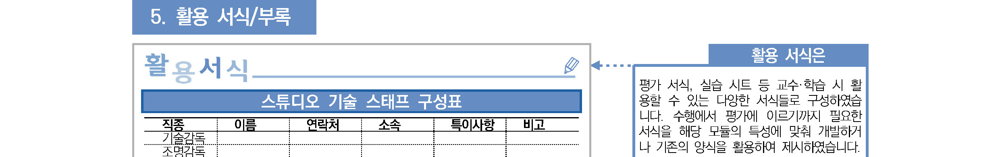
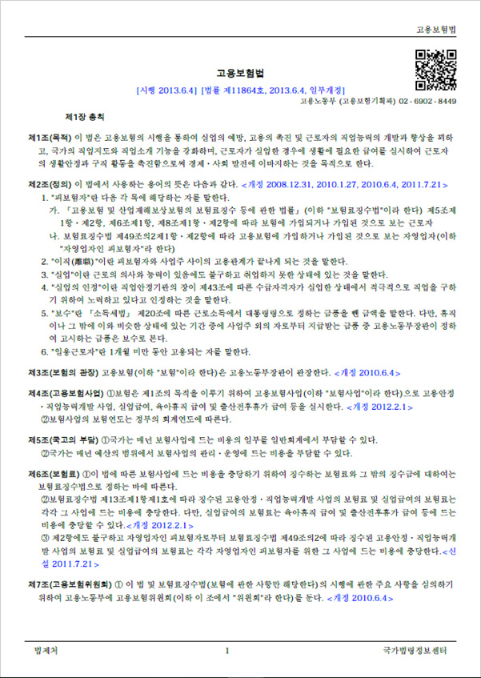
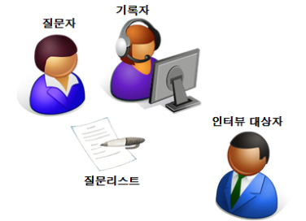
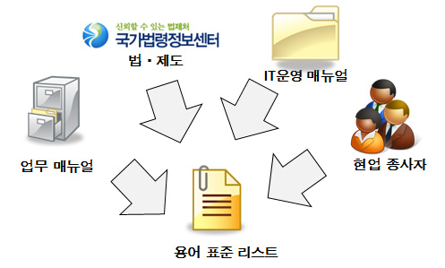
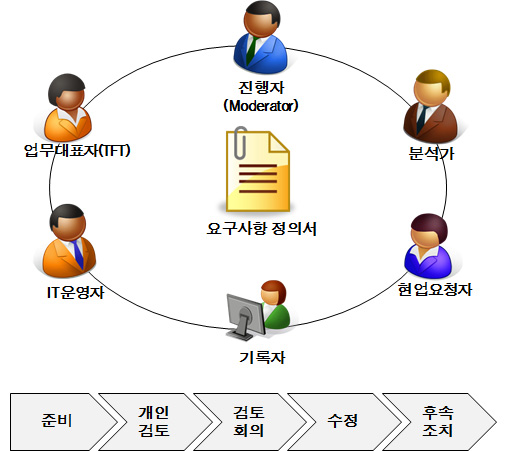

# LM2001020401_데이터베이스+요구사항+분석

대분류/20

정보통신 중분류/01
정보기술 소분류/02
정보기술개발 세분류/04
DB엔지니어링 능력단위/01

| NCS학습모듈 |
| --- |
| 데이터베이스 |

요구사항 분석

LM2001020401_19v4

[NCS-학습모듈의 위치]

| 정보통신 |  |  |
| --- | --- | --- |
|  | 정보기술 |  |
|  |  | 정보기술개발 |

대분류
중분류
소분류
세분류

| SW아키텍쳐 |  |  | 능력단위 | 학습모듈명 |
| --- | --- | --- | --- | --- |
| 응용SW 엔지니어링 |  |  | 데이터베이스 요구사항 분석 | 데이터베이스 요구사항 분석 |
| 임베디드SW 엔지니어링 |  |  | 개념데이터 모델링 | 개념데이터 모델링 |
| DB엔지니어링 |  |  | 논리 데이터베이스 설계 | 논리 데이터베이스 설계 |
|  |  |  | 논리 데이터베이스 설계 | 논리 데이터베이스 설계 |
| NW엔지니어링 |  |  | 물리 데이터베이스 설계 | 물리 데이터베이스 설계 |
| 보안엔지니어링 |  |  | 데이터베이스 구현 | 데이터베이스 구현 |
|  |  |  | 데이터베이스 성능확보 | 데이터베이스 성능확보 |
|  |  |  | 데이터 전환 설계 | 데이터 전환 설계 |
| 핀테크엔지니어링 |  |  | 데이터 전환 | 데이터 전환 |
| 데이터아키텍처 |  |  | SQL활용 | SQL활용 |
| IoT시스템연동 |  |  | SQL응용 | SQL응용 |
| 인프라스트럭쳐 아키텍처 구축 |  |  | SQL작성 | SQL작성 |

차 례
학습모듈의 개요 1
학습 1. 데이터베이스 요구사항 수집하기
1-1. 문서 및 현행 시스템 분석을 통한 요구사항 수집 3
1-2. 인터뷰를 통한 요구사항 수집 15
• 교수・학습 방법 26
• 평가 28
학습 2. 데이터베이스 요구사항 분석하기
2-1. 데이터 요구사항 분석 및 정제 30
2-2. 비기능 데이터 요구사항 추출 41
• 교수・학습 방법 51
• 평가 52
학습 3. 데이터베이스 요구사항 정의하기
3-1. 데이터 요구사항 명세 54
• 교수・학습 방법 61
• 평가 62
학습 4. 데이터베이스 요구사항 검증하기
4-1. 데이터 요구사항 검증 64
• 교수・학습 방법 73
• 평가 74
참고 자료 76
활용 서식 77
데이터베이스 요구사항 분석 학습모듈의 개요
학습모듈의 목표
데이터베이스를 설계하고 구현하기 위해 최종 사용자의 요구사항을 수집, 분석하고 정의하며, 각 단계의 산
출물에 대해 검증할 수 있다.
선수학습
요구공학, 데이터 아키텍처, 데이터베이스 구현(LM2001020405_14v2), 데이터 표준화
(LM2001020409_14v2), SQL활용(LM2001020410_14v2)
학습모듈의 내용체계

| 학습 | 학습 내용 | NCS 능력단위요소 |  |
| --- | --- | --- | --- |
|  |  | 코드번호 | 요소명칭 |

1-1. 문서 및 현행 시스템 분석을
1. 데이터베이스 요구사항 통한 요구사항 수집 데이터베이스
2001020401_19v4.1
수집하기 요구사항 수집하기
1-2. 인터뷰를 통한 요구사항 수집
2-1. 데이터 요구사항 분석 및 정제
2. 데이터베이스 요구사항 데이터베이스
2001020401_19v4.2
분석하기 요구사항 분석하기
2-2. 비기능 데이터 요구사항 추출
3. 데이터베이스 요구사항 데이터베이스
3-1. 데이터 요구사항 명세 2001020401_19v4.3
정의하기 요구사항 정의하기
4. 데이터베이스 요구사항 데이터베이스
4-1. 데이터 요구사항 검증 2001020401_19v4.4
검증하기 요구사항 검증하기
핵심 용어
요구사항, 요구공학, 제안요청서, 제안서, 인터뷰, 정확성, 명확성, 추적 가능성, 일관성, 완전성

| 학습 1 | 데이터베이스 요구사항 수집하기 |
| --- | --- |

학습 2 데이터베이스 요구사항 분석하기
학습 3 데이터베이스 요구사항 정의하기
학습 4 데이터베이스 요구사항 검증하기
문서 및 현행 시스템 분석을 통한
1-1.
요구사항 수집
•제안요구서와 실제 조직의 업무에 사용되는 문서에서 데이터베이스 개발을 위한 구체적인 요
구사항을 추출할 수 있다.
학습 목표
•기존에 운영되어 오고 있는 시스템을 분석하여 새로운 시스템 도입 이전의 상황에서 충족되어
오고 있던 요구사항과 함께 신규 요구사항을 추출할 수 있다.
필요 지식 /
① 데이터 요구사항
데이터 요구사항이란 사용자가 일상적으로 수행하는 업무의 개선 사항이나 신규 개발
사항으로 시스템을 통해 기능상의 목적을 달성하기 위하여 필요한 데이터에 관한 모든
사항을 요청하는 내용이다.
1. 데이터 요구사항 수집 원천
데이터 요구사항을 수집하기 위한 원천은 사업자의 제안을 위한 발주자의 제안요청서부터
사업자의 제안서, 제안 평가 및 사업자 선정과 계약 후에 사업수행계획서, 현행 시스템
관련 문서와 이해관계자와의 인터뷰, 워크숍 등이다.

[그림 1-1] 프로젝트 발주 프로세스
<표 1-1> 데이터 요구사항 수집 원천
원천 내용 비고
발주자가 특정 과제의 수행에 필요한 요구
사항을 체계적으로 정리하여 제시함으로써
제안요청서 공공 SW사업 발주 관리 규정 참고
제안자가 제안서를 작성하는 데 도움을 주
기 위한 문서
제안서는 상품 및 서비스를 제공하는 기업 제안서, 제안 발표 자료 제출
제안서 이 자신의 사업을 어떻게 수행할 것인가에 제안 발표 후 평가를 통해 사업자
대해 포괄적으로 정리한 문서 선정
사업 착수 단계에서 검토, 분석했던 모든
PM 또는 PMO에서 제안요청서,
사업수행 내용을 기초로 수행 일정 및 고객과 사업
제안서, 과거 유사 사업 경험을 통
계획서 팀 역할 정의, 산출물 정의 및 수행을 위한
해 작성하고 착수 보고회를 함.
지원사 항 등을 망라한 문서
현행
현행 시스템의 논리/물리 ERD, 테이블/칼 DB 툴을 이용한 데이터베이스 조
시스템
럼 명세서, 운영자/사용자 매뉴얼 회 및 분석
분석
사용자 수집된 요구사항으로부터 분석, 정
고객으로부터 서면, 이메일, 문서 또는 인
요구사항 의, 검증을 거쳐 요구사항 확정 및
터뷰나 워크숍을 통해 요구사항 수집
수집 관리
2. 데이터 요구사항 프로세스
데이터 요구사항 프로세스는 수집된 데이터의 요구사항을 분석, 상세화하고 이를 바
탕으로 요구사항 명세서를 작성하여 명확성, 정확성, 추적 가능성 등 기준에 적합한
지 검증하는 절차로 이루어져 있으며 사업 종료 시까지 WBS의 기초가 된다.

[그림 1-2] 요구사항 개발 프로세스
(1) 데이터 요구사항 추출
고객이 현재 가지고 있는 문제점과 시스템이 수행하기를 원하는 데이터 요구사항
을 정확하게 추출하는 것이다.
(가) 요구사항 식별 및 수집
개발할 시스템에 대한 사용자 요구와 시스템 제약 사항을 식별하고 이 중에서
데이터와 관련된 데이터 요구사항을 수집하는 과정이다.
(나) 대상 도메인 조사 분석
대상 도메인에 대한 조사 및 분석을 통해 해당 조직의 비즈니스 목표와 이를
달성하기 위한 데이터 요구사항을 추출한다.
(2) 데이터 요구사항 분석
이해관계자로부터 추출된 비정형적이고 불완전한 추상적 요구사항을 요구사항 명
세서가 생성되기 이전에 완전하고 일관성 있는 요구사항으로 만들기 위한 단계로
올바른 요구사항을 획득하기 위한 과정이다.
(가) 문제 영역 분석
명확하고 일관성 있는 데이터 요구사항을 정의하기 위해서 시스템 이해관계자들
사이에 불일치하는 문제 영역을 이해관계자별로 정리하고 이를 통합·조한다.
(나) 요구사항 구조화
추출된 요구사항의 체계를 설정하는 단계로 추상적 요구사항을 상세한 요구사
항으로 분해한다. 큰 기능을 세부적으로 분해하면서 각 세부 기능에 필요한
데이터 요구사항이 무엇인지 추출이 가능하다.
(다) 요구사항 모델링
데이터 요구사항을 모델링하는 방법은 기능 흐름도(DFD)를 이용하는 구조적
분석 방법, UML을 이용하여 분석하는 객체 지향 분석 방법, E-R 다이어그램
을 이용하는 분석 방법이 있다.
(3) 데이터 요구사항 명세
데이터 요구사항 명세는 요구사항을 정확하고 완전하게 작성하는 것으로 요구사
항을 적정한 수준으로 상세하게 또는 구체적으로 표현하여 모든 시스템 이해관계
자가 이해할 수 있도록 작성한다.
(가) 데이터 요구사항 명세 장점
1) 고객과 개발자 간의 프로젝트 수행 목적에 대하여 공유한다.
2) 개발 일정과 비용 산출의 근거를 제공한다.
3) 오류 검증과 확인을 위한 기본적인 자료를 제공한다.
(나) 데이터 요구사항 명세 원리
요구사항 명세서는 사용자와 개발자 사이의 의사소통 수단이므로 명세서에 표현
된 내용이 모호하면 해석의 차이가 발생할 수 있으므로 정확하게 기술하는 것이
중요하다. 요구사항 명세서가 가져야 하는 품질 속성은 명확성, 정확성, 완전성,
검증 가능성, 일관성, 수정용이성, 추적 가능성, 개발 후 이용성 등이다.
(4) 데이터 요구사항 검증
데이터 요구사항 검증은 사용자 요구가 요구사항 명세서에 올바르게 기술되었는
가를 검토하는 활동이며 요구사항을 확정하여 이후 설계 및 개발, 테스트 단계의
기준을 만드는 단계이다.
(가) 데이터 요구사항 타당성 검증
정의된 요구사항의 실현 가능성, 요구사항 표현의 정확성, 완전성, 표준과의
일치성, 요구사항의 충돌, 기술적 결함 등에 대한 검증을 수행한다.
(나) 데이터 요구사항 구조 검증
사용자의 요구와 목표를 만족하는가에 대한 확인을 위해 각 단계별 명세 요건
들이 정확하고 완전하게 정의되었는가를 조사하여 요구사항들 간에 정확성과
완전성 및 일치성을 확립한다.
② 제안요청서
제안요청서(RFP, request for proposal)는 고객이 SI 업체에게 고객의 요구사항과 구
현하고자 하는 시스템 기능 및 내용, 이에 따른 하드웨어, 소프트웨어 사양, 프로젝트
수행 기간 및 조건, 금액, 수행 방법 등의 사업 수행에 필요한 구체적인 내용을 제시한
문서이다. 데이터 요구사항 수집 원천 사례로 제안요청서를 설명한다.

[그림 1-3] 제안요청서 목차와 요구사항 목록
1. 제안요청서 목차
제안요청서는 발주자가 왜 사업을 시작하려고 하는지, 현황과 문제점을 사업자에게 설명하고
사업자로 하여금 제안을 통해 내용에 대한 해결책을 제시하도록 하는 문서이다.
<표 1-2> 제안요청서 목차 및 설명
목차 내용
사업 개요 개요, 추진 배경 및 필요성, 주요 사업 범위, 기대 효과
현황 및 문제점 업무 내용, 시스템 현황, 문제점 및 개선 방항
사업 추진 계획 추진 전략, 추진 체계 및 역할, 추진 일정
제안 요청 개요, 상세 제안요청 내용(기능, 성능, 데이터, 테스트, 보안, 품
제안 요청 내용
질, 프로젝트 관리, 프로젝트 지원, 제약 사항)
제안서 안내 사항 제안서 작성 지침, 제안서 목차 및 작성방 법
제안서 평가 제안서 제출, 사업자 선정 기준(기술 평가, 가격 평가)
제안 업체 자본금 및 매출 경험, 유사 사업 경험, 최신 기술 및 숙련된 개
기타 계약 조건
발 인력 보유 여부
2. 요구사항 목록
제안요청서는 요구사항을 그룹별로 체계적으로 제시하고 있으며 기능 점수 계산이
가능할 수준까지 구체적으로 작성하도록 요구받는다.
<표 1-3> 요구사항 목록 사례
목차 내용
기능 웹 애플리케이션 등 기능을 수행하기 위한 데이터 입력 및 출력에 대한 요구사항
온라인 쿼리 및 대용량 데이터 처리를 위한 배치 쿼리 등 본연의 목적에 부합한
성능
성능 요구사항(예: 웹 조회는 3초 이내), 비기능 요구사항
중요 데이터에 대한 기밀성 및 무결성 보장을 위한 보안 요구사항(예: 개인 고유
보안
식별 번호 암호화), 비기능 요구사항
기관 내부의 다른 시스템과의 연계 또는 다른 기관과의 연계를 위한 입출력 방식
외부 연계
의 추가 및 변경 요구사항
수행 내용 / 문서 및 현행 시스템 분석을 통한 요구사항 수집하기
재료·자료
• 신규 정보시스템 구축을 위한 ISP 산출물, 중장기 경영 및 IT 컨설팅 자료, 현업 업무
매뉴얼, 사용 중인 각종 장표, 서식, 전산 운영자 매뉴얼, 전산 사용자 매뉴얼, 업무 파악
을 위한 교육 자료, 개념·논리·물리 모델, 테이블 및 컬럼 명세서
기기(장비･공구)
• 컴퓨터, 문서 작성 도구
안전･유의사항
• 대상 업무에 대한 지식을 빠르게 효과적으로 습득한다.
• 프로젝트 관련 산출물에 대한 정독 및 다독한다.
• 이해관계자와 자주 만나서 신뢰 관계를 형성한다.
수행 순서
① 제안요구서와 실제 조직의 업무에 사용되는 문서에서 데이터베이스 개발을 위한 구체적인 데
이터 요구사항을 추출한다.
1. 제안요청서(제안요구서)를 통해 요구사항을 수집한다.
제안요청서는 기능, 데이터, 성능 등 분류별로 고객의 요구사항을 담고 있으며 이 중에
데이터 입출력 및 저장이 필요한 요구사항에 대해 데이터 요구사항으로 추출한다.
<표 1-4> 제안요청서 요구사항을 통한 데이터 요구사항 추출 사례
순번 구분 요구사항 고유 번호 요구사항 명칭
1 기능 SFR-01 회원 가입, 변경, 탈퇴 화면
2 데이터 DAR-01 데이터 표준 준수
(1) 기능 요구사항 SFR-01 사례를 참조하여 요구사항을 수집한다.
<표 1-4>는 기능 요구사항이지만 데이터 요구사항을 포함하고 있으며 한 개 이
상의 테이블과 유일성 제약 사항, 패스워드(Password) 암호화 등 확인이 필요한
데이터 요구사항을 수반하고 있다.
(가) 회원 가입, 변경, 탈퇴 화면에 대하여 회원 데이터를 지속적으로 관리할 수 있는
테이블이 필요하다는 요구사항을 추출한다.
(나) 기관 웹 페이지에 회원으로서 로그인하기 위한 정보로 회원 ID와 패스워드가 필
요하다면 회원 ID는 다른 회원과 구별될 수 있도록 유일성 제약을 가져야 하고
패스워드는 보안상 해시 함수를 이용, 암호화하여 저장해야 한다는 요구사항을 추
출한다.
(다) 회원의 2개 이상의 연락처, 휴대전화 번호, 주소 데이터가 필요하다면 회원 테이블을
부모 테이블로 하는 회원연락처 등 자식테이블이 필요한 요구사항을 추출한다.
(2) 데이터 요구사항 DAR-01 사례를 참조하여 요구사항을 수집한다.
공공 기관 또는 기업에서 회사 표준으로 정한 표준 단어, 표준 용어, 표준 도메
인, 표준 코드 사전을 준용하기 위한 데이터 요구사항이다.
(가) 표준 용어 사전의 한글명을 준용하여 논리 데이터 모델의 엔티티와 속성을 정의
하는 요구사항을 추출한다.
(나) 논리 데이터 모델의 속성명이 표준 도메인 사전에서 데이터 타입과 길이를 제약하
는 분류어로 끝나도록 논리 데이터 모델의 속성을 정의하는 요구사항을 추출한다.
(다) 표준 용어 사전의 영문명을 준용하여 물리 데이터 모델의 테이블과 컬럼을 정의
하는 요구사항을 추출한다.
(라) 코드성 컬럼은 표준 코드 사전에 코드명과 가질 수 있는 코드 값을 추가하는 요
구사항을 추출한다.
<표 1-5> 데이터 표준 준수 사례
구분 내용
표준 단어 (고객, CUST, 기본어), (명, NM, 분류어)
표준 용어 (고객명, CUST_NM, 용어는 분류어로 끝나도록 함.)
표준 도메인 (명, VARCHAR, 500), (성별 구분 코드, VARCHAR, 1)
표준 코드 (성별 구분 코드, (‘M’,남자), (‘F’,여자))
2. 현행 서식을 이용하여 요구사항을 수집한다.
조직의 업무에서 사용하는 현행 장표 및 각종 서식 문서에 채워진 데이터를 저장하거나
지속적으로 저장된 데이터를 조회, 인쇄해야 한다면 데이터 요구사항으로 수집한다.

| 인적사항 | 성명 |  | 휴대전화 |  |
| --- | --- | --- | --- | --- |
| 인 | 생년월일 |  |  |  |
| 적 | 주소 |  |  |  |
| 사 | 전화 |  | 휴대전화 |  |
| 항 | E-mail |  |  |  |

사진
1개월 이내에 촬영한
탈모 상반신 사진

| 학력사항 | 기간 | 학 교 명 | 전 공 | 소 재 처 | 학 위 |
| --- | --- | --- | --- | --- | --- |
| 학 |  |  |  |  |  |
| 력 |  |  |  |  |  |
| 사 |  |  |  |  |  |
| 항 | 최종 학위 논문 주제 |  |  |  |  |

[그림 1-4] 이력서 양식을 통한 데이터 요구사항 추출
(1) 이력서 양식 사례를 참조하여 데이터 요구사항을 추출한다.
그림1-4 이력서 양식을 통해 사원 정보를 지속적으로 저장 및 활용할 계획이라
면 개인의 인적 사항을 저장할 수 있는 ‘개인’ 엔티티와 개인당 2개 이상의 학력
사항을 저장할 수 있는 ‘개인학력’ 엔티티를 요구사항으로 수집한다.

[그림 1-5] 개인과 개인학력 엔티티
② 기존에 운영되어 오고 있는 시스템을 분석하여 새로운 시스템 도입 이전의 상황에서 충족되
어 오고 있던 데이터 요구사항과 함께 새로운 데이터 요구사항을 추출한다.
1. 기존에 수행 중인 요구사항을 수집한다.
조직의 비즈니스 데이터 구조와 규칙을 표현하여 설계한 논리 ERD(Entity
Relationship Diagram)와 이에 더해 데이터베이스 특성 및 성능을 고려하여 구축
한 물리 ERD를 통해 기존 요구사항을 수집 및 분석한다.

[그림 1-6] ERD 현행화 및 리버스 모델링 절차
(1) 논리/물리 ERD가 존재하는 경우 현행화 작업을 수행한다.
공공기관이나 기업이 논리/물리 ERD를 보유하고 있더라도 애플리케이션의 잦은
수정 또는 기능 고도화 작업으로 인한 데이터 변경 사항이 ERD에 반영되어 있지
않을 수 있으므로 [그림 1-6] 순서에 따라 현행화 작업을 수행한다.
(가) [그림 1-6]에서 ❶ 은 물리 테이블과 물리 ERD 간의 일치화 작업이다.
(나) ❷는 논리 ERD와 물리 ERD 간 일치화 작업이다.
(다) ❸은 논리/물리 ERD와 표준 사전 간 일치화 작업이다.
(라) 필요에 따라 주제 영역당 한두 개의 핵심 엔티티로 구성된 ❸개념 ERD를 작성한다.
(2) 논리/물리 ERD가 존재하지 않는 경우 리버스 모델링을 통해 현행화 작업을 한다.
[그림 1-6]으로부터 물리 테이블로부터 물리 ERD 그리고 논리 ERD를 ❻ 리버
스 모델링 방향으로 구축하여 ER딕셔너리D를 생성한다. 데이터 모델링 툴을 이
용하여 개별 DBMS에 특화된 (Dictionary) 정보를 조회하여 테이블과 칼럼 정보
등을 추출, 물리 ERD를 도식화한다. 전사적인 데이터 표준 사전을 유지하고 있
다면 표준 용어 및 도메인을 물리 ERD에 적용하고 현행화한다.
(3) 테이블 명세서로부터 기존 요구사항을 수집한다.
조직의 업무를 수행하기 위해 필요한 데이터의 구조를 알 수 있는 최소한의 정보
로서 테이블 명세서를 통해 기존 요구사항으로 수집한다.
<표 1-6> 테이블 명세서 사례
테이블 명세서
사스템명 민원 관리 시스템 작성일 2015.11.30
테이블
민원 일지 작성자 홍 길 동
한글명
테이블
TB_CV0001HT 길이 2323 페이지 1/1
영문명
초기 확장 보존
2000K 200M 5년
크기 크기 기간
건수 초기 건수: 0건, 증가 건수: 30,000건/월, 최대 건수: 12,000,000건
PK NN
NO 컬럼 영문명 컬럼 한글명 타입 길이
여부 여부
1 CVPL_CODE 민원코드 CHAR 10 Y Y
2 REQST_DE 신청일자 CHAR 8 Y Y
3 REQST_SN 신청순번 NUMBER 5 Y Y
4 APPLCNT_NM 신청인명 VARCHAR 50 N N
인덱스 TB_CV0001HT_PK(CVPL_CODE, REQST_DE, REQST_SN)
특이
사항
2. 신규 요구사항을 수집한다.
(1) 기능 고도화 사업 사례를 참조하여 신규 요구사항을 수집한다.
법·제도 및 회사 정책의 변경 또는 사업 강화를 위하여 기존의 업무 및 데이터
구조를 대체적으로 유지한 상태에서 특정 업무 분야의 기능을 고도화하기 위해
신규 요구사항을 통해 사업을 제안하는 경우이다.
(가) 개인 정보 통합을 위한 기능 고도화 사업을 참조하여 신규 요구사항을 수집한다.
개인정보보호법에 따라 주문, 선적, 배송 등 업무 기능 별로 흩어진 개인 정보를 통합
관리하기 위하여 개인정보를 위한 데이터베이스를 구축하고 개인의 고유 식별 번호에
대해서는 암호화하여 저장하는 기능 고도화 사업의 데이터 요구사항이다.

[그림 1-7] 개인 정보 통합을 위한 기능 고도화 사업
(2) 차세대 사업 사례를 참조하여 신규 요구사항을 수집한다.
미래 사업의 개척과 사업 경쟁력 강화를 위하여 비즈니스 프로세스에 대한 근본적인 개
선부터 비즈니스를 뒷받침하는 IT 실행력 강화를 위해 현행 IT 시스템의 하드웨어 및 기
능 그리고 데이트 구조를 새롭게 구축하는 차세대 사업에 대한 데이터 요구사항이다.
<표 1-7> 일반적인 차세대 사업 절차
절차 내용
비즈니스 프로세스 개선을 통해 핵심 역랑을 강화하고 기업의 미래 수익
비즈니스 컨설팅
을 강화하기 위한 근본적인 혁신 작업
비즈니스 정렬을 위한 IT 가치를 향상시키기 위해 정보화 방향성을 수립
정보화 전략 계획
하고 현재와의 차이를 분석하고 중장기 IT 전략 수립
비즈니스 및 정보화 전략에 따라 최신 기술을 적용하여 하드웨어, 소프트
차세대 사업 수행
웨어, 데이터, 보안 등을 고려하여 사업을 수행
현업과 IT 운영 인력이 차세대 프로세스 및 기능에 신속히 적응할 수 있
변화 관리 및 운영
도록 TFT를 구성하여 변화 관리를 실시하고 운영 효율성, 효과성 극대화
(가) 데이터 구조의 변화가 거의 없는 사례를 참조하여 신규 요구사항을 수집한다.
차세대 사업을 한다고 하더라도 업무상의 변화가 거의 없거나 과거 사업 시
설계한 데이터 구조의 유연성, 확장성이 뛰어나서 그대로 가져가기로 하는 경
우에는 최근 기술에 따른 변경을 있을 수 있으나 많은 애플리케이션 및 데이
터를 그대로 활용할 수 있으므로 오픈 전 데이터 전환에 대한 시간 및 검증에
대한 두려움이 적을 수 있다.
(나) 데이터 구조가 대부분 바뀌는 사례를 참조하여 신규 요구사항을 수집한다.
법·제도의 변경 또는 추가적인 수용, 신규 업무 발생 또는 기존 업무의 변경
이 심해서 이를 수용하기 위한 데이터 구조가 대부분 바뀌는 경우에는 신규
데이터 요구사항에 대한 현업과의 대화 작업이 길고 어려울 수 있으며 특히나
데이터 이행 작업 시에 데이터 검증에 대한 절차 및 시간이 복잡하다.
수행 tip
•데이터 구조 요구사항 수집 시 기존 논리/물리 모델의
문제점을 파악하고 개선하는 과정에서 목표 논리/물리
모델을 수립할 수 있다.
1-2.
인터뷰를 통한 요구사항 수집
•새로운 데이터베이스를 직접 사용하게 될 최종 사용자와의 인터뷰를 통해 요구사항을 수집할
수 있다.
학습 목표
•데이터베이스에서 추출된 값을 사용하여 의사 결정을 할 중간관리자들의 집단 심층면접(FGI:
Focused Group Interview)를 통해 요구사항을 수집할 수 있다.
필요 지식 /
① 업무
요구사항을 수집하기 위해 분석가는 인터뷰 및 워크숍 등 업무를 수행하는 경영진, 관
리자 운영자 등 면담을 해야 하는 과정에서 원활한 진행을 위해 해당 프로젝트를 발주
한 사업자의 업무에 대한 이해가 선행되어야 한다.
1. 법·제도
공공 기관은 기관의 설립 자체가 법 제도에 의해 설립 근거가 마련되었기 때문에 해
당 기관의 업무를 이해하기 위해서는 해당 기관의 법·제도를 이해해야 한다. 은행,
보험, 증권, 카드 회사는 민간 기업이라고 할지라도 금융감독원의 감독을 받아야 하
므로 금융시장감독법에 대한 이해가 해당 업무를 이해하는 데 도움이 된다.
<표 1-8> 공공 기관의 업무를 제약하는 법 사례
절차 내용
한국고용정보원 고용보험법, 고용보험법 시행령, 고용보험법 시행 규칙
소방기본법, 소방기본법 시행령, 소방기본법 시행 규칙
서울소방재난본부 위험물안전관리법, 소방 시설 설치 유지 및 안전 관리에 관한 법률
다중 이용 업소의 안전 관리에 관한 특별법
은행법, 전자금융거래법, 전자서명법, 정보통신망 이용 촉진 및 정보보호에
일반 은행
관한 법률
보험업법, 전자금융거래법, 전자서명법, 정보통신망 이용 촉진 및 정보보호
보험 업계
에 관한 법률

[그림 1-8] 고용보험법 예시
2. 업무 매뉴얼
공공 기관 및 기업은 업무를 수행하는 데 있어서 법 제도 및 사내 규정을 준수하기
위해 업무를 수행하는 표준화된 프로세스(Process)와 업무에 대한 경험과 지식(성공
요인, 장애 극복 방법)을 체계적으로 정리한 안내서이다.
(1) 업무 매뉴얼 필요성
신규 임직원들에 교육을 통해 배포함으로써 업무에 대한 부담을 줄여 주고 기관
과 기업의 문화에 빠르게 적응하기 위한 교재이다. 이런 업무 매뉴얼을 통해서
해당 업무에서 사용하는 업무 용어와 프로세스를 이해함으로써 요구사항을 좀 더
빠르게 이해할 수 있으며 현업과의 의사소통을 원활하게 할 수 있다.
(2) 업무 매뉴얼의 구성 예시
<표 1-9> 일반적인 업무 매뉴얼 목차
절차 내용
서론 매뉴얼의 필요성, 목적, 구성 등
과제 개요 매뉴얼에서 다루고 있는 과제나 업무의 개요
단계/기능별
과제 성격에 따라 단계, 시기 또는 기능별 처리 요령이나 점검 사항을 제시
점검 사항
성공 및
주요 성공 요인, 장애 요인과 극복 방법을 분석하여 실제 사례와 함께 제시
실패요인 분석
관련법령 과제 수행과 관련이 있는 법령 첨부
유관 기관 연락처 관련 정부 기관, 민간 단체, 학회, 연구소 등의 연락처
서식/템플릿 필요한 서식이나 템플릿(Template) 예 제시
기타 참고 자료 관련된 과제나 업무에 유용하게 활용될 수 있는 각종 참고 자료
Q/A 예상되는 질문과 그에 대한 알기 쉬운 답변
(3) 업무 매뉴얼 예시

출처: 인천광역시교육청 홈페이지(http://www.ice.go.kr/boardCnts/view.do?boardID=1630&boardSeq=1023365&
lev=0&searchType=S&statusYN=W&page=1&s=ice&m=040901&opType=N), 2015년 10월 31일 검색,
학교 행정 업무 매뉴얼
[그림 1-9] 학교 행정 업무 매뉴얼 예시
② 요구사항 수집 방법
1. 브레인스토밍 기법
두뇌를 사용하여 창의적으로 문제점을 해결하기 위하여 광범위한 의견을 거의 제한
없이 제기함으로써 사고의 형식을 전환하기 위한 기법이다.
2. 문서 분석 기법
기존 시스템에 대한 문서 및 관련 자료들을 조사하여 시스템의 요구 사항을 도출하는
기법이다.
3. 포커스 그룹 인터뷰
해당 주제에 대해 토론하거나 의견을 제시할 수 있는 적정 자격을 보유한 인력들로
구성되어 토론을 통해 자신의 관점을 타인과 공유하고, 개개인의 반응을 관찰하는
기법이다.
4. 인터페이스 파악 기법
시스템이 필요로 하는 인터페이스를 파악함으로써 요구 사항을 도출하는 기법이다.
5. 인터뷰 기법
업무 전문가, 사용자, 개발 팀 등의 이해 관계자 그룹을 대상으로 하여 필요 정보를
구두로 도출하는 기법이다.
6. 사용자 업무 관찰 기법
업무 영역 전문가의 수행 환경을 평가함으로써 요구 사항을 도출하는 기법이다.
7. 프로토타이핑(Prototyping) 기법
개발 대상 시스템 또는 그 일부분을 신속하고 개략적으로 구축하여 요구 사항을 도
출하는 기법이다.
8. 요구 사항 워크숍
실제 사용자가 중요 현안들을 토의하여 개선된 의사 결정, 책임 의식과 의견 일치를
이끌어 내는 기법이다.
9. 역공학 기법
기존 시스템의 산출물 정보가 부족할 경우에 소스 코드로부터 필요한 정보를 추출하
는 기법이다.
10. 조사 및 설문 기법
다수의 사용자로부터 시스템의 요구 사항, 기대 수준, 불만족 사항 등 전체적 의견을
수렴하는 기법이다.
③ 포커스 그룹 인터뷰(Focus Group Interview, 집단 심층 면접)
1. 포커스 그룹 인터뷰 개요
특정 목적에 따라 모인 소수(5~6인) 그룹이 준비된 화제를 이야기하는 과정에서 숙
련된 사회자의 진행 기술에 따라 집단의 이점을 활용하여 그룹 개개인이 상호간에
영향을 미치도록 하여 개개인의 반응을 통합하여 가설의 추출 및 검증 등 그때그때
의 목적에 따라서 관찰하고 분석하는 방법이다.
2. 포커스 그룹 인터뷰 장단점
<표 1-9> 포커스 그룹 인터뷰 장단점
장점 단점
• 대상자 수가 적어 대표성 부족
• 저비용으로 빠른 정보 입수 가능
• 사회자의 능력에 의해 좌우
• 그룹 내의 시너지 효과
• 오피니언 리더의 관리 소홀 시 문제 발생
3. 포커스 그룹 인터뷰 수행 절차
포커스 그룹 인터뷰는 준비, 소집, 실시 및 분석 4단계 절차를 통해 수행된다.
<표 1-10> 포커스 그룹 인터뷰 수행 절차
단계 내용
• 목적의 확인과 방법 결정 및 문제의 파악과 가설 설정
준비 단계 • 대상자 속성, 수, 그룹 수 결정
• 일정, 시간, 장소 결정
• 소집자 확보 및 지침 교육
소집 단계
• 대상자 탐색 및 의뢰
• 회의장 설치
실시 단계 • 도입 인터뷰 및 주제 인터뷰
• 기록과 관찰
• 분석 및 해석
분석 단계
• 보고서 작성
수행 내용 / 인터뷰를 통한 요구사항 수집하기
재료·자료
• 신규 정보시스템 구축을 위한 ISP 산출물, 중장기 경영 및 IT 컨설팅 자료, 현업 업무 매
뉴얼, 사용 중인 각종 장표 및 서식, 전산 운영자 매뉴얼, 전산 사용자 매뉴얼, 업무 파악
을 위한 교육자료, 개념·논리·물리 모델, 테이블 및 컬럼 명세서
기기(장비･공구)
• 컴퓨터, 문서 편집 프로그램
안전･유의사항
• 인터뷰 시간, 장소 등 계획서 준비 철저히 한다.
• 프로젝트 관련 산출물에 대한 정독 및 다독한다.
• 이해관계자와 자주 만나서 신뢰 관계 형성한다.
수행 순서
① 새로운 데이터베이스를 직접 사용하게 될 최종 사용자와의 인터뷰를 통해 데이터 요구사항을
수집한다.
1. 요구사항을 작성할 대상자를 선정한다.
사업을 수행하는 PMO(Project Management Office)와 고객 TFT(Task Force
Team)와의 협의를 통해 요구사항 수집 및 의사 결정을 할 수 있는 업무별 현업 대
표를 선정하고 협의된 요구사항 작성 양식을 통해 각 업무
영역 이해관계자들로부터 데이터 요구사항을 수집한다.
(1) 요구사항 작성 양식을 개발한다.
PMO 또는 현업 TFT 등 프로젝트와 관련된 업무 부서에서 요구사항 수집을 위
한 통일된 요구사항 작성 양식을 개발하여 배포한다.
(2) 요구사항 수집을 대행할 업무별 현업 대표를 선정한다.
요구사항을 효율적으로 수집하기 위해서는 업무별로 요구사항 작성 대상자를 선
정하고 요구사항 작성 양식을 배포 및 결과 수집, 정리할 수 있는 업무별 현업
대표를 선정한다(일반적으로 고객 TFT(Task Force Team)가 이를 수행한다.).
<표 1-11> 요구사항 수집 양식 예시
단계 내용
순번 요구사항 개수 파악에 따라 단순히 채번하기 위한 용도로 매긴 번호
사업 범위 내에서 업무를 추가 또는 개선할 대상 업무를 수행 중인 부서
업무 영역
또는 그룹
각 업무 영역별로 요구사항 양식을 각 관계 부서 또는 관계 사원에게 전달
현업 TFT 하고 중간에서 요구사항을 수집 또는 필터링하여 PMO로 전달하는현업
TFT
현업 TFT 부서명 현업 TFT 소속 부서를 의미
요구사항 내용에 따라 데이터, 화면, 기능, 비기능, 성능 등 요구사항을 분
요구사항 구분
류하여 분석 및 정의하기 위해 사용하는 1차적 분류 기준
현재 사용 중인 IT 시스템에 대해 문제점을 지적 또는 추가해야 할 기능
요청자
등을 설명하고 요구사항으로 내 주기 위한 요청자 성명
요구사항을 낸 요청자의 소속 부서명을 기재하고 부서별 요구사항 개수를
요청자 소속 부서명
파악하고 테스트, 검증 및 인수 인계 대상을 위한 기초 데이터
현업이 가진 업무 용어로 기재한 요청 사항을 의미하며 이해가 명확치 않
요청 내용
거나 하는 경우 업무 현업 대표자에 의해 확인 및 필터링 필요
2. 요구사항은 다음과 같은 절차에 따라 수집한다.
(1) 요구사항 작성 양식을 배포한다.
프로젝트 PMO 조직과 고객 PMO 조직의 협의에 따라 선정된 업무별 현업 대표
와 요구사항 수집 수단을 정하고 사내에서 보안이 가능한 사내 의사소통 수단을
이용하여 업무별 현업 대표에게 요구사항 요청 양식을 배포한다.
(2) 요구사항 작성 결과를 수집한다.
각 업무별 현업 대표는 사업에 관계된 각 업무 영역별 이해관계자를 선정하고 이
들에게 요구사항 요청 양식을 배포하고 시한을 정한 후 답변을 줄 것을 요청한다.
(3) 요구사항을 정리한다.
업무별 현업 대표는 1차적으로 수집된 요구사항을 정리하고 PMO(Project
Management Office)와 의사소통 시 이해가 명확하지 않거나 추가적으로 보충
이 필요한 부분은 재차 의사소통 수단을 이용하여 보완한다.
(4) 요구사항을 확정한다.
업무별 현업 대표는 이렇게 정리된 요구사항을 PMO에게 전달한다.

[그림 1-10] 요구사항 수집 절차
② 데이터베이스에서 추출된 값을 사용하여 의사 결정을 할 중간 관리자들의 집단 심층 면접
(FGI)를 통해 데이터 요구사항을 수집한다.
1. 인터뷰 절차에 따라 요구사항을 수집한다.
인터뷰는 서면이나 이메일로 수집된 요구사항을 구체화 및 명확하게 하거나 또는 업
무의 이해 및 업무 절차를 조사하고 추가적인 요구사항을 수집하기 위하여 한두 명
의 관리자 또는 실무자와 대면하여 질의와 응답을 통해 정보를 수집하는 방법이다.

[그림 1-11] 인터뷰 절차
(1) 인터뷰를 계획한다.
(가) 인터뷰 일정은 고객과 협의하여 수립한다.
(나) 인터뷰 수행 팀을 구성한다(일반적으로 질문자 1명, 기록자 1명).
(다) 인터뷰 질의에 사용할 질문 리스트를 준비한다.
(라) 인터뷰 응답을 기록할 수 있는 양식을 준비한다.
(2) 인터뷰를 수행한다.
(가) 인터뷰 담당자에 대한 소개 및 인사를 한다.
(나) 친밀하고 부드러운 인터뷰가 되도록 분위기를 유도한다.
(다) 질문 리스트에 따라 질의 및 응답한다.
(라) 서면 또는 이메일로 이미 수집한 요구사항에 대한 구체적인 설명을 요청한다.

[그림 1-12] 인터뷰 참가자 사례
(3) 인터뷰 결과를 분석한다.
(가) 인터뷰한 내용을 정리한다.
(나) 공식적인 인터뷰 정리 양식을 이용하여 결과를 표준화한다.
(다) 추가적인 데이터 요구사항을 추출하고 확인한다.
(4) 분석 결과를 피드백한다.
(가) 분석 결과를 인터뷰 대상자에게 피드백한다.
(나) 분석 결과에 따라 재 인터뷰 계획 수립 및 실행한다.
(다) 인터뷰 응대에 대한 이메일 또는 선물로 감사 표시를 한다.
(라) 최종으로 요구사항을 정리한다.
③ 워크숍을 통하여 요구사항을 수집한다.
1. 워크숍의 필요성은 다음과 같다.
(1) 요구사항 수집을 위해 전문 진행자의 진행 아래 프로젝트의 현업 부서 측과 IT 인력
측의 주요 구성원들이 함께 논의가 필요하다.
(2) 여러 부서와 이해관계가 걸려 있는 요구사항을 확정해야 한다.
(3) 사업 범위에 대한 조정이 필요하다.
(4) 프로젝트의 원활한 수행을 위한 문화적인 교류가 필요하다.
2. 워크숍을 준비한다.
워크숍을 통한 최종적인 목표와 구체적인 논의 사항을 도출하기 위해 사전에 철저한
준비가 필요하다.
(1) 워크숍 과제를 선정하고 계획을 수립한다.
(2) 참가 대상자를 선정한다.
(3) 참가 대상자에 대한 사전 브리핑 및 교육 훈련을 실시한다.
(4) 킥오프 모임을 수행한다.
(5) 워크숍 자료를 준비한다.
(6) 설비와 물품을 준비한다.
(7) 워크숍 장소를 선정한다.
(8) 워크숍 기간 동안 수행할 프로그램을 준비한다.
3. 워크숍을 진행한다.
<표 1-12> 워크숍 진행 절차
진행 절차 진행 내용
• 워크숍의 시작을 알리고 간략한 인사의 말을 한다.
워크숍 개시 • 부수적인 항목들(휴게실 위치, 흡연 구역 등)에 대해서 공지한다.
• 일정을 확인한다.
• 워크숍의 목적과 접근 방법의 개요를 설명한다.
워크숍 수행
• 사용자로 하여금 워크숍의 목적을 재확인한다.
준비
• 워크숍 기간 동안 작업을 수행하기 위하여 필요한 기법들을 습득한다.
• 구체적인 워크숍 수행 방식은 형태나 특정 목적에 따라 다르게 수행한다.
워크숍 수행 • 워크숍의 목적에 맞게 진행될 수 있도록 조정하고 관찰한다.
• 세부적인 진행 방법 등은 기법을 이용한다.
• 종료할 때는 진행 일정을 확인하고 진행 사항을 요약한다.
워크숍 종료 • 워크숍 과정에서 도출된 요구 사항을 공유할 수 있도록 요약하고, 책임자가
전체에게 공유하여 1차적으로 검토 받을 수 있도록 한다.
수행 tip
• 요구사항 수집 시 공공기관 및 기업의 업무와 조직 문
화를 고려하여 적절한 요구사항 수집 방법을 선택한다.

| 학습 1 | 교수 ‧ 학습 방법 |
| --- | --- |

교수 방법
• 교수자는 발주자와 사업자 간 제안 프로세스에 대해 교육한다.
• 교수자는 발주자가 제시하는 제안요청서의 목적과 역할에 대해 교육한다.
• 교수자는 사업자가 제시하는 제안서의 목적과 역할에 대해 교육한다.
• 교수자는 업무 표준 용어 사전에 대하여 목적과 필요성을 교육한다.
• 교수자는 개념·논리·물리 모델에 대하여 목적과 필요성을 교육한다.
• 교수자는 테이블 정의서에 대하여 목적과 필요성을 교육한다.
• 교수자는 다양한 요구사항 수집 방법에 대해 교육한다.
• 교수자는 인터뷰 기법의 필요성과 역할, 진행 방식에 대해 교육한다.
• 교수자는 집단 심층 면접 기법의 필요성과 역할, 진행 방식에 대해 교육한다.
• 교수자는 워크숍의 필요성과 진행 방식에 대해 교육한다.
학습 방법
• 학습자는 발주자와 사업자 간 제안 프로세스에 대해 학습한다.
• 학습자는 발주자가 제시하는 제안요청서의 목적과 역할에 대해 학습한다.
• 학습자는 사업자가 제시하는 제안서의 목적과 역할에 대해 학습한다.
• 학습자는 업무 표준 용어 사전에 대하여 목적과 필요성을 학습한다.
• 학습자는 개념·논리·물리 모델에 대하여 목적과 필요성을 학습한다.
• 학습자는 테이블 정의서에 대하여 목적과 필요성을 학습한다.
• 학습자는 다양한 요구사항 수집 방법에 대해 학습한다.
• 학습자는 인터뷰 기법의 필요성과 역할, 진행 방식에 대해 학습한다.
• 학습자는 집단 심층 면접 기법의 필요성과 역할, 진행 방식에 대해 학습한다.
• 학습자는 워크숍의 필요성과 진행 방식에 대해 학습한다.

| 학습 1 | 평 가 |
| --- | --- |

평가 준거
• 평가자는 학습자가 학습 목표를 성공적으로 달성하였는지를 평가해야 한다.
• 평가자는 다음 사항을 평가해야 한다.

| 학습 내용 | 학습 목표 | 성취수준 |  |  |
| --- | --- | --- | --- | --- |
|  |  | 상 | 중 | 하 |

-제안요구서와 실제 조직의 업무에 사용되는 문서에서 데이
터베이스 개발을 위한 구체적인 데이터 요구사항을 추출할
문서 및 현행
수 있다.
시스템 분석을 통한
-기존에 운영되어 오고 있는 시스템을 분석하여 새로운 시스
요구사항 수집
템 도입 이전의 상황에서 충족되어 오고 있던 데이터 요구
사항과 함께 신규 요구사항을 추출할 수 있다.
-새로운 데이터베이스를 직접 사용하게 될 최종사용자와의
인터뷰를 통해 요구사항을 수집할 수 있다.
인터뷰를 통한
-데이터베이스에서 추출된 값을 사용하여 의사결정을 할 중
요구사항 수집
간 관리자들의 집단 심층 면접(FGI: Focused Group
Interview)를 통해 데이터 요구사항을 수집할 수 있다.
평가 방법
• 평가자 질문

| 학습 내용 | 평가 항목 | 성취수준 |  |  |
| --- | --- | --- | --- | --- |
|  |  | 상 | 중 | 하 |

-제안요청서 요구사항 목록으로부터 데이터 요구사항 추출
문서 및 현행
방법
시스템 분석을 통한
-데이터 관련 문서 종류 및 내용
요구사항 수집
-현행 시스템 분석 방법
-인터뷰 진행 절차 및 주의 사항
인터뷰를 통한 요
구사항 수집 -워크숍 진행 절차 및 주의 사항
• 사례 연구

| 학습 내용 | 평가 항목 | 성취수준 |  |  |
| --- | --- | --- | --- | --- |
|  |  | 상 | 중 | 하 |

| 문서 및 현행 시스템 분석을 통한 요구사항 수집 인터뷰를 통한 요구사항 수집 피드백 | -제안요청서, 제안서, 사업수행계획서를 통해 요구사항 추출,분류, 정제 -업무 매뉴얼을 통해 업무 지식 획득 -논리/물리 데이터 모델을 통해 데이터 현황 분석 -인터뷰 진행 절차 및 주의 사항 -워크숍 진행 절차 및 주의 사항 |  |  |  |
| --- | --- | --- | --- | --- |
| 1. 평가자 질문- | 나라장터(www.g2b.go.kr)를 검색하여 제안요청서를 획득하여 요구사항 추출 | 훈련을 |  | 하도록 |
| 한다. - 인터뷰 또는 | 워크숍 진행자와 대상자 역할을 바꾸어 스킬을 습득하도록 하고 | 부족한 | 부분을 | 피 |
| 드백한다. |  |  |  |  |
| 2. 사례 연구 - 요구사항이- 실제 업무를있음을 숙지시킨다. | 애매모호한 경우에는 고객과 인터뷰를 통해서 요구사항을 정제하도록수행하는 고객 또는 유지 보수 인력을 통해 해당 업무에 대한 | 피드백지식을 | 한다.획득할 | 수 |

학습 1 데이터베이스 요구사항 수집하기

| 학습 2 | 데이터베이스 요구사항 분석하기 |
| --- | --- |

학습 3 데이터베이스 요구사항 정의하기
학습 4 데이터베이스 요구사항 검증하기
2-1.
데이터베이스 요구사항 분석 및 정제
•문서와 시스템에 대한 분석 그리고 사용자 인터뷰를 통해 수집된 요구사항을 업무 주제별로
분류할 수 있다.
•수집된 요구사항 중에서 새로 개발될 데이터베이스 시스템과 직접 관련이 있는 요구사항만을
학습 목표
도출할 수 있다.
•데이터 관리의 정확성을 위해서 데이터 요구사항을 적절한 크기 또는 범위의 내용으로 분해
또는 통합할 수 있다.
필요 지식 /
① 구조적 분석

[그림 2-1] 구조적 분석 절차

| 학습 내용 | 평가 항목 | 성취수준 |  |  |
| --- | --- | --- | --- | --- |
| 1. 자료 흐름도(DFD,기능을 중심으로기술하는 요구사항터 시작하여 흐름과 기능을 | Data Flow Diagram) 작성 이에 필요한 자료와 흐름 및 변화 과정을 정해진분석 기법이다. 자료 흐름도는 기능과 자료의단계별로 세부적인 기능과 자료의 흐름을 하향식으로동시에 모델링하는 데 적합하다. | 도형을흐름을 | 큰기술하며, | 사용하여기능부자료 |
| (1) 자료 흐름도자료 흐름도는하여 하향식으로<표 2-1> 자료표기 단위기능(Process)자료 흐름(Flow)자료 저장소(DataStore)단말(Terminator) | 표기법 기능, 자료 흐름, 자료 저장소, 단말을 나타내는기술하는 표현 방식이다. 흐름도 표기법 의미 자료를 처리, 변환시키는 부분으로서 원이 나 둥근 사각형으로 표시하고 기능 이름 을 기입 자료의 이동을 나타내며 화살표 위에 자 료 이름을 기입 자료 저장소(파일, 테이블)를 나타내며 도 형 안에 저장소 이름을 기입 시스템과 상호 작용을 하는 외부 개체로 데이터 입력 또는 데이터 출력을 담당 | 그림사례로그인ID,패스워드회원웹브라우저 | 기호를 | 이용 |
| (2) 자료 흐름도[그림 2-2] 자료웹 브라우저에서보를 이용하여적재한 쇼핑이 내용을 | 사례 흐름도 예시 입력한 ID, 패스워드를 이용하여 자료 저장소에로그인 기능에서 사용자를 인증한다. 그다음 목록을 주문 기능에서 자료 저장소 카드 정보를은행에 보내서 외부 결재 기능을 이용한다. | 있는쇼핑을이용하여 | 회원의통해 | 정카트에결재하고 |

| 학습 내용 | 평가 항목 | 성취수준 |  |  |
| --- | --- | --- | --- | --- |
| (3) 자료 흐름도[그림 2-3] 단계별 | 단계별 기능 상세화 상세화 |  |  |  |
| 2. 자료 사전(DD,자료 흐름도에하여 시스템 | Data Dictionary) 있는 자료를 정해진 표기법에 따라 체계적으로 정의관련자가 쉽게 이해할 수 있도록 한다. | 및 | 설명을 | 작성 |
| (1) 자료 사전<표 2-2> 자료 사전구분 자료 정의 자료 연결 자료 생략 자료 선택 자료 반복 자료 설명 | 표기법 표기법 기호 내용 = 구성 요소의 합으로 구성 + 그리고 ( ) 생략 가능한 자료 [ ｜ ] 또는 { } { } n번 이상 반복, { }m : 최대 m번 반복, {n : * * 주석 | }m: nn |  |  |
| (2) 자료 사전 | 사례 |  |  |  |
| (가) 고객파일 | = {고객ID + 고객기본 + 고객신용 + {납입실적}} |  |  |  |

| 학습 내용 | 평가 항목 | 성취수준 |  |  |
| --- | --- | --- | --- | --- |
| (나) 고객기본 | = 고객성명 + 고객주소 + 거래개시일자 |  |  |  |
| (다) 고객신용 | = 신용상태 + 현재잔고 |  |  |  |
| (라) 납입실적 | = 납입일자 + 납입금액 + 납입방법 |  |  |  |
| (마) 납입방법 | = [현금 ｜수표｜신용카드] |  |  |  |
| 3. 소단위 소단위 단계 프로세스의 | 명세서(Mini-spec) 명세서(Mini-Specification)는 단계적으로 상세화된 자료처리 절차를 기술한다. | 흐름도에서 |  | 최하위 |
| (1) 소단위 명세서는등을 이용하여 | 자료 흐름도(DFD)를 지원하기 위하여 구조적 언어,기술된다. | 의사 | 결정표(판단표) |  |
| (2) 구조적 언어는세서를 작성하는 | 자연어의 일부분으로 한정된 단어와 문형, 제한된데 이용하는 언어이다. | 구조를 | 사용하여 | 명 |
| (3) 의사 자료 처리② 객체 지향 분석 [그림 2-4] 객체지향 분석을 | 결정표(Decision Table)는 복잡한 의사 결정 논리를 기술하는분야에서 된다. 위한 모델과 다이어그램 | 데 | 사용하며, | 주로 |
| 1. 기능 모델링 시스템의 기능적인(Usecase)로 | 측면을 시스템을 사용하는 액터(Actor)와 나누어 요구사항을 분석하는 기법이다. | 시스템의 |  | 유스케이스 |

| 학습 내용 | 평가 항목 | 성취수준 |  |  |
| --- | --- | --- | --- | --- |
| (1) 유스케이스<표 2-3> 유스케이스 구성구분 기호액터 (Actor) 유스케이스 (Usecase) 유스케이 문서로스설명 | 모델 구성 요소 요소 내용 시스템과 교류하는 사람 또는 사물 시스템과 인터페이스를 통해 데이터를 주고받는템 시스템이 액터를 위해 수행하는 일 액터와 유스케이스로 표현한 기능에 대해 기본작성 흐름, 예외 흐름 | 외부흐름, | 시스대안 |  |
| (2) 유스케이스<표 2-4> 유스케이스구분 일반화 관계연관 관계 포함 관계 확장 관계 | 모델 관계 모델 관계 기호 내용 한 액터가 다른 액터의 일종인관리자 액터는 회원 액터의 일종임.액터와 유스케이스를 연결하는를 표현 액터와 유스케이스 간 교류가 한 개의 유스케이스를 수행할 때,가진 다른 유스케이스를 반드시특정 조건에서만 한 개의 케이스로 확장하여 수행할 때 | 관계를실선으로이루어진다는공통적인수행할유스케이스에서 | 나타냄.연관의미때 다른 | 관계기능을유스 |
| 2. 객체 모델링 문서 및 현행추출하고 객체를스 간의 관계를 | 시스템 분석을 통해 수집한 요구사항으로부터 시스템에추상화하여 클래스(Class)의 속성과 오퍼레이션(Operation),표시하는 기법이다. |  | 필요한 | 객체를클래 |
| (1) 클래스 객체 지향적인 협력계와 설계 | 다이어그램 개념 소프트웨어 시스템의 기본 단위인 클래스를 식별하고관계를 정의하여 시스템을 이해하기 위한 기법이며단계에서 여러 번 클래스 다이어그램을 작성하면서 | 클래스요구사항구체화된다. |  | 간의 정분석 단 |

(2) 클래스 정의
클래스는 현실 세계에 존재하는 사물, 개념 등을 추상화하여 개별적인 속성과 상
태를 가진 객체를 생성하는 틀이다.

[그림 2-5] 클래스 예시
[그림 2-5]는 보험 계약자와 보험자간에 성립되는 계약 클래스와 보험료 납입실적
클래스 간에 일대다 관계를 의미한다.
(3) 클래스 관계 정의
클래스 간의 관계는 크게 4가지 종류가 있으며, 일반적인 의미의 연관 관계와 한
클래스가 다른 클래스에 영향을 미치는 의존 관계, 전체와 부분을 나타내는 집합
관계, 다른 클래스의 속성과 오퍼레이션을 물려받는 상속 관계이다.
<표 2-5> 클래스 간의 관계
구분 기호 내용
한 객체가 다른 객체와 연결되어 있음을 의미하며 구체
적으로 숫자를 표기하여 연결되는 객체의 수를 제약할

연관 관계
수 있음.
(Association)
양방향인 경우 화살표시가 없음.
클래스 간의 몇 대 몇으로 표현하는 기수성.
한 객체가 다른 객체의 참조를 통해 그 객체의 속성
의존 관계

상태를 변경할 수 있는 관계
(Dependency)
연관 관계에 비해 일시적이면서 약한 관계를 의미함.
집합 관계 부분이 모여서 전체를 이루는 관계

(Aggregation) 부분의 생명 주기와 전체의 생명 주기가 서로 다름.
부분이 모여서 전체를 이루는 관계
집합 관계

부분의 생명.주기와 전체의 생명.주기가 서로 같음.
(Composition)
전체가 없어지면 부분도 같이 없어짐.
상속 관계

부모 객체의 속성과 오퍼레이션을 상속받는 관계임.
(Inheritance)
실현 관계 인터페이스와 해당 인터페이스를 구현하는 클래스 간의

(Realization) 관계임.
(3) 클래스 관계 사례

[그림 2-6] 단방향 연관 관계와 양방향 연관 관계

[그림 2-7] 생명 주기가 다른 집합 관계와 생명 주기가 같은 집합 관계

[그림 2-8] 상속 관계 및 실현 관계
3. 동적 모델링
시스템 내부 관점에서 객체들의 상호 작용을 시간, 동작의 순서대로 또는 상태의 변
화로 동적인 측면을 표시하는 모델링이다.
(1) 순서 다이어그램(Sequence Diagram)
유스케이스가 어떻게 사용되는가를 객체 간의 상호 작용을 통해 시간의 순서에
맞는 메시지의 흐름으로 표시하는 동적인 다이어그램이다.

[그림 2-9] 순서 다이어그램 사례
(2) 상태 다이어그램(State Diagram)
클래스의 상태 변화를 이벤트에 대한 반응으로 해석하여 상태 간 이동을 통해 내
부 동적인 내용을 표시하는 다이어그램이다.

[그림 2-10] 상태 다이어그램 사례
수행 내용 / 데이터 요구사항 분석 및 정제하기
재료·자료
• 신규 정보시스템 구축을 위한 ISP 산출물, 중장기 경영 및 IT 컨설팅 자료, 현업 업무 매
뉴얼, 사용 중인 각종 장표 및 서식, 전산 운영자 매뉴얼, 전산 사용자 매뉴얼, 업무 파악
을 위한 교육자 료, 개념·논리·물리 모델, 테이블 및 컬럼 명세서
기기(장비･공구)
• 컴퓨터, 문서 편집 프로그램
안전･유의사항
• 데이터 요구사항 분석과 기능 요구사항 분석을 병행할 수 있다.
• CRUD를 통해서 데이터와 기능 간 요구사항의 일관성을 확보해야 한다.
수행 순서
① 문서와 시스템에 대한 분석 그리고 사용자 인터뷰를 통해 수집된 데이터 요구사항을 업무 주
제별로 분류한다.
1. 업무 주제별로 분류한다.
데이터 요구사항 수집을 통해 정리된 문서 및 현행 시스템 데이터 요구사항을 분석
하기 위해 현행 업무 파악을 위한 현행 업무 매뉴얼을 분석하여 요구사항을 업무 주
제별로 분류한다.
(1) 데이터 주제 영역이 있는 경우 주제별로 분류한다.
수집된 데이터 요구사항을 데이터 주제 영역에 따라 분류하고 해당 데이터 주제
영역에 대한 데이터 소유권을 보유하고 있는 업무 부서와 매핑한다. 데이터 요구사항 출
처에 따라서 업무 주제 파악이 용이하지 않은 경우 또는 업무 주제가 여러 업무 부서에
걸쳐 있는 경우는 해당 부서의 고객 또는 현업과의 협의를 통해 업무 주제를 결정한다.
(2) 데이터 주제 영역이 없는 경우 업무 주제를 결정하여 분류한다.
업무에서 수행하는 기능의 주체 또는 대상이 되는 개체(예시: 직원, 고객, 기관
등)를 포함하는 데이터 요구사항은 현업과의 협의를 통해 업무 주제를 결정해야
한다. 하지만 나머지 데이터 요구사항은 해당 업무 요건을 신청하거나 수행하는
업무 부서에 귀속된다.
② 수집된 요구사항 중에서 새로 개발될 데이터베이스 시스템과 직접 관련이 있는 요구사항만을
도출한다.
1. 사업 범위에 포함되는지 조사한다.
(1) 업무 관련성을 조사한다.
업무 주제별로 분류된 데이터 요구사항을 분석하여 요구사항을 구현하기 위한 정
보 항목을 추출한다. 이때 정보 항목이 새로 개발될 데이터베이스 시스템과 직접
적인 관련성을 세부적으로 분석하여 대상 업무의 관련성을 파악한다.
(2) 데이터 소유권 주체가 누군지 조사한다.
데이터 요구사항에 포함된 정보 항목 그룹 단위로 데이터 생성의 주체가 되는 업무
부서를 파악함으로써 정보항목 그룹과 사업 범위와의 관련성을 파악한다.
(3) 데이터 인터페이스(Interface)를 조사한다.
데이터 생성의 주체는 사업 범위에 포함되지는 않지만 다른 업무 영역에 포함된 데이터
정보 항목을 활용하여 데이터 서비스를 할 수 있으므로 활용에 필요한 데이터 정보항목이
사업 범위와 관련성을 파악한다.
2. 요구사항을 정제한다.
데이터 요구사항의 업무 관련성, 데이터 소유 주체, 데이터 인터페이스를 통해 한 개
라도 사업 범위와 직접적으로 관련된 경우 구현해야 할 요구사항으로 도출하고 나머
지 요구사항은 고객과 협의하여 제외 대상으로 정리한다.
③ 데이터 관리의 정확성을 위해서 데이터 요구사항을 적절한 크기 또는 범위의 내용으로 분해
또는 통합한다.

[그림 2-11] 요구사항 분리와 통합
1. 요구사항을 분리한다(A).
여러 개의 단일 요구사항이 하나의 복합적인 요구사항으로 명세한 경우 설계, 개발 ,
테스트를 진행하면서 추적성을 용이하게 하기 위해서 요구사항을 2개 이상의 단일
요구사항으로 분리하여 표현한다.
<표 2-6> 복합 요구사항 분리 사례
요구사항 내용
전자 상거래를 위한 고객을 관리하기 위해 고객 정보 등록, 수정 및
복합 요구사항 삭제가 가능해야 하며 고객의 계좌번호 등 개인 정보는 통합 관리 및
암호화되어야 한다.
전자 상거래를 위한 고객을 관리하기 위해 고객 정보 등록, 수정 및
단일 요구사항 1
삭제가 가능해야 한다.
단일 요구사항 2 고객의 계좌번호 등 개인 정보는 통합 및 암호화되어야 한다.
2. 요구사항을 통합한다(B).
2개 이상의 단일 요구사항이 문장 표현이나 어법이 다르다고 할지라도 업무 측면이
나 IT 개발 측면에서 유사한 요구사항을 의미하는 경우는 요구사항을 통합하여 명확
하게 품질을 높인다. 표 2-7 은 논리 데이터 모델과 물리 데이터 모델 간의 일관성
을 위해서 논리 모델과 물리 모델 모두 통합적으로 행정 표준 지침을 준수해야 하는
요구사항이다.
<표 2-7> 유사 요구사항 통합 사례
작은 목차 내용
논리 데이터 모델 구축 시 엔티티명과 속성명은 행정 표준 지침을
유사 요구사항1
준수해야 한다.
물리 데이터 모델 구축 시 테이블명과 컬럼명은 행정 표준 지침을
유사 요구사항2
준수해야 한다.
논리 및 물리 데이터 모델 구축 시 개체 명명 규칙은 행정 표준 지침을
통합 요구사항
준수해야 한다.
2-2.
비기능 데이터 요구사항 추출
•기능적 요구사항 이외에 데이터베이스 반응속도, 성능에 대한 요구사항인 비기능 요구사항을
학습 목표
추출할 수 있다.
필요 지식 /
① 요구사항 유형
요구사항 유형은 시스템이 제공하는 기능 요구사항과 시스템이 만족시켜야 하는 제약
조건을 의미하는 비기능 요구사항으로 나눌 수 있다.
<표 2-8> 기능 요구사항과 비기능 요구사항 비교
요구사항 유형 내용
• 시스템을 이용하는 사용자(또는 유저, 액터)를 위해 구현해야 하는 일에
대한 요구사항
기능 요구사항
• 시스템이 무슨 목적을 위해 존재하는가에 대한 요구사항
• 화면, 인터페이스 요구사항도 포함
• 시스템 운영 시 사용자를 만족시켜야 하는 질적인 측면의 요구사항
비기능 요구사항 • 시스템의 품질 속성을 정의하기 위한 요구사항
• 운영의 편의성, 성능 보안 등
1. ISO 25010:2011
소프트웨어의 품질 특성을 정의하고 있는 국제 표준 ISO/IEC 9126이 2011년에
ISO/IEC 25010으로 개정되었다.
<표 2-9> 품질 특성
품질 특성 정의 부특성
기능성 일련의 기능들과 이들 기능의 명세된 특성과 관련 적합성, 정확성, 상호운
(Functionality) 된 일련의 속성들의 집합 영성, 보안성, 준수성
신뢰성 명시된 기간 동안 명시된 조건에서 S/W의 성능 수 성숙성, 결함 허용성,
(Reliability) 준을 유지하는 능력과 관련된 속성들의 집합 회복성, 준수성
사용자(실제 사용자나 묵시적인 사용자)가 사용을
사용성 이해 가능성, 학습성,
위해 요구하는 노력과 그러한 사용에 대한 개개인
(Usability) 운영성, 선호도, 준수성
의 판단과 관련된 속성들의 집합
효율성 명시된 조건 하에서 S/W 성능 수준과 사용된 자원 시간 효율성, 자원 효율
(Efficiency) 의 양 사이에 관계된 속성들의 집합 성, 준수성
유지 보수성
규정된 수정을 수행하기 위하여 필요한 노력과 관 분석성, 변경성, 안정성,
(Maintainabi
련된 속성들의 집합 시험 가능성, 준수성
lity)
이식성 S/W가 다른 환경으로 이전되는 능력과 관련된 속 적응성, 설치 가능성,
(Portability) 성들의 집합 대체성, 공존성, 준수성
② 데이터베이스 반응 속도
1. 시스템 측면
(1) 시스템 성능 지표
시스템 성능 지표는 데이터베이스 엔진이 본래의 기능 및 성능을 관리하기 위해
내부적으로 관리하는 내부 지표로서 제한된 하드웨어 및 소프트웨어 자원을 효율
적, 효과적으로 표시하기 위한 지표이다.
<표 2-10> 데이터베이스 성능 지표
시스템 지표 내용
버퍼 캐시는 DBMS가 사용하는 메모리 블록으로서 최근 사용된 디스크 블
록을 메모리에 일정 시간 저장하여 메모리와 디스크 속도 차를 극복하기 위
Buffer Cache
한 성능 향상 기법
Hit(%)
필요한 데이터 블록을 읽기 위해 물리적인 디스크 I/O를 수반하지 않고 버
퍼 캐시에서 획득한 비율
I n -Memo r y SQL을 통한 정렬 수행 시 디스크 I/O를 수반하지 않고 메모리에서 정렬을
Sort(%) 완료한 확률
라이브러리 캐시는 사용자가 요청한 쿼리 문장을 서버 프로세스가 파싱 등
작업하는 공간으로서 재작업을 피하기 위한 성능 향상 기법
Library Hit(%)
동일한 쿼리에 대한 파싱 작업 결과를 재작업하지 않고 라이브러리 캐시에
서 찾을 확률
Parse CPU to Parse Elapsed %
PP Hit(%) SQL 문장에 대한 파싱 수행시 CPU 수행 비율을 의미하며 100%는 대기
시간 없이 파싱만 수행했음을 의미
제한된 자원을 획득하기 위해 동기화 수단으로 사용하는 래치 락을 대기하
Latch Hit(%)
지 않고 획득한 비율
(2) 통계 정보
데이터베이스를 구성하는 데이터를 물리적으로 관리하기 위한 테이블(Table), 인덱스
(Index), 파티션(Partition) 등 데이터베이스 오브젝트(Object)에 대한 효과적인 액세스
를 위해 데이터의 통계적인 수치를 주기적으로 생성하고 이를 통해 효율적인 데이터
조회 및 관리 수단을 제공한다.

[그림 2-12] 각종 데이터베이스 통계 정보
(가) 시스템 통계
DBMS는 CPU, 메모리, 디스크 I/O 등 하드웨어 특성 및 평소 시스템의 트랜
잭션(Transaction) 부하를 최대한 고려하기 위해서 특정 요일, 특정 시간대별
로 개별적으로 통계를 수집하여 적용한다.
<표 2-11> 데이터베이스 시스템 통계 지표(오라클 사례)
시스템 지표 내용
현재 시스템에서 단일 CPU가 초당 수행할 수 있는 표준 오퍼레이
SREADTIM
션 개수(단위: 백만/초)
MREADTIM 평균적인 Single Block I/O 속도(단위: ms)
CPUSPEED 평균적인 MultiBlock I/O 속도(단위: ms)
MBRC MultiBlock I/O 방식을 사용할 때 평균적으로 읽은 블록 수
MAXTHR I/O 시스템의 최대 처리량(단위: 바이트/초
SLAVETHR 병렬 Slave의 평균적인 처리량(단위: 바이트/초)
(나) 테이블(Table) 통계
데이터를 담고 있는 테이블의 총 로우 수, 총 블록 수, 체인이 발생된 로우
수, 로의 평균 길이 등 테이블 측면의 데이터 특성을 고려하기 위한 통계를
수집한다.
(다) 칼럼(Column) 통계
칼럼마다 갖고 있는 유니크한 값의 개수(NDV, Number of Distinct
Values), 칼럼 값에 대한 히스토그램 분포 등 칼럼 측면의 데이터 특성을 고
려하기 위한 통계를 수집한다.
(라) 인덱스(Index) 통계
소량의 데이터를 쉽고 빠르게 찾아가기 위한 데이터베이스 오브젝트 인덱스의
깊이(B+트리의 레벨), 리프 블록 수, 클러스터링 팩터, 등 인덱스 특성을 고려
하기 위한 통계를 수집한다.
2. 애플리케이션(Application) 측면
(1) 인덱스 설계
인덱스는 테이블 내에 원하는 로우를 빠르게 찾아가기 위한 데이터베이스 오브젝
트로서 자주 사용하는 칼럼 및 이퀄 조건으로 들어오는 칼럼을 선두로 하여 작성
하는 것이 효과적이다. 애플리케이션에서 사용하는 SQL의 where 조건을 조사하
여 전체적인 관점에서 인덱스를 구성하는 것이 바람직하다.
(가) 인덱스 구조
일반적으로 많이 사용하는 조회 인덱스는 여러 개의 인덱스 블록으로 구성된
B+ 트리 구조로 되어 있다. 인덱스 블록은 일정한 크기를 가지고 있으며 위
치에 따라 루트, 브랜치, 리프 블록으로 나눌 수 있다. 루트와 브랜치 블록은
검색 조건에 사용되는 칼럼과 하위 블록으로 찾아가는 블록 포인터로 구성되
어 있으며 리프 블록은 검색 조건에 사용되는 칼럼과 테이블의 데이터 블록을
가리키는 블록 포인터로 구성되어 있다.

[그림 2-13] 인덱스 구조
(나) 인덱스를 이용한 검색
인덱스를 이용한 검색은 크게 수직 검색과 수평 검색으로 나눌 수 있다. 수직 검색은
조회 컬럼으로 루트 블록부터 리프 블록까지 찾아가는 검색이고 수평 검색은 조회
조건에 맞는 데이터가 더 이상 나오지 않을 때까지 리프 블록을 좌우로 검색이다.

[그림 2-14] 인덱스 수직 검색과 수평 검색
(다) 인덱스 구성
1) 자주 사용하는 컬럼을 선두로 한다.
2) 이퀄 조인으로 사용하는 컬럼을 선두로 한다.
(2) 인덱스 컬럼 가공
소량의 데이터를 효과적으로 액세스하기 위해서는 인덱스를 구성하는 컬럼을 가
공해서는 안 된다. 일반적으로 인덱스 컬럼은 왼쪽에 위치하고 비교 대상은 우측
에 위치하므로 왼쪽 컬럼을 가공하지 말라는 의미와 동일하다.
<표 2-12> 데이터베이스 시스템 통계 지표(오라클 사례)
인덱스 컬럼 가공 사례 튜닝 사례
select *
select *
from 고객
from 고객
where substr(고객ID, 2, 8) =
where 고객ID like ‘00000000%’
‘00000000’
select * select *
from 인건비 from 인건비
where 최저인건비 * 8 = 44640 where 최저인건비 = 44640 / 8
select *
select *
from 계약
from 계약
where
where 계약일자 =
TO_CHAR(계약일자,＇YYYYMMDD＇)=
TO_DATE(‘20150515’,‘YYYYMMDD’)
‘20150515’
select *
select *
from 애플와치
from 애플와치
where 색상 = ‘RED’
where 색상||모양 = ‘REDCIRCLE’
and 모양 = ‘CIRCLE’
select *
select *
from SAPR3
from SAPR3
where 테이블 = substr(:str, 1,8)
where 테이블||컬럼 = :str
and 컬럼 = substr(:str, 1,9)
수행 내용 / 비기능 데이터 요구사항 추출하기
재료·자료
• 신규 정보시스템 구축을 위한 ISP 산출, 중장기 경영 및 IT 컨설팅 자료, 현업 업무 매뉴
얼, 사용 중인 각종 장표 및 서식, 전산 운영자 매뉴얼, 전산 사용자 매뉴얼, 업무 파악을
위한 교육 자료, 개념·논리·물리 데이터 모델, 테이블 및 컬럼 명세서
기기(장비･공구)
• 컴퓨터, 문서 편집 프로그램
안전･유의사항
• 해당 사항 없음.
수행 순서
① 기능적 요구사항 이외에 데이터베이스 반응 속도, 성능에 대한 요구사항인 비기능 요구사항
을 추출한다.
1. 사용성 요구사항을 추출한다.
사용성은 사용자가 특정 조건에서 시스템을 쉽게 운용하거나 배울 수 있도록 운영,
학습 및 이해성과 관련된 요구사항을 기술한다.
(1) 운영성 요구사항을 추출한다.
사용자가 시스템을 쉽게 운영하고 제어하는 데 필요한 속성을 기술한다.
(가) 사용자 인터페이스 방식: 메뉴 방식, 시스템 접근 방식
(나) 접근 편의성: 장애인, 초보자 등의 시스템 접근 편의성
(다) 국제화, 현지화: 특정 언어 지원, 특정 지역의 사용 요구
(2) 학습성 요구사항을 추출한다.
사용자가 시스템 기능을 배우는 데 필요한 도움말이나 매뉴얼을 제공하는 방법을
기술한다.
(가) 사용자 도움말 제공 방식을 기술한다.
(나) 매뉴얼 제공 방식을 기술한다.
(3) 이해성 요구사항을 추출한다.
사용자가 시스템 기능을 활용하는 데 필요한 도움말이나 매뉴얼을 제공하는 방법을
기술한다.
(가) 사용자 도움말 제공 방식
(나) 매뉴얼 제공 방식
<표 2-13> 사용성 요구사항 사례
요구사항 이름 내용
-시스템은 전자 정부 서비스 호환성 준수지침(행안부 고시)을 준수해야
웹 호환성
한다.
-시스템은 빠른 기능 찾기를 위한 내비게이션 기능을 제공해야 한다.
-시스템은 실행 시에 에러를 최소화하기 위하여 사용자가 시스템 동작을
사용자 운영성
취소할 수 있는 기능을 제공해야 한다.
-시스템은 취소 동작을 1초 이내에 수행해야 한다.
-시스템은 아래의 지침에 따라서 장애인 접근성을 준수해야 한다.
-장애인․고령자 등의 정보 접근 및 이용 편의 증진을 위한 지침
장애인 접근성 (행안부 고시)
-인터넷 웹 콘텐츠 접근성 지침
-웹 접근성 향상을 위한 국가 표준 기술 가이드라인
-시스템은 한국어뿐만 아니라 외국인을 위하여 일본어, 중국어, 영어 화
언어 지원
면을 제공해야 한다.
-시스템에서 제공하는 사용자 기능은 온라인 도움말을 제공해야 한다.
도움말 제공 -시스템에서 제공하는 인터페이스 기능과 방법은 관리자 매뉴얼에 포함
해야 한다.
-시스템은 온라인 에러 메시지 기능을 제공해야 한다.
-시스템은 콘텐츠의 모양이나 배치를 논리적으로 이해하기 쉽게 구성해
정보 제공 야 한다.
-온라인 서식을 포함하는 콘텐츠는 서식과 관련한 모든 정보를 제공해야
한다.
2. 신뢰성 요구사항을 추출한다.
시스템이 지정된 조건에서 얼마만큼 고장 없이 서비스를 수행할 수 있는가와 고장이
발생했을 경우 결함을 복구하는 데 걸리는 목표 시간에 대한 요구사항이다.
(1) 가용성 요구사항을 추출한다.
시스템이 결함 없이 완전하게 기능을 사용할 수 있는 기간이나 시간을 기술한다.
(2) 복구성 요구사항을 추출한다.
시스템에 결함이 발생할 때 데이터를 복구하고 지정된 상태로 회복하는 데 걸리
는 시간과 회복 중 처리 방법을 기술한다.
(가) 결함 복구 시간 : 시스템이 결함 발생 이후 정상으로 동작할 때까지 목표 시간을
정한다.
(나) 결함 복구 처리 : 시스템이 결함 발생 이후 정상으로 동작할 때까지 시스템의 처
리 상태(시스템 종료, 동작 지속, 복구 시간 동안 사용 불능)를 정한다.
(다) 이중화 등의 장애 발생 대처 방안을 정한다.
<표 2-14> 신뢰성 요구사항 사례
요구사항 이름 내용
- 시스템은 정상 상태에서 근무 시간(8:00~22:00) 동안 무중단 서비스를
제공해야 한다.
시스템 무중단 - 시스템은 장애 발생 시 5분 이내에 대체 작동하여 서비스의 무중단 기능을
운영 제공해야 한다.
- 시스템은 정상 상태에서 예상하지 못한 외부 메시지가 수신되면, 운영자
에게 알리고 진행 중이던 동작을 중단 없이 계속 수행해야 한다.
- 시스템은 신속한 장애 대응을 위하여 2차의 백업 환경을 구축해야 한다.
- 시스템은 DISK 안정성을 확보하기 위하여 RAID1(Redundant Array
of Independent Disks)을 구성한다.
시스템 백업
- 시스템은 자동화된 백업 장비를 이용하여 MEDIA 백업을 한다.
• 1차 백업은 디스크 순간 복제 솔루션을 통하여 저장한다.
• 2차 백업은 가상 백업 미디어(VTL)나 테이프 백업 장치(LTO)에 저장한다.
시스템 장애 - 시스템은 장애 발생 시 3시간 이내에 정상 상태로 복구되어야 한다.
복구 - 시스템은 장애 복구 시간 중에 장애 상황을 공지할 수 있어야 한다.
3. 성능 요구사항을 추출한다.
시스템이 기능을 수행할 때 얼마나 빨리, 얼마나 잘 처리할 수 있는지를 정의하는
것으로, 성능 요구사항은 특정 조건에서 기능을 수행할 때 필요한 시간이나 처리 양
또는 자원의 최대 사용치를 기술한다.
(1) 처리 시간(시간 효율성)을 기술한다.
시스템이 정상이나 부하 상태에서 기능을 수행할 때 처리에 필요한 평균 시간을
기술한다.
(가) 평균 응답 시간을 정한다(사용자 요청을 처리하고 결과를 전송하는 데 걸리는 시간).
(나) 평균 처리 시간을 정한다(시스템에서 사용자 요청을 처리하는 데 시스템에서 걸리는
시간).
(다) 평균 전송 시간을 정한다(네트워크에서 사용자 요청 처리 결과를 전송하는 데 걸
리는 시간).
(2) 처리량(처리 효율성)을 기술한다.
시스템이 정상이나 부하 상태에서 기능을 수행할 때 처리에 필요한 평균 시간을
기술한다.
(가) 평균 응답 시간을 정한다.
(나) 평균 처리 시간을 정한다.
(다) 평균 전송 시간을 정한다.
(3) 자원 사용량(자원 효율성)을 기술한다.
시스템이 정상이나 부하 상태에서 기능을 수행할 때 필요한 자원의 최대 사용치를
기술한다.
(가) 메인 메모리 사용률(점유율)을 정한다.
(나) CPU 사용률(부하율)을 정한다.
(다) 입출력 자원 사용률을 정한다.
<표 2-15> 성능 요구사항 사례
요구사항 이름 내용
- 시스템은 정상 상태에서 근무 시간(8:00~22:00) 동안 무중단 서비스를
제공해야 한다.
- 시스템은 장애 발생 시 5분 이내에 대체 작동하여 서비스의 무중단 기
평균 응답 시간
능을 제공해야 한다.
- 시스템은 정상 상태에서 예상하지 못한 외부 메시지가 수신되면, 운영자
에게 알리고 진행 중이던 동작을 중단 없이 계속 수행해야 한다.
- 시스템은 신속한 장애 대응을 위하여 2차의 백업 환경을 구축해야 한다.
- 시스템은 DISK 안정성을 확보하기 위하여 RAID1(Redundant Array
of Independent Disks)을 구성한다.
평균 처리 시간
- 시스템은 자동화된 백업 장비를 이용하여 MEDIA 백업을 한다.
• 1차 백업은 디스크 순간 복제 솔루션을 통하여 저장한다.
• 2차 백업은 가상 백업 미디어(VTL)나 테이프 백업 장치(LTO)에 저장한다.
- 시스템은 장애 발생 시 3시간 이내에 정상 상태로 복구되어야 한다.
동시 처리
- 시스템은 장애 복구 시간 중에 장애 상황을 공지할 수 있어야 한다.
- 초기 시스템은 초당 최소한 100건의 사용자 기본 정보 입력 기능을
처리할 수 있어야 한다.
최대 처리
- 시스템은 최대 부하 상태에서 초당 50건의 사용자 기본 정보 입력 기
능을 처리할 수 있어야 한다.
- 시스템의 메모리는 최대 부하 시점에서도 90% 이상은 사용되지 않아야
한다.
자원 사용률
- 시스템은 정상 상태에서 백그라운드 작업을 위하여 CPU를 50% 이하로
사용해야 한다.
4. 유지 보수성 요구사항을 추출한다.
유지 보수성은 시스템에 대한 변경 요구가 발생할 때 변경 처리 절차나 또는 시스템
에 문제가 발생할 경우 유지 보수 방안을 기술한다.
(1) 변경 처리 절차를 기술한다.
시스템의 변경이나 업그레이드 등이 발생할 때 변경 처리 절차를 기술한다.
(가) 변경 요청에 대한 처리 절차를 기술한다.
(나) 시스템의 릴리즈 주기와 형태(자동 패치 등)를 기술한다.
(2) 유지 보수 절차를 기술한다.
문제 발생 시 해결을 위한 유지 보수 방안을 기술한다.
(가) 유지 보수 기간과 방법을 기술한다.
<표 2-16> 유지 보수 요구사항 사례
요구사항 이름 내용
시스템 - 시스템은 새로운 기능을 구현하기 위해 필요한 경우 업그레이드를 해야 한다.
업그레이드 - 시스템은 보안 사고 예방, 성능 개선 등이 발생하는 경우 패치를 해야 한다
- 시스템의 무상 보증 기간은 검수 완료일로부터 12개월로 한다.
- 시스템의 유지 보수 범위는 개발 소프트웨어, 운영 하드웨어 및 네트워
무상 보증
크를 포함하는 시스템 전체로 한다.
- 기존 시스템의 소프트웨어와 하드웨어의 유지 보수를 승계해야 한다.
- 시스템 확장 시 데이터의 재분배 없이 수평적인 확장이 가능해야 한다.
시스템 확장
- 시스템이 확장될 때 성능 저하 없이 처리 용량이 선형적으로 증가해야 한다.
수행 tip
• 공공 기관 제안요청서 작성 가이드에 의하면 기능 요
구사항뿐만 아니라 가용성, 성능 등 비기능 요구사항을
모두 분리하여 기능 점수 산정이 가능한 수준까지 구
체적으로 작성하도록 가이드하고 있다.

| 학습 2 | 교수·학습 방법 |
| --- | --- |

교수 방법
• 교수자는 구조적으로 요구사항을 분석하는 기법에 대해 교육한다.
• 교수자는 자료 흐름도, 데이터 사전, 미니 명세서 작성 기법에 대해 교육한다.
• 교수자는 객체 지향적으로 요구사항을 분석하는 기법에 대해 교육한다.
• 교수자는 기능 모델링을 위해 유스케이스 다이어그램 작성 방법에 대해 교육한다.
• 교수자는 정적 모델링을 위해 클래스 다이어그램 작성 방법에 대해 교육한다.
• 교수자는 동적 모델링을 위해 순서 다이어그램과 상태 다이어그램 작성 방법에 대해 교육한다.
• 교수자는 기능 요구사항과 비기능 요구사항 차이에 대해 교육한다.
• 교수자는 데이터베이스 반응 속도 등 일반적인 성능 요구사항에 대해 교육한다.
• 교수자는 사용성, 신뢰성, 성능, 유지 보수성 요구사항에 대해 교육한다.
학습 방법
• 학습자는 구조적으로 요구사항을 분석하는 기법에 대해 학습한다.
• 학습자는 자료 흐름도, 데이터 사전, 미니 명세서 작성 기법에 대해 학습한다.
• 학습자는 객체 지향적으로 요구사항을 분석하는 기법에 대해 학습한다.
• 학습자는 기능 모델링을 위해 유스케이스 다이어그램 작성 방법에 대해 학습한다.
• 학습자는 정적 모델링을 위해 클래스 다이어그램 작성 방법에 대해 학습한다.
• 학습자는 동적 모델링을 위해 순서 다이어그램과 상태 다이어그램 작성 방법에 대해 학습한다.
• 학습자는 기능 요구사항과 비기능 요구사항 차이에 대해 학습한다.
• 학습자는 데이터베이스 반응 속도 등 일반적인 성능 요구사항에 대해 학습한다.
• 학습자는 사용성, 신뢰성, 성능, 유지 보수성 요구사항에 대해 학습한다.

| 학습 2 | 평 가 |
| --- | --- |

평가 준거
• 평가자는 학습자가 학습 목표를 성공적으로 달성하였는지를 평가해야 한다.
• 평가자는 다음 사항을 평가해야 한다.

| 학습 내용 | 학습 목표 | 성취수준 |  |  |
| --- | --- | --- | --- | --- |
|  |  | 상 | 중 | 하 |

-문서와 시스템에 대한 분석 그리고 사용자 인터뷰를 통해
수집된 요구사항을 업무 주제별로 분류할 수 있다.
데이터 요구사항 -수집된 요구사항 중에서 새로 개발될 데이터베이스 시스템
분석 및 정제 과 직접 관련이 있는 요구사항만을 도출할 수 있다.
-데이터 관리의 정확성을 위해서 데이터 요구사항을 적절한
크기 또는 범위의 내용으로 분해 또는 통합할 수 있다.
비기능 데이터 -기능적 요구사항 이외에 데이터베이스 반응 속도, 성능에 대
요구사항 추출 한 요구사항인 비기능 요구사항을 추출할 수 있다.
평가 방법
• 사례 연구

| 학습 내용 | 평가 항목 | 성취수준 |  |  |
| --- | --- | --- | --- | --- |
|  |  | 상 | 중 | 하 |

-적절한 데이터 요구사항 업무 주제별 분류 방법
데이터 요구사항
-데이터 요구사항 사업 범위 결정
분석 및 정제
-데이터 요구사항 크기 적절성
-비기능 요구사항의 종류와 이해
비기능 데이터
요구사항 추출
-각 비기능 요구사항 사례
• 문제해결 시나리오

| 학습 내용 | 평가 항목 | 성취수준 |  |  |
| --- | --- | --- | --- | --- |
|  |  | 상 | 중 | 하 |

| 데이터 요구사항 분석 및 정제 비기능 데이터 요구사항 추출 피드백 | -데이터 요구사항 업무 주제별 분류 방법 적절성 -데이터 요구사항 정확한 의미 판단 -하나의 의미를 지닌 데이터 요구사항으로 크기 조절 -기능 요구사항과 비기능 요구사항 분류 -비기능 요구사항 상세 분류 |  |  |  |
| --- | --- | --- | --- | --- |
| 1. 사례 연구 - 프로젝트 실패이터 요구사항은- 데이터 관련 | 사례 연구 결과를 확인하여 일반적으로 프로젝트 범위를 10%고객과 재협상을 통해 사업 범위 조정이 필요함을 피드백한다.비기능 요구사항은 대상 DBMS 특성을 최대한 살려서 구현해야 | 이상함을 | 벗어나는숙지시킨다. | 데 |
| 2. 문제 해결 시나리오- 일반적으로할 수 있다는- 하나의 데이터 | 조직도를 통해 해당 조직의 업무를 이해하면 데이터 요구사항을것을 피드백하여 부족한 부분을 보충하도록 한다. 요구사항은 여러 개의 기능 요구사항을 포함할 수 있다는 것을 | 주제별로숙지시킨다. | 쉽게 | 분류 |

학습 1 데이터베이스 요구사항 수집하기
학습 2 데이터베이스 요구사항 분석하기

| 학습 3 | 데이터베이스 요구사항 정의하기 |
| --- | --- |

학습 4 데이터베이스 요구사항 검증하기
3-1.
데이터 요구사항 명세
• 수집된 요구사항을 문법에 어긋나지 않으면서 의미의 전달에도 오해의 소지가 없는 정확한 어
법의 문장으로 표현할 수 있다.
• 요구사항의 빠짐없는 관리를 위해 만드는 데이터 요구사항 체크리스트를 명확하고 정확한 문
학습 목표
장으로 작성할 수 있다.
• 요구사항 수집 단계의 최종 산출물인 요구사항 정의서를 기존의 양식 또는 개발 팀에서 규정
한 문서의 형태로 작성할 수 있다.
필요 지식 /
① 요구사항 글쓰기 전략
1. 주어와 술어의 호응
주어와 술어는 문장을 구성하는 뼈대 역할을 한다. 주어와 술어 사이에는 목적어, 부
사어 등이 결합하여 문장에 살을 붙인다. 하지만 주어와 술어 사이에 말이 많아지면
주어와 술어가 멀어질 뿐만 아니라 호응하지 못하고 어긋나는 경우가 많이 발생한다.
(1) 어긋나는 사례
<표 3-1> 주어와 술어가 호응되지 않는 사례
어긋나는 사례 바르게 고친 사례
사용자가 입력한 데이터 형식의 모든 오류는 시 사용자가 입력한 데이터 형식의 모든 오류
스템에 그 정보를 입력한 지 2초 이하에 적당 는 사용자가 시스템에 그 정보를 입력한 지
한 오류 메시지를 사용자에게 제시해야 함 2초 이하에 적당한 오류 메시지를 사용자에
(서술어 ‘입력한 지’에 어울리는 주어가 없다.) 게 제시해야 함.
웹 서비스를 시작한 지 꼭 6개월만에 페이지
웹 서비스를 시작한 지 꼭 6개월만에 페이
방문 수가 100만 번을 채웠다.
지 방문 수가 100만 번에 도달했다.
(서술어 ‘채웠다’와 어울리는 주어가 없다.)

| 학습 내용 | 평가 항목 | 성취수준 |  |  |
| --- | --- | --- | --- | --- |
| (2) 바르게 고치는<표 3-2> 주어와순번 1 2 | 법 술어가 호응하는 법 내용 주어와 술어만 언급하여 주어와 술어가 호응하는지 판단하여을 바꾸어야 한다. 무엇은(이) 어찌한다, 무엇은(이) 어떠하다, 무엇은(이) 무엇이다주어와 술어가 세 가지 형태 중 하나가 아니라면 문장을 | 어색하다면바꾸어야 | 한다. | 문장 |
| 2. 주어를 생략해서는우리말의 특징은어가 필요한 곳은 | 안 되는 경우 주어를 생략하는 경우에도 문장이 자연스러울 수주어를 생략해서는 안 된다. | 있지만 | 어법상 | 주 |
| (1) 어긋나는 사례<표 3-3> 주어를 어긋나는 사례기능 구현 정확성은테스트를 수행함으로써(테스트를 수행하는지가 있을 수개발 시스템 코드 및 관련스크, CD, 출력물(서술어 ‘관리해야 | 생략해서는 안 되는 경우 바르게 고친 사례 직접 테스트 수행 기간에 평가함. 기능 구현 정확성은 사용자가주어가 생략되어 오해의 소 행 기간에 테스트를 수행함으로써있음.) 관리자를 지정하고, 프로그램 소스 개발 시스템 관리자를 지정하고,S/W의 유출을 방지하기 위해 디 관리자는 프로그램 소스코드등은 별도 관리해야 함. 유출을 방지하기 위해 함’의 주어가 생략됨.) 등은 별도 관리해야 함 | 직접및디스크, | 테스트평가함.개발 관련 S/W의CD, | 수시스템출력물 |
| (2) 바르게 고치는<표 3-4> 주어를순번 1 2 3 ② 문장 구조 | 법 생략할지 말지 결정하는 법 내용 주어로 쓰였던 단어가 여러 번 나오더라도 다른 문장 성분으로생략해서는 안 된다. 같은 단어가 중복해서 나오는데도 생략하기 어렵다면 주어로 쓰인른 쪽은 문장 구조를 바꾸어 해결하는 것이 좋다. 삽입절의 주어는 그것이 주절의 주어와 일치할 때에만 생략할 수 | 쓰일 때에는것을있다. | 남기고 | 무조건다 |
| 1. 문장의 성립 문장은 생각이나어와 서술어를 | 감정을 말로 표현할 때 완결된 내용을 나타내는기본으로 목적어, 부사어 등이 첨가되어 구성될 수 | 최소있다. | 단위로서 | 주 |
| (1) 문장의 골격과문장의 골격은하는 요소들을 | 성분 서술어 형태에 따라 세 가지로 나눌 수 있으며 문장 성분은의미하며 한 어절이 다른 어절이나 단어에 대한 갖는 관계를 | 한 | 문장을의미한다. | 구성 |
| (가) 문장의<표 3-5> 문장의서술어동사형용사체언+서술 | 골격 골격 골격 사례무엇이 어찌한다 태풍이 온다 무엇이 어떠하다 날씨가 후덥지근하다 조사 무엇이 무엇이다 컴퓨터는 인공 지능이다 |  |  |  |
| (나) 문장의<표 3-6> 문장의성분 주성분 부속 성분 독립 성분 | 성분 성분 의미 품사 품사주어 ‘무엇이’에 해당하는‘어찌한다, 어떠하다,문장의 골격을 이루는 필 서술어 해당하는 말 수적 성분 목적어 ‘무엇을’, ‘누구를’에보어 ‘무어가’에 해당하는주성분의 내용을 꾸며주 관형어 체언을 수식하는는 구실의 수의적 성분 부사어 용언을 한정하는주성분이나 부속 성분과 직접적인 관계가 없이 그 문장의 어느독립어 문장에서 따로 떨어진 관계가 없는 말수의적 성분 | 의미말말말 말 성분과도 | 무엇이다’에해당하는직접적인 | 말 |
| (2) 문장 성분의<표 3-7> 문장서술어단어 구 | 재료 성분의 재료 골격 사례자립할 수 있는 말, 자립 형태소 저+앞+에+매우+울창한+숲+이+있다에 붙으며 쉽게 분리되는 말 중심이 되는 말과 그것에 부속되는 말들을 한데 묶은 것대개 중심이 되는 말의 품사와 일치한다. 명사와 그에 딸 명사구 우리 삼천만 겨레는린 말들의 묶음 동사와 그에 딸 동사구 꽃이 활짝 피었다.린 말들의 묶음 형용사와 그에 딸 형용사구 그녀는 매우 아름답다.린 말들의 묶음 관형사와 그에 딸 관형사구 겨우 세 사람이 린 말들의 묶음 부사와 그에 딸 부사구 매우 빨리 뛰어간다.린 말들의 묶음 독립어와 그에 딸 독립어구 빠른 경제 발전, 우리의린 말들의 묶음 | 지상 | 과제이다 |  |

수행 내용 / 데이터 요구사항 명세하기
재료·자료
• 신규 정보시스템 구축을 위한 ISP 산출물, 중장기 경영 및 IT 컨설팅 자료, 현업 업무 매
뉴얼, 사용 중인 각종 장표 및 서식, 전산 운영자 매뉴얼, 전산 사용자 매뉴얼, 업무 파악
을 위한 교육 자료, 개념·논리·물리 데이터 모델, 테이블 및 컬럼 명세서
기기(장비･공구)
• 컴퓨터, 문서 편집 프로그램
안전･유의사항
• 업무에 대한 빠른 이해가 필요하다.
• 요구사항에 대해 정확한 이해가 필요하다.
수행 순서
① 수집된 요구사항을 문법에 어긋나지 않으면서 의미의 전달에도 오해의 소지가 없는 정확한
어법의 문장으로 표현한다.
1. 고객이 사용하는 용어로 요구사항을 작성한다(용어 표준).
프로젝트를 수행하는 현장에서 해당 기관 또는 기업에서 현재 수행하고 있는 업무를
대상으로 데이터 요건을 수집하고 이해관계자를 통해 데이터 요건을 분석, 정의, 검
증해야 하므로 원활한 고객과의 의사소통을 위해서 고객이 사용하는 용어로 작성해
야 하며 가급적 용어 표준을 통해 동일한 의미의 용어는 단일하게 통일해야 한다.

[그림 3-1] 용어 표준 리스트 원천
(1) 용어 표준 리스트(List)를 작성한다.
기관 또는 기업이 지켜야 하는 법·제도뿐만 아니라 요구사항 수집 또는 분석을
위해 수집한 업무 매뉴얼, 운영 매뉴얼, 현업 종사자 인터뷰를 통해서 고유한 업
무 용어를 뜻과 함께 리스트로 작성하여 요구사항 명세서 작성 시 참고한다.
<표 3-8> 손해보험용어 표준 리스트 사례
용어 의미
보험자 • 보험 사고가 발생한 때에 보험금을 지급할 의무를 지는 자
보험 계약자 • 보험자와 계약을 체결하는 자로서 보험료 지급의무를 짐.
• 손해보험에서는 피보험이익의 주체로서 손해의 보상을 받을 권리를
피보험자
갖는 자
보험수익자 • 인보험 계약에 있어서 보험자로부터 보험금을 받을 자로 지정된 자
• 보험 증서에 첨부되어 보험의 보상 범위, 약관 ,조건 등을 변경시
배서
키는 증서 또는 특약이라고도 부름.
(2) 의미가 중복되는 두 개 이상의 단어 중 업무적으로 자주 사용하는 단어를 선정한다.
동일한 의미를 지닌 여러 단어를 혼용하여 사용하기보다는 한 단어를 선택 사용하
고 나머지 단어는 금칙어로 지정하여 의사소통에 대한 오해 소지를 미리 차단한다.
<표 3-9> 표준 용어 사례
사례
고객, 손님 --> 고객(O), 손님(X)
주소, 집주소, 소재지 --> 주소(O), 집주소(X), 소재지(X)
2. 짧고 단순하게 요구사항을 작성한다.
요구사항은 고객뿐만 아니라 데이터 설계자 및 개발자, 테스트 실행자 등 여러 이해
관계자가 보고 이해해야 하므로 될 수 있는 한 요구사항 문장을 짧고 단순하게 표현
하여 이해 가능성을 높이고 정확한 의사 전달을 위한 필수 조건이다.
② 요구사항의 빠짐없는 관리를 위해 만드는 데이터 요구사항 체크리스트를 명확하고 정확한 문
장으로 작성한다.
제안 프로세스에서 고객의 요구사항은 제안요청서에 제일 먼저 나타나고 이후 제안서,
사업을 수주한 사업자의 사업 수행 계획서에 고객과 추가 협의된 요구사항이 나타난다.
그러므로 데이터 요구사항 체크리스트는 제안요청서, 제안서, 사업수행계획서에 언급된
데이터 요구사항을 페이지 단위로 명확하고 정확하게 문장을 작성하여 요구사항을 누락
시킬 위험을 최소화할 수 있다.
<표 3-10> 데이터 요구사항 체크리스트 양식 사례
요구사항 체크리스트
제안 요청서 제안서 명
세
목 요구사항 작성자
제목 및 항목 목차 항목 및 내용 여
차
부
<표 3-11> 데이터 요구사항 체크리스트 항목 설명
항목 설명
목차 • 제안요청서에 요구사항을 언급한 목차
제안요청서
제목 및 항목 • 하위 단계 및 요구사항 제목과 항목
• 실제 요구사항 내용(제안요청서에 기재된 요구사항 ID까지 기재
요구사항
필요)
목차 • 제안요청서 요구사항을 수행하는 방법을 언급한 목차
제안서 • 제안요청서 요구사항을 수행하는 방법을 언급한 하위 목차
제목 및 항목
및 해결 방법 제목 및 항목
작성자 • 요구사항을 작성하는 사람
명세 여부 • 요구사항 명세서에 표현 여부
③ 요구사항 수집단계의 최종 산출물인 요구사항 명세서를 기존의 양식 또는 개발 팀에서 규정
한 문서의 형태로 작성한다.
요구사항은 다양한 현업 부서 및 현업 종사자로터 올 수 있다. 그러므로 요구사항 분석
을 통해 각각의 요구사항에 대한 정해진 명명 규칙으로 ID를 선정하고 축약된 요구사
항 명과 실제 요구사항에 대한 내용을 정확하고 일목요연하게 표현해야 한다. 이후 보
강 및 설명을 위한 실제 요구사항을 제출한 제출자와 부서, 요구사항 유형, 제한된 프
로젝트 일정과 자원 내에서 수용여부, 우선순위 등을 정하여 프로젝트 완료 시까지 활
용할 수 있는 문서가 된다.
<표 3-12> 요구사항 명세서 양식 사례
요구사항 명세서
작성자 작성일 주제 영역
요
구
요구사항
ID 사 부부부서서서명명명 제출자 유형 수용여부 우선순위 비고
내용
항
명
<표 3-13> 요구사항 명세서 항목 설명
항목 설명
작성자 • 데이터 요구사항 명세서를 작성한 사람
작성일 • 데이터 요구사항을 작성한 일자
주제 영역 • 데이터 요구사항이 속하는 주제 영역
요구사항 ID • PMO에서 정한 명명 규칙에 따라 ID 생성(예: REQ-001)
요구사항명 • 요구사항을 함축적으로 설명할 수 있는 간단한 명칭(예: 고객 관리)
요구사항 내용 • 요구사항에 대한 상세한 기재
부서명 • 요구사항 제출자가 속한 부서
제출자 • 요구사항을 제출한 사람
유형 • 요건에 대한 유형을 언급(기능, 데이터, 인터페이스, 성능 등)
수용 여부 • 요건에 대한 수용 여부(수용 또는 미수용)
우선 순위 • 제한된 일정과 비용으로 인해 우선적으로 구현해야 할 순위
비고 • 기타 사항

| 학습 3 | 교수·학습 방법 |
| --- | --- |

교수 방법
• 교수자는 요구사항 정의서 작성 시 주어와 술어가 호응하는 글쓰기 방법을 교육한다.
• 교수자는 요구사항 정의서 작성 시 주어를 생략하여 요구사항이 모호해지는 사례를 교육
한다.
• 교수자는 요구사항 정의서 작성에 올바른 국어 문장 구조를 교육한다.
• 교수자는 법·시행령·시행 규칙, 표준 업무 용어, 업무 매뉴얼 등 문서를 수집하여 업무 지
식을 빠르게 습득하는 사례를 교육한다.
• 교수자는 업무에 대한 이해 또는 요구사항 수집 및 정제를 위한 인터뷰 기법을 교육한다.
• 교수자는 요구사항 누락을 최소화하기 위한 데이터 요구사항 체크리스트 작성을 실습을
통해 교육한다.
• 교수자는 요구사항 정의서 작성을 실습을 통해 교육한다.
학습 방법
• 학습자는 요구사항 정의서 작성 시 주어와 술어가 호응하는 글쓰기 방법을 학습한다.
• 학습자는 요구사항 정의서 작성 시 주어를 생략하여 요구사항이 모호해지는 사례를 학습
한다.
• 학습자는 요구사항 정의서 작성에 올바른 국어 문장 구조를 학습한다.
• 학습자는 법·시행령·시행 규칙, 표준 업무 용어, 업무 매뉴얼 등 문서를 수집하여 업무 지
식을 빠르게 습득하는 사례를 학습한다.
• 학습자는 업무에 대한 이해 또는 요구사항 수집 및 정제를 위한 인터뷰 기법을 학습한다.
• 학습자는 요구사항 누락을 최소화하기 위한 데이터 요구사항 체크리스트 작성을 실습을
통해 학습한다.
• 학습자는 요구사항 정의서 작성을 실습을 통해 학습한다.

| 학습 3 | 평 가 |
| --- | --- |

평가 준거
• 평가자는 학습자가 학습 목표를 성공적으로 달성하였는지를 평가해야 한다.
• 평가자는 다음 사항을 평가해야 한다.

| 학습 내용 | 학습 목표 | 성취수준 |  |  |
| --- | --- | --- | --- | --- |
|  |  | 상 | 중 | 하 |

-수집된 요구사항을 문법에 어긋나지 않으면서 의미의
전달에도 오해의 소지가 없는 정확한 어법의 문장으로
표현할 수 있다.
-요구사항의 빠짐없는 관리를 위해 만드는 데이터 요구
데이터 요구사항 명세 사항 체크리스트를 명확하고 정확한 문장으로 작성할
수 있다.
-요구사항 수집 단계의 최종 산출물인 요구사항 정의서
를 기존의 양식 또는 개발 팀에서 규정한 문서의 형태
로 작성할 수 있다.
평가 방법
• 평가자 질문

| 학습 내용 | 평가 항목 | 성취수준 |  |  |
| --- | --- | --- | --- | --- |
|  |  | 상 | 중 | 하 |

-명시적인 데이터 요구사항에 대한 정확한 해석
-기능 요구사항에서 필요한 데이터 요구사항 도출
데이터 요구사항 명세
-데이터 요구사항 체크리스트 작성 방법
-요구사항 명세서 필수 항목
• 평가자 체크리스트

| 학습 내용 | 평가 항목 | 성취수준 |  |  |
| --- | --- | --- | --- | --- |
|  |  | 상 | 중 | 하 |

-국어 문법 준수
-정의된 요구사항의 정확성, 명확성 정도
데이터 요구사항 명세
-데이터 요구사항 체크리스트 작성 여부
-요구사항 명세서 필수 항목 누락 여부

| 학습 내용 | 평가 항목 | 성취수준 |  |  |
| --- | --- | --- | --- | --- |
| 피드백 |  |  |  |  |
| 1. 평가자 질문- 주어와 술어만- 기능 요구사항을 | 언급하여 자연스럽지 않으면 주어와 술어를 포함한 문장을 구현하면서 지속적인 데이터 저장소가 필요한지 검토하도록 | 수정하도록한다. | 한다. |  |
| 2. 평가자 체크리스트- 데이터 요구사항족하는지 - 요구사항은 | 체크리스트 작성 후 고객을 포함한 인스펙션(Inspection)을확인하는 작업을 거치도록 숙지시킨다. 중간 중간 추가, 변경, 삭제될 수 있으므로 그 즉시 현행화를 | 통해하고 | 완전성을배포해야 | 만함을 |
| 숙지시킨다. |  |  |  |  |

학습 1 데이터베이스 요구사항 수집하기
학습 2 데이터베이스 요구사항 분석하기
학습 3 데이터베이스 요구사항 정의하기

| 학습 4 | 데이터베이스 요구사항 검증하기 |
| --- | --- |

4-1.
데이터 요구사항 검증
•정의된 데이터 요구사항이 의미하고 있는 내용이 정확한지, 그 내용에는 빠짐이 없어 완전한지,
내용의 최초 발생에서 시스템 구현까지 추적 가능한지를 확인할 수 있다.
•수집단계에서 데이터 요구사항으로 수집되었지만 그 정의 단계에서 최종적으로 제외된 데이터
학습 목표
요구사항들을 도출할 수 있다.
•정의된 모든 요구사항에 걸쳐 기술된 형태는 다르지만 사실상 그 의미가 겹치는 요구사항들을
찾아내서 분리할 수 있다.
필요 지식 /
① 데이터 요구사항 검증 기법
1. 요구사항 인스펙션(Inspection)
인스펙션 훈련을 받은 진행자는 데이터 요구사항 명세서를 작성한 분석가를 비롯하
여 프로젝트 이해관계자에게 이메일, 사내 메신저 등 전자 수단을 통해 명세서를 전
송하고 검토 회의를 소집하여 요구사항을 검증한다.

[그림 4-1] 요구사항 검증을 위한 인스펙션 참여자와 절차

| 학습 내용 | 평가 항목 | 성취수준 |  |  |
| --- | --- | --- | --- | --- |
| (1) 인스펙션 준비진행자는 당 업무를TFT 구성원)와하고 검토 | 요구사항을 작성한 분석가와 실제 요구사항을 요청한대표하는 현업 대표(프로젝트 규모에 따라 해당 업무업무에 대한 개발자 또는 IT 운영자에게 요구사항회의 일자 및 장소를 공지한다. | 현업영역을 | 요청자,명세서를 | 해대표하는배포 |
| (2) 개인 검토인스펙션 항 명세서를표시를 하고 | 팀원은 요구사항 명세서를 받은 후 검토 회의 전에검토한다. 인스펙션 팀원은 설명이 필요한 부분 또는요구사항 정확성, 명확성, 일관성, 추적 가능성 등 | 개별적으로결점을 | 난해한 | 요구사부분에발견한다. |
| (3) 검토 회의인스펙션 로 또는 IT요구사항으로의 필요성만 | 진행자의 주도 하에 인스펙션 팀원은 개인 검토 결과에개발 및 운영 측면에서 의견을 개진하고 토의한다.확정하고 결점이 있는 경우는 해결책에 대한 논의는언급하고 기록자는 검토 회의에서 나온 모든 내용을 | 대하여결점이하지 | 없는않고기록한다. | 업무적으경우는수정 |
| (4) 수정 요구사항 를 하고 | 분석가는 검토 회의 후에 수정이 필요한 요구사항 인스펙션 진행자와 인스펙션을 다시 할 것인지 논의를 | 결점에한다. | 대하여 | 조치 |
| (5) 후속 조치요구사항 자문이 필요한되면 요구사항 | 진행자는 모든 결점이 수정되었는지를 확인한다. 업무경우는 인스펙션 팀원에게 도움을 받을 수 있다.검증을 위한 인스펙션을 종료한다. | 또는 | 요구사항이 | 기술적인확정 |
| 2. CRUD 상관분석데이터 요구사항에한 소유권을 가진 | 대하여 데이터를 활용하는 기능(또는 프로세스)조직과 비교 분석하여 요구사항에 대한 정확성 | 또는및 | 데이터에완전성을 | 대검증 |
| 한다. |  |  |  |  |
| (1) CRUD 개념<표 4-1> CRUD 개념구분 CREATE(생성)READ(조회)UPDATE(수정)DELETE(삭제) | 내용 • 데이터 항목을 생성하는 기능 또는 조직 • 단일 조직에서 단일 기능으로 데이터 항목을 생성하도록• 데이터 항목을 조회하는 기능 또는 조직 • 과다하게 조회되는 데이터 항목을 알 수 있음. • 데이터 항목을 수정하는 기능 또는 조직 • 단일 조직에서 단일 기능으로 데이터 항목을 수정하도록• 데이터 항목을 삭제하는 기능 또는 조직 • 단일 조직에서 단일 기능으로 데이터 항목을 삭제하도록 | 함.함.함. |  |  |
| (2) 데이터 항목과 | 프로세스 간 CRUD 상관 매트릭스 |  |  |  |
| (가) 데이터데이터배치한 | 항목과 프로세스 간 CRUD 상관 매트릭스는 데이터항목을 위쪽 가로에 배치하고 데이터를 활용하는 프로세스를후 생성은 ‘C’, 조회는 ‘R’, 수정은 ‘U’, 삭제는 ‘D’로 | 요구사항에표시한다. | 왼쪽 | 포함된세로에 |
| (나) 모든 | 데이터 항목이 모든 프로세스에 사용되었는가를 확인한다. |  |  |  |
| (다) 데이터여부를 | 항목과 프로세스 한쪽이 누락된 경우는 CRUD 매트릭스를검증할 수 있지만 둘 다 누락된 경우는 검증할 수 없다. |  | 이용하여 | 누락 |
| (3) 데이터 항목과 | 조직 간 CRUD 상관 매트릭스 |  |  |  |
| (가) 데이터대한 | 항목과 조직 간 CRUD 상관 매트릭스는 기관 또는 기업소유권(Ownership)을 결정하기 위해 사용한다. | 조직의 |  | 데이터에 |
| (나) 데이터터 항목을후 생성은 | 항목과 조직 간 CRUD 상관 매트릭스는 데이터 요구사항에위쪽 가로에 배치하고 데이터를 활용하는 조직을‘C’, 조회는 ‘R’, 수정은 ‘U’, 삭제는 ‘D’로 표시한다. | 왼쪽 | 포함된세로에 | 데이배치한 |
| (다) 모든 | 데이터 항목이 모든 조직에 사용되었는가를 확인한다. |  |  |  |
| (라) 데이터부를 | 항목과 조직 한쪽이 누락된 경우는 CRUD 매트릭스를검증할 수 있지만 둘 다 누락된 경우는 검증할 수 없다. | 이용하여 |  | 누락 여 |
| 수행 내용 / 재료·자료 • 신규 정보시스템뉴얼, 사용 중인을 위한 교육 자료,기기(장비･공구) • 컴퓨터, 문서 편집수행 순서 ① 정의된 데이터 지, 내용의 최초 | 데이터 요구사항 검증하기 구축을 위한 ISP 산출물, 중장기 경영 및 IT 컨설팅각종 장표 및 서식, 전산 운영자 매뉴얼, 전산 사용자개념·논리·물리 데이터 모델, 테이블 및 컬럼 명세서프로그램 요구사항이 의미하고 있는 내용이 정확한지, 그 내용에는발생에서 시스템 구현까지 추적 가능한지를 확인한다. | 자료,매뉴얼,빠짐이 | 현업업무없이 | 업무 매파악완전한 |
| 1. 요구사항 정확성을요구사항의 크리스트 검증<표 4-2> 데이터 요구사항 IDREQ-001 REQ-002 REQ-003 | 검증한다. 정확성은 사업 범위, 업무 영역, 내용의 정확성으로 구분할또는 인스펙션을 통해 정확성을 검증한다. 요구사항 정확성 검증 사례 요구사항 사업범위 고객 불만 금전적 처리 × O사고 발생 시 보험금 지급 O ×경고 메시지 화면 표시 O O | 수정확성업무영역 | 있으며내용OO× | 체 |
| (1) 사업 범위제안요청서,를 정한 문서와 | 정확성을 체크한다. 제안서, 고객과의 기술 협상, 사업수행계획서 등 비교하여 요구사항이 사업 범위 내에 있는지 | 고객과의체크한다. | 사업 | 범위 |
| (가) 사업 범위<표 4-2>의관리하고만을 시스템에서지 않은 | 정확성 체크 사례를 참조하여 요구사항의 정확성을REQ-001 요구사항은 고객 불만에 대한 처리를추적하도록 사업 범위 내에 명시하고 있지만 인스펙션금전적으로 처리하는 기능은 다음해에 구축 예정인 영업처리하는 기능으로 밝혀짐에 따라 이번 요구사항으로 판명된다. | 검증한다.웹으로결재요구사항으로서는 | 결과및 | 구현하여고객 불입출금정확하 |
| (2) 업무 영역신규 요구사항은역에서 보유하고 | 정확성을 체크한다. 어느 업무 영역에서 요청했으며 필요한 데이터가있는 데이터인지를 정확하게 기술한다. |  | 해당 | 업무 영 |
| (가) 업무 영역<표 4-2>의재되어그대로 | 정확성 체크 사례를 참조하여 요구사항의 정확성을REQ-002 요구사항은 계약 업무 영역에서 구현해야 하는있으나 인스펙션 결과 보상을 담당하는 직원이 이전 복사하는 과정에서 계약 조직을 수정하지 않은 채 요건을 | 검증한다.요구사항에낸 것으로 | 요구사항으로있는 | 기형식을판명되었 |
| 다. 손해을 통해 | 보험사 업무는 크게 계약과 보상 업무로 나눌 수 있으며보험 계약자로부터 보험료를 받는 대신 미래에 발생할 위험에 | 손해대해 | 보험사는보장해 | 계약준 |
| 다. 보상은추산 등 | 실제 발생한 사고에 대하여 약속된 보험금을 지급하는계약 업무와는 판이하게 다른 데이터 및 프로세스를 갖고 | 업무로서있다. | 손해 | 사정, |
| (3) 내용 정확성을요구사항 발생하거나 | 체크한다. 명세가 구체적이지 못하고 애매모호하게 작성되면 프로젝트 실패를 부를 수 있는 과도한 과업이 된다. | 의사소통의 |  | 불일치가 |
| (가) 내용정확성<표 4-2>의시지를사업자하 기관으로서성, 아동,수령인이고 지원금REQ-003기가 요구사항을 | 체크 사례를 참조하여 요구사항의 정확성을 검증한다.REQ-003 요구사항은 어떤 데이터 업무 규칙에화면에 표시할지에 대한 구체적인 내용이 제시되지간에 작은 마찰이 있었던 사례이다. 특정 공공 기관은공익의 업무를 수행함에 있어서 국민의 세금을장애인, 실업자 등에게 안정적인 생활 자금을 법, 시행령, 시행 규칙에 정한 자격 조건에 부합하는지집행 시 웹 화면에 경고 메시지를 뿌려 주게요구사항은 구체적인 업무 규칙을 제시하지 않으면어렵거나 일정 및 비용을 초과할 수 있는 방대한 일이상세화하여 정확성을 높인다. | 대하여않아서국가지원한다.된다.설계될 | 부처의지원 해당체크하게및수 | 경고 메발주자와산받아 여자금되그러므로구현하있으므로 |
| 2. 요구사항 완전성을데이터 요구사항시된 일반적인<표 4-3> 데이터 요구사항평가 항목 기능 •요구사항 (FUN) 성능 •요구사항 (PER) 인터페이스 •요구사항 (INR) | 검증한다. 정의서의 데이터의 요구사항이 제안요청서 등 고객의 시스템요구사항과 연결하여 요구사항이 누락되지 않고 모두 기술되어야검증 대상 내용 목표 시스템이 반드시 수행하여야 하거나 목표 시스템을 이 용하여 사용자가 반드시 수행할 수 있어야 하는 기능 또는 동작에 대한 요구사항 목표 시스템의 처리 속도 및 시간, 처리량, 동적·정적 용량, 가용성 등 성능에 대한 요구사항 목표 시스템과 외부를 연결하는 시스템 인터페이스와 사용 자 인터페이스 요구 | 데이터완전성 | 구현을한다.요구사항검증Y Y Y | 위해 제대상 |
| 평가 항목 데이터 •요구사항 (DAR) 테스트 •요구사항 (TER) •보안 요구사항 (SER) 품질 •요구사항 (QUR) 제약사항 •(COR) | 내용 목표 시스템의 서비스에 필요한 초기 자료 구축 및 데이터 변환을 위한 대상, 방법, 보안이 필요한 데이터 등 데이터를 구축하기 위해 필요한 요구사항 도입되는 장비 성능 테스트 또는 구축된 시스템이 목표 대 비 제대로 운영되는가를 테스트하고, 점검하기 위한 테스트 요구사항 정보 자산의 기밀성과 무결성을 확보하기 위해 목표 시스템 의 데이터 및 기능, 운영 접근을 통제하기 위한 요구사항(인 증 및 권한, UI, 데이터 보안, 네트워크 보안, 인터페이스 보안) 목표 사업의 원활한 수행 및 운영을 위해 관리가 필요한 품 질 항목, 품질 평가 대상 및 목표에 대한 요구사항(신뢰성, 사용성, 유지 관리성, 이식성, 보안성) 목표 시스템 설계, 구축, 운영과 관련하여 사전에 파악된 기 술·표준·업무·법제도 등 제약 조건에 대한 요구사항 | 데이터완전성 | 요구사항검증Y N Y Y Y | 대상 |
| (1) 기능 요구사항을기능 요구사항은필요로 할 수리 기능을항이 필요하다. | 검증한다. 지속적인 데이터를 저장 및 활용해야 하는있으므로 기능 요구사항 또는 검증 대상이 된다.위해서 고객, 고객주소, 고객관계, 고객접촉 등 다수의 | 데이터예를 | 들면테이블 | 요구사항을고객관요구사 |
| (2) 성능 요구사항을목표 시스템의컬럼 반정규화, | 검증한다. 성능을 보장하기 위해서 데이터 물리 모델링 시 테이블관계 반정규화, 파티셔닝 등 데이터 요구사항 검증 |  | 수평·수직대상이 | 분할,된다. |
| (3) 인터페이스외부와 특정 테이블에데이터 | 요구사항을 검증한다. 인터페이스하기 위해서 주고받는 데이터에 대한 임시칼럼만 액세스할 수 있도록 뷰를 생성 등 인터페이스요구사항이 포함될 수 있으므로 요구사항 검증 대상이 | 테이블된다. | 생성 | 또는요구사항에 |
| (4) 데이터 데이터 야 하며 당연히 | 요구사항을 검증한다. 요구사항은 데이터의 고유 영역이므로 요구사항 명세서에요구사항 검증 대상이 된다. |  | 반영되어 | 있어 |
| (5) 보안 요구사항을개인정보보호법을터 구현 시므로 요구사항 | 검증한다. 위해 개인의 정보를 통합하여 관리하기 위한지켜야 하는 법제도 준수를 위한 데이터 요구사항을검증 대상이 된다. | 요구사항포함할 | 등수 | 데이있으 |
| (7) 품질 요구사항을표준 단어, | 검증한다. 표준 용어, 표준 도메인, 표준 코드 등 데이터 표준화에 |  | 대한 | 품질 요 |
| 구사항, 업무함할 수 | 규칙 준수에 따른 데이터 정합성, 무결성 등 데이터있으므로 요구사항 검증 대상이 된다. |  | 요구사항을 | 포 |
| (8) 제약 사항을구현할 므로 데이터 | 검증한다. 데이터베이스에 따라 데이터 설계 및 구현, 성능 요소가요구사항 검증 대상이 된다. | 달라질 | 수 | 있으 |
| (9) 데이터 요구사항<표 4-4> 제안요청서요구사향IDREQ-001 REQ-002 REQ-003 REQ-004 | 완전성 검증 체크리스트 사례를 참조하여 교차 요구사항과 요구사항 명세서와 교차 검증 내용 • 고객 관리(등록, 변경, 삭제) • 개인 고유 식별 정보 암호화 • 사내 데이터 사전 준수 • 성능을 고려한 데이터 모델링 | 검증한다. | 연결 대상FUN-001SER-001QUR-001PER-001 |  |
| 3. 요구사항 추적요구사항 명세서는명확하여 참조가세서와 별도로 | 가능성을 검증한다. 관련된 소스(제안서, 사업수행계획서 등)나 근거가능할 때 요구사항 명세서는 추적 가능성을 요구사항 추적표를 만들 수도 있고 통합해서 관리한다. | 또는가진다. | 요구사항 | 산출물이명 |
| (1) 제안서 추적표를데이터 요구사항이지, 목차,<표 4-5> 제안서페이지 | 작성한다. 명세서에 컬럼을 확장하여 데이터 요구사항이주요 내용, 기술 협상, 추가 헙의 내용을 기술한다.요구사항 추적표 양식 제안서 목차 주요 내용 기술 협상 | 언급된추가 | 제안서협의 | 페 |
| (2) 사업수행계획서데이터 요구사항계획서 페이지,<표 4-6> 사업수행계획서페이지 | 추적표를 작성한다. 명세서에 칼럼을 확장하여 데이터 요구사항이목차, 주요 내용, 상세 수행 방안을 기술한다.요구사항 추적표 양식 사업수행계획서 목차 주요 내용 상세 | 언급된수행 방안 |  | 사업수행 |
| (3) 검사 기준데이터 해서 명세서에 | 추적표를 작성한다. 요구사항이 올바르게 설계, 개발, 테스트되었는가를 검증칼럼을 확장하여 검사 방법, 판정 기준, 대상 | 및산출물을 | 확인하기기술한다. | 위 |

<표 4-7> 검사기준 추적표 양식
검사 기준
비고
검사 방법 판정 기준 대상 산출물
<표 4-8> 데이터 요구사항 추적표 사례
큰 목차 작은 목차 내용
페이지 III-26
Ⅲ. 기술 및 기능 / 1 기관별 품질진단 및 개선 요구사항 /
목차 1.3 수요기관별 DB현황 및 개선방향 / 1.3.5 수행 방안 /
다. 표준화 수립
제안서 표준화하기 위한 기초자료를 수집하고, 『표준화 지침』을 수립하며,
주요내용 표준화 지침에 따라 용어·단어·도메인·코드를 표준화하고, 표준의
변경통제·표준준수를 위한 『표준관리 지침』을 수립
기술협상 DBMS 별 성능 진단 및 튜닝 방안 제시
추가협의 데이터 품질 관리 시스템 도입 방안 및 비용 제시
페이지 4, 6, 12
3. 사업 목적 / 다. 추진 전략 /
4. 주요 사업 범위 / 가. 업무 범위
목차
4. 주요 사업 범위 / 다. 상세 과업별 수행 방안 / □ DB
표준화 및 표준화 적용 방안 마련
□ 통일된 기준을 적용을 위한 표준 관리 지침서 마련
사업수행
□ (표준화) DB 표준화 및 표준화 적용 방안 마련
계획서
주요내용 ○ 기초 자료 수집 및 인터뷰
○ 데이터 표준화 지침 작성
○ 표준 단어, 용어, 도메인, 코드 사전 작성
○ 지속적이고 체계적인 데이터 표준화 관리를 위한 지침서
상세수행방안 를 마련하고 향후 표준화 적용을 위한 표준 데이터 사전
을 구축
검사 방법 육안
데이터 표준화 지침 및 데이터 사전(단어, 용어, 도메인, 코
판정 기준
드) 산출물 확인
[데이터 표준화 지침서]
[표준 단어 사전]
[표준 용어 사전]
검사 기준
[표준 도메인 사전]
대상 산출물 [표준 코드 사전]
[품질진단·개선 결과 보고서]
5. 최우선 과제 품질 개선 결과
5.1 개선 결과 종합
5.5 데이터 표준 개선
비고 2015년 9월 30일 시한
② 수집 단계에서 데이터 요구사항으로 수집되었지만 그 정의 단계에서 최종적으로 제외된
데이터 요구사항들을 도출한다.
1. 요구사항 정의에서 제외된 대상을 수집한다.
인스펙션 진행자는 데이터 요구사항 명세서 작성 시 제외된 대상과 제외 이유를 적
은 요구사항 수집서를 준비하여 인스펙션 참가 대상 팀원에게 전달한다.
<표 4-9> 요구사항 추적표 항목
대구분 소구분 의미
요구사항 불명확 요구사항의 의미 파악이 불가능하여 제외된 경우
자체 문제 이해 부족 업무적인 용어 이해 부족으로 제외된 경우
범위 탈피 사업에 필요한 일정과 비용을 초과하는 경우
사업 범위
기술 미달 기술적인 이해 및 받침이 없는 경우
2. 제외된 요구사항을 검증하고 타당한 요구사항을 도출한다.
일반적으로 데이터 요구사항 정의 시 동일한 프로세스로 인스펙션을 진행하여 제외
된 이유가 타당한 경우 요구사항에서 제외하고 요구사항 불명확, 업무 이해 부족으
로 인한 이해도 부족인 경우 참여한 팀원들의 이해를 구하여 타당한 경우 정당한 요
구사항으로 포함시킨다.
③ 정의된 모든 요구사항에 걸쳐 기술된 형태는 다르지만 사실상 그 의미가 겹치는 요구사항들
을 찾아내서 분리한다.
1. 여러 개의 기능 요구사항을 한 개의 데이터 요구사항으로 분리한다.
요구사항 검증 인스펙션을 통하여 요구사항 명세서를 검증하면서 기능 요구사항으로
는 정보에 대한 추가, 변경, 삭제, 조회 등 여러 개이지만 데이터 측면에서는 한 개
의 엔티티(Entity)에 대한 관리를 의미한다.
<표 4-10> 데이터 요구사항 분리 사례
기능 요구사항 내용 데이터 요구사항
웹사이트 회원 가입을 통해 신규로 고객 등록
고객 추가 고객 관리
가능해야 함.
고객 수정 고객의 비밀번호, 개인 정보 등 수정 가능해야 함. 고객 관리
개인정보 유치 기간 만료 및 고객의 의사에 따라
고객 삭제 고객 관리
고객 삭제가 가능해야 함.

| 학습 4 | 교수 ‧ 학습 방법 |
| --- | --- |

교수 방법
• 교수자는 데이터 요구사항 검증 기법의 종류와 의미를 교육한다.
• 교수자는 요구사항 인스펙션 절차 및 역할과 책임에 대해 교육한다.
• 교수자는 인스펙션 진행자, 담당자, 기록자 등 학습자에게 역할과 책임을 부여하여 실습을
통해 절차와 중요성을 교육한다.
• 교수자는 CRUD 상관 분석 기법에 대해 실습을 활용하여 교육한다.
• 교수자는 요구사항 추적표 작성 실습을 통해 중요성을 교육한다.
• 교수자는 제외된 데이터 요구사항을 재검토하여 누락된 요구사항 도출 기법을 교육한다.
• 교수자는 여러 가지 의미로 해석될 수 있는 요구사항의 문제점을 교육한다.
• 교수자는 요구사항이 과도한 경우 이를 문제로 제기하고 고객과 협상하는 방법을 교육한다.
• 교수자는 의미적으로 중복된 요구사항을 정제하는 기법을 교육한다.
학습 방법
• 학습자는 데이터 요구사항 검증 기법의 종류와 의미를 학습한다.
• 학습자는 요구사항 인스펙션 절차 및 역할과 책임에 대해 학습한다.
• 학습자는 인스펙션 진행자, 담당자, 기록자 등 역할을 분담하여 실습을 통해 절차와 중요
성을 학습한다.
• 학습자는 CRUD 상관 분석 기법에 대해 실습을 활용하여 학습한다.
• 학습자는 요구사항 추적표 작성 실습을 통해 중요성을 학습한다.
• 학습자는 제외된 데이터 요구사항을 재검토하여 누락된 요구사항 도출 기법을 학습한다.
• 학습자는 여러 가지 의미로 해석될 수 있는 요구사항의 문제점을 학습한다.
• 학습자는 요구사항이 과도한 경우 이를 문제로 제기하고 고객과 협상하는 방법을 학습한다.
• 학습자는 의미적으로 중복된 요구사항을 정제하는 기법을 학습한다.

| 학습 4 | 평 가 |
| --- | --- |

평가 준거
• 평가자는 학습자가 학습 목표를 성공적으로 달성하였는지를 평가해야 한다.
• 평가자는 다음 사항을 평가해야 한다.

| 학습 내용 | 학습 목표 | 성취수준 |  |  |
| --- | --- | --- | --- | --- |
|  |  | 상 | 중 | 하 |

-정의된 데이터 요구사항이 의미하고 있는 내용이 정확한지,
그 내용에는 빠짐이 없어 완전한지, 내용의 최초 발생에서
시스템 구현까지 추적 가능한지를 확인할 수 있다.
-수집 단계에서 데이터 요구사항으로 수집되었지만 그 정의
데이터 요구사항 검증
단계에서 최종적으로 제외된 데이터 요구사항들을 도출할
수 있다.
-정의된 모든 요구사항에 걸쳐 기술된 형태는 다르지만 사실상
그 의미가 겹치는 요구사항들을 찾아내서 분리할 수 있다.
평가 방법
• 평가자 질문

| 학습 내용 | 평가 항목 | 성취수준 |  |  |
| --- | --- | --- | --- | --- |
|  |  | 상 | 중 | 하 |

-데이터 요구사항 정확성, 완전성, 추적 가능성 용어
-제외된 데이터 요구사항 재검토 방법
데이터 요구사항 검증
-요구사항 정의서 검증 방법
-요구사항 추적표 원천 식별 및 작성 방법
• 사례 연구

| 학습 내용 | 평가 항목 | 성취수준 |  |  |
| --- | --- | --- | --- | --- |
|  |  | 상 | 중 | 하 |

| 데이터 요구사항 검증피드백 | -데이터 요구사항 정확성 검증 방법 -데이터 요구사항 완전성 검증 방법 -데이터 요구사항 추적 가능성 검증 방법 -요구사항 재검토를 위한 인스펙션 -중복된 요구사항 정제 |  |  |  |
| --- | --- | --- | --- | --- |
| 1. 평가자 질문- 요구사항을정확성, - 감리를 | 작성하지 않은 사업 관리 팀 또는 품질 관리 팀에서 데이터 완전성, 추적 가능성을 검증하도록 한다. 의무적으로 받는 공공기관의 경우 요구사항 추적표는 필수 산출물임을 | 요구사항을숙지시킨다. | 검증하여 |  |
| 2. 사례 연구 - 요구사항을- 요구사항세스의 하나로 | 검증하는 사람 또한 해당 업무와 IT에 대한 지식을 학습시킨다.검증뿐만 아니라 프로젝트 산출물의 품질을 높이기 위해 인스펙션을활용할 수 있도록 피드백한다. | 품질 | 관리 | 프로 |

∙김동희(2015), 행정관리과, 『학교행정업무매뉴얼』, 인천광역시교육청
∙김희천, 컴퓨터과학과, 『7강 객체지향 분석과 설계[1-1]』, 한국방송통신대학교
∙한/카네기멜론대학 기술교류협회 편(2000),『최신 소프트웨어 공학 기법』, ㈜브이아이랜드.
∙이명갑(2009), 『우리말 문장 바로 쓰기 노트』, 서울: 민음사.
∙조달청(2014년 9월), 『공공정보화 사업유형별 제안요청서 작성 가이드』, 서울: 조달청.
∙패트릭 포사이스·이진원(2007), 『읽고 싶은 보고서·제안서』, 서울: (사)한국물가정보.
∙한국데이터베이스진흥원(2010), 『데이터아키텍처 전문가 가이드 2013 Edition』, 서울: 한국데이터
베이스진흥원
∙행정자치부/정부혁신본부 과제관리팀(2005). 『혁신 매뉴얼과 사례 어떻게 만들 것인가?』, 행정자치부

작업 포트폴리오

| 테이블 명세서 |  |  |  |  |  |
| --- | --- | --- | --- | --- | --- |
| 시스템 명 |  | 작성일 |  |  |  |
| 테이블 한글명 |  | 작성자 |  |  |  |
| 테이블 영문명 |  | 길이 |  | 페이지 |  |
| 초기 크기 |  | 확장크기 |  | 보존기간 |  |
| 건수 |  |  |  |  |  |

| NO | 컬럼 영문명 | 컬럼 한글명 | 타입 | 길이 | PK여부 | NN여부 |
| --- | --- | --- | --- | --- | --- | --- |
| 1 |  |  |  |  |  |  |
| 2 |  |  |  |  |  |  |
| 3 |  |  |  |  |  |  |
| 4 |  |  |  |  |  |  |
| 5 |  |  |  |  |  |  |
| 인덱스 |  |  |  |  |  |  |
| 특이사항 |  |  |  |  |  |  |

NCS학습모듈 개발이력
발행일 2015년 12월 31일
세분류명 DB엔지니어링(20010204)
개발기관 한국소프트웨어기술진흥협회, 한국직업능력개발원
편흥열(에이비엔아이)* 김보운(이화여자대학교)
강성구(명지대학교) 여권동(NDS시스템)
김승현(경희대학교) 정금묵(베이스존)
박미화(투이컨설팅) 주선태(T3Q)
집필진 검토진
박준자(한국오라클) 진권기(이비스톰)
임영섭(비투엔컨설팅)
장온순(한국IT컨설팅)
장인혁(청운) *표시는 대표집필자임
발행일 2018년 12월 31일
학습모듈명 데이터베이스 요구사항 분석(LM2001020401_16v3)
개발기관 한국직업능력개발원
발행일 2021년 12월 31일
학습모듈명 데이터베이스 요구사항 분석(LM2001020401_19v4)
개발기관 (사)한국정보통신기술사협회(개발책임자: 온기현), 한국직업능력연구원
데이터베이스 요구사항 분석(LM2001020401_19v4)
저작권자 교육부
연구기관 한국직업능력연구원
발행일 2021. 12. 31.
※ 이 학습모듈은 자격기본법 시행령(제8조 국가직무능력표준의 활용)에 의거하여 개발하였으며,
NCS통합포털사이트(http://www.ncs.go.kr)에서 다운로드 할 수 있습니다.

