# LM2001020409_데이터표준화

대분류/20
정보통신 중분류/01
정보기술 소분류/02

정보기술개발 세분류/04
DB엔지니어링 능력단위/09

NCS학습모듈
데이터 표준화

LM2001020409_16v3

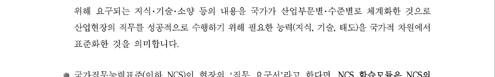

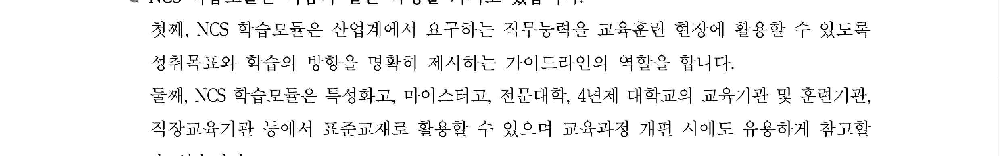

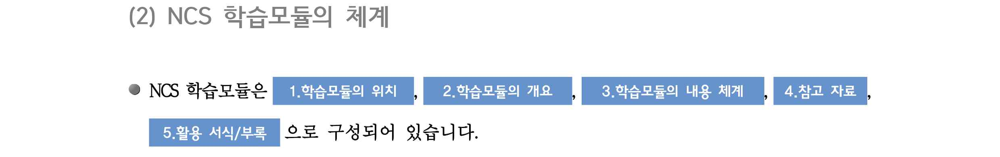

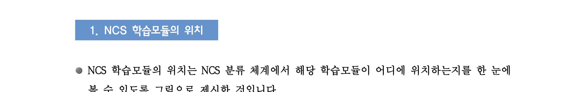

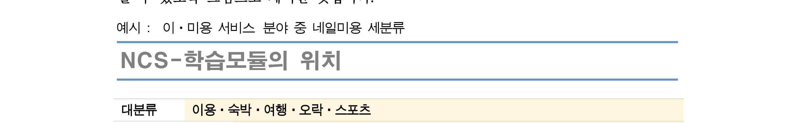

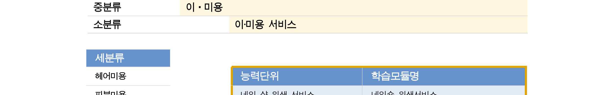

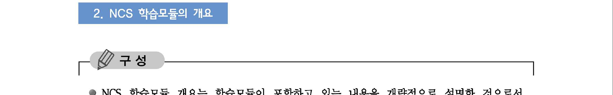

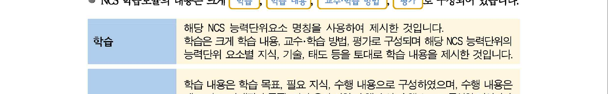

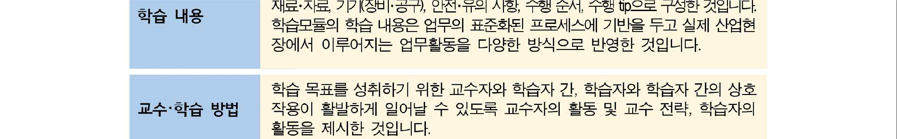

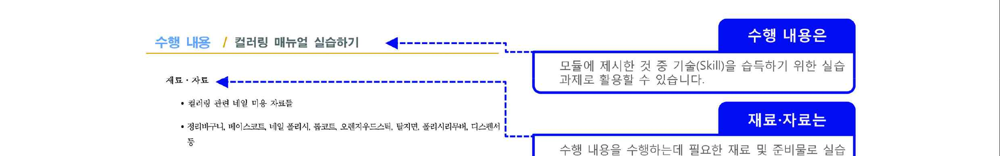

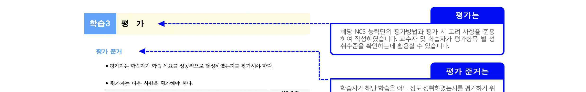

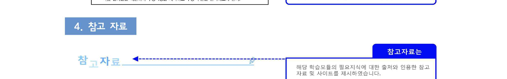

[NCS-학습모듈의 위치]

| 정보통신 |  |  |
| --- | --- | --- |
|  | 정보기술 |  |
|  |  | 정보기술개발 |

대분류
중분류
소분류
세분류

| SW아키텍쳐 |  |  | 능력단위 | 학습모듈명 |
| --- | --- | --- | --- | --- |
| 응용SW 엔지니어링 |  |  | 데이터베이스 요구사항 분석 | 데이터베이스 요구사항 분석 |
| 임베디드SW 엔지니어링 |  |  | 개념데이터 모델링 | 개념데이터 모델링 |
| DB엔지니어링 |  |  | 논리 데이터베이스 설계 | 논리 데이터베이스 설계 |
| NW엔지니어링 |  |  | 물리 데이터베이스 설계 | 물리 데이터베이스 설계 |
| 보안엔지니어링 |  |  | 데이터베이스 구현 | 데이터베이스 구현 |
| UI/UX엔지니어링 |  |  | 데이터 품질관리 | 데이터 품질관리 |
| 시스템SW 엔지니어링 |  |  | 데이터 전환 설계 | 데이터 전환 설계 |
|  |  |  | 데이터 전환 | 데이터 전환 |
|  |  |  | 데이터베이스 성능확보 | 데이터베이스 성능확보 |
|  |  |  | 데이터 표준화 | 데이터 표준화 |
|  |  |  | SQL활용 | SQL활용 |
|  |  |  | SQL응용 | SQL응용 |

차 례
학습모듈의 개요 1
학습 1. 데이터 표준화 정책 수립하기
1-1. 데이터 표준 대상 후보 식별 3
1-2. 데이터 표준화 지침 수립 23
• 교수・학습 방법 30
• 평가 31
학습 2. 데이터 표준 정의하기
2-1. 데이터 표준 식별 및 정의 33
2-2. 데이터 표준 검토 및 확정 45
• 교수・학습 방법 51
• 평가 52
학습 3. 데이터 표준 관리하기
3-1. 데이터 표준 관리 프로세스 수립 54
3-2. 데이터 표준 적합성 심사 및 변경 영향도 분석 61
• 교수・학습 방법 68
• 평가 69
참고 자료 71
데이터 표준화 학습모듈의 개요
학습모듈의 목표
데이터베이스 설계와 구축 시에 필요한 데이터 정보 요소의 명칭, 정의, 형식, 규칙에 대한 정
책을 수립하여 적용할 수 있다.
선수학습
데이터베이스의 구성 요소, 데이터베이스 설계 모형, 데이터 품질의 개념, SQL활용(LM2001020410_14v2)
학습모듈의 내용 체계

| 학습 | 학습 내용 | NCS 능력단위 요소 |  |
| --- | --- | --- | --- |
|  |  | 코드 번호 | 요소 명칭 |

1-1 데이터 표준 대상 후보 식별
1. 데이터 표준화 데이터 표준화
2001020409_16v3.1
정책 수립하기 정책 수립하기
1-2 데이터 표준화 지침 수립
2-1 데이터 표준 식별 및 정의
2. 데이터 표준 데이터 표준
2001020409_16v3.2
정의하기 정의하기
2-2 데이터 표준 검토 및 확정
3-1 데이터 표준 관리 프로세스
수립
3. 데이터 표준 데이터 표준
2001020409_16v3.3
관리하기 관리하기
3-2 데이터 표준 적합성 심사 및
변경 영향도 분석
핵심 용어
데이터 표준화 대상, 데이터 표준화 정책, 데이터 표준화 지침, 데이터 표준 정의, 데이터 표준
관리 프로세스, 데이터 사전, 표준 용어 사전, 도메인 사전, 데이터 모델

| 학습 1 | 데이터 표준화 정책 수립하기 |
| --- | --- |

학습 2 데이터 표준 정의하기
학습 3 데이터 표준 관리하기
1-1.
데이터 표준 대상 후보 식별
• 현업 및 개발자로부터 데이터 표준과 관련된 요구 사항을 조사하여 데이터 표준
학습 목표
대상 후보 식별을 위한 기본 자료를 마련할 수 있다.
필요 지식 /
• 데이터 표준화의 필요성
1. 데이터 표준화의 정의
시스템별로 산재해 있는 데이터 정보 요소에 대한 명칭, 정의, 형식, 규칙에 대한 원칙을
수립하여 용어 및 항목명이 중복되지 않고 의미 전달이 명확하도록 표준 항목명을 부여함
으로써, 데이터의 사용자가 필요한 시점에 필요한 데이터를 정확하게 활용할 수 있도록
하기 위한 제반 활동을 말한다.
2. 데이터 활용상의 문제점
데이터 활용에 있어 다음과 같은 현실적인 문제점들이 정확한 정보를 적시에 사용자에게
전달하는 데 장애 요인이 되고 있다.
(1) 데이터의 중복 및 조직, 업무, 시스템 별 데이터 불일치 발생
데이터 표준 정책의 미비로 정보 시스템 개발 및 운영 과정상에서 동일한 의미의 데
이터를 다른 명칭으로 중복 관리하거나 동일한 명칭의 데이터를 시스템 간에 상이한
로직으로 산출하여 다른 의미로 활용한다.
(2) 데이터에 대한 의미 파악 및 지연으로 정보 제공의 적시성 결여
데이터 명칭, 데이터 정의에 대한 표준 미관리로 인해 새로운 정보 요건이나 정보 요
건 변경 시 필요 데이터를 파악하는데 많은 시간을 낭비하여 정보 사용자에게 적시에
정확한 정보를 제공하는데 어려움이 있다.
(3) 데이터 통합의 어려움
단위 시스템 위주의 데이터 표준을 적용하거나 적용치 않는 경우도 존재하여 전사 데
이터웨어하우스 구축 등 전사 데이터에 대한 통합적인 정보 요건을 기반으로 시스템
을 구축할 때에는 데이터의 의미 파악 및 데이터의 중복 여부 파악 등에 많은 어려움
이 있다.
(4) 정보 시스템 변경 및 유지 보수 곤란
데이터 표준 정책 미비로 인해 정보 시스템의 변경이나 유지 보수 시 데이터 의미 파
악에 어려움을 겪고 있고, 새로운 정보 요건 반영 시 기존 데이터의 활용이 가능한지
파악이 어려워 유지 보수에 많은 노력이 따른다.
3. 데이터 관리 문제점의 발생 원인
정보 시스템 개발 및 운영 과정상에서 다음과 같은 요인들로 인하여 데이터 관리의 문제
점이 발생한다.
(1) 동시 다발적인 정보 시스템 개발
최근의 정보 시스템 개발 프로젝트는 시스템 간 상호 연관성이 증대되어 단위 시스템
위주의 개발 보다는 관련 정보 시스템을 동시에 개발하는 경향이 뚜렷하다. 이러한 개
발 환경 하에서 전사적인 데이터 표준 정책 없이 단위 시스템 위주로 표준 정책을 수
립하여 단위 시스템의 업무 기능 구현에 초점을 맞추어 개발 프로젝트가 진행되었다.
(2) 전사 데이터 관리 마인드 미형성
데이터에 관리 주체가 단위 시스템의 개발자, 운영자 중심으로 이루어져 있어 단위 업
무 지원에 초점을 맞추고 있다. 최근의 정보화 요건들은 단위 시스템의 데이터뿐만 아
니라 여러 시스템의 데이터를 복합적으로 활용하는 경우가 많으므로 전사 데이터를
체계적으로 관리하고자 하는 마인드 형성이 필요하다.
(3) 전사 데이터 관리 인력 부재
정보 시스템 개발 단계에서는 개발 수행사의 품질 관리 조직을 통해 표준에 대한 관
리가 이루어진다. 유지 보수 단계에서는 개발 단계에서 수립된 표준과 표준 준수 관리
에 대한 역할을 맡은 전문적인 데이터 관리 인력을 활용치 않고 개별 유지 보수 인력
들에 의존한다.
(4) 전사 데이터 표준 관리 도구 부재
데이터 표준 관리에는 데이터 표준, 데이터 표준 준수 체크, 데이터 표준 조회 및 활
용 등 많은 자동화된 시스템의 지원을 필요로 한다. 정보 시스템 개발 시에는 수작업
으로 데이터 표준의 적용, 준수 체크 등을 수행하였지만 운영 단계에서 수작업에 가까
운 표준 관리 방법은 많은 애로 사항이 존재한다.
4. 데이터 관리 개선 방안
(1) 데이터 표준화, 규격화를 위한 기본 방침 설정
(2) 전사적인 정보 공유를 위해 유지되어야 할 공통 데이터 요소의 도출
(3) 전사적인 데이터 요소 등록 및 관리 체계 구축
(4) 정보 시스템 개발 및 유지 보수 시 승인된 데이터 요소를 활용함으로써 시스템 개
발의 효율성 및 데이터 공유성 향상
5. 데이터 관리의 개선과 표준화
최근 데이터가 기업의 전략적 의사 결정의 핵심 요소로 대두됨에 따라 데이터 통합 및 데
이터 품질에 대한 관심이 증대되고 있다. 데이터의 품질을 확보하기 위해 데이터의 표준
화가 필수적으로 수반되어야 한다. 데이터가 기업의 전략적 의사 결정을 위한 핵심 요소
이기 때문에 데이터 통합, 데이터 품질을 달성하기 위해서는 전사적인 데이터 표준화 활
동이 필요하다.
데이터활용상의 문제점 발생원인
(1)데이터의중복 및 조직, 업무,
(1)동시다발적인 정보 시스템
시스템별데이터 불일치 발생
개발
(2) 데이터에 대한 의미 파악 및
(2)전사데이터 관리 마인드
지연으로정보 제공의 적시성
미형성
결여
(3)전사데이터 관리 인력 부재
(3) 데이터 통합의 어려움
(4)전사데이터 표준 관리 도구
(4) 정보 시스템 변경 및 유지
부재
보수곤란
데이터표준화 효과 개선방안
(1)데이터표준화, 규격화를 위한
(1)명칭의통일로 인한 명확한
기본방침 설정
의사소통의증대
(2)전사적인정보 공유를 위해
(2)필요한데이터의 소재 파악에
유지되어야할 공통 데이터
소요되는시간 및 노력 감소
요소의도출
(3)일관된데이터 형식 및 규칙의
(3)전사적인데이터 요소 등록 및
적용으로인한 데이터 품질
관리체계 구축
향상
(4)정보시스템 개발 및 유지 보수
(4)정보시스템 간 데이터
시승인된 데이터 요소를
인터페이스시 데이터 변환,
활용함으로써시스템 개발의
정제비용 감소
효율성및 데이터 공유성 향상
[그림 1-1] 데이터 표준화의 필요성
6. 데이터 표준화 기대 효과
(1) 명칭의 통일로 인한 명확한 의사소통의 증대
동일한 데이터에 대해서는 동일한 명칭을 사용함으로써 개발자-현업, 운영자-현업, 운
영자-운영자 등 다양한 계층 간에 명확하고 신속한 의사소통이 가능하다.
(2) 필요한 데이터의 소재 파악에 소요되는 시간 및 노력 감소
새로운 정보 요건 사항 발생 시 표준화된 데이터를 사용함으로써 데이터의 의미, 데이
터의 위치 등을 신속하게 파악할 수 있어 정보 이용자에게 원하는 시기에 정확한 정
보를 전달한다.
(3) 일관된 데이터 형식 및 규칙의 적용으로 인한 데이터 품질 향상
데이터 형식 및 규칙을 데이터 표준에 맞게 적용함으로써 데이터의 입력 오류 방지를
통해 데이터의 품질을 향상시킬 수 있다. 또한 데이터의 활용에 있어 표준에 근거하여
활용함으로써 잘못된 데이터의 활용으로 인한 의사 결정의 오류를 줄인다.
(4) 정보 시스템 간 데이터 인터페이스 시 데이터 변환, 정제 비용 감소
데이터 통합 프로젝트나 개별 시스템에서 다른 시스템의 데이터가 필요한 경우 전사
적으로 데이터 표준에 의해 데이터가 관리되고 있으면, 별도의 변환이나 정제 작업을 수
행하지 않고 그대로 활용하면 되기 때문에 별도의 추가적인 비용이 발생하지 않는다.
• 데이터 표준화의 대상
1. 데이터 명칭 및 정의의 표준화
사용하는 단어에 대해 표준화를 통해 기본 단어, 동음이의어, 이음동의어, 금칙어, 영문
약어를 정의하고, 기본 단어를 수식어와 도메인으로 정의하여 동일한 의미로 사용되도록
용어의 통일성을 기한다.
2. 데이터 형식 및 규칙의 표준화
데이터 타입, 데이터 길이, 기본 값과 허용 값 등의 제약 조건을 표준화한다.
<표 1-1> 데이터 표준화 대상

| 표준화 대상 | 표준화 내용 | 고려 사항 |
| --- | --- | --- |

-명칭만으로 데이터의 의미와 범위를 파악될 수
해당 데이터의 개념을 유일하게 구
있도록 의미 전달의 충분성을 고려한다.
별할 수 있는 유일성을 갖도록 정의
1. 데이터 명칭 -보편적으로 인지되는 명칭이나 구성원이 사용
하여 통일적으로 사용할 수 있는 역
하는 명칭을 그대로 사용하여 업무적 보편성을
할을 한다.
갖도록 한다.
해당 데이터가 의미하는 범위 및 자 -제3자의 입장에서 서술하고, 의미 전달을 위해 실
격 요건을 규정하는 것으로, 명칭만 제 발생할 수 있는 데이터 값도 같이 기술한다.
2. 데이터 정의
으로 사용자에게 전달하기 어려운 기 -데이터 명칭을 그대로 서술하거나 약어 또는 전문
타 사항들을 전달하는 역할을 한다. 용어를 이용한 정의를 가급적 사용하지 않는다.

| 표준화 대상 | 표준화 내용 | 고려 사항 |
| --- | --- | --- |

도메인을 정의하여 데이터 표준에
-데이터의 최댓값 또는 최대 길이가 고정되지 않
적용함으로써 성격이 유사한 데이
을 경우 충분히 여유 있게 정의한다.
터 간의 형식을 통일화하고, 데이터
3. 데이터 형식 -특수 데이터 타입(CLOB 등)은 데이터 조회, 백
표현 형태의 정의를 통해 데이터 입
업, 이행 등에 있어서 제약 사항이 존재하는 경
력 오류와 통제 위협을 최소화하는
우가 많기 때문에 가급적 사용하지 않는다.
역할을 한다.
오류 발생이 가능한 값을 사전에 정
-입력 오류와 통제 위험을 최소화할 수 있도록
4. 데이터 규칙 의함으로써 데이터의 정합성과 완
기본 값, 허용 값, 허용 범위를 설정한다.
전성을 향상할 수 있는 역할을 한다.
• 데이터 표준화의 구성 요소
데이터 표준화는 데이터 표준, 데이터 관리 조직, 데이터 표준 절차로 구성된다.
1. 데이터 표준
데이터 표준에는 표준화된 단어, 도메인, 코드, 용어, 그리고 데이터베이스의 설계 및 구
축과 관련된 표준화 자료가 해당된다.
<표 1-2> 데이터 표준의 종류

| 표준데이터 | 표준화 내용 |
| --- | --- |

- 표준 용어를 구성하는 단어에 대한 한글명과 영문명을 일관되게 정의하여
표준 단어 관리함으로써 동일한 개념을 의미하는 용어의 생성을 예방할 수 있으며,
표준 용어의 영문명 작성 기준이 된다.
표준 도메인 - 컬럼에 대한 성격을 그룹핑한 개념
- 코드는 도메인의 한 유형으로 특정 도메인 값(코드 값)이 이미 정의되어
표준 코드
있는 도메인
- 업무적으로 사용되는 용어에 대한 표준으로서, 용어 표준화는 업무적인 용
표준 용어 어를 정보 시스템에 반영하기 위해 기술적인 용어로 전환하고 이것을 일관
되게 유지하고 관리하기 위해 표준적으로 정의
- 데이터 모델에서 정의하는 주제 영역, 관계명, 데이터베이스에서 정의하는
기타 데이터
데이터베이스, 데이터베이스 스키마(Schema), 테이블 스페이스(Table
표준요소
Space), 인덱스(Index), 제약 조건(Constraint) 등에 대한 표준 정의
2. 데이터 관리 조직 - 데이터 관리자(DA: Data Administrator)
데이터 관리자는 조직 내에서 데이터에 대한 정의와 체계화, 감독 및 보안 업무를 담당하
는 관리자를 의미한다. 데이터에 대한 관리를 총괄하고, 정보 활용에 대한 중앙 집중적인
계획 수립과 통제를 수행한다.
(1) 데이터 관리자의 주요 역할
(가) 데이터에 대한 정책과 표준 정의
데이터 관리자는 데이터에 대한 표준화 원칙 및 표준을 정의한다. 표준에 대한 변
경과 추가가 발생 시에 최종적으로 승인 의사 결정을 수행하며, 기업 내에 산재된
시스템에 대한 데이터 표준 준수 여부를 주기적으로 체크하여 지속적인 표준 관리
활동을 수행한다.
(나) 부서 간 데이터 구조 조율
데이터 관리자는 전사 데이터 관리 기준에 의거하여 단위 시스템이나 조직 부처에
명확한 데이터 관리 기준을 제시하고, 부서 간에 데이터 구조에 대한 이견 발생 시
전사 데이터 관리 관점에서 데이터 구조를 제시하여 체계적인 데이터 구조 관리가
이루어지는 역할을 수행한다.
(다) 데이터 보안 관리
데이터 관리자는 데이터에 대한 보안 정책 수립, 보안 정책 준수 여부 체크, 보안
시정 조치 요구 등을 수행한다.
(라) 데이터 모델 관리
데이터 관리자는 데이터에 대한 중요한 의사소통의 도구가 되는 데이터 모델을 물
리적인 변경 시점에 동일하게 관리함으로써 향후 데이터 활용에 대한 업무 협의
시 신속한 의사 결정이 이루어지도록 관리한다.
(마) 데이터의 효율적인 활용 방안 계획
데이터 관리자는 데이터가 전사적으로 공유되어 효율적으로 활용되도록 지속적으
로 데이터 활용상의 문제점 등을 체크하여 데이터 활용과 관련된 방안을 수립하여
시행한다.
(2) 데이터 관리자와 데이터베이스 관리자
<표 1-3> 데이터 관리자와 데이터베이스 관리자의 역할 비교

| 구분 | 데이터 관리자(DA) | 데이터베이스 관리자(DBA) |
| --- | --- | --- |
| 관리 대상 | 데이터 모델 및 각종 표준 | 데이터베이스 |
| 주 업무 | 메타 데이터 정의, 신규 또는 변경된요구 사항을 데이터 모델에 반영 | 데이터베이스 관리 |
| 품질 관리 | 데이터 표준의 관리 및 적용 | 데이터의 정합성 관리 |
| 전문 기술 | 담당분야에 대한 업무 지식과 데이터모델링에 대한 전문성이 필요 | 데이터 모델에 대한 해독 능력 및 특정 데이터베이스 제품에 대한 전문 지식 필요 |

(3) 부문별 데이터 관리자의 역할
전사 차원에서 데이터 표준화에 대한 정책 결정과 표준에 대한 승인을 담당하는 전사
데이터 관리자, 담당 업무에 대한 표준을 정의하고 검토하는 업무 데이터 관리자, 시
스템 관리측면에서 데이터 표준의 준수 여부 등을 관리하는 업무 시스템 데이터 관리
자로 역할이 구분된다.
<표 1-4> 부문별 데이터 관리자의 역할

| 데이터 관리자 | 주요 임무 |
| --- | --- |

. 데이터 표준화에 대한 정책 결정
전사 데이터 관리자
. 검토된 데이터 표준 제안에 대한 승인
. 담당 업무기 능의 데이터 요구 사항 반영을 위한 표준 정의
업무 데이터 관리자
. 업무 관련 데이터 표준 변경 제안에 대한 합동 검토
. 시스템 관리 목적의 데이터 요구 사항을 위한 표준 정의
업무 시스템 데이터 관리자 . 업무 관련 데이터 표준 변경 제안에 대한 합동 검토
. 데이터 모델에 대한 데이터 표준 적용 및 준수 여부 체크
3. 데이터 표준화 절차
일반적인 데이터 표준화 절차는 데이터 표준화 요구 사항 수집, 데이터 표준 정의, 데이터
표준 확정, 데이터 표준 관리로 이루어진다.
<표 1-5> 데이터 표준화 절차별 활동

| 구분 | 주요 활동 |
| --- | --- |

개별 시스템 데이터 표준 수집
데이터 표준화 요구
데이터 표준화 요구 사항 수집
사항 수집
표준화 현황 진단
표준화 원칙
데이터 표준 정의 데이터 표준 정의: 표준 용어, 표준 단어, 표준 도메인, 코드,
기타 표준
데이터 표준 검토 및 확정
데이터 표준 확정
데이터 표준 공표
데이터 표준 이행
데이터 표준 관리 데이터 표준 관리 절차 수립: 데이터 표준 적용, 변경 준수 검사
절차
수행 내용 / 데이터 표준화 요구 사항 조사 및 대상 후보 식별하기
재료·자료
Ÿ 시스템 요구 사항 분석서, 대상 DBMS(Data Base Management System) 설명서, 업무 규칙 정의서,
비즈니스 영역의 각종 지침 및 서류, 데이터 모델
기기(장비･공구)
Ÿ 컴퓨터, 문서 작성 도구
안전･유의 사항
Ÿ 데이터 표준화는 데이터 품질 관리를 위한 중요한 활동이며, 국내외에서 통용되는 표준화 지침
등을 적극 반영하는 것이 바람직하다.
Ÿ 업무 분야별로 사용하는 용어와 정보 시스템의 체계가 상이하므로 직간접적인 경험을 통해
비즈니스 도메인(Business Domain, 업무 영역)에 대해 충실히 이해하려는 노력이 요구된다. 이를
위해 업무 분야에 정통한 실무자들과의 충분한 소통이 필요하다.
수행 순서
• 데이터 표준화 실태를 점검한다.
1. 체크리스트 등을 활용하여 관리 체계, 표준의 수립과 운영, 데이터 표준의 현행화
여부, 표준화 점검 및 개선 활동 등에 관한 실태를 점검한다.
<표 1-6> 공공 DB 표준화 점검표 - 예시

| 구 분 | 세부 점검 사항 | 비고 |
| --- | --- | --- |
| 데이터 표준관리 체계 | ž 기관의 데이터베이스 표준화를 위한 내부 규정 마련 |  |
| 데이터 표준 | ž 기관의 데이터베이스 표준화 담당자 지정 |  |
| 관리 체계 | ž 표준화 담당자의 역할과 책임 정의 |  |
|  | ž 기관의 데이터베이스 표준화 절차 수립 |  |
| 데이터 표준수립 | ž 기관의 행정 코드 정의 및 코드 정의서 작성·관리 |  |
| 데이터 표준 수립 | ž 기관 표준 정의 전 국가 표준에 중복된 의미의 코드 및 용어가 있는지 검토 수행 |  |
|  | ž 기관의 표준 용어 정의 및 표준 용어 정의서 작성·관리 |  |
|  | ž 기관의 도메인 정의 및 도메인 정의서 작성·관리 |  |
| 데이터 표준적용 및현행화 | ž 신규 데이터베이스의 설계·구축 시 데이터 표준(코드, 용어, 도메인 등)의 적용 |  |
| 적용 및 현행화 | ž 행정 표준 코드 관리 시스템의 행정 표준 코드에 대한 제·개정 신청 수행 |  |
|  | ž 행정 표준 용어에 대한 제·개정 등 신청 수행 |  |
| 표준화 점검및 개선 | ž 운영하고 있는 데이터베이스의 표준화 수준에 대한 주기적점검(※ 점검 항목: 표준 코드, 표준 용어, 도메인 표준 적용 수준 등) |  |
|  | ž 점검 결과 표준화가 미흡한 사항에 대한 개선 계획 수립·추진(차세대 사업, 고도화 사업, 데이터 재구축 사업에 포함 등) |  |

출처: 행정안전부(2008),『행정 정보 데이터베이스 표준화 지침』.
2. 다음과 같은 사례를 통해 운영 중인 데이터에 대한 현황과 문제점을 분석하고 개
선 방향을 설정한다.
(1) 데이터 관리 현황(동일한 속성명이 컬럼명, 데이터 타입, 길이가 다른 경우)을 분
석한다.
<표 1-7> 동일한 속성명이 칼럼명, 데이터 타입, 길이가 다른 경우의 사례

| 속성명 | 컬럼명 | 데이터 타입 | 테이터 길이 |
| --- | --- | --- | --- |

휴대폰 번호 Beeper Char 14
휴대폰 번호 MOBILE_NO Varchar2 20
휴대폰 번호 MOBILE_NO Varchar2 16
휴대폰 번호 HP Varchar2 16
휴대폰 번호 Mobile_no Char 16
순번 SEQ NUMBER 22
순번 Seq Int 4
순번 Seq Smallint 2
순번 Seq_no Char 2
출처: 한국정보화진흥원(2013),『(제4강) 데이터 표준화, 품질 관리 실무 교육 교재』.
(가) 현황을 파악한다.
- 동일한 용어명을 가지고 있지만, 업무 DB별로 칼럼명, 데이터 타입, 데이터
길이가 다르게 사용
- 같은 업무 DB 내에서도 동일한 용어명을 가지고 있지만 칼럼명, 데이터 타
입, 데이터 길이가 다르게 사용
- 칼럼명이 대문자와 소문자로 다양하게 사용
- 칼럼명, 데이터 타입, 데이터 길이에 정의에 대한 전사적인 기준이 없음.
(나) 문제점을 분석한다.
- 동일한 용어명을 사용하고 있지만 칼럼명 데이터 타입, 데이터 길이가 달라
데이터 관리의 어려움 존재
- 전사적인 표준도 없고, 각 업무 DB 자체적인 명확한 기준이 없어 상황에 따
라 그때그때 달라지는 현상이 발생하여 데이터의 일관성이 떨어지고, 유지
관리의 어려움도 존재
- 상이한 체계로 인하여 전사 데이터 통합 및 시스템 간 Interface 시어려움이
존재
(다) 개선 방향을 정리한다.
- 동일한 속성명이라면 동일한 데이터 타입과 데이터 길이를 가지도록하여야
한다.
- 단어 표준화를 통해 속성 영문명을 정리하고, 도메인 표준화를 통해 데이터
타입과 길이를 정리한다.
- 데이터 표준에 대한 원칙을 수립하고, 데이터 표준 유지 관리 체계를 정립하
여야 한다.
(2) 뜻이 같은 용어나 단어를 다양한 용어나 단어로 표현(이음동의어)한 경우를 분석
한다.
<표 1-8> 이음동의어 처리 사례

| 속성명 | 컬럼명 | 데이터 타입 | 테이터 길이 |
| --- | --- | --- | --- |

암호 Pwd Char 5
비밀 번호 Scrt_no Varchar 10
이름 Name Char 20
성명 Name Char 20
성명 Sabun_no Char 20
일련 번호 Sqno number 5
순번 Seq Smallint 2
주문 번호 Order_no numeric 12
발주 번호 Order_noi Char 13
출처: 한국정보화진흥원(2013),『(제4강) 데이터 표준화, 품질 관리 실무 교육 교재』.
(가) 현황을 파악한다.
- 뜻이 같은 용어가 다양한 형태의 용어로 속성명에 사용
- 동일한 업무 DB내에서도 뜻이 같은 용어인데도 서로 다른 용어를 사용
- 이음동의어 사용에 대한 전사적인 기준이 없음.
(나) 문제점을 분석한다.
- 일관성 없는 용어 표기로 인하여 전체적인 데이터 속성 관리 항목 수 증가 우려
- 통일되지 않은 용어는 관련자 간 의사소통에 다양한 문제를 발생시킬 수도
있음.
- 상이한 체계로 인하여 전사 데이터 통합 및 시스템 간 Interface 시 어려움
이 존재
(다) 개선 방향을 정리한다.
- 의미가 동일한 단어들에 대해 하나의 대표 단어를 표준으로 선정하고, 정해
진 대표 단어를 기준으로 용어를 정의해야 한다.
- 대표 단어에서 제외된 모든 단어는 금칙어로 구분하여 관리한다.
- 이음동의어의 사전 정립이 필요하다.
(3) 발음은 같으나 뜻이 다른 단어가 존재(동음이의어)하는지를 분석한다.
<표 1-9> 동음이의어 처리사례

| 속성명 | 정의 |
| --- | --- |

특기 사항 특기 특별히 기록하는 것
특기 토드 특기(特技) 남이 가지지 못한 특별한 기술이나 기능
수입 구분 수입(輸入) 다른 나라로 부터 물품을 사들임.
수입 금액 수입(收入) 돈이나 물건 따위를 벌어 들이는 거나 거두어 들이는 일
일시 정기 구분 일시 한때
처리 일시 일시 날짜와 시간
경로 우대 수 경로 노인을 공경함.
주문 경로 경로 일이 진행되는 형편이나 순서
출처: 한국정보화진흥원(2013),『(제4강) 데이터 표준화, 품질 관리 실무 교육 교재』.
(가) 현황을 파악한다.
- 속성명에 사용된 단어를 보면 발음은 동일하나 뜻이 다른 단어가 존재
(나) 문제점을 분석한다.
- 동음이의어 사용은 단어 및 용어의 정확한 의미 파악의 어려움을 발생시킬
수 있음.
- 동음이의어 단어 사용은 관련자 간 의사소통에 많은 문제를 야기시킬 수 있음.
(다) 개선 방향을 정리한다.
- 동음이의어는 되도록 사용하지 않도록 해야 하고, 대체 용어가 없는 경우에
만 사용할 수 있도록 해야 한다.
- 동음이의어 사전의 정립이 필요하다.
(4) 축약어의 사용에 관하여 분석한다.
<표 1-10> 축약어 사용 사례

| 속성명 | 컬럼명 | 데이터 타입 | 테이터 길이 |
| --- | --- | --- | --- |

사번 Sabun Char 5
사업자 번호 Businessno Char 10
주민 번호 Jumin_no Char 13
휴대폰 Pp Char 20
몰 구분 Mallgb Char 3
Inv 번호 Inv_no Char 10
부가세 Bugase Numeric 6
비회원 PW Not_cust_pwd Varchar 20
전화 Tel_no1 Varchar2 16
판매가 price int 4
출처: 한국정보화진흥원(2013),『(제4강) 데이터 표준화, 품질 관리 실무 교육 교재』.
(가) 현황을 파악한다.
- 한글명 및 영문명도 축약하여 사용
- 동일한 업무 DB 내에서도 서로 다른 용어로 축약하여 사용
- 축약어 사용에 대한 전사적인 기준이 없음.
(나) 문제점을 분석한다.
- 다양한 축약어는 관련자 간 의사소통에 다양한 문제를 발생시킬 수 있음.
- 축약어에 대한 정확한 의미 파악이 어려워 업무 수행에 지장을 초래할 수
있음.
(다) 개선 방향을 정리한다.
- 한글/영문 약어는 가급적으로 사용을 피하고, 범용으로 쓰이거나 공식적으로
승인된 약어는 표준에 의거 사용하도록 한다.
- 사용이 예상되는 모든 약어는 금칙어로 구분하여 관리한다.
- 단어 및 용어에 대한 표준 원칙 수립(축약어 사용에 대한 기본 원칙 정의)한다.
(5) 특수 문자, 띄어쓰기 등 표현 방법이 다양한 경우를 분석한다.
<표 1-11> 특수 문자, 띄어쓰기 등 표현 사례

| 속성명 | 컬럼명 | 데이터 타입 | 테이터 길이 |
| --- | --- | --- | --- |

국민연금등급 Grade smallint 2
국민연금 등급 Grade smallint 2
은행 대출_신한광화문 Mm044 int 4
할인 조건-율/금액 Dis_type Char 1
파트, 관, 코너 Part Char 10
Ks-net 승인 일자 Ksymd Char 8
매장 인수처 반출 번호 Acp_tout_no Char 13
관리 항목 구분 4 Mg_clau_dv_4 Char 2
인보이스 번호 Invoice_no Varchar 20
Invoice 번호 Invoice_no Varchar 20
출처: 한국정보화진흥원(2013),『(제4강) 데이터 표준화, 품질 관리 실무 교육 교재』.
(가) 현황을 파악한다.
- 용어와 용어 사이에 다양한 특수 문자를 사용(/. , ._.() 등)
- 영문명 그대로 사용하는 경우, 영문명을 한글화해서 사용하는 경우도 있고,
대문자와 소문자 사용
- 띄어쓰기를 한 용어도 있고, 붙여서 사용한 용어도 있음.
- 용어의 상세 구분을 위하여 아라비아 숫자를 혼용해서 사용한 경우
(나) 문제점을 분석한다.
- 일관성 없는 용어 표기로 인하여 전체적인 데이터 표준 관리의 어려움이 존재
- 통일되지 않은 용어는 관련자간 의사소통에 다양한 문제를 발생시킬 수도
있음.
- 상이한 명칭으로 인하여 전사 데이터 통합 시 어려움
(다) 개선 방향을 정리한다.
- 한글명 또는 영문명은 가능한 한 띄어쓰기를 허용하지 않으며, 특수 문자 사
용을 자제하도록 해야 한다.
- 영문 및 한글 용어에 대한 명명 원칙을 수립한다.
- 영문 단어를 한글화할 경우 의미를 파악할 수 있도록 한글화 작업을 하여야
하고, 소리 나는 대로 한글화한 명칭이 더 관용적일 경우에는 이를 사용할
수 있도록 해야 한다.
(6) 접두사, 접미사, 동사, 부사, 접속사 등을 사용한 경우를 분석한다.
<표 1-12> 접두사, 접미사, 동사, 부사, 접속사 등 사용 사례

| 속성명 | 컬럼명 | 데이터 타입 | 테이터 길이 |
| --- | --- | --- | --- |

선물용 메세지 Giftmsg Char 300
추천인과의 관계 Relt_code Char 2
택배 서비스 불만족 사유 Ques03_sub Tinyint 1
가배정 금액 Tmpag_amt Numeric 20
부제목 1 Sub_book_nm Varchar 70
에러 건 구분 Gb Char 3
수신받은 일자 Recv_date Char 8
빈 칼럼 Emptycolumn1 Char 20
사용할 잔액 usejanaek int 4
출처: 한국정보화진흥원(2013),『(제4강) 데이터 표준화, 품질 관리 실무 교육 교재』.
(가) 현황을 파악한다.
- 용어에 동사, 부사, 접속사 등을 조합하여 다양하게 표현
- 용어에 접두사, 접미사를 조합하여 표현
(나) 문제점을 분석한다.
- 용어에 동사, 부사 접속사 등은 조합하여 사용하다 보면 용어의 길이가 너무
길어지는 경우가 발생할 수도 있음.
- 용어가 지칭하는 의미의 중복으로 불필요하게 데이터 길이가 늘어나는 현상
이 발생(예: 수신 받은 일자)
(다) 개선 방향을 정리한다.
- 한글 단어는 명사형으로 정의하고 동사, 부사, 접속사 또는 소유격 형태의
단어는 사용하지 않도록 해야 한다.
- 접두사와 접미사는 단일어와 합성하여 단일어 형태로 사용 가능하도록 해야 한다.
- 접두사, 접미사, 동사, 부사 등 사용에 대한 기본 원칙을 정의한다.
(7) 속성에 사용된 용어의 의미가 너무 광범위한 경우를 분석한다.
<표 1-13> 용어의 의미가 너무 광범위한 사례

| 속성명 | 컬럼명 | 데이터 타입 | 테이터 길이 |
| --- | --- | --- | --- |

코드 Isbn varchar2 10
전화 Tel_no1 varchar2 16
사용 Use)yn varchar2 1
수량 Qty Int 4
할부 cardcnt char 2
출처: 한국정보화진흥원(2013),『(제4강) 데이터 표준화, 품질 관리 실무 교육 교재』.
(가) 현황을 파악한다.
- 사용된 용어의 의미가 너무 광범위함.
- 단일어만 사용해서 정확한 의미가 전달되지 못함.
- 사용된 용어가 의미하는 내용을 정확하게 알 수 없음.
(나) 문제점을 분석한다.
- 사용된 용어의 의미가 너무 넓어 어떠한 데이터인지 정확하게 알 수 없는
문제가 발생될 소지가 있음.
- 용어의 의미를 정확하게 알 수 없어 관련자 간 의사소통에 다양한 문제를
발생시킬 수도 있음.
(다) 개선 방향을 정리한다.
- 단일어만 가지고 용어가 의미하는 내용을 알 수 없으면, 여러 개의 단어를
조합하여 정확하게 의미 전달이 되는 방향으로 용어를 정리한다.
- 복합어 조합은 반드시 표준 단어 사전에 등록된 단어를 가지고 조합하여야 한다.
- 단어 및 용어에 대한 표준 원칙 수립 및 데이터 표준 유지 관리 체계를 수
립한다.
(8) 용어 정의의 오류 여부를 분석하여 개선 방향을 모색한다.

| 현 행 | 개선안 |
| --- | --- |

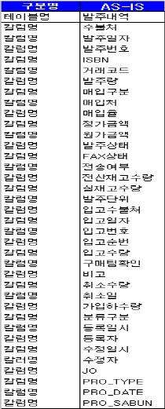

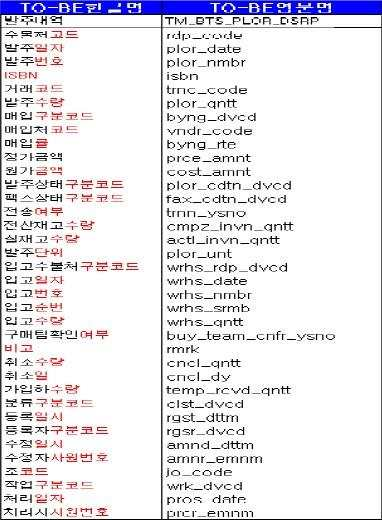

출처: 한국정보화진흥원(2013),『(제4강) 데이터 표준화, 품질 관리 실무 교육 교재』.
[그림 1-2] 용어 정의 오류 사례
(가) 컬럼 용어 정의는 반드시 ‘수식어 + 도메인’으로 작명하여야 한다.
(나) 용어의 마지막 단어는 항상 도메인명으로 작명(개선안에서 단어 뒤에 붙인
‘~코드, ~일자, ~번호’ 등이 도메인임)한다.
(다) 수식어가 없이 도메인만 사용하는 작명은 허용한다.
(라) 허용되지 않은 영문 단어의 사용을 금지(한글화하여 사용)한다.
(라) 컬럼명은 소문자를 사용한다.
(9) 데이터 표준화 오류(메타데이터 관리 미비) 여부를 분석한다.
(가) 동일 항목에 상이한 항목명을 부여한 경우를 분석하여 문제점을 파악한다.
사업장 코드에 대한 컬럼명이 XXXX의 경우 10개 테이블에 다섯 종류가 사용되고
있어서, 데이터 관리에 혼란을 줄 수 있고, 애플리케이션 개발 효율성을 저하시킴.
<표 1-14> 동일한 항목에 상이한 항목명 부여 사례

| 테이블(엔티티명) | 컬럼(속성명) | 정의 |
| --- | --- | --- |
| XXARSR17(XXXXX) | PLANT_CD (Plant Code) | 사업장 코드 |
| XXPLM01 (XXXX) | PLANTCD (Plant Code) | 사업장 코드 |
| XXPOMS02 (XXXX) | PLANT_ID (Plant Code) | 사업장 코드 |
| XXXX_XXMSTC08 (XXXX) | PLNT_CD (Plant Code) | 사업장 코드 |
| XXXX_XXMSTL01 (XXXX) | PLANT (Plant Code) | 사업장 코드 |

출처: 한국정보화진흥원(2013),『(제4강) 데이터 표준화, 품질 관리 실무 교육 교재』.
(나) 동일 속성을 상이한 도메인으로 사용하는 경우를 분석하여 문제점을 파악한다.
동일 속성명에 대해 도메인이 다양하게 사용되고 있고, 서로 다른 속성이 동일
한 속성명으로 관리되고 있을 위험도 내포하고 있음.
<표 1-15> 동일 속성을 상이한 도메인으로 사용 사례

| 속성명 (대표 컬럼명) | 도메인 | 테이블명(엔티티명) |
| --- | --- | --- |
|  | VC2(4) | XXAPSR17 (XXXX) |
| Plant Code (PLANT_CD) | VC2(30) | XXPLMR01 (XXXX) |
|  | VC2(200) | XXXX_XXMSTL01 (XXXX) |
|  | VC2(4) | XXAPSR27 (XXXX) |
|  | VC2(30) | XXXX_XXMSTC04 (XXXX) |
| Line Code (LINE_CD) | VC2(40) | XXXX_XXMSTC09 (XXXX) |
|  | VC2(200) | XXXX_XXMSTL01 (XXXX) |
|  | VC2(100) | XXXX_XXPLNA02_ADJ (XXXX |
|  | VC2(100) | XXAPSR17 (XXXX) |
| Item Code (ITEM_CD) | VC2(30) | XXPLMR01 (XXXX) |
|  | VC2(200) | XXXX_XXMSTC08 (XXX) |

출처: 한국정보화진흥원(2013),『(제4강) 데이터 표준화, 품질 관리 실무 교육 교재』.
(다) Null과 Space에 대한 데이터 현황 분석을 통하여 데이터의 혼용 현황 및 데
이터 사용 여부 등을 분석하여 관리에 활용할 수 있다.
<표 1-16> NULL과 Space 항목에 대한 검토 사례
<전체 건이 NULL인 항목>

| 테이블명 | 컬럼명 | 총 건수 | NULL 건수 |
| --- | --- | --- | --- |
| XXX_PENTCM DELA_END_YN 673,957XXX_PENTRG PRN_REM 592,347XXX_LICMSTHR FSHP_LAND_CARP_21 67,170XXX_LICMSTHR FSHP_LAND_CARP_13 67,170XXX_LICMSTHR FSHP_LAND_CARP_12 67,170XXX_LICMSTHR FSHP_LAND_CARP_11 67,170XXX_LICMSTHR LAND_COOR_Y 67,170XXX_AMIHISTR GJG_AMT 3,366XXX_AMIGJGRG OTAX_IMP_GBN 2,785 |  |  | 673,957 |
| XXX_PENTRG PRN_REM 592,347 | PRN_REM | 592,347 | 592,347 |
| XXX_LICMSTHR FSHP_LAND_CARP_21 67,170 | FSHP_LAND_CARP_21 | 67,170 | 67,170 |
| XXX_LICMSTHR FSHP_LAND_CARP_13 67,170 | FSHP_LAND_CARP_13 | 67,170 | 67,170 |
| XXX_LICMSTHR FSHP_LAND_CARP_12 67,170 | FSHP_LAND_CARP_12 | 67,170 | 67,170 |
| XXX_LICMSTHR FSHP_LAND_CARP_11 67,170 | FSHP_LAND_CARP_11 | 67,170 | 67,170 |
| XXX_LICMSTHR LAND_COOR_Y 67,170 | LAND_COOR_Y | 67,170 | 67,170 |
| XXX_AMIHISTR GJG_AMT 3,366 | GJG_AMT | 3,366 | 3,366 |
| XXX_AMIGJGRG OTAX_IMP_GBN 2,785 | OTAX_IMP_GBN | 2,785 | 2,785 |

<NULL과 Space를 혼용한 사례>

| 테이블명 | 컬럼명 | Null 건수 | Space 건수 |
| --- | --- | --- | --- |
| XXX_LICMSTHR | REP_SID_SNO | 2,692 | 55,949 |
| XXX_PRMCHSCM | REP_ADDR | 19,953 | 22,233 |
| XXX_LICMSTRG | REP_SID_SNO | 2,755 | 15,804 |
| XXX_PRMSHMCN | REP_ADDR | 545,470 | 8,623 |
| X_CARD | MOBILE | 2,599 | 8,343 |
| XXX_INLFRG | LIC_DTL_GBN | 15,248 | 7,648 |
| X_CARD_STAT | MAIN_WORK | 1,875 | 7,405 |
| X_CARD_STAT | WORK_RES_YEAR | 1,592 | 7,405 |
| X_CARD_STAT | MAIN_ITEM | 1,875 | 7,405 |

출처: 한국정보화진흥원(2013),『(제4강) 데이터 표준화, 품질 관리 실무 교육 교재』.
(가) 전체 컬럼이 NULL인 경우 해당 컬럼들의 사용 여부를 확인하여 관리하여야
한다.
(나) NULL과 Space를 혼용하는 경우 NULL 및 Space에 대한 정확한 표준 정책을
수립하여 혼용 사용되는 사례를 정비하도록 권고한다.
(10) 그 외에 다양한 사례를 참조하여 현재 운영되는 데이터 표준에 대하여 문제점
을 파악하고 분석을 수행한다.
(가) 조직 명칭 또한 작성 규칙이 표준화되어야 한다.
건축물대장을 정비하기 이전의 사례로서, 토지 소유자명이 ‘경찰청’, ‘(국)
경찰청‘, ’국(경찰청)‘ 등으로 다양하게 입력되어 있다. 이런 경우 특정 조
직이 소유하고 있는 재산에 대한 통계를 작성하는 경우 다양하게 표현된 명칭
을 모두 고려해야 하는 어려움이 발생할 수 있다.

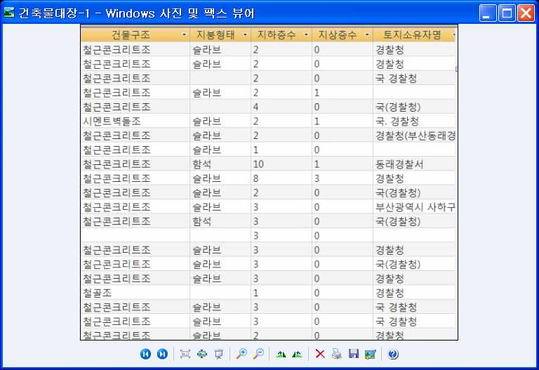

[그림 1-3] 조직 명칭의 작성 기준이 통일되지 않은 경우 - 예시
(나) 동일 컬럼명을 상이한 데이터 타입으로 정의한 경우가 없는지 분석되어야 한다.
데이터베이스의 데이터 사전에서 컬럼 정보와 데이터 타입 정보를 추출하여
동일 컬럼명에 상이한 데이터 타입의 존재 여부를 분석하기 위해 다음과 같은
진단 스크립트를 활용할 수 있다.

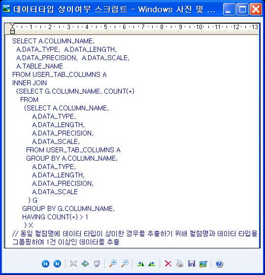

[그림 1-4] 컬럼명에 대한 데이터 타입 상이 여부 분석 스크립트 - 예시
(다) 측정 표준 단위를 기초로 상이한 자료를 파악한다.
기존에 아파트 등 주택의 규모를 ‘평’으로 표현하다가 ‘㎡’로 표현하게
되면서, ‘평’을 기준으로 ‘㎡’를 환산하여 측정해 본 결과 자료상 많은 차
이가 발생하여 통계작성 등에 어려움을 겪은 사례이다. 표준적으로 사용하는
단위의 기준 값과 실제 값이 상이한 경우를 분석하여 통일을 기할 수 있도록
기준을 정립하여야 한다.

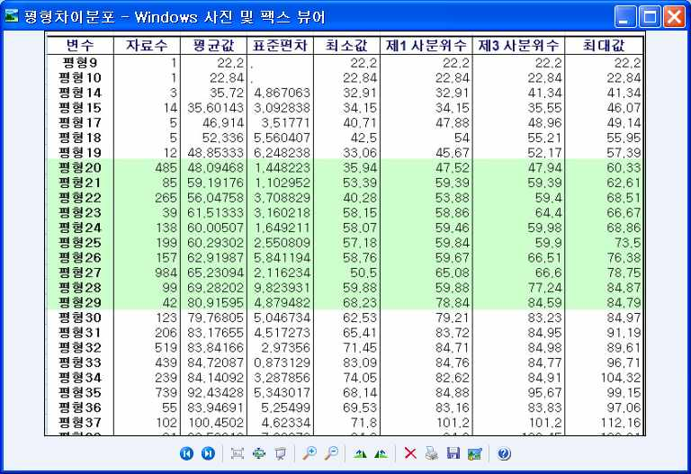

[그림 1-5] 측정 단위 표준과 자료 내용이 상이한 경우 - 예시
• 전사 데이터 표준 수립을 위한 요구 사항을 수집한다.
1. 기존 업무 수행 시 데이터 활용에 따른 문제점을 담당자 인터뷰 등을 통해 조사한다.
(1) 인터뷰, 설문 조사 등을 이용하고 제3자의 시각에서 서술한다.
(2) 해당 영역에 익숙하지 않은 관련자의 관점이 오히려 유리하다는 점을 참고한다.
2. 자신의 업무와 타 업무 간의 인터페이스 부분에서 발생하는 불편 사항 및 개선 사
항을 파악한다.
3. 정보 시스템에서 활용하는 식별자, 항목 표시, 코드, 서식 등을 분석하여 외부기관
과의 연계 등에서 발생하는 문제점 등을 파악한다.
4. 수집된 요구 사항을 단어·용어·도메인·코드의 범주로 분류한다.
5. 데이터 표준화 요구 사항 정의서를 작성한다.
<표 1-17> 표준화 요구 사항 정의서 - 예시

| 부서명 |  | 담당 영역 |  | 담당자 |  |
| --- | --- | --- | --- | --- | --- |
| 작성일 |  | 참조 표준 지침서 |  |  |  |
| 범주 | 세부 요구 사항 |  |  |  | 비고 |

(가) 요구 사항 작성 부서명을 작성한다.
(나) 담당 영역에는 해당 업무 영역(주제 영역, 단위 시스템)을 기입한다.
(다) 담당자란에 해당 영역 담당자를 기입한다.
(라) 문서 작성일을 기입한다.
(마) 참조 표준 지침서의 경우 단위 시스템 혹은 전사적으로 관리하고 있는 표준
안 등 현 표준을 수립을 위해 참조한 지침서를 기입한다.
(바) 요구 사항의 범주를 단어, 용어, 코드, 도메인 등으로 구분하여 기입한다.
(사) 각 범주별 표준화와 관련한 요구 사항을 세부 요구 사항에 기술한다.
• 현재 활용되고 있는 표준을 검토한다.
1. 조직에서 활용하고 있는 표준화 내용을 파악한다.
2. 국가 및 산업 분야에서 공통적으로 활용하는 표준화 내용을 파악한다.
3. 표준에 대한 개선 사항을 파악한다.
• 데이터 표준 후보 식별을 위한 기본 자료를 조사한다.
1. 기존 업무를 분석하여 기능별 구성 요소 도출, 외부적 요인을 분석하기 위한 자료
를 수집한다.
2. 개선이 필요한 표준화 대상 후보를 도출한다.
• 표준화 대상 후보 목록을 정리한다.
1. 조사한 표준화 대상 항목별로 문제점과 개선 사항 등 데이터의 특성을 정리한다.
2. 데이터 항목 간의 관련성 등 연계 관계를 고려하여 표준화 방안과 표준화 추진 시
고려 사항 등을 정리한다.
<표 1-18> 표준화 대상 후보 목록 - 예시

| 표준화대상 | 문제점 및 개선 사항 | 표준화 방안 | 추진시 고려 사항 |
| --- | --- | --- | --- |

서로 다른 속성이 동일한
동일 속성을 상이한 도메인
oo DB 도메인 표준화 속성명으로 관리되고 있을
으로 사용
위험도 내포하고 있음.
대표 단어에서 제외된 모
뜻이 같은 용어가 다양한 형 든 단어는 금칙어로 구분
xx DB 단어 표준화
태의 용어로 속성명에 사용 하여 관리(이음동의어 사
전 정립)
수행 tip
Ÿ 데이터 표준과 관련한 요구 분석과 표준 후보를 식
별하기 위해 정부 및 공공 기관에서 제공하는 관련
지침 등을 참고하는 것이 바람직하다.
1-2.
데이터 표준화 지침 수립
• 데이터 표준 기본 원칙을 정의하고, 각 데이터 표준 대상별 데이터 표준 원칙을 작
성할 수 있다.
학습 목표
• 각 데이터 표준 대상별로 데이터 표준화 방법을 구체적으로 정의하여 데이터 표준
지침으로 작성할 수 있다.
필요 지식 /
• 데이터 표준화 수행 절차
데이터 표준화의 일반적인 절차는 표준화 대상을 조사하고 표준화 방안을 분석한 다음,
표준화 체계를 수립하여 적용하는 단계를 거친다.
1. 표준화 대상 도출 및 정의
기존 업무 수행 시 데이터 활용에 따른 문제점을 담당자 인터뷰 등을 통해 조사하고, 정
보 시스템에서 활용하는 식별자, 항목 표시, 코드, 서식 등을 분석하여 외부 기관과의 연
계 등에서 발생하는 문제점과 국가 및 산업 표준에 따른 개선 사항 등을 파악한다.
(1) 규정 및 가이드라인과 기존 코드 표준, 시스템 운영 문서를 수집하고, 시스템에 대
한 역공학(Reverse Engineering)을 통해 시스템별 컬럼, 코드, 도메인을 분석
(2) 표준 데이터 항목을 정의한다.
(3) 표준 데이터 체크리스트를 활용하여 검토한다.
(가) 데이터 요소 표준 지침에 적합한가?
(나) 전사적인 코드 표준에 적합한가?
(다) 동음이의어, 이음동의어?
(라) 기존의 표준 코드는 반영되었는가?
(4) 정의된 표준 데이터 항목을 검토한 후, 표준 데이터 관리 저장소에 등록하여 전사
적으로 활용할 수 있도록 관리한다.
규정, 가이드라인
컬럼, 검토및 표준
기존코드표준 표준
코드, 승인 데이터
도메인 데이터 (표준검토 체크리스트
시스템운영문서 정의
분석 위원회)
데이터베이스
표준데이터
항목
표준 데이터
관리 저장소
출처: 한국정보화진흥원(2013),『(제4강) 데이터 표준화, 품질 관리 실무 교육 교재』.
[그림 1-6] 데이터 표준화 수행 절차
2. 표준화 방안을 분석한다.
조사한 표준화 대상 항목별로 문제점과 개선 사항 등 데이터의 특성을 정리하고, 데이터
항목 간의 관련성 등 연계 관계를 고려하여 표준화 방안과 표준화 추진 시 고려사항 등을
정리한다.
3. 표준화 체계 및 적용 방안을 정립한다.
분석한 문제점과 개선 사항을 기초로 표준화 방안을 정리하고 내용을 검토 및 보완하여
표준화 방안을 수립한다. 표준화 방안에 따른 표준화 체계와 적용 방안을 수립하여 적용
한다.
• 데이터 표준화 방법론
데이터 표준화를 수행하기 위한 일련의 방법과 절차를 체계적으로 정립한 접근 방법으로
써, 데이터 표준화를 위한 원칙을 정립하고, 현행 체계의 개선점과 개선 대안을 마련하여
표준화 원칙에 준거한 표준 체계를 설계한 후, 표준화 원칙과 표준 체계에 따라 데이터를
정제(Cleansing)하여 활용 시스템을 구축하는 등의 전반적인 절차와 방법, 사용되는 양식
등으로 구성한다.
1. 데이터 표준화의 원칙 정립
(1) 데이터 표준화 원칙은 데이터 표준체계 설계의 기본 요건으로 적용된다. 데이터 표
준화 원칙 수립 시에는 중복의 제거, 글로벌 표준(Global Standards)의 준수, 데이터
표준화 우수 사례(Best Practice), 데이터 오너십(Ownership)의 부여, 경영 측면의 가
치(Business Value)에 대한 우선 등을 고려할 필요가 있다.
(2) 데이터 표준화의 기본원칙은 공통적으로 적용되어야 할 원칙과 데이터 표준화 대상
별 원칙을 정의한다.
<표 1-19> 데이터 표준화 기본원칙 정의 - 예시

| 구성 요소 | 표준화 기본 원칙(예) |
| --- | --- |
| 공통 원칙 | 1. 관용화된 용어를 우선하여 사용한다.2. 영문명(물리명) 전환 시 발음식은 지양한다.3. 일반적인 명명 규칙 시 띄어쓰기는 하지 않는다.4. 한글명에 대해서는 복수의 영문명을 허용하지 않는다.(동음이의어 불가)5. 영문명에 대해서는 복수의 한글명을 허용한다.(이음동의어 허용) |
| 표준 용어 | 1. '고객','회원'등은 '회원'으로 사용한다.2. 적용 일자, 유효 일자 등의 내용은 유효일자로 통일하여 사용한다.3. 용어는 띄어쓰기를 허용하지 않는다.4. 용어의 길이는 한글의 경우 12자 이내, 영문의 경우 24자 이내로 제한한다.5. 일련 번호, ID, SEQ는 ID로 통일한다.6. 영문 약어의 경우 5자 이내로 제한한다.7. 필요시 단어와 단어의 구분은 _(언더바)로 한다. |
| 표준 코드 | 1. 코드성 속성은 맨 뒤에 '코드'를 붙인다. (예) 상태 코드, 결과 코드2. 코드는 알파벳과 문자열을 조합하여 일정한 길이로 구성한다.3. 코드 속성에는 기본적으로 3자리 문자열인 코드 도메인을 지정한다.4. 코드는 전체 모델 내에서 유일하게 정의한다. |
| 표준 도메 인 | 1. 표준 도메인은 기본적으로 숫자(Number), 문자열(String), 일시(Datetime)로 정의한다.2. 금액 도메인은 (18,0),(18,2)로 정의한다.3. 표준 도메인은 대표 속성을 기준으로 정의한다.4. 상세 도메인의 구별이 필요한 경우는 별도의 원칙으로 정의한다. |

2. 현행 체계 분석
현행 체계 분석에서는 고객, 서비스, 상품, 업체 등을 대상으로 소스 시스템별 분류 체계,
코드 체계, 객체(Entity), 속성 항목, 업무 규칙(Business Rule)을 조사하여 관리 체계상의
개선점과 요구 사항을 정리한다.
3. 표준 체계 설계
전사 통합 분류체계, 코드 체계 및 명명 규칙 등을 정립하고, 속성 항목 및 데이터 값의
표준에 대한 정의와 업무 규칙(Business Rule), 관리 절차에 대해 전사적인 표준화의 이슈
를 중심으로 접근한다.
• 데이터 표준화 지침
1. 데이터 표준화 지침의 의의
데이터 표준화 지침은 전사 차원의 데이터 표준화에 대한 정책으로서, 데이터 표준화 추진
시 기본적으로 준수해야 할 기본적인 방침을 규정한 것이다. 전사적으로 적용할 데이터 표
준의 관리 기준을 수립하여 전 직원이 동참하여 추진할 수 있도록 배포하여 관리한다.
2. 지침의 주요 구성 내용
데이터 표준화 지침은 표준에 대한 정의, 데이터 표준화 범위, 데이터 표준의 용도와 데이
터 관리 조직 및 주요 표준화 프로세스 등으로 구성된다.
(1) 지침의 목적과 표준화의 기준, 표준화 대상별 표준의 내용, 표준을 적용할 범위와
기본 규칙 등에 대해 정의한다.
(가) 표준의 목적 설정
프로젝트 개발, 유지 보수 대상 오브젝트들에 대하여 명확한 명칭 부여 기준을 정
함으로써 프로그램의 가독성(Readability)를 향상시키고 일관성을 유지하여 개발자
의 생산성 향상과 인터페이스의 개선 및 시스템의 품질 향상 등의 목적에 대해 정
의한다.
(나) 데이터 표준 정의
전사적으로 데이터를 정의하고 활용하는 데 적용하는 통일된 기준을 정의한다. 전
사 데이터 표준은 메타 관리 시스템에 등록한 기본 단어, 표준 용어 및 도메인 등
에 대한 정의가 해당된다.
(다) 적용할 규칙에 대한 정의
표준 용어의 한글 및 영문 이름을 정하는 명명 규칙, 표준 용어에 설명을 붙이는
정의 규칙, 데이터 타입과 길이를 정하는 표현 규칙 등을 정의한다.
(2) 표준의 활용 방안과 관리를 위한 조직을 지정하여 역할과 책임(R&R: Role and
Responsibility)을 명확히 정의한다.
(가) 데이터 표준의 용도
데이터 표준은 업무적인 데이터의 이름과 속성을 정하는 기준이 되며, 논리모델에
서 엔티티명, 속성을 정의하는 기준이 되고, 물리 모델에서 테이블, 컬럼을 정의하
는 기준으로 활용된다.
(나) 데이터 관리 조직 정의
데이터 관리를 위한 조직 구성과 데이터 관리자(DA: Data Administrator), 모델러,
IT운영, 현업, 데이터베이스 관리자(DBA: Database Administrator) 등 데이터 관리
조직간 역할과 책임을 명확히 정립한다.
(3) 표준화 데이터의 운영 및 관리와 활용 체계 등에 대한 프로세스를 정의한다.
(가) 주요 표준화 데이터 생성 및 적용에 대한 운영 프로세스를 정의한다.
(나) 메타 데이터 관리 시스템을 통한 활용 및 관리 프로세스를 정의한다.
수행 내용 / 데이터 표준 기본 원칙 작성하기
재료·자료
Ÿ 시스템 요구 사항 분석서, 대상 DBMS(Data Base Management System) 설명서, 업무 규칙 정의서,
비즈니스 영역의 각종 지침 및 서류, 데이터 모델
기기(장비･공구)
Ÿ 컴퓨터, 문서 작성 도구
안전･유의 사항
Ÿ 데이터 표준화는 데이터 품질 관리를 위한 중요한 활동이며, 국내외에서 통용되는 표준화 지침
등을 적극 반영하는 것이 바람직하다.
Ÿ 업무 분야별로 사용하는 용어와 정보 시스템의 체계도 상이하므로 직간접적인 경험을 통해
비즈니스 도메인(Business Domain, 업무 영역)에 대해 충실히 이해하려는 노력이 요구된다. 이를
위해 업무 분야에 정통한 실무자들과의 충분한 소통이 필요하다.
수행 순서
• 현행 데이터 표준 원칙을 분석한다.
1. 현행 데이터 표준 원칙을 수집한다.
(1) 현 정보 시스템 개발 지침 및 데이터 표준을 확보한다.
조직에서 적용하고 있는 규정화된 관련 지침이나 표준, 프로젝트 수행 시 적용하
는 데이터 표준과 관련한 자료를 수집한다.
(2) 현행 정보 시스템 모델을 분석한다.
운영되고 있는 데이터베이스 시스템에 대한 구조를 파악하기 위해 E-R 다이어그
램 등의 자료를 통해 데이터의 연계 관계와 보유 현황 등을 분석한다.
2. 데이터 표준 원칙 사용 현황을 분석한다.
수집된 데이터 표준 원칙 자료를 토대로 현행 데이터 표준 대상 및 관리 항목을 도
출한다.
• 데이터 표준 개선 방안을 정의한다.
1. 현행 데이터 표준 사용 현황 명세서와 표준화 요구 사항 정의서를 토대로 데이터
표준 대상별 문제점 및 개선 방안을 도출한다.
2. 문제점 및 개선 방안 도출 시 전사적인 관점에서 접근한다.
• 데이터 표준 원칙을 수립한다.
데이터 표준을 정의하기에 앞서 기본적인 원칙을 수립하여 표준화에 대한 방향을 정
립한다. 표준화 원칙 수립의 예로는 한글명에 특수 기호를 사용하지 않는 것, 워드에
따른 약어명은 4byte를 넘지 않는 것, 이음동의어 사용을 금지하는 것 등을 정의하는
것이다.
<표 1-20> 표준화 원칙 정의서 - 예시
표준화 원칙 정의서
1. 당사에서 사용하고 있는 관용화된 용어는 우선하여 사용한다.
2. 이음동의어, 동음이의어는 허용하지 않는다.
3. 워드는 다른 워드와의 조합이 아닌 단일 워드로 정의한다.
4. 접두사, 접미사를 하나의 개별 워드로 처리한다.
5. 한글명에는‘_’,-‘,’?‘의 특수 문자나 띄어쓰기를 허용하지 않는다.
6. 한글명에 있어 한글과 영문자를 혼용하여 사용할 수 없으며, 외래어는 한글로 표시해야 한다.
7. 영문 정식 명칭(full name)을 영문명으로, 영문 약식명을 영문 약어명으로 정의하여 명명 규칙
을 통일한다.
8. 영문 약어명은 통용되는 약어가 있다면 그대로 표현한다.
9. 영문 약어명은 어두 이 모음을 제외한 4자리 이내로 정의한다. 단, 자음이 중복되는 경우 중
복 음 중 하나만 사용한다.
10. 영문 약어명은 영문 정식 명칭(full name)이 5자리 이상, 앞 음절 4자 이외의 음절이 모음으로
구성되는 경우 앞 음절 4자를 그대로 표현한다.
11. and(or)로 연결된 단어의 경우는 각각의 첫 글자를 사용한다.
• 데이터 표준 지침을 작성한다.
1. 지침의 목적, 표준화 기준, 표준화 대상별 표준 내용, 적용 범위와 기본 규칙 등에
대해 정의한다.
지침을 작성하는 기본 형식과 구성 내용에 따라 지침의 제정 목적과 표준화 기준, 표
준의 구체적인 내용, 지침의 적용 범위 및 적용되는 기본 규칙 등에 대해 정의한다.
2. 표준의 활용과 관리를 위한 조직에 대해 정의한다.
표준의 활용과 관리를 담당할 조직 구조와 해당 조직 구성원의 역할과 책임에 대해
정의한다.
3. 표준화 데이터의 운영 관리 프로세스를 정의한다.
표준화 데이터의 운영과 관리, 활용 체계를 정의한다.
4. 데이터 표준 지침을 변경하는 경우 기 적용된 많은 시스템에 영향을 주므로 단위
정보 시스템만이 아니라 관련 정보 시스템에 공통적으로 적용이 가능하도록 범용
성을 고려하고, 현행 지침이 유지될 수 있도록 정의하는 것이 바람직하다.
수행 tip
Ÿ 데이터 표준화는 데이터 품질 관리의 구성 요소로서 중요한 기준이 되며,
국내 표준뿐만 아니라 가능한 국제적으로 통용되는 표준을 적용하고 이를
준수하는 것이 바람직하다.

| 학습 1 | 교수 ‧ 학습 방법 |
| --- | --- |

교수 방법
• 데이터 표준화와 관련된 주요 용어와 데이터 표준화 대상별 데이터 표준 원칙에 대해 설명한다.
• 데이터 표준화 진단 결과를 사례로, 발견된 데이터 표준화의 현황과 문제점, 개선 방안 등을
제시하여 표준화의 필요성을 인식할 수 있도록 설명한다.
• 데이터 표준화 추진을 위해 어떤 과업들이 필요한지 인식할 수 있도록 표준화 점검표 등을
통해 설명한다.
• 토론을 통해 데이터 표준화와 데이터 품질 관리와의 관계에 인식할 수 있도록 토론식 수업을
진행한다.
• 사용자 그룹, 데이터베이스 관리자, 데이터 관리자 등으로 역할을 분담하여 데이터 표준화
요구 사항 분석을 위한 면담을 수행하고 요구 사항 정의서를 작성하는 문제 해결식 수업이
가능하도록 한다.
학습 방법
• 데이터 표준화와 관련된 주요 용어와 데이터 표준화에 필요한 작업의 내용에 대해 이해한다.
• 데이터 표준화와 데이터 품질 관리의 관계를 숙지하여 데이터 표준화의 중요성에 대해 이해한다.
• 데이터 표준화 대상별 기본 원칙의 구성 내용에 대해 숙지한다.
• 데이터 표준화와 관련된 각종 지침을 조사하여 표준화 대상별 표준화 방법과 표준 지침의 구성
내용에 대해 이해한다.
• 데이터 표준화 요구 사항 정의서 작성을 위한 실습 과정을 통해 면담 기법과 보고서 작성 능력을
배양한다.

| 학습 1 | 평 가 |
| --- | --- |

평가 준거
• 평가자는 학습자가 수행 준거 및 평가 항목에 제시되어 있는 내용을 성공적으로 수행하였는지를
평가해야 한다.
• 평가자는 다음 사항을 평가해야 한다.

| 학습 내용 | 평가 항목 | 성취수준 |  |  |
| --- | --- | --- | --- | --- |
|  |  | 상 | 중 | 하 |

- 현업 및 개발자로부터 데이터 표준과 관련된 요구
데이터 표준 대
사항을 조사하여 데이터 표준 대상 후보 식별을 위
상 후보 식별
한 기본 자료를 마련할 수 있다.
- 데이터 표준 기본 원칙을 정의하고, 각 데이터 표준
대상별 데이터 표준 원칙을 작성할 수 있다.
데이터 표준화
- 각 데이터 표준 대상별로 데이터 표준화 방법을 구
지침 수립
체적으로 정의하여 데이터 표준 지침으로 작성할 수
있다.
평가 방법
• 서술형 시험

| 학습 내용 | 평가 항목 | 성취수준 |  |  |
| --- | --- | --- | --- | --- |
|  |  | 상 | 중 | 하 |

데이터 표준 대상 - 데이터 표준과 관련된 요구 사항 조사 및 데이터
후보 식별 표준 대상 후보 식별을 위한 기본 자료 마련 능력
- 데이터 표준 기본 원칙 정의와 각 데이터 표준
데이터 표준화 지 대상별 데이터 표준 원칙 작성 능력
침 수립 - 각 데이터 표준 대상별로 데이터 표준화 방법 정
의와 데이터 표준 지침 작성 능력
• 평가자 체크리스트

| 학습 내용 | 평가 항목 | 성취수준 |  |  |
| --- | --- | --- | --- | --- |
|  |  | 상 | 중 | 하 |

데이터 표준 대상 - 데이터 표준과 관련된 요구 사항 조사 및 데이터
후보 식별 표준 대상 후보 식별을 위한 기본 자료 마련 능력
- 데이터 표준 기본 원칙 정의와 각 데이터 표준 대
데이터 표준화 지 상별 데이터 표준 원칙 작성 능력
침 수립 - 각 데이터 표준 대상별로 데이터 표준화 방법 정
의와 데이터 표준 지침 작성 능력

| 학습 내용 | 평가 항목 | 성취수준 |  |  |
| --- | --- | --- | --- | --- |
| 피 드 백 |  |  |  |  |
| 1. 서술형 시험 - 데이터 표준과원칙 작성, 데이터 | 관련된 요구 사항 조사와 표준화 대상 후보를 식별하는표준 지침 수립 내용을 검토하여 틀린 점과 잘된 점을 | 방법, | 데이터표시하여 | 표준돌려 |
| 준다. |  |  |  |  |
| 2. 평가자 체크리스트- 데이터 표준과표준 원칙의 작성사항을 정리하여 | 관련된 요구 사항 조사, 기초 자료 수집, 표준화 대상내용, 데이터 표준 지침 수립 과정을 검토 항목별로돌려 준다. | 후보평가한 | 식별,후 | 데이터개선할 |

학습 1 데이터 표준화 정책 수립하기

| 학습 2 | 데이터 표준 정의하기 |
| --- | --- |

학습 3 데이터 표준 관리하기
2-1.
데이터 표준 식별 및 정의
• 대상 정보 시스템에 사용되는 데이터 표준 단어, 표준 도메인, 표준 코드, 표준 용어
의 후보를 식별할 수 있다.
학습 목표
• 표준화 정책에 기반하여 표준 단어 사전, 표준 도메인 사전, 표준 코드 사전, 표준
용어를 정의할 수 있다.
필요 지식 /
• 데이터 표준화 절차
데이터 표준에 대한 정의는 데이터 표준화 요구 사항 수집, 데이터 표준 정의, 데이터 표
준의 확정과 데이터 표준 관리 등의 절차로 수행된다.
데이터관리 (미승인) 데이터표준 데이터표준
정책수립 검토/승인 공표
표준단어 사전
표준화요구사항 정의
수집
표준도메인 사전 표준용어
정의 정의
표준화원칙
수립
표준코드
데이터관련 요소 데이터표준 적용
정의
표준정의 (데이터모델 .
/DB 정의)
출처: 한국데이터베이스진흥센터(2006),『데이터 품질 관리 지침(Ver 2.1)』.
[그림 2-1] 데이터 표준 정의 프로세스

| 학습 내용 | 평가 항목 | 성취수준 |  |  |
| --- | --- | --- | --- | --- |
| • 데이터 도메인(Data데이터 도메인의 분류는데이터 도메인 출처: 행정안전부(2008),『행정[그림 2-2] 데이터 도메인 분류• 데이터 업무 규칙(Business | Domain)의 분류 ISO/IEC 20943-3의 분류 기준을 준용할 것을 기본형 업무로부터 직접 도출된 가장 기본적인 데이터코드 또는 그 외 특정한 체계로 생성되도록 값을설계형 이터 도메인. 업무의 유형을 단순화 하거나, 유일성을편으로 활용됨. 이미 존재하는 다른 도메인의 계산에 의해 유도형 인으로 계산 공식 등의 파생 알고리즘이 존재구성하는 값의 원소를 모두 나열할 수 있는열거형 는 코드 집합, 표준 분류, 분류(categorizations)함 구성하는 값의 원소를 범위로서 규정하며, 일일이비열거형 가능한 데이터 도메인. 예로는 수치의 간격, 등의 형태가 있음. 국내외 타 기관이나 업체에서 정의한 값 영역을외부 값 영역 대로 차용한 경우를 의미 일반 값 영역 외부 값 영역이 아닌 일반적인 경우 정보 데이터베이스 표준화 지침』. 체계 Rule) 작성 가이드 | 권고한다.도메인고안할보장하기생성되는데이터등의나열하는문자열의변경하지 | 필요가 있는위한데이터도메인.형태를것이특성,않고 | 데방도메예로포불비트맵그 |
| 1. 업무 규칙 도출은동일 컬럼이라도드시 테이블별로일 컬럼에 대한따로 작성하여야 | 테이블의 컬럼 단위로 작성한다. 다른 테이블에 속해 있으면 업무 규칙 내용이 다를 수업무 기준의 차이점을 검토해 보고 결정해야 한다. 만약업무 규칙이 이미 도출되어 있고 그 내용이 동일하거나한다. | 있다.타비슷할 | 따라서테이블의 | 반동경우라도 |
| 2. 업무 규칙은 데이터 | 품질 점검을 위한, 즉 “Data Error Check“를 주 | 대상으로 |  | 한다. |
| 3. 해당 컬럼 및 데이터칙을 도출한다. | 검증에 대한 업무 규칙을 도출할 때 가능한 모든 | 유형의 |  | 업무 규 |
| 4. 컬럼의 코드 값은 | 필히 코드 테이블(코드 정의서)을 참조하도록 한다. |  |  |  |
| 예) 직책 코드는 | 코드(CODE_MASTER) 테이블의 “DUTY_TY“에 등록된 | 값이어야 |  | 한다. |
| 5. 컬럼이 코드화되지어서 기술한다. | 않았을 경우나 코드 정의 값이 명확치 않은 경우 | 코드 | 값을 | 직접 풀 |
| 예) 직급 코드는 | {‘T’, ‘A’, ‘C’, ‘G’} 중에 하나여야 한다. |  |  |  |
| 6. 2개 이상 테이블 | 간의 업무 규칙 정의 시 필히 관련 테이블과 컬럼을 | 함께 | 기술한다. |  |
| 예) 결제 여부(PAY_AT)의(PAY_AM)의 값은 | 값이 존재하면 결재 내역(ORDER_DETAIL)반드시 있어야 함. | 테이블의 | 결제 | 금액 |
| 7. 업무 규칙을 근거로크립트는 그대로• 데이터 표준 정의 | 품질측정을 위한 SQL 스크립트를 상세히 작성한다.실행하여 원하는 결과를 얻을 수 있는 수준이어야 | 한다. | 작성한 | SQL 스 |
| 1. 표준 데이터 간의표준 단어 사전을드 작성에 활용하여용하여 표준 용어를성을 설정하는 컬럼으로 정의된다. | 연관 관계 기초로 표준 도메인의 데이터 타입을 정의하고, 표준데이터 유횻값을 정의하고, 표준 단어와 표준 도메인,구성한다. 표준 단어는 논리 모델링 단계에서 주제작업에 활용되고, 이들 엔티티와 속성이 물리 모델링 | 도메인을표준영역과단계에서 | 코드를엔티티, | 표준 코활속테이블과 |
| 2. 표준 단어 사전 정의표준 단어는 기업에서 | 업무상 사용하며 일정한 의미를 갖고 있는 최소 | 단위의 | 단어를 | 의 |
| 미한다. |  |  |  |  |
| (1) 표준 단어 있는 모든 | 사전을 작성하기 위해서는 기존 데이터 모델 및 업무단어들을 수집하고 정련을 통해 작성한다. | 용어가 |  | 사용하고 |
| (2) 표준 단어란서 업무상 | 문법상 일정한 뜻과 구실을 가지는 말의 최소 단위를사용하며 일정한 의미를 갖는다. | 의미하며 |  | 기업에 |
| (3) 표준 단어 사전 | 작성 시 동음이의어와 이음동의어를 주의한다. |  |  |  |
| (4) 표준 단어 사전지해야 한다. | 작성 시 접두어 및 접미어 처리에 대한 원칙을 | 수립하여 | 혼동을 | 방 |
| 3. 표준 도메인 사전정보 시스템별로여 표준 도메인을 | 정의 혼재되어 사용하고 있는 컬럼명, 데이터 타입, 데이터정립한다. | 길이 | 등을 | 정리하 |
| (1) 업무적인 용도,하고 도메인별 | 사용 빈도와 데이터의 물리적인 특성 등을 고려하여데이터 타입을 부여한다. |  | 도메인을 | 분류 |
| (2) 도메인에는 | 코드성 도메인과 숫자 도메인, 날짜 도메인, 문자 도메인 | 등이 | 있다. |  |
| (3) 도메인 정의를가지도록 할 수 | 이용하면 업무적으로 동일한 속성들이 같은 데이터있으며, 다른 속성으로 정의되는 것도 방지한다. |  | 타입과 | 길이를 |
| (4) 표준 도메인은유형과 길이를 | 전사적으로 사용하고 있는 데이터를 유사한 그룹으로정의하기 위한 방법이다. |  | 나누어 | 동일한 |
| (5) 하나의 도메인은 | 여러 개의 하위 도메인을 가질 수 있다. |  |  |  |
| (6) 하나의 데이터을 지정해야 | 항목은 복수 개의 도메인을 지정할 수 없고, 반드시한다. |  | 하나의 | 도메인 |
| (7) 어느 도메인에도하는 도메인을 | 속하지 않은 항목이 있을 수 있기 때문에 모든만들 필요는 없다. | 용어를 | 전부 | 만족 |
| 4. 표준 코드 정의 |  |  |  |  |
| (1) 표준 코드를하여 작업한다. | 정의하기 위해서는 개별 시스템에서 관리되는 현행의 | 코드 | 값을 | 조사 |
| (2) 표준 코드는일치성을 방지할 | 업무 범위에서 가능한 한 유일하게 정의를 해야 수 있다. | 데이터의 | 중복 | 및 불 |
| (3) 코드를 관리하는이블에 통합하여 | 방법으로는 단독 코드 테이블로 관리하는 방법,관리하는 방법, 해당 애플리케이션 내부에서 | 전체를관리하는 | 하나의방법 | 테등이 |
| 있다. |  |  |  |  |
| (4) 가능한 한 전체신규 정의 및 | 코드를 하나의 테이블에서 통합 관리하는 것이변경에 대응하기 쉽다. | 좀 더 |  | 효율적이고, |
| (5) 특정 데이터확성 여부를 | 항목에 사용되는 코드 값을 조사하여 허용 값 및 허용검토한다. | 범위에 |  | 대한 정 |
| (6) 코드 통합 시에는으로 인해 의미의 | 가능한 한 기존 코드를 기준으로 통합을 하며,이해나 사용에 무리가 되지 않도록 한다. | 너무 | 무리한 | 통합 |
| (7) 일부 업무에서별도의 파생된 값을 | 특정 코드의 전체를 사용하지 않고 범위를 한정하여코드를 생성하여 사용하도록 하고, 이때는 반드시재사용하도록 한다. | 표준 | 사용하는코드에서 | 경우정의 |
| 5. 표준 용어 정의 |  |  |  |  |
| (1) 단어, 도메인, | 코드 표준이 정의되면 이를 바탕으로 표준 용어를 | 구성한다. |  |  |
| (2) 엔티티와 속성을 | 대상으로 추출된 표준 단어를 조합하여 생성하며 | 용어 | 사전은 | 엔 |

티티 용어 사전과 컬럼 용어 사전으로 구분하여 정의 관리한다.
(3) 표준 용어 사전은 업무에서 자주 사용하는 용어를 조합하여 사용하도록 한다.
(4) 표준 용어를 작성할 때는 너무 지나친 약어를 사용해서 업무에 대한 이해도가 떨어
지지 않도록 주의한다.
(5) 정의된 표준 용어가 너무 긴 경우에는 두 개의 표준 용어로 분할하거나 복합 용어
의 생성을 검토한다.
6. 데이터 관련 요소 표준 정의
데이터 관련 요소 표준 대상인 논리 데이터 모델의 주제 영역, 엔티티, 속성 관계명을 포함
하여 물리적 객체 대상인 주제 영역(Subject Areas), 관계(Relationships), 데이터베이스 및 인
스턴스(Database & Instance), 인덱스(Indexes), 제약 조건( Constraints), 테이블 스페이
스(Table spaces), 파일명(File Names), 스크립트명(Script Names) 등의 명명 규칙을 정의한다.
• 데이터 표준 사전 구축
1. 의의
기관에서 사용하는 용어에 대해 모든 구성원들이 유일한 의미로 공유하기 위해 표준 데이
터 사전을 생성 구축
<표 2-1> 데이터 표준 사전 구축

| 사전 | 내용 |
| --- | --- |

단어 사전 용어를 생성 조립하는 단위로서, 한글, 영문 정식명, 영문 약어, 단어 설명
- 업무적으로 사용하는 용어에 대한 설명
용어 사전 - 논리/물리 모델에 적용하는 속성 및 컬럼 ID
- 용어의 생성과 사용의 소관 부서인 오너십(ownership)을 포함.
- 표준 용어에 적용되는 데이터 속성(type, length) 정의
도메인 사전 - 데이터 속성 관리를 위한 도메인 유형 정의(~금액, ~번호, ~코드 등)
- 코드 도메인의 경우 오너십을 정의
- 코드 컬럼 ID는 표준 용어와 같이 정의
코드 사전
- 코드의 계층 구조와 코드 허용 값 범위 통합 관리
출처: 한국정보화진흥원(2013),『(제4강) 데이터 표준화, 품질 관리 실무 교육 교재』.
2. 데이터 사전 생성 단계
착수 기본단어 업무용어 도메인 종료

| 데이터속성추출 |
| --- |
| 속성정련 |

| 기본단어추출 |
| --- |
| 기본/표준단어정련 |
| 동음이의어정리 |
| 이음동의어정리 |
| 한글/영문병추가 |
| 도메인명 정리 |

| 표준용어정련 |
| --- |
| 동음이의어정리 |
| 이음동의어정리 |
| 한글/영문명추가 |

도메인표준 모델적용
용어의미
정의

| 표준화지침수립 |
| --- |
| 표준화절차개발 |

출처: 한국정보화진흥원(2013),『(제4강) 데이터 표준화, 품질 관리 실무 교육 교재』.
[그림 2-3] 데이터 사전 생성 단계
3. 데이터 사전 구축 방법
(1) 기본 단어를 정의하고, 단어들의 조합에 의한 표준 용어를 생성하며 표준 용어에
대한 오너십, 설명 정보, 데이터 값 산출 기준 등을 정의하고 시스템화
(2) 하나의 용어에 하나의 도메인(type, length)를 정의하여 논리에서 물리까지 데이터
일관성을 확보
(가) 용어를 생성하고 조립하는 단위로 한글, 영문 정식명, 영문 약어, 단어 설명
(나) 이음동의어, 동음이의어, 금칙어 정의
(다) 표준 용어: 업무적으로 사용하는 용어에 대한 설명
(라) 표준 용어: 논리/물리 모델에 적용하는 어트리뷰트명/칼럼 ID
(마) 용어 오너십(ownership): 생성 및 사용의 책임 소관 부서
(바) 표준 용어에 적용되는 데이터 속성(type, length) 정의 (DBMS별 논리/물리 속성
정의)
(사) 데이터 속성 관리를 위한 도메인 유형 정의 (금액, 번호, 코드, 수, 일자 등)
(아) 코드 도메인: 오너십(ownership) 정의

| 학습 내용 | 평가 항목 | 성취수준 |  |  |
| --- | --- | --- | --- | --- |
| 내용 / 데이터재료·자료 Ÿ 시스템 요구 사항비즈니스 영역의기기(장비･공구) Ÿ 컴퓨터, 문서 작성안전･유의 사항 Ÿ 데이터 표준화는Ÿ 업무 분야별로 비즈니스 도메인(Business위해 업무 분야에Ÿ 스프레드시트(Spreadsheet)수행 순서 • 데이터 표준화의 | 표준 대상 후보 식별과 표준 분석서, 대상 DBMS(Data Base Management System) 설명서,각종 지침 및 서류, 데이터 모델 도구, 스프레드시트(Spreadsheet) 또는 표준화 지원데이터 품질 관리를 위한 중요한 활동이다. 사용하는 용어와 정보 시스템의 체계도 상이하므로 직간접적인Domain, 업무 영역)에 대해 충실히 이해하려는 정통한 실무자들과의 충분한 소통이 필요하다. 또는 데이터 표준화를 지원하는 자동화 도구를대상 후보를 식별한다. | 정의하기업무자동화노력이활용할 | 규칙도구경험을요구된다.필요가 | 정의서,통해이를있다. |
| 1. 현업 및 을 통해 표준화 | 개발자로부터 데이터 표준과 관련된 요구 사항을 인터뷰대상 후보를 조사한다. | 및 | 설문 | 조사 등 |
| 2. 현행 정보 여 현행 데이터 | 시스템에서 적용하고 있는 데이터 표준 원칙 및 데이터표준의 관리 대상 및 현황을 파악한다. |  | 표준을 | 수집하 |
| 3. 조사된 데이터표준 대상별• 표준 기본 원칙을 | 표준화 요구 사항과 현행 데이터 표준 관리 현황을문제점 및 개선 방안을 도출한다. 정의하고 데이터 표준 대상별 데이터 표준 지침을 | 작성한다. | 토대로 | 데이터 |
| 1. 데이터 표준터 표준 대상별 | 개선 방안을 참고하여 전사 데이터 표준 기본 원칙을데이터 표준 지침을 작성한다. |  | 정의하고 | 데이 |
| 2. 데이터 표준별 명명 규칙 | 지침 작성 시 데이터 표준화 관련자의 역할, 책임과정의, 데이터 형식에 대한 기준 정의 등을 포함한다. | 데이터 | 표준 | 대상 |
| 3. 주요 데이터용 길이, 안 등에 대하여 | 표준화 대상의 일반적인 지침의 예로는 한글명 및합성어에 대한 정의 지침, 동음이의어/이음동의어 허용지침을 정의한다. | 영문명에여부 | 및 | 대한 허처리 방 |
| 4. 적용 DBMS별록 주의한다.• 표준 단어 사전을 | 특성을 감안하여 타 DBMS에 적용이 불가능한 상황이정의한다, |  | 발생하지 | 않도 |
| 1. 현행 용어를 | 수집한다. |  |  |  |
| (1) 모든 정보석하여 현행 | 시스템에 대한 데이터 모델 또는 테이블 정의서와용어에 대한 한글명 및 영문명을 수집한다. | 칼럼 | 정의서를 | 분 |
| (2) 일부 상용화된 | 애플리케이션 패키지처럼 한글명이 존재하지 | 않는 | 데이터 | 모델은 |
| 제외한다. |  |  |  |  |
| 2. 단어를 분할한다. |  |  |  |  |
| (1) 업무상 | 사용되는 일정한 의미를 갖고 있는 최소 단위의 단어로 | 분할한다. |  |  |
| (2) 단어 분할 | 시 한글명을 비롯하여 영문명도 같이 분할이 되는가를 |  | 고려해야 | 한다. |
| (3) 단어 분할 | 시 단독으로 분할되는 숫자는 표준화 대상 단어에서 | 제외한다. |  |  |
| 3. 단어를 정련한다. |  |  |  |  |
| (1) 의미가 영문 약어명을 | 동일한 단어들에 대해 하나의 대표 단어를 표준으로선택한다. | 선정하고 | 그에 | 대한 |
| (2) 한글명이도가 가장 | 동일한 단어와 의미가 동일한 단어(이음동의어)들을많은 한글명을 표준 단어로 선택한다. | 취합한 | 후 | 활용 빈 |
| (3) 한글명이어명을 해당 | 동일한 단어와 이음동의어를 모두 통틀어 가장 많이표준 단어에 대한 영문 약어명으로 선택한다. | 나타나는 |  | 영문 약 |
| (4) 동음이의어의한 의미를 | 경우 상대적으로 활용 빈도가 낮은 의미의 단어에갖는 다른 한글명을 표준 단어로 선택한다. |  | 대해서는 | 동일 |
| 4. 표준 단어 | 사전에는 유사어(의미 유사한 단어), 금칙어(표준으로 | 선택되지 |  | 않은 동 |
| 음이의어)를 | 등록하여 향후 적절한 표준 단어의 검색을 위해 | 사용한다. |  |  |
| 5. 표준 단어 사전을 | 작성한다. |  |  |  |

[표 2-2] 표준 단어 사전 - 예시

| 번호 | 한글명 | 정의 | 영문명 | 영문 약어명 | 단어 종류 | 단어 유형 | 비고 |
| --- | --- | --- | --- | --- | --- | --- | --- |

| (1) 표준 | 단어 | 사전의 일련 | 번호를 | 부여한다. |  |  |  |
| --- | --- | --- | --- | --- | --- | --- | --- |
| (2) 단어의 | 한글명 | 표준을 | 작성한다. |  |  |  |  |
| (3) 단어의 | 정의에는 | 단어의 | 의미를 | 설명하되, 업무적 | 의미를 | 충분히 반영하여 | 정의 |
| 한다. |  |  |  |  |  |  |  |
| (4) 최대한 | 영문명에는사용한다. | 단어의 영문 | 정식 | 명칭(Full name)을 | 기록하되, | 단어 영문의 | 의미를 |
| (5) (Full | 표준안에name)에서사용한다. | 정의한 원칙에모음을 | 따라제거하고 | 영문 약어명을3~4자 이내로 | 정의한다. 축약하여 컬럼 | 대부분 영문영문명 | 정식 명칭생성용으로 |
| (6) | 단일어, 합성어,여한다. | 접두사, | 접미사 | 등 단어의 성격을 | 알 수 | 있도록 단어 | 종류를 부 |
| (7) 록표준 도메인을 | 금칙어, 유사어정의하여야 | 등의 단어한다. 정의한다. | 유형을 | 분류한다. | 전사적으로 | 유일한 단어를 | 사용하도 |
| 1. 현행 | 용어 정보를 | 분석한다. |  |  |  |  |  |
| (1) 현행유형의 | 용어에용어들을 | 대한 용어명과그룹화한다. | 데이터 | 타입 정보를 | 수집한 뒤 | 물리적으로 | 유사한 |
| (2) 동일한 | 정보출한다. | 시스템에 | 대한 데이터 | 모델에서 | 추출된 현행 | 용어들을 | 유일하게 추 |
| (3) 유일한 | 용어를치하는지 | 추출할확인한다. | 때에는 | 한글명, 영문명, | 데이터 타입, | 대이터 길이 | 모두 일 |
| (4) 데이터을 | 타입과그룹핑한다. | 데이터 | 길이가 | 동일한 용어들을 | 검색하여 | 유사한 속성의 | 용어들 |
| (5) | 용어명의 | 마지막 단어를 | 기준으로 | 유사한 속성의 | 용어들을 | 그룹핑한다. |  |
| 2. 표준 | 도메인을 | 정의한다. |  |  |  |  |  |
| (1) 데이터 | 그룹핑된타입 | 유사 속성 및 길이를 | 용어의 의미에정의한다. | 따라 표준 | 도메인명을 | 정의하고 | 그에 따른 |

(2) 가급적이면 업무적으로 의미가 있는 도메인명을 부여한다.
(3) 기존 데이터와의 호환성 및 범용성을 위해 그룹핑된 용어들에게 부여된 타입 길
이 중 가장 큰 데이터 타입 길이를 표준으로 정한다.
3. 표준 도메인을 작성한다.
[표 2-3] 표준 도메인사전 - 예시

| 번호 | 도메인명 | 정의 | 데이터 타입 | 비고 |
| --- | --- | --- | --- | --- |

| (1) 표준 | 도메인의 일련 | 번호를 부여한다. |  |  |
| --- | --- | --- | --- | --- |
| (2) 도메인명은 | 도메인 | 한글명을 정의한다. |  |  |
| (3) 도메인의 | 업무적인 | 의미와 사용 기준을 정의란에 | 기술한다. |  |
| (4) 도메인별로데이터 | 정의되는타입은 업무적인 | 데이터 타입을 작성한다. 제약이나 기존 데이터의 | 길이의 최대 자릿수를 | 참고하여 |
| 정의한다. |  |  |  |  |
| (5) 표준조사하여표준 코드 | 도메인 작성적용하는정의를 정의한다. | 시 정부 기관이나 산업 분야에서것이 바람직하다. | 공통적으로 사용하는 | 표준을 |
| 1. 현행 코드를 | 수집한다. |  |  |  |
| (1) 각종 | 코드 테이블을 | 살펴서 코드 데이터 값을 | 수집한다. |  |
| (2) 코드성 | 컬럼 또는 | 정보성 데이터에 대한 저장성 | 코드인지를 확인한다. |  |
| (4) 수집된 | 코드에 대한 | 사용처를 파악한다. |  |  |
| 2. 현행 코드에 | 대한 용도와 | 구조 등 상세한 내용을 | 분석한다. |  |
| 3. 통합 대상이 | 없는 코드는 | 현행 코드 인스턴스를 그대로 | 유지한다. |  |
| 4. 통합 | 대상이 있고 코드가 | 같을 경우는 새로운 코드 | 번호를 부여한다. |  |
| 5. 표준 코드[표 2-4] | 사전을 작성한다.표준 코드 사전 - | 예시 |  |  |
| (1) 코드 | 유형 번호는 | 코드를 식별하기 위한 번호로서, | 업무 영역별로 | 부여한다. |

| 코드 유형 번호 | 코드명 | 코드 주소 | 코드 번호 | 코드 값 | 오너십 부서 | 사용 부서 |
| --- | --- | --- | --- | --- | --- | --- |

(2) 코드 구조는 코드의 길이의 구성 유형(N-숫자형이면서 분류 체계가 있는 경우,
n-숫자형이면서 순차적으로 부여된 경우, A-문자형일 경우)으로 구분한다. 예를
들면 국가 코드의 경우 캐나다는 CAN, 중국은 CHN의3자리 문자형이므로
‘AAA’의 코드 구조로 기술하고, 세계 도시 구분 코드의 경우 중궁의 북경
(CHN01)은 3자리의 문자형과 2자리의 숫자형이면서 순차적인 경우이므로
‘AAA+nn’의 코드 구조로 기술한다.
(3) 코드 구조에 따라 부여된 코드 번호를 작성한다.
(4) 코드 번호에 따른 코드 내역을 코드 값으로 작성한다.
(5) 해당 코드에 대한 추가, 수정, 삭제 권한을 가지고 있는 오너십 부서명을 작성한다.
(6) 해당 코드를 활용하고 있는 사용 부서명을 작성한다.
• 표준 용어 사전을 정의한다.
1. 표준 용어는 전사적으로 사용하는 엔티티와 속성을 대상으로 표준 단어 사전에 정
의된 단어를 조합하여 정의한다.
2. 표준 용어 사전을 작성한다.
[표 2-5] 표준 용어 사전 - 예시

| 번호 | 용어 유형 | 표준 한글명 | 표준 영문명 | 설 명 | 데이터 타입 | 표준 도메인 | 비 고 |
| --- | --- | --- | --- | --- | --- | --- | --- |
|  | 테이블컬럼 |  |  |  |  |  |  |

| (1) | 용어 사전의 | 일련 번호를 | 작성한다. |  |  |  |  |
| --- | --- | --- | --- | --- | --- | --- | --- |
| (2) | 테이블, | 컬럼으로 용어 | 유형을 구분한다. |  |  |  |  |
| (3) | 표준 한글명은테이블의 | 테이블경우는 별도의 | 혹은 컬럼의명명 규칙으로 | 한글명으로구성할 | 표준 단어를수 있다. | 조합하여 | 구성한다. |
| (4) | 표준 영문명은성한다. | 테이블 | 혹은 컬럼의 | 영문명으로 | 표준 단어의 | 영문 약어명으로 | 구 |
| (5) | 테이블 혹은 | 컬럼에 대한 | 의미를 분명하게 | 할 | 수 있도록 | 설명을 기술한다. |  |
| (6) | 컬럼에 정리한다. | 정의된 도메인에 | 의해 부여된 | 데이터의 | 형식 및 | 길이를 데이터 | 타입에 |
| (7)• 데이터 | 컬럼의 유형을관련 요소 | 구분하는표준을 정의한다. | 표준 도메인을 | 부여한다. |  |  |  |
| 1. 데이터젝트 | 관련수행 시 | 요소에는 유형별로 명명 | 데이터베이스 설계와규칙 등을 | 관련된프로젝트 | 다양한 표준으로 | 내용이 포함되며,정의한다. | 프로 |

2. 데이터 관련 요소 표준을 작성한다.
[표 2-6] 데이터 관련 요소 표준 - 예시

| 번호 | 표준 유형명 | 표준 내용 |
| --- | --- | --- |

(1) 표준 요소별 일련 번호를 부여한다.
(2) 데이터 관련 요소에 해당하는 표준 유형의 명칭(주제 영역, 엔티티, 속성, 관계명,
데이터베이스, 인덱스, 사용자 정의 프로시저와 함수, 뷰, 테이블 스페이스, 파일
명, 스크립트 명칭 등) 설계 및 개발 표준에 활용되는 유형과 형식을 준용한다.
(3) 유형에 따른 표준을 기술한다.
수행 tip
Ÿ 데이터 표준화 시에는 국내에서 표준화하여 사용하고 있는 자료와
국제적으로 통용되고 있는 표준화 자료를 반영하여 표준화할 필요
가 있다. 조직에서 데이터를 가공하여 의사 결정 등에 활용할 통계
자료 등을 산출하는데, 타 조직과 비교 분석을 하려면 사용하는 용
어와 그것의 의미 등이 같아야 비교 가능성이 높아지기 때문이다.
2-2.
데이터 표준 검토 및 확정
• 정의된 표준 단어 사전, 표준 도메인 사전, 표준 코드 사전, 표준 용어 사전을 검토
학습 목표
하고 확정할 수 있다.
필요 지식 /
• 데이터 표준별 검토 기준
<표 2-7> 데이터 표준에 대한 주요 검증 기준

| 기준 | 설명 | 적용 예 |
| --- | --- | --- |

표준 단어 사전 내에서의 동음이의어
각 데이터 표준이 물리적으로나 의미론적
유일성 존재 여부, 용어 사전 내에서의 이음
으로나 유일한지 확인한다.
동의어 존재 여부
각 데이터 표준 대상별 필수 입력 사항들
완전성 표준 단어의 한글명과 영문 약어명
이 전부 정의되었는지 확인한다.
각 데이터 표준 대상별 입력 사항이 충실
정확성 표준 용어의 정의
히 입력되었는지 확인한다.
정의한 데이터 표준이 여러 정보 시스템에
서 적용이 가능한지 확인하고, 향후 개발할 표준 도메인의 데이터 타입에 대한
범용성
각 정보 시스템에 적용할 수 있도록 검토 타당성
계획을 수립해야 한다.
<표 2-8> 데이터 표준별 관리 기준

| 관리 기준 | 표준 단어 | 도메인 사전 | 표준 코드 | 표준 용어 |
| --- | --- | --- | --- | --- |

| 표준성 일반성 대표성 유일성 업무 지향성 재사용성 일관성 정보 분석성 • 표준화 대상별 고려 | ○ ○ ○ 사항 | ○ ○ ○ | ○ ○ ○ | ○ ○ ○ |
| --- | --- | --- | --- | --- |
| 1. 표준 단어 정의 | 시 고려 사항 |  |  |  |
| (1) 표준 단어의는 단어 조합이 | 단위는 최소 하나의 고유한 | 단위를 기준으로의미를 가지는 | 하되 사용 빈도가경우는 하나의 | 높은 단어의 조합표준 단어로 정의 |

(2) DBMS에서 물리명 및 컬럼명의 첫 글자를 영문명을 사용하므로 표준 단어의 영문명
도 반드시 알파벳으로 시작하도록 정의한다.
(3) 사용 빈도가 높은 것을 표준 단어로 사용 빈도가 낮은 것은 다른 단어와 조합하여
표준 단어로 정의하도록 한다.
(4) 표준 단어 관리 기준을 고려한다.
<표 2-9> 표준 단어 관리 기준

| 기준 항목 | 내 용 |
| --- | --- |

표준성 정보 시스템이나 일반적인 업무에서 사용되는 단어
일반성 일반인도 해당 단어의 의미를 이해
대표성 비슷한 의미의 동의어들을 대표할 수 있어야 한다.
2. 표준 도메인 정의 시 고려 사항
(1) 현실적으로 어느 도메인에도 속하지 않는 칼럼이 있을 수 있기 때문에 모든 용어를
포괄하는 표준 도메인을 생성할 필요는 없다.
(2) 데이터 형식을 어떻게 정의하고, 각기 다른 DBMS에 어떻게 물리적으로 적용할 것
인가에 대한 방안을 고려해야 한다.
(3) 표준 도메인을 도출하면서 동일한 용어로 판명된 혀행 용어들을 별도로 기록하여
향후 동일한 데이터 표준 용어로 통일할 때 참고한다.
(4) 현실적으로 어느 도메인에도 속하지 않은 컬럼이 존재하므로 모든 용어를 포괄하는
표준 도메인을 생성할 필요는 없다.
(5) 표준 도메인에 정의할 데이터 형식을 어떻게 정의하고 각기 다른 DBMS에 어떻게
물리적으로 적용할 것인가에 대한 방안을 고려해야 한다
(6) 동일한 용어로 판명된 현행 용어들을 별도로 기록, 향후 동일한 데이터 표준 용어
를 통일할 때 사용한다.
(7) 표준 도메인 사전 관리 기준을 고려한다.
<표 2-10> 표준 도메인 사전 관리 기준

| 기준 항목 | 내용 |
| --- | --- |

표준성 공통으로 사용되는 속성을 대상으로 정의한다.
유일성 중복 도메인이 서로 다른 이름으로 선언되지 않도록 관리
업무 지향성 업무의 특성을 충분히 반영할 수 있도록 선언
3. 표준 코드 정의 시 고려 사항
(1) 산업별로 법적·제도적으로 부여하여 공통적으로 사용되는 코드뿐만 아니라 기업
내부에서 정의하여 사용하는 코드도 포함한다.
(2) 코드 값은 향후 확장성을 고려하려 정의, 통합된 코드로서 일관성을 유지해야 한다.
(3) 시스템 운영 중에 코드 값이 변경되는 경우, 기존 코드 값을 삭제하는 대신 사용
중지 상태로 관리하고 새로운 코드 값을 신규로 정의한다.
(4) 표준 코드-현행 코드 간의 변환 매핑 정보를 별도로 기록해 향후 신규 정보 시스템
으로의 데이터 이행 시 참고한다.
(5) 표준 코드 관리 기준을 고려한다.
<표 2-11> 표준 코드 관리 기준

| 기준 항목 | 내용 |
| --- | --- |

자체적으로 정의한 것보다 표준화 기구나 정부, 공공기관에서 정의한 코
재사용성
드를 재사용하는 것이 좋다.
일관성 업무 범위 내에서 유일하게 정의
정보 분석성 가능한 범위의 데이터는 모두 코드화
4. 표준 용어 정의 시 고려 사항
(1) 데이터 표준 원칙에서 정의한 한글명 및 영문명의 허용 길이를 넘지 않도록 한다.
(2) 영문명의 길이가 문제가 되면 한글명을 변경하거나 한글명을 규정하는 표준 단어들
중 일부를 조합한 표준 단어를 등록하여 영문명의 길이를 축약한다.
(3) 생성된 표준 용어가 지나치게 긴 경우는 두 개의 표준 용어를 복합하여 생성한다.
(4) 표준 용어 관리 기준을 고려한다.
<표 2-12> 표준 용어 관리 기준

| 기준 항목 | 내용 |
| --- | --- |

표준성 전사 차원의 혼돈 최소화
일반성 일반적으로 이해 가능한 용어로 정의
업무 지향성 지나친 약어 사용은 금물

| 관리 기준 | 표준 단어 | 도메인 사전 | 표준 코드 | 표준 용어 |
| --- | --- | --- | --- | --- |
| 수행 내용 / 재료·자료 Ÿ 시스템 요구 사항비즈니스 영역의기기(장비･공구) Ÿ 컴퓨터, 문서 작성안전･유의 사항 Ÿ 이 능력 단위는Ÿ 표준 용어란 및 구현 시에 참고할수행 순서 • 데이터 표준에 | 데이터 표준의분석서, 대상 각종 지침 및 서류,도구 데이터 관리 현황 및개별적으로 정의된 단어,수 있도록대한 검토 계획을 | 검토 및 DBMS(Data Base 데이터 모델개선 요구 사항을코드, 도메인을하도록 정의한 것을수립한다. | 확정, 공표하기Management System)수집하고 이를 조합하여 개념적,말한다. | 설명서, 업무 규칙 정의서,반영하는 활동을 포함한다.논리적, 물리적 설계 |
| 1. 데이터 표준데이터 표준용어 사전 | 검토 대상이 되는검토 대상은 표준등이 있다. | 자료를 확인한다.단어 사전, 표준 | 도메인 사전, | 표준 코드 사전, 표준 |
| 2. 데이터 표준검토 기준은 | 검토 기준을 전사 데이터 표준 | 작성한다. 기본 원칙 및 | 각 대상 별 데이터 | 표준 지침을 근거로 |
| 작성한다. |  |  |  |  |
| 3. 표준화 대상별로표준화와 를 지정하여 | 고려 사항을관련된 조직 구성을승인 절차와 역할을 | 기초로 검토자기초로 담당자별명확히한다. | 및 승인자를 역할을 고려하여 | 지정한다. 각 검토자와 승인자 |
| 4. 검토 작업검토 작업의 | 과정 및 추진 일정절차와 과정을 | 등의 검토 계획을고려하여 일정 | 수립한다. 계획을 수립하고 검토 | 계획을 작성한다. |

• 관련자를 참여시켜 데이터 표준을 검토한다.
1. 검토 기준 및 검토 대상 산출물을 준비하고, 검토에 참여할 대상자에게 배포한다.
2. 진행자는 검토 담당자별로 수행해야 할 역할을 주지시키고, 제기되는 이슈에 대해
이슈 목록을 정리한다.
3. 정의된 표준 단어, 도메인, 코드, 용어들이 현재 사용되고 있는 용어로 정확하게 정
의되어 있는지를 확인한다.
<표 2-13> 표준 용어 검토 시 고려 사항

| 검토 항목 | 고려 사항 |
| --- | --- |

유일성 물리적으로나 의미론적으로 유일
완전성 필수 입력 사항들이 전부 정의되어 있는지 확인
정확성 입력 사항이 충실히 입력되었는지 확인
범용성 여러 정보 시스템으로 적용이 가능한지 확인
4. 정의된 데이터 표준들이 업무적으로나 의미적으로 유일한지, 필수 입력 사항은 전
부 정의되었는지, 전사 정보 시스템에서 사용하기에 적합한지를 검토한다.
(1) 데이터 요소 표준 지침에 적합한가?
(2) 전사적인 코드 표준에 적합한가?
(3) 동음이의어, 이음동의어가 적절히 정의되었는가?
(4) 기존의 표준 코드는 반영되었는가?
5. 표준 단어, 표준 도메인, 표준 코드에 대한 변경은 표준 용어에 영향을 미치게 되
므로 유의하여야 한다.
6. 검토가 종료되면 부문별로 검토 결과서를 정리한다.
7. 검토 결과가 정리되면 데이터 표준 대상별로 보완 사항을 작성한다.
(1) 보완 목록을 작성할 때는 검토 결과의 지적 사항만을 기록하는 것이 아니라, 특
정 내용이 변경됨으로써 함께 변경되어야 할 대상도 함께 기록한다.
(2) 표준 단어, 표준 도메인, 표준 코드에 대한 변경은 표준 용어에 영향을 미치게
되는 점을 유의한다.
<표 2-14> 데이터 표준 보완 목록 - 양식

| 구분 | 변경 유형 | 변경 대상 | 변경 내용 | 반영 | 미반영 사유 |
| --- | --- | --- | --- | --- | --- |

| 관리 기준 | 표준 단어 | 도메인 사전 | 표준 코드 | 표준 용어 |
| --- | --- | --- | --- | --- |
| • 검토 과정에서 | 발견된 미비점 | 등을 보완하여 | 승인한다. |  |
| 1. 보완 목록에 | 준하여 데이터 | 표준 반영 여부를 | 확인한다. |  |
| 2. 반영되지 않은는지를 검토하고, | 사항 중 미반영사유가 | 사유가 존재할타당하지 못한 경우에는 | 경우에는 미반영보완되도록 | 사유가 타당성이조치한다. |
| 3. 보완 목록에리자의 승인을• 승인된 데이터 | 있는 보완 사항이득한다. 표준을 공표한다. | 모델에 모두 | 반영된 것을 | 확인하고, 전사 데이터 |
| 1. 최종 확정된 | 데이터 표준을 | 배포한다. |  |  |
| (1) 검토가관리 | 종료되고 전사 도구에 등록하여 | 데이터 관리자의전사의 모든 사용자가 | 승인을 득한 데이터데이터 표준을 | 표준은 데이터 표준조회할 수 있도록 |
| 조치한다. |  |  |  |  |
| (2) 정보 | 시스템 개발 관련자들이 | 데이터 표준을 | 준수하여 개발할 | 것을 공지한다. |
| 2. 데이터 표준에 | 관한 필요한 | 교육을 실시한다. |  |  |
| (1) 데이터육 훈련 | 표준에 대한 이해계획을 수립한다. | 및 효과적인 | 적용을 위해 사용자 | 및 운영자에 대한 |
| (2) 데이터 | 표준 지침 및 기타 | 데이터 표준 | 관련 교육 교재를 | 작성하고 교육을 수행 |
| 한다. 수행Ÿ시 | tip 데이터 표준은 자료지침에 포함하여되었는지 검토되어야교육을 실시하여 | 사전과 명명 규칙정리하고, 이를 기초로한다. 특히, 표준을 준수하도록 | 등을 프로젝트정확하고 업무와표준화된 내용을 조치하는 것이 | 초기에 프로젝트 관리유관하게 잘 정의공표하여 공유하고 필요중요하다. |

| 학습 2 | 교수 ‧ 학습 방법 |
| --- | --- |

교수 방법
• 데이터 표준화에 필요한 기초 지식에 대해 학습자가 사전에 학습하였는지의 여부를 확인한
후 수업을 진행하고, 데이터가 조직에서 어떤 가치를 가지는지에 대해 토론의 장을 마련하여
조직에서 데이터의 중요성에 대해 인식하도록 한다.
• 교수자의 주도로 데이터 표준화의 미비로 발생하는 문제점과 주요 이슈, 데이터 표준화 효과
사례를 제시하여 데이터 표준화의 필요성을 설명하고, 데이터 표준화의의 전반적인 개념과
구성 내용, 표준화 대상별 표준화 방법에 대해 도시화하여 제시한 후 설명한다.
• 데이터 표준화와 관련된 법적․제도적 구성 내용과 국가 차원에서 데이터 표준화를 주관하는
기관 및 데이터 표준화 지원 기관의 역할에 대해 설명한다.
• 사전에 개인별 학습 자료를 준비하여 모든 학생이 참여할 수 있는 문제 해결식 수업, 협력
수업이 가능하도록 한다.
• 데이터 표준화의 전 과정을 작업 순서에 따라 단계적으로 실습이 이루어질 수 있도록 지도한다.
학습 방법
• 데이터 표준화와 관련한 주요 용어와 데이터 표준화의 개념을 사전에 숙지하고, 토론에 적극
참여하여 조직에서 축적하고 있는 데이터의 다양한 활용 가치에 대해 이해한다.
• 데이터 표준화의 미비로 발생하는 문제점과 주요 이슈, 데이터 표준화의 효과 등 데이터
표준화의 필요성과 표준화 대상별 표준화 방법에 대해 습득한다.
• 데이터 표준화가 각기의 조직 차원을 넘어 국제 표준과 국가 차원에서 어떤 법, 제도에 의해
규칙을 준수하고 지원하는 체계가 운영되고 있음을 이해한다.
• 데이터 표준을 정의하고, 검토 및 확정하는 과정을 실습한다.

| 학습 2 | 평 가 |
| --- | --- |

평가 준거
• 평가자는 학습자가 수행 준거 및 평가 항목에 제시되어 있는 내용을 성공적으로 수행하였는지를
평가해야 한다.
• 평가자는 다음 사항을 평가해야 한다.

| 학습 내용 | 평가 항목 | 성취수준 |  |  |
| --- | --- | --- | --- | --- |
|  |  | 상 | 중 | 하 |

- 대상 정보 시스템에 사용되는 데이터 표준 단어, 표준 도
메인, 표준 코드, 표준 용어의 후보를 식별할 수 있다.
데이터 표준 후
보 식별 및 정의
- 표준화 정책에 기반하여 표준 단어 사전, 표준 도메인
사전, 표준 코드 사전, 표준 용어를 정의할 수 있다.
데이터 표준 검 - 정의된 표준 단어 사전, 표준 도메인 사전, 표준 코드
토 및 확정 사전, 표준 용어 사전을 검토하고 확정할 수 있다.
평가 방법
• 서술형 시험

| 학습 내용 | 평가 항목 | 성취수준 |  |  |
| --- | --- | --- | --- | --- |
|  |  | 상 | 중 | 하 |

- 데이터 표준 단어, 표준 도메인, 표준 코드, 표준 용
어의 후보 식별 능력
데이터 표준 후
보 식별 및 정의
- 표준 단어 사전, 표준 도메인 사전, 표준 코드 사전,
표준 용어 정의 능력
데이터 표준 검 - 정의된 표준 단어 사전, 표준 도메인 사전, 표준 코
토 및 확정 드 사전, 표준 용어 사전의 검토와 확정 능력
• 평가자 체크리스트

| 학습 내용 | 평가 항목 | 성취수준 |  |  |
| --- | --- | --- | --- | --- |
|  |  | 상 | 중 | 하 |

| 데이터 표준 후보 식별 및 정의데이터 표준 검토 및 확정 피 드 백 | - 데이터 표준 단어, 표준 도메인, 표준 코드, 표준 용어의 후보 식별 능력 - 표준 단어 사전, 표준 도메인 사전, 표준 코드 사전,표준 용어 정의 능력 - 정의된 표준 단어 사전, 표준 도메인 사전, 표준 코드 사전, 표준 용어 사전의 검토와 확정 능력 - 관련 부서와 협의를 통한 의사소통 능력 |  |  |  |
| --- | --- | --- | --- | --- |
| 1. 서술형 시험- 데이터 표준준 도메인된 점을 표시하여 | 단어, 표준 도메인, 표준 코드, 표준 용어의 후보 식별과사전, 표준 코드 사전, 표준 용어에 대한 정의 내용을 검토하여돌려 준다. | 표준 단어틀린 | 사전,점과 | 표잘 |
| 2. 평가자 체크리스트- 데이터 표준용어를 정의하고,을 평가한 후 | 후보를 식별하여 표준 단어 사전, 표준 도메인 사전, 표준표준을 검토하여 확정하는 과정에서 중점적으로 고려해야개선할 사항 등을 정리하여 돌려 준다. | 코드 | 사전,하는 | 표준항목들 |

학습 1 데이터 표준화 정책 수립하기
학습 2 데이터 표준 정의하기

| 학습 3 | 데이터 표준 관리하기 |
| --- | --- |

3-1.
데이터 표준 관리 프로세스 수립
• 데이터 표준의 신규 발생이나 변경 사항의 처리를 위한 데이터 표준 관리 프로세스
를 수립할 수 있다.
학습 목표
• 데이터 표준 관리 프로세스를 효율적으로 수행하기 위한 담당자 역할과 업무를 정의
할 수 있다.
필요 지식 /
• 데이터 표준 관리 프로세스
1. 데이터 표준 관리의 목적
(1) DB의 설계와 개발을 지원하고 전사적인 데이터 표준의 사용 및 재사용을 통해 시
스템 간 상호 운용성, 데이터 공유, 시스템 통합, 비즈니스 프로세스 개선 등을 지
원한다.
(2) 전사적으로 공통된 표준을 사용하게 함으로써 데이터의 일관성과 정합성을 유지할
수 있다.
2. 데이터 표준 관리의 구조
데이터 표준 관리 프로세스는 데이터 표준화 원칙에 따라 정의된 표준 단어 사전 및 도메
인 사전, 표준 용어 사전, 표준 코드, 데이터 관련 요소 표준 등을 기관에 적합한 형태로
정의, 변경 및 관리하고, 데이터 표준의 준수 여부 체크 등을 통한 데이터의 정제와 개선
활동 등을 수행하는 프로세스, 태스크, 역할과 담당 업무로 구성된다.
3. 데이터 표준 프로세스의 유형
(1) 데이터 표준 정의 프로세스
정의된 데이터 표준이 개발 과정이나 운영 과정에서 발생하는 데이터 표준의 신규 요
건이 발생한 경우에 이를 처리하기 위한 프로세스이다. 표준화 요구 사항의 수집과 표
준화 원칙 정의, 표준 단어 사전 및 표준 도메인사전, 표준 코드와 표준 용어 사전, 데
이터 관련 요소 표준을 정의하는 프로세스로서 정의한 표준을 검토하고 공표하는 과
정을 포함한다.
(2) 데이터 표준 변경 프로세스
데이터 표준이 변경 또는 삭제되는 경우, 관련 데이터 표준화 요소와 데이터 모델, 데
이터베이스, 관련 프로그램까지 영향도를 분석할 수 있는 절차와 이를 처리하기 위한
프로세스
(3) 데이터 표준 평가 프로세스
데이터 표준을 데이터 모델과 매핑하고, 데이터 표준 준수 여부를 체크하여 변경영향
도를 분석한다. 데이터 표준 미준수 사항에 대하여 원인을 분석하고 표준을 준수하지
않은 데이터에 대한 수정 등 정제 과정을 포함한다.
4. 데이터 표준 관리 대상
데이터 표준 관리의 세부 관리 대상에는 표준 단어 사전, 표준 도메인 사전, 표준 용어 사
전, 표준 코드, 데이터 표준 요소가 있다.
• 데이터 관리 조직의 역할과 담당 업무
데이터 표준 관리 프로세스를 효율적으로 수행하기 위해서는 역할과 담당 업무가 정의되
어야 한다.
<표 3-1> 데이터 관리 조직의 역할과 담당 업무

| 조 직 | 역할 및 담당 업무 |
| --- | --- |

- 표준 신규 및 변경 요청
업무 담당자
- 데이터 관리자로 부터 지시받은 변경 내용 적용
- DA로부터 변경 표준 사항에 대한 변경 영향 파악 협조 및 평가서 작성
- DA로부터 지시받은 변경 내용 적용
DB 관리자
- 테스트 및 검증
- 사용자 반영 결과 통보
- 요청 받은 신규/변경 사항 검토 및 표준 준수 여부 검토
- 변경 영향도 분석 및 보고 후 변경 계획 수립
DA - 준수 여부 체크 후 메타 DB에 표준 등록
- 메타 DB에 등록 완료 후 신규 및 변경 표준 배포
- 업무 담당자 및 DBA에게 변경 작업 지시 후 변경 작업 수행 결과 확인
전사 데이터 관
- 전사 관점에서의 표준 가이드 자문 및 제시
리자
• 데이터 표준 관리 시스템
데이터 표준 관리 시스템은 정보 시스템, 저장소(Repository), 데이터 표준 관리 시스템으
로 구성된다. 전사 데이터 정보의 관리, 데이터 표준에 의한 개발 및 유지 보수 지원, 데
이터 표준 준수 및 변경 영향도 평가, 애플리케이션 정보, 데이터 흐름 정보, 각종 데이터
에 대한 메타 정보에 대한 조회 기능 등을 지원하는 기능으로 구성된다.
1. 데이터 표준 관리 시스템의 기능
(1) 데이터 표준 관리
<표 3-2> 데이터 표준 관리 주요 내용

| 구 분 | 세부 항목 | 주요 내용 |
| --- | --- | --- |

전사 관점에서의 단어 사전 관리
단어 관리 전사 단어 사전 및 금칙어
금칙어의 사전 정의 및 관리
업무적으로 정의된 표준 용어에 대한 정의
용어 관리 용어 사전
기본 워드의 조합으로 업무 용어를 생성함.
도메인 관리 도메인 사전 대표 및 속성에 대한 도메인 관리
수집된 코드로 전사 표준 코드를 도출한 후 관리
코드 관리 전사 표준 코드 코드 변형 매핑
소스 코드 값과 표준 코드와의 변환 매핑 관리
(2) 데이터 구조 관리 기능
ER 모델 구조 관리, DB 스키마 관리, 가변 속성 관리, 이력 관리, 모델 비교 관리 등
을 수행한다.
(3) 프로세스관리 기능
. 표준 등록: 표준 요청 프로세스
. 모델 등록: 모델 요청 프로세스
2. 데이터 표준 관리 시스템 도입 시 고려 사항
(1) 다양한 시스템 및 DBMS의 정보 수집과 OLAP 툴 등의 다양한 데이터 구조 정보를
추출할 수 있는지에 대한 확장성을 검토한다.
(2) 여러 개의 통합 표준을 사용할 수 있는 복수 표준 관리가 가능한지, 한글명 및 영문
명의 표현 방식, 표준의 변경 용이성 등의 유연성을 검토한다.
(3) 한글명의 영문명 자동 변환, 표준 검증의 주기적인 작업 수행 기능 등 사용자 편의성
을 검토한다.
• 데이터 표준의 활용과 적용
1. 데이터 표준 운영 절차
전사 Data 항목 표준은 표준화 담당 부문에서 통합·운영하며, 신규 항목 등록 및 변경
처리, 표준 항목 관리 시스템의 유지 보수 등을 수행한다.
2. 데이터베이스 설계 및 구축 단계의 표준화 활용
지침, 규칙
데이터표준 용어 개발 논리모델링 물리모델링 활용
수립
표준화
단어사전 표준용어 주제영역
지침
엔티티타입 테이블 화면
어트리뷰트 컬럼 보고서
도메인 도메인
사전 표준
출처: 한국정보화진흥원(2013),『(제4강) 데이터 표준화, 품질 관리 실무 교육 교재』.
[그림 3-1] 데이터 표준화 활용
(1) 표준화 데이터 사전 구축을 기반으로 논리 모델을 설계하고, 메타 정보를 활용하여
물리 모델 정보(칼럼 ID, 칼럼 속성)를 자동 연동하여 제공
(2) 데이터베이스 생성 DDL Script 정보를 제공하여 표준화와 모델 정합성 동기화를 지원
3. 데이터 표준화 적용 방안
정의된 데이터 표준의 도입 시기를 시스템이 개편되어 새로운 설계가 적용되는 시점에 전
면 도입하는 전면 적용 방식을 취하거나, 현재 운용되고 있는 시점에 신규로 도입하여 적
용하는 신규 적용 방안을 취할 수 있다.
<표 3-3> 데이터 표준화 적용 방안 비교

| 구 분 | 전면 적용 | 신규 적용 |
| --- | --- | --- |

표준화된 사전 구축을 통해 새롭게 설 전체 시스템에 적용될 표준 사전 구축을 통해
계되는 모델(논리 모델, 물리 모델)에 새롭게 설계되는 신규 시스템 및 현재 운용
장점
적용하여 데이터 구조 품질을 통제할 단계에 변화되고 있는 테이블 및 컬럼에 즉시
수 있음. 적용할 수 있음.
표준 사전이 미리 구축되어 있지 않고 관련된 애플리케이션을 모두 검색하여 수정
차세대 프로젝트 중에 구축하는 경우 하기에는 많은 노력이 소요되므로, 표준화에
단점
충분한 검토와 확인 작업이 부족할 수 위배된 기존 부분에 대한 수정이 거의 불가능
있음. 함.
수행 내용 / 데이터 표준 관리 프로세스와 담당자 역할 정의하기
재료·자료
Ÿ 시스템 요구 사항 분석서, 대상 DBMS(Data Base Management System) 설명서, 업무 규칙 정의서,
비즈니스 영역의 각종 지침 및 서류, 데이터 모델
기기(장비･공구)
Ÿ 컴퓨터, 문서 작성 도구
안전･유의 사항
Ÿ 데이터 표준화는 데이터 품질 관리를 위한 중요한 활동이며, 국내외에서 통용되는 표준화 지침
등을 적극 반영하는 것이 바람직하다.
Ÿ 업무 분야별로 사용하는 용어와 정보 시스템의 체계도 상이하므로 직간접적인 경험을 통해
비즈니스 도메인(Business Domain, 업무 영역)에 대해 충실히 이해하려는 노력이 요구된다. 이를
위해 업무 분야에 정통한 실무자들과의 충분한 소통이 필요하다.
수행 순서
• 데이터 표준 관리를 위한 프로세스를 수립한다.
1. 담당자별 역할을 포함하여 데이터 표준의 신규 발생이나 변경 사항의 처리를 위한
전체적인 데이터 표준 관리 프로세스를 수립한다.

| 업무/개발자 | 업무개발/변경모델변경 내역기존 Y용어검색표준용어 신청 |
| --- | --- |

| 모델관리자 |
| --- |
| 모델변경모델관리 |

| DB 관리자 | 시스템관리자 |
| --- | --- |
| DB 관리시스템(전사변경DBA)DB 관리DB변경 (영역DBA) | 시 스 템 관 리 자 |

| 메타데이터관리(DA영역) | 표준용어 표준용어모델정보관리 DB 정보관리접수 제시N표준? 모델정보 DB정보Y표준용어 N 표준 Y추가 준수?데이터표준정보(단어사전, 용어사전, 도메인사전) |
| --- | --- |

출처: 한국정보화진흥원(2013),『(제4강) 데이터 표준화, 품질 관리 실무 교육 교재』.
[그림 3-2] 데이터 표준화 관리 프로세스 수립 절차
(1) 데이터 표준 관리 프로세스는 데이터 표준의 신규 요건이 발생할 경우 이를 처
리하기 위한 프로세스와 데이터 표준이 변경 또는 삭제되는 경우 관련 데이터
표준화 요소와 데이터 모델, 데이터베이스, 관련 프로그램까지 영향도를 분석할
수 있는 절차와 이를 처리하기 위한 프로세스, 데이터 표준을 잘 준수하고 있는
지 수시로 체크하고 확인할 수 있는 프로세스를 역할 담당자와 함께 표현한다.
(2) 데이터 표준 관리 시 다음 사항을 고려한다.
(가) 지속적인 표준화 교육과 개선·모니터링 활동을 통해 표준이 조직과 관련
담당자에게 체화되도록 한다.
(나) 데이터 표준은 현업의 의견이 반영되어야 하겠지만 관습적으로 잘못 사용되
어 온 용어를 모두 수용할 수는 없으므로 조정이 필요하다.
(다) 표준의 적용은 신규 개발 시점에서 이루어지고, 기존 시스템과의 중복 표준
이 허용될 수 있다.
(라) 표준 관리 대상 및 적용 대상이 많을 경우 표준화 도구 등을 활용한 자동화
를 고려할 수 있다.
2. 데이터 표준의 준수 여부를 확인하고, 변경 사항을 처리하기 위한 업무 프로세스를
정의한다.
(1) 업무 담당자는 데이터 관리자에게 표준 단어, 표준 용어, 표준 도메인 등 데이터
표준 대상을 신규 또는 변경 요청한다.
(2) 표준 용어를 신규 또는 변경시에 표준 용어를 구성하는 표준 단어 또는 표준 도
메인이 존재하지 않은 경우에는 해당 표준 단어 또는 표준 도메인을 선행 신규
요청을 해야 한다.
(3) 요청된 사항에 대해서 데이터 관리는 요청된 사항에 대한 표준 준수 여부를 검
토하고 검토 결과를 업무 담당자에게 피드백한다.
(4) 준수 여부 체크 시 요청한 용어가 해당 용어 설명에 부합하는지, 요청한 용어가
기존 용어의 의미와 중복되는지 여부를 체크한다.
② 데이터 표준 관리 프로세스를 효율적으로 수행하기 위한 담당자 역할과 업무를 정의
한다.
<표 3-4> 데이터 표준 관리 담당자별 역할 정의 - 예시

| 담당자 | 역 할 |
| --- | --- |

정보화 부분 담당 임원(CIO) 등 전사 데이터 관리자(EDA)로서,
전사 데이터 관리자
데이터 관리 정책을 수립하고, 데이터 관리 정책을 공표
데이터 관리 정책 수립을 지원하고, 정책에 따른 관련 프로세스 수
데이터 관리자
립 및 개선과 변경 결과를 확인
정보 시스템 관리 차원에서 변경 영향을 분석하고, 물리 데이터베
데이터베이스 관리자
이스 변경 작업 수행
사용자(User) 표준화 사항 제안 및 검토 참여
수행 tip
• 데이터 표준화를 수행할 때 단어에 대한 사전적 의미에 얽매이기보다는 일
관성 있게 사용하는 데 중점을 주는 것이 중요하다. 특히, 동일한 의미로 여
러 개가 사용되는 이음동의어는 표준어를 정의하고 그 외의 단어를 유사어
나 금지어로 관리해서 사용하지 않도록 관리하고, 동음이의어 역시 사용하
지 않도록 하는 것이 바람직하다.
3-2.
데이터 표준 적합성 심사 및 변경 영향도 분석
• 표준 신규 및 변경 요청 사항에 대하여 표준 정책, 표준 지침, 표준 원칙의 준수 여
부를 판단할 수 있다.
학습 목표
• 데이터 표준의 변경 시 표준 변경과 관련이 있는 시스템, 테이블, 프로그램에 대한
영향을 분석할 수 있다.
필요 지식 /
① 데이터 표준 변경 관리
1. 변경 요구 사항 검토
요청된 표준 변경 요구 사항이 기존에 정의된 데이터 표준을 사용해서 처리 가능한 요건
인지를 먼저 검토하고, 추가 및 변경이 필요하다고 판단되는 경우에만 추가·변경 작업을
요청한다. 만약, 기존 표준만으로도 처리 가능한 요건이라면 데이터 모델 변경 작업이나
변경 취소 처리를 한다.
2. 표준 추가 및 변경
표준 변경 요소에 대한 내역을 데이터 표준화 원칙에 맞게 추가 및 변경한다. 변경 작업
이 완료되면 변경된 사항을 토대로 영향도 평가 작업 및 공표 작업을 요청한다.
3. 표준 변경 영향도 평가
표준의 변경 시에는 기존 테이블이나 컬럼에 영향을 미치므로 해당 표준의 변경으로 인해
변경이 필요한 테이블 및 속성, 기타 요소들을 파악하고, 모델러에게 변경 작업 등을 요청
한다. 변경 영향도 평가 작업 시 누락된 영향 요소가 없는지 철저히 파악하는 것이 중요하다.
데이터표준
표준추가 및 표준등록 및
변경계획
변경 공표
수립
변경요구 사항
DA
검토 (표준변경함.) 표준변경
영향도평가
표준변경
여부검토
(표준변경 없음.)
Modeler 데이터모델
변경
출처: 한국데이터베이스진흥센터(2006),『데이터 품질 관리 지침(Ver 2.1)』.
[그림 3-3] 데이터 표준 변경 관리 프로세스
② 데이터 표준 평가 프로세스
User 데이터관리 데이터 데이터값
정책 표준미준수 정제
미준수 원인분석
데이터
CEO/EDA
참조 데이터표준
적용
데이터표준
DA
적용범위 변경
결정
데이터
표준과
데이터
모델
매핑
데이터모델
Modeler
변경
미준수
데이터 데이터
변경
표준 구조
영향도
준수
분석
체크
데이터
DBA 표준과DB DB 변경
매핑
출처: 한국데이터베이스진흥센터(2006),『데이터 품질 관리 지침(Ver 2.1)』.
[그림 3-4] 데이터 표준 평가 프로세스
1. 데이터 표준 - 데이터 모델 매핑
용어 표준, 도메인 표준, 명명 규칙 표준을 데이터 모델(개념, 논리, 물리)에 반영하는 작
업을 말한다. 예를 들어 데이터 표준화 생성 프로세스에서 생성된 용어 표준(속성 표준,
컬럼 표준 등)을 데이터 모델에 반영하는 작업을 말한다.
2. 데이터 표준 준수 체크
데이터 표준과 데이터 객체(데이터 모델, DB 객체) 간에 데이터 표준을 준수하고 있는지
를 체크하는 과정이다. 각 기관이 제정한 데이터 표준(표준 용어, 표준 도메인, 명명 규칙
등)에 대해서 각각의 데이터 모델 객체, DB 객체들이 표준을 준수하고 있는지 체크한다.
3. 변경 영향도 분석
체크 과정에서 데이터 표준의 미준수 부분에 대한 영향을 분석하는 과정이다. 구체적으로
는 데이터 표준을 변경할 때의 영향, 데이터 모델을 변경할 때의 영향, DB 객체를 변경했
을 때의 영향 등으로 데이터 표준을 준수하지 않아 발생할 수 있는 영향들을 분석하는 과
정이다.
4. 데이터 표준 미준수 원인 분석
실 데이터 값에 대해서 데이터 표준을 지키고 있는지를 체크하여 표준 미준수의 원인을
분석하는 과정이다. 실제 예로는, 데이터 표준에서 정의한 코드 도메인 또는 표준 코드 값
들을 실 데이터들이 준수하고 있는지를 체크하는 과정을 들 수 있다.
5. 데이터 정제
위의 데이터 표준을 준수하지 않은 데이터에 대해서 여러 분석 작업을 통하여 데이터를
수정하는 과정을 말한다.
수행 내용 / 데이터 표준 준수 여부 및 변경 영향 분석하기
재료·자료
• 시스템 요구 사항 분석서, 대상 DBMS(Data Base Management System) 설명서, 업무 규칙 정의서,
비즈니스 영역의 각종 지침 및 서류, 데이터 모델
기기(장비･공구)
• 컴퓨터, 문서 작성 도구
안전･유의 사항
• 데이터 표준화는 데이터 품질 관리를 위한 중요한 활동이며, 국내외에서 통용되는 표준화 지침
등을 적극 반영하는 것이 바람직하다.
• 업무 분야별로 사용하는 용어와 정보 시스템의 체계도 상이하므로 직간접적인 경험을 통해
비즈니스 도메인(Business Domain, 업무 영역)에 대해 충실히 이해하려는 노력이 요구된다. 이를
위해 업무 분야에 정통한 실무자들과의 충분한 소통이 필요하다.
수행 순서
① 변경 요청 내용을 검토한다.
<표 3-5> 변경 요청 검토서 -예시

| 변경 요청 검토서 |  |  |  |  |  |  |
| --- | --- | --- | --- | --- | --- | --- |
| 요청 번호 |  |  | 검토자 |  | 검토 일자 |  |
| 구분 | 번호 | 검토 사항 |  |  | 검토 결과(o, x) | 비고 |
| 변경전 | 1 | 변경 대상이 논리적 데이터 요소 정의서및 물리적 데이터 요소 정의서에 포함된것인가? | 데이터 요소 정의서에 지침의 내용을 데이터 사전에 상세하게 기술되어 방법이 구체적으로 타당한가? |  |  | 기존 대상물의 변경, 삭제논리. 물리 모두에 반영 |
|  | 2 | 변경 대상물이 지침의 내용을 준수하고 있는가? |  |  |  |  |
| 변경전 | 3 | 변경 대상물이 데이터 사전에 반영되어 있는가? |  |  |  |  |
|  | 4 | 변경 내용이 상세하게 기술되어 명확하게이해되는가? |  |  |  |  |
|  | 5 | 변경 결과 확인 방법이 구체적으로 상세하게 기술되었는가? |  |  |  |  |
|  | 6 | 처리 기한이 타당한가? |  |  |  |  |
| 변경후 | 7 | 변경 요청 대상이 논리적 데이터 요소 정의서 및 물리적 데이터 요소 정의서에 반영되었는가? | 논리적 데이터 데이터 요소 내용을 사전에 방법에 따라 |  |  | 기존 대상물의 변경, 삭제신규 대상물의 추가논리, 물리 모두에 반영 |
| 변경후 | 8 | 변경 대상물이 지침의 내용을 준수하였는가? |  |  |  |  |
|  | 9 | 변경 대상물이 데이터 사전에 반영되었는가? |  |  |  |  |
|  | 10 | 변경 결과 확인 방법에 따라 결과가 정확히 식별되는가? |  |  |  |  |

출처: 행정안전부(2008),『행정 정보 데이터베이스 표준화 지침』.
② 지침 준수 진단표 등을 활용하여 표준 신규 및 변경 요청 사항에 대하여 표준 정책,
표준 지침, 표준 원칙의 준수 여부를 판단한다.
<표 3-6> 지침 준수 진단표

| 사업단계 | 순번 | 표준 준수 수준 측정 기준 | 준수 여부 | 준수 여부 부분 준수 | 여부 미 준수 | 비고(사유 작성) |
| --- | --- | --- | --- | --- | --- | --- |
| 단계 | 순번 | 표준 준수 수준 측정 기준 | 준수 | 부분준수 | 미준수 | (사유 작성) |
|  | 1 | 사업 내 DB 표준화 담당자를 지정하고, 가능하면 사업초기에 참여시킨다. |  |  |  |  |
|  | 2 | 행정 DB에 대한 품질 관리 계획이 수립되었다. |  |  |  |  |
| 계획 | 2 | 사업 내 DB 표준화 담당자는 [별지 제3호 서식 표준화담당자 요건 심사표]의 사항을 충족하는 자를 선정한다. |  |  |  |  |
|  | 3 | 작업별 산출물 정의 및 양식 설계 시 DB와 관련된 산출물에 대해서는 이 지침의 명세 항목을 따른다. |  |  |  |  |
| 단계 | 순번 | 표준 준수 수준 측정 기준 | 준수 | 부분준수 | 미준수 | (사유 작성) |
|  | 1 | 데이터베이스에 대한 명명을 위해 이 지침의 데이터베이스 명명 사항을 준수한다. |  |  |  |  |
|  | 2 | 데이터베이스에 대한 명세를 위해 이 지침의 데이터베이스 명세 사항을 준수한다. |  |  |  |  |
|  | 3 | 데이터 모델 표현을 위한 표기법은 이 지침에 정해진 권고 표준을 준수한다. |  |  |  |  |
|  | 4 | 엔티티의 이름 부여를 위해 이 지침의 엔티티 명명 사항을 준수한다. |  |  |  |  |
|  | 5 | 엔티티에 대한 정의 기술을 위해 이 지침의 엔티티 정의사항을 준수한다. |  |  |  |  |
|  | 6 | 엔티티에 대한 명세를 위해 이 지침의 엔티티 명세 사항을 준수한다. |  |  |  |  |
|  | 7 | 애트리뷰트의 이름 부여를 위해 이 지침의 애트리뷰트명명 사항을 준수한다. |  |  |  |  |
|  | 8 | 애트리뷰트에 대한 정의를 위해 이 지침의 애트리뷰트정의 사항을 준수한다. |  |  |  |  |
| 수행 | 9 | 애트리뷰트에 대한 명세를 위해 이 지침의 애트리뷰트명세 사항을 준수한다. |  |  |  |  |
|  | 10 | 릴레이션십의 이름 부여를 위해 이 지침의 릴레이션십명명 사항을 준수한다. |  |  |  |  |
|  | 11 | 릴레이션십에 대한 정의를 위해 이 지침의 릴레이션십정의 사항을 준수한다. |  |  |  |  |
|  | 12 | 릴레이션십에 대한 명세를 위해 이 지침의 릴레이션십명세 사항을 준수한다. |  |  |  |  |
|  | 13 | 이 지침의 데이터 도메인 명명 사항을 준수하여 유도 규칙을 명명한다. |  |  |  |  |
|  | 14 | 이 지침의 데이터 도메인 명세 사항을 준수하여 유도 규칙을 명세한다. |  |  |  |  |
|  | 15 | 코드의 이름 부여를 위해 이 지침의 데이터 도메인 명명사항을 준수한다. |  |  |  |  |
|  | 16 | 코드에 대한 명세를 위해 이 지침의 데이터 도메인 명세사항을 준수한다. |  |  |  |  |
|  | 17 | 테이블 이름을 정할 때에는 이 지침의 테이블 명명 사항을 준수한다. |  |  |  |  |
| 단계 | 순번 | 표준 준수 수준 측정 기준 | 준수 | 부분준수 | 미준수 | (사유 작성) |
|  | 18 | 테이블에 대한 명세를 위해 이 지침의 테이블 명세 사항을 준수한다. |  |  |  |  |
|  | 19 | 컬럼의 이름 부여를 위해 이 지침의 컬럼 명명 사항을따른다. |  |  |  |  |
|  | 20 | 컬럼에 대한 명세를 위해 이 지침의 컬럼 명세 사항을준수한다. |  |  |  |  |
|  | 21 | 데이터 사전 정의서 작성을 위하여 데이터 사전 명세지침을 준수한다. |  |  |  |  |
|  | 22 | 행정 DB 품질 관리 계획에 따라 품질 관리 활동을 수행한다. |  |  |  |  |
|  | 23 | 사업 담당자(공무원)는 관리 시스템에 등록한다. |  |  |  |  |
|  | 24 | 사업 담당자는 사업자 중 이 지침에 따른 산출물을 입력할 자를 관리 시스템에 등록 요청한다. |  |  |  |  |
|  | 25 | 사업자는 행정 표준 용어 사전을 관리 시스템에서 내려받아 행정 DB 설계 단계에서 사용한다. |  |  |  |  |
|  | 26 | 사업자는 행정 DB 설계에 사용된 용어 중 행정 표준 용어 사전으로 작성할 수 없는 신규 용어를 행정 표준 용어로 신청한다. |  |  |  |  |
|  | 27 | 사업자는 행정 표준 용어 사전에 등재된 용어 또는 행정표준 용어 사전에 등재된 용어의 조합만으로 행정 DB를설계 및 구현한다. |  |  |  |  |
|  | 1 | 산출물 점검표에 따라 산출물을 작성하였다. |  |  |  |  |
|  | 2 | 행정 DB 품질 진단표, 행정 DB 품질 관리 계획, 제30조제1항에 따른 활동을 수행하였다. |  |  |  |  |
|  | 3 | 제13조의 항목에 대하여 최종 감리하였다. |  |  |  |  |
|  | 4 | 관리 시스템에 산출물을 입력하였다. |  |  |  |  |
| 인도 | 5 | 관리 시스템에서 입력한 산출물에 대한 표준 준수 수준측정값을 계산하였다. | ※ 측정 값기재 |  |  |  |
|  | 6 | 관리 시스템을 통하여 산출물 승인 요청을 하였다. |  |  |  |  |
|  | 7 | 사업 담당자(공무원)은 검사 단계에서 행정 DB 표준화지침 준수 여부를 확인하였다. |  |  |  |  |

출처: 행정안전부(2008),『행정 정보 데이터베이스 표준화 지침』.
③ 변경 영향을 분석한다.
[표 3-7] 변경 영향도 평가서 - 예시

| 변경 영향도 평가서 |  |  |  |  |  |  |  |  |
| --- | --- | --- | --- | --- | --- | --- | --- | --- |
| 변경항목 | 시스템명 | DB명 | 테이블명 | 컬럼명 | 변경 구분 | 변경 사항 |  |  |
| 변경 |  |  |  |  |  |  |  |  |
| 항목 | 담당자 직위 |  | 담당자 성명 |  |  | 연락처 |  |  |
|  | 변경 사유 |  |  |  |  |  |  |  |
| 관련항목 | 시스템명 | DB명 | 테이블명 | 컬럼명 | 담당자직위 | 담당자성명 | 연락처 | 변경 영향 |
| 항목 |  |  |  |  |  |  |  |  |
| 조치사항 |  |  |  |  |  |  |  |  |

출처: 한국데이터베이스진흥센터(2006),『데이터 품질 관리 지침(Ver 2.1)』.
1. 변경 및 관련 항목의 시스템명, 데이터베이스(DB)명, 테이블명, 컬럼명을 파악하여
기록한다.
2. 추가, 변경, 삭제 등 변경 사항을 구분한다.
3. 변경 내용을 구체적으로 기록한다.
4. 공동 협의 및 조치를 위해 각 데이터에 대한 담당자 직위, 성명, 연락처 등 관리자
정보를 기록한다.
5. 변경이 불가피한 사항 및 예상되는 문제점 등 변경 사유를 기록한다.
6. 관련 항목별로 담당자와의 협의를 통해 변경 영향을 ‘대’, ‘중’, ‘소’ 등으
로 기록한다.
7. 종합적인 변경 영향을 분석하고, 조치할 사항을 기록한다.
수행 tip
• 공공 기관이 생성 또는 취득하여 관리하는 데이터베이스의 표준화
에 필요한 세부 사항을 정한 ‘공공 기관의 데이터베이스 표준화
지침’ 등을 참조할 수 있다.

| 학습 3 | 교수 ‧ 학습 방법 |
| --- | --- |

교수 방법
• 데이터 표준의 신규 발생이나 변경 사항이 어떠한 내·외부 요인으로 발생하게 되는지 설명한다.
• 데이터 표준 변경 사항 처리를 위한 표준 관리 프로세스의 유형과 구성 내용에 대해 설명한다.
• 데이터 표준의 신규 및 변경 처리를 담당하는 조직의 구성과 각 구성원의 역할에 대해 설명한다.
• 데이터 표준 정책, 표준 지침, 표준 원칙의 준수 여부를 판단하기 위한 검토 체크 리스트 를
활용하여 필요한 점검 사항을 숙지할 수 있도록 지도한다.
• 데이터 변경 영향도 분석 방법을 실습을 통해 학습하도록 진행한다.
• 관련 지침 등의 학습 자료를 준비하여 모든 학생이 참여할 수 있는 문제 해결식 수업 협력
수업이 가능하도록 한다
학습 방법
• 데이터 표준 관련 지침 등을 준비하여 수업에 참여하여 토론 등에 적극 참여한다.
• 데이터 표준 관리 프로세스에 대해 숙지한다.
• 데이터 표준화 관련 조직의 구성과 구성원의 역할에 대해 이해하고, 실습을 통해 조직
구성과 역할 분담을 정리하여 숙지한다.
• 데이터 표준 변경 시 영향을 받을 수 있는 대상에 어떠한 것들이 있는지 유형을 숙지한다.
• 데이터 변경 영향도 분석 방법을 실습을 통해 이해한다.
• 데이터 표준화 관련 지침과 점검 체크리스트 등의 학습 자료를 준비하여 토론 및 실습에 적극
참여하여 관련 내용을 숙지한다

| 학습 3 | 평 가 |
| --- | --- |

평가 준거
• 평가자는 학습자가 수행 준거 및 평가 항목에 제시되어 있는 내용을 성공적으로 수행하였는지를
평가해야 한다.
• 평가자는 다음 사항을 평가해야 한다.

| 학습 내용 | 평가 항목 | 성취수준 |  |  |
| --- | --- | --- | --- | --- |
|  |  | 상 | 중 | 하 |

-데이터 표준의 신규 발생이나 변경 사항의 처리를
데이터 표준 관
위한 데이터 표준 관리 프로세스를 수립할 수 있다.
리 프로세스 수
-데이터 표준 관리 프로세스를 효율적으로 수행하기
립
위한 담당자 역할과 업무를 정의할 수 있다.
-표준 신규 및 변경 요청 사항에 대하여 표준 정책,
데이터 표준 적
표준 지침, 표준 원칙의 준수 여부를 판단할 수 있다.
합성 및 변경 영
-데이터 표준의 변경 시 표준 변경과 관련이 있는 시스
향도 분석
템, 테이블, 프로그램에 대한 영향을 분석할 수 있다.
평가 방법
• 서술형 시험

| 학습 내용 | 평가 항목 | 성취수준 |  |  |
| --- | --- | --- | --- | --- |
|  |  | 상 | 중 | 하 |

데이터 표준 관리 -데이터 표준 관리 프로세스를 수립 능력
프로세스 수립 -데이터 표준 관리 담당자 역할과 업무 정의 능력
데이터 표준 적 -표준 신규 및 변경 요청 사항에 대한 표준 준수 여
합성 및 변경 영 부 판단 능력
향도 분석 -데이터 표준 변경 시 영향 분석 능력 -+
• 평가자 체크리스트

| 학습 내용 | 평가 항목 | 성취수준 |  |  |
| --- | --- | --- | --- | --- |
|  |  | 상 | 중 | 하 |

데이터 표준 관리 -데이터 표준 관리 프로세스를 수립 능력
프로세스 수립 -데이터 표준 관리 담당자 역할과 업무 정의 능력
데이터 표준 적 -표준 신규 및 변경 요청 사항에 대한 표준 준수 여
합성 및 변경 영 부 판단 능력
향도 분석 -데이터 표준 변경 시 영향 분석 능력

| 학습 내용 | 평가 항목 | 성취수준 |  |  |
| --- | --- | --- | --- | --- |
| 피 드 백 |  |  |  |  |
| 1. 서술형 시험- 데이터 표준변경 요청 시을 표시하여 | 관리 프로세스와 데이터 표준 관리 담당자의 역할, 데이터변경 영향도 분석 방법에 대해 서술한 내용을 검토하여돌려 준다. | 표준의틀린 점과 | 신규잘된 | 및점 |
| 2. 평가자 체크리스트- 데이터 표준분석 방법에서려 준다. | 관리 프로세스 수립, 데이터 표준에 대한 신규 및 변경 요청중점적으로 검토해야 할 항목들을 평가한 후 개선할 | 시사항을 | 변경정리하여 | 영향도돌 |

∙데이터 전문가 지식 포털 http://www.dbguide.net
∙한국데이터베이스진흥센터(2006),『데이터 품질 관리 지침(Ver 2.1)』.
∙한국데이터베이스진흥원(2012),『데이터 품질 관리 가이드라인』.
∙한국정보화진흥원(2012),『공공 정보 품질 관리 매뉴얼』.
∙한국정보화진흥원(2013),『(제4강) 데이터 표준화, 품질 관리 실무 교육 교재』.
∙행정안전부(2008),『행정 정보 데이터베이스 표준화 지침』.
∙행정 표준 코드 관리 시스템 https://code.mogaha.go.kr
NCS학습모듈 개발이력
발행일 2015년 12월 31일
세분류명 DB엔지니어링(20010204)
개발기관 한국소프트웨어기술진흥협회, 한국직업능력개발원
편흥열(에이비엔아이)* 김보운(이화여자대학교)
강성구(명지대학교) 여권동(NDS시스템)
김승현(경희대학교) 정금묵(베이스존)
박미화(투이컨설팅) 주선태(T3Q)
집필진 검토진
박준자(한국오라클) 진권기(이비스톰)
임영섭(비투엔컨설팅)
장온순(한국IT컨설팅)
장인혁(청운) *표시는 대표집필자임
발행일 2018년 12월 31일
학습모듈명 데이터 표준화(LM2001020409_16v3)
개발기관 한국직업능력개발원
데이터 표준화(LM2001020409_16v3)
저작권자 교육부
연구기관 한국직업능력개발원
발행일 2018.12.31
※ 이 학습모듈은 자격기본법 시행령(제8조 국가직무능력표준의 활용)에 의거하여 개발
하였으며,NCS통합포털사이트(http://www.ncs.go.kr)에서 다운로드 할 수 있습니다.

