# LM2001020406_데이터품질관리

대분류/20
정보통신 중분류/01
정보기술 소분류/02

정보기술개발 세분류/04
DB엔지니어링 능력단위/06

NCS학습모듈
데이터 품질관리

LM2001020406_16v3

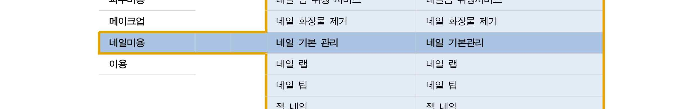

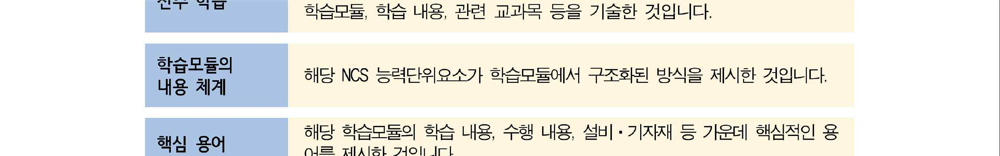

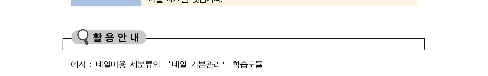

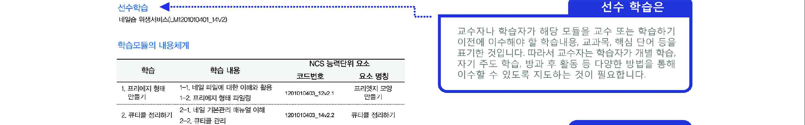

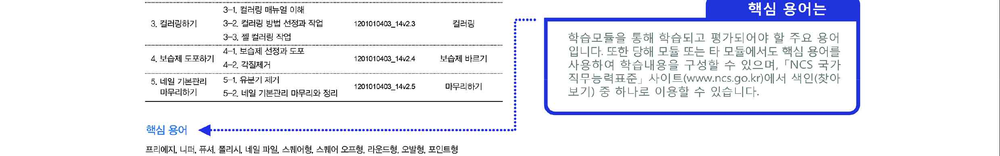

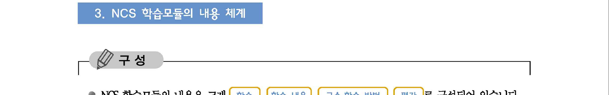

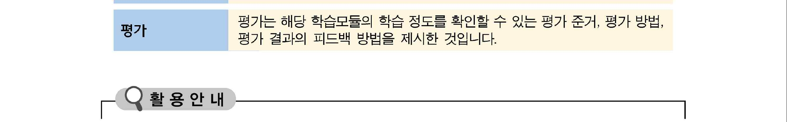

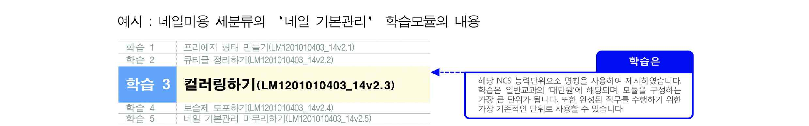

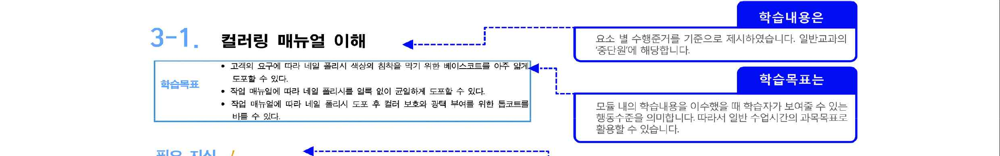

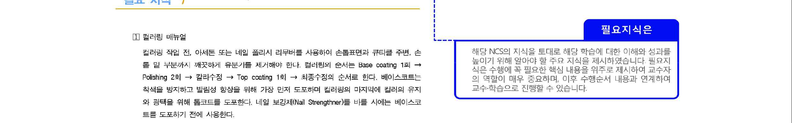

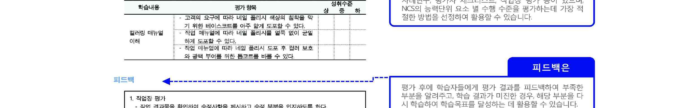

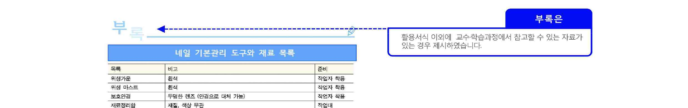

[NCS-학습모듈의 위치]

| 정보통신 |  |  |
| --- | --- | --- |
|  | 정보기술 |  |
|  |  | 정보기술개발 |

대분류
중분류
소분류
세분류

| SW아키텍쳐 |  |  | 능력단위 | 학습모듈명 |
| --- | --- | --- | --- | --- |
| 응용SW 엔지니어링 |  |  | 데이터베이스 요구사항 분석 | 데이터베이스 요구사항 분석 |
| 임베디드SW 엔지니어링 |  |  | 개념데이터 모델링 | 개념데이터 모델링 |
| DB엔지니어링 |  |  | 논리 데이터베이스 설계 | 논리 데이터베이스 설계 |
| NW엔지니어링 |  |  | 물리 데이터베이스 설계 | 물리 데이터베이스 설계 |
| 보안엔지니어링 |  |  | 데이터베이스 구현 | 데이터베이스 구현 |
| UI/UX엔지니어링 |  |  | 데이터 품질관리 | 데이터 품질관리 |
| 시스템SW 엔지니어링 |  |  | 데이터 전환 설계 | 데이터 전환 설계 |
|  |  |  | 데이터 전환 | 데이터 전환 |
|  |  |  | 데이터베이스 성능확보 | 데이터베이스 성능확보 |
|  |  |  | 데이터 표준화 | 데이터 표준화 |
|  |  |  | SQL활용 | SQL활용 |
|  |  |  | SQL응용 | SQL응용 |

차 례
학습모듈의 개요 1
학습 1. 데이터 품질 정책 수립하기
1-1. 데이터 품질 요구 사항 정의 3
1-2. 데이터 품질 정책 수립 11
• 교수・학습 방법 17
• 평가 18
학습 2. 데이터 품질 진단하기
2-1. 데이터 품질 진단 계획 수립 20
2-2. 데이터 품질 진단 및 진단 결과서 작성 41
• 교수・학습 방법 52
• 평가 53
학습 3. 데이터 품질 개선하기
3-1. 데이터 품질 개선 계획 수립 55
3-2. 데이터 품질 개선 활동 수행 및 결과 보고 61
• 교수・학습 방법 68
• 평가 69
학습 4. 데이터 품질 관리 프로세스 정의하기
4-1. 데이터 품질 관리 지침수립 71
4-2. 데이터 품질 관리 활동 로드맵 작성 79
• 교수・학습 방법 86
• 평가 87
참고 자료 89
데이터 품질관리 학습모듈의 개요
학습모듈의 목표
정보 시스템 구축 시 데이터베이스 사용자 기대 수준의 품질을 확보하기 위해 정책을 수립하고,
데이터 품질을 진단하고 개선할 수 있다.
선수학습
데이터 표준화(LM2001020409_14v2), SQL활용(LM2001020410_14v2), 데이터베이스 설계 모형, 데
이터베이스 관리자의 역할, 기초 통계 분석 기법
학습모듈의 내용 체계

| 학습 | 학습 내용 | NCS 능력단위 요소 |  |
| --- | --- | --- | --- |
|  |  | 코드 번호 | 요소 명칭 |

1-1 데이터 품질 요구 사항 정의
1. 데이터 품질 정책 데이터 품질 정책
2001020406_16v3.1
수립하기 수립하기
1-2 데이터 품질 정책 수립
2-1 데이터 품질 진단 계획 수립
2. 데이터 품질 데이터 품질
2001020406_16v3.2
2-2 데이터 품질 진단 및 진단
진단하기 진단하기
결과서 작성
3-1 데이터 품질 개선 계획 수립
3. 데이터 품질 데이터 품질
2001020406_16v3.3
3-2 데이터 품질 개선 활동 수행
개선하기 개선하기
및 결과 보고
4-1 데이터 품질 관리 지침 수립
4. 데이터 품질 관리 데이터 품질 관리
2001020406_16v3.4
4-2 데이터 품질 관리 활동
프로세스 정의하기 프로세스 정의하기
로드맵 작성
핵심 용어
데이터 품질, 데이터 품질 관리, 데이터 프로파일링, 데이터 품질 관리 지표, 데이터 품질 정책,
데이터 품질 진단, 데이터 품질 개선, 데이터 품질 관리 프로세스

| 학습 1 | 데이터 품질 정책 수립하기 |
| --- | --- |

학습 2 데이터 품질 진단하기
학습 3 데이터 품질 개선하기
학습 4 데이터 품질 관리 프로세스 정의하기
1-1.
데이터 품질 요구 사항 정의
• 데이터베이스 사용자와 데이터베이스 처리 시스템의 요구 사항을 만족할 수 있는
학습 목표
데이터 품질 요구 사항을 정의할 수 있다.
필요 지식 /
• 데이터 품질 요구 사항
1. 데이터 품질
데이터 품질은 데이터의 최신성, 정확성, 상호 연계성 등을 확보하여 사용자에게 유용한
가치를 줄 수 있는 수준을 지칭하는 용어이다. 데이터 품질 관리에서 넓은 의미의 데이터
는 데이터베이스 내부에 저장되어 있는 데이터 값 이외에 데이터 모델이나 표준 데이터
같은 구조 정보와 문서 형태의 산출물을 포함한다. 실제 품질 관리의 대상이 되는 좁은
의미의 데이터는 정보 시스템에 저장된 디지털 데이터를 의미한다.
2. 데이터 품질 요구 사항 관리
제도나 기준의 변화, 표준의 변경, 외부 인터페이스의 변경, 애플리케이션 기능과 입출력
데이터의 변경, 장해 발생, 처리 성능 개선, 데이터 보안 문제 등에 대하여, 사용자의 만
족도 제고와 고품질의 서비스가 이루어지도록 의견을 수렴하여 반영하는 관리 체계로서,
데이터의 사용자(user)에는 자료를 입력하고 조회하는 업무 담당자와 개발 및 운영되는
정보 시스템이 포함된다.
• 데이터 품질 관리 프레임워크(Framework)
데이터 품질 관리 프레임워크란 데이터 품질 관리의 대상이 되는 구성 요소와 요소들 간
의 관계를 정의한 데이터 품질 관리의 기본적인 개념 틀을 말한다.
1. 데이터 품질 관리 프레임워크의 구조
(1) 데이터 품질 관리 프레임워크의 구성 요소
데이터 품질 관리 프레임워크는 일반적으로 품질 관리의 대상과 품질 관리를 수행하
는 조직으로 구성된다. 데이터 품질 관리의 대상은 데이터 값, 데이터 구조, 데이터 관
리 프로세스로 구성되며, 이들 요소는 서로 연계되어 조직의 데이터 품질에 영향을 준다.
(2) 데이터 품질 관리 활동에 대한 관점
데이터 품질 관리 프레임워크를 구성하는 데이터 품질 관리 조직은 정보화 담당 임원(CIO:
Chief Information Officer), 전사 데이터 관리자(EDA: Enterprise Data Administrator), 데이
터 관리자(DA: Data Administrator), 모델러(Modeler), 데이터베이스 관리자(DBA: Database
Administrator), 사용자(User)가 품질 관리 활동을 수행하는 각기의 관점으로 구성된다.
(3) 데이터 품질 관리 프레임워크 모형
데이터 품질 관리 프레임워크 모형은 관리 대상과 관리 조직을 기본 축으로 한다.
프레임워크 조직 축은 정보화 담당 임원(CIO: Chief Information Officer) 관점, 데이터
관리 책임자(DA: Data Administrator) 관점, 모델러(Modeler) 또는 분석가 관점, DB관리
자(DBA: Database Administrator) 또는 개발자 관점, 그리고 사용자 관점으로 분류할 수
있다. 이와 같은 분류는 EA 개념에서 보면 개괄적(contextual) 관점, 개념적(conceptual)
관점, 논리적(logical) 관점, 물리적(physical) 관점 그리고 운용적(use) 관점과 유사하다.
<표 1-1 > 데이터 품질 관리 프레임워크

| 조직 대상 | 데이터 값 | 데이터 구조 | 데이터 관리 프로세스 |
| --- | --- | --- | --- |

CIO/EDA(개괄적 관점) 데이터 관리 정책
개념 데이터 모델 데이터 표준관리
DA(개념적 관점) 표준 데이터
데이터 참조 모델 요구 사항 관리
데이터 모델 관리
Modeler(논리적 관점) 모델 데이터 논리 데이터 모델
데이터 흐름 관리
물리 데이터 모델
DBA(물리적 관점) 관리 데이터 데이터베이스 관리
데이터 베이스
User(운용적 관점) 업무 데이터 사용자 뷰 데이터 활용 관리
출처: 데이터 전문가 지식 포털(http://www.dbguide.net /db.db?cmd=view&boardUid= 12816 &
boardConfigUid=9&categoryUid=216&boardIdx=36&boardStep=1). 2015년 6월 22일 검색
2. 데이터 품질 관리 대상
프레임워크의 관리 대상의 축은 데이터, 데이터 구조, 데이터 관리 프로세스로 분류할 수
있다.
(1) 데이터 값(Data Value)
데이터는 기관 및 기업의 비전이나 목표를 달성하기 위해 사용되는 전산화된 데이터
또는 전산화에 필요한 데이터를 의미한다. 품질 관리 대상 데이터에는 표준 데이터,
모델 데이터, 관리 데이터, 업무 데이터 등이 있다.
(가) 표준 데이터
정보 시스템에서 사용되는 용어 및 도메인, 코드, 기타 데이터 관련 요소에 대해
공통된 형식과 내용으로 정의하여 사용하는 표준과 관련한 데이터를 의미한다.
(나) 모델 데이터
데이터 모델을 운용 관리하는 데 필요한 데이터로서, 데이터 참조 모델, 개념 데이
터 모델, 논리 데이터 모델, 물리 데이터 모델에 대한 메타 데이터 및 DBMS 객체
정보가 포함된다.
(다) 관리 데이터
데이터베이스를 효과적으로 운영, 관리하기 위해 필요한 데이터를 말한다.
(라) 업무 데이터
기관이나 기업의 업무 및 비즈니스를 수행하는 데 필요한 데이터를 의미하며, 일반
적으로 데이터 흐름에 따라 원천 데이터, 운영 데이터, 분석 데이터로 구분된다.
<표 1-2 > 업무 데이터의 유형과 특징

| 업무 데이터 유형 | 특징 |
| --- | --- |

일반 문서, PC에 저장된 데이터 원천 파일, 이메일 및 팩스 등
1) 원천(Source)
으로 통합적으로 관리보다는 업무 담당자 개인이나 단체에 의
데이터
하여 관리되는 경우가 많다.
데이터베이스에서 저장, 관리하여 활용하는 데이터로서, 단순
2) 운영(Operation)
한 입출력 작업을 위해 일시적으로 필요한 임시 데이터는 제외
데이터
한다.
3) 분석(Analysis) 운영 데이터에서 추출(Extract), 변환(Transformation), 적재(Loading)
데이터 등의 과정을 거쳐 생성되는 요약 데이터를 말한다.
(2) 데이터 구조(Data hierarchy)
데이터 구조는 데이터가 담겨져 있는 모양 또는 틀로서 데이터를 취급하는 관점에 따
라 구조가 달라지는데, 데이터 구조는 사용자 뷰(양식, 보고서, 화면, 장표 등), 모델
(개괄, 개념, 참조, 논리, 물리), DB 파일의 형태로 보여 진다. 데이터 구조를 구성하
는 요소에는 개념 데이터 모델, 데이터 참조 모델, 논리 데이터 모델, 물리 데이터 모
델, 데이터베이스, 사용자 뷰 등이 있다.
(가) 개념 데이터 모델
업무 요건을 충족하는 데이터의 주제 영역과 핵심 데이터 집합을 정의하고 관계를
정의한 모델을 말한다.
(나) 데이터 참조 모델
데이터 참조 모델은 흔히 DRM(Data Reference Model)으로 불리며, 업무 영역별,
주제 영역별 표준 데이터 집합, 관리 항목들이 표기되어 재사용이 가능한 데이터
모델을 말한다.
(다) 논리 데이터 모델
개념 데이터 모델을 상세화하여 논리적인 데이터 집합, 관리 항목, 관계를 정의한
모델로서, 논리 데이터 모델의 관리는 데이터의 품질 보증을 위한 핵심 사항이다.
(라) 물리 데이터 모델
논리 데이터 모델을 데이터베이스 관리 시스템(DBMS)의 특성 및 성능을 고려하
여 구체화시킨 모델을 말한다.
(마) 데이터베이스
물리 데이터 모델에 의거 구축되어 실제 데이터가 저장되는 데이터 저장소로서, 인
덱스, 비즈니스 규칙이 반영된 제약 사항 등 데이터베이스를 효과적으로 운영하기
위한 객체를 정의하고 관리한다.
(바) 사용자 뷰(User view)
데이터를 제공하는 정보 시스템상의 화면이나 출력물을 의미하며, 데이터 품질 관
리 활동의 결과물인 데이터는 화면, 출력물과 같은 사용자 뷰를 통해 제공된다.
(3) 데이터 관리 프로세스(Data Management Process)
데이터 관리 프로세스는 데이터 관리 정책, 데이터 표준 관리, 요구 사항 관리, 데이터
모델 관리, 데이터 흐름 관리, 데이터베이스 관리, 데이터 활용 관리 등으로 구성된다.
(가) 데이터 관리 정책
조직의 비전과 목표 달성에 필요한 데이터의 확보 계획과 확보된 데이터의 효과적
인 운영 관리 체계 및 계획을 정의하여 사용자가 원하는 시점에 원하는 형태로 안
정적으로 서비스할 수 있는 기본 원칙과 관리 체계를 정립한다.
(나) 데이터 표준 관리
데이터 표준화의 원칙에 따라 표준 단어 사전, 표준 도메인 사전, 표준 용어 사전,
표준 코드, 데이터 관련 요소 표준 등을 조직의 특성에 적합한 형태로 정의하고 전
사적으로 공통된 표준을 사용하게 함으로써 데이터의 일관성과 정합성을 유지할
수 있도록 관리한다.
(다) 데이터 요구 사항 관리
조직에서 정보 시스템을 활용하는 사용자와 응용 시스템, 비즈니스에 대한 요구 사
항을 포함한 전체적인 요구 사항을 종합하여 검토하고, 조직 전체의 요건에 적합하
도록 시스템을 개선하여 사용자의 만족도 제고와 고품질의 서비스가 이루어지도록
체계적으로 관리한다.
(라) 데이터 모델 관리
기관의 비즈니스 목적에 맞는 최적화된 데이터 서비스를 제공하고 데이터베이스를
구성하여 유지하기 위한 데이터 모델이 체계적으로 관리되어야 하므로, 비즈니스
환경과 업무 기능의 변경 등에 따라 변경된 데이터 구조를 모델에 반영하고, 데이
터베이스 시스템 구조와 동일하게 데이터 모델을 유지하도록 관리하는 작업이다.
(마) 데이터 흐름 관리
원시 데이터를 생성하고, 추출, 변환, 적재 등을 통해 가공하는 절차에 따라 데이터
가 생성, 변경되고 활용되는 생명 주기를 관리함으로써, 전사 데이터에 대한 관리
현황을 파악하여 활용 체계를 최적화한다.
(바) 데이터베이스 관리
데이터베이스와 데이터베이스에 저장된 데이터가 오류 및 훼손 없이 안정적으로
서비스될 수 있도록 데이터베이스에 대한 생성 및 변경, 보안, 성능 개선, 백업 관
리를 지속적으로 수행할 수 있도록 체계화하는 작업이다.
(사) 데이터 활용 관리
데이터의 활용 여부를 점검하거나 활용도를 높이기 위한 품질 측정 등을 통해 데
이터베이스의 사용 환경을 개선하고 업무적으로 중요한 데이터의 품질을 개선하여
활용성을 높이도록 관리하는 작업이다.
수행 내용 / 데이터 품질 요구 사항 정의하기
재료·자료
Ÿ 비즈니스 도메인, 표준 단어, 코드, 도메인 정의서, 논리적·물리적 E-R 다이어그램
기기(장비･공구)
Ÿ 컴퓨터, 문서 작성 도구
안전･유의 사항
Ÿ 본 능력 단위에서의 데이터 품질 관리는 조직이 운영하고 있는 정보 시스템에 구축된 디지털
데이터로 한정한다.
Ÿ 데이터 품질 관리 정책, 데이터 품질 관리 프로세스는 지속적으로 유지·관리될 수 있어야 한다.
수행 순서
• 데이터 품질 요구 사항을 수집한다.
1. 데이터 품질 요구 사항은 데이터의 사용자와 개발 및 운영하는 정보 시스템의 요
건을 개선하기 위한 데이터 품질 요구 사항을 포함한다.
데이터 품질 요구 사항

| No. | 요구 사항명 | 요구자 | 유형 | 내역 | 연관 조직 | 품질 이슈No. | 요청 일자 |
| --- | --- | --- | --- | --- | --- | --- | --- |

| ○ 주요출처: [그림 1-1] | 항목 설명한국정보화진흥원(2014),『공공데이터 품질 | 요구 사항 | 정보 품질작성 형식 - | 관리 매뉴얼(V1.1)』.예시 |  |  |  |
| --- | --- | --- | --- | --- | --- | --- | --- |
| 2. 품질및 | 관리 도구를개선 요구 | 활용하여사항으로 기 | 데이터의수집된 자료를 | 품질을 활용할 | 체계적으로 관리하고수 있다. | 있는 | 경우, 오류 |
| 3. 그하여 | 외에 사용자데이터를 | 인터뷰, 활용하는 | 설문서, 워크숍,관련 애플리케이션과 | 현행 시스템 | 분석 등사용자의 요구 | 다양한 사항을 수집한다. | 방법을 활용 |

| 항 목 | 항목 정의 및 작성지침 |
| --- | --- |
| 요구 사항 명 | 요구 사항 명칭 |
| 요구자 | 품질 이슈에 대한 요구 사항을 제기한 담당자명 |
| 유형 | 요구 사항 유형(예: ‘업무’, ‘법·제도’, ‘개인 정보보호’, ‘보안’, ‘기술/인프라’ 등) |
| 내역 | 요구 사항 관련 정보 내용 |
| 연관 조직 | 요구 사항 관련 영향을 받는 조직, 팀/부서명 |
| 품질 이슈 No. | 요구 사항과 관련된 품질 이슈 일련 번호 |

• 요구 사항을 확인하고 처리 가능 여부를 검토한다.
1. 변경 요청 사항을 확인한다.
사용자가 해당 기관의 시스템을 활용하면서 발생되는 외부 인터페이스 및 기능, 성능,
보안 등이 요건에 대해 변경 요청한 사항을 확인한다.
<표 1-3 > 데이터 품질 요구 사항의 요건 분류

| 구분 | 고려 사항 |
| --- | --- |

외부 기관이나 외부 시스템과의 사이에서 발생되는 모든 입출력에
외부 인터페이스 요건 대한 요건으로 외부 기관이 추가 또는 변경되거나 제도 및 기준이
변화하여 인터페이스 형식이 바뀌었을 경우의 요구 사항에 해당
애플리케이션의 기능과 입출력하는 데이터가 변경되는 경우의 요구
기능 개선 요건
사항에 해당
처리하는 정보의 양과 종류, 동시 사용자 수 등의 변경으로 성능의
성능 개선 요건
개선이 필요한 요구 사항에 해당
중요 데이터에 대한 훼손, 변조, 도난, 유출에 대한 물리적 접근 통
보안 개선 요건 제(제한 구역, 통제 구역 등) 및 사용 통제(인증, 암호화, 방화벽
등)에 대한 요건
2. 해당 요건을 검토할 처리 담당자를 지정한다.
3. 요청된 요구 사항과 관련된 자료 및 기준, 시스템 등을 확인하여 처리 가능 여부를
판단하고, 처리 가능한 경우 데이터 관리자를 통해 공식화를 요청한다.
• 영향도 분석을 통해 관련 담당자와 협의 후, 변경 작업 계획을 수립한다.
1. 변경 요청된 내역을 토대로 변경에 따른 영향이 미치는 설계서 및 애플리케이션,
DB 등을 도출하여, 변경에 따른 영향도를 분석한다.
2. 변경 처리가 요구되는 관련 담당자를 소집하여 공식화하고, 해당 담당자들과의 협
의를 통해 승인 여부 및 변경 처리 방식을 결정한다.
(1) 변경 처리 방식은 규모 및 기간, 시급성에 따라 결정한다.
(2) 처리 방법은 신규 시스템 개발 방식이나 기존 시스템 변경 방식이 있다.
3. 관련된 업무 영역 및 관련 시스템 내역을 토대로 작업 일정 계획을 수립한다.
(1) 작업 일정 계획에는 표준과 설계서 변경, DB 및 애플리케이션 수정, 테스트, 이
관 등의 작업이 명시되어야 한다.
(2) 작업별로 작업 담당자 및 일정을 정의한다.
• 요구 사항에 대한 반영 계획 등 처리 사항을 기록하고, 관련 부서에 통보한다.

| 데이터 품질 요구 사항( 변경 / 승인 ) 신청서 |  |  |  |  |  |  |  |  |
| --- | --- | --- | --- | --- | --- | --- | --- | --- |
| 관리 번호 |  |  | 요구 사항명 |  |  |  |  |  |
| 요청자 | 부서 |  | 성명 |  | 연락처 |  | 요청일 |  |
| 반영자 | 부서 |  | 성명 |  | 연락처 |  | 반영일 |  |
| 요청 내역 |  |  |  |  |  |  |  |  |
| 상세 요구 사항 |  |  | 반영 방법 |  |  |  | 확인 |  |
|  |  |  |  |  |  |  | (반영자) | (사용자) |
| 반영 효과 |  |  |  |  |  |  |  |  |

출처: 한국데이터베이스진흥센터(2006),『데이터 품질 관리 지침(Ver 2.1)』(재구성).
[그림 1-2] 데이터 품질 요구 사항 변경/승인 신청서
수행 tip
Ÿ 데이터 품질 관리의 전체적인 프레임워크를 이해하고, 데이터 표준
화에 대한 선행 지식을 갖아야 하며, 조직 내부 자료 수집 및 분석
과 더불어 국내외 표준과 지침 자료를 참조하여 조직의 실정에 적
합하게 반영하는 것이 중요하다.
1-2.
데이터 품질 정책 수립
•정의된 데이터 품질 요구 사항을 분석하여 데이터 품질 목표, 데이터 품질 계획, 데
이터 품질 체계를 정의할 수 있다.
학습 목표
•데이터 품질 목표, 데이터 품질 계획, 데이터 품질 체계를 포함하는 데이터 품질 정
책을 작성할 수 있다.
필요 지식 /
• 데이터 품질 관리의 구조
데이터 품질 관리(Data Quality Management)는 “사용자에게 유용한 가치를 제공하도록 데
이터의 품질을 확보하기 위한 품질 목표 설정, 품질 진단 및 개선 등 일련의 활동과 이를
지원하기 위한 관련 도구”로 정의한다.

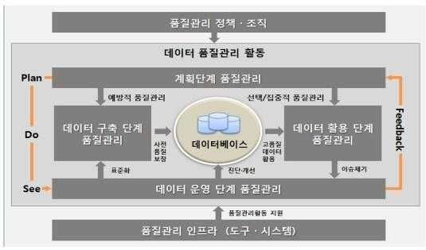

출처: 한국정보화진흥원(2014),『공공 정보 품질 관리 매뉴얼(V1.1)』.
[그림 1-3] 데이터 품질 관리 개념도
이러한 데이터 품질 관리의 구성 요소로는 품질 관리 정책 및 조직, 단계별 품질 관리 활
동 및 이를 지원하기 위한 품질 관리 인프라로 구성된다.
1. 품질 관리 정책·조직
품질 관리 활동은 조직의 비전과 사명을 기초로 조직 목표를 달성하기 위한 전략적 측면
을 고려하여야 한다. 이러한 목표를 실현하기 위해 품질 관리에 대한 원칙과 목적, 목표,
전략 등이 포함된 품질 관리 정책을 정립하고, 수행할 조직 체계를 정의하여 품질 관리
활동이 체계적으로 수행될 수 있도록 규정화할 필요가 있다.
2. 단계별 데이터 품질 관리 활동
(1) 계획 단계의 품질 관리 활동
데이터 품질 관리 목표, 중점 관리 대상 데이터베이스 선정, 품질 진단 및 개선 계획 수
립, 표준화 적용 계획 수립, 연계 데이터 품질 확보 계획 수립, 품질 관리 산출물 점검
및 최신성 확보 계획 수립, 품질 관리 인프라 구축 및 운영 계획 수립 등이 포함된다.
(2) 데이터 구축 단계의 품질 관리 활동
구축 단계에는 코드, 데이터 사전, 도메인, 명명 규칙, 연계 대상 데이터 및 연계 절차, 규
칙 등 데이터 표준화와 엔티티·속성 정의서, 테이블·컬럼 정의서, 논리·물리 ERD(Entity
Relationship Diagram), 연계 데이터 정의서, 업무 규칙(BR; Business Rule) 정의서 등
데이터베이스 구축 관련 산출물 관리가 포함된다.
(3) 데이터 운영 단계의 품질 관리 활동
운영 단계에는 품질 수준 제고를 위한 데이터 품질 진단 및 개선, 연계 데이터 품질
관리, 데이터 품질 관리 관련 산출물 점검, 데이터 변경에 따른 문서 최신성 확보 및
이해관계자 통지 등이 포함된다.
(4) 데이터 활용 단계의 품질 관리 활동
데이터 활용 단계의 데이터 품질 관리는 데이터 품질 오류 신고 관리, 데이터 활용 성
과 평가, 품질 관리 목표 등을 재조정하는 활동들로 구성된다.
3. 품질 관리 인프라
품질 관리의 전반적인 활동을 효과적으로 수행하도록 지원하는 소프트웨어나 솔루션 등의
자동화 도구를 도입하여 활용하는 체계를 구축할 필요가 있다.
• 데이터 품질 관리 주요 지침
데이터 품질 관리 활동을 위한 제반 계획의 수립과 지침의 정립 등에 정부의 지침을 참고할
필요가 있다.
<표 1-4> 데이터 품질 관리 주요 지침

| 지 침 | 주 요 내 용 |
| --- | --- |

- 공공 기관이 국가 정보화 추진 과정에서 생산·유통 또는 활용되는 데이터베
공공 기관의 데 이스 품질을 관리하기 위한 세부 사항을 규정
이터베이스 품 - 추진 근거: 국가정보화기본법 시행령 제23조
질 관리 지침 - 품질 관리 계획 수립, 품질 오류 관리, 표준화 관리 대상, 연계 데이터 품질 관
리 지침을 제시
- 행정 기관이 구축 운영하는 행정 정보 데이터베이스의 설계·구축, 운영 관리,
품질 관리에 관한 표준을 규정
행정 정보 데이
- 추진 근거: 전자정부법 제25조 및 동법 시행령 제21조
터베이스 표준
- 표준화된 행정 DB 구축을 위한 공정 관리, 감리, 행정 DB의 운영 및 관리, 데
화 지침
이터 요소의 명명 규칙 등을 제시
- 행정 표준 용어 사전은 행정 데이터 관리 시스템(www.adams.go.kr)을 이용
- 행정 기관 간 행정 정보의 원활한 공동 이용을 위해 각급 기관에서 행정 표준
코드를 활용하고, 체계적인 관리를 하는데 필요한 세부 지침
행정 기관 코드
- 추진 근거: 전자정부법 제50조(표준화) 2항 및 동법 시행령 제59조(표준화)
표준화 추진 지
- 행정 기관에서 정보화를 추진할 경우 코드는 행정 표준 코드를 사용
침
- 행정 표준 코드의 최신 자료는 행정 표준 코드 관리 시스템(www.code.go.kr)을
이용
- 행정정보공동이용센터를 통한 행정 정보의 공동 이용과 관련된 세부 사항을
행정 정보 공동 규정
이용 지침 - 추진 근거: 전자정부법 제37조(행정정보공동이용센터) 및 동 시행령 제42조(행
정정보공동이용센터)
행정 기관 및 공 - 행정 기관 및 공공 기관에서 정보 시스템을 구축·운영함에 있어 준수해야 할
공 기관 정보 시 기준, 표준 및 절차와 상호 운용성 기술 평가에 관한 사항을 규정
스템의 구축· - 추진 근거: 전자정부법 제45조(정보 기술 아키텍처 기본 계획의 수립 등), 제49
운영 지침 조 (상호 운용성 확보 등을 위한 기술 평가)
정보 기술 아키
텍처 도입·운 - 공공 기관이 정보 기술 아키텍처의 도입과 운영에 필요한 사항을 규정
영지침
- 정보 시스템을 안정적으로 운영하기 위한 운영 계획 수립과 실제 운영 단계에
정보 시스템 운 서 필요한 구성 및 변경 관리, 성능 및 장애 관리, 보안 관리 등의 세부 사항
영 관리 지침 을 규정
- 관리 요소별 10종의 세부 지침으로 구성
출처: 한국정보화진흥원(2014),『공공 정보 품질 관리 매뉴얼(V1.1)』.
수행 내용 / 데이터 품질 정책 작성하기
재료·자료
Ÿ 비즈니스 도메인, 표준 단어, 코드, 도메인 정의서, 논리적·물리적 E-R 다이어그램
기기(장비･공구)
Ÿ 컴퓨터, 문서 작성 도구
안전･유의 사항
Ÿ 본 능력 단위에서의 데이터 품질 관리는 조직이 운영하고 있는 정보 시스템에 구축된 디지털
데이터로 한정한다.
Ÿ 데이터 품질 관리 정책, 데이터 품질 관리 프로세스는 지속적으로 유지·관리될 수 있어야 한다.
수행 순서
• 조직의 비전과 목표를 파악한다.
품질 관리 활동은 조직의 비전과 목표를 실현하기 위한 전략적 차원에서 체계적으로 수행될
수 있도록 제도화하고, 공공 기관의 경우는 국가 차원의 데이터 품질 관리 정책을 고려하여
일관성이 유지되도록 수립되어야 한다.
• 데이터 품질 관리 정책을 수립한다.
조직에서 보유하고 있는 데이터를 효과적으로 관리․운영․활용할 수 있도록 정립된 데이터 품
질 관리에 대한 비전과 목표, 전략과 이를 실행하기 위한 체계를 규정화하는 작업이다.
1. 품질 관리 정책 수립의 원칙을 고려한다.
(1) 국가 차원의 정책과 일관성을 갖도록 수립하고, 조직의 비전과 목표 및 이를 달
성하기 위한 정보화 목표 및 전략 등과 부합되도록 수립되어야 한다는 원칙을 반
영한다.
(2) 품질 관리 활동을 효율적으로 지원하도록 구체적이고 명확하게 정의하고, 품질 관
리 활동에 따른 결과를 반영하여 품질 관리 체계가 지속적으로 개선 발전하도록 관
리되어야 한다는 원칙을 고려한다.
(3) 데이터 품질 정책에는 데이터 품질 목표, 데이터 품질 계획, 데이터 품질 체계 등이
포함된다.
2. 품질 관리 규정(지침)을 수립한다.
데이터 품질 관리 목적과 목표, 데이터 품질 관리 적용 범위와 대상, 데이터 품질 관리 조
직 및 역할과 책임, 데이터 품질 관리 기준, 절차, 활동, 그 밖의 데이터 품질 관리를 위
한 사항 등이 포함된다.
<표 1-5> 데이터 품질 관리 규정(지침) - 예시
○○○부(처, 청, 원) 데이터 품질 관리 규정(지침)
제1장 총칙
제1조(목적) 본 규정(지침)은 ○○○부(처, 청, 원)의 데이터 품질 관리에 대한 사항을 규정함
으로써, △△△과 △△△을 달성하는 것을 목적으로 한다.
제2조(정의) 본 규정(지침)에서 사용하는 용어의 정의는 다음과 같다.
1. “○○○”이란 ○○○을 의미한다.
2. “○○○”이란 ○○○을 의미한다.
3. - 생략 -
제3조(적용 범위) 본 규정(지침)은 ○○○부(처, 청, 원)와 그 소속 기관(산하 기관)에서 수행하
는 데이터 품질 관리 업무에 대하여 적용한다.
제2장 조직 및 임무
제4조(품질 관리 담당자) ① 데이터 품질 관리 담당자(총괄 책임자)는 ○○실(과, 부)장으로 한다.
② 데이터 품질 관리 담당자(총괄 책임자)는 데이터 품질 관리를 위해 다음 각 호의 사항을
수행한다.
1. 데이터 품질 관리 정책 수립
2. - 생략-
제5조(품질관리위원회 설치 및 운영) ① 데이터 품질 관리 관련 주요사항을 심의(또는 수행)하
기 위해 품질관리위원회(또는 협의회, 협의체)를 둔다.
② 품질관리위원회(또는 협의회, 협의체)는 데이터 품질 관리를 위해 다음 각 호의 사항을
수행한다.
제3장 데이터 품질 관리
제6조(품질 관리 계획 수립)
- 품질 관리 계획 수립 시 포함할 내용이나 고려할 사항을 규정 -
제7조(품질 오류 신고 관리)
- 데이터 품질 오류 신고에 따른 기관의 처리 원칙, 절차 등을 규정 -
제8조(연계 데이터 품질 관리)
- 연계 데이터 품질 관리를 위한 협의체 구성, 품질 수준 향상을 위한 요건 등을 규정 -
제9조(데이터 표준화 관리)
- 데이터 표준화 원칙, 범위, 표준화 방안 등을 명시 -
제10조(데이터 품질 진단 및 개선)
- 품질 진단 및 개선의 원칙, 절차 등을 규정 -
출처:한국정보화진흥원(2014),『공공 정보 품질 관리 매뉴얼(V1.1)』.
• 데이터 품질 관리 조직을 정의한다.
1. 조직의 여건을 고려하여 데이터 품질 관리 활동을 수행하기 위한 담당 부서 또는 담당
자 등으로 조직 체계를 정의한다.
2. 품질 관리 조직은 데이터 품질 관리를 총괄하는 총괄 책임자를 선정하여 역할을 부여하
고, 조직의 여건에 따라 단위 조직을 구성하거나 실무 담당자를 지정한다.
3. 필요시 심의, 협의 및 조정을 위한 조직을 추가로 구성한다.
• 데이터 품질 관리 규정을 공표한다.
데이터 품질 관리에 대한 조직 구성원들의 의식을 제고하고, 데이터 표준의 준수 등을 통해
보유하고 있는 데이터가 적정 수준의 품질을 유지할 수 있도록 제정한 규정을 공표하고, 필
요한 교육을 실시한다.
수행 tip
Ÿ 조직 내부 규정 등의 체계를 준용할 필요가 있으나, 국내외 표
준 및 지침 자료를 조사하여 참조하고, 내부에서 충분한 협의를
거쳐 내용과 체계를 구성하는 것이 바람직한 접근 방법이다.

| 학습 1 | 교수 ‧ 학습 방법 |
| --- | --- |

교수 방법
• 데이터 품질 관리 정책 수립에 필요한 기초 지식에 대해 학습자가 사전에 학습하였는지의
여부를 확인한 후 수업을 진행한다.
• 교수자의 주도로 데이터 품질 관리 정책 수립의 전반적인 개념과 구성 내용에 대해 도시화하여
제시한 후 설명한다.
• 국가 차원에서 데이터 품질 관리를 주관하는 기관과 지원 내용, 최근 국제 표준으로 등록된
우리나라의 데이터 품질 관리 프레임워크 구성 내용에 대해 설명한다.
• 사전에 개인별 학습 자료를 준비하여 모든 학생이 참여할 수 있는 문제 해결식 수업, 협력
수업이 가능하도록 한다.
• 데이터 품질 관리 정책 수립의 전 과정을 작업 순서에 따라 단계적으로 실습이 이루어질
수 있도록 지도한다.
학습 방법
• 데이터 품질 관리와 관련한 주요 용어와 데이터 표준화 관련 내용을 사전에 숙지하고 학습에
임한다.
• 데이터 품질 관리와 관련한 주요 용어를 숙지하고, 데이터 품질 관리 정책의 개념적 구조와
구성 내용 등 전반적인 체계에 대해 이해한다.
• 데이터 품질 관리 정책 수립의 전 과정을 이해할 수 있도록 각 단계별 중점 사항을 체계적으로
학습한다.
• 데이터 품질 관리를 주관하고 국가 차원에서 지원하는 내용을 조사하여 토론에 참여할 수 있도록
준비한다.
• 데이터 품질 요구 사항을 정의하고, 데이터 품질 관리 정책을 수립하는 전 과정을 실습한다.

| 학습 1 | 평 가 |
| --- | --- |

평가 준거
• 평가자는 학습자가 수행 준거 및 평가 항목에 제시되어 있는 내용을 성공적으로 수행하였는지를
평가해야 한다.
• 평가자는 다음 사항을 평가해야 한다.

| 학습 내용 | 평가 항목 | 성취수준 |  |  |
| --- | --- | --- | --- | --- |
|  |  | 상 | 중 | 하 |

- 데이터베이스 사용자와 데이터베이스 처리 시스템의
데이터 품질 요
요구 사항을 만족할 수 있는 데이터 품질 요구 사항
구 사항 정의
을 정의할 수 있다.
- 정의된 데이터 품질 요구 사항을 분석하여 데이터
품질 목표, 데이터 품질 계획, 데이터 품질 체계를
데이터 품질 정
정의할 수 있다.
책 수립
- 데이터 품질 목표, 데이터 품질 계획, 데이터 품질 체
계를 포함하는 데이터 품질 정책을 작성할 수 있다.
평가 방법
• 서술형 시험

| 학습 내용 | 평가 항목 | 성취수준 |  |  |
| --- | --- | --- | --- | --- |
|  |  | 상 | 중 | 하 |

데이터 품질 요 - 데이터 모델링, 표준화, 품질 관리에 대한 지식
구 사항 정의 - 관련 부서와 협의를 위한 의사소통 능력
- 데이터 품질 목표, 데이터 품질 계획, 데이터 품질
데이터 품질 정
체계 정의 능력
책 수립
- 데이터 품질 정책 보고서 작성 능력
• 평가자 체크리스트

| 학습 내용 | 평가 항목 | 성취수준 |  |  |
| --- | --- | --- | --- | --- |
|  |  | 상 | 중 | 하 |

데이터 품질 요 - 데이터 모델링, 표준화, 품질 관리에 대한 지식
구 사항 정의 - 관련 부서와 협의를 위한 의사소통 능력
- 데이터 품질 목표, 데이터 품질 계획, 데이터 품질
데이터 품질 정
체계 정의 능력
책 수립
- 데이터 품질 정책 보고서 작성 능력

| 학습 내용 | 평가 항목 | 성취수준 |  |  |
| --- | --- | --- | --- | --- |
| 피 드 백 |  |  |  |  |
| 1. 서술형 시험- 데이터 품질내용, 데이터에 대해 서술한 | 요건별 요구 사항 정의, 데이터 품질 관리에 활용하는 품질 정책 보고서의 의미와 작성 형식, 데이터 품질 관리내용을 검토하여 틀린 점과 잘된 점을 표시하여 돌려 | 데이터지침의준다. | 설계작성 | 자료의형식 |
| 2. 평가자 체크리스트- 데이터 품질정을 검토 | 요구 사항 정의, 데이터 품질 정책 수립, 데이터 품질 관리항목별로 평가한 후 개선할 사항을 정리하여 돌려 준다. | 지침의 | 작성 | 과 |

학습 1 데이터 품질 정책 수립하기

| 학습 2 | 데이터 품질 진단하기 |
| --- | --- |

학습 3 데이터 품질 개선하기
학습 4 데이터 품질 관리 프로세스 정의하기
2-1.
데이터 품질 진단 계획 수립
• 정의된 데이터 품질 정책에 따라 데이터 처리 시스템의 데이터 품질 진단 계획을
수립할 수 있다.
학습 목표
• 데이터 품질 진단을 수행할 대상 업무 및 테이블을 선정하고, 데이터 품질 분석 유
형을 선정할 수 있다.
필요 지식 /
• 데이터 품질 진단
데이터 품질 진단에는 데이터 값 진단, 데이터 구조 진단, 데이터 관리 프로세스 진단 등
이 있다.
1. 데이터 값 진단
운영 데이터베이스의 테이블, 컬럼, 코드, 관계, 업무 규칙 등을 기준으로 데이터의 값을
분석하여 데이터의 품질을 진단하는 것을 의미한다. 또한 데이터 값과 관련된 품질 기준
을 적용하여 오류 내역을 산출하고, 오류 원인을 분석하여 개선 사항을 제안하는 절차이
다. 특히 데이터 값과 관련된 오류는 데이터의 구조, 흐름 통제, 관리 프로세스 등과 연관
되어 발생한다. 저품질 데이터는 초기 구조 설계 오류, 일관성 부재, 관리 프로세스 부재,
오너십 부재 등으로 인하여 발생할 수 있다. 따라서 데이터 값 진단의 개선은 오류 발생
원인의 분석 결과를 토대로 데이터 정제, 구조 개선, 흐름 통제, 관리 프로세스 개선 등의
개선 활동이 포함된다.
2. 데이터 구조 진단
데이터 설계 관점에서 데이터 품질을 진단한다. 일반적으로 데이터베이스를 리버스 모델
링(Reverse modeling)하여 논리 모델을 도출하고, 이를 통해 데이터 구조의 무결성, 구조
표준화, 관리 수준, 변경 관리 등의 현황을 진단한다. 데이터 구조 진단의 주요 이슈는 데

| 학습 내용 | 평가 항목 | 성취수준 |  |  |
| --- | --- | --- | --- | --- |
| 이터의 표준화 | 수준, 표준 코드, 표준 도메인, 테이블, 컬럼 및 관계 정의, |  | 정규화 | 수준 등 |
| 이다. |  |  |  |  |
| 3. 데이터 관리 데이터 관리 로세스를 최적화한다.하는 절차를 수립, 업무 • 데이터 프로파일링(Data | 프로세스 진단 프로세스를 분석하여 문제점을 도출하고, 이를 개선할 수이때 조직의 역량 분석을 통해 단계적 품질 관리제안할 수 있다. 데이터 관리 프로세스 진단의 주요 이슈는프로세스의 적절성 및 운영성, 프로세스별 오너십 등이다.Profiling) | 있는이행품질 | 핵심전략을관리 | 업무 프수립정책 |
| 1. 데이터 프로파일링의데이터 프로파일은계, 데이터의 파생체에 내재되어데이터의 원본에서데이터를 수집하는 | 개요 데이터 품질을 개선하기 위한 사전 작업으로, 데이터의규칙을 명확히 파악하기 위해 소스 데이터를 있는 비즈니스 지식을 발견할 수 있다. 데이터베이스사용할 수 있는 데이터를 검사하고, 해당 데이터에과정이다. | 분석함으로써또는대한 | 구조, 데이터파일 등정보 및 | 내용, 관자기존통계 |
| 2. 데이터 프로파일링의데이터베이스의맷과 항목을 는 속성 목록이 | 주요 대상 가장 기본이 되는 요소인 컬럼(Column) 그리고 날짜,표준적으로 정의한 도메인(Domain), 하나의 컬럼에 허용된데이터 프로파일링의 주요 대상이 된다. | 코드,값에 | 단위대해 | 등의 포규정하 |
| 3. 데이터 프로파일링 | 방법론 |  |  |  |
| (1) 상향식 접근데이터 | 프로파일링 방법론은 상향식 접근을 사용하여 낮은 레벨에서 | 문제를 |  | 발견하게 |
| 된다. 하향식진정한 데이터 | 접근을 사용하면 낮은 레벨의 데이터 부정확성이 룰을 만드는 데 어려움이 발생한다. | 프로세스를 |  | 혼란시켜 |
| (2) 도메인 분석데이터 를 수행한다. | 프로파일링을 수행하기 위해 우선 도메인 분석을 수행하여 | 컬럼에 | 대한 | 분류 |
| (3) 데이터 최소, 최대,집계하여, 턴 및 추상 | 프로파일링 분석 항목 평균, 모드, 백분위, 표준 편차, 빈도 및 변화뿐만 아니라데이터 유형, 길이, 개별 값, 유일성, 널(null) 값 존재,형식을 인식한다. | 수와일반적인 | 금액문자열 | 등을패 |

<표 2-1> 데이터 프로파일 분석 항목

| 기법 | 내 용 |
| --- | --- |

총 건수, 개별 건수, 널(NULL) 건수, 공백(space) 건수, 제로 건수, 개별 건수 퍼
컬럼 분석 센트, 널(NULL) 퍼센트, 스페이스 퍼센트, 제로 퍼센트, 최소·최대 빈도(MIN,
MAX), 평균, 표준 편차, 분산 값 및 해당 값의 리스트 등 허용 범위
데이터의 패턴을 분석하여 표준 패턴에 위배된 도메인 값들을 확인
패턴 분석
예) 번호, 명칭, 내용 도메인
날짜 타입의 데이터에 대하여 위배된 도메인 값들을 확인
날짜 분석
예) 날짜 도메인
개별 코드, 통합 코드에 대하여 코드 정보와 코드 도메인 값들을 확인
코드 분석
예) 코드 도메인
중요 키 값에 대하여 부모와 자식 간의 관계 확인을 통하여 참조 무결성을 확인
관계 분석
예) 키 도메인
출처: 한국데이터베이스진흥원(2011),『데이터 품질 가이드라인』.
• 업무 규칙(Business Rule)
1. 정의
데이터 사용자가 요구하는 수준을 만족시키기 위하여 업무적으로 규정된 기준에 맞도록
데이터 값을 관리하기 위한 조건에 대한 일반적인 표현으로서, 업무 규칙을 도출하고 시
스템화할 경우 해당 업무 규칙은 데이터의 품질 측정을 주도하는 실질적인 기준이 되며,
업무 프로세스에 미정의되었던 업무에 대한 재정의 효과를 가진다.
2. 업무 규칙 진단의 구성 요소
<표 2-2> 업무 규칙 진단의 구성 요소

| 구성 요소 | 구성 내용 |
| --- | --- |

* 업무 규칙에 대한 지표를 정의함으로 업무 규칙의 생성 단계부터 개선, 목
표 관리까지의 단계에 활용
- 데이터 품질 지표로서 데이터의 사용 목적을 충족시키기 위한 조건이며,
데이터 품질
데이터 결함을 최소화하기 위해 지속적인 품질 진단을 통해 관리되어야
기준
할 평가 기준
- 데이터 성격, 업무 성격 등에 따라 정의되며, 정의된 품질 기준은 업무 규
칙 도출, 품질 측정 및 개선 등에 활용된다.
- SQL로 작성되는 진단 스크립트는 업무 규칙의 오류 데이터를 추출하기 위
한 추출 스크립트와 품질 지수를 관리하기 위한 진단 건수 추출 스크립트
진단 스크립
로 구성
트
- 추출 스크립트는 오류 데이터 추출을 위해 부정형으로 작성하는 것이 일
반적
데이터 품질 * 데이터의 정합성에 대한 정량적 종합 지표로서 현황 분석, 목표 관리 및
지수 개선 관리에 활용

| 구성 요소 | 구성 내용 |
| --- | --- |

- 데이터 품질 지수는 기업에서 관리되고 있는 데이터의 정합성에 대한 정
량적 종합 지표를 의미
- 업무 규칙 측정 결과의 정합성의 대푯값을 의미
- 품질 현황을 측정하기 위해 작성되는 데이터 품질 지수는 정보 시스템의
품질 추이 분석이나 목표 수립에 필요한 기초 자료로 활용된다.
- 데이터 품질 지수를 계산하기 위해서는 데이터 품질 기준, 기준별 가중치,
산술식이 필요
* 업무 규칙의 중요도를 정의하기 위한 가중치 항목 및 비율에 대한 정의
- 가중치는 업무 규칙(BR: Business Rule)이나 핵심 품질 항목(CTQ: Critical to
Quality)이 데이터 품질에서 차지하는 중요도로 대푯값을 산출할 때, 개별
가중치 항목에 부여되는 중요도를 의미
- 비중이 다른 업무 규칙이나 핵심 품질 항목을 평가할 때, 동일 기준으로
품질 지수를 산정할 수 없기 때문에 비중에 따라 중요도를 결정하여 품질
지수에 반영
- 핵심 품질 항목은 기업의 고객, 업무 프로세스, 재무 환경 등에 직접 영향
핵심 품질 항
을 미치는 매우 중요한 데이터 항목
목
- 핵심 품질 항목은 기업의 데이터 품질 기준과 매핑되어 관리된다.
* 업무 규칙의 진단 이력 및 오류 발생 건에 대한 윈인 분석, 개선 내역을
저장소 데이터베이스화하여 동일 오류 발생 건에 대한 데이터베이스 구축
(Repository) - 저장소는 업무 규칙의 진단 이력, 오류 발생 내역 등에 대한 원인 분석과
개선 내역을 데이터베이스로 구축한 것
• 데이터 품질 관리 지표
데이터 품질 관리를 위해 다양한 지표가 활용될 수 있다. 데이터 품질 관리 지표는 데이터
품질 관리 활동의 목표와 기본 방향을 제시하며, 데이터 품질 진단과 개선에 따른 성과 측정
지표 등으로 활용된다.
1. 미국 연방 정부 지침상의 데이터 품질 요건
미국에서는 데이터 품질 개선을 위한 연방 정부 차원의 지침(DQA: Data Quality Act)을
통해 공공 목적으로 배포되는 일체의 데이터가 일정 수준의 신뢰성과 정확성을 유지하도
록 하기 위한 데이터 품질 요건을 편의성, 신뢰성, 객관성의 3가지 요소로 제시하고 있다.
(1) 편의성(Utility)
제공 데이터는 개인, 단체 등 데이터 이용자들의 이용 만족도가 높아야 하며, 데이터
이용자들이 쉽게 구할 수 있어야 한다.
(2) 신뢰성(Integrity)
데이터에 대한 사용자 접근 권한 관리를 통해 비권한자들로부터 데이터를 보호해야
하며 기술적, 관리적, 물리적 보안 강화를 통하여 데이터를 보호해야 한다.
(3) 객관성(Objectivity)
데이터는 정확, 분명, 완전해야 하고, 편행되지 않아야 하며, 근거 및 출처가 과학적인
혹은 통계적 기법에 의하여 증명되어야 한다.
2. 국내 공공 데이터 관리지침 상의 품질 기준
국내에서도 2012년 2월 공공정보품질관리지원센터를 설립하여 국가 차원에서 기관의 데
이터 품질 관리 활동을 위한 다양한 지원과 서비스를 제공하고 있다. 공공 데이터 관리
지침(안전행정부)에 공공 데이터 품질 기준이 7가지로 제시되어 있다.
<표 2-3> 공공 데이터의 품질 기준

| 구분 | 품질 기준 |
| --- | --- |

공공 데이터의 품질 관리를 위해 기본적으로 관리해야 하는 정책, 규정, 조직,
준비성
절차 등을 마련하고, 최신의 내용으로 충실하게 관리되어야 한다.
공공 데이터의 저장소인 데이터베이스를 구축함에 있어 논리적인 설계와 물리
완전성
적인 구조를 갖추고, 업무 요건에 맞게 데이터가 저장되도록 해야 한다.
같은 의미를 갖는 데이터는 논리적 속성 단위, 물리적 컬럼 단위에서 일관된
일관성 이름과 형식을 갖도록 표준을 준수해야 하며, 공공 데이터의 공동 활용을 위
해 공유․연계하는 데이터는 누락이 없이 상호 간의 일관성을 유지하여야 한다.
정확한 데이터 제공을 위해 데이터의 입력 단계부터 오류가 입력되지 않도록
하고, 저장된 데이터가 정의된 기준에 맞게 유효한 값의 범위와 형식으로 되
정확성
어 있어야 하며, 저장된 데이터가 현실에 가장 가까운 최신 값을 반영하고 있
어야 한다.
지속적인 품질 확보를 위해 운영되는 데이터의 관리 주체가 관리되어야 하고,
보안성 권한에 따른 데이터의 접근이 적절히 통제되어야 하며, 개인 정보 등 중요 데
이터에 대해서는 암호화 등 보안 조치가 이루어져야 한다.
사용자가 만족하는 수준의 응답 시간이 확보 되어야 하고, 사용자의 데이터
적시성
요구에 따른 수집․처리․제공까지의 절차가 체계적으로 관리되어야 한다.
사용자가 만족하는 수준의 충분한 정보가 제공되어야 하고, 정보 접근 시 사
유용성 용자의 편의성이 확보되어야 하며, 사용자의 정보 이용에 따른 만족 수준을
높이도록 노력해야 한다.
출처: 공공 데이터 관리 지침(안전행정부 고시 제2014-13호, 2014. 3. 6.).
3. 데이터 품질 진단에 활용하는 품질 기준
한국데이터베이스진흥원에서 조직의 데이터 품질 관리 활동 성숙도를 진단하는 데이터 품
질 기준으로는 유효성과 활용성을 측정하기 위한 6개의 품질 지표가 활용된다. 유효성 관
련 품질 기준으로 정확성과 일관성 지표를 적용하고, 활용성 관련 품질 기준으로 유용성,
접근성, 적시성, 보안성 지표를 적용하여 조직의 데이터 품질 관리 활동에 대한 수준을 진
단한다. 이들 6개의 지표들은 관련된 세부 지표들로 구성되어 있다.
(1) 유효성 관련 품질 기준
(가) 정확성
정확성은 실세계에 존재하는 객체(사건, 사물, 개념 등)의 값이 오류 없이 저장되
어 있음을 의미한다. 정확성은 사실성, 적합성, 필수성, 연관성과 같은 품질 기준으
로 구성된다.
<표 2-4> 정확성 관련 품질 기준

| 품질 기준 | 의미 |
| --- | --- |

. 데이터가 실세계의 사실과 동일한 값을 가지고 있음을 의미
. 데이터의 원천 오류, 입력 오류, 입력 프로세스 문제 등에서 비롯되며,
사실성
사실성 향상을 위해서는 데이터 오너십 관리와 입력 프로세스 개선 등
이 필요
. 데이터 값이 정해진 데이터 유효 범위를 충족하고 있음을 의미
적합성 . 정합성 오류는 데이터가 표준 코드 값 또는 표준 도메인 값에 위배될
경우 발생하며, 표준 도메인 및 표준 코드에 대한 개선이 필요
. 조직의 업무 지원을 위해 반드시 필요한 필수 항목에 데이터의 누락이
발생하지 않음을 의미
필수성 . 필수성 오류는 데이터 수집 당시의 확인 부족이나 데이터베이스상의
Not Null 체크 조건의 누락 등이 원인이 되어 발생하며, 데이터별로 중
요도를 선정하여 관리할 필요
. 연관 관계를 갖는 데이터 항목 간에 논리상의 오류가 없음을 의미
. 예로서 해지 일자가 가입 일자보다 앞서 있는 경우가 여기에 해당하
연관성
며, 연관성 확보를 위해서는 업무 규칙상의 데이터 연관 관계를 파악
해 시스템에 반영해야 한다.
(나) 일관성
일관성은 정보 시스템 내의 동일한 데이터 간에 불일치가 발생하지 않음을 의미한
다. 일관성 오류는 데이터에 대한 정의가 정확히 이루어지지 않거나, 데이터 참조
무결성(referential integrity)이 불분명한 경우, 개별 시스템 단위로 설계·관리되어
전사 관점의 접근이 부족한 경우 등의 원인에 의해 발생한다. 일관성을 확보하기
위해서는 전사 관점의 데이터 용어 표준화, 데이터 구조의 전사적인 조율, 중복 데
이터에 대한 관리 등을 통해 데이터 간의 통일성을 유지하는 것이 필요하다.
일관성은 정합성, 일치성, 무결성과 같은 품질 기준으로 구성된다.
<표 2-5> 일관성 관련 품질 기준

| 품질 기준 | 의미 |
| --- | --- |

기능, 의미, 성격이 동일한 데이터가 상호 동일한 용어와 형태로 정의되
정합성
어 있음을 의미
일치성 동일한 용어를 다르게 정의하여 사용하지 않도록 함을 의미
무결성 데이터 처리의 선후 관계가 명확하게 준수되고 있음을 의미
(2) 활용성 관련 품질 기준
(가) 유용성
유용성은 조직이 요구하는 데이터의 범위와 상세화 정도를 충족시킬 수 있음을 의
미한다. 유용성 확보를 위해서는 사용자의 요건에 대한 관리가 필요하다. 요건 관
리는 사용자들의 추상적인 요구를 구체화하여 관리하는 제반 활동을 의미하며, 도
출된 요건을 정해진 기준과 원칙에 따라 요구 사항 수행 범위와 우선순위를 결정
하여 반영하고 일련의 결과를 문서화하여 관리해야 한다. 유용성은 충분성, 유연성,
사용성, 추적성과 같은 품질 기준으로 구성된다.
<표 2-6> 유용성 관련 품질 기준

| 품질기준 | 의미 | 개선 방안 |
| --- | --- | --- |
| 충분성 유연성 사용성 추적성 | 제공 데이터가 사용자의 요구 사항을 충분히 충족시킬수 있음을 의미데이터가 사용자의 다양한요구 사항을 수용할 수 있는유연한 구조를 가지고 있음을 의미실제 공급되는 데이터가 현장에서 유용하게 사용되고있어야 함을 의미데이터의 변경 내역이 관리되고 있음을 의미 | 충분성의 확보를 위해서는 사용자의 현재 요구 사항뿐만 아니라, 업계의 동향을 참조하여 향후 발생 가능한 요구 사항에 대해서도 사전에 준비 하는 노력이 필요 데이터 구조는 다양한 요구 사항과 업무를 수용 할 수 있어야 하며 변경사항 발생 시에도 유연 하게 대처할 수 있어야 한다. 사용성 향상을 위해서는 데이터 사용 현황 및 사용 빈도를 분석하여 활용 빈도가 높은 데이터 에 시스템 자원을 우선 배분하는 등의 활동이 필요 데이터에 대한 이력 관리를 수행하면 사용자의 요구 사항 변경에 대해 유연 하게 대처할 수 있다. |

(나) 접근성
데이터에 대한 사용자 만족도를 충족시키기 위해서는 데이터 자체의 품질은 물론,
데이터를 효율적·효과적으로 제공하는 데 필요한 인터페이스 등 제반 서비스 품질
을 확보해야 한다. 접근성은 사용자가 원하는 데이터를 손쉽게 이용할 수 있음을
의미한다. 접근성은 사용의 용이성 관점과 검색의 용이성 관점으로 나누어 살펴볼
수 있다. 사용의 용이성은 정보 시스템에서 인터페이스, 도움말, 고객 지원 등이 사
용자가 데이터를 이용하는 데 불편함이 없도록 제공되고 있음을 의미한다. 검색 용
이성은 정보 시스템에서 제공하는 검색 관련 제반 기능이 사용자가 원하는 데이터
를 손쉽고 편리하게 추출하여 활용할 수 있도록 지원되고 있음을 의미한다.
(다) 적시성
적시성은 응답 시간과 같은 비기능적 요구 사항 그리고 데이터의 최신성 유지와
같은 품질 요건에 얼마나 잘 대처하고 있는지를 의미한다. 적시성은 특히 운영 시
스템의 데이터를 분석 데이터로 변환하여 조직 내부의 의사 결정 등에 활용할 경
우 그 중요성이 더 커진다. 적시성이나 최신성이 확보되지 못한 데이터로 조직의
중요한 의사 결정을 내리게 될 경우 치명적인 결과를 가져올 수 있기 때문이다. 적
시성을 향상시키기 위해서는 데이터베이스 튜닝을 통한 성능 개선, 최적의 데이터
구조 유지, 자원의 효율성 확보를 위한 정보의 생명 주기 관리 등을 지속적으로 수
행해야 한다.
(라) 보안성
보안성은 외부 및 내부 요인으로부터 데이터를 적절히 보호하고 있는지 여부를 의
미한다. 여기에는 외부 침입이나 재난 등의 위험으로부터의 데이터 보호, 시스템의
에러나 장애 원인의 사전 차단, 에러나 장애 발생 시 데이터 사용의 중단 및 지연
최소화, 명확한 사용자 권한 정의 등이 포함된다. 보안성은 보호성, 책임성, 안정성
과 같은 데이터 품질 기준으로 구성된다.
<표 2-7> 보안성 관련 품질 기준

| 품질 기준 | 의 미 | 개선 방안 |
| --- | --- | --- |
| 보호성 책임성 안전성 | 훼손, 변조, 유출 등의 다양한형태의 위협으로부터 데이터를안전하게 보호하고 있음을 의미사용자 접근 권한과 책임을 명확히 부여하고 있음을 의미시스템의 에러나 장애를 사전에 차단하고 에러나 장애 발생시 중단 및 지연을 최소화할수 있는 체제로 운영함을 의미 | 충분성의 확보를 위해서는 사용자의 현재 요구 사 항뿐만 아니라, 업계의 동향을 참조하여 향후 발생 가능한 요구 사항에 대해서도 사전에 준비하는 노 력이 필요 데이터 보호 및 사용자 권한 접근 관리에서 중요 한 것은 보호 대상에 대해 정확한 정의를 내리고 이에 대한 관리 체계를 구성하는 것이다. 데이터 소실 사고는 다양한 요인으로 인해 언제 어디서나 일어날 수 있기 때문에, 오류 발생시 데 이터를 효율적으로 빠른 시간 안에 복구할 수 있 는 절차가 필요 |

| 학습 내용 | 평가 항목 | 성취수준 |  |  |
| --- | --- | --- | --- | --- |
| 내용 / 품질재료·자료 Ÿ 데이터 품질 정책,기기(장비･공구) Ÿ 컴퓨터, 문서 작성안전･유의 사항 Ÿ 본 능력 단위에서의데이터로 한정한다.Ÿ 데이터 품질 관리Ÿ 데이터 사용자를등의 사용자(User)가되기 때문이다.수행 순서 • 품질 현황을<표 2-8> 품질 현황 | 데이터 품질 진단 계획 수립, 품질 진단분석 유형 선정하기 표준 단어, 코드, 도메인 정의서, 논리적·물리적 E-R도구 데이터 품질 관리는 조직이 운영하고 있는 정보 시스템에정책, 데이터 품질 관리 프로세스는 지속적으로 유지·관리될파악하면서 프로그램의 증가 실태를 파악하는 것은, 데이터를응용 시스템을 통해 데이터에 접근하게 되고 결국분석한다. 분석서 작성 형식 - 예시 품질 현황 분석서 | 수프로그램이 | 대상다이어그램구축된있어야사용하는 | 및 디지털한다.직원사용자가 |
| 1. 업무 개요 |  |  |  |  |
| 1.1 업무명 [작성 요령] 기관의 대표․ 예시) 국가 승인 통계상 관측 등 | 업무를 간략하게 기술함. 정보 통합·제공, 심사 평가 시스템, 보건 기관의 보건·진료 정보 관리, | 지상. | 고층. 해양 | 기 |
| 1.2 업무 내용 [작성 요령] 기관의․ 주요 시스템의 업무를 | 대표 업무를 수행하는 주요 시스템의 업무를 간략하게 기술함. 서술형으로 간략하게 작성함. |  |  |  |
| 1.3 관련 조직 [작성 요령] |  |  |  |  |
| 1. 관련 운영 조직: 주요․ 시스템 Ownership을2: 관련 조직: 주요․ 시스템을 사용하는 | 시스템을 운영하는 조직을 기술함. 가진 조직, IT 운영 조직 등 시스템과 연관된 조직을 기술함. 조직, 데이터를 I/F하는 조직 등 |  |  |  |
| 2. 정보화 현황 |  |  |  |  |
| 2.1 정보 시스템명[작성 요령] 중점 품질․ 시스템 한글명 및 | 관리 대상 시스템의 시스템명을 기술함. 영문명, 시스템 구성도, 서비스 내용 설명(내용이 많을 경우 별첨으로 작성) |  |  |  |
| 2.2 정보 시스템 및[작성 요령] 최초 시스템․ 신규 시스템 구축이력, 연도별 시스템 | DB 구축 경과 구축부터 연도별 주요 일정 계획(Milestion)을 기술함. 이력, 프로세스 혁신(PI),비즈니스 프로세스 개선(BPR),정보화 전략 계획고도화 이력, 타 기관 연계 이력 등 | 수립(ISP) | 등 | 컨설팅 |
| 2.3 관련 지침 [작성 요령] 시스템 관련 | 훈령, 예규 등 관련 지침을 기술함. |  |  |  |
| 2.4 정보화 과정상의[작성 요령] 정보 시스템을․ 업무 담당자와의시점 등 품질 이슈 | 문제점 구축하면서 발생되었던 품질 관련 이슈들을 정리하여 기술함. 인터뷰 결과를 토대로 문제점을 작성하며, 품질 이슈의 원인이 되거나관련 주요한 내용 위주로 작성 | 이슈가 | 발생되기 | 시작한 |
| 3. 대상 기관 요구 | 사항 |  |  |  |
| 3.1 인터뷰 개요 [작성 요령] 인터뷰 일시, | 장소, 주요 참석자를 기술함. |  |  |  |
| 3.2 품질 현안(기관[작성 요령] 인터뷰․ 내부적 품질 이슈, | 의견) 결과를 정리하여 품질 관련 이슈들을 기술함. 타 기관과의 인터페이스 이슈, 표준화 관련 이슈 등 자유롭게 작성 |  |  |  |
| 3.3 진단 시 요구[작성 요령] 인터뷰를․ 중점적으로 진단해야을 자유롭게 작성 | 사항 통해 수집된 품질 진단 방향성 관련 요구 사항을 기술함. 할 데이터 영역, 업무 영향이 큰 이슈를 발생시키는 데이터 영역 중점 | 진단 요구 | 등의 | 내용 |

4. 데이터 품질 관리 수준 체크리스트 조사 결과

| 진단 관점진단 대상 | 활용(Service) | 관리 프로세스(Process) | 지원 도구(System) | 내용(Contents) |
| --- | --- | --- | --- | --- |
| 표준(Standard) |  |  |  |  |
| 구조(Structure) |  |  |  |  |
| 값(Value) |  |  |  |  |

[작성 요령] 데이터 품질 관리 수준 체크리스트 결과를 가져와서 붙여넣기 함.
5. 품질 현안

| 품질 현안 |  |
| --- | --- |
| 표준 측면 |  |
| 구조 측면 |  |
| 값 측면 |  |

[작성 요령] 인터뷰, 자료 조사 등 분석 결과를 표준, 구조, 값 측면으로 분류하여 기술함.
․표준 측면: 표준 코드, 표준 용어, 표준 도메인, 표준 관리 프로세스 등 데이터 표준화와 관련된 이슈
․구조 측면: 미사용 테이블, 미사용 컬럼, 중복 테이블, 중복 컬럼, 참조 오류 등 데이터베이스 구조과 관련된 이슈
․값 측면: 데이터 값 오류, 불일치, 널(NULL) 값 등 데이터베이스에 저장된 값과 관련된 이슈
6. 품질 요건
6.1 진단 DB 특성
[작성 요령] 진단 대상 DB의 특성을 기술함.
․예시) 10개 이상 물리적 공간으로 분산되어 운영, 매일 대량 집계가 발생됨, 국민에게 실시간으로 정보를 제공
함 등
6.2 진단 DB 품질 요건
[작성 요령] 진단 대상 DB의 유형 및 주요 측정 지표, 진단 관점을 기술함.
․공공 DB 유형과 주요 측정 지표를 참조하여 작성, 현황 분석 결과를 기반으로 하여 가중 중요한 품질 이슈 해결
을 위한 필요 요건 작성
7. 진단 방향
[작성 요령] 품질 이슈 관련 현황 분석 결과를 종합하여 종합적인 진단 방향성에 대하여 기술함.
․품질 진단 대상 DB 규모(데이터 종류, 테이블 수 등), 주요 품질 진단 내용을 상세하게 작성
출처: 한국정보화진흥원(2014),『공공 정보 품질 관리 매뉴얼(V1.1)』.
• 데이터 품질 진단을 수행할 대상 업무 및 테이블을 선정하고, 데이터 품질 분석 유형
을 선정한다.
1. 프로젝트의 범위, 목표, 추진 방향, 범위 등을 정의한다.
(1) 데이터 품질 진단 프로젝트의 목적을 업무 담당자와의 면담을 통해 정의한다.
(2) 정의된 목적에 따라 시스템, 업무, 데이터 현황 등을 파악하여 품질 진단의 대
상을 선별하고 품질 진단 범위를 확정한다.
(3) 업무 담당자와 IT 담당자와의 면담을 통해 품질 진단 여건을 확인하고, 품질 진
단 프로젝트에 소요될 자원을 파악한다.
(4) 데이터 품질 진단 프로젝트의 목적과 범위는 프로젝트의 기대 효과를 만족시킬
수 있도록 정의되어야 한다. 또한 데이터 품질 진단 프로젝트를 수행하는 기업의
목적에 따라 작업의 유형과 범위가 결정된다.
2. 수행 조직을 정의한다.
(1) 품질 진단을 수행할 조직의 규모, 인력, 역할 등을 분석한다.
(2) 데이터 품질 진단을 효율적으로 수행하기 위해 현재 조직의 여건과 규모에 적
합한 품질 전담 조직을 설정한다.

| 최고 의사 결정 권한 부서 |
| --- |
| CIO |

| 데이터 품질 주무 부서 |
| --- |
| 데이터 품질 책임자 |

| 데이터 품질 실무 부서 |
| --- |
| 데이터 품질 담당자 등 |

| 업무 담당 부서 |  | 데이터 품질 지원 부서 |
| --- | --- | --- |
| 업무·데이터 담당자 |  | 데이터베이스 관리자 등 |

출처: 한국데이터베이스진흥원(2011),『데이터 품질 가이드라인』.
[그림 2-1] 데이터 품질 진단 조직 구성
(3) 품질 전담 조직의 구성원별 역할과 책임을 구체적으로 정의한다.
<표 2-9> 데이터 품질 진단 수행 조직의 역할과 책임

| 구 분 | 역할 | 책임 |
| --- | --- | --- |
| 최고 의사 결정 권한 부서 데이터 품 질 주무부 서 데이터 품 질 실무부 서 데이터 품 질 지원부 서 업무담당 부서 | 데이터에 대한 품질 진단 및 개선과 관련한 최고 의사결정 권한 수행데이터 품질 진단과 관련한 최고의사결정권한자의 결정사항을 집행하고, 제반 정책결정이 필요한 사안의 취합과 데이터 품질진단 전반에 대한 실무적 측면의 책임과의사결정 수행데이터 품질 진단에 대한 실무를 전담하며,품질 진단을 위한 품질 기준과 데이터 프로파일링, 업무 규칙 도출, 품질 진단, 진단결과 분석 및 개선 활동 관리 등을 수행각 업무별 데이터가 구축 목적에 맞게 정상적으로 사용될 수 있도록 대상 개체 및시스템 인프라를 관리하고 데이터 품질 실무 담당자에 대한 지원을 수행각 업무별 데이터에 대해 가장 잘 이해하고 있으면서 해당 데이터의 생산, 운영과정에서 1차적인 품질 관리 책임을 수행하고,품질담당자의 협조 하에 해당 데이터에 대한 품질 개선에 주도적인 역할 수행 | . 데이터 품질 정책 결정 . 품질 관리 우선순위 및 목표 설정 . 품질 개선을 위한 의사결정 . 데이터 품질 정책에 따른 구체적인 품질 목표 및 추진방향 설정 . 품질 진단 계획 승인 및 진단결과 확인 . 품질 진단 계획 승인 및 개선결과 확인 . 품질 기준 및 품질지수 관리 . 품질 진단 항목 관리/대상 선정 . 데이터 프로파일링 및 업무 규칙 도출 . 품질 진단 수행/진단 및 개선결과 보고 . 개선 활동 관리 및 담당자 교육 . 품질 진단 수행 지원 . 품질 진단 결과분석 지원 . 품질 개선 활동 지원 . 소관 데이터에 대한 품질이슈 관리 . 소관 데이터에 대한 업무 규칙 도출 . 업무 규칙 준수 및 진단 . 소관 데이터와 관련한 품질 개선 수행 |

출처: 한국데이터베이스진흥원(2011),『데이터 품질 가이드라인』.
3. 품질 진단 절차 및 방법론을 정의한다.
(1) 과거 데이터 품질 진단 사례, 유사 데이터 품질 프로젝트 사례 등을 중심으로 품
질 진단 절차, 방법론, 프레임워크 등 관련 자료를 분석한다.
(2) 현재 조직의 규모, 인력, 자원 등에 적합한 품질 진단 절차 및 방법론을 선정한다.
(3) 선정된 절차와 방법론을 토대로 현재 조직의 여건에 부합하는 조직, 프로세스,
기능 등을 설계한다.
(4) 프로젝트에 적용할 품질 진단 절차 및 방법론에 대한 적정성을 검토하여 확정
한다.
(5) 산출물: 데이터 품질 진단 절차도
4. 세부 수행 계획을 확정한다.
(1) 사전에 정의된 프로젝트 목표, 범위, 조직, 방법론, 수행 절차 등에 따라 품질
진단 프로젝트의 수행 일정, 절차, 자원 등을 상세히 정의한다.

| 학습 내용 | 평가 항목 | 성취수준 |  |  |
| --- | --- | --- | --- | --- |
| (2) 작성된수행 | 세부 수행 계획은 최고 의사 결정권자의 승인을 받아일정에 따라 데이터 품질 진단 프로젝트를 수행한다. | 공식 |  | 문서화하고, |
| (3) 산출물:• 품질 진단 대상 | 데이터 품질 진단 프로젝트 세부 수행 계획서 및 기준을 선정한다. |  |  |  |
| 1. 데이터 품질 | 기준(DQI: Data Quality Indicator)을 선정한다. |  |  |  |
| (1) 데이터트 등을 | 품질 기준과 관련된 자료를 조사한다. 특히, 품질 평가중점적으로 조사하여 조직 내부에 적합한 품질 기준의 | 기준,후보를 | 유사수집한다. | 프로젝 |
| (2) 조직 하고, | 내에서 활용할 데이터 품질 기준은 실제 품질 진단 절차를세부 데이터 품질 기준을 도출한다. |  | 고려하여 | 선정 |
| (3) 업무 터 품질 | 담당자, 품질 전담 조직, IT 담당자 등과의 협의를 거쳐기준을 확정한다. |  | 최종적으로 | 데이 |
| (4) 산출물: | 데이터 품질 기준 정의서 |  |  |  |
| 2. 품질 이슈를 | 조사한다. |  |  |  |
| (1) 데이터 | 품질 이슈 조사에 활용할 수 있는 자료 및 문서를 | 수집하여 | 내용을 | 파 |
| 악한다. |  |  |  |  |
| (2) 수집된 | 자료를 토대로 면담 질의서를 작성한다. |  |  |  |
| (3) 사전에 | 수립된 면담 계획에 따라 업무 담당자와의 면담을 실시한다. |  |  |  |
| (4) 면담 하여 | 결과를 토대로 데이터 품질 이슈 보고서를 작성한 후,데이터 품질 이슈를 최종적으로 확정한다. | 면담 | 대상자와 | 확인 |
| (5) 산출물: | 데이터 품질 이슈 보고서 |  |  |  |
| 3. 데이터 관리 | 문서를 수집한다. |  |  |  |
| (1) 데이터데이터운영 등이 | 규칙을 파악하기 위해 수집할 데이터 관리 문서를 정의한다.관리 문서에는 데이터 관리 규정, 데이터 모델, 데이터있다. | 표준, | 데이터베이스 |  |
| (2) 사전에수집된기준으로 | 정의된 데이터 관리 문서 목록을 IT 부서에 요청하여데이터 관리 문서는 품질 진단 수행 범위, 대상 시스템,분류한다. | 수집한다.관련 | 업무 | 등을 |
| (3) 수집된관계 | 데이터 관리 문서들 중에서 테이블 정의서, 컬럼 정의서,정의서 등을 기반으로 테이블, 컬럼, 테이블 관계, 코드 | 등의 | 엔티티목록을 | 관계도,작성 |
| 한다. |  |  |  |  |

<표 2-10> 데이터 규칙 및 기준 정보 파악에 필요한 문서

| 구분 | 문서내용 | 비고 |
| --- | --- | --- |
| 데이터 모델 데이터 표준 데이터베이스 | 엔티티 관계도(개념, 논리, 물리 모델)엔티티 관계도 정의 및 속성 정의테이블 정의서컬럼 정의서표준 정의서(엔티티 타입, 테이블, 속성, 컬럼, 테이블스페이스(Tablespace), 인덱스(Index)명, 제약조건(constraint)명 등)단어 및 용어 사전 정의서코드 정의서(코드, 인포 타입, 인스턴스 등)도메인 정의서시스템 목록시스템 구성도시스템 운영 방안 및 관련 자료기타 |  |

(4) 산출물: 데이터 관리 문서, 테이블 목록, 컬럼 목록, 테이블 관계 목록, 코드 목록
4. 중요도를 선정한다.
데이터 품질 활동에서 중요도는 업무 규칙, 핵심 품질 항목 등이 품질 관리 대상에서
차지하는 비중을 의미한다. 기업의 데이터는 용도, 유형, 특성 등에 따라 중요도를 차
등하여 관리한다. 중요도는 품질 진단의 대상 테이블과 컬럼을 선정하거나 핵심 품질
항목을 도출하기 위한 용도로 활용된다. 또한, 중요도는 품질 측정 단계에서 품질 지
수, 배점 등에 차등을 위한 목적으로 활용된다.
5. 품질 진단 대상을 선정한다.
품질 진단 대상 선정 단계에서는 진단 대상 테이블과 컬럼을 선정하여 목록을 작성
한다. 진단 대상 목록은 향후 품질 측정 및 모니터링의 대상이 되고, 동시에 지속적
으로 관리해야 할 중요 항목이므로 업무 담당자와 품질 담당자가 공동으로 대상을
선정한다.
6. 핵심 품질 항목을 선정한다.
핵심 품질 항목은 품질 측정 시에 업무 규칙의 도출 기준과 연계하여 핵심 품질 항
목별 품질 수준을 측정하기 위한 용도로 활용된다. 핵심 품질 항목은 기업에서 관리
해야 할 우선 품질 개선 대상이 된다.

| 학습 내용 | 평가 항목 | 성취수준 |  |  |
| --- | --- | --- | --- | --- |
| • 데이터 프로파일링을데이터 프로파일링은는 것이다. 데이터등을 파악하여출해서 통계적으로 | 수행한다. 통계적 기법을 활용하여 데이터 품질과 관련된프로파일링은 데이터베이스에 존재하는 데이터의분석한다. 데이터 프로파일링의 목적은 데이터에 대한분석하여 데이터 품질 문제를 이슈화하고 개선점을 | 구조,특성찾는 | 현황을내용,정보를것이다. | 파악하품질추 |
| 1. 메타 데이터를 | 수집 및 분석한다. |  |  |  |
| (1) 데이터 | 관리 문서를 준비한다. |  |  |  |
| (2) 메타 | 데이터를 수집한다. |  |  |  |
| (3) 메타 | 데이터의 불일치를 분석한다. |  |  |  |
| (4) 메타 | 데이터의 표준화를 분석한다. |  |  |  |
| 2. 도메인을 | 분석한다. |  |  |  |
| (1) 도메인 | 그룹과 도메인 항목, 그리고 데이터 타입을 정의한다. |  |  |  |
| (2) 수집된대한 | 테이블 및 컬럼 정의서 목록과 메타 데이터 등을 도메인 분류 작업을 수행한다. | 기반으로 | 각 | 컬럼에 |
| (3) 도메인 | 분석 결과를 취합하여 정리한다. |  |  |  |
| 3. 프로파일링 | 대상 및 유형을 선정한다. |  |  |  |
| (1) 테이블파일링 | 목록, 컬럼 목록, 테이블 관계 목록 등을 기반으로대상 목록을 작성한다. | 진단 | 유형별로 | 프로 |
| (2) 데이터 | 관리 문서를 통해 데이터 프로파일링을 수행할 컬럼을 | 확인한다. |  |  |
| 4. 세부 수행데이터 품질획을 수립하여 | 계획을 확정한다. 진단 프로젝트의 계획 등에 따라 데이터 품질 진단계획을 완성한다. | 프로젝트의 |  | 세부 계 |
| 5. 데이터 | 프로파일링을 수행한다. |  |  |  |
| (1) 프로파일링 | 대상 테이블 및 컬럼 분석을 실시하여 값의 현상을 | 추출한다. |  |  |
| (2) 컬럼 미한 값스크립트를 | 분석 결과를 통해 컬럼의 오류 발생 현황을 파악한다.등을 통해 오류 데이터를 파악한다. 기본적인 오류예시로 들면 다음과 같다. | NULL,사례와 | 공백,분석을 | 무의위한 |
| (가) 필요한료들이 | 자료 항목이 누락된 경우가 파악되어야 한다. 건축물대장을 정비하기 이전의 사례로서, 건물 구조, 지붕있는 경우 필요한 자료를 활용하는 데 어려움이 | 형태 등발생한다. | 누락된 | 자 |
| [그림 2-2] | 필요한 항목이 누락된 경우 - 예시 |  |  |  |
| (나) 명칭명칭로,가증자 간[그림 2-3] | 도메인에 대한 오류 여부를 지속적으로 분석하여야도메인은 대부분 사용자가 임의로 작성하는 문자 타입의오류 발생의 여지가 높고 오류 데이터가 데이터 품질에매우 높다. 거래처, 제품 모델 등은 통계 자료 작성 등의규칙을 적용하여 상시 진단을 수행할 필요가 있다. 제품공백 여부 등을 진단할 수 있는 스크립트를 예시로 명칭 도메인의 글자가 공백 등 오류 진단 스크립트 - 예시 | 한다.미치는기본이모델명에제시하면 | 데이터파급되므로다음과 | 항목으효과검대해 글같다. |
| (다) 수량수량과수량이며, | 도메인의 경우는 최솟값과 최댓값을 분석하여 오류를도메인은 건수, 규모, 횟수 등 숫자 형태로 관리되는최댓값 등의 통계 분석을 통해 데이터의 유효성을 분석할도메인의 최솟값과 최댓값 분석을 통해 오류를 진단하는분석을 통해 수량 도메인에 대한 업무 규칙을 정의할 | 진단할도메인으로,수수도 | 수있다.스크립트있다. | 있다.최솟값다음은사례 |

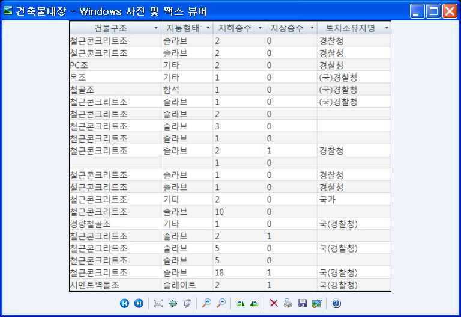

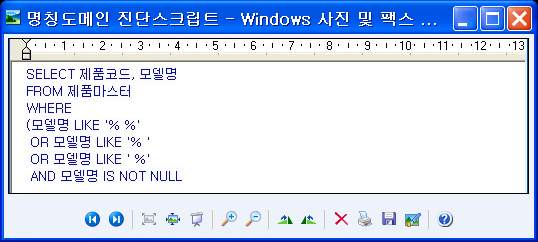

| 학습 내용 | 평가 항목 | 성취수준 |  |  |
| --- | --- | --- | --- | --- |
| [그림 2-4] | 수량 도메인의 최솟값, 최댓값 진단 스크립트 - 예시 |  |  |  |
| (3) 분석된 | 컬럼 중에서 오류로 추정되는 데이터가 발견되면 추가 | 분석을 | 실시한다. |  |
| (4) 관계 목록,반 내역을 | 통합 코드 목록 등은 관계 분석 및 코드 분석을파악한다. | 수행하여 | 무결성 | 위 |
| (5) 오류 패턴, | 데이터 발생 컬럼과 규칙 위반 레코드 건수, 유효값 목록,유효 날짜 유형, 관계, 코드 위반 목록 등을 취합한다. | 유효 | 범위, | 유효 |
| 6. 프로파일링 | 결과를 종합한다. |  |  |  |
| (1) 프로파일링을 취합하여 | 분석 결과를 분석 유형별로 정리하고 컬럼 속성의프로파일링 분석서 목록을 작성한다. | 오류 | 발생 | 유형 |
| (2) 작성된자에게가 오류 | 프로파일링 분석서를 초기 품질 진단 계획 수립 시에전달하여 오류 데이터 발생 컬럼의 진위를 확인한다.발생 컬럼에 대한 이견이 있을 경우에는 업무 담당자의 | 배정된만약,검토 | 업무업무의견을 | 담당담당자작 |
| 성한다. |  |  |  |  |
| (3) 확정된업무,작성한• 업무 규칙을 | 검토 의견을 업무 담당자들로부터 회수하여 오류 테이블, 오류 발생 유형 등으로 정리하여 최종 프로파일링후에 업무 담당자에게 배포한다. 정의한다. | 데이터종합 | 발생 | 컬럼을보고서를 |
| 1. 업무 규칙 | 대상 항목을 선정한다. |  |  |  |
| (1) 데이터슈 정의서, | 관리 문서, 테이블 및 컬럼 중요도, 데이터 프로파일링핵심 품질 항목 정의서 등을 통해 자료를 수집한다. | 결과서, |  | 품질 이 |
| (2) 수집된취합하여 | 대상 테이블 및 컬럼 목록과 프로파일링 결과서, 품질업무 규칙 도출 대상 목록을 작성한다. | 이슈 | 결과서 | 등을 |

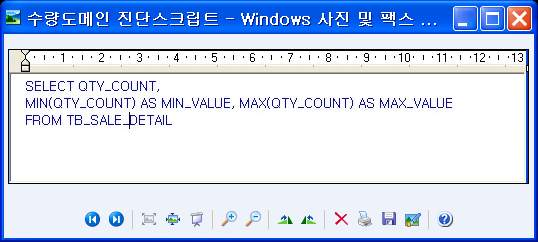

(3) 작성된 대상 목록 중에 데이터 프로파일링 결과, 테이블 및 컬럼의 중요도, 핵
심 품질 항목 등을 고려하여 업무 규칙 후보를 선정한다.
(4) 선정된 업무 규칙 후보로부터 데이터 품질 기준, 용도, 주기, 핵심 품질 항목 여
부, 중요도 등을 파악한다.
(5) 도출된 업무 규칙 후보 중에서 누락되었거나 중복된 데이터 항목이 있는지 진
단한다. 단일 데이터 항목이 자료 사전과 공통 코드 테이블에 정의되었는지 재차
진단하고 누락되거나 중복된 사항이 발견되면 정정한다.
2. 업무 규칙을 도출한다.
(1) 업무 규칙 대상 항목을 기준으로 업무 규칙 정의서를 작성한다. 업무 규칙에는
품질 기준, 데이터 항목별 중요도, 핵심품질항목 여부 등을 기재한다.
(2) 작성된 업무 규칙의 적정성을 평가한다.
(3) 보완 작업 결과를 반영하여 업무 규칙을 확정한다. 확정된 업무 규칙은 결재권
자의 승인을 얻어 공식 문서화한다. 이후 데이터 개정, 변경 등으로 업무 규칙이
변경될 경우에는 개정 및 변경 이력을 모두 관리해야 한다.
3. 업무 규칙 정의서를 작성한다.
<표 2-11> 업무 규칙 정의서 작성 서식 - 예시

| 업무 규칙 정의서 |  |  |  |  |  |
| --- | --- | --- | --- | --- | --- |
| 업무 규칙 ID |  | 작성자 |  | 작성 일자 |  |
| 시스템명 |  | DB명 |  | 담당자 |  |
| 업무 규칙명 |  |  |  |  |  |
| 업무 규칙 내용 |  |  |  |  |  |
| 근거 규정 |  |  |  |  |  |
| 테이블명 |  | 컬럼명 |  | 품질 지표 |  |
| 스크립트 |  |  |  |  |  |
| 원인 분석 |  |  |  |  |  |
| 업무 영향 |  |  |  |  |  |

출처: 한국정보화진흥원(2014),『공공 정보 품질 관리 매뉴얼(V1.1)』.

| 학습 내용 | 평가 항목 | 성취수준 |  |  |
| --- | --- | --- | --- | --- |
| • 데이터 품질<표 2-12> 품질 진단 | 진단 계획을 수립한다. 계획서 작성 형식 - 예시 품질 진단 계획서 |  |  |  |
| 1. 개요 |  |  |  |  |
| 1.1 품질 진단의 배경[작성 요령] 품질 진단을․주요 품질 이슈로 | 실행하는 이유와 진단의 필요성에 대해서 기술함. 인한 업무 파급 내용, 품질 진단을 통한 기대 효과 등 작성 |  |  |  |
| 1.2 품질 진단의 목표[작성 요령] 품질 진단․예시) 데이터 품질작성 | 실행의 구체적인 목표를 기술함. 관리 체계 수립을 위한 진단 실행, 개선 사업의 기초 자료 확보를 위한 | 진단 | 실행 등 | 내용 |
| 1.2 품질 진단 내용[작성 요령] 값‧구조․예시) 값‧구조 진단:․예시) 업무 규칙 진단:․예시) 품질 관리 수준 | 진단, 업무 규칙 진단, 품질 관리 수준 진단의 3개 영역에 대한 품질 진단테이블 컬럼의 표준 준수, 값의 유효성 등을 검증 업무 규칙을 도출하고 규칙을 준수하는지 검증 진단: 설문, 인터뷰, 실사 등의 방법으로 데이터 품질 인식 및 품질 관리 | 내용을수준 | 기술함.진단 |  |
| 2. 품질 진단 대상 | DB 및 진단 방향 |  |  |  |
| 2.1 진단 전략 [작성 요령] 진단을․Inside Out 방식, | 광범위하게 할 것인지, 특정 DB 대상으로 할 것인지에 대한 전략을 기술함.Outside In 방식으로 구분하여 진단 수준과 전략 등 작성 |  |  |  |
| 2.2 진단 대상 DB[작성 요령] 품질 진단․시스템명, DB명, DB | 목록 대상 DB 리스트를 기술함. 개요 등 작성 |  |  |  |
| 2.3 진단 대상 DB[작성 요령] 품질 진단․자체, 수집, 제공, | 유형 분류 대상 DB의 유형을 정의하고, 대상 DB의 품질 요건, 진단 방향을 기술함.복합의 유형을 정의하고 대상 DB 품질 요건과 진단방향 등 작성 |  |  |  |
| 3. 품질 진단 방법[작성 요령] 품질 지표별․완전성, 일관성, 정합성 | 품질 진단 방법을 기술함. 등 정의된 지표별 값‧구조 진단, 업무 규칙 진단, 품질 관리 수준 진단을 |  | 매핑하여 작성 |  |

| 학습 내용 | 평가 항목 | 성취수준 |  |  |
| --- | --- | --- | --- | --- |
| 4. 품질 진단 절차[작성 요령] 품질 진단․품질 진단 단계 및 | 및 내용 절차를 상세하게 기술함. 세부 프로세스, 참고사항, 산출물, 활용 도구 작성 |  |  |  |
| 5. 품질 진단 일정[작성 요령] 품질 진단․수행 단계, 세부 수행 | 수행 일정을 상세하게 기술함. 내용, 수행 일정(주 단위) 작성 |  |  |  |
| 6. 품질 진단 조직[작성 요령] 품질 진단․최종 의사 결정자,․조직별 주요 역할과 | 수행 조직 구성도를 그리고 조직별 주요 역할과 주요 임무를 기술함. 품질 진단 주무 부서, 지원 부서, 관련 부서, Steering Committee, Sponsor임무 작성 | Group | 등 작성 |  |
| 7. 품질 진단 협조[작성 요령] 품질 진단․주요 검토 및 의사결정 | 사항 단계별 품질 조직, 관련 부서, 공공 기관 담당자의 협조 사항을 기술함.사항, 업무 협조 사항, 리뷰 등 협조 사항 작성 |  |  |  |
| 8. 소요 예산 [작성 요령] 진단을․투입 인력 규모 및등 출처: 한국정보화진흥원(2014),『공공 | 수행하기 위해 필요한 비용을 모두 기술함. 인건비, 필요 H/W 사양 및 비용, 필요 S/W 사용권(License) 비용, 진단정보 품질 관리 매뉴얼(V1.1)』. 수행 tip Ÿ 데이터 품질 관리를 위한 전제로서 데이터의며, 정보화 환경의 변화로 인해 정형 데이터뿐만형데이터가 급속하게 증가하고 있으므로 이에지표와 평가 체계를 마련할 필요가 있다. | 수행을 위한표준화가대한 | 부대아니라품질 | 경비중요하비정평가 |

2-2.
데이터 품질 진단 및 진단 결과서 작성
• 데이터의 값, 데이터의 구조, 데이터 품질 관리 프로세스 수준을 측정하고, 데이터
품질 이슈를 도출할 수 있다.
학습 목표
• 데이터 품질 측정의 결과를 기준으로 데이터 품질 수준을 진단하고, 데이터 품질 진
단 결과서를 작성할 수 있다.
필요 지식 /
• 데이터 품질 진단 프레임워크
데이터 품질 진단 프레임워크는 품질 평가 지표, 절차, 도구를 중심으로 구성되어 있으며,
국가 차원의 공공 정보 품질 관리체계와 유기적으로 연계되어 있다.
1. 품질 평가 지표
데이터 품질 진단 프레임워크로 활용하는 지표 요소로서, 국내에서 활용하는 데이터 품질
진단의 평가 지표는 8대 지표와 24개 특성 항목으로 구성되어 있다.
<표 2-13> 데이터 품질 관리 지표 및 특성 항목

| 품질 평가 지표 | 특성 항목 |
| --- | --- |

준비성 관리 요소, 내용 충실성
완전성 논리 모델, 식별자, 물리 구조, 속성 의미
유효성 범위, 형식, 참조 관계, 계산원값
정확성 입력값, 업무 규칙
일관성 속성, 표준, 중복값, 연계값
적시성 응답 시간, 데이터 제공, 최신값
보안성 오너십, 접근 제한, DB 보호
유용성 충분, 접근, 활용
2. 품질 진단 절차
데이터 품질 진단 절차는 진단 대상 정의(Define), 품질 진단 실시(Measure), 진단 결과 분
석(Analyse), 개선 계획 수립(Preparing), 개선 수행(Implement), 품질 통제(Control)의 절차로
구성된다.
3. 품질 진단 도구
데이터 품질 진단 도구는 품질 진단을 위한 기법으로서, 프로파일링(값, 구조), 업무 규칙
(Business rule), 설문 및 인터뷰, 실측 등의 기법이 활용된다.

| 학습 내용 | 평가 항목 | 성취수준 |  |  |
| --- | --- | --- | --- | --- |
| • 데이터 품질 진단품질진단계획 단계 정의 단계 [그림 2-5] 데이터 품질 | 및 개선 절차 계획 수립 데이터품질 진단품질측정프로젝트정의 수립측정 수행조직 정의 품질측정단계 품질측정절차/방법론 정의 보고세부계획 확정 오류원인분석 단계 품질개선품질기준 선정 도출품질이슈 조사 데이터관리 문서 수집 중요도설정 데이터 품질 개선진단대상 정의 품질개선핵심품질 항목 수립정의 개선 개선활동데이터프로파일링 단계 개선결과업무규칙 정의 진단 및 개선 체계도 | 계획수행결과분석방안계획수행보고 |  |  |
| 1. 데이터 품질 진단 | 수행 절차 |  |  |  |
| (1) 진단 대상 | 정의(Define) |  |  |  |
| (가) 품질 오류사를 | 신고 내용, 특성상 오류 발생 확률이 높은 데이터베이스통하여 진단 대상 데이터베이스 선정 |  | 등 | 수요 조 |
| (나) 인터뷰,진단 | 자료 조사를 통하여 진단 대상 데이터베이스의 정보화환경을 분석 |  | 환경 등 | 품질 |
| (다) 진단 방향 | 정의 및 추진 계획 수립 |  |  |  |
| (라) 기술 및 | 도구: 인터뷰, 자료 조사, 데이터 품질 관리 수준 | 체크리스트 |  |  |
| (2) 품질 진단 | 실시(Measure) |  |  |  |
| (가) 품질 진단 | 준비 |  |  |  |

진단 대상 확정(테이블, 컬럼), 수행 절차 및 일정 수립 및 진단 수행을 위하여 필
요한 환경 구축, 역할과 책임(R&R) 정립, 주요 산출물 등을 사전 준비
(나) 품질 진단 수행
대상별 진단 방법에 따라 값과 구조 측정, 업무 규칙 측정, 품질 관리 수준 진단,
표준화 차이(Gap) 분석 등 수행
(다) 기술 및 도구: 데이터 프로파일링 도구(Profiling Tool), 데이터 품질 관리 수준
지표별 체크리스트
2. 데이터 품질 진단은 계획 단계, 구축 단계, 활용 단계와의 유기적 연계 관계를 가지며,
진단 및 개선 활동은 주로 운영 단계에서 수행된다.
(1) 데이터 품질 관리 계획 단계
. 데이터 품질 관리 계획을 고려하여 진단 대상 데이터베이스를 선정
. 품질 진단 및 개선 결과를 평가하여 품질 관리 계획에 반영
(2) 데이터 구축 단계
. 데이터 구축 단계 산출물은 품질 진단 및 개선 활동에 현황 자료로 이용
. 데이터 표준화 개선 결과 등은 신규 데이터 구축 시 활용
(3) 데이터 활용 단계
. 내·외부 사용자로부터 품질 오류를 접수하여 진단 및 개선 활동 수행
. 진단/개선 조치 결과 통보, 지속적 품질 모니터링 및 품질 목표 조정 등
• 데이터 품질 측정 기법
1. 데이터 품질 측정 기법은 프로파일링(Profiling), 설문 및 인터뷰, 업무 규칙(Business Rule),
비정형 실측 등으로 구분된다.
(1) 프로파일링
<표 2-14> 프로파일링에 의한 품질 측정

| 대 상 | 진단 내용 |
| --- | --- |

데이터 값의 유효성, 정확성 등 데이터 값 자체의 오류를 분석하는 방법으로서,
값 컬럼 분석, 날짜 분석, 패턴 분석, 코드 분석 등을 통해 데이터 값의 정확성을
중심으로 진단
논리적 데이터 구조의 오류로 인한 일관성, 정합성 등을 확보하지 못하는 결함
구조 을 분석하고 진단하는 방법으로서, 표준화 수준(코드, 도메인 등), 테이블 구조,
정규화 수준, 컬럼 및 관계 정의 등 데이터의 구조적 결함을 측정
(2) 설문, 인터뷰
전반적인 데이터 품질 수준과 지표별 데이터 품질 수준을 설문 또는 인터뷰를 통해
진단하는 방법으로 체크리스트 등을 활용
(3) 업무 규칙 진단
시스템 운영의 근거가 되는 법·규정에 정의된 업무적인 기준(산출식)에 부합하는지를
진단하는 방법으로서, 업무 규칙을 준수하고 있는지에 대한 측정 스크립트(SQL 등)를
실행하여 오류 값을 추출
(4) 비정형 실측
문서, 이미지, 동영상 등 정형화되어 있지 않은 정보를 사람이 직접 확인(실측)함으로
써 오류 여부를 진단하는 방법으로서, 별도의 도구 없이 사용자가 직접 정보를 조회하
거나 문서를 확인하는 방법
2. 품질 평가 지표별 측정 기법
<표 2-15> 품질 평가 지표별 측정 기법

| 품질 지표 |  | 진단 방법 |  |  |
| --- | --- | --- | --- | --- |
|  |  | 프로파일링 | 업무 규칙진단 | 설문조사 또는 인터뷰 |
|  | 관리 요소내용 충실성논리 모델식별자물리 구조속성 의미속성표준중복값연계값입력값업무 규칙범위 및 형식참조 관계계산식오너십접근 제한DB보호응답 시간데이터 제공최신값충분접근활용 | ●●●●●●●● | ●●●●●●●●●●●● | ● ● ● ● ● ● ● ● ● ● ● ● ● ● ● ● ● ● ● ● ● ● ● ● |

출처: 한국정보화진흥원(2014),『공공 정보 품질 관리 매뉴얼(V1.1)』.

| 학습 내용 | 평가 항목 | 성취수준 |  |  |
| --- | --- | --- | --- | --- |
| 내용 / 품질재료·자료 Ÿ 비즈니스 도메인,기기(장비･공구) Ÿ 컴퓨터, 문서 작성안전･유의 사항 Ÿ 본 능력 단위에서의데이터로 한정한다.Ÿ 데이터 품질 관리수행 순서 • 데이터의 값, | 이슈 도출과 품질 진단 결과서 표준 단어, 코드, 도메인 정의서, 논리적·물리적 E-R도구 데이터 품질 관리는 조직이 운영하고 있는 정보 시스템에정책, 데이터 품질 관리 프로세스는 지속적으로 유지·관리될데이터의 구조, 데이터 품질 관리 프로세스 수준을 | 작성하기다이어그램수측정한다. | 구축된있어야 | 디지털한다. |
| 1. 품질 측정 | 계획을 수립한다. |  |  |  |
| (1) 데이터 | 품질을 측정하기 위한 상세 절차와 수행 내용을 분류한다. |  |  |  |
| (2) 상세 | 절차별로 수행 시간, 장소, 수행자, 사전 준비 사항, 책임 | 사항 | 등을 | 정의 |
| 한다. |  |  |  |  |
| (3) 선정된지 계획(업무공지 방법과 | 측정 대상, 업무 관련자 등을 확인하고 공지할 내용이협조 공문, 사내 방송, 게시판 공지, 관련 사이트공지 내용, 공지 기간, 공지 책임자 등을 포함)을 | 있는팝업창수립한다. | 경우에는 | 공공지 등 |
| (4) 수립된보완하고 | 상세 품질 측정 계획은 품질 측정에 참여할 관련자들과공유한다. | 협의하여 |  | 내용을 |
| (5) 업무 규칙을시스템에용하여 | 적용한 데이터 품질 측정은 표본 측정을 실시하지과부하를 줄 수 있으므로 업무 외의 시간이나 시스템데이터 품질을 측정하는 것이 바람직하다. | 유휴 | 않으므로시간을 | 운영활 |
| 2. 품질 측정을 | 수행한다. |  |  |  |
| (1) 사전에 | 도출된 업무 규칙을 실제 운영 중인 물리 데이터베이스에 |  | 적용하여, | 해 |
| 당 데이터과 오류 | 항목이 지켜야 할 규칙을 위배하여 나타나는 오류건수를 추출한다. | 데이터 | 발생 | 내역 |
| (2) 사전에및 오류율을을 산출한다.측정을 | 도출된 업무 규칙을 실제 운영 데이터베이스에 적용하여측정한다. 업무, 품질 기준, 핵심 품질 항목별 사전에 수립된 품질 측정 계획에서 정의된 시간과수행하여 기존 업무 수행에 지장을 초래하지 않도록 해야 | 오류율,한다. | 오류품질장소에서 | 데이터지수 등품질 |
| (3) 추출된로 취합하여수를 데이터합 지표를계산하여 | 데이터의 오류 현황과 오류 내역을 업무, 품질 기준,목록을 작성하며 업무, 품질 기준, 핵심 품질 산출한다. 품질 지수는 기업에서 관리되고 있는 데이터의 정합성에의미한다. 일반적으로 가중치를 적용한 가중 평균(Weighted평균 오류율과 품질 지수를 산출하는 방식이 널리 | 핵심항목에대한사용된다. | 품질따라정량적 | 항목별품질 지종Average)을 |
| 3. 데이터 품질프로파일링터 품질 측정관리 의사 | 측정 결과를 보고한다. 결과, 업무 규칙 도출 현황, 품질 측정 결과 등의 내용을결과 보고서를 작성한다. 작성된 품질 종합 보고서는결정자에게 보고한 후 향후 데이터 품질 개선 업무에 | 해당활용한다. | 요약하여기업의 | 데이품질 |
| (1) 측정 수를 | 결과에 대해 업무별 중요도나 품질 기준, 핵심 품질 산출하여 업무, 품질 기준, 핵심 품질 항목별 현황 자료를 | 항목에취합한다. | 따라 | 품질 지 |
| (2) 데이터를 거쳐서 | 품질 측정에 대한 결과 보고서를 작성하여 업무 최종 확정한다. | 담당자와의 | 검토 | 회의 |

<표 2-16> 값, 구조, 표준화 진단 결과서 서식 - 예시
값, 구조, 표준화 진단 결과서
1. 값 진단 결과서

| 분석영역 | 분석대상 | 분석 대상상세 | 테이블수 | 컬럼 수 | 전체건수 | 오류건수 | 오류율(%) | 오류비중 | 품질측정지표 |
| --- | --- | --- | --- | --- | --- | --- | --- | --- | --- |
| 데이터값(Value) | 도메인 | 분류 도메인 |  |  |  |  |  |  |  |
|  |  | 수량 도메인 |  |  |  |  |  |  |  |
|  |  | 금액 도메인 |  |  |  |  |  |  |  |
|  |  | 날짜 도메인 |  |  |  |  |  |  |  |
|  |  | 번호 도메인 |  |  |  |  |  |  |  |
|  |  | 명칭 도메인 |  |  |  |  |  |  |  |
|  |  | 코드 도메인 |  |  |  |  |  |  |  |
| (Value) |  | Key 도메인 |  |  |  |  |  |  |  |
|  | 데이터규칙 | 번호 정확성 |  |  |  |  |  |  |  |
|  |  | 시간 순서일관성 |  |  |  |  |  |  |  |
|  | 규칙 | 계산 및 집계값일관성 |  |  |  |  |  |  |  |
|  |  | 컬럼 간 논리관계 일관성 |  |  |  |  |  |  |  |
| 총계 |  |  |  |  |  |  |  |  |  |

[작성 요령]
․필요에 따라 품질 진단 항목을 추가 또는 수정·보완하여 작성할 수 있음.
․전문 진단 업체에서 품질 진단을 수행할 경우 진단 업체의 양식과 비교하여 양식을 작성함.
2. 구조 진단 결과서
2.1 테이블 구조 진단 결과서

| 분석 구분 | 분석유형 | 분석 유형 상세 | 전체테이블 수 | 미사용/중복테이블 수 | 미사용율(%)/중복율(%) | 비고 |
| --- | --- | --- | --- | --- | --- | --- |
| 데이터 구조(Structure)분석 | 테이블분석 | 미사용 테이블분석 |  |  |  |  |
| (Structure) | 분석 | 중복 테이블 분석 |  |  |  |  |
|  |  | 기관 담당자 제외 |  |  |  |  |
| 요약 |  |  |  |  |  |  |

2.2 컬럼 구조 진단 결과서

| 분석 구분 | 분석 유형 | 분석 유형상세 | 전체컬럼 수 | 미사용컬럼 수 | 미 사용율(%) | 비고 |
| --- | --- | --- | --- | --- | --- | --- |
| 데이터 구조(Structure)분석 | 컬럼 분석 | 미사용컬럼 분석 |  |  |  |  |
| 요약 |  |  |  |  |  |  |

3. 표준화 진단 결과서

| 분석 구분 | 분석유형 | 세부 분석유형 | 테이블수 | 컬럼수 | 불일치/미사용 컬럼 수 | 불일치/미사용율(%) | 비고 |
| --- | --- | --- | --- | --- | --- | --- | --- |
| 데이터구조(Structure)분석 | 표준화분석 | 데이터타입 분석 |  |  |  |  |  |
| 분석 | 분석 | 데이터길이 분석 |  |  |  |  |  |
| 요약 |  |  |  |  |  |  |  |

[작성 요령]
․필요에 따라 품질 진단 항목을 추가 또는 수정·보완하여 작성할 수 있음.
․전문 진단 업체에서 품질 진단을 수행할 경우 진단 업체의 양식과 비교하여 양식을 작성함.
출처: 한국정보화진흥원(2014),『공공 정보 품질 관리 매뉴얼(V1.1)』.
업무 규칙 진단 결과서

| 업무 규칙 ID |  |  | 작성자 |  | 작성 일자 |  |
| --- | --- | --- | --- | --- | --- | --- |
| 시스템명 |  |  | 데이터베이스명 |  | 담당자 |  |
| 업무 규칙명 |  |  |  |  |  |  |
| 핵심정보 | 1 | 핵심 정보명 |  |  |  |  |
|  |  | 관련 엔티티 |  |  |  |  |
| 총 진단건수 |  |  | 총 오류 건수 |  | 오류율(%) |  |
| 핵심 정보별 진단 결과 상세 |  |  |  |  |  |  |
| 핵심 정보1. ooo |  |  |  |  |  |  |
| 진단 내역 1 |  |  |  |  |  |  |
| 진단 내용 |  |  |  |  |  |  |
| 총 건수 |  |  | 오류 건수 |  | 오류율(%) |  |
| 1차 검증내역 |  |  |  |  | 검토자 |  |
| 오류 유형 |  |  |  |  |  |  |
| 오류 원인 |  |  |  |  |  |  |
| 오류 영향도 |  |  |  |  |  |  |

출처: 한국정보화진흥원(2014),『공공 정보 품질 관리 매뉴얼(V1.1)』.
[그림 2-6] 업무 규칙 진단 결과서 서식 - 예시
• 오류 유형에 따른 발생 원인을 분석하여 각 업무 분야에 해당되는 개선 방안을 도출
한다.
1. 품질 측정 단계에서 얻어진 데이터 품질 현황과 업무, 품질 기준, 핵심 품질 항목
별로 오류 발생 현황을 파악한다.
(1) 오류가 발생한 업무 규칙의 중요도, 오류율 등을 고려하여 오류 발생 원인 분석
작업의 우선순위를 선정한다.
(2) 오류 원인 분석 대상으로 선정된 업무 규칙의 중요도 및 시급성을 고려하여 해
당 업무 담당자와 오류 원인 분석 일정을 협의한다.
(3) 데이터 품질 측정 결과, 업무 규칙 정의서 등을 토대로 오류 원인 분석의 대상이
되는 업무 규칙의 오류 데이터 발생 주기 및 경향을 파악한다.
2. 오류를 발생시키는 주요 원인을 추적하여 각 유형을 분석한다.
(1) 오류 발생 원인이 애플리케이션일 경우에는 오류가 발생된 테이블 및 컬럼과
해당 애플리케이션 간의 테이블·애플리케이션 상관 분석을 실시하여 해당 애플리
케이션의 오류 원인을 추적한다.
(2) 오류가 발생하는 테이블과 컬럼에 대해 데이터베이스와 애플리케이션 간의 정
렬 분석, 물리 데이터 모델-데이터베이스 정렬 분석을 등을 수행하여 서로 불일
치하는 내역을 정리한다.
(3) 오류가 데이터 흐름에서 발생된 경우에는 소스 대 타깃 매핑 분석, 소스 데이터
추출 모니터링 보고서 등을 검토하여 오류 원인이 데이터 흐름 과정에서 추출,
변환, 적재 등의 조건 오류에 기인한 것인지를 파악한다.
(4) 작성 표준의 부재에 따른 불일치 문제인지, 작성 도구의 문제인지, 불명확한 요
구정의에 따른 문제인지 등을 검토한다.
(5) 오류가 발생된 업무 규칙의 유형에 따라 오류 원인을 확정하여 해당 내용을 상
세히 정리한다.
(6) 오류가 발생한 업무 규칙을 데이터 품질 개선 대상 리스트로 취합하여 오류 원
인 분석서 및 조치 계획서를 준비한다.
오류 유형 및 원인 분석 결과서

| 진단 대상 정보 |  |  |  |  |  |  |  |  |  | 진단 결과 정보 |  |  |  |  |  |  |
| --- | --- | --- | --- | --- | --- | --- | --- | --- | --- | --- | --- | --- | --- | --- | --- | --- |
| 테이블영문명 | 테이블한글명 | 컬럼영문명 | 컬럼한글명 | 데이터타입 | 데이터길이 | PK여부 | NULL허용여부 | 최댓값 | 최솟값 | 전체건수 | 전체오류건수 | 오류추정건수 | 유효값정의 | 데이터값 | 패턴유형 | 데이터건수 |

| 오류 유형 분석 | 오류 유형 분석 오류 유형 | 분석 오류 발생 주요 원인 | 개선 활동 유형 | 개선 오류 데이터 미개선 사유 | 개선 활동 유형 응용 프로그램 개선 | 유형 표준화 및 모델 개선 | 업무 절차 개선 | 기관 담당자의견 |
| --- | --- | --- | --- | --- | --- | --- | --- | --- |
| 기관담당자오류 확인 | 오류 유형 | 오류 발생주요 원인 | 오류데이터개선 가능여부 | 오류데이터미개선사유 | 응용프로그램개선 | 표준화및 모델개선 | 업무 절차개선 | 기관 담당자 의견 |

출처: 한국정보화진흥원(2014),『공공 정보 품질 관리 매뉴얼(V1.1)』.
[그림 2-7] 오류 유형 및 원인 분석 결과서 서식 - 예시
3. 품질 개선 방안을 도출한다.
(1) 오류 원인 분석 수행 결과에 따라 데이터, 저장 구조, 애플리케이션 등에서 개
선점을 도출한다. 품질 개선안을 도출하기 이전에 각 분야별 변경 영향도 분석을
사전에 수행하고, 도출된 개선 사항은 시급성 및 우선순위에 따라 순차적으로 수
행한다.
(2) 표준 데이터, 모델 데이터, 데이터와 애플리케이션 등에 대한 각각의 변경 영향
도 검토 과정을 거쳐 오류가 발생된 데이터 변경에 따른 개선 방안과 세부 개선
수행 계획을 수립한다.
(3) 개선 방안에는 데이터 정제 또는 변경, 표준 변경, 구조 변경, 애플리케이션 변
경, 데이터 흐름 통제 계획 변경 등이 포함되며, 각 개선 사항에 대한 위험 분석,
타당성 검토, 중요도, 예상 변경 영향도 등을 종합적으로 평가하여 우선순위를
부여한다.
(4) 사전 도출된 오류 원인 분석 사항과 개선 사항을 토대로 조치 계획서를 작성한
다.
조치 계획서에 오류 발생 주기, 오류 원인 분석, 오류 개선 및 조치 사항 등을 상
세히 기록한다. 이때 데이터의 정제가 필요할 경우에는 정제와 관련된 사항을 반
드시 기록한다.
(5) 사전 도출된 오류 원인 분석 결과와 개선 방안에 대한을 검토 회의를 소집하여
개선 사항을 확정하여 공식화한다.
(6) 공식화된 개선 사항은 업무 담당자들에게 배포되며, 각 분야의 업무 담당자는 배
포된 개선 방안을 토대로 개선 활동을 수행한다.
• 품질 이슈를 정리한다.
<표 2-17> 품질 이슈 목록 서식 - 예시
품질 이슈 목록

| 품질이슈No. | 품질 이슈분류 | 품질 이슈명 | 품질 이슈내역 | 이슈중요도 | 시스템명 | 요청자 | 요청부서 | 요청일자 |
| --- | --- | --- | --- | --- | --- | --- | --- | --- |

출처: 한국정보화진흥원(2014),『공공 정보 품질 관리 매뉴얼(V1.1)』.
• 품질 진단 결과서를 작성한다.
<표 2-18> 품질 진단 결과 보고서 구성 내용 - 예시

| 작업 단계 | 구성 항목 | 내용 |
| --- | --- | --- |

1.업무 및 정보화 대상 DB와 관련된 업무 내용, 관련 조직, 법규, 정보화 추진
현황 경과 등의 현황을 기술
2.데이터베이스 데이터베이스의 용량, 테이블 수, 사용자 수, 연계 현황, 품
I. 현황 분석 현황 질 관련된 핵심 이슈 등의 현황을 기술
업무 수행 시 중요성, 이슈 등을 감안하여 품질의 핵심항목
3. 대상 선정 을 도출하고 데이터베이스 테이블, 컬럼과의 관련성을 확인
하여 품질 진단 대상으로 선정
진단 시 발견된 주요 이슈와 데이터 값, 관리 수준(지표) 관
1. 진단 결과 총괄
점에서 점수화된 평 결과를 기술
데이터 값, 구조 측면에서 발견된 일반적인 오류 사항과 업
무 영향 및 개선 방향을 도출하여 기술
2. 프로파일링
* 데이터 값: 코드 미준수, 필수 값 누락, 범위 오류, 값 중
진단 결과
복 등
데이터 구조: 명명 규칙 미준수, 데이블 컬럼 중복 등
II. 결과 분석
3. 업무 규칙 진단 업무 규정, 지침 등에 의한 데이터 관련 준수 사항을 위배
결과 한 오류 사항과 업무 영향 및 개선 방향을 도출하여 기술
데이터 관리 규정, 지침, 조직의 역할, 관리 활동 등 일반적
4. 관리 수준 진단 인 기준(지표)에서 발견된 미흡 사항과 업무 영향 및 개선
결과 방향을 도출하여 기술
* 공공 데이터 품질 관리 매뉴얼의 지표를 기준으로 측정
발견된 오류 사항을 해결하기 위한 개선 방향들 간 관계를
1. 개선 과제 도출
고려하여 그룹핑을 통해 개선 과제를 도출하여 기술
개선 과제의 중요도와 시급성을 판단하여 우선순위를 결정
III. 개선 권고 2. 개선 로드맵
하고, 단기, 중기, 장기 과제를 선정하여 기술
3. 개선 과제별 상 각 개선 과제별 세부 수행 활동 및 수행 조직 등을 기술하
세 여 기관 내부 수행 또는 사업화 시 요건화할 수 있도록 기
방안 술
수행 tip
Ÿ 최근의 품질 관리는 적발 및 교정보다 예방 중심의 품질 관리를 중시하
며, 경영 환경 등 비즈니스 형태가 지속적으로 변하기 때문에 반복적인
관리 체계 마련이 중요하다. 통상 월단위의 반복적인 품질 관리 활동을
통해 예방 중심의 품질 관리가 이루어지도록 관리하는 것이 중요하다.

| 학습 2 | 교수 ‧ 학습 방법 |
| --- | --- |

교수 방법
• 데이터 품질 관리 정책에 대해 학습한 내용을 이해하고 있는지 확인한 후 수업을 진행한다.
• 교수자의 주도로 데이터 품질 진단의 전반적인 절차와 방법 등에 대해 도시화하여 제시한 후
설명한다.
• 데이터 품질 진단 항목과 대상별 품질 측정 지표에 대해 교수자 주도로 설명하고, 진단 항목별로
활용되는 측정 지표가 어쩐 의미를 가지는지 이해 할 수 있도록 사례를 들어 설명한다.
• 데이터 오류의 다양한 원인을 지도하고 이들 문제를 진단하여 파악할 수 있는 방법에 대해
모든 학생이 참여할 수 있는 문제 해결식 수업, 협력 수업이 가능하도록 한다.
• 데이터 품질 진단 사례를 활용하여 품질 진단 결과서 형식으로 보고서 작성이 적절하게 이루어
지도록 실습을 통해 지도한다.
학습 방법
• 데이터 품질 진단의 절차와 방법에 대해 이해한다.
• 데이터 품질 진단 사례를 조사하여 데이터 품질 진단 시 고려해야 할 사항과 데이터 품질상의
문제점 등에 대해 사전에 인식하고 학습 시 토론 등에 적극 참여한다.
• 데이터 품질 진단의 대상 항목과 진단에 활용되는 측정 지표를 숙지하고, 각 측정 지표의 의미를
이해한다.
• 데이터 오류 발생의 원인을 이해하고 이들 오류를 발견하여 개선하기 위해서 어떤 항목들을
어떤 방법으로 진단해야 하는지에 대해 학습한다.
• 데이터 품질 진단을 통해 도출된 사례를 진단 결과 보고서로 작성하는 실습을 통해 보고서
작성형식 등에 대해 학습한다.

| 학습 2 | 평 가 |
| --- | --- |

평가 준거
• 평가자는 학습자가 수행 준거 및 평가 항목에 제시되어 있는 내용을 성공적으로 수행하였는지를
평가해야 한다.
• 평가자는 다음 사항을 평가해야 한다.

| 학습 내용 | 평가 항목 | 성취수준 |  |  |
| --- | --- | --- | --- | --- |
|  |  | 상 | 중 | 하 |

-정의된 데이터 품질 정책에 따라 데이터 처리 시스
템의 데이터 품질 진단 계획을 수립할 수 있다.
데이터 품질 진
단 계획 수립
-데이터 품질 진단을 수행할 대상 업무 및 테이블을
선정하고, 데이터 품질 분석 유형을 선정할 수 있다.
-데이터의 값, 데이터의 구조, 데이터 품질 관리 프로
세스 수준을 측정하고, 데이터 품질 이슈를 도출할
수 있다.
데이터 품질 진
단 결과서 작성
-데이터 품질 측정의 결과를 기준으로 데이터 품질
수준을 진단하고, 데이터 품질 진단 결과서를 작성할
수 있다.
평가 방법
• 서술형 시험

| 학습 내용 | 평가 항목 | 성취수준 |  |  |
| --- | --- | --- | --- | --- |
|  |  | 상 | 중 | 하 |

-데이터 품질 진단 계획수립 능력
데이터 품질 진
단 계획 수립
-데이터 품질 진단 대상 선정 및 분석유형 선정 능력
-품질 수준 측정 및 데이터 품질 이슈 도출 능력
데이터 품질 진
단 결과서 작성
-데이터 품질 수준 진단과 진단 결과서 작성 능력
• 평가자 체크리스트

| 학습 내용 | 평가 항목 | 성취수준 |  |  |
| --- | --- | --- | --- | --- |
|  |  | 상 | 중 | 하 |

| 데이터 품질 진단 계획 수립 데이터 품질 진단 결과서 작성피 드 백 | -데이터 품질 진단 계획 수립 능력 -데이터 품질 진단 대상 선정 및 분석 유형 선정 능력-품질 수준 측정 및 데이터 품질 이슈 도출 능력 -데이터 품질 수준 진단과 진단 결과서 작성 능력 |  |  |  |
| --- | --- | --- | --- | --- |
| 1. 서술형 시험- 데이터 품질진단을 위한서 작성에 대해 | 진단의 대상, 데이터 품질 진단의 방법과 절차, 프로파일링스크립트의 작성과 활용 방법, 데이터 품질 진단 계획서 및서술한 내용을 검토하여 틀린 점과 잘된 점을 표시하여 | 등품질돌려 | 데이터진단준다. | 품질결과 |
| 2. 평가자 체크리스트- 데이터 품질준을 측정하고,대해 평가한 | 진단 계획을 수립하여 데이터의 값, 구조, 프로세스 등 데이터진단 보고서를 작성하는 일련의 작업 과정에서 활용하는후 개선할 사항 등을 정리하여 돌려 준다. | 품질방법과 | 관리 | 수절차에 |

학습 1 데이터 품질 정책 수립하기
학습 2 데이터 품질 진단하기

| 학습 3 | 데이터 품질 개선하기 |
| --- | --- |

학습 4 데이터 품질 관리 프로세스 정의하기
3-1.
데이터 품질 개선 계획 수립
• 데이터 품질 진단으로 도출된 품질 진단 결과서를 기준으로 구축 시스템의 데이터
학습 목표
품질 관리 목표에 적합한 데이터 품질 개선 계획을 수립 할 수 있다
필요 지식 /
• 데이터 품질 개선 활동
1. 데이터 품질 진단 및 개선 활동의 개념
데이터품질 관리 계획 데이터구축 데이터활용
진단/
결과
개선 표준화 산출물 조치 오류
피드백
대상 결과 신고

| 데이터 품질 진단 및 개선 활동 |  |
| --- | --- |
| 데이터품질 진단 | 데이터품질 개선 |

데이터 품질 관리 인프라(도구. 시스템)

출처: 한국정보화진흥원(2014),『공공 정보 품질 관리 매뉴얼(V1.1)』.
[그림 3-1] 데이터 품질 진단 및 개선 활동 개념도
2. 품질 개선 단계의 세부 내용
<표 3-1> 데이터 품질 개선 작업 단계별 내용

| 작업 단계 | 목적 및 목표 | 업무 내용 |
| --- | --- | --- |

·오류 원인 분석 및 업무 영향 분석을 통한 개선과 ·오류 원인 분석
진단 결과
제 도출 ·업무 영향 분석
분석
·품질 개선 실행을 위한 개선 과제 및 로드맵 정의 ·개선 과제 정의
·품질 개선 방향성 정의
개선 계획 ·품질 개선 방향 정의
·개선 범위 및 개선 목표(KPI) 선정 및 개선 추진계
수립 ·품질 개선 추진 계획 수립
획 수립
·품질 관리 체계 및 데이터 표준화 수립
·품질 개선 준비
개선 실시 ·데이터 및 응용 프로그램 보정
·품질 개선 수행
·데이터베이스 구조 개선 등 품질 개선 수행
·결과 평가
·개선 결과 평가 및 개선된 데이터들의 지속적인
품질 통제 ·품질 목표 관리
데이터 품질 통제
·품질 통제 실시
• 품질 개선 계획 수립(Improvement Plan)
1. 접근 방법
진단 결과 분석 단계에서 도출된 개선 기회를 종합하여 개선 과제를 도출하고, 분류된 개
선 과제별로 개선 수행 목표 및 전략을 정의하여 상세 추진 계획을 수립하는 단계이다.
(1) 품질 개선 효과를 거두기 위해서는 품질에 영향을 미치는 요소 중 개선 효과가 크
고 중요한 문제들을 우선적으로 선정하여 개선해야 한다.
(2) 성공적인 데이터 품질 개선을 수행하기 위해서는 기관 또는 조직의 문화 자체를 바
꾸려는 노력이 지속적으로 이루어져야 한다.
2. 품질 개선 방향 정의
데이터 오류를 유발하는 근본 원인을 제거하기 위해 도출된 개선 기회를 개선 영역별로
재분류하고, 개선 과제를 관리 체계, 표준, 구조․, 업무 관점으로 유형화하여 향후 개선 활
동의 방향을 정의한다.
(1) 개선 과제 정의: 궁극적인 개선 대상인 관리 체계, 표준, 구조, 값, 업무 관점으로
분류하여 동질적인 개선 기회를 유형화함으로써 개선 과제를 정의한다.
(2) 우선순위 설정: 파급 효과 관점의 시급성 및 정보화 전략 관점 중요도를 고려하여
우선순위를 선정한다.
(3) 사업 추진 방식 및 성과 목표 설정: 운영 단계 또는 구축 단계에서 수행할 것인지
등 개선 사업 추진 방식을 선정하고, 개선 사업 추진의 목표와 개선 후의 성과 평
가를 위한 지표를 정의한다.
3. 품질 개선 전략
(1) 데이터 중심의 개선(Reactive): 데이터 값을 직접 수정하여 데이터 품질을 개선하는
기술적 진단 결과를 중심으로 한 데이터 중심의 개선 전략
(2) 프로세스 중심의 개선(Proactive): 저품질 데이터 생산의 원인 제거를 위해 데이터
생성 및 수정 프로세스 등을 재설계하여 데이터 품질을 개선하는 정보 생명 주기
에 따라 단계별로 사전 예방적 품질 관리를 수행하는 프로세스 중심의 개선 전략
<표 3-2> 품질 개선 전략 유형

| 품질 개선 전략 | 설 명 |
| --- | --- |

⦁데이터에 초점을 두고 결함을 직접 수정하여 데이터의 품질을 개선
데이터 중심 개선 ⦁Master 데이터(자주 변하지 않고 자료 처리 운용에 기본 자료로 제공되는 자료의
전략 집합)와 같이 변경 빈도가 낮은 데이터에 적절
⦁데이터 품질의 개선을 위한 많은 기술, 알고리즘, 상업적 도구가 있음.
⦁저품질의 원인을 분석하고 지속적인 개선을 계획하고 시행하는 것으로 향후 데이
프로세스 중심 개 터 결함을 예방하는 데 목적이 있음.
선 전략 ⦁중요하고 자주 변하는 데이터에 적절
⦁인식 부족과 정형화된 관리 원칙, 방법, 기술의 부족으로 실행이 어려움.
수행 내용 / 데이터 품질 개선 계획 수립하기
재료·자료
Ÿ 품질 진단 결과서, 표준 단어, 코드, 도메인 정의서 등 표준화 자료, 논리적·물리적 E-R 다이어그
램 등
기기(장비･공구)
Ÿ 컴퓨터, 문서 작성 도구
안전･유의 사항
Ÿ 본 능력 단위에서의 데이터 품질 관리는 조직이 운영하고 있는 정보 시스템에 구축된 디지털
데이터로 한정한다.

| 학습 내용 | 평가 항목 | 성취수준 |  |  |
| --- | --- | --- | --- | --- |
| Ÿ 데이터 품질 관리수행 순서 • 데이터 품질 | 정책, 데이터 품질 관리 프로세스는 지속적으로 유지·관리될진단 결과를 분석한다. | 수 | 있어야 | 한다. |
| 1. 추정 오류를 | 조사하여 오류 원인 분석 대상을 확정하고, 오류 | 유형별 | 근본 | 원인을 |
| 분석한다.데이터 오류를적하여 | 유발하는 다양한 원인을 고려하여, 근본 원인을 개선할분석한다. | 수 | 있도록 | 추 |
| 2. 정량적, 관리체계, | 정성적인 오류로 인한 파급 효과를 분석한다. 표준․, 구조․ 등의 관점별로 오류가 미치는 파급 효과에 대해 |  | 분석한다. |  |
| 3. 개선 과제를시급성 및후 데이터를영역을 • 개선 사업(Improvement | 정의하고, 우선순위와 작업 단계를 정의한다. 정보화 전략 관점 중요도를 고려하여 우선순위를 설정하고,보정하는 방안, 또는 업무 규정을 재정비하고 응용보정하는 방안 등으로 작업 단계를 정의한다. 수행 방향의 정의, 구체적인 개선 추진 계획 수립Plan)을 수립한다. | 프로그램과등 | 표준화개선 | 수립데이터계획 |
| 1. 운영에 사업을 실행할 | 포함하여 개선할 것인지, 재개발에 포함하여 개선할 것인지,것인지 등 개선 방향성 정의한다. |  | 별도의 | 개선 |
| 2. 품질 개선계획을 | 대상 선정, 개선 방안, 절차, 수행 조직, 소요 예산 등수립한다. | 상세 | 수행 | 일정 |
| 3. 품질 개선방법 및 절차,등의 항목을 | 추진 계획서에는 품질 개선의 목적과 상세 품질 개선을일정 계획 수립, 이해관계자의 역할 및 책임 정의,포함한다. | 소요 | 수행하기예산 | 위한계획 |
| 품질 개선 계획서 - 예시 | 품질 개선 계획서 |  |  |  |
| 1. 추진 개요 |  |  |  |  |
| 1.1 품질 개선[작성 요령] 품질 개선을 실행하는품질 진단 결과와 업무 영향도 | 목적 이유와 개선 후 기대 효과에 대해서 기술함. 분석 결과를 참조하여 작성 |  |  |  |
| 1.2 과업 범위[작성 요령] 품질 관리 체계 수립,범위를 기술함. 품질 관리 체계 수립: 품질데이터 표준화 수립: 데이터데이터 보정: 실제 데이터 값을 | 데이터 표준화 수립, 데이터 보정, 비즈니스 로직 영역으로 구분하여 품질관리 체계 수립 컨설팅 영역을 간략하게 작성 표준화 컨설팅 영역을 간략하게 작성 수정할 대상 범위를 간략하게 작성 | 개 |  |  |
| 1.3 사업 추진[작성 요령] 주요 일정을 간략하게인터뷰 일정, 현황 조사 일정, | 일정 기술함. 개선 수행 일정, 결과 보고 일정 등 주요 항목만 간략하게 작성 |  |  |  |
| 2. 품질 개선 | 대상 |  |  |  |
| 2.1 품질 관리[작성 요령] 품질 관리 체계 수립품질 관리 조직 구성안, KPI,등 수행 내용을 작성 | 체계 수립 컨설팅 수행 영역 내용을 작성 업무 규정 및 지침, 구성원 주요 역할, 구성원 역량 확보 계획, 변화 관리 | 계획 |  |  |
| 2.2 표준화[작성 요령] 데이터 표준화 수립코드 표준화, 용어 표준화, | 수립 컨설팅 수행 영역 내용을 작성 도메인 표준화, 표준화 적용 절차 등 수행 내용을 작성 |  |  |  |
| 2.3 데이터[작성 요령] 데이터 보정 대상 DB수치 데이터, 코드 데이터,작성 | 보정 범위, 데이터 보정 수행 방안 등을 기술함. 텍스트 데이터, 연계 데이터 개선 범위, 응용 프로그램 수정 범위, 수행 | 내용을 |  |  |
| 3. 품질 개선[작성 요령] 품질 개선 컨설팅,․수행 Task, 단계별 산출물을 | 수행 절차 프로젝트 수행 절차(방법론)를 기술함. 작성 |  |  |  |
| 4. 품질 개선 | 일정 및 수행 조직 |  |  |  |
| 4.1 품질 개선[작성 요령] 수행 Task별 일정․수행 Task, 상세 수행 Task(하위), | 일정 계획을 기술함. 수행 일정, 주요 Milestone(워크숍, 보고 등) 작성 |  |  |  |
| 4.2 품질 개선[작성 요령] 품질 개선 수행 조직,․최고 의사 결정자, 품질 개선․수행 조직별 역할과 주요 수행 | 수행 조직 및 역할 역할, 주요 임무를 기술함. 주관 부서, 품질 개선 실행 부서, 품질 개선 연관 부서, Sponsor Group등 작성임무 작성 |  |  |  |
| 5. 소요 예산[작성 요령] 품질 개선 수행을․개선 수행 투입 인력 규모 및부대 경비 등 작성 | 위해 필요한 비용 항목을 기술함. 인건비, 필요 H/W Spec 및 비용, 필요 S/W License 비용, 개선 수행을 | 위한 |  |  |
| 6. 기대 효과[작성 요령] 업무 영향 분석 결과를․정량적, 정성적 업무 영향 분석한국정보화진흥원(2014),『공공 | 정리하여 기술함. 결과를 정리하여 작성 정보 품질 관리 매뉴얼(V1.1)』. 수행 tip Ÿ 품질 개선 활동은 교육을 통한 인식의여부에 대한 모니터링 등을 지속적으로이 중요하다. |  | 제고와수행하는 | 수행것 |
| 3-2. 데이터• 품질행할 수목표 • 오류고할 수지식 / • 데이터 품질 개선 | 품질 개선 활동 수행 및 결과개선 계획서에 따라 구축 시스템의 오류 원인별, 결함 항목별있다. 원인별, 결함 항목별 개선 활동에 대한 개선 수행 내역과있다. 활동 체계 | 보고개선결과를 | 활동을정리하고 | 수보 |
| 1. 품질 개선 절차개선계획수립품질개선 방향정의 품질개선추진계획 수립출처: [그림 3-2] 데이터 | 개선수행 품질통제 품질개선 준비 결과평가 품질개선 수행 품질목표 관리 품질통제 실시 한국데이터베이스진흥원(2011),『데이터 품질 가이드라인』. 품질 개선 절차 |  |  |  |
| 2. 품질 개선 환경품질 개선의 수행에야 할 환경을일정을 상세하게 | 준비 앞서 품질 개선을 효과적으로 수행하기 위해 기관에서준비하고, 정의된 과업 범위를 확정하여 확정된 과업 수립한다. | 범위를 | 사전에고려한 | 준비해수행 |
| (1) 데이터 사용 | 관련 조직 및 담당자와 외부 연계 기관 담당자를 포함한 | 협조 | 체계 | 구성 |
| (2) 외부 기관과 | 연계하는 데이터를 포함한 개선 데이터 및 프로그램 | 소스 | 준비 |  |
| (3) 품질 관리 | 대상 산출물들을 식별하고 현행화된 산출물 준비 |  |  |  |
| (4) 개선 데이터의장소 및 출입 | 접근성, 데이터 보안성, 원활한 업무 협조 등이 권한 준비 | 이루어지도록 |  | 적합한 |
| (5) 데이터베이스 | 접근 권한 및 보안 점검 준비 |  |  |  |
| 3. 품질 개선 유형별품질 개선 수행개선 활동을 위한 관리 계획표준화 수립, | 주요내용 계획에 따라 개선 방안의 중요도, 우선순위, 업무 영향도수행하며, 개선 활동 평가를 통해 성과를 평가한 후에 수립이 필요하다. 품질 개선의 대표적인 유형으로는 품질데이터 보정이 있다. | 등을지속적인관리 | 품질체계 | 고려하여확보를수립, |
| (1) 품질 관리품질 관리에지속적인 품질 | 체계 수립 대한 규정‧지침, 절차, 조직 및 역할, 관리 도구 활용관리를 수행할 수 있는 체계를 수립한다. | 방안, | 변화 관리 | 등 |
| (가) 기관의리 | 정보화 비전과 미션을 포함하는 데이터 품질 관리 규정프로세스), 지침, 절차 | (전사 | 품질 | 관 |
| (나) 품질 가 지표(KPI) | 관리에 필요한 조직 구성 및 역할(Role), 미션(Mission),등 | 목표(Goal), |  | 성과평 |
| (다) 품질 개선도구 등의 | 프로젝트 이후 품질 통제를 위한 메타 데이터 관리도입 계획 | 도구, | 품질 | 진단 |
| (라) 품질 관리변화 관리 | 규정 및 지침, 조직, 도구 등 신규 도입되는 품질계획 | 관리 | 내용에 | 대한 |
| (마) 전사 원들의 | 구성원들 대상으로 품질 관리 규정 및 지침 홍보 방안품질 관리 역량 확보 방안 수립 등도 포함된다. | 수립과 | 신규 | 구성 |
| (2) 표준화 수립 |  |  |  |  |
| (가) 시스템에코드집, | 사용되는 코드, 용어, 도메인을 분석하여 공통으로표준 용어 사전, 표준 도메인 사전 등을 기관 차원에서 | 적용 | 가능한구축한다. | 표준 |
| (나) 국가 고유의 | 차원의 행정 코드 표준, 행정 용어 표준에 등재할 필요가코드나 용어들은 별도로 기관 내부 표준을 만들어 | 없는사용하면 | 해당된다. | 기관 |
| (다) 표준화영할 수 | 수립 결과는 운영 중인 시스템의 경우 장기적인 계획을있는 시스템 영역부터 보완해 나가도록 한다. | 가지고 | 쉽게 | 반 |
| (3) 데이터 보정 |  |  |  |  |
| (가) 오류 이스 | 데이터의 값을 보정하는 것 외에도 오류 데이터를 발생구조의 보정, 오류 데이터 유입 방지를 위한 응용 | 시키는프로그램의 | 수정 | 데이터베등을 |
| 포함한다. |  |  |  |  |
| (나) 오류가그에 맞는보정, | 발생한 데이터를 보정하기 위해서는 원인과 오류 현상을보정 방식을 정하여야 하며, 대표적인 데이터 보정Script 방식 보정, 원천 데이터 재입력 보정이 있다. | 방법에는 | 정확히 | 알고,수작업 |
| 4. 품질 통제(Control)품질 통제(Control)는을 유지하고 더 | 개선 사업의 효과에 대한 결과 평가를 하고, 지속적인높은 품질을 확보하기 위한 통제 활동이다. |  | 데이터 | 품질 |
| (1) 결과 평가개선 가이드만선한 영역에 | 수립한 영역과 실제 개선을 한 영역을 종합적으로대해서는 비용 편익 분석을 통하여 개선 효과를 정량적으로 | 보여 주고, | 실제평가 | 개 |
| (2) 품질 목표품질 통제보할 수 있는 | 관리 대상에 대한 품질 목표를 설정하고, 품질을 유지하거나 더방안을 수립 | 높은 | 품질을 | 확 |
| (3) 품질 통제품질 목표육, 홍보 • 지속적 품질 관리를1, 데이터 품질 관리 | 실시 관리 대상에 대해 수시로 모니터링을 수행하고, 기관 활동으로 품질 목표 관리 활동에 대한 공감대 형성과 적극적인위한 고려 사항 체계 도입 | 구성원들에 | 대한참여를 | 교유도 |
| (1) 품질 관리 | 조직의 구성 및 편성 |  |  |  |
| (2) 데이터 품질 | 관리 프로세스 개선 |  |  |  |
| 2. 전사 데이터 표준화 | 및 구조 관리 |  |  |  |
| (1) 전사 표준화 | 정책 도입으로 일관성 확보 |  |  |  |
| (2) 업무 담당자 | 간 원활한 의사소통의 진행 |  |  |  |
| (3) 통합 코드를 | 일관되게 관리하여 코드의 중복 사용과 불명확성 제거 |  |  |  |
| (4) 효율적인 업무 | 협의 지원 |  |  |  |
| (5) 코드 오류의 | 발생을 사전 예방 |  |  |  |
| (6) 데이터 모델 | 현행화 및 확산으로 안정성 확보 |  |  |  |
| 3. 데이터 품질 관리 | 솔루션 도입 검토 |  |  |  |
| (1) 표준 및 메타정제 솔루션 | 데이터 관리 솔루션, 품질 진단 도구, 데이터 흐름등의 도입 검토 | 통제 | 도구, | 데이터 |
| (2) 업무 프로세스 | 자동화로 데이터 관리 업무의 편의성 제공 |  |  |  |
| (3) 데이터 값, | 구조, 관리 업무 등의 최신성 유지 |  |  |  |
| (4) 데이터 흐름을4, 데이터베이스의 | 파악하고 오류발생 가능성을 미연에 예방 데이터 품질과 관리 수준에 대한 인증제도 도입 검토 |  |  |  |
| 5. 경영진은 데이터분하거나, 품질해야 한다. 내용 / 품질재료·자료 Ÿ 품질 진단 결과서,다이어그램 기기(장비･공구) Ÿ 컴퓨터, 문서 작성안전･유의 사항 Ÿ 본 능력 단위에서의데이터로 한정한다.Ÿ 데이터 품질 관리수행 순서 • 오류 원인별, | 품질 저하를 예방하기 위하여 데이터 품질 관리를관리 체계를 수립하는 등의 데이터 품질 향상을 위한개선 활동 수행과 결과 보고하기각종 표준화 현황 자료, 데이터 품질 관리 조직 현황,도구 데이터 품질 관리는 조직이 운영하고 있는 정보 시스템에정책, 데이터 품질 관리 프로세스는 지속적으로 유지·관리될결함 항목별 개선 활동을 수행한다. | 위한관리논리적·물리적수 | 자원을정책을구축된있어야 | 재배수립E-R디지털한다. |
| 1. 개선 방안별인된 개선 | 중요도와 우선순위에 따라 세부 개선 활동 수행 일정을방안을 토대로 개선 활동을 수행한다. |  | 확인하고, | 승 |
| 2. 품질 담당자는행되고 있는지,여 개선 | 품질 개선 수행 계획에 따라 각 개선안들이 일정대로예상치 못한 이슈 사항이 발생했는지 등을 지속적으로활동을 관리한다. |  | 원활하게모니터링하 | 수 |
| 3. 개선 활동이 | 완료되면 초기 품질 개선 계획 수립 시에 정량화하여 |  | 제시되었던 | 목 |
| 표 대비 개선를 재차 • 개선 활동이보고서를 작성한다. | 목표를 측정해야 하므로, 사전에 진행했던 품질의수행하여 데이터 품질과 관련된 개선 실적을 평가한다.완료되면 개선 사항과 미개선 사항을 정리하여, 데이터 | 측정 및품질 | 분석개선 | 절차활동 |
| 1. 개선 활동 | 보고서에는 개선 일정, 활동 내역, 미개선 사유 등의 | 내용을 | 포함한다. |  |
| 2. 품질 측정활동 보고서3, 데이터 품질생된 품질 | 및 분석 절차를 재차 수행하여 평가된 개선 실적은등을 통해 품질 관리 책임자나 경영진에 보고한다.현황, 품질 개선 활동, 모니터링 계획, 품질 진단 이슈 사항을 정리하여 향후 데이터 품질 확보 및 관리 | 데이터프로젝트계획에 | 품질수행반영한다. | 개선시 발 |
| 4. 미개선 사항이품질 개선 결과 보고서 | 있는 경우에는, 해당 사유를 파악하여 개선 활동작성 형식- 예시 품질 개선 결과 보고서 | 보고서를 |  | 작성한다. |
| 1. 추진 개요 |  |  |  |  |
| 1.1 품질 개선[작성 요령] 품질 개선을 실행하는․품질 개선 계획서 내용을 | 목적 이유와 개선 후 기대 효과에 대해서 기술함. 참조하여 작성 |  |  |  |
| 1.2 대상 시스템[작성 요령] 개선 대상 시스템의․시스템명, 주요 업무, 타 | 개요 주요 업무 내용과 타 시스템과의 연계 현황을 기술함. 시스템과의 데이터 연계 및 흐름, DB 특성 등 작성 |  |  |  |
| 2. 품질오류 현황 |  |  |  |  |
| 2.1 품질 관리[작성 요령] 기관 내에 수립된․품질 관리 절차, 규정, 지침, | 체계 품질 관리 체계 현황을 기술함. 관리 조직 및 역할 등 현재 기관 내 현황 내용 작성 |  |  |  |
| 2.2 표준화 [작성 요령] 코드, 용어, 도메인에․기관 내 수립된 표준화 현황에․국가 표준과 비교하여 표준화 | 대한 표준화 현황을 기술함. 대한 내용을 코드, 용어, 도메인으로 구분하여 작성 Gap 분석 결과 내용을 정리하여 작성 |  |  |  |
| 2.3 데이터 [작성 요령] 대상 데이터의 오류․대상 데이터의 값․구조 진단 | 현황을 기술함. 결과, 업무 규칙 측정 결과, 오류 유형 및 유형별 오류 원인 현황 등 작성 |  |  |  |
| 3. 개선 과제 도출 |  |  |  |  |
| 3.1 시사점 종합[작성 요령] 품질 관리 체계,․품질 관리 체계, 표준화, 데이터 | 표준화, 데이터 현황을 종합하여 시사점을 기술함. 영역별 현재 수준, 품질 이슈 현황 및 심각성 등을 정리하여 작성 |  |  |  |
| 3.2 핵심 성공[작성 요령] 품질 개선을 수행하기․이해관계자들의 적극적인 참여,해 필요한 성공요소들을 정리하여 | 요소(CSF) 위한 핵심 성공 요소를 기술함. 수행 가능한 대상 범위 선정 및 명확한 개선 전략 등 품질 개선을 작성 | 성공시키기 위 |  |  |
| 3.3 개선 과제[작성 요령] 진단 결과 분석 ․진단 결과 분석 단계의 내용을․전체 개선 과제와 실제 개선된 | 단계에서 정의된 개선 과제를 기술함. 참조하여 주요 개선 기회, 개선 과제, 과제별 우선순위 등을 정리하여 작성과제들 비교하여 작성 |  |  |  |
| 4. 개선 방안 및 | 수행 |  |  |  |
| 4.1 품질 관리[작성 요령] 품질 관리 체계 수립․개선 활동을 통하여 수립된․품질 관리 체계 가이드 내용과 | 체계 수립 내용을 기술함. 품질 관리 절차, 규정, 지침, 수행 조직 및 역할, 변화 관리 등 내용을 정리하여실제 적용한 범위를 정리하여 작성 | 작성 |  |  |
| 4.2 표준화 수립[작성 요령] 표준화 수립 내용을․코드, 용어, 도메인 표준의 | 기술함. 가이드 내용과 실제 적용한 범위를 적용하여 작성 |  |  |  |
| 4.3 데이터 보정[작성 요령] 데이터 값, 데이터․데이터 값, 데이터 구조, ․실제 보정한 범위을 정리하여한국정보화진흥원(2014),『공공• 개선 전후 및품질 목표 | 구조, Application 입력 단의 보정 내용을 기술함. Application 입력 단의 보정 가이드에 대한 내용을 정리하여 작성 작성 정보 품질 관리 매뉴얼(V1.1)』. 개선 목표 대비 비교 평가하고, 지속적인 데이터관리를 수행하는 품질 통제(Control)를 실시한다. | 품질 | 개선을 | 통한 |
| 1. 목표 대비개선 활동을 | 개선 결과를 비교 평가한다. 수행한 부분에 대한 개선 효과를 비용 편익 분석을 | 통하여 | 정량적으로 |  |
| 평가한다. |  |  |  |  |
| 2. 개선 완료개선한 데이터의표를 설정한다. | 데이터들의 지속적인 모니터링으로 데이터 품질 목표를품질을 유지하고 더 높은 품질을 확보할 수 있는 | 관리한다.방안으로 | 품질 | 목 |
| 3. 품질 통제를 | 실시한다. |  |  |  |
| (1) 개선 완료 | 대상에 대해 지속적인 품질 모니터링을 실시한다. |  |  |  |
| (2) 더 높은 | 품질 목표 달성을 위한 개선 활동을 수행한다. |  |  |  |
| (3) 구성원들에 | 대한 지속적인 품질 교육을 시행한다. 수행 tip Ÿ 한국정보화진흥원이 발간한『공공 정보얼』에 품질 관리 활동과 관련한시되어 있으므로 참고할 수 있다. | 품질다양한 | 관리서식이 | 매뉴예 |

| 학습 3 | 교수 ‧ 학습 방법 |
| --- | --- |

교수 방법
• 데이터 품질 개선의 이전 단계인 데이터 품질 진단에 대해 학습한 내용을 학습자가 숙지하고
있는지의 여부를 확인한 후 수업을 진행한다.
• 데이터 품질 개선 활동의 구성 내용과 이행 절차에 대해 교수자의 주도로 설명한다.
• 데이터 품질 개선 활동의 성과를 계량적으로 표현하기 위한 방법을 학생들이 토론을 통해 방안을
모색하도록 토론식 수업을 진행한다.
• 데이터 품질 진단 결과서를 사례로 제시하고, 학생들이 협력하여 개선 활동과 결과 보고서를
작성하여 발표하는 형식의 실습을 진행한다.
• 데이터 품질을 지속적으로 관리하기 위해 고려해야 할 사항에 대해 설명한다.
• 지속적 품질 관리를 위한 솔루션의 구성 내용 및 기능 등에 대해 설명한다.
학습 방법
• 데이터 품질 개선 활동의 전체적인 구성과 데이터 품질 진단과의 관계를 이해한다.
• 데이터 품질 개선 활동을 계획하기 위한 전반적인 절차와 방법에 대해 이해한다.
• 데이터 품질 진단의 결과를 개선하기 위해 목표 설정 시 계량적으로 목표를 설정하는 방안에
대한 사례를 조사하여 관련된 발표 및 토론에 적극 참여한다.
• 데이터 품질 개선 활동과 결과 보고서를 작성하는 실습 과정을 통해 보고서 작성과 발표
능력을 배양한다.
• 지속적인 품질 관리를 위해 고려해야 할 사항에 대해 이해한다.
• 지속적 품질 관리를 위한 솔루션의 구성 내용 및 기능에 대해 이해한다.

| 학습 3 | 평 가 |
| --- | --- |

평가 준거
• 평가자는 학습자가 수행 준거 및 평가 항목에 제시되어 있는 내용을 성공적으로 수행하였는지를
평가해야 한다.
• 평가자는 다음 사항을 평가해야 한다.

| 학습 내용 | 평가 항목 | 성취수준 |  |  |
| --- | --- | --- | --- | --- |
|  |  | 상 | 중 | 하 |

-데이터 품질 진단으로 도출된 품질 진단 결과서를 기
데이터 품질 개
준으로 구축 시스템의 데이터 품질 관리 목표에 적합
선 계획 수립
한 데이터 품질 개선 계획을 수립할 수 있다.
-품질 개선 계획서에 따라 구축 시스템의 오류 원인별,
데이터 품질 개 결함 항목별 개선 활동을 수행할 수 있다.
선 활동 결과 정
리 및 보고 -오류 원인별, 결함 항목별 개선 활동에 대한 개선 수
행 내역과 결과를 정리하고 보고할 수 있다.
평가 방법
• 서술형 시험

| 학습 내용 | 평가 항목 | 성취수준 |  |  |
| --- | --- | --- | --- | --- |
|  |  | 상 | 중 | 하 |

데이터 품질 개
-데이터 품질 개선 계획 수립 보고서 작성 능력
선 계획 수립
데이터 품질 개 -오류 원인별, 결함 항목별 개선 활동 수행 능력
선 활동 결과 정
리 및 보고 -개선 수행 내역과 결과 정리 및 보고 능력
• 평가자 체크리스트

| 학습 내용 | 평가 항목 | 성취수준 |  |  |
| --- | --- | --- | --- | --- |
|  |  | 상 | 중 | 하 |

| 데이터 품질 개선 계획 수립 데이터 품질 개선 활동 결과 정리 및 보고 피 드 백 | -데이터 품질 개선 계획 수립 보고서 작성 능력 -오류 원인별, 결함 항목별 개선 활동 수행 능력 -개선 수행 내역과 결과 정리 및 보고 능력 |  |  |  |
| --- | --- | --- | --- | --- |
| 1. 서술형 시험- 데이터 품질항목별로 품질방법에 대해 | 진단 결과를 토대로 데이터 품질 개선 계획서를 작성하고,개선 활동을 수행한 후, 개선 활동 결과를 계량화하여서술한 내용을 검토하여 틀린 점과 잘된 점을 표시하여 돌려 | 오류보고서에준다. | 원인과표현하는 | 결함 |
| 2. 평가자 체크리스트- 데이터 품질선 수행 결과돌려 준다. | 개선 계획을 수립하여 오류 원인별, 결함 항목별 개선 보고서를 작성하는 내용을 항목별로 평가한 후 개선할 사항 | 작업을등을 | 수행하고,정리하여 | 개 |

학습 1 데이터 품질 정책 수립하기
학습 2 데이터 품질 진단하기
학습 3 데이터 품질 개선하기

| 학습 4 | 데이터 품질 관리 프로세스 정의하기 |
| --- | --- |

4-1.
데이터 품질 관리 지침 수립
• 데이터 처리 시스템의 데이터 품질을 지속적으로 유지하는 데 필요한 데이터 품질
관리 활동을 식별할 수 있다.
• 식별된 데이터 품질 관련 활동이 적절히 수행될 수 있도록 데이터 품질 관리 지침과
학습 목표
데이터 품질 관리 지표를 제시할 수 있다.
• 데이터 품질 관리 활동에 필요한 데이터 품질 관리 계층별 역할과 책임을 명확하게
제시할 수 있다.
필요 지식 /
• 데이터 품질 관리 Main 프로세스 모형
User 사용자요구 사항 외부프로세스
CIO/EDA 데이터관리 정책
DA
데이터표준화
Modeler 데이터모델 관리 데이터흐름 관리 데이터활용 관리
DBA 데이터베이스 데이터베이스
보안
관리
출처: 한국데이터베이스진흥센터(2006),『데이터 품질 관리 지침(Ver 2.1)』.
[그림 4-1] 데이터 품질 관리 Main 프로세스

| 학습 내용 | 평가 항목 | 성취수준 |  |  |
| --- | --- | --- | --- | --- |
| 데이터 품질 관리모델 관리, 데이터에 이르는 일련의체계적인 흐름을 | 프로세스 모형은 데이터 관리 정책의 수립, 데이터흐름 관리, DB 관리, DB 보안 관리, 데이터 활용 관리,데이터 관리 활동들로 구성되며, 고품질 데이터의절차적으로 표현한 모형이다. | 표준요구운영·관리를 | 관리,사항 | 데이터관리위한 |
| 1. 외부 프로세스비정상적인 대한 서비스의전사적인 DB의 | 애플리케이션의 동작 및 데이터의 오류, 시스템의 오류품질을 떨어뜨리는 사건이나, 신규 사업의 기획, 신규품질 고도화 작업 등이 해당된다. | 등으로시스템 | 인해개발을 | 고객에통한 |
| 2. 데이터 관리 정책사업 계획에 확보된 데이터를품질과 관련된가 해당 작업을 | 수립 기반을 둔 기업의 비전과 목표를 달성하기 위해 필요한효과적으로 관리·유지하기 위한 체계 및 계획을 정의하는프로세스를 정의하고, 프로세스를 수행하는 작업 주체의원활하게 수행할 수 있는 능력을 배양할 수 있는 교육 | 데이터선정과체계의 | 확보작업이다.작업수립 | 계획과DB주체등이 |
| 포함된다. |  |  |  |  |
| 3. 데이터 표준 관리해당 기관에서칙을 정의하고 | 사용되는 용어 및 도메인, 코드, 데이터 관련 요소에 대해사용자의 표준화 요건을 수렴한 후 각 표준화 요소에 대한 | 표준에전사 | 표준을 | 따른 원정 |
| 의한다. 신규 및매핑을 통해 표준분석 결과를 | 추가 요청 사항을 반영하는 변경 관리와 정의된 표준과준수 여부를 체크하고, 미준수 데이터에 대해서는 원인반영하여 개선 작업을 수행한다. | 데이터및 | 변경 | 모델과의영향도 |
| 4. 데이터 모델 관리신규 시스템 개발모델, 논리 데이터사용자 요구 터 참조 모델을리 모델-물리 모델 | 시 데이터 모델링 작업을 통해 설계된 개념 데이터모델, 물리 데이터 모델을 전사적으로 생성·유지하기사항에 적합한 서비스를 제공하기 위해 데이터 모델을 토대로 변경하고, 전사적으로 관리하고 있는 개념 간, 물리 모델-DB 간 매핑 작업과 연계 관계 분석 | 모델,위한데이터모델-논리작업을 | 데이터표준 및모델실시한다. | 참조작업이다.데이간, 논 |
| 5. 데이터 흐름 관리소스 데이터(문서,표 DB에 저장하는준과 지표를 출 요건과 설계오류 데이터를 | Text, DB 등)를 수기로 생성하거나 추출, 변환, 적재,데이터의 라이프사이클을 통제·관리하는 작업과 설정한다. 데이터의 정합성을 체크하여 오류 데이터를 검토를 통해 데이터 정합성을 지키지 않는 데이터 추출수정한다. | 가공을데이터분석하고,요건과 | 흐름데이터 | 통해 목점검 기추로직 및 |
| 6. 데이터베이스 관리DB를 안정적으로구, 성능 등을델을 토대로 DB를확인하여 해당 | 운영·유지하기 위해 데이터 모델에 적합한 DB 구성정기적·비정기적으로 관리하는 작업과 요구 사항에 따라변경한다. 현재 설정된 DB의 객체에 지정한 제약규칙이 최적의 성능을 보장하고 데이터의 오류를 방지하기에 | 및변경된조건과 | 백업, 데이터객체적합한지 | 보안, 복모유형을평 |
| 가한다. |  |  |  |  |
| 7. DB 보안 관리DB에 저장된 근 권한, 패스워드보안 수행이 내용을 수정·보완한다.료를 분석하여 | 데이터를 오류 및 훼손 없이 안정적으로 서비스할 수 정책 수립 및 암호화 등을 수행한다. 기존의 보안어렵다고 판단되는 경우 DB 보안과 관련한 절차, 기준, 관련DB에 접근하는 모든 내역을 로깅하고 주기적으로변경 사유 및 이상 징후에 대한 판단을 수행한다. | 있도록정책으로교육 | 하기등에로깅된 | 위해 접정상적인대한감사 자 |
| 8. 데이터 활용 관리데이터의 활용선정하여 품질을용도를 개선하기 | 여부를 점검하거나 활용도를 높이기 위해 측정 대상 측정하고 품질을 충족시키지 못하는 경우 원인을 위하여 활용 저하 원인별 개선 방안을 마련하여 개선 | 데이터와분석하고,활동을 | 품질데이터의 | 지표를활수행하고 |
| 평가한다. |  |  |  |  |
| 9. 요구 사항 관리비즈니스의 연속성요구 사항을 분석하고 분석분석 후에는 할지 여부 등 작업• 성숙 모형 측면의데이터 품질 관리터베이스 관리, 데이터view) 관리 등으로어야 할 프로세스에는표준 관리), 데이터 | 및 장해에 따른 위험성을 사전에 제거 및 최소화하기수립·분석하는 작업이다. 요구 사항을 기준으로 DB의 변경에결과를 토대로 적용 우선순위를 정의한다. 요구 사항의규모와 적용 시점을 고려하여 신규 시스템을 개발할지,계획을 수립한다. 데이터 품질 관리 프로세스 프로세스는 요구 사항 관리, 데이터 구조 관리, 데이터활용 관리, 데이터 표준 관리, 데이터 오너십 관리,구성된다. 예를 들면 데이터의 정확성을 확보하기 위해데이터 활용 관리(업무 규칙 검증), 데이터 표준오너십 관리 등이 연계되어 있다. | 위해영향도기존흐름관리관리(도메인, | 따른 및시스템을관리,사용자및 | 사용자의영향도를중요도변경데이뷰(User개선되코드 |
| 데이터활용 | 데이터 요구사항 표준 |  |  |  |
| (활용모니터링)출처: [그림 4-2] 데이터• 데이터 품질 관리[학습1-2.데이터 품질같은 자료를 참고할※ 안전행정부 [공공 기관의 [공공 데이터 제공 | DB(성능)사용자뷰 데이터 구조 DB(보안)데이터 데이터활용(업무규칙)데이터흐름한국데이터베이스진흥센터(2006),『데이터 품질 관리 성숙 모형(Ver 1.0)』.품질 관리 프로세스 주요 지침 정책 수립]에 제시한 관련 지침 등을 참고하고,수 있다. 데이터베이스 품질 관리 지침](안전행정부 고시 제2011-25호,및 이용 활성화에 관한 법률 22조](2013. 10. 31. 공공 | 추가적으로2011. | 7.데이터의 | 요구사항(비기능)데이터오너십다음과4.) 품질 |
| 관리) ※ 미래창조과학부산하 기관 제시하고 있으므로• 데이터 품질 관리• 데이터 품질 관리• 데이터 품질 진단• 데이터 품질 관리 | 한국데이터베이스진흥원에서 민간 및 공공 데이터 품질 향상을참고할 수 있다. 지침 v2.1 성숙 모형 v1.0 절차 및 기법 v1.0 성과 측정 지침 v1.0 | 위한 | 지침 | 등을 |
| 내용 / 재료·자료 Ÿ 각종 데이터 품질기기(장비･공구) Ÿ 컴퓨터, 문서 작성수행 순서 • 데이터 품질 | 데이터 품질 관리 지침 작성하기 관리 지침 자료 도구 관리 활동을 식별한다. |  |  |  |
| 1. 데이터 품질 | 관리 프로세스 모형을 통해 다양한 데이터 품질 | 관리의 | 활동들을 | 식 |
| 별한다. 데이터 품질관리, 데이터등의 데이터프로세스 | 관리 활동은 데이터 관리 정책의 수립, 데이터 표준흐름 관리, DB 관리, DB 보안관리, 데이터 활용 관리,관리 활동들로 구성되며, 각 활동 간의 연계 관계는모형을 참고한다. | 관리,요구데이터 | 데이터사항품질 | 모델관리관리 |
| 2. 품질 관리장해 발생,질 관리 취하도록 | 활동의 필요성을 유발하는 외부 프로세스를 고려한다.사업 계획 수립, 신규 시스템 개발 및 애플리케이션 배포활동을 유발하는 외부 프로세스에 해당하므로, 지침 수립규정화할 필요가 있다. | 등은시 | 데이터필요한 | 품조치를 |

<표 4-1> 데이터 품질 관리 세부 활동 내용

| 데이터 품질 관리 활동 | 세부 활동 내용 |
| --- | --- |

데이터 관리 정책 수립, 데이터 관리 정책 검토, 데이터 관리 정
데이터 관리 정책 수립
책 공표, 전파를 위한 교육 등
표준화 요구 사항 수집, 표준화 원칙 수립, 표준 단어 사전
정의, 표준 도메인 사전 정의, 표준 코드 정의, 표준 용어 사전
정의, 데이터 관련 요소 표준 정의, 데이터 표준 검토, 데이터 표
데이터 표준 관리 준 공표, 변경 요구 사항 검토, 표준 추가 및 변경, 표준 변경 영
향도 평가, 표준 등록 및 공표, 데이터 표준-데이터 모델 매핑,
데이터 표준준수 체크, 변경 영향도 분석, 데이터 표준 미준수
원인 분석, 데이터 정제 등
개념 데이터 모델 정의, 데이터 참조 모델 정의, 논리 데이터 모
데이터 모델 관리 델 정의, 물리 데이터 모델 정의, 개념 데이터 모델 변경, 논리
데이터 모델 변경, 물리 데이터 모델 변경 등
데이터 추출(변환) 요건 정의, 소스 데이터 분석, 소스 데이터 추
출(변환) 설계, 소스 데이터 추출(변환) 테스트, 소스 데이터 추출
(변환) 검증, 소스 데이터 추출(변환) 모듈 반영, 소스 데이터 추
데이터 흐름 관리
출(변환) 모니터링, 데이터 흐름 점검 기준 도출, 데이터 흐름 점
검 지표 생성, 데이터 정합성 체크, 오류 데이터 분석, 변경 영향
분석, 데이터 흐름 변경, 데이터 정제 활동 등
DB 생성, 백업 주기 및 스케줄 정의 DB 백업 수행, 데이터 보안
대상 선정, 데이터 보안 적용, 데이터 보안 교육 수행, DB 성능
DB 관리 개선, 데이터 보안 개선, DB 복구, 테스트 DB 변경, 운영 DB 이
관, DB 객체 관리 효율성 체크, 비효율 원인 분석, 변경 영향도
분석 등
인증 정책 수립, 인증 정책 검토, 패스워드 정책, 인증관리, 접근
수준 및 권한 부여, 접근 제어 설정 갱신, DB 접근 제어 메커니
DB 보안 관리
즘, 암호화, 변경 계획 수립, 사고 접수·등록 및 대응, 사고 이
력 관리 및 보고, 보안 사고 사례 교육, 로깅, 감사 등
핵심 데이터 수집, 활용도 측정 기준 수립, 데이터 활용 측정, 활
데이터 활용 관리 용 저하 요인 분석, 개선 방안 마련, 개선 활동 수행, 개선 활동
평가 등
변경 요청, 요구 사항 수렴, 요구 사항 검토, 변경 영향도 분석,
요구 사항 관리
공식화, 변경 작업 계획 수립 등
3. 필요시 성숙 모형 측면의 데이터 품질 관리 프로세스의 품질 관리 활동을 통해 추
가적으로 고려한다.
성숙 모형 측면의 데이터 품질 관리 프로세스는 요구 사항 관리, 데이터 구조 관리,
데이터 흐름 관리, 데이터베이스 관리, 데이터 활용 관리, 데이터 표준 관리, 데이터
오너십 관리, 사용자 뷰(User view) 관리 등으로 구성되어 있다.
• 데이터 품질 관리 계층별 역할과 책임을 설정한다,
1. 데이터 품질 관리를 총괄하는 총괄 책임자의 선정, 데이터 품질 관리 활동을 수행
하기 위한 담당 부서와 담당자를 정의한다.
데이터 품질 관리를 담당할 총괄 책임자와 품질 관리를 위한 단위 업무별 담당자를
지정한다.
2. 조직의 규모 등 상황을 고려하여 부서 또는 담당자 등으로 조직을 설계한다.
품질 관리 조직의 규모는 보유하고 있는 데이터의 규모와 중요성 등을 고려하여 조
직의 실정에 적합한 규모의 인력으로 구성한다.
3. 조직 구성원의 역할과 책임을 구체적으로 정의한다.
품질 관리 조직을 구성하는 각 담당자의 역할과 책임을 명확히 정의한다.
• 품질 관리 관리 기준을 설정한다.
1. 데이터 유형을 사용 관리, 장애 및 보안 관리, 성능 관리, 흐름 관리, 품질 관리 등
의 용도별로 분류한다.
2. 데이터 유형별 품질 관리 기준을 설정한다.
<표 4-2 > 데이터 유형별 품질 관리 기준

| 데이터 유형 | 데이터 유형 설명 | 품질 관리 기준 |
| --- | --- | --- |

1. 사용 관리 DB의 활용 가치와 사용자의 만족도를 극대화 데이터 활용도, 사용자 만족도,
데이터 하기 위해 필수적으로 관리되어야 할 데이터 문제 해결 시간의 적절성 등
2. 장애 및 DB의 정상적인 상태 유지나 효과적인 사용을
주기적인 상태 기록, 복구 절
보안 관리 방해하는 사건을 사전에 예방하고, 사건 발생
차와 규칙, 접근 통제 등
데이터 시 신속한 복구를 위해 필요한 데이터
3. 성능 관리 DB의 성능을 개선시키기 위해 필수적으로 관 성능 향상 절차, 성능 점검 주
데이터 리해야 할 데이터 기 등
데이터를 다른 정보 시스템으로 이동할 때 사 소스, 타깃 데이터의 매핑 규
4. 흐름 관리
용하는 소스 데이터와 타깃 데이터 간의 매핑 칙, 소스, 타깃 데이터 정제 규
데이터
정보를 관리하는 데이터 칙 등
데이터의 정합성을 확보하고 데이터 품질의 유 품질 기준, 품질 점검 주기, 품
5. 품질 관리
지, 개선 작업을 수행하기 위해 기본적으로 관 질 검증 절차와 규칙, 품질 개
데이터
리되어야 할 데이터 선 절차 등
출처: 한국정보화진흥원(2014),『공공 정보 품질 관리 매뉴얼(V1.1)』.

| 학습 내용 | 평가 항목 | 성취수준 |  |  |
| --- | --- | --- | --- | --- |
| • 지침을 작성하여 | 공표한다. |  |  |  |
| 1. 데이터 품질성과 역할품질 관리를 | 관리 지침은 제정 목적, 적용 범위와 대상, 데이터및 책임, 데이터 품질 관리의 기준과 절차, 활동 내용,위한 사항 등으로 구성한다. | 품질그 | 관리밖의 | 조직 구데이터 |
| 2. 품질 관리지침에 포함될활용할 수 | 활동의 절차와 관련 서식 등을 정리한다. 서식은 참고 문헌으로 제시한 관련 지침에 정리된있다, | 서식들을 |  | 원용하여 |
| 3. 승인된 지침을 | 공표하고, 필요한 교육을 실시한다. 수행 tip Ÿ 데이터 품질 관리 지침의 수립에이터 품질 정책 수립’을 참고한다. | 대하여 | ‘1-2. | 데 |
| 4-2. 데이터•데이터목표 질 관리지식 / • 데이터 품질 관리 | 품질 관리 활동 로드맵 품질 관리 활동 간의 연관 관계를 파악하여 단계적이고활동이 진행될 수 있는 로드맵을 제시할 수 있다. 성숙 모형 | 작성효율적인 | 데이터 | 품 |
| 1. 모형 개요 데이터 품질 관리기준에 의하여준비해야 하는지에 | 성숙 모형은 데이터 품질 관리에 대한 체계적인 접근을데이터 품질 관리 수준을 측정하고 더 나은 수준을 대한 가이드라인을 제시하는 모형으로 개발되었다. | 위해확보하기 | 위해 | 객관적인무엇을 |
| 2. 데이터 품질 관리데이터 품질 관리이터 품질 관리 | 성숙 모형의 구조 성숙 모형은 데이터 품질 기준, 데이터 품질 관리성숙 수준을 기본 축으로 한다. | 프로세스 | 그리고 | 데 |
| (1) 데이터 품질데이터 품질의보안성의 6개로 | 기준 다양한 측면을 분류·정리해 정확성, 일관성, 유용성,데이터 품질을 정의한다. |  | 접근성, | 적시성, |
| (2) 데이터 품질6개의 품질를 식별해데이터 흐름오너십 관리,관 관계에 따라 | 관리 프로세스 기준을 향상시키기 위해서 필요하거나 품질 기준에 영향을8가지 프로세스를 도출하였다. 여기에는 요구 사항 관리,관리, 데이터베이스 관리, 데이터 활용 관리, 데이터사용자 뷰 관리가 포함된다. 8개의 프로세스는 6개의상호 매핑되어 있다. | 데이터표준품질 | 주는 구조관리,기준과의 | 프로세스관리,데이터연 |
| (3) 데이터 품질조직의 데이터5단계로 성숙 | 관리 성숙 수준 품질 관리 발전 단계를 고려해 ‘도입-정형화-통합화-정량화-최적화’의단계를 구분하고, 6개의 품질 기준별로 데이터 품질 관리 | 성숙 | 단계를 | 정 |
| 의하였다. 즉,보안성의 데이터품질 기준을도입하면 | 데이터 품질 관리 성숙 모형은 정확성, 일관성, 유용성,품질 기준별로 관련 프로세스의 품질 관리 수준을화-통합화-정량화-최적화의 5단계로 성숙 수준을 측정하도록 고안되었다.향상시키기 위해 어떤 프로세스를 개선해야 하는지 혹은가시적으로 어떤 데이터 품질 개선 효과를 얻을 수 있는지 | 점검하여특정알 수 | 접근성,따라서있다. | 적시성,도입-정형특정프로세스를 |
| 3. 데이터 품질 관리데이터 품질 관리 | 성숙 수준 단계 성숙 수준은 조직이 수행하고 있는 데이터 품질 관리의 |  | 체계화 | 정도를 |
| 나타낸다. 즉,음을 의미한다.화-통합화-정량화-최적화의출처: [그림 4-3] | 성숙 수준이 높을수록 체계적이며 정교한 데이터 품질데이터 품질 관리 성숙 모형은 데이터 품질 관리 성숙5단계로 구분한다. 전사적인관점에서 지속적인개선사항을5 최적화 하여개선을 시행하며평가를통해 사후관리를수행하는단계 데이터품질이 통계적기법이나정량적인4 정량화 방법을통하여 관리되는단계 전사적인연계와 통합의관점에서전사적으로3 통합화 일관성있는 데이터의구조적품질 관리가이루어지는단계 데이터품질 관리를위한기반(프로세스,2 정형화 등)을정형화하는 단계 데이터품질 관리에대해문제점 및필요성을1 도입 부분적으로인지하고 시행하는단계 한국데이터베이스진흥센터(2006),『데이터 품질 관리 지침(Ver 2.1)』.데이터 품질 관리 성숙 모형 | 관리가수준을도출측정솔루션 | 수행되고 | 있도입-정형 |
| (1) 성숙 단계 1:도입 단계는요성을 이터의 품질및 인증, 백업 | 도입 단계 데이터 품질 관리의 초기 단계로 데이터 품질 관리에부분적으로는 인지하고는 있지만 표준화와 정형화된 프로세스가관리는 담당자 개개인의 능력에 의존해 수행된다. 계획이 수립되고 있으나 전반적으로 데이터의 오류 | 대한기본적인발생 | 문제점과미비하며,수준의소지가 | 필데식별높다. |
| (2) 성숙 단계 2:정형화 단계는제반 프로세스가 | 정형화 단계 데이터 품질 관리를 위한 정책 및 규정과 데이터정형화되어 있으며, 정의된 절차에 따라 기본적인 | 품질품질 | 관리와관리가 | 관련된이루 |
| 어진다. 데이터의데이터 표준을을 수행하고 | 품질 상태는 누락 및 오류 발생에 대해 기본적인정의하여 단위 시스템 및 일부 조직에서 사용하며있다. | 대응이기본적인 | 운영 | 가능하며활동 |
| (3) 성숙 단계 3:통합화 단계는이루어지고직 전체에 | 통합화 단계 전사적인 연계 및 통합 관점에서 일관성 있는 있으며 데이터가 누락이나 오류 없이 서비스되고 있다.반영되어 있으며, 메타 데이터가 활용되어 데이터 요소 | 데이터의데이터간의 | 품질표준이연계성이 | 관리가조확립 |

되어 있다. 또한 지속적인 성능, 보안, 재해 복구 등의 프로세스가 안정화돼 있으며 개
선 작업이 수행된다. 데이터 품질은 정성적으로 관리되고 있으며. 운영 성과가 정량화
되어 있지 않다.
(4) 성숙 단계 4: 정량화 단계
정량화 단계는 통계적 기법이나 정량적인 측정 방법을 통해 관리되는 단계로, 프로세
스가 지속적·안정적으로 예측 가능하게 유지되고 있으며, 정량적인 품질의 목표를 설
정하고 달성 여부를 확인한다.
(5) 성숙 단계 5: 최적화 단계
최적화 단계는 품질 관리 프로세스의 개선 사항을 지속적으로 도출하고 실행하며 평
가를 통해 사후 관리를 수행하는 단계로, 현재의 관점에서 최적화뿐만 아니라 지속적
인 개선 노력을 통하여 미래의 환경 변화에 유연하게 대처할 수 있는 수준이다.
② 데이터 품질 인증 제도
한국데이터베이스진흥원은 데이터 품질 관리 인증 제도를 운영하고 있다. 품질 인증 제도
는 데이터 품질 인증, 데이터 관리 인증, 데이터 보안 인증으로 운영되고 있으며, 자세한
내용은 다음 자료를 참고할 수 있다.
. 데이터 품질 인증(DQC-V): 기준 문서(데이터 품질 가이드라인)
. 데이터 관리 인증(DQC-M): 기준 문서(데이터 품질 관리 가이드라인)
. 데이터 보안 인증(DQC-S): 기준 문서(데이터 보안 가이드라인)
③ 데이터 품질 관리 컨설팅
1. 품질 컨설팅의 주요 내용
<표 4-3> 데이터 품질 관리 컨설팅 활동 내용

| 진단 방법 | 세부 활동 |
| --- | --- |

- DB의 값과 구조적 측면 문제점을 프로파일링 도구를 사용하여 진단
프로파일링 진단 - DB 분석만으로 바로 진단을 실시하므로 비교적 짧은 기간에 많은 데이터
를 진단
- 업무 처리 관련 지침, 규정 등으로부터 핵심 업무 규칙을 도출하여 데이터
값, 구조, 흐름을 진단
업무 규칙 진단
- 업무 규칙 기반으로 데이터 오류를 진단할 수 있는 반면, 진단 기간이 프
로파일링 진단에 비해 다소 오래 걸림
- 데이터 품질 및 품질 관리 수준을 진단 체크리스트를 이용하여 진단
품질 관리 수준 진단 - DB 품질, 품질 관리 정책, 조직, 활동 등을 진단하게 되며, 인터뷰, 조사 등
의 방법을 사용
2. 품질 진단 컨설팅 수행 절차
진단Tool 설치 및
관련자료 수집
진단 대상정의 품질 진단
관련자

| 프로파일링진단 |
| --- |
| 업무규칙 진단 |
| 관리수준 진단 |

인터뷰
핵심정보 선정
테이블, 컬럼 매핑
개선 방안수립

| 오류분석 |
| --- |
| 개선과제 정의 |
| 로드맵수립 |

오류분석 등 지원
진단 결과보고
출처: 한국데이터베이스진흥원(2011),『데이터 품질 가이드라인』.
[그림 4-4] 품질 진단 컨설팅 수행 절차

| 학습 내용 | 평가 항목 | 성취수준 |  |  |
| --- | --- | --- | --- | --- |
| 내용 / 품질재료·자료 • 품질 진단 및 기기(장비･공구) • 컴퓨터, 문서 작성수행 순서 ① 품질 진단 및 | 데이터 품질 관리 중장기 로드맵 수립관리 계획 작성하기 컨설팅 결과 보고서, 각종 데이터 품질 관리 지침 도구 품질 컨설팅 결과를 기초로 추진 기본 방향을 설계한다. | 및 | 연차별 |  |
| 1. 추진 단계별로 | 추진 목표를 설정한다. |  |  |  |
| 2. 품질 제고진과제에② 단계별 추진 | 추진 목표의 단계적 달성을 위한 이행 단계와 추진 대한 이행 로드맵을 수립한다. 방향 및 로드맵을 이행 단계별로 정의한다. | 방향을 | 정의하고, | 추 |
| 1. 각 추진 과제추진 과제 | 간 유기적 연관 관계를 고려하여 단계별 추진 방향을간의 관계를 고려하여 분야별 추진 업무를 설정하고, | 단계별 | 설정한다.추진 | 업무를 |
| 설계한다.출처: [그림 4-5] 단계별 | 한국데이터베이스진흥원(2014),⌜미래부 R&D 등 공공 데이터 품질 관리 체계추진 방향 - 예시 | 마련 | 연구 | 보고서⌟. |

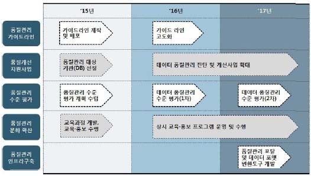

| 학습 내용 | 평가 항목 | 성취수준 |  |  |
| --- | --- | --- | --- | --- |
| 2. 단계별 과제단계별 추진무와 달성출처: [그림 4-6] 품질③ 연차별로 실행할 | 내용을 정리하여 품질 관리 중장기 로드맵을 작성한다.과제의 실현을 통해 달성하고자 하는 목표를 중심으로,목표를 도시화한다. 한국데이터베이스진흥원(2014),⌜미래부 R&D 등 공공 데이터 품질 관리 체계관리 중장기 로드맵 추진 방안 - 예시 품질 관리계획서를 작성한다. | 중장기마련 | 연구 | 추진 업보고서⌟. |
| 1. 목표 및 추진 | 방향을 설정한다. |  |  |  |
| (1) 기관의 | 정보화 로드맵 등을 고려하여 당해 연도 데이터 품질 | 관리 | 목표를 | 설정 |
| 한다. |  |  |  |  |
| (2) 데이터진 방향을품질 관리(www.pdqm.kr)의기관 | 품질 관리 목표, 현황 및 문제점에 따른 기관의 당해설정한다. 수준이 낮은 기관이나 초기 도입 수준인 기관은‘품질 자가 진단’ 기능을 사용하여 도출된차원의 데이터 품질 관리 추진 방향을 설정할 수 있다. | 연도결과를 | 품질품질관리지원센터 | 관리 추기반으로 |
| 2. 진단 대상 | DB, 추진 일정 및 소요 예산, 수행 조직 체계 등을 | 정립한다, |  |  |
| (1) 기관에서스를 | 보유 중인 DB의 20~30% 수준에서 중점 품질 관리선정한다. | 대상 |  | 데이터베이 |
| (2) 품질 진단 | 범위와 품질 진단 대상 DB별로 진단 범위와 주요 | 진단 | 방향을 | 설정 |
| 한다. |  |  |  |  |
| (3) 수행 | 일정과 소요 예산, 수행할 조직 체계를 정립한다. |  |  |  |

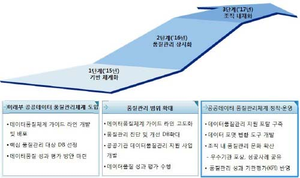

| 학습 내용 | 평가 항목 | 성취수준 |  |  |
| --- | --- | --- | --- | --- |
| 3. 품질 개선 | 활동을 위한 표준화 등 추진 계획과 산출물 계획 등을 | 포함한다. |  |  |
| (1) 진단 | 결과에 따라 품질 개선 활동을 위한 표준화 대상별 표준화 | 범위를 |  | 설정한다. |
| (2) 표준화 | 수행 일정과 소요 예산 계획을 수립한다. |  |  |  |
| (3) 연계 대상 | 데이터의 범위와 관련된 품질 확보 계획을 설정한다. |  |  |  |
| (4) 대상 DB별 | 주요 점검 대상 산출물 목록과 점검 일정, 소요 예산을수행 tip • 한국데이터베이스진흥원에서 발간한관리 지침(V2.1)’에 데이터 품질법, 조직의 역할 등의 상세한 내용이으므로 학습에 참고할 수 있다. | 관리 | 수립한다.‘데이터절차 및기술되어 | 품질방있 |

| 학습 4 | 교수 ‧ 학습 방법 |
| --- | --- |

교수 방법
• 데이터 품질 관리 지침의 구성 내용에 대해 사례를 들어 설명한다
• 데이터 품질 관리 성숙 모형의 성숙 단계별 구조와 수준의 의미를 설명한다.
• 데이터 품질 인증 시 활용하는 측정 지표의 종류와 지표별 의미를 설명하고, 데이터 품질 인증의
유용성 등에 대해 토론식 수업을 진행한다.
• 데이터 품질 관리를 위한 조직의 구성과 계층별 역할 및 책임에 대해 토의 방식으로 수업을
진행한다
• 데이터 품질 컨설팅의 수행 과정과 결과 보고서의 구성 내용에 대해 이해할 수 있도록 사례
보고서를 활용하여 설명하고, 데이터 품질 관리 로드맵 작성 방법에 대해 실습이 이루어질
수 있도록 지도한다
학습 방법
• 데이터 품질 관리 지침의 구성 내용과 필요성에 대해 이해한다
• 데이터 품질 관리 성숙 모형의 성숙 단계별 구조와 수준을 숙지한다.
• 기 작성된 데이터 품질 관리 지침을 사례를 통해 살펴보고, 지침을 실행하기 위한 데이터 품질
관리 조직의 구성과 계층별 역할 및 책임에 대해 이해한다.
• 데이터 품질 인증 시 활용하는 측정 지표의 종류와 지표별 의미를 설명하고, 데이터 품질 인증의
유용성 등에 대해 토론식 수업을 진행한다.
• 데이터 품질 인증 기관에서 활용하는 데이터 품질 관리 지표들의 의미를 이해하고, 데이터 품질
인증을 주관하는 기관과 데이터 품질 인증의 유용성에 대해 의견을 정리하여 토론에 참여한다.
• 데이터 품질 관리 로드맵의 구성 내용과 작성 방법을 실습을 통해 익힌다.

| 학습 4 | 평 가 |
| --- | --- |

평가 준거
• 평가자는 학습자가 수행 준거 및 평가 항목에 제시되어 있는 내용을 성공적으로 수행하였는지를
평가해야 한다.
• 평가자는 다음 사항을 평가해야 한다.

| 학습 내용 | 평가 항목 | 성취수준 |  |  |
| --- | --- | --- | --- | --- |
|  |  | 상 | 중 | 하 |

-데이터 처리 시스템의 데이터 품질을 지속적으로 유
지하는 데 필요한 데이터 품질 관리 활동을 식별할
수 있다.
데이터 품질 관 -식별된 데이터 품질 관련 활동이 적절히 수행될 수
리 지침 수립 있도록 데이터 품질 관리 지침과 데이터 품질 관리
지표를 제시할 수 있다.
-데이터 품질 관리 활동에 필요한 데이터 품질 관리
계층별 역할과 책임을 명확하게 제시할 수 있다.
데이터 품질 관 -데이터 품질 관리 활동 간의 연관 관계를 파악하여
리 활동 로드맵 단계적이고 효율적인 데이터 품질 관리 활동이 진행
작성 될 수 있는 로드맵을 제시할 수 있다.
평가 방법
• 서술형 시험

| 학습 내용 | 평가 항목 | 성취수준 |  |  |
| --- | --- | --- | --- | --- |
|  |  | 상 | 중 | 하 |

-데이터 품질 관리 활동 식별 능력
데이터 품질 관 -데이터 품질 관리 지침과 데이터 품질 관리 지표 제
리 지침 수립 시 능력
-데이터 품질 관리 계층별 역할과 책임 제시 능력
데이터 품질 관
-단계적이고 효율적인 데이터 품질 관리 활동 로드맵
리 활동 로드맵
제시 능력
작성
• 평가자 체크리스트

| 학습 내용 | 평가 항목 | 성취수준 |  |  |
| --- | --- | --- | --- | --- |
|  |  | 상 | 중 | 하 |

| 데이터 품질 관리 지침 수립 데이터 품질 관리 활동 로드맵작성 피 드 백 | -데이터 품질 관리 활동 식별 능력 -데이터 품질 관리 지침과 데이터 품질 관리 지표 제시 능력 -데이터 품질 관리 계층별 역할과 책임 제시 능력 -단계적이고 효율적인 데이터 품질 관리 활동 로드맵제시 능력 |  |  |  |
| --- | --- | --- | --- | --- |
| 1. 서술형 시험- 데이터 품질관리 조직의검토하여 틀린 | 관리 프로세스, 데이터 품질 관리 지침의 구성 내용, 품질구성과 역할에 대한 정의, 단계별 품질 관리 활동 로드맵점과 잘된 점을 표시하여 돌려 준다. | 관리작성 | 지표,내용에 | 품질대해 |
| 2. 평가자 체크리스트- 데이터 품질할 정의, 중장기여 돌려 준다. | 관리 활동 식별, 데이터 품질 관리 지침 작성, 품질 관리활동 로드맵 작성 과정을 항목별로 평가한 후 개선할 | 조직의사항 | 구성과등을 | 역정리하 |

∙공공 기관의 데이터베이스 품질 관리 지침(행정자치부 고시 제2011-25호, 2011. 7. 4).
∙공공 데이터 관리 지침(안전행정부 고시 제2014-13호, 2014. 3. 6.).
∙한국데이터베이스진흥센터(2006),『데이터 품질 관리 성숙 모형(Ver1.0)』.
∙한국데이터베이스진흥센터(2006),『데이터 품질 관리 지침(Ver2.1)』.
∙한국데이터베이스진흥원(2011),『데이터 품질 가이드라인』.
∙한국데이터베이스진흥원(2012),『데이터 품질 관리 가이드라인』.
∙한국데이터베이스진흥원(2014), ⌜미래부 R&D 등 공공 데이터 품질 관리 체계 마련 연구 보고서⌟.
∙한국정보화진흥원(2012).『미국 정부의 데이터 품질 관리 사례-DQA를 중심으로-』.
∙한국정보화진흥원(2014),『공공 정보 품질 관리 매뉴얼(V1.1)』.
∙공공데이터품질지원단 http://www.gooddata.kr
∙데이터 전문가 지식 포털 http://www.dbguide.net
NCS학습모듈 개발이력
발행일 2015년 12월 31일
세분류명 DB엔지니어링(20010204)
개발기관 한국소프트웨어기술진흥협회, 한국직업능력개발원
편흥열(에이비엔아이)* 김보운(이화여자대학교)
강성구(명지대학교) 여권동(NDS시스템)
김승현(경희대학교) 정금묵(베이스존)
박미화(투이컨설팅) 주선태(T3Q)
집필진 검토진
박준자(한국오라클) 진권기(이비스톰)
임영섭(비투엔컨설팅)
장온순(한국IT컨설팅)
장인혁(청운) *표시는 대표집필자임
발행일 2018년 12월 31일
학습모듈명 데이터 품질관리(LM2001020406_16v3)
개발기관 한국직업능력개발원
데이터 품질관리(LM2001020406_16v3)
저작권자 교육부
연구기관 한국직업능력개발원
발행일 2018.12.31
※ 이 학습모듈은 자격기본법 시행령(제8조 국가직무능력표준의 활용)에 의거하여 개발
하였으며,NCS통합포털사이트(http://www.ncs.go.kr)에서 다운로드 할 수 있습니다.

