# LM2001020211_23v6_서버+프로그램+구현_20251108

대분류/20

정보통신 중분류/01

정보기술 소분류/02

정보기술개발 세분류/02

응용SW엔지니어링 능력단위/11

NCS학습모듈
서버 프로그램 구현

LM2001020211_23v6

[NCS학습모듈 활용 시 유의 사항]
1. NCS학습모듈은 교육훈련기관에서 출처를 명시하고 교육적 목적으로 활용할 수 있습니다. 다
만, NCS학습모듈에는 국가(교육부)가 저작재산권 일체를 보유하지 않은 저작물(출처가 표기된
도표‧사진‧삽화‧도면 등)이 포함되어 있으므로, 이러한 저작물의 변형‧각색‧복제‧공연‧
배포 및 공중 송신 등과 이러한 저작물을 활용한 2차적 저작물을 작성하려면 반드시 원작자
의 동의를 받아야 합니다.
2. NCS학습모듈은 개발 당시의 산업 및 교육 현장을 반영하여 집필하였으므로, 현재 적용되는
법령‧지침‧표준 및 교과 내용 등과 차이가 있을 수 있습니다. NCS학습모듈 활용 시 법령
‧지침‧표준 및 교과 내용의 개정 사항과 통계의 최신성 등을 확인하시기를 바랍니다.
3. NCS학습모듈은 산업 현장에서 요구되는 능력을 교육훈련기관에서 학습할 수 있게 구성한 자
료입니다. 다만, NCS학습모듈 지면의 한계상 대표적 예시(예: 활용도 또는 범용성이 높은 제
품, 서비스) 중심으로 집필하였음을 이해하시기를 바랍니다.
NCS학습모듈의 이해
NCS학습모듈의 이해
※ 본 NCS학습모듈은 「NCS 국가직무능력표준」사이트(http://www.ncs.go.kr) 에서 확인 및 다운로드할 수 있습니다.

| Ⅰ | NCS학습모듈이란? |
| --- | --- |

m국가직무능력표준(NCS: National Competency Standards)이란 산업현장에서 직무를
수행하기 위해 요구되는 지식･기술･소양 등의 내용을 국가가 산업부문별･수준별로 체계
화한 것으로 산업현장의 직무를 성공적으로 수행하기 위해 필요한 능력(지식, 기술, 태도)
을 국가적 차원에서 표준화한 것을 의미합니다.
m국가직무능력표준(이하 NCS)이 현장의 ‘직무 요구서’라고 한다면, NCS학습모듈은 NCS
의 능력단위를 교육훈련에서 학습할 수 있도록 구성한 ‘교수･학습 자료’입니다. NCS학습
모듈은 구체적 직무를 학습할 수 있도록 이론 및 실습과 관련된 내용을 상세하게 제시하
고 있습니다.

| NCS 및 NCS학습모듈 개발 절차 |
| --- |
| NCS산업계개발 계획 수립NCSNCS학습모듈NCS학습모듈 개발개발 계획 수립 |

mNCS학습모듈은 다음과 같은 특징을 가지고 있습니다.
첫째, NCS학습모듈은 산업계에서 요구하는 직무능력을 교육훈련 현장에 활용할 수 있도
록 성취목표와 학습의 방향을 명확히 제시하는 가이드라인의 역할을 합니다.
둘째, NCS학습모듈은 특성화고, 마이스터고, 전문대학, 4년제 대학교의 교육기관 및 훈
련기관, 직장교육기관 등에서 표준교재로 활용할 수 있으며 교육과정 개편 시에도
유용하게 참고할 수 있습니다.
i
mNCS와 NCS학습모듈 간의 연결 체계를 살펴보면 아래 그림과 같습니다.

| NCS와 NCS학습모듈의 연결 체계 |
| --- |
| NCS NCS학습모듈능력단위 NCS학습모듈명능력단위 정의 NCS학습모듈의 목표능력단위 기술서 학습명능력단위 요소 학습 내용수행준거 학습 목표지식 필요 지식기술 수행 내용- 재료･자료태도- 기기(장비･공구)- 안전･유의 사항- 수행 순서적용범위 및 작업상황고려 사항 교수･학습 방법자료 및 관련 서류 교수 방법장비 및 도구 학습 방법평가 지침 평가평가 방법 평가 준거평가 시 고려 사항 평가 방법피드백참고 자료･활용 서식･부록 |

|  |  | NCS |  |  |  |  |  |  |  |  |  | NCS학습모듈 |  |  |  |  |
| --- | --- | --- | --- | --- | --- | --- | --- | --- | --- | --- | --- | --- | --- | --- | --- | --- |
|  | 능력단위 |  |  |  |  |  |  |  |  |  | NCS학습모듈명 |  |  |  |  |  |
|  | 능력단위 | 능력단위 |  |  |  |  |  |  |  |  | NCS학습모듈명 | NCS학습모듈명 |  |  |  |  |
|  | 능력단위 정의 |  |  |  |  |  |  |  |  |  | NCS학습모듈의 목표 |  |  |  |  |  |
|  | 능력단위 정의 | 능력단위 정의 |  |  |  |  |  |  |  |  | NCS학습모듈의 목표 | NCS학습모듈의 목표 |  |  |  |  |
|  | 능력단위 기술서 능력단위 요소 | 능력단위 기술서 능력단위 요소 |  |  |  |  |  |  |  |  | 학습명 학습 내용 | 학습명 학습 내용 |  |  |  |  |
|  | 능력단위 기술서 |  |  |  |  |  |  |  |  |  | 학습명 |  |  |  |  |  |
|  | 능력단위 기술서 | 능력단위 기술서 |  |  |  |  |  |  |  |  | 학습명 | 학습명 |  |  |  |  |
|  | 능력단위 요소 |  |  |  |  |  |  |  |  |  | 학습 내용 |  |  |  |  |  |
|  | 능력단위 요소 | 능력단위 요소 |  |  |  |  |  |  |  |  | 학습 내용 | 학습 내용 |  |  |  |  |
|  | 수행준거 |  |  |  |  |  |  |  |  |  | 학습 목표 |  |  |  |  |  |
|  | 수행준거 | 수행준거 |  |  |  |  |  |  |  |  | 학습 목표 | 학습 목표 |  |  |  |  |
|  | 지식 | 지식 |  |  |  |  |  |  |  |  | 필요 지식 | 필요 지식 |  |  |  |  |
|  | 지식기술태도 |  |  |  |  |  |  |  |  |  | 필요 지식수행 내용- 재료･자료- 기기(장비･공구)- 안전･유의 사항- 수행 순서 |  |  |  |  |  |
|  | 기술 | 기술 |  |  |  |  |  |  |  |  | 수행 내용 | 수행 내용 |  |  |  |  |
|  |  |  |  |  |  |  |  |  |  |  | - 재료･자료 | - 재료･자료 |  |  |  |  |
|  | 태도 | 태도 |  |  |  |  |  |  |  |  | - 기기(장비･공구) | - 기기(장비･공구) |  |  |  |  |
|  |  |  |  |  |  |  |  |  |  |  | - 기기(장비･공구) | - 기기(장비･공구) |  |  |  |  |
|  | 적용범위 및 작업상황 고려 사항 자료 및 관련 서류 | 적용범위 및 작업상황 고려 사항 자료 및 관련 서류 |  |  |  |  |  |  |  |  | - - 안전･유의 사항 - 수행 순서 교수･학습 방법 교수 방법 | - - 안전･유의 사항 - 수행 순서 교수･학습 방법 교수 방법 |  |  |  |  |
|  |  |  |  |  |  |  |  |  |  |  | - 안전･유의 사항 | - 안전･유의 사항 |  |  |  |  |
|  | 적용범위 및 작업상황 |  |  |  |  |  |  |  |  |  | - 수행 순서 | - 수행 순서 |  |  |  |  |
|  | 고려 사항자료 및 관련 서류장비 및 도구 |  |  |  |  |  |  |  |  |  | 교수･학습 방법 | 교수･학습 방법 교수 방법 학습 방법 |  |  |  |  |
|  | 자료 및 관련 서류 장비 및 도구 | 자료 및 관련 서류 장비 및 도구 |  |  |  |  |  |  |  |  | 교수 방법학습 방법 |  |  |  |  |  |
|  | 평가 지침 |  |  |  |  |  |  |  |  |  | 평가 |  |  |  |  |  |
|  | 평가 방법평가 시 고려 사항 |  |  |  |  |  |  |  |  |  | 평가 준거평가 방법피드백 |  |  |  |  |  |
|  | 평가 시 고려 사항 | 평가 시 고려 사항 |  |  |  |  |  |  |  |  | 평가 방법 | 평가 방법 |  |  |  |  |
|  |  |  |  |  |  |  |  |  |  |  | 참고 자료･활용 서식･부록 |  |  |  |  |  |

ii
NCS학습모듈의 이해

| Ⅱ | NCS학습모듈의 체계 |
| --- | --- |

mNCS학습모듈은 1. NCS학습모듈의 위치 , 2. NCS학습모듈의 개요 , 3. NCS학습모듈의 내용 체계 ,
4. 참고 자료 , 5. 활용서식/부록 으로 구성되어 있습니다.
1. NCS학습모듈의 위치
mNCS학습모듈의 위치는 NCS 분류 체계에서 해당 학습모듈이 어디에 위치하는지를 한 눈에
볼 수 있도록 그림으로 제시한 것입니다.

| [NCS-학습모듈의 위치] |  |  |  |  |  |  |
| --- | --- | --- | --- | --- | --- | --- |
| 대분류 | 문화·예술·디자인·방송 |  |  |  |  |  |
| 중분류 |  | 문화콘텐츠 |  |  |  |  |
| 소분류 |  |  |  |  | 문화콘텐츠제작 |  |
| 세분류 |  |  |  |  |  |  |
| 세분류 |  |  |  |  |  |  |
| 방송콘텐츠제작 |  |  |  | 능력단위 |  | 학습모듈명 |
| 영화콘텐츠제작 프로그램 기획 프로그램 기획음악콘텐츠제작 아이템 선정 아이템 선정광고콘텐츠제작 자료 조사 자료 조사게임콘텐츠제작 프로그램 구성 프로그램 구성애니메이션캐스팅 캐스팅콘텐츠제작만화콘텐츠제작 제작계획 제작계획캐릭터제작 방송 미술 준비 방송 미술 준비스마트문화앱방송 리허설 방송 리허설콘텐츠제작영사 야외촬영 야외촬영스튜디오 제작 스튜디오 제작… … |  |  |  | 프로그램 기획 |  | 프로그램 기획 |
| 음악콘텐츠제작 |  |  |  | 아이템 선정 |  | 아이템 선정 |
| 광고콘텐츠제작 자료 |  |  |  | 자료 조사 |  | 자료 조사 |
| 게임콘텐츠제작 |  |  |  | 프로그램 구성 |  | 프로그램 구성 |
| 애니메이션 콘텐츠제작 |  |  |  | 캐스팅 |  | 캐스팅 |
| 만화콘텐츠제작 |  |  |  | 제작계획 |  | 제작계획 |
| 캐릭터제작 방송 |  |  |  | 방송 미술 준비 |  | 방송 미술 준비 |
| 스마트문화앱 방송 콘텐츠제작 |  |  |  | 방송 리허설 |  | 방송 리허설 |
| 영사 |  |  |  | 야외촬영 |  | 야외촬영 |
|  |  |  |  | 스튜디오 제작 |  | 스튜디오 제작 |
|  |  |  |  | … |  | … |

|  | 학습모듈은 |
| --- | --- |
| NCS 능력단위 1개당 1개의 학습모듈 개발을 원칙으로 합니다. 그러나 필요에 따라고용단위 및 교과단위를 고려하여 능력단위몇 개를 묶어 1개 학습모듈로 개발할 수있으며, NCS 능력단위 1개를 여러 개의학습모듈로 나누어 개발할 수도 있습니다. |  |

iii
2. NCS학습모듈의 개요
mNCS학습모듈의 개요는 학습모듈이 포함하고 있는 내용을 개략적으로 설명한 것으로
학습모듈의 목표 , 선수학습 , 학습모듈의 내용 체계 , 핵심 용어 로 구성되어 있습니다.

| 학습모듈의 목표 | 해당 NCS 능력단위의 정의를 토대로 학습 목표를 작성한 것입니다. |
| --- | --- |

| 선수학습 | 해당 학습모듈에 대한 효과적인 교수･학습을 위하여 사전에 이수해야 하는 학습모듈, 학습 내용, 관련 교과목 등을 기술한 것입니다. |
| --- | --- |

| 학습모듈의내용 체계 | 해당 NCS 능력단위요소가 학습모듈에서 구조화된 체계를 제시한 것입니다. |
| --- | --- |

| 핵심 용어 | 해당 학습모듈의 학습 내용, 수행 내용, 설비･기자재 등 가운데 핵심적인 용어를 제시한 것입니다. |
| --- | --- |

| 제작계획 학습모듈의 개요 |  |  |  |
| --- | --- | --- | --- |
| 학습모듈의 목표본격적인 촬영을 준비하는 단계로서, 촬영 대본을 확정하고 제작 스태프를 조직하며촬영 장비와 촬영 소품을 준비할 수 있다.선수학습제작 준비(LM0803020105_13v1), 섭외 및 제작스태프 구성(LM0803020104_13v1),촬영 제작(LM0803020106_13v1), 촬영 장비 준비(LM0803040204_13v1.4), 미술디자인 협의하기(LM0803040203_13v1.4)학습모듈의 내용체계 |  |  |  |
| 학습 | 학습 내용 | NCS 능력단위 요소 |  |
| 코드번호 요소 명칭 |  | 코드번호 | 요소 명칭 |
| 1. 촬영 대본 1-1. 촬영 구성안 검 촬영 대본0803020114_16v3.1확정하기 토와 수정 확정하기2-1. 기술 스태프 조직2. 제작 스태프 제작 스태프2-2. 미술 스태프 조직 0803020114_16v3.2조직하기 조직하기2-3. 전문 스태프 조직3. 촬영 장비 3-1. 촬영 장비 점검 촬영 장비0803020114_16v3.3계획하기 과 준비 계획하기4-1. 촬영 소품 목록4. 촬영 소품 작성 촬영 소품0803020114_16v3.4계획하기 4-2. 촬영 소품 제작 계획하기의뢰 |  |  |  |
| 핵심 용어촬영 구성안, 제작 스태프, 촬영 장비, 촬영 소품 |  |  |  |

|  | 학습모듈의 목표는 |
| --- | --- |
| 학습자가 해당 학습모듈을 통해 성취해야할 목표를 제시한 것으로, 교수자는 학습자가 학습모듈의 전체적인 내용흐름을 파악하도록 지도할 수 있습니다. |  |

|  | 선수학습은 |
| --- | --- |
| 교수자 또는 학습자가 해당 학습모듈을 교수·학습하기 이전에 이수해야 하는 교과목또는 학습모듈(NCS 능력단위) 등을 표기한것입니다. 따라서 교수자는 학습자가 개별학습, 자기 주도 학습, 방과 후 활동 등 다양한 방법을 통해 이수할 수 있도록 지도하는 것을 권장합니다. |  |

|  | 핵심 용어는 |
| --- | --- |
| 해당 학습모듈을 대표하는 주요 용어입니다. 학습자가 해당 학습모듈을 통해 학습하고 평가받게될 주요 내용을 알 수 있습니다. 「NCS 국가직무능력표준」 사이트(www.ncs.go.kr)의 색인 (찾아보기) 중하나로 이용할 수 있습니다. |  |

iv
NCS학습모듈의 이해
3. NCS학습모듈의 내용 체계
mNCS학습모듈의 내용은 크게 학습 , 학습 내용 , 교수･학습 방법 , 평가 로 구성되어 있습니다.

| 학습 | 해당 NCS 능력단위요소 명칭을 사용하여 제시한 것입니다.학습은 크게 학습 내용, 교수･학습 방법, 평가로 구성되며 해당 NCS 능력단위의능력단위 요소별 지식, 기술, 태도 등을 토대로 내용을 제시한 것입니다. |
| --- | --- |

| 학습 내용 | 학습 내용은 학습 목표, 필요 지식, 수행 내용으로 구성되며, 수행 내용은 재료･자료, 기기(장비･공구), 안전･유의 사항, 수행 순서, 수행 tip으로 구성한 것입니다.학습모듈의 학습 내용은 실제 산업현장에서 이루어지는 업무활동을 표준화된 프로세스에 기반하여 다양한 방식으로 반영한 것입니다. |
| --- | --- |

| 교수･학습 방법 | 학습 목표를 성취하기 위한 교수자와 학습자 간, 학습자와 학습자 간 상호 작용이활발하게 일어날 수 있도록 교수자의 활동 및 교수 전략, 학습자의 활동을 제시한것입니다. |
| --- | --- |

| 평가 | 평가는 해당 학습모듈의 학습 정도를 확인할 수 있는 평가 준거 및 평가 방법, 평가 결과의 피드백 방법을 제시한 것입니다. |
| --- | --- |

학습 1 촬영 대본 확정하기

|  | 학습은 |
| --- | --- |
| 해당 NCS 능력단위요소 명칭을 사용하여제시하였습니다. 하나의 학습은 일반교과의 ‘대단원’에 해당되며, 학습모듈을 구성하는 가장 큰 단위가 됩니다. 또한 하나의 직무를 수행하기 위한 가장 기본적인단위로 사용할 수 있습니다 |  |

| 학습 2 | 제작 스태프 조직하기 |
| --- | --- |

학습 3 촬영 장비 계획하기
학습 4 촬영 소품 계획하기

|  | 학습 내용은 |
| --- | --- |
| NCS 능력단위요소별 수행준거를 기준으로제시하였습니다. 일반교과의 ‘중단원’에 해당합니다. |  |

2-1.
기술 스태프 조직
학습 목표 •프로그램 제작에 적합한 기술 스태프를 조직할 수 있다.

|  | 학습 목표는 |
| --- | --- |
| 학습 내용을 이수할 때 학습자가 갖춰야할행동 수준을 의미합니다. 따라서 수업시간의 과목 목표로 활용할 수 있습니다. |  |

필요 지식 /
• 기술 스태프의 구성

|  | 필요 지식은 |
| --- | --- |
| 해당 NCS의 지식을 토대로 학습에 대한이해와 성과를 제고하기 위해 반드시 알아야 할 주요 지식을 제시하였습니다. 필요 지식은 수행에 꼭 필요한 핵심 내용을위주로 제시하여 교수자의 역할이 매우중요하며, 이후 수행 순서와 연계하여 교수·학습으로 진행할 수 있습니다. |  |

프로그램의 장르에 따라 구성하는 기술 스태프는 많은 차
이가 있다. 같은 장르의 프로그램이라도 그 형식이나 내
용, 규모에 따라서 구성되는 기술 스태프의 종류와 인원
수는 천차만별이다.
1. 스튜디오 프로그램
토크쇼, 종합 구성, 예능과 같은 스튜디오 프로그램은
부조정실과 스튜디오를 사용하여 제작하기 때문에 많
은 기술 스태프가 필요하다.
v

|  | 수행 내용은 |
| --- | --- |
| 해당 학습모듈에서 제시한 내용 중 기술(skill)을 습득하기 위한 실습과제로 활용할 수 있습니다. |  |

수행 내용 / 기술 스태프 구성표 작성하기
재료·자료

|  | 재료･자료는 |
| --- | --- |
| 수행 내용을 수행하는데 필요한 재료 및 준비물로 실습 시 활용할 수 있습니다. |  |

• 방송프로그램 제작 기획서 및 방송 대본, 콘티(continuity), 제작
일정, 운용표
• 장비 및 시설, 제작 시설 배정 의뢰서 및 배정표, 방송 기술 스
태프 데이터베이스(DB) 자료

|  | 기기(장비･공구)는 |
| --- | --- |
| 수행 내용에 필요한 기본적인 장비 및 도구를 제시하였습니다. 제시된 기기 외에도 수행에 필요한 다양한 도구나 장비를 활용할수 있습니다. |  |

기기(장비･공구)
• 컴퓨터 등
안전･유의 사항

|  | 안전･유의사항은 |
| --- | --- |
| 수행 내용을 수행하는 데 있어 안전상 주의해야할 점 및 유의사항을 제시하였습니다. 실습 시 유념해야 하며, NCS의 고려사항도 추가적으로 활용할 수 있습니다. |  |

• 프로그램의 내용과 제작 방법을 분석하고, 각 스태프들의 역할
을 신중하게 검토한다.
수행 순서
• 방송 대본이나 콘티(continuity), 큐 시트를 분석하고, 프로그램

|  | 수행 순서는 |
| --- | --- |
| 실습 과제의 진행 순서로 활용할 수 있습니다. |  |

의 내용적 특성, 제작 과정에 대한 자료를 수집한다.
• 프로그램 제작 방법을 결정한다.

|  | 수행 tip은 |
| --- | --- |
| 수행 내용에서 실습을 용이하게 할 수 있는아이디어를 제시하였습니다. 수행 tip은 지도상의 안전 및 유의사항 외에 전반적으로적용되는 주안점 및 수행 과제 목적에 대한보충설명, 추가사항 등으로 활용할 수 있습니다. |  |

1. 스튜디오 녹화를 할 것인가, 야외 촬영을 할 것인가 검토한
다.
수행 tip
•스태프의 결정은 스태프 간의 호흡을 중
요시하여 선정해야 프로그램의 질을 향
상시킬 수 있다.

| 학습2 | 교수·학습 방법 |
| --- | --- |

|  | 교수･학습 방법은 |
| --- | --- |
| 학습 목표를 성취하는 데 필요한 교수 방법과 학습 방법을 제시하였습니다. |  |

교수 방법

|  | 교수 방법은 |
| --- | --- |
| 해당 학습 활동에 필요한 학습 내용, 학습내용과 관련된 자료명, 자료 형태, 수행 내용의 진행 방식 등에 대하여 제시하였습니다. 또한 학습자의 수업참여도 제고 방법및 수업 진행상 유의사항 등도 제시하였습니다. 선수학습이 필요한 학습을 학습자가숙지하였는지 교수자가 확인하는 과정으로활용할 수도 있습니다. |  |

• 방송 프로그램의 기술적 요소, 미술 구성 요소, 특수 촬영에 대해
설명한다.
• 방송 프로그램 제작에서 각 기술 스태프의 역할에 대해 설명한다.
• 방송 프로그램을 분석하고 필요한 기술 스태프를 구성할 수 있도
록 지시한다.
학습 방법

|  | 학습 방법은 |
| --- | --- |
| 해당 학습 활동에 필요한 학습자의 자기주도 학습 방법을 제시하였습니다. 또한학습자가 숙달해야 할 실기 능력과 학습과정에서 주의해야 할 사항 등도 제시하였습니다. 학습자가 학습을 이수하기 전반드시 숙지해야 할 기본 지식을 학습하였는지 스스로 확인하는 과정에 활용할수 있습니다. |  |

• 방송 프로그램의 기술적 요소, 미술 구성 요소, 특수 촬영에 대해
서 알아본다.
• 프로그램 제작에 필요한 기술 스태프의 역할을 이해하고, 기술 스
태프 구성표를 작성한다.
vi
NCS학습모듈의 이해

| 학습2 평 가평가 준거• 평가자는 학습자가 학습 목표를 성공적으로 달성하였는지를 평가해야 한다.• 평가자는 다음 사항을 평가해야 한다.성취수준학습 내용 학습 목표상 중 하기술 스태프 - 프로그램 제작에 적합한 기술 스태프를 조조직 직할 수 있다.미술 스태프 - 프로그램 제작에 적합한 미술 스태프를 조조직 직할 수 있다.전문 스태프 - 프로그램 특수 촬영을 위한 전문 스태프를조직 조직할 수 있다.평가 방법• 사례 연구성취수준학습 내용 평가 항목상 중 하- 프로그램에서 기술적 요소의 파악 여부기술 스태프 - 기술 스태프의 역할 파악 여부조직 - 프로그램에 필요한 기술 스태프 구성표 작성 능력피드백1. 사례 연구- 프로그램을 선택하여 기술 스태프, 미술 스태프, 전문 스태프 구성표를 예시와 같이 작성하였는지 개인별 능력을 평가한 후, 그결과를 모든 학습자에게 공유하도록 한다. | 학습2 | 평 가 |
| --- | --- | --- |

|  | 평가는 |
| --- | --- |
| NCS 능력단위의 평가 방법과 평가 시 고려사항을 준용하여 작성합니다. 교수자와학습자가 평가 항목별 성취수준 확인 시활용할 수 있습니다. |  |

|  | 평가 준거는 |
| --- | --- |
| 학습자가 학습을 어느 정도 성취하였는지평가하기 위한 기준을 제시하고 있습니다.학습 목표와 연계하여 단위수업 시간에 평가 항목 별 성취수준을 평가하는 데 활용할수 있습니다. |  |

| 학습 내용 | 학습 목표 | 성취수준 |  |  |
| --- | --- | --- | --- | --- |
|  |  | 상 | 중 | 하 |

| 4. 참고 자료•교육부(2013). | 섭외 및 제작스태프 구성(LM0803020104_13v1). |  |  |  |
| --- | --- | --- | --- | --- |
| 한국직업능력개발원. |  |  |  |  |
| 5. 활용 서식/부록직종 이름기술감독 조명감독 [디지털제1조(목적) 이 고시는램 및 방송광고의 | 스튜디오 기술 스태프 구성표 연락처 소속 특이사항텔레비전 방송프로그램 음량 등에 관한 기준] 제정 2014. 11. 29. 미래창조과학부 고시제1창 총칙 방송법 제70조의2제1항에 따라 방송사업자가 디지털 텔레비전음량을 일정하게 유지하기 위해 필요한 사항을 규정함을 | 비고목적으로 | 제2014-87호방송프로그한다. |  |

|  | 평가 방법은 |
| --- | --- |
| NCS 능력단위의 평가 방법을 참고하였으며, 평가 준거에 따른 평가 방법을 2개 이상 제시합니다. 평가 방법의 종류는 포트폴리오, 문제해결 시나리오, 서술형 시험, 논술형 시험, 사례 연구, 평가자 체크리스트,작업장 평가 등이 있으며, NCS 능력단위요소 별 수행 수준을 평가하는 데 가장 적절한 방법을 선정하여 활용할 수 있습니다. |  |

| 학습 내용 | 평가 항목 | 성취수준 |  |  |
| --- | --- | --- | --- | --- |
|  |  | 상 | 중 | 하 |

| 4. 참고 자료•교육부(2013). | 섭외 및 제작스태프 구성(LM0803020104_13v1). |  |  |  |
| --- | --- | --- | --- | --- |
| 한국직업능력개발원. |  |  |  |  |
| 5. 활용 서식/부록직종 이름기술감독 조명감독 [디지털제1조(목적) 이 고시는램 및 방송광고의 | 스튜디오 기술 스태프 구성표 연락처 소속 특이사항텔레비전 방송프로그램 음량 등에 관한 기준] 제정 2014. 11. 29. 미래창조과학부 고시제1창 총칙 방송법 제70조의2제1항에 따라 방송사업자가 디지털 텔레비전음량을 일정하게 유지하기 위해 필요한 사항을 규정함을 | 비고목적으로 | 제2014-87호방송프로그한다. |  |

|  | 피드백은 |
| --- | --- |
| 평가 후에 학습자들에게 평가 결과를 피드백하여 학습 목표를 달성하는 데 활용할 수 있습니다. |  |

|  | 참고 자료는 |
| --- | --- |
| 해당 학습모듈에 제시된 인용 자료의 출처를 제시하였습니다. 교수·학습의 과정에서참고로 활용할 수 있습니다. |  |

|  | 활용 서식은 |
| --- | --- |
| 평가 서식, 실습 시트 등 교수·학습 시 활용할 수 있는 다양한 서식들로 구성하였습니다. 수행에서 평가에 이르기까지 필요한서식을 해당 모듈의 특성에 맞춰 개발하거나 기존의 양식을 활용하여 제시하였습니다. |  |

|  | 부록은 |
| --- | --- |
| 활용 서식 이외에 교수·학습 과정에서 참고할수 있는 자료가 있는 경우 제시하였습니다. |  |

[NCS-학습모듈의 위치]

| 정보 통신 |  |  |
| --- | --- | --- |
|  | 정보 기술 |  |
|  |  | 정보기술개발 |

대분류
중분류
소분류
세분류

| SW아키텍처 |  |  | 능력단위 | 학습모듈명 |
| --- | --- | --- | --- | --- |
| 응용 SW엔지니어링 |  |  | 요구사항 확인 | 요구사항 확인 |
| 임베디드SW 엔지니어링 |  |  | 데이터 입출력 구현 | 데이터 입출력 구현 |
| DB엔지니어링 |  |  | 통합 구현 | 통합 구현 |
| NW엔지니어링 |  |  | 정보시스템 이행 | 정보시스템 이행 |
| 보안엔지니어링 |  |  | 제품소프트웨어 패키징 | 제품소프트웨어 패키징 |
| UI/UX엔지니어링 |  |  | 서버 프로그램 구현 | 서버 프로그램 구현 |
| 시스템SW엔지니어링 |  |  | 인터페이스 구현 | 인터페이스 구현 |
| 빅데이터플랫폼구축 |  |  | 애플리케이션 배포 | 애플리케이션 배포 |
| 핀테크엔지니어링 |  |  | 애플리케이션 리팩토링 | 애플리케이션 리팩토링 |
| 데이터아키텍처 |  |  | 인터페이스 설계 | 인터페이스 설계 |
| loT시스템연동 |  |  | 애플리케이션 요구사항 분석 | 애플리케이션 요구사항 분석 |
| 인프라스트럭쳐 아키텍처 구축 |  |  | 기능 모델링 | 기능 모델링 |
|  |  |  | 애플리케이션 설계 | 애플리케이션 설계 |

| 정적모델 설계 | 정적모델 설계 |
| --- | --- |
| 동적모델 설계 | 동적모델 설계 |
| 화면 설계 | 화면 설계 |
| 화면 구현 | 화면 구현 |
| 애플리케이션 테스트 관리 | 애플리케이션 테스트 관리 |
| 애플리케이션 테스트 수행 | 애플리케이션 테스트 수행 |
| 소프트웨어공학 활용 | 소프트웨어공학 활용 |
| 소프트웨어개발 방법론 활용 | 소프트웨어개발 방법론 활용 |
| 프로그래밍 언어 응용 | 프로그래밍 언어 응용 |
| 프로그래밍 언어 활용 | 프로그래밍 언어 활용 |
| 응용 SW 기초 기술 활용 | 응용 SW 기초 기술 활용 |
| 개발자 환경 구축 | 개발자 환경 구축 |
| 개발 환경 운영 지원 | 개발 환경 운영 지원 |
| 자료구조 활용 | 자료구조 활용 |

차 례
학습모듈의 개요 1
학습 1. 개발 환경 구축하기
1-1. 개발 환경 준비 3
1-2. 개발 환경 구축 20
• 교수・학습 방법 40
• 평가 41
학습 2. 공통 모듈 구현하기
2-1. 공통 모듈 구현 43
2-2. 공통 모듈 테스트 계획 수립 54
• 교수・학습 방법 62
• 평가 63
학습 3. 서버 프로그램 구현하기
3-1. 서버 프로그램 확인 65
3-2. 서버 프로그램 구현 75
3-3. 서버 프로그램 테스트 수행 84
• 교수・학습 방법 91
• 평가 92
학습 4. 배치 프로그램 구현하기
4-1. 배치 프로그램 구현 94
4-2. 배치 프로그램 테스트 수행 102
• 교수・학습 방법 108
• 평가 109
참고 자료 111
활용 서식 112
서버 프로그램 구현 학습모듈의 개요
학습모듈의 목표
애플리케이션 설계를 기반으로 개발에 필요한 환경을 구성하고, 프로그래밍 언어와 도구를 활용하여 공통
모듈, 업무 프로그램과 배치 프로그램을 구현할 수 있다.
선수학습
응용 SW 기초 기술 활용(2001020232_23v5), 프로그램 언어 활용(2001020231_23v5), 프로그래밍 언
어 응용(2001020230_23v5), 애플리케이션 배포(2001020214_23v6)
학습모듈의 내용 체계

| 학습 | 학습 내용 | NCS 능력단위 요소 |  |
| --- | --- | --- | --- |
|  |  | 코드번호 | 요소 명칭 |

1-1. 개발 환경 준비
1. 개발 환경 구축하기 2001020211_23v6.1 개발 환경 구축하기
1-2. 개발 환경 구축
2-1. 공통 모듈 구현
2. 공통 모듈 구현하기 2001020211_23v6.2 공통 모듈 구현하기
2-2. 공통 모듈 테스트 계획 수립
3-1. 업무 프로세스 확인
3. 서버 프로그램 구현 서버 프로그램
3-2. 서버 프로그램 구현 2001020211_23v6.3
하기 구현하기
3-3. 서버 프로그램 테스트 수행
4-1. 배치 프로그램 구현
4. 배치 프로그램 구현 배치 프로그램
2001020211_23v6.4
하기 구현하기
4-2. 배치 프로그램 테스트 수행
핵심 용어
요구사항 분석, 시스템 아키텍처, 애플리케이션 아키텍처, 공통 모듈, 서버, 형상관리, 단위 테스트

| 학습 1 | 개발 환경 구축하기 |
| --- | --- |

학습 2 공통 모듈 구현하기
학습 3 서버 프로그램 구현하기
학습 4 배치 프로그램 구현하기
1-1.
개발 환경 준비
•응용 소프트웨어 개발에 필요한 하드웨어 및 소프트웨어의 필요 사항을 검토하고, 이에 따라
학습 목표
개발 환경에 필요한 준비를 수행할 수 있다.
필요 지식 /
• 응용 소프트웨어의 개념
1. 응용 소프트웨어의 정의
응용 소프트웨어(Application Software)는 특정 사용자 요구를 충족시키기 위해 컴퓨터
시스템에서 실행되는 프로그램을 의미하며, 운영체제(OS)와 같은 시스템 소프트웨어와
달리, 사용자가 필요로 하는 구체적인 업무 처리나 기능 수행을 목적으로 한다. 응용 소
프트웨어로는 워드 프로세서, ERP(Enterprise Resource Planning), 웹 애플리케이션,
모바일 앱, CRM(Customer Relationship Management), 전자결재시스템 등이 있다.

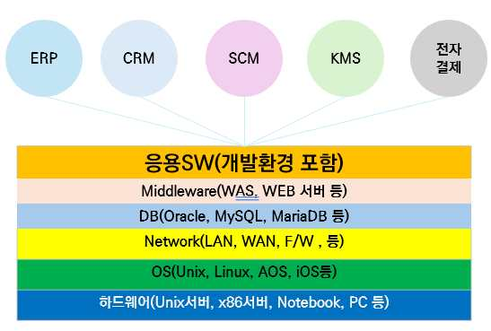

출처: 집필진 제작(2025)
[그림 1-1] 응용 소프트웨어의 개념
2. 응용 소프트웨어의 특성
(1) 사용자 목적 중심
사용자 혹은 조직의 문제 해결, 업무 자동화, 정보 처리 등을 지원한다.
(2) 도메인 특화
특정 산업, 업무, 조직의 업무 규칙(Business Rule)을 반영한다.
(3) 프로그램 구성 요소의 집합
단일 애플리케이션이라도 다수의 모듈(공통 기능 모듈, 업무 처리 모듈, 인터페이스
연계 모듈 등)로 구성된다.
(4) 운영환경과 밀접한 연관
운영체제, 데이터베이스, 네트워크, 보안 환경과도 유기적으로 통합되어 작동한다.

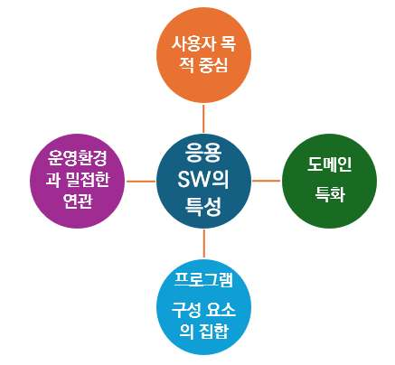

출처: 집필진 제작(2025)
[그림 1-2] 응용 소프트웨어의 특징
3. 응용 소프트웨어의 유형
<표 1-1> 응용 소프트웨어의 유형
구분 설명 예시
데스크톱 응용 SW PC 기반 독립 실행 프로그램 MS Word, AutoCAD
웹 기반 응용 SW 웹 브라우저에서 실행되는 서비스 인터넷 뱅킹, 전자정부 서비스
모바일 응용 SW 스마트폰, 태블릿에서 실행되는 앱 SNS 앱, 모바일 쇼핑 앱
임베디드 응용 SW 특정 하드웨어 장비에 내장되어 구동 자동차 ECU, POS 단말 SW
클라우드 응용 SW SaaS 형태로 제공되는 응용 SW Google Docs, Office 365
대규모 엔터프라이즈 SW 기업 전사 업무 처리용 대형 시스템 ERP, CRM, SCM
AI/데이터 기반 SW 인공지능, 빅데이터 분석을 수행 AI 챗봇, 데이터 분석 플랫폼
• 개발 환경의 개념
1. 개발 환경의 정의
응용 SW 개발 환경은 응용 소프트웨어를 개발·빌드·테스트·배포하기 위해 필요한 하드
웨어, 소프트웨어, 네트워크, 개발 도구 및 인프라의 집합을 의미하며, 개발자가 소프트
웨어를 효율적이고 안정적으로, 높은 품질 수준을 유지하여 개발할 수 있도록 지원하는
인프라와 도구들의 통합된 시스템으로 구성된다. 개발 프로세스 전체(코딩, 컴파일, 디
버깅, 형상관리, 테스트, 배포 등)를 지원하며, 개발 환경은 운영환경과 유사하게 맞추
어 구성하는 것이 원칙이다.
2. 개발 환경의 유형
개발 환경의 로컬 개발 환경 유형으로는 서버 기반 개발 환경, 가상화 개발 환경, 클라
우드 개발 환경, DevOps 통합 환경 등이 있다.
<표 1-2> 개발 환경의 유형
구분 설명 예시
로컬 개발 환경 개발자의 PC에서 직접 구축·운영 Eclipse, VSCode 개발 환경
서버 기반 개발 중앙 개발 서버에 개발 환경 구축, 다수 개
개발 서버, GitLab 서버
환경 발자 공유
가상화 개발 환경 가상머신 또는 컨테이너로 독립적 환경 구축 Docker, Vagrant
AWS Cloud9, GitHub
클라우드 개발 환경 클라우드 서비스로 개발 환경을 임대/운영
Codespaces
CI/CD, 자동 배포 등을 포함한 개발-운영
DevOps 통합 환경 Jenkins, GitLab CI/CD
통합 환경
수행 내용 / 개발 환경 준비하기
재료·자료
• 요구사항 정의서
• 시스템 아키텍처
기기(장비･공구)
• 컴퓨터 또는 PC, 네트워크 장비, 프린터, 빔 프로젝트
• CASE 도구(SW 개발 지원 도구, SW 테스트 지원 도구 등)
• 형상관리 도구
• 개발 프로그램
안전･유의 사항
• CASE 도구를 활용하여 실습할 때에는 사전에 CASE 도구의 정품 인증 여부를 확인한다.
• 형상관리 도구를 활용하여 실습할 때에는 형상관리 DB 등의 손상에 유의한다.
수행 순서
• 목표시스템의 운영환경을 분석한다.
1. 목표시스템의 환경을 파악한다.
제안 요청서, 제안서, 사업 수행 계획서, 요구사항 정의서, 시스템 아키텍처, 애플리케이
션 아키텍처 등 분석 및 설계 시의 산출물을 분석하여 목표시스템의 환경을 분석한다.
<표 1-3> 목표시스템의 환경 예시
항목 내용 예시
개발자가 프로그램 작성, - Eclipse, IntelliJ가 설치된 개발자 PC
개발 환경
컴파일, 디버깅 등을 수행 - 개발팀 로컬 서버에서 실행되는 Spring Boot
(Development
하는 작업 환경. 운영환경 웹 애플리케이션
Environment)
과 동일하지 않을 수 있음 - GitHub에 소스코드 저장 후 협업
운영환경과 유사하게 구성
- 개발 완료 후 QA팀이 기능 테스트를 수행하는
테스트 환경 하되, 신규 기능·수정 사항
서버
(Test 을 사전 검증하기 위한 환
- 웹 애플리케이션 배포 전 통합 테스트 서버
Environment) 경. 테스트 후 운영 반영
- 성능 부하 테스트용 가상 사용자 시뮬레이션 서버
여부를 결정
항목 내용 예시
- 네이버 쇼핑 웹사이트가 실제 사용자에게 서비
운영환경 실제 사용자에게 서비스를 스되는 서버
(Production 제공하는 환경. 성능, 보안, - 은행 인터넷뱅킹 시스템
Environment) 안정성이 최우선으로 고려됨 - 온라인 쇼핑몰 결제 서버
- 공공기관의 민원 처리 웹서비스
- DB 서버의 정기 백업 데이터를 저장하는 별도
장애나 데이터 유실에 대비
백업 환경 스토리지
해 데이터를 별도로 보관하
(Backup - 이중화 서버로 운영 데이터를 실시간 복제하는
거나, 시스템 복구를 위한
Environment) DR(Disaster Recovery) 센터
환경
- 일자별 서버 스냅숏 이미지 보관
2. 목표시스템의 운영환경을 분석한다.
목표시스템의 운영환경을 하드웨어, 운영체제, 데이터베이스/파일, 네트워크, 미들웨어,
보안시스템, 모니터링/관리 도구, 배포, 운영 자동화 도구 등의 구성 요소별로 구분하
여 파악한다.
<표 1-4> 목표시스템의 운영환경 구성 요소 예시
구성 요소 설명 예시
운영환경에서 응용 SW를 실행 - 서버 (Dell PowerEdge, HP ProLiant)
하기 위해 필요한 물리적 또는 - 스토리지 (SAN, NAS)
하드웨어
가상 장비. 처리량, 안정성, 장 - 클라우드 인스턴스 (AWS EC2, Azure VM)
애 대응 등을 고려하여 구성됨 - 로드밸런서 장비 (F5 BIG-IP)
하드웨어와 응용 SW 간 자원 - Linux (RedHat, CentOS, Ubuntu)
운영체제 관리 및 운영환경을 제공. 안 - Windows Server 2019
(OS) 정성과 보안 패치, 다중 사용 - UNIX (Solaris, AIX)
자 지원이 중요 - Container OS (CoreOS, Alpine)
응용 SW가 사용하는 데이터 - RDBMS: Oracle, PostgreSQL, MS-SQL
데이터베 저장소. 대량 데이터 처리, 무 - NoSQL: MongoDB, Redis, Cassandra
이스/파일 중단 서비스, 백업/복구 체계 - 파일 시스템: NFS, HDFS, ZFS
가 중요 - 클라우드 스토리지: AWS S3, Azure Blob
- LAN/WAN
사용자 접속, 시스템 간 통신,
- VPN, MPLS
보안 등을 지원하는 인프라.
네트워크 - 방화벽 (Palo Alto, Fortinet)
장애 대비 이중화, 트래픽 관
- 로드밸런서 (HAProxy, AWS ELB)
리가 필수
- 네트워크 프로토콜 (HTTPS, WebSocket)
OS와 응용 SW 사이에서 서 - Web Server: Apache, Nginx, IIS
미들웨어
비스 실행과 연결 관리, 트랜 - WAS: Tomcat, WebLogic, JEUS, JBoss
/서버 소
잭션 처리 등을 담당. 성능과 - 메시징 서버: RabbitMQ, Kafka
프트웨어
확장성이 핵심 - API Gateway: Kong, Apigee
구성 요소 설명 예시
- SSL/TLS 암호화
정보 유출, 해킹 등 보안 위
- 방화벽, IPS/IDS
보안시스 협을 방지하기 위한 솔루션
- 인증 서버 (OAuth, SSO, LDAP)
템 및 정책. 보안 표준 준수 여
- WAF (Web Application Firewall)
부가 중요.
- 보안 스캐너 (Nessus, Fortify)
- Nagios, Zabbix
시스템 상태, 트래픽, 장애 여
모니터링 - Prometheus, Grafana
부 등을 실시간으로 감시하고
/관리 도 - Splunk,ELK Stack(ElasticSearch, Logstash,
대응하기 위한 도구. 안정적
구 Kibana)
서비스 제공을 위해 필수
- New Relic, Datadog
- Ansible, Puppet, Chef
응용 SW 배포, 설정 관리,
배포/운영 - Kubernetes, Docker Swarm
장애 복구 등을 자동화하여
자동화 - Jenkins, GitLab CI/CD
신속성과 안정성을 확보
- AWS CodeDeploy, Azure DevOps
3. 목표시스템의 개발 환경을 분석한다.
목표시스템의 개발 환경을 목표시스템의 운영환경을 고려하여 유사하게 구성 요소별로
분석한다.
<표 1-5> 목표시스템의 개발 환경 구성 예시
구성 요소 개념/설명 예시
운영환경과 유사하거나
개발자 PC/노트북 (16~32GB RAM, SSD);
축소된 규모로 개발·테스트
개발 서버 (Dell, HP, Lenovo);
하드웨어 수행용 장비. 빌드·테스트
가상머신 (VMware, VirtualBox);
부하를 감당할 수 있도록
클라우드 개발용 인스턴스 (AWS EC2)
구성
운영환경과 동일 OS 사용 Windows 10 → Windows Server;
운영체제
권장. OS 불일치 시 배포 Linux (Ubuntu, CentOS) → 운영환경 동일; macOS
(OS)
시 충돌 가능 (특정 모바일 개발)
운영환경 DBMS와 동일
Oracle Dev Edition; MySQL Community; Postgr
데이터베 제품 또는 호환 버전 사용
eSQL; MongoDB Community;
이스/파일 권장. 개발 환경은 축소된
파일 공유: NFS, SFTP
데이터 세트로 구축 가능
운영환경의 네트워크 구조를
모방하되, 개발 환경은 사내 LAN/VPN; Reverse Proxy (Nginx, Apache);
네트워크
단순화 가능. 개발자 간 협업 포트 포워딩; 개발용 프록시 환경
위해 VPN 등 적용
미들웨어/ 운영환경과 동일한 Web Server: Apache, Nginx; WAS: Tomcat,
서버 소프 웹서버/WAS/메시징 서버 JBoss, WebLogic Dev; 메시징: RabbitMQ, Kafka;
트웨어 사용 권장. 버전 일치 필수 API Gateway Dev 버전
구성 요소 개념/설명 예시
운영환경 수준의 보안은
아니지만, 개발 환경에도 SSL/TLS 개발 인증서; 로컬 방화벽; 개발용 WAF 설
보안 환경
기본 보안 적용 필요. 정; SonarQube 보안 점검
인증·암호화 동일 유지 권장
운영환경 도구의 Dev 버전
모니터링/ ELK Stack Dev; Prometheus, Grafana; VisualVM
사용 권장. 개발 시
로그 관리 (Java); IDE 내 로그 뷰어
성능/로그 확인 용이
운영환경의 배포/CI/CD
배포/운영 프로세스 동일 적용 권장. Jenkins, GitLab CI/CD; Docker Compose;
자동화 Infrastructure as Code Kubernetes Dev Cluster; Ansible, Puppet
환경 구축
개발 언어: Java, Python, C#, JavaScript, Go,
Kotlin, PHP; IDE: Eclipse, IntelliJ, Visual Studio
운영환경에서 실행될 Code, Visual Studio;
애플리케이션을 개발하기 빌드 도구: Maven, Gradle, NPM, Webpack;
개발 언어 위한 언어와 개발 도구. 형상관리: Git, SVN, GitLab; 테스트 도구: JUnit,
및 도구 IDE, 빌드, 테스트, 협업, Selenium, Postman, JMeter;
보안 도구 포함. 개발 환경
요구사항 관리: JIRA, Trello, Confluence; 보안 점
구축 시 가장 핵심적인 영역
검: SonarQube, Fortify; DevOps 도구: Jenkins,
Docker, Kubernetes
4. 목표시스템의 응용 SW의 요구사항을 분석한다.
목표시스템의 요구사항을 분석/설계, 기능, 성능, 인터페이스, 보안, 테스트, 품질 등의
분야별로 구분하여 분석한다.
<표 1-6> 요구사항목록 예시
요구사항 분류 요구사항 고유 번호 요구사항 명칭
APR-001 요구사항 수집 및 확정
분석/설계 요구사항
(Analysis Plan APR-002 프로세스 분석
Requirement)
APR-003 화면 및 DB 설계
요구사항 분류 요구사항 고유 번호 요구사항 명칭
SFR-001 인사 정보 등록 기능
SFR-002 인사 정보 목록 기능
SFR-003 출퇴근 현황 조회 기능
기능 요구사항
(System Function SFR-004 외출 신청 기능
Requirement)
SFR-005 특근 신청 관리 기능
SFR-006 최종 점검 관리 기능
SFR-007 초과 근무 관리 기능
SFR-008 권한 관리 기능
성능 요구사항
(Performance PER-001 기존 시스템 성능 유지
Requirement)
인터페이스 요구사항
SIR-001 시스템 연계
(System Interface
SIR-002 직관적 UI
Requirement)
TER-001 단위 테스트
테스트 요구사항
(Test Requirement)
TER-002 통합 테스트
보안 요구사항
SER-001 보안 기준 준수
(Security
SER-002 응용 및 DB 보안
Requirement)
QUR-001 기능 구현의 정확성
품질 요구사항
(Quality Requirement)
QUR-002 상호 운영성
출처: 교육부(2021). 서버 프로그램 구현(LM2001020211_19v5). 한국직업능력연구원. pp.05-06.
• 개발 언어 및 하드웨어 사양을 고려한 구현 도구를 선정한다.
1. 개발 언어의 선정
(1) 개발 언어의 선정 기준
개발 언어의 선정 기준으로는 적정성, 효율성, 이식성, 친밀성, 범용성, 생태계 및
DevOps/클라우드 적합성 등이 있다.
<표 1-7> 개발 언어 선정 기준
고려 항목 설명
대상 업무의 성격, 개발하고자 하는 시스템이나 응용 프로그램의 목적에 적
적정성
합해야 한다.
효율성 프로그램의 개발 및 실행 효율성을 고려해야 한다.
다양한 OS, 플랫폼에서 동작 가능해야 하며, 클라우드/컨테이너 환경과 호
이식성
환되어야 한다.
친밀성 개발자가 해당 언어를 이해하고 쉽게 사용할 수 있어야 한다.
과거 개발 실적과 커뮤니티 지원, 유지보수 가능성, 표준화 여부 등이 충분
범용성
해야 한다.
다양한 라이브러리, 프레임워크, 툴 지원이 풍부하고, 개발 커뮤니티가 활성
생태계
화되어 있어야 한다.
DevOps/클라
자동화, 배포, 클라우드 서비스와 연계가 용이해야 한다.
우드 적합성
출처: 교육부(2021). 서버 프로그램 구현(LM2001020211_19v5). 한국직업능력연구원. p.06.
(2) 추가 고려 요소
(가) 개발 인력의 경험, 숙련도
(나) 운영환경(운영체제, 네트워크 환경)
(다) 유지보수 비용, 라이선스 비용
(라) 프로젝트의 규모와 기간
(마) 클라우드 네이티브(Microservice, Container, Serverless) 적합성
(3) 개발 언어의 최신 트렌드
(가) Server Side
1) Java: 여전히 엔터프라이즈 분야의 표준. Spring Boot와 함께 사용
2) Python: AI/ML, 데이터 분석뿐 아니라 백엔드 개발에서도 널리 사용
3) JavaScript/Node.js: 경량화 서비스, API 서버 구현에 적합
4) Go: 클라우드 네이티브, 마이크로서비스 환경에서 각광
5) C# (.NET Core): Windows뿐 아니라 Linux에서도 운용 가능
6) Kotlin: Java 대체 언어로 사용 증가
7) Rust: 성능과 메모리 안전성을 요구하는 시스템 개발에 부각
8) Server Side 예시: Spring Boot 기반 Java, Node.js, Go
(나) Client Side (Web)
1) JavaScript/TypeScript: React, Vue.js, Angular 등 현대 웹 프레임워크 기반
개발의 표준
2) HTML5/CSS3: 최신 웹 표준, 반응형 UI 개발
3) Flutter/Web: 크로스 플랫폼 웹앱 개발
4) Client Side 예시: React.js(프론트엔드), HTML5, TypeScript
(다) Mobile
1) Swift: iOS 앱 개발 표준
2) Kotlin: Android 앱 개발 표준
3) Flutter, React Native: 크로스 플랫폼 앱 개발에서 인기
2. 개발 도구의 선정
(1) 통합 개발 환경의 종류 및 특징
<표 1-8> 통합 개발 환경 종류 및 주요 특징
통합 개발
개발사 운영체제 언어 라이선스
환경
상용
IntelliJ Windows, Java, Kotlin, Python,
JetBrains (Community
IDEA macOS, Linux JS, Go 등
무료)
Visual JavaScript,
Windows,
Studio Microsoft TypeScript, Python, 무료 (MIT)
macOS, Linux
Code Go, PHP, C#, Java
Eclipse
Windows,
Eclipse Eclipse 재단 Java, C/C++, PHP 등 Public
macOS, Linux
License
상용
Windows, Python, Django,
PyCharm JetBrains (Community
macOS, Linux HTML/CSS/JS
무료)
Windows, C#, .NET, ASP.NET,
Rider JetBrains 상용
macOS, Linux Blazor
Swift, Objective-C,
Xcode Apple macOS 무료
C++
Android Windows,
Google Kotlin, Java 무료
Studio macOS, Linux
GitHub 다수 언어 지원 (VS
GitHub 클라우드 기반 사용량 과금
Codespaces Code 호환)
다수 언어 지원 (VS
Gitpod Gitpod 클라우드 기반 사용량 과금
Code 호환)
(2) 최신 개발 환경 트렌드
(가) 클라우드 IDE
GitHub Codespaces, Gitpod 등으로 원격 개발, 협업 개발 가속화가 가능하
며, 인프라 준비 없이 즉시 개발 환경 구축이 가능하다.
(나) DevOps 연계
IDE에서 직접 빌드, 배포, 테스트 연동 (GitOps 확산)이 가능하며, CI/CD 파이
프라인 관리 툴과 연동이 가능하다.
(다) AI 개발 지원
GitHub Copilot, Codeium, Tabnine 등 AI 코딩 어시스턴트 활용이 가능
하다.
(라) 경량화 IDE
VS Code가 사실상 표준 개발 툴로 자리를 잡고, Web 기반 IDE 확대가 가능
하다.
(3) 최신 개발 환경 도구 선정 시 고려 사항
(가) 운영환경과의 호환성
(나) 플러그인 생태계
(다) 클라우드/DevOps 통합 기능
(라) 협업 기능(코드 리뷰, 공동 편집)
(마) 라이선스 비용 및 유지보수
(바) 성능 및 리소스 요구
(4) 통합 개발 환경의 선정
운영환경과 개발 환경 간의 언어·도구 일치가 매우 중요하며, 배포 및 유지보수 리
스크를 최소화할 수 있도록 최신 기술 동향을 반영해 개발 환경을 선정한다.
(가) Server Side → Java(Spring Boot), Node.js, Go
(나) Client Side → TypeScript + React.js, Vue.js
(다) Mobile → Kotlin, Swift, Flutter
(라) IDE → IntelliJ IDEA, VS Code, PyCharm, Xcode, Android Studio
(마) Cloud IDE → GitHub Codespaces, Gitpod
• 프로그램의 배포 및 라이브러리 관리를 위한 빌드(Build) 도구를 선정한다.
1. 빌드 도구 Gradle, Maven, Ant의 특징
<표 1-9> 빌드 도구 특징 비교
빌드 도구 특징
- 기구현된 Goal 기반 실행 (DSL 기반)
- 빠른 빌드 속도와 캐싱 지원
Gradle - Groovy/Kotlin 스크립트 사용 가능
- 대규모 프로젝트, 멀티 모듈 지원에 유리
- Android 공식 빌드 도구
- 기구현된 Goal 기반 실행
- 프로젝트 전체 정보를 표준화된 POM 파일로 관리
Maven - 라이프사이클 기반 빌드 수행
- 의존성 관리가 체계적 (Maven Central Repository)
- 대규모 엔터프라이즈 프로젝트에 여전히 많이 사용
- 프로젝트별 개별 Target 기반 실행
- XML 기반 빌드 스크립트 작성
Ant
- 유연성은 높으나 표준화, 재사용성이 낮음
- 최신 프로젝트보다는 유지보수성 낮음
- Node.js 환경에서 표준 빌드, 배포 관리
npm/Yarn - 프런트엔드(React, Vue, Angular)에서 빌드 스크립트 관리
- 스크립트 실행, 의존성 관리, 패키지 배포 지원
- 프런트엔드 앱 번들링 도구
Webpack/Vite/Rollup - 코드 스플리팅, 라이브러리 트리 셰이킹
- 최신 JS 빌드 성능 최적화
- C/C++ 빌드 자동화 도구
Make/CMake/Ninja
- 멀티 플랫폼 빌드 지원 (Linux, Windows, macOS)
- Google 개발
- 매우 큰 코드베이스 빌드 지원
Bazel
- 멀티 플랫폼 빌드 가능
- 고성능 빌드 캐시 지원
- 빌드+배포+테스트 자동화 (CI/CD) 파이프라인 지원
GitHub Actions,
- 빌드뿐 아니라 배포 환경까지 통합 관리 가능
GitLab CI/CD
- IaC, DevOps 환경과 밀접 연계
2. 최신 빌드 도구 트렌드를 파악한다.
(1) DevOps & CI/CD 통합
(가) 단순 빌드 도구를 넘어 자동화된 파이프라인(CI/CD) 통합 추세
(나) 빌드, 테스트, 배포까지 자동화
(다) Jenkins, GitHub Actions, GitLab CI/CD, CircleCI
(2) 멀티 플랫폼 빌드
(가) 클라우드 환경, 컨테이너 기반 배포
(나) Docker, Kubernetes와 연계
(다) Bazel, CMake, Ninja 등으로 플랫폼별 빌드 최적화
(3) 프런트엔드 빌드 최적화
(가) Webpack, Vite, Rollup으로 JS 번들링, 빌드 시간 단축
(나) Tree Shaking, Lazy Loading 지원
(4) Infrastructure as Code (IaC)
(가) 빌드 결과물 외에도 IaC 관리가 중요
(나) Terraform, Ansible, Pulumi와 연동
3. 빌드 도구의 선정 기준을 정한다.
<표 1-10> 빌드 도구 선정 기준 예시
기준 항목 설명
프로젝트 특성 빌드 도구의 친밀도, 팀 경험, 적용 사례를 고려
생산성 빌드 속도, 캐시 기능, 분산 빌드 지원 여부
표준화/통합성 DevOps 파이프라인 통합, 다른 도구와 연계 용이성
플랫폼 호환성 멀티 OS, 컨테이너, 클라우드 환경에서 사용 가능 여부
의존성 관리 외부 라이브러리 관리의 편의성
라이선스/비용 오픈소스 여부, 상용 비용 고려
• 개발 인원을 고려한 형상관리 도구를 선정한다.
1. 형상관리 도구의 종류
<표 1-11> 형상관리 도구 CVS, Subversion, Git 비교
항목 CVS Subversion (SVN) Git
라이선스 GNU GPL v2.0 Apache License v2.0 GNU GPL v2.0
적용 언어 무관 무관 무관
Windows/Linux/mac
OS Windows/Linux Windows/Linux/macOS
OS
Command Line
Command Line
실행 환경 Interface, 일부 Command Line Interface, GUI
Interface, GUI
Third-Party GUI
TortoiseSVN, SourceTree, GitKraken, GitHub
GUI 도구 TortoiseCVS 등
WinSVN 등 Desktop, GitLens, GitLab UI 등
항목 CVS Subversion (SVN) Git
중앙 집중식 저장 중앙 집중식 저장소 기
분산 버전 관리
소 기반 반
로컬 저장소/협업 모두 지원
특징 협업 시 충돌 방지 커밋 히스토리 관리 용
브랜치 관리, Pull/Merge Request,
에 유리하나 분산 이, SVN Hook 등으로
CI/CD와 긴밀히 통합
개발에 취약 배포 자동화 가능
클라우드 GitHub, GitLab, Bitbucket, Azure
연동 어려움 연동 가능하나 제한적
연동 DevOps 등과 클라우드 네이티브 연계
DevOps 매우 우수 (CI/CD, GitOps, Code
낮음 가능
통합 Review, Issue Tracking 연계)
2. 최신 형상관리 도구 트렌드
(1) Git 중심의 분산 버전 관리
(가) 현업 개발에서 Git이 사실상 표준
로컬 개발 → 중앙 저장소 → CI/CD 파이프라인으로 연계
(나) 협업 개발 필수 기능
1) Branch 전략 (GitFlow, GitHub Flow)
2) Pull/Merge Request
3) Code Review
4) GitOps (Infrastructure as Code)
(2) 클라우드 기반 형상관리
(가) SaaS로 형상관리 도구 활용 증가
(나) 주요 플랫폼: GitHub, GitLab, Bitbucket, Azure DevOps
(다) 특징: 코드 저장소 + CI/CD + 이슈 관리 통합, 보안, 권한 관리 강화, AI 코드 리
뷰, 자동화 기능 제공 (Copilot, Code Suggestions 등)
(3) GUI 기반 툴 강화
(가) CLI만 사용하는 시대는 지남
(나) 인기 GUI 도구: GitHub Desktop, SourceTree, GitKraken, GitLens (VS Code
Extension),
(다) 로컬에서 쉽고 직관적으로 브랜치 관리 가능
(4) DevOps와 통합
(가) Git은 CI/CD 도구와 필수적으로 연동
(나) 예시: GitHub Actions, GitLab CI/CD, Azure Pipelines
(다) 코드부터 배포까지 자동화 (Pipeline as Code)
(5) 보안 스캐닝 통합
(가) Git 저장소 스캔: Secret 검출
(나) Dependency Vulnerability Check 도구: Snyk, SonarQube, GitHub Advanced
Security
3. 형상관리 도구의 선정 기준을 설정한다.
<표 1-12> 형상관리 도구 선정 기준 예시
기준 항목 설명
팀의 규모와 협업 방식 대규모 협업 → 분산 버전 관리(Git) 추천
DevOps 통합 자동 빌드/배포가 중요하면 Git + CI/CD 연동 필수
클라우드 사용 여부 클라우드 SaaS(GitHub, GitLab)로 협업 용이
보안/컴플라이언스 권한 관리, 감사 로그, 보안 스캔 기능 확인
교육/숙련도 팀의 Git 이해도와 학습곡선 고려
4. 형상관리 도구를 선정한다.
Git이 현재 형상관리 도구의 사실상 표준이 되었다. 형상관리는 단순 버전 관리에서 벗
어나 DevOps, CI/CD, 협업 관리 통합 플랫폼으로 진화하고 있으며, 클라우드 SaaS
도구 활용으로 관리 부담이 감소되고, GitOps, Infrastructure as Code 등과 연계가
필수적이다.
<표 1-13> 형상관리 도구 선정 예시
도구 특징
Git 현업 표준. 분산 관리, DevOps 필수
GitHub SaaS 기반, Actions로 CI/CD 통합
GitLab Repository + CI/CD + Issue 관리 통합
Bitbucket Atlassian 제품군과 연동 강점
Azure DevOps Microsoft 생태계에 최적
GitKraken 고급 Git GUI, 협업 지원
SourceTree 무료 GUI, Bitbucket 연계
• 프로젝트 검증에 적합한 테스트 도구를 선정한다.
1. 테스트 도구의 유형을 파악한다.
<표 1-14> 테스트 도구 유형
테스트 활동 테스트 도구 내용
Jira, Azure Test Plans, 고객 요구사항 정의, 테스트 계획, 변경 사항
테스트 계획
TestRail 관리
테스트 TestRail, Zephyr Scale,
테스트 케이스 설계 및 관리, 커버리지 분석
분석/설계 PractiTest
캠페인 분석 Allure, ReportPortal 테스트 실행 결과 분석, 리포트 시각화
JUnit, PyTest, Cypress,
기능/시스템 테스트 자동화, API, UI 테스트
테스트 자동화 Selenium, Playwright, Katalon
지원
Studio
SonarQube, Checkmarx,
정적 분석 코드 표준 검증, 보안 취약점 검출
Fortify, Snyk
실행 중 프로그램 동작 분석, 메모리 오류 탐
동적 분석 Valgrind, Coverity, Dynatrace
지
성능 테스트 JMeter, k6, Gatling, Locust 부하 생성, 성능 측정, API/웹 테스트
Prometheus, Grafana,
시스템 리소스(CPU, Memory, Network)
모니터링 Dynatrace, Datadog, New
상태 모니터링 및 시각화
Relic
GitLab CI/CD, Jenkins, GitHub 테스트 자동화 파이프라인 구축, 버전 관리
형상관리 연계
Actions 연동
전체 테스트 계획, 결함 관리, 리포트 통합
테스트 관리 Jira, Xray, TestRail, Zephyr
관리
2. 최신 테스트 도구 트렌드를 파악한다.
(1) DevOps·CI/CD 연계
테스트는 CI/CD 파이프라인의 필수 요소
빌드 후 자동 테스트 실행 → 배포 안정성 확보
GitHub Actions, GitLab CI/CD, Jenkins Pipeline
(2) AI 기반 테스트
AI가 테스트 케이스 작성, 유지보수 지원
flaky 테스트 탐지, 코드 변화 기반 테스트 추천
Tools: Testim, mabl, Functionize
(3) 클라우드 기반 테스트
SaaS 서비스로 웹/모바일 테스트 수행
인프라 관리 없이 대규모 테스트 가능
BrowserStack, SauceLabs, LambdaTest
(4) API 테스트 강화
마이크로 서비스, API 기반 서비스 증가
Postman, SoapUI, Karate, REST Assured → 표준 툴
자동화 및 CI/CD 통합 필수
(5) 퍼포먼스·부하 테스트 혁신
기존 JMeter → k6, Gatling, Locust 등으로 대체
Cloud 기반 부하 테스트 서비스 확산
(6) 보안 테스트 필수화 (DevSecOps)
코드 취약점 자동 탐지
라이브러리 의존성 스캔
Snyk, Checkmarx, SonarQube
3. 테스트 도구 선정 기준을 정한다.
<표 1-15> 형상관리 도구 선정 기준 예시
고려 항목 설명
자동화 지원 API, UI, Load Test 등 자동화 가능 여부
DevOps 연계성 CI/CD와의 통합 용이성
분석/리포트 기능 결과 리포트 시각화, 대시보드 제공 여부
클라우드 호환성 클라우드 기반 환경에서도 동작 가능한지 여부
AI 활용 여부 AI 기반 테스트 최적화 지원 여부
비용 및 라이선스 상용 여부, 라이선스 비용 고려
4. 테스트 도구의 선정
최신 프로젝트 테스트 도구로는 DevOps, 클라우드, AI와 밀접하게 연계되어야 하며,
단순 기능 검증에서 벗어나 품질, 보안, 성능, 유지보수성 통합 검증으로 확장되어야
하며, 테스트 자동화, CI/CD 통합, 클라우드 기반 서비스를 포함하여 보안 취약점 점
검은 DevSecOps 관점에서 반드시 포함할 필요가 있다.
<표 1-16> 형상관리 도구 선정 기준 예시
도구 활용 분야
JUnit, PyTest 단위 테스트, 백엔드 검증
Selenium, Cypress,
UI 테스트, 웹 자동화
Playwright
Postman, Karate API 테스트, 계약 기반 테스트
JMeter, k6 부하/성능 테스트
SonarQube 정적 코드 분석, 품질 게이트
TestRail, Zephyr 테스트 케이스 관리, 커버리지 관리
GitHub Actions 자동화된 테스트 파이프라인 구축
수행 tip
•각 종류별 개발 도구들에 대해 이해하고 장점과 단점들
에 대해 파악하여 프로젝트 요구사항에 적합한 도구들
을 선정하는 것이 중요하다.
1-2.
개발 환경 구축
•응용 소프트웨어 개발에 필요한 하드웨어 및 소프트웨어를 설치하고 설정하여 개발 환경을 구
학습 목표 축할 수 있다.
•사전에 수립된 형상관리 방침에 따라 운영 정책에 부합하는 형상관리 환경을 구축할 수 있다.
필요 지식 /
• 개발 하드웨어 환경
개발 환경의 하드웨어는 운영환경과 유사한 구조로 구성하는 것이 원칙이며, 안정성, 확장
성, 성능을 고려하여 구축해야 한다. 특히 최근에는 클라우드, 가상화, 컨테이너 기술 등의
확산으로 하드웨어 인프라의 구성이 다양해지고 있다.
1. 클라이언트(Client) 환경 구성
클라이언트 서버 시스템에서 제공하는 서비스를 활용하기 위해 사용자와의 인터페이스
(Interface)를 제공하는 하드웨어로, 일반적으로 PC(Client/Server 화면), 웹 브라우저
환경, 모바일 디바이스가 클라이언트로 활용된다.
(1) 클라이언트 환경 최신 구성 동향
최신 동향에서는 고사양 개발용 노트북, 다중 모니터 환경, 클라우드 기반 개발 환
경 접속용 단말(VDI), 태블릿 등이 함께 사용되며, 특히 원격·재택 개발 환경에서
VDI(Virtual Desktop Infrastructure)나 클라우드 개발 워크스페이스(e.g. GitHub
Codespaces, AWS Cloud9) 접속 단말로 클라이언트가 활용된다.
(2) 클라이언트 구성 방안
(가) Windows/MacOS/Linux 기반 개발용 노트북 (16~32GB RAM, SSD)
(나) 태블릿, iPad Pro, Android Tablet (보조 개발 환경)
(다) VDI 단말 (가상 데스크톱 접속용)
(라) 웹 브라우저 (Chrome, Edge, Safari)
(마) 모바일 디바이스 (스마트폰)

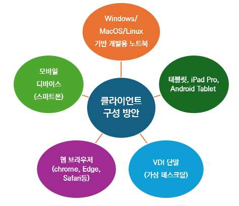

출처: 집필진 제작(2025)
[그림 1-3] 클라이언트 환경 구성 동향
2. 서버(Server) 환경 구성
서버 환경은 목적에 따라 애플리케이션 서버, 데이터베이스 서버, 파일 서버, 개발 빌드
서버, 테스트 서버 등으로 나눌 수 있다. 최근 개발 환경에서는 온프레미스(On-
Premises) 환경 외에 클라우드 기반 서버가 적극 활용되며, 특히 컨테이너 오케스트레
이션 환경(e.g. Kubernetes)과 CI/CD 파이프라인 서버가 필수 요소로 자리잡고 있다.

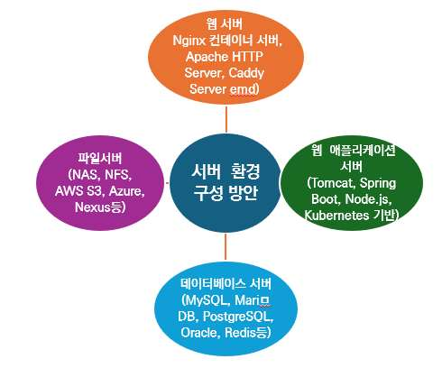

출처: 집필진 제작(2025)
[그림 1-4] 개발 서버 환경 구성 방안 예
(1) 웹(Web) 서버
클라이언트(웹 브라우저 화면)에서 요청하는 서비스의 속도를 향상시키기 위해
HTML, CSS, 이미지 등의 정적 콘텐츠를 제공하는 웹서버 애플리케이션이 설치되
는 하드웨어이다.
(가) 웹서버 최신 동향
최근에는 컨테이너 기반 Nginx, Apache, Caddy 등의 웹서버가 클라우드 환경
에 배포되는 추세이다.
(나) 웹서버 구성 방안
1) Nginx 컨테이너 서버
2) Apache HTTP Server
3) Caddy Server (경량 웹서버)
(2) 웹 애플리케이션(Application) 서버
동적 웹서비스를 제공하기 위해 Tomcat, Undertow, IIS 등 미들웨어인 WAS(We
b Application Server)와 서비스에 관련된 애플리케이션이 설치되는 하드웨어이다.
(가) 웹 애플리케이션 서버 동향
최근에는 마이크로서비스 아키텍처(MSA)로의 전환에 따라 경량 WAS, Node.js
서버, Spring Boot 기반 애플리케이션 서버가 증가하고, 컨테이너 기반 배포
(Kubernetes, Docker) 가 표준화되고 있다.
(나) 웹 애플리케이션 서버 구성 방안
1) Tomcat, JBoss EAP, Undertow
2) Spring Boot 애플리케이션 컨테이너
3) Node.js, NestJS 서버
4) Kubernetes Pod 기반 WAS 배포
(3) 데이터베이스(Database) 서버
MySQL, Oracle, Microsoft SQL Server 등 데이터베이스가 설치되는 하드웨어
이다.
(가) 데이터베이스 서버 동향
최근에는 클라우드 기반 관리형 데이터베이스 서비스(DBaaS, e.g. Amazon
RDS, Azure SQL Database)와 NoSQL 계열 데이터베이스(MongoDB, Redis,
Cassandra)도 많이 활용되고 있다. 운영환경과 동일한 DB 엔진과 버전을 개발
환경에도 맞추는 것이 중요하다.
(나) 데이터베이스 서버 구축 방안
1) MySQL/MariaDB (개발 환경; 셀프 호스팅)
2) PostgreSQL (개발 환경; 셀프 호스팅)
3) Oracle DataBase 19c (개발 환경; Developer License)
4) Amazon RDS (개발 환경; 관리형 RDBMS)
5) MongoDB Atlas (개발 환경; 프로젝트용 클러스터)
6) Redis (개발 환경; 셀프 호스팅 또는 관리형)
(4) 파일(File) 서버
서비스 제공을 위해 파일을 저장하고 공유하기 위한 파일 저장 서버 하드웨어이다.
(가) 파일(File) 서버 동향
최근에는 온프레미스 파일 서버 외에 클라우드 스토리지(e.g. AWS S3, Azure
Blob Storage)가 개발 환경에서도 많이 활용된다. 또한 개발 빌드 산출물 관리
에는 아티팩트 저장소(Nexus, Artifactory)가 필수적으로 구성된다.
(나) 파일 서버 구성 방안
1) NAS, NFS 서버
2) AWS S3 개발 버킷
3) Azure Blob Storage
4) Nexus Repository, JFrog Artifactory
3. 최신 개발 하드웨어 트렌드
(1) 로컬 장비보다는 클라우드 기반 개발 환경 사용 증가
(2) 컨테이너 환경이 표준화되어 개발 서버, WAS, DB까지 컨테이너로 관리
(3) VDI, 클라우드 IDE(GitHub Codespaces, Gitpod) 이용한 원격 개발 확대
(4) 관리형 서비스(DBaaS, Object Storage) 활용 증가로 로컬 하드웨어 의존도 감소
(5) 빌드/배포 자동화를 위한 고성능 CI/CD 서버 필수화
• 개발 소프트웨어 환경
1. 시스템 소프트웨어

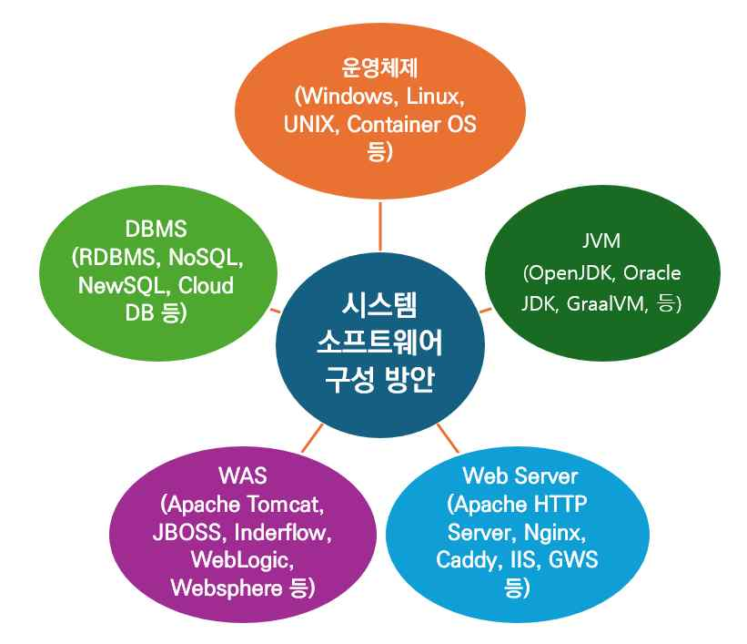

출처: 집필진 제작(2025)
[그림 1-5] 시스템 소프트웨어 구성 방안 예
(1) 운영체제(OS: Operatng System)
하드웨어 운영을 위한 운영체제로서, Windows, Linux, UNIX 등의 환경으로 구성
된다. 현재는 특히 클라우드 환경에 최적화된 OS 선택이 중요하며, 개발 환경은 운
영환경과 동일한 OS 버전으로 맞추는 것이 원칙이다.
(가) 최신 운영체제 개발 환경 동향
최신 개발 트렌드에서는 컨테이너 최적화 OS(예: Alpine Linux, CoreOS)도 많
이 활용된다.
(나) 운영체제 구성 방안
1) Windows 11, Windows Server 2022
2) Linux (Ubuntu 22.04 LTS, CentOS Stream, Rocky Linux, AlmaLinux)
3) UNIX (AIX, Solaris)
4) Container OS (Alpine Linux, CoreOS)
(2) JVM(Java Virtual Machine)
Java 기반 응용프로그램을 구동하기 위한 인터프리터 환경으로, 적용 버전은 개발
표준에 맞추어 운영환경과 동일하게 관리하는 것이 좋다. 최근에는 GraalVM 같은
고성능, 다언어 지원 VM 도입 사례가 증가하고 있다.
(가) JVM 구성 방안
1) OpenJDK 11, 17
2) Oracle JDK 17
3) GraalVM
(3) Web Server
정적 웹 서비스를 수행하는 미들웨어로, 웹 브라우저 화면에서 요청하는 정적 리소스
(HTML, CSS, 이미지 등)를 제공한다. 최신 기술 동향에서는 가볍고 빠른 Caddy,
LiteSpeed 등이 추가로 활용되고 있으며, 대부분 컨테이너 기반으로 배포된다.
(가) 웹 서버 구성 방안
1) Apache HTTP Server
2) Nginx
3) Caddy
4) LiteSpeed
5) IIS(Internet Information Server)
6) Google Web Server(GWS)
(4) WAS(Web Application Server)
동적 웹 서비스를 제공하기 위한 Tomcat, Undertow, IIS 등의 미들웨어로,
JSP/Servlet 애플리케이션 서버가 설치된다. 최근에는 Spring Boot, Node.js 기반
MSA 환경과 경량 WAS가 대세이며, 컨테이너 환경에서 운영된다.
(가) WAS 구성 방안
1) Apache Tomcat
2) JBoss EAP, WildFly
3) Undertow
4) WebLogic
5) Websphere
6) Spring Boot embedded WAS
7) Node.js, Express.js
8) NestJS
(5) DBMS(Database Management System)
데이터의 저장, 관리, 검색을 위한 시스템 소프트웨어를 의미한다.
최근에는 관리형 DB 서비스(DBaaS), NoSQL DB, NewSQL DB 사용이 급증하고
있다.
(가) DBMS 구성 방안
1) RDBMS: Oracle 19c, PostgreSQL 15, MariaDB, MySQL 8
2) NoSQL: MongoDB, Redis, Cassandra, DynamoDB
3) NewSQL: CockroachDB, TiDB
4) Cloud DB: Amazon RDS, Google Cloud SQL, Azure SQL Database
2. 개발 도구 소프트웨어 구성

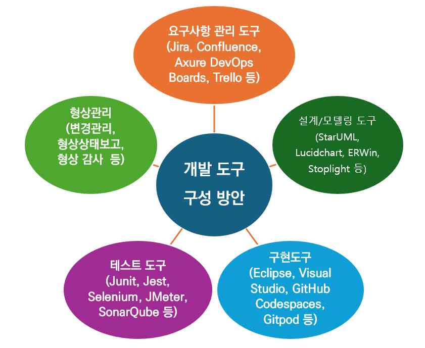

출처: 집필진 제작(2025)
[그림 1-6] 개발 도구 구성 방안 예
(1) 요구사항 관리 도구
고객의 요구사항 수집, 분석, 추적, 협업을 지원한다. 최근에는 애자일, DevOps 연
계로 협업 툴과 연동성이 높은 SaaS 기반 요구사항 관리 도구가 선호된다.
(가) 요구사항 관리 도구 구성 방안
1) Jira
2) Confluence
3) Azure DevOps Boards
4) Trello
5) ClickUp
6) Asana
(2) 설계/모델링 도구
기능을 논리적으로 설계하기 위해 통합 모델링 언어(UML), ERD, API 설계 도구
등을 활용한다. 최근에는 API 디자인 툴과 클라우드 기반 협업 설계 도구 사용이
증가하고 있다.
(가) 설계/모델링 도구 구성 방안
1) StarUML, Visual Paradigm
2) Lucidchart
3) Draw.io
4) DB Designer
5) ERWin
6) Stoplight (API 설계)
7) Swagger (OpenAPI)
(3) 구현 도구
개발 언어에 맞는 IDE 및 편집기를 사용하여 코드를 작성하고 관리한다. 최근에는
Cloud IDE(GitHub Codespaces, Gitpod)와 AI 개발도구(Copilot) 활용이 증가하
는 추세이다.
(가) 구현 도구 구성 방안
1) Eclipse
2) IntelliJ IDEA
3) Visual Studio, Visual Studio Code
4) JetBrains Fleet
5) GitHub Codespaces
6) Gitpod
(4) 테스트 도구
개발된 코드의 정확성을 검증하기 위해 자동화된 테스트를 수행한다. 최근에는
CI/CD 파이프라인과 통합되는 테스트 툴과 보안 취약점 테스트 도구 사용이 보편
화되고 있다.
(가) 테스트 도구 구성 방안
1) JUnit, TestNG
2) Jest, Mocha (JavaScript)
3) PyTest (Python)
4) Selenium (UI 자동화)
5) Postman (API 테스트)
6) JMeter, k6 (성능 테스트)
7) SonarQube (코드 품질/보안)
(5) 최신 SW 개발 환경 트렌드 요약
(가) 클라우드 기반 개발 환경 (Cloud IDE, DevOps Tools)
(나) 컨테이너/마이크로서비스 중심 환경
(다) DBaaS, NoSQL, NewSQL 등 데이터 기술 다양화
(라) DevSecOps 연계 보안 스캐닝 필수
(마) 협업 중심 툴 (Jira, Confluence, GitHub Projects)
(바) IaC, GitOps 확산
• 형상관리
1. 형상관리의 개념
형상관리는 소스코드뿐만 아니라 문서, 설계 산출물, 스크립트, 빌드 결과물 등 다양한
개발 산출물을 관리 대상으로 포함하며, 협업 기반 개발 환경에서 필수적인 핵심 프로
세스로 자리잡고 있다. SW 개발 산출물의 버전 관리, 변경 이력 관리, 무결성 검증을
수행하는 통합 관리 활동 소스코드뿐만 아니라 문서, 설계 산출물, 스크립트, 빌드 결
과물 등 모든 개발 산출물이 관리 대상 협업 개발 환경에 필요한 개발 프로세스의 핵
심이다.
2. 형상관리의 필요성
(1) 소프트웨어 변경 사항을 정확히 추적, 통제
(2) 다수 개발자 협업 시, 충돌 방지 및 동시 작업 지원
(3) 개발·운영 환경 간 차이 최소화
(4) 고객 요구사항의 지속적인 변경 대응
(5) DevOps, CI/CD 환경에서 자동화된 빌드, 배포 관리 필수
3. 형상관리 절차
(1) 형상 식별
형상 식별을 위해서는 관리해야 할 형상 항목(산출물)을 식별하고, 이름과 관리 번
호를 부여하고, 트리(Tree) 구조로 계층적 관리를 하는 것이 필요하다, 추가로 프로
젝트 기반 표준화를 하고, 개발 프로세스를 정립하고, 산출물 목록과 식별자 관리를
할 필요가 있다.
(가) 형상 항목 구성 방안
1) 소프트웨어 표준 및 지침 문서
2) 요구사항 명세서, 설계 문서
3) 소스코드 목록
4) 데이터베이스 스키마, SQL 스크립트
5) 테스트 시나리오, 결과 리포트
6) 빌드 스크립트, 배포 패키지
(2) 변경 제어
변경 제어를 위해서는 형상 항목 변경 요청 수립, 승인, 반영을 하고, 변경 이력을
관리하여 무분별한 수정을 방지하며, 변경은 반드시 형상통제위원회(CCB)의 승인을
통해 진행할 필요가 있다.
(가) 변경 관리 시스템 예시
1) Jira (이슈/변경 요청 관리)
2) Azure DevOps Boards
3) ServiceNow Change Management
(3) 형상 상태 보고
형상 상태 보고를 위해서는 베이스라인 현황을 파악하고, 변경 이력 및 상태, 변경
내역, 적용 결과, 검토 기록 등을 보고할 필요가 있다. DevOps 환경에서는 자동화
된 Dashboard로 현황 공유를 할 수 있다.
(가) 형상 상태 보고 도구
1) SonarQube Dashboard
2) GitHub Insights
3) GitLab Analytics
(4) 형상 감사
형상 감사는 형상 항목의 무결성 검증과 적합성 평가를 하고, 누락 항목 점검 및 이
중 관리 방지를 한다. 품질보증 팀 또는 형상관리 팀 등이 감사를 수행한다.
(가) 형상 감사 활동
1) 소스코드 누락 여부 확인
2) 릴리즈 노트와 배포 내용 일치 여부 점검
3) 형상 식별자 일관성 검증
4. 형상관리 최신 트렌드
(1) Git 중심의 분산 버전 관리
중앙 집중식(SVN) 대비 협업 효율을 향상할 수 있다.
(2) DevOps/CI/CD 연계
소스 관리부터 빌드, 배포까지 자동화할 수 있다.
(3) GitOps 확산
IaC 기반 형상관리로 인프라까지 관리 대상을 확대할 수 있다.
(4) 클라우드 기반 협업
GitHub, GitLab 등 SaaS 기반 협업 환경을 구성할 수 있다.
(5) 보안 스캐닝 통합
DevSecOps로 품질·보안을 동시에 통합 관리할 수 있다.
수행 내용 / 개발 환경 구축하기
재료·자료
• 요구사항 정의서
• 시스템 아키텍처
기기(장비･공구)
• 컴퓨터 또는 PC, 네트워크 장비, 프린터, 빔 프로젝트
• CASE 도구(SW 개발 지원 도구, SW 테스트 지원 도구 등)
• 형상관리 도구
• 개발 프로그램
안전･유의 사항
• CASE 도구를 활용하여 실습 시에는 사전에 CASE 도구의 정품 인증 여부를 확인한다.
• 형상관리 도구를 활용하여 실습 시에는 형상관리 DB 등의 손상에 유의한다.
수행 순서
• 통합 개발 환경 도구를 설치한다.
통합 개발 환경 도구는 Eclipse, IntelliJ, Visual Studio 등 다양한 도구들이 있으나, 본
실습에서는 준비 단계에서 선정한 통합 개발 환경 도구를 설치한다.
1. 요구사항에 적합한 통합 개발 환경 도구를 다운받는다.

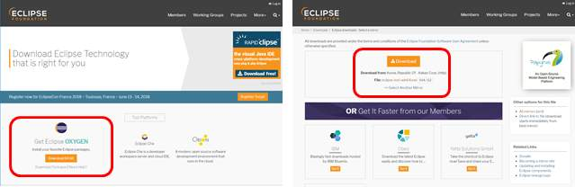

출처: 교육부(2021). 서버 프로그램 구현(LM2001020211_19v5). 한국직업능력연구원. p.15.
[그림 1-7] 통합 개발 도구를 다운로드하는 화면 예시(Eclipse 예시)
2. 다운받은 통합 개발 환경 도구를 설치한다.
(1) 통합 개발 환경 도구를 실행한다.

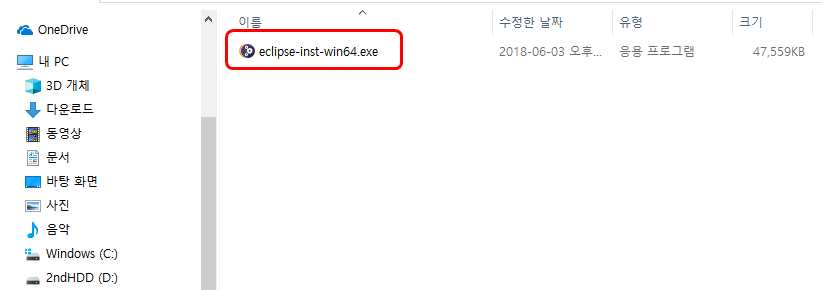

출처: 교육부(2021). 서버 프로그램 구현(LM2001020211_19v5). 한국직업능력연구원. p.16.
[그림 1-8] 통합 개발 환경 도구를 설치하는 화면 예시
(2) 웹 애플리케이션 Installer를 선택한다.
Installer에는 다양한 패키지(package)들을 선택할 수 있지만, Java 웹 애플리케이
션 프로젝트를 구성하기 위해 Eclipse IDE For Java EE Developers를 선택한다.

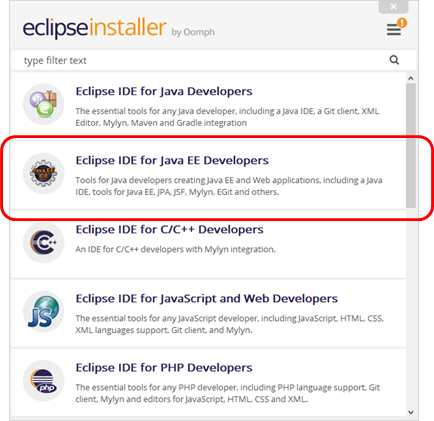

출처: 교육부(2021). 서버 프로그램 구현(LM2001020211_19v5). 한국직업능력연구원. p.16.
[그림 1-9] 웹 애플리케이션 도구 선택하기
(3) 설치할 위치를 선택한 후 설치한다.

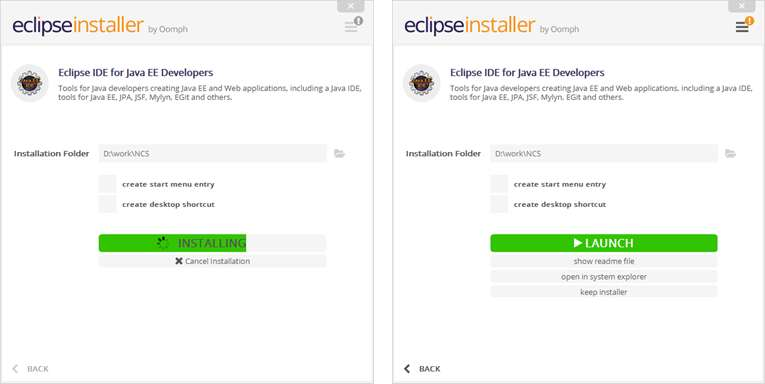

출처: 교육부(2021). 서버 프로그램 구현(LM2001020211_19v5). 한국직업능력연구원. p.17.
[그림 1-10] 설치 위치 선택 후 설치하는 화면 예시
3. 통합 개발 환경 도구를 실행한다.
(1) 설치된 통합 개발 환경 도구를 실행한다.

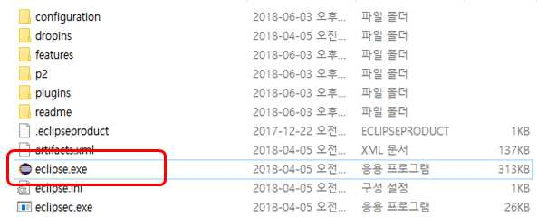

출처: 교육부(2021). 서버 프로그램 구현(LM2001020211_19v5). 한국직업능력연구원. p.17.
[그림 1-11] 통합 개발 환경 도구를 실행하는 화면 예시
(2) 작업 공간(workspace) 위치를 선택한다.

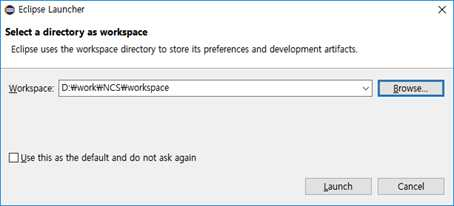

출처: 교육부(2021). 서버 프로그램 구현(LM2001020211_19v5). 한국직업능력연구원. p.17.
[그림 1-12] 작업 공산 선택 화면 예시
(3) 실행 화면을 확인한다.

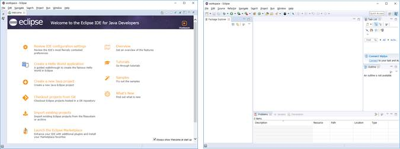

출처: 교육부(2021). 서버 프로그램 구현(LM2001020211_19v5). 한국직업능력연구원. p.17.
[그림 1-13] 통합 개발 환경 도구의 실행 확인 화면 예시
• Java 웹 애플리케이션 환경을 구성한다.
1. Spring 프레임워크 환경을 구성한다.
Spring 환경의 구성을 위해서는 먼저 STS(Spring Tool Suite)를 설치해야 한다. STS
를 설치하기 위해 통합 개발 환경 도구에서 STS를 Plug-in 한다.
(1) STS를 Plug-in 한다.

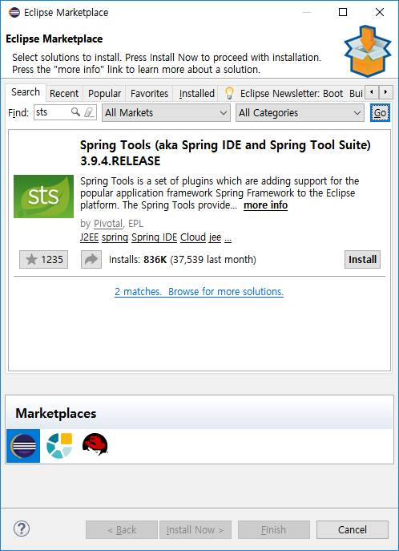

출처: 교육부(2021). 서버 프로그램 구현(LM2001020211_19v5). 한국직업능력연구원. p.18.
[그림 1-14] STS 검색 화면 예시
(2) STS를 설치(Install)한다.

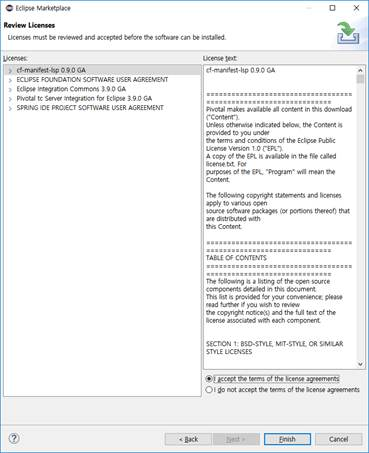

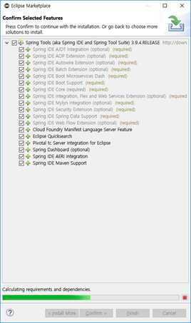

출처: 교육부(2021). 서버 프로그램 구현(LM200102 출처: 교육부(2021). 서버 프로그램 구현(LM2001020211_19v5). 한
0211_19v5). 한국직업능력연구원. p.18. 국직업능력연구원. p.18.
[그림 1-15] STS 설치 화면 예시 [그림 1-16] STS 설치 동의 화면 예시
2. Spring 프레임워크 기반의 웹 애플리케이션 프로젝트를 생성한다.
(1) 새로운 Spring 웹 프로젝트를 생성한다.
File＞New＞Project 메뉴를 선택한 후 Spring Legacy Project를 선택한다.

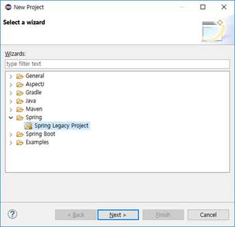

출처: 교육부(2021). 서버 프로그램 구현(LM2001020211_19v5). 한국직업능력연구원. p.19.
[그림 1-17] 프로젝트 생성 화면
(2) Maven 프로젝트로 선택한다.
프로젝트명을 입력하고 Spring MVC Project 타입을 선택한다. Next 버튼을 클릭
하여 패키지(package)명을 입력하면 Maven 프로젝트가 구성된다.

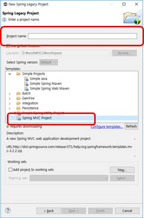

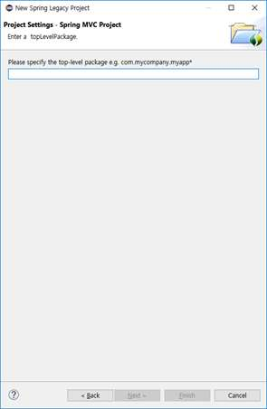

출처: 교육부(2021). 서버 프로그램 구현(LM2001 출처: 교육부(2021). 서버 프로그램 구현(LM200
020211_19v5). 한국직업능력연구원. p.19. 1020211_19v5). 한국직업능력연구원. p.19.
[그림 1-18] 프로젝트명 입력 [그림 1-19] 패키지 입력
(3) 구성된 프로젝트를 확인한다.

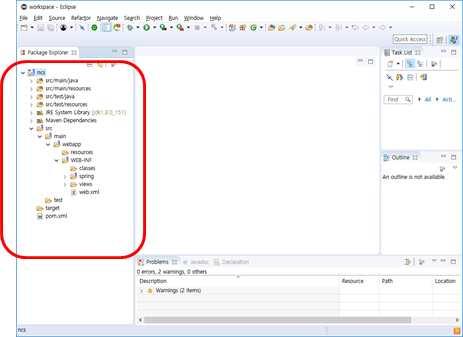

출처: 교육부(2021). 서버 프로그램 구현(LM2001020211_19v5). 한국직업능력연구원. p.20.
[그림 1-20] Maven 기반의 Spring 웹 프로젝트 구성
3. 단위 테스트 자동화 도구의 설치 여부를 확인한다.
pom.xml 파일 안에 단위 테스트 도구가 포함되어 있는지 확인한다.

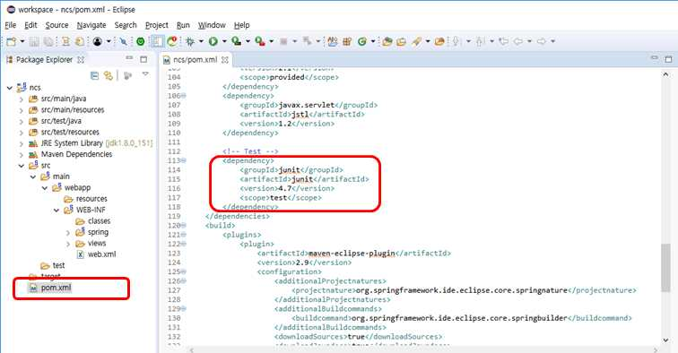

출처: 교육부(2021). 서버 프로그램 구현(LM2001020211_19v5). 한국직업능력연구원. p.20.
[그림 1-21] 단위 테스트 도구 설치 확인 화면 예시
• 형상관리 도구 Git를 설치한다.
형상관리 도구는 Git, SVN, CVS 등 다양한 형상관리 도구가 사용되나, 본 실습에서는
Git를 형상관리 도구로 설치한다.
1. 형상관리 도구를 다운로드한다.

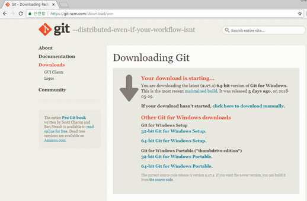

출처: 교육부(2021). 서버 프로그램 구현(LM2001020211_19v5). 한국직업능력연구원. p.21.
[그림 1-22] 형상관리 도구 다운로드 화면 예시(Git 예시)
2. 형상관리 도구를 설치한다.
다운로드한 형상관리 도구를 실행하여 안내에 따라 설치한다.

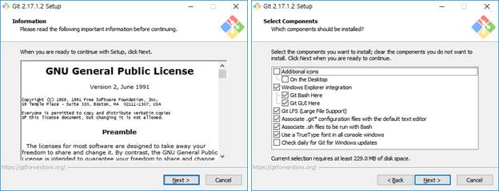

출처: 교육부(2021). 서버 프로그램 구현(LM2001020211_19v5). 한국직업능력연구원. p.21.
[그림 1-23] 형상관리 도구 설치 화면
3. 설치한 형상관리 도구의 환경을 설정한다.
(1) 설치를 완료한 이후에는 사용자 정보를 설정한다.
(2) 사용자 정보는 사용자의 이름과 e-mail을 최우선으로 설정한다.
(3) 사용자 이름 설정: git config --global user.name "사용자 이름”
(4) 사용자 e-mail 설정: git config --global user.email 이메일 주소

출처: 교육부(2021). 서버 프로그램 구현(LM2001020211_19v5). 한국직업능력연구원. p.22.
[그림 1-24] 사용자 이름 및 이메일 설정
(5) 설정 확인: git config --list

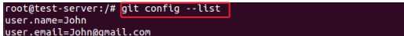

출처: 교육부(2021). 서버 프로그램 구현(LM2001020211_19v5). 한국직업능력연구원. p.22.
[그림 1-25] 사용자 이름 및 이메일 설정 확인

출처: 교육부(2021). 서버 프로그램 구현(LM2001020211_19v5). 한국직업능력연구원. p.22.
[그림 1-26] 개발 환경을 구축하는 모습
수행 tip
•개발에 필요한 하드웨어와 소프트웨어를 파악하여 해당
명세대로 개발 환경을 구축하고, 형상관리 지침에 따라
형상관리 환경을 구축할 수 있도록 한다.

| 학습 1 | 교수·학습 방법 |
| --- | --- |

교수 방법
• 응용 소프트웨어 개발에 필요한 하드웨어 및 소프트웨어 제품의 유형과 용도를 실제 프
로젝트 사례와 함께 소개하고, 학습자가 이를 비교 분석하도록 유도한다.
• 학습자의 사전 경험을 바탕으로 적절한 개발 도구를 선정하고, 팀별 협업 실습 과제를
설계하여 도구 활용법을 습득하도록 지도한다.
• 공식 매뉴얼과 개발자 커뮤니티 사이트 등을 함께 활용하여 학습자가 직접 자료를 탐색
하고 요약 발표할 수 있도록 지도한다.
• 개발 도구 설치 실습을 단계별 과제로 구성하여, 오류를 진단하고 해결해 보는 문제 해
결 중심 활동을 수행하도록 지도한다.
• 형상관리 방침의 구성 요소를 사례 중심으로 설명하고, 이를 바탕으로 학습자가 형상관
리 환경을 직접 설계 및 실습하도록 지도한다.
학습 방법
• 다양한 하드웨어·소프트웨어 유형과 그 용도를 분석하고, 실제 적용 사례를 탐색하여
발표한다.
• 사전 경험을 공유하고 조별로 개발 도구를 선정하여 실습 프로젝트를 수행한다.
• 개발 도구의 공식 문서 및 커뮤니티에서 자료를 찾아 적용하고, 요약 노트를 작성하여
상호 피드백을 수행한다.
• 도구 설치 및 환경 설정을 실습하고, 발생 가능한 오류 해결 방법을 조별로 토론하고
문서화한다.
• 형상관리 시스템을 실제 프로젝트에 적용하여, 버전 관리 및 변경 이력을 직접 관리하
고, 실습 결과를 리포트로 작성한다.

| 학습 1 | 평 가 |
| --- | --- |

평가 준거
• 평가자는 학습자가 학습 목표를 성공적으로 달성하였는지를 평가해야 한다.
• 평가자는 다음 사항을 평가해야 한다.

| 학습 내용 | 학습 목표 | 성취수준 |  |  |
| --- | --- | --- | --- | --- |
|  |  | 상 | 중 | 하 |

- 응용 소프트웨어 개발에 필요한 하드웨어 및 소프트웨어
개발 환경 준비 의 필요 사항을 검토하고, 이에 따라 개발 환경에 필요한
준비를 수행할 수 있다.
- 응용 소프트웨어 개발에 필요한 하드웨어 및 소프트웨어
를 설치하고 설정하여 개발 환경을 구축할 수 있다.
개발 환경 구축
- 사전에 수립된 형상관리 방침에 따라 운영 정책에 부합하
는 형상관리 환경을 구축할 수 있다.
평가 방법
• 포트폴리오

| 학습 내용 | 평가 항목 | 성취수준 |  |  |
| --- | --- | --- | --- | --- |
|  |  | 상 | 중 | 하 |

- 목표시스템의 환경 요구사항에 대한 분석 능력
개발 환경 준비
- 개발 도구들의 역할에 대한 파악 능력
- 개발 도구들의 설치 및 활용에 대한 파악 능력
개발 환경 구축
- 형상관리 지침의 이해와 환경 구축 능력
• 평가자 체크리스트

| 학습 내용 | 평가 항목 | 성취수준 |  |  |
| --- | --- | --- | --- | --- |
|  |  | 상 | 중 | 하 |

| 개발 환경 준비 개발 환경 구축 피드백 | - 목표시스템의 환경 요구사항에 대한 분석 능력 - 개발 도구들의 역할에 대한 파악 능력 - 개발 도구들의 설치 및 활용에 대한 파악 능력 - 형상관리 지침의 이해와 환경 구축 능력 |  |  |  |
| --- | --- | --- | --- | --- |
| 1. 포트폴리오 - 제출한 보고서를- 개발 환경- 형상관리 환경- 개발 환경- 개발 환경 | 평가한 후에 주요 사항에 대하여 의견을 제시한다. 구축 절차에 대한 이해도를 확인하여 미비 사항에 대한 내용을구축 절차에 대한 정확성을 파악하여 미비 사항에 대한 내용을구축에 대한 학습자의 평가 결과가 ‘상’인 경우 모범 사례로 구축에 대한 학습자의 평가 결과가 ‘중’인 경우 부족한 부분을 | 설명한다.설명한다.공유한다.보완할 | 수 | 있도록 |
| 설명한다.- 개발 환경할 수 있도록 | 구축에 대한 학습자의 경가 결과가 ‘하’인 경우 모범 사례를유도한다. | 참조하여 | 다시 | 구축 |
| 2. 평가자 체크리스트- 실습 과정에서- 개발 환경에- 개발 환경에학습자에게- 형상관리 환경파악한 후 | 평가한 후에 개선해야 할 사항 등을 정리하여 설명한다. 필요한 하드웨어와 소프트웨어의 누락 여부를 점검하여 보완할 수필요한 개발 도구를 학습 방향대로 구축하였는지를 점검한 후실무 자료를 제시하여 이해를 높일 수 있게 한다. 구축 후 정상적인 형상관리가 되는지를 확인하여 비정상학습자에게 설명한다. | 있도록성취수준이동작 시 | 유도한다.그 | 낮은원인을 |

학습 1 개발 환경 구축하기

| 학습 2 | 공통 모듈 구현하기 |
| --- | --- |

학습 3 서버 프로그램 구현하기
학습 4 배치 프로그램 구현하기
2-1.
공통 모듈 구현
•공통 모듈의 상세 설계를 기반으로 프로그래밍 언어와 도구를 활용하여 업무 프로세스 및 서
비스의 구현에 필요한 공통 모듈을 작성할 수 있다.
학습 목표
•소프트웨어 측정 지표 중 모듈 간의 결합도는 줄이고 개별 모듈들의 내부 응집도를 높인 공통
모듈을 구현할 수 있다.
필요 지식 /
• 공통 모듈에 대한 이해
공통 모듈은 정보 시스템 구축 시 자주 사용하는 기능들로서 재사용이 가능하게 패키지로
제공하는 독립된 모듈을 의미한다.
1. 재사용(Reuse)
목표시스템의 개발 시간 및 비용 절감을 위하여 검증된 기능을 파악하고 재구성하여
시스템에 응용하기 위한 최적화 작업이다.
<표 2-1> 재사용 범위에 따른 분류
분류 설명
함수와 객체 재사용 클래스(Class)나 함수(Function) 단위로 구현한 소스코드를 재사용한다.
컴포넌트(Component) 단위로 재사용하며, 컴포넌트의 인터페이스를 통
컴포넌트 재사용
해 통신한다.
공통된 기능을 제공하도록 구현된 애플리케이션과의 통신으로 기능을 공
애플리케이션 재사용
유하여 재사용한다.
출처: 교육부(2021). 서버 프로그램 구현(LM2001020211_19v5). 한국직업능력연구원. p.26.
2. 공통 모듈의 종류
목표시스템을 구축하기 위하여 구현하는 공통 모듈들은 공통 모듈의 설계를 기반으로
프로그래밍 언어와 도구를 활용하여 작성한다.

| 학습 내용 | 평가 항목 | 성취수준 |  |  |
| --- | --- | --- | --- | --- |
| <표 2-2> 공통 모듈의구분 분류사용자공통 기술 /통합보안협업사용자시스템디지털모바일 협업공통 기술 사용자디지털요소 기술 출처: 한국정보화진흥원가이드 Ver. 3.7. • 소프트웨어 모듈 응집도는 모듈 도가 높을수록 필요한 | 분류 기능 디렉터리 사용자 통합 인증, 로그인 인증 실명 확인, 역할/권한 관리, 암호화/복호화통계/리포팅 통계 게시판, 동호회, 일정 관리, 전자 우편, 시지, 전자 결재 사용자 관리, 약관 관리, 개인화, 온라인 참여,지원 보 제공/알림 공통 코드 관리, 메뉴 관리, 프로그램 관리,관리 관리, 시스템 관리, 장애 관리 시스템/서비스 연계 시스템 연계 자산 관리 지식 관리 모바일 실시간 공지 서비스, 오프라인 웹정보 연계 서비스, 모바일 기기 식별, 모바일지원 모바일 메뉴 관리 시스템/서비스 연계 시스템 연계 자산 관리 모바일 차트/그래프, 모바일 사진 앨범, 모바일달력, 웹 에디터, 인쇄/출력, 쿠키/세션,지 처리, 인터페이스/화면, 시스템, 파일 등록 방지, 지역화 처리, 웹 소켓 등 표준프레임워크센터(2018. 03.). 정보 시스템 구축 발주자를 위한응집도 내부에서 구성 요소 간에 밀접한 관계를 맺고 있는 정도로요소들로 구성되어 있고 낮을수록 관련이 적은 | 주소록/명함록,온라인로그서비스,메뉴포맷/계산/변환,업로드/다운로드,표준요소들로 | 헬프,관리,모바일멀티미디어프레임워크평가되며, | 문자 메정배치위치제어메시이중적용응집구성되어 |
| 있다. |  |  |  |  |
| 1. 응집도의 유형한 모듈 안의 | 기능들의 연관성 정도를 나타낸다. |  |  |  |

<표 2-3> 응집도 유형
응집도 유형 설명
기능적 응집도 모듈 내부의 모든 기능이 단일한 목적을 위해 수행되는 경우이다.
(Functional Cohesion) 구조도 최하위 모듈에서 많이 발견된다.
모듈 내에서 한 활동으로부터 나온 출력값을 다른 활동의 입력값으로
순차적 응집도
사용하는 경우이다.
(Sequential Cohesion)
예) 행렬 입력 후 그 행렬의 역행렬을 구해서 이를 출력
통신적 응집도 동일한 입력과 출력을 사용하여 다른 기능을 수행하는 활동들이 모여
(Communication 있을 경우이다.
Cohesion) 예) 같은 입력 자료를 사용하여 A를 계산한 후 B를 계산
모듈이 다수의 관련 기능을 가질 때 모듈 안의 구성 요소들이 그 기
절차적 응집도
능을 순차적으로 수행할 경우이다.
(Procedural Cohesion)
예) Restart 루틴: 총계 출력하고 화면을 지우고 메뉴를 표시
연관된 기능이라기보다는 특정 시간에 처리되어야 하는 활동들을 한
시간적 응집도
모듈에서 처리하는 경우이다.
(Temporal Cohesion)
예) 초기치 설정, 종료 처리 등
유사한 성격을 갖거나 특정 형태로 분류되는 처리 요소들이 한 모듈
논리적 응집도 에서 처리되는 경우이다.
(Logical Cohesion) 예) 오류 처리: 자판기의 잔액 부족, 음료수 부족
출력 처리: 직원 인사 정보 출력, 회계 정보 출력
모듈 내부의 각 구성 요소들이 연관이 없을 경우이다.
우연적 응집도
모듈화 장점이 없다.
(Coincidental Cohesion)
유지보수 작업이 어렵다.
출처: 교육부(2021). 서버 프로그램 구현(LM2001020211_19v5). 한국직업능력연구원. p.28.
2. 응집도와 품질
목표시스템의 기준에 따라 모듈을 구성할 수 있으나, 품질 측면에서는 응집도의 유형
중 기능적 응집도가 가장 높고 우연적 응집도가 가장 낮다.

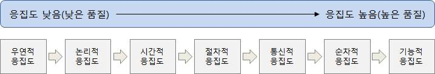

출처: 교육부(2021). 서버 프로그램 구현(LM2001020211_19v5). 한국직업능력연구원. p.28.
[그림 2-1] 응집도와 품질
• 소프트웨어 모듈 결합도
결합도는 모듈과 모듈 간의 관련성 정도를 나타내며, 관련이 적을수록 모듈의 독립성이 높
아져 모듈 간 영향이 적어지게 된다.
1. 결합도의 유형
<표 2-4> 결합도 유형
응집도 유형 설명
모듈 간의 인터페이스로 전달되는 파라미터를 통해서만 모듈 간의 상
자료 결합도
호 작용이 일어나는 경우이다.
(Data Coupling)
예) 제곱근을 계산하는 함수로 하나의 정수를 전달
스탬프 결합도 모듈 간의 인터페이스로 배열이나 오브젝트(Object), 스트럭처(Struct
(Stamp Coupling) ure) 등이 전달되는 경우이다.
제어 결합도 단순 처리할 대상인 값만 전달되는 게 아니라 어떻게 처리를 해야 한
(Control Coupling) 다는 제어 요소가 전달되는 경우이다.
외부 결합도 다수의 모듈이 모듈 밖에서 도입된 데이터, 프로토콜, 인터페이스 등
(External Coupling) 을 공유할 때 발생하는 경우이다.
파라미터가 아닌 모듈 밖에 선언되어 있는 전역 변수를 참조하고 전
공통 결합도
역 변수를 갱신하는 식으로 상호 작용하는 경우이다.
(Common Coupling)
예) 전역 변수
내용 결합도
다른 모듈 내부에 있는 변수나 기능을 다른 모듈에서 사용하는 경우이다.
(Content Coupling)
출처: 교육부(2021). 서버 프로그램 구현(LM2001020211_19v5). 한국직업능력연구원. p.29.
2. 결합도와 품질
목표시스템의 환경에 따라 모듈 구성의 결합 정도를 결정할 수 있으나, 품질 측면에서
결합도의 유형 중 자료 결합도의 품질이 가장 높고, 내용 결합도의 품질이 가장 낮다.

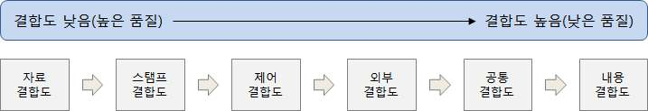

출처: 교육부(2021). 서버 프로그램 구현(LM2001020211_19v5). 한국직업능력연구원. p.29.
[그림 2-2] 결합도와 품질
수행 내용 / 공통 모듈 구현하기
재료·자료
• 공통 모듈 관리 대장, 공통 모듈 프로그램 설계서
• 요구사항 정의서
• 시스템 아키텍처
기기(장비･공구)
• 컴퓨터 또는 PC, 네트워크 장비, 프린터, 빔 프로젝트
• CASE 도구(SW 개발 지원 도구, SW 테스트 지원 도구 등)
• 형상관리 도구
안전･유의 사항
• 공통 모듈 설계 산출물에 대한 이해가 선행되어야 한다.
• 프로그램 개발 경험과 SQL 작성 경험이 필요하다.
수행 순서
• 공통 모듈의 상세 설계를 기반으로 작성해야 할 공통 모듈을 확인한다.
공통 모듈을 작성하기 위해서는 애플리케이션 설계 단계에서 작성한 공통 모듈 관리 대장
을 통해 작성해야 할 공통 모듈들을 확인하고 공통 모듈별 프로그램 설계서를 확인한다.

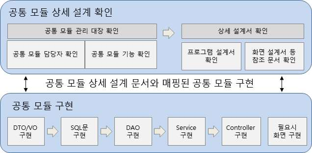

출처: 교육부(2021). 서버 프로그램 구현(LM2001020211_19v5). 한국직업능력연구원. p.30.
[그림 2-3] 공통 모듈 상세 설계를 기반으로 공통 모듈 구현 순서
1. 공통 모듈 관리 대장을 확인한다.
공통 모듈 관리 대장은 설계 단계에서 작성된 구현해야 할 전체 시스템의 공통 모듈
목록 산출물이다.(활용 서식 단위 시스템 공통 모듈 관리 대장 참고)
(1) 모듈 담당자 항목에서 담당해야 할 공통 모듈을 확인한다.
아래 예시는 김길동 담당자가 작성해야 할 공통 모듈을 확인한 예시이다.
<표 2-5> 공통 모듈 관리 대장 예
입력
순 시스 엔터 입 출력 출력 출력 항목
ID 기능 설명 담당자 항목
번 템 티 력 (영상 (에러) 설명
설명
[204]코드 코드
C_C 공통 조회용 [200],
코드 코 없음 정보를
1 ode_ 인사 코드 코드 김길동 코드, 코드
정보 드 [500]서버 배열로
R 조회 정보 코드명
에러 제공
(2) 공통 모듈의 기능을 확인한다.
작성해야 할 공통 모듈의 기능을 확인하고 상세 설계 산출물을 확인하기 위해 ID를
확인한다.
<표 2-6> 공통 모듈 관리 대장에서의 기능 확인 예시
입력
순 시스 엔터 입 출력 출력 출력 항목
ID 기능 설명 담당자 항목
번 템 티 력 (영상 (에러) 설명
설명

| 1 | C_Code_R | 인사 | 공통코드조회 | 조회용코드정보 | 코드정보 | 코드 | 김길동 | [200],코드,코드명 | [204]코드없음[500]서버에러 | 코드 | 코드정보를배열로제공 |
| --- | --- | --- | --- | --- | --- | --- | --- | --- | --- | --- | --- |

2. 공통 모듈 프로그램 설계서를 확인한다.
공통 모듈 관리 대장 산출물에서의 ID와 일치하는 프로그램 설계서 산출물에서의 프로
그램 ID를 확인한다.

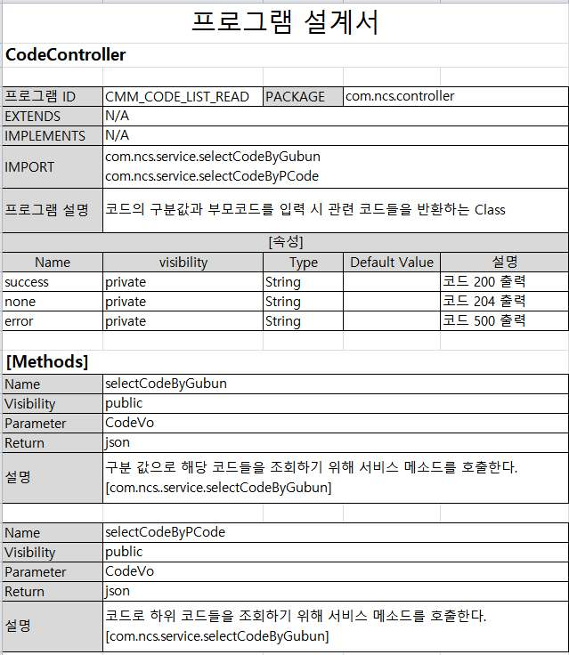

출처: 교육부(2021). 서버 프로그램 구현(LM2001020211_19v5). 한국직업능력연구원. p.32.
[그림 2-4] 공통 모듈 관리 대장에서의 ID와 일치하는 프로그램 설계서 예시
• 공통 모듈의 상세 설계 산출물을 기반으로 공통 모듈을 구현한다.
1. 공통 모듈을 구현하기 위한 I/O 오브젝트(DTO/VO)를 정의한다.
공통 코드 조회를 위해 필요한 변수들을 정의하여 계층 간 데이터 교환을 위해 사용한다.
DTO(Data Transfer Object) 또는 VO(Value Object)라고 명칭한다.

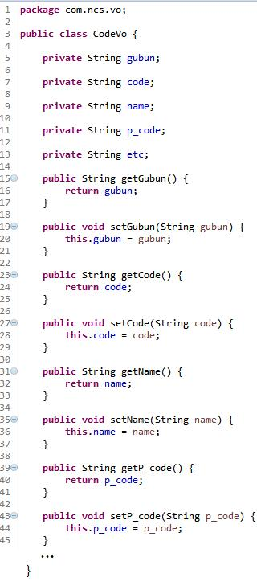

출처: 교육부(2021). 서버 프로그램 구현(LM2001020211_19v5). 한
국직업능력연구원. p.33.
[그림 2-5] DTO/VO 구문 예시
2. 공통 모듈을 구현하기 위한 SQL을 작성한다.
공통 코드 조회를 위한 SQL 쿼리문을 마이바티스(Mybatis) XML 파일로 구현한 예시
이다.

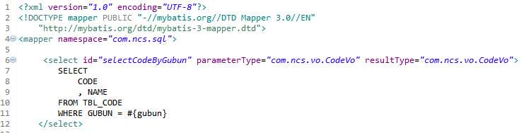

출처: 교육부(2021). 서버 프로그램 구현(LM2001020211_19v5). 한국직업능력연구원. p.34.
[그림 2-6] 구분으로 공통 코드를 조회하는 SQL 구문 예시

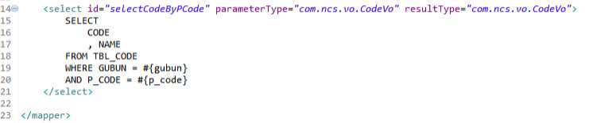

출처: 교육부(2021). 서버 프로그램 구현(LM2001020211_19v5). 한국직업능력연구원. p.34.
[그림 2-7] 부모 코드로 공통 코드를 조회하는 SQL 구문 예시
3. 데이터 접근 객체(DAO: Data Access Object)를 구현한다.
DAO에서는 SQL문을 구현한 XML 파일에서의 해당 ID값을 호출하여 데이터를 조회하
거나 조작한다.

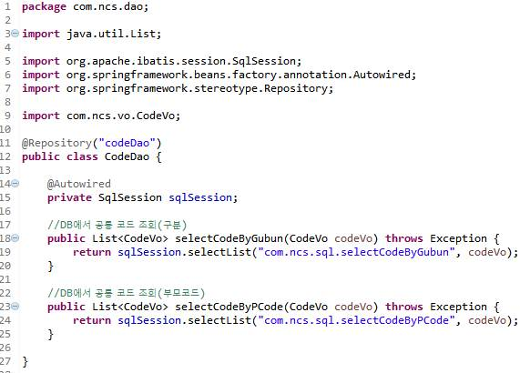

출처: 교육부(2021). 서버 프로그램 구현(LM2001020211_19v5). 한국직업능력연구원. p.34.
[그림 2-8] 공통 코드를 조회하는 DAO 구문 예시
4. 서비스(Service) 클래스를 구현한다.
동일한 시스템 내에서 사용되는 결합도가 낮은 공통 모듈을 구현하기 위해 스탬프 결
합도 수준의 서비스를 구현한다.

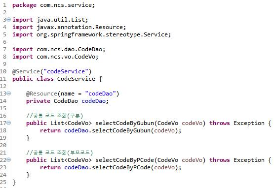

출처: 교육부(2021). 서버 프로그램 구현(LM2001020211_19v5). 한국직업능력연구원. p.35.
[그림 2-9] 공통 코드를 조회하는 Service 구문 예시
5. 컨트롤러(Controller) 클래스를 구현한다.
시스템 내부 및 외부에서 사용할 수 있도록 REST API를 통한 공통 모듈 구현 사례이다.

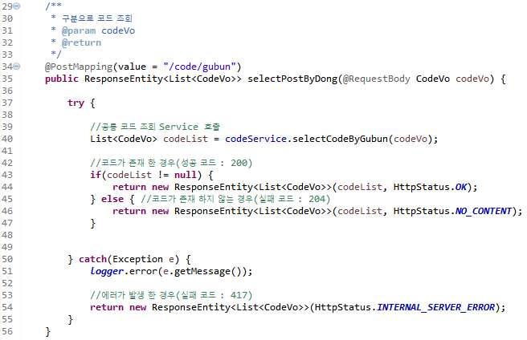

출처: 교육부(2021). 서버 프로그램 구현(LM2001020211_19v5). 한국직업능력연구원. p.35.
[그림 2-10] 구분으로 공통 코드를 조회하는 REST API Controller 구문 예시

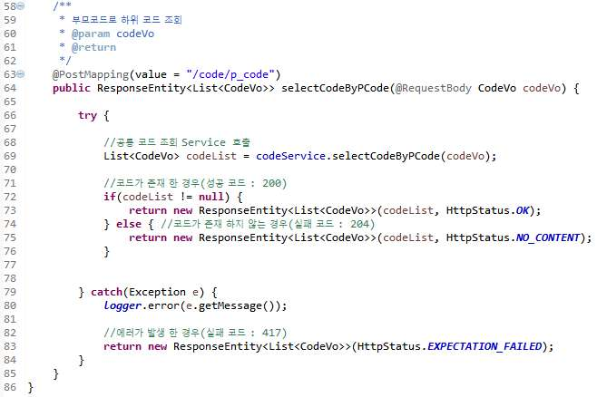

출처: 교육부(2021). 서버 프로그램 구현(LM2001020211_19v5). 한국직업능력연구원. p.36.
[그림 2-11] 부모 코드로 공통 코드를 조회하는 REST API Controller 구문 예시
수행 tip
•공통 모듈 상세 설계 산출물을 통해 구현해야 할 공통
모듈을 파악해야 한다.
•공통 모듈의 특성과 명세를 파악하여 개발 언어와 도구
를 활용하여 해당 모듈이 정상적으로 작동할 수 있도록
구현할 수 있어야 한다.
2-2.
공통 모듈 테스트 계획 수립
•개발된 공통 모듈의 내부 기능과 제공하는 인터페이스에 대해 테스트할 수 있는 테스트 케이
학습 목표
스를 작성하고, 단위 테스트를 수행하기 위한 테스트 조건을 명세화할 수 있다.
필요 지식 /
• 테스트 케이스의 이해
1. 테스트 케이스(Test Case)의 개념
테스트 케이스란 요구사항을 준수하는지 검증하기 위하여 테스트 조건, 입력값, 예상
출력값 및 수행한 결과 등 테스트 조건을 명세한 것이다.
2. 테스트 케이스의 구성 요소
<표 2-7> 테스트 케이스 구성 요소(IEEE 829)
항목 설명
식별자(Identifier) 항목 식별자, 일련번호
테스트 항목(Test Item) 테스트할 모듈 또는 기능
입력 명세(Input Specification) 입력값 또는 테스트 조건
출력 명세(Output Specification) 테스트 케이스 실행 시 기대되는 출력값 결과
환경 설정(Environmental Needs) 테스트 수행 시 필요한 하드웨어나 소프트웨어 환경
특수 절차 요구
(Special Procedure 테스트 케이스 수행 시 특별히 요구되는 절차
Requirement)
의존성 기술
테스트 케이스 간의 의존성
(Inter-case Dependencies)
출처: 교육부(2021). 서버 프로그램 구현(LM2001020211_19v5). 한국직업능력연구원. p.37.
• 테스트 프로세스
테스트 프로세스는 테스트 수행과 관련된 활동들이 의도된 테스트 목적과 조건을 달성할
수 있도록 도와주는 역할을 한다.
1. 테스트 프로세스의 구성
테스트 프로세스는 계획 및 제어, 분석 및 설계, 구현 및 실행, 평가, 완료 단계로 구성
된다.

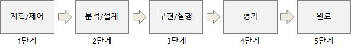

출처: 교육부(2021). 서버 프로그램 구현(LM2001020211_19v5). 한국직업능력연구원. p.38.
[그림 2-12] 테스트 프로세스 5단계
2. 테스트 프로세스의 단계
(1) 계획 및 제어
테스트의 목표와 목적을 달성하기 위해 필요한 활동을 계획하고, 계획에 준수하여
진행되고 있는지 지속적인 제어 활동을 하는 단계이다.
(2) 분석 및 설계
일반적이고 추상적인 테스트의 목적을 구체화하여 테스트 시나리오와 테스트 케이스
로 변환하는 활동 단계이다.
(3) 구현 및 실행
테스트를 효과적이고 효율적으로 수행하기 위해 테스트 케이스들을 조합하고 테스트
수행 시 필요한 정보들을 포함하는 테스트 프러시저를 명세하는 활동 단계이다.
(4) 평가
계획 단계에서 정의하였던 테스트 목표에 맞게 테스트가 수행되었는지를 평가하고
진행 상황을 기록하는 활동 단계이다.
(5) 완료
테스트 수행 시 명세한 조건들을 수집하고 테스트 수행 시 발생한 사항 및 경험들
을 축적하는 활동 단계이다.
수행 내용 / 공통 모듈 테스트 계획 수립하기
재료·자료
• 공통 모듈 관리 대장, 공통 모듈 프로그램 설계서
• 요구사항 정의서
• 개발된 공통 모듈 산출물
기기(장비･공구)
• 컴퓨터 또는 PC, 네트워크 장비, 프린터, 빔 프로젝트
• CASE 도구(SW 개발 지원 도구, SW 테스트 지원 도구 등)
• 형상관리 도구
안전･유의 사항
• 공통 모듈 설계 산출물에 대한 이해가 선행되어야 한다.
• 목표시스템의 요구사항 범위에 대한 이해가 필요하다.
수행 순서
• 단위 테스트 케이스 작성을 위한 참조 문서를 수집한다.
공통 모듈 상세 설계 산출물과 요구사항 정의서, 요구사항 명세서 등 분석 및 설계 문서를
수집한다.

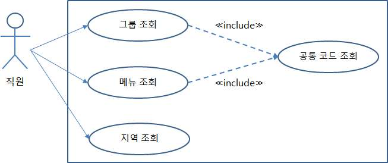

출처: 교육부(2021). 서버 프로그램 구현(LM2001020211_19v5). 한국직업능력연구원. p.39.
[그림 2-13] 공통 모듈로 식별된 유스케이스 참고 예시
• 단위 테스트 케이스를 작성한다.
1. 단위 테스트 방식을 결정한다.
개발된 공통 모듈을 실행하여 테스트하는 동적 테스트와 수동 또는 자동화 도구를 사
용하여 검토하는 정적 테스트 중 적절한 테스트 방식을 결정한다.
2. 단위 테스트의 범위를 결정한다.
(1) 공통 모듈의 범위 및 상위 요구사항의 범위에 따라 테스트 범위를 판단한다.
(2) 테스트 수행 횟수를 결정한다.
(3) 테스트의 결과를 검증하기 위한 결괏값 산출 방식을 결정한다.
3. 단위 테스트의 방식과 범위에 따라 테스트 케이스를 작성한다.
(1) 테스트 케이스 작성에 필요한 항목을 작성한다.
(가) 테스트 단계명, 작성자, 작성일, 승인자, 문서 버전 등의 항목을 작성한다.
단위, 통합, 시스템 테스트 등 테스트의 단계와 작성자, 승인자, 문서 버전, 테스
트 범위, 테스트 조직 등 공통 항목을 작성한다.
(나) 테스트 ID를 작성한다.
테스트 케이스를 식별하기 위한 고유한 테스트 ID를 작성한다.
(다) 테스트의 목적 및 기능을 요약하여 작성한다.
테스트 수행의 목적과 기능을 간략하게 요약하여 작성한다.
(라) 입력값을 작성한다.
테스트 수행 시 입력할 데이터를 작성한다.
(마) 예상 결괏값을 작성한다.
테스트 수행 후 기대되는 결과 데이터(값, 메시지, 화면 등)를 작성한다.
(바) 테스트를 수행할 환경을 작성한다.
테스트를 수행하는 물리적, 논리적 환경을 작성한다.
(사) 테스트를 수행하기 위한 전제 조건을 작성한다.
테스트 케이스 간의 의존성 및 선행 조건 등 고려 사항을 작성한다.
(아) 성공/실패 기준을 정의한다.
테스트의 성공과 실패를 결정하는 조건을 명확하게 작성한다.
(자) 테스트 수행 시 필요한 특수 절차를 작성한다.
테스트를 수행 시 사용자의 요구사항이나 필요한 특수한 절차를 작성한다.
(2) 정의된 항목 요소를 바탕으로 테스트 케이스를 작성한다(활용 서식 단위 테스트 케이스
참고).

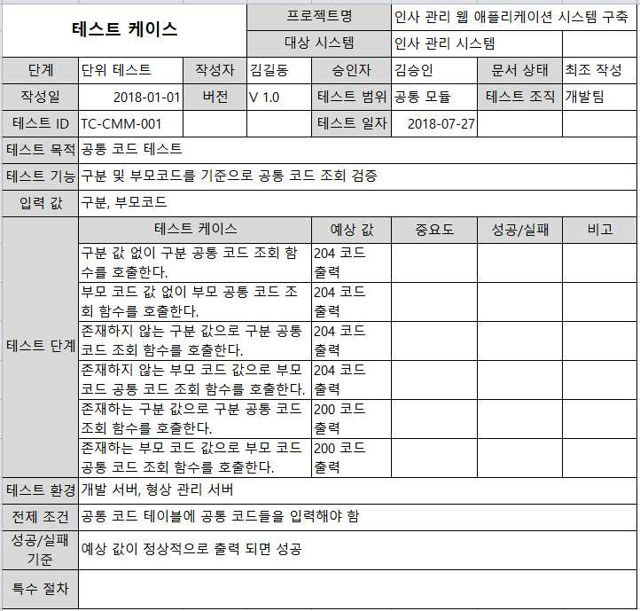

출처: 교육부(2021). 서버 프로그램 구현(LM2001020211_19v5). 한국직업능력연구원. p.41.
[그림 2-14] 공통 코드 단위 테스트 케이스 예시
• 작성된 단위 테스트 케이스를 내부 검토한다.
1. 단위 테스트 케이스의 적정성을 검토한다.
PM(Project Manager), 기획자, 아키텍처, 개발자, 테스트 담당자 등 내부 이해관계자
들이 작성된 테스트 케이스의 적정성을 검토한다.
2. 요구사항에 충족할 수 있는 테스트 범위인지 검토한다.
단위 테스트 케이스가 요구사항에 충족할 수 있도록 작성되었는가에 대한 테스트 범위
를 검토한다.
3. 공통 모듈은 다른 모듈에서 활용되므로 활용성이나 영향도 등을 고려하여 검토한다.

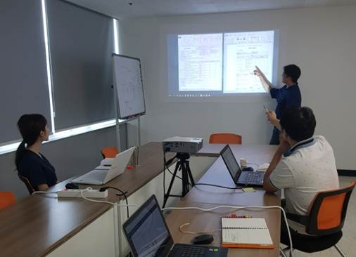

출처: 교육부(2021). 서버 프로그램 구현(LM2001020211_19v5). 한국직업능력연구원. p.42.
[그림 2-15] 단위 테스트 케이스의 적정성을 검토하는 모습 예시
• 작성된 단위 테스트 케이스를 고객에게 승인을 획득한다.
작성된 테스트 케이스를 고객 및 PM 등 이해관계자들에게 승인을 획득한다.
• 테스트를 명세하기 위한 테스트 도구를 설정한다.
1. 단위 테스트 도구를 사용하기 위한 Wizard를 선택한다.

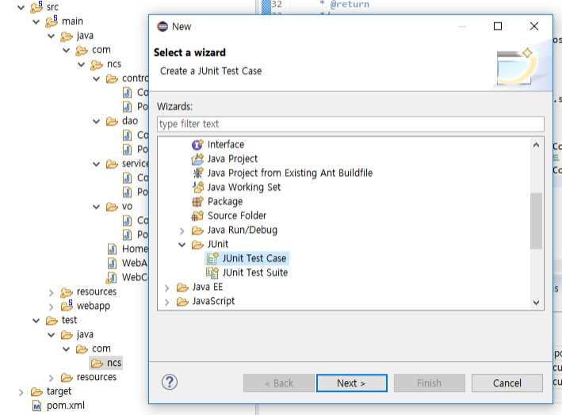

출처: 교육부(2021). 서버 프로그램 구현(LM2001020211_19v5). 한국직업능력연구원. p.42.
[그림 2-16] 단위 테스트 케이스 선택 예시(JUnit Test Case 예시)
2. 테스트 케이스(Test Case)의 이름을 입력하고 Next를 클릭한다.
(1) 테스트 케이스 Name을 입력한다.
(2) 테스를 수행할 클래스를 선택한다.

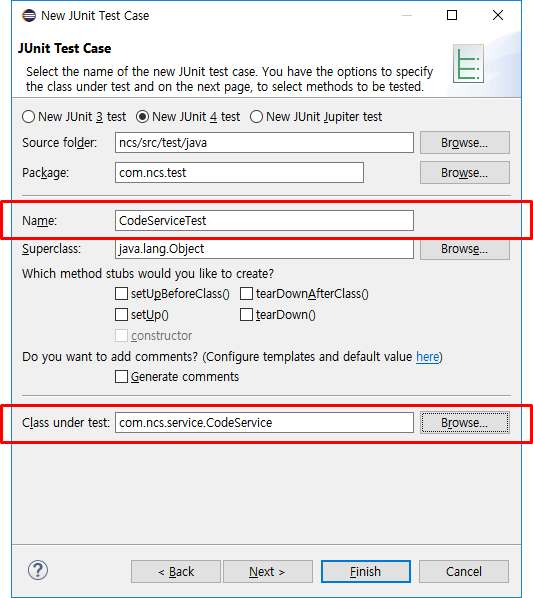

출처: 교육부(2021). 서버 프로그램 구현(LM2001020211_19v5). 한국직업능력연구원. p.43.
[그림 2-17] 테스트 케이스 생성 예시
3. 테스트를 수행할 함수를 선택하고 Finish를 클릭한다.

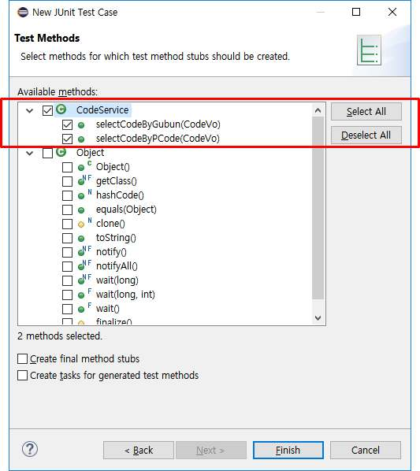

출처: 교육부(2021). 서버 프로그램 구현(LM2001020211_19v5). 한국직업능력연구원. p.43.
[그림 2-18] 테스트 케이스 생성 시 함수 선택 예시
4. 테스트 구문을 작성한다.

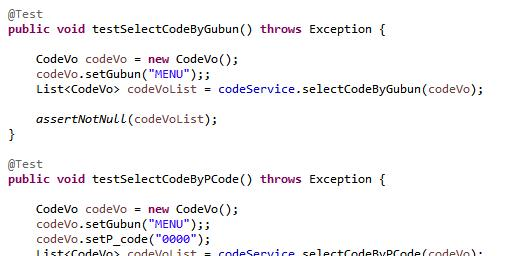

출처: 교육부(2021). 서버 프로그램 구현(LM2001020211_19v5). 한국직업능력연구원. p.44.
[그림 2-19] 테스트 구문 예시
5. 테스트 도구를 실행한다.

출처: 교육부(2021). 서버 프로그램 구현(LM2001020211_19v5). 한국직업능력연구원. p.44.
[그림 2-20] 테스트 도구 실행 화면 예시
• 테스트 결과를 명세화한다.
테스트의 결과를 확인하여 테스트 케이스에 성공/실패 결과 및 필요 항목을 기록한다.
수행 tip
•개발된 공통 모듈의 기능과 인터페이스 테스트를 위한
테스트 케이스를 작성하고, 그에 따른 단위 테스트를
수행할 수 있도록 한다.

| 학습 2 | 교수·학습 방법 |
| --- | --- |

교수 방법
• 공통 모듈 상세 설계서를 활용해 실제 구현 절차를 단계적으로 안내하고, 설계-구현-검
증 과정을 연계하여 실습한다.
• 여러 애플리케이션에 재사용되는 공통 모듈의 특징을 사례 기반으로 분석하고, 코드 최
적화 전략을 학습자 스스로 도출하도록 유도한다.
• 결합도와 응집도의 개념을 비교하며 시각 자료를 통해 개념을 구조화하고, 모듈 설계에
어떻게 반영되는지를 실습 과제 중심으로 설명한다.
• 테스트 케이스 작성법의 다양한 유형을 비교 분석하게 하여, 학습자가 직접 적용 가능
한 케이스를 설계하고 적용해 보도록 지도한다.
• 테스트 도구 선정 기준(성능, 지원 언어, CI/CD 연동 등)을 토의하고, 실제 도구를 비
교 체험하며 사용법을 익히도록 지도한다.
학습 방법
• 공통 모듈 설계서를 분석하고, 이를 바탕으로 구현 로직을 직접 설계하고 개발한다.
• 공통 모듈 작성 시 코드 재사용성과 성능을 고려한 전략을 팀 기반으로 토의하고, 실습
을 통해 구현한다.
• 결합도와 응집도 원리를 파악한 후, 예제 코드를 분석하고 개선안을 제안하는 활동을
수행한다.
• 테스트 케이스 작성 기법을 비교한 후, 직접 공통 모듈에 적용이 가능한 테스트 코드를
작성하고 팀 리뷰를 통해 피드백을 주고받는다.
• 테스트 도구의 기능을 비교 실험하고, 각 도구를 실제 공통 모듈 테스트에 적용한 결과
를 문서화하여 발표한다.

| 학습 2 | 평 가 |
| --- | --- |

평가 준거
• 평가자는 학습자가 학습 목표를 성공적으로 달성하였는지를 평가해야 한다.
• 평가자는 다음 사항을 평가해야 한다.

| 학습 내용 | 학습 목표 | 성취수준 |  |  |
| --- | --- | --- | --- | --- |
|  |  | 상 | 중 | 하 |

- 공통 모듈의 상세 설계를 기반으로 프로그래밍 언어와 도
구를 활용하여 업무 프로세스 및 서비스의 구현에 필요한
공통 모듈을 작성할 수 있다.
공통 모듈 구현
- 소프트웨어 측정 지표 중 모듈 간의 결합도는 줄이고 개
별 모듈들의 내부 응집도를 높인 공통 모듈을 구현할 수
있다.
- 개발된 공통 모듈의 내부 기능과 제공하는 인터페이스에
공통 모듈 테스트
대해 테스트할 수 있는 테스트 케이스를 작성하고, 단위
계획 수립
테스트를 수행하기 위한 테스트 조건을 명세화할 수 있다.
평가 방법
• 평가자 체크리스트

| 학습 내용 | 평가 항목 | 성취수준 |  |  |
| --- | --- | --- | --- | --- |
|  |  | 상 | 중 | 하 |

- 공통 모듈 명세에 따른 기능을 개발 언어와 도구를 활용
하여 개발된 모듈의 완전성
공통 모듈 구현
- 결합도를 줄이고 응집도를 높일 수 있는 공통 모듈 개발
의 기본 원칙에 대한 파악 능력
- 공통 모듈의 기능과 인터페이스 테스트를 위한 테스트 계
공통 모듈 테스트 획 수립의 적정성
계획 수립 - 공통 모듈의 기능과 인터페이스 테스트를 위한 테스트 케
이스의 적정성
• 포트폴리오

| 학습 내용 | 평가 항목 | 성취수준 |  |  |
| --- | --- | --- | --- | --- |
|  |  | 상 | 중 | 하 |

| 공통 모듈 구현 공통 모듈 테스트계획 수립 피드백 | - 공통 모듈 명세에 따른 기능을 개발 언어와 도구를 활용하여 개발된 모듈의 완전성 - 결합도를 줄이고 응집도를 높일 수 있는 공통 모듈 개발의 기본 원칙에 대한 파악 능력 - 공통 모듈의 기능과 인터페이스 테스트를 위한 테스트 계획 수립의 적정성 - 공통 모듈의 기능과 인터페이스 테스트를 위한 테스트 케이스의 적정성 |  |  |  |
| --- | --- | --- | --- | --- |
| 1. 평가자 체크리스트- 실습 과정을 | 체크리스트에 따라 평가한 후에 개선해야 할 사항 등을 정리한 | 후 | 학습자에게 |  |
| 설명한다. - 공통 모듈동작 시 그- 결합도와 실무 자료를- 공통 모듈할 수 있도록 | 명세를 파악하여 작성된 개발 모듈이 설계서대로 개발되었는지문제점을 정리하여 개선 사항을 제시한다. 응집도의 개념에 대한 이해도를 파악하여 부족한 이해도에 대해제시한다. 테스트를 위한 테스트 케이스 작성 기법과 테스트 결과를 보고실무 자료를 제시한다. | 확인하여보충할미비 | 수 사항을 | 비정상있도록보완 |
| 2. 포트폴리오 - 제출한 보고서를- 개발 언어와를 보고 비정상- 개발된 공통- 공통 모듈- 공통 모듈할 수 있도록- 공통 모듈여 다시 구축할 | 평가한 후에 주요 사항에 대하여 의견을 제시한다. 도구의 활용에 따른 공통 모듈 명세서에 정의된 기능이 정상적으로동작의 원인과 조치 방안에 대해 설명한다. 모듈의 결합도와 응집도의 이해도를 확인하여 미비 사항을 명세를 파악하여 작성된 공통 모듈 작성 결과가 ‘상’인 경우 모범명세를 파악하여 작성된 공통 모듈 작성 결과가 ‘중’인 경우설명한다. 명세를 파악하여 작성된 공통 모듈 작성 결과가 ‘하’인 경우 모범수 있도록 유도한다. | 설명한다.사례로부족한사례를 | 동작하는지공유한다.부분을 | 보완참조하 |

학습 1 개발 환경 구축하기
학습 2 공통 모듈 구현하기

| 학습 3 | 서버 프로그램 구현하기 |
| --- | --- |

학습 4 배치 프로그램 구현하기
3-1.
서버 프로그램 확인
학습 목표 •업무 프로세스 맵과 세부 업무 프로세스를 확인할 수 있다.
필요 지식 /
• 프로세스의 이해
1. 프로세스의 정의
프로세스(Process)란 개인이나 조직이 한 개 이상의 정보 자원(Input)을 활용하여, 가
치 있는 산출물(Output)을 고객(Customer)에게 제공하기 위해 수행하는 모든 관련 활
동들의 집합을 의미한다. 즉, 입력(Input)을 가공·변환하여 고객이 원하는 제품/서비스
(Output)를 만들어 내는 가치 사슬(Value Chain)을 말하며, 업무 절차, 순서, 방법 등
을 구체적으로 정의한 활동들의 집합이다. 디지털 환경에서 프로세스는 자동화, 표준화,
시스템화되어 운영되며, 프로세스 개선은 기업 경쟁력과 직결된다.

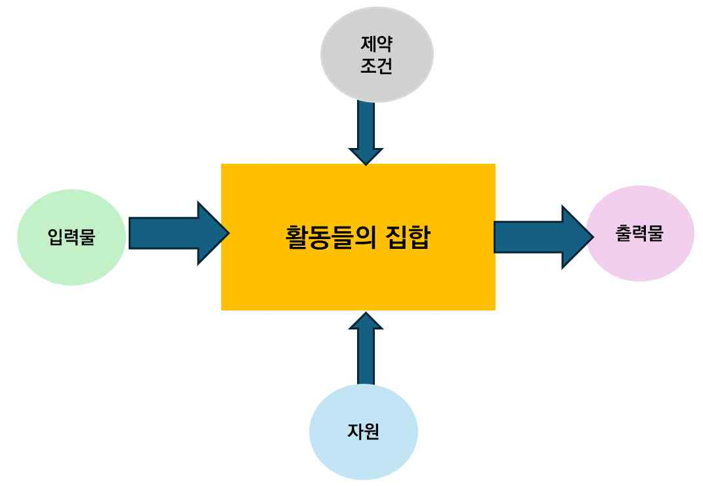

출처: 집필진 제작(2025)
[그림 3-1] 프로세스 개념

| 학습 내용 | 평가 항목 | 성취수준 |  |  |
| --- | --- | --- | --- | --- |
| <표 3-1> 프로세스항목 공급자 입력 활동 집합 출력 고객 | 모델의 구성 항목 설명 응용 SW와의입력을 제공하는 개인이나 조직 요구사항 공급자에 의해 제공되는 정보 자원 SW의 Input입력을 가치 있는 산출물로 변환시켜 출력하 SW 기능, 로직,는 활동들 프로세스를 통해 고객에게 제공되는 가치 있 화면 출력, 레포트,는 제품/서비스 Response 제품/서비스 또는 출력의 대상이 되는 개인 SW의 사용자(User),이나 조직 | 관계Form,비즈니스API | API, DB소비자 | 규칙 |
| 2. 프로세스의 구성프로세스의 필수Task, 프로세스<표 3-2> 프로세스구성 요소 프로세스 책임자(Owner) 프로세스 맵 (Map)프로세스 Task프로세스 성과 지표프로세스 조직경영자의 리더십(Leadership) | 요소 구성 요소에는 프로세스 책임자(Owner), 프로세스성과 지표, 프로세스 조직, 경영자의 리더십(Leadership)구성 요소 기능/설명 프로세스의 설계, 운영, 개선을 총괄. 지속적 성과 관리상위/하위 프로세스의 체계를 도식화. 업무 흐름, 관계프로세스 내에서 수행해야 할 구체적 작업 단위 프로세스가 기대하는 성과를 측정·관리하기 위한 지표프로세스 수행을 위한 조직·역할 체계 경영 관점에서 프로세스의 중요성 인식, 지원, 방향 제시 | 맵(Map),등이담당시각화(KPI 등) | 있다. | 프로세스 |
| 3. 프로세스와 응용 | SW의 관계 |  |  |  |
| (1) 프로세스 기반응용 SW는응용 SW와의은 대표적기반으로 <표 3-3> 프로세스구성 요소 업무 흐름 업무 데이터 | 응용 SW 개발 실제 업무 프로세스를 시스템화·자동화하기 위해 관계는 다음과 같다. BPM(Business Process 예시이며, ERP, CRM, SCM 등 모든 Enterprise SW는설계를 하며, 업무 프로세스 변경 시 SW도 함께 개편되어야구성 요소와 응용 SW 관계 기능/설명 시스템 기능 DB 설계 | 개발되며,Management)업무 | 한다. | 프로세스와시스템프로세스 |

구성 요소 기능/설명
업무 규칙 비즈니스 로직
업무 프로세스 요소 응용 SW 설계 적용
프로세스 Map 시스템 아키텍처, 기능 모듈 설계
프로세스 Task 프로그램 단위 기능 설계 (Use Case, User Story)
프로세스 성과 지표 시스템 KPI, Dashboard 개발
프로세스 Owner 시스템 담당자, PM 역할
업무 흐름 화면 흐름도, API 설계
• 프로세스의 맵(Map)
프로세스의 Map은 상위 프로세스에서 하위 프로세스로의 흐름 체계를 도식화한 청사진으
로 다양한 형태로 표현할 수 있다.
1. 구조적 분석 기법에서의 자료 흐름도

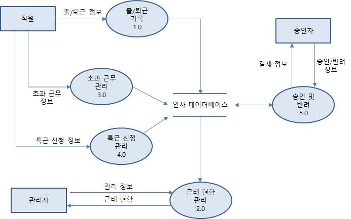

출처: 교육부(2021). 서버 프로그램 구현(LM2001020211_19v5). 한국직업능력연구원. p.50.
[그림 3-2] 레벨(Level) 0의 자료 흐름도 예시
2. 객체 지향 분석 기법에서의 사용 사례 다이어그램

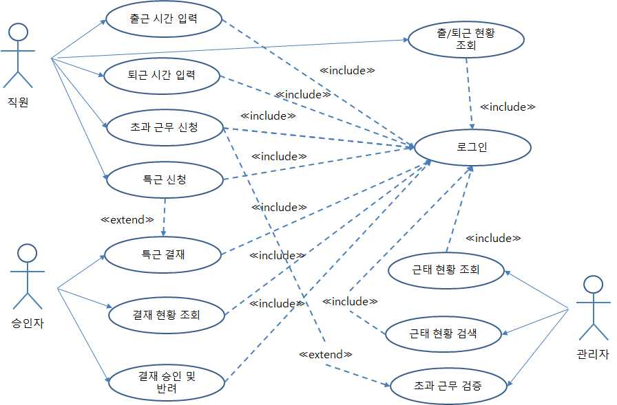

출처: 교육부(2021). 서버 프로그램 구현(LM2001020211_19v5). 한국직업능력연구원. p.50.
[그림 3-3] 사용 사례 다이어그램 예시
수행 내용 / 서버 프로그램 확인하기
재료·자료
• 프로그램 관리 대장, 프로그램 설계서, 화면 설계서
• 요구사항 정의서
• 시스템 아키텍처
기기(장비･공구)
• 컴퓨터 또는 PC, 네트워크 장비, 프린터, 빔 프로젝트
• CASE 도구(SW 개발 지원 도구, SW 테스트 지원 도구 등)
• 형상관리 도구
안전･유의 사항
• 설계 산출물에 대한 이해가 선행되어야 한다.
• 완료된 산출물은 형상관리 서버에 반영하여야 한다.
수행 순서
• 상세 설계를 기반으로 담당 업무를 확인한다.
업무 프로세스를 확인하기 위해서는 애플리케이션 설계 단계에서 작성한 프로그램 관리 대
장을 통해 작성해야 할 업무 프로그램들을 확인하고 프로그램 설계서와 업무 프로세스 맵
을 확인한다.
1. 프로그램 관리 대장을 확인한다.(활용 서식 프로그램 관리 대장 참고)
프로그램 관리 대장은 설계 단계에서 작성된 구현해야 할 전체 시스템의 프로그램 목
록 산출물이다. 아래 예시는 이순신 담당자가 구현해야 할 우편번호 조회 기능을 확인
한 예시이다.

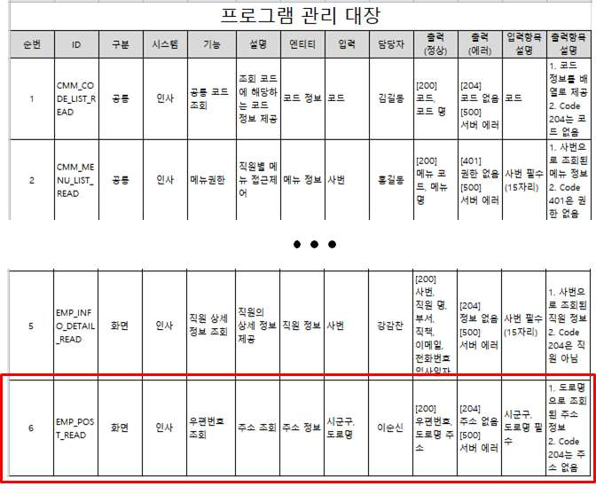

출처: 교육부(2021). 서버 프로그램 구현(LM2001020211_19v5). 한국직업능력연구원. p.52.
[그림 3-4] 프로그램 관리 대장에서의 담당자 확인 예시
2. 업무 프로세스 맵을 확인한다.
프로그램 관리 대장에서 확인한 프로세스에 대한 업무 프로세스 체계를 확인한다.

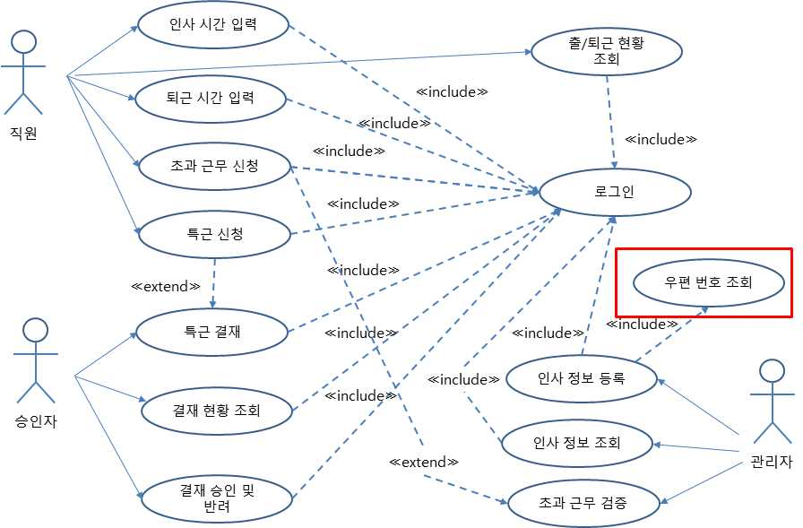

출처: 교육부(2021). 서버 프로그램 구현(LM2001020211_19v5). 한국직업능력연구원. p.52.
[그림 3-5] 업무 프로세스 맵 확인 예시
• 세부 업무 프로세스를 확인한다.
1. 프로그램 설계서를 확인한다.
프로그램 관리 대장 산출물에서의 ID와 일치하는 프로그램 설계서 산출물에서의 프로
그램 ID를 확인한다.

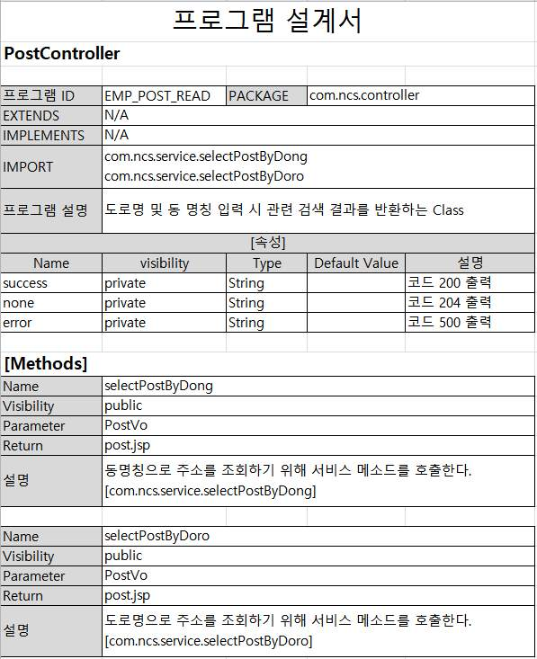

출처: 교육부(2021). 서버 프로그램 구현(LM2001020211_19v5). 한국직업능력연구원. p.53.
[그림 3-6] 프로그램 관리 대장에서의 ID와 일치하는 프로그램 설계서 예시
2. 화면 설계서를 확인한다.
프로그램 관리 대장 산출물에서의 ID와 일치하는 화면 설계서 산출물에서의 프로그램
ID를 확인한다.
화면 설계서는 화면에서 동작하는 이벤트 및 변수들을 설계한 산출물이다.

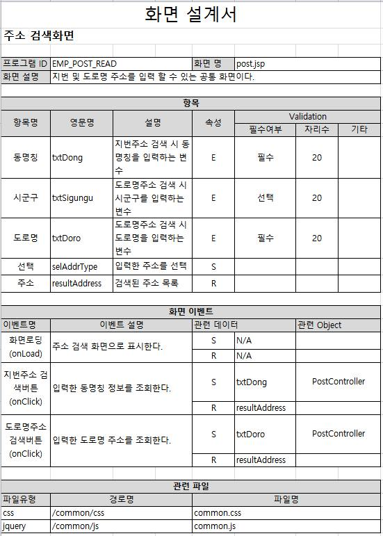

출처: 교육부(2021). 서버 프로그램 구현(LM2001020211_19v5). 한국직업능력연구원. p.54.
[그림 3-7] 공통 모듈 관리 대장에서의 ID와 일치하는 화면 설계서 예시
3. 화면 레이아웃을 확인한다.
애플리케이션 설계 단계에서 작성된 화면 레이아웃을 확인하여 공통 모듈의 화면을 구
현한다.

출처: 교육부(2021). 서버 프로그램 구현(LM2001020211_19v5). 한국직업능력연
구원. p.55.
[그림 3-8] 도로명 주소 화면 레이아웃 예시

출처: 교육부(2021). 서버 프로그램 구현(LM2001020211_19v5). 한국직업능력연
구원. p.55.
[그림 3-9] 지번 주소 화면 레이아웃 예시

출처: 교육부(2021). 서버 프로그램 구현(LM2001020211_19v5). 한국직업능력연구원. p.56.
[그림 3-10] 업무 프로세스 맵을 확인하는 모습
수행 tip
•목표시스템의 업무 프로세스 맵을 확인하여 구현해야
할 프로그램의 프로세스를 이해하는 능력이 중요하다.
3-2.
서버 프로그램 구현
•세부 업무 프로세스를 기반으로 프로그래밍 언어와 도구를 활용하여 서비스의 구현에 필요한
업무 프로그램을 구현할 수 있다.
학습 목표
•개발하고자 하는 목표시스템의 잠재적 보안 취약성이 제거될 수 있도록 서버 프로그램을 구현
할 수 있다.
필요 지식 /
• 프로그램 언어
1. 프로그램 언어 개념
프로그램 언어란 사람이 작성한 명령을 컴퓨터가 실행 가능한 형태로 변환하기 위한 규
칙 기반 언어를 의미한다. 응용 SW 개발 시 업무 로직 구현과 UI 처리, 데이터 처리 등
다양한 계층별 개발에 활용된다. 프로그램 언어의 유형으로는 컴파일 언어(예: Java, C),
인터프리터 언어(예: Python, JavaScript), 스크립트 언어(예: Bash, PowerShell) 등으
로 구분된다.
2. 프로그램 언어의 유형
<표 3-4> 프로그램 언어의 유형
구분 언어 예시 주요 특성 적용 환경/사례
- 명령문 순차 실행 임베디드 SW, 시스템 프로그
절차 지향 언어 C, Pascal
- 하드웨어 제어 용이 래밍
Java, C#, - 캡슐화, 상속, 다형성 웹서비스, 모바일 앱, 서버 프
객체 지향 언어
Python - 유지보수 용이 로그램
- 불변성, 수학적 함수 사용
함수형 언어 Scala, Haskell 빅데이터, 함수형 서버 개발
- 병렬 처리 유리
JavaScript, - 인터프리터 방식 웹 UI 개발, 자동화, 데이터
스크립트 언어
Python, Ruby - 빠른 개발 및 배포 처리
HTML, XML, - 데이터 구조 표현 웹 화면, 데이터 교환, API
마크업 언어
JSON - 화면 구성 응답
- 데이터 검색/조작
쿼리 언어 SQL DB 관리, 보고서, 통계
- 관계형 DB 활용
• 프레임워크(Framework)에 대한 이해
1. 소프트웨어 프레임워크의 정의
(1) 효율적인 정보 시스템 개발을 위한 코드 라이브러리, 애플리케이션 인터페이스(Applicati
on Interface), 설정 정보 등의 집합으로서 재사용이 가능하도록 소프트웨어 구성에 필
요한 기본 뼈대를 제공한다.
(2) 광의적으로 정보 시스템의 개발 및 운영을 지원하는 도구 및 가이드 등을 포함한다.
2. 프레임워크의 특징
<표 3-5> 프레임워크 특징
항목 설명
프레임워크는 인터페이스에 의한 캡슐화를 통해서 모듈화를 강화하고
모듈화
설계와 구현의 변경에 따르는 영향을 극소화하여 소프트웨어의 품질을
(modularity)
향상시킨다.
프레임워크가 제공하는 인터페이스는 반복적으로 사용할 수 있는 컴포
재사용성 넌트를 정의할 수 있게 하여 재사용성을 높여 준다.
(reusability) 프레임워크 컴포넌트를 재사용하는 것은 소프트웨어의 품질을 향상시킬
뿐만 아니라 개발자의 생산성도 높여 준다.
프레임워크는 다형성(polymorphism)을 통해 애플리케이션이 프레임워
크의 인터페이스를 확장할 수 있게 한다.
확장성
프레임워크 확장성은 애플리케이션 서비스와 특성을 변경하고 프레임워
(extensibility)
크를 애플리케이션의 가변성으로부터 분리함으로써 재사용성의 이점을
얻게 한다.
프레임워크 코드가 전체 애플리케이션의 처리 흐름을 제어하여 특정한
제어의 역흐름 이벤트가 발생할 때 다형성(Polymorphism)을 통해 애플리케이션이 확
(inversion of control) 장한 메서드를 호출함으로써 제어가 프레임워크로부터 애플리케이션으
로 거꾸로 흐르게 한다.
출처: 교육부(2021). 서버 프로그램 구현(LM2001020211_19v5). 한국직업능력연구원. p.57.
• 데이터 저장 계층 또는 영속 계층(Persistence Layer)에 대한 이해
DAO/DTO/VO란 영속 계층(Persistence Layer)에서 사용되는 특정 패턴을 통해 구현되
는 Java Bean이다.
<표 3-6> 영속 계층(Persistence Layer)의 객체 종류
객체 설명
특정 타입의 데이터베이스나 다른 지속적인 메커니즘(Persistence Mech
anism)에 추상 인터페이스를 제공하는 객체이다.
DAO
애플리케이션 호출을 데이터 저장 부분(Persistence Layer)에 매핑함으로
(Data Access Object)
써 DAO는 데이터베이스의 세부 내용을 노출하지 않고 특정 데이터 조작
기능을 제공한다.
DTO는 프로세스 사이에서 데이터를 전송하는 객체를 의미한다.
DTO
많은 프로세스 간의 커뮤니케이션이 원격 인터페이스(예: 웹 서비스)에 의
(Data Transfer Object)
해 이루어지기 때문에 전송될 데이터를 모으는 DTO를 이용해서 한 번만
객체 설명
호출하게 하는 것이다.
DTO는 스스로의 데이터를 저장 및 회수하는 기능을 제외하고 아무 기능
도 가지고 있지 않다는 것이 DAO와의 차이이다.
VO는 간단한 독립체(Entity)를 의미하는 작은 객체를 의미한다.
VO
가변 클래스인 DTO와 다르게 getter 기능만 제공하는 불변 클래스를 만
(Value Object)
들어서 사용한다.
출처: 교육부(2021). 서버 프로그램 구현(LM2001020211_19v5). 한국직업능력연구원. p.58.
• 소프트웨어(SW) 개발 보안
1. 소프트웨어 개발 보안의 개념
소프트웨어 개발 보안은 SW 개발 과정에서 개발자의 실수, 논리적 오류 등으로 인해
SW에 내포될 수 있는 보안 취약점을 최소화하고, 사이버 보안 위협에 대응할 수 있는
안전한 SW를 개발하기 위한 일련의 보안 활동을 의미한다.
2. 소프트웨어 개발 보안 가이드의 구성
<표 3-7> Java 시큐어 코딩 가이드
유형 설명
프로그램 입력값에 대한 검증 누락 또는 부적절한 검증, 데이터의 잘못된 형식
입력 데이터
지정으로 인해 발생할 수 있는 보안 약점
검증 및 표현
※ SQL 삽입, 자원 삽입, 크로스 사이트 스크립트 등 26개
보안 기능(인증, 접근 제어, 기밀성, 암호화, 권한 관리 등)을 적절하지 않게 구현
보안 기능 시 발생할 수 있는 보안 약점
※ 부적절한 인가, 중요 정보 평문 저장(또는 전송) 등 24개
동시 또는 거의 동시 수행을 지원하는 병렬 시스템, 하나 이상의 프로세스가 동
시간 및 상태 작하는 환경에서 시간 및 상태를 부적절하게 관리하여 발생할 수 있는 보안 약점
※ 경쟁 조건, 제어문을 사용하지 않는 재귀 함수 등 7개
에러를 처리하지 않거나, 불충분하게 처리하여 에러 정보에 중요 정보(시스템 등)
에러 처리 가 포함될 때 발생할 수 있는 보안 약점
※ 취약한 패스워드 요구 조건, 오류 메시지를 통한 정보 노출 등 4대
타입 변환 오류, 자원(메모리 등)의 부적절한 반환 등과 같이 개발자가 범할 수
코드 오류 있는 코딩 오류로 인해 유발되는 보안 약점
※ 널 포인터 역참조, 부적절한 자원 해제 등 7개
중요한 데이터 또는 기능성을 불충분하게 캡슐화하였을 때 인가되지 않는 사용자
캡슐화 에게 데이터 누출이 가능해지는 보안 약점
※ 제거되지 않고 남은 디버그 코드, 시스템 데이터 정보 노출 등 8개
의도된 사용에 반하는 방법으로 API를 사용하거나, 보안에 취약한 API를 사용하
API 오용 여 발생할 수 있는 보안 약점
※ DNS Lookup에 의존한 보안 결정, 널 매개 변수 미조사 등 7개
출처: 행정자치부(2012. 09.). 전자정부 SW 개발･운영자를 위한 Java 시큐어 코딩 가이드. p.2.
수행 내용 / 서버 프로그램 구현하기
재료·자료
• 프로그램 설계서, 화면 설계서, 화면 레이아웃
• 요구사항 정의서
• 시스템 아키텍처
기기(장비･공구)
• 컴퓨터 또는 PC, 네트워크 장비, 프린터, 빔 프로젝트
• CASE 도구(SW 개발 지원 도구, SW 테스트 지원 도구 등)
• 형상관리 도구
안전･유의 사항
• 공통 모듈 설계 산출물에 대한 이해가 선행되어야 한다.
• 프로그램 개발 경험과 SQL 작성 경험이 필요하다.
수행 순서
• 세부 업무 프로세스를 기반으로 업무 프로그램을 구현한다.
프로그램을 구현하기 위해 서버 영역(Back End)과 화면 영역(Front End)을 구현한다.

출처: 교육부(2021). 서버 프로그램 구현(LM2001020211_19v5). 한국직업능력연구원. p.60.
[그림 3-11] 모듈 구현 순서 예시
순서에 상관없이 구현을 해도 무방하다.
1. 업무 프로그램을 구현하기 위한 I/O 오브젝트(DTO/VO)를 정의한다.
주소 검색을 위해 필요한 변수들을 정의하여 계층 간 데이터 교환을 위해 사용한다.
DTO(Data Transfer object) 또는 VO(Value Object)라고 명칭한다.

출처: 교육부(2021). 서버 프로그램 구현(LM2001020211_19v5). 한국직업능력연구원. p.61.
[그림 3-12] DTO/VO 구문 예시
2. 업무 프로그램을 구현하기 위한 Data를 준비한다.
주소 검색을 위해 주소 테이블(Table)을 정의하고 테이블을 생성한다.

출처: 교육부(2021). 서버 프로그램 구현(LM2001020211_19v5). 한국직업능력연구원. p.62.
[그림 3-13] 주소 테이블(Table) 예시
3. 업무 프로그램을 구현하기 위한 SQL을 작성한다.
주소 검색을 위한 SQL 쿼리문을 마이바티스(Mybatis) XML 파일로 구현한 예시이다.

출처: 교육부(2021). 서버 프로그램 구현(LM2001020211_19v5). 한국직업능력연구원. p.62.
[그림 3-14] 동으로 주소를 조회하는 SQL 구문 예시

출처: 교육부(2021). 서버 프로그램 구현(LM2001020211_19v5). 한국직업능력연구원. p.62.
[그림 3-15] 도로명으로 주소를 조회하는 SQL 구문 예시
4. 데이터 접근 객체(DAO: Data Access Object)를 구현한다.
DAO에서는 SQL문을 구현한 XML의 id를 호출하여 데이터를 조회하거나 조작한다.

출처: 교육부(2021). 서버 프로그램 구현(LM2001020211_19v5). 한국직업능력연구원. p.63.
[그림 3-16] 주소를 조회하는 DAO 구문 예시
5. 서비스(Service) 클래스를 구현한다.

출처: 교육부(2021). 서버 프로그램 구현(LM2001020211_19v5). 한국직업능력연구원. p.63.
[그림 3-17] 주소를 조회하는 Service 구문 예시
6. Java 시큐어 코딩 가이드에 의한 보안 취약성을 제거하는 코드를 구현한다.
서버 프로그램은 다양한 보안 취약점이 존재하기 때문에 소프트웨어 개발 보안 가이드
에 의해 알려진 보안 취약점에 대응해야 한다. 아래 예시는 크로스 사이트 스크립트에
대응하는 안전한 코드 예시이다.

출처: 교육부(2021). 서버 프로그램 구현(LM2001020211_19v5). 한국직업능력연구원. p.64.
[그림 3-18] 안전한 코드(크로스 사이트 스크립트 보안 약점) 예시
7. 컨트롤러(Controller) 클래스를 구현한다.

출처: 교육부(2021). 서버 프로그램 구현(LM2001020211_19v5). 한국직업능력연구원. p.64.
[그림 3-19] 동으로 주소를 조회하는 Controller 구문 예시

출처: 교육부(2021). 서버 프로그램 구현(LM2001020211_19v5). 한국직업능력연구원. p.65.
[그림 3-20] 도로명으로 주소를 조회하는 Controller 구문 예시

출처: 교육부(2021). 서버 프로그램 구현(LM2001020211_19v5). 한국직업능력연구원. p.65.
[그림 3-21] 서버 프로그램을 구현하는 모습
수행 tip
•클라이언트 프로그램에 독립적으로 활용 가능하며, 개발
환경으로 정의된 개발 언어와 도구의 특성을 충분히 반
영하여 생산성과 품질이 확보된 서버 프로그램을 개발
하는 것이 중요하다.
3-3.
서버 프로그램 테스트 수행
학습 목표 •개발된 업무 프로그램의 내부 기능과 제공하는 인터페이스에 대해 테스트를 수행할 수 있다.
필요 지식 /
• 소프트웨어 테스트의 이해
1. 소프트웨어 테스트의 개념
소프트웨어 테스트란 구현된 애플리케이션이나 시스템을 사용자의 요구사항이 만족되었
는지 확인하기 위하여 기능 및 비기능 요소의 결함을 찾아내는 활동이다.
2. 소프트웨어 테스트의 원칙
(1) 개발자가 자신이 개발한 프로그램 및 소스코드를 테스팅하지 않는다.
일반적으로 개발자가 자신이 개발한 소스코드에 대해서는 자신이 테스팅을 할 경우
결함을 발견하는 것이 쉬운 일이 아니다.
(2) 효율적인 결함 제거 법칙 사용(낚시의 법칙, 파레토의 법칙)
효율적으로 결함을 발견, 가시화, 제거, 예방의 순서로 하여 정량적으로 관리할 수
있어야 한다.
(가) 낚시의 법칙
낚시를 즐겨 하는 사람들은 특정 자리에서 물고기가 잘 잡힌다는 사실을 경험적
으로 알고 있다. 소프트웨어 제품의 결함도 특정 기능, 모듈, 라이브러리에서 결
함이 많이 발견된다는 것이 소프트웨어 테스트에서의 낚시의 법칙이다.
(나) 파레토의 법칙
소프트웨어 제품에서 발견되는 전체 결함의 80%는 소프트웨어 제품의 전체 기
능 중 20%에 집중되어 있다.
(3) 완벽한 소프트웨어 테스팅은 불가능하다.
단순한 애플리케이션이라도 테스트 케이스의 수는 무한대로 발생되기 때문에 완벽한
테스트는 불가능하다.
(4) 테스트는 계획 단계부터 해야 한다.
소프트웨어 테스트는 결함의 발견이 목적이기는 하지만 개발 초기 이전인 계획 단
계에서부터 할 수 있다면 결함을 예방할 수 있다.
(5) 살충제 패러독스(Pesticide Paradox)
동일한 테스트 케이스로 반복하여 실행하면 더 이상 새로운 결함을 발견할 수 없으
므로 주기적으로 테스트 케이스를 점검하고 개선해야 한다.
(6) 오류-부재의 궤변(Absence of Errors Fallacy)
사용자의 요구사항을 만족하지 못한다면 오류를 발견하고 제거해도 품질이 높다고
말할 수 없다.
• 소프트웨어 테스트의 명세
1. 테스트 결과 정리
테스트가 완료되면 테스트 계획과 테스트 케이스 설계부터 단계별 테스트 시나리오, 테
스트 결과까지 모두 포함된 문서를 일관성 있게 작성한다.
2. 테스트 요약 문서
테스트 계획, 소요 비용, 테스트 결과에 의해 판단이 가능한 대상 소프트웨어의 품질
상태를 포함한 요약 문서를 작성한다.
3. 품질 상태
품질 상태는 품질 지표인 테스트 성공률, 발생한 결함의 수와 결함의 중요도, 테스트
커버리지 등이 포함된다.
4. 테스트 결과서
테스트 결과서는 결함에 관련된 내용을 중점적으로 기록하며, 결함의 내용, 결함의 재
현 순서를 상세하게 기록한다.
5. 테스트 실행 절차 및 평가
단계별 테스트 종료 시 테스트 실행 절차를 리뷰하고 결과에 대한 평가를 수행하며, 그
결과에 따라 실행 절차를 최적화하여 다음 테스트에 적용한다.
수행 내용 / 서버 프로그램 테스트 수행하기
재료·자료
• 프로그램 설계서, 화면 설계서, 화면 레이아웃
• 요구사항 정의서
• 개발된 프로그램 산출물
기기(장비･공구)
• 컴퓨터 또는 PC, 네트워크 장비, 프린터, 빔 프로젝트
• CASE 도구(SW 개발 지원 도구, SW 테스트 지원 도구 등)
• 형상관리 도구
안전･유의 사항
• 프로그램 설계 산출물에 대한 이해가 선행되어야 한다.
• 테스트와 디버그의 이해가 선행되어야 한다.
수행 순서
• 단위 테스트 케이스를 작성한다.(활용 서식 단위 테스트 케이스 참고)
1. 단위 테스트 방식을 결정한다.
2. 단위 테스트의 범위를 결정한다.
(1) 공통 모듈의 범위 및 상위 요구사항의 범위에 따라 테스트 범위를 판단한다.
(2) 테스트 수행 횟수를 결정한다.
(3) 테스트의 결과를 검증하기 위한 결괏값 산출 방식을 결정한다.
3. 단위 테스트의 방식과 범위에 따라 테스트 케이스를 작성한다.
4. 작성된 단위 테스트 케이스를 내부 검토한다.
5. 작성된 단위 테스트 케이스를 고객에게 승인을 획득한다.

출처: 교육부(2021). 서버 프로그램 구현(LM2001020211_19v5). 한국직업능력연구원. p.69.
[그림 3-22] 우편번호 조회 단위 테스트 케이스 예시
• 테스트를 명세하기 위한 테스트 도구를 설정한다.
1. 단위 테스트 도구를 실행한 후 테스트 케이스(Test Case)를 생성한다.

출처: 교육부(2021). 서버 프로그램 구현(LM2001020211_19v5). 한국직업능력연구원. p.69.
[그림 3-23] 우편번호 조회 단위 테스트 케이스 생성 예시(JUnit 예시)
2. 테스트를 수행할 함수를 선택하고 Finish를 클릭한다.

출처: 교육부(2021). 서버 프로그램 구현(LM2001020211_19v5). 한국직업능력연구원. p.70.
[그림 3-24] 우편번호 조회 단위 테스트 케이스 함수 선택 화면 예시
3. 테스트 구문을 작성한다.

출처: 교육부(2021). 서버 프로그램 구현(LM2001020211_19v5). 한국직업능력연구원. p.70.
[그림 3-25] 우편번호 조회 단위 테스트 구문 예시
4. 테스트 도구를 실행한다.

출처: 교육부(2021). 서버 프로그램 구현(LM2001020211_19v5). 한국직업능력연구원. p.71.
[그림 3-26] 단위 테스트 도구 실행(JUnit Test 예시)
• 테스트 결과를 명세화한다.
테스트의 결과를 확인하여 테스트 케이스에 성공/실패 결과 및 필요 항목을 기록한다.

출처: 교육부(2021). 서버 프로그램 구현(LM2001020211_19v5). 한국직업능력연구원. p.71.
[그림 3-27] 테스트 결과 화면 예시

출처: 교육부(2021). 서버 프로그램 구현(LM2001020211_19v5). 한국직업능력연구원. p.71.
[그림 3-28] 단위 테스트를 수행하는 모습
수행 tip
•개발된 업무 프로그램의 내부 기능과 인터페이스 테스
트를 위한 테스트 케이스를 작성하고, 그에 따른 단위
테스트를 수행할 수 있도록 한다.

| 학습 3 | 교수·학습 방법 |
| --- | --- |

교수 방법
• 애플리케이션 설계 내용을 바탕으로 학습자가 직접 개발 절차를 구성하고 구현에 적용
할 수 있도록 사례 중심으로 지도한다.
• 개발 생산성을 높이기 위한 다양한 개발 도구의 특성을 비교하고, 각 도구의 선택 기준
과 활용법을 실습 중심으로 설명한다.
• 서버 프로그램이 클라이언트에 종속되지 않도록 하는 아키텍처 설계 원칙(예: RESTful,
API Gateway 등)을 소개하고 구조를 도식화하도록 지도한다.
• 서버 기능별 테스트 케이스를 직접 작성해 보고, 기능별 요구사항에 따른 테스트 전략
을 적용해 보도록 실습을 유도한다.
• 단위 테스트를 위한 조건 명세화 절차를 설명한 뒤, 각자 설계한 명세서를 바탕으로 테
스트 스크립트를 작성하도록 지도한다.
학습 방법
• 설계된 애플리케이션을 분석하고, 직접 코드로 구현하는 실습을 통해 절차와 도구 활용
법을 익힌다.
• 각 개발 도구의 특징을 비교한 후, 프로젝트에 적합한 도구를 선정하여 실제로 적용한다.
• 서버 구조의 유연성을 높이기 위한 설계 전략을 조사하고, 다양한 설계 시나리오를 비
교·분석한다.
• 제공된 기능 요구사항을 바탕으로 테스트 케이스를 설계하고, 코드 실행 결과를 바탕으
로 검증 및 개선 활동을 반복하여 수행한다.
• 테스트 명세서를 작성하고 팀별 코드 리뷰를 통해 테스트 전략과 적용 사례를 공유한다.

| 학습 3 | 평 가 |
| --- | --- |

평가 준거
• 평가자는 학습자가 학습 목표를 성공적으로 달성하였는지를 평가해야 한다.
• 평가자는 다음 사항을 평가해야 한다.

| 학습 내용 | 학습 목표 | 성취수준 |  |  |
| --- | --- | --- | --- | --- |
|  |  | 상 | 중 | 하 |

서버 프로그램
- 업무 프로세스 맵과 세부 업무 프로세스를 확인할 수 있다.
확인
- 세부 업무 프로세스를 기반으로 프로그래밍 언어와 도구
를 활용하여 서비스의 구현에 필요한 업무 프로그램을 구
서버 프로그램
현할 수 있다.
구현
- 개발하고자 하는 목표시스템의 잠재적 보안 취약성이 제
거될 수 있도록 서버 프로그램을 구현할 수 있다.
서버 프로그램 - 개발된 업무 프로그램의 내부 기능과 제공하는 인터페이
테스트 수행 스에 대해 테스트를 수행할 수 있다.
평가 방법
• 포트폴리오

| 학습 내용 | 평가 항목 | 성취수준 |  |  |
| --- | --- | --- | --- | --- |
|  |  | 상 | 중 | 하 |

서버 프로그램 - 업무 프로세스 맵에서의 세부 업무 프로세스의 관계를 확
확인 인하는 능력
- 애플리케이션 설계서와 서버 프로그램 간 정합성 정도
서버 프로그램
- 잠재적 보안 취약성이 제거될 수 있도록 SW 개발 보안
구현
이 준수된 서버 프로그램을 구현하는 능력
- 서버 프로그램 테스트 케이스와 테스트 조건의 적정성
서버 프로그램
- 서버 프로그램 테스트 수행 시 방생되는 오류와 문제점에
테스트 수행
대한 처리 능력
• 평가자 체크리스트

| 학습 내용 | 평가 항목 | 성취수준 |  |  |
| --- | --- | --- | --- | --- |
|  |  | 상 | 중 | 하 |

| 서버 프로그램 확인 서버 프로그램 구현 서버 프로그램 테스트 수행 피드백 | - 업무 프로세스 맵에서의 세부 업무 프로세스의 관계 파악도 - 애플리케이션 설계서와 서버 프로그램 간 정합성 정도 - 잠재적 보안 취약성이 제거될 수 있는지에 대한 SW 개발 보안의 파악 능력 - 서버 프로그램 테스트 케이스와 테스트 조건의 적정성 - 서버 프로그램 테스트 수행 시 방생되는 오류와 문제점에대한 처리 능력 |  |  |  |
| --- | --- | --- | --- | --- |
| 1. 포트폴리오 - 업무 프로세스에 미비 사항을- 서버 프로그램램 특성에 맞는- 보안 취약점이SW 개발 보안- 서버 프로그램- 서버 프로그램- 서버 프로그램- 서버 프로그램 | 맵을 확인한 후 세부 업무 프로세스의 관계에 대해 이해하였는지보완할 수 있도록 실무 자료를 제시한다. 테스트를 위한 테스트 케이스 적용 기법의 미비점에 대해기법 선정 방안을 보완할 수 있도록 설명한다. 제거될 수 있도록 서버 프로그램이 구현되었는지를 확인하고가이드를 참고 자료로 제시한다. 테스트 케이스 생성 방법을 확인하고 미비 사항에 대해 구현 결과가 ‘상’인 경우 모범 사례로 공유한다. 구현 결과가 ‘중’인 경우 부족한 부분을 보완할 수 있도록구현 결과가 ‘하’인 경우 모범 사례를 참조하여 다시 구축할 | 파악한미비한설명한다.설명한다.수 | 평가한후, 있도록 | 후프로그부분은유도 |
| 한다. |  |  |  |  |
| 2. 평가자 체크리스트- 실습 과정에서- 애플리케이션수 있도록 보완- 보안 취약점이한 후 SW- 서버 프로그램 | 평가한 후에 개선해야 할 사항 등을 정리한 후 학습자에게설계서에 따라 서버 프로그램이 작성되었는지를 확인하여 미비사항을 제시한다. 제거될 수 있도록 서버 프로그램을 구현할 수 있는지에 대한개발 보안 가이드에서의 참고 위치를 제시한다. 테스트 케이스 작성 기법을 확인하고, 미비 사항을 정리하여 | 설명한다.사항을설명한다. | 이해도를 | 보완할확인 |

학습 1 개발 환경 구축하기
학습 2 공통 모듈 구현하기
학습 3 서버 프로그램 구현하기

| 학습 4 | 배치 프로그램 구현하기 |
| --- | --- |

4-1.
배치 프로그램 구현
•애플리케이션 설계를 기반으로 프로그래밍 언어와 도구를 활용하여 배치 프로그램 구현 기술
에 부합하는 배치 프로그램을 구현할 수 있다.
학습 목표
•목표시스템을 구성하는 하위 시스템 간의 연동 시 안정적이고 안전하게 동작할 수 있는 배치
프로그램을 구현할 수 있다.
필요 지식 /
• 배치 프로그램의 이해
1. 배치 프로그램의 개념
배치 프로그램이란 사용자와의 상호 작용 없이 일련의 작업들을 작업 단위로 묶어 정
기적으로 반복하여 수행하거나 정해진 규칙에 따라 일괄 처리하는 것이다.
2. 배치 프로그램의 필수 요소
<표 4-1> 배치 프로그램의 필수 요소
요소 설명
대용량 데이터 대용량의 데이터를 처리할 수 있어야 한다.
자동화 심각한 오류 상황 외에는 사용자의 개입 없이 동작해야 한다.
유효하지 않은 데이터의 경우도 처리해서 비정상적인 동작 중단이 발생하지
견고함
않아야 한다.
안정성 어떤 문제가 생겼는지, 언제 발생했는지 등을 추적할 수 있어야 한다.
주어진 시간 내에 처리를 완료할 수 있어야 하고, 동시에 동작하고 있는 다
성능
른 애플리케이션을 방해하지 말아야 한다.
출처: 교육부(2021). 서버 프로그램 구현(LM2001020211_19v5). 한국직업능력연구원. p.76.

| 학습 내용 | 평가 항목 | 성취수준 |  |  |
| --- | --- | --- | --- | --- |
| • 배치 스케줄러(Scheduler) |  |  |  |  |
| 1. 배치 스케줄러의배치 스케줄러는으로 발생하는 | 개념 일괄 처리(Batch Processing)를 위해 주기적으로작업을 지원하는 도구이다. | 발생하거나 |  | 반복적 |
| 2. 배치 스케줄러의 | 종류 |  |  |  |
| (1) 스프링 스프링 배치는업으로 2007년에 | 배치(Spring Batch) 스피링소스(Spring Source)사와 엑센추어(Accenture)사의탄생한 배치 기반 오픈소스 프레임워크이다. |  |  | 공동 작 |
| (가) 스프링<표 4-2>컴포넌트Job Job JPA(JavaPersistenceJob StepItemChunkItemItemItem출처: | 배치(Spring Batch)의 핵심 컴포넌트 스프링 배치의 컴포넌트 설명 Repository Job Execution 관련 메타데이터를 저장하는Launcher Job Execution을 실행하는 기반 컴포넌트이다.페이징 기능을 제공한다. API) 배치 처리를 의미하는 애플리케이션 컴포넌트이다.Job의 각 단계를 의미한다. Job은 일련의 연속된Data Source로부터 읽거나 Data Source로를 의미한다. 특정 크기를 갖는 아이템 목록을 의미한다. Reader 데이터 소스로부터 아이템을 읽어 들이는 Item Reader로 읽어 들인 아이템을 ItemProcessor 장하기 전에 처리하는 컴포넌트이다. Writer Item Chunk를 데이터 소스에 저장하는 교육부(2021). 서버 프로그램 구현(LM2001020211_19v5). 한국직업능력연구원. | 기반Step으로저장하는컴포넌트이다.Writer를컴포넌트이다. | 컴포넌트이다.각사용해p.77. | 구성된다.레코드저 |
| (나) 스프링<표 4-3>기능 스프링기반 자체 제공견고함과출처: | 배치(Spring Batch)의 핵심 기능 스프링 배치의 핵심 기능 설명 프레임워크 스프링의 DI, AOP 및 다양한 엔터프라이즈 지원배치 처리(데이터베이스나 파일로부터 데이터를컴포넌트 공통적으로 필요한 컴포넌트를 제공한다. 안정성 선언적 생략과 처리 실패 후 재시도 설정을 제공한다.교육부(2021). 서버 프로그램 구현(LM2001020211_19v5). 한국직업능력연구원. | 기능을읽거나 | 사용한다.쓰는p.77. | 등) 시 |
| (2) Quartz Quartz 실행 스케줄을 | 스케줄러(Scheduler) 스케줄러란 Spring Framework에 플러그인(Plug-in)되어정의하는 Trigger를 분리하여 유연성을 제공하는 | 오픈소스 | 수행하는 | Job과스케줄러 |
| 이다. |  |  |  |  |
| (가) Quartz<표 4-4>구성 요소SchedulerJob JobDetailTrigger출처: | 스케줄러의 구성 요소 Quartz 스케줄러의 구성 요소 설명 Quartz 실행 환경을 관리하는 핵심 개체이다.사용자가 수행할 작업을 정의하는 인터페이스로서이용하여 일정을 수립할 수 있다. 작업명과 작업 그룹과 같은 수행할 Job에 대한하는 개체이다. 정의한 Job 개체의 실행 스케줄을 정의하는개체에 Job 수행 시점을 알려 주는 개체이다.교육부(2021). 서버 프로그램 구현(LM2001020211_19v5). 한국직업능력연구원. | 상세개체로서 | Trigger정보를Schedulerp.78. | 개체를정의 |
| (나) Quartzpublic} | 스케줄러의 사용 예시 class SampleJob extends QuartzJobBean { private MyService myService; private String name; // Inject "MyService" bean public void setMyService(MyService myService) { ...// Inject the "name" job data property public void setName(String name) { ... } @Override protected void executeInternal(JobExecutionContextthrows JobExecutionException {... } | } context) |  |  |

수행 내용 / 배치 프로그램 구현하기
재료·자료
• 배치 설계서
• 시스템 아키텍처
기기(장비･공구)
• 컴퓨터 또는 PC, 네트워크 장비, 프린터, 빔 프로젝트
• CASE 도구(SW 개발 지원 도구, SW 테스트 지원 도구 등)
• 형상관리 도구
안전･유의 사항
• 배치 설계 산출물에 대한 이해가 선행되어야 한다.
• 프로그램 개발 경험과 SQL 작성 경험이 필요하다.
수행 순서
• 애플리케이션 설계를 기반으로 배치 프로그램을 확인한다.
1. 프로그램 관리 대장을 확인한다.
아래 예시는 이순신 담당자가 구현해야 할 배치 기능을 확인한 예시이다.

출처: 교육부(2021). 서버 프로그램 구현(LM2001020211_19v5). 한국직업능력연구원. p.79.
[그림 4-1] 프로그램 관리 대장에서 담당 기능 확인 예시
2. 배치 설계서를 확인한다.
프로그램 관리 대장의 ID와 일치하는 배치 설계를 확인한다.

출처: 교육부(2021). 서버 프로그램 구현(LM2001020211_19v5). 한국직업능력연구원. p.80.
[그림 4-2] 배치 설계서 예시
• 애플리케이션 설계를 기반으로 배치 프로그램을 구현한다.
1. 배치 프로그램을 구현하기 위한 SQL을 작성한다.
업무 종료가 된 사용자 정보를 조회 및 삭제하는 SQL 구문이다.

출처: 교육부(2021). 서버 프로그램 구현(LM2001020211_19v5). 한국직업능력연구원. p.80.
[그림 4-3] 배치 프로그램 SQL 구문 예시
2. 배치 프로그램을 구현하기 위한 I/O 오브젝트(DTO/VO)를 정의한다.

출처: 교육부(2021). 서버 프로그램 구현(LM2001020211_19v5).
한국직업능력연구원. p.81.
[그림 4-4] 배치 프로그램 DTO/VO 구문 예시
3. 배치 프로그램을 구현하기 위한 데이터 접근 오브젝트(DAO)를 작성한다.

출처: 교육부(2021). 서버 프로그램 구현(LM2001020211_19v5). 한국직업능력연구원. p.82.
[그림 4-5] 배치 프로그램 DAO 구문 예시
4. 배치 프로그램을 구현하기 위한 스케줄러 클래스를 작성한다.

출처: 교육부(2021). 서버 프로그램 구현(LM2001020211_19v5). 한국직업능력연구원. p.82.
[그림 4-6] 배치 프로그램 스케줄러 클래스 구문 예시
위 예시는 @Scheduled 어노테이션(Annotation) 구문 지정으로 매일 1시에 배치 스
케줄이 실행되게 구현한 예시이다.
<표 4-5> Cron 표현식(Expression)
필드명 허용값(범위) 허용된 특수 문자
Seconds 0~59 , - * /
Minutes 0~59 , - * /
Hours 0~23 , - * /
Day-of-month 1~31 , - * ? / L W
Month 1~12 or JAN~DEC , - * /
Day-Of-Week 1~7 or SUN~SAT , - * ? / L #
Year(optional) empty, 1970~2099 , - * /
출처: 교육부(2021). 서버 프로그램 구현(LM2001020211_19v5). 한국직업능력연구원. p.83.

출처: 교육부(2021). 서버 프로그램 구현(LM2001020211_19v5). 한국직업능력연구원. p.83.
[그림 4-7] 배치 프로그램을 구현하는 모습
수행 tip
•애플리케이션 설계인 배치 설계서를 이해하고 적합한
배치 프로그램 방식을 선정하여 구현하는 능력이 중요
하다.
•목표시스템을 구성하는 하위 시스템 간의 연동 시 안정
적이고 안전하게 동작할 수 있는 배치 프로그램을 구현
하는 것이 중요하다.
4-2.
배치 프로그램 테스트 수행
학습 목표 •개발된 배치 프로그램의 테스트를 수행할 수 있다.
필요 지식 /
• 디버그(Debug)와 디버거(Debugger)
1. 디버그(Debug)의 개념
디버그(Debug) 또는 디버깅(Debugging)은 컴퓨터 프로그램의 논리적인 오류(Bug)를
찾아내는 과정을 말한다.
2. 디버거(Debugger)의 개념
디버거는 디버그를 돕는 도구이다. 디버거는 디버깅을 하려는 코드에 중단점을 지정하
여 프로그램 실행을 중단하고, 코드를 단계적으로 실행하여 저장된 값을 확인할 수 있
도록 지원한다.
• 디버거(Debugger) 사용법
1. 디버그 뷰(Debug View)

출처: 교육부(2021). 서버 프로그램 구현(LM2001020211_19v5). 한국직업능력연구원. p.84.
[그림 4-8] 디버그 뷰(Debug View) 화면 예시(Eclipse 화면 예시)
2. 중단점(Break Pointer) 설정
편집기 왼쪽에 파란 부분(마커 바)을 더블 클릭하거나 해당 위치에서 마우스 오른쪽을
클릭하여 ‘Toggle Breakpoint’를 선택한다.

출처: 교육부(2021). 서버 프로그램 구현(LM2001020211_19v5).
한국직업능력연구원. p.85.
[그림 4-9] 브레이크 포인트 설정 화면 예시
3. 디버그 모드(Debug Mode)에서의 스텝(Step) 단위 진행
(1) 디버그 모드로 실행 중 지정된 중단점에 오면 디버거에 의해 중단되고 라인 단위로 실행
이 가능해진다.

출처: 교육부(2021). 서버 프로그램 구현(LM2001020211_19v5). 한국직업능력연구원. p.85.
[그림 4-10] 중단점에서 중단된 화면 예시
(2) 디버그 뷰 버튼 사용법은 함수(Method) 안으로 진입하는 Step into, 함수 안으로 진입
하지 않는 Step Over 등의 기능으로 스텝 단위로 디버깅을 한다.

출처: 교육부(2021). 서버 프로그램 구현(LM2001020211_19v5). 한국직업능력연구원. p.85.
[그림 4-11] 디버그 뷰(Debug View) 버튼 화면 예시
수행 내용 / 배치 프로그램 테스트 수행하기
재료·자료
• 배치 설계서
• 개발된 프로그램 산출물
기기(장비･공구)
• 컴퓨터 또는 PC, 네트워크 장비, 프린터, 빔 프로젝트
• CASE 도구(SW 개발 지원 도구, SW 테스트 지원 도구 등)
• 형상관리 도구
안전･유의 사항
• 설계 산출물에 대한 이해가 선행되어야 한다.
• 테스트와 디버그의 이해가 선행되어야 한다.
수행 순서
• 배치 프로그램 주기를 변경한다.
배치 스케줄(Schedule) 주기를 테스트가 가능한 주기로 변경하여 로그에 정상적으로 출력
되는지 확인한다.

출처: 교육부(2021). 서버 프로그램 구현(LM2001020211_19v5). 한국직업능력연구원. p.86.
[그림 4-12] 배치 스케줄 주기가 변경된 스케줄러 클래스 구문 예시
위 예시는 테스트를 위해 @Scheduled 어노테이션(Annotation) 구문 지정으로 10초 주
기로 배치 스케줄이 실행되게 구현한 예시이다.
• 배치 프로그램을 디버깅하여 정상적으로 동작하는지 검증한다.
배치 프로그램은 목표시스템의 품질에 영향도가 높은 작업이므로 디버깅(Debugging)을
통해 구문 확인이 필요하다.
1. 디버그 모드(Debug Mode)로 실행한다.
아래 예시는 디버그 모드로 실행하기 위해 붉은색 디버그 아이콘을 실행하는 예시이다.

출처: 교육부(2021). 서버 프로그램 구현(LM2001020211_19v5). 한국직업능력연구원. p.87.
[그림 4-13] 디버그 모드 실행 예시
2. 검증할 코드 라인에 중단점(Break Point)을 지정하여 코드를 검증한다.

출처: 교육부(2021). 서버 프로그램 구현(LM2001020211_19v5). 한국직업능력연구원. p.87.
[그림 4-14] 중단점이 지정된 코드에서 실행이 중단된 화면 예시

출처: 교육부(2021). 서버 프로그램 구현(LM2001020211_19v5). 한국직업능력연구
원. p.87.
[그림 4-15] 배치 프로그램을 디버깅하는 모습
• 배치 프로그램의 로그를 확인한다.

출처: 집필진 제작(2025)
[그림 4-16] 배치 프로그램 로그 예시
• 목적 테이블에서 정상적으로 배치 프로그램이 실행되었는지 확인한다.
1. 배치 프로그램을 실행하기 전 데이터를 확인한다.

출처: 교육부(2021). 서버 프로그램 구현(LM2001020211_19v5). 한국직업능력연구원. p.88.
[그림 4-17] 배치 프로그램 실행 전 데이터 확인 예시
2. 배치 프로그램을 실행하였을 경우의 대상 데이터를 확인한다.
아래 예시는 업무 종료된 사용자 정보를 삭제하는 경우이다.

출처: 교육부(2021). 서버 프로그램 구현(LM2001020211_19v5). 한국직업능력연구원. p.88.
[그림 4-18] 배치 프로그램의 대상 데이터 확인 예시
3. 배치 프로그램을 실행한 후의 데이터를 확인한다.

출처: 교육부(2021). 서버 프로그램 구현(LM2001020211_19v5). 한국직업능력연구원. p.88.
[그림 4-19] 배치 프로그램 실행 후 데이터 확인 예시
• 배치 프로그램이 정상적으로 실행되지 않았을 경우 오류를 확인한다.
1. 데이터가 목적에 맞지 않게 처리된 경우는 참조 테이블의 데이터를 확인하여 오류를 확인한다.
2. 로그에 실패가 출력된 경우 디버깅을 통해 오류를 확인한다.
수행 tip
•개발된 배치 프로그램이 정상적으로 실행되도록 하기 위
해 디버깅을 수행하는 방식과 문제점을 찾아내는 능력을
향상할 수 있도록 테스트를 수행하는 것이 중요하다.

| 학습 4 | 교수·학습 방법 |
| --- | --- |

교수 방법
• 애플리케이션 설계 명세서를 기반으로 개발 도구와 언어를 선택하고, 모듈별 개발 절차
를 학습자가 직접 구성해 볼 수 있도록 실습을 유도한다.
• 배치 프로그램 작성 시 필요한 하위 시스템 연동 구조를 사례 기반으로 제시하고, 학습
자가 직접 인터페이스 흐름도를 작성하도록 지도한다.
• 안전하고 안정적인 배치 실행을 위해 필요한 예외 처리, 트랜잭션 관리 기법을 코드 예
시 분석과 함께 설명한다.
• 디버깅 실습 자료(로그, 예외 상황 코드)를 제공하고, 학습자가 원인을 분석하여 해결
방안을 발표하도록 지도한다.
• 테스트 명세 템플릿을 제공하고, 각자 배치 모듈에 맞는 테스트 조건을 정의해 보고 상
호 피드백을 통해 개선점을 도출하도록 지도한다.
학습 방법
• 설계 명세서를 분석하고, 선택한 언어와 도구를 활용하여 모듈 구현 절차를 팀 단위로
실습한다.
• 하위 시스템 연동 방식(예: DB, 외부 API 연동)을 학습하고, JSON 또는 XML 기반 연
동 시나리오를 직접 설계한다.
• 오류 발생 가능 상황을 예측하고, 안전한 실행을 위한 예외 처리 전략을 비교 분석한
후 실제 코드에 적용한다.
• 로그 분석 및 디버깅 실습을 통해 오류 상황을 진단하고, 재현 테스트를 수행하여 해결
역량을 기른다.
• 테스트 명세서를 작성하고, 설계된 조건에 따라 배치 기능 테스트를 수행하며, 결과를
기반으로 문서화한다.

| 학습 4 | 평 가 |
| --- | --- |

평가 준거
• 평가자는 학습자가 학습 목표를 성공적으로 달성하였는지를 평가해야 한다.
• 평가자는 다음 사항을 평가해야 한다.

| 학습 내용 | 학습 목표 | 성취수준 |  |  |
| --- | --- | --- | --- | --- |
|  |  | 상 | 중 | 하 |

- 애플리케이션 설계를 기반으로 프로그래밍 언어와 도구를
활용하여 배치 프로그램 구현 기술에 부합하는 배치 프로
배치 프로그램 그램을 구현할 수 있다.
구현 - 목표시스템을 구성하는 하위 시스템 간의 연동 시 안정적
이고 안전하게 동작할 수 있는 배치 프로그램을 구현할
수 있다.
배치 프로그램
- 개발된 배치 프로그램의 테스트를 수행할 수 있다.
테스트 수행
평가 방법
• 포트폴리오

| 학습 내용 | 평가 항목 | 성취수준 |  |  |
| --- | --- | --- | --- | --- |
|  |  | 상 | 중 | 하 |

- 애플리케이션 설계서와 배치 프로그램 간의 정합성 판단
능력
배치 프로그램
구현
- 배치 프로그램 구현 시 안정적이고 안전하게 동작할 수
있는 정도
- 배치 프로그램 테스트 시 테스트 시나리오 작성 능력
배치 프로그램
- 배치 프로그램 테스트 시 오류를 발견하고 문제점을 해결
테스트 수행
하는 능력
• 평가자 체크리스트

| 학습 내용 | 평가 항목 | 성취수준 |  |  |
| --- | --- | --- | --- | --- |
|  |  | 상 | 중 | 하 |

| 배치 프로그램 구현 배치 프로그램 테스트 수행 피드백 | - 애플리케이션 설계서와 배치 프로그램 간의 정합성 판단능력 - 배치 프로그램 구현 시 안정적이고 안전하게 동작할 수있는 정도 - 배치 프로그램 테스트 시 테스트 시나리오 작성 능력 - 배치 프로그램 테스트 시 오류를 발견하고 문제점을 해결하는 능력 |  |  |  |
| --- | --- | --- | --- | --- |
| 1. 포트폴리오 - 배치 프로그램맞는 기법 선정- 배치 프로그램적으로 - 배치 프로그램완할 수 있도록- 배치 프로그램- 배치 프로그램- 배치 프로그램 | 테스트를 위한 테스트 케이스 적용 기법에 대해 파악한 후,방안과 테스트 케이스 생성 방법에 대해 설명한다. 수행 시 목표시스템을 구성하는 하위 시스템 간의 연동 시구현되는지를 점검하고 미비 사항을 정리하여 보완 사항을 제시한다.기능 검증을 위해 디버깅 방식과 로그의 완전성을 검토하고설명한다. 구현 결과가 ‘상’인 경우 모범 사례로 공유한다. 구현 결과가 ‘중’인 경우 부족한 부분을 보완할 수 있도록구현 결과가 ‘하’인 경우 모범 사례를 참조하여 다시 구축할 | 프로그램안정적이고미비설명한다.수 | 사항을있도록 | 특성에안전보유도 |
| 한다. |  |  |  |  |
| 2. 평가자 체크리스트- 실습 과정에서- 애플리케이션수 있도록 보완- 배치 프로그램적으로 구현할- 배치 프로그램실무 자료를 | 평가한 후에 개선해야 할 사항 등을 정리하여 설명한다. 설계서에 따라 배치 프로그램이 작성되었는지를 확인하여 미비사항을 제시한다. 수행 시 목표시스템을 구성하는 하위 시스템 간의 연동 시수 있는지를 점검하고 미비 사항을 정리하여 설명한다. 테스트를 위해 디버깅 방식과 도구 활용도를 파악하고 미비참고 자료로 제시한다. | 사항을안정적이고사항을 | 정리하여 | 보완할안전 |

•교육부(2021). 서버 프로그램 구현(LM2001020211_19v5). 한국직업능력연구원.
•교육부(2023). 애플리케이션 배포(LM2001020214_23v6). 한국직업능력연구원.
•교육부(2023). 응용 SW 기초 기술 활용(LM2001020232_23v5). 한국직업능력연구원.
•교육부(2023). 프로그래밍 언어 응용(LM2001020230_23v5). 한국직업능력연구원.
•교육부(2023). 프로그램 언어 활용(LM2001020231_23v5). 한국직업능력연구원.
•한국정보화진흥원 표준프레임워크센터(2018. 03.). 『정보 시스템 구축 발주자를 위한 표준 프레임
워크 적용 가이드 Ver. 3.7』.
•한국정보화진흥원(2011. 9.). 『제안 요청서의 요구사항 작성 가이드』.
•행정자치부(2012. 09.). 『전자정부 SW개발･운영자를 위한 Java 시큐어 코딩 가이드』.

단위 시스템 공통 모듈 관리 대장

| 순번 | ID | 시스템 | 기능 | 설명 | 엔티티 | 입력 | 담당자 | 출력( 정상) | 출력( 에러) | 입력항목설명 | 출력항목설명 |
| --- | --- | --- | --- | --- | --- | --- | --- | --- | --- | --- | --- |

프로그램 관리 대장

| 순번 | ID | 구분 | 시스템 | 기능 | 설명 | 엔티티 | 입력 | 담당자 | 출력( 정상) | 출력( 에러) | 입력항목설명 | 출력항목설명 |
| --- | --- | --- | --- | --- | --- | --- | --- | --- | --- | --- | --- | --- |

단위 테스트 케이스

| 테스트 케이스 |  | 프로젝트명: 케이스 대상 시스템: | 프로젝트명: |  |  |  |  |
| --- | --- | --- | --- | --- | --- | --- | --- |
|  | 대상 시스템: | 대상 시스템: | 대상 시스템: |  |  |  |  |
| 단계: 단위 테스트 |  | 작성자: |  | 승인자: |  | 문서 상태: |  |
| 작성일: |  | 버전: |  | 테스트 범위: |  | 테스트 조직: |  |
| 테스트 ID |  |  |  | 테스트 일자 |  |  |  |
| 테스트 목적 |  |  |  |  |  |  |  |
| 테스트 기능 |  |  |  |  |  |  |  |
| 입력값 |  |  |  |  |  |  |  |
| 테스트 단계 | 테스트 케이스 | 케이스 | 성공 예상값 중요도 비고 /실패 | 예상값 | 중요도 | 성공/실패 | 비고 |
| 테스트 환경 |  |  |  |  |  |  |  |
| 전제 조건 |  |  |  |  |  |  |  |
| 성공/실패 기준 |  |  |  |  |  |  |  |
| 특수 절차 |  |  |  |  |  |  |  |

NCS학습모듈 개발이력
발행일 2015년 12월 31일
세분류명 응용SW엔지니어링(20010202)
개발기관 한국소프트웨어기술진흥협회
강석진(이비스톰)* 김승현(경희대학교)
김보운(이화여자대학교) 엄기영(우리에프아이에스)
김홍진(LG CNS) 장온순(한국IT컨설팅)
유은희 조상욱(세종대학교)
집필진 검토진
장현섭((주)커리텍) 조성호(삼성카드)
주선태(T3Q)
진권기(이비스톰)
최재준 *표시는 대표집필자임
발행일 2017년 12월 31일
세분류명 응용SW엔지니어링(20010202)
개발기관 (사)한국정보통신기술사협회
박미화(동국대학교)* 권순명((주)씨에이에스)
김승환((주)캐롯아이) 김태형((사)한국정보통신기술사협회)
김원기(LG CNS) 양승화(라이나생명보험)
김종명(SM신용정보) 이성화(시스원)
박현기(프리랜서) 황극인((주)코스콤)
집필진 검토진
유현주((사)한국정보통신기술사협회)
이구성(한국아이씨티(주))
이숙희(서초문화예술정보학교)
최창선(한빛디엔에스(주))
홍민표(한화S&C) *표시는 대표집필자임
발행일 2018년 12월 31일
학습모듈명 서버 프로그램 구현(LM2001020211_16v4)
개발기관 (사)한국정보통신기술사협회
김광국((주)코스콤)* 류갑상(동신대학교)
권기혁(세종대학교) 엄기영(우리에프아이에스)
김승환((주)캐롯아이) 장성수(세명컴퓨터고등학교)
김유석(한국정보통신기술사협회) 장희수((주)유알피시스템)
집필진 검토진
문정기(교보정보통신)
박미화(동국대학교 융합SW교육원)
이주희((주)유알피시스템)
홍민표(한화S&C) *표시는 대표집필자임
발행일 2021년 12월 31일
학습모듈명 서버 프로그램 구현(LM2001020211_19v5)
개발기관 (사)한국정보통신기술사협회(개발책임자: 온기현)
발행일 2025년 12월 31일
학습모듈명 서버 프로그램 구현(LM2001020211_23v6)
개발기관 한국정보공학기술사회(개발책임자: 박철수)
이주희(웨이버스)* 김창남(세명컴퓨터고등학교)
김동욱(한국기술교육대학교) 서경석(미라콤아이앤씨)
김지영(LG CNS) 서인순(프리랜서)
문정기(태하기술사사무소) 유두규(건국대학교)
집필진 검토진
신현범(셈틀웨어)
이근수(분당경영고등학교)
정은주(한국정보기술단)
조민양(동서울대학교)
*표시는 대표집필자임
(참고) 검토진으로 참여한 집필진은 본인의 원고가 아닌 타인의 학습모듈을 검토함
서버 프로그램 구현(LM2001020211_23v6)
저작권자 교육부
연구사업기관 한국직업능력연구원
발행일 2025. 12. 31.
ISBN 979-11-4240-194-7
※ 이 학습모듈은 자격기본법 시행령(제8조 국가직무능력표준의 활용)에 의거하여 개발하였으며,
NCS통합포털사이트(http://www.ncs.go.kr)에서 다운로드할 수 있습니다.

