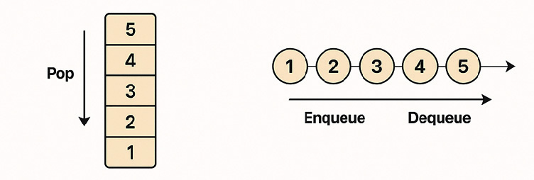
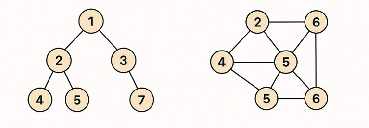
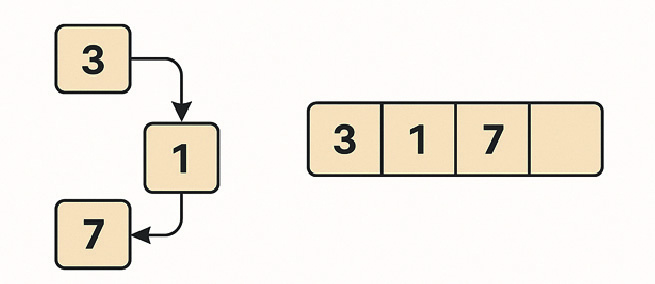
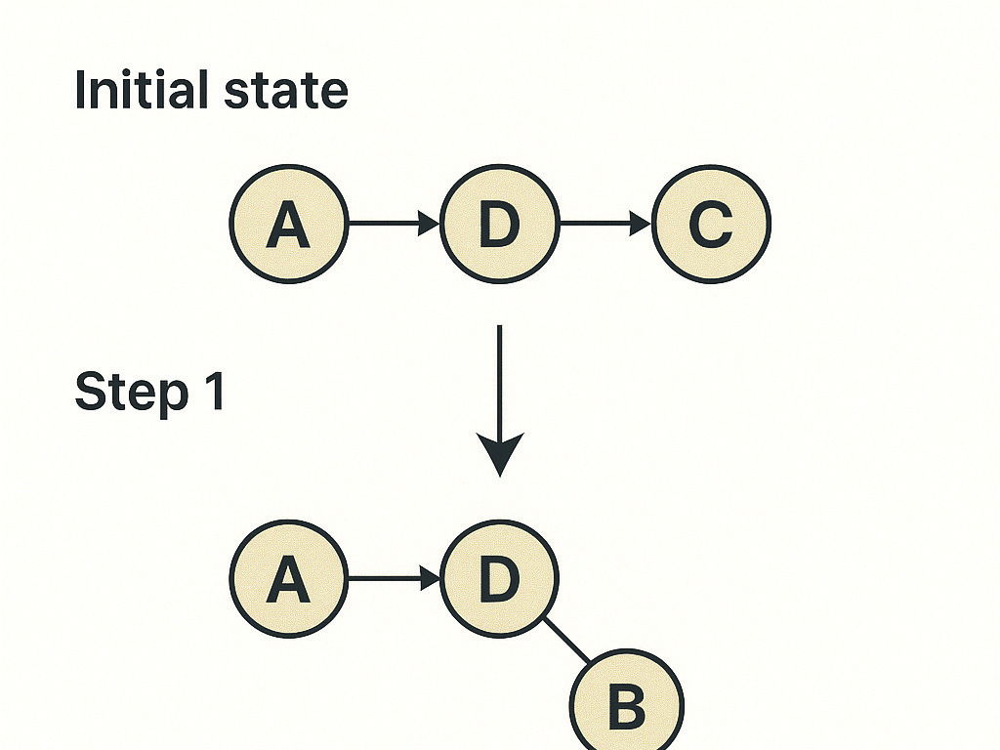
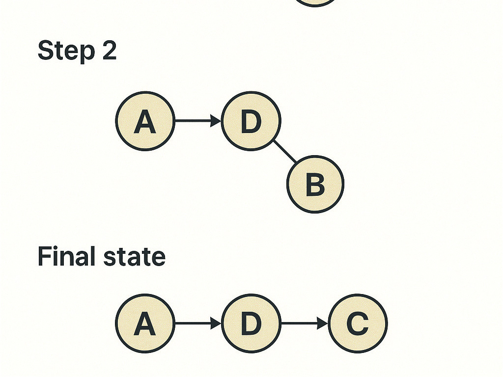
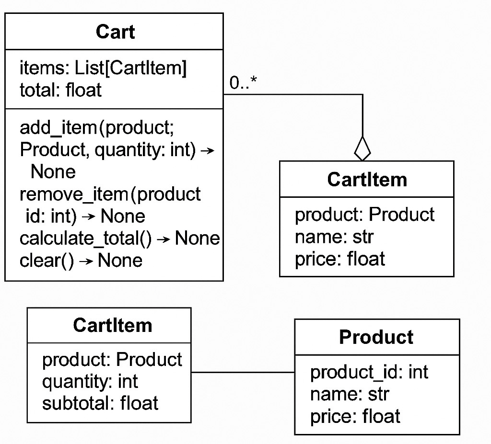
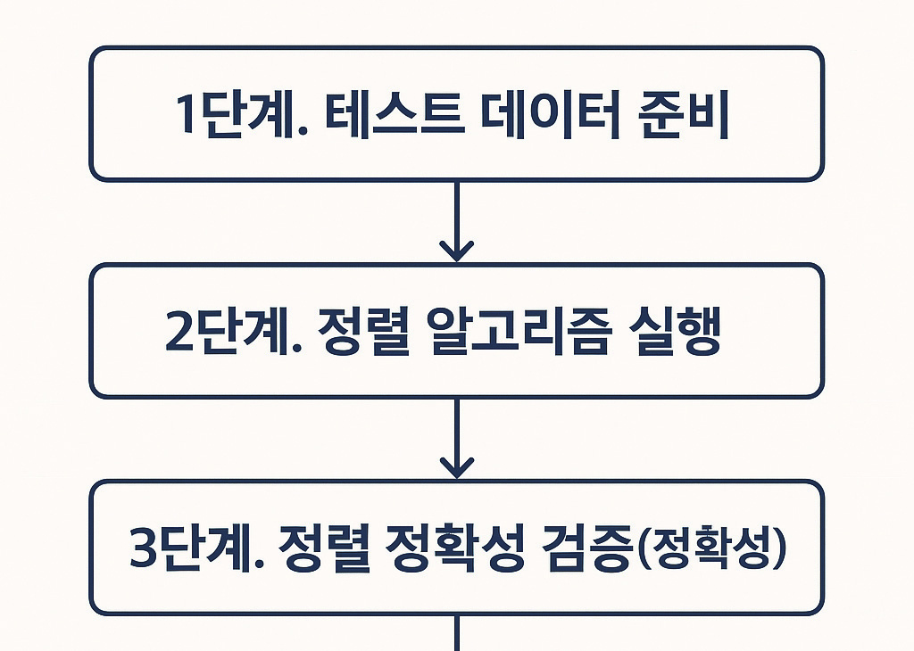
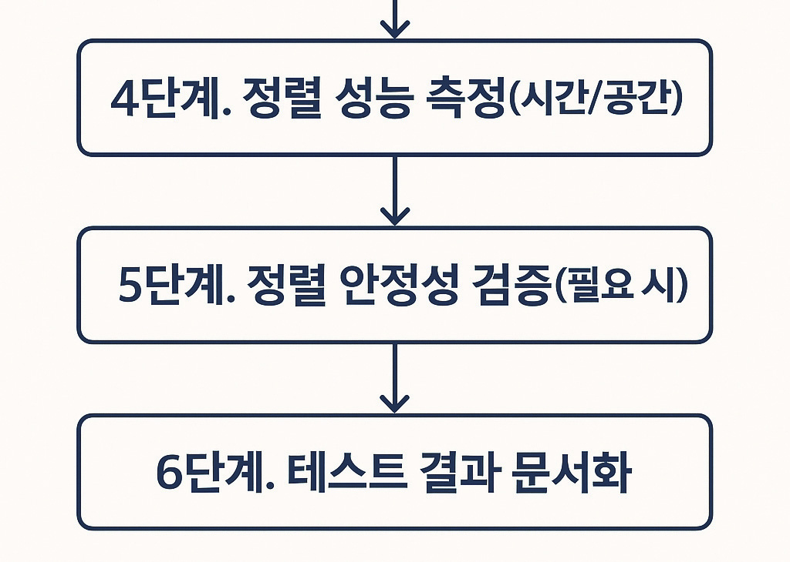

# LM2001020235_23v1_자료구조+활용_20251108

대분류/20
정보통신 중분류/01
정보기술 소분류/02
정보기술개발 세분류/02
응용SW엔지니어링 능력단위/35
NCS학습모듈
자료구조 활용
LM2001020235_23v1
[NCS학습모듈 활용 시 유의 사항]
1. NCS학습모듈은 교육훈련기관에서 출처를 명시하고 교육적 목적으로 활용할 수 있습니다. 다
만, NCS학습모듈에는 국가(교육부)가 저작재산권 일체를 보유하지 않은 저작물(출처가 표기된
도표‧사진‧삽화‧도면 등)이 포함되어 있으므로, 이러한 저작물의 변형‧각색‧복제‧공연‧
배포 및 공중 송신 등과 이러한 저작물을 활용한 2차적 저작물을 작성하려면 반드시 원작자
의 동의를 받아야 합니다.
2. NCS학습모듈은 개발 당시의 산업 및 교육 현장을 반영하여 집필하였으므로, 현재 적용되는
법령‧지침‧표준 및 교과 내용 등과 차이가 있을 수 있습니다. NCS학습모듈 활용 시 법령
‧지침‧표준 및 교과 내용의 개정 사항과 통계의 최신성 등을 확인하시기를 바랍니다.
3. NCS학습모듈은 산업 현장에서 요구되는 능력을 교육훈련기관에서 학습할 수 있게 구성한 자
료입니다. 다만, NCS학습모듈 지면의 한계상 대표적 예시(예: 활용도 또는 범용성이 높은 제
품, 서비스) 중심으로 집필하였음을 이해하시기를 바랍니다.
NCS학습모듈의 이해
NCS학습모듈의 이해
※ 본 NCS학습모듈은 「NCS 국가직무능력표준」사이트(http://www.ncs.go.kr) 에서 확인 및 다운로드할 수 있습니다.

| Ⅰ | NCS학습모듈이란? |
| --- | --- |

•국가직무능력표준(NCS: National Competency Standards)이란 산업현장에서 직무를
수행하기 위해 요구되는 지식･기술･소양 등의 내용을 국가가 산업부문별･수준별로 체계
화한 것으로 산업현장의 직무를 성공적으로 수행하기 위해 필요한 능력(지식, 기술, 태도)
을 국가적 차원에서 표준화한 것을 의미합니다.
•국가직무능력표준(이하 NCS)이 현장의 ‘직무 요구서’라고 한다면, NCS학습모듈은 NCS
의 능력단위를 교육훈련에서 학습할 수 있도록 구성한 ‘교수･학습 자료’입니다. NCS학습
모듈은 구체적 직무를 학습할 수 있도록 이론 및 실습과 관련된 내용을 상세하게 제시하
고 있습니다.

| NCS 및 NCS학습모듈 개발 절차 |
| --- |
| NCS산업계개발 계획 수립NCSNCS학습모듈NCS학습모듈 개발개발 계획 수립 |

•NCS학습모듈은 다음과 같은 특징을 가지고 있습니다.
첫째, NCS학습모듈은 산업계에서 요구하는 직무능력을 교육훈련 현장에 활용할 수 있도
록 성취목표와 학습의 방향을 명확히 제시하는 가이드라인의 역할을 합니다.
둘째, NCS학습모듈은 특성화고, 마이스터고, 전문대학, 4년제 대학교의 교육기관 및 훈
련기관, 직장교육기관 등에서 표준교재로 활용할 수 있으며 교육과정 개편 시에도
유용하게 참고할 수 있습니다.
i
•NCS와 NCS학습모듈 간의 연결 체계를 살펴보면 아래 그림과 같습니다.

| NCS와 NCS학습모듈의 연결 체계 |
| --- |
| NCS NCS학습모듈능력단위 NCS학습모듈명능력단위 정의 NCS학습모듈의 목표능력단위 기술서 학습명능력단위 요소 학습 내용수행준거 학습 목표지식 필요 지식기술 수행 내용- 재료･자료태도- 기기(장비･공구)- 안전･유의 사항- 수행 순서적용범위 및 작업상황고려 사항 교수･학습 방법자료 및 관련 서류 교수 방법장비 및 도구 학습 방법평가 지침 평가평가 방법 평가 준거평가 시 고려 사항 평가 방법피드백참고 자료･활용 서식･부록 |

|  |  | NCS |  |  |  |  |  |  |  |  | NCS학습모듈 |  |  |  |  |
| --- | --- | --- | --- | --- | --- | --- | --- | --- | --- | --- | --- | --- | --- | --- | --- |
|  | 능력단위 |  |  |  |  |  |  |  |  | NCS학습모듈명 |  |  |  |  |  |
|  | 능력단위 | 능력단위 |  |  |  |  |  |  |  | NCS학습모듈명 | NCS학습모듈명 |  |  |  |  |
|  | 능력단위 정의 |  |  |  |  |  |  |  |  | NCS학습모듈의 목표 |  |  |  |  |  |
|  | 능력단위 정의 | 능력단위 정의 |  |  |  |  |  |  |  | NCS학습모듈의 목표 | NCS학습모듈의 목표 |  |  |  |  |
|  | 능력단위 기술서 능력단위 요소 | 능력단위 기술서 능력단위 요소 |  |  |  |  |  |  |  | 학습명 학습 내용 | 학습명 학습 내용 |  |  |  |  |
|  | 능력단위 기술서 |  |  |  |  |  |  |  |  | 학습명 |  |  |  |  |  |
|  | 능력단위 기술서 | 능력단위 기술서 |  |  |  |  |  |  |  | 학습명 | 학습명 |  |  |  |  |
|  | 능력단위 요소 |  |  |  |  |  |  |  |  | 학습 내용 |  |  |  |  |  |
|  | 능력단위 요소 | 능력단위 요소 |  |  |  |  |  |  |  | 학습 내용 | 학습 내용 |  |  |  |  |
|  | 수행준거 |  |  |  |  |  |  |  |  | 학습 목표 |  |  |  |  |  |
|  | 수행준거 | 수행준거 |  |  |  |  |  |  |  | 학습 목표 | 학습 목표 |  |  |  |  |
|  | 지식기술태도 |  |  |  |  |  |  |  |  | 필요 지식수행 내용- 재료･자료- 기기(장비･공구)- 안전･유의 사항- 수행 순서 |  |  |  |  |  |
|  | 기술 | 기술 |  |  |  |  |  |  |  | 수행 내용 | 수행 내용 |  |  |  |  |
|  |  |  |  |  |  |  |  |  |  | - 재료･자료 | - 재료･자료 |  |  |  |  |
|  | 태도 | 태도 |  |  |  |  |  |  |  | - 기기(장비･공구) | - 기기(장비･공구) |  |  |  |  |
|  |  |  |  |  |  |  |  |  |  | - 기기(장비･공구) | - 기기(장비･공구) |  |  |  |  |
|  |  |  |  |  |  |  |  |  |  | - 안전･유의 사항 | - 안전･유의 사항 |  |  |  |  |
|  | 적용범위 및 작업상황 |  |  |  |  |  |  |  |  | - 수행 순서 | - 수행 순서 |  |  |  |  |
|  | 고려 사항자료 및 관련 서류장비 및 도구 |  |  |  |  |  |  |  |  | 교수･학습 방법 | 교수･학습 방법 교수 방법 학습 방법 |  |  |  |  |
|  | 자료 및 관련 서류 장비 및 도구 | 자료 및 관련 서류 장비 및 도구 |  |  |  |  |  |  |  | 교수 방법학습 방법 |  |  |  |  |  |
|  | 평가 지침 |  |  |  |  |  |  |  |  | 평가 |  |  |  |  |  |
|  | 평가 방법평가 시 고려 사항 |  |  |  |  |  |  |  |  | 평가 준거평가 방법피드백 |  |  |  |  |  |
|  | 평가 시 고려 사항 | 평가 시 고려 사항 |  |  |  |  |  |  |  | 평가 방법 | 평가 방법 |  |  |  |  |
|  |  |  |  |  |  |  |  |  |  | 참고 자료･활용 서식･부록 |  |  |  |  |  |

ii
NCS학습모듈의 이해

| Ⅱ | NCS학습모듈의 체계 |
| --- | --- |

•NCS학습모듈은 1. NCS학습모듈의 위치 , 2. NCS학습모듈의 개요 , 3. NCS학습모듈의 내용 체계 ,
4. 참고 자료 , 5. 활용서식/부록 으로 구성되어 있습니다.
1. NCS학습모듈의 위치
•NCS학습모듈의 위치는 NCS 분류 체계에서 해당 학습모듈이 어디에 위치하는지를 한 눈에
볼 수 있도록 그림으로 제시한 것입니다.

| [NCS-학습모듈의 위치] |  |  |  |  |  |  |  |
| --- | --- | --- | --- | --- | --- | --- | --- |
| 대분류 | 문화·예술·디자인·방송 |  |  |  |  |  |  |
| 중분류 |  | 문화콘텐츠 |  |  |  |  |  |
| 소분류 |  |  |  |  |  | 문화콘텐츠제작 |  |
| 세분류 |  |  |  |  |  |  |  |
| 세분류 |  |  |  |  |  |  |  |
| 방송콘텐츠제작 |  |  |  |  | 능력단위 |  | 학습모듈명 |
| 영화콘텐츠제작 프로그램 기획 프로그램 기획음악콘텐츠제작 아이템 선정 아이템 선정광고콘텐츠제작 자료 조사 자료 조사게임콘텐츠제작 프로그램 구성 프로그램 구성애니메이션캐스팅 캐스팅콘텐츠제작만화콘텐츠제작 제작계획 제작계획캐릭터제작 방송 미술 준비 방송 미술 준비스마트문화앱방송 리허설 방송 리허설콘텐츠제작영사 야외촬영 야외촬영스튜디오 제작 스튜디오 제작… … |  |  |  |  | 프로그램 기획 |  | 프로그램 기획 |
| 음악콘텐츠제작 |  |  |  |  | 아이템 선정 |  | 아이템 선정 |
| 광고콘텐츠제작 자료 |  |  |  |  | 자료 조사 |  | 자료 조사 |
| 게임콘텐츠제작 |  |  |  |  | 프로그램 구성 |  | 프로그램 구성 |
| 애니메이션 콘텐츠제작 |  |  |  |  | 캐스팅 |  | 캐스팅 |
| 만화콘텐츠제작 |  |  |  |  | 제작계획 |  | 제작계획 |
| 캐릭터제작 방송 |  |  |  |  | 방송 미술 준비 |  | 방송 미술 준비 |
| 스마트문화앱 방송 콘텐츠제작 |  |  |  |  | 방송 리허설 |  | 방송 리허설 |
| 영사 |  |  |  |  | 야외촬영 |  | 야외촬영 |
|  |  |  |  |  | 스튜디오 제작 |  | 스튜디오 제작 |
|  |  |  |  |  | … |  | … |

|  | 학습모듈은 |
| --- | --- |
| NCS 능력단위 1개당 1개의 학습모듈 개발을 원칙으로 합니다. 그러나 필요에 따라고용단위 및 교과단위를 고려하여 능력단위몇 개를 묶어 1개 학습모듈로 개발할 수있으며, NCS 능력단위 1개를 여러 개의학습모듈로 나누어 개발할 수도 있습니다. |  |

iii
2. NCS학습모듈의 개요
•NCS학습모듈의 개요는 학습모듈이 포함하고 있는 내용을 개략적으로 설명한 것으로
학습모듈의 목표 , 선수학습 , 학습모듈의 내용 체계 , 핵심 용어 로 구성되어 있습니다.

| 학습모듈의 목표 | 해당 NCS 능력단위의 정의를 토대로 학습 목표를 작성한 것입니다. |
| --- | --- |

| 선수학습 | 해당 학습모듈에 대한 효과적인 교수･학습을 위하여 사전에 이수해야 하는 학습모듈, 학습 내용, 관련 교과목 등을 기술한 것입니다. |
| --- | --- |

| 학습모듈의내용 체계 | 해당 NCS 능력단위요소가 학습모듈에서 구조화된 체계를 제시한 것입니다. |
| --- | --- |

| 핵심 용어 | 해당 학습모듈의 학습 내용, 수행 내용, 설비･기자재 등 가운데 핵심적인 용어를 제시한 것입니다. |
| --- | --- |

| 제작계획 학습모듈의 개요 |  |  |  |
| --- | --- | --- | --- |
| 학습모듈의 목표본격적인 촬영을 준비하는 단계로서, 촬영 대본을 확정하고 제작 스태프를 조직하며촬영 장비와 촬영 소품을 준비할 수 있다.선수학습제작 준비(LM0803020105_13v1), 섭외 및 제작스태프 구성(LM0803020104_13v1),촬영 제작(LM0803020106_13v1), 촬영 장비 준비(LM0803040204_13v1.4), 미술디자인 협의하기(LM0803040203_13v1.4)학습모듈의 내용체계 |  |  |  |
| 학습 | 학습 내용 | NCS 능력단위 요소 |  |
| 코드번호 요소 명칭 |  | 코드번호 | 요소 명칭 |
| 1. 촬영 대본 1-1. 촬영 구성안 검 촬영 대본0803020114_16v3.1확정하기 토와 수정 확정하기2-1. 기술 스태프 조직2. 제작 스태프 제작 스태프2-2. 미술 스태프 조직 0803020114_16v3.2조직하기 조직하기2-3. 전문 스태프 조직3. 촬영 장비 3-1. 촬영 장비 점검 촬영 장비0803020114_16v3.3계획하기 과 준비 계획하기4-1. 촬영 소품 목록4. 촬영 소품 작성 촬영 소품0803020114_16v3.4계획하기 4-2. 촬영 소품 제작 계획하기의뢰 |  |  |  |
| 핵심 용어촬영 구성안, 제작 스태프, 촬영 장비, 촬영 소품 |  |  |  |

|  | 학습모듈의 목표는 |
| --- | --- |
| 학습자가 해당 학습모듈을 통해 성취해야할 목표를 제시한 것으로, 교수자는 학습자가 학습모듈의 전체적인 내용흐름을 파악하도록 지도할 수 있습니다. |  |

|  | 선수학습은 |
| --- | --- |
| 교수자 또는 학습자가 해당 학습모듈을 교수·학습하기 이전에 이수해야 하는 교과목또는 학습모듈(NCS 능력단위) 등을 표기한것입니다. 따라서 교수자는 학습자가 개별학습, 자기 주도 학습, 방과 후 활동 등 다양한 방법을 통해 이수할 수 있도록 지도하는 것을 권장합니다. |  |

|  | 핵심 용어는 |
| --- | --- |
| 해당 학습모듈을 대표하는 주요 용어입니다. 학습자가 해당 학습모듈을 통해 학습하고 평가받게될 주요 내용을 알 수 있습니다. 「NCS 국가직무능력표준」 사이트(www.ncs.go.kr)의 색인 (찾아보기) 중하나로 이용할 수 있습니다. |  |

iv
NCS학습모듈의 이해
3. NCS학습모듈의 내용 체계
•NCS학습모듈의 내용은 크게 학습 , 학습 내용 , 교수･학습 방법 , 평가 로 구성되어 있습니다.

| 학습 | 해당 NCS 능력단위요소 명칭을 사용하여 제시한 것입니다.학습은 크게 학습 내용, 교수･학습 방법, 평가로 구성되며 해당 NCS 능력단위의능력단위 요소별 지식, 기술, 태도 등을 토대로 내용을 제시한 것입니다. |
| --- | --- |

| 학습 내용 | 학습 내용은 학습 목표, 필요 지식, 수행 내용으로 구성되며, 수행 내용은 재료･자료, 기기(장비･공구), 안전･유의 사항, 수행 순서, 수행 tip으로 구성한 것입니다.학습모듈의 학습 내용은 실제 산업현장에서 이루어지는 업무활동을 표준화된 프로세스에 기반하여 다양한 방식으로 반영한 것입니다. |
| --- | --- |

| 교수･학습 방법 | 학습 목표를 성취하기 위한 교수자와 학습자 간, 학습자와 학습자 간 상호 작용이활발하게 일어날 수 있도록 교수자의 활동 및 교수 전략, 학습자의 활동을 제시한것입니다. |
| --- | --- |

| 평가 | 평가는 해당 학습모듈의 학습 정도를 확인할 수 있는 평가 준거 및 평가 방법, 평가 결과의 피드백 방법을 제시한 것입니다. |
| --- | --- |

학습 1 촬영 대본 확정하기

|  | 학습은 |
| --- | --- |
| 해당 NCS 능력단위요소 명칭을 사용하여제시하였습니다. 하나의 학습은 일반교과의 ‘대단원’에 해당되며, 학습모듈을 구성하는 가장 큰 단위가 됩니다. 또한 하나의 직무를 수행하기 위한 가장 기본적인단위로 사용할 수 있습니다 |  |

| 학습 2 | 제작 스태프 조직하기 |
| --- | --- |

학습 3 촬영 장비 계획하기
학습 4 촬영 소품 계획하기

|  | 학습 내용은 |
| --- | --- |
| NCS 능력단위요소별 수행준거를 기준으로제시하였습니다. 일반교과의 ‘중단원’에 해당합니다. |  |

2-1. 기술 스태프 조직
학습 목표 •프로그램 제작에 적합한 기술 스태프를 조직할 수 있다.

|  | 학습 목표는 |
| --- | --- |
| 학습 내용을 이수할 때 학습자가 갖춰야할행동 수준을 의미합니다. 따라서 수업시간의 과목 목표로 활용할 수 있습니다. |  |

필요 지식 /
(cid:49684) 기술 스태프의 구성

|  | 필요 지식은 |
| --- | --- |
| 해당 NCS의 지식을 토대로 학습에 대한이해와 성과를 제고하기 위해 반드시 알아야 할 주요 지식을 제시하였습니다. 필요 지식은 수행에 꼭 필요한 핵심 내용을위주로 제시하여 교수자의 역할이 매우중요하며, 이후 수행 순서와 연계하여 교수·학습으로 진행할 수 있습니다. |  |

프로그램의 장르에 따라 구성하는 기술 스태프는 많은 차
이가 있다. 같은 장르의 프로그램이라도 그 형식이나 내
용, 규모에 따라서 구성되는 기술 스태프의 종류와 인원
수는 천차만별이다.
1. 스튜디오 프로그램
토크쇼, 종합 구성, 예능과 같은 스튜디오 프로그램은
부조정실과 스튜디오를 사용하여 제작하기 때문에 많
은 기술 스태프가 필요하다.
v

|  | 수행 내용은 |
| --- | --- |
| 해당 학습모듈에서 제시한 내용 중 기술(skill)을 습득하기 위한 실습과제로 활용할 수 있습니다. |  |

수행 내용 / 기술 스태프 구성표 작성하기
재료·자료

|  | 재료･자료는 |
| --- | --- |
| 수행 내용을 수행하는데 필요한 재료 및 준비물로 실습 시 활용할 수 있습니다. |  |

• 방송프로그램 제작 기획서 및 방송 대본, 콘티(continuity), 제작
일정, 운용표
• 장비 및 시설, 제작 시설 배정 의뢰서 및 배정표, 방송 기술 스
태프 데이터베이스(DB) 자료

|  | 기기(장비･공구)는 |
| --- | --- |
| 수행 내용에 필요한 기본적인 장비 및 도구를 제시하였습니다. 제시된 기기 외에도 수행에 필요한 다양한 도구나 장비를 활용할수 있습니다. |  |

기기(장비･공구)
• 컴퓨터 등
안전･유의 사항

|  | 안전･유의사항은 |
| --- | --- |
| 수행 내용을 수행하는 데 있어 안전상 주의해야할 점 및 유의사항을 제시하였습니다. 실습 시 유념해야 하며, NCS의 고려사항도 추가적으로 활용할 수 있습니다. |  |

• 프로그램의 내용과 제작 방법을 분석하고, 각 스태프들의 역할
을 신중하게 검토한다.
수행 순서
(cid:49684) 방송 대본이나 콘티(continuity), 큐 시트를 분석하고, 프로그램

|  | 수행 순서는 |
| --- | --- |
| 실습 과제의 진행 순서로 활용할 수 있습니다. |  |

의 내용적 특성, 제작 과정에 대한 자료를 수집한다.
(cid:49685) 프로그램 제작 방법을 결정한다.

|  | 수행 tip은 |
| --- | --- |
| 수행 내용에서 실습을 용이하게 할 수 있는아이디어를 제시하였습니다. 수행 tip은 지도상의 안전 및 유의사항 외에 전반적으로적용되는 주안점 및 수행 과제 목적에 대한보충설명, 추가사항 등으로 활용할 수 있습니다. |  |

1. 스튜디오 녹화를 할 것인가, 야외 촬영을 할 것인가 검토한
다.
수행 tip
•스태프의 결정은 스태프 간의 호흡을 중
요시하여 선정해야 프로그램의 질을 향
상시킬 수 있다.

| 학습2 | 교수·학습 방법 |
| --- | --- |

|  | 교수･학습 방법은 |
| --- | --- |
| 학습 목표를 성취하는 데 필요한 교수 방법과 학습 방법을 제시하였습니다. |  |

교수 방법

|  | 교수 방법은 |
| --- | --- |
| 해당 학습 활동에 필요한 학습 내용, 학습내용과 관련된 자료명, 자료 형태, 수행 내용의 진행 방식 등에 대하여 제시하였습니다. 또한 학습자의 수업참여도 제고 방법및 수업 진행상 유의사항 등도 제시하였습니다. 선수학습이 필요한 학습을 학습자가숙지하였는지 교수자가 확인하는 과정으로활용할 수도 있습니다. |  |

• 방송 프로그램의 기술적 요소, 미술 구성 요소, 특수 촬영에 대해
설명한다.
• 방송 프로그램 제작에서 각 기술 스태프의 역할에 대해 설명한다.
• 방송 프로그램을 분석하고 필요한 기술 스태프를 구성할 수 있도
록 지시한다.
학습 방법

|  | 학습 방법은 |
| --- | --- |
| 해당 학습 활동에 필요한 학습자의 자기주도 학습 방법을 제시하였습니다. 또한학습자가 숙달해야 할 실기 능력과 학습과정에서 주의해야 할 사항 등도 제시하였습니다. 학습자가 학습을 이수하기 전반드시 숙지해야 할 기본 지식을 학습하였는지 스스로 확인하는 과정에 활용할수 있습니다. |  |

• 방송 프로그램의 기술적 요소, 미술 구성 요소, 특수 촬영에 대해
서 알아본다.
• 프로그램 제작에 필요한 기술 스태프의 역할을 이해하고, 기술 스
태프 구성표를 작성한다.
vi
NCS학습모듈의 이해

| 학습2 평 가평가 준거• 평가자는 학습자가 학습 목표를 성공적으로 달성하였는지를 평가해야 한다.• 평가자는 다음 사항을 평가해야 한다.성취수준학습 내용 학습 목표상 중 하기술 스태프 - 프로그램 제작에 적합한 기술 스태프를 조조직 직할 수 있다.미술 스태프 - 프로그램 제작에 적합한 미술 스태프를 조조직 직할 수 있다.전문 스태프 - 프로그램 특수 촬영을 위한 전문 스태프를조직 조직할 수 있다.평가 방법• 사례 연구성취수준학습 내용 평가 항목상 중 하- 프로그램에서 기술적 요소의 파악 여부기술 스태프 - 기술 스태프의 역할 파악 여부조직 - 프로그램에 필요한 기술 스태프 구성표 작성 능력피드백1. 사례 연구- 프로그램을 선택하여 기술 스태프, 미술 스태프, 전문 스태프 구성표를 예시와 같이 작성하였는지 개인별 능력을 평가한 후, 그결과를 모든 학습자에게 공유하도록 한다. | 학습2 | 평 가 |
| --- | --- | --- |

|  | 평가는 |
| --- | --- |
| NCS 능력단위의 평가 방법과 평가 시 고려사항을 준용하여 작성합니다. 교수자와학습자가 평가 항목별 성취수준 확인 시활용할 수 있습니다. |  |

|  | 평가 준거는 |
| --- | --- |
| 학습자가 학습을 어느 정도 성취하였는지평가하기 위한 기준을 제시하고 있습니다.학습 목표와 연계하여 단위수업 시간에 평가 항목 별 성취수준을 평가하는 데 활용할수 있습니다. |  |

| 학습 내용 | 학습 목표 | 성취수준 |  |  |
| --- | --- | --- | --- | --- |
|  |  | 상 | 중 | 하 |

| 4. 참고 자료•교육부(2013). | 섭외 및 제작스태프 구성(LM0803020104_13v1). |  |  |  |
| --- | --- | --- | --- | --- |
| 한국직업능력개발원. |  |  |  |  |
| 5. 활용 서식/부록직종 이름기술감독 조명감독 [디지털제1조(목적) 이 고시는램 및 방송광고의 | 스튜디오 기술 스태프 구성표 연락처 소속 특이사항텔레비전 방송프로그램 음량 등에 관한 기준] 제정 2014. 11. 29. 미래창조과학부 고시제1창 총칙 방송법 제70조의2제1항에 따라 방송사업자가 디지털 텔레비전음량을 일정하게 유지하기 위해 필요한 사항을 규정함을 | 비고목적으로 | 제2014-87호방송프로그한다. |  |

|  | 평가 방법은 |
| --- | --- |
| NCS 능력단위의 평가 방법을 참고하였으며, 평가 준거에 따른 평가 방법을 2개 이상 제시합니다. 평가 방법의 종류는 포트폴리오, 문제해결 시나리오, 서술형 시험, 논술형 시험, 사례 연구, 평가자 체크리스트,작업장 평가 등이 있으며, NCS 능력단위요소 별 수행 수준을 평가하는 데 가장 적절한 방법을 선정하여 활용할 수 있습니다. |  |

| 학습 내용 | 평가 항목 | 성취수준 |  |  |
| --- | --- | --- | --- | --- |
|  |  | 상 | 중 | 하 |

| 4. 참고 자료•교육부(2013). | 섭외 및 제작스태프 구성(LM0803020104_13v1). |  |  |  |
| --- | --- | --- | --- | --- |
| 한국직업능력개발원. |  |  |  |  |
| 5. 활용 서식/부록직종 이름기술감독 조명감독 [디지털제1조(목적) 이 고시는램 및 방송광고의 | 스튜디오 기술 스태프 구성표 연락처 소속 특이사항텔레비전 방송프로그램 음량 등에 관한 기준] 제정 2014. 11. 29. 미래창조과학부 고시제1창 총칙 방송법 제70조의2제1항에 따라 방송사업자가 디지털 텔레비전음량을 일정하게 유지하기 위해 필요한 사항을 규정함을 | 비고목적으로 | 제2014-87호방송프로그한다. |  |

|  | 피드백은 |
| --- | --- |
| 평가 후에 학습자들에게 평가 결과를 피드백하여 학습 목표를 달성하는 데 활용할 수 있습니다. |  |

|  | 참고 자료는 |
| --- | --- |
| 해당 학습모듈에 제시된 인용 자료의 출처를 제시하였습니다. 교수·학습의 과정에서참고로 활용할 수 있습니다. |  |

|  | 활용 서식은 |
| --- | --- |
| 평가 서식, 실습 시트 등 교수·학습 시 활용할 수 있는 다양한 서식들로 구성하였습니다. 수행에서 평가에 이르기까지 필요한서식을 해당 모듈의 특성에 맞춰 개발하거나 기존의 양식을 활용하여 제시하였습니다. |  |

|  | 부록은 |
| --- | --- |
| 활용 서식 이외에 교수·학습 과정에서 참고할수 있는 자료가 있는 경우 제시하였습니다. |  |

[NCS-학습모듈의 위치]

| 정보 통신 |  |  |
| --- | --- | --- |
|  | 정보 기술 |  |
|  |  | 정보기술개발 |

대분류
중분류
소분류
세분류

| SW아키텍처 |  |  | 능력단위 | 학습모듈명 |
| --- | --- | --- | --- | --- |
| 응용SW엔지니어링 |  |  | 요구사항 확인 | 요구사항 확인 |
| 임베디드SW 엔지니어링 |  |  | 데이터 입출력 구현 | 데이터 입출력 구현 |
| DB엔지니어링 |  |  | 통합 구현 | 통합 구현 |
| NW엔지니어링 |  |  | 정보시스템 이행 | 정보시스템 이행 |
| 보안엔지니어링 |  |  | 제품소프트웨어 패키징 | 제품소프트웨어 패키징 |
| UI/UX엔지니어링 |  |  | 서버 프로그램 구현 | 서버 프로그램 구현 |
| 시스템SW엔지니어링 |  |  | 인터페이스 구현 | 인터페이스 구현 |
| 빅데이터플랫폼구축 |  |  | 애플리케이션 배포 | 애플리케이션 배포 |
| 핀테크엔지니어링 |  |  | 애플리케이션 리팩토링 | 애플리케이션 리팩토링 |
| 데이터아키텍처 |  |  | 인터페이스 설계 | 인터페이스 설계 |
| loT시스템연동 |  |  | 애플리케이션 요구사항 분석 | 애플리케이션 요구사항 분석 |
| 인프라스트럭쳐 아키텍처 구축 |  |  | 기능 모델링 | 기능 모델링 |
|  |  |  | 애플리케이션 설계 | 애플리케이션 설계 |

| 정적모델 설계 | 정적모델 설계 |
| --- | --- |
| 동적모델 설계 | 동적모델 설계 |
| 화면 설계 | 화면 설계 |
| 화면 구현 | 화면 구현 |
| 애플리케이션 테스트 관리 | 애플리케이션 테스트 관리 |
| 애플리케이션 테스트 수행 | 애플리케이션 테스트 수행 |
| 소프트웨어공학 활용 | 소프트웨어공학 활용 |
| 소프트웨어개발 방법론 활용 | 소프트웨어개발 방법론 활용 |
| 프로그래밍 언어 응용 | 프로그래밍 언어 응용 |
| 프로그래밍 언어 활용 | 프로그래밍 언어 활용 |
| 응용SW 기초 기술 활용 | 응용SW 기초 기술 활용 |
| 개발자 환경 구축 | 개발자 환경 구축 |
| 개발 환경 운영 지원 | 개발 환경 운영 지원 |
| 자료구조 활용 | 자료구조 활용 |

차 례
학습모듈의 개요 1
학습 1. 기본 자료구조 활용하기
1-1. 자료구조 특성 및 차이점 파악 3
1-2. 자료구조 활용 19
• 교수⋅학습 방법 28
• 평가 29
학습 2. 정렬 및 탐색 알고리즘 활용하기
2-1. 데이터 정렬 알고리즘 활용 32
2-2. 데이터 탐색 알고리즘 활용 46
• 교수⋅학습 방법 76
• 평가 77
참고 자료 80
활용 서식 81
자료구조 활용 학습모듈의 개요
학습모듈의 목표
자료구조 유형별 특성을 고려하여 애플리케이션 구현과 정렬 및 탐색 알고리즘에 적합한 자료구조를 선정하여
활용할 수 있다.
선수학습
프로그래밍 언어 응용(LM2001020230_23v5), 요구사항 확인(LM2001020201_23v5), 기본 자료구조
개념, 알고리즘 기초
학습모듈의 내용체계

| 학습 | 학습 내용 | NCS 능력단위 요소 |  |
| --- | --- | --- | --- |
|  |  | 코드번호 | 요소 명칭 |

1-1. 자료구조 특성 및 차이점 파악
1. 기본 자료구조 활용 기본 자료구조
2001020235_23v1.1
하기 활용하기
1-2. 자료구조 활용
2-1. 데이터 정렬 알고리즘 활용
2. 정렬 및 탐색 알고 정렬 및 탐색 알고리즘
2001020235_23v1.2
리즘 활용하기 활용하기
2-2. 데이터 탐색 알고리즘 활용
핵심 용어
자료구조, 시간 복잡도, 공간 복잡도, 선형 구조, 비선형 구조, 노드, 포인터, 탐색, 삽입·삭제 연산

| 학습 1 | 기본 자료구조 활용하기 |
| --- | --- |

학습 2 정렬 및 탐색 알고리즘 활용하기
1-1.
자료구조 특성 및 차이점 파악
•자료구조의 각 유형별 특성 및 차이점을 파악할 수 있다.
학습 목표
•애플리케이션과 알고리즘에 적합한 자료구조를 선정할 수 있다.
필요 지식 /
(cid:49684) 자료구조 및 성능 개념
1. 자료구조 개념
(1) 자료구조 정의
김진수(2023), Cormen(2009) 등의 연구에 따르면 자료구조는 자료를 저장하고 조
직하여 효율적인 접근 및 처리를 가능하게 하는 방식을 의미하며 알고리즘을 적용
하여 프로그램의 성능과 효율성에 결정적인 영향을 미치는 요소로 정의한다.
(2) 추상 데이터 타입
데이터와 그 데이터에 적용할 수 있는 연산들을 논리적으로 정의한 개념으로 구현
방법으로 숨기고, 인터페이스만 제공하는 논리적 개념이다.
<표 1-1> 추상 데이터 타입과 자료구조 비교
항목 추상 데이터 타입 자료구조
관점 논리적, 추상적 구조 정의 물리적, 구현 관점 데이터 저장 방식
실제 메모리 구조와 구현 알고리즘
중심 데이터와 연산의 인터페이스에 집중
에 집중
배열, 연결리스트, 트리, 해시테이블
예시 스택, 큐, 리스트
등
목표 사용자는 기능만 알고 사용 기능도 구현도 모두 직접 제어
2. 자료구조별 연산 성능 및 복잡도 분석
(1) 시간 복잡도
입력 데이터 크기(n)에 따라 알고리즘 또는 연산 실행 과정의 소요 시간 증가율을
수학적으로 표현한 것으로 Cormen(2009)의 연구에서 언급하고 있는 Big-O 표기
법을 사용한다.
<표 1-2> 시간 복잡도 평가 항목
연산 종류 설명
삽입 자료구조에 새 데이터를 추가하는 데 걸리는 시간
삭제 자료구조에서 데이터를 제거하는 데 걸리는 시간
탐색 특정 데이터를 찾기 위한 시간
접근 특정 위치의 데이터를 직접 읽는 데 필요한 시간
(2) 공간 복잡도
자료구조가 연산을 수행하는 동안 사용하는 메모리 용량으로 포인터 사용 여부,
배열의 크기, 내부 버퍼 등이 영향을 준다.
<표 1-3> 공간 복잡도 평가 항목
평가 항목 설명
정적 메모리: 고정 크기 할당
정적/동적 메모리
동적 메모리: 실행 중 크기 변경 가능
포인터 오버헤드 연결리스트, 트리 등에서의 포인터 메모리 비용
캐시 지역성 배열처럼 메모리 연속 저장 시 CPU 캐시 효율이 높아짐
제거된 노드가 즉시 반환하지 않아 메모리 낭비 발생 가능
가비지
성이 있음
(cid:49685) 자료구조 알고리즘 및 프로그래밍 언어별 자료구조 구현 방식
1. 자료구조 알고리즘 종류
(1) 탐색 알고리즘
데이터 집합에서 원하는 값을 찾기 위한 알고리즘이다.
<표 1-4> 탐색 알고리즘 종류
알고리즘 사용 자료구조 시간 복잡도 특징
순차적으로 탐색,
선형 탐색 배열, 리스트 O(n)
단순하지만 비효율적
정렬된 배열, 중간값을 기준으로 반씩
이진 탐색 O(log n)
이진 탐색 트리 줄이며 탐색
깊이 우선
그래프, 트리 O(V + E) 자식 노드를 끝까지 탐색
탐색
너비 우선 인접 노드를 넓게 먼저
그래프, 트리 O(V + E)
탐색 탐색(큐 사용)
키-값 기반 탐색, 충돌
해싱 해시테이블 평균 O(1), 최대 O(n)
해결 필요
(2) 정렬 알고리즘
데이터를 오름차순, 내림차순 등 정해진 순서로 재배열하기 위한 알고리즘이다.
<표 1-5> 정렬 알고리즘 종류
알고리즘 사용 자료구조 시간 복잡도 특징
인접 요소 교환으로
버블 정렬 배열, 리스트 O(n2)
비효율적
선택 정렬 배열, 리스트 O(n2) 최솟값 선택 후 교환
삽입 정렬 배열, 리스트 O(n2) 정렬된 부분에 삽입
평균: O(n log n)
퀵 정렬 배열 분할 정복하며 피벗 기반
최대: O(n2)
병합 정렬 배열, 리스트 O(n log n) 안정 정렬, 분할 정복
힙 정렬 힙 O(n log n) 최대/최소 힙 활용
(3) 삽입/삭제 알고리즘
데이터를 추가하거나 제거하는 연산을 효율적으로 수행하는 알고리즘이다. 삽입, 삭
제 알고리즘 종류는 배열, 연결리스트, 스택 연산, 큐 연산 등이 있다.
2. 프로그래밍 언어별 자료구조
(1) 자바(Java) 자료구조
자바는 컬렉션 프레임워크를 통해 다양한 자료구조를 표준 라이브러리로 제공한다.
<표 1-6> 자바 주요 자료구조
자료구조 클래스/인터페이스 특징
배열 int[], String[] 크기 고정, 인덱스로 접근
ArrayList는 빠른 접근,
리스트 ArrayList, LinkedList
LinkedList는 삽입/삭제 효율적
후입선출, 스택 오래된 클래스,
스택 Stack, Deque
덱 기반 스택 권장
큐 Queue, LinkedList, PriorityQueue 선입선출, 우선순위 큐 제공
덱(Deque) ArrayDeque, LinkedList 양방향 삽입/삭제 지원
키-값 저장, 해시 기반/정렬 맵
해시맵 HashMap, Hashtable, TreeMap
모두 지원
HashSet, TreeSet,
세트(Set) 중복 불가, 정렬 여부 구분 필요
LinkedHashSet
트리 TreeMap, TreeSet 이진 탐색 트리 기반 정렬 구조
직접 구현 필요 (Map<Node,
그래프 표준 그래프 라이브러리 없음
List<Node>>)
(2) 파이썬(Phthon) 자료구조
대부분의 자료구조가 내장 타입으로 제공되며 동적 타입과 간결한 문법으로 사용이
편리하다.
<표 1-7> 파이썬 주요 자료구조
자료구조 클래스/모듈 특징
리스트 list 동적 배열, 삽입/삭제 가능, 슬라이싱 지원
튜플 tuple 불변 리스트, 해시 가능
list (append/pop),
스택 리스트 또는 덱으로 구현
collections.deque
collections.deque, 덱은 빠른 양방향 처리, Queue는 스레드
큐
queue.Queue 안전
덱(Deque) collections.deque 양방향 삽입/삭제 O(1)
힙 heapq 최소 힙 지원, 리스트 기반
해시맵 dict 기본 키-값 저장 구조, 해시 기반
세트(Set) set, frozenset 중복 없음, 불변/가변 모두 제공
트리 외부 구현 필요 (예: 표준 트리 자료구조는 없음
자료구조 클래스/모듈 특징
anytree, binarytree)
그래프 dict 기반 직접 구현 네트워크 등의 외부 라이브러리 활용 가능
수행 내용 / 자료구조 특성 및 차이점 파악하기
재료‧자료
• 자료구조 이론서
• 자료구조 분류 기준서
• 시스템 요구사항 및 기능 명세서
• 프로그래밍 언어별 표준 자료구조 라이브러리 및 설명서
기기(장비‧공구)
• 컴퓨터 및 통합 개발 환경
• 문서 작성 도구
안전‧유의 사항
• 자료구조 적용 시 적절한 삽입, 삭제 조건을 확인하여야 한다.
• 순환 구조 검색 시 종료 조건을 설정하여 무한 루프를 방지하여야 한다.
• 개발 언어 및 플랫폼별 지원 가능한 자료구조 라이브러리를 확인하여야 한다.
• 자료구조 및 알고리즘 적용을 검토하기 위한 테스트 데이터 중 개인정보가 포함하지
않도록 하거나, 기술적 개인정보 보호조치를 해야 한다.
수행 순서
(cid:49684) 자료구조의 각 유형별 특성 및 차이점을 분석한다.
1. 주요 자료구조 유형을 목록으로 작성한다.
(1) 자료구조 유형을 분류하기 위한 기준을 정리한다.
(가) 자료구조의 일반적인 분류 기준을 조사하여 정리한다.
(나) 자료구조의 유형을 학술적, 실무적 관정에서 비교한다.
(다) 자료구조 유형의 자체 분류 기준을 정의한다.
자료구조의 유형은 Horowitz & Sahni(1993), Goodrich & Tamassia(2014)
의 연구에서 제시한 분류체계를 활용하여 정의한다.
<표 1-8> 자료구조 유형 분류 기준
분류 기준 분류 항목 설명 대표 자료구조
요소들이 일렬로 나열되어 배열, 연결리스트,
선형
있으며, 순차적으로 접근 가능 스택, 큐
구조 형태
요소들이 계측적 또는 네트워크
비선형 트리, 그래프, 힙
형태로 연결됨
연속 메모리에 연속적으로 저장 배열
메모리
연결리스트, 트리,
저장 방식
비연속 포인터를 통해 요소들이 연결됨
그래프
순차 접근 앞에서부터 순서대로 접근 배열, 큐
임의 접근 임의의 위치에 직접 접근 가능 배열(인덱스 기반)
데이터
마지막에 넣은 데이터를 먼저
접근 방식
후입선출(LIFO) 스택
꺼냄
선입선출(FIFO) 먼저 넣은 데이터를 먼저 꺼냄 큐
정적 자료구조 데이터 크기가 고정 배열
변경 가능
데이터 크기나 구조가 실행 중
동적 자료구조 연결리스트, 트리
에 변함
일반 구조 범용적으로 사용되는 기본 구조 배열, 스택, 큐
특수 목적
특정 알고리즘이나 시스템에서 해시테이블, B 트
특수 목적 구조
효율적으로 사용됨 리, 트라이
(2) 선형 자료구조 관련 정보를 수집하여 정리한다.
배열, 연결리스트, 스택, 큐 등의 선형 자료구조의 개념, 특징, 용도 등을 정리한다.
<표 1-9>와 같이 선형 자료구조의 접근, 탐색, 삽입, 삭제의 특징을 분석한다.
O(1)은 연산 시간이 일정하며, O(n)은 데이터 수(n)에 비례하여 시간이 걸린다.
(가) 선형 자료구조의 목록을 작성한다.
(나) 각 선형 자료구조의 정의와 주요 연산을 정리한다.
(다) 각 선형 자료구조의 시간 및 공간 복잡도를 정리한다.
(라) 각 선형 자료구조의 활용 사례와 장단점을 정리한다.
<표 1-9> 선형 자료구조 복잡도 비교 결과 예시
자료구조 접근 탐색 삽입 삭제 특징
• 인덱스를 통한
배열 O(1) O(n) O(n) O(n) 직접 접근 가능
• 크기 고정
• O(1): 앞에 • O(1): 앞에 • 포인터로 요소
삽입 시 삭제 시 연결
연결리스트 O(n) O(n)
• O(n): 임의 • O(n): 임의 • 동작 시 크기
위치 위치 가변
• 후입선출
• 주로 한
스택 O(n) O(n) O(1): Push O(1): 팝
쪽에서만 연산
수행
• 선입선출
O(1): 큐 뒤 O(1): 큐 뒤
큐 O(n) O(n) • 입출력 방향
삽입 삭제
다름
• 양쪽에서
O(1): 앞 뒤 O(1): 앞 뒤
덱(Deque) O(n) O(n) 삽입/삭제 가능
모두 모두
• 유연한 큐 구조
(3) 비선형 자료구조 관련 정보를 수집하여 정리한다.
트리, 그래프, 힙 등 비선형 자료구조에 대한 정보를 수집하고 특성을 정리한다.
(가) 비선형 자료구조 목록을 작성한다.
(나) 비선형 자료구조의 구조적 특성과 연산을 정리한다.
(다) 비선형 자료구조의 활용 분야를 조사한다.
(라) 비선형 자료구조의 복잡도와 장점, 단점을 정리한다.
<표 1-10> 비선형 자료구조 비교 결과 예시
자료구조 구조 형태 주요 연산 특징 사용 사례
• 계층적 데이터
표현
• O(log n): 디렉터리 구조,
계층적 구조 • 중복되지 않음
트리(Tree) 균형 트리 DB, 인덱스
(루트 → 자식) • 이진 탐색트리,
• O(n): 비균형 파싱
AVL, B 트리 등
다양
• 순환/무순환
• O(1 ~ n2):
정점과 간선 모두 가능 내비게이션,
그래프 인접 리스트,
으로 연결된 • 방향/무방향, SNS 연결망,
(Graph) 행렬 여부에
네트워크 가중치 등 웹 크롤링
따라 다름
다양한 형태
자료구조 구조 형태 주요 연산 특징 사용 사례
• O(log
• 최대/최소
n)/O(log n) 힙 정렬,
완전 이진트 우선순위 보장
힙(Heap) /O(1): 우선순위 큐,
리 기반 • 정렬과 우선순위
최댓값/최솟값 스케줄러
작업에 효율적
탐색
• 문자열 검색
문자 단위로 특화
트라이 • O(m): 문자열 자동완성, 사전,
분기되는 트 • 중복 노드
(Trie) 길이 문자열 탐색
리형 구조 공유로 공간
절약
• 디스크 I/O
B 트리/ 다차원 균형 최소화 DB, 파일
• O(log n)
B+ 트리 트리 • 범위 탐색에 시스템
유리
(4) 해시테이블과 같은 특별한 자료구조의 포함 여부를 결정한다.
선형, 비선형 자료구조에 포함되지 않는 해시테이블, 덱(Deque), B-트리 등 특별
자료구조의 포함 여부를 결정한다.
(가) 기타 자료구조를 조사한다.
(나) 자료구조 분석 기준을 확인하여 포함 여부를 검토한다.
(다) 포함하는 경우 목적을 명확하게 하고 최종 목록에 통합하여 정리한다.
(5) 자료구조 목록을 표 형태로 정리한다.
업무에 참조할 수 있도록 모든 자료구조를 분류하여 표 형태로 정리한다.
(가) 자료구조 분류 기준별 테이블 구조를 정리한다.
(나) 자료구조별 핵심 내용을 요약하여 표로 작성한다.
2. 각 자료구조의 개념을 정리한다.
(1) 각 자료구조의 개념, 특성을 정리한다.
자료구조의 기본 개념을 파악하고, 선형/비선형, 동적/정적 등의 유형을 분류하여
정리한다.
(가) 스택, 큐, 배열, 트리, 그래프 등 각각의 정의를 작성한다.
(나) 선형/비선형, 정적/동적 등 기준으로 자료구조를 분류한다.
(다) 자료구조가 사용되는 목적이나 상황을 정리한다.
(2) 주요 연산을 정리한다.
자료구조별로 가능한 연산과 해당 연산의 복잡도 등을 정리한다.
(가) 삽입, 삭제, 탐색, 정렬 등의 연산을 목록으로 작성한다.
(나) 연산이 수행되는 순서, 조건 등을 정리한다.
(다) 각 연산별 시간 복잡도를 정리한다.
(3) 저장 방식 관련 내용을 기술한다.
각 자료구조가 메모리에 저장되는 방식과 연속 할당, 포인터 여부를 포함하여 작성
한다.
(가) 배열/연결리스트의 메모리 저장 방식을 그림으로 작성한다.
(나) 임의, 순차 등의 자료 접근 방식을 기술한다.
(다) 저장 방식에 따른 크기 제한, 사업/삭제 제약 등을 기술한다.
(4) 각 자료구조의 장단점을 요약한다.
(가) 각 자료구조의 구조, 연산 효율, 메모리 사용 관점에서의 장점을 목록으로 작성한다.
(나) 각 자료구조의 구조적 제약, 복잡도, 구현 난이도 등의 단점을 목록으로 작성한다.
(다) 도출한 장단점을 표로 정리한다.
3. 자료구조 간 처리 속도, 메모리 효율 등 특성을 비교 분석한다.
(1) 삽입, 삭제, 탐색 등 연산별 시간 복잡도를 비교한다.
각 자료구조에서 삽입, 삭제, 탐색 연산을 수행할 때 걸리는 시간과 복잡도를 분석
한다.
(가) 자료구조의 주요 연산을 나누어 정리한다.
(나) 각 자료구조의 연산 시간과 복잡도를 정리한다.
(다) 연산 시간과 복잡도의 의미와 차이를 분석한다.
(2) 공간 복잡도 및 메모리 사용을 비교한다.
자료구조가 사용하는 메모리 크기, 구조적 오버헤드, 포인터 유무 등에 따라 메모리
효율을 비교한다.
(가) 자료 저장 방식을 확인한다.
(나) 포인터, 헤더 등의 추가 메모리 사용 여부를 분석한다.
(다) 최댓값/최솟값/평균값으로 메모리 사용량을 추정한다.
(3) 데이터 접근 방식을 비교한다.
순차, 인덱스, 트리 탐색 등과 같은 데이터 접근 방식을 비교한다.
(가) 자료구조의 접근 유형을 분류한다.
(나) 각 자료구조의 접근 방식에 대한 설명을 기술한다.
(다) 각 자료구조의 접근 방식이 자료 저장 시 효율성에 미치는 영향을 분석한다.
(4) 연산 효율성에 따른 적절성을 분석한다.
연산을 많이 사용하는 상황에서 적합한 자료구조를 상황별로 분석한다.
(가) 자료구조의 연산 중심 시나리오를 설정한다.
(나) 해당 시나리오에서 각 자료구조의 적절성을 판단한다.
(다) 해당 자료구조를 선택한 이유를 정리하고 근거를 제시한다.
(5) 자료구조의 특성 비교 결과를 표로 정리한다.
분석한 연산 시간, 공간 복잡도와 접근 방식 등을 종합하여 비교표로 정리한다.
(가) 자료구조의 비교 항목을 정리한다.
(나) 각 자료구조를 기준으로 항목별로 비교한다.
(다) 비교 결과를 표로 정리한다.
<표 1-11> 자료구조 특성 비교 결과 예시
자료 연산 시간
공간 복잡도 접근 방식 활용
구조 삽입 삭제 탐색
정적
배열 O(n) O(n) O(n) O(n) 임의 접근 데이터
저장
삽입/삭제
연결리
O(1) O(1) O(n) O(n)+포인터 순차 접근 빈도 높은
스트
경우
함수 호출
스택 O(1) O(1) O(n) O(n) 후입선출
관리
작업
큐 O(1) O(1) O(n) O(n) 선입선출 대기열
처리
계층적 트리 구조
트리 O(log n) O(log n) O(log n) O(n)
접근 탐색
해시 O(n)+충돌 해시 함수
O(1) 평균 O(1) 평균 O(1) 평균 빠른 탐색
테이블 관리 기반
4. 시스템에 활용한 자료구조 사례를 조사한다.
(1) 자료구조별 대표 활용 분야를 조사한다.
(가) 배열, 스택, 큐, 연결리스트 등의 핵심 구조를 선정한다.
(나) 각 자료구조의 기본 개념과 특징을 요약한다.
(다) 자료구조별 일반적인 활용 분야를 조사한다.
(라) 각 자료구조의 활용 목적과 장단점을 비교하여 정리한다.
(2) 실제 시스템에서의 자료구조 활용 사례를 조사하여 정리한다.
(가) 조사 대상 시스템을 선정한다.
(나) 시스템 내 적용된 자료구조를 확인한다.
(다) 자료구조의 작동 방식 및 흐름을 분석한다.
(라) 조사 내용을 요약하여 보고서를 작성한다.
(3) 프로그램 언어별 라이브러리 내 자료구조 구현을 확인한다.
(가) 확인 대상 프로그램 언어를 선정한다.
(나) 기본 자료구조 구현 방식을 확인한다.
(다) 각 자료구조를 이용한 간단한 소스 코드를 분석한다.
(라) 프로그램 언어별 구현의 차이점을 정리한다.
(4) 산업별 자료구조 활용 사례를 정리한다.
(가) 금융, 공공, 물류, 의료 등 조사 대상 산업 분야를 선정한다.
(나) 산업 분야별 문제 유형을 파악한다.
(다) 산업별 활용 사례를 구체적으로 정리한다.
(5) 자료구조 사례 조사 내용을 보고서로 정리한다.
(가) 자료구조 사례 조사 보고서의 목차를 구성한다.
(나) 자료구조별, 산업 분야별 사례를 정리한다.
(다) 자료구조 활용 사례 보고서를 통합하여 작성한다.
5. 각 자료구조의 동작 방식이나 구조를 도식으로 작성한다.
(1) 각 자료구조를 그림으로 작성한다.
(가) 자료구조의 기본 구성 요소를 파악한다.
(나) 배열, 스택, 큐 등 선형 구조의 구조도를 작성한다.

출처: 집필진 제작(2025)
[그림 1-1] 선형 자료구조도 작성 예시
(다) 트리, 그래프 등 비선형 구조의 구조도를 작성한다.

출처: 집필진 제작(2025)
[그림 1-2] 비선형 자료구조도 작성 예시
(라) 동적, 정적 메모리 구조 차이를 그림으로 작성한다.

출처: 집필진 제작(2025)
[그림 1-3] 동적/정적 자료구조도 작성 예시
(마) 각 자료 구조도를 정리한다.
(2) 주요 연산 과정을 도식으로 작성한다.

출처: 집필진 제작(2025)
[그림 1-4] 트리 자료구조 연산 과정 예시
(3) 자료구조의 연산 흐름을 화살표 등으로 표시한다.
(가) 연산 단계 간 흐름을 설계한다.
(나) 화살표나 색상 등을 활용하여 방향성을 명확하게 표현한다.
(다) 삽입 위치에 따른 조건 분기를 포함하여 표시한다.
(라) 자료구조의 연산 흐름을 통해 논리 구조도를 작성한다.
(4) 각 자료구조를 비교하여 표로 작성한다.
(가) 삽입/삭제 속도와 메모리 구조 등의 비교 항목을 정의한다.
(나) 자료구조별 특성을 정리한다.
(다) 성능, 구현 난이도 등을 비교한다.
(라) 비교한 결과를 정리하여 표로 작성한다.
6. 자료구조별 차이점을 요약하여 정리한다.
(1) 성능, 구조, 사용 목적 등을 기준으로 비교 항목을 도출한다.
(가) 비교 목적에 적합한 항목을 선정한다.
(나) 일반적인 자료구조 분석 기준을 조사한다.
(다) 비교 항목을 논리적 범주로 분류한다.
(2) 항목별 차이점을 표로 정리한다.
(3) 정리된 내용을 요약한다.
(4) 자료구조별 핵심 키워드나 문장을 강조하여 표시한다.
(cid:49685) 애플리케이션과 알고리즘에 적합한 자료구조를 선정한다.
1. 애플리케이션 요구사항을 분석한다.
목표 기능과 처리해야 할 데이터의 종류와 규모, 실시간 처리 여부 등을 분석한다.
(1) 주요 기능을 목록으로 작성한다.
(가) 유스케이스, 요구사항명세서 등에서 기능을 도출한다.
(나) 기능을 CRUD(Create Read Update Delete), 검색, 정렬, 필터링 등 자료처리 기
준으로 분류한다.
(다) 빈도, 중요도 기준으로 핵심 기능을 우선 파악한다.
(2) 정수, 문자열, 객체 등과 같은 처리해야 할 데이터 유형을 정리한다.
(가) 각 기능별 입력, 출력 데이터 필드를 확인한다.
(나) 정수, 문자열, 객체 등으로 데이터 타입을 분류한다.
(다) 리스트, 클래스 등 복합 데이터의 구조를 식별한다.
<표 1-12> 시스템의 데이터 유형 정리 결과 예시
데이터 항목 자료형 설명
사용자 ID 문자열 로그인 식별자
상품 가격 정수 원화 기준 금액
장바구니 목록 리스트 객체의 배열 구조
재고 여부 불리언 True/False 판단
중략...
(3) 데이터 크기 및 연산 빈도를 예측한다.
(가) 로그, 사용자 수, 트래픽 기반으로 일일 평균 데이터 입력량을 산정한다.
(나) 기능 호출 통계 기반으로 기능별 연산 호출 빈도를 산정한다.
<표 1-13> 데이터 크기 및 연산 예측 결과 예시
기능 예상 일일 호출 평균 데이터 수 비고
상품 검색 15,000회 1,000개 상시 사용 기능
장바구니 관리 3,000회 45개 사용자당 변동 크기
주문 처리 2,000회 5개 상대적으로 적음
(다) 다양한 상황에 따른 최솟값/평균값/최댓값의 시나리오를 작성한다.
(4) 연산 처리 시간, 공간 효율성 요구사항을 분석한다.
(가) 실시간 응답이 필요한지 여부를 확인한다.
(나) 서버, 사용자 단말기 메모리 조건에 따른 제약 조건을 확인한다.
(다) 자료처리 연산에 허용 가능한 시간, 메모리 기준을 정의한다.
<표 1-14> 자료처리 성능 요구사항 분석 결과 예시
기능 목표 응답 시간 메모리 사용 제한 비고
상품 검색 1초 이내 100MB 이하 실시간 처리 필요
장바구니 관리 3초 이내 50MB 이하 사용 중간 응답 기능 필요
주문 처리 5초 이내 80MB 이하 백엔드 중심 처리
2. 데이터 처리 알고리즘 특성을 분석한다.
(1) 적용할 데이터 처리 알고리즘의 연산 흐름과 목적을 확인한다.
(가) 알고리즘 명세서와 흐름도를 작성한다.
(나) 알고리즘의 주요 연산별 목적 구분표를 작성한다.
(2) 적용할 알고리즘과 자료구조 간의 의존성을 분석한다.
(가) 알고리즘 연산별 자료구조 적합성 평가표를 작성한다.
(나) 기존 구현 예시와 사용하는 자료구조를 목록으로 작성한다.
(3) 최적의 성능을 위한 자료구조 요구사항을 추출한다.
(가) 자료구조의 연산별 요구 성능 조건표를 작성한다.
사례: 자료구조 요구 조건 정의서
• 삽입: 평균 O(1) 이하
• 삭제: 불필요
• 검색: 평균 O(1) 이상
• 공간 효율성: 데이터 10만 건 이하 기준 100MB 이내
• 사용 환경: Java, 멀티스레딩 환경
(나) 대상 자료구조별 성능 비교 테이블을 작성한다.
(다) 자료구조 관점의 사용 환경 및 제약사항을 정리한다.
3. 후보 자료구조를 조사하고 특성을 비교한다.
(1) 배열, 연결리스트, 스택, 큐, 힙, 트리, 해시테이블 등 다양한 자료구조를 조사하고 상호
비교한다.
(가) 각 자료구조의 개념, 구조, 특징을 서술한다.
(나) 실제 사례를 통해 어떤 자료구조가 적용되는지 확인하고 정리한다.
(다) 시간 복잡도, 메모리 효율성, 구현 난이도 등을 기준으로 장단점을 분석한다.
(라) 분석 결과는 표 형태로 정리하여 한눈에 비교할 수 있도록 한다.
<표 1-15> 자료구조 비교표 예시
자료구조 선형/비선형 주 용도 장점 단점
접근 속도 크기 고정
배열 선형 인덱싱
빠름 삽입/삭제 비효율적
동적 메모리 임의 접근이
연결리스트 선형 삽입/삭제
활용 느림
자료구조 선형/비선형 주 용도 장점 단점
Undo, 구조 단순, 중간 요소 접근
스택 선형
함수 호출 관리 구현 용이 불가
작업 예약, 선입선출 처 삽입/삭제 위치
큐 선형
프로세스 관리 리 제한
불균형 발생
힙 비선형 우선순위 큐 빠른 검색
가능
평균적으로
해시테이블 - 키-값 매핑 해시 충돌 가능
빠른 탐색
(2) 각 자료구조의 시간 복잡도를 정리한다.
(가) 삽입, 삭제, 검색, 정렬 등 연산별 시간 복잡도를 조사한다.
(나) 알고리즘 이론을 기반으로 객관적인 근거를 확보한다.
(다) 시간 복잡도 결과를 표나 그래프로 시각화하여 이해를 돕는다.
(3) 삽입, 삭제, 검색, 정렬 성능을 비교한다.
(가) 각 연산의 정의를 명확히 하고 분류 기준을 일관성 있게 정리한다.
(나) 연산별로 가장 효율적인 자료구조를 도출하여 최적의 활용 방안을 제시한다.
(다) 연산별 성능을 중심으로 자료구조를 비교한다.
<표 1-16> 연산별 성능 비교 예시
연산 적합 자료구조 평균 시간 복잡도 설명
삽입 연결리스트 O(1) 헤드 초반 삽입 빠름
삭제 연결리스트 O(n) 위치 탐색 필요
검색 해시테이블 O(1) 매우 빠름
정렬 힙 O(n log n) 힙 정렬 가능
4. 애플리케이션에 적합한 자료구조를 선정한다.
(1) 알고리즘, 기능, 데이터 흐름과 가장 적합한 자료구조를 선정한다.
(2) 연산 시간, 공간 효율성 기준으로 우선순위를 정의한다.
(3) 자료구조를 선정한 근거를 문서로 작성한다.
5. 선정한 자료구조의 적용 가능성을 검증한다.
(1) 해당 프로그래밍 언어에서 지원하는지 여부를 확인한다.
(2) 선정한 자료구조의 라이브러리 활용 가능성과 커스터마이징 수준을 점검한다.
(3) 예외 상황에서 동작하는 시나리오를 확인한다.
1-2.
자료구조 활용
•애플리케이션을 구현하기 위하여 선택한 자료구조를 활용할 수 있다.
학습 목표
•알고리즘 구성을 위하여 선택한 자료구조를 활용할 수 있다.
필요 지식 /
(cid:49684) 시간 및 공간 복잡도 분석 방식
1. Big-O 표기법
(1) Big-O 표기법 개념
알고리즘이나 연산의 시간, 공간 복잡도를 수학적으로 표현하는 방법으로 입력 크기
n이 커질 때 연산량이 증가하는 정도를 추상적으로 나타내는 표기법이다.
(2) 표기 목적
(가) 알고리즘의 효율성을 분석하고 비교하는 것을 목적으로 한다.
(나) 최악의 경우를 가정한 성능을 예측한다.
(다) 대략적인 실행 시간과 자원 소모를 판단한다.
(3) 주요 표기 종류
<표 1-17> Big-O 주요 표기 종류
표기 의미 예시 설명
O(1) 상수 시간 해시테이블 탐색 입력 크기와 무관하게 고정된 소요 시간
O(log n) 로그 시간 이진 탐색 입력이 커질수록 증가 속도가 완만해짐
O(n) 선형 시간 순차 탐색 입력 크기에 비례함
O(n log n) 로그 선형 병합 정렬 일반적인 정렬 알고리즘
O(n2) 이차 시간 버블 정렬 중첩 반복문이 있을 경우 적용
O(2m) 지수 시간 피보나치 재귀 입력 증가 시 폭발적 증가
팩토리얼
O(n!) 순열 생성 매우 비효율적, 실사용은 거의 없음
시간
2. 알고리즘 성능 분석 기준
(1) 분석 방법
소스 코드의 반복문, 조건문, 재귀 호출 등을 기준으로 입력 크기 증가에 따른 연산
량을 측정하여 복잡도를 산정한다.
(2) 알고리즘 분석 기준
<표 1-18> 알고리즘 성능 분석 기준
기준 설명
시간 복잡도 입력 크기에 따른 실행 시간 증가 속도
공간 복잡도 입력 크기에 따른 메모리 사용량 증가 속도
최악의 경우 가장 오래 걸리는 상황
최선의 경우 가장 빠른 상황
평균의 경우 통계적 평균 상황(실제에 가까움)
안정성 정렬 등에서 동일한 값의 상대 순서 유지 여부
확장성 데이터가 수십만, 수백만 개로 늘어날 때의 효율성
응답성 사용자가 체감하는 실시간 반응 속도
3. 공간 효율성 개념
(1) 공간 효율성
알고리즘이나 자료구조가 메모리를 효율적으로 사용하는 정도를 나타내는 척도로 임
베디드, 모바일 환경 등에서 중요하게 고려해야 한다.
(2) 공간 복잡도
프로그램 실행 중 필요한 총 메모리 사용량으로 변수, 자료구조, 함수 호출 스택 등
을 포함한다.
(3) 공간 효율성 영향 요소
<표 1-19> 공간 효율성 영향 요소
요소 설명
고정 크기 메모리 정적 배열 등 미리 할당된 메모리
동작 할당 연결리스트, 트리 등 필요시 메모리 생성
오버헤드 포인터, 인덱스 등 관리 정보가 차지하는 공간
중복 데이터 여부 동일한 값이 여러 구조에 중복 저장되는지 여부
캐시 및 버퍼 활용 저장 공간 최적화 여부
(cid:49685) 자료구조 활용
1. 기능별 자료구조 매핑 방법
애플리케이션에서 구현할 기능의 특성과 데이터 흐름을 고려하여 가장 적합한 자료구조
를 선택하는 과정이다. 이 과정을 통해 기능의 처리 속도를 높이고, 메모리 사용을 최
적화하며, 유지 보수성을 강화할 수 있다.
<표 1-20> 기능별 자료구조 매핑 절차
단계 설명
① 기능 정의 CRUD, 검색, 정렬, 필터링 등 기능을 세분화
각 기능에서 다루는 데이터의 크기와 형태(리스트, 트리, 해시 등),
② 데이터 특성 분석
실시간 처리 요구 여부를 분석
어떤 연산이 성능에 영향을 미치는지 삽입, 삭제, 탐색 등의 주요
③ 연산 요구 분석
연산의 빈도와 중요도를 파악
연산 복잡도와 구조적 특징을 기준으로 2~3개의 후보 자료구조를
④ 자료구조 후보 도출
선정
⑤ 성능 및 구현 시간·공간 복잡도, 코드 구현의 용이성, 라이브러리 지원 여부 등을
난이도 평가 종합적으로 고려
성능, 구현 가능성, 유지 보수성 등을 종합적으로 고려하여 최종 자
⑥ 최적 자료구조 선택
료구조 선택
2. 자료 흐름도 및 클래스 설계 방법
(1) 자료 흐름도 설계 방법
(가) 자료 흐름도 설계 절차
<표 1-21> 자료 흐름도 설계 절차
단계 설명
시스템에 들어오는 입력, 사용자 또는 다른 시스템으로 나가는
① 입력/출력 정의
출력 정의
② 처리 정의 입력을 가공하여 출력을 생성하는 처리 과정 도출
③ 데이터 저장소 정의 파일, DB, 메모리 등 데이터가 저장되는 위치 식별
④ 데이터 흐름 정의 위 요소 간 데이터 이동 경로와 방향 정의
⑤ 예외 흐름 정의 잘못된 입력, 시스템 오류 발생 시 흐름도에 포함
(나) 자료 흐름도 주요 기호
<표 1-22> 자료 흐름도 주요 기호
기호 설명
● 원 처리 과정(프로세스)
▭ 사각형 외부 엔티티(사용자, 타 시스템)
이중선 데이터 저장소
→ 화살표 데이터 흐름
(다) 자료 흐름도 주요 기호를 활용한 사례

출처: 집필진 제작(2025)
[그림 1-5] 도서 대출 프로세스 관련 자료 흐름도 예시
(2) 클래스 설계 방법
(가) 기능 분석
시스템 기능을 세분화하여 각 클래스가 담당할 책임을 정의한다.
(나) 클래스 도출
사용자, 상품, 장바구니 등 실체를 기준으로 클래스를 정의한다.
(다) 속성 정의
클래스가 다루는 데이터 항목을 정의한다.
(라) 메서드 정의
클래스가 제공해야 할 기능을 정의한다.
(마) 클래스 간 관계 정의
상속, 포함, 연관 관계를 정의한다.
수행 내용 / 자료구조 활용하기
재료‧자료
• 요구사항명세서
• 설계 문서 양식
• 코드 주석 작성 가이드
• 프로그래밍 언어별 자료구조 구현 방식 및 API 설명서
• 표준 코딩 가이드라인
기기(장비‧공구)
• 통합 개발 환경
• 시간 및 공간 복잡도 분석 도구
• 문서 작성 도구
안전‧유의 사항
• 예외 처리(try-except, 조건문 등)를 포함하여 설계해야 한다.
• 자료형 검사 및 예외 처리 타입 오류를 방지할 수 있도록 설계해야 한다.
• underflow, overflow 조건 처리 확인하여 설계에 반영해야 한다.
수행 순서
(cid:49684) 선택한 자료구조를 실제 기능에 적용한다.
1. 요구사항에 부합하는 자료구조를 선정한다.
(1) 기능별 데이터 흐름 및 저장 방식을 분석한다.
(가) 요구사항명세서를 통해 검색, 정렬 등 데이터 핵심 기능을 도출한다.
(나) 기능별 입출력 데이터 항목, 형식을 정의한다.
(다) 기능 실행 순서와 데이터 흐름을 종합하여 기능 흐름도를 작성한다.
(라) 데이터 저장 방식을 구분하고 제약사항을 검토한다.
<표 1-23> 기능별 데이터 요구사항 분석 결과 예시
기능 데이터 특성 실시간성 삽입 빈도 탐색 속도 적합 자료구조
로그인 키-값 검색 높음 낮음 매우 빠름 해시테이블
대용량
상품 검색 중간 낮음 빠름 배열, 해시테이블
리스트 탐색
장바구니 데이터 삽입
높음 높음 중간 연결리스트, 배열
관리 /삭제 잦음
상태 기반
주문 처리 낮음 중간 중간 트리, 배열
데이터 저장
주문 내역 정렬 기반
낮음 없음 빠름 트리, 연결리스트
조회 조회
실시간 최근 기록
매우 높음 높음 빠름 큐, 스택, 힙
추천 위주 처리
(2) 선택한 자료구조가 해결해야 할 문제 또는 요구사항과 매핑한다.
(가) 각 기능에서 필요한 연산을 파악한다.
(나) 연산 효율성, 구현 난이도 등의 기준으로 자료구조 적합성을 평가한다.
(다) 자료구조 선택 근거를 정량적, 정성적 기준으로 정리한다.
(라) 보완 가능한 대안 자료구조를 검토하고 정리한다.
2. 선택한 자료구조를 기반으로 설계에 반영한다.
(1) 자료구조를 적용한 클래스 또는 모듈을 설계한다.
(가) 구현할 기능에 필요한 자료구조 유형을 도출한다.
(나) 각 클래스 또는 모듈이 담당할 역할을 정의한다.
(다) 자료구조를 포함한 클래스 또는 모듈을 설계한다.

출처: 집필진 제작(2025)
[그림 1-6] 자료구조를 포함한 클래스 모델 예시
(라) 자료구조 활용 기능 구현을 위한 주요 메서드를 설계한다.
(2) 데이터 입출력 흐름도를 작성한다.
(가) 사용자 입력 및 출력 데이터 항목을 정의한다.
(나) 데이터가 처리되는 순서, 조건 및 분기점을 정의한다.
(다) 조건, 반복, 입출력 기호를 사용하여 흐름도를 작성한다.
(라) 잘못된 입력, 예외 발생 시 시나리오를 흐름도에 반영한다.
(3) 주요 기능에서 자료구조 활용 방안을 명세한다.
(가) 요구사항 기반 주요 기능을 목록으로 작성한다.
(나) 기능별 필요한 자료구조를 매핑한다.
(다) 자료구조를 통한 기능 처리 방식을 정의한다.
(라) 해당 자료구조 활용의 이유를 분석하여 정리한다.
<표 1-24> 기능별 자료구조 활용 방안 예시
기능 적용 클래스 활용 이유 주요 연산 대안 자료구조
ID 기반 검색 및 ArrayList: 탐색
회원 목록 HashMap 검색, 수정,
수정이 잦아 빠른 성능 낮음
관리 <String, User> 삭제
탐색이 필요 (O(n))
상품
ArrayList 순차 출력 및 정렬이 전체 출력, LinkedList:
카탈로그
<Product> 용이 정렬 접근 성능 낮음
조회
ArrayList:
장바구니 LinkedList 삽입·삭제가 빈번하며 삽입, 삭제,
삽입/삭제
관리 <CartItem> 순서 유지 필요 탐색
비효율적
주문 내역 최근 주문 취소 기능 삽입, 삭제 Queue: 순서
Stack<Order>
저장 (LIFO) (pop) 반대 구조
HashMap:
상품 키워드 문자열 기반 빠른
Trie 검색, 삽입 접두어 검색
검색 자동완성 검색
비효율적
중략...
3. 선택한 자료구조 기반의 코드를 구현한다.
(1) 선택한 자료구조를 사용한 함수 또는 메서드를 구현한다.
(가) 선택한 자료구조가 지원하는 기본 연산 목록을 작성한다.
(나) 연산을 수행하는 함수, 메서드의 이름, 매개변수, 반환값을 정의한다.
(다) 자료구조에 적합한 로직을 작성한다.
(라) 구현된 함수가 예상대로 동작하는지 확인 테스트 코드를 작성한다.
(2) CRUD 기능과 자료구조를 연동하여 적용한다.
(가) 시스템의 주요 기능을 CRUD 관점에서 정의한다.
(나) 각 CRUD 기능과 자료구조를 매핑한다.
(다) 자료구조를 활용하여 CRUD 기능 처리 코드를 구현한다.
(라) 자료의 흐름이 의도대로 동작하는지 검증한다.
(3) 예외 처리 및 경계 조건을 정리하고 확인한다.
(가) 자료구조의 최대, 최소 크기, 빈 자료구조 상태 등 임계 상황을 정의한다.
(나) Null, IndexError, Overflow 등 데이터 관점에서 오류 유형을 정의한다.
<표 1-25> 데이터 관점 오류 유형 정의표 예시
오류 유형 발생 조건 설명 해결 방안
포인터나 참조 변수가 Null
존재하지 않는 null 체크 조건 삽입
상태에서 접근 시도
Null 오류 메모리 참조로 (if node is not
연결리스트 노드가 존재하지
런타임 오류 발생 None:)
않는 상태에서 참조
프로그램이 인덱스 인덱스 경계 조건
배열이나 리스트에서
IndexError 범위를 벗어나서 확인 (if 0 <= i <
유효하지 않은 인덱스 접근
접근 len(arr):)
요소가 존재하지 연산 전 비어 있는지
빈 스택에서 pop 시도
Underflow 않는데 검색하여 확인 (if not stack:
빈 큐에서 dequeue 시도
논리적 오류 발생 raise Error)
Overflow 삽입 전 최대 크기
고정 크기 배열/큐/스택에서 더 이상 삽입할
(저장 공간 확인 또는 동적 확장
최대 용량 초과 삽입 시도 공간이 없음
초과) 구현
TypeError 정수형 리스트에 문자열
자료형 불일치로 입력값 자료형 사전
(자료형 삽입, 비교 연산 시 자료
연산 오류 발생 검사 또는 예외 처리
불일치) 타입 불일치
중략...
(다) try-except 구조, 조건문 등을 활용하여 오류 발생을 방지한다.
(라) 의도적으로 예외 상황을 발생시켜 코드의 견고성을 확인한다.
4. 자료구조가 적용된 시스템의 성능 및 적정성을 검토한다.
(1) 시간 및 공간 복잡도를 분석한다.
(가) 주요 연산을 구분하여 정리한다.
(나) 각 자료구조의 평균/최대 시간 및 공간 복잡도를 조사한다.
(다) 다양한 입력 크기(n)에 따라 소요 시간과 메모리를 측정한다.
(라) 분석 결과를 문서로 작성한다.
(2) 동일 기능 구현 시 대안 자료구조를 비교한다.
(가) 기능 요구 조건을 정의한다.
(나) 해당 기능에 적용이 가능한 자료구조 후보를 도출한다.
(다) 후보 자료구조별 장단점을 비교한다.
(라) 시나리오 기반 수행 시간을 비교하여 테스트한다.
(3) 자료구조 사용의 적정성 검토 의견을 수집하고 분석한다.
(가) 개발자, 설계자 등 내부 검토를 수행하여 의견을 수집한다.
(나) 사용성 테스트를 통한 의견을 수집한다.
(다) 구조 부적합, 복잡도 과자 등 지적 사항을 분석하여 개선안을 도출한다.
(4) 자료구조 활용 내역과 유지보수를 위한 설명 문서를 작성한다.
(가) 자료구조 활용 위치를 정리한다.
(나) 구조 변경 시 영향을 받는 모듈 또는 클래스를 정리한다.
(5) 소스 코드 내 자료구조 관련 주석을 보완한다.
(가) 클래스, 변수 선언부 등에서 자료구조 정의 위치에 주석을 추가한다.
(나) 삽입, 삭제 등 알고리즘 단계 주석을 보완한다.
(다) 각 함수에서 시간 복잡도 주석을 표시한다.
(라) 구조 변경 시 유의점을 주석으로 포함한다.

| 학습 1 | 교수⋅학습 방법 |
| --- | --- |

교수 방법
• 주요 자료구조 유형의 예시와 도식을 제공하여 자료구조 개념과 추상 데이터 타입 차이
를 설명한다.
• 각 자료구조의 연산 복잡도와 공간 효율성을 표와 그래프를 제공하여 비교 분석하도록
하고 분석 결과에 대한 설명을 듣고 피드백을 제공한다.
• 프로그래밍 언어별 자료구조 구현 방식을 설명하고 실습을 진행하여 언어별 자료구조
특성을 설명한다.
• 다양한 요구사항 및 시나리오를 제공하고 해당 상황에 맞는 자료구조를 선정하고 그 근
거를 발표하도록 지도한다.
• 자료구조 활용의 적절성에 대한 소스 코드를 검토하고 토론을 통해 자료구조 선택의 중
요성 관련 의견을 발표하도록 지도한다.
학습 방법
• 제공된 자료구조 유형의 예시와 도식을 파악하여 자료구조 개념과 추상 데이터 타입 차
이를 숙지한다.
• 각 자료구조의 연산 복잡도와 공간 효율성을 표와 그래프를 작성하여 비교 분석하고 발
표 자료를 작성하여 발표한다.
• 프로그래밍 언어별 자료구조 구현 방식을 숙지하고 주어진 실습 자료에 맞는 자료구조
특성을 학습한다.
• 다양한 요구사항 및 시나리오를 분석하여 해당 상황에 맞는 자료구조를 선정하고 그 근
거를 정리하여 발표한다.
• 자료구조 활용의 적절성에 대한 소스 코드를 분석하고 토론을 통해 자료구조 선택의 중
요성을 정리하여 발표한다.

| 학습 1 | 평 가 |
| --- | --- |

평가 준거
• 평가자는 학습자가 학습 목표를 성공적으로 달성하였는지를 평가해야 한다.
• 평가자는 다음 사항을 평가해야 한다.

| 학습 내용 | 학습 목표 | 성취수준 |  |  |
| --- | --- | --- | --- | --- |
|  |  | 상 | 중 | 하 |

- 자료구조의 각 유형별 특성 및 차이점을 파악할 수 있다.
자료구조 특성
- 애플리케이션과 알고리즘에 적합한 자료구조를 선정할
및 차이점 파악
수 있다.
- 애플리케이션을 구현하기 위하여 선택한 자료구조를
활용할 수 있다.
자료구조 활용
- 알고리즘 구성을 위하여 선택한 자료구조를 활용할 수
있다.
평가 방법
• 문제해결 시나리오

| 학습 내용 | 평가 항목 | 성취수준 |  |  |
| --- | --- | --- | --- | --- |
|  |  | 상 | 중 | 하 |

- 주어진 시나리오에 적절한 자료구조를 선정하고 선정
근거를 정리하는 능력
자료구조 특성 - 주어진 상황 및 요구사항에 적절한 자료구조를 선정하
및 차이점 파악 고 해당 자료구조를 설계하는 능력
- 주어진 상황을 분석하여 후보 자료구조를 선정하고 비
교하여 차이점을 정리하는 능력
- 주어진 시나리오를 분석하고 자료구조를 선정하고 이
유, 처리 흐름을 정리하는 능력
- 특정 제약사항을 준수하는 대안 자료구조를 제안하고
자료구조 활용
적용 방식과 성능 비교 결과를 제시하는 능력
- 주어진 요구사항에 적절한 자료구조를 선정하고 자료
흐름도와 클래스 설계 방안을 제시하는 능력
• 서술형 시험

| 학습 내용 | 평가 항목 | 성취수준 |  |  |
| --- | --- | --- | --- | --- |
|  |  | 상 | 중 | 하 |

- 주어진 자료구조의 메모리 저장 방식과 삽입/삭제 등
연산 복잡도 차이를 서술하는 능력
자료구조 특성 - 주어진 자료구조의 검색 연산 시 시간 복잡도 차이를
및 차이점 파악 비교하고 각 구조가 적합한 상황을 서술하는 능력
- 알고리즘의 구조적 차이와 활용 사례를 자료구조 관점
에서 서술하는 능력
- 시간 복잡도 표기법과 알고리즘 예시를 서술하는 능력
- 특정 조건을 충족하는 자료구조를 제시하는 능력
자료구조 활용
- 자료구조 선택 시 고려해야 할 요소를 서술하고 반영
되는 과정을 제시하는 능력
• 평가자 질문

| 학습 내용 | 평가 항목 | 성취수준 |  |  |
| --- | --- | --- | --- | --- |
|  |  | 상 | 중 | 하 |

- 특정 요구사항 및 제약사항을 고려하여 해당 시스템에
서 필요로 하는 제약 구조를 선택하는 방법에 대하여
질문에 답변하는 능력
자료구조 특성
및 차이점 파악 - 특정 자료구조의 장점과 단점, 특징을 설명하는 능력
- 자료구조 선택이 애플리케이션 성능에 미치는 영향에
대하여 설명하는 능력
- 특정 기능에 적합한 자료구조가 적절한지 여부와 이유
를 설명하는 능력
- 특정 기능에 적합한 자료구조를 비교 검토하고 실제
자료구조 활용
상황 예시를 설명하는 능력
- 기능별 최적의 자료구조를 선정하는 기준을 설명하는
능력
• 구두 발표

| 학습 내용 | 평가 항목 | 성취수준 |  |  |
| --- | --- | --- | --- | --- |
|  |  | 상 | 중 | 하 |

| 자료구조 특성 및 차이점 파악자료구조 활용 피드백 | - 기능 요구사항과 연산 성능 기준에 따라 자료구조를선정하는 이유를 제시하는 능력 - 자료구조의 구조적 특성과 활용 사례를 설명하는 능력- 애플리케이션 성능과 효율성에 영향에 미치는 자료구조의 역할을 종합적으로 설명하는 능력 - 요구사항과 자료구조의 특성을 논리적으로 연결하여설명하는 능력 - 선택한 자료구조의 연산 성능과 Big-O 기준으로 정확하게 설명하는 능력 - 예외 상황과 그 대응 방안을 설계에 반영하고 설명하는 능력 |  |  |  |
| --- | --- | --- | --- | --- |
| 1. 문제해결 시나리오- 평가 결과가제공하여 - 평가 결과가차이점 등을 | 미흡한 경우, 선택한 자료구조가 적절하지 않은 이유를 설명하고자료구조를 선정하고 근거를 정리할 수 있도록 지도한다. 우수한 경우, 실제 환경과 유사한 사례를 제공하여 적용된파악할 수 있도록 지도한다. | 자료구조의 | 다른 | 예시를특성과 |
| 2. 서술형 시험- 평가 결과가공하여 자료구조- 평가 결과가료를 제공한다. | 미흡한 경우, 서술한 내용 중 오류나 부족한 부분을 설명하고특성, 차이점, 관련 알고리즘 등을 재학습할 수 있도록우수한 경우, 다양한 자료구조의 특징과 차이점을 분석하고 | 추가지도한다.분류할 | 자료를수 있는 | 제자 |
| 3. 평가자 질문- 자료구조 특징별적인 재질문을- 자료구조 특징사례를 제공하고 | 및 차이점 파악, 자료구조 활용에 대한 질문을 한 후 답변이실시하고 적절한 답변을 제공하고 이유를 설명한다. 및 차이점 파악, 자료구조 활용에 대한 답변이 우수한 경우추가 질문을 하여 답변을 하도록 한다. | 미흡한 | 경우복잡성이 | 개높은 |
| 4. 구두 발표 - 자료구조 특징인 질문을- 자료구조 특징사례를 제공하고 | 및 차이점 파악, 자료구조 활용과 관련하여 발표 내용이실시한 후 적절한 답변을 제공하고 이유를 설명한다. 및 차이점 파악, 자료구조 활용에 대한 답변이 우수한 경우추가 질문을 하여 답변하도록 한다. | 미흡한 | 경우 복잡성이 | 개별적높은 |

학습 1 기본 자료구조 활용하기

| 학습 2 | 정렬 및 탐색 알고리즘 활용하기 |
| --- | --- |

2-1.
데이터 정렬 알고리즘 활용
•데이터를 정렬하기 위하여 알고리즘을 선택할 수 있다.
학습 목표
•애플리케이션을 구현하기 위하여 선택된 정렬 알고리즘을 구현할 수 있다.
필요 지식 /
(cid:49684) 정렬 알고리즘 기본 개념
1. 정렬 알고리즘 정의
주어진 데이터를 특정 기준에 따라 재배열하는 과정으로 일반적으로 데이터 탐색, 분
석, 저장 최적화에 앞서 필수적인 작업을 실행하는 알고리즘이다.
2. 정렬 테스트와 검증 절차

출처: 집필진 제작(2025)
[그림 2-1] 정렬 알고리즘 테스트 절차

| 학습 내용 | 평가 항목 | 성취수준 |  |  |
| --- | --- | --- | --- | --- |
| 3. 정렬 알고리즘의 | 유형 및 동작 원리 |  |  |  |
| (1) 비교 기반비교 기반 | 정렬 알고리즘 종류 정렬 알고리즘은 원소 간의 크기를 비교하여 순서를 | 결정하는 |  | 알고리즘 |
| 이다. <표 2-1> 비교 기반 정렬알고리즘명 버블 정렬 선택 정렬 삽입 정렬 퀵 정렬 병합 정렬 힙 정렬 | 알고리즘 종류 및 동작 원리 동작 원리 특징인접한 두 원소를 비교해 교환하며 가장 큰 구현이값을 뒤로 보내는 과정을 반복 속도가전체에서 최솟값을 찾아 맨 앞 또는 맨 뒤와 교환 횟수교환하며 정렬 느림이미 정렬된 구간에 새로운 원소를 적절한 데이터가위치에 삽입 경우퀵 정렬재귀적/반복적 구조를데이터를 반으로 나누고 각각 정렬한 후 병합 항상 안정힙 자료구조를 이용해 최댓값을 꺼내 배열 맨 추가뒤부터 채움 없음 | 간단하지만느림적지만거의효율적임등 가짐정렬메모리가 | 속도정렬된재귀적거의 | 필요 |
| (2) 비교 非기반원소값의 <표 2-2> 비교 非기반알고리즘명 동작계수 정렬 기수 정렬 버킷 정렬 (cid:49685) 정렬 알고리즘 분류 | 정렬 알고리즘 종류 자릿수, 빈도 등과 같은 특징을 이용해 정렬하는 알고리즘이다.정렬 알고리즘 종류 및 동작 원리 원리 특징데이터의 등장 횟수를 세어 위치를 계산 정수/범위자릿수별로 정렬을 반복 정수/문자열에구간별로 데이터를 나누어 각 구간을 정렬 후 합침 균등및 선택 기준 | 제한이분포일 때 | 필요함적합효율적임 |  |
| 1. 정렬 알고리즘<표 2-3> 정렬 알고리즘분류 기준 비교 여부 | 분류 기준 분류 기준표 종류 설명 비교 기반: 버블, 퀵, 병합 비교 기반/非비교 기반 非비교 기반: 기수, 계수 정렬 |  |  |  |

분류 기준 종류 설명
메모리: 내부 정렬
정렬 방법 내부 정렬/외부 정렬
디스크: 외부 정렬
정렬 방식 안정/불안정 같은 값의 상대적 순서 유지 여부에 따라 구분
구현 방식 재귀적/반복적 퀵 정렬 등 재귀적 구조를 가짐
2. 정렬 알고리즘 선택 기준
<표 2-4> 정렬 알고리즘 선택 기준표
상황 추천 알고리즘 이유
거의 정렬된 경우 삽입 정렬 O(n)에 접근
데이터양이 적음 삽입, 선택 정렬 구현 단순
데이터양 많음 병합, 퀵, 힙 정렬 O(n log n) 복잡도
정수/문자열 데이터 기수 정렬 자릿수 기반 처리
안정성 필요 병합, 삽입, 기수 정렬 순서 보장
메모리 부족 힙 정렬 O(1) 공간
(cid:49686) 응용 알고리즘 활용 사례
기본적인 정렬 및 탐색 알고리즘 외에도 산업 현장에서 다양한 응용 알고리즘이 사용되며,
이는 <표 2-5>와 같다.
<표 2-5> 응용 알고리즘 종류
알고리즘 활용 상황 이유
오래 사용하지 않은 데이터를
웹 브라우저의 캐시 관리,
LRU(Least Recently 제거하여, 사용자가 반복적으로
최근 사용된 데이터 우선
Used) 캐시 접근하는 데이터의 효율적인 관리가
보존해야 하는 상황
가능함
클라우드 서비스에서 캐시 접근 빈도가 낮은 데이터를
LFU(Least
최적화 수행할 때 장기간 제고하고, 빈번하게 사용되는
Frequently Used)
자주 참조되는 데이터 보존이 데이터를 장기적으로 유지할 수
캐시
필요할 경우 있어 성능 최적화에 효과적임
대규모 로그 데이터 분석이나
금융 데이터의 거래량 계산
구간 쿼리 실시간 대용량 데이터 분석에 적합
등 범위 단위의 연산이
필요한 경우
알고리즘 활용 상황 이유
이미지 검색, 쇼핑몰이나
OTT(Over The Top) 유사도 기반으로 단순하고
최근접 이웃(KNN) 서비스의 개인화 추천 등에서 직관적이며, 사용자와 아이템 간의
사용자와 유사한 패턴을 찾아 유사성을 활용해 빠른 추천이 가능
제안할 때 활용
다수 사용자의 행동 데이터를
전자상거래 상품 추천, 소셜
활용해 패턴을 찾아내고, 개인이
협업 필터링 네트워크에서 친구 추천 기능
경험하지 못한 아이템까지 추천할
제공 시 활용
수 있음
물류 경로 최적화, 생산 다양한 제약조건 속에도 최적 또는
동적 계획법 스케줄링, 자원 배분 문제와 근사해를 빠르게 도출할 수 있어
같이 제약조건이 많은 환경 실무 적용성이 높음
수행 내용 / 데이터 정렬 알고리즘 활용하기
재료‧자료
• 정렬 대상 데이터
• 알고리즘 분석 자료
• 코드 실행 환경 설명 자료
기기(장비‧공구)
• 컴퓨터, 프로그래밍 환경, 코드 편집기
• 알고리즘 시간 측정 도구
• 알고리즘 메모리 사용 측정 도구
안전‧유의 사항
• 대용량 데이터를 정렬해야 할 경우 메모리 과다 사용이 발생하지 않도록 해야 한다.
• 정렬 전후 데이터 손실 또는 왜곡 여부를 확인하여 검증하여야 한다.
• 문자열 정렬 시 언어, 인코딩 차이에 유의하여야 한다.
• 동일 하드웨어, 소프트웨어 조건에서 적용 대상 알고리즘을 비교해야 한다.
• 테스트 데이터의 유효성을 점검하고 종료 조건을 설정하여 무한 루프를 방지해야 한다.
수행 순서
(cid:49684) 데이터를 정렬하기 위한 알고리즘을 선택한다.
1. 정렬 알고리즘의 세부 종류와 특성을 정리한다.
(1) 기본 정렬 알고리즘의 특성을 정리한다.
버블, 선택, 삽입 정렬 등 기본 정렬 알고리즘의 동작 방식 및 특성을 정리한다.
(가) 버블 정렬 알고리즘의 동작 방식 및 특성을 정리한다.
사례: 버블 정렬 알고리즘 동작 방식 정리 예시
<동작 방식>
• 인접한 두 요소를 비교하여 오름차순 또는 내림차순으로 정렬
• 한 번의 패스에서 가장 큰 값을 맨 뒤로 버블처럼 이동시킴
• 총 n-1번의 패스를 통해 정렬 완료
<코드 예시>

출처: 집필진 제작(2025)
[그림 2-2] 버블 정렬 알고리즘 소스 코드 예시
<특성>
• 간단하고 구현이 쉬움
• 대부분의 경우 효율이 낮음
• 이미 정렬된 경우에도 모든 비교를 수행
(나) 선택 정렬 알고리즘의 동작 방식 및 특성을 정리한다.
사례: 선택 정렬 알고리즘 동작 방식 정리 예시
<동작 방식>
• 전체 배열에서 가장 작은 값을 선택하여 맨 앞과 교환
• 첫 번째부터 마지막 전까지 반복하여 정렬
<코드 예시>

출처: 집필진 제작(2025)
[그림 2-3] 선택 정렬 알고리즘 소스 코드 예시
<특성>
• 비교 횟수는 항상 동일하며 교환 횟수는 버블 정렬보다 작음
• 동일값의 순서 보장이 되지 않음
(다) 삽입 정렬 알고리즘의 동작 방식 및 특성을 정리한다.
사례: 삽입 정렬 알고리즘 동작 방식 정리 예시
<동작 방식>
• 왼쪽에서 오른쪽으로 진행, 현재 값을 앞의 정렬된 부분과 비교하여 적절한 위치에 삽입
• 작은 배열이나 부분적으로 정렬된 데이터에 유리함
<코드 예시>

출처: 집필진 제작(2025)
[그림 2-4] 삽입 정렬 알고리즘 소스 코드 예시
<특성>
• 이미 정렬된 데이터에 대해 매우 빠르며, 동일값의 순서가 유지됨
• 쉬운 구현, 실시간 입력 처리에 적합함
(라) 각 알고리즘의 시간, 공간 복잡도를 비교 분석하여 정리한다.
<표 2-6> 알고리즘 시간, 공간 복잡도 비교표 예시
구분 버블 정렬 선택 정렬 삽입 정렬
최선 시간 O(n) 정렬되어 있음 O(n2) O(n)
평균 시간 O(n2) O(n2) O(n2)
최악 시간 O(n2) O(n2) O(n2)
공간
O(1) O(1) O(1)
복잡도
정렬
안정 정렬 불안정 정렬 안정 정렬
안정성
특징 요약 느리고 단순 비교 많음, 교환 적음 정렬된 데이터 효율적
(2) 고급 정렬 알고리즘의 특성을 정리한다.
퀵, 병합, 힙, 기수 정렬 등의 알고리즘의 동작 방식 및 특성을 정리한다.
(가) 퀵 정렬 알고리즘의 동작 방식 및 특성을 정리한다.
사례: 퀵 정렬 알고리즘 동작 방식 정리 예시
<동작 방식>
• 피벗을 하나 선택, 피벗보다 작은 값은 왼쪽, 큰 값은 오른쪽으로 분할
• 양쪽 리스트에 대해 재귀적으로 정렬 수행
• 분할이 끝나면 각 분할을 병합 없이 결합
<특성>
• 평균 시간 복잡도: O(n log n)
• 최악 시간 복잡도: O(n2), 이미 정렬된 경우
• 공간 복잡도: O(log n), 재귀 호출 스택
• 비안정 정렬, 실제 매우 빠르며, 가장 많이 사용됨
(나) 병합 정렬 알고리즘의 동작 방식 및 특성을 정리한다.
사례: 병합 정렬 알고리즘 동작 방식 정리 예시
<동작 방식>
• 리스트를 반으로 나누어 재귀적으로 정렬
• 나뉜 리스트를 정렬된 상태로 병합함
• 병합 과정에서 두 리스트를 비교하며 하나의 리스트로 만듦
<특성>
• 평균 및 최악 시간 복잡도: O(n log n)
• 공간 복잡도: O(n), 병합 과정에 임시 배열 필요
• 안정 정렬, 데이터 크기가 크고 외부 정렬이 필요한 경우에 적합
• 구현은 간단하지만 메모리 소비가 큼
(다) 힙 정렬 알고리즘의 동작 방식 및 특성을 정리한다.
사례: 힙 정렬 알고리즘 동작 방식 정리 예시
<동작 방식>
• 입력 배열을 최대 힙/최소 힙으로 구성
• 최댓값 또는 최솟값을 꺼내어 마지막 값과 교환
• 힙 속성을 유지하도록 재정렬
• 이를 반복하여 정렬된 배열 생성
<특성>
• 시간 복잡도: O(n log n), 평균/최악 동일
• 공간 복잡도: O(n), 제자리 정렬 가능
• 비안정 정렬, 삽입 및 삭제가 빈번한 경우 유리
• 데이터가 완전한 정렬 상태일 필요 없음
(라) 기수 정렬 알고리즘의 동작 방식 및 특성을 정리한다.
사례: 기수 정렬 알고리즘 동작 방식 정리 예시
<동작 방식>
• 정렬 대상 숫자를 자릿수 기준으로 정렬
• 자릿수마다 안정 정렬 알고리즘을 사용하여 정렬
• 가장 낮은 자릿수부터 가장 높은 자릿수까지 반복
<특성>
• 시간 복잡도: O(k-n), k는 자릿수
• 공간 복잡도: O(n + k)
• 안정 정렬, 비교 기반 정렬보다 빠를 수 있음, 특히 정수/고정 길이 데이터에 유리
• 문자열 정렬에 적용 가능하며 실수/음수에는 직접 적용 어려움
(마) 고급 알고리즘의 특수한 적용 조건 및 한계를 정리한다.
<표 2-7> 고급 알고리즘 특수 적용 조건 및 한계 결과 예시
알고리즘 특수 적용 조건 한계
평균적으로 가장 빠름. 데이터가 최악의 경우 느림 (O(n²)). 비안정
퀵 정렬
랜덤일 때 유리함 정렬
대용량 정렬, 안정성 필요시 사용. 추가 메모리 필요. 제자리 정렬
병합 정렬
외부 저장 장치에서 유리함 아님
공간 효율 필요, 최악 시간 복잡도
힙 정렬 비안정 정렬. 퀵보다 느릴 수 있음
보장
비교 기반 아님. 실수, 가변 길이,
기수 정렬 정수, 고정 길이 문자열 등에 빠름
음수에는 부적합
(3) 각 알고리즘의 장단점을 정리한다.
(가) 동일한 값의 상대적 순서를 유지하는지 여부를 확인한다.
<표 2-8> 정렬 알고리즘 안정성 검토 결과 예시
정렬 알고리즘명 안정 정렬 여부 설명
인접 요소끼리만 교환하여 같은 값의 순서가
버블 정렬 ○(안정)
유지됨
선택 정렬 X(불안정) 최솟값과 교환할 때 기존 순서가 바뀔 수 있음
삽입 정렬 ○(안정) 앞쪽에서 삽입되며 같은 값의 순서를 유지함
피벗 기준 분할 시 동일 값 순서가 바뀔 수
퀵 정렬 X(불안정)
있음
병합 정렬 ○(안정) 병합 과정에서 순서를 유지함
힙 정렬 X(불안정) 힙 구성 과정에서 값의 순서가 바뀜
기수 정렬 ○(안정) 자릿수별 정렬을 안정 정렬로 수행 시 순서 유지
(나) 정렬 알고리즘의 최선, 평균, 최악의 시간 및 공간 복잡도를 비교한다.
(다) 데이터가 정렬되어 있을 때, 데이터가 많을 경우 등 상황별 알고리즘을 비교한다.
<표 2-9> 상황별 정렬 알고리즘 비교 결과 예시
상황 적합한 알고리즘 이유
데이터가 거의 정렬된 경우 삽입 정렬 O(n)에 가까운 속도로 동작
데이터 크기 작고 단순한 경우 삽입, 선택 정렬 구현이 단순하고 오버헤드 적음
상황 적합한 알고리즘 이유
데이터가 매우 큰 경우 병합 정렬 안정적이고 디스크 기반 정렬 가능
정수 데이터, 범위 제한된 경우 기수 정렬 비교 없이 자릿수 정렬로 빠름
빠른 성능이 필요한 경우 퀵 정렬 평균 O(n log n) 성능, 빠른 속도
메모리가 매우 제한된 경우 힙, 선택 정렬 추가 메모리 거의 사용하지 않음
삽입, 병합, 기수
정렬된 순서가 중요한 경우 기존 순서 보장 가능
정렬
(라) 정렬 알고리즘을 실제 사용하는 예시를 조사한다.
2. 정렬 대상 데이터 특성을 분석한다.
(1) 데이터양을 분석한다.
데이터의 크기에 따라 작은 경우 단순 정렬, 큰 경우 효율적인 알고리즘을 고려하여
분석한다.
(가) 정렬 대상 항목 수를 확인하여 규모를 파악한다.
사례: 정렬 대상 규모 파악 결과
• 전체 데이터 항목 수: 150,000개
• 예상 정렬 시간: 단순 정렬 알고리즘 사용 시 성능 저하 예상 (O(n²) 불가)
• 판단: 중대형 데이터에 해당하므로 병합, 힙, 퀵 정렬 등 고급 알고리즘 적용 필요
(나) 전체 데이터가 차지하는 메모리 용량을 계산한다.
사례: 메모리 용량 계산 결과
• 데이터 구조: 이름-문자열 20자, 나이-정수형, 가입일-날짜
• 항목당 메모리: 약 64바이트
- 이름: 20자 *3바이트 = 60B, - 나이(int): 4B
• 총 데이터 크기: 150,000개 * 64B = 약 9.15MB
• 판단: 전체 메모리 사용량은 높지 않지만, 정렬 시 임시 버퍼 메모리 사용량 고려 필요
(다) 정렬 가능 메모리 용량과 병렬 처리 가능 여부를 조사한다.
사례: 병렬 처리 가능 여부 조사 결과
• 사용 가능 메모리: 4GB 중 1.5GB 사용 가능
• 사용 환경: 로컬 PC(병렬 처리 미지원, 싱글 스레드)
• 판단
- 메모리 부족 이슈 없음(인메모리 정렬 가능)
- 병렬 처리 불가 환경으로 정렬 알고리즘의 단일 스레드 성능 고려 필요
(2) 데이터 정렬 상태를 파악한다.
(가) 전체 또는 일부 데이터가 정렬되어 있는지 확인한다.
사례: 데이터 정렬 확인 결과
• 결과: 데이터 샘플 10,000건 중 앞부분 1,000건은 오름차순으로 완전히 정렬되어 있음.
전체 데이터 중 약 60%가 정렬된 상태로 확인됨. 나머지 40%는 부분적으로 역순이거나
무작위 순서로 배치되어 있음(부분 정렬 상태로 판단)
• 추가 설명
- 선형 탐색 및 부분 정렬 구간 분석을 통해 정렬된 연속 구간 여러 곳에서 확인
- 데이터가 입력되는 과정에서 정렬된 상태로 저장되었을 가능성 있음
(나) 정렬 정도를 수치화하여 계산한다.
사례: 정렬 정도 수치화 결과
• 전체 데이터의 정렬률: 약 62%
- 총 비교쌍 9,999개 중 순차적 오름차순을 유지한 쌍은 6,210개
- 역전쌍은 3,798개
- 정렬률 = (순차 쌍 수 / 총 비교쌍 수) * 100 = 62.1%
• 추가 설명
- 정렬률이 60% 이상이므로 삽입 정렬과 같은 부분 정렬에 유리한 알고리즘을 고려할 수
있음
- 데이터양이 크다면 병합 정렬 또는 하이브리드 정렬 검토 필요
(다) 실시간 데이터인지, 정적 데이터인지 판단한다.
사례: 실시간/정적 데이터 판단 결과
• 본 데이터는 하루에 한 번 서버에서 수집된 로그 데이터로 배치 처리 방식으로 저장되어
정적 데이터로 판단함
• 추가 설명
- 실시간으로 갱신되거나 스트리밍 되지 않으며, 사용자가 직접 수동으로 정렬 작업을 수
행함
- 실시간 응답성보다 정확성과 처리량이 더 중요함
- 속도와 메모리 사용 효율을 고려한 정렬 알고리즘 사용 가능
(3) 숫자, 문자열, 구조체 등 정렬 기준의 형태를 분석한다.
(가) 정렬 기준의 데이터 타입을 분류한다.
숫자, 문자열, 날짜 구분 등 데이터 타입과 언어 및 인코딩 방식을 확인한다.
<표 2-10> 정렬 기준 데이터 타입 분류 예시
필드명 데이터 예시 데이터 타입 날짜 포맷 인코딩 방식
user_id 10394 정수형 해당 없음 해당 없음
홍길동, John
name 문자열 해당 없음 UTF-8
smith
birth_date 2000-07-03 날짜(Date) YYYY-MM-DD 해당 없음
score 85.5 실수형 해당 없음 해당 없음
(나) 여러 필드 기준의 정렬인지 확인하고 우선순위를 정리한다.
<표 2-11> 정렬 알고리즘 우선순위 정리 예시
우선순위 정렬 필드 정렬 방향 설명
1차 birth_date 오름차순 나이가 적은 사람 순서대로 정렬
생년월일이 같은 경우, 점수 높은 순
2차 score 내림차순
서대로 정렬
생일과 점수가 같으면 이름 가나다/알
3차 name 오름차순
파벳순으로 정렬
(다) 사용자 정의 함수와 필요한 비교 조건을 확인한다.
(4) 동일한 값의 상대적 순서가 유지되는지 등의 안정성 관련 요구사항을 분석한다.
(가) 동일 키 데이터 간 순서 유지 여부를 조사한다.
입력 데이터에서 동일 키값을 가진 데이터 항목을 추출하고 순서를 기록한다. 정
렬 알고리즘을 적용한 후 동일 키 데이터의 순서를 기록하고 정렬 전·후 동일 키
데이터의 순서가 동일한지 여부를 비교한다.
<표 2-12>와 같이 동일 키인 고객 ID ‘C102’인 데이터가 정렬 후에도 입력 순
서 1번, 3번, 5번을 유지하는지 확인한다.
<표 2-12> 동일 키 데이터 목록 예시
순번 고객 ID 이름 지역 구매 금액
1 C102 김민수 서울 50,000
2 C217 이영희 부산 35,000
3 C102 김민수 인천 70,000
4 C327 박철수 대전 25,000
5 C102 김민수 광주 40,000
(나) 순서가 결과에 영향을 주는지 판단한다.
정렬 대상 데이터가 순서를 유지하는지에 따라 결과가 달라지는지를 분석하고
순서가 변경되면 최종 결과에 오류가 발생하는지 판단한다. 그리고 순서를 유지
해야 할 필요성이 높은 경우 ‘필수’, 낮은 경우 ‘선택’으로 구분한다.
(다) 조건에 맞는 알고리즘을 미리 정리한다.
정렬 알고리즘 목록으로 작성하고 데이터 크기, 정렬 속도 요구사항, 메모리 제
약, 안정성이 요구되는지 등에 따른 후보군을 정리한다. 그리고 선택한 알고리즘
을 실제 데이터로 테스트 시나리오를 정의한다.
3. 정렬 알고리즘을 선택하고 선택 근거를 정리한다.
(1) 조건에 따른 적합 알고리즘을 선택한다.
(가) 조건별 알고리즘 후보를 매칭한다.
(나) 최종 알고리즘을 결정한다.
(2) 적합 알고리즘을 선택한 근거를 정리한다.
(가) 선택한 알고리즘의 특징과 데이터 조건과의 적합성을 정리한다.
선정된 알고리즘의 장단점을 기술하고, 실제 데이터 특성과 비교하여 왜 적합한
지 논리적으로 설명한다.
(나) 선택하지 않은 알고리즘들과 비교하여 차별화된 이유를 설명한다.
후보 알고리즘들과 성능, 안정성, 메모리 사용량, 구현 난이도 등을 비교하여 선
정된 알고리즘의 우위 요소를 분석한다.
(다) 선택 근거를 그래프나 표를 활용하여 보고서를 작성한다.
비교 데이터를 시각화하여 보고서를 작성하고 선정 사유를 명확하게 기재한다.
사례: 고객 구매 데이터 정렬 알고리즘 선정 보고서
1. 선정 알고리즘의 특징 및 적합성
· 선정 알고리즘: 병합 정렬
· 특징: 안정 정렬, 항상 O(n log n) 성능 보장, 대량 데이터에 강점
· 데이터 조건: 동일 키 비율 약 15%, 순서 유지 필요
· 적합성 판단: 안정성이 보장되고, 대규모 데이터에서도 일정한 처리 속도 유지 가능
2. 후보 알고리즘 비교
<표 2-13> 후보 알고리즘 비교 결과
알고리즘 안정성 평균 시간 복잡도 메모리 사용 대규모 적합성
추가 메모리
병합 정렬 안정 O(n log n) 우수
필요
삽입 정렬 안정 O(n2) 적음 낮음
퀵 정렬 불안정 O(n log n) 적음 우수
* 병합 정렬만 안정성을 보장하면서 대규모 데이터에서 O(n log n) 성능을 안정적으로 유지
* 삽입 정렬은 대규모 데이터에서 성능 저하, 퀵 정렬은 성능은 좋으나 안정성이 부족
3. 알고리즘 성능 검증 결과

출처: 집필진 제작(2025)
[그림 2-5] 알고리즘 성능 검증 결과
(3) 선택한 정렬 알고리즘을 샘플 데이터로 실행한다.
(가) 정렬 알고리즘 테스트를 위한 데이터를 준비한다.
(나) 선택한 정렬 알고리즘을 코드로 구현한다.
(다) 정렬 전/후 비교, 시간 측정 등으로 실행 결과를 검토한다.
2-2.
데이터 탐색 알고리즘 활용
•정렬된 데이터에서 원하는 것을 찾기 위한 탐색 알고리즘을 선택할 수 있다.
학습 목표
•애플리케이션을 구현하기 위하여 선택된 탐색 알고리즘을 구현할 수 있다.
필요 지식 /
(cid:49684) 주요 탐색 알고리즘의 원리와 특성
1. 선형 탐색(Linear Search)
(1) 선형 탐색 알고리즘 원리
데이터를 처음부터 끝까지 차례대로 비교하여 원하는 값을 찾는 방식이다.
(2) 선형 탐색 알고리즘 특성
정렬 여부와 관계없이 적용이 가능하고 단순하지만 데이터 수가 많을 경우 탐색 시
간이 오래 걸린다.
2. 이진 탐색(Binary Search)
(1) 이진 탐색 알고리즘 원리
정렬된 데이터의 중간값을 기준으로 비교하여 탐색 범위를 절반씩 좁혀 가며 원하
는 값을 갖는 방식이다.
(2) 이진 탐색 알고리즘 특성
데이터는 오름차순, 내림차순 등으로 정렬되어 있어야 하며, 빠른 탐색이 가능하다.
3. 보간 탐색(Interpolation Search)
(1) 보간 탐색 알고리즘 원리
데이터값의 분포를 기반으로 하여 예상 위치를 수학적으로 계산한 뒤, 그 위치부터
탐색을 시작하는 방식이다.
(2) 보간 탐색 알고리즘 특성
데이터가 균등하게 분포된 정렬 배열에서는 이진 탐색보다 더 빠른 성능을 낼 수
있다. 하지만 값의 분포가 불균등하면 오히려 성능이 크게 떨어질 수 있다.
4. 트리 기반 탐색
(1) 트리 기반 탐색 알고리즘 원리
트리 구조에서는 각 노드의 왼쪽에 작은 값을, 오른쪽에 큰 값을 저장하며, 자식 노
드를 따라 이동하는 방식으로 탐색이 진행된다.
(2) 트리 기반 탐색 알고리즘 특성
트리의 균형 상태에 따라 성능 차이가 크게 나타난다. 균형이 유지되면 빠른 탐색이
가능하지만, 불균형한 트리에서는 효율이 떨어진다.
5. AVL 트리 기반 탐색
(1) AVL 트리 기반 탐색 알고리즘 원리
AVL 트리는 이진 탐색 트리의 한 종류로, 모든 노드에서 왼쪽과 오른쪽 서브 트리
의 높이 차이가 1 이하가 되도록 유지한다.
(2) AVL 트리 기반 탐색 알고리즘 특성
항상 균형을 유지하기 때문에 탐색뿐 아니라 삽입, 삭제 연산에서도 안정적인 성능
을 제공한다.
6. 트라이(Trie) 탐색
(1) 트라이 탐색 알고리즘 원리
문자열의 접두사를 트리 형태로 표현해, 문자의 순서에 따라 노드를 따라가며 탐색
을 수행한다.
(2) 트라이 탐색 알고리즘 특성
문자열 검색에 특화되어 있어 접두사 기반 탐색에 매우 빠르다. 다만, 구조 특성상
메모리 소모가 크다는 단점이 있다.
7. B 트리 / B+ 트리 탐색
(1) B 트리 / B+ 트리 탐색 알고리즘 원리
균형 잡힌 트리 구조를 활용해, 디스크 기반 대용량 데이터에서 키 범위 탐색을 수
행한다.
(2) B 트리 / B+ 트리 탐색 알고리즘 특성
데이터베이스와 파일 시스템에서 널리 사용되며, 한 노드에 여러 키를 저장함으로써
디스크 접근 횟수를 줄일 수 있다.
(cid:49685) 탐색 알고리즘 선택 기준
박재영(2020)은 실제 업무 현장에서는 배열이나 리스트보다 해시테이블과 트리 구조가 데
이터 검색과 관리에 더 효율적이라고 지적한다. 따라서 도메인의 특성이나 시스템 환경에
따라 적절한 자료구조 선택 기준이 필요하다.
1. 데이터 정렬
(1) 데이터 정렬 여부
데이터가 정렬되어 있으면 이진 탐색이나 보간 탐색을 적용할 수 있다. 반대로 정렬
되지 않은 경우에는 선형 탐색처럼 단순한 방법이 필요하다.
(2) 데이터 정렬 방향
오름차순인지 내림차순인지에 따라 이진 탐색의 조건문을 달리해야 하므로, 탐색 전
정렬 방향을 반드시 확인해야 한다.
2. 데이터 구조
배열처럼 인덱스 접근이 가능한 자료구조에서는 이진 탐색을 적용할 수 있다. 하지만
연결 리스트는 인덱스 접근이 불가능하므로 순차 탐색이 적합하다. 트리 구조의 경우에
는 이진 탐색 트리, AVL 트리, 트라이 등 해당 구조의 특성에 맞는 탐색 방식을 사용
해야 한다.
3. 데이터 특성
(1) 데이터 크기
소규모 데이터에서는 단순한 알고리즘도 충분히 빠르지만, 대규모 데이터에서는 복
잡도가 낮은 알고리즘을 선택해야 성능 문제가 줄어든다.
(2) 데이터값 분포
데이터가 균등하게 분포되어 있다면 보간 탐색처럼 위치 예측 기반 탐색이 유리하
다. 그러나 분포가 한쪽으로 치우쳐 있으면 이진 탐색이 더 안정적이다.
(3) 데이터 타입
정수, 실수, 문자열 등이 혼재하면 비교 연산 과정에서 오류가 발생할 수 있으므로,
탐색 전 데이터 타입을 일관되게 유지해야 한다.
4. 성능 및 리소스
(1) 시간 복잡도 요구
빠른 응답이 필요한 시스템은 O(log n) 이하의 알고리즘을 적용하는 것이 바람직하다.
(2) 공간 복잡도 및 메모리 제한
트리 기반 탐색이나 재귀 호출은 추가 메모리가 필요하므로, 메모리 제약이 있는 환
경에서는 반복문 기반 탐색을 고려해야 한다.
(3) 실행 시간 예측 가능성
실시간 응답이 중요한 환경에서는 평균 복잡도뿐 아니라 최악의 경우도 고려해야
한다. 단순 이진 탐색 트리는 최악의 경우 O(n)까지 걸릴 수 있으므로, 균형 트리를
사용하는 편이 더 유리하다.
수행 내용 / 데이터 탐색 알고리즘 활용하기
재료‧자료
• 탐색 대상 데이터
• 알고리즘 분석 자료
• 코드 실행 환경 설명 자료
기기(장비‧공구)
• 컴퓨터, 프로그래밍 환경, 코드 편집기
• 알고리즘 시간 측정 도구
• 알고리즘 메모리 사용 측정 도구
안전‧유의 사항
• 대용량 데이터를 탐색해야 할 경우 메모리 과다 사용이 발생하지 않도록 해야 한다.
• 문자열 탐색 시 언어, 인코딩 차이에 유의하여야 한다.
• 동일 하드웨어, 소프트웨어 조건에서 적용 대상 알고리즘을 비교해야 한다.
수행 순서
(cid:49684) 정렬된 데이터에서 원하는 데이터 정보를 조회하기 위한 탐색 알고리즘을 선택한다.
1. 정렬된 데이터의 특성을 파악한다.
(1) 오름차순, 내림차순 등과 같은 정렬 방식을 확인한다.
(가) 데이터가 정렬되어 있는지 확인한다.
사례: 데이터 정렬 확인 결과
• 대상 데이터 1: [3, 7, 12, 15, 15, 20]
- 각 인접 데이터 비교 결과 앞의 값이 항상 작거나 같음
- 정렬 여부: O
• 대상 데이터 2: [5, 3, 8, 6, 9]
- 5>3(정렬 위반), 8>6(정렬 위반)
- 정렬 여부: X
(나) 오름차순인지, 내림차순인지 등 정렬 방향을 분석한다.
사례: 정렬 방향 분석 결과
• 대상 데이터 1: [22, 19, 17, 13, 7]
- 앞의 값이 항상 크거나 같음
- 정렬 방향: 내림차순
- 비고: 중복 없음, 정렬 안정성 무관
• 대상 데이터 2: [1, 2, 4, 6, 6, 9]
- 앞의 값이 항상 작거나 같음
- 정렬 방향: 오름차순
(다) 특정 구간만 정렬되어 있거나 예외가 존재하는지 확인하여 일관성을 검증한다.
사례: 일관성 검증 결과
• 대상 데이터 1: [1, 3, 5, 4, 6, 8]
- 3번째 ~ 4번째 항목에서 정렬 위반(5 > 4)
- 나머지 오름차순 유지
- 결론: 전체적으로 오름차순이지만 일부 구간 예외 존재
- 검출된 예외 구간: Index 2~3
- 정렬 일관성: 불완전 정렬
• 대상 데이터 2: [20, 18, 15, 10, 12, 8]
- 내림차순 중간에 10 < 12 예외
- 결론: 정렬 중단 발생함
- 예외 위치: Index 3~4
- 정렬 일관성: 비일관적 내림차순
(2) 배열, 연결리스트, 트리 등 데이터 구조를 확인한다.
(가) 데이터가 저장된 기본 구조를 확인한다.
<표 2-14> 데이터 저장 구조 분석 결과 예시
데이터 구조 저장 방식 구조 특징
배열 연속적인 메모리 공간 빠른 인덱스 접근 가능, 크기 고정
연결리스트 노드, 포인터 연결 삽입/삭제는 빠르나 인덱스 접근은 느림
이진트리 계층적 노드 구성 정렬 및 탐색에 유리
(나) 데이터 구조의 특성과 탐색 연관성을 분석한다.
<표 2-15> 데이터 저장 구조별 탐색 방식 예시
데이터 구조 탐색 방식 특이 사항
배열 이진 탐색 빠른 탐색 가능
연결리스트 순차 탐색 인덱스 접근 불가
이진트리 트리 탐색 트리 균형 여부에 따라 성능 차이
(다) 탐색 및 접근 방식에 영향을 미치는 구조적 제약을 확인한다.
(3) 데이터의 크기와 범위를 분석한다.
(가) 전체 데이터의 크기를 계산한다.
데이터 세트의 총 레코드(행) 수와 각 레코드의 크기를 파악하여 전체 용량을 계
산한다.
사례: 데이터 크기 계산 결과
• 총 크기 = 50,000 * 128바이트 = 6.1메가바이트
- 총 레코드 수: 50,000건
- 레코드 크기: 128바이트
(나) 데이터값의 범위를 최솟값, 최댓값 등 데이터 분포를 확인하여 파악한다.
정렬 또는 탐색 대상 필드의 최솟값, 최댓값을 구하고 값의 변동을 확인한다.
사례: 데이터 분포 확인 결과
• 변동 범위 = 1,199,000원
- 정렬 기준: 구매 금액
- 최솟값: 1,000원
- 최댓값: 1,200,000원
(다) 값의 분포 특성을 분석한다.
데이터가 균등하게 분포했는지, 특정 구간에 몰려 있는지, 극단값이 있는지를 분
석한다.
사례: 값 분포 분석 결과
• 60% 데이터가 10만 ~ 30만 원 구간에 집중
• 극단값: 1,000원(최소), 1,200,000(최대)
• 분포 형태: 우측 꼬리가 긴 비대칭
• 구매 금액 분포도

출처: 집필진 제작(2025)
[그림 2-6] 데이터 분포도 예시
2. 주요 탐색 알고리즘의 상세 동작 원리와 특성을 분석한다.
(1) 선형 탐색의 상세 동작 원리와 특성을 분석한다.
(가) 배열 처음부터 끝까지 순차적으로 비교하는 과정을 흐름도로 작성한다.
인덱스 0부터 마지막 인덱스까지 차례대로 목푯값과 비교하여 일치하는 요소를
찾아 가는 과정을 흐름도로 표현한다.
(나) 시간 및 공간 복잡도 측정을 위해 메모리 사용량을 분석한다.
시간 복잡도는 데이터 크기에 비례하여 수행하므로 데이터 크기를 측정하고 탐
색 인덱스와 목푯값 저장을 위한 소량의 추가 메모를 측정한다. 메모리 사용량
분석을 위해 배열 크기와 자료형 크기를 곱해 총 메모리 사용량을 계산한다.
(다) 리스트, 배열, 연결리스트 등 정렬 여부 적용이 가능한 자료구조를 식별한다.
순차 접근이 가능한 자료구조에서의 접근 방식에 따라 성능이 달라질 수 있어
적용 가능한 자료구조를 식별하여 정리한다.
(2) 이진트리의 상세 동작 원리와 특성을 분석한다.
(가) 정렬된 데이터 전제 조건을 충족하였는지 분석한다.
사례: 정렬된 데이터 전제 조건 충족 여부 분석 결과
• 데이터: [3, 5, 7, 9, 12, 14, 18, 21]
<표 2-16> 전제 조건 점검 결과
항목 점검 결과 비고
오름차순으로 정렬되었는가? 예 비교 결과 이상 없음
중복값 존재 여부 없음 중복 허용 여부 무관
자료형 일관성 정수형만 존재 문자열/숫자 혼용 없음
• 결론: 해당 데이터는 이진 탐색 알고리즘을 적용 가능하도록 전제 조건을 충족함
(나) 중간값을 기준으로 좌우 절반씩 탐색하는 과정을 흐름도로 작성한다.

출처: 집필진 제작(2025)
[그림 2-7] 이진트리 작동 흐름도 예시
(다) 시간 및 공간 복잡도를 비교한다.
(3) 보간 탐색의 상세 동작 원리와 특성을 분석한다.
(가) 보간 위치 계산식을 파악하여 데이터 조건을 분석한다.
(나) 시간 복잡도를 계산한다.
(다) 이진 탐색과 비교하여 계산 방식 및 성능 차이를 도출한다.
(4) 알고리즘의 동작 원리와 특성을 분석한다.
(가) 각 노드의 왼쪽은 작은 값, 오른쪽은 큰 값으로 구성하는 구조를 도식화한다.

출처: 집필진 제작(2025)
[그림 2-8] 알고리즘 흐름도 작성 예시
(나) 중위 순회 기반 탐색 원리를 정리한다.
(다) 트리 균형 여부에 따른 탐색 성능을 분석한다.
(라) 특수 트리 구조 탐색 방식을 비교한다.
<표 2-17> 트리 종류별 탐색 방식 비교표
트리 유형 구조적 특징 주요 탐색 방식
이진 탐색 트리 왼쪽 < 루트 < 오른쪽 중위 순회
힙 트리 부모 ≥ 자식 (최대 힙 기준) 완전 이진트리, 루트 중심 탐색
AVL 트리 균형 유지 (높이 차 ≤ 1) 균형성 유지하면서 이진트리 탐색
트라이 문자의 접두 구조 깊이 우선 탐색
B/B+ 트리 다중 자식 노드, 디스크 기반 범위 검색, 키 기준 탐색
3. 상황에 따른 알고리즘 선택 기준을 정의한다.
(1) 데이터의 정렬 여부와 형태 관련 기준을 정의한다.
(가) 데이터의 정렬 여부 관련 기준을 정의한다.
데이터가 오름차순/내림차순으로 정렬되어 있는지 또는 무작위인지에 따라 적용
가능한 탐색 알고리즘이 달라지므로 정렬 여부 판정 기준을 설정한다.
사례: 정렬 여부 관련 기준 정의 결과
• 모든 인접 원소가 증가 → 오름차순
• 모든 인접 원소가 감소 → 내림차순
• 증가·감소 규칙이 없음 → 비정렬
(나) 저장된 데이터 저장 구조별 적용 가능 탐색 알고리즘을 정의한다.
배열, 연결리스트, 트리, 해시테이블 등 자료구조별로 어떤 탐색 알고리즘이 적
용 가능한지 정의한다.
(다) 정렬 방향을 고려하여 탐색 조건 구성 방식을 정의한다.
데이터가 오름차순이면 조건식이 목푯값⟨현재값일 때 탐색 중단, 내림차순이면
반대로 설정하는 등 방향성에 따라 탐색 조건을 달리 구성한다.
(라) 적용 가능한 알고리즘 후보군을 도출한다.
앞 단계 분석 결과를 기반으로 해당 데이터 구조·정렬 상태에 맞는 탐색 알고리
즘 목록을 작성한다.
<표 2-18> 알고리즘 후보군 비교 예시
샘플 데이터 정렬 방향 알고리즘 후보
[5, 12, 19, 23, 37, 41, 58, 62, 74, 85] 오름차순 이진 탐색, 보간 탐색
수정 이진 탐색(내림
[99, 85, 74, 62, 58, 41, 37, 23, 19, 5] 내림차순
차순 조건)
[37] → [12] → [85] → [5] → [62] → Null 없음 순차 탐색
{“A102”: ‘김민수’, “B215”: “이영희”,
없음 해시 탐색
“C327”: “박철수”, “D451”: “최지훈”}
(2) 시간 및 공간 복잡도를 분석하여 선택 기준을 정의한다.
(가) 탐색 대상의 데이터 크기와 구조에 따라 시간 복잡도를 비교한다.
입력 데이터 크기와 자료구조 특성에 따라 알고리즘의 기대 시간 복잡도를 비교
한다.
<표 2-19> 시간 복잡도 비교 결과
알고리즘 평균 시간 최악 시간 전제 조건
순차 탐색 O(n) O(n) 조건 없음
이진 탐색 O(log n) O(log n) 정렬 필요(오름/내림)
낮은 충돌·적절한
해시 탐색 O(1) O(n)
load factor
트리 탐색 O(log n) O(log n) 균형 유지
(나) 추가 메모리 사용 여부 등을 확인한다.
런타임 중 임시 버퍼의 사용 여부를 확인한다.
<표 2-20> 공간 사용 비교표
알고리즘 추가 메모리 사전 비용 비고
순차 탐색 O(1) 없음 메모리 최소
정렬 O(n log n) 시간
이진 탐색 O(1) 정렬 유지 필요
/O(1)~O(n) 메모리
충돌 줄이려면 여유
해시 탐색 O(1) 해시테이블 크기 O(n)
용량 필요
트리 탐색 O(1) 노드 포인터 오버헤드 O(n) 균형 유지 비용 존재
대규모 데이터에 효율
인덱스 O(1) 인덱스 구조 O(n)
적임
(다) 데이터 크기에 따른 효율성을 확인하여 기준을 정의한다.
작은 데이터에서 단순 알고리즘으로 빠르게 정렬할 수 있고 관리 비용이 작을
수 있다.
<표 2-21> 데이터 크기별 권장 기준 예시
데이터 크기 권장 탐색 전략 비고
n ≤ 1만 순차 탐색 또는 정렬, 이진 탐색 구현 단순함
정렬 배열 + 이진 탐색 / 균형 업데이트 빈도 낮을 때 정렬
1만 〈 n ≤ 100만
트리 유지 유리함
n ≥ 100만 해시 탐색/인덱스 메모리 여유·갱신 패턴 고려
키-값 조회 비율
해시테이블 충돌 관리 필수
높음
정렬 배열 + 이진 탐색 / 범위 시작점은 이진 탐색으
범위 쿼리
B-Tree 로 찾고 선형 스캔을 함
(라) 성능 요구사항, 메모리 제한 등에 따른 알고리즘 우선순위를 설정한다.
요구 응답 시간, 메모리 한도, 업데이트 패턴, 구축/유지 비용을 매트릭스로 평
가하고 우선순위를 정한다.
(3) 자료 분포 특성을 확인하여 선택 기준을 정의한다.
(가) 데이터 분포 유형을 분석한다.
(나) 분포 유형별 적합한 알고리즘을 검토한다.
(다) 값의 위치를 추정할 수 있는 경우 적용 가능 여부를 확인한다.
(라) 실제 분포에 따라 예상 탐색 속도를 분석하고 비교하여 기준을 정의한다.
4. 선택한 탐색 알고리즘을 구현하고 검증한다.
(1) 선택한 탐색 알고리즘을 소스 코드로 구현한다.
(가) 선택한 탐색 알고리즘의 논리 구조를 정리한다.
사례: 탐색 알고리즘 논리 구조 정리 결과
• 입력: 정렬된 배열 “arr”, 찾을 값 “target”
• 포인터 1o, hi로 탐색 구간을 좁혀 가며 mid 인덱스에서 비교
• arr[mid] == target이면 인덱스 반환, 작으면 오른쪽, 크면 왼쪽 구간으로 이동
• 종료 조건: 1o 〉 hi → 실패(없음)

출처: 집필진 제작(2025)
[그림 2-9] 탐색 알고리즘 논리 구조 코드 예시
(나) 프로그래밍 언어를 선택한다.
해당 시스템의 요구사항 및 제약조건을 확인하여 데이터 처리용일 경우 간결하
고 표준 라이브러리가 풍부한 파이썬, 시스템의 성능/메모리의 제약이 있는 경우
C, C++, Java 선정을 고려한다.
(다) 매개변수 정의, 반환값 구성 등 코드 구조를 설계한다.
사례: 코드 구조 설계
• 함수명: binary_search
• 매개변수: arr: List[int], target: int, 1o: int = 0, hi: Optional[int] = None
• 반환값: int (찾으면 인덱스, 못 찾으면 –1)
• 전제: arr는 오름차순 정렬
• 예외/검증: arr is None, 비정렬 탐지 옵션, 타입 검사(필요시)

출처: 집필진 제작(2025)
[그림 2-10] 탐색 알고리즘 인터페이스 예시
(라) 탐색 알고리즘 코드를 구현한다.
사례: 탐색 알고리즘 코드
• 루프 기반 구현(재귀 스택 불필요 → 공간 O(1))
• 음수/중복 값도 정상 동작(최초 발견 인덱스 반환)
• 필요시 ‘첫 발생 인덱스/마지막 인덱스’ 변경 버전 제공 가능

출처: 집필진 제작(2025)
[그림 2-11] 탐색 알고리즘 코드 예시
(마) 예외 사항을 식별하고 코드에 반영한다.
빈 배열, 타입 불일치 등의 입력값의 예외 사항을 코드에 반영한다.
(2) 구현한 탐색 알고리즘을 테스트 데이터를 활용하여 정확성을 확인한다.
(가) 정렬된 배열, 목푯값 포함/비포함 상황을 고려하여 데이터 세트를 구성한다.
테스트를 위한 배열을 오름차순 정렬로 준비하고, 목푯값이 존재/부재하는 케이
스를 모두 포함하여 구성한다.
사례: 데이터 세트 목록
• A1: [ ] (빈 배열)
• A2: [7]
• A3: [3, 9]
• A4: [1, 5, 9, 12, 20]
• A5: [2, 4, 4, 4, 9, 11] (중복 포함)
• A6: [5, 8, 13, 21, 34, 55, 89, 144] (짝수 길이)
(나) 최솟값, 최댓값, 중간값 등 다양한 조건을 구성하여 테스트 케이스를 정의한다.
각 데이터 세트에 대해 최솟값/최댓값/중간값/빈 값/중복값의 첫/마지막 위치
등 케이스를 정의한다.
<표 2-22> 테스트 케이스 정의표 예시
ID 데이터 세트 타깃 의도 기댓값
TC01 A1 [ ] 10 빈 배열 -1
TC02 A2 [7] 7 단일 원소=타깃 0
TC03 A2 [7] 5 단일 원소≠타깃 -1
TC04 A4 [1, 5, 9, 12, 20] 1 최솟값 0
TC05 A4 20 최댓값 4
TC06 A4 9 중간값(중앙 인덱스) 2
TC07 A4 6 부재(최소~최대 사이 -1
1~3 중
TC08 A5 [2, 4, 4, 4, 9, 11] 4 중복 존재
하나
(다) 알고리즘의 반환값과 기댓값을 비교하여 테스트 수행 결과를 정리한다.
구현 함수 결과를 기댓값과 대조하고 통과 및 실패 여부를 기록한다. 또한 실패
시 실제 반환값, 재현 조건, 로그/중간 인덱스 추적 정보를 정리한다.
(라) 잘못된 결과 발생 시 원인을 분석하고 수정한다.
실패 케이스를 재현하고, 좌/우/중앙 인덱스, 비교 결과 등 중간 계산 로그를 확
인하여 원인을 분석하고 수정 후 재확인한다.
(마) 각 케이스별 입력, 출력, 결과 정리표를 작성한다.
(3) 다양한 크기의 데이터에 대해 실행 시간을 측정한다.
(가) 데이터 크기별 배열을 생성한다.
알고리즘의 성능을 다양한 입력 크기별로 측정하기 위해, 크기가 서로 다른 데이
터 세트를 준비한다.
(나) 시간 측정 도구를 적용하여 평균 실행 시간을 측정한다.
각 데이터 크기에서 알고리즘을 여러 차례 실행 시간을 측정하고 평균값을 구
한다. <표 2-23>은 각 케이스 100회 반복 후 평균값으로 결과를 기록한 예시
이다.
<표 2-23> 시간 측정 결과 예시
선형 탐색 평균 시간 이진 탐색 평균 시간
데이터 크기
(ms) (ms)
1,000 0.05 0.01
10,000 0.42 0.02
100,000 4.38 0.03
1,000,000 45.72 0.05
(다) 데이터 크기별 실행 시간을 표 또는 그래프로 정리한다.
측정한 실행 시간을 한눈에 비교할 수 있도록 표 형태나 그래프로 시각화한다.
(라) 시간 복잡도와 비교하여 성능을 분석한다.
(cid:49685) 애플리케이션을 구현하기 위하여 선택된 탐색 알고리즘을 구현한다.
1. 애플리케이션에서 필요한 탐색 기능을 정의한다.
(1) 탐색 기능 요구사항 및 기능 명세서를 수집하여 분석한다.
(가) 사용자 요구사항을 파악하기 위한 정보를 수집한다.
검색 방식, 필터링, 정렬 옵션 등의 탐색 기능을 이해하기 위해 다양한 사용자와
면담, 설문 조사 등을 수행한다.
(나) 기능 명세서를 수집하여 탐색 관련 부분을 추출한다.
시스템에 관련된 탐색 관련 기능이 기술된 명세서를 수립하고 ‘검색’, ‘조회’,
‘필터’, ‘정렬’ 등의 키워드를 중심으로 탐색 기능과 관련된 내용을 식별한다.
<표 2-24> 탐색 기능 관련 명세 추출 결과
기능 ID 기능명 기능 설명 관련 화면
사용자가 입력한 키워드를
SR-01 기본 검색 기반으로 전체 데이터베이스 검색 메인 화면
검색
사용자가 검색어를 입력할
SR-02 자동완성 때 DB의 연관 키워드를 추 검색 화면
천 목록으로 표시
날짜, 카테고리, 가격 등 조
SR-03 고급 검색 고급 검색 화면
건을 조합하여 검색
사용자가 최근 검색한 키워
SR-04 최근 검색어 검색창 하단
드를 최대 5개까지 표시
(다) 수집된 문서와 요구사항에서 탐색 기능을 추출하여 목록으로 정리한다.
수집한 사용자 요구사항과 기능 명세서의 탐색 관련 기능을 통합하고 중복을 제
거한 후 기능별 우선순위와 난이도를 표시한다.
(2) 탐색이 필요한 데이터 유형 및 규모를 파악한다.
(가) 탐색 대상이 되는 데이터의 구조와 필드를 정의한다.
대상 데이터의 형식과 각 레코드가 어떤 칼럼과 속성을 포함하는지 정의한다.
<표 2-25> 탐색 대상 데이터 구조 정의 예시
필드명 데이터형 설명 예시값
user_id 정수 사용자 식별자 10245
name 문자열 사용자 이름 김철수
join_date 날짜 가입일 2025-08-15
last_login 날짜 시간 최근 접속 시간 2025-08-15 15:34
score 정수 사용자 점수 875
(나) 데이터의 양을 예측하거나 샘플링하여 규모를 추정한다.
실제 데이터 전체를 수집하거나 샘플 데이터를 기반으로 총 레코드 수, 평균 레
코드 크기, 전체 용량을 산출한다.
<표 2-26> 데이터양 측정 결과 예시
측정 항목 값 측정 방법
전체 레코드 수 약 1,200,000건 DB 쿼리 실행
평균 레코드 크기 1.2KB 샘플 1,000건 측정 후 평균
전체 데이터 크기 약 1.44GB 전체 레코드 수 X 평균 크기
데이터 분포 특징 날짜별 균등 분포 월별 데이터 건수 집계
(다) 데이터의 갱신 주기와 실시간 응답 요구 여부를 확인한다.
데이터가 얼마나 자주 변경되는지, 탐색 결과를 어느 정도 시간 내에 반환해야
하는지 확인한다.
<표 2-27> 데이터 갱신 주기 분석 결과 예시
측정 항목 값 비고
갱신 주기 5분 단위 실시간 센서 데이터 수집
응답 시간 요구 0.5초 이내 웹 서비스 검색 요청 측정
데이터 일관성 최신성 우선 약간의 지연 허용 가능
동기화 방식 실시간 스트리밍 수신 Kafka 기반 메시지 큐 사용
(3) 최적의 탐색 알고리즘 후보군을 선정한다.
(가) 데이터 특성 기반 알고리즘 유형을 도출한다.
데이터의 정렬 여부, 크기, 검색, 빈도, 실시간성 여부 등을 분석하여 적합한 탐
색 알고리즘 유형을 후보로 도출한다.
(나) 시간 및 공간 복잡도, 적용 가능한 상황 등을 비교 분석한다.
각 후보 알고리즘의 Big-O 시간 복잡도와 공간 복잡도를 계산하고, 메모리 사용
량, 데이터 구조 호환성, 구현 난이도 등을 비교한다.
(다) 특정 알고리즘을 선택하고 그 타당성에 대하여 보고서를 작성한다.
비교 분석 결과를 종합하여 최적 알고리즘을 선정하고 선정 이유와 기대 효과,
한계점을 포함한 보고서를 작성한다.
사례: 알고리즘 선정 결과
• 선정 알고리즘: 이진 탐색
• 선정 이유: 정렬 데이터에서 빠른 검색 가능, 메모리 효율성 우수
• 한계: 데이터가 변경될 경우 재정렬 필요
2. 필요한 탐색 기능에 가장 정합한 탐색 알고리즘을 선택하고 설계한다.
(1) 선택한 알고리즘의 동작 원리와 조건을 정리한다.
(가) 선택한 알고리즘의 정의와 특징을 간단히 정리한다.
선택한 알고리즘의 기본 개념과 동작 원리를 간단히 설명하고, 장점과 단점을 포
함해 요약한다.
(나) 알고리즘의 흐름을 순서도, 코드로 작성한다.
알고리즘 동작 과정을 시각화하여 순서도나 간략한 구조를 나타내는 수도 코드
로 표현한다. [그림 2-12]의 예시는 탐색할 값을 19로 하여 중간값을 선택하고
비교하여 같으면 탐색을 종료한다. 만약 중간값이 더 크면 좌 절반 범위, 중간값
이 작으면 우 절반 범위로 탐색 범위를 좁혀 진행한다.

출처: 집필진 제작(2025)
[그림 2-12] 탐색 알고리즘 흐름도 작성 예시
(다) 선택한 알고리즘이 효과적으로 동작 가능한 조건을 정리한다.
알고리즘이 효율적으로 작동하기 위한 전제 조건, 환경, 입력 데이터 특성 등을
정리한다.
(라) 알고리즘의 효율성을 수치화하여 분석한다.
시간 복잡도, 공간 복잡도, 평균 성능 등을 수치로 나타내고, 다른 알고리즘과
비교하여 분석한다.
(2) 데이터 구조와 적합성을 검토한다.
(가) 알고리즘과 연관된 주요 데이터 구조를 확인한다.
선택한 알고리즘이 주로 사용하는 기본 데이터 구조를 식별하여 목록으로 작성
한다.
(나) 실제 애플리케이션에서 다룰 데이터 형식을 정의한다.
해당 애플리케이션에 입력·출력하는 데이터의 자료 형식과 구조를 명확하게 정의
한다.
(다) 알고리즘별 데이터 구조 적합성을 평가한다.
시간 복잡도, 공간 복잡도, 데이터 처리 패턴을 기준으로 각 알고리즘과 데이터
구조 간의 적합성을 분석한다.
(라) 자료구조의 저장 방식이 메모리에 미치는 영향을 분석한다.
데이터 구조가 연속 메모리 할당인지, 포인터 기반 동적 할당인지 구분하여 메모
리 사용량, 캐시 적중률, 메모리 단편화 등의 영향을 분석한다.
(3) 예외 상황 및 특정 조건이 필요한 상황을 정의한다.
(가) 잘못된 입력 처리 방안을 정의한다.
탐색 알고리즘의 입력 항목을 명시하고 위반 시 처리 방법을 정리한다.
사례: 입력 검증 항목 및 오류 처리 정책
• 입력 검증 항목
① arr != null
② arr.length ≥ 0
③ (이진 탐색) isSorted(arr, comparator)
④ low, high 경계 유효
⑤ key 타입 일치
⑥ (옵션) comparator != null
⑦ 데이터 크기 상한(예: ≤ 10^7)
• 오류 처리 정책
① NULL_ARRAY→ 예외
② IllegalArgumentException
③ UNSORTED_INPUT→ 예외+가이드 “정렬 후 호출”
④ INDEX_OUT_OF_RANGE→ 즉시 -1 반환
(나) 탐색 범위 초과, 마지막 요소, 루프 종료 조건 등 경계 조건을 설정한다.
사례: 경계 조건
• 구간: [low, high] (둘 다 포함)
• 초깃값: low = 0, high = n-1 (n=0이면 루프 진입 X)
• 종료: low > high
• 불변식: “해답이 존재한다면 항상 [low, high] 안에 있다.”
• 오버플로 안전 mid 공식 채택
(다) 목푯값 미존재, 무한루프 가능성 등을 확인하여 정리한다.
(라) 특수 조건 및 상황에서 알고리즘 동작 방식을 기술한다.
3. 탐색 알고리즘을 구현한다.
(1) 프로그래밍 언어를 기반으로 알고리즘 코드를 작성한다.
(가) 요구사항에 부합하는 함수 특성을 정의한다.
애플리케이션이 수행해야 할 입력·출력 형태, 시간 복잡도, 반환값, 제약조건 등
을 정의하여 구현 방향을 설정한다.
(나) 알고리즘의 로직을 코드 또는 흐름도로 먼저 작성한다.
실제 코드 작성 전 단계에서 알고리즘의 흐름을 시각화하거나 의사 코드로 표현
하여 로직을 검증한다.
(다) 선택한 프로그래밍 언어로 실제 알고리즘을 구현한다.
흐름도를 기반으로 선택한 언어로 동작 가능한 프로그램 코드를 작성한다.
(라) 주석, 예외 처리, 코드 가독성을 확보한다.

출처: 집필진 제작(2025)
[그림 2-13] 알고리즘 코드 작성 예시
(2) 단위 테스트를 위한 입력값/출력값 케이스를 작성한다.
(가) 탐색 기능의 정상/실패 테스트 케이스를 작성한다.
정상 입력에서 올바른 결과를 반환하는지, 비정상 입력에서 정확하게 실패값을
제공하는 테스트 케이스를 작성한다.
(나) 경계 조건 테스트 케이스를 작성한다.

출처: 집필진 제작(2025)
[그림 2-14] 알고리즘 테스트 코드 작성 예시
(다) 예상 결과와 비교할 수 있는 테스트 시나리오 문서를 작성한다.
각 테스트의 사전 조건, 입력, 수행 절차, 기대 결과를 명확하게 기록하여 실행
결과와 비교할 수 있도록 테스트 시나리오 문서를 작성한다.
(3) 단위 테스트 및 성능 테스트를 수행한다.
(가) 테스트 자동화 도구를 활용하여 실행한다.
선택한 테스트 자동화 도구를 이용해 사전에 정의한 테스트 케이스를 자동으로
실행한다.

출처: 집필진 제작(2025)
[그림 2-15] JUnit 기반 테스트 실행 로그 예시
(나) 실패 시 원인을 분석하고 디버깅 한다.
자동화 테스트에서 실행한 케이스를 분석하여 원인을 찾는다. 그리고 코드, 데이
터, 환경 설정 등의 문제를 식별하고 디버거를 사용해 오류를 재현 및 수정한다.
사례: 오류 분석 결과
• 실패 케이스: TestCase_03
• 발생 오류: NullPointerException
• 원인: userList 객체 초기화 누락
• 조치: initUserList() 메서드 호출 코드 추가
(다) 대용량 입력에 대한 실행 시간을 측정한다.
대규모 데이터를 대상으로 테스트를 수행하고 시작부터 종료까지의 총 실행 시
간을 기록한다.
(라) 테스트 결과 보고서를 작성한다.
테스트 수행 과정, 성공/실패 현황, 성능 측정 결과, 개선 사항을 문서로 정리하
여 팀과 공유한다.
4. 구현한 탐색 알고리즘을 실제 애플리케이션 기능에 통합한다.
(1) 화면 또는 기능 단위에서 탐색 기능 호출 구조를 정의한다.
(가) 탐색 기능이 필요한 화면 기능 목록을 작성한다.
화면이나 기능 중에서 탐색이 필요한 부분을 식별한다.
(나) 각 화면에서 탐색 호출 시점을 정의한다.
버튼 클릭, 페이지 로드 시 등 언제 탐색을 실행할지 정의한다.
(다) 탐색 호출 흐름도를 작성한다.
사용자의 행동, 탐색 함수 호출, 결과 반환 과정을 순서도를 작성한다.
(2) 사용자 입력과 알고리즘 입력값을 연동한다.
(가) 사용자의 입력 요소를 확인한다.
검색창, 필터 선택, 드롭다운 메뉴 등 사용자가 입력하는 요소를 전부 파악한다.
(나) 입력값을 검증하는 로직을 작성한다.
빈 값, 잘못된 형식 등을 필터링해 오류를 방지한다.
(다) 입력값을 탐색 알고리즘의 매개변수로 변환한다.
사용자가 입력한 값을 알고리즘이 이해할 수 있는 형식으로 변경한다.
<표 2-28> 매개변수 변환 결과 예시
구분 UI ID 변환 로직 매개변수명
trim → 소문자화 → 공백 다중
검색 q keyword
→단일
필터 category 그대로 전달 category
필터 price_min 숫자 변환, NaN→기본값 minPrice
필터 price_max >= price_min maxPrice
필터 brand 배열→문자열 조인(,) brands
정렬 sort 그대로 전달 sortBy
페이지 page 숫자 변환 page
페이지 size 숫자 변환 pageSize
기간 date_range split('~') from,to
(3) 탐색 결과를 사용자에게 시각적으로 전달하는 방식을 구현한다.
(가) 탐색 결과 표시 형식을 결정한다.
목록, 카드, 표 등 어떤 형식으로 제공할지 결정한다.
(나) 탐색 결과가 없을 경우 메시지를 정의한다.
데이터가 없을 경우 사용자에게 보여 줄 안내 문구를 결정한다.
(다) 탐색 결과 데이터의 바인딩 로직을 구현한다.
탐색 결과 데이터를 UI 요소에 연결하여 화면에 나타나게 한다.
5. 구현한 알고리즘이 정확하게 작동하는지 효율적으로 동작하는지 검증하고 개선한다.
(1) 다양한 테스트 케이스에 따른 탐색 정확성을 검증한다.
(가) 테스트 범위를 정의한다.
성공하는 경우와 실패하는 경우를 포함한 테스트 수행 범위를 정의한다.
(나) 테스트 데이터 세트를 준비한다.
테스트를 위한 입력값 데이터를 다양한 유형의 크기와 성공/실패를 모두 포함
할 수 있도록 준비한다.
(다) 테스트 케이스와 시나리오를 설계한다.

출처: 집필진 제작(2025)
[그림 2-16] 테스트 케이스 예시
(라) 자동화 스크립트를 작성한다.
테스트 케이스를 한 번에 실행하고 성공/실패를 출력할 수 있도록 작성한다.
(마) 경곗값/예외 테스트를 수행한다.
경곗값과 예외 상황, 최솟값, 최댓값, 빈 배열 등을 포함하여 테스트를 수행한다.
(바) 테스트 결과를 정리하여 보고서를 작성한다.
테스트 수행 결과를 성공률, 결함 유형별 발생 건수, 결함 원인 등을 정리하고
조치 계획을 포함하여 보고서를 작성한다.
(2) 알고리즘 성능 분석 및 개선 여부를 판단한다.
(가) 탐색 알고리즘의 실행 시간을 측정한다.
각 테스트 케이스의 실행 시 걸린 시간을 측정한다.
(나) 알고리즘 사용 중 메모리 사용량을 측정한다.
알고리즘 실행 중 사용된 메모리양을 측정한다.
(다) 병목구간을 분석한다.
실행 시간이 긴 부분이나 메모리 소모가 많은 부분을 식별한다.
(3) 사용자 의견을 기반으로 탐색 속도, 결과 출력 화면 등을 개선한다.
(가) 사용자 피드백을 수집한다.
실제 사용자에게 탐색 속도, 결과 표시 방식에 대한 의견을 받는다.
(나) 개선 방안을 도출한다.
받은 피드백을 바탕으로 화면 구성을 변경하고 로직의 수정 방안을 마련한다.
(다) 개선 적용 및 확인 테스트를 수행한다.
개선 방안을 실제 코드와 화면에 적용하고 다시 확인 테스트를 수행한다.
(cid:49686) 클라우드, AI 환경에서의 데이터 구조 구현을 위한 알고리즘을 선정하고 구현한다.
1. 클라우드 및 특정 업무 도메인 환경에서 적용이 가능한 알고리즘의 특성을 정리한다.
웹 환경 및 클라우드 환경에서 적용하는 캐시 알고리즘, 구간 쿼리, 추천 알고리즘의
특성을 <표 2-29>와 같이 정리한다.
<표 2-29> 클라우드 환경의 알고리즘 특성 분석 결과
알고리즘 적용 사례 자료구조 및 알고리즘 특성
최근 사용 또는 자주 해시맵, 이중 연결리스트 조합으로
LRU/LFU 캐시
사용 데이터 우선 보관 구현하며 빠른 삽입, 삭제, 탐색이 보장됨
특정 구간의 합, 최댓값과 트리 기반 구조로 O(log n) 시간 내 구간
구간 쿼리
최솟값을 빠르게 계산 연산 처리
알고리즘 적용 사례 자료구조 및 알고리즘 특성
추천 시스템 사용자 로그 기반으로 힙, 우선순위 큐, 그래프 탐색 등과
(KNN 등) Top-N 아이템 추천 결합하여 대규모 데이터 처리
최적화 및 AI 대용량 데이터 전처리 및 정렬, 탐색은 라이브러리 활용, 최적화
기반 응용 머신러닝 모델 입력 준비 알고리즘과 결합해 성능 극대화
2. 클라우드 및 AI 환경의 데이터 구조 알고리즘을 구현한다.
(1) 업무 도메인을 분석한다.
(가) 대상 산업의 주요 업무 프로세스와 데이터 흐름을 조사한다.
알고리즘을 적용할 산업 분야에서 어떤 업무가 핵심인지, 그 과정에서 데이터가
어떻게 생성되고 활용되는지를 파악한다.
(나) 처리해야 할 데이터의 유형과 규모를 분석한다.
다루어야 할 데이터가 정형인지, 비정형인지, 혹은 실시간 스트리밍 데이터인지
등을 구분하고, 전체 데이터의 크기와 처리 빈도를 분석한다.
사례: 데이터 규모 분석 보고서
• 데이터 유형
- 정형 데이터: 고객 정보, 거래 내역, 로그 기록
- 비정형 데이터: 이미지, 영상, 센서 로그
- 스트리밍 데이터: 실시간으로 수집되는 사용자 클릭 로그, IoT 센서 데이터
• 데이터 규모 현황
- 일일 데이터 생성량: 약 150GB
- 월간 누적 데이터양: 약 4.5TB
- 연간 누적 데이터양: 약 54TB
- 동시 처리 요청 수: 최대 10,000건/초
• 데이터 특성
- 증가 속도: 매년 약 25%의 데이터 증가율을 보이고 있음
- 처리 주기: 일부 데이터는 실시간 처리가 요구되며, 대용량 배치 데이터는 주 단위로 처리
- 저장 방식: 클라우드 오브젝트 스토리지와 관계형 데이터베이스를 병행 사용
- 활용 패턴: 검색 및 조회 요청이 전체 트래픽의 70% 이상을 차지하며, 대규모 분석 요
청은 20% 수준
• 분석 결과 및 시사점
데이터 규모와 증가 속도를 고려할 때, 단순 정렬, 탐색 알고리즘만으로는 성능 한계가
예상. LRU/LFU 캐시 알고리즘을 통한 빈번 사용 데이터 접근 최적화와 세그먼트 트리
기반 구간 쿼리 처리가 필요함
(다) 도메인별로 요구되는 성능 지표를 정의한다.
해당 도메인에서 중요하게 다루어야 할 성능 기준을 명확하게 설정한다. 예를 들
어 금융 시스템은 응답 속도와 정확도가 핵심이 될 수 있고, 물류 분야는 처리량
과 안정성이 중요한 지표가 될 수 있다.
(라) 기존 시스템 구조와 한계점을 파악하여 알고리즘 적용 가능성을 검토한다.
현재 운영 중인 시스템의 구조를 분석하고, 성능 저하나 확장성 부족 등 문제를
식별한다.
(2) 클라우드, AI 환경의 고려 사항을 검토한다.
(가) 클라우드 배포 방식에 따른 특성을 검토한다.
도커 기반, 경량화된 프레임워크 환경에서의 배포 방식을 비교하고, 각 방식이
가지는 보안성, 비용, 운영 효율성의 차이를 분석한다.
<표 2-30> 도커 기반 경량 프레임워크 배포 방식 비교 결과 예시
배포 방식 평가 결과
(보안성) 호스크 자원 공유로 보안성은 상대적으로 낮음
단일 컨테이너
(비용) 구축 비용이 낮고 초기 환경 설정이 단순함
배포
(운영 효율성) 소규모 서비스에는 효율적이지만 확장성은 제한적임
멀티 컨테이너 (보안성) 서비스 간 격리로 보안성이 높음
(마이크로 서비스) (비용) 초기 설계 및 구축 비용이 다소 높음
배포 (운영 효율성) 서비스별 독립 운영 가능, 확장성과 장애 대응력이 우수
(보안성) 노드 간 보안 정책 적용 가능, 최고 수준의 안정성 제공
쿠버네티스 기반
(비용) 인프라 구축 및 유지 비용이 상대적으로 큼
오케스트레이션
(운영 효율성) 자동 확장, 자원 관리, 자가 치유 기능 제공으로 운
배포
영 효율성 최고
(나) 네트워크 지연, 스토리지 접근 속도, 확장성 등 클라우드 인프라 제약 요소를 분석
한다.
실제 운영 환경에서 발생할 수 있는 네트워크 지연, 데이터 저장, 조회 속도, 시
스템 확장성 한계를 점검하여 알고리즘 성능에 미치는 영향을 파악한다.
(다) AI 모델 학습, 추론 과정에서 필요한 데이터 전처리와 알고리즘의 역할을 정의한다.
학습과 추론 단계에서 필요한 데이터 정제, 정규화, 샘플링 등의 전처리 과정과
이를 지원하는 알고리즘의 구체적인 역할을 구분하여 정리한다.
(라) GPU와 TPU와 같은 하드웨어 가속기, 메모리 제한 등 실행 환경 조건을 반영한다.
병렬 연산 특성과 메모리 용량 제약을 고려하여 알고리즘 실행 방식을 설계하고
환경별 성능 차이를 평가한다.
(3) 알고리즘 후보군을 도출하고 선택한다.
(가) 문제 해결에 적합한 데이터 구조 기반 알고리즘을 목록화한다.
해당 도메인의 문제를 해결할 수 있는 다양한 알고리즘을 조사하여 <표 2-31>과
같이 정리한다.
<표 2-31> 알고리즘 후보군 목록 예시
알고리즘 주요 특징 활용 가능 도메인
세그먼트 구간 합, 최댓값, 최솟값을 게인 서버 랭킹 집계, 금융 거래
트리 빠르게 처리 분석
힙 우선순위 기반 데이터 처리에 적합 추천 시스템, 작업 스케줄링
해시테이블 빠른 탐색과 삽입, 삭제 가능 캐싱, 사용자 인증, 로그 관리
웹 브라우저, CDN(Content
LRU 캐시 최근 사용 데이터를 우선 유지
Delivery Network), 모바일 앱
(나) 각 알고리즘의 시간, 공간 복잡도, 병렬 처리 가능성, 분산 환경 적용성을 비교한다.
후보군으로 정리된 알고리즘을 성능 지표별로 분석한다. 실행 속도와 메모리 사
용량, 병렬 처리 효율성, 클라우드 및 AI 환경에서의 확장성을 종합적으로 검토
한다.
<표 2-32> 알고리즘 성능 비교 결과
병렬 처리 분산 환경
알고리즘 시간 복잡도 공간 복잡도
가능성 적용성
세그먼트 트리 O(log n) O(n) 보통 높음
힙 O(log n) O(n) 높음 보통
해시테이블 평균 O(1) O(n) 높음 높음
LRU 캐시 O(1) (평균) O(n) 보통 보통
(다) 도메인 요구사항과 클라우드, AI 환경을 종합적으로 고려하여 후보군을 평가한다.
분석된 성능 지표를 바탕으로, 실제 도메인의 특성과 클라우드, AI 환경 조건을
반영하여 각 알고리즘의 적합성을 평가한다.
<표 2-33> 후보 알고리즘 장단점 분석 결과 예시
알고리즘 장점 단점
세그먼트 트리 구간 연산 매우 빠름 구현 복잡도 높음
힙 우선순위 기반 문제 해결에 유리 전체 정렬에는 비효율적
알고리즘 장점 단점
해시테이블 탐색 속도가 매우 빠름 해시 충돌 시 성능 저하
자주 사용하는 데이터 접근 속도
LRU 캐시 메모리 관리 필요
개선 가능
(라) 최적의 성능과 유지보수성을 확보할 수 있는 알고리즘을 최종 선정한다.
평가 결과를 종합하여 실제 환경에서 가장 안정적이고 효율적으로 동작할 수 있
는 알고리즘을 선택한다.
(4) 알고리즘을 구현하고 최적화한다.
(가) 선정된 알고리즘을 프로그래밍 언어와 실행 환경에 맞게 코드로 구현한다.
선정된 알고리즘을 해당 프로그래밍 언어와 실행 환경에 맞게 실제 코드로 작성한
다. 구현 과정에서 환경 의존성을 최소화하고, 유지보수가 용이하도록 구조화한다.

출처: 집필진 제작(2025)
[그림 2-17] 세그먼트 트리 구현 코드 예시

출처: 집필진 제작(2025)
[그림 2-18] 세그먼트 트리 코드 실행 결과
(나) 분산 처리, 캐시 활용, 비동기 처리 기법 등을 적용하여 성능을 최적화한다.
대용량 데이터나 다중 요청 상황에서도 안정적으로 동작할 수 있도록 분산 처리
기법, 캐시 활용, 비동기 처리 방식을 적용한다.
(다) 샘플 데이터와 실제 업무 데이터를 이용하여 정확성과 처리 속도를 검증한다.
샘플 데이터와 실제 업무 데이터를 이용하여 알고리즘이 정확하게 동작하는지와
처리 속도가 요구사항을 충족하는지를 검증한다.
<표 2-34> 정확성 검증 예시
입력 데이터 기대 출력 알고리즘 출력 비고
[2, 4, 5, 7, 8, 9] 11 (2+4+5) 11 기본 구간 합 정상
[2, 4, 5, 7, 8, 9] 24 (4+5+7+8) 24 연속 구간 검증
[2, 4, 10, 7, 8, 9]
(업데이트: idx=2 → 16 (2+4+10) 16 업데이트 반영 확인
10)
[2, 4, 10, 7, 8, 9] 24 (7+8+9) 24 뒷부분 구간 합
실제 데이터(거래 로그
12,345 12,345 대용량 데이터 검증
10,000건)
(라) 단위 테스트, 부하 테스트, 장애 시뮬레이션을 수행하여 안정성을 확보한다.
단위 테스트, 부하 테스트, 장애 시뮬레이션을 수행하여 예외 상황에서도 알고리
즘이 안정적으로 동작하는지 확인한다.
(마) 로그 수집 및 모니터링 체계를 연동하여 운영 단계에서 성능을 추적하고 개선한다.
운영 단계에서 알고리즘의 성능을 추적할 수 있도록 로그 수집 기능과 모니터링
체계를 연동하고, 이를 통해 지속적인 성능 개선을 도모한다.
3. 클라우드 및 AI 환경의 데이터 구조 알고리즘을 검증하고 배포한다.
(1) 구현된 알고리즘을 테스트한다.
(가) 단위 테스트를 통해 알고리즘의 각 함수와 모듈이 의도한 대로 동작하는지 확인한다.
(나) 샘플 데이터와 실제 업무 데이터를 적용하여 결과의 정확성과 처리 속도가 요구사항
을 충족하는지 검증한다.
(다) 부하 테스트를 수행하여 다중 요청 상황에서도 안정적인 성능을 보이는지 평가한다.
(라) 장애 상황을 가정한 시뮬레이션을 진행하여 예외적인 환경에서도 정상적으로 동작하
는지 확인한다.
(마) 모든 테스트 결과를 문서화하고 문제점이 발견될 경우 즉시 코드 개선 및 성능 최적
화를 진행한다.
(2) 알고리즘을 배포하고 모니터링한다.
(가) 클라우드 환경에 적합한 서버리스나 컨테이너 같은 아키텍처를 적용한다.
(나) CI/CD(Continuous Integration/Continuous Deployment) 파이프라인을 통해 빌
드와 배포 과정을 자동화하여 배포 효율성을 높인다.
(다) 배포된 알고리즘에 대해 모니터링 도구를 적용하여 지속적으로 추적한다.
(라) 로그 수집으로 운영 과정에서 발생하는 오류나 성능 저하를 빠르게 감지한다.
(마) 모니터링 결과를 분석하여 성능을 개선하고 안정적인 장기 운영을 위한 관리 체계를
마련한다.

| 학습 2 | 교수·학습 방법 |
| --- | --- |

교수 방법
• 정렬 알고리즘의 개념과 필요성을 설명하고 관련 사례 자료를 제공하여 상황별 정렬 알
고리즘 적용 사례를 지도한다.
• 기본 정렬 알고리즘에 대한 소스 코드와 동작 방식, 특성을 비교하여 설명한다.
• 정렬 전후 결과를 비교하여 성능 차이를 확인하는 실습을 하도록 지도한다.
• 선형, 이진, 보간 탐색 등의 동작 원리를 흐름도를 제공하고 소스 코드로 구현하는 실
습을 진행하도록 지도한다.
• 데이터 상황별 적합한 탐색 알고리즘을 선택하고 팀별 토의 활동을 수행하게 지도한다.
• 프로그래밍 언어를 활용하여 알고리즘을 구현하고 예외 처리 및 주석 작성 방법을 설명
한다.
• 자료를 제공하여 정상/예외/경계 상황을 고려한 테스트 케이스를 작성하고 실행하게 하
여 알고리즘을 검증하고 결과를 정리하여 발표하도록 지도한다.
학습 방법
• 정렬 알고리즘의 개념과 필요성을 파악하고 제공된 사례의 상황을 확인하고 적절한 정
렬 알고리즘 적용 방안을 정리하여 발표한다.
• 기본 정렬 알고리즘에 대한 소스 코드와 동작 방식, 특성을 비교하여 파악한다.
• 선택한 정렬 알고리즘을 직접 구현하고 정렬 전후 결과를 비교하여 성능 차이를 확인하
여 결과를 정리하여 발표한다.
• 선형, 이진, 보간 탐색 등의 동작 원리를 흐름도를 파악하고 소스 코드로 구현한다.
• 데이터 상황별 적합한 탐색 알고리즘을 선택하고 팀별 토의 활동을 수행한다.
• 프로그래밍 언어를 활용하여 알고리즘, 예외 처리 및 주석을 작성한다.
• 자료를 제공하여 테스트 케이스를 작성하여 검증하고 결과를 정리하여 발표한다.

| 학습 2 | 평 가 |
| --- | --- |

평가 준거
• 평가자는 학습자가 학습 목표를 성공적으로 달성하였는지를 평가해야 한다.
• 평가자는 다음 사항을 평가해야 한다.

| 학습 내용 | 학습 목표 | 성취수준 |  |  |
| --- | --- | --- | --- | --- |
|  |  | 상 | 중 | 하 |

- 데이터를 정렬하기 위하여 알고리즘을 선택할 수 있다.
데이터 정렬
- 애플리케이션을 구현하기 위하여 선택된 정렬 알고리
알고리즘 활용
즘을 구현할 수 있다.
- 정렬된 데이터에서 원하는 것을 찾기 위한 탐색 알고
리즘을 선택할 수 있다.
데이터 탐색
알고리즘 활용
- 애플리케이션을 구현하기 위하여 선택된 탐색 알고리
즘을 구현할 수 있다.
평가 방법
• 문제해결 시나리오

| 학습 내용 | 평가 항목 | 성취수준 |  |  |
| --- | --- | --- | --- | --- |
|  |  | 상 | 중 | 하 |

- 주어진 정렬과 관련 요구사항을 분석하고 적절한 정렬
알고리즘을 선택하여 적용하는 능력
데이터 정렬 - 데이터양, 주어진 메모리 등의 환경을 확인하고 적합
알고리즘 활용 한 정렬 알고리즘을 선택한 사유를 설명하는 능력
- 데이터 타입, 길이 등을 고려하여 적절한 알고리즘을
선택하여 적용하는 능력
- 주어진 요구사항에 적합한 탐색 알고리즘을 선택하고
그 이유를 설명하는 능력
데이터 탐색
- 주어진 데이터 환경을 분석하여 적합한 탐색 알고리즘
알고리즘 활용
을 적용하고 제약사항을 정리하는 능력
- 예외 상황을 처리할 수 있는 예를 들어 설명하는 능력
• 서술형 시험

| 학습 내용 | 평가 항목 | 성취수준 |  |  |
| --- | --- | --- | --- | --- |
|  |  | 상 | 중 | 하 |

- 선택, 삽입 등의 정렬 알고리즘 동작 방식을 서술하는
능력
- 퀵 정렬과 병합 정렬의 특징과 동작 방식 차이, 특정
데이터 정렬 상황에서 적합한 알고리즘을 선택하고 이유를 서술하
알고리즘 활용 는 능력
- 기수 정렬이 적용 가능한 데이터 조건과 한계를 설명
하고 일반적인 비교 기반 알고리즘과의 차별점을 서술
하는 능력
- 이진 탐색 알고리즘이 효과적으로 동작하기 위한 데이
터 조건과 해당 조건이 충족되지 못했을 때 발생 문제
를 서술하는 능력
데이터 탐색 - 선형 탐색과 이진 탐색의 시간 복잡도를 비교하고, 각
알고리즘 활용 각 어떤 상황에 적합한지 구체적인 사례를 서술하는
능력
- 트리 구조에서 탐색 성능에 영향을 주는 요소를 서술
하고 탐색 효율성에 미치는 영향을 서술하는 능력
• 평가자 질문

| 학습 내용 | 평가 항목 | 성취수준 |  |  |
| --- | --- | --- | --- | --- |
|  |  | 상 | 중 | 하 |

- 정렬 알고리즘을 선택할 때 안정성이 중요한 이유를
답변하는 능력
데이터 정렬
- 실제 데이터가 거의 정렬되어 있을 경우 삽입 정렬이
알고리즘 활용
다른 알고리즘보다 유리한 이유에 대해 답변하는 능력
- 병합 정렬, 퀵 정렬과 관련한 질문에 답변하는 능력
- 정렬되지 않은 배열에서 이진 탐색을 적용했을 때 발
생할 수 있는 문제를 정리하여 답변하는 능력
데이터 탐색 - 보간 탐색을 효과적으로 적용하기 위한 데이터 분포를
알고리즘 활용 예를 들어 설명하는 능력
- 탐색 알고리즘 구현 후 성능 개선을 위해 파악해야 하
는 요소를 정리하여 설명하는 능력
• 구두 발표

| 학습 내용 | 평가 항목 | 성취수준 |  |  |
| --- | --- | --- | --- | --- |
|  |  | 상 | 중 | 하 |

| 데이터 정렬 알고리즘 활용 데이터 탐색 알고리즘 활용 피드백 | - 정렬 대상 데이터의 특성을 분석하고 적합한 정렬 알고리즘을 선택한 이유에 대해 설명하는 능력 - 선정한 알고리즘의 시간/공간 복잡도와 데이터 조건의관계를 분석하여 설명하는 능력 - 데이터 정렬 알고리즘 코드 작성 결과와 알고리즘의적절성을 논리적으로 발표하는 능력 - 탐색 알고리즘의 흐름과 주요 특성, 적용 시 최적인자료구조 사례를 정리하여 발표하는 능력 - 단위 테스트를 구성하는 기준과 실패 케이스 등을 구분하여 설명하는 능력 - 애플리케이션 요구사항에 따른 데이터 검색 방식을 선정하고 해당 방식에 대해 설명하는 능력 |  |  |  |
| --- | --- | --- | --- | --- |
| 1. 문제해결 시나리오- 평가 결과가가적인 예시를- 평가 결과가의 특성과 | 미흡한 경우, 선택한 정렬/탐색 알고리즘이 적절하지 않은제공하여 재학습할 수 있도록 지도한다. 우수한 경우, 실제 환경과 유사한 사례를 제공하고 적용된차이점 등을 파악할 수 있도록 지도한다. | 이유를정렬/탐색 | 설명하고알고리즘 | 추 |
| 2. 서술형 시험- 평가 결과가공하여 정렬/탐색- 평가 결과가수 있는 자료를 | 미흡한 경우, 서술한 내용 중 오류나 부족한 부분을 설명하고알고리즘의 특성, 차이점을 재학습할 수 있도록 지도한다.우수한 경우, 다양한 정렬/탐색 알고리즘의 특징과 차이점을제공한다. | 추가분석하고 | 자료를 | 제분류할 |
| 3. 평가자 질문- 정렬/탐색흡한 경우- 정렬/탐색성이 높은 | 알고리즘의 특징 및 차이점 파악, 알고리즘 활용에 대한 질문을개별적인 재질문을 실시하고 적절한 답변을 제공하고 이유를 알고리즘의 특징 및 차이점 파악, 알고리즘 활용에 대한 답변이사례를 제공하고 추가 질문을 하여 답변을 하도록 한다. | 한 후설명한다.우수한 | 답변이경우 | 미복잡 |
| 4. 구두 발표 - 정렬/탐색개별적인 질문을- 정렬/탐색성이 높은 | 알고리즘의 특징 및 차이점 파악, 알고리즘 활용에 대한 발표실시한 후 적절한 답변을 제공하고 이유를 설명한다. 알고리즘의 특징 및 차이점 파악, 알고리즘 활용에 대한 답변이사례를 제공하고 추가 질문을 하여 답변하도록 한다. | 내용이우수한 | 미흡한경우 | 경우복잡 |

•김진수ㆍ김윤정(2023). 「교사의 소프트웨어 수업 역량 강화를 위한 블록 프로그래밍 기반 자료구조
교육 프로그램 개발」. 『디지털콘텐츠학회 논문지』. vol. 24, no. 1.pp.123-132.
•박재영 김현수(2020).「산업 현장에서 활용되는 자료구조 사례 분석」, 『한국산업정보학회 논문지』,
25(5), pp.45-54.
•Thomas H. Cormen, Charles E. Leiserson, Ronald L. Rivest, Clifford Stein (2009)
『Introduction to Algorithms (3rd Edition)』, MIT Press.pp.47-49.

자료구조 복잡도 비교표

| 자료구조 | 접근 | 탐색 | 삽입 | 삭제 | 특징 |
| --- | --- | --- | --- | --- | --- |

자료구조 특성 비교표

| 자료구조 | 연산 시간 |  |  | 공간 복잡도 | 접근 방식 |
| --- | --- | --- | --- | --- | --- |
|  | 삽입 | 삭제 | 탐색 |  |  |

NCS학습모듈 개발이력
발행일 2025년 12월 31일
세분류명 응용SW엔지니어링(20010202)
개발기관 한국정보공학기술사회(개발책임자: 박철수)
이주희(웨이버스)* 김창남(세명컴퓨터고등학교)
김동욱(한국기술교육대학교) 서경석(미라콤아이앤씨)
김지영(LG CNS) 서인순(프리랜서)
문정기(태하기술사사무소) 유두규(건국대학교)
집필진 검토진
신현범(샘틀웨어)
이근수(분당경영고등학교)
정은주(한국정보기술단)
조민양(동서울대학교)
*표시는 대표집필자임
(참고) 검토진으로 참여한 집필진은 본인의 원고가 아닌 타인의 학습모듈을 검토함
자료구조 활용(LM2001020235_23v1)
저작권자 교육부
연구사업기관 한국직업능력연구원
발행일 2025. 12. 31.
ISBN 979-11-4240-214-2
※ 이 학습모듈은 자격기본법 시행령(제8조 국가직무능력표준의 활용)에 의거하여 개발하였으며,
NCS통합포털사이트(http://www.ncs.go.kr)에서 다운로드할 수 있습니다.

