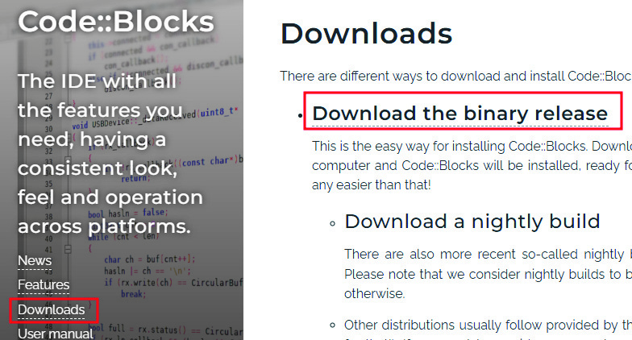
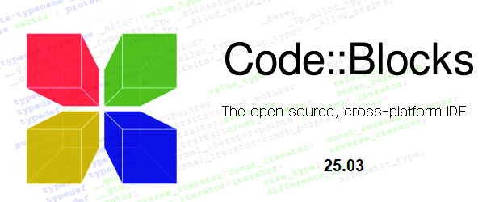
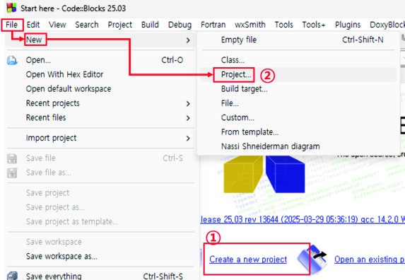
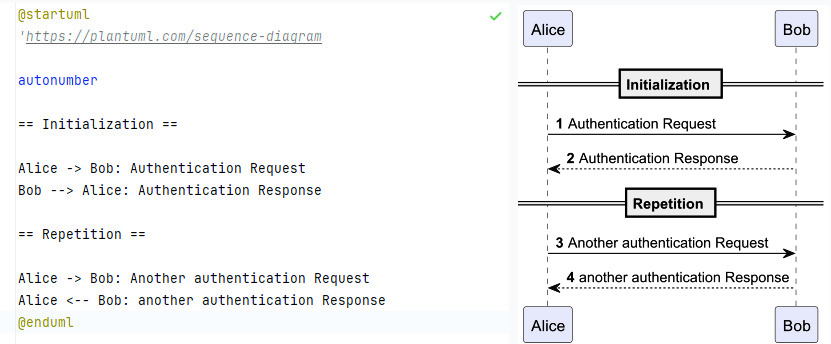
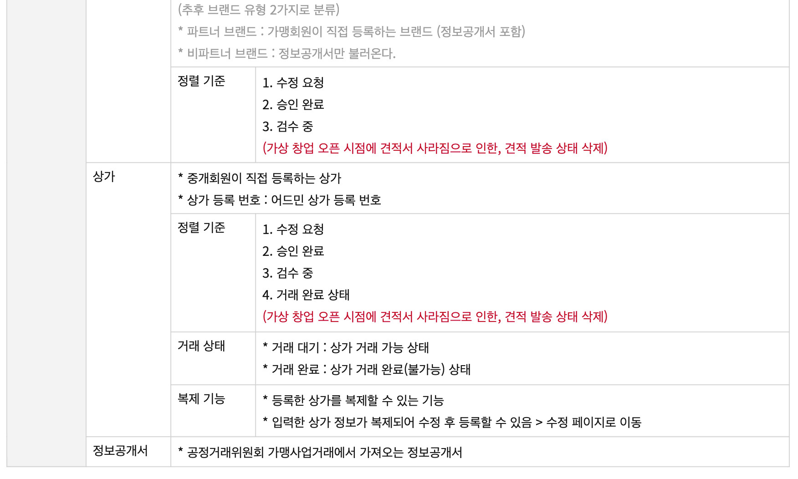
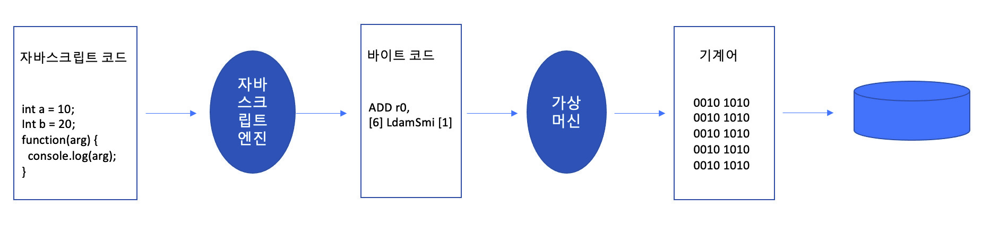
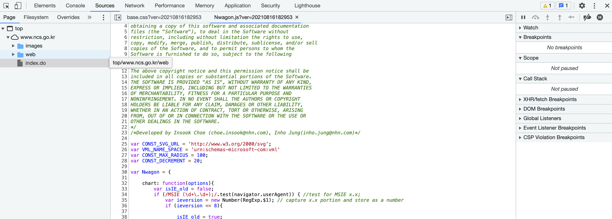
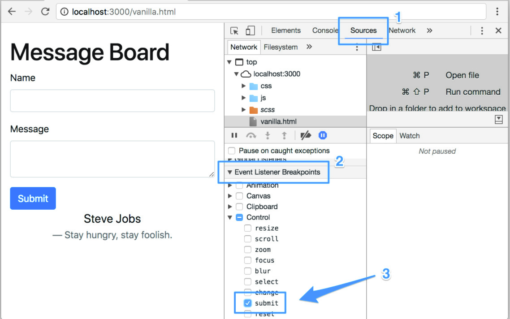
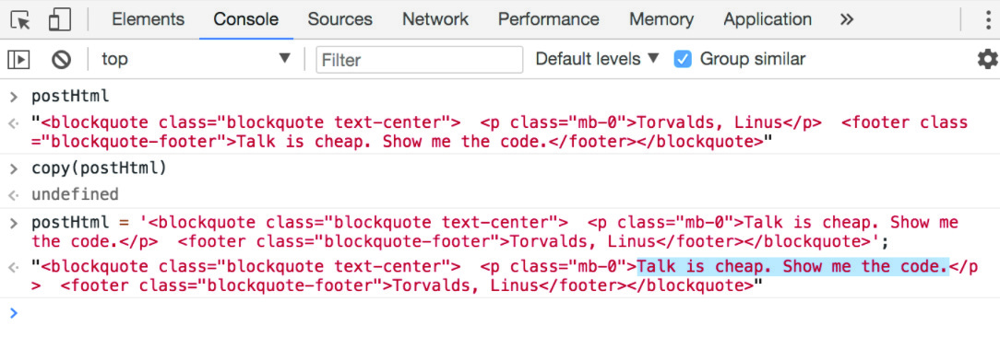
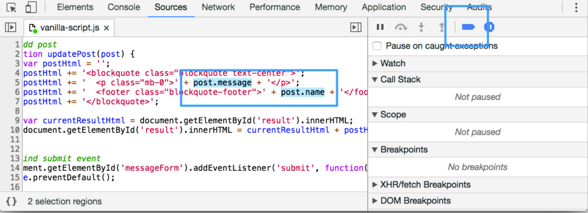

# LM2001020231_23v5_.프로그래밍+언어+활용_20251108

대분류/20
정보통신 중분류/01
정보기술 소분류/02
정보기술개발 세분류/02
응용SW엔지니어링 능력단위/31
NCS학습모듈
프로그래밍 언어 활용
LM2001020231_23v5
[NCS학습모듈 활용 시 유의 사항]
1. NCS학습모듈은 교육훈련기관에서 출처를 명시하고 교육적 목적으로 활용할 수 있습니다. 다
만, NCS학습모듈에는 국가(교육부)가 저작재산권 일체를 보유하지 않은 저작물(출처가 표기된
도표‧사진‧삽화‧도면 등)이 포함되어 있으므로, 이러한 저작물의 변형‧각색‧복제‧공연‧
배포 및 공중 송신 등과 이러한 저작물을 활용한 2차적 저작물을 작성하려면 반드시 원작자
의 동의를 받아야 합니다.
2. NCS학습모듈은 개발 당시의 산업 및 교육 현장을 반영하여 집필하였으므로, 현재 적용되는
법령‧지침‧표준 및 교과 내용 등과 차이가 있을 수 있습니다. NCS학습모듈 활용 시 법령
‧지침‧표준 및 교과 내용의 개정 사항과 통계의 최신성 등을 확인하시기를 바랍니다.
3. NCS학습모듈은 산업 현장에서 요구되는 능력을 교육훈련기관에서 학습할 수 있게 구성한 자
료입니다. 다만, NCS학습모듈 지면의 한계상 대표적 예시(예: 활용도 또는 범용성이 높은 제
품, 서비스) 중심으로 집필하였음을 이해하시기를 바랍니다.
NCS학습모듈의 이해
NCS학습모듈의 이해
※ 본 NCS학습모듈은 「NCS 국가직무능력표준」사이트(http://www.ncs.go.kr) 에서 확인 및 다운로드할 수 있습니다.

| Ⅰ | NCS학습모듈이란? |
| --- | --- |

•국가직무능력표준(NCS: National Competency Standards)이란 산업현장에서 직무를
수행하기 위해 요구되는 지식･기술･소양 등의 내용을 국가가 산업부문별･수준별로 체계
화한 것으로 산업현장의 직무를 성공적으로 수행하기 위해 필요한 능력(지식, 기술, 태도)
을 국가적 차원에서 표준화한 것을 의미합니다.
•국가직무능력표준(이하 NCS)이 현장의 ‘직무 요구서’라고 한다면, NCS학습모듈은 NCS
의 능력단위를 교육훈련에서 학습할 수 있도록 구성한 ‘교수･학습 자료’입니다. NCS학습
모듈은 구체적 직무를 학습할 수 있도록 이론 및 실습과 관련된 내용을 상세하게 제시하
고 있습니다.

| NCS 및 NCS학습모듈 개발 절차 |
| --- |
| NCS산업계개발 계획 수립NCSNCS학습모듈NCS학습모듈 개발개발 계획 수립 |

•NCS학습모듈은 다음과 같은 특징을 가지고 있습니다.
첫째, NCS학습모듈은 산업계에서 요구하는 직무능력을 교육훈련 현장에 활용할 수 있도
록 성취목표와 학습의 방향을 명확히 제시하는 가이드라인의 역할을 합니다.
둘째, NCS학습모듈은 특성화고, 마이스터고, 전문대학, 4년제 대학교의 교육기관 및 훈
련기관, 직장교육기관 등에서 표준교재로 활용할 수 있으며 교육과정 개편 시에도
유용하게 참고할 수 있습니다.
i
•NCS와 NCS학습모듈 간의 연결 체계를 살펴보면 아래 그림과 같습니다.

| NCS와 NCS학습모듈의 연결 체계 |
| --- |
| NCS NCS학습모듈능력단위 NCS학습모듈명능력단위 정의 NCS학습모듈의 목표능력단위 기술서 학습명능력단위 요소 학습 내용수행준거 학습 목표지식 필요 지식기술 수행 내용- 재료･자료태도- 기기(장비･공구)- 안전･유의 사항- 수행 순서적용범위 및 작업상황고려 사항 교수･학습 방법자료 및 관련 서류 교수 방법장비 및 도구 학습 방법평가 지침 평가평가 방법 평가 준거평가 시 고려 사항 평가 방법피드백참고 자료･활용 서식･부록 |

|  |  | NCS |  |  |  |  |  |  |  |  | NCS학습모듈 |  |  |  |  |
| --- | --- | --- | --- | --- | --- | --- | --- | --- | --- | --- | --- | --- | --- | --- | --- |
|  | 능력단위 |  |  |  |  |  |  |  |  | NCS학습모듈명 |  |  |  |  |  |
|  | 능력단위 | 능력단위 |  |  |  |  |  |  |  | NCS학습모듈명 | NCS학습모듈명 |  |  |  |  |
|  | 능력단위 정의 |  |  |  |  |  |  |  |  | NCS학습모듈의 목표 |  |  |  |  |  |
|  | 능력단위 정의 | 능력단위 정의 |  |  |  |  |  |  |  | NCS학습모듈의 목표 | NCS학습모듈의 목표 |  |  |  |  |
|  | 능력단위 기술서 능력단위 요소 | 능력단위 기술서 능력단위 요소 |  |  |  |  |  |  |  | 학습명 학습 내용 | 학습명 학습 내용 |  |  |  |  |
|  | 능력단위 기술서 |  |  |  |  |  |  |  |  | 학습명 |  |  |  |  |  |
|  | 능력단위 기술서 | 능력단위 기술서 |  |  |  |  |  |  |  | 학습명 | 학습명 |  |  |  |  |
|  | 능력단위 요소 |  |  |  |  |  |  |  |  | 학습 내용 |  |  |  |  |  |
|  | 능력단위 요소 | 능력단위 요소 |  |  |  |  |  |  |  | 학습 내용 | 학습 내용 |  |  |  |  |
|  | 수행준거 |  |  |  |  |  |  |  |  | 학습 목표 |  |  |  |  |  |
|  | 수행준거 | 수행준거 |  |  |  |  |  |  |  | 학습 목표 | 학습 목표 |  |  |  |  |
|  | 지식기술태도 |  |  |  |  |  |  |  |  | 필요 지식수행 내용- 재료･자료- 기기(장비･공구)- 안전･유의 사항- 수행 순서 |  |  |  |  |  |
|  | 기술 | 기술 |  |  |  |  |  |  |  | 수행 내용 | 수행 내용 |  |  |  |  |
|  |  |  |  |  |  |  |  |  |  | - 재료･자료 | - 재료･자료 |  |  |  |  |
|  | 태도 | 태도 |  |  |  |  |  |  |  | - 기기(장비･공구) | - 기기(장비･공구) |  |  |  |  |
|  |  |  |  |  |  |  |  |  |  | - 기기(장비･공구) | - 기기(장비･공구) |  |  |  |  |
|  |  |  |  |  |  |  |  |  |  | - 안전･유의 사항 | - 안전･유의 사항 |  |  |  |  |
|  | 적용범위 및 작업상황 |  |  |  |  |  |  |  |  | - 수행 순서 | - 수행 순서 |  |  |  |  |
|  | 고려 사항자료 및 관련 서류장비 및 도구 |  |  |  |  |  |  |  |  | 교수･학습 방법 | 교수･학습 방법 교수 방법 학습 방법 |  |  |  |  |
|  | 자료 및 관련 서류 장비 및 도구 | 자료 및 관련 서류 장비 및 도구 |  |  |  |  |  |  |  | 교수 방법학습 방법 |  |  |  |  |  |
|  | 평가 지침 |  |  |  |  |  |  |  |  | 평가 |  |  |  |  |  |
|  | 평가 방법평가 시 고려 사항 |  |  |  |  |  |  |  |  | 평가 준거평가 방법피드백 |  |  |  |  |  |
|  | 평가 시 고려 사항 | 평가 시 고려 사항 |  |  |  |  |  |  |  | 평가 방법 | 평가 방법 |  |  |  |  |
|  |  |  |  |  |  |  |  |  |  | 참고 자료･활용 서식･부록 |  |  |  |  |  |

ii
NCS학습모듈의 이해

| Ⅱ | NCS학습모듈의 체계 |
| --- | --- |

•NCS학습모듈은 1. NCS학습모듈의 위치 , 2. NCS학습모듈의 개요 , 3. NCS학습모듈의 내용 체계 ,
4. 참고 자료 , 5. 활용서식/부록 으로 구성되어 있습니다.
1. NCS학습모듈의 위치
•NCS학습모듈의 위치는 NCS 분류 체계에서 해당 학습모듈이 어디에 위치하는지를 한 눈에
볼 수 있도록 그림으로 제시한 것입니다.

| [NCS-학습모듈의 위치] |  |  |  |  |  |  |  |
| --- | --- | --- | --- | --- | --- | --- | --- |
| 대분류 | 문화·예술·디자인·방송 |  |  |  |  |  |  |
| 중분류 |  | 문화콘텐츠 |  |  |  |  |  |
| 소분류 |  |  |  |  |  | 문화콘텐츠제작 |  |
| 세분류 |  |  |  |  |  |  |  |
| 세분류 |  |  |  |  |  |  |  |
| 방송콘텐츠제작 |  |  |  |  | 능력단위 |  | 학습모듈명 |
| 영화콘텐츠제작 프로그램 기획 프로그램 기획음악콘텐츠제작 아이템 선정 아이템 선정광고콘텐츠제작 자료 조사 자료 조사게임콘텐츠제작 프로그램 구성 프로그램 구성애니메이션캐스팅 캐스팅콘텐츠제작만화콘텐츠제작 제작계획 제작계획캐릭터제작 방송 미술 준비 방송 미술 준비스마트문화앱방송 리허설 방송 리허설콘텐츠제작영사 야외촬영 야외촬영스튜디오 제작 스튜디오 제작… … |  |  |  |  | 프로그램 기획 |  | 프로그램 기획 |
| 음악콘텐츠제작 |  |  |  |  | 아이템 선정 |  | 아이템 선정 |
| 광고콘텐츠제작 자료 |  |  |  |  | 자료 조사 |  | 자료 조사 |
| 게임콘텐츠제작 |  |  |  |  | 프로그램 구성 |  | 프로그램 구성 |
| 애니메이션 콘텐츠제작 |  |  |  |  | 캐스팅 |  | 캐스팅 |
| 만화콘텐츠제작 |  |  |  |  | 제작계획 |  | 제작계획 |
| 캐릭터제작 방송 |  |  |  |  | 방송 미술 준비 |  | 방송 미술 준비 |
| 스마트문화앱 방송 콘텐츠제작 |  |  |  |  | 방송 리허설 |  | 방송 리허설 |
| 영사 |  |  |  |  | 야외촬영 |  | 야외촬영 |
|  |  |  |  |  | 스튜디오 제작 |  | 스튜디오 제작 |
|  |  |  |  |  | … |  | … |

|  | 학습모듈은 |
| --- | --- |
| NCS 능력단위 1개당 1개의 학습모듈 개발을 원칙으로 합니다. 그러나 필요에 따라고용단위 및 교과단위를 고려하여 능력단위몇 개를 묶어 1개 학습모듈로 개발할 수있으며, NCS 능력단위 1개를 여러 개의학습모듈로 나누어 개발할 수도 있습니다. |  |

iii
2. NCS학습모듈의 개요
•NCS학습모듈의 개요는 학습모듈이 포함하고 있는 내용을 개략적으로 설명한 것으로
학습모듈의 목표 , 선수학습 , 학습모듈의 내용 체계 , 핵심 용어 로 구성되어 있습니다.

| 학습모듈의 목표 | 해당 NCS 능력단위의 정의를 토대로 학습 목표를 작성한 것입니다. |
| --- | --- |

| 선수학습 | 해당 학습모듈에 대한 효과적인 교수･학습을 위하여 사전에 이수해야 하는 학습모듈, 학습 내용, 관련 교과목 등을 기술한 것입니다. |
| --- | --- |

| 학습모듈의내용 체계 | 해당 NCS 능력단위요소가 학습모듈에서 구조화된 체계를 제시한 것입니다. |
| --- | --- |

| 핵심 용어 | 해당 학습모듈의 학습 내용, 수행 내용, 설비･기자재 등 가운데 핵심적인 용어를 제시한 것입니다. |
| --- | --- |

| 제작계획 학습모듈의 개요 |  |  |  |
| --- | --- | --- | --- |
| 학습모듈의 목표본격적인 촬영을 준비하는 단계로서, 촬영 대본을 확정하고 제작 스태프를 조직하며촬영 장비와 촬영 소품을 준비할 수 있다.선수학습제작 준비(LM0803020105_13v1), 섭외 및 제작스태프 구성(LM0803020104_13v1),촬영 제작(LM0803020106_13v1), 촬영 장비 준비(LM0803040204_13v1.4), 미술디자인 협의하기(LM0803040203_13v1.4)학습모듈의 내용체계 |  |  |  |
| 학습 | 학습 내용 | NCS 능력단위 요소 |  |
| 코드번호 요소 명칭 |  | 코드번호 | 요소 명칭 |
| 1. 촬영 대본 1-1. 촬영 구성안 검 촬영 대본0803020114_16v3.1확정하기 토와 수정 확정하기2-1. 기술 스태프 조직2. 제작 스태프 제작 스태프2-2. 미술 스태프 조직 0803020114_16v3.2조직하기 조직하기2-3. 전문 스태프 조직3. 촬영 장비 3-1. 촬영 장비 점검 촬영 장비0803020114_16v3.3계획하기 과 준비 계획하기4-1. 촬영 소품 목록4. 촬영 소품 작성 촬영 소품0803020114_16v3.4계획하기 4-2. 촬영 소품 제작 계획하기의뢰 |  |  |  |
| 핵심 용어촬영 구성안, 제작 스태프, 촬영 장비, 촬영 소품 |  |  |  |

|  | 학습모듈의 목표는 |
| --- | --- |
| 학습자가 해당 학습모듈을 통해 성취해야할 목표를 제시한 것으로, 교수자는 학습자가 학습모듈의 전체적인 내용흐름을 파악하도록 지도할 수 있습니다. |  |

|  | 선수학습은 |
| --- | --- |
| 교수자 또는 학습자가 해당 학습모듈을 교수·학습하기 이전에 이수해야 하는 교과목또는 학습모듈(NCS 능력단위) 등을 표기한것입니다. 따라서 교수자는 학습자가 개별학습, 자기 주도 학습, 방과 후 활동 등 다양한 방법을 통해 이수할 수 있도록 지도하는 것을 권장합니다. |  |

|  | 핵심 용어는 |
| --- | --- |
| 해당 학습모듈을 대표하는 주요 용어입니다. 학습자가 해당 학습모듈을 통해 학습하고 평가받게될 주요 내용을 알 수 있습니다. 「NCS 국가직무능력표준」 사이트(www.ncs.go.kr)의 색인 (찾아보기) 중하나로 이용할 수 있습니다. |  |

iv
NCS학습모듈의 이해
3. NCS학습모듈의 내용 체계
•NCS학습모듈의 내용은 크게 학습 , 학습 내용 , 교수･학습 방법 , 평가 로 구성되어 있습니다.

| 학습 | 해당 NCS 능력단위요소 명칭을 사용하여 제시한 것입니다.학습은 크게 학습 내용, 교수･학습 방법, 평가로 구성되며 해당 NCS 능력단위의능력단위 요소별 지식, 기술, 태도 등을 토대로 내용을 제시한 것입니다. |
| --- | --- |

| 학습 내용 | 학습 내용은 학습 목표, 필요 지식, 수행 내용으로 구성되며, 수행 내용은 재료･자료, 기기(장비･공구), 안전･유의 사항, 수행 순서, 수행 tip으로 구성한 것입니다.학습모듈의 학습 내용은 실제 산업현장에서 이루어지는 업무활동을 표준화된 프로세스에 기반하여 다양한 방식으로 반영한 것입니다. |
| --- | --- |

| 교수･학습 방법 | 학습 목표를 성취하기 위한 교수자와 학습자 간, 학습자와 학습자 간 상호 작용이활발하게 일어날 수 있도록 교수자의 활동 및 교수 전략, 학습자의 활동을 제시한것입니다. |
| --- | --- |

| 평가 | 평가는 해당 학습모듈의 학습 정도를 확인할 수 있는 평가 준거 및 평가 방법, 평가 결과의 피드백 방법을 제시한 것입니다. |
| --- | --- |

학습 1 촬영 대본 확정하기

|  | 학습은 |
| --- | --- |
| 해당 NCS 능력단위요소 명칭을 사용하여제시하였습니다. 하나의 학습은 일반교과의 ‘대단원’에 해당되며, 학습모듈을 구성하는 가장 큰 단위가 됩니다. 또한 하나의 직무를 수행하기 위한 가장 기본적인단위로 사용할 수 있습니다 |  |

| 학습 2 | 제작 스태프 조직하기 |
| --- | --- |

학습 3 촬영 장비 계획하기
학습 4 촬영 소품 계획하기

|  | 학습 내용은 |
| --- | --- |
| NCS 능력단위요소별 수행준거를 기준으로제시하였습니다. 일반교과의 ‘중단원’에 해당합니다. |  |

2-1. 기술 스태프 조직
학습 목표 •프로그램 제작에 적합한 기술 스태프를 조직할 수 있다.

|  | 학습 목표는 |
| --- | --- |
| 학습 내용을 이수할 때 학습자가 갖춰야할행동 수준을 의미합니다. 따라서 수업시간의 과목 목표로 활용할 수 있습니다. |  |

필요 지식 /
(cid:49684) 기술 스태프의 구성

|  | 필요 지식은 |
| --- | --- |
| 해당 NCS의 지식을 토대로 학습에 대한이해와 성과를 제고하기 위해 반드시 알아야 할 주요 지식을 제시하였습니다. 필요 지식은 수행에 꼭 필요한 핵심 내용을위주로 제시하여 교수자의 역할이 매우중요하며, 이후 수행 순서와 연계하여 교수·학습으로 진행할 수 있습니다. |  |

프로그램의 장르에 따라 구성하는 기술 스태프는 많은 차
이가 있다. 같은 장르의 프로그램이라도 그 형식이나 내
용, 규모에 따라서 구성되는 기술 스태프의 종류와 인원
수는 천차만별이다.
1. 스튜디오 프로그램
토크쇼, 종합 구성, 예능과 같은 스튜디오 프로그램은
부조정실과 스튜디오를 사용하여 제작하기 때문에 많
은 기술 스태프가 필요하다.
v

|  | 수행 내용은 |
| --- | --- |
| 해당 학습모듈에서 제시한 내용 중 기술(skill)을 습득하기 위한 실습과제로 활용할 수 있습니다. |  |

수행 내용 / 기술 스태프 구성표 작성하기
재료·자료

|  | 재료･자료는 |
| --- | --- |
| 수행 내용을 수행하는데 필요한 재료 및 준비물로 실습 시 활용할 수 있습니다. |  |

• 방송프로그램 제작 기획서 및 방송 대본, 콘티(continuity), 제작
일정, 운용표
• 장비 및 시설, 제작 시설 배정 의뢰서 및 배정표, 방송 기술 스
태프 데이터베이스(DB) 자료

|  | 기기(장비･공구)는 |
| --- | --- |
| 수행 내용에 필요한 기본적인 장비 및 도구를 제시하였습니다. 제시된 기기 외에도 수행에 필요한 다양한 도구나 장비를 활용할수 있습니다. |  |

기기(장비･공구)
• 컴퓨터 등
안전･유의 사항

|  | 안전･유의사항은 |
| --- | --- |
| 수행 내용을 수행하는 데 있어 안전상 주의해야할 점 및 유의사항을 제시하였습니다. 실습 시 유념해야 하며, NCS의 고려사항도 추가적으로 활용할 수 있습니다. |  |

• 프로그램의 내용과 제작 방법을 분석하고, 각 스태프들의 역할
을 신중하게 검토한다.
수행 순서
(cid:49684) 방송 대본이나 콘티(continuity), 큐 시트를 분석하고, 프로그램

|  | 수행 순서는 |
| --- | --- |
| 실습 과제의 진행 순서로 활용할 수 있습니다. |  |

의 내용적 특성, 제작 과정에 대한 자료를 수집한다.
(cid:49685) 프로그램 제작 방법을 결정한다.

|  | 수행 tip은 |
| --- | --- |
| 수행 내용에서 실습을 용이하게 할 수 있는아이디어를 제시하였습니다. 수행 tip은 지도상의 안전 및 유의사항 외에 전반적으로적용되는 주안점 및 수행 과제 목적에 대한보충설명, 추가사항 등으로 활용할 수 있습니다. |  |

1. 스튜디오 녹화를 할 것인가, 야외 촬영을 할 것인가 검토한
다.
수행 tip
•스태프의 결정은 스태프 간의 호흡을 중
요시하여 선정해야 프로그램의 질을 향
상시킬 수 있다.

| 학습2 | 교수·학습 방법 |
| --- | --- |

|  | 교수･학습 방법은 |
| --- | --- |
| 학습 목표를 성취하는 데 필요한 교수 방법과 학습 방법을 제시하였습니다. |  |

교수 방법

|  | 교수 방법은 |
| --- | --- |
| 해당 학습 활동에 필요한 학습 내용, 학습내용과 관련된 자료명, 자료 형태, 수행 내용의 진행 방식 등에 대하여 제시하였습니다. 또한 학습자의 수업참여도 제고 방법및 수업 진행상 유의사항 등도 제시하였습니다. 선수학습이 필요한 학습을 학습자가숙지하였는지 교수자가 확인하는 과정으로활용할 수도 있습니다. |  |

• 방송 프로그램의 기술적 요소, 미술 구성 요소, 특수 촬영에 대해
설명한다.
• 방송 프로그램 제작에서 각 기술 스태프의 역할에 대해 설명한다.
• 방송 프로그램을 분석하고 필요한 기술 스태프를 구성할 수 있도
록 지시한다.
학습 방법

|  | 학습 방법은 |
| --- | --- |
| 해당 학습 활동에 필요한 학습자의 자기주도 학습 방법을 제시하였습니다. 또한학습자가 숙달해야 할 실기 능력과 학습과정에서 주의해야 할 사항 등도 제시하였습니다. 학습자가 학습을 이수하기 전반드시 숙지해야 할 기본 지식을 학습하였는지 스스로 확인하는 과정에 활용할수 있습니다. |  |

• 방송 프로그램의 기술적 요소, 미술 구성 요소, 특수 촬영에 대해
서 알아본다.
• 프로그램 제작에 필요한 기술 스태프의 역할을 이해하고, 기술 스
태프 구성표를 작성한다.
vi
NCS학습모듈의 이해

| 학습2 평 가평가 준거• 평가자는 학습자가 학습 목표를 성공적으로 달성하였는지를 평가해야 한다.• 평가자는 다음 사항을 평가해야 한다.성취수준학습 내용 학습 목표상 중 하기술 스태프 - 프로그램 제작에 적합한 기술 스태프를 조조직 직할 수 있다.미술 스태프 - 프로그램 제작에 적합한 미술 스태프를 조조직 직할 수 있다.전문 스태프 - 프로그램 특수 촬영을 위한 전문 스태프를조직 조직할 수 있다.평가 방법• 사례 연구성취수준학습 내용 평가 항목상 중 하- 프로그램에서 기술적 요소의 파악 여부기술 스태프 - 기술 스태프의 역할 파악 여부조직 - 프로그램에 필요한 기술 스태프 구성표 작성 능력피드백1. 사례 연구- 프로그램을 선택하여 기술 스태프, 미술 스태프, 전문 스태프 구성표를 예시와 같이 작성하였는지 개인별 능력을 평가한 후, 그결과를 모든 학습자에게 공유하도록 한다. | 학습2 | 평 가 |
| --- | --- | --- |

|  | 평가는 |
| --- | --- |
| NCS 능력단위의 평가 방법과 평가 시 고려사항을 준용하여 작성합니다. 교수자와학습자가 평가 항목별 성취수준 확인 시활용할 수 있습니다. |  |

|  | 평가 준거는 |
| --- | --- |
| 학습자가 학습을 어느 정도 성취하였는지평가하기 위한 기준을 제시하고 있습니다.학습 목표와 연계하여 단위수업 시간에 평가 항목 별 성취수준을 평가하는 데 활용할수 있습니다. |  |

| 학습 내용 | 학습 목표 | 성취수준 |  |  |
| --- | --- | --- | --- | --- |
|  |  | 상 | 중 | 하 |

| 4. 참고 자료•교육부(2013). | 섭외 및 제작스태프 구성(LM0803020104_13v1). |  |  |  |
| --- | --- | --- | --- | --- |
| 한국직업능력개발원. |  |  |  |  |
| 5. 활용 서식/부록직종 이름기술감독 조명감독 [디지털제1조(목적) 이 고시는램 및 방송광고의 | 스튜디오 기술 스태프 구성표 연락처 소속 특이사항텔레비전 방송프로그램 음량 등에 관한 기준] 제정 2014. 11. 29. 미래창조과학부 고시제1창 총칙 방송법 제70조의2제1항에 따라 방송사업자가 디지털 텔레비전음량을 일정하게 유지하기 위해 필요한 사항을 규정함을 | 비고목적으로 | 제2014-87호방송프로그한다. |  |

|  | 평가 방법은 |
| --- | --- |
| NCS 능력단위의 평가 방법을 참고하였으며, 평가 준거에 따른 평가 방법을 2개 이상 제시합니다. 평가 방법의 종류는 포트폴리오, 문제해결 시나리오, 서술형 시험, 논술형 시험, 사례 연구, 평가자 체크리스트,작업장 평가 등이 있으며, NCS 능력단위요소 별 수행 수준을 평가하는 데 가장 적절한 방법을 선정하여 활용할 수 있습니다. |  |

| 학습 내용 | 평가 항목 | 성취수준 |  |  |
| --- | --- | --- | --- | --- |
|  |  | 상 | 중 | 하 |

| 4. 참고 자료•교육부(2013). | 섭외 및 제작스태프 구성(LM0803020104_13v1). |  |  |  |
| --- | --- | --- | --- | --- |
| 한국직업능력개발원. |  |  |  |  |
| 5. 활용 서식/부록직종 이름기술감독 조명감독 [디지털제1조(목적) 이 고시는램 및 방송광고의 | 스튜디오 기술 스태프 구성표 연락처 소속 특이사항텔레비전 방송프로그램 음량 등에 관한 기준] 제정 2014. 11. 29. 미래창조과학부 고시제1창 총칙 방송법 제70조의2제1항에 따라 방송사업자가 디지털 텔레비전음량을 일정하게 유지하기 위해 필요한 사항을 규정함을 | 비고목적으로 | 제2014-87호방송프로그한다. |  |

|  | 피드백은 |
| --- | --- |
| 평가 후에 학습자들에게 평가 결과를 피드백하여 학습 목표를 달성하는 데 활용할 수 있습니다. |  |

|  | 참고 자료는 |
| --- | --- |
| 해당 학습모듈에 제시된 인용 자료의 출처를 제시하였습니다. 교수·학습의 과정에서참고로 활용할 수 있습니다. |  |

|  | 활용 서식은 |
| --- | --- |
| 평가 서식, 실습 시트 등 교수·학습 시 활용할 수 있는 다양한 서식들로 구성하였습니다. 수행에서 평가에 이르기까지 필요한서식을 해당 모듈의 특성에 맞춰 개발하거나 기존의 양식을 활용하여 제시하였습니다. |  |

|  | 부록은 |
| --- | --- |
| 활용 서식 이외에 교수·학습 과정에서 참고할수 있는 자료가 있는 경우 제시하였습니다. |  |

[NCS-학습모듈의 위치]

| 정보 통신 |  |  |
| --- | --- | --- |
|  | 정보 기술 |  |
|  |  | 정보기술개발 |

대분류
중분류
소분류
세분류

| SW아키텍처 |  |  | 능력단위 | 학습모듈명 |
| --- | --- | --- | --- | --- |
| 응용SW엔지니어링 |  |  | 요구사항 확인 | 요구사항 확인 |
| 임베디드SW 엔지니어링 |  |  | 데이터 입출력 구현 | 데이터 입출력 구현 |
| DB엔지니어링 |  |  | 통합 구현 | 통합 구현 |
| NW엔지니어링 |  |  | 정보시스템 이행 | 정보시스템 이행 |
| 보안엔지니어링 |  |  | 제품소프트웨어 패키징 | 제품소프트웨어 패키징 |
| UI/UX엔지니어링 |  |  | 서버프로그램 구현 | 서버프로그램 구현 |
| 시스템SW엔지니어링 |  |  | 인터페이스 구현 | 인터페이스 구현 |
| 빅데이터플랫폼구축 |  |  | 애플리케이션 배포 | 애플리케이션 배포 |
| 핀테크엔지니어링 |  |  | 애플리케이션 리팩토링 | 애플리케이션 리팩토링 |
| 데이터아키텍처 |  |  | 인터페이스 설계 | 인터페이스 설계 |
| loT시스템연동 |  |  | 애플리케이션 요구사항 분석 | 애플리케이션 요구사항 분석 |
| 인프라스트럭쳐 아키텍처 구축 |  |  | 기능 모델링 | 기능 모델링 |
|  |  |  | 애플리케이션 설계 | 애플리케이션 설계 |
|  |  |  | 정적모델 설계 | 정적모델 설계 |

| 동적모델 설계 | 동적모델 설계 |
| --- | --- |
| 화면 설계 | 화면 설계 |
| 화면 구현 | 화면 구현 |
| 애플리케이션 테스트 관리 | 애플리케이션 테스트 관리 |
| 애플리케이션 테스트 수행 | 애플리케이션 테스트 수행 |
| 소프트웨어공학 활용 | 소프트웨어공학 활용 |
| 소프트웨어개발 방법론 활용 | 소프트웨어개발 방법론 활용 |
| 프로그래밍 언어 응용 | 프로그래밍 언어 응용 |
| 프로그래밍 언어 활용 | 프로그래밍 언어 활용 |
| 응용SW 기초 기술 활용 | 응용SW 기초 기술 활용 |
| 개발자 환경 구축 | 개발자 환경 구축 |
| 개발 환경 운영 지원 | 개발 환경 운영 지원 |
| 자료구조 활용 | 자료구조 활용 |

차 례
학습모듈의 개요 1
학습 1. 구조적 프로그래밍 언어 활용하기
1-1. 구조적 프로그래밍 설계 3
1-2. 구조적 프로그래밍 언어 활용 21
• 교수 ․ 학습 방법 46
• 평가 47
학습 2. 객체지향 프로그래밍 언어 활용하기
2-1. 객체지향 프로그래밍 설계 49
2-2. 객체지향 프로그래밍 언어 활용 64
• 교수 ․ 학습 방법 77
• 평가 78
학습 3. 스크립트 언어 활용하기
3-1. 스크립트 언어 설계 80
3-2. 스크립트 언어 활용 87
• 교수 ․ 학습 방법 95
• 평가 96
참고 자료 98
프로그래밍 언어 활용 학습모듈의 개요
학습모듈의 목표
응용소프트웨어 개발에 사용되는 프로그래밍 언어의 기본 문법을 활용하여 기본 응용소프트웨어를 구현할
수 있다.
선수학습
개발자 환경 구축(2001020233_23v5), 교육부 고시 정보･통신 전문 교과 전공 일반 과목 ‘프로그래밍’
학습모듈의 내용체계

| 학습 | 학습 내용 | NCS 능력단위 요소 |  |
| --- | --- | --- | --- |
|  |  | 코드번호 | 요소 명칭 |

1-1. 구조적 프로그래밍 설계
1. 구조적 프로그래밍 구조적 프로그래밍 언어
2001020231_23v5.1
언어 활용하기 활용하기
1-2. 구조적 프로그래밍 언어 활용
2-1. 객체지향 프로그래밍 설계
2. 객체지향 프로그래 객체지향 프로그래밍
2001020231_23v5.2
밍 언어 활용하기 언어 활용하기
2-2. 객체지향 프로그래밍 언어 활용
3-1. 스크립트 언어 설계
3. 스크립트 언어 활용
2001020231_23v5.3 스크립트 언어 활용하기
하기
3-2. 스크립트 언어 활용
핵심 용어
하향식 설계, 구조적 프로그래밍 언어, 객체지향 프로그래밍 언어, 스크립트 언어

| 학습 1 | 구조적 프로그래밍 언어 활용하기 |
| --- | --- |

학습 2 객체지향 프로그래밍 언어 활용하기
학습 3 스크립트 언어 활용하기
1-1.
구조적 프로그래밍 설계
학습 목표 •응용소프트웨어 개발을 위하여 프로그램 설계서를 확인할 수 있다.
필요 지식 /
(cid:49684) 구조적 프로그래밍의 이해
구조적 프로그래밍은 구조화 프로그래밍으로도 불리며 절차적 프로그래밍 기반 아래 만들
어진 프로그래밍 기법으로 GOTO문 없이 순차, 분기, 반복 구조를 기반으로 프로그램을
설계하고 개발하는 것이다. C언어가 구조적 프로그래밍 기법에 사용되는 대표적인 언어이
다. GOTO문이란 프로그래밍 언어의 문법으로 특정 문장으로 분기가 발생하며, 프로그래
밍 스케일이 커질수록 GOTO문의 무분별한 분기가 프로그램의 동작을 예측하기 힘들게
만든다. 이로 인해 컴퓨터 과학자들 사이에서 GOTO문 사용을 억제하기 위한 방법으로
구조적 프로그래밍 기법이 제안되었다.
1. 구조적 프로그래밍 설계의 이론적 근거
(1) 구조적 프로그래밍의 이론적 토대
빔-야코피니 정리(Böhm-Jacopini Theorem, 1966년)에 따르면 이탈리아의 컴퓨
터 과학자 코라도 빔과 주세페 야코피니는 순차, 선택, 반복의 단 3가지의 제어 구
조만으로 모든 계산 가능한 알고리즘(튜링 머신으로 표현 가능한 모든 것)을 구현할
수 있음을 수학적으로 증명하였다. 이는 GOTO문 없이도 모든 프로그램을 작성할
수 있다는 강력한 이론적 근거가 되었다.
(2) 구조적 프로그래밍의 확산
네덜란드의 컴퓨터 과학자인 에츠허르 다익스트라(Edsger W. Dijkstra)는 1968년
에 기고한 “Go To Statement Considered Harmful(GOTO문은 해롭다)”이라는
제목의 편지를 통해 GOTO문의 무분별한 사용이 프로그램의 구조를 파괴하고 이해
와 검증을 어렵게 만든다고 강력하게 비판하였다. 이 글은 구조적 프로그래밍 방법
론이 전 세계적으로 확산되는 데 결정적인 계기가 되었다.
(3) 설계 방법론
구조적 프로그래밍 설계에는 하향식 설계(Top-Down Design) 및 단계적 세분화
(Stepwise Refinement) 설계 절차가 사용된다. 이 설계 절차는 다익스트라와 파스
칼(Pascal) 언어의 창시자인 니클라우스 비르트(Niklaus Wirth)와 같은 학자들에 의
해 체계화되었다. 복잡한 문제를 작게 쪼개어 점진적으로 해결해 나가는 이 방식은
구조적 프로그래밍의 철학을 실제 설계 과정에 적용한 가장 대표적인 방법론이다.
2. 구조적 프로그래밍 언어의 변화 과정
(1) 1960년대: 구조적 프로그래밍의 태동기
이 시기는 GOTO문이 여전히 널리 쓰였지만, 구조적 프로그래밍의 핵심 아이디어
를 담은 선구적인 언어가 등장한 중요한 시기이다.
<표 1-1> 1960년대 언어
언어 특징
비록 GOTO문을 포함하고 있었지만, begin...end 코드 블록, 프로시저(함수)
ALGOL 60 의 중첩 등 현대적인 구조적 언어의 개념을 최초로 도입한 ‘구조적 프로그래밍
의 시조’ 격인 언어로, 이후 등장하는 거의 모든 명령형 언어에 영향을 미침
COBOL, 이 시대의 주류 언어였지만, 제어 흐름을 위해 GOTO문에 크게 의존하는 비
FORTRAN 구조적인 특징을 가짐
(2) 1970년대: 구조적 프로그래밍의 정립과 확산기
구조적 프로그래밍 방법론이 학계와 산업계에 본격적으로 확산되면서, 이를 교육하
고 실용적으로 사용하기 위한 언어들이 개발되었다.
<표 1-2> 1970년대 언어
언어 특징
• 니클라우스 비르트가 구조적 프로그래밍 교육을 목적으로 개발한 언어
Pascal
• if-then-else, while, for 등 명확한 구조의 제어문을 제공하며, GOTO문의 사
1970년
용을 의도적으로 어렵게 만듦
• 데니스 리치가 유닉스(Unix) 운영체제를 개발하기 위해 만든 언어
• 시스템 프로그래밍을 위한 저수준 제어 기능과 효율성을 중시하면서도, ALGOL
C
의 철학을 이어받아 강력한 구조적 프로그래밍 문법을 제공
1972년
• C언어의 성공은 구조적 프로그래밍이 전 세계의 표준으로 자리 잡는 데 결정적
인 역할을 함
(3) 1980년대: 객체지향 프로그래밍의 등장과 결합
구조적 프로그래밍으로 코드의 논리 구조를 잡는 것에서 더 나아가, 데이터를 중심
으로 프로그램을 구성하는 객체지향 프로그래밍(OOP)이 부상하였다. 이 시대의 언
어들은 GOTO문은 이미 배제의 대상이기 때문에 문법으로 존재해도 당연히 사용하
지 않았으며, 구조적 프로그래밍을 기본으로 채택하고 객체지향 개념을 확장하였다.
현재까지도 널리 사용하고 있는 프로그래밍 언어들이며, 구조적 프로그래밍 기법보
다는 객체를 활용한 프로그래밍 기법으로 발전해 나가고 있다.
<표 1-3> 1980년대 언어
언어 특징
C++ 개발 당시 C언어에 객체지향 개념(클래스 등)을 추가한 언어이다. C의 구조적
1985년 특징을 그대로 계승
Objective-C
C언어에 스몰토크(Smalltalk) 스타일의 객체지향 기능을 추가한 언어
1984년
(4) 1990년대: GOTO문의 배제
이 시기부터 등장한 언어들은 GOTO문이 없어도 예외 처리(Exception Handling)
나 다른 제어문으로 충분히 프로그램을 작성할 수 있기 때문에 ‘GOTO’문을 배제
하기 시작하였다.
<표 1-4> 1990년대 언어
언어 특징
• 간결하고 읽기 쉬운 코드를 철학으로 하며, GOTO문이 없음
Python
• 들여쓰기(indentation)로 코드 블록을 구분하여 코드의 구조화를 시각적으로
1991년
강제함
• C++의 복잡성을 줄이고 플랫폼 독립성을 목표로 개발
Java
• goto가 예약어로는 존재하지만 실제 기능은 구현되지 않아 사용이 불가능하
1995년
며, 이는 GOTO를 쓰지 못하도록 한 매우 의도적인 설계
(5) 2000년대 이후: 패러다임의 변화
C#(2000년), Go(2009년), Swift(2014년), Kotlin(2011년), Rust(2010년) 등은 구
조적 프로그래밍을 당연한 기본으로 삼고, 함수형 프로그래밍 등 다양한 패러다임을
지원하며 코드의 안정성과 표현력을 높이는 언어들이다.
(cid:49685) 구조적 프로그래밍의 설계
프로그램 설계는 ‘요구사항을 코드로 구현하기 전에 문제 해결 방안을 계획하고 명세화하
는 과정’이다. 프로그램뿐만 아니라 제작을 하는 모든 일은 설계(디자인)를 기반으로 이루
어진다. 프로그램 설계는 ‘무엇(What)을 만들 것인가’를 넘어 ‘어떻게(How) 만들 것인가’
를 구체화하는 청사진을 그리는 작업이며, 목적에 맞는 프로그램을 개발하고 유지보수를
용이하게 하기 위함이다.
1. 구조적 프로그래밍 구조
구조적 프로그래밍은 1960년대 후반, 무분별한 GOTO문의 사용으로 인해 코드가 스
파게티처럼 얽혀 해독과 유지보수가 거의 불가능해지는 ‘스파게티 코드(Spaghetti
Code)’ 문제를 해결하기 위해 등장한 프로그래밍 방법론이다. 핵심 철학은 “복잡한 문
제라도 몇 가지 단순한 제어 구조의 조합으로 모두 해결할 수 있다”는 것이다.
이때 사용하는 세 가지 기본 제어 구조는 다음과 같다.
1. 순차(Sequence): 코드가 위에서 아래로, 작성된 순서대로 실행되는 구조이다.
2. 선택(Selection): 특정 조건의 참/거짓에 따라 두 개 이상의 갈림길 중 하나를 선택하여 실
행하는 구조이다. (if-then-else, switch-case 등)
3. 반복(Repetition/Iteration): 특정 조건을 만족하는 동안 정해진 코드 블록을 되풀이하여 실
행하는 구조이다. (while, for, do-while 등)

출처: 집필진 제작(2025)
[그림 1-1] 순차 구조, 선택 구조, 반복 구조
2. 구조적 프로그래밍 설계 절차
구조적 프로그래밍은 하향식 설계(Top-Down Design) 또는 단계적 세분화(Stepwise
Refinement)라는 절차를 통해 설계된다.
(1) 프로그램 설계의 핵심 활동
프로그램 설계를 위해서는 <표 1-5>의 활동을 이해해야 한다.
<표 1-5> 프로그램 설계 활동별 설명
구분 설명
프로그램이 무엇을 해야 하는지 명확히 이해
요구사항 분석
입력은 무엇이고, 출력은 무엇인가?
자료 구조 설계 데이터를 어떻게 표현하고 저장할지 결정 (변수, 배열, 구조체 등)
알고리즘 설계 문제를 해결하기 위한 구체적인 절차와 논리적 흐름을 제작 (순서도 등)
모듈화(분할) 거대한 문제를 작고 독립적인 기능 단위(모듈 또는 함수)로 분할
인터페이스 정의 나눠진 모듈들 사이에 어떤 데이터를 주고받을지 규칙을 정함
(2) 하향식 설계의 4단계
(가) 문제 정의 및 요구사항 명세화(Problem Definition)
가장 먼저 해결해야 할 문제의 전체적인 모습을 명확하게 정의하는 단계이다. 프
로그램의 목표, 입력, 처리 과정, 출력을 구체적으로 기술한다. 이 단계는 프로그
램이 지켜야 할 ‘계약’을 정의하는 것과 같다. 요구사항이 명확하지 않으면 이후
의 모든 설계와 개발 과정에서 예기치 못한 문제가 발생한다.
<표 1-6> 문제 정의 및 요구사항 명세화의 예
절차 설명
여러 학생의 국어, 영어, 수학 성적을 입력받아 총점, 평균, 학점을 계
목표(Goal)
산하고 결과를 출력하는 프로그램을 개발한다.
• 학생 이름 (문자열)
입력(Input)
• 국어, 영어, 수학 점수(0~100 사이의 정수)
• 학생의 이름, 총점, 평균, 최종 학점을 화면에 표시한다.
출력(Output)
• 총점과 평균(0~100 사이의 실수), 최종 학점(문자, 문자열)
• 세 과목의 성적을 입력받는다.
• 세 과목의 점수를 합산하여 총점을 구한다.
• 총점을 과목 수로 나누어 평균을 구한다.
처리(Process) • 평균 점수에 따라 정해진 기준에 맞춰 학점을 부여한다.
• 결과를 출력한다.
• 계속할지 여부를 묻는다.
• 사용자가 ‘종료’를 입력하기 전까지 이 과정을 반복한다.
제약 조건 • 평균은 소수점 둘째 자리까지 표시한다.
(Constraints) • 학점 기준: 90점 이상 ‘A’, 80점 이상 ‘B’, 70점 이상 ‘C’, 그 외 ‘F’
(나) 기능 분해 및 구조화(Functional Decomposition)
1단계(문제 정의 및 요구사항 명세화)에서 정의된 전체 문제를 가장 큰 기능
(Main)에서부터 시작하여, 논리적인 하위 기능(Sub-function)들로 나누는 과정
으로 계층적인 구조로 표현된다.
<표 1-7> 기능 분해 및 구조화
단계 설명
Level 0
• 성적 처리 프로그램 (프로그램의 시작과 끝)
(최상위 기능)
• 최상위 기능을 수행하기 위해 필요한 가장 큰 단위의 작업들
로 분할
• 성적 처리 프로그램
Level 1
1. 정보 입력받기
(주요 기능 분해)
2. 성적 계산하기
3. 결과 출력하기
4. 프로그램 반복 및 종료 처리
• Level 1의 기능 중 복합적인 작업을 더 작은 단위로 분할
• 예) ‘성적 계산하기’는 여러 계산 과정으로 분할
Level 2 2. 성적 계산하기
(기능의 단계적 세분화) 2-1. 총점 계산
2-2. 평균 계산
2-3. 학점 결정
이 단계에서는 복잡한 문제를 관리가 가능한 작은 단위로 나누어 문제의 전체
구조를 명확하게 파악할 수 있게 한다. 각 기능은 독립적인 모듈(함수)로 개발될
수 있어 재사용성과 유지보수성을 높인다.

출처: 집필진 제작(2025)
[그림 1-2] Level 1 예
Level 1을 분해 및 구조화하면 [그림 1-3]과 같다.

출처: 집필진 제작(2025)
[그림 1-3] Level 2 예
(다) 모듈별 상세 논리 설계(Detailed Logic Design)
2단계(기능 분해 및 구조화)에서 분해된 가장 작은 단위의 기능(모듈)들이 실제로
어떻게 동작할지를 구체적으로 설계한다. 이때 의사 코드(Pseudocode)나 순서
도(Flowchart)를 사용하여 작성한다. 이 단계에서 프로그램의 로직이 결정되므
로 논리적 오류를 미리 발견하고 수정하는 것이 핵심 목표이다.
<표 1-8> 모듈별 상세 설계의 예
모듈 2-1. 총점 계산 모듈 2-3. 학점 결정
• 입력: 평균 점수
• 입력: 국어 점수, 영어 점수, 수학 점수
• 처리: 평균 점수를 학점 기준과 비교
• 처리: 세 점수를 모두 더한다.
하여 해당하는 학점을 찾는다.
• 출력: 총점
• 출력: 학점 (A, B, C, F)
FUNCTION calculate_total(kor, eng, math): FUNCTION determine_grade(average):
total = kor + eng + math IF average >= 90 THEN
RETURN total grade = 'A'
ELSE IF average >= 80 THEN
grade = 'B'
ELSE IF average >= 70 THEN
grade = 'C'
ELSE
grade = 'F'
END IF
RETURN grade
(라) 구현 및 검증(Implementation & Verification)
3단계(모듈별 상세 논리 설계)에 따라 프로그래밍 언어를 사용하여 직접 코딩하
는 단계이다. 설계와 반대 방향인 상향식(Bottom-Up)으로 구현하고 테스트하는
것이 효과적이다.
<표 1-9> 구현 및 검증
단계 및 테스트 설명
• 가장 작은 단위의 모듈부터 코드로 작성 (예: 총점 계산, 학점
단위 구현 및 결정 함수)
단위 테스트 • 작성된 함수가 주어진 입력에 대해 정확한 출력을 반환하는지
Unit Test 독립적으로 테스트
예) determine_grade(95)를 호출 → 'A' 반환 확인
• 단위 테스트가 완료된 하위 모듈들을 결합하여 상위 모듈을
구현하고 테스트
통합 구현 및
예) 총점 계산, 평균 계산, 학점 결정 함수를 모두 사용하여
통합 테스트
‘성적 계산’하기라는 더 큰 기능을 테스트
Integration Test
• 이 과정을 반복하여 최종적으로 main 함수까지, 즉 프로그램
전체를 완성하고 테스트
수행 내용 / 구조적 프로그래밍 설계서 확인하기
재료･자료
• 구조적 프로그래밍 설계서
• 체크리스트
기기(장비･공구)
• 전산 장비(컴퓨터, 프린터, 빔 프로젝터, 네트워크 장비 등)
• OA 도구: 워드 프로세서, 스프레드시트, 프레젠테이션 도구 등
안전･유의 사항
• 설계를 지원하는 도구들을 다룰 수 있어야 한다.
수행 순서
(cid:49684) 구조적 프로그램 설계서 확인한다.
구조적 프로그램 설계서의 예시 내용을 바탕으로 설계서를 확인하는 과정을 거친다.
1. 구조적 프로그램 설계서를 확인한다.
<표 1-10> 구조적 프로그램 설계서 예
프로젝트명 학생 성적 처리 프로그램
버전 v1.0
작성일 20xx. 04. 03.
작성자 이○○
2. 요구사항 명세를 확인한다.
<표 1-11> 요구사항 명세 예
1. 요구사항 명세
학생의 국어, 영어, 수학 성적을 입력받아 총점, 평균, 학점을 계산하여 출
1.1 개요
력하는 콘솔 애플리케이션을 개발한다
학생 정보(이름, 성적) 입력 기능
- 성적 계산 기능 (총점, 평균, 학점)
1.2 주요 기능
- 계산 결과 출력 기능
- 사용자가 원할 때까지 프로그램 반복 실행 및 종료 기능
학생 이름: 문자열
1.3 입력 명세
국어, 영어, 수학 점수: 0~100 범위의 정수
"이름: [이름], 총점: [총점], 평균: [평균], 학점: [학점]" 형식으로 화면 출력
1.4 출력 명세
평균은 소수점 둘째 자리까지 표시
학점 부여 기준
- 평균 90점 이상: 'A'
1.5 처리 규칙
- 평균 80점 이상 ~ 90점 미만: 'B'
및 제약 조건
- 평균 70점 이상 ~ 80점 미만: 'C'
- 평균 70점 미만: 'F'
3. 시스템 구조 설계를 확인한다.
<표 1-12> 시스템 구조 설계 예
2. 시스템 구조 설계
main: 프로그램 전체의 흐름을 제어
└ input_data: 사용자로부터 이름과 성적을 입력받음
└ process_scores: 성적 계산 과정을 총괄
2.1 기능 분해 └ calculate_total: 세 과목의 총점을 계산
└ calculate_average: 총점을 이용해 평균을 계산
└ determine_grade: 평균을 이용해 학점을 결정
└ print_result: 최종 결과를 화면에 출력
가. 구조 도표의 예

2.2 구조 도표
가. 출처: 집필진 제작(2025)
4. 모듈 명세를 확인한다.
<표 1-13> 모듈 명세 예1
3.1 모듈: calculate_total
개요 세 과목의 점수를 입력받아 총점을 계산한다.
입력 파라미터 kor (정수), eng (정수), math (정수)
반환값 total (정수): 세 과목의 합산 점수
FUNCTION calculate_total(kor, eng, math):
처리 논리
total = kor + eng + math
(의사 코드)
RETURN total
3.2 모듈: calculate_average
개요 총점을 받아 평균을 계산한다.
입력 파라미터 total (정수)
반환값 average (실수) - 과목 수로 나눈 평균 점수
FUNCTION calculate_average(total):
처리 논리
average = total / 3
(의사 코드)
RETURN average
<표 1-14> 모듈 명세 예2
3.3 모듈: determine_grade
개요 평균 점수를 기준으로 학점을 결정한다.
입력 파라미터 average (실수)
반환값 grade (문자) - 'A', 'B', 'C', 'F' 중 하나
FUNCTION determine_grade(average):
처리 논리 IF average >= 90 THEN
(의사 코드) grade = 'A'
ELSE IF average >= 80 THEN
grade = 'B'
ELSE IF average >= 70 THEN
grade = 'C'
ELSE
grade = 'F'
END IF
RETURN grade
(cid:49685) 구조적 프로그램 설계서를 검토한다.
1. 실습 목표를 수립한다.
프로그램을 구현하기 전에, 설계 문서에 존재하는 잠재적 오류, 불명확성, 논리적 결함
을 찾아내고, 설계가 요구사항을 모두 만족하는지 확인한다.
2. 요구사항과 설계의 일치성 여부를 확인한다.
체크리스트 방법으로 설계가 요구사항을 빠짐없이 충족하는지 확인한다. 설계서의 ‘1. 요구
사항 명세’와 ‘2. 시스템 구조 설계’를 비교하며 체크리스트 방법으로 확인하도록 한다.
[질문 1] 요구사항에 명시된 모든 기능(입력, 계산, 출력, 반복)이 시스템 구조의 모듈들로 모
두 표현되었고, 누락된 기능은 없는가?
[질문 2] 요구사항에는 없는데 불필요하게 설계에 추가된 기능은 없는가?
[질문 3] 입력 명세(이름, 3개 점수)와 출력 명세(이름, 총점, 평균, 학점)는 각 모듈이 주고받
는 데이터의 흐름과 일치하는가?
3. 모듈별 논리의 완결성을 검토한다.
체크리스트 방법으로 모듈 명세를 하나씩 상세히 들여다보며, 각 모듈의 논리가 완전하
고 정확한지 확인한다.
• [calculate_total] 모듈
[질문 4] 입력 파라미터 3개(kor, eng, math)는 총점을 계산하기에 충분한가?
• [calculate_average] 모듈
[질문 5] 의사 코드에서 total / 3.0과 같이 실수 나눗셈 표현식이 적합한가?
만약 total / 3으로 정수 나눗셈을 했다면 어떤 문제가 발생하는가?
(요구사항 1.4. '소수점 표시'와 연관)
• [determine_grade] 모듈
[질문 6] 학점 부여 기준(요구사항 1.5)에 대한 의사 코드의 IF-ELSE 조건문이 입력값에 대
해 적합하게 처리되는가?
[질문 7] 경곗값 분석: 만약 평균이 정확히 90점이라면 어떤 학점이 부여하는가?
89.9점이라면 어떤 학점이 부여되는가?
조건문(>=)이 경곗값을 올바르게 처리하고 있는가?
4. 시나리오 테스트를 수행한다.
시나리오 테스트는 설계서의 논리적 흐름을 검증하는 가장 효과적인 방법이다. 가상의
데이터를 입력했을 때 어떤 결과가 나오는지는 확인하여 설계서를 검토한다.
• [시나리오 1] - 정상 데이터
- 이름: "홍길동", 국어: 90, 영어: 100, 수학: 80을 입력한다.
- calculate_total의 결과는 유효한 값인가?
- calculate_average의 결과는 유효한 값인가?
- determine_grade의 결과는 유효한 값인가?
- 최종 출력은 요구사항(1.4)의 형식과 일치하는가?
• [시나리오 2] - 예외 데이터
- 국어: 101, 영어: -10과 같이 요구사항(1.3)의 범위를 벗어난 값을 입력한다.
• [질문 8] 현재 설계서에는 이러한 유효하지 않은(invalid) 데이터를 처리하는 절차가 있는가?
없다면 어느 단계(예: input_data 모듈)에 어떤 검증 로직이 추가되어야 하는가?
다양한 시나리오 테스트는 설계 검토를 통해 발견할 수 있는 중요한 ‘결함’이다. 이러
한 ‘결함’을 해결하기 위해 설계서는 수정되어야 한다.
5. 구현 및 검증을 수행한다.
구현 단계를 통해 앞 단계에서 검증되지 못했던 문제를 발견한다.
#include<stdio.h>
int calculate_total(int, int, int);
float calculate_average(int);
char determine_grade(float);
int calculate_total(int kor, int eng, int math)
{
int total = kor + eng + math;
return total;
}
float calculate_average(int total)
{
float average = total / 3;
return average;
}
char determine_grade(float average)
{
char grade;
if(average >= 90)
grade = 'A';
else if(average >= 80)
grade = 'B';
else if(average >= 70)
grade = 'C';
else
grade = 'F';
return grade;
}
int main()
{
char name[10];
int kor, eng, math, total;
int choice=0;
float average;
char grade;
do{
//input_data
printf("이름: "); scanf("%s", name);
printf("국어: "); scanf("%d", &kor);
printf("영어: "); scanf("%d", &eng);
printf("수학: "); scanf("%d", &math);
//process_scores
total = calculate_total(kor, eng, math);
average = calculate_average(total);
grade = determine_grade(average);
//print_result
printf("\n이름: %s\n", name);
printf("총점: %d\n", total);
printf("평균: %.2f\n", average);
printf("학점: %c\n", grade);
printf("\n0:exit anyKey:continue :");
scanf("%d",&choice);
puts("");
}while(choice !=0);
return 0;
}
[시나리오1-결과] [시나리오2-결과]
이름: 홍길동 이름: 홍길동
국어: 90 국어: 101
영어: 100 영어: -10
수학: 80 수학: 1003
이름: 홍길동 이름: 홍길동
총점: 270 총점: 1094
평균: 90.00 평균: 364.00
학점: A 학점: A
6. 검토 결과를 정리한다.
다음과 같이 설계서 검토 결과를 제시하며, 이를 바탕으로 설계서를 수정한다.
• [잘된 점]
- 기능 분해가 명확하고 구조적으로 잘 설계됨
- 모듈별 역할이 명확함
• [개선/수정 제안]
- 결함: input_data 모듈에 0~100점 범위를 벗어나는 점수에 대한 유효성 검사 로직 필요
- 확인 필요: 학점 'D' 등급이 없는 것이 최종 요구사항이 맞는지 기획자와 재확인 필요
- 의견: process_scores 모듈은 세부 계산 함수들을 단순히 호출만 하므로, 세부 계산을 하
나의 하나의 함수에 통합하여 구조를 더 단순하게 만드는 것을 제안
(cid:49686) 구조적 프로그램 설계서를 수정(개선)한다.
1. 시스템 구조 설계를 수정한다.
앞에서 수행한 검토 결과에 따라 ‘input_data’의 기능에 입력값의 유효성 검사
(check_input_value) 기능을 추가한다.
<표 1-15> 시스템 구조 설계 수정
2. 시스템 구조 설계
main: 프로그램 전체의 흐름을 제어
└ input_data: 사용자로부터 이름과 성적을 입력받음
└ check_input_value: 유효한 점수인지 확인
└ process_scores: 성적 계산 과정을 총괄
2.1 기능 분해
└ calculate_total: 세 과목의 총점을 계산
└ calculate_average: 총점을 이용해 평균을 계산
└ determine_grade: 평균을 이용해 학점을 결정
└ print_result: 최종 결과를 화면에 출력
가. 구조 도표 수정

2.2 구조 도표
가. 출처: 집필진 제작(2025)
2. 모듈 명세를 수정한다.
<표 1-15>에 추가된 check_input_value 기능에 대해 실제로 어떻게 동작하는지 세부
기능을 포함하여 <표 1-16>의 ‘3.3 모듈: check_input_value’를 작성한다. 프로그램
실행 중에 입력한 값이 유효한 값의 범위(0~100)인지를 확인하여, 정상 범위이면 참
(true)을 반환한다. 정상 범위 이외의 값일 경우에는 거짓(false)을 반환한다.
<표 1-16> 모듈 명세 수정
3.1 모듈: calculate_total
개요 세 과목의 점수(실수)를 입력받아 총점을 계산한다.
입력 파라미터 kor (실수), eng (실수), math (실수)
반환값 total (실수): 세 과목의 합산 점수
FUNCTION calculate_total(kor, eng, math):
처리 논리
total = kor + eng + math
(의사 코드)
RETURN total
3.2 모듈: calculate_average
개요 총점을 받아 평균을 계산한다.
입력 파라미터 total (실수)
반환값 average (실수) - 3으로 나눈 평균 점수
FUNCTION calculate_average(total):
처리 논리
average = total / 3.0
(의사 코드)
RETURN average
3.3 모듈: check_input_value
개요 입력받은 성적 점수가 유효한 값의 범위인지 확인한다.
입력 파라미터 성적 점수(input_value) - kor, eng, math 입력 시마다 사용
반환값 true, false
처리 논리 FUNCTION check_input_value(input_value):
IF( input_value >= 0 and input_value <= 100):
THEN
RETURN true
(의사 코드)
ELSE:
RETURN average
END IF
추가된 3.3 모듈을 적용하여 프로그램을 수정한 후 동작을 확인한다.
#include<stdio.h>
int calculate_total(int, int, int);
float calculate_average(int);
char determine_grade(float);
int check_input_value(int);
int calculate_total(int kor, int eng, int math)
{
int total = kor + eng + math;
return total;
}
float calculate_average(int total)
{
float average = total / 3;
return average;
}
char determine_grade(float average)
{
char grade;
if(average >= 90)
grade = 'A';
else if(average >= 80)
grade = 'B';
else if(average >= 70)
grade = 'C';
else
grade = 'F';
return grade;
}
int check_input_value(int input_value)
{
if( input_value >=0 && input_value <= 100)
return 1;
else{
puts("입력값 오류/다시 입력하세요.");
return 0;
}
}
int main()
{
char name[10];
int kor, eng, math, total;
int choice=0;
float average;
char grade;
do{
//input_data
printf("이름: "); scanf("%s", name);
do{
printf("국어: "); scanf("%d", &kor);
} while( check_input_value(kor) == 0);
do{
printf("영어: "); scanf("%d", &eng);
} while( check_input_value(eng) == 0);
do{
printf("수학: "); scanf("%d", &math);
} while( check_input_value(math) == 0);
//process_scores
total = calculate_total(kor, eng, math);
average = calculate_average(total);
grade = determine_grade(average);
//print_result
printf("\n이름: %s\n", name);
printf("총점: %d\n", total);
printf("평균: %.2f\n", average);
printf("학점: %c\n", grade);
printf("\n0:exit anyKey:continue :");
scanf("%d",&choice);
puts("");
}while(choice !=0);

| return 0;} |  |
| --- | --- |
| 이름: 홍길동국어: 90영어: 100수학: 80이름: 홍길동총점: 270평균: 90.00학점: A | 이름: 홍길동국어: 101입력값 오류/다시 입력하세요.국어: 99영어: -33입력값 오류/다시 입력하세요.영어: 77수학: 1003입력값 오류/다시 입력하세요.수학: 89이름: 홍길동총점: 265평균: 88.33학점: B |

1-2.
구조적 프로그래밍 언어 활용
•구조적 프로그래밍 언어를 활용하여 애플리케이션을 작성할 수 있다.
학습 목표
•작성된 애플리케이션의 오류를 식별하고 수정할 수 있다.
필요 지식 /
(cid:49684) 구조적 프로그래밍 언어 개요
구조적 프로그래밍 언어란 1960년 이전의 초창기 언어들이 GOTO문을 사용하여 프로그
램의 실행 흐름을 자유롭게 점프하여 코드가 서로 얽히는 문제를 해결하기 위해 등장한
프로그래밍 방법론이다. 이는 단순히 특정 언어 하나를 지칭하는 것이 아니라, 프로그래밍
철학을 공유하는 언어들의 ‘계열’ 또는 ‘분류’라고 할 수 있다. 구조적 프로그래밍 철학은
“복잡한 프로그램이라도 몇 가지 단순하고 표준화된 구조를 조합하면 명확하고 논리적으로
작성할 수 있다”는 것이다.
1. 기본 제어 구조
[그림 1-1]과 같이 구조적 프로그래밍은 다음 세 가지 구조만으로 프로그램을 구현하는
것이다.
1. 순차(Sequence): 코드가 위에서 아래로, 작성된 순서대로 실행되는 구조이다.
2. 선택(Selection): 특정 조건의 참/거짓에 따라 두 개 이상의 갈림길 중 하나를 선택하여 실
행하는 구조이다. (if-then-else, switch-case 등)
3. 반복(Repetition/Iteration): 특정 조건을 만족하는 동안 정해진 코드 블록을 되풀이하여 실
행하는 구조이다. (while, for, do-while 등)
2. 서브 루틴 또는 함수의 지원
서브 루틴 또는 함수는 특정 작업을 수행하는 독립된 단위로 호출과 함께 동작하며, 종
료 시 호출된 곳으로 제어가 돌아간다.
<표 1-17> 함수의 특징
함수의 특징 설명
모듈화
프로그램을 입력, 처리, 출력과 같이 논리적인 단위로 나눌 수 있다.
(Modularity)
재사용성 한 번 만들어 둔 함수는 필요할 때마다 이름만 호출하여 동일한 코드를 다
(Reusability) 시 동작시킬 수 있다.
추상화
함수의 기능과 정해진 호출 방법만 알면 사용이 가능하다.
(Abstraction)
3. 코드 블럭
코드 블록은 여러 개의 명령문(statements)을 하나의 논리적인 단위로 묶는 기능이다.
C, Java, C++ 등에서는 중괄호 { }를 사용하여 코드 블록을 표현하며, 파이썬(Python)
에서는 들여쓰기(indentation) 자체가 코드 블록 기능을 갖는다. 이 코드 블록 개념으
로 함수, if문이나 for문의 영향 범위를 묶을 수 있다.
4. GOTO문 사용 배제
구조적 프로그래밍 기법이 ‘GOTO문 사용 배제’를 목표로 나온 것이므로, 현재의 대부
분의 프로그래밍 언어는 goto 명령어가 제공되어도 실제로 동작하지 않거나, 키워드로
서 배제하였다. Java, Python 등에서는 goto 키워드가 없으며, C, C++ 등에서는
goto 키워드가 있지만 사용하지 않아야 한다.
(cid:49685) 구조적 프로그래밍 절차와 오류
프로그래밍 중에 예기치 않은 상황이 발생하며, 이를 오류라 부른다. 오류는 설계를 검토
하는 과정에서 논리적인 부분으로 발견되기도 하며, 프로그래밍 후 컴파일 중에 발견되기
도 한다.
1. 프로그래밍 절차
프로그램은 [그림 1-4]와 같은 절차에 의해 개발된다.

출처: 집필진 제작(2025)
[그림 1-4] 프로그래밍 절차 예
2. 번역 방식
우리가 사용하는 C언어, Java, Python 등은 고급 언어로서 컴퓨터가 동작하기 위해서
는 기계어로 번역되어야 한다. 프로그래밍 언어를 번역하는 언어 번역기에 따라 다음과
같이 분류한다.
(1) 컴파일러(Compiler)
컴파일러는 사람이 작성한 소스코드 전체를 한 번에 읽어들여, 컴퓨터가 직접 실행
할 수 있는 기계어 코드(실행 파일)로 번역하는 언어 번역 프로그램이다.
(가) 작동 방식
1) 전체 번역: 고급 언어로 소스코드 작성((program.c)을 완료하면, 컴파일러는 코드
전체를 분석하여 문법 오류는 없는지, 의미는 올바른지 등을 검사한다.
- 컴파일 오류(Compile-time error), 구문 오류(Syntax Errors): 컴파일 과
정에서 발생된 오류를 컴파일 오류라 하며, 그중 사용자의 실수에 의한 문법
이 틀린 것을 구문 오류라고 한다.
2) 최적화: 번역된 코드가 더 효율적으로 동작하도록 최적화 과정을 거친다.
3) 실행 파일 생성: 모든 과정이 끝나면, 특정 운영체제(예: Windows)에서 바로 실
행할 수 있는 목적 파일 또는 실행 파일(program.exe)을 생성한다.
- 런타임 오류(Runtime Errors): 실행 과정에 결과가 예상과 다르거나 오류
로 프로그램이 비정상 동작하는 등의 오류가 발생한다.
4) 실행: 사용자는 소스코드 없이 이 실행 파일만 가지고 프로그램을 실행한다.
(나) 컴파일러의 특징
1) 실행 속도가 빠르다: 이미 모든 코드가 기계어로 번역되어 있기 때문에, 실행 시
번역 과정 없이 매우 빠르게 동작한다.
2) 플랫폼에 종속적이다: Windows에서 컴파일된 실행 파일은 Linux나 macOS에서
실행되지 않는다. 다른 환경에서 실행하려면 해당 환경에 맞는 컴파일러로 다시 컴
파일해야 한다.
3) 오류 발견 시점 제공: 프로그램 실행 전에 코드 전체에서 오류를 발견하고, 오류
위치를 알려 준다.
4) 대표 언어: C, C++, Go, Rust, Swift 등
(2) 인터프리터 (Interpreter)
인터프리터는 소스코드를 실행 파일로 만들지 않고, 코드의 한 줄(또는 한 구문)씩
읽어들여 바로 해석하고 실행하는 프로그램이다.
(가) 작동 방식
인터프리터는 한 줄씩 읽고 번역하고 실행한다.
1) 인터프리터는 소스코드(script.py)의 첫 줄부터 한 줄씩 읽는다.
2) 해당 줄을 기계가 이해할 수 있는 중간 형태로 변환하여 즉시 실행한다.(구문 오류 발견)
3) 실행 결과 또는 오류 여부를 알려준다.(런타임 오류 발견)
(나) 특징
1) 실행 속도가 비교적 느리다: 프로그램을 실행할 때마다 매번 코드 한 줄 한 줄을
번역하는 과정이 포함되므로, 컴파일 방식보다 속도가 느리다.
2) 플랫폼에 독립적이다: 소스코드만 있으면, 해당 언어의 인터프리터가 설치된 어떤
운영체제(Windows, Linux, macOS)에서든 바로 실행할 수 있다. ‘한 번 작성하
면, 어디서든 실행된다(Write Once, Run Anywhere)’는 장점이 있다.
3) 오류 발견 시점: 프로그램 번역과 실행이 동시에 이루어지므로 프로그램 실행 중
오류가 있는 해당 라인에 도달했을 때 비로소 오류를 발견한다.
4) 대표 언어: Python, JavaScript, Ruby, PHP, Shell Script 등
(3) 하이브리드 방식(Hybrid Approach)
현대의 많은 언어는 컴파일러와 인터프리터의 장점을 모두 취하기 위해 두 가지 방
식을 혼합하여 사용한다.
(가) 동작 방식
1) 바이트코드 생성
컴파일러가 먼저 소스코드(MyProgram.java)를 컴파일 하여 특정 CPU의 기
계어가 아닌, 중간 언어(Intermediate Language)인 ‘바이트코드(Bytecode)’
(MyProgram.class)를 생성한다.
2) 인터프리트/JIT 컴파일
각 운영체제에 설치된 가상 머신(Virtual Machine)(예: JVM)이 이 바이트코
드를 인터프리터처럼 한 줄씩 해석하여 실행한다. 이때 자주 사용되는 코드는
JIT(Just-In-Time) 컴파일러가 실행 시점에 실시간으로 기계어로 번역하여
속도를 향상시킨다.
(나) 대표 언어: Java, C# 등
3. 오류
프로그래밍 오류를 에러(error) 또는 버그(Bug)라고 부르며 발생하는 시점과 원인에 따
라 크게 세 가지로 나눌 수 있다. 그리고 오류를 수정하는 작업을 디버깅(Debugging)
이라고 한다.
(1) 컴파일 오류/구문 오류
컴파일 과정에서 컴파일러가 발견한 오류로 가장 기본적이고 발견하기 쉬운 오류이
다. 대부분 프로그래머가 작성한 코드가 해당 프로그래밍 언어의 문법 규칙을 위반
하였을 때 발생한다. 컴파일러나 인터프리터가 코드를 실행 파일로 만들거나 해석하
는 단계에서 오류를 발견하고, 소스코드의 몇 번째 줄에서 문제가 발생하였는지 알
려주기 때문에 디버깅이 쉽다.
<표 1-18> 컴파일/구문 오류
구분 설명
원인 오타, 키워드 잘못 사용, 기호 누락 등 문법적인 실수
발생 시점 컴파일 또는 코드 실행 직전
• 명령문 끝에 세미콜론(;)을 빠뜨린 경우 (C, Java 등)
주요 발생 • 괄호 ( )나 중괄호 { }의 짝이 맞지 않는 경우
사례 • 함수나 변수의 이름을 잘못 쓴 경우 (예: printf를 prntf로)
• 예약어(키워드)를 변수 이름으로 사용하려는 경우 등
(2) 런타임 오류
코드가 문법적으로는 이상이 없으므로 컴파일은 성공하였지만, 프로그램이 실행되는
도중에 예기치 않은 문제로 인해 더 이상 진행하지 못하고 비정상적으로 종료되는
경우이다. 인터프리터의 경우 문장 실행 중에 발생한 것이 아닌 프로그램 동작 중에
발생한 오류를 의미한다. 주로 ‘예외(Exception)’가 발생하였다고 표현한다.
<표 1-19> 런타임 오류
구분 설명
실행 중인 데이터의 상태나 외부 환경 때문에 수행할 수 없는 명령을 시도
원인
하는 경우
발생 시점 프로그램 실행 중
• 0으로 나누기: 특정 변수의 값이 0이 된 상태에서 그 변수로 다른 숫자를
나누려고 할 때
• 배열 인덱스 초과: 크기가 5인 배열(인덱스 0~4)의 5번째 인덱스
(array[5])에 접근하려고 할 때
주요 발생
• 널 포인터 참조(Null Pointer Exception): 객체가 메모리에 생성되지 않
사례
아 null 상태인데, 이 객체의 메서드나 속성을 사용하려고 할 때
• 파일 없음: 존재하지 않는 파일을 열려고 시도할 때
• 스택 오버플로(Stack Overflow): 함수가 자기 자신을 무한히 호출(무한
재귀)하여 메모리가 가득 찰 때
(3) 논리 오류
런타임 오류 중 번역 중에 오류가 없으며 실행 중 비정상적으로 종료되지도 않지만,
프로그래머가 의도한 것과 전혀 다른 또는 잘못된 결과를 내놓는 경우이다. 프로그
램 전체를 추적해야 하기 때문에 디버깅이 가장 어렵다.
<표 1-20> 런타임 오류
구분 설명
원인 프로그래머의 생각이나 계산, 조건 판단의 논리적인 결함
발생 시점 정상적으로 실행 중 (결과가 틀림)
• 할인율을 계산할 때, 곱해야 할 것을 나누거나 더해야 할 것을 빼는 등
계산식이 잘못된 경우
• 반복문이 10번 실행되어야 하는데, 조건식을 잘못 써서 9번만 실행되거나
주요 발생 11번 실행되는 경우 (Off-by-one 오류)
사례 • if 조건문에서 '이상(>=)'을 써야 할 곳에 '초과(>)'를 써서 경곗값이 잘못
처리되는 경우
• 사용자에게 보여 줘야 할 변수가 A인데, 실수로 변수 B의 값을 출력하는
경우
4. 디버깅(Debugging)
디버깅은 프로그램에 문법, 런타임, 논리 오류를 수정하는 작업으로 다음과 같은 방법
을 사용한다.
(1) 오류 메시지 분석
<표 1-21> 오류 메시지 분석
구분 설명
대상 컴파일 오류, 런타임 오류
• 개발 도구를 통해 오류를 확인할 수 있는 상황
• 컴파일러나 실행 환경이 출력하는 오류 메시지 확인 후 디버깅
방법
• 런타임 오류의 경우, '호출 스택(Call Stack)' 정보를 통해 어떤 함수가 어떤
함수를 호출하다가 오류가 났는지 그 경로를 추적
(2) print(), log() 디버깅
<표 1-22> 오류 메시지 분석
구분 설명
대상 주로 논리 오류
• 오류가 발생할 것으로 의심되는 부분의 앞, 뒤, 중간에 print()나 log()를 사용
하여 문장의 실행 여부나 변수의 값을 추적
방법
• 특정 변수의 값이 어떻게 변하는지를 직접 눈으로 확인하는 원시적이지만 매우
효과적인 방법이다.
(3) 디버거(Debugger) 사용
<표 1-23> 디버거
구분 설명
대상 런타임 오류, 논리 오류
• VS Code, Eclipse, IntelliJ 등 통합 개발 환경(IDE)에 디버거 도구 사용
방법
• 원하는 지점에서 디버깅 포인트(중단점)를 표시하고 디버깅 기능 사용
• 중단점 (Breakpoint): 실행을 멈추고 싶은 코드 라인에 빨간 점을 찍어 프로
그램을 해당 위치에서 일시 정지시킴
• 단계별 실행 (Step-by-step Execution): 프로그램이 멈춘 상태에서, 코드를
주요 한 줄씩 실행(Step Over), 함수 안으로 들어가기(Step Into), 함수 밖으로 나
기능 가기(Step Out) 등을 통해 실행 흐름을 정밀하게 제어
• 변수 조사 (Variable Inspection): 프로그램이 멈춘 시점의 모든 변수들의 값
을 실시간으로 확인할 수 있다. print문을 일일이 넣지 않아도 변수의 변화 추
적 가능
(4) 코드 검토(Code Review)
<표 1-24> 코드 검토
구분 설명
대상 주로 논리 오류
방법 • 본인 또는 타인이 코드 검토를 부탁 (타인의 코드 검토가 효과적임)
• 동료 검토(Peer Review): 동료 개발자에게 코드를 보여주고 설명하면서 함께
오류를 찾아내는 코드 리뷰 기법
주요
• 러버덕 디버깅(Rubber Duck Debugging): 동료가 없어도, 마치 옆에 있는
기능
오리 인형에게 내 코드가 어떻게 동작하는지 한 줄 한 줄 말로 설명하다 보면
스스로 논리의 모순점을 깨닫게 되는 방법
(5) 단위 테스트(Unit Testing)
<표 1-25> 단위 테스트
구분 설명
대상 오류 예방 및 조기 발견
• 프로그램 전체가 아닌, 가장 작은 단위인 함수(모듈) 하나하나가 올바르게 동작
하는지를 검증하는 테스트 코드를 미리 작성해 두는 방법
방법 • 새로운 기능을 추가하거나 코드를 수정한 후, 기존에 통과했던 단위 테스트가
실패한다면 문제의 원인을 쉽게 발견할 수 있음
• 버그를 사전에 예방하고, 발생 시 신속하게 해결할 수 있음
수행 내용 / 구조적 프로그래밍 언어 활용하기
재료･자료
• 소프트웨어 개발 요구사항
• 소프트웨어 상세 설계서
• 소프트웨어 개발 가이드
• 개발 공통 코드 정의서
기기(장비･공구)
• 컴퓨터, 네트워크 장비, 프린터, 빔 프로젝트
• Code::Blocks
안전･유의 사항
• 프로그램의 요구사항과 환경을 명확히 파악한다.
• 프로그램의 문법을 명확히 파악한다.
• 구조적 프로그래밍 설계 방법에 대하여 파악한다.
수행 순서
(cid:49684) 개발 도구를 다운로드하여 설치한다.
1. 개발 도구를 다운로드한다.
(1) Code::Blocks 공식 사이트(https://www.codeblocks.org/)에 접속한다.
(2) Downloads 메뉴를 클릭한다.

출처: 집필진 제작(2025)
[그림 1-5] Code::Blocks 다운로드 메뉴
(3) GCC 컴파일러를 포함한 mingw-setup 버전을 다운로드한다.

출처: 집필진 제작(2025)
[그림 1-6] Code::Blocks 버전 선택
sourceforge.net 사이트로 이동 후 5초 정도 대기하면 자동으로 다운로드가 시작
된다. (예: codeblocks-25.03mingw-setup.exe)
2. 개발 도구를 설치한다.
(1) Code::Blocks 설치
다운로드된 파일(codeblocks-25.03mingw-setup.exe)을 더블클릭하여 프로그램을
설치한다. 설치 시 모든 옵션은 기본값으로 설치를 완료한다.

출처: 집필진 제작(2025)
[그림 1-7] Code::Blocks 설치
(2) Code::Blocks 실행
(가) 설치 완료면 프로그램을 실행한다.

출처: 집필진 제작(2025)
[그림 1-8] Code::Blocks 실행
(나) GNU GCC 컴파일러를 선택하고 OK를 누른다.

출처: 집필진 제작(2025)
[그림 1-9] Code::Blocks 컴파일러 선택(확인)
(다) Code::Blocks 프로그램과 파일 연결 옵션
C/C++ 소스 파일만 Code::Blocks와 연결하려면 3번째 옵션을 선택하고 OK를
누른다.

출처: 집필진 제작(2025)
[그림 1-10] Code::Blocks 실행 시 파일 연결
(라) Code::Blocks 정상 실행 화면은 다음과 같다.

출처: 집필진 제작(2025)
[그림 1-11] Code::Blocks 첫 화면
(3) 테스트 프로젝트를 생성한다.
(가) 프로젝트 만들기
- 방법 1: 화면 중앙에 있는 ‘① Create a new project’ 링크를 클릭
- 방법 2: 상단 메뉴에서 ‘File -> New -> ② Project...’를 선택

출처: 집필진 제작(2025)
[그림 1-12] 프로젝트 시작
(나) 프로젝트 템플릿 설정
1) Console application으로 선택한다.

출처: 집필진 제작(2025)
[그림 1-13] 프로젝트 선택
2) Console application 언어를 C언어로 지정한다.

출처: 집필진 제작(2025)
[그림 1-14] 프로그래밍 언어 선택
3) 프로젝트 이름과 저장 위치를 지정한다.

출처: 집필진 제작(2025)
[그림 1-15] 프로젝트 이름 및 저장 위치 지정
4) 프로그램을 실행한다.

출처: 집필진 제작(2025)
[그림 1-16] 테스트 프로그램 실행
(cid:49685) 응용프로그램을 개발하고 프로그램 설계서를 작성한다.
‘영화관 키오스크 예매 프로그램’을 개발하는 요구사항에 따라 프로그램 설계서를 작성하
고, 구조적 프로그래밍 기법을 활용하여 애플리케이션으로 작성한다. 다음 수행 과정과 같
이 다양한 시나리오에 대해 프로그램 설계서를 작성할 수 있도록 한다.
1. 요구사항을 확인한다.
<표 1-26> 요구사항 예
1. 프로그램이 시작되면, 예매 가능한 영화 목록을 화면에 보여 준다.
2. 사용자는 목록에서 원하는 영화 번호를 선택한다.
3. 어른과 청소년의 인원수를 각각 입력한다.
4. 티켓 가격은 어른은 12,000원, 청소년은 9,000원이다.
5. 결과 화면에는 선택한 영화 제목, 인원수, 총 결제 금액이 포함된 예매 영수증을 보여 준다.
2. 요구사항 명세서를 작성한다.
(1) 요구사항의 주요 기능을 작성한다.
<표 1-27> 요구사항 주요 기능
주요 기능 설명
영화 목록 조회 예매 가능한 영화의 목록을 화면에 표시한다.
영화 선택 사용자가 제시된 목록에서 관람을 원하는 영화를 선택한다.
주요 기능 설명
관람 인원 입력 어른과 청소년의 관람 인원수를 각각 입력받는다.
선택된 인원수와 정책에 따른 티켓 가격을 기준으로 총 결제 금액을 산
결제 금액 계산
출한다.
사용자가 선택하고 입력한 모든 내역과 최종 결제 금액을 포함한 영수
예매 내역 확인
증을 화면에 출력한다.
(2) 입력 명세를 작성한다.
사용자로부터 키보드를 통해 입력하는 데이터의 종류와 형식은 다음과 같다.
<표 1-28> 입력 명세
입력 데이터 설명
영화 선택 번호 영화 목록에서 사용자가 선택한 영화의 순번
movie_choice 정수 (int) - 1, 2, 3 등 자연수
어른 인원수 예매할 어른 티켓의 수량
adult_count 정수 (int) - 1, 2, 3 등 자연수
청소년 인원수 예매할 청소년 티켓의 수량
teen_count 정수 (int) - 1, 2, 3 등 자연수
(3) 출력 명세를 작성한다.
프로그램 실행 결과 화면에서 사용자의 입력을 유도하거나, 출력 결과, 오류 메시지
등을 작성한다.
<표 1-29> 출력 명세
출력 사항 설명
사용자가 선택할 수 있는 영화 목록을 번호와 함께 표시
출력 형식: 정해진 형식의 다중 라인 텍스트
영화 선택 * 상영 중인 영화
1. 범죄도시5
2. ...
사용자에게 입력을 요청하는 안내 메시지
입력 유도 안내문 출력 형식: 단일 라인 텍스트
* 관람할 영화의 번호를 선택하세요:
사용자가 유효하지 않은 값을 입력했을 때 표시하는 경고 메시지
오류 메시지 출력 형식: 단일 라인 텍스트
* [에러] 1~3 사이의 번호를 입력해 주세요.
출력 사항 설명
모든 예매 정보(영화 제목, 인원, 총액)를 출력
출력 형식: 정해진 형식의 다중 라인 텍스트
========== 예매 영수증 ==========
영화 제목: 범죄도시5
---------------------------------
최종 예매 영수증 관람 인원:
- 어른: 2명
- 청소년: 1명
=================================
총 결제 금액: 33000원
=================================
(4) 제약 조건 명세를 작성한다.
요구사항 반영 시 주의해야 할 조건들을 작성한다.
<표 1-30> 제약 조건 명세
제약 조건 설명
티켓 가격 • 어른(성인) 티켓의 가격은 12,000원
정책 • 청소년 티켓의 가격은 9,000원
총 결제 금액 • 총 결제 금액 =
계산식 (어른 인원수×12,000) + (청소년 인원수×9,000)
• 사용자가 입력하는 영화 선택 번호는 반드시 제시된 목록의 범위 내
영화 선택 에 있어야 한다 (예: 1~3).
유효성 검사 • 범위를 벗어난 번호를 입력하면, 오류 메시지를 출력하고 유효한 번
호를 입력할 때까지 재입력을 요청해야 한다.
인원수 • 관람 인원수는 0을 포함한 양의 정수여야 한다.
3. 시스템 구조를 설계한다.
작은 기능(모듈)으로 나누고, 모듈 간 동작 순서를 정의하고, 각 모듈이 어떻게 구현되
어야 하는지 설계한다.
(1) 프로그램 구조도

출처: 집필진 제작(2025)
[그림 1-17] 프로그램 구조도 예
(2) 모듈별 설명
(가) main 함수
예매 시작부터 영수증 출력까지의 과정을 순서대로 관리하며 각 모듈을 호출하
여 프로그램 전체를 관리한다.
(나) 영화 선택 모듈(display_movies_and_get_choice)
영화 목록을 보여 주고 사용자의 선택을 받는 기능을 수행한다.
(다) 인원 입력 모듈(get_ticket_counts)
예매할 인원수를 입력받는 기능을 수행한다.
(라) 금액 계산 모듈(calculate_total_price)
인원수와 티켓 가격을 바탕으로 총액을 계산하는 기능을 수행한다.
(마) 영수증 출력 모듈(display_receipt)
모든 정보를 종합하여 최종 영수증을 보여 주는 기능을 수행한다.
4. 모듈별 세부 명세서를 작성한다.
(1) 영화 선택 모듈(display_movies_and_get_choice) 명세서를 작성한다.
<표 1-31> 영화 선택 모듈 명세서의 예
int display_movies_and_get_choice(void)
예매 가능한 영화 목록을 화면에 출력하고, 사용자로부터 영화 번호를 입
기능 설명
력받아 반환
입력 파라미
없음
터
반환값 사용자가 선택한 영화 번호 (int movie_choice)
시작
정수형 변수 choice 선언
화면에 환영 메시지와 영화 목록 출력
(1. 범죄도시5, 2. 슈퍼 마리오, 3. 인사이드 아웃 3)
반복 시작 (do-while)
처리 논리 "관람할 영화의 번호를 선택하세요: " 메시지 출력
(의사 코드) 사용자로부터 숫자 입력받아 choice에 저장
만약 choice가 1보다 작거나 3보다 크면
"[에러] 1~3 사이의 번호를 입력해주세요." 메시지 출력
choice가 1에서 3 사이의 유효한 값이 될 때까지 반복
choice 값 반환
끝
(2) 인원 입력 모듈(get_ticket_counts) 명세서를 작성한다.
<표 1-32> 인원 입력 모듈 명세서의 예
void get_ticket_counts(int *, int *)
기능 설명 어른과 청소년 인원수를 각각 입력받는다.
입력 파라미터 인원수를 저장할 변수의 주소 (int *adults, int *teens)
반환값 없음 (void)
시작
"인원수를 입력하세요." 메시지 출력
" - 어른 (명): " 메시지 출력
처리 논리
사용자로부터 숫자 입력받아 'adults'에 저장
(의사 코드)
" - 청소년 (명): " 메시지 출력
사용자로부터 숫자 입력받아 'teens'에 저장
끝
(3) 금액 계산 모듈(calculate_total_price) 명세서를 작성한다.
<표 1-33> 금액 계산 모듈 명세서의 예
int calculate_total_price(int, int)
기능 설명 입력받은 인원수를 기준으로 총 결제 금액을 계산하여 반환한다.
입력 파라미터 어른 인원수, 청소년 인원수 (int adults, int teens)
반환값 계산된 총 결제 금액 (int total_price)
시작
상수 ADULT_PRICE = 12000
상수 TEEN_PRICE = 9000
처리 논리
정수형 변수 total 선언
(의사 코드)
total = (adults * ADULT_PRICE) + (teens * TEEN_PRICE)
total 값 반환
끝
(4) 영수증 출력 모듈(display_receipt) 명세서를 작성한다.
<표 1-34> 영수증 출력 모듈 명세서의 예
void display_receipt(int, int int, int)
기능 설명 예매 정보를 종합하여 최종 영수증 형태로 화면에 출력한다.
영화 번호, 어른 인원수, 청소년 인원수, 총 결제 금액
입력 파라미터
(int movie_choice, int adults, int teens, int total_price)
반환값 없음 (void)
시작
"========== 예매 영수증 ==========" 출력
"영화 제목: " 메시지 출력 (줄 바꿈 없이)
// 선택된 영화 번호에 따라 다른 제목을 출력
판단 시작 (switch)
movie_choice가 1일 경우: "범죄도시5" 출력
movie_choice가 2일 경우: "슈퍼 마리오" 출력
movie_choice가 3일 경우: "인사이드 아웃 3" 출력
처리 논리
판단 종료
(의사 코드)
구분선 "---------------------------------" 출력
"관람 인원: " 메시지 출력
" - 어른: [adults 값] 명" 출력
" - 청소년: [teens 값] 명" 출력
구분선 "=================================" 출력
"총 결제 금액: [total_price 값] 원" 출력
구분선 "=================================" 출력
"이용해 주셔서 감사합니다." 출력
끝
(cid:49686) 응용프로그램을 개발한다.
1. 모듈별 프로그램을 작성한다.
(1) 상수 및 함수 원형을 선언한다.
모듈별 세부 명세서를 참고하여 함수 원형을 선언한다.
// 가격 정보를 상수로 정의
#define ADULT_PRICE 12000
#define TEEN_PRICE 9000
int display_movies_and_get_choice();
void get_ticket_counts(int *adults, int *teens);
int calculate_total_price(int adults, int teens);
void display_receipt(int movie_choice, int adults, int teens, int total_price);
(2) 영화 선택 모듈을 구현한다.
영화 선택 함수에 대한 의사 코드를 C언어로 구현한다.
int display_movies_and_get_choice() {
int choice;
printf("♣ 영화관 키오스크에 오신 것을 환영합니다! ♣\n");
printf("----------------------------------------\n");
printf("상영 중인 영화:\n");
printf(" 1. 범죄도시5\n");
printf(" 2. 슈퍼 마리오\n");
printf(" 3. 인사이드 아웃 3\n");
printf("----------------------------------------\n");
do {
printf("관람할 영화의 번호를 선택하세요: ");
scanf("%d", &choice);
if (choice < 1 || choice > 3) {
printf("[에러] 1~3 사이의 번호를 입력해 주세요.\n");
}
} while (choice < 1 || choice > 3);
return choice;
}
(3) 인원 입력 모듈을 구현한다.
인원 입력 모듈에 대한 의사 코드를 C언어로 구현한다.
void get_ticket_counts(int *adults, int *teens) {
printf("\n인원수를 입력하세요.\n");
printf(" - 어른 (명): ");
scanf("%d", adults);
printf(" - 청소년 (명): ");
scanf("%d", teens);
}
(4) 금액 계산 모듈 구현한다.
금액 계산 모듈에 대한 의사 코드를 C언어로 구현한다.
int calculate_total_price(int adults, int teens) {
int total = (adults * ADULT_PRICE) + (teens * TEEN_PRICE);
return total;
}
(5) 영수증 출력 모듈을 구현한다.
영수증 출력 모듈에 대한 의사 코드를 C언어로 구현한다.
void display_receipt(int movie_choice, int adults, int teens, int total_price) {
printf("\n\n========== 예매 영수증 ==========\n");
// 영화 제목 출력 (switch 문을 이용한 선택적 출력)
printf("영화 제목: ");
switch (movie_choice) {
case 1:
printf("범죄도시5\n");
break;
case 2:
printf("슈퍼 마리오\n");
break;
case 3:
printf("인사이드 아웃 3\n");
break;
}
printf("---------------------------------\n");
printf("관람 인원: \n");
printf(" - 어른: %d 명\n", adults);
printf(" - 청소년: %d 명\n", teens);
printf("=================================\n");
printf("총 결제 금액: %d 원\n", total_price);
printf("=================================\n");
printf("이용해 주셔서 감사합니다.\n");
}
(6) main 함수를 구현한다.
위 함수들을 호출할 main 함수를 구현한다. (1)의 함수 선언부와 헤더 파일도 같이
작성한다.
#include <stdio.h>
#include <stdlib.h>
// 가격 정보를 상수로 정의
#define ADULT_PRICE 12000
#define TEEN_PRICE 9000
int display_movies_and_get_choice();
void get_ticket_counts(int *adults, int *teens);
int calculate_total_price(int adults, int teens);
void display_receipt(int movie_choice, int adults, int teens, int total_price);
int main() {
// 예매 정보를 저장할 변수 선언
int movie_choice;
int adult_count = 0, teen_count = 0;
int total_price;
// 콘솔 출력 창에서 한글이 깨질 때 인코딩 방식 설정
system("chcp 65001 > nul");
// 1. 영화 선택 모듈 호출
movie_choice = display_movies_and_get_choice();
// 2. 인원 입력 모듈 호출
get_ticket_counts(&adult_count, &teen_count);
// 3. 금액 계산 모듈 호출
total_price = calculate_total_price(adult_count, teen_count);
// 4. 영수증 출력 모듈 호출
display_receipt(movie_choice, adult_count, teen_count, total_price);
return 0;
}
2. 프로그램 동작을 확인한다.
(1) 정상 동작을 확인한다.

출처: 집필진 제작(2025)
[그림 1-18] 정상 동작 결과 화면
(2) 비정상 동작을 확인한다.

출처: 집필진 제작(2025)
[그림 1-19] 비정상 동작 결과 화면
(cid:49687) 디버깅을 수행한다.
1. 오류 원인을 분석한다.
[그림 1-19] 비정상 동작 결과 화면을 바탕으로 오류 원인 분석하고, 개선 방안을 도출한다.
(1) 오류 확인: 인원은 음수가 존재하지 않으나, 음수를 입력해도 프로그램이 동작한다.
(2) 오류 원인: <표 1-28> 입력 명세에서 인원은 자연수로 처리한다는 제약 조건을 <표
1-32> ‘인원 입력 모듈(get_ticket_counts) 명세서’에 누락하였다.
(3) 해결 방법: ‘인원 입력 모듈(get_ticket_counts)’의 ‘의사 코드’에 자연수(양수)만 입력
가능하도록 수정한 후 코드를 수정한다.
(가) 인원 입력 모듈(get_ticket_counts) 명세서를 수정한다.
<표 1-35> 인원 입력 모듈 명세서 수정
void get_ticket_counts(int *, int *)
기능 설명 어른과 청소년 인원수를 각각 입력받는다.
입력 파라미터 인원수를 저장할 변수의 주소 (int *adults, int *teens)
반환값 없음 (void)
시작
"인원수를 입력하세요." 메시지 출력
반복 시작 (do-while)
" - 어른 (명): " 메시지 출력
사용자로부터 숫자 입력받아 'adults' 변수에 저장
만약 'adults' 주소가 가리키는 변수의 값이 0보다 작으면
처리 논리 "[에러] 인원수는 0 이상의 정수여야 합니다." 메시지 출력
(의사 코드) 'adults' 변수의 값이 0보다 작을 동안 반복
반복 시작 (do-while)
" - 청소년 (명): " 메시지 출력
사용자로부터 숫자 입력받아 'teens' 변수에 저장
만약 'teens' 주소가 가리키는 변수의 값이 0보다 작으면
"[에러] 인원수는 0 이상의 정수여야 합니다." 메시지 출력
'teens' 주소가 가리키는 변수의 값이 0보다 작을 동안 반복
끝
(나) 인원 입력 모듈의 코드를 수정한다.
void get_ticket_counts(int *adults, int *teens) {
printf("\n인원수를 입력하세요.\n");
printf(" - 어른 (명): ");
scanf("%d", adults);
printf(" - 청소년 (명): ");
scanf("%d", teens);
}
void get_ticket_counts(int *adults, int *teens) {
printf("\n인원수를 입력하세요.\n");
// 어른 인원 입력 (0 이상 값만 허용)
do {
printf(" - 어른 (명): ");
scanf("%d", adults);
if (*adults < 0) {
printf(" [에러] 인원수는 0 이상의 정수여야 합니다.\n");
}
} while (*adults < 0);
// 청소년 인원 입력 (0 이상 값만 허용)
do {
printf(" - 청소년 (명): ");
scanf("%d", teens);
if (*teens < 0) {
printf(" [에러] 인원수는 0 이상의 정수여야 합니다.\n");
}
} while (*teens < 0);
}
(다) 오류 해결 여부를 확인한다.

출처: 집필진 제작(2025)
[그림 1-20] 오류가 수정된 결과 화면
2. 추후 해결 과제
- 인원수를 100명 등 최댓값 없이 입력 가능한가?
- 예매 영수증 출력 시 switch-case로 영화 제목을 출력하는 것이 옳은 선택인가?
- 상영 중인 영화 목록을 수정하면 예매 영수증에서의 영화 제목을 연동해서 변경할
수 있는 방안은 없는가?
수행 tip
•오픈소스 라이선스에 유의하며 최적화된 도구를 선택하
여 진행한다.
•프로그래밍 문법을 정확히 알고 있어야 한다.

| 학습 1 | 교수·학습 방법 |
| --- | --- |

교수 방법
• 제안 요청서, 제안서, 요구사항 정의서 등 요구사항 분석 산출물을 사전에 준비하여 실
무적인 내용으로 설명한다.
• 구조적 프로그램의 이해를 높이기 위해 실무 중심의 프로젝트를 선정하고, 요구사항 분
석 산출물을 기반으로 구현 내용에 대하여 설명한다.
• 구조적 프로그램 설계서를 확인하는 절차를 이해할 수 있도록, 실생활의 예를 바탕으로
설계서를 작성해 볼 수 있도록 한다.
• 최적화된 코드로 작성되어야 함을 인지시키며, 효율적 코드 작성의 필요성을 제시하고
해당 내용을 설명한다.
• 함수의 기능을 비롯하여 구조적 프로그래밍의 문법에 대하여 설명한다.
• 디버깅 기능의 필요성과 활용 방법에 대하여 설명한다.
학습 방법
• 구조적 프로그래밍 문법을 학습한다.
• 소프트웨어 요구사항에 맞게 구조적 프로그래밍 설계를 한다.
• 설계 산출물에서 기능, 비기능 요구사항을 식별하는 방법을 이해하고, 기능 모델링 시
비기능 요구사항의 내용을 고려하여 학습한다.
• 구조적 프로그래밍에서 필요한 설계서를 이해하고, 모듈화할 수 있는 방법을 연구한다.
• 단위 테스트 및 디버깅하는 방법을 학습한다.

| 학습 1 | 평 가 |
| --- | --- |

평가 준거
• 평가자는 학습자가 학습 목표를 성공적으로 달성하였는지를 평가해야 한다.
• 평가자는 다음 사항을 평가해야 한다.

| 학습 내용 | 학습 목표 | 성취수준 |  |  |
| --- | --- | --- | --- | --- |
|  |  | 상 | 중 | 하 |

구조적 프로그래밍 - 응용소프트웨어 개발을 위하여 프로그램 설계서를 확인할
설계 수 있다.
- 구조적 프로그래밍 언어를 활용하여 애플리케이션을 작성
구조적 프로그래밍 할 수 있다.
언어 활용
- 작성된 애플리케이션의 오류를 식별하고 수정할 수 있다.
평가 방법
• 평가자 체크리스트

| 학습 내용 | 평가 항목 | 성취수준 |  |  |
| --- | --- | --- | --- | --- |
|  |  | 상 | 중 | 하 |

- 구조적 프로그래밍 설계서 파악 능력
구조적 프로그래밍
설계
- 구조적 프로그래밍 수행 절차 파악 능력
- 구조적 프로그래밍 설계서 적용 및 수정 능력
구조적 프로그래밍
언어 활용
- 작성된 애플리케이션의 테스트 및 디버깅 수행 여부
• 포트폴리오

| 학습 내용 | 평가 항목 | 성취수준 |  |  |
| --- | --- | --- | --- | --- |
|  |  | 상 | 중 | 하 |

| 구조적 프로그래밍설계 구조적 프로그래밍언어 활용 피드백 | - 구조적 프로그램 설계 단계별 파악 능력 - 구조적 프로그래밍 기법 충적 여부 파악 능력 - 구조적 프로그래밍 설계서 반영 여부 - 각 모듈별 테스트 수행 및 디버깅 결과 적용 여부 |  |  |  |
| --- | --- | --- | --- | --- |
| 1. 평가자 체크리스트- 실습 과정을 | 체크리스트에 따라 평가한 후에 개선해야 할 사항 등을 | 정리하여 | 학습자에게 |  |
| 설명한다.- 설계서를그 문제점을- 기능 모듈화에- 다양한 데이터 | 분석하여 작성된 개발 모듈이 설계서대로 개발되었는지 확인하여정리하여 개선 사항을 제시한다. 대한 부족한 이해도를 보충할 수 있도록 실무 자료를 제시한다.흐름도 사례를 보여 주면서 설계 이해 경험을 제시한다. | 비정상 | 동작 | 시 |
| 2. 포트폴리오- 제출한 보고서를- 개발 언어와치 방안에- 개발된 공통- 개발 언어- 디버깅 방법에 | 평가한 후에 주요 사항에 대하여 의견을 제시한다. 도구의 활용을 통하여 정상적으로 동작하는지를 보고 비정상대해 설명한다. 모듈의 결합도와 응집도의 이해도를 확인하여 미흡한 사항을문법의 오류를 확인하여 개선 사항을 설명한다. 대해 정확히 이해하고 있는지 확인하여 디버깅 방법을 명확하게 | 동작의설명한다. | 원인과설명한다. | 조 |

학습 1 구조적 프로그래밍 언어 활용하기

| 학습 2 | 객체지향 프로그래밍 언어 활용하기 |
| --- | --- |

학습 3 스크립트 언어 활용하기
2-1.
객체지향 프로그래밍 설계
학습 목표 •응용소프트웨어 개발을 위하여 프로그램 설계서를 확인할 수 있다.
필요 지식 /
(cid:49684) 객체지향 프로그래밍의 개념
객체지향 프로그래밍(OOP: Object-Oriented Programming)은 컴퓨터 프로그램을 명령
어의 목록으로 보는 시각에서 벗어나, 여러 개의 독립된 단위, 즉 ‘객체(Object)’들을 중심
으로 프로그램을 구현하는 프로그래밍의 한 패러다임이다.
1. 기본 개념
(1) 클래스
클래스는 객체를 만들기 위한 설계로, 클래스로 선언될 객체가 어떤 데이터(속성)를
가지고, 어떤 행동(기능)을 할 수 있는지 정의한다. 데이터(속성)는 멤버 변수로, 행
동(기능)은 메서드로 설계된다. <표 2-1>에서 학생의 구조를 Student 클래스로 정
의하였다.
맴버 변수와 메서드는 설계일 뿐 객체를 생성하면 객체 내부에 포함되어 동작하게
된다.
(가) 멤버 변수(Member Variable/Field)
- 객체의 ‘상태’나 ‘속성’을 나타내는 데이터를 저장하는 ‘변수’로, 이름을 저장하
기 위해 name, 학번을 저장하기 위해 studentId 변수를 선언하였다.
(나) 메서드(Method)
- 객체가 수행할 수 있는 ‘행동’이나 ‘기능’으로 함수와 같은 형태로 정의된다.
- 학생이 공부한다는 기능을 study(), 학생이 소개한다는 기능을 introduce() 메
서드로 정의하였다.
(2) 객체
객체는 클래스로 선언되며, new 키워드를 사용하여 메모리를 할당된다. <표 2-1>
에서 Main.java 파일의 Student student1 = new Student(); 문장이 객체를 생성
하는 문장이다. Student 클래스로 student1 객체를 생성하게 되며 new 키워드로
메모리를 할당받게 된다.
<표 2-1> 클래스와 객체
//Student.java
1 public class Student {
2 String name;
3 int studentId;
4 public void study() {
5 System.out.println(this.name + "(이)가 공부를 시작합니다.");
6 }
7 public void introduce() {
8 System.out.println("안녕하세요, 제 이름은 " + this.name + "이고, 학번
은 " + this.studentId + "입니다.");
9 }
10 }
//Main.java
1 public class Main {
2 public static void main(String[] args) {
3 Student student1 = new Student();
4 student1.name = "김철수";
5 student1.studentId = 2024001;
6 Student student2 = new Student();
7 student2.name = "이영희";
8 student2.studentId = 2024002;
9 student1.introduce();
10 student2.study();
11 }
12 }
실행 결과
안녕하세요, 제 이름은 김철수이고, 학번은 2024001입니다.
이영희(이)가 공부를 시작합니다.
개념 설명 코드 부분
클래스 학생 객체의 구조를 설계 class Student { ... }
멤버 변수 클래스 내부에 선언된 변수 name, studentId
클래스 내부에 정의된 객체의 void study() {....}
매서드
동작을 정의한 함수 void introduce() {...}
클래스로 선언
Student student1 = new Student();
객체 Student 클래스로 student1,
Student student2 = new Student();
student2 객체를 생성(new)
2. 객체지향 속성
(1) 캡슐화
캡슐화는 객체의 속성과 행위를 하나로 묶고, 실제 구현 내용 일부를 외부에 감추어
은닉하는 기법이다. 외부 객체는 객체 내부의 구조를 알지 못하게 하고, 내부 객체
에서 제어하여 제공하는 필드와 메서드만 이용할 수 있다.
(2) 추상화
추상화는 어떤 실체로부터 공통적인 부분이나 관심 있는 특성들만 하나로 모은 것
을 의미한다. 어떤 하위 클래스들에 존재하는 공통적인 메서드를 인터페이스로 정의
하는 것도 이에 포함된다.
(3) 다형성
다형성은 같은 모양의 함수가 상황에 따라 다르게 동작하는 것을 의미한다. 다형성
을 이용하는 기법은 오버로딩과 오버라이딩이 있다.
(가) 오버로딩
함수 이름은 같으나 함수의 매개 변수 숫자, 타입 등을 다르게 해서 사용하는 기
법이다.
(나) 오버라이딩
상위 클래스의 메서드를 하위 클래스에서 똑같은 이름으로 재정의하는 것을 말
한다.
(4) 정보 은닉
캡슐화 정보들을 밖에서 접근이 불가능하도록 하는 것을 은닉화라고 한다. 프로퍼티
(변수)와 메서드(함수)가 하나의 캡슐 안에 묶인다.
(5) 상속성
부모 클래스에서 새로운 기능을 추가해 자식 클래스를 만들어 사용하는 기법을 상
속성이라고 한다. 자식 클래스에서 따로 정의하지 않아도 부모 클래스에서 정의된
것들을 자동으로 상속받아 구현할 수 있다.
3. 객체지향 설계 원칙
(1) 단일 책임 원칙(Single Responsibility Principle)
모든 클래스는 각각 하나의 책임만 가져야 한다. 클래스는 그 책임을 완전히 캡슐화
해야 함을 말한다.
(2) 개방-폐쇄 원칙(Open Closed Principle)
확장에는 열려 있고 수정에는 닫혀 있어 기존의 코드를 변경하지 않고(Closed), 기
능을 추가할 수 있도록(Open) 설계가 되어야 한다는 원칙을 말한다.
(3) 리스코프 치환 원칙(Liskov Substitution Principle)
자식 클래스는 자신의 부모 클래스를 대체할 수 있다는 원칙이다. 부모 클래스가 들
어갈 자리에 자식 클래스를 넣어도 잘 작동해야 한다. 자식 클래스는 부모 클래스의
책임을 무시하거나 재정의하지 않고 확장만 수행하도록 해야 만족한다.
(4) 인터페이스 분리 원칙(Interface Segregation Principle)
한 클래스는 자신이 사용하지 않는 인터페이스는 구현하지 말아야 한다는 원칙이다.
하나의 평범한 인터페이스보다 여러 개의 구체적인 인터페이스가 좋다.
(5) 의존 역전 원칙(Dependency Inversion Principle)
의존 역전 원칙은 변화가 없는 것에 의존해야 한다는 원칙이다. 구체적인 클래스보
다 인터페이스나 추상 클래스와 관계를 맺어야 하는 원칙이다.
(cid:49685) UML(Unified Modeling Language)의 이해
객체지향 개념에서 UML을 한마디로 정의하면, 소프트웨어를 만들기 위한 ‘표준 설계도’이
다. 집을 짓기 전에 건축 설계도를 먼저 그리는 것처럼, 프로그램을 개발하기 전에 시스템
의 구조와 흐름을 그림(다이어그램)으로 표현하여 전체적인 모습을 파악하고 설계하기 위
한 시각적인 언어(Modeling Language)이다.
1. 유스케이스 다이어그램(Use Case Diagram)
요구 분석, 시스템 설계, 시스템 구현 등의 시스템 개발 과정에서, 개발자 간의 의사소
통이 원활하게 이루어지도록 표준화한 대표적인 객체지향 모델링 언어이다. 유스케이스

출처: 집필진 제작(2025)
[그림 2-1] 유스케이스 다이어그램 예시
다이어그램은 주로 세 가지 요소로 구성된다.
(1) 액터(Actor)
시스템과 상호작용 하는 사람이나 외부 시스템을 의미한다. 시스템의 외부에 있으
며, 시스템의 기능을 사용하는 주체이다.
- 표기: 보통 사람 모양의 아이콘으로 표현한다.
- 예시: 회원, 관리자, 결제 시스템
(2) 유스케이스(Use Case)
액터가 시스템을 통해 달성하고자 하는 목표 또는 기능이다. 보통 '~하기' 형태의
동사로 표현한다.
- 표기: 타원형(Oval)으로 표현한다.
- 예시: 로그인하기, 상품 주문하기, 게시글 작성하기
(3) 시스템 (System)
만들고자 하는 시스템의 범위를 큰 사각형으로 표현하며, 이 경계선 안에 유스케이
스들이 포함된다.
2. 클래스 다이어그램(Class Diagram)
클래스 다이어그램은 UML의 구조 다이어그램으로서 클래스 내부 구성 요소 및 클래스
간의 관계를 도식화하여 시스템의 특정 모듈이나 일부 또는 전체 구조를 나타낸다.
[그림 2-2]는 동물(Animal)이라는 일반적인 클래스와, 이를 상속받는 개(Dog)와 고양
이(Cat) 클래스를 도형으로 표현한 클래스 다이어그램이다.

출처: 집필진 제작(2025)
[그림 2-2] 클래스 다이어그램 예시
(1) 클래스(Class):
각 사각형은 하나의 클래스를 나타낸다. 이 예시에는 Animal, Dog, Cat 3개의 클
래스가 있다.
(가) 맨 위 칸(클래스/Class): 클래스의 이름 (예: Animal)
(나) 중간 칸(속성/Attributes): 클래스가 가지는 데이터나 상태 (예: name, age)
(다) 마지막 칸(메서드/Methods): 클래스가 수행할 수 있는 동작 (예: eat(), makeSou
nd())
(2) 관계(Relationship)
- 클래스들을 연결하는 선은 관계를 나타낸다.
- 상속(Inheritance): 화살표(→)는 상속 관계를 의미한다.
(가) Dog와 Cat은 Animal(부모) 클래스를 상속받는다.
(나) Dog와 Cat이 Animal의 모든 속성(name, age)과 메서드(eat(), sleep(), makeSound())
를 물려받아 사용할 수 있다는 의미이다.
3. 시퀀스다이어그램
문제 해결을 위한 객체를 정의하고 객체 간의 상호작용 메시지 시퀀스를 시간의 흐름
에 따라 나타내는 다이어그램이다.

출처: 집필진 제작(2025)
[그림 2-3] 시퀀스다이어그램 예시
(1) 활성 객체
시스템의 행위자 혹은 시스템 내의 유효한 객체 라이프라인(Life Line)을 가진다.
(2) 메시지(Message)
서로 다른 객체 간의 상호작용 혹은 의사소통 통신을 정의하는 요소이다. 자신의 객
체 라이프라인으로부터 다른 객체 라이프라인까지 선 + 화살표로 표시되며 메시지
는 그 선의 위에 표시한다.
(3) 활성 박스(Activation Box)
객체 라이프라인 위에 그려지는 박스로 이 박스 위에서 객체의 호출이 이루어진다.
객체의 특정 메서드 실행 혹은 정보 처리가 실행되고 있거나 다른 객체의 메서드가
종료되기를 기다린다는 것을 나타낸다.
수행 내용 / 객체지향 프로그래밍 설계서 확인하기
재료·자료
• 개발 요구사항 정의서
• 객체지향 프로그래밍 설계서
• Class Diagram 예시 자료
기기(장비･공구)
• 전산 장비(컴퓨터, 프린터, 빔 프로젝터, 네트워크 장비 등)
• OA 도구: 워드 프로세서, 스프레드시트, 프레젠테이션 도구 등
• 인텔리제이(IntelliJ), PlantUML 등
안전･유의 사항
• 설계를 지원하는 도구들을 다룰 수 있어야 한다.
• 객체지향 설계의 원리에 대하여 파악할 수 있어야 한다.
수행 순서
(cid:49684) 개발 도구(IDE)를 설치한다.
1. 인텔리제이 IDE를 다운로드하여 설치한다.
https://www.jetbrains.com 사이트에서 IntelliJ를 선택한다.

출처: 집필진 제작(2025)
[그림 2-4] 인텔리제이 선택
- Download 버튼을 클릭하고 하단에 Community Edition을 Download한다.

출처: 집필진 제작(2025)
[그림 2-5] Community Edition 다운로드
2. 다운로드된 인텔리제이 설치 프로그램을 기본값으로 설치한다.
(cid:49685) UML Class Diagram 설계(확인)하는 과정을 파악한다.
1. Class Diagram 플러그인을 설치한다.
인텔리제이에서 Class Diagram을 위한 PlantUML 플러그인을 설치한다.
(1) 인텔리제이 실행 > 플러그인 검색 및 설치한다.

출처: 집필진 제작(2025)
[그림 2-6] PlantUML 플러그인 설치
- 설치 후 인텔리제이를 재시작한다.
(2) 다이어그램을 이미지로 변환하기 위해 Graphviz 프로그램을 설치한다.
- Graphviz 설치되지 않으면 다이어그램이 보이지 않는다.
- https://graphviz.org/download/ 에서 운영체제에 맞는 파일을 설치한다.
- 실습 예제는 graphviz-13.1.2 / graphviz-13.1.2 (64-bit) EXE installer 버전
이며, 기본값으로 설치한 후 인텔리제이 프로그램 종료 후 재시작한다.
2. Class Diagram으로 객체지향 설계도 제작을 실습한다.
PlantUML 플러그인을 활용하여 Class Diagram 제작 방법을 확인한다.
(1) Class Diagram 설계를 준비한다.
(가) 프로젝트를 생성한다.
다음과 같이 빈 프로젝트를 생성한다.

출처: 집필진 제작(2025)
[그림 2-7] 빈 프로젝트 생성
(나) PlantUML 파일을 생성한다.
- 프로젝트 이름에서 마우스 우클릭 > 새로 만들기 > PlantUML File을 선택한다.

출처: 집필진 제작(2025)
[그림 2-8] PlantUML File 생성
- 파일 이름을 transport로 입력하고, PlantUML diagram 목록에서 Class를
선택한 후 엔터를 입력한다.

출처: 집필진 제작(2025)
[그림 2-9] Class Diagram 타입 생성
다음과 같이 기본값으로 시퀀스다이어그램이 표시된다. 코드를 삭제하고 원하는
내용을 추가한다.

출처: 집필진 제작(2025)
[그림 2-10] 기본 Class Diagram 화면
(2) Class Diagram으로 객체 관계를 설계한다.
실습 내용은 교통수단을 설계하고, 교통수단으로 상속받은 버스를 설계한다. 그리고
버스를 이용하는 승객을 설계한다.
- transport.puml을 코드를 모두 삭제하고, 다음 내용으로 변경한다.
<표 2-2> Class Diagram 코드의 예
@startuml
' 실습: 교통수단, 버스, 승객 클래스 다이어그램
' 클래스 정의
' 교통수단(상위 클래스)
classTransportation {
+ 요금: int
+ 최대 승객 수: int
+ 요금을 받다()
}
' 버스(하위 클래스)
classBus {
+ 버스번호: String
+ 잔여 좌석: int
+ 승객을 태우다()
}
classPassenger {
- 카드 잔액: int
- 카드번호: String
+ 버스에 타다(bus: Bus)
}
' --- 관계 정의---
' 버스(Bus)는 교통수단(Transportation)의 한 종류. (상속 관계)
Transportation <|-- Bus
' 승객(Passenger)은 버스(Bus)를 이용(연관 관계)
' 승객 여러 명(*)이 버스 한대(1)에 탑승하는 관계를 표현
Passenger "1" -- "*" Bus : 탑승>
@enduml
(가) Class Diagram으로 객체지향 설계도를 확인한다.
다음과 같이 Class Diagram을 확인한다.

출처: 집필진 제작(2025)
[그림 2-11] Class Diagram 결과 확인
(3) 다양한 Class Diagram을 실습한다.
(가) 동물 상속 구조를 실습한다.
<표 2-3> 동물 상속 구조 Class Diagram 코드
@startuml
' 실습: 동물, 개, 고양이 클래스 다이어그램
class Animal {
+ 이름: String
+ 먹다()
}
class Dog {
+ 짖다()
}
class Cat {
+ 야옹하다()
}
' --- 관계 정의 ---
Animal <|-- Dog
Animal <|-- Cat
@enduml

출처: 집필진 제작(2025)
[그림 2-12] 동물 상속 Class Diagram 결과
확인
(나) 인터페이스 구현을 실습한다.
<표 2-4> 인터페이스 구현 Class Diagram 코드
@startuml
' 실습: 도형 인터페이스와 원/사각형 클래스
interface Drawable {
+ 그리다()
}
class Circle {
+ 반지름: double
+ 그리다()
}
class Rectangle {
+ 가로: double
+ 세로: double
+ 그리다()
}
' --- 관계 정의 ---
Drawable <|.. Circle
Drawable <|.. Rectangle
@enduml

출처: 집필진 제작(2025)
[그림 2-13] 인터페이스 Class Diagram 결과 확인
(다) 학생과 강좌와의 연관 관계를 실습한다.
<표 2-5> 학생과 강좌의 연관 관계 Class Diagram 코드
@startuml
' 실습: 학생, 강좌, 등록 관계
class Student {
+ 이름: String
+ 학번: String
+ 수강하다(course: Course)
}
class Course {
+ 과목명: String
+ 학점: int
}
class Enrollment {
+ 등록일: Date
}
' --- 관계 정의 ---
Student "1" -- "*" Enrollment
Course "1" -- "*" Enrollment
@enduml

출처: 집필진 제작(2025)
[그림 2-14] 학생과 강좌의 연관 관계 Class Diagram 결과 확인
2-2.
객체지향 프로그래밍 언어 활용
•객체지향 언어를 활용하여 애플리케이션을 작성할 수 있다.
학습 목표
•작성된 애플리케이션의 오류를 식별하고 수정할 수 있다.
필요 지식 /
(cid:49684) 객체지향 프로그래밍 언어의 개요
프로그래밍에서 필요한 데이터를 추상화시켜서 상태와 행위를 가진 객체를 만들고, 그 객
체들 간의 유기적인 메시지를 통해 상호작용 로직을 구성하는 프로그래밍 방법이다.
1. 객체지향 프로그래밍 언어 구성 요소
객체 프로그래밍은 기본적으로 클래스 구조에서 시작한다. 클래스는 객체지향 개념에서
객체를 정의하는 틀로서 많은 객체지향 프로그래밍 언어의 기본 구조이다. 클래스의 기
본 구성 요소는 변수와 메서드이다.
(1) 클래스(Class)
같은 종류의 집단에 속하는 속성과 행위를 정의한 것으로 객체지향 프로그램의 기
본적인 사용자 정의 데이터형이라고 할 수 있다.
(가) 일반적으로 클래스 이름과 소스 파일명은 동일하다.
(나) 프로그램은 여러 클래스로 구성되며 실행을 위해서는 main() 메서드를 사용한다.
(2) 객체(Object)
클래스의 인스턴스(Instance)로 자신 고유의 데이터를 가지며 클래스에서 정의한 행
위를 수행할 수 있다.
(가) main() 메서드는 프로그램이 실행하는 진입점이고 실제 클래스를 사용하려면 new()
연산을 통해 인스턴스를 생성한다.
(나) main() 에서 클래스부에 선언된 변수를 접근할 수 없으며 인스턴스를 통해 사용한다.
(다) 인스턴스에서 변수와 메서드 사용은 인스턴스명 다음에 변수명, 인스턴스명, 메서드
명과 같은 형식으로 사용한다.
(3) 메서드(Method)
클래스로부터 생성된 객체를 사용하는 방법으로 특정 기능을 수행하면서, 객체에 명
령을 내리는 기능을 가지고 있다.
(4) 속성(Property)
한 클래스 내에 속한 객체들이 가지고 있는 데이터값을 단위별로 정의한 것으로 성
질이나 분류 또는 현재 상태 등에 대한 표현값을 가지고 있다.
클레스, 메서드 선언 예시
//클래스 선언
public class MyClass {
//변수 선언
int num1;
Message msg;
//메서드
public void printName(String name) {
...
}
//메서드
public Message getMessage() {
...
}
//메인 메서드
public static void main(String[] args) {
//클래스 인스턴스 생성
MyClass mc = new MyClass();
..
}
}
2. 접근 지정자
(1) public
모든 접근을 허용하는 접근자로 공개적으로 오픈할 때 사용하는 접근자이다
(2) protected
자기 자신 클래스 및 상속받은 자식 클래스에서의 접근을 허용하는 접근자이다.
(3) private
자기 자신 클래스 내부의 메서드만 접근을 허용하는 접근자이다.
(4) default
접근 지정자를 명시하지 않는 경우이다. 같은 패키지에서는 모두 접근이 가능하지만
다른 패키지일 때는 접근이 불가능하다.
(cid:49685) 객체지향 프로그래밍 언어 기본 문법
1. 데이터 타입
자바(Java)에서 기본적으로 사용하고 있는 원시형 자료에는 char, boolean, byte, sh
ort, int, long 등이 포함되고, 비원시 자료형의 경우는 원시형 자료형을 묶어서 만든
것으로 단독의 자료형을 사용한다.

출처: 집필진 제작(2025)
[그림 2-15] Java의 데이터 타입
2. 변수와 메서드
변수는 데이터를 저장하기 위한 메모리 공간에 대한 이름으로, 저장할 데이터의 크기를
알아야 필요한 공간을 확보할 수 있다. 객체지향 프로그램 언어에서는 클래스 타입을
자료형으로 사용할 수 있으며, 최근 사용하는 언어들의 경우 메모리 공간의 크기를 계
산하기 위한 용도보다는 타입을 구분하는 용도로 사용하고 있다.
(1) 변수 선언 방법
변수 선언 방법
int num1 = 10;
String msg = “Hello”;
Member member = new Member();
접근 제어자 선언 방법
[접근 제어자] 타입 변수명
(가) 접근 제어자: 변수의 접근 범위를 지정한 것으로 public, private, protected, defalut
등을 이용할 수 있다.
(나) 타입: 변수의 자료형을 명시적으로 표기한 것으로 [그림 2-15]와 같은 데이터 타입
을 사용한다.
(2) 변수 유형
변수 유형
public class variables {
//멤버 변수, 인스턴스 변수
int num1;
//멤버 변수, 클래스 변수
staic int num2;
//매개 변수
public void printName(String name) {
//지역변수
String prtMsg = name + “ Hello”;
System.out.println(prtMsg);
}
public static void main(String[] args) {
//인스턴스 생성
variables mc = new variables();
//인스턴스 변수 사용
mc.num1 = 100;
//클래스 변수 사용
variables.num2 = 50;
mc.printName(“홍길동”);
System.out.pritnf(“%d, %d,mc.num1, variables.num2);
}
}
(가) 멤버 변수(Member Variable)
클래스부에 선언된 변수들로 객체의 속성에 해당하고, 인스턴스 변수와 클래스
변수로 구분된다.
(나) 인스턴스 변수(Instance Variable)
클래스가 인스턴스 될 때 초기화되는 변수로서 인스턴스를 통해서만 접근할 수
있다.
(다) 매개 변수(Parameter)
메서드에 인자로 전달되는 값을 받기 위한 변수로서 메서드 내에서는 지역변수
처럼 사용된다.
(라) 지역변수(Local Variable)
메서드 내에서 선언된 변수로서 멤버 변수와 동일한 이름을 가질 수 있으며 지
역적으로 우선일 때 사용하게 된다.
(마) 클래스 변수(Class Variable)
static으로 선언된 변수로, 인스턴스 생성 없이 클래스 이름의 변수명으로 사용
이 가능하고, main() 메서드에서 참조 가능하다.
(3) 메서드
메서드는 특정 객체의 동작이나 행위를 정의한 것으로 클래스의 주요 구성 요소이다.
메서드 형식
[접근 제어자] 리턴 타입 메서드명([인자..]) {
}
(가) 접근 제어자: 메서드의 접근 범위를 지정한다.
(나) 리턴 타입: 함수 내에서 결과를 보내는 위치이다. 리턴이 없는 경우에는 void를 사
용한다.
(4) 연산자(Operator)
프로그램에서 변수의 값들을 계산하기 위해 사용한다. 대입연산, 사칙연산, 비트연
산, 관계연산 등이 있다.
(cid:49686) 디자인 패턴
디자인 패턴은 객체지향 프로그래밍 시 발생하는 여러 가지 문제에 대한 설계 사례를 분
석하여 공통적으로 발생하는 문제를 해결하기 위한 방법론으로, 여러 설계들로 분류하고,
각 문제 유형별로 가장 적합한 설계를 일반화한 패턴이다.
1. 디자인 패턴 구조
(1) 콘텍스트(Context)
문제가 발생하는 여러 상황을 기술한다. 패턴이 적용될 수 있는 상황을 나타내고,
패턴이 유용하지 못한 상황을 나타내기도 한다.
(2) 문제(Problem)
패턴이 적용되어 해결될 필요가 있는 여러 디자인 이슈들을 기술한다. 이때에는 여
러 제약 사항과 영향력도 문제 해결을 위해 고려해야 한다.
(3) 해결(Solution)
문제를 해결하도록 설계를 구성하는 요소들과 그 요소들 사이의 책임 관계, 협력 관
계를 기술한다. 해결은 다양한 상황에 적용할 수 있는 일종의 템플릿이다.
2. 디자인 패턴의 종류
(1) GoF 디자인 패턴
GoF 디자인 패턴은 23가지의 디자인 패턴이 정리되어 있고, 구현 방식에 따라 생
성(Creational), 구조(Structural), 행위(Behavioral)의 세 가지로 분류한다.
(2) GoF 디자인 패턴의 분류
생성 패턴에는 Abstract Factory, Builder, Factory Methods, Prototype,
Singleton이 있으며, 구조 패턴에는 Adaptor, Bridge, Composite, Decorator,
Facade, Flyweight, Proxy이 있다. 행위 패턴에는 Chain of Responsibillity,
Command, Interpreter, Iterpreter, Mediator, Memonto, Observer, State,
Strategy, Template Method, Visitor가 있다.
<표 2-6> 디자인 패턴의 유형
생성 패턴 구조 패턴 행위 패턴
Chain of Responsibillity
Command
Adaptor Interpreter
Abstract Factory Bridge Iterpreter
Builder Composite Mediator
Factory Methods Decorator Memonto
Prototype Facade Observer
Singleton Flyweight State
Proxy Strategy
Template Method
Visitor
출처: 교육부(2021). 프로그래밍 언어 활용(LM2001020231_19v4). 한국직업능력연구원. p.45.
수행 내용 / 객체지향 프로그래밍 언어 활용하기
재료･자료
• 요구사항 정의서
• 프로그램 설계서
• 시스템 아키텍처
• 유스케이스 다이어그램, 클래스 다이어그램, 시퀀스다이어그램
기기(장비･공구)
• 컴퓨터, 네트워크 장비, 프린터, 빔 프로젝트
• CASE 도구(SW 개발 지원 도구, SW 테스트 지원 도구 등)
• 형상관리 도구
안전･유의 사항
• 공통 모듈 설계 산출물에 대한 이해가 선행되어야 한다.
• 프로그램 개발 경험과 오픈소스 경험이 필요하다.
수행 순서
(cid:49684) 후보 객체를 도출한다.
적합성 여부를 떠나 문제 기술서나 배경 지식, 상식 등을 동원하여 가능한 모든 후보 클래
스들을 파악한다. 적합성을 판단하여 부적절한 클래스는 제거하고, 클래스 대신 속성이나
연산으로 대체 가능한 경우 대체하여 도출한다.
1. 명사 분석 방법을 이용한다.
설계서를 바탕으로 명사를 찾는다. 이미 명명이 완료된 대상은 어느 정도 개념이 명확
하기 때문에 이름이 붙은 것이므로 잠정적으로 클래스로 간주될 수 있다.
2. 문제 영역에 대한 배경 지식을 활용한다.
설계서에 나오지 않는 것이라도 관련 지식과 상식을 바탕으로 추가적으로 클래스를 도
출한다. 개발자는 시스템의 요구사항을 파악하는 데 도움을 줄 수 있는 모든 유형의 정
보를 이용한다.
3. 전형적인 유형의 클래스를 도출한다.
시스템 유형에 관계없이 일반적으로 존재할 수 있는 전형적인 클래스를 찾는다.
4. 유스케이스 기반으로 클래스를 도출한다.
유스케이스를 분석하여 여러 유형의 클래스 도출이 가능하다.
(1) 경계 클래스(Boundary Class)를 도출한다.
개발할 시스템과 시스템 외부와의 인터페이스 역할을 하는 클래스이다.
(2) 실체 클래스(Entity Class)를 도출한다.
영속적인 정보와 그 정보에 대한 조작 기능을 제공하는 클래스이다.
(3) 제어 클래스(Control Class)를 도출한다.
제어 로직 및 비즈니스 로직을 제공하는 클래스이다.
5. 디자인 패턴을 고려하여 클래스를 설계한다.
(1) 생성(Creational) 패턴을 고려한다.
객체 생성에 관련된 패턴으로 객체의 생성과 조합을 캡슐화해 특정 객체가 생성되
거나 변경되어도 프로그램 구조에 영향을 크게 받지 않도록 유연성을 제공하는 패
턴을 적용해 본다.
(가) 추상 팩토리(Abstract Factory)
구제적인 클래스에 의존하지 않고 서로 연관되거나 의존적인 객체의 조합들을
만드는 인터페이스를 제공하는 패턴이다.
(나) 팩토리 메서드(Factory Method)
객체 생성 처리를 서브클래스로 분리하여 처리하도록 캡슐화하는 패턴이다.
(다) 싱글턴(Singleton)
전역변수를 사용하지 않고 객체를 하나만 생성하여, 생성된 객체를 한 번만 어디
에서든지 참조할 수 있도록 하는 패턴이다.
(2) 구조(Structural) 패턴을 고려한다.
클래스나 객체를 조합해 더 큰 구조를 만드는 패턴이다. 서로 다른 인터페이스를 지
닌 객체를 묶어 단일 인터페이스를 제공하거나 객체들을 서로 조합하여 새로운 기
능을 제공하는 패턴이다.
(가) 콤퍼짓(Composite)을 고려한다.
여러 개의 객체로 구성된 복합 객체와 단일 객체를 클라이언트에서 구별 없이
사용할 수 있게 해 주는 패턴이다.
(나) 데커레이터(Decorator)을 고려한다.
객체의 결합을 통해 기능을 동적으로 구현하여 유연하게 확장할 수 있게 해 주
는 패턴이다.
(다) 행위(Behavioral) 패턴을 고려한다.
객체나 클래스 사이의 책임 분배나 알고리즘에 관련된 패턴이다. 한 객체가 혼자
수행할 수 없는 작업을 여러 개의 객체로 어떻게 분배하는지와 객체 사이의 결
합도를 최소화하는 것에 중점을 두는 패턴이다.
1) 옵서버(Observer)
한 객체의 상태 변화를 감지하여 다른 객체의 상태도 연동되도록 일대다 객
체에 의존 관계를 구성하는 패턴이다.
2) 스테이트(State)
객체의 상태에 따라 객체의 행위 내용을 변경해 줄 수 있도록 구현되는 패턴이다.
3) 스트레티지(Strategy)
행위를 클래스로 캡슐화해 동적으로 행위를 자유롭게 바꿀 수 있게 구현해
주는 패턴이다.
4) 템플릿 메서드(Template Method)
어떤 작업을 처리하는 일부분을 서브클래스로 캡슐화하여 전체 작업을 수행하
는 패턴으로, 구조는 바꾸지 않으면서 특정 단계에서 수행하는 내역을 바꾼다.
5) 커맨드(Command)
실행될 기능을 캡슐화함으로써 제시된 여러 기능을 실행할 수 있도록 하여
재사용성을 높인 클래스로 설계하는 패턴이다.
(cid:49685) 객체지향 프로그래밍 기법으로 구현한다.
1. 객체프로그래밍 기본 구조를 잡는다.
main 메서드에서 기본적으로 실행을 한다.
JAVA 기본 형식
public class HelloWorld {
public static void main(String[] args) {
System.out.println(“Hello World!!”);
}
}
2. 클래스를 생성한다.
클래스는 new 키워드를 이용하여 객체를 생성할 수 있고, 생성된 객체는 메모리에 적
재되어 사용할 수 있다.
3. 상속을 구현한다.
상속은 바로 클래스 간의 상하 관계로 추상적인 슈퍼클래스(Super Class) 혹은 부모
클래스로부터 서브클래스(Sub Class) 혹은 자식 클래스를 만드는 것으로 상속이라는
관계를 통해 계층 구조를 형성하게 한다.
(1) 클래스 상속 방법을 고려한다.
(가) 슈퍼클래스에서 정의된 필드와 메서드를 상속받는다.
(나) 새로운 필드나 메서드를 추가할 수 있다.
(다) 슈퍼클래스에서 이어받은 메서드를 수정할 수 있다.
(라) 같은 슈퍼클래스를 상속하는 모든 서브클래스는 타입 호환이 된다.
(2) 상속 구현을 한다.
(가) 구현 코드
상속 구현 예시
Class SubClass extends SuperClass {
}
(나) 오버라이딩(Overriding)
슈퍼클래스로부터 상속받은 메서드를 다시 정의하는 것을 말한다. 메서드의 이름
과 리턴 타입, 인자 등이 모두 동일해야 하며, 다를 경우 새로운 메서드가 추가
되는 형식이 된다.
오버라이딩 구현 예시
class Animal{
void bark(){
System.out.println("bow");
}
}
class Dog extends Animal{
void bark(){
System.out.println("woof");
}
}
class Cat extends Animal {
void bark(){
System.out.println("ultra");
}
}
4. 추상화 구현을 한다.
(1) 추상 클래스(Abstract Class)을 구현한다.
추상 클래스는 추상 메서드(Abstract Method)를 포함하고 있는 클래스이다. 추상
메서드란 구체적이지 않은 내용으로 정의한 메서드로 추상 메서드로 정의된 메서드
는 서브 클래스에서 반드시 오버라이딩을 통해 구현해야 한다.
추상 클래스 구현 예시
abstract class Pet {
abstract void bark() {} ;
}
(2) 인터페이스(Interface)를 구현한다.
추상 클래스와 유사하게 구체적이지 않은 내용을 정의한 것으로 상수와 추상 메서
드로만 선언된 형태를 말한다. 구현 내용이 없는 메서드로만 구성이 되기 때문에 자
체로는 아무런 기능을 하지 않지만, 이후 구현될 클래스들을 연결하여 사용할 수 있
는 기반 구조를 제공한다.
(3) 패키지와 제어자를 고려한다.
(가) 패키지
패키지는 자바 클래스들을 구분하기 위해 사용한다. package와 같은 키워드를
이용해 패키지를 선언한다.
(나) 제어자
제어자는 변수, 클래스, 메서드의 선언부에 사용되어 부가적인 의미를 부여한다.
public, static 같은 키워드들이 여기에 해당된다. 이러한 제어자에는 클래스의
접근 범위와 관련된 접근 제어자(Access Modifier)와 일반 제어자가 있다.
(cid:49686) 객체지향 프로그래밍 오류 점검 및 디버깅을 한다.
프로그램에서 문제가 발생하는 것을 에러(error)라고 하며, 보통 에러는 컴파일 과정에 발
생하는 컴파일 에러와 실행 중 발생하는 런타임 에러로 구분한다.
1. 객체지향 프로그래밍을 테스트한다.
(1) JUnit을 이용하여 테스트한다.
JUnit은 자바 프로그래밍 언어용 단위 테스트 도구로 보이지 않고 숨겨진 단위 테스
트를 끌어내어 정형화시켜 단위 테스트를 쉽게 해 주는 테스트용 프레임워크이다.
(가) @Test 메서드가 호출할 때마다 새로운 인스턴스가 생성되어 독립적인 테스트가 가
능하다.
(나) assert문으로 테스트 케이스의 수행 결과를 판별할 수 있다.
(다) 결과는 성공(녹색), 실패(붉은색) 중 하나로 표시된다.
(라) 테스트 결과를 확인하는 것 이외 최적화된 코드를 유추해 내는 기능도 제공한다.
2. 객체지향 예외 처리를 한다.
프로그램 실행 중 발생할 수 있는 예외적인 상황을 대비한 코드를 미리 만들어 두는
것으로 문제 발생 시 좀 더 안전한 구조를 제공하며 문제 해결에 필요한 정보 등을 제
공할 수 있다.
(1) 예외 상황을 처리한다.
(가) 특정 파일을 로딩하려고 할 때 파일이 해당 경로에 없는 경우
(나) 네트워크로 서버에 접속하는 경우 서버가 다운되었거나 네트워크 연결에 문제가 있
는 경우
(다) 문자열 데이터를 읽어 객체의 참조를 구하는 경우
(라) 정수를 0으로 나누는 경우
(2) 예외 처리 유형을 고려한다.
(가) Checked Exception - Exception 클래스를 상속받아 구현된 클래스로, 컴파일러
에 의해 강제로 예외 처리가 요구됨
(나) Unchecked Exception - RuntimeException 클래스를 상속받아 구현된 클래스
로, 강제로 예외 처리가 요구되지는 않지만 필요에 따라 예외 처리가 가능한
Exception
3. 객체지향을 리펙토링한다.
(1) 리펙토링의 과정을 고민한다.
(가) 문제를 찾는다.
(나) 문제의 특징을 정한다.
(다) 솔루션을 디자인한다.
(라) 코드를 수정한다.
(2) 리펙토링 기법을 적용한다.
(가) Rename – 이름 재설정
변수, 메서드, 클래스들, 다른 자바 메서드의 이름이 혼동되지 않도록 수정한다.
(나) Move Class - 클래스의 이동
클래스를 적합한 패키지로 이동시킨다. 수정되는 구문들을 적합한 클래스로 이동
하는 기법이다.
(다) Extract Method - 메서드 추출
긴 메서드를 쪼개서 가독성과 유지성을 높이기 위한 기법으로 한 가지 일을 수
행하는 부분을, 서술적인 이름의 새로운 메서드로 만든다.
(라) Extract Superclass - 슈퍼클래스를 추출
구체화시키는 클래스들 중에서 공통된 메서드는 정의를 상위로 배치하고, 서브클
래스에서 다양한 것들은 추상 메서드에 위치시킨다. 효율적인 코드로 재사용할
수 있도록 도와주고, 새로운 서브클래스들이 만들어지고 사용되도록 해 준다.
(마) Replace Conditional with Polymorphism - 다형성을 조건으로 하는 것을 대체
if나 switch 같은 의사 결정 메서드를 만들어서 중복을 방지하기 위해 사용한다.
수행 tip
•객체지향 설계 원칙을 이해하고 디자인 패턴도 학습을
하여 개발한다.
•객체지향 개발 문법을 명확히 이해하고 있어야 한다.
•구조화 프로그래밍과의 차이점을 이해하고 있어야 한다.

| 학습 2 | 교수·학습 방법 |
| --- | --- |

교수 방법
• 객체지향 설계 내용을 개발 언어와 도구를 활용하여 개발하는 절차에 대해 구체적으로
설명한다.
• 객체지향 프로그램 개발 시 개발 생산성을 높이기 위한 도구를 제시하여 효율적인 개발
을 할 수 있도록 도구 활용 방안에 대해 설명한다.
• 객체지향 프로그램의 특성을 강조하여 다른 프로그램의 특징과 차이점에 대해 정리하여
설명한다.
• 개발된 객체지향 프로그램에서 제공하는 기능에 대한 리펙토링 작성 기법에 대해 정리
하여 설명한다.
• 개발 모듈의 단위 테스트 수행을 위한 테스트 조건 명세화 절차와 내용에 대해 정리한
후 상세히 설명한다.
학습 방법
• 객체지향 프로그램 설계 내용을 개발 언어와 도구를 활용하여 개발하는 절차에 대해 숙
지할 수 있도록 학습한다.
• 객체지향 프로그램 개발 시 개발 생산성을 높이기 위한 도구에 대하여 효율적인 개발을
할 수 있도록 실습한다.
• 객체지향 프로그램이 클라이언트 프로그램에 종속되지 않도록 유연성을 확보하는 방안
에 대해 학습한다.
• 개발된 프로그램에서 발생된 오류를 리펙토링 기법을 이용하여 수정할 수 있도록 하며,
이를 실무에 활용할 수 있을 정도로 반복적으로 실습한다.
• 개발 모듈의 단위 테스트 수행을 위한 테스트 조건 명세화 절차와 내용에 대해 학습한다.

| 학습 2 | 평 가 |
| --- | --- |

평가 준거
• 평가자는 학습자가 학습 목표를 성공적으로 달성하였는지를 평가해야 한다.
• 평가자는 다음 사항을 평가해야 한다.

| 학습 내용 | 학습 목표 | 성취수준 |  |  |
| --- | --- | --- | --- | --- |
|  |  | 상 | 중 | 하 |

객체지향 프로그래 - 응용소프트웨어 개발을 위하여 프로그램 설계서를 확인할
밍 설계 수 있다.
- 객체지향 언어를 활용하여 애플리케이션을 작성할 수 있다.
객체지향 프로그래
밍 언어 활용
- 작성된 애플리케이션의 오류를 식별하고 수정할 수 있다.
평가 방법
• 평가자 체크리스트

| 학습 내용 | 평가 항목 | 성취수준 |  |  |
| --- | --- | --- | --- | --- |
|  |  | 상 | 중 | 하 |

- 응용소프트웨어 개발을 위한 프로그램 설계 숙지 여부
객체지향 프로그래
밍 설계
- 객체지향 특징 파악 능력
- 객체지향 프로그래밍 언어를 활용한 애플리케이션 작성
객체지향 프로그래 능력
밍 언어 활용
- 작성된 애플리케이션의 오류 식별 및 수정 능력
• 포트폴리오

| 학습 내용 | 평가 항목 | 성취수준 |  |  |
| --- | --- | --- | --- | --- |
|  |  | 상 | 중 | 하 |

| 객체지향 프로그래밍 설계 객체지향 프로그래밍 언어 활용 피드백 | - 응용소프트웨어 개발을 위한 프로그램 설계서 파악 능력- 객체지향 특징에 대한 숙지 여부 - 객체지향 프로그래밍 언어를 활용한 애플리케이션 기능숙지 여부 - 작성된 애플리케이션의 오류 식별 및 수정 능력 |  |  |  |
| --- | --- | --- | --- | --- |
| 1. 평가자 체크리스트- 실습 과정을 | 체크리스트에 따라 평가한 후에 개선해야 할 사항 등을 | 정리하여 | 학습자에게 |  |
| 설명한다.- 설계서를그 문제점을- 객체지향- 다양한 객체지향 | 분석하여 작성된 개발 모듈이 설계서대로 개발되었는지 확인하여정리하여 개선 사항을 제시한다. 특징에 대한 부족한 이해도를 보충할 수 있도록 실무 자료를 설계도를 보여 주면서 설계 이해 경험을 제시한다. | 비정상제시한다. | 동작 | 시 |
| 2. 포트폴리오- 제출한 보고서를- 개발 언어와치 방안에- 개발된 코드가- 개발 언어- 디버깅 방법에 | 평가한 후에 주요 사항에 대하여 의견을 제시한다. 도구의 활용을 통하여 정상적으로 동작하는지를 보고 비정상대해 설명한다. 객체지향적으로 개발되었는지 평가하고 미흡한 사항을 설명한다.문법의 오류를 확인하여 개선 사항을 설명한다. 대해 정확히 이해하고 있는지 확인하여 디버깅 방법을 명확하게 | 동작의 | 원인과설명한다. | 조 |

학습 1 구조적 프로그래밍 언어 활용하기
학습 2 객체지향 프로그래밍 언어 활용하기

| 학습 3 | 스크립트 언어 활용하기 |
| --- | --- |

3-1.
스크립트 언어 설계
학습 목표 • 응용소프트웨어 개발을 위하여 프로그램 설계서를 확인할 수 있다.
필요 지식 /
(cid:49684) 스크립트 언어 개요
스크립트 언어(Scripting Language)는 응용소프트웨어를 제어하는 컴퓨터 프로그래밍 언
어이다. 초창기 스크립트 언어는 배치 언어(Batch Languages) 또는 작업 제어 언어(Job
Control Language)라고도 불렸다.
1. 스크립트 언어 특징
스크립트 언어는 응용프로그램과 독립하여 사용되고 다른 응용프로그램의 언어와 다른
언어로 사용되어, 최종 사용자가 응용프로그램의 동작을 사용자의 요구에 맞게 수행할
수 있도록 해 준다
(1) 인터프리터 언어
코드를 작성함과 동시에 인터프리터가 기계어로 번역하고 실행한다.
(2) 단순한 구문
스크립트 언어는 타 프로그래밍 언어에 비해 단순한 구문과 의미를 내포한다.
(3) 컴파일 시간 소요
스크립트 언어는 컴파일된 프로그램보다 실행 시간이 오래 걸린다. 스크립트 언어는
모든 명령어가 기본 명령어 처리기에 의해 직접 처리되지 못하고, 다른 프로그램에
의해 전처리가 필요하기 때문이다.
(4) 신속한 활용
일반적으로 스크립트 언어는 빠르게 배우고 작성하기 위해 고안된 언어이다.

| 학습 내용 | 평가 항목 | 성취수준 |  |  |
| --- | --- | --- | --- | --- |
| (cid:49685) 기능 설계서와 화면 | 설계서 |  |  |  |
| 1. 기능 설계서 기능을 작동하게어 있다. 설계서는능 명세서를 보고<표 3-1> 기능 항목 화면 입력 내용버튼 이벤트 내용에러 상황 제한 개수 외부 액션 로직 내용 출처: 교육부(2021). | 하기 위해서 정의된 기능 설계서에는 무엇을, 어떻게‘무엇을’ 만들 것인지에 초점을 두어 작성이 되어전체 구조와 설계를 함께 고려하여 ’어떻게‘를 설계서 내용 예시 설명 입력 전, 입력 중, 입력 후 상태가 어떻게 되는지 기재되어비활성화, 활성화, 선택했을 때 액션에 대한 내용이 기재되어사용자가 올바르지 않은 액션을 했을 때 어떻게 처리할지데이터 제한 개수가 설정되어 있다. 데이터를 외부 수단(문자/이메일/카톡)으로 콘택트 하는를 설계한다. 데이터가 나열되었을 때 표시되는 로직을 기재한다. 프로그래밍 언어 활용(LM2001020231_19v4). 한국직업능력연구원. | 있고,개발한다.있다.기재되어(추천/최신/인기)p.57. | 만드는지개발자는있다.있다.시기/상황/메시지 | 정의되기 |
| 2. 화면 설계서 |  |  |  |  |
| (1) 화면 설계서업(Mockup) | 유형 파워포인트(Powerpoint), 스토리보드(Storyboard), 등이 있다. | 와이어프레임(Wireframe), |  | 목 |
| (가) 와이어프레임:용을 | 기획 단계에서 페이지 레이아웃이나 화면 이동,기술한 문서이다. | 구성 | 요소에 | 대한 내 |
| (나) 스토리보드: | 와이어프레임의 내용에 디스크립션 등을 포함한 설계 | 문서이다. |  |  |
| (다) 목업: | 설계 단계에서 실제 화면과 같은 형태의 모형이다. |  |  |  |
| (2) 프로토타입(Prototype)인터랙션(Interaction, | 상호작용)이 포함되어 테스트가 가능한 | 형태이다. |  |  |
| (3) UI 디자인화면의 | 모양이나 기능 등을 표현하는 것이다. |  |  |  |
| 수행 내용 / 재료･자료 • 요구사항 정의서,• 업무 정의서(업무기기(장비･공구) • 전산 장비(컴퓨터,• OA 도구: 워드안전･유의 사항 • 설계를 지원하는• 프로그램 개발수행 순서 (cid:49684) 기능 정의를 분석한다. | 스크립트 설계서 확인하기 스크립트 설계서, 기능 명세 설계서 프로세스, 업무 처리 기준 등) 프린터, 빔 프로젝터, 네트워크 장비 등) 프로세서, 스프레드시트, 프레젠테이션 도구 등 도구들을 다룰 수 있어야 한다. 경험과 오픈소스 경험이 필요하다. |  |  |  |
| 1. 기능 설계서를 | 분석한다. |  |  |  |
| (1) 요구사항 기능 | 설계서를 분석한다. |  |  |  |
| (가) 기능시스템에 | 요구사항을 확인한다. 주어지는 특정 입력에 대한 시스템의 출력이 정의된다. |  |  |  |
| 1) 시스템이 | 어떤 서비스를 제공하는지에 대한 요구사항을 확인한다. |  |  |  |
| 2) 어떤 | 입력이 주어졌을 때 어떻게 반응하는지 확인한다. |  |  |  |
| 3) 어떤 | 상황에서 어떻게 행동하는지 확인한다. |  |  |  |
| 4) 시스템이 | 무엇을 해야 하는지에 대해 파악한다. |  |  |  |
| (나) 비기능소프트웨어 | 요구사항을 확인한다. 기능들에 대한 조건과 제약 사항에 관한 요구사항을 |  | 정의한다. |  |
| 1) 기능적 | 요구사항보다 더 결정적인 부분이 될 수 있는 부분을 | 확인한다. |  |  |
| 2) 각각의 | 특징과 서비스보다는 전체적인 시스템에 적용될 수 있는 | 것을 | 확인한다. |  |
| (2) function | 설계를 분석한다. |  |  |  |
| (가) 조건부로 | 생성될 수 있는 함수를 파악한다. |  |  |  |
| (나) 함수선언으로 | 끌어올릴 수 있는 부분을 파악한다. |  |  |  |
| 2. 인터페이스 설계서를 | 분석한다. |  |  |  |
| (1) 최대 처리단위 시간당 | 건수를 확인한다. 처리될 수 있는 해당 인터페이스 최대 수행 건수를 | 확인한다. |  |  |
| (2) 데이터 해당 인터페이스 | 크기(평균/최대)를 확인한다. 1회 처리 시 소요되는 데이터의 평균 크기와 최대 | 크기를 |  | 확인한다. |
| (3) 시스템 정보를 | 확인한다. |  |  |  |
| (가) 업무명을인터페이스를 | 확인한다. 활용하는 업무명을 확인한다. |  |  |  |
| (나) 서비스명을서비스 | 확인한다. 또는 프로그램을 호출하는 경우 해당 서비스명을 확인한다. |  |  |  |
| (다) 연계웹서비스, | 방식을 확인한다. FTP, DB Link, socket 등 아키텍처에서 정의한 방법을 |  | 확인한다. |  |
| (4) 데이터 정보를 | 확인한다. |  |  |  |
| (가) 테이터데이터 | 타입 및 크기를 확인한다. 항목의 데이터값 유형 및 데이터 항목의 데이터 길이를 |  | 확인한다. |  |
| (나) 매핑송신 | 규칙을 확인한다. 시스템과 수신 시스템의 항목이 단순 1:1이 아니므로 | 별도의 | 로직을 | 확인 |
| 한다. |  |  |  |  |
| 3. 컴포넌트 설계컴포넌트는 수도 있으며 | 분석을 한다. 인터페이스와 명시적인 의존성을 가진 조합의 단위로서제3의 컴포넌트와 맞출 수도 있는 소프트웨어 부품이다. | 독립적으로 |  | 전개될 |
| (1) 패키지 관점을물리적으로 | 분석한다. 교체될 수 있고 재사용 가능한 단위로 분석한다. |  |  |  |
| (2) 서비스 관점을서비스 | 분석한다. 제공자와 공급자 사이에서의 계약 관점으로 분석한다. |  |  |  |
| (3) 완전성 관점을다른 컴포넌트에 | 분석한다. 대한 독립성 단위로 분석한다. |  |  |  |
| (cid:49685) 화면 설계서를 다음의 스크립트 | 분석한다. 언어 설계서를 이해할 수 있어야 한다. |  |  |  |
| 1. 플로차트를 업무 흐름에출처: 교육부(2021).[그림 3-1] 로그인 | 분석한다. 따르는 플로차트 및 화면의 변화를 분석한다. 프로그래밍 언어 활용(LM2001020231_19v4). 한국직업능력연구원.플로차트 예시 | p.60. |  |  |
| 2. 기본 정책을 플로차트와 정책은용은 정책 문서로 | 분석한다. 세트로 묶어서 한 흐름에 분석한다. 플로차트에서따로 정리되어 있으므로 참고한다. | 언급되지 |  | 않은 내 |

출처: 교육부(2021). 프로그래밍 언어 활용(LM2001020231_19v4). 한국직업능력연구원. p.61.
[그림 3-2] 정책 정의서 예시
3. 권한 정책을 분석한다.
사용자의 권한 및 보안에 대하여 권한 정책을 보며 정리한다.
4. UI를 분석한다.
화면의 기능 및 화면의 전환에 대하여 UI를 보면서 분석한다.

출처: 교육부(2021). 프로그래밍 언어 활용(LM2001020231_19v4). 한국직업능력연구원. p.62.
[그림 3-3] UI 설계서 예시
5. 유효성 검사를 판단한다.
보통 필수 입력 항목과 유효성 체크 시나리오가 정리되어 있으나 때로는 정리가 되어 있
지 않은 경우가 있다. 이런 때에는 여러 가지 제약 사항을 판단하여 개발자가 정리한다.
수행 tip
•소프트웨어 요구사항을 명확히 파악하고 컴포넌트에 대
한 이해가 있어야 프로그램을 설계할 수 있다.
3-2.
스크립트 언어 활용
•스크립트 언어를 활용하여 애플리케이션을 작성할 수 있다.
학습 목표
•작성된 애플리케이션의 오류를 식별하고 수정할 수 있다.
필요 지식 /
(cid:49684) 스크립트 언어의 유형과 원리
1. 스크립트 프로그래밍 언어 유형
(1) JavaScript(자바스크립트)
미국 넷스케이프사가 개발한 스크립트 프로그래밍 언어이다. 자바스크립트는 표준
HTML 문서 내에 삽입되어 사용되며 인터랙티브 한 웹 페이지를 만들 수 있다.
(2) jQuery
HTML 문서에 삽입하여 사용할 수 있는 자바스크립트 라이브러리이다.
(3) JSP(JavaServer Pages)
HTML 웹 페이지 클라이언트에 자바 코드를 직접 삽입하여 웹 서버에서 동적으로
웹 페이지를 생성하여 웹 브라우저에서 표현할 수 있도록 전달해 주는 스크립트 프
로그래밍 언어이다.
(4) PHP(Hypertext Preprocessor)
HTML 문서 안에 포함하여 작동하는 서버 측 스크립트 프로그래밍 언어이다. 리
눅스 운영체제에 아파치 웹 서버를 설치하고 MySQL DB 환경에서 주로 같이 사
용된다.
(5) ASP(Active Server Pages)
마이크로소프트사에서 개발한 윈도우 서버에서 운영할 수 있도록 개발된 스크립트
방식의 웹 프로그래밍 언어이다.
(6) Python
객체지향 스크립트 프로그래밍 언어로 별도의 컴파일 과정이 필요 없이 개발되어
개발 기간이 단축되고, 리눅스나 윈도우 등 특정 플랫폼에 의존적이지 않고 독립적
이다.
(7) VBScript
미국 마이크로소프트 Visual Basic(비주얼베이직) 기반의 스크립트 프로그래밍 언어
이다.
2. 스크립트 프로그래밍 원리

출처: 교육부(2021). 프로그래밍 언어 활용(LM2001020231_19v4). 한국직업능력연구원. p.64.
[그림 3-4] 스크립트 프로그래밍 원리
(1) 스크립트 코드 작성
최초 스크립트 코드를 작성한다.
(2) Byte Code 변환
스크립트 엔진은 위에서부터 한 줄씩 해석하면서 가상 머신이 이해할 수 있는 Byte
Code로 변환한다.
(3) 기계어 변환
가상 머신은 Byte Code를 CPU가 이해할 수 있는 기계어로 변환한다. 단, CPU마
다 기계어를 다르게 해석하므로 가상 머신은 CPU별로 최적화된 기계어를 만들어
낸다.
(4) CPU 코드 변환
컴퓨터의 CPU는 가상 머신이 만들어 낸 기계어를 수행한다. 기계어대로 메모리에
데이터를 저장하고, 읽고, 연산하고, 출력하는 작업 등을 수행한다.
(cid:49685) 자바스크립트 언어의 이해
자바스크립트는 객체지향의 프로그래밍 언어로서 웹 브라우저에서 주로 사용된다. 자바스크
립트를 이용하여 웹 페이지에서 발생하는 사용자 이벤트에 대한 처리가 가능하고, 자바스크
립트의 내장 객체를 활용하면 다양한 형태의 웹 페이지를 구현할 수 있다.
1. 자바스크립트 구현 예
아래 자바스크립트 구현 예시를 보면 자바스크립트를 이용하여 HTML 페이지의 요소
를 변경하는 것을 확인할 수 있다.
자바스크립트 구현 예시
<html>
<head>

</head>
<body>
<h1> JavaScript init </h1>

 변경 전 

<button type=“button” onclick=“myFunction()”>변경</button>
</body>
</html>
2. 자바스크립트 작성 방법
자바스크립트는 HTML 문서 내에서 태그를 통해 작성되고, 작성되는 위치는 스크립트
태그 영역이며, .js 확장자를 갖는 외부 파일 형태로 작성할 수 있다.
(1) 영역 내부의 태그 내부에 자바스크립트 코딩을 작성한다.
(2) .js 확장자를 갖는 별도의 외부 자바스크립트 코드 파일을 생성하고, 이를 HTML 페이지
에 적용할 수 있다. 이 방식의 장점은 동일한 자바스크립트 코드를 여러 HTML 페이지
에 적용할 수 있다는 것이다.
HTML 기본 구성
<html>
<body>

</body>
</html>
수행 내용 / 자바스크립트를 이용한 애플리케이션 개발하기
재료･자료
• 요구사항 정의서
• 화면 설계서
• 기능 사항 정의서
• 업무 정의서(업무 프로세스, 업무 처리 기준 등)
• IEEE 830(IEEE Recommended Practice for Software Requirements Specificati
ons)
기기(장비･공구)
• 전산 장비(컴퓨터, 프린터, 빔 프로젝터, 네트워크 장비 등)
• OA 도구: 워드 프로세서, 스프레드시트, 프레젠테이션 도구 등
• CASE 도구: 요구사항 관리 도구, SW 분석 지원 도구, 모델링 도구, 형상관리 도구 등
• web OS 디버깅 도구
안전･유의 사항
• 다이어그램 저작 도구는 라이선스 제약이 없는 오픈소스 저작 도구를 활용한다.
• 설계를 지원하는 도구들을 다룰 수 있어야 한다.
수행 순서
(cid:49684) 화면을 구현한다.
1. 자바스크립트를 작성한다.
자바스크립트 언어는 객체 기반의 스크립트 언어로, HTML로는 웹의 보여 주는 내용을
작성하고, CSS로는 웹의 동적인 요소를 디자인하며, 자바스크립트로는 웹의 동작을 구
현하는 역할을 한다.
자바스크립트 예시
<!DOCTYPE html>
<html lang="ko">
<head>
<meta charset="UTF-8">
<title>JavaScript Intro</title>

</head>
<body>
<noscript>

여러분의 웹 브라우저가 자바스크립트를 지원하지 않습니다!

</noscript>
</body>
</html>
(1) 출력을 구현한다.
(가) window.alrt() 메서드를 이용한 출력을 할 수 있다.
(나) HTML DOM 요소로 innerHTML 프로퍼티를 이용한 출력을 할 수 있다.
(다) document.write 메서드를 이용한 출력을 할 수 있다.
(라) console.log 메서드를 이용한 출력을 할 수 있다.
(2) 선언을 구현한다.
(가) 숫자(Number)
자바스크립트는 다른 언어와는 다르게 실수와 정수를 따로 구분하지 않고, 모든
수를 실수 하나로만 표현한다. 또 매우 작은 수나 매우 큰 수를 표현할 경우에는
e 표기법을 사용할 수 있다.
(나) 문자열(String)
자바스크립트에서 문자열은 작은따옴표('')나 큰따옴표("")로 둘러싸인 문자의 집
합이다. 작은따옴표는 큰따옴표로 둘러싸인 문자열에만 포함될 수 있으며, 큰따
옴표는 작은따옴표로 둘러싸인 문자열에만 포함될 수 있다.
(다) Boolean
Boolean은 참(True)과 거짓(False)을 표현하는 문구로 자바스크립트에서 Boolean
값은 예약어인 true와 false를 사용한다.
(cid:49685) 스크립트 언어로 개발한다.
1. 변수 설정을 한다.
(1) 전역변수를 선언한다.
어떤 함수에도 속하지 않은 상태에서 선언되거나, 함수에 속하더라도 특정 키워드를
통해 선언되지 않은 채로 사용되는 변수이다.
(2) 지역변수를 선언한다.
지역변수는 해당 지역에서 선언됨과 동시에 메모리가 생성되고 해당 지역을 나오면
자동으로 소멸된다.
2. 함수를 적용한다.
(1) 함수를 적용한다.
함수는 하나의 특정 기능을 수행하도록 설계된 독립적인 블록이다.
(2) 반환문를 고려한다.
함수의 실행을 중단하고, return 다음에 명시된 표현식의 값을 호출자에게 반환한
다. 반환문은 배열이나 객체를 포함한 모든 타입의 값을 반환할 수 있다.
(cid:49686) 디버깅으로 오류를 확인한다.
해당 디버깅 사례는 크롬 브라우저 기준으로 설명한다.
1. 개발자 도구를 실행한다.

출처: 교육부(2021). 프로그래밍 언어 활용(LM2001020231_19v4). 한국직업능력연구원. p.68.
[그림 3-5] JavaScript 디버깅을 위한 개발자 도구 실행 화면
2. 중단점을 설정한다.

출처: 교육부(2021). 프로그래밍 언어 활용(LM2001020231_19v4). 한국직업능력연구원. p.69.
[그림 3-6] JavaScript 디버깅을 위한 중단점 설정 화면
3. 단계별로 코드를 실행한다.
코드를 한 줄씩 단계별로 실행하면서 스크립트가 어떻게 실행되는지, 변수가 어떻게 저
장되어 있는지 확인해 본다.
4. 콘솔에서 테스트한다.
콘솔을 확인하여 테스트를 한다.

출처: 교육부(2021). 프로그래밍 언어 활용(LM2001020231_19v4). 한국직업능력연구원. p.69.
[그림 3-7] JavaScript 테스트 화면
5. 소스를 수정한다.
오류가 발생한 부분에 대하여 소스를 수정한다.

출처: 교육부(2021). 프로그래밍 언어 활용(LM2001020231_19v4). 한국직업능력연구원. p.70.
[그림 3-8] JavaScript 오류 수정
수행 tip
•스크립트 표준을 숙지하여 개발 활용에 이용하도록 한다.

| 학습 3 | 교수·학습 방법 |
| --- | --- |

교수 방법
• 스크립트 설계 내용을 개발 언어와 도구를 활용하여 구체적으로 설명한다.
• 스크립트 개발 시 개발 생산성을 높이기 위한 도구를 제시하여 효율적인 개발을 할 수
있도록 도구 활용 방안에 대해 설명한다.
• 스크립트 개발 시 오류를 수정할 수 있는 디버깅 기술에 대하여 정리하여 설명한다.
• 개발 모듈의 단위 테스트 수행을 위한 테스트 조건 명세화 절차와 내용에 대해 정리한
후 상세히 설명한다.
학습 방법
• 스크립트 프로그램 설계 내용을 개발 언어와 도구를 활용하여 개발하는 절차에 대해 여
러 참고 자료를 활용하여 학습한다.
• 스크립트 프로그램 개발 시 개발 생산성을 높이기 위한 도구를 제시하여 효율적인 개발
을 할 수 있도록 실습한다.
• 개발된 스크립트 프로그램에서 오류에 대해 조치할 방법을 학습하여, 이를 실무에 활용
할 수 있을 정도로 반복적으로 실습한다.
• 개발 모듈의 단위 테스트 수행을 위한 테스트 조건 명세화 절차와 내용에 대해 학습한다.

| 학습 3 | 평 가 |
| --- | --- |

평가 준거
• 평가자는 학습자가 학습 목표를 성공적으로 달성하였는지를 평가해야 한다.
• 평가자는 다음 사항을 평가해야 한다.

| 학습 내용 | 학습 목표 | 성취수준 |  |  |
| --- | --- | --- | --- | --- |
|  |  | 상 | 중 | 하 |

스크립트 언어 - 응용소프트웨어 개발을 위하여 프로그램 설계서를 확인할
설계 수 있다.
- 스크립트 언어를 활용하여 애플리케이션을 작성할 수 있다.
스크립트 언어
활용
- 작성된 애플리케이션의 오류를 식별하고 수정할 수 있다.
평가 방법
• 평가자 체크리스트

| 학습 내용 | 평가 항목 | 성취수준 |  |  |
| --- | --- | --- | --- | --- |
|  |  | 상 | 중 | 하 |

- 응용소프트웨어 개발 프로그램 설계서 파악 능력
스크립트 언어
설계
- 스크립트 개발 요구사항 도출 능력
- 스크립트 언어를 활용한 애플리케이션 기능 개발 능력
스크립트 언어
활용
- 작성된 애플리케이션의 오류 식별 및 수정 능력
• 포트폴리오

| 학습 내용 | 평가 항목 | 성취수준 |  |  |
| --- | --- | --- | --- | --- |
|  |  | 상 | 중 | 하 |

| 스크립트 언어 설계 스크립트 언어 활용 피드백 | - 응용소프트웨어 개발 프로그램 설계서 기능 도출 능력 - 스크립트 기능 도출 능력 - 스크립트 언어를 활용한 애플리케이션 작성 능력 - 작성된 애플리케이션 오류 식별 및 수정 능력 |  |  |  |
| --- | --- | --- | --- | --- |
| 1. 평가자 - 실습 과정을 | 체크리스트 체크리스트에 따라 평가한 후에 개선해야 할 사항 등을 정리한 | 후 | 학습자에게 |  |
| 설명한다.- 설계서를그 문제점을- 스크립트- 다양한 | 분석하여 작성된 개발 모듈이 설계서대로 개발되었는지 확인하여정리하여 개선 사항을 설명해 준다. 언어 특징에 대한 부족한 이해도를 보충할 수 있도록 실무 자료를설계도를 보여 주면서 설계 이해 경험을 제시해 준다. | 비정상제시한다. | 동작 | 시 |
| 2. 포트폴리오- 제출한 - 개발 언어와치 방안에- 개발 언어- 스크립트명확하게 | 보고서를 평가한 후에 주요 사항에 대하여 의견을 제시한다. 도구의 활용을 통하여 정상적으로 동작하는지를 보고 비정상대해 설명한다. 문법의 오류를 확인하여 개선 사항을 설명한다. 디버깅 방법에 대해 정확히 이해하고 있는지 확인하여 미흡할설명해 준다. | 동작의경우 디버깅 | 원인과 | 조방법을 |

•교육부(2017). 기능모델링(2001020220_19v2). 한국직업능력개발원.
•교육부(2021). 프로그래밍 언어 활용(LM2001020231_19v4). 한국직업능력연구원.
•남궁성(2016). 『Java의 정석 3판』. 도우출판.
•이형우(2019). 『모두의 C언어』. 길벗.
•정인성, 채흥석. 『JAVA 객체지향 디자인 패턴』. 한빛미디어.
NCS학습모듈 개발이력
발행일 2021년 12월 31일
세분류명 응용SW엔지니어링(20010202)
개발기관 (사)한국정보통신기술사협회(개발책임자: 온기현)
김승환((주)캐롯아이)* 안응원(미라콤아이앤씨)
김원기(LG CNS) 유현주(한국전산감리원)
박주형((주)오아시스비즈니스) 홍필두(한국폴리텍대학)
집필진 검토진
엄기영(우리FIS)
윤혜경(만도)
최홍선((주)에이스기술단) *표시는 대표집필자임
발행일 2025년 12월 31일
학습모듈명 프로그래밍 언어 활용(LM2001020231_23v5)
개발기관 한국정보공학기술사회(개발책임자: 박철수)
이주희(웨이버스)* 김창남(세명컴퓨터고등학교)
김동욱(한국기술교육대학교) 서경석(미라콤아이앤씨)
김지영(LG CNS) 서인순(프리랜서)
문정기(태하기술사사무소) 유두규(건국대학교)
집필진 검토진
신현범(셈틀웨어)
이근수(분당경영고등학교)
정은주(한국정보기술단)
조민양(동서울대학교)
*표시는 대표집필자임
(참고) 검토진으로 참여한 집필진은 본인의 원고가 아닌 타인의 학습모듈을 검토함
프로그래밍 언어 활용(LM2001020231_23v5)
저작권자 교육부
연구사업기관 한국직업능력연구원
발행일 2025. 12. 31.
ISBN 979-11-4240-210-4
※ 이 학습모듈은 자격기본법 시행령(제8조 국가직무능력표준의 활용)에 의거하여 개발하였으며,
NCS통합포털사이트(http://www.ncs.go.kr)에서 다운로드할 수 있습니다.

