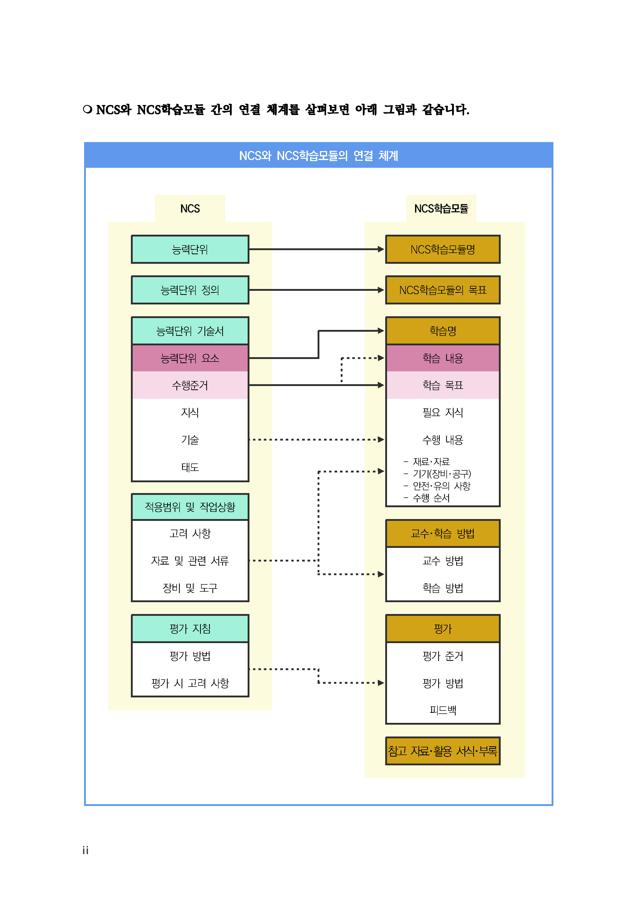
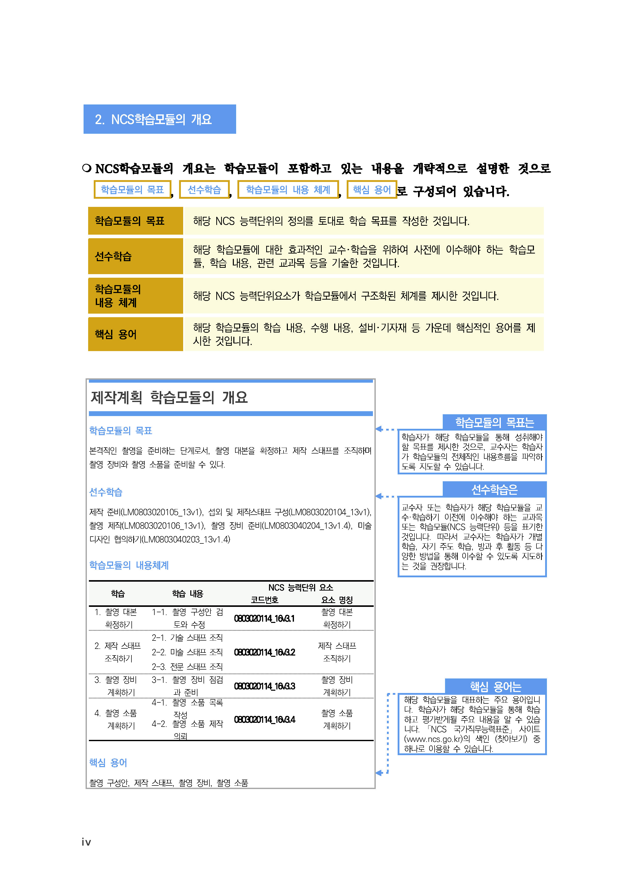
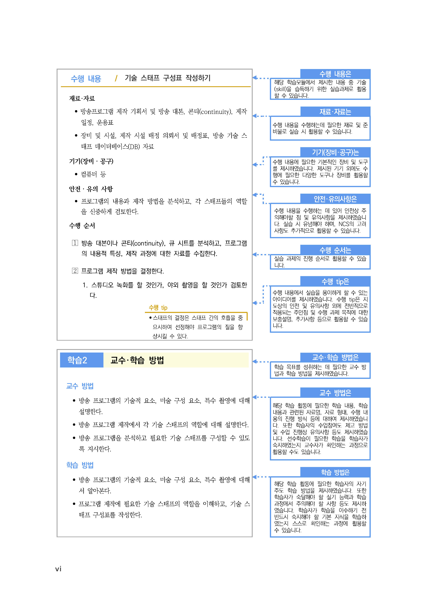
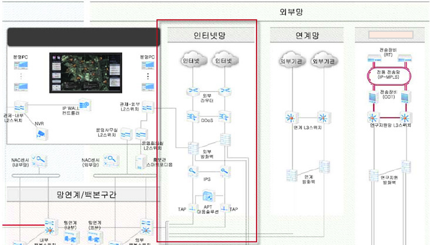

# LM2001020614_19v5_NW보안+구축

대분류/20
정보통신 중분류/01
정보기술 소분류/02
정보기술개발 세분류/06
보안엔지니어링 능력단위/14
NCS학습모듈
NW 보안 구축
LM2001020614_19v5
[NCS학습모듈 활용 시 유의 사항]
1. NCS학습모듈은 교육훈련기관에서 출처를 명시하고 교육적 목적으로 활용할 수 있습니다. 다
만, NCS학습모듈에는 국가(교육부)가 저작재산권 일체를 보유하지 않은 저작물(출처가 표기된
도표‧사진‧삽화‧도면 등)이 포함되어 있으므로, 이러한 저작물의 변형‧각색‧복제‧공연‧
배포 및 공중 송신 등과 이러한 저작물을 활용한 2차적 저작물을 작성하려면 반드시 원작자
의 동의를 받아야 합니다.
2. NCS학습모듈은 개발 당시의 산업 및 교육 현장을 반영하여 집필하였으므로, 현재 적용되는
법령‧지침‧표준 및 교과 내용 등과 차이가 있을 수 있습니다. NCS학습모듈 활용 시 법령
‧지침‧표준 및 교과 내용의 개정 사항과 통계의 최신성 등을 확인하시기를 바랍니다.
3. NCS학습모듈은 산업 현장에서 요구되는 능력을 교육훈련기관에서 학습할 수 있게 구성한 자
료입니다. 다만, NCS학습모듈 지면의 한계상 대표적 예시(예: 활용도 또는 범용성이 높은 제
품, 서비스) 중심으로 집필하였음을 이해하시기를 바랍니다.

[NCS-학습모듈의 위치]

| 정보통신 |  |  |
| --- | --- | --- |
|  | 정보기술 |  |
|  |  | 정보기술개발 |

대분류
중분류
소분류
세분류

| SW아키텍처 |  |  | 능력단위 | 학습모듈명 |
| --- | --- | --- | --- | --- |
| 응용SW 엔지니어링 |  |  | 보안 구축 계획 수립 | 보안 구축 계획 수립 |
| 임베디드SW 엔지니어링 |  |  | 보안 구축 요구사항 분석 | 보안 구축 요구사항 분석 |
| DB엔지니어링 |  |  | 관리적 보안 구축 | 관리적 보안 구축 |
| NW엔지니어링 |  |  | 물리적 보안 구축 | 물리적 보안 구축 |
| 보안 엔지니어링 |  |  | 보안인증 관리 | 보안인증 관리 |
| UI/UX 엔지니어링 |  |  | SW개발 보안 구축 | SW개발 보안 구축 |
| 시스템SW 엔지니어링 |  |  | DB보안 구축 | DB보안 구축 |
| 빅데이터 플랫폼구축 |  |  | 시스템 보안 구축 | 시스템 보안 구축 |
| 핀테크 엔지니어링 |  |  | NW보안 구축 | NW보안 구축 |

데이터 아키텍처
IoT시스템연동
인프라스트럭쳐아
기텍처구축
클라우드솔루션아
키텍처
클라우드인프라스
트럭쳐엔지니어링
PaaS엔지니어링
차 례
학습모듈의 개요 1
학습 1. NW보안 설계하기
1-1. NW보안요구사항 명세 3
1-2. NW보안 설계 21
1-3. NW구현 준비 36
• 교수 ․ 학습 방법 43
• 평가 44
학습 2. NW보안 구현하기
2-1. NW보안 구현 46
2-2. NW보안 테스트 59
• 교수 ․ 학습 방법 65
• 평가 66
참고 자료 68
활용 서식 69
NW보안 구축 학습모듈의 개요
학습모듈의 목표
정의된 보안요구사항에 따라 네트워크 보안요구사항을 명세하고 설계, 구현, 테스트할 수 있다.
선수학습
보안 구축 요구사항 분석(LM2001020603_19v5), 네트워크 보안관리(LM2002010310_22v4), 스위
치 장비 구축(LM2002010313_22v2), 무선근거리통신망(WLAN) 구축(LM2002010314_22v2)
학습모듈의 내용체계

| 학습 | 학습 내용 | NCS 능력단위 요소 |  |
| --- | --- | --- | --- |
|  |  | 코드번호 | 요소 명칭 |

1-1. NW보안요구사항 명세
1. NW보안 설계하기 1-2. NW보안 설계 2001020614_19v5.1 NW보안 설계하기
1-3. NW구현 준비
2-1. NW보안 구현
2. NW보안 구현하기 2001020614_19v5.2 NW보안 구현하기
2-2. NW보안 테스트
핵심 용어
네트워크 보안, DDoS, 방화벽, IDS, IPS, 웹방화벽, 악성코드, 망분리, NAC, 보안관제

| 학습 1 | NW보안 설계하기 |
| --- | --- |

학습 2 NW보안 구현하기
1-1.
NW보안요구사항 명세
학습 목표 •정의된 보안요구사항에 따라 네트워크에 대한 보안요구사항을 명세할 수 있다.
필요 지식 /
(cid:49684) 네트워크 보안 설계를 위한 고려 사항
기본적으로 네트워크 보안 설계는 기관의 서버 및 클라이언트 네트워크의 내외부에서 유발되는
사이버 침해 공격으로 인한 보안 리스크를 최소화하기 위한 것이다. 이를 위하여 다양한 네트
워크 보안 설계 요구사항이 존재하며, 특히 개인정보의 유출을 방지하기 위한 법률 요건이 존
재하므로 법률 규제 사항의 구조에 대한 이해가 필요하다.
1. 개인정보보호와 관련된 법률
개인정보보호와 관련되어 특별법과 일반법이 존재한다.
(1) 특별법
정보통신 분야의 정보통신망법이나 의료 분야의 환자 정보 처리 등에 대한 의료법, 금융
분야에 적용되는 전자금융거래법 등과 같이 사업 분야별로 적용되는 법이다.
(2) 일반법
개인정보보호법과 같이 특별법에서 정의하지 않는 잔여 영역에 대해 포괄적으로 적용되
는 법이다.
(3) 특별법과 일반법의 관계
특별법이 일반법과 충돌할 경우 특별법이 우선 적용된다. 특별법에서 정의하지 않는 잔
여 영역에 대해서는 일반법이 적용된다.

출처: 집필진 제작(2024)
[그림 1-1] 각종 특별법과 일반법인 개인정보보호법의 관계
<표 1-1> 의료법을 예시로 든 특별법과 일반법의 관계
구분 진료 정보 일반 개인정보
진료를 목적으로 수집하여 처리하는 개인정보가
포함된 정보 홈페이지 회원 정보, 홍보를 위한 연
개념
- 진료기록부, 수술기록부, 조산기록부, 간호기 락처 등 일반 개인정보
록부, 환자 명부 등
의료법에 규정이 있는 경우 의료법을 우선 적
일반 원칙 용 개인정보보호법을 적용
- 규정이 없는 경우 개인정보보호법 적용
의료법 제22조(시행규칙 제14조)
개인정보보호법 제15조
수집 이용 - 동의 없이 수집 가능
- 동의를 받아 수집
- 진료 목적으로만 사용 가능
개인정보보호법
- 제26조: 문서로 위탁해야 하며 위탁 사실을 공개해야 함
- 제29조: 안전한 관리를 위해 접근 통제, 암호화, 접속 기록 보관, 물리적 보호조치
관리
등 안전성 확보 조치를 해야 함
- 제30조: 개인정보처리 방침을 수립하여 공개해야 함
- 제31조: 개인정보보호 책임자를 지정해야 함
출처: 교육부(2019). NW보안 구축(LM2001020614_18v4). 한국직업능력개발원. p.4.
2. 네트워크 보안 관련 법률 규제 구성
규제 기준으로서 참조해야 하는 법은 법률과 시행령, 시행규칙 등으로 구성된다.
(1) 정보통신망법 관련 규제 구성
정보통신망법은 정보통신망을 통해 서비스를 제공하는 사업자를 대상으로 하는 법률로
서, 일반적으로 개인정보보호 규제의 대표적 법률이라고 할 수 있다.
(가) 정보통신망법
정보통신망의 이용 촉진에 대한 내용과 정보보호 규제에 대한 내용 위법 시 벌칙에
대한 내용이 포함되어 있다.
(나) 정보통신망법 시행령
정보통신망법의 하위 기준으로서 개인정보의 보호조치를 위해 대통령령으로 제정된
시행령이다.
(2) 개인정보보호법 관련 규제 구성
개인정보보호법은 특별법에 적용되지 않는 영역에 적용되는 일반법이다.
(가) 개인정보보호법
개인정보보호법은 개인정보의 처리 및 보호에 관한 사항 및 이에 대한 위법 시의 벌
칙 기준에 대한 내용이 포함되어 있다.
(나) 개인정보보호법 시행령
개인정보보호법의 하위 기준으로서 개인정보의 보호조치를 위해 대통령령으로 제정
된 시행령이다.
(3) 정보보호 및 개인정보보호 관리 체계 인증 등에 관한 고시
정보통신망법(정보통신망 이용촉진 및 정보보호 등에 관한 법률)에 따른 정보보호 관리
체계 인증과 개인정보보호법 규정에 따른 개인정보보호 인증의 통합 운영에 필요한 사
항을 정하는 법이다.
(cid:49685) 네트워크 침해 공격과 관련된 주요 용어 개념
네트워크 보안 설계를 위해 사이버 공격 및 대응 관련 기본 용어의 이해가 필요하다.
1. 사이버 공격 관련 주요 용어의 개념
사이버 침해 공격에 활용되는 기법에 대한 주요 용어는 <표 1-2>와 같다.
<표 1-2> 정보 보안 침해 공격 방법 관련 기본 용어
용어 의미
다수의 악성코드 감염 PC를 이용해 대규모 트래픽을 특정 시스템에 전송하여
디도스(DDoS) 공격 네트워크 및 시스템의 과부하를 일으키고 정상 서비스를 방해하는 사이버 침해
공격
스마트폰 문자 발송 메시지를 통해 악성 앱 설치를 유도하고 개인정보 혹은 금
스미싱
융 정보를 탈취하는 침해 기법
창(Spear)와 피싱(Phishing)의 합성어로, 특정 공격 대상을 지정하고 다양한 방
스피어 피싱
법을 통해 집중적으로 공격 대상을 공격하여 정보를 탈취하기 위한 수법
웹서비스 요소를 공격하여 이용자 혹은 관리자의 권한을 획득하고 개인정보 등
웹 해킹
을 탈취하는 행위
지능형 지속 공격
특정 대상에 대해 명확한 목표를 설정하고 지능적이고 지속적으로 공격을 가하
(APT: Advanced
여 정보를 수집 및 유출하는 해킹 기법
Persistent Threat)
공격 대상 서버의 열려진 서비스 포트를 순차적으로 접속 시도함으로써, 취약한
포트 스캐닝
포트를 찾아내는 공격 준비 기법
Brute-force 공격이라고도 부르며, 사용자 인증이 필요한 기능에 비밀번호 등
무작위 대입 공격
을 무작위로 대입하여 인증 성공을 노리는 공격 기법
IoT 기기를 통해, DDos 공격을 하는 봇넷의 일종으로서 IoT 기기의 기본 계정
미라이봇넷
을 통해 통제권을 획득하거나 다량의 트래픽을 유발하는 공격 방법
출처: 교육부(2019). NW보안 구축(LM2001020614_18v4). 한국직업능력개발원. p.6.
2. 정보 보안 침해 공격에 사용되는 프로그램 관련 주요 용어
정보 보안 침해 공격에 사용되는 악성 프로그램 관련 주요 용어는 <표 1-3>과 같다.
<표 1-3> 정보 보안 침해 공격에 사용되는 악성 프로그램 관련 기본 용어
용어 의미
사용자 컴퓨터나 서버 시스템에 동의 없이 설치되어 파일을 암호화하고, 복호
랜섬웨어 화를 원하는 사용자에게 돈을 요구하는 사이버 범죄에 사용되는 악성 프로그
램
해커에 의해 설치된 악성코드가 백신이나 사용자에게 감지되지 않도록 숨겨
루트킷
주는 악성 프로그램
해커에 의해 악성코드에 감염된 좀비 PC를 관리하고 DDoS와 같은 공격 명
C&C 서버
령을 내리는 관리 및 제어 목적의 서버
정상적인 실행 파일과 결합하여 PC의 동작을 중지시키거나 파일을 변조 혹은
컴퓨터 바이러스
파괴하는 등 컴퓨터의 운영을 방해하는 악성 프로그램
사용자 컴퓨터나 서버 시스템에 해커가 사용자 몰래 접속하여 악의적인 행위
백도어
를 할 수 있도록 출입구 역할을 해 주는 악성 프로그램
해커가 원격에서 제어할 수 있는 악성 프로그램이 설치되어, 사용자 모르게
좀비 PC
스팸 발송, 악성코드 유포, DDoS 등의 공격에 활용되는 컴퓨터
다른 파일을 변조하여 기생하지 않고 독자적으로 자신을 복제하여 확산함으로
웜(worm) 써 전파 속도가 매우 빠른 특징을 지니며 주로 메일, 네트워크 공유 폴더 등
을 통해 전파되고 시스템과 네트워크에 부하를 증가시키는 악성 프로그램
해커가 원격으로 웹서버 시스템에 악의적인 명령을 실행할 수 있도록 작성한
웹셸
웹 브라우저 기반의 스크립트 실행 파일
익스플로잇 해커가 소프트웨어나 하드웨어의 취약점을 통해 악성 행위를 수행하기 위해
(Exploit) 제작한 프로그램
제로데이 취약점 보안 패치가 발표되지 않은 상태에서 외부에 노출된 취약점
키로거 사용자의 키보드 입력 데이터를 해커에게 전송하는 악성 프로그램
컴퓨터에 숨어 있으면서 사용자의 정보를 사용자가 인지하지 못하도록 유출하
트로이 목마
는 악성코드
출처: 교육부(2019). NW보안 구축(LM2001020614_18v4). 한국직업능력개발원. p.7.
3. 주요 웹 해킹 공격 유형
사이버 침해 공격 중 웹 해킹과 관련된 주요 유형은 <표 1-4>와 같다.
<표 1-4> 정보 보안 침해 공격 방법 관련 기본 용어
용어 의미
SQL을 사용하는 응용프로그램에서 SQL 구문을 조작하여 인증 우회 혹은 권
SQL 인젝션
한 상승을 유발하는 공격
크로스 사이트 스크
웹사이트에 악성 스크립트를 삽입할 수 있는 취약점을 활용하여, 의도하지 않
립트(XSS, Cross
은 기능을 수행하거나 중요 정보를 탈취하는 공격
Site Script)
크로스 사이트 요청
웹서버가 피해자의 정당한 웹 요청이라고 오해하게 만들도록 웹사이트에 피해
위조(CSRF: Cross
자의 세션 쿠키 및 인증 정보를 자동으로 포함하여 위조된 웹 요청을 강제로
Site Request
보내도록 하는 공격
Fogery)
허용되지 않은 유형의 파일을 업로드하고 해당 파일을 외부에서 직접 접근할
파일 업로드(웹셸)
수 있는 취약점을 활용하여 웹서버의 권한을 탈취하는 공격
검증되지 않은 외부 입력값을 이용하여 서버의 파일에 접근하고 식별 가능한
파일 다운로드
취약점을 이용하여 중요 서버 파일을 탈취하는 공격
크로스 사이트 스크립트 등의 방법을 이용하여 피해자의 세션 쿠키를 탈취하
세션 탈취
고 이를 이용해 피해자의 세션으로 로그인하는 공격
출처: 교육부(2019). NW보안 구축(LM2001020614_18v4). 한국직업능력개발원. p.8.
수행 내용 / NW보안요구사항 명세하기
재료·자료
• 정보통신망 이용촉진 및 정보보호 등에 관한 법률
• 개인정보보호법
• 정보보호 관리 체계에 관한 국제 표준 규격(ISO27001)
• 정보보호 및 개인정보보호 관리 체계(ISMS-P) 인증 기준 세부 점검 항목
기기(장비･공구)
• 인터넷
• 컴퓨터
• 문서 작성 도구
안전･유의 사항
• 네트워크 보안 설계 요구사항 도출을 위해 각종 규제 기준을 확인한다.
• 정보통신망법과 개인정보보호법을 기반으로 세부 가이드를 확인한다.
• 정보보호 및 개인정보 관리 체계 인증 기준을 확인한다.
수행 순서
(cid:49684) 정보 보안과 관련된 국내 규제 및 가이드 기준을 확인한다.
네트워크 보안과 관련되어 반드시 준수가 필요한 국내 법규 기준을 확인한다.
1. 정보통신망법상의 네트워크 보안 관련 기준을 확인한다.
국내 정보보호 관련 법률의 근간이 되는 정보통신망법 중 네트워크 보안과 관련된 기준을
확인한다.
(1) 국가법령정보센터에 접속하여 정보통신망법의 네트워크 보안 관련 기준을 확인한다.
국내 모든 법률을 검색할 수 있는 국가법령정보센터에 접속하여 정보통신망 이용촉진
및 정보보호 등에 관한 법률을 검색하고 네트워크 보안 관련 기준을 확인한다.
(가) 국가법령정보센터에 접속한다.
법제처에서 운영하는 국가법령정보센터(http://www.law.go.kr)에 접속한다.

출처: 국가법령정보센터(www.law.go.kr)에서 2024. 6. 17. 스크린샷.
[그림 1-2] 국가법령정보센터 초기 화면
(나) 정보통신망 이용촉진 및 정보보호 등에 관한 법률 및 시행령을 검색한다.
검색창에 ‘정보통신망’을 입력하고 검색을 클릭하여 정보통신망법 및 시행령을 검색
한다.

출처: 국가법령정보센터(http://www.law.go.kr/)에서 2024. 6. 17. 스크린샷.
[그림 1-3] 정보통신망법 및 시행령 검색 화면
1) 정보통신망 이용촉진 및 정보보호 등에 관한 법률 제44조 7항(불법 정보의 유통 금
지 등) 내용을 확인한다.
정보통신망 이용촉진 및 정보보호 등에 관한 법률
제44조 7항(불법 정보의 유통 금지 등)
..(중략)..
4. 정당한 사유 없이 정보통신시스템, 데이터 또는 프로그램 등을 훼손ㆍ멸실ㆍ변경ㆍ위조하거나 그
운용을 방해하는 내용의 정보
5. 「청소년 보호법」에 따른 청소년 유해 매체물로서 상대방의 연령 확인, 표시 의무 등 법령에 따른
의무를 이행하지 아니하고 영리를 목적으로 제공하는 내용의 정보
6. 법령에 따라 금지되는 사행 행위에 해당하는 내용의 정보
6의2. 이 법 또는 개인정보보호에 관한 법령을 위반하여 개인정보를 거래하는 내용의 정보
2. 개인정보보호법상의 네트워크 보안 관련 기준을 확인한다.
국내 정보보호 관련 일반법 역할을 수행하는 개인정보보호법 중 네트워크 보안과 관련된
기준을 확인한다.
(1) 국가법령정보센터 웹사이트를 통해 개인정보보호법의 네트워크 보안 관련 기준을 확인한다.
국가법령정보센터 웹사이트를 통해 개인정보보호법을 검색하고 네트워크 보안 관련 기
준을 확인한다.
(가) 국가법령정보센터에서 개인정보보호법 및 시행령을 검색한다.
국가법령정보센터 검색창에 ‘개인정보’를 입력하고 검색을 클릭하여 개인정보보호법
및 시행령을 검색한다.

출처: 국가법령정보센터(http://www.law.go.kr/)에서 2024. 6. 17. 스크린샷.
[그림 1-4] 개인정보보호법 및 시행령 검색 화면
(나) 개인정보보호법을 클릭하여 네트워크 보안 관련 기준을 확인한다.
개인정보보호법 제29조(안전조치 의무)와 제32조의2(개인정보보호 인증) 기준의 내용
을 확인한다.
1) 개인정보보호법 제29조(안전조치 의무) 내용을 확인한다.
법의 내용 중 기술적 관리적 조치가 필요함을 확인한다.
개인정보보호법
제29조(안전조치 의무)
개인정보처리자는 개인정보가 분실·도난·유출·위조·변조 또는 훼손되지 아니하도록 내부
관리계획 수립, 접속 기록 보관 등 대통령령으로 정하는 바에 따라 안전성 확보에 필요한
기술적·관리적 및 물리적 조치를 하여야 한다.
2) 개인정보보호법 제32조의2(개인정보보호 인증) 내용을 확인한다.
법의 내용 중 개인정보처리 사업자가 PIMS 인증을 의무가 아닌 선택 사항으로
받을 수 있음을 확인한다.
개인정보보호법
제32조의2(개인정보보호 인증)
① 행정안전부장관은 개인정보처리자의 개인정보처리 및 보호와 관련한 일련의 조치가 이
법에 부합하는지 등에 관하여 인증할 수 있다.
..(중략)..
(다) 개인정보보호법 시행령을 클릭하여 네트워크 보안 관련 기준을 확인한다.
개인정보보호법 시행령 제30조(개인정보의 안전성 확보 조치) 기준의 내용을 확인한다.
1) 개인정보보호법 시행령 제30조(개인정보의 안전성 확보 조치) 내용을 확인한다.
시행령 1항을 통해 개인정보처리시스템에 대한 접근 통제 필요성을 확인한다. 시
행령 3항을 통해 행정안전부 장관이 고시하도록 되어 있는 개인정보의 안전성 확
보 조치에 관한 세부 고시 기준을 별도로 조사해야 함을 확인한다.
개인정보보호법 시행령
제30조(개인정보의 안전성 확보 조치)
① 개인정보처리자는 법 제29조에 따라 다음 각호의 안전성 확보 조치를 하여야 한다.
1. 개인정보의 안전한 처리를 위한 내부 관리계획의 수립·시행
2. 개인정보에 대한 접근 통제 및 접근 권한의 제한 조치
..(중략)..
③ 제1항에 따른 안전성 확보 조치에 관한 세부 기준은 행정안전부장관이 정하여 고시한
다.
3. 정보보호 및 개인정보 관리 체계 인증(ISMS-P) 기준상의 네트워크 보안 관련 기준을 확인한다.
정보통신망법 제47조2항에 따른 ISMS-P 인증과 관련하여 인증 기준상의 네트워크 보안과
관련된 기준을 확인한다.
(1) 한국인터넷진흥원 웹사이트를 통해 ISMS-P 인증 기준의 네트워크 보안 관련 기준을 확인한다.
한국인터넷진흥원의 ISMS 지원 웹사이트를 통해 ISMS 인증 기준을 검색하고 네트워크
보안 관련 기준을 확인한다.
(가) ISMS 지원 웹사이트에 접속한다.
한국인터넷진흥원에서 운영하는 ISMS-P 지원 웹사이트(http://isms.kisa.or.kr)에
접속한다.

출처: 인터넷진흥원(http://isms.kisa.or.kr/)에서 2024. 6. 17. 스크린샷.
[그림 1-5] ISMS-P 지원 웹사이트 접속 화면
(나) ISMS-P 인증 기준 안내서를 검색한다.
ISMS-P 자료실 검색창에 ‘인증 기준’을 입력하고 검색을 클릭하여 ISMS-P 인증 기
준 안내서를 다운로드한다.

출처: 인터넷진흥원(http://isms.kisa.or.kr/)에서 2024. 6. 17. 스크린샷.
[그림 1-6] ISMS-P 지원 웹사이트 자료실 접속 화면
(다) ISMS-P 인증 기준 세부 점검 항목 중 네트워크 보안 관련 기준을 확인한다.
ISMS-P 인증 기준 세부 점검 항목에서 네트워크 접근, 정보시스템 접근, 무선 네
트워크 접근, 원격접근 통제, 인터넷 접근 통제 등 네트워크 보안 관련 항목을 확
인한다.
<표 1-5> ISMS-P 인증 기준 세부 점검 항목 중 2.6.1 네트워크 접근
항목 상세 내용 주요 확인 사항
조직의 네트워크에 접근할 수 있는 모든 경로를 식별
하고 접근 통제 정책에 따라 내부 네트워크는 인가된
네트워크에 대한 비인가
사용자만이 접근할 수 있도록 통제하고 있는가?
접근을 통제하기 위하여
IP 관리, 단말 인증 등 서비스, 사용자 그룹, 정보 자산의 중요도, 법적 요구
관리 절차를 수립ㆍ이행 사항에 따라 네트워크 영역을 물리적 또는 논리적으로
하고, 업무 목적 및 중 분리하고 각 영역 간 접근 통제를 적용하고 있는가?
네트워크 접근
요도에 따라 네트워크
분리(DMZ, 서버팜, DB 네트워크 대역별 IP 주소 부여 기준을 마련하고 DB
존, 개발존 등)와 접근 서버 등 외부 연결이 필요하지 않은 경우 사설 IP로
통제를 적용하여야 한 할당하는 등의 대책을 적용하고 있는가?
다.
물리적으로 떨어진 IDC, 지사, 대리점 등과의 네트워
크 연결 시 전송 구간 보호 대책을 마련하고 있는가?
<표 1-6> ISMS-P 인증 기준 세부 점검 항목 중 2.6.2 정보시스템 접근
항목 상세 내용 주요 확인 사항
서버, 네트워크시스템, 보안시스템 등 정보시스템별 운
영체제(OS)에 접근이 허용되는 사용자, 접근 가능 위
치, 접근 수단 등을 정의하여 통제하고 있는가?
서버, 네트워크시스템
등 정보시스템에 접근을 정보시스템에 접속 후 일정 시간 업무 처리를 하지 않
정보시스템 허용하는 사용자, 접근 는 경우 자동으로 시스템 접속이 차단되도록 하고 있
접근 제한 방식, 안전한 접근 는가?
수단 등을 정의하여 통
정보시스템의 사용 목적과 관계없는 서비스를 제거하
제하여야 한다.
고 있는가?
주요 서비스를 제공하는 정보시스템은 독립된 서버로
운영하고 있는가?
<표 1-7> ISMS-P 인증 기준 세부 점검 항목 중 2.6.5 무선 네트워크 접근
항목 상세내용 주요 확인 사항
무선 네트워크를 업무적으로 사용하는 경우 무선 AP
무선 네트워크를 사용하
및 네트워크 구간 보안을 위해 인증, 송수신 데이터
는 경우 사용자 인증,
암호화 등 보호 대책을 수립ㆍ이행하고 있는가?
송수신 데이터 암호화,
AP 통제 등 무선 네트
인가된 임직원만이 무선 네트워크를 사용할 수 있도록
무선 네트워크 워크 보호 대책을 적용
사용 신청 및 해지 절차를 수립ㆍ이행하고 있는가?
접근 한다. AD Hoc 접속,
비인가 AP 사용 등 비
인가 무선 네트워크 접 AD Hoc 접속 및 조직 내 허가받지 않은 무선 AP
속으로부터 보호 대책을 탐지ㆍ차단 등 비인가된 무선 네트워크에 대한 보호
수립 이행해야 한다. 대책을 수립ㆍ이행하고 있는가?
<표 1-8> ISMS-P 인증 기준 세부 점검 항목 중 2.6.6 원격 접근 통제
항목 상세 내용 주요 확인 사항
인터넷과 같은 외부 네트워크를 통한 정보시스템 원격
운영은 원칙적으로 금지하고 장애 대응 등 부득이하게
보호구역 이외 장소에서
허용하는 경우 보완 대책을 마련하고 있는가?
의 정보시스템 관리 및
개인정보처리는 원칙적
내부 네트워크를 통해서 원격으로 정보시스템을 운영
으로 금지하고, 불가피
하는 경우 특정 단말에 한해서만 접근을 허용하고 있
한 사유로 원격 접근을
는가?
허용하는 경우 책임자
원격 접근 통
승인, 접근 단말 지정, '재택근무, 원격 협업, 스마트워크 등과 같은 원격 업
제
접근 허용 범위 및 기 무 수행 시 중요 정보 유출, 해킹 등 침해사고 예방을
간 설정, 강화된 인증, 위한 보호 대책을 수립ㆍ이행하고 있는가?
구간 암호화, 접속 단말
보안(백신, 패치 등) 등
개인정보처리시스템의 관리, 운영, 개발, 보안 등을 목
보호 대책을 수립ㆍ이 적으로 원격으로 개인정보처리시스템에 접속하는 단말
행해야 한다. 기는 관리용 단말기로 지정하고 임의 조작 및 목적 외
사용 금지 등 안전조치를 적용하고 있는가?
<표 1-9> ISMS-P 인증 기준 세부 점검 항목 중 2.6.7 인터넷 접속 통제
항목 상세 내용 주요 확인 사항
인터넷을 통한 정보 유 주요 직무 수행 및 개인정보 취급 단말기 등 업무용
출, 악성코드 감염, 내 PC의 인터넷 접속에 대한 통제 정책을 수립ㆍ이행하
부망 침투 등을 예방하 고 있는가?
기 위하여 주요 정보시
스템, 주요 직무 수행
주요 정보시스템(DB 서버 등)에서 불필요한 외부 인
인터넷 접속 및 개인정보 취급 단말
터넷 접속을 통제하고 있는가?
통제 기 등에 대한 인터넷
접속 또는 서비스(P2P,
웹하드, 메신저 등)를
관련 법령에 따라 인터넷망 차단 의무가 부과된 경우
제한하는 등 인터넷 접
대상자를 식별하여 안전한 방식으로 인터넷망 차단 조
속 통제 정책을 수립ㆍ
치를 적용하고 있는가?
이행해야 한다.
(cid:49685) 국내 규제 및 가이드 기준을 기반으로 하여 네트워크 보안요구사항을 정의한다.
각종 법률 및 시행령과 ISMS-P 인증 기준에서 요구하고 있는 네트워크 보안 설계 요구사항을
통합하여 명세한다.
1. 네트워크 보안 설계와 관련된 요구사항을 도출하고 검토한다.
정보통신망법, 개인정보보호법 및 ISMS-P 등 각종 기준에서 가이드하고 있는 네트워크 설
계에 대한 요구사항을 도출하고 검토한다.
(1) 서버 네트워크 설계 요구사항을 도출하고 검토한다.
각종 기준에서 가이드하고 있는 네트워크 설계에 대한 요구사항과 사이버 침해 공격 대
응을 위한 요구사항을 포함하여 서버 네트워크 분야의 보안 설계 요구사항을 정의한다.
(2) 클라이언트 네트워크 설계 요구사항을 도출하고 검토한다.
각종 기준에서 가이드하고 있는 네트워크 설계에 대한 요구사항 중 PC 혹은 무선 네트
워크와 같은 클라이언트 네트워크 설계 요구사항을 정의한다.
(3) 네트워크 보안의 운영관리 체계와 관련된 요구사항을 도출하고 검토한다.
각종 기준에서 가이드하고 있는 네트워크 설계에 대한 요구사항 중 운영 보안 체계 관
련 요구사항을 정의한다.
<표 1-10> 네트워크 보안요구사항 도출 및 검토
구분 도출 항목
(가) 시스템에 대한 접속 권한을 IP 주소 등으로 제한하여 인가받지 않은 접근
을 제한할 수 있어야 한다.
(나) 시스템에 접속한 IP 주소 등을 재분석하여 불법적인 개인정보 유출 시도
를 탐지할 수 있어야 한다.
(다) 특정 컴퓨터를 물리적 또는 논리적으로 인터넷과 차단(망분리)할 수 있어
야 한다.
(라) 외부망에서 시스템에 접속하려는 경우를 위해 가상사설망(VPN: Virtual
Private Network) 또는 전용선 등 안전한 접속 수단을 적용할 수 있어
야 한다.
서버 네트워크
(마) 원격지에서 인터넷 등 외부 네트워크를 통하여 정보시스템을 관리하는 것
보안요구사항
은 원칙적으로 금지하고 부득이한 사유로 인해 허용하는 경우에는 책임자
승인, 접속 단말 및 사용자 인증, 구간 암호화, 접속 단말 보안(백신, 패치
등) 등의 보호 대책을 수립해야 한다.
(바) 서비스, 사용자 그룹, 정보 자산의 중요도에 따라 내ㆍ외부 네트워크를 분
리하여야 한다.
(사) DDoS 공격 등에 대해 방어할 수 있어야 한다.
(아) 인터넷 및 이메일 서버 구간에 대해 악성코드의 유입을 차단할 수 있어야
한다.
(자) 서버 네트워크를 통한 개인정보의 유출을 탐지 및 차단할 수 있어야 한다.
(가) 허가받지 않은 단말의 네트워크 접속을 차단할 수 있어야 한다.
(나) 내부 네트워크를 통하여 정보시스템을 관리하는 경우 특정 단말에서만 접
근을 할 수 있도록 제한해야 한다.
클라이언트
(다) 무선랜 등을 통해 무선인터넷을 사용하는 경우 무선 네트워크 구간에 대
네트워크 보안요
한 보안을 강화하기 위해 사용자 인증, 송수신 데이터 암호화 등의 보호
구사항
대책을 수립해야 한다.
(라) 중요 시스템에 접근이 가능한 PC는 인터넷 접속 또는 서비스를 제한 및
통제하고, 필요시 인터넷 접속 내역을 모니터링할 수 있어야 한다.
(가) 보안시스템 유형별로 관리자 지정, 최신 정책 업데이트, 룰셋 변경, 이벤
트 모니터링 등의 운영 절차를 수립하고 보안시스템별 정책 적용 현황을
네트워크 운영
관리할 수 있어야 한다.
보안요구사항
(나) 네트워크에 대한 비인가 접근을 통제하기 위해 필요한 네트워크 접근 통
제 리스트, 네트워크 식별자 등에 대한 관리 절차를 수립해야 한다.
출처: 교육부(2019). NW보안 구축(LM2001020614_18v4). 한국직업능력개발원. p.31.
2. 검토가 완료된 네트워크 보안요구사항을 명세하여 작성한다.
네트워크 보안 관련 이해관계자의 검토가 완료된 네트워크 설계에 대한 보안요구사항을 명
세하여 작성한다. [활용 서식 참조]
<표 1-11> 네트워크 보안요구사항 명세서
구분 보안요구사항 ID 비고
시스템에 대한 접속 권한을 IP 주소 등으로 제한하여 인가받지 않
S-0001
은 접근을 제한할 수 있어야 한다.
시스템에 접속한 IP 주소 등을 재분석하여 불법적인 개인정보 유출
S-0002
시도를 탐지할 수 있어야 한다.
특정 컴퓨터를 물리적 또는 논리적으로 인터넷과 차단(망분리)할 수
S-0003
있어야 한다.
외부망에서 시스템에 접속하려는 경우를 위해 가상사설망(VPN:
Virtual Private Network) 또는 전용선 등 안전한 접속 수단을 적 S-0004
용할 수 있어야 한다.
원격지에서 인터넷 등 외부 네트워크를 통하여 정보시스템을 관리하
서버
는 것은 원칙적으로 금지하고 부득이한 사유로 인해 허용하는 경우
네트워크 S-0005
에는 책임자 승인, 접속 단말 및 사용자 인증, 구간 암호화, 접속
단말 보안(백신, 패치 등) 등의 보호 대책을 수립해야 한다.
서비스, 사용자 그룹, 정보 자산의 중요도에 따라 내ㆍ외부 네트워
S-0006
크를 분리하여야 한다.
DDoS 공격 등에 대해 방어할 수 있어야 한다. S-0007
인터넷 구간 및 이메일 서버 구간에 대해 악성코드의 유입을 차단할
S-0008
수 있어야 한다.
서버 네트워크를 통한 개인정보의 유출을 탐지 및 차단할 수 있어야
S-0009
한다.
허가받지 않은 단말의 네트워크 접속을 차단할 수 있어야 한다. C-0001
내부 네트워크를 통하여 정보시스템을 관리하는 경우 특정 단말에서
C-0002
만 접근을 할 수 있도록 제한해야 한다.
클라이언트
무선랜 등을 통해 무선인터넷을 사용하는 경우 무선 네트워크 구간
네트워크
에 대한 보안을 강화하기 위해 사용자 인증, 송수신 데이터 암호화 C-0003
등의 보호 대책을 수립해야 한다.
중요 시스템에 접근이 가능한 PC는 인터넷 접속 또는 서비스를 제한
C-0004
및 통제하고, 필요시 인터넷 접속 내역을 모니터링할 수 있어야 한다.
보안시스템 유형별로 관리자 지정, 최신 정책 업데이트, 룰셋 변경,
O-000
이벤트 모니터링 등의 운영 절차를 수립하고 보안시스템별 정책 적
1
운영 용 현황을 관리할 수 있어야 한다.
보안
네트워크에 대한 비인가 접근을 통제하기 위해 필요한 네트워크 접근 O-000
통제 리스트, 네트워크 식별자 등에 대한 관리 절차를 수립해야 한다. 2
출처: 교육부(2019). NW보안 구축(LM2001020614_18v4). 한국직업능력개발원. p.32.
3. 작성 완료된 네트워크 보안요구사항 명세서를 승인하여 확정한다.
보안요구사항 명세를 최종 승인하고 <표 1-12>와 같이 요구사항 명세서로 작성하여 필요시
관련 부서에 배포한다. [활용 서식 참조]
<표 1-12> 보안 요구사항 명세 사례
출처 요구사항 ID 요구사항명 요구사항 내용
개인정보를 처리함에 있어 『개인정보 보호법』, 『개인정보의
개인정보의 기술적
RFP SER-001 안전성 확보 조치 기준』 등 관련 법규 및 규정을 준수하여야
보안 조치
함
개인정보의 처리단 개인정보 수집 및 이용 대한 동의: 『개인정보보호법』 제15
RFP SER-002
계별 보호조치 조~제18조
소프트웨어 개발 보안 가이드, 행정기관 및 공공기관 정보시
S/W 개발 관련
RFP SER-003 스템 구축·운영 지침, 홈페이지 보완 취약점 대응 가이드(행
보안 준수 사항
정안전부) 등을 적용
웹취약점 제거 조 국정원 및 OWASP 웹 보안 취약점 사전 점검 및 제거
RFP SER-004
치 모든 응용프로그램에 대한 웹 보안성 구현 및 검증 방안 제시
보안약점 도구 사 공개 SW를 활용한 보안약점 진단 도구를 사용하여 정기적인
제안서 SER-005
용 보안약점 진단 및 조치
제안서 SER-006 구간 암호화 사용자 PC부터 웹서버 구간 간 암호화 방식을 적용하여 구현
저장되는 중요 정보 및 데이터는 암호화 대상을 식별하고 안
제안서 SER-007 DB 암호화
전한 암호화 알고리즘 사용
기술 개인 식별정보 비 주민등록번호 등 개인 식별정보(중요 정보)는 저장하지 않은
SER-008
협상 식별 처리 것을 원칙으로 하고, 저장이 필요할 시 비식별 처리
기술
SER-009 로그인 보안 조치 정보시스템 로그인에 대한 보안 조치 수행하여야 함
협상
수행 tip
•요구사항 명세서는 추후 구현 및 테스트 과정에서 활용할
수 있도록 요구사항 추적표를 후속 작성하여 관리하는 것
이 바람직하다.
1-2.
NW보안 설계
학습 목표 •명세된 보안요구사항을 만족하는 네트워크를 설계할 수 있다.
필요 지식 /
(cid:49684) 네트워크 보안 설계 원칙 및 보안 장비 유형
1. 네트워크 보안 설계 원칙
(1) 최소화의 원칙(Minimalization)
보안의 핵심 원칙은 최소화라고 할 수 있다. 반드시 필요한 항목을 필요로 하는 사람에
게 최소한의 기간 동안만 접근을 허용하는 것으로서, 이는 네트워크 접근 통제와 관련된
기본적 원칙이라고 할 수 있다.
(2) 분리의 원칙(Isolation)
분리는 리스크를 격리시키기 위해 필요하다. 네트워크 설계 시 외부에서 접근하는 DMZ
와 외부에서 접근이 불가능한 사설 IP 기반의 내부망의 분리 혹은 개발 서버 영역과 운
영 서버 영역의 분리가 그 예이다. 또 권한을 가진 업무 처리자와 권한을 부여하는 관
리자의 권한 분리도 분리의 예라고 할 수 있다.
(3) 다중 보안의 원칙(Defence in Depth)
보안 위협의 대응 차원에서 보안대책을 정의하고 구현하게 되는데, 하나의 보안대책이
무력화되더라도 다른 보안대책을 통해 전체적인 보안성이 확보되도록 하는 개념이다. 외
부로부터 공격자가 내부로 침입하여 중요 개인정보를 유출하는 위협 시나리오에 대해서
보안시스템을 통해 침입을 방지하는 체계(1차)와 내부 서버 사이에 확산 침투를 방지하
는 체계(2차), 그리고 정제된 개인정보를 외부로 유출하는 것을 방지하는 체계(3차) 등
총 3중 보안대책이 적용된다면 그중 하나의 보안대책이 무력화되더라도 나머지 유효한
보안대책을 통해 개인정보 유출을 방지할 수 있다.
(4) 법규 준수의 원칙(Compliance)
보안 리스크를 줄이기 위함과 동시에 법률 위반을 방지하기 위해 법규에서 가이드하는
보안대책은 반드시 적용이 필요하다.
2. 네트워크 보안 장비 유형
네트워크 보안 장비는 접근 통제, 침입 차단 및 탐지, DDoS 탐지 등을 수행하는 일체형
장비들이 포함된다.
<표 1-13> 주요 보안 장비
용어 의미
외부에서 내부, 내부에서 외부의 정보통신망에 불법으로 접근하는 것을 차단
방화벽(Fire Wall) 하는 시스템으로서 전송 정보의 발신지와 수신지에 대한 IP 주소와 포트 번
호에 대한 접근 통제를 수행한다.
침입탐지시스템 침입탐지시스템(IDS: Intrusion Detection System)은 네트워크를 통한 사이
(IDS) 버 공격을 실시간으로 탐지한다.
침입예방시스템 침입예방시스템(IPS: Intrusion Prevention System)은 네트워크를 통한 사
(IPS) 이버 공격을 실시간으로 탐지하고 차단한다.
목적지를 기반으로 트래픽이 임계치를 초과할 경우 기존의 세션을 제외한 패
DDoS방지시스템
킷을 Null Routing 처리하여 DDoS를 통한 공격에 대응한다.
웹방화벽 알려진 유형의 웹 해킹 공격을 탐지하고 방어한다.
출처: 교육부(2019). NW보안 구축(LM2001020614_18v4). 한국직업능력개발원. p.35.
<표 1-14> 방화벽 주요 기능
기능 설명 OSI 계층
패킷 필터 비인가 Packet 차단 L3, L4
상태 확인 세션 정보 연계(FTP, TFTP, H.323, SIP ...) L4
주소 변환 IP Header 변경(NAT, DHCP) L4
트래픽 관리 트래픽 용량 관리(bps, sps, cps) L4
프록시 HTTP, SMTP, POP3, SQL, etc L3, L4
콘텐츠 필터 HTTP, SMTP, POP3 L7
URL 필터 Web Paging Redirect L7
바이러스 필터 Mail, Web File Download Check L7
MAC 바인딩 IP/MAC Address Mapping L2, L3
영역 분리 Network Address 구간(Subnet/Group) 관리 L3
운영 모드 Router/Bridge Mode L2, L3
출처: 교육부(2019). NW보안 구축(LM2001020614_18v4). 한국직업능력개발원. p.35.
<표 1-15> IDS와 IPS의 차이
항목 IDS IPS
Layer 애플리케이션 커널
탐지 기준 Signature
제한적 TCP 리셋
차단 방식 패킷 드롭
간접 차단 – 방화벽 연동
제공 기능 탐지/로그 기록 탐지/로그 기록, 임계치 설정
탐지 범위 넓음(Application Memory) 상대적으로 적음(Kernel Memory)
탐지 성능 늦음(I/OProcessing 지연 발생) 빠름
안정성 네트워크 장애 발생 무관 장애 시 로컬 네트워크 장애 발생
지원 기술 미러링 후킹
동작 방식 탭 모드 인라인 모드
탐지 위치 라우터 트래픽 로컬 트래픽
출처: 교육부(2019). NW보안 구축(LM2001020614_18v4). 한국직업능력개발원. p.36.
(cid:49685) 망분리의 개념 및 유형
1. 망분리의 개념 및 근거
(1) 망분리의 개념
시스템의 오용/악용으로부터 정보시스템을 보호하기 위한 것으로서, 중요 내부 업무 처
리를 수행하는 자의 PC나 노트북을 인터넷 접속이 되지 않도록 차단하는 기술이다.
(2) 망분리의 근거
개인정보의 기술적 관리적 보호조치 기준 제4조(접근 통제) 6항에 따르면 ‘전년도 말 기
준 직전 3개월간 그 개인정보가 저장·관리되고 있는 이용자 수가 일일 평균 100만 명
이상이거나 정보통신서비스 부문 전년도(법인인 경우에는 전 사업연도를 말한다) 매출액
이 100억 원 이상인 정보통신서비스 제공자 등은 개인정보처리시스템에서 개인정보를
다운로드 또는 파기할 수 있거나 개인정보처리시스템에 대한 접근 권한을 설정할 수 있
는 개인정보취급자의 컴퓨터 등을 물리적 또는 논리적으로 망분리 하여야 한다.’라고 되
어 있는 부분을 그 근거로 하고 있다.
2. 망분리의 유형 및 구현 방식
(1) 망분리의 유형
망분리의 유형은 크게 물리적 혹은 논리적 망분리로 구현이 가능하다.
(가) 물리적 망분리
물리적으로 2대 이상의 PC와 별도 회선으로 내부망과 외부망을 분리하는 방식이다.
(나) 논리적 망분리
한 대의 PC에서 가상화 기술을 이용하여 내부망과 외부망을 분리하는 방식이다.
(2) 망분리의 세부 구현 방식
<표 1-16> 망분리의 구현 유형
분류 개념
2PC - 개인이 업무용, 인터넷용 PC 별도로 나누어 사용하는 방식
물리적
망분리
공용 PC - 2PC 방식과 동일하나 인터넷용 PC는 공유
업무 - 로컬 PC는 업무망 전용으로 동작
서버 기본형 - 인터넷 접속 시 별도 서버에서 인터넷용 가상머신이 동작
기반
가상화 인터넷 - 로컬 PC는 인터넷 전용으로 동작
기본형 - 업무망 접속 시 별도 서버에서 업무망 접속용 가상머신 동작
- 로컬 PC는 업무망용 랜카드와 인터넷용 랜카드 별도 존재
논리적
업무 - 로컬 PC는 업무용 PC로 동작하고 업무망용 랜카드로 통신
망분리
기본형 - 인터넷 활용 시 로컬 PC에서 인터넷용 가상머신을 실행, 인터
Host 넷용 가상머신은 인터넷용 랜카드로 통신
기반
가상화 - 로컬 PC는 업무망용 랜카드와 인터넷용 랜카드 별도 존재
인터넷 - 로컬 PC는 인터넷용 PC로 동작하고 인터넷용 랜카드로 통신
기본형 - 업무망 접속 시 로컬 PC에서 업무망용 가상머신을 실행, 업무
망용 가상머신은 업무망용 랜카드로 통신
출처: 교육부(2019). NW보안 구축(LM2001020614_18v4). 한국직업능력개발원. p.37.
수행 내용 / NW보안 설계하기
재료·자료
• 정보통신망 이용촉진 및 정보보호 등에 관한 법률
• 개인정보보호법
• 정보보호 관리 체계에 관한 국제 표준 규격(ISO27001)
• 정보보호 및 개인정보보호 관리 체계(ISMS-P) 인증 기준 세부 점검 항목
기기(장비･공구)
• 인터넷
• 컴퓨터
• 프린터
• 문서 작성 도구
안전･유의 사항
• 각종 규제 기준과 가이드를 통해 도출된 보안요구사항을 준수할 수 있도록 네트워크 보안
설계를 순차적으로 진행한다.
• 방화벽, IPS 등 관문 네트워크 보안 체계와, 클라이언트 네트워크 보안 체계 및 운영 보안
체계가 설계에 반영되어야 한다.
수행 순서
(cid:49684) 명세된 보안요구사항을 만족하는 네트워크를 설계한다.
서버 네트워크 분야와 사용자 단말기 네트워크 분야에 대해 네트워크 보안 설계를 수행한다.
1. 서버 네트워크 분야에 대한 네트워크 보안 설계를 수행한다.
서비스 제공을 위한 서버가 배치되는 서버 네트워크에 대한 보안 설계를 수행한다.
(1) 네트워크 관문 영역에 대한 보안 설계를 수행한다.
서버팜이 인터넷과 연결되는 관문에 대한 보안 설계를 수행한다.
(가) 인가되지 않은 접근을 제한할 수 있는 방화벽을 구성한다.
방화벽을 네트워크의 내외부 경계에 구축하여 기본적인 접근 통제를 구현한다.
(나) 접속 내역을 분석하여 불법적인 접근 시도를 탐지/차단할 수 있는 IPS를 구성한다.
불법 접속을 탐지하고 자동으로 차단할 수 있는 IPS를 구성한다.
(다) 대용량 DDoS 공격을 방어할 수 있는 안티 DDoS 솔루션을 구성한다.
방화벽의 앞 단에서 DDoS 공격에 대응하여 과다 세션을 처리할 수 있는 안티
DDoS 시스템을 구성한다.
(라) 웹 공격을 방어할 수 있는 웹방화벽을 구성한다.
웹 해킹 공격을 탐지하고 방어할 수 있는 웹방화벽을 구성한다.
(마) 외부망으로부터의 악성코드 유입 방지 솔루션을 구성한다.
인터넷 혹은 이메일 수신 등을 통해 유입되는 악성코드를 탐지하고 차단할 수 있는
솔루션을 구성한다.
(바) 외부망으로의 개인정보 유출 방지 솔루션을 구성한다.
내부망의 개인정보가 인터넷으로 유출되는 것을 탐지하고 차단할 수 있는 데이터 유
출 방지 솔루션을 구성한다.
(사) 보안관제를 수행할 수 있는 ESM 솔루션을 구성한다.
각종 보안시스템으로부터 로그를 전송받아 IDS를 통해 불법 접속을 탐지하거나 IPS
를 적용하여 자동 차단되도록 선택적으로 설계할 수 있다.

출처: 교육부(2019). NW보안 구축(LM2001020614_18v4). 한국직업능력개발원. p.39.
[그림 1-7] 관문 보안 솔루션 및 통합 보안관제 체계 구성
(아) 외부망으로부터의 안전한 원격 접속을 제공하는 VPN 솔루션을 용도에 맞게 구성한다.
인터넷을 통해 외부 네트워크와 내부 네트워크를 연계하는 IPsec-VPN을 구성하거
나, 외부망에 존재하는 PC와 내부망을 인터넷을 통해 연계하는 SSL-VPN을 구성
한다.

출처: 교육부(2019). NW보안 구축(LM2001020614_18v4). 한국직업능력개발원. p.40.
[그림 1-8] VPN을 통한 외부망으로부터의 원격 접속 체계 구현
<표 1-17> IPsec VPN과 SSL-VPN의 비교
항목 IPsec SSL
암호 위치 커널 – 3 계층 애플리케이션 – 5 계층
성능 상대적 빠름 IPSec-VPN의 ¼정도
IP Address 고정형 가변형
대상 지정된 서버-클라이언트 지정된 서버와 불특정 다수 사용자
배포 방식 사용자 PC 설치 없음 사용자 PC 설치(Active-X)
IKE 기반
인증 방식 ID/Password
-X.509 인증서, Pre-Shared Key
Routing 변경 없음 정적 라우팅 경로 추가
출처: 교육부(2019). NW보안 구축(LM2001020614_18v4). 한국직업능력개발원. p.340
(2) 서버 네트워크의 영역을 구분하는 보안 설계를 수행한다.
서버 네트워크 영역별 상호 접근 통제를 위한 보안 설계를 수행한다.
(가) DMZ 영역과 내부망을 구분한다.
외부로부터의 접근이 불가피한 웹서버, 메일서버 등의 공개용 서버가 배치되는 DMZ
영역과 외부로부터의 직접 접근이 차단되는 내부망을 구분하여 설계한다. DMZ 영역
과 내부망 영역은 존 분리 방화벽으로 접근 통제를 적용한다.
(나) 운영 서버 영역과 개발 서버 영역을 구분한다.
운영 서버 영역과 개발 서버 영역 또한 분리하여 설계해야 한다. 운영 서버 영역과
개발 서버 영역 간에 방화벽으로 접근 통제를 적용한다.

출처: 교육부(2019). NW보안 구축(LM2001020614_18v4). 한국직업능력개발원. p.41.
[그림 1-9] 존 분리 방화벽을 통한 개발 운영 네트워크 분리 구현
2. 사용자 단말기 네트워크 분야에 대한 네트워크 보안 설계를 수행한다.
사용자 단말기(PC/노트북)의 네트워크 접근 통제 및 망분리 요건을 준수하기 위한 보안 설
계를 수행한다.
(1) 사용자 단말기(PC/노트북)의 접근 통제를 위한 솔루션을 구성한다.
사전에 네트워크 접속이 승인된 단말기만의 접근을 허용하고 그 외의 단말기에 대한 네
트워크 접속을 차단할 수 있는 네트워크 접근 통제(NAC: Network Access Control)
솔루션을 구성한다.

출처: 교육부(2019). NW보안 구축(LM2001020614_18v4). 한국직업능력개발원. p.42.
[그림 1-10] NAC을 통한 사용자 단말기의 네트워크 접근 통제 체계 구현
<표 1-18> NAC 제공 기능
기능 항목 주요 내용 비고
패치 OS 보안 업데이트 패치 관리 시스템 연동
백신 악성코드 감염 탐지/치료
격리 Host 격리(네트워크 인터페이스 차단) 일정 주기별 체크
패턴 업데이트 악성코드 시그너처 업데이트 제로 데이 공격 대응
패턴 분석 악성코드 전송 및 분석
애플리케이션
비인가 SW 설치 방지 라이선스 통제 병행
통제
자원 관리 네트워크, CPU, 메모리 사용률 등 자원 관리
비인가 시스템 네트워크
호스트 인증 사용자 시스템 인증
접속 불가
출처: 교육부(2019). NW보안 구축(LM2001020614_18v4). 한국직업능력개발원. p.42.
(2) 사용자 단말기에 대한 망분리 솔루션을 구성한다.
보안 관점에서 호스트 기반의 망분리보다 서버 기반의 논리적 망분리가 통제 무력화 방
지 관점에서 더 적정하며, 서버에 VDI를 구성하도록 설계한다. 로컬 PC 영역과 서버
내 VDI로 구성된 영역이 논리적으로 분리되고 관리자의 승인이 없을 경우에는 영역 간
파일의 전달을 차단한다. 문서 중앙화 관점에서 로컬 PC가 인터넷 접속이 되고 VDI 환
경을 업무 환경으로 활용하는 경우가 일반적이다(서버 기반 논리적 망분리 - 인터넷 기
본형). 비용 절감 관점에서 호스트 기반 가상화로 망분리를 구성하는 것도 가능하나 매
체 제어 솔루션 및 NAC 솔루션을 연계하여 망분리 무력화를 방지한다.

출처: 교육부(2019). NW보안 구축(LM2001020614_18v4). 한국직업능력개발원. p.43.
[그림 1-11] 서버 기반 논리적 망분리 – Internet 기본형(일반적 구성)

출처: 교육부(2019). NW보안 구축(LM2001020614_18v4). 한국직업능력개발원. p.43.
[그림 1-12] 서버 기반 논리적 망분리 – 업무망 기본형

출처: 교육부(2019). NW보안 구축(LM2001020614_18v4). 한국직업능력개발원. p.44.
[그림 1-13] 호스트 기반 논리적 망분리 – Internet 기본형

출처: 교육부(2019). NW보안 구축(LM2001020614_18v4). 한국직업능력개발원. p.44.
[그림 1-14] 호스트 기반 논리적 망분리 – 업무망 기본형
(3) 클라이언트 무선 네트워크에 대한 설계를 수행한다.
무선랜 등을 통해 무선인터넷을 사용하는 경우 무선 네트워크 구간에 대한 보안 적용을 위
해 사용자 인증, 송수신 데이터 암호화 등의 보호 대책을 수립한다.
(가) 와이파이 접속점(Wifi AP, Wifi Access Point)을 구성하고 인증 시스템을 구성한다.
와이파이 연결이 더 효율적인 경우 제한적으로 와이파이 AP를 통해 사용자 PC를
네트워크에 접속할 수 있다.

출처: 교육부(2019). NW보안 구축(LM2001020614_18v4). 한국직업능력개발원. p.45.
[그림 1-15] 사용자 단말기의 무선 접속을 위한 와이파이 네트워크 구현
(나) 와이파이 AP를 통해 클라이언트 네트워크를 구성할 경우 추가 보호 대책을 적용한다.
1) 무선 네트워크 장비 접속 단말기 인증 및 보안
2) 무선 네트워크 장비(예: AP, Access Point) 보안 및 허용 장비 리스트
3) 무선 네트워크를 통하여 접근할 수 있는 정보시스템 범위 정의
4) 무선 네트워크 사용 권한 신청/변경/삭제 절차
5) 사용자 식별 및 인증
6) 무선 네트워크 서비스 거리 제한(주파수 세기 조정)
7) 정보 송수신 시 무선망 암호화 기준(예: WPA2)
8) 전산실 등 통제구역 내 무선 네트워크 사용 제한
9) SSID(Service Set ID) 브로드캐스팅 중지 및 추측 어려운 SSID 사용 등
(cid:49685) 네트워크 보안 운영관리 체계를 설계한다.
네트워크 보안관제 체계, 네트워크 자산 정보 관리 체계, 네트워크 구성 변경 등에 대한 보안
성 승인 절차 등을 포함하는 네트워크 보안 운영관리 체계를 수립한다.
1. 보안 자산 정보 관리 체계를 설계한다.
보안 관리의 핵심은 자산 정보의 자동화된 관리 체계 및 현행화 체계이다. 네트워크를 구성
하는 주요 자산 목록, 구성도, IP 현황을 최신으로 유지하고 외부에 유출되지 않도록 안전
하게 관리한다.
(1) 네트워크를 구성하는 주요 자산 정보의 관리 체계를 설계한다.
보호 대상이 되는 유형 자산에 대한 정보 관리 체계를 수립한다.
(가) 서버팜 내의 주요 서버 호스트에 대한 자산 정보 관리 체계를 설계한다.
자동화된 정보 수집 체계를 기반으로 서버 호스트에 대한 IP 주소, 설치 소프트웨어
목록, 리소스 사용량에 대한 정보 관리 및 현행화 체계를 수립한다.
(나) 서버팜 내의 주요 네트워크 장비에 대한 자산 정보 관리 체계를 설계한다.
네트워크 장비 및 보안 장비의 유형과 IP 주소에 대한 자산 정보 관리 체계 및 현행
화 체계를 수립한다.
<표 1-19> 정보 자산 관리 정책의 예시
구분 목적 세부 정책
정보 자산(정보시스템, 정보보호시스템, 정보)
의 분류 기준을 수립하고 정보보호 관리 체계
범위 내 모든 정보 자산을 식별한다.
조직의 업무 특성에 따라 정보 자 식별된 정보 자산을 다음 항목이 포함된 별도
산 분류 기준을 수립하고 정보보 목록으로 관리한다.
정보 자산 호 관리 체계 범위 내 모든 정보 -정보 자산명, 자산 번호, 모델명, 용도
식별 자산을 식별하여야 한다. 또 식별 -정보 자산별 책임자, 관리자, 관리 부서
된 정보 자산을 목록으로 관리하 -정보 자산에 대한 보안등급 등
여야 한다. 정기적으로 정보 자산 현황을 조사하고 정보
자산 목록을 최신으로 유지한다.
식별된 정보 자산에 대한 책임자 및 관리자(또
는 담당자)를 지정한다.
기밀성, 무결성, 가용성, 법적 요구사항 등을
기밀성, 무결성, 가용성, 법적 요
고려하여 정보 자산의 중요도를 평가하기 위
구사항 등을 고려하여 정보 자산
한 기준을 수립한다.
이 조직에 미치는 중요도를 평가
보안등급 하고 그 중요도에 따라 보안등급 정보 자산별로 중요도를 평가하고 각 자산별
과 취급 을 부여하여야 한다. 또 보안등급 특성에 적합한 보안등급을 부여한다.
을 표시하고 등급 부여에 따른 취
정보 자산의 보안등급에 따른 취급 절차(생성,
급 절차를 정의하여 이행하여야
저장, 이용, 파기 등)를 정의하고 이행한다.
한다.
출처: 교육부(2019). NW보안 구축(LM2001020614_18v4). 한국직업능력개발원. p.47.
(2) 보안 관리가 필요한 기타 자산 정보의 관리 체계를 설계한다.
보호 대상이 되는 무형 자산에 대한 정보 관리 체계를 수립한다.
(가) 조직에서 운영 중인 웹사이트 정보에 대한 관리 체계를 설계한다.
도메인 네임 서비스의 등록 요청 및 승인 체계와 연계한 웹사이트 정보의 관리 체계
및 현행화 체계를 설계한다.
(나) 조직에서 운영 중인 API 정보에 대한 관리 체계를 설계한다.
웹 브라우저에서 직접적으로 호출되지 않지만, 타 서버 혹은 모바일 앱의 서비스를
위해 외부에 오픈되는 API 정보에 대한 관리 체계 및 현행화 체계를 설계한다.
2. 네트워크 보안관제 체계를 설계한다.
네트워크 보안 장비에서 발생하는 다양한 이벤트 및 로그 정보와 이를 통합적으로 수집 제
공해 주는 ESM 솔루션 등을 활용한 네트워크 보안관제 체계를 설계한다.
(1) 네트워크 보안관제 대상을 정의한다.
(가) 보안 자산 정보를 기반으로 하여 보안관제 대상이 되는 네트워크와 시스템을 선정한다.
(나) 이벤트 혹은 보안 침해사고 발생 시 경보를 전달할 수신자를 정의한다.
(2) 보안 이벤트 탐지 및 분석 방법을 정의한다.
(가) 보안 이벤트의 수집 및 통합 로그 분석 방법을 정의한다.
(나) 로그 통합 분석을 통한 보안 이벤트의 침해 판단 임계치를 정의한다.
(3) 보안 침해 대응 방안을 정의한다.
(가) 보안 이벤트가 침해 공격 정탐으로 판단될 경우에 대해, 공격 IP를 차단하는 등의 긴급
대응 방안을 정의한다.
(나) 침해 공격 차단 이후 로그 분석을 통해 침입 경로와 시스템 영향성 등을 분석하고 보안
이벤트의 침해 판단 임계치 수정, 탐지 패턴 고도화 등의 후속 조치 방안을 정의한다.
3. 네트워크 보안 관련 보안성 승인 절차를 설계한다.
사용자 신원을 확인하고 단말기에서 사용이 가능한 IP 주소를 지정된 사용 기간 동안 사용
승인하는 IP 할당 통제 체계와 네트워크 구성 변경에 대한 보안성 승인 절차를 설계한다.
(1) 인가된 사용자만이 네트워크에 접근할 수 있도록 IP 할당 통제 체계를 설계한다.
사용자의 신원 확인 후 IP 주소를 할당 승인하는 체계를 수립하고 NAC 솔루션과 연계
된 네트워크 접속 승인 체계를 설계한다.
(가) 사용자의 IP 할당 요청 및 승인 체계를 설계한다.
사용자의 PC에서 사용할 수 있는 IP 주소의 요청 및 승인에 대한 자동화된 체계 및
관련 시스템을 설계한다.
(나) 승인된 IP를 할당받은 PC만 네트워크에 접근되도록 하는 접속 승인 체계를 설계한다.
할당이 승인된 IP가 사용되고 필수적인 보안 SW 설치가 확인된 PC만 네트워크에
접근되도록 하는 자동화된 체계 및 관련 시스템을 설계한다.
(2) 네트워크의 구성 변경에 대한 보안성 승인 절차를 설계한다.
내부 네트워크 구성 변경 및 연동 변경에 따른 방화벽 작업 승인 등에 대한 보안성 승
인 절차를 설계한다.
(가) 내부 네트워크 구성 변경에 대한 보안성 승인 절차를 설계한다.
서버팜 내 시스템 및 네트워크의 구성 변경에 대한 보안성 검토, 승인 절차 및 관련
시스템을 설계한다.
(나) 외부 네트워크로의 연동 변경에 대한 보안성 승인 절차를 설계한다.
외부 시스템과의 신규 연동 혹은 기존 연동 규격의 변경에 대한 보안성 검토, 승인
절차 및 관련 시스템을 설계한다.
수행 tip
•웹사이트 및 API 목록과 같은 정보는 웹방화벽 등의 보안
시스템에 실시간으로 반영이 되어야 적절한 관제 체계의
운영이 가능하다.
•https 기반의 웹사이트 혹은 API URL은 웹방화벽에 인증
서가 등재되어야 침해 공격의 탐지 및 차단이 가능하다.
1-3.
NW구현 준비
•보안성이 강화된 네트워크 구현을 위한 환경을 구축할 수 있다.
학습 목표
•보안성이 강화된 네트워크 구현을 위한 일정 계획을 수립할 수 있다.
필요 지식 /
(cid:49684) 정보통신 네트워크 구축 절차
네트워크 구축 절차는 기본적으로 다음 4단계로 나뉘며 순환 주기는 소요 트래픽 증가량, 서비
스 환경 변화에 따라 달라진다.
1. 1단계 – 진단 및 분석(Analysis)
(1) 제공 서비스에 대한 요구사항 분석
(2) 기존 네트워크에 대한 기술적 분석을 통해 기본 품질 목표 결정
(3) 다양한 제약사항에 의한 최종 품질 목표 도출
2. 2단계 – 설계(Design)
(1) 진단 및 분석 단계에서 도출된 품질 목표 만족을 위한 네트워크 구축 목표와 원칙 수립
(2) 네트워크 아키텍처 설계 및 구간별 네트워크 대역폭에 대한 장비 용량 산정
(3) 아키텍처 및 장비 용량을 충족하는 네트워크 장비와 솔루션 선정
(4) 선정된 네트워크 장비에 대한 구축 일정 계획 수립
3. 3단계 – 설치/구축(Implementation)
(1) 설계 결과와 일정 계획에 따른 네트워크 장비 구축
(2) 네트워크 구축 결과가 서비스 요구사항과 품질 목표를 만족하는지 검증
4. 4단계 – 운용(Operation)
(1) 네트워크 운용 수행
(2) 네트워크 품질 기준 목표 유지 여부 관리
(3) 차기 네트워크 고도화에 대한 진단 분석 단계의 기초 자료로 활용할 수 있도록 운용 품질 지
표 수집 관리
(cid:49685) 정보통신 네트워크 설계 개요 및 세부 요건
1. 네트워크 설계 개요
(1) 네트워크 설계 업무
네트워크의 신규 구축, 장비 대체제 및 증설, 구조 변경 등에 대해 계획을 세우고 설계
도면 및 내역서 등을 작성하는 과정을 포함한다.
(2) 네트워크 설계 목적
네트워크 노드 간 상호 통신이라는 기능적 요구사항과 가용성, 속도, 저지연 등 품질 특
성과 관계되는 비기능적 요구사항을 충족하기 위한 것이다.
2. 네트워크 설계의 요건
(1) 경제성
투자 비용 대비 정량적 및 정성적 효과를 고려한다.
(2) 가용성
일부 노드의 장애가 발생하더라도 전체 서비스 중단이 발생하지 않도록 이중화 등을 고
려한다.
(3) 확장성
네트워크 구축 이후 네트워크 장비, 운용 관리 시스템 등의 확장 혹은 변경이 용이하도
록 기술 호환성을 고려한다.
(4) 운용 효율성
네트워크 운용 단계의 운영 편이성, 업무 효율성, 대응 용이성 등 운영관리 효율성을 고
려한다.
수행 내용 / NW구현 준비하기
재료·자료
• 정보통신망 이용촉진 및 정보보호 등에 관한 법률
• 개인정보보호법
• 정보보호 관리 체계에 관한 국제 표준 규격(ISO27001)
• 정보보호 및 개인정보보호 관리 체계(ISMS-P)
기기(장비･공구)
• 인터넷
• 컴퓨터
• 프린터
• 문서 작성 도구
안전･유의 사항
• 각종 규제 기준과 가이드를 통해 도출된 보안요구사항을 준수할 수 있도록 네트워크 보안
설계를 순차적으로 진행한다.
• 네트워크 보안 체계의 기반이 되는 정보통신 기본 네트워크를 설계하고 보안 구현의 단계별
일정 계획을 수립한다.
수행 순서
(cid:49684) 네트워크 보안 구현을 위한 정보통신 기본 네트워크를 설계한다.
1. 가용성을 고려하여 네트워크 보안 구현을 위한 기본 네트워크를 설계한다.
(1) 백본 라우터 하위의 네트워크 장비 구성을 설계한다.
(2) 계층별 주요 네트워크 장비를 주 장비와 이중화 장비로 구분하고, 완전 그물망(Full Mesh)
형태로 구성한다.
(3) 계층별 주요 네트워크 장비는 링크 장애 대비를 위해 인터링크 네트워크를 구성한다.
(4) 완전 그물망 네트워크의 루프 현상을 방지하기 위해 STP(Spanning Tree Protocol) 등 적
절한 설정을 적용한다.

출처: 집필진 제작(2024)
[그림 1-16] 기본 네트워크 구성도 작성 사례
2. 서비스 요구사항을 고려하여 네트워크 장비와 회선의 용량을 설계한다.
(1) 서비스 네트워크 예상 가입 회선 수를 산정한다.
(2) 예상 가입 회선 수와 회선별 평균 트래픽 수치를 곱하여 네트워크 용량을 도출하고 용량 마
진을 추가로 고려한다.
(3) 네트워크 용량(규모) 산정은 ‘네트워크 구축을 위한 장비 규모 산정 지침(TTAK.KO-01.0103
/ R1)’에서 TCP 분석을 하는 L4/L7 스위치 산정 기준식을 참고하여 산정한다.
<표 1-20> L4/L7 TCP 용량 산정 방식 사례
No 항목 내용 입력값 범위 일반값
최근 1년간 최대 동시
1 최대 동시 TCP 세션 수 0 ~ xxx 통계치
세션 수
과거 3개년 동시 세션
2 과거 3개년 동시 세션 수 평균 증가율 0 ~ xxx 통계치
수의 평균 증가율
3 세션별 평균 데이터양 세션별로 전송되는 데이터의 평균값 1 ~ xxx 통계치
4 시스템 확장 고려 상수 향후 확장이 예상되는 비율 100 ~xxx 120
목표 동시 세션 수 = 최근 1년간 최대 동시 세션 수 * 과거 3개년
동시 세션 수 평균 증가율(1+a)
산정식
TCP Throughput = 목표 동시 세션 수 * {세션별 평균 데이터양/
세션별 평균 유지 시간(sec)} * 시스템 확장 상수(1.2)
(4) 네트워크 예상 가입 회선 수와 시스템 사용자 용량을 기준으로 동시 접속자 수를 산정한다.
(5) 세션 평균 데이터양과 세션별 평균 유지 시간을 산정한다.
(6) 산정식을 기준으로 회선 수, 동시접속자, 세션별 데이터양을 기준으로 동시 사용자 세션
(Active User)과 TCP Throughput을 산출한다.
<표 1-21> 네트워크 소요 용량 산정 사례
동시 접속자 동시 사용자
구분 전체 사용자 Throughput
(Concurrent) (Active)
A 시스템 포털 40,000 2,000 200 720Mbps
C 지원 서비스(WEB) 40,000 2,000 200 720Mbps
C 지원 서비스(App) 40,000 2,000 200 720Mbps
D 관리 포털 서비스 40,000 2,000 200 720Mbps
2,880Mbps
합계 - 16,000 1,600
(2.8Gbps)
평균 - 4,000 400 720Mbps
동시 접속자 = 전체 사용자 * 5%
동시 사용자(동시 세션 수) = 동시 접속자 * 10%
TCP Throughput = 동시 사용자 * (데이터양 - 10M / 유지 시간-3초) * 확장 상수(1.2)
(7) 네트워크 용량 산정 결과를 근거로 네트워크 보안 장비 트래픽 처리량(Throughput)이 적정
한지 비교한다.
<표 1-22> 네트워크 보안 장비 사양 사례
보안 장비 시스템 사양(성능) 수량
Throughput : 2Gbps
DDos 방어시스템 2식
Concurrent Session : 10,000,000 (Active 1,000,000)
Throughput : 2Gbps
침입방지시스템(IPS) 2식
Concurrent Session : 10,000,000 (Active 1,000,000)
Throughput : 14Gbps
침입차단시스템(FW) 6식
Concurrent Session : 2,500,000 (Active 250,000)
Throughput : 10Gbps
침입차단시스템(FW, 연계망) 2식
Concurrent Session : 2,500,000 (Active 250,000)
Throughput : 30Gbps
침입차단시스템(FW, 10G) 4식
Concurrent Session : 7,000,000 (Active 700,000)
Throughput : 1Gbps
APT 대응시스템 1식
Concurrent Session : 10,000 (Active 1,000)
Throughput : 20Gbps 이상
VPN 2식
Concurrent Session : 7,000,000 (Active 700,000)
(cid:49685) 네트워크 보안 구현을 위한 일정 계획을 수립한다.
1. 네트워크 보안 구현을 위한 일정 계획을 수립한다.
세부 업무 과제를 정의하고 과제별 우선순위에 따른 구현 일정 계획을 수립한다.
(1) 네트워크 기본 구성 및 네트워크 보안 설계의 주요 세부 업무를 정의한다.
네트워크 장비와 보안 장비 및 솔루션 구축을 위한 세부 업무 단위를 구분하여 정의한다.
(2) 정의된 세부 업무에 대한 우선순위를 정의한다.
도출된 세부 업무 단위별로 과업의 긴급도와 중요도를 고려하여 우선순위를 정의한다.
2. 세부 업무 단위별 일정 계획을 수립한다.
과업에 따라 연차별 계획과 당해 연도 일정 계획을 수립한다.
(1) 네트워크 구축 및 보안 설계에 대한 연차별 계획을 수립한다.
전체 네트워크 보안 설계 범위에 대한 마스터플랜을 수립한 이후에는 연차별로 진행해
야 하는 일정 계획을 수립한다. 과업의 긴급도와 중요도를 기반으로 우선순위를 수립한
이후 연차별 계획을 수립할 때에는 연차별로 투입 가능한 예산이 중요 고려 요소이다.
(2) 네트워크 구축 및 보안 설계에 대한 당해 연도 일정 계획을 수립한다.
당해 연도에 구축할 네트워크 구축 및 증설, 보안 솔루션 구축과 관련하여 일정 계획을
수립하되, 과업 간의 의존 관계를 고려하여 일정 계획을 수립해야 한다.

출처: 집필진 제작(2024)
[그림 1-17] 네트워크 구축 일정 계획 공정표 사례
수행 tip
•일정 계획을 수립할 때 위험분석 방법론을 사용하여 긴급
도와 중요도, 가용 예산을 고려하여 순차적으로 진행되도
록 유의한다.
•네트워크 소요 용량 산정을 위해 업무 담당자 인터뷰를 통
해 예측할 수 있다.
•네크워크 용량 산정 가이드를 참고하여 예상 트래픽 용량
을 산정할 수 있다.

| 학습 1 | 교수·학습 방법 |
| --- | --- |

교수 방법
• 정보통신망 이용촉진 및 정보보호 등에 관한 법률과 개인정보보호법에 근거한 네트워크 보
안요구사항에 대한 학습자의 지식 보유 수준을 확인하고, 주요 사항을 간단히 설명한다.
• 정보 보안 침해 공격 방법과 이의 대응을 위한 주요 보안 장비에 대한 학습자의 지식 보유
수준을 확인하고, 주요 사항을 간단히 설명한다.
• 네트워크 보안 설계의 기본 원칙에 대해 사례를 들어 설명한다.
• 법적 망분리 대상 기준에 대한 학습자의 지식 보유 수준을 확인하고, 망분리 요건의 준수를
위한 네트워크 보안 설계 방법에 대해 유형별로 설명한다.
• 무선 AP의 보안 설계를 위한 유의 사항과 기술적인 보호 대책을 상세히 설명한다.
• 네트워크 보안 운영관리를 위한 자산 정보 관리 체계와 보안성 승인 절차의 취지와 함께 구
체적인 절차에 대해 설명한다.
학습 방법
• 정보통신망 이용촉진 및 정보보호 등에 관한 법률과 개인정보보호법에 근거한 네트워크 보
안요구사항에 대한 내용을 되뇌어보고, 주요 내용을 노트에 정리한다.
• 정보 보안 침해 공격 방법과 이의 대응을 위한 주요 보안 장비에 대한 내용을 되뇌어보고,
주요 내용을 노트에 정리한다.
• 네트워크 보안 설계의 기본 원칙을 사례와 함께 숙지한다.
• 법적 망분리 대상 기준에 대한 내용을 되뇌어보고, 망분리 요건의 준수를 위한 네트워크 보
안 설계 방법에 대해 유형별로 숙지한다.
• 무선 AP의 보안 설계를 위한 유의 사항과 기술적인 보호 대책을 상세히 확인한다.
• 네트워크 보안 운영관리를 위한 자산 정보 관리 체계와 보안성 승인 절차의 취지와 함께 구
체적인 절차에 대해 숙지한다.

| 학습 1 | 평 가 |
| --- | --- |

평가 준거
• 평가자는 학습자가 학습 목표를 성공적으로 달성하였는지를 평가해야 한다.
• 평가자는 다음 사항을 평가해야 한다.

| 학습 내용 | 학습 목표 | 성취수준 |  |  |
| --- | --- | --- | --- | --- |
|  |  | 상 | 중 | 하 |

NW보안요구사항 - 정의된 보안요구사항에 따라 네트워크에 대한 보안요구사항
명세 을 명세할 수 있다.
- 명세된 보안요구사항을 만족하는 네트워크를 설계할 수 있
NW보안 설계
다.
- 보안성이 강화된 네트워크 구현을 위한 환경을 구축할 수
있다.
NW구현 준비
- 보안성이 강화된 네트워크 구현을 위한 일정 계획을 수립할
수 있다.
평가 방법
• 문제해결 시나리오

| 학습 내용 | 평가 항목 | 성취수준 |  |  |
| --- | --- | --- | --- | --- |
|  |  | 상 | 중 | 하 |

- 정보보안과 관련된 규제 및 가이드 기준 조사를 통한 보안
NW보안요구사항 요건 도출 여부
명세 - 정의된 보안요구사항에 따라 네트워크에 대한 보안요구사항
을 명세하는 과정의 적정성 여부
- 명세된 보안요구사항을 만족하는 네트워크를 설계하는 과정
의 적정성 여부
NW보안 설계
- 명세된 보안요구사항을 만족하는 네트워크 보안 운영관리 체
계를 설계하는 과정의 적정성 여부
- 보안성이 강화된 네트워크 구현을 위한 환경을 구축하는 과
정의 적정성 여부
NW구현 준비
- 보안성이 강화된 네트워크 구현을 위한 일정 계획을 수립하
는 과정의 적정성 여부
• 서술형 시험

| 학습 내용 | 평가 항목 | 성취수준 |  |  |
| --- | --- | --- | --- | --- |
|  |  | 상 | 중 | 하 |

| NW보안요구사항 명세 NW보안 설계 NW 구현 준비 피드백 | - 정보통신망 이용촉진 및 정보보호 등에 관한 법률 및 개인정보보호법의 규제 유형과 각종 보안 침해사고 유형 및 보안 장비의 유형에 대한 기본 지식 - 정의된 보안요구사항에 따라 네트워크에 대한 보안요구사항을 명세하여 작성하는 능력 - 명세된 보안요구사항을 만족하는 네트워크를 설계하기 위한네트워크 설계 원칙 및 설계 사항에 대한 기본 지식 - 명세된 보안요구사항을 만족하는 네트워크 보안 운영관리 체계를 설계하는 능력 - 가용성이 확보되는 기본 네트워크 구현을 위한 기본 지식 - 네트워크 구현 일정 계획을 수립할 때 고려해야 할 요소에대한 기본 지식 |  |  |  |
| --- | --- | --- | --- | --- |
| 1. 문제해결 시나리오- 평가 결과가및 네트워크한 부분을 - 평가 결과가사례를 기반으로 | 미흡한 경우 네트워크 보안요구사항의 도출을 위한 법적 근거와보안 설계를 수행하는 과정의 시나리오 전개상 부족한 부분을 지도한다. 우수한 경우 네트워크 보안 요구사항 명세서, 보안 설계, 트래픽토론하여 심화학습을 지도한다. | 함께, 지적하고용량 산정 | 요구사항개선이등 | 명세가능우수 |
| 2. 서술형 시험- 평가 결과가안 위협의 종류사항 등과 기본도록 지도한다.- 평가 결과가스트 등 우수 | 미흡한 경우 네트워크 보안 설계 요구사항 도출에 필요한 각종및 보안 장비의 유형, 보안 설계의 기본 원칙과 보안 설계 수행지식 중 오류 사항을 피드백하여 학습자가 재학습 후 학습 우수한 경우 보안 장비 용량 산정, 네트워크 도면, 네트워크 구간사례를 기반으로 토론하여 심화학습을 지도한다. | 법률 규제시의목표를테스트 | 사항,필수달성할 수및 | 보고려있통합테 |

학습 1 NW 보안 설계하기

| 학습 2 | NW보안 구현하기 |
| --- | --- |

2-1.
NW보안 구현
학습 목표 •수립된 네트워크 보안 구현 계획에 따라 네트워크 보안을 구현할 수 있다.
필요 지식 /
(cid:49684) 네트워크 ACL 설정
1. 네트워크 ACL의 개념
(1) 네트워크 ACL의 정의
허가받지 않은 이용자나 트래픽이 라우터나 네트워크의 특정 자원에 접근하는 것을 차
단하거나 허용하는 것을 의미하며, 라우터의 인터페이스에 적용되어 사전 설정한 내역에
따라 특정 패킷을 필터링할 수 있다.
(2) 네트워크 ACL 적용 시 장단점
(가) 네트워크 ACL 적용 시 장점
라우터 내부 혹은 라우터 간에 유통되는 불필요한 트래픽을 줄임으로써 네트워크 부
하를 줄일 수 있으며 네트워크 보안성이 향상된다.
(나) 네트워크 ACL 적용 시 단점
패킷을 검사하는 과정에서 지연이 발생하므로 과다한 ACL이 적용될 경우 라우팅 성
능 저하가 유발된다.
2. 네트워크 ACL의 종류
(1) 표준 ACL(Standard ACL)
(가) 기본적인 ACL로서 패킷의 출발지 주소만 검사하여 제어한다.
(나) ACL 번호: 1 ~ 99, 1300 ~ 1699
(2) 확장 ACL(Extended ACL)
(가) 패킷의 출발지 주소, 목적지 주소와 프로토콜, 포트 번호 등을 검사하여 제어한다.

| 학습 내용 | 평가 항목 | 성취수준 |  |  |
| --- | --- | --- | --- | --- |
| (나) ACL 번호:(cid:49685) 보안 운영관리를 위한 | 100 ~ 199, 2000 ~ 2699 ESM |  |  |  |
| 1. ESM(Enterprise | Security Management)의 개요 |  |  |  |
| (1) ESM의 개념네트워크에록 지원하는 | 유입되는 다양한 위험 요소들을 총체적으로 분석하여 미리솔루션이다. | 예방할 | 수 | 있도 |
| (2) ESM의 주요 | 기능 |  |  |  |
| (가) 보안 이벤트에이전트를 | 수집 및 가공 통한 각종 보안 이벤트를 수집하고 가공(정규화, 필터링, | 축약 | 등)한다. |  |
| (나) 보안 이벤트수집된시간 | 통합 관리 이벤트를 단일 장비 내 분석, 이종 보안 장비 간 연계 모니터링하도록 지원한다. | 분석하며, | 콘솔에서 | 실 |
| (다) 침해 경보보안 침해메일/메시징 | 징후 발견 시 침해 징후 수준에 따라 경보 수위를 형태로 경보를 발령한다. | 달리하여, |  | 가시/가청/ |
| (라) 침해 대응침해 관련된 | 상황별로 ESM의 자동 대응 혹은 운영자의 수동 대응을 증적과 로그를 보관한다. | 지원하며 |  | 침해사고와 |
| 2. ESM의 구성 |  |  |  |  |
| (1) ESM의 구성도ESM은 이벤트 | 수집 에이전트와 매니저, 관리 콘솔로 구성된다. |  |  |  |
| 출처: 교육부(2019).[그림 2-1] ESM의 | NW보안 구축(LM2001020614_18v4). 한국직업능력개발원. p.59.구성도 |  |  |  |
| (2) ESM의 구성 | 요소별 주요 기능 |  |  |  |
| (가) ESM 보안 장비,이벤트를 | 에이전트 시스템 장비, 네트워크 장비 등에 탑재되어 사전에수집하여 매니저로 전달하거나 보안 정책을 반영한다. | 정의된 | 규칙에 | 의해 |
| (나) ESM 사전에콘솔로 | 매니저 정의된 규칙에 의해 이벤트 데이터를 분석하고 저장하며,전달한다. | 정제된 |  | 이벤트를 |
| (다) ESM 콘솔매니저에지원하며, | 의해 전달된 자료의 시각적 정보를 화면을 통해 제공하여,침해 발생 시 경보를 발령하고 자동 혹은 수동 대응을 | 지원한다. | 운영자 | 판단을 |
| 3. ESM 기반의 보안관제 | 업무 |  |  |  |
| (1) 보안관제 업무의보안관제는예방하는 활동을 | 정의 외부 위협의 침입 가능 경로를 모니터링하고 이벤트를의미한다. | 감지하여 |  | 침해사고를 |

<표 2-1> 보안관제 업무의 주요 역할
구분 역할
보안시스템
서로 다른 보안 장비에 대한 ESM를 통한 모니터링 및 통합 관리
통합 관리
일관성 있는
일관된 정책 적용 및 중앙 관리로 보안 장비의 위험 요소를 최소화
정책 구현
신속한 침해사고에 대한 사전 예방 활동 강화(24X365일 실시간 감시) 및 장애 처리, 업
대응 처리 무 중단에 대한 위험 대응
출처: 교육부(2019). NW보안 구축(LM2001020614_18v4). 한국직업능력개발원. p.60.
(2) 보안관제의 단계별 활동
보안관제는 사전 예방 활동, 탐지 활동, 대응 활동으로 구성된다.
<표 2-2> 보안관제의 단계별 활동
구분 활동 내용
서버, 네트워크 장비, 응용프로그램 등에서 식별된 보안 취약
보안 취약점 패치
점을 패치를 적용하여 제거함
시스템 및 네트워크 장비에 대해 주기적으로 취약점을 점검
취약점 점검
하고 조치함
예방 단계
정책 관리 IDS, IPS, 방화벽, 네트워크 장비 등에 보안 정책을 적용함
모니터링 이벤트 로그, 시스템 로그 등 각종 이벤트에 대해 확인함
NMS, Alert 네트워크 및 시스템에서 제공하는 예․경보를 탐지함
탐지 단계 시스템 장애 이벤트 각종 시스템 장애에서 발생하는 경보에 대해 탐지함
관리적 이벤트 기타 관리에 필요한 각종 이벤트에 대해 탐지함
웜, 바이러스, 백도어, 악성 봇 등 악의적인 프로그램 감염에
웜․바이러스
대해 대응함
악의적인 의도로 시설에 관련된 정보를 수집하는 활동에 대
스캐닝
해 대응함
대응 단계
주요 시스템에 불법적인 접근을 시도하고 권한을 획득하는
침해사고
활동에 대해 대응함
기타의 다양한 정상, 비정상적인 이벤트 및 활동에 대해 대응
기타 사고 대응
함(사이버 시위 등)
출처: 교육부(2019). NW보안 구축(LM2001020614_18v4). 한국직업능력개발원. p.61.
(cid:49686) 네트워크 장비 보안 관리
1. 네트워크 장비 보안 관리 필요성
스위치, 라우터, VPN, 방화벽 등의 네트워크 장비도 O/S를 운영하기 때문에 서버 시스템
과 같이 네트워크 장비에 대한 보안 관리도 필요하다.
2. 네트워크 계정 관리
관리 콘솔을 통한 네트워크 장비 접속 시 기본 패스워드, 권한 수준을 설정해야 한다.
<표 2-3> 네트워크 계정 관리 점검 항목
분류 항목 내용
패스워드 설정 기본 계정의 기본 패스워드 변경 여부 점검
계정 관리 암호화 패스워드 설정 접속 계정 패스워드의 암호화 적용 여부 점검
권한 수준 설정 계정별로 관리 권한 부여 점검
3. 네트워크 접근 관리
네트워크 장비로 원격 접속(VTY)를 통해 접속 시 허용 IP, 접속 타임아웃을 설정해야 한다.
<표 2-4> 네트워크 접근 관리 점검 항목
분류 항목 내용
ACL 접근 통제 VTY 접근 시 접근 IP 통제 여부 점검
Timeout 설정 계정 접속 타임아웃 설정 여부 점검
접근 관리
불필요한 포트 비활성화 사용하지 않는 보조(AUX) 포트 비활성화 여부 점검
로그온 경고 메시지 로그온 시 불법적인 접근에 대한 경고문 출력 여부 점검
수행 내용 / NW보안 구현하기
재료·자료
• 정보통신망 이용촉진 및 정보보호 등에 관한 법률
• 개인정보보호법
• 정보보호 관리 체계에 관한 국제 표준 규격(ISO27001)
• 정보보호 및 개인정보보호 관리 체계(ISMS-P) 인증 기준 세부 점검 항목
기기(장비･공구)
• 인터넷
• 컴퓨터
• 프린터
• 문서 작성 도구
안전･유의 사항
• 네트워크 보안 설계 항목을 수립된 일정 계획에 맞게 구현한다.
• 관문 네트워크 보안 체계, 서버 네트워크 분리, 클라이언트 네트워크 접근 통제 체계 및 보
안 운영관리 시스템을 구축하고 보안 설정을 수행한다.
수행 순서
(cid:49684) 네트워크 장비 및 네트워크 보안 장비를 구성하고 보안 항목을 설정한다.
1. 네트워크 장비 및 네트워크 보안 장비를 배치하고 기본 설정을 적용한다.
(1) 네트워크 설계에 따라 라우터 및 스위치 등의 네트워크 장비를 설치한다.
(2) 네트워크 설계에 따라 방화벽, IPS, 웹방화벽, DDoS 대응 장비 등의 네트워크 보안 장비를
설치한다.
(3) 네트워크 장비의 인터페이스별로 Duplex 및 전송 속도 설정을 수행한다.
(4) 네트워크 장비별로 사전 설계에 따른 IP 주소 대역 정보 및 라우팅 테이블 정보를 인터페이
스에 설정하고 관리 인터페이스의 IP 주소를 설정한다.
(5) 네트워크 장비 인터페이스별로 정상 통신 여부에 대한 기본 시험을 수행한다.
2. 네트워크 장비의 보안 관련 항목을 설정한다.
(1) 라우터 및 스위치에 대한 보안 설정을 수행한다.
(가) 라우터 및 스위치의 접근 통제 설정을 수행한다.
콘솔 포트를 사용한 원격 접속 시에 인증을 수행하도록, 관리자에 대한 계정과 패스
워드를 설정한다.
(나) 불필요한 서비스와 프로토콜을 비활성화한다.
ICMP나 finger, http, CDP, bootp, dns 등에 불필요한 서비스와 프로토콜을 비활
성화한다.
<표 2-5> 라우터에서 차단해야 하는 서비스 목록의 예시
포트 서비스
1 (TCP & UDP) tcpmux
7 (TCP & UDP) echo
9 (TCP & UDP) discard
11 (TCP) systat
13 (TCP & UDP) daytime
15 (TCP) netstat
19 (TCP & UDP) chargen
37 (TCP & UDP) time
43 (TCP) whois
67 (UDP) bootp
69 (UDP) tftp
93 (TCP) supdup
출처: 교육부(2019). NW보안 구축(LM2001020614_18v4). 한국직업능력개발원. p.63.
(다) NTP를 활용하여 시간 동기화 설정을 수행한다.
정확한 로그 분석을 위해 시간 동기화 서버를 통해 주기적으로 시간이 동기화되도록
설정한다.

| 라우터의 NTP 설정 예시 |
| --- |
| Router (config) #ntp server 129.237.32.2Router (config) #^Z |

(2) 라우터 및 스위치를 이용한 네트워크 보안 설정을 수행한다.
(가) 인터페이스별로 접근 통제 목록(ACL: Access Control List)을 설정한다.
라우터나 스위치의 인터페이스별로 패킷을 통과시키거나 차단하도록 접근 통제 목록
을 설정한다.
(나) ingress/egress 필터링을 설정한다.
사용하지 않는 대역에서 인입되는 IP 대역을 차단하고(ingress filtering), 라우터 내
부에서 외부로 나가는 패킷의 소스 IP가 라우터 내부 IP인 것만 허용하도록(egress
filtering) 설정한다.
3. 서버 네트워크 영역의 보안 장비 및 솔루션을 구성하고 보안 관련 항목을 설정한다.
(1) 방화벽 장비에 대한 보안 설정을 수행한다.
(가) 인터넷 관문 방화벽에 대해 보안 설정을 수행한다.
사전에 허용 또는 차단하도록 지정된 네트워크 대역 혹은 IP 주소별로 접근 허용 혹
은 차단 설정을 수행한다.
(나) 영역 분리 방화벽에 대해 보안 설정을 수행한다.
DMZ와 내부망, 내부망과 폐쇄망, 운영망과 개발망 등의 영역을 분리하는 방화벽에
대해 사전에 허용 또는 차단하도록 지정된 네트워크 대역 혹은 IP 주소별로 접근 허
용 혹은 차단 설정을 수행하고, 공인 IP 주소와 사설 IP 주소 간의 주소 변환(NAT:
Network Address Translation) 기능을 설정한다.
(2) IPS 및 기타 네트워크 보안 장비의 보안 설정을 수행한다.
(가) IPS 장비에 대해 탐지 패턴 및 임계치 설정을 수행한다.
침입 탐지 패턴과 탐지 임계치를 설정하고 탐지 혹은 차단 적용 등 세부 운영 정책
사항을 정의하고 설정한다.
(나) 웹방화벽 장비에 대해 탐지 패턴을 정의하고 설정을 수행한다.
SQL 삽입 공격이나 XSS 등 주요 웹 공격에 대한 공격 패턴을 정의하고 이에 대해
탐지 및 차단 여부를 설정한다.
(다) DDoS 대응 장비에 대해 탐지 패턴을 정의하고 설정을 수행한다.
비인증 혹은 비정상 트래픽에 대한 패턴 및 탐지 임계치를 설정하고 이에 대한 탐
지, 방어 및 경보 방법에 대한 설정을 수행한다.
(라) 악성코드 유입 방지 솔루션에 대해 보안 설정을 수행한다.
APT 혹은 기타 경로를 통해 유입되는 악성코드를 탐지하기 위한 패턴을 설정하고, 클라
우드를 통해 관리되는 악성코드 DB와 실시간 연동되도록 보안 설정을 수행한다.
(마) VPN 솔루션에 대한 설정을 수행한다.
외부에서의 불가피한 원격 접속을 지원할 수 있는 SSL VPN 접속을 위한 계정 관리
및 인증 시스템, 2차 인증 방식 등에 대한 설정을 수행한다.
(바) ESM 솔루션에 대한 설정을 수행한다.
분석 대상 보안 장비에 설치되는 Agent, 수집 서버, DB 서버 및 분석 서버 등에 대
한 환경 설정을 수행한다.
4. 클라이언트 네트워크 영역의 보안 장비 및 솔루션을 구성하고 보안 관련 항목을 설정한다.
(1) 클라이언트 PC와 기기의 네트워크 접근 통제를 위한 NAC 솔루션을 구성하고 보안 관련 항
목을 설정한다.
클라이언트 PC의 식별 및 인증 방식, 네트워크 접근 통제 유형, 비인가 단말의 격리 방
식 등에 대한 보안 설정을 수행한다.
(2) 클라이언트 PC의 인터넷 및 업무망 분리를 위한 망분리 솔루션을 구성하고 보안 관련 항목
을 설정한다.
망분리 대상자에 대한 인터넷 차단 자동 적용 설정, 망분리 솔루션 특성에 따른 매체
제어 설정(호스트 기반 망분리 적용자 대상), 망 간 자료 전송 방식 및 승인 체계 등 연
관 항목에 대한 보안 설정을 수행한다.
(3) 클라이언트 PC의 와이파이 네트워크 접속을 위한 무선망 장비 및 솔루션을 구성하고 보안
관련 항목을 설정한다.
AP 접속 및 사용자 인증 방식, 와이파이(Wi-Fi) 망 내 데이터 전송 암호화 방식, SSID
Broadcast 여부 등 와이파이 AP의 보안 관련 항목을 설정한다.
(cid:49685) 네트워크 보안 운영을 위한 업무 처리 시스템을 구성한다.
1. 네트워크 보안 자산 정보의 관리 체계 운영을 위한 시스템을 구성한다.
(1) 네트워크 보안 관련 주요 자산 정보의 관리 체계 운영을 위한 시스템을 구성한다.
(가) 데이터 센터 내 주요 실물 서버 혹은 가상화 서버 호스트에 대한 자산 정보 수집 및 현
행화 관리 시스템을 구축한다.
(나) 데이터 센터 내 주요 네트워크 장비 및 네트워크 보안 장비에 대한 자산 정보 관리 시스
템을 구축한다.
(2) 보안 관리가 필요한 기타 자산 정보의 관리 체계 운영을 위한 시스템을 구성한다.
(가) 기관에서 운영 중인 웹사이트 정보를 관리하기 위한 관리 시스템을 구축한다.
(나) 기관에서 운영 중인 오픈 API 정보를 관리하기 위한 관리 시스템을 구축한다.
(다) 웹사이트와 오픈 API 정보의 지속적인 현행화를 위해 DNS 서버 및 DNS 정보 관리 서
버와의 정보 갱신 체계를 구축한다.
2. 네트워크 보안 형상 변경에 대한 보안성 승인 절차 운영을 위한 시스템을 구성한다.
(1) 인가된 사용자만이 네트워크에 접근할 수 있는 IP 할당 통제 체계를 구축한다.
사용자의 신원 확인 후 IP 주소를 할당 승인하는 체계를 수립하고 NAC 솔루션과 연계
된 네트워크 접속 승인 체계를 구축한다.
(가) 사용자의 IP 할당 요청 및 승인 시스템을 구축한다.
사용자의 PC에서 사용할 수 있는 IP 주소의 요청 및 승인 기능이 포함된 IP 할당
관리시스템을 구축한다.
(나) 승인된 IP를 할당받은 PC만 네트워크에 접근되도록 IP 할당 시스템과 NAC 시스템을
연동 구현한다.
할당이 승인된 IP 주소를 가진 PC만이 네트워크에 접속될 수 있도록 IP 할당 시스
템과 NAC 시스템의 연동을 구현한다.
(2) 네트워크의 구성 변경에 대한 보안성 승인 및 작업 관리 시스템을 구축한다.
내부 네트워크 구성 변경 및 연동 변경에 따른 방화벽 작업 승인 등에 대한 보안성 승
인 절차가 진행되는 보안성 승인 시스템 및 작업 관리 시스템을 구축한다.
(가) 네트워크 구성 변경에 대한 보안성 승인 시스템을 구축한다.
서버팜 내 시스템 및 네트워크의 구성 변경에 대한 보안성 검토, 승인 절차를 구현
한 보안성 승인 시스템을 구축한다.
(나) 승인된 네트워크 구성 변경을 관리하기 위한 작업 관리 시스템을 구축한다.
작업 계획 관리 및 작업 승인 등의 업무 프로세스를 관리하기 위한 작업 관리 시스
템을 구축한다.
(cid:49686) 네트워크 장비 보안 설정을 한다.
네트워크 장비에 대한 계정 관리, 접근 관리 등 장비에 대한 보안 관리를 한다.
1. 네트워크 계정에 대한 보안 설정을 한다.
(1) 네트워크 패스워드 설정을 한다.
관리 콘솔을 통해 네트워크 장비 접근 시 사용하는 계정에 대하여 기본으로 설정된 패
스워드를 다른 패스워드로 변경한다.
<표 2-6> 네트워크 장비 기본 계정 패스워드 변경
[Cisco]
Router# config terminal
Enter configuration commands, one per line. End with CNTL/Z.
Router(config)# enable secret <패스워드>
[Radware]
>>Main# /cfg/sys/access/user/admpw
>>Main# apply
>>Main# save
[Juniper]
user@host> configure
user@host# set system root-authentication plain-text-passwd
New password : <패스워드>
retype new password: : <패스워드>
[Piolink]
(config)# password
Changing password for root
Enter the new password (minimum of 5, maximum of 8 characters)
Enter new password: <패스워드>
Re-enter new password: <패스워드>
(2) 접속 계정의 패스워드를 암호화한다.
네트워크 장비의 계정이 암호화되지 않으면 정보 유출 시 평문의 패스워드로 네트워크
장비에 접근하여 공격을 할 수 있다. 보안을 위해서 네트워크 장비의 계정 패스워드 암
호화를 적용한다.
<표 2-7> 네트워크 장비 패스워드 암호화 적용
[Cisco]
Router# config terminal
Router(config)# username <사용자이름> secret <패스워드>
Router(config)# service password-encryption
Router(config)# end
Router# show running-config
(3) 접속 계정의 권한 수준을 설정한다.
네트워크 장비의 계정별 업무에 따라 장비 관리 권한을 다르게 설정해야 한다. 계정별
권한에 따라 장비의 사용 및 제한 설정을 한다.
2. 네트워크 장비 접근 보안 설정을 한다.
(1) 원격터미널(VTY) 접근 제어를 설정한다.
네트워크 장비는 원격터미널(VTY)을 통해 네트워크 설정 관리를 할 수 있고 적절한 접
근 통제를 하지 않으면 외부에서 네트워크 접근을 할 수 있는 위험이 있다. 네트워크
장비로 원격터미널(VTY)을 통해 접근 시 허용된 IP만 접근이 가능하도록 설정한다.
<표 2-8> 네트워크 접근 제어 설정
[Cisco]
Router# config terminal
Router(config)# access-list <ACL 번호> permit <IP 주소>
Router(config)# access-list <ACL 번호> deny any log
Router(config)# line vty ?
<0X4> First Line number
Router(config)# line vty 0 4
Router(config)# access-class <ACL 번호> in
(2) 계정 접속 타임아웃(Session Timeout)을 설정한다.
네트워크 장비에 접속 후 일정 시간이 지난 뒤 자동으로 종료되지 않으면 접속 계정 관
리자의 자리 비움 등으로 비인가자의 네트워크 설정 위험이 있으므로 계정 접속 타임아
웃(Timeout)을 설정한다.
<표 2-9> 접속 계정 세션 타임아웃 설정
[Cisco]
Router# config terminal
Router(config)# line con 0
Router(config-line)# exec-timeout 5 0
[Radware]
# cfg
# sys
# idle <idle timeout in minutes, affects both console and telnet>
# apply
# save
[Juniper]
user@host#set class <클래스> idle-timeout <분>
[Piolink]
# configure terminal
(config)# terminal timeout <분>
(3) 사용하지 않는 보조(AUX) 포트를 비활성화한다.
네트워크 장비 설치 이후 더 이상 사용하지 않는 보조(AUX) 포트에서 비인가 접근에
노출될 수 있으므로 사용하지 않는다고 판단되는 보조 포트는 비활성화한다.
<표 2-10> 불필요한 보조(AUX) 포트 비활성화
[Cisco]
Router# config terminal
Router(config)# line aux 0
Router(config-line)# no password (어떤 사용자도 접속 금지)
Router(config-line)# transport input none (어떤 입력도 받지 않음)
Router(config-line)# no exec (어떤 명령도 실행 안 됨)
Router(config-line)# exec-timeout 0 1 (1초 지나면 자동 타임아웃)
[Juniper]
root# set auxiliary disable
root# commit
(4) 로그온 시 경고 메시지 표시를 설정한다.
네트워크 장비 접속 시 비인가자의 불법적인 접근에 대한 법적(Compliance) 책임에 대
한 경고 메시지를 표시하도록 설정한다.
<표 2-11> 경고 메시지 표시 설정
[Cisco]
Router(config)# banner motd
Enter TEXT message. End with the character '#'.
<경고 메시지>
Router(config)# banner login #
Enter TEXT message. End with the character '#'.
<경고 메시지>
[Radware]
# cfg
# sys
# banner <경고 메시지>
# apply
# save
2-2.
NW보안 테스트
학습 목표 •네트워크 보안 구현 결과에 대하여 테스트하고 테스트 결과를 관리할 수 있다.
필요 지식 /
(cid:49684) 테스트 개요
1. 테스트의 일반적인 절차
(1) 테스트 계획
(가) 테스트 계획 수립
테스트의 요구사항을 수집하고, 테스트 계획을 수립하여 테스트 계획서를 작성한다.
(나) 테스트 케이스 작성
테스트 항목별 테스트 케이스를 작성하고 테스트 데이터를 확보한다.
(2) 테스트 수행
(가) 테스트 실행 및 측정
테스트 환경을 구축하고, 테스트를 수행하여 결과를 도출하고 데이터를 측정한다.
(나) 테스트 결과 분석 및 보고
측정 데이터를 분석하여, 결함 항목을 도출하고, 테스트 결과서를 작성하여 보고한다.
(3) 결함 관리
(가) 결함 관리 계획 수립
테스트에서 도출된 결함에 대해 조치 방법 및 일정이 포함된 결함 조치 계획을 수립
한다. 결함 조치 계획에는 서비스 오픈 전 필수적으로 조치되어야 하는 핵심 결함과
그 외 결함을 구분하여 별도의 일정 계획이 수립되어야 한다.
(나) 결함 재조치 및 이행 관리
수립된 결함 조치 계획에 따라 결함을 수정 조치한 후 다시 테스트하고, 서비스 오
픈 이후 개선이 가능한 시간이 소요되는 항목에 대해서는 결함 관리 계획에 따라 이
행 관리를 수행한다.
2. 테스트 계획 수립 단계의 세부 업무
(1) 테스트 범위 정의
테스트를 수행할 범위를 정의하고, 제외 영역이 있을 경우 사유를 기술한다.
(2) 테스트 착수 및 완료 기준 정의
테스트를 시작하기 전에 완료되어야 할 선행 업무와 테스트 종료 조건을 정의한다.
(3) 테스트 환경 및 소요 자원 정의
테스트를 수행할 하드웨어 및 소프트웨어 환경 및 인력을 포함한 소요 자원을 정의하고,
테스트 데이터 관련 사항을 정의한다.
(4) 일정 정의
테스트의 전체 시작, 종료 일정과 함께 테스트 단계별 과업에 대한 세부 일정을 정의한다.
(5) 기타 사항 정의
테스트 수행 시 고려 사항과 위험 요소를 정의하며, 테스트 결함 관리 방안을 정의한다.
(6) 테스트 계획서 작성, 검토 및 승인
테스트 단계별로 상세한 테스트 계획서 및 테스트 케이스를 작성하고 품질 검수 담당자
와의 협의 및 승인 절차를 통해 확정한다.
(cid:49685) 테스트 유형 및 점검 기준
1. 단위 테스트
단위 모듈 혹은 네트워크 단일 노드 내 기능이 요구사항에 부합되는지를 테스트하기 위한
것이다.
<표 2-12> 단위 테스트의 세부 검증 유형
구분 세부 검증 유형
인터페이스 테스트 다른 모듈과의 데이터 인터페이스에 대한 테스트
자료 구조 테스트 모듈 내의 자료 구조상 오류가 있는가를 테스트
수행 경로 테스트 구조 및 루프 테스트 등에 의한 논리 경로 테스트
오류 처리 테스트 각종 오류들이 모듈에 의해 적절하게 처리되는가를 테스트
경계 테스트 오류가 발생하기 쉬운 경곗값들을 테스트 케이스를 만들어 테스트
출처: 교육부(2019). NW보안 구축(LM2001020614_18v4). 한국직업능력개발원. p.68.
2. 통합 테스트
단위 테스트 결과를 기반으로 기능 모듈 간 혹은 네트워크 노드 간 연계 기능이 요구사항
에 부합되는지를 테스트하기 위한 것이다.
<표 2-13> 통합 테스트의 세부 검증 유형
구분 세부 검증 유형
시스템을 구성하는 모듈의 계층 구조에서 맨 상위의 모듈부터 시작하여 점차 하
하향식 테스트 위 모듈 방향으로 통합하는 방법으로서 깊이 우선의 테스트와 넓이 우선의 테스
트가 가능함
시스템을 구성하는 모듈의 계층 구조에서 최하위의 모듈부터 시작하여 점차 상위
상향식 테스트
모듈 방향으로 통합하는 방법임
하향식 통합 전략과 상향식 통합 전략을 절충한 방식으로서 우선적으로 통합을
혼합식 테스트
시도할 중요 모듈들을 선정한 후, 그 모듈을 중심으로 통합
비점진적 테스트 모든 모듈을 한꺼번에 통합하여 테스트함
출처: 교육부(2019). NW보안 구축(LM2001020614_18v4). 한국직업능력개발원. p.69.
3. 시스템 테스트
통합 테스트 결과를 기반으로 애플리케이션의 기능 요구사항이 검증된 상태에서 대상이 되
는 인프라에서 실제 애플리케이션이 구동될 때에 대한 기능 검증과 함께 처리 속도 혹은
안정성 등의 비기능 요구사항을 검증하기 위한 것이다.
<표 2-14> 시스템 테스트의 세부 검증 유형
구분 세부 검증 유형
적절한 기능을 정확히 제공하고, 관련 표준을 준수하여 상호 호환성이 확보되어야 하며,
기능성
정보의 접근 제한이 제공되어야 함
결함 회피 기능을 제공하고, 결함 발생 시에도 일정 성능 수준을 유지하며, 회복성이 있어
신뢰성
야 함
사용성 시스템의 사용이 편리해야 하고, 사용자가 시스템의 기능에 대한 이해와 학습이 용이해야 함
효율성 적절한 반응 시간과 처리율을 제공하며 효율적으로 자원을 사용해야 함
유지보수성 결함의 원인 식별 및 변경이 용이해야 하고, 기능 변경 시 위험이 회피되어야 함
이식성 제품의 기저 환경 변화가 용이해야 하며, 다른 제품과의 호환 및 대체가 가능해야 함
출처: 교육부(2019). NW보안 구축(LM2001020614_18v4). 한국직업능력개발원. p.69.
4. 사용자 인수 테스트
단위, 통합 및 시스템 테스트 결과를 기반으로 구현 기능이 최종 사용자의 업무 완결성 관
점에서 요구사항에 부합되는지를 테스트하기 위한 것이다.
<표 2-15> 사용자 인수 테스트의 세부 검증 유형
구분 세부 검증 유형
알파 테스트 사용자 테스트가 수행되나 개발자 환경에서 통제된 상태로 수행
베타 테스트 개발자가 참여하지 않는 테스트로 일정 수의 시범 사용자들에 의해 수행
출처: 교육부(2019). NW보안 구축(LM2001020614_18v4). 한국직업능력개발원. p.70.
수행 내용 / NW보안 테스트하기
재료·자료
• 정보통신망 이용촉진 및 정보보호 등에 관한 법률
• 개인정보보호법
• 정보보호 관리 체계에 관한 국제 표준 규격(ISO27001)
• 정보보호 및 개인정보보호 관리 체계(ISMS-P) 인증 기준 세부 점검 항목
기기(장비･공구)
• 인터넷
• 컴퓨터
• 프린터
• 문서 작성 도구
안전･유의 사항
• 네트워크 보안 구현 항목을 검증한다.
• 네트워크 보안 구현 테스트 계획을 수립하고, 계획서에 따라 네트워크 및 네트워크 보안 구
현 결과에 대한 테스트를 수행한다.
수행 순서
(cid:49684) 네트워크 보안 구현 테스트를 위한 테스트 계획서를 작성한다.
1. 네트워크 보안 구현의 테스트 범위 및 항목을 정의한다.
(1) 라우터 및 스위치 등에 대한 네트워크 기본 기능 및 성능 시험 항목을 정의한다.
(2) 네트워크 장비의 보안 관련 기능 시험 항목을 정의한다.
(3) 서버 네트워크 영역의 보안 장비 및 솔루션에 대한 기능 및 성능 시험 항목을 정의한다.
(4) 클라이언트 네트워크 영역의 보안 장비 및 솔루션에 대한 기능 시험 항목을 정의한다.
(5) 네트워크 보안 운영관리 시스템의 기능 및 성능 시험 항목을 정의한다.
2. 네트워크 보안 구현의 테스트 환경, 일정 등을 정의한다.
(1) 네트워크 보안 구현 테스트에 필요한 시험 환경을 정의한다.
(2) 테스트에 필요한 IP 주소, 테스트 데이터 등 자료 목록을 정의하고 유관 부서를 통해 확보한다.
(3) 네트워크 보안 구현의 수행 주체와 유관 부서 대응 시험 담당자를 정의한다.
(4) 네트워크 보안 구현 일정과 연계되는 테스트 일정을 순차적으로 정의한다.
3. 네트워크 보안 구현의 테스트 계획서를 작성한다.
(1) 네트워크 보안 구현 테스트를 위한 시험 항목, 설정 데이터, 결함 관리 방안 등이 포함된 테
스트 계획서를 작성한다. [활용 서식 참조]
(2) 네트워크 보안 구현 테스트 계획서를 관련 부서 협의를 통해 검토한다.
(3) 네트워크 보안 구현 테스트 계획서를 확정하고 승인 절차를 진행한다.

출처: 집필진 제작(2024)
[그림 2-2] 네트워크 시스템 테스트 계획서 사례
(cid:49685) 테스트 계획서에 따라 네트워크 보안 구현 적정성을 테스트한다.
1. 라우터 및 스위치 등에 대한 네트워크 테스트를 진행한다.
(1) 라우터 및 스위치의 관리자 접근 통제 설정 여부를 점검한다.
(2) 불필요 서비스의 비활성화 여부를 점검한다.
(3) 타임라인 분석을 위한 시간 동기화 설정 여부를 점검한다.
2. 네트워크 장비의 보안 관련 테스트를 진행한다.
(1) 라우터 인터페이스별 ACL 설정 여부를 점검한다.
(2) Ingress/Egress 필터링 설정 여부를 점검한다.
3. 서버 네트워크 영역의 보안 장비 및 솔루션에 대한 테스트를 진행한다.
(1) 관문 방화벽의 IP 주소 및 포트에 대한 접근 허용 및 차단 설정 여부를 점검한다.
(2) 서버 영역 분리 방화벽의 접근 통제 설정 및 NAT 설정 여부를 점검한다.
(3) IPS 장비의 탐지 패턴 적용 및 탐지 임계치 설정 여부를 점검한다.
(4) 웹방화벽 장비의 탐지 패턴 적용 및 관제 대상 웹사이트의 SSL 인증서 등록 여부를 점검한다.
(5) DDoS 대응 장비의 탐지 패턴 적용 및 탐지 임계치 설정 여부를 점검한다.
(6) 악성코드 유입 방지 솔루션의 탐지 패턴 적용 및 클라우드 DB 연동 여부를 점검한다.
(7) VPN 솔루션을 통한 원격 접속 성공 여부 및 로깅 동작 여부를 점검한다.
(8) ESM 솔루션을 통한 보안 로그 통합 수집, 임계치 기반 경보 발령, 장비 제어 여부를 점검한다.
4. 클라이언트 네트워크 영역의 보안 장비 및 솔루션에 대한 테스트를 진행한다.
(1) NAC 솔루션을 통한 비인가 단말의 네트워크 차단 여부를 점검한다.
(2) 망분리 대상자 PC의 인터넷 차단 여부 및 망 간 자료 전송을 위한 결재/승인 체계 수행 동
작 여부를 점검한다.
(3) 와이파이(Wi-Fi) AP 보안 설정 기준에 따른 적정 설정 여부를 점검한다.
5. 네트워크 보안 운영관리 시스템의 테스트를 진행한다.
(1) 네트워크 보안 관련 유/무형 자산 관리 시스템의 단위, 통합, 시스템, 인수 테스트를 진행한다.
(2) 사용자 IP 할당 관리 시스템의 단위, 통합, 시스템, 인수 테스트를 NAC 솔루션과 연계하여
진행한다.
(3) 네트워크 구성 변경에 대한 보안성 승인 및 작업 관리 시스템의 단위, 통합, 시스템, 인수 테
스트를 진행한다.

| 학습 2 | 교수·학습 방법 |
| --- | --- |

교수 방법
• 네트워크 장비의 ACL을 비롯한 보안 설정 항목에 대해 학습자의 지식 보유 수준을 확인하
고, 주요 사항을 간단히 설명한다.
• 서버 네트워크 관문 보안 장비 및 솔루션의 운영 목적과 함께 구체적인 설정 항목에 대해
설명한다.
• 서버 네트워크 보안관제 수행을 위한 ESM 솔루션에 대해 주요 사항을 간단히 설명한다.
• 클라이언트 네트워크의 보안 관리를 위한 NAC, 망분리, 와이파이(Wi-Fi) AP 보안 설정에
대해 주요 사항을 간단히 설명한다.
• 네트워크 보안 운영을 위한 운영 지원 시스템의 유형과 주요 기능에 대해 간단히 설명한다.
학습 방법
• 네트워크 장비의 ACL을 비롯한 보안 설정 항목에 대한 내용을 되뇌어보고, 주요 내용을 노
트에 정리한다.
• 서버 네트워크 관문 보안 장비 및 솔루션의 운영 목적과 설정 항목을 되뇌어보고, 주요 내
용을 노트에 정리한다.
• 서버 네트워크 보안관제 수행을 위한 ESM 솔루션에 대한 내용을 되뇌어보고, 주요 내용을
노트에 정리한다.
• 클라이언트 네트워크의 보안 관리를 위한 NAC, 망분리, 와이파이(Wi-Fi) AP 보안 설정에
대한 내용을 되뇌어보고, 주요 내용을 노트에 정리한다.
• 네트워크 보안 운영을 위한 운영 지원 시스템의 유형과 주요 기능에 대한 내용을 되뇌어보
고, 주요 내용을 노트에 정리한다.

| 학습 2 | 평 가 |
| --- | --- |

평가 준거
• 평가자는 학습자가 학습 목표를 성공적으로 달성하였는지를 평가해야 한다.
• 평가자는 다음 사항을 평가해야 한다.

| 학습 내용 | 학습 목표 | 성취수준 |  |  |
| --- | --- | --- | --- | --- |
|  |  | 상 | 중 | 하 |

- 수립된 네트워크 보안 구현 계획에 따라 네트워크 보안을
NW보안 구현
구현할 수 있다.
- 네트워크 보안 구현 결과에 대하여 테스트하고 테스트 결과
NW보안 테스트
를 관리할 수 있다.
평가 방법
• 문제해결 시나리오

| 학습 내용 | 평가 항목 | 성취수준 |  |  |
| --- | --- | --- | --- | --- |
|  |  | 상 | 중 | 하 |

- 네트워크 장비 및 네트워크 보안 장비를 구성하고 보안 설
정을 하는 과정의 적정성 여부
NW보안 구현
- 수립된 네트워크 보안 구현 계획에 따라 네트워크 보안을
구현하는 과정의 적정성 여부
- 네트워크 보안 구현 테스트를 위한 테스트 계획서를 작성하
는 과정의 적정성 여부
NW보안 테스트
- 네트워크 보안 구현 결과에 대하여 테스트하고 테스트 결과
를 관리하는 과정의 적정성 여부
• 서술형 시험

| 학습 내용 | 평가 항목 | 성취수준 |  |  |
| --- | --- | --- | --- | --- |
|  |  | 상 | 중 | 하 |

| NW보안 구현 NW보안 테스트 피드백 | - 네트워크 장비 및 네트워크 보안 장비에 대한 보안 설정에대한 기본 지식 - 수립된 네트워크 보안 구현 계획에 따라 네트워크 보안을구현하기 위한 네트워크 장비 및 네트워크 보안 장비의 보안 설정 항목에 대한 기본 지식 - 네트워크 보안 구현 테스트를 위한 테스트 계획서 작성 능력 - 네트워크 보안 구현 결과에 대하여 테스트하고 테스트 결과를 관리하기 위한 절차 및 테스트 항목에 대한 기본 지식 |  |  |  |
| --- | --- | --- | --- | --- |
| 1. 문제해결 시나리오- 평가 결과가설정 후 테스트를을 지도한다. | 미흡한 경우 네트워크 보안 설계에 따라 네트워크 및 네트워크 보안수행하는 과정의 시나리오 전개상 부족한 부분을 지적하고 | 장비를개선이 | 구축가능한 | 및부분 |
| 2. 서술형 시험- 평가 결과가각종 설정 관련학습 후 학습 | 미흡한 경우 네트워크 보안 구현에 필요한 네트워크 장비 및 지식과 운영관리 기준에 대한 기본 지식 중 오류 사항을 피드백하여목표를 달성할 수 있도록 지도한다. | 네트워크 | 보안 학습자가 | 장비의재 |

•교육부(2019). NW보안 구축(LM2001020614_18v4). 한국직업능력개발원.
•국가법령정보센터(법령). www.law.go.kr. 정보통신망 이용촉진 및 정보보호 등에 관한 법률.
•한국인터넷진흥원(2003. 9.). 라우터 보안 관리 가이드.
•한국인터넷진흥원(2021. 3.). 주요정보통신기반시설 기술적 취약점 분석 평가 방법 상세 가이드.
•한국인터넷진흥원(2022. 4.). 정보보호 및 개인정보보호 관리 체계(ISMS-P) 인증 기준 안내서.
•한국정보통신기술협회(2017). 네트워크 구축을 위한 장비 규모 산정 지침.
•한국정보통신기술협회(2018). 정보시스템 하드웨어 규모 산정 지침.

보안요구사항 명세서
출처 요구사항 ID 요구사항명 요구사항 내용
RFP SER-001
RFP SER-002
RFP SER-003
RFP SER-004
제안서 SER-005
제안서 SER-006
제안서 SER-007
기술
SER-008
협상
기술
SER-009
협상
네트워크 시스템 테스트 케이스
테스트명
관련 요구사항
테스트 ID
결과 사진
(화면)
관련 메뉴
시험 조건 적합 부적합
1.
2.
테스트 결과 및 판정 합격 ( ) 불합격 ( )
부적합 사항
NCS학습모듈 개발이력
발행일 2015년 12월 31일
세분류명 보안엔지니어링(20010206)
개발기관 (사)밸류원컨설팅, 한국직업능력개발원
발행일 2018년 12월 31일
학습모듈명 네트워크 보안 구축(LM2001020614_16v3)
개발기관 (사)한국정보통신기술사협회, 한국직업능력개발원
최상균(김포대학교)* 유두규(세명컴퓨터고등학교)
모현철(KT) 윤용식(한국특허정보원)
집필진 검토진
유상오(우리카드)
정은주(SK㈜) *표시는 대표집필자임
발행일 2019년 12월 31일
학습모듈명 네트워크 보안 구축(LM2001020614_18v4)
개발기관 (사)한국정보통신기술사협회, 한국직업능력개발원
발행일 2024년 12월 31일
학습모듈명 NW보안 구축(LM2001020614_19v5)
개발기관 한국정보공학기술사회(개발책임자: 최상균), 한국직업능력연구원
홍성우(KB증권)* 김정호(한밭대학교)
집필진 검토진
이태환(악티보)
*표시는 대표집필자임
(참고) 검토진으로 참여한 집필진은 본인의 원고가 아닌 타인의 학습모듈을 검토함
NW보안 구축(LM2001020614_19v5)
저작권자 교육부
연구기관 한국직업능력연구원
발행일 2024. 12. 31.
ISBN 979-11-7175-800-5
※ 이 학습모듈은 자격기본법 시행령(제8조 국가직무능력표준의 활용)에 의거하여 개발하였으며,
NCS통합포털사이트(http://www.ncs.go.kr)에서 다운로드 할 수 있습니다.

