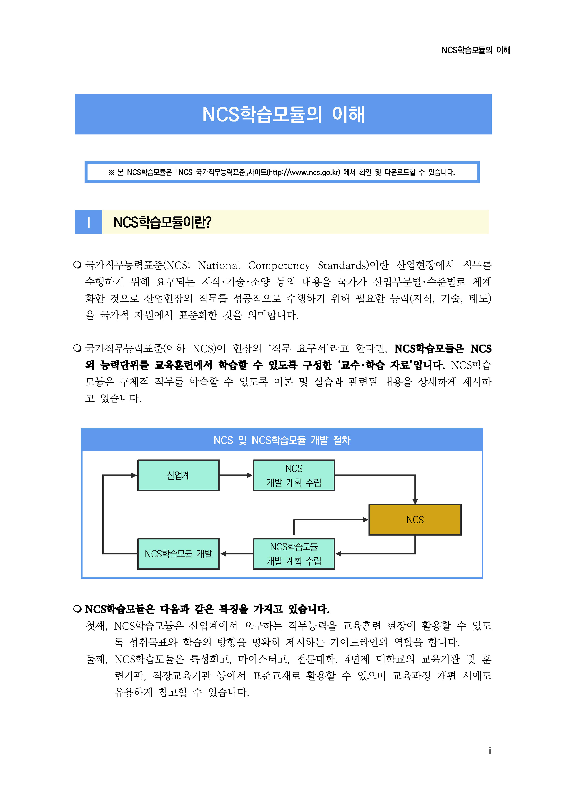
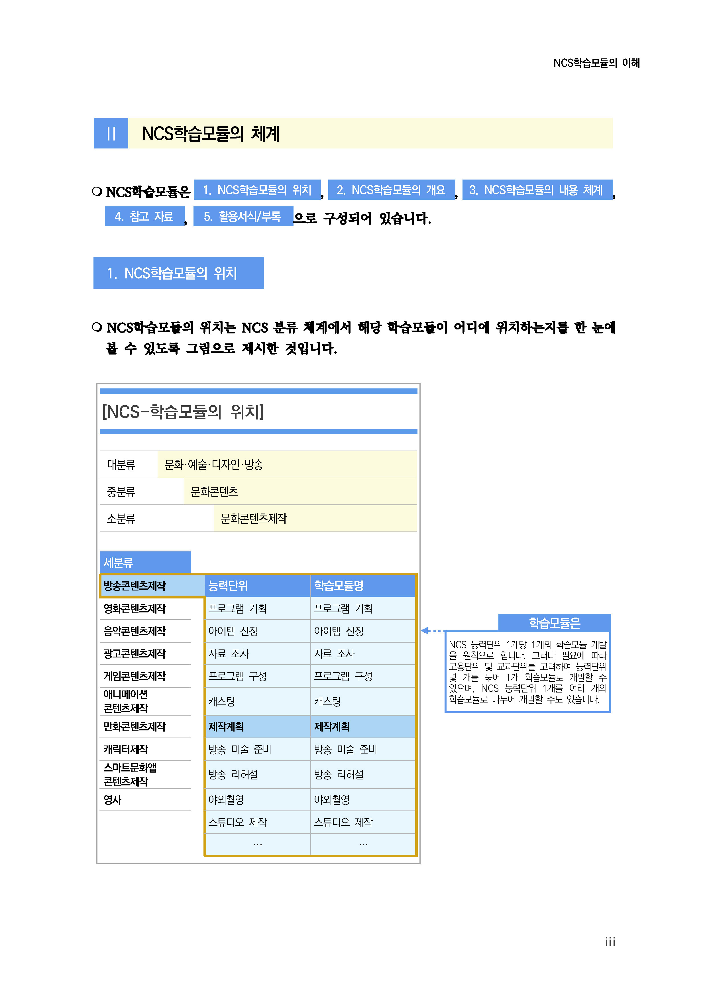
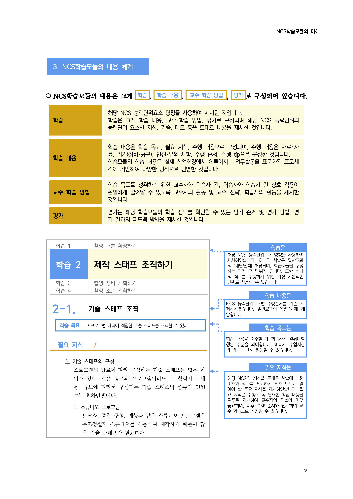
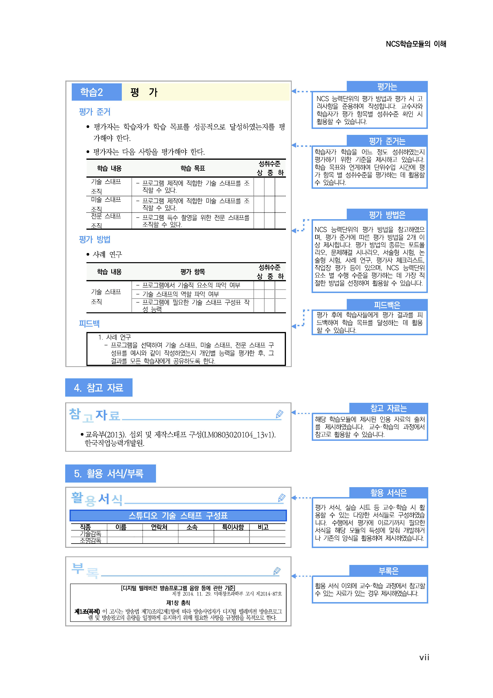

# LM2001020604_19v5_관리적+보안+구축

대분류/20
정보통신 중분류/01
정보기술 소분류/02
정보기술개발 세분류/06
보안엔지니어링 능력단위/04
NCS학습모듈
관리적 보안 구축
LM2001020604_19v5
[NCS학습모듈 활용 시 유의 사항]
1. NCS학습모듈은 교육훈련기관에서 출처를 명시하고 교육적 목적으로 활용할 수 있습니다. 다
만, NCS학습모듈에는 국가(교육부)가 저작재산권 일체를 보유하지 않은 저작물(출처가 표기된
도표‧사진‧삽화‧도면 등)이 포함되어 있으므로, 이러한 저작물의 변형‧각색‧복제‧공연‧
배포 및 공중 송신 등과 이러한 저작물을 활용한 2차적 저작물을 작성하려면 반드시 원작자
의 동의를 받아야 합니다.
2. NCS학습모듈은 개발 당시의 산업 및 교육 현장을 반영하여 집필하였으므로, 현재 적용되는
법령‧지침‧표준 및 교과 내용 등과 차이가 있을 수 있습니다. NCS학습모듈 활용 시 법령
‧지침‧표준 및 교과 내용의 개정 사항과 통계의 최신성 등을 확인하시기를 바랍니다.
3. NCS학습모듈은 산업 현장에서 요구되는 능력을 교육훈련기관에서 학습할 수 있게 구성한 자
료입니다. 다만, NCS학습모듈 지면의 한계상 대표적 예시(예: 활용도 또는 범용성이 높은 제
품, 서비스) 중심으로 집필하였음을 이해하시기를 바랍니다.

[NCS-학습모듈의 위치]

| 정보통신 |  |  |
| --- | --- | --- |
|  | 정보기술 |  |
|  |  | 정보기술개발 |

대분류
중분류
소분류
세분류

| SW아키텍처 |  |  | 능력단위 | 학습모듈명 |
| --- | --- | --- | --- | --- |
| 응용SW 엔지니어링 |  |  | 보안 구축 계획 수립 | 보안 구축 계획 수립 |
| 임베디드SW 엔지니어링 |  |  | 보안 구축 요구사항 분석 | 보안 구축 요구사항 분석 |
| DB엔지니어링 |  |  | 관리적 보안 구축 | 관리적 보안 구축 |
| NW엔지니어링 |  |  | 물리적 보안 구축 | 물리적 보안 구축 |
| 보안 엔지니어링 |  |  | 보안인증 관리 | 보안인증 관리 |
| UI/UX 엔지니어링 |  |  | SW개발 보안 구축 | SW개발 보안 구축 |
| 시스템SW 엔지니어링 |  |  | DB보안 구축 | DB보안 구축 |
| 빅데이터 플랫폼구축 |  |  | 시스템 보안 구축 | 시스템 보안 구축 |
| 핀테크 엔지니어링 |  |  | NW보안 구축 | NW보안 구축 |

데이터 아키텍처
IoT시스템연동
인프라스트럭쳐아
기텍처구축
클라우드솔루션아
키텍처
클라우드인프라스
트럭쳐엔지니어링
PaaS엔지니어링
차 례
학습모듈의 개요 1
학습 1. 정보보호 정책 수립하기
1-1. 정보보호 규정 수립 3
1-2. 정보보호 규정 이행 18
• 교수・학습 방법 29
• 평가 31
학습 2. 정보보호 조직 구성하기
2-1. 정보보호 조직 구성 33
2-2. 정보보호 담당자 평가 체계 수립 46
• 교수・학습 방법 54
• 평가 56
학습 3. 인적 보안 대책 수립하기
3-1. 정보보호 담당자 직무 수립 58
3-2. 인적 보안 절차 수립 71
• 교수・학습 방법 80
• 평가 82
참고 자료 84
활용 서식 85
관리적 보안 구축 학습모듈의 개요
학습모듈의 목표
정보보호 정책을 수립하고, 이를 시행 및 유지관리 할 수 있는 정보보호 조직을 구성하여, 조직의 인적 보
안을 관리할 수 있다.
선수학습
자산관리, 보안 구축 계획 수립(2001020601_19v5), 보안 구축 요구사항 분석(2001020603_19v5), 보안
인증 관리(2001020610_19v5), 위험 분석
학습모듈의 내용체계

| 학습 | 학습 내용 | NCS 능력단위 요소 |  |
| --- | --- | --- | --- |
|  |  | 코드번호 | 요소 명칭 |

1-1. 정보보호 규정 수립
1. 정보보호 정책
2001020604_19v5.1 정보보호 정책 수립하기
수립하기
1-2. 정보보호 규정 이행
2-1. 정보보호 조직 구성
2. 정보보호 조직
2001020604_19v5.2 정보보호 조직 구성하기
구성하기
2-2. 정보보호 담당자 평가 체계 수립
3-1. 정보보호 담당자 직무 수립
3. 인적 보안 대책 인적 보안 대책
2001020604_19v5.3
수립하기 수립하기
3-2. 인적 보안 절차 수립
핵심 용어
정보보호 정책, 정보보호 조직, 정보보호 담당자, 정보보호 책임자, 인적 보안, 보안 업무 역할과 책임, 절
차적 보안

| 학습 1 | 정보보호 정책 수립하기 |
| --- | --- |

학습 2 정보보호 조직 구성하기
학습 3 인적 보안 대책 수립하기
1-1.
정보보호 규정 수립
•조직의 보안요구사항에 따라 정보보호 활동을 규정한 정보보호 정책과 정책 시행을 위한 지침,
절차, 매뉴얼로 구분하여 제정할 수 있다.
학습 목표
•정기적인 정보보호 정책 및 정책 시행문서의 타당성 검토를 통해, 정보보호 정책에 미치는 영
향을 분석하고 필요한 경우 개정할 수 있다.
필요 지식 /
(cid:49684) 조직의 경영 목표
보안정책은 경영 목표에 부합이 되어야 하므로 조직의 경영 목표를 이해한다.
1. 경영 목표의 구성
일반적으로 경영 목표는 조직/사용자의 중장기 비전을 바탕으로 ‘전략’+‘영역’+‘방법’으로
구성된다.
(1) 비전(vision)
조직/사용자의 To-Be Model, 조직의 생존/발전을 위한 최종적인 청사진이다.
(2) 전략(strategy)
조직/사용자의 시장 및 경영 환경을 극복하기 위한 특성 및 경영 방향을 제시한다.
(3) 영역
To-Be Model에 도달하기 위한 사업 분야 및 직무, 업무 방식 및 절차를 정의한다.
(4) 방법
조직의 비전과 전략을 달성하기 위한 과정, 단계 및 방법을 결정한다.

출처: 교육부(2019). 관리적 보안 구축(LM2001020604_18v4). 한국직업능력개발원. p.04.
[그림 1-1] 경영 목표의 구성 사례
2. 경영 목표와 보안 목표와의 관계 및 보안 특성
(1) 경영 목표와 보안 목표와의 관계
보안 목표는 경영 목표 달성을 지원해야 하며, 경영 목표 달성을 저지하거나 방해하지
않아야 한다.
(2) 경영 목표의 영역에 대한 보안 특성
경영 목표의 영역에서 보안 특성은 조직 전체의 각 직무별 업무 영역, 업무 특성, 업무
절차, 그리고 각 업무에 따른 보안 요구사항을 나타낸다.

출처: 교육부(2019). 관리적 보안 구축(LM2001020604_18v4). 한국직업능력개발원. p.04.
[그림 1-2] 경영 목표와 보안 목표의 관계 사례
(cid:49685) 보안정책 수립 원칙
<표 1-1> 보안정책 수립 원칙 사례
No. 보안정책 수립 원칙
1. 설계 및 구현을 지원할 수 있는 구체적인 정책 수립
2. 조직/사용자의 모든 보안 환경에 적용
3. 보안정책에 의해 통제를 받게 되는 범위의 명확한 구분
4. 보안정책에 의한 통제를 받는 조직/사용자의 보안 수준 조사
5. ...
출처: 교육부(2019). 관리적 보안 구축(LM2001020604_18v4). 한국직업능력개발원. p.05.
(cid:49686) 문서 작성 지침
정책, 절차, 매뉴얼 작성 시 조직에 적용되는 문서 작성 지침(document convention)으로 조
직 내 각종 업무 내용 및 결과를 문서화할 때 적용된다.
1. 문서 작성 지침에 기술된 문서 구조
문서가 목표로 하는 내용을 구조화하기 위한 목차 구성 및 단락 구성 방법, 내용 전개 방식
등의 문서 구성 방법을 나타낸다.
<표 1-2> 문서 작성 지침 사례
목차 수준 표기법
• 문서 목적 설명 • 글자: 굴림체(한글, 영문 모두), 14pt, 진하게
• 단락 요약 • 단락: 좌여백 30pt
제목 1 • 최상위 기능 설명 • 번호 넣기: ex) 2.
• FAQ, QnA • Tab: 총 2개, 30pt, 15.64cm
• 부록 • ...
• 문서 목적 내용 • 글자:
• 상위 레벨 단락 굴림체(한글, 영문 모두), 13pt, 진하게
설명 • 단락: 좌여백 37pt
제목 2
• 상위 레벨 기능 • 번호 넣기: ex) 3.4
설명 • Tab: 총 2개, 37pt, 15.64cm
• ... • ...
... ... ...
출처: 교육부(2019). 관리적 보안 구축(LM2001020604_18v4). 한국직업능력개발원. p.05.
2. 문서 작성 시 각 내용별 작성해야 할 수준
문서 열람자에게 요구되는 배경 지식에 대한 수준에 따라 작성한다.
3. 문서에 사용될 수 있는 글자, 문장, 특수 문자, 수학 공식, 표, 그림 등에 대한 표현 방법
<표 1-3> 문서 표현 방법 사례
종류 수준
• 사진: 흑백, 256색 이하
• Caption 위치: 좌하단, 제목 1 수준 독립적 Numbering
그림
• Caption Font: 맑은 고딕(한글, 영문), 8pt, 왼쪽 맞춤(1줄 이하)
• ...
• 첫줄: 10pt, 진하게, 중앙 정렬
표 • Caption 위치: 좌하단, 제목 1 수준 독립적 Numbering
• ...
출처: 교육부(2019). 관리적 보안 구축(LM2001020604_18v4). 한국직업능력개발원. p.06.
수행 내용 / 정보보호 규정 수립하기
재료·자료
• 정보보호 정책, 표준, 지침, 절차
• 정보보호 관리 체계에 관한 국제 표준 규격(ISO27001)
• 정보보호 관리 체계(ISMS)
• 개인정보보호 관리 체계(PIMS)
기기(장비･공구)
• 전산 장비: 인터넷, 컴퓨터, 프린터, 복사기, 빔 프로젝터 등
• 지원 도구: 문서 작성 도구
• 화이트보드
안전･유의 사항
• 정보보호 정책 수립 시 보안 원칙에 위배될 경우에는 경영 목표 달성을 저해하거나 무의미
한 정책이 될 수 있으므로 보안 원칙에 대한 면밀한 검토가 필요하다.
• 조직의 규모 및 업무 범위, 분야의 특성에 따라 관리적인 보안 구축 범위는 상이할 수 있으
므로, 관리적 보안 구축 진행 이전 단계에서 보안 환경에 대한 정확한 이해가 필요하다.
• 관리적 보안 구축은 기술적 보안 및 물리적 보안을 바탕으로 구축되므로, 사전 보안 기술
및 물리적 보안에 대한 이해가 필요하다.
• 정보보호 전략과 IT 전략은 대상 조직의 유형과 사업 성격에 따라 상이할 수 있다.
수행 순서
(cid:49684) 정보보호 정책을 수립한다.
1. 조직의 경영 목표에서 전략과 영역, 방법을 도출한다.
경영 목표를 분해하여 ‘전략’, ‘영역’, ‘방법’으로 구분한다.
<표 1-4> 경영 목표에 따른 전략, 영역, 방법 도출 사례
경영 목표 전략 영역 방법
내부 수행 업무 효율성 향상
지원 제도 활용
지원 제도 활용
및 자원 재사용을 해외/무역 업무 법령 준수
통한 비용 절감
자원 재사용 내부 지원 시스템 구축 비용 절감
... ... ...
출처: 교육부(2019). 관리적 보안 구축(LM2001020604_18v4). 한국직업능력개발원. p.07.
2. 도출된 전략 및 방법을 바탕으로 정보보호 목표를 수립한다.
경영 목표에서 도출된 영역에서 발생할 수 있는 정보보호 특성과 달성 방법을 도출한다.
(1) 경영 목표를 분해하여 도출된 영역에 필요한 지원 항목을 도출한다.
(2) 각 지원 항목별 수행 방식을 도출한다.
(3) 수행 방식별 요구되는 보안요구사항을 도출한다.
(4) 보안요구사항을 달성할 수 있는 방법을 도출한다.
<표 1-5> 정보보호 목표 수립 사례
영역 지원 항목 수행 방식 보안요구사항 특성 달성 방법
내부 수 정보 제공의 정확성 보장
정보 제공
행 업무 제공 정보의 추적성 확보
절차 준수 확인
절차 준수 준수 절차에 대한 책
확보
임
... ... ... ... ...
출처: 교육부(2019). 관리적 보안 구축(LM2001020604_18v4). 한국직업능력개발원. p.08.
3. 정보보호 목표 및 정보보호 원칙을 바탕으로 정보보호 정책을 수립한다.
(1) 정보보호 목표를 기술한다.
<표 1-6> 정보보호 목표 사례
2.3 정보보호 목표
경영 목표를 달성하기 위한 정보보호 목표는 다음과 같다.
1. 기업 내부로 유입되는 정보 및 외부로 유출되는 정보에 대해서는 정보의 정확성을 보장해야
한다.
2. 수신/제공하는 정보는, 정보 제공자와 제공 시점을 추적할 수 있어야 한다.
3. 제공 및 활용하기 위한 정보는 적시에 활용될 수 있어야 한다.
(2) 정보보호에 관련된 업무 범위를 기술한다.
(가) 물리적인 업무 영역을 기술한다.
조직에서 활용 중인 업무 공간 및 시설, 기기 등을 조사한다. 조직 내부의 업무 공간뿐
만 아니라 기업 정보를 다루는 조직 외부에 존재하는 시설/기기/장소를 모두 포함한다.
(나) 기술적인 업무 영역을 기술한다.
업무에 적용되고 있는 정보기술 및 지원 기술 및 응용 기술을 조사한다. 기업 정보
를 다루는 정보 시스템과 화재/수해/도난 방지 등에 적용되는 기술 및 직원 간 통
신, 정보 전달 방법 등을 모두 포함한다.
(다) 관리적인 업무 영역을 기술한다.
조직 내 인력 관리(인사/교육/복지 등) 및 총무(자산/재무/저작권 등), 업무적인 절차
(업무 개시/결재/참조/종료/보고/결과 보관 등), 조직 구성 방법, 조직에 대한 평가,
외부 협력 관계 등을 모두 포함한다.
<표 1-7> 정보보호 업무 영역 사례
3.2 정보보호 범위
정보보호 목표 달성을 위한 정보보호 업무 범위는 다음과 같다.
3.2.1 물리적인 업무 영역
1. 기업 사무실 소재지 및 상품 생산 기지, 상품 적재 창고
2. 업무 장소 내 존재하는 각종 사무기기 및 상품 생산 기기, 상품, 시설 등
3. 업무에 사용되는 정보 시스템 등
3.2.2. 기술적인 업무 영역
1. 각종 법/재무 및 기업 영업적 정보
2. 상품 개발/생산에 관련된 기밀 정보
(3) 정보보호 관련 업무를 수행할 담당자/담당 조직의 임무, 구성, 담당자별 역할에 대해 명시한다.
(가) 정보보호 조직에 대한 최고책임자를 선정한다.
(나) 정보보호 최고책임자에 의해 정보보호 업무 범위 및 업무 수준을 식별한다.
(다) 식별된 업무 범위 및 업무 수준에 따른 직무를 결정하고, 직무별 필요 지식/기술/경험을
도출한다.
(라) 도출된 지식/기술/경험을 바탕으로 정보보호 담당자를 선발한다.
(마) 선발된 정보보호 담당자에게 역할과 임무를 지정하고, 해당 내역을 정보보정책에 명시한다.
<표 1-8> 정보보호 조직 명시 사례
3.3 정보보호 지원
경영 목표 및 정보보호 목표를 달성하기 위해, 최고 경영위원회는 정보보호 관련 업무를 담당할
전문 조직을 수립할 수 있다.
3.3.1 정보보호 조직의 임부
정보보호 조직은, 전사 업무에 대한 보안 유지 및 보안 침해사고 대응, 정보 유출 방지 등의 정보
보호 전반에 관한 업무를 담당한다.
3.3.2 정보보호 조직의 구성
(4) 정보보호 관련 업무에 대한 상벌 근거 조항을 산출한다.
(가) 정보보호 관련 업무 수행 평가 대상 직무를 선정한다.
(나) 정보보호 관련 업무 수행 평가에 따른 만족 기준 및 방법을 선정한다.
(다) 정보보호 관련 업무 평가 및 상벌 적용 방안을 수립한 후, 해당 내용을 정보보호 정책에
명시한다.
<표 1-9> 정보보호 상벌 근거 사례
4.2 상벌 조항
정보보호 업무에 공헌하거나 위해를 끼친 임직원에 대하여, 정보보호 조직은 해당 직원에 대해
포상하거나 처벌을 최고 임원회에 건의할 수 있다.
4.2.1 포상
1. 업무의 정보보호 업무 유지에 공헌
2. 정보 침해 사건에 대한 적절한 대응 등
4.2.2 처벌
1. 중요 정보의 유출
2. 심각한 오류가 있는 정보의 제공에 의한 손실 발생 등
(5) 구체적인 시행 지침 산출/적용에 대한 근거 조항을 산출한다.
(가) 정보보호 정책에 따른 시행 지침 대한 근거를 제정(작성)한다.
(나) 정보보호 시행 지침의 적용 근거를 도출한다.
(다) 정보보호 시행 적용 적합성 평가를 위한 감사 규정을 신설한다.
(라) 정보보호 시행 적용 적합성 평가를 위한 절차를 수립한다.
<표 1-10> 정보보호 시행 지침 제정 근거 사례
3.3.3 정보보안 시행 지침의 적용
정보보안 조직은, 정보보안 업무 수행을 위해 필요시 정보보안 업무 수행을 위한 지침을
제정/공표하여 전사에 적용할 수 있다.
3.3.3.1 정보보호 시행 지침의 제정
정보보호 시행 지침은, 정보보호 최고책임자에 의해 수립되며, 전사 정보보호 업무를 위한 기본적인
수행 방법을 제시할 수 있다.
3.3.3.2 정보보호 시행 지침의 적용
정보보호 시행 지침이 적용되면, 시행 지침 내에 제시된 기일까지 수행 방법을 구현/구축을
완료하여야 한다.
3.3.3.3 정보보호 시행 지침에 대한 감사
수행 tip
•조직의 규모, 정보 수준, 업무 분야, 문서 작성 지침 등의
조직 특성에 따라 정보보호 정책 구성은 상이할 수 있다.
(cid:49685) 정보보호 시행 지침을 수립한다.
1. 정보보호 정책에 기술된 정보보호 범위의 각 항목에 대하여 전사 업무를 분석한 후 적용 대상을
식별하고 이에 대한 보안 환경을 정의한다.
(1) 전사 업무 범위에서 정보보호 업무 범위에 해당하는 영역을 식별한다.
(2) 전체 정보보호 업무 범위에 대하여 각 영역별 사용되는 산출물을 조사한다.
(3) 조사된 산출물에 따라 정보보호 대상 산출물 여부를 식별한다.
(4) 산출물이 저장/사용/전송되는 보안 환경을 도출한다.
<표 1-11> 보안 적용 대상 식별 및 보안 환경 정의 사례
정보보호 범위 보안 적용 대상 산출물 보안 환경
정보 시스템 저장
상품 설계서 및 도면 내부 정보 유통
외부 유출 불가
정보 시스템 저장
내부 정보 유통
상품 개발/생산에 관련된 정보 외부 유출 불가
상품 생산 기계 도면
도면 출력 가능
도면 출력 복사본 생성 가능
출력 도면 유출 가능
정보 시스템 저장
상품 구성 부품 명세서
....
... ... ...
출처: 교육부(2019). 관리적 보안 구축(LM2001020604_18v4). 한국직업능력개발원. p.12.
2. 적용 대상에 대한 생명주기를 도출한다.
(1) 적용 대상에 대한 취급 업무를 식별한다.
(가) 보안 적용 대상 산출물에 대한 보안 환경을 단위 업무를 기준으로 순차적으로 분할한다.
(나) 분할된 단위 업무에 따른 취급 업무 방식을 도출한다.
<표 1-12> 보안 적용 대상에 대한 취급 업무 식별 사례
적용 대상 취급 업무
상품 설계서 및 도면 생성, 변경, 삭제, 파기
상품 생산 기계 도면 생성, 변경, 삭제, 파기, 출력, 파쇄
상품 구성 부품 명세서 생성, 변경, 삭제, 파기, 출력
... ...
출처: 교육부(2019). 관리적 보안 구축(LM2001020604_18v4). 한국직업능력개발원. p.12.
(2) 취급 업무에 대한 시작 시점과 종료 시점을 정의한다.
(가) 보안 적용 대상 산출물에 대한 단위 업무 수행 주체를 조사한다.
(나) 보안 적용 대상 산출물에 대한 단위 업무의 수행 과정을 조사한다.
(다) 단위 업무의 수행 과정상 다른 주체가 개입할 경우, 해당 과정을 별도의 단위 업무로 도
출한다.
(라) 수행 과정상에서 나타나는 단위 업무의 시작/종료 시점을 명시한다.
<표 1-13> 취급 업무별 주체, 시작/종료 시점 정의 사례
적용 대상 취급 업무 주체 시작/종료
생성 개발자 생성, 저장소 저장
상품 설계서 및 도면 변경 개발자 저장소 접근, 수정 후 저장소 저장
삭제 개발자 저장소 접근, 저장소 삭제
... ... ...
출처: 교육부(2019). 관리적 보안 구축(LM2001020604_18v4). 한국직업능력개발원. p.13.
(cid:49686) 정보보호 절차를 수립한다.
1. 정보보호 적용 대상 담당자를 식별한다.
2. 정보보호 적용 대상 담당자의 업무 수행 절차를 조사한다.
3. 조사된 업무 수행 과정상 적용되는 정보보호 지원 기술이나 솔루션/절차를 조사하고 적용 시점을
도출한다.
4. 정보보호 시행 지침에 기술된 정보보호 기술을 구현/적용하기 위한 기술이나 솔루션을 선택한다.
<표 1-14> 정보보호 기술/솔루션 선정 사례
적용 대상 취급 업무 기법 정보보호 기술/솔루션
저장 시 암호화
생성
생성 시 형상 기록
접근 통제 저작권 관리 시스템
상품 설계서 및 도면 변경 변경 시 형상 기록 (DRM: digital rights
저장 시 암호화 management)
접근 통제
삭제
삭제 시 형상 기록
... ... ...
출처: 교육부(2019). 관리적 보안 구축(LM2001020604_18v4). 한국직업능력개발원. p.13.
5. 정보보호의 구현/적용을 위해 선택된 기술 적용 절차를 도출한다.
개발자
사용자
로그인 성공 일부 항목 생성/선택

| 암호화된정보에 접근 | 생성/수정 암호화 |
| --- | --- |
|  | 생성/수정 완료 |

|  | 생성/수정 후암호화 저장, 삭제 |  |
| --- | --- | --- |

로그인
(접근 통제)
로그인 실패

| Version별형상 기록 | 수정 계속 |
| --- | --- |
| 형상 기록 | 수정 계속 |

종료
형상 기록
출처: 교육부(2019). 관리적 보안 구축(LM2001020604_18v4). 한국직업능력개발원. p.14.
[그림 1-3] 정보보호 기술 적용 절차 도출 사례
6. 산출된 정보보호 지원 기술 적용 시점을 종합하여 정보보호 절차를 산출한다.
7. 수립된 정보보호 절차별 산출물을 정의한다.
<표 1-15> 정보보호 업무 적용 산출물 사례
6. 기밀 정보의 취급
...
6.3 상품 설계서 및 도면 정보
상품 설계서 및 도면 정보를 취급하는 담당 개발자 및 사용자는, 해당 정보에 대한 기밀 정보 유출
방지를 위해 다음과 같이 취급한다.
1. 설계서 및 도면에 대한 Digital 정보는 암호화하여 전송/저장한다.
2. 설계서 및 도면에 대한 Digital 정보는 개발자/사용자 시스템에 저장할 수 없으며, 지정된 저
장소에만 저장한다.
3. 설계서 및 도면에 대한 변경 시, 매 변경에 대한 변경 내역을 기록하여야 한다.
4. 설계서 및 도면에 대한 Digital 정보에 대한 접근은, 제한된 인원만이 접근할 수 있다.
5. 출력된 설계서 및 도면은 매 출력 및 파쇄 시, 출력물 관리 대장에 기록한다.
출처: 교육부(2019). 관리적 보안 구축(LM2001020604_18v4). 한국직업능력개발원. p.14.
(cid:49687) 정보보호 매뉴얼을 작성한다.
1. 조직에 적용 중인 매뉴얼 작성 지침을 조사한다.
2. 작성이 완료된 정보보호 매뉴얼을 열람할 대상자를 선정하고, 대상자의 정보보호 수준을 조사한다.
3. 매뉴얼 작성 지침에 따라, 정보보호 매뉴얼의 단락 작성 순서를 결정한다.
4. 단락별 작성 순서에 따라 문서 구조 및 사용 용어를 작성한다.
5. 정보보호 매뉴얼의 문서 목적 및 문서 구성을 기술한다.
6. 정보보호 업무를 서술하고, 업무 범위, 정보보호 조직을 기술한다.
7. 전체 정보보호 업무를 단위 업무로 분할하여, 단위 업무별 업무 절차를 기술한다.
<표 1-16> 단위 업무별 업무 절차 사례
7. 도면 File의 생성 및 저장, 삭제
7.1 도면 File의 생성
1. 도면 File의 생성은 A-DRM 제품을 통해, 저장소에서 직접 생성한다.
2. A-DRM의 사용자 Console을 사용하여 로그인한 후 나타나는 탐색창에서 생성할 도면 File
의 위치를 선택 후 ‘생성하기’를 선택한다.
3. ‘생성하기’ 과정 중에는 도면 생성에 대한 이력 입력을 요구하며, 해당 이력을 입력해야만
도면 File 생성을 완료할 수 있다.
7.2 도면 File의 수정
출처: 교육부(2019). 관리적 보안 구축(LM2001020604_18v4). 한국직업능력개발원. p.15.
(cid:49688) 정기적인 정보보호 정책 및 정책 시행문서의 타당성을 검토한다.
1. 정보보호 정책 및 정책 시행문서 적용에 대한 가상 시뮬레이션을 실행한다.
(1) 정보보호 정책 및 시행문서 가상 적용을 위한 대상을 선정한다.
(2) 선정된 대상의 업무 수행 절차와 방법을 조사한다.
(3) 선정된 대상에 대해 정보보호 정책 및 시행문서에 나타난 지침을 적용시킨 변경된 업무 수행
절차를 도출한다.
(4) 변경된 업무 수행 절차에 따른 변경 업무 방법을 도출한다.
(5) 변경된 업무 방법에 대하여 실제 적용 대상으로부터 평가를 받는다.
2. 파일럿(pilot) 시뮬레이션을 모니터링하고 그 결과에 대해 타당성을 검토한다.
(1) 변경된 업무 방법에 대한 평가 결과를 반영한 업무 수행 절차 및 방법을 도출한다.
(2) 도출된 업무 수행 절차 및 방법을 실제 적용 대상으로부터 평가받는다.
(3) 업무 수행 절차 및 방법의 수정과 실제 적용 대상으로부터의 평가를 반복하여 타당성을 검토
한다.
<표 1-17> 정보보호 정책/시행문서 타당성 검토 사례
적용 대상 취급 업무 기법 시뮬레이션 결과
저장 시 암호화
생성 적합
생성 시 형상 기록
접근 통제
변경 변경 시 형상 기록 적합
상품 설계서 및 도면
저장 시 암호화
부적합
접근 통제
삭제 삭제 시, 해당 파일이 삭제되
삭제 시 형상 기록
어 복원 불가
... ... ... ...
출처: 교육부(2019). 관리적 보안 구축(LM2001020604_18v4). 한국직업능력개발원. p.16.
(cid:49689) 정보보호 정책 및 정책 시행문서에 미치는 영향을 분석하고 필요시 개정한다.
1. 시뮬레이션에 의한 타당성 검토 결과를 정책 시행문서와 비교 분석한다.
정보보호 정책 및 시행문서에 기술된 시행 방식을 적용한 업무 절차 및 방법 적용에 대한
타당성 분석 결과를 조사한다.
2. 분석된 정책 시행문서의 수정 여부를 판단한다.
변경 업무 절차 및 업무 방법이 정책 시행문서에 기술된 사항에 포함되는지를 조사한다.
<표 1-18> 정보보호 정책/시행문서 수정 여부 판단 사례
적용 대상 취급 업무 시뮬레이션 결과 정책 시행문서 수정 여부
생성 적합 N/A
상품 설계서 및 도면 변경 적합 N/A
삭제 부적합 수정 필요
... ... ... ...
출처: 교육부(2019). 관리적 보안 구축(LM2001020604_18v4). 한국직업능력개발원. p.16.
3. 판단된 정책 시행문서 수정 여부에 따라 정책 시행문서를 수정한다.
(1) 변경 업무 절차 및 업무 방법이 정책 시행문서에 기술된 사항에 위배될 경우, 해당 항목을
수정한다.
(2) 변경 업무 절차 및 업무 방법이 정책 시행문서에 기술된 사항에 위배되지는 않지만 특정 항
목에 포함되지 않을 경우, 시행 항목을 추가한다.
<표 1-19> 정책 시행문서 변경-추가 사례
6.3 상품 설계서 및 도면 정보
상품 설계서 및 도면 정보를 취급하는 담당 개발자 및 사용자는, 해당 정보에 대한 기밀 정보 유출
방지를 위해 다음과 같이 취급한다.
1. 설계서 및 도면에 대한 Digital 정보는 암호화하여 전송/저장한다.
2. 설계서 및 도면에 대한 Digital 정보는 개발자/사용자 시스템에 저장할 수 없으며, 지정된 저
장소에만 저장한다.
3. 설계서 및 도면에 대한 변경 시, 매 변경에 대한 변경 내역을 기록하여야 한다.
4. 설계서 및 도면에 대한 Digital 정보에 대한 접근은, 제한된 인원만이 접근할 수 있다.
5. 출력된 설계서 및 도면은 매 출력 및 파쇄 시, 출력물 관리 대장에 기록한다.
6. 설계서 및 도면에 대한 Digital 정보는 Version 정보 삭제 시에도 형상 관리를 유지해야 한다.
출처: 교육부(2019). 관리적 보안 구축(LM2001020604_18v4). 한국직업능력개발원. p.17.
4. 분석된 검토 결과에 따라 정보보호 정책을 개정한다.
(1) 정보보호 정책 시행문서의 변경 사항이 정보보호 정책의 특정 항목에 포함되는지를 조사한다.
(2) 정보보호 정책 시행문서의 변경 사항이 정보보호 정책의 전체 항목에 위배될 경우, 정보보호
정책 항목을 수정한다.
(3) 정보보호 정책 시행문서의 변경 사항이 정보보호 정책의 특정 항목에 포함되지 않을 경우,
정보보호 정책 항목을 추가한다.
<표 1-20> 정보보호 정책 수정 필요 판단 사례
적용 대상 취급 업무 정책 시행문서 수정 정책 시행문서 수정 적합 여부
생성 N/A
상품 설
명서 및 변경 N/A
도면
삭제 수정 필요 OK
... ... ...
출처: 교육부(2019). 관리적 보안 구축(LM2001020604_18v4). 한국직업능력개발원. p.17.
수행 tip
•정보보호 정책은 정보보호에 대한 최상위 지침으로 경영
목표의 변경이나 정보보호 업무 수행에 대한 근거가 변경
되는 등 제한된 사유에 의해서 변경된다.
•‘정보보호 기술’ 수준이 변경될 경우에는 정보보호 정책은
변경되지 않는다.
1-2.
정보보호 규정 이행
•정보보호 정책 및 정책 시행문서에서 정한 정보보호 활동 수행을 통해 운영 기록을 생성하여
학습 목표
유지할 수 있다.
필요 지식 /
(cid:49684) 정보보호 정책
정보보호 활동에 대한 수행 근거가 명시된 정보보호 정책 내용을 이해한다. 정보보호 정책에는
다음의 내용이 기술되어 있으며, 각 내용 및 내용 간의 관계를 정확히 이해한다.
1. 정보보호 활동에 대한 근거
2. 정보보호 활동에 대한 업무 범위
3. 정보보호 활동 수행 시 적용되는 이해관계자
4. 정보보호 활동 후 후속 연계되는 연관 업무
<표 1-21> 정보보호 정책 사례
3.3.1 정보보호 조직의 임무
정보보호 조직은, 전사 업무에 대한 보안 유지 및 보안 침해사고 대응, 정보 유출 방지 등의 정보
보호 전반에 관한 업무를 담당한다.
1. 정보보호 관련 업무를 정착하고, 필요한 체계를 구축한다.
2. 주기적인 정보보호 실태를 조사하고, 이를 분석하여 개선한다.
3. 정보보호 활동 조사를 통해, 포상/처벌 대상 직원을 추천한다.
4. ...
출처: 교육부(2019). 관리적 보안 구축(LM2001020604_18v4). 한국직업능력개발원. p.19.
(cid:49685) 정보보호 시행 지침
정보보호 정책의 실행을 위한 정보보호 시행 지침에는 정보보호 정책에서 기술할 수 없는 구체
적인 업무 범위 및 대상, 업무 수행자, 절차, 산출물 등이 기술되어 있다.
1. 정보보호 활동 대상 업무 범위와 업무 수행자, 산출물 간의 관계
(1) 정보보호 활동 대상이 되는 구체적인 업무 범위
(2) 정보보호 활동 대상이 되는 업무 범위에 대한 업무 수행 담당자
(3) 정보보호 활동 대상이 되는 업무에 적용되는 지원 기술과 지원 방식
<표 1-22> 정보보호 업무 대상 사례
3.6.2 정보보호 업무 대상
정보보호 업무는 다음의 업무를 분기별로 1회씩 점검한다.

| 관련 업무 | 상세 업무 | 대상 |
| --- | --- | --- |
| 인사 | 휴가 현황 점검 | 휴가 처리 시스템/총무 팀 |
| 인사 | 출퇴근 현황 점검 | 출퇴근 처리 시스템/총무 팀 |
|  | ... | ... |
| 총무 | 자산 관리 실태 조사 점검 | 자산 대장 |
|  | ... | ... |

출처: 교육부(2019). 관리적 보안 구축(LM2001020604_18v4). 한국직업능력개발원. p.20.
2. 정보보호 활동에 대한 업무 절차
(1) 정보보호 활동 대상 업무 수행의 시작과 종료 시점
(2) 정보보호 활동 대상 업무의 수행 과정(업무 이관 방식, 결재 경로 등)
(3) 정보보호 활동 대상 업무의 수행 과정에 적용되는 지원 시스템의 활용 방식
<표 1-23> 정보보호 활동 업무 절차 사례
3.3.1 정보보호 업무 수행 절차
정보보호 업무(감사, 점검 등) 수행은 다음과 같은 절차에 의해 수행한다.
1. 이해관계자에게 수행 대상 업무 내용과 대상 시스템, 기간, 실행자 정보 등에 대한 내용을
구체적으로 통보한다.
2. 정보보호 업무 수행 이전 담당자와 협의하여 충분한 준비 기간을 제공한다.
3. 정보보호 업무 수행 중 필요한 인력/기기/정보에 대해서만 처리하며, 업무 범위를 초과한 대
상에 대해서는 간섭하지 않는다.
출처: 교육부(2019). 관리적 보안 구축(LM2001020604_18v4). 한국직업능력개발원. p.20.
3. 정보보호 활동 대상 업무의 산출물
(1) 정보보호 활동 대상 업무에 적용되는 산출물의 종류
<표 1-24> 정보보호 활동에 의한 산출물 지정 사례
3.6.5 정보보호 업무 수행 산출물
정보보호 업무 수행 후에는, 업무 수행 항목별 다음과 같은 산출물을 등록/보관한다.
등록된 산출물은 최소 5년간 보관/유지한다.

| 관련 업무 | 상세 업무 | 산출물 |
| --- | --- | --- |
| 인사 | 휴가 현황 점검 | 휴가자 현황 점검 결과서 |
| 인사 | 출퇴근 현황 점검 | 출퇴근 현황 점검 결과서 |
|  | ... | ... |
| 총무 | 자산 관리 실태 조사 점검 | 자산 관리 실태 조사 결과서 |
|  | ... | ... |

출처: 교육부(2019). 관리적 보안 구축(LM2001020604_18v4). 한국직업능력개발원. p.21.
(2) 정보보호 활동 대상 업무에 적용되는 산출물의 양식
<표 1-25> 단위 업무별 산출물 사례

| 담당 | 팀장 | 부서장 |
| --- | --- | --- |

휴 가 원
작성자 : _________________/________(성명/직위)
작성일 : _______년 ____월 ____일
참 조 : _______________________
휴가일 : _______년 ____월 ____일 ~ _______년 ____월 ____일 ( ____일)
제 목 :
상기명 본인은, ______________________ 사유에 의한 휴가원을 제출합니다.
출처: 교육부(2019). 관리적 보안 구축(LM2001020604_18v4). 한국직업능력개발원. p.21.
(3) 산출물의 최초 생성 담당자 및 산출물 전달/수신/전송에 관계된 이해관계자
(4) 정보보호 활동 대상 업무에 적용되는 산출물의 보관/파기 방법
(5) 정보보호 활동 대상 업무에 적용되는 산출물의 지원 시스템에 적용되는 방식
수행 내용 / 정보보호 규정 이행하기
재료·자료
• 정보보호 정책, 표준, 지침, 절차
• 정보보호 관리 체계에 관한 국제 표준 규격(ISO27001)
• 정보보호 관리 체계(ISMS)
• 개인정보보호 관리 체계(PIMS)
기기(장비･공구)
• 전산 장비: 인터넷, 컴퓨터, 프린터, 복사기, 빔 프로젝터 등
• 지원 도구: 문서 작성 도구
• 화이트보드
안전･유의 사항
• 이 능력 단위는 보안엔지니어링을 위한 관리적 보안 구축을 위해 적용한다.
• 조직의 규모 및 업무 범위, 분야의 특성에 따라 관리적인 보안 구축 범위는 상이할 수 있으
므로, 관리적 보안 구축 진행 이전 단계에서 보안 환경에 대한 정확한 이해가 필요하다.
• 정보보호 전략과 IT 전략은 대상 조직의 유형과 사업 성격에 따라 상이할 수 있다.
• 조직의 정보보호 전략 및 정책에 의해 정보보호 이행 절차가 과도할 수 있다.
• 효과적으로 수립된 업무 절차는 업무 이해관계자가 정보보호 절차가 자연스럽게 적용되고
있음을 인식하지 못할 수 있다.
수행 순서
(cid:49684) 정보보호 활동을 준비한다.
1. 정보보호 활동 수행을 위한 대상 업무와 산출물, 이해관계자를 조사한다.
(1) 정보보호 활동 수행을 위한 대상 업무를 지정하고 해당 업무의 담당자를 확인한다.
(2) 지정된 대상 업무에 관련된 산출물의 종류 및 보관 방식, 보관된 분량을 조사한다.
<표 1-26> 정보보호 활동 점검 항목 사례

| No. | 점검 항목 | 비고 |
| --- | --- | --- |

1. 휴가원 제출/실제 휴가 일치 여부 점검
2. 휴가원 취소 현황 조사 휴가원 제출 후 출근한 경우
3. 휴가원 제출 서류 보관 상태 점검
4. 기타 휴가원 활용에 대한 개선 사항 점검
5. ... ...
출처: 교육부(2019). 관리적 보안 구축(LM2001020604_18v4). 한국직업능력개발원. p.24.
(3) 지정된 대상 업무에 연관된 이해관계자를 조사한다.
2. 정보보호 활동에 대한 범위를 확정하고 일정을 수립한다.
(1) 대상 업무의 수행 절차 및 방법, 산출물 종류, 보관 분량을 기준으로 정보보호 활동 범위를
확정한다.
(2) 확정된 정보보호 활동 범위를 바탕으로 수행 기간을 산정한다.
(3) 대상 업무 담당자와 협의하여 일정을 수립한다.
<표 1-27> 정보보호 활동 계획서 사례
휴가원 점검 계획서

| 항목 | 내용 | 비고 |
| --- | --- | --- |
| 일시 | 2013년 7월 4일 ~ 5일 (2일간) |  |
| 장소 | N/A(정보보호 담당자가 직접 진행) |  |
| 대상 | 대상 직원: 전체 직원 | 필요시 담당자에 게 질의/응답 실 시 가능 요청 시 전달 |
|  | 관계 부서: 인사 팀- 담당 팀장: 강감찬 부장- 담당자: 홍길동 대리 | 필요시 담당자에게 질의/응답 실시 가능 |
|  | 관계 정보 시스템:- 휴가 등록 시스템- 출퇴근 기록 시스템 |  |
|  | 관계 서류: 휴가원(2013년 2분기분 전체) | 요청 시 전달 |

출처: 교육부(2019). 관리적 보안 구축(LM2001020604_18v4). 한국직업능력개발원. p.23.
3. 정보보호 활동 실행을 위한 목표 업무와 수행 방법을 도출한다.
(1) 정보보호 활동의 수행 내역을 도출한다.
(가) 정보보호 활동 업무 범위를 바탕으로 실제 정보보호 담당자가 수행해야 할 업무 항목을
도출한다.
(나) 수행 예정 업무 항목별 참고 사항이 있을 경우에는 해당 항목별 내용을 기재한다.
(2) 정보보호 활동의 수행 방법을 도출한다.
(가) 도출된 정보보호 담당자의 수행 업무 항목별 수행 방법을 도출한다.
(나) 도출된 수행 방법을 시뮬레이션하여 해당 방법을 검증한다.
(다) 검증이 완료된 수행 방법을 확정한다.
<표 1-28> 정보보호 활동 점검 방법 도출 사례

| No. | 점검 항목 | 비고 |
| --- | --- | --- |

휴가원 제출/실제 휴가 일치 여부 휴가원 제출 서류와 휴가 등록 시스템, 출퇴근 기
1.
점검 록 시스템과 일치성 확인
휴가원 제출 서류와 휴가 등록 시스템, 출퇴근 기
2. 휴가원 취소 현황 조사
록 시스템과 불일치 항목 조사
2분기 휴가원 제출 서류와 휴가 등록 시스템과의
3. 휴가원 제출 서류 보관 상태 점검
일치성 확인
기타 휴가원 활용에 대한 개선 사항
4. 담당자 인터뷰 및 직원 개선 요청 사항 확인
점검
5. ... ...
출처: 교육부(2019). 관리적 보안 구축(LM2001020604_18v4). 한국직업능력개발원. p.24.
4. 정보보호 활동 수행 계획을 이해관계자에게 전달한다.
(1) 정보보호 활동 준비 단계에서 확인된 이해관계자를 식별한다.
(2) 확인된 이해관계자에게 이메일, 전화 등의 방법을 사용하여 정보보호 활동에 대한 업무 수행
예정 사항을 공지한다.
<표 1-29> 정보보호 활동 정보 전달 사례
제목 [업무 협조] 휴가원 사용 실태 조사에 대한 내용입니다.
시간 2013년 7월 1일 15:26:46
발신 을지문덕 과장
수신 홍길동 대리
참조 강감찬 부장
수고하십니다.
말씀드린 것처럼, 2013년 7월 4일부터 2일간 휴가원 사용 실태 조사를
실시할 예정입니다.
(자체 점검으로 인사 팀 업무에는 거의 부담되지 않을 것으로 판단됩니다.)
내용
세부 내용은 첨부파일을 참고하시기 바랍니다.
이상입니다.
수고하세요.~^^
첨부파일 휴가원 사용 실태 조사 계획서.doc
출처: 교육부(2019). 관리적 보안 구축(LM2001020604_18v4). 한국직업능력개발원. p.25.
5. 정보보호 활동에 적용되는 산출물을 준비한다.
(1) 정보보호 활동 결과로 작성될 수 있는 산출물의 종류를 결정한다.
(2) 정보보호 활동 결과에 대한 산출물 양식을 결정한다.
(3) 정보보호 활동 결과 분석 방법(적합/부적합 판정 기준)을 도출한다.
(4) 정보보호 활동 분석 결과에 대한 이해관계자 통보 방법 및 보관 방법을 도출한다.
<표 1-30> 정보보호 활동에 의한 산출물 사례

| No. | 점검 항목 | 판정 기준 | 판정 | 특이 사항 |
| --- | --- | --- | --- | --- |

|  | 휴가원 제출/실제 휴가 일치 여부 | 적정 |  |  |
| --- | --- | --- | --- | --- |
| 1. | 점검 | 부적정 미흡 |  |  |
| 2. | 휴가원 취소 현황 조사 휴가원 제출 서류 보관 상태 | 취소 건수 적정 |  |  |
| 3. | 점검 기타 휴가원 활용에 대한 개선 | 부적정 미흡 |  |  |
| 4.출처:정보보호 | 사항 점검 교육부(2019). 관리적 보안 활동 계획에 따라 정보보호 활동을 | 요청 사항 조사구축(LM2001020604_18v4). 수행한다. | 한국직업능력개발원. | p.26. |
| 1. 업무 내용 | 및 업무 대상을 점검하여 그 | 결과를 기록한다. |  |  |
| (1) | 정보보호 활동을 실시한다. |  |  |  |
| (2) | 정보보호 활동 시행 결과를 분석하여정/미흡 등)한다. | 분석된 결과에 따라 | 해당 | 점검 항목을 판정(적정/부적 |
| (3) 판정 | 내용이 ‘부적정’이나 ‘미흡’으로작성한다. | 결정된 경우에는 | 해당 점검 | 항목에 대한 근거를 |
| (4) 판정가로 | 내용이 ‘적정’으로 결정된 작성한다. | 경우라도 참고해야 할 | 사항이 있을 | 경우에는 해당 사항을 |

<표 1-31> 정보보호 활동에 의한 점검 결과 기록 사례

| No. | 점검 항목 | 판정 기준 | 판정 | 특이 사항 |
| --- | --- | --- | --- | --- |

|  | 휴가원 제출/실제 휴가 일치 | 적정 | 미흡 | 일부 직원(2명. 각 1건)이,휴가원 미제출 후 휴가 |
| --- | --- | --- | --- | --- |
| 1. | 여부 점검 | 부적정 미흡 |  | 사용(외부 출장 아닌 것으로확인됨) |
| 2. | 휴가원 취소 현황 조사 휴가원 제출 서류 보관 상태 | 취소 건수적정 | 없음적정 | 상기 2건을 제외한 나머지는 |
| 3. | 점검 기타 휴가원 활용에 대한 | 부적정 미흡 요청 사항 |  | 모두 정상 보관되어 있음 부서장이 부재중일 경우가 |
| 4.출처:정보보호 | 개선 사항 점검 교육부(2019). 관리적 보안 활동에 의한 산출물을 생성하여 | 조사 구축(LM2001020604_18v4).유지한다. |  | 많아 결재받기 어렵다는 의견이 있었음 한국직업능력개발원. p.27. |
| 1. 정보보호 | 활동 결과를 분석하고 정리하여 | 보고서를 | 생성한다. |  |
| (1) | 정보보호 활동 시행 결과의 수신 | 대상(상급자, | 이해관계자 | 등)을 확인한다. |
| (2) 확인된 | 수신 대상의 정보보호에 | 대한 지식/경험 | 수준을 | 판별한다. |
| (3) 판별된 | 수준에 따라 정보보호 | 활동 시행 결과 | 전체를 | 분석/요약하여 보고서를 생성한다. |

<표 1-32> 정보보호 활동에 의한 보고서 사례
휴가원 점검 결과

| No. | 점검 항목 | 판정 기준 | 판정 | 특이 사항 |
| --- | --- | --- | --- | --- |

|  | 휴가원 제출/실제 휴가 일치 | 적정 |  | 2명, 각 1건 - 가나다 대리(긴급 |
| --- | --- | --- | --- | --- |
| 1. | 여부 점검 | 부적정 미흡 | 미흡 | 휴가) - 라마바 과장(긴급휴가) |
| 2. | 휴가원 취소 현황 조사 휴가원 제출 서류 보관 상태 | 취소 건수적정 | 없음 |  |
| 3. | 점검 기타 휴가원 활용에 대한 | 부적정 미흡 요청 사항 | 적정 |  |
| 4. 건의 사항 | 개선 사항 점검 부서장이 부재중일 경우가 많아 | 조사 결재 1일 | 휴가의 경우 | 팀장 전결 |
| 1. 출처: | 받기 어렵다는 의견이 있었음교육부(2019). 관리적 보안 | 구축(LM2001020604_18v4). | 한국직업능력개발원. | p.28. |
| 2. 정보보호 | 활동 실행 결과를 보고한다. |  |  |  |
| (1) 확인된보고서를 | 정보보호 활동 결과 수신전달한다. | 대상에 대하여 | 계획된 | 방법으로 정보보호 활동 시행 |
| (2) 필요시 | 정보보호 활동 결과 보고에 | 대한 회의를 | 진행하거나 | 결과 보고를 발표한다. |

| No. | 건의 사항 | 개선 방법 |
| --- | --- | --- |

| No. | 점검 항목 | 판정 기준 | 판정 | 특이 사항 |
| --- | --- | --- | --- | --- |
| <표 1-33>제목시간발신수신참조내용첨부파일출처: | 정보보호 활동 결과 보고서 사례[결과 보고] 휴가원 사용2013년 7월 10일 10:11:23을지문덕 과장 이순신 부장 강감찬 부장, 홍길동 대리수고하십니다. 지난 2013년 7월 4일부터결과 보고서입니다. --------------------요미흡 사항 : 1건(휴가원과개선 사항 : 1건 세부 내용은 첨부한 보고서를이상입니다. 수고하세요. 휴가원 사용 실태 조사교육부(2019). 관리적 보안 | 실태 조사 결과2일간 휴가원실제 휴가 건수--------------------------------------------참고하시기계획서.doc 구축(LM2001020604_18v4). | 보고서입니다.사용 실태약--------------------불일지 2건바랍니다. | 조사를 실시한 결과에 대한확인) 한국직업능력개발원. p.29. |
| 3. 정보보호 | 활동에 의한 산출물을 | 저장/등록한다. |  |  |
| (1) 정보보호 | 활동 결과 보고서에 대한 | 등록 방법에 | 따라 산출물을 | 저장/등록한다. |
| (2) 필요시출처: 교육부(2019).[그림 1-4] | 정보보호 활동 결과 보고서를관리적 보안 정보보호 활동 산출물 저장/등록 사례 | 백업하거나구축(LM2001020604_18v4). | 동기화 한국직업능력개발원. | 저장한다. p.29. |

| 학습 1 | 교수·학습 방법 |
| --- | --- |

교수 방법
• 조직의 경영 목표와 전략, 방법에 대한 다양한 사례를 제시하여 설명한다.
• 경영 전략과 보안 전략과의 관계를 사례를 제시하여 설명한다.
• 조직의 경영 전략/방법과 보안정책과의 연관관계를 사례를 제시하여 설명한다.
• 조직의 업무 절차의 구성을 다양한 단위 업무를 조합한 사례를 제시한다.
• 보안정책과 보안 시행 지침 간의 관계를 구체적으로 설명한다.
• 보안 시행 지침과 보안 절차와의 관계를 사례를 제시하여 설명한다.
• 보안 매뉴얼의 사례를 제시한다.
• 단위 업무 흐름를 설명하고 해당 업무에 적용되는 산출물의 사례를 제시한다.
• 보안정책 및 보안정책 시행문서의 기술 수준 차이를 사례를 제시하여 설명한다.
• 보안정책 시행 시뮬레이션에 대한 구체적인 사례를 제시한다.
• 보안정책 영향 분석에 대한 주제 선정의 사례를 제시하여 설명한다.
• 보안 업무와 이와 연관된 이해관계자의 사례를 제시한다.
• 보안 업무에 대한 교육 시행에 대한 사례를 제시한다.
• 보안 업무 활동에 대한 이력 근거 사례를 제시한다.
학습 방법
• 조직의 경영 목표와 전략, 방법 도출에 대한 사례를 조사한다.
• 조직의 업무 절차의 구성을 조사하고 단위 업무 분할을 실습한다.
• 보안정책과 보안 시행 지침 간의 관계를 발표한다.
• 보안 시행 지침과 보안 절차와의 관계를 분석하여 발표한다.
• 보안 매뉴얼 작성을 실습한다.
• 단위 업무 흐름을 설명하고, 해당 업무에 적용되는 산출물을 조사한다.
• 보안정책 및 보안정책 시행문서의 기술 수준 차이를 조사한다.
• 보안정책 영향 분석 사례를 조사한다.
• 보안 업무와 이와 연관된 이해관계자 사례를 조사하여 발표한다.
• 보안 업무에 대한 교육을 실습한다.
• 보안 업무 활동에 대한 이력 근거 사례를 조사하고 발표한다.

| 학습 1 | 평 가 |
| --- | --- |

평가 준거
• 평가자는 학습자가 학습 목표를 성공적으로 달성하였는지를 평가해야 한다.
• 평가자는 다음 사항을 평가해야 한다.

| 학습 내용 | 학습 목표 | 성취수준 |  |  |
| --- | --- | --- | --- | --- |
|  |  | 상 | 중 | 하 |

- 조직의 보안요구사항에 따라 정보보호 활동을 규정한 정보보
호 정책과 정책 시행을 위한 지침, 절차, 매뉴얼로 구분하여
제정할 수 있다.
정보보호 규정 수립
- 정기적인 정보보호 정책 및 정책 시행문서의 타당성 검토를
통해, 정보보호 정책에 미치는 영향을 분석하고 필요한 경우
개정할 수 있다.
- 정보보호 정책 및 정책 시행문서에서 정한 정보보호 활동
정보보호 규정 이행
수행을 통해 운영 기록을 생성하여 유지할 수 있다.
평가 방법
• 서술형 시험

| 학습 내용 | 평가 항목 | 성취수준 |  |  |
| --- | --- | --- | --- | --- |
|  |  | 상 | 중 | 하 |

- 조직의 보안요구사항에 따라 정보보호 활동을 규정한 정보보
호 정책을 작성할 수 있는 능력
정보보호 규정 수립
- 정기적인 정보보호 정책 및 정책 시행문서의 타당성 검토를
통해, 정보보호 정책에 미치는 영향을 분석할 수 있는 능력
- 정보보호 정책 및 정책 시행문서에서 정한 정보보호 활동
수행을 통해 운영 기록을 작성할 수 있는 능력
정보보호 규정 이행
- 정보보호 활동에 적합한 규정을 확인하고 제시할 수 있는
능력
• 논술형 시험

| 학습 내용 | 평가 항목 | 성취수준 |  |  |
| --- | --- | --- | --- | --- |
|  |  | 상 | 중 | 하 |

| 정보보호 규정 수립정보보호 규정 이행피드백 | - 조직의 보안요구사항에 따라 정보보호 활동을 규정한 정보보호 정책을 수립할 수 있는 능력 - 정기적인 정보보호 정책 및 정책 시행문서의 타당성 검토를통해, 정보보호 정책을 수립할 수 있는 능력 - 정보보호 정책 및 정책 시행문서에서 정한 정보보호 활동 수행을 영역별로 작성할 수 있는 능력 - 정보보호 활동에 적합한 규정을 제시하고 사례에 따른 규정을 작성할 수 있는 능력 |  |  |  |
| --- | --- | --- | --- | --- |
| 1. 서술형 시험- 성취수준이선택한 방안의기준과 절차- 성취수준이장에 대한 매핑증 방법론 및 | 낮은 학습자들에게는 정보보호 규정 수립 및 이행을 위한 다양한적절성에 대해 피드백하고, 기관 및 사업의 특징을 고려한 마련에 대해 강조점을 찾아 피드백한다. 높은 학습자들에게는 정의된 검증 기준과 절차에 따라 정보보호 규정방법과 검증 효율성 등에 대해 피드백하고, 매핑 방법의 효율성방안에 대해 피드백한다. | 기준과정보보호한확보를 | 절차규정 문장 한위한 | 중에서수립의문검 |
| 2. 논술형 시험- 성취수준이수해야 하는사소통 방법에- 성취수준이변화하거나 | 낮은 학습자들에게는 정보보호 규정 수립 및 이행을 위한 의사소통을보안 규정의 의미와 준수 방법에 대해서 피드백하고, 이해관계자의대해 직접 느낄 수 있도록 지도한다. 높은 학습자들에게는 성취수준이 높은 학습자에게는 정보보호 활동과업데이트될 경우 어떻게 대처할지, 최신 법적 요구사항과의 연계성에 | 입장을관련된대해 | 담당자별로고려한설명한다. | 준의규정이 |

학습 1 정보보호 정책 수립하기

| 학습 2 | 정보보호 조직 구성하기 |
| --- | --- |

학습 3 인적 보안 대책 수립하기
2-1.
정보보호 조직 구성
•정보보호 정책 시행을 위해 조직의 규모, 업무 중요도에 따라 정보보안 조직을 구성할 수 있
다.
학습 목표
•정보보호 관련 법에서 요구하는 정보보호 최고책임자와 정보보호 관련 담당자의 역할 및 책임
을 정의할 수 있다.
필요 지식 /
(cid:49684) 정보보호 관련 법령
1. 조직의 규모, 분야별 적용되는 정보보호 관련 법의 종류
정보보호에 관련된 법은 발의 기관 및 범위, 적용 대상에 따라 법 및 시행령, 시행규칙이
모두 상이할 수 있다.
정보보호 관련 법은 다음의 기관을 통하여 확인한다.
(1) 법제처
(2) 정보보호 관련 법에 관련된 공공기관

| 학습 내용 | 평가 항목 | 성취수준 |  |  |
| --- | --- | --- | --- | --- |
| <표 2-1> 정보보호법 정보통신산업정보통신기반전자서명법 전자정부법 개인정보보호법정보통신망 이용촉진보보호 등에 관한... 출처: 교육부(2019). | 관련 법령(일부) 시행령 시행규칙 진흥법 정보통신산업 진흥법 시행령 정보통신 산업보호법 정보통신기반 보호법 시행령 정보통신기반전자서명법 시행령 전자서명법전자정부법 시행령 - 개인정보보호법 시행령 개인정보보호법및 정 정보통신망 이용촉진 및 정보보 정보통신망법률 호 등에 관한 법률 시행령 호 등에 관한... ... 관리적 보안 구축(LM2001020604_18v4). 한국직업능력개발원. p.35. | 진흥법보호법시행규칙시행규칙이용촉진법률 | 시행규칙시행규칙및 시행규칙 | 정보보 |
| 2. 각 법 및 시행령,<표 2-2> 정보보호법 - 제정되는 법의- 법이 적용되는- 시행령 발효에출처: 교육부(2019).(cid:49685) 비즈니스 영향 | 시행규칙 간의 관계 법, 시행령, 시행규칙 관계 시행령 시행규칙 - 법의 특정 항목/내용의 구체화 - 시행령의목표 - 법의 위임 명령 내용의범위 - 법의 적용 및 적용 감 - 시행령 시행대한 근거 독을 위한 방법 원 사항- 시행규칙 생성에 대한 근거 관리적 보안 구축(LM2001020604_18v4). 한국직업능력개발원. p.35.분석(business impact analysis) | 특정구체화시 | 항목/용어/필요한 | 지 |
| 1. 비즈니스 영향 분석특정 업무의 중단에 | 개념 의해 발생되는 조직의 피해 정도를 조사/분석하는 | 방법으로, |  | 조직 내 |
| 중요 인력이나 | 업무 및 자산/정보 등을 판단하기 위한 기법 |  |  |  |
| 2. 비즈니스 영향 분석중요 인력/업무/자산/정보데 소요되는 | 수행 원칙 자체에 대한 비용을 기준으로 하지 않고 해당시간/비용을 기준으로 평가 | 항목을 |  | 복원하는 |
| 3. 비즈니스 영향 분석<표 2-3> 비즈니스 영향방법 직접적 분석 방법 간접적 분석 방법 출처: 교육부(2019). 관리적수행 내용 / 재료·자료 • 정보보호 정책,• 정보보호 관리• 정보보호 관리• 개인정보보호 관리기기(장비･공구) • 전산 장비: 인터넷,• 지원 도구: 문서 | 분석 방법 분석 방법 • 중요 인력/업무/자산/정보를 원래의 수준까지 소요되는에 대한 비용을 기준으로 평가하는 방법 • 정량적인 수치로 도출됨 • 조직에 대한 외부의 평가, 신뢰도, 선호도 등의 를 분석하는 것으로, 주로 장기적으로 복원됨 • 경쟁/유사 조직과의 상대적인 평가 결과로 도출됨보안 구축(LM2001020604_18v4). 한국직업능력개발원. p.36. 정보보호 조직 구성하기 표준, 지침, 절차 체계에 관한 국제 표준 규격(ISO27001) 체계(ISMS) 체계(PIMS) 컴퓨터, 프린터, 복사기, 빔 프로젝터 등 작성 도구 | 간접적인 | 시간/인력영향 정도 | 등 |
| • 화이트보드 안전･유의 사항 • 조직의 정보보호이를 위반하지 • 정보보호 정책은• 정보보호 조직의보보호 이행/구현’과• 조직의 규모 및의 범위/수준이• ‘최소 권한의 수행 시 효율 저하가 | 정책은 정보보호 관계 법령에서 제시한 보안요구사항을않도록 수립되어야 한다. 조직의 경영 정책을 기반으로 수립되어야 한다. 임무는 ‘정보보호에 대한 방향 제시 및 이행 계획 수립,구분되어야 한다. 업무 범위, 분야의 특성에 따라 정보보호 조직의 형태상이할 수 있다. 원칙’은 ‘직무 수행’을 위해 적용되는 원칙으로, ‘경영 목표발생할 수 있으므로 해당 경우에는 해당 원칙의 적용 | 검사’로및 인원,달성’을수준을 | 수용하여야실제보안위한 | 하며,‘정업무업무조절해야 |
| 한다. • 정보보호 조직의기본적인 요구사항을• 정보보호 조직은정보 기술 등의• 정보보호 최고책임자라• 정보보호 담당자의하며, 이를 위해• 정보보호 담당자후속 업무에 관여할수행 순서 (cid:49684) 정보보호 최고책임자를 | 수립은 정보보호 관련 법령을 기반으로 구성될 수 충족 후 부가적인 정보보호 조직의 임무를 추가해야업무적으로 그 독립성이 보장되어야 하므로 정보보호여타 부서에 귀속되지 않도록 조직을 구성한다. 할지라도 중요 정보 자산에 대한 접근권한이 없을정보보호 업무 활동 수행 시 업무 특성상 접근 과정의충분한 여유 기간을 두고 관련 업무 담당자와 협의하여야간 업무는 기본적으로 분리되어야 하며, 업무 결과 조회나수 없도록 직무가 조정되어야 한다. 임명한다. | 있으므로한다.조직이수절차한다.조치 | 해당정보있다.준수가확인 | 법령의관리나중요등의 |
| 1. 정보보호 관련 총괄 | 책임자에 대해 요구되는 소양 항목을 도출한다. |  |  |  |
| (1) 정보보호 관련정보보호 관련정보보호 | 지식 법 및 시행령, 시행규칙, 정보보호 분야, 정보보호 엔지니어링, 정보 시스템에 대한 운용 배경 지식 등 | 정책에 | 대한 | 지식 및 |
| (2) 정보보안 실무정보보호 외부관리 경험, | 경험 감사 대응, 정보 시스템 운용 실무, 정보 관리 실무,정보보호 체계 구축 실무, 정보보호 내부 점검 실무 등 | 비즈니스 |  | 프로세스 |
| (3) 정보보안 구축정보 시스템력 관리 기술, | 기술 구축 기술, 네트워크 구축 기술, 정보 저장/전송에 대한보안 사고 대응 기술, 정보 추적 기술 등 | 기술, | 정보보안 | 인 |
| (4) 정보보안 관련<표 2-4> 총괄 책임자항목 관계지식 ...사고경험 감사...출처: 교육부(2019). | 인맥 등 선발 시 요구되는 소양 항목 도출 사례 세부 내용 법령 정보보호 관련 법/시행령/시행 지침에 대한정보보안 실무 기술적 보안 지식, 산출물 종류 및 작성 방법... 대응 보안 사고 발생 시의 내부/외부 대응 준비/시행 보안 감사 수행에 따른 사전 준비 및 대응,... 관리적 보안 구축(LM2001020604_18v4). 한국직업능력개발원. p.38. | 지식 등등후속 조치 |  |  |
| 2. 최고책임자에 맞는 | 인터뷰 질문을 도출하고 각 질문에 대한 배점을 산정한다. |  |  |  |
| (1) 정보보호 연관 | 기술/지식/경험 등의 항목에 해당하는 질문을 결정한다. |  |  |  |
| (2) 질문에 대한 | 중요도 순서를 산정한다. |  |  |  |
| (3) 산정된 중요도에 | 따라 문항별 배점을 결정한다. |  |  |  |
| (4) 질문 완료를<표 2-5> 정보보호항목 사고경험 출처: 교육부(2019). | 위한 인터뷰 소요 시간을 산정한다. 최고책임자 선발 질문 및 배점 결정 사례 질문 1. 보안 사고 발생에 따른 대응을 해 본 적이 있는가?대응 2. 어떤 식으로 대응하였는가? 3. 해당 사고 이후 후속 문제점은 없었는가? ... 관리적 보안 구축(LM2001020604_18v4). 한국직업능력개발원. p.39. |  | 54 | 배점10 .... |
| 3. 준비된 질문을 | 바탕으로 대상 직무 지원자 전체에 대해 인터뷰한다. |  |  |  |
| (1) 산정된 인터뷰 | 소요 시간을 기준으로 지원자 개개인에 대한 인터뷰 일정 및 | 장소를 |  | 계획한다. |
| (2) 직무 지원자에 | 대해 인터뷰 소요 시간을 통보한다. |  |  |  |
| (3) 계획된 일정 | 및 장소에 따라 직무 지원자에 대해 인터뷰를 진행한다. |  |  |  |
| (4) 인터뷰 답변에 | 따른 점수를 결정한다. |  |  |  |
| 4. 인터뷰 완료 후(cid:49685) 정보보호 관련 법령을 | 질문 배점을 총합하여 책임자를 선발한다. 조사한다. |  |  |  |
| 1. 정보보호 관련 법,요구사항을 도출한다. | 시행령, 시행규칙 및 지침, 가이드 등을 조사하여 관계 | 법령에서 | 제시한 | 보안 |
| (1) 조직의 업무 | 분야에 해당하는 행정기관을 조사한다. |  |  |  |
| (2) 조사된 | 행정기관에서 발의한 법 중에서 정보보호 관련 법령이 존재하는지 | 조사한다. |  |  |
| (3) 조사된 | 행정기관에서 발의한 정보보호 관련 법과 다른 법령과의 우선순위를 |  | 결정한다. |  |
| (4) 최우선되는 | 정보보호 관련 법에서 요구되는 조항을 분석한다. |  |  |  |
| (5) 조직에 대해<표 2-6> 정보보호법 정보통신망 이용촉진 및 정보보호 등에 관한 법률 ... 출처: 교육부(2019). | 정보보호 관련 법에서 요구하는 보안요구사항을 모두 도출한다.관련 법령의 보안요구사항 조사 사례 조항 보안요구사항 제45조의2(정보보호 사전 정보통신 서비스에 대한점검) 임원급의 정보보호 최고책임자제45조의3(정보보호 최고 정보보호 관리 체계 수립/운영책임자의 지정 등) 침해사고의 예방 및 대응... 제46조(집적된 정보통신시 정보통신시설에 대한 보호조치(멸실,설의 보호) ... ... 관리적 보안 구축(LM2001020604_18v4). 한국직업능력개발원. p.40. | 정보보호지정훼손 | 적용등) |  |
| 2. 조사된 관계 법령에서 | 제시한 보안요구사항을 바탕으로 정보보호 조직이 | 수행해야 | 할 직무를 | 정 |
| 의한다. |  |  |  |  |
| (1) 정보보호 관련 | 법령에서 제시한 보안요구사항에 해당하는 직무를 결정한다. |  |  |  |
| (2) 결정된 직무에 | 대한 정보보호 관련 업무나 정보, 관리 방법 등을 조사한다. |  |  |  |
| (3) 조직 내 정보보호 | 관련 업무나 정보, 관리 방법 등에 대하여 보안요구사항의 | 충족 | 방법을 | 도 |
| 출한다. |  |  |  |  |
| (4) 필요시 도출된<표 2-7> 정보보호법 정보통신망 이용촉 진 및 정보보 호 등에 관 한 법률 ... 출처: 교육부(2019).(cid:49686) 정보보호 정책 적용 | 충족 방법을 발의 기관 담당자에게 문의하여 충족 여부를조직의 직무 및 수행 업무 도출 사례 보안요구사항 직무 수행 내용 정보통신 서비스에 대한 정보보 정보보안 정보보호 체계호 적용 이행 임원급의 정보보호 최고책임자 지정 보안조직 구성정보보안 정보보호 관리 체계 수립/운영 정보보호 관리체계관리 침해사고의 예방 및 대응 침해 대응 ... 정보통신시설에 대한 보호조치 정보보호 시설보안, (멸실, 훼손 등) 시설 보호 ... ... ... 관리적 보안 구축(LM2001020604_18v4). 한국직업능력개발원. p.41.대상 조직, 규모, 업무 중요도를 파악한다. | 확인한다.구현/유지운영/유지 | 수립/적용 |  |
| 1. 전체 조직 구성을 | 확인하고 각 조직별 수행하는 업무를 조사한다. |  |  |  |
| (1) 조직 구성을부문/사업부,황에 따른 조직 | 확인한다. 부서, 팀 등의 조직 구성 규칙 및 현재의 업무 방식,구성 현황을 조사하고, 이를 도식화한다. | 절차, | 인력 | 운용 현 |
| (2) 조직별 담당도식화된 전체 | 책임자를 확인한다. 조직에 대해 개별 단위 조직별 최고책임자를 조사한다. |  |  |  |
| (3) 조직별 수행조직별 수행 | 업무를 확인한다. 업무 및 임무, 역할과 책임을 조사한다. |  |  |  |
| <표 2-8> 정보보호조직 경영 지원 연구소 ... 출처: 교육부(2019). | 정책 적용 대상 조직, 규모, 업무 조사 사례 인원 수행 업무 인사 팀 9 급여, 직원 근태 관리, 복리후생, 임직원총무 팀 7 자산 관리, 시설 관리 등 재무 팀 11 회계, 세무, 영업 행정 관리 등 개발1팀 7 A-1 시스템 개발 및 유지보수 등 개발2팀 9 B-1 시스템 개발 및 유지보수 등 QA팀 8 A-1, B-1 시스템 품질 관리, 매뉴얼... 관리적 보안 구축(LM2001020604_18v4). 한국직업능력개발원. p.42. | 교육작성 등 | 등 |  |
| 2. 정보보호 정책 적용 | 대상 업무에 연관된 물리적/관리적/기술적 시설 종류 및 | 규모를 | 확인한다. |  |
| (1) 수행 업무에조직이 상주하고 | 따른 업무 장소를 조사한다. 있는 사무실, 공장, 복도, 창고 등의 물리적인 공간을 | 조사한다. |  |  |
| (2) 수행 업무를조직의 업무요 기자재 등을 | 위해 사용되는 정보 시스템 및 장비를 조사한다. 수행을 위해 활용되고 있는 정보 시스템 및 지원 기술,조사한다. | 지원 | 도구, | 행정 필 |
| (3) 업무상 | 사용/도출되는 산출물을 조사하고 보관/등록 방법을 조사한다. |  |  |  |
| (가) 업무 수행 | 과정 및 결과로 도출/작성되는 산출물의 유형을 조사한다. |  |  |  |
| (나) 각 산출물별 | 작성 주체 및 저장/보관 방식을 조사한다. |  |  |  |
| (다) 각 산출물의 | 보관/관리 담당자를 확인한다. |  |  |  |
| (라) 각 산출물의 | 파기/삭제 주기를 조사한다. |  |  |  |
| <표 2-9> 정보보호조직 인사경영 지원 총무재무개발1팀연구소 개발2팀QA팀출처: 교육부(2019). | 정책 적용 대상 시설/규모, 산출물 조사 사례 수행 업무 업무 장소/정보 시스템 및급여, 복리후생 직원 개인 PC, 교육 관리팀 직원 근태 관리 출결 관리 시스템 시설 관리 사무실, 복도, 주차장, 전산실,팀 자산 관리 저작권 관리 시스템, 자산 관리팀 ... ... A-1 개발/유지보수 개발자 개인 PC, 공용 테스트용B-1 개발/유지보수 개발자 개인 PC, 공용 테스트용... ... 관리적 보안 구축(LM2001020604_18v4). 한국직업능력개발원. p.43. | 장비, 관련시스템탕비실Syste,서버서버 | 산출물...3대3대 |  |
| 3. 정보보호 정책 적용 | 대상 업무에 대한 중요도를 파악한다. |  |  |  |
| (1) 정보보호 정책 | 적용 대상 업무 범위를 조사한다. |  |  |  |
| (2) 정보보호 정책 | 적용 대상 업무 중단 시의 업무 영향 범위를 조사한다. |  |  |  |
| (3) 조사된 업무 | 영향 범위에 따른 손실 정도를 정량적으로 도출한다. |  |  |  |
| (4) 정보보호 정책 | 적용 대상 업무를 대상으로 도출된 손실 정도에 따라 | 우선순위를 | 결정한다. |  |
| (5) 결정된 우선순위에 | 따라 중요도를 결정한다. |  |  |  |
| <표 2-10> 정보보호조직 수행급여,직원경영 시설지원 자산... A-1연구소 B-1...출처: 교육부(2019). | 정책 적용 대상 업무별 중요도 파악 사례 업무 업무 장소/정보 시스템 및 장비 복리후생 직원 개인 PC, 교육 관리 시스템 근태 관리 출결 관리 시스템 사무실, 복도, 주차장, 탕비실 관리 전산실 관리 저작권 관리 시스템, 자산 관리 시스템, ...... 개발/유지보수 개발자 개인 PC, 공용 테스트용 서버 3대개발/유지보수 개발자 개인 PC, 공용 테스트용 서버 3대... 관리적 보안 구축(LM2001020604_18v4). 한국직업능력개발원. p.44. |  | 중요도매우중요보통매우매우... 매우매우... | 중요중요중요중요중요 |
| 4. 물리적/관리적/기술적인력을 산정한다. | 시설 종류 및 규모 및 중요도를 바탕으로, 정보보호 | 업무 | 수행에 | 필요한 |
| (1) 정보보호 관련 | 업무 종류 및 범위, 수준을 정의한다. |  |  |  |
| (가) 조직 내 | 전체 업무에 대하여 정보보호 대상 업무를 조사한다. |  |  |  |
| (나) 조사된 | 정보보호 대상 업무에 대하여 해당 업무에 적용되고 있는 정보를 |  | 조사한다. |  |
| (다) 업무에 | 적용 중인 정보에 대한 정보 활용 방식을 조사한다. |  |  |  |
| (라) 정보 활용 | 방식을 바탕으로 외부/내부 위협을 조사한다. |  |  |  |
| (마) 외부/내부 | 위협에 대한 취약점을 조사한다. |  |  |  |
| (바) 조사된 | 취약점을 바탕으로 대응 방향을 도출한다. |  |  |  |
| (사) 도출된 | 대응 방향에 따른 취약점 보완 및 위협 제거 방법을 결정한다. |  |  |  |
| (아) 결정된 | 취약점 보완 및 위협 제거 방법의 적용 시, 해당 적용 사항에 | 대한 | 점검 | 방법을 |
| 결정한다. |  |  |  |  |
| <표 2-11> 정보보호수행 업무 급여, 복리후생직원 근태 관리시설 관리 ... 출처: 교육부(2019). | 관련 업무 종류 및 범위, 수준 조사 사례 업무 장소 업무중요도 정보 시스템 및 장비 종류/범위/수준사용자직원 개인 PC 매우 중요 정보 유출교육 관리 시스템 매우 중요 시스템출결 관리 시스템 중요 시스템화재,사무실 보통 출입자복도, 주차장 보통 화재,화재,전산실 매우 중요 출입자시스템... ... 관리적 보안 구축(LM2001020604_18v4). 한국직업능력개발원. p.45. | PC 점검점검운용 실태운용 실태침입 대응통제 점검침입 대응침입 대응통제 점검운용 실태 | 점검점검점검점검점검점검 |  |
| (2) 정보보호 관련 | 업무에 필요한 연관 기술 및 지식, 경험을 정의한다. |  |  |  |
| (가) 정보보호정보보호및 정보보호 | 관련 지식 관련 법 및 시행령, 시행규칙, 정보보호 분야, 정보보호엔지니어링, 정보 시스템에 대한 운용 배경 지식 등 | 정책에 | 대한 | 지식 |
| (나) 정보보안정보보호스 관리 | 실무 경험 외부 감사 대응, 정보 시스템 운용 실무, 정보 관리 실무,경험, 정보보호 체계 구축 실무, 정보보호 내부 점검 실무 | 등 | 비즈니스 | 프로세 |
| (다) 정보보안정보 시스템인력 관리 | 구축 기술 구축 기술, 네트워크 구축 기술, 정보 저장/전송에기술, 보안 사고 대응 기술, 정보 추적 기술 등 | 대한 | 기술, | 정보보안 |
| (3) 정보보호 관련 | 업무의 연관 기술에 대한 필요 인력을 산정한다. |  |  |  |
| (가) 정보보호 | 관련 업무 수행에 필요한 기술/경험/지식을 통합하여 직원 |  | 직위/직급에 | 따라 |
| 분류한다. |  |  |  |  |
| (나) 분류된 | 직위/직무에 따라, 필요 정보보호 담당자의 인원수를 결정한다. |  |  |  |
| <표 2-12> 정보보호수행 업무 급여, 복리후생직원 근태 관리시설 관리 ... 출처: 교육부(2019).(cid:49687) 정보보호 관련 담당자를 | 담당자 필요 인력 산정 사례 업무 장소 업무 수행정보 시스템 및 장비 종류/범위/수준 사용자 PC 점검 직원 개인 PC 정보 유출 점검 교육 관리 시스템 .... 출결 관리 시스템 .... 1명화재, 침입 대응 점검 사무실 출입자 통제 점검 복도, 주차장 화재, 침입 대응 점검 화재, 침입 대응 점검 전산실 출입자 통제 점검 2명시스템 운용 실태 점검 ... ... ... 관리적 보안 구축(LM2001020604_18v4). 한국직업능력개발원. p.46.지정하고 역할 및 책임을 정의한다. | 인원 -----... | 지식,기술, 경험자산물리적보안보안대응자산IT 기술 | 관리감사관리 |
| 1. 정보보호 관련 | 담당자를 선발한다. |  |  |  |
| (1) 정보보호 관련 | 업무에 필요한 연관 기술/지식/경험을 바탕으로 인터뷰 | 질문을 | 준비한다. |  |
| (가) 정보보호 | 연관 기술/지식/경험 등의 항목에 해당하는 질문을 결정한다. |  |  |  |
| (나) 질문에 | 대한 중요도 순서를 산정한다. |  |  |  |
| (2) 산정된 중요도에<표 2-13> 정보보호항목 기술 ...출처: 교육부(2019). | 따라 문항별 배점을 결정한다. 담당자 선발 질문 및 배점 결정 사례 질문 1. TCP/IP의 계층별 대표 Protocol은 무엇인가? 네트워크 2. Packet Capture 도구에는 무엇이 있는가? ... 1. Unix 시스템의 보안 취약점은 어떤 것이 있는가?시스템 2. Linux 시스템 Log 종류는 어떤 것이 있는가? ... 관리적 보안 구축(LM2001020604_18v4). 한국직업능력개발원. | p.47. | 배점5 5 ... 5 5 ... |  |
| (3) 질문 완료를 | 위한 인터뷰 소요 시간을 산정한다. |  |  |  |
| (4) 준비된 질문을 | 바탕으로 대상 직무 지원자 전체에 대해 인터뷰한다. |  |  |  |
| (가) 산정된 | 인터뷰 소요 시간을 기준으로 지원자 개개인에 대한 인터뷰 | 일정 및 | 장소를 | 계획 |
| 한다. |  |  |  |  |
| (나) 직무 | 지원자에 대해 인터뷰 소요 시간을 통보한다. |  |  |  |
| (다) 계획된 | 인터뷰 일정 및 장소에 따라 직무 지원자에 대해 인터뷰를 | 진행한다. |  |  |
| (라) 인터뷰 | 완료 후 질문에 대한 답변에 따른 점수를 결정한다. |  |  |  |
| (5) 인터뷰 완료 | 후 질문 배점을 총합하여 산정된 정보보호 관련 담당자를 | 선발한다. |  |  |
| (6) 선발된 정보보호<표 2-14> 정보보호수행 업무 급여, 복리후생직원 근태 관리시설 관리 ... 출처: 교육부(2019). | 담당자별 직무와 역할, 책임을 할당한다. 담당자 직무별 역할과 책임 할당 사례 업무 수행 ... 직무 종류/범위/수준 인원 사용자 PC 점검 ... 정보 유출 점검 -... ... -인적 보안 화재, 침입 대응 점 1명 시설 보안 ... 검 -출입자 통제 점검 -화재, 침입 대응 점 ... 검 출입자 통제 점검 네트워크 보안 ... 시스템 운용 실태 점 2명 시스템 보안 검 -... ... ... 관리적 보안 구축(LM2001020604_18v4). 한국직업능력개발원. p.48. | 역할과비상연락망구축/유지소화시설점검출입자통제... -네트워크관리-시스템설정... | 책임 관리 유지보안 |  |
| 2-2. 정보보호•정보보호목표 | 담당자 평가 체계 수립 최고책임자와 정보보호 관련 담당자의 활동을 평가할 수 있는 | 체계를 | 수립할 | 수 있 |
| 다. 필요 지식 / (cid:49684) 정보보호 조직 구성조직 구성원 중 | 체계 정보보호 조직의 구성 방식 및 수행 업무를 이해한다. |  |  |  |
| 1. 정보보호 조직 구성정보보호 조직은보보호 실무자,조직 업무에 대한출처: 교육부(2019).[그림 2-1] 정보보호 | 일반적으로, 정보보호 최고책임자와 정보보호위원회,부서별 담당자 등으로 구성되며, 조직의 규모 및 업무보안요구사항 수준에 따라 그 구성은 상이할 수 있다.관리적 보안 구축(LM2001020604_18v4). 한국직업능력개발원. p.49조직 구성 사례 | 정보보호분야의 | 관리자,세분화 | 정정도, |
| 2. 정보보호 조직의정보보호 조직및 업무 분야의 | 수행 업무 구성원별 임무를 이해한다. 정보보호 조직 내 구성원별세분화 정도, 조직 업무에 대한 보안요구사항 수준에 따라 | 임무는상이할 | 조직의수 | 규모있다. |

| 학습 내용 | 평가 항목 | 성취수준 |  |  |
| --- | --- | --- | --- | --- |
| <표 2-15> 정보보호정보보호 조직 정보보호 최고책임자정보보호위원회정보보호 관리자정보보호 실무자부서별 보안 담당자출처: 교육부(2019).(cid:49685) 업무 지침서 조직의 전체 업무를내역이 기술된 업무 | 조직 구성원별 임무 사례 구성원 임무 정보보호 관련 법령의 해석 및 접근 정보보호 시행 방향/목표/전략의 수립 정보보호 정책 수립 등 정보보호 시행 근거 검토, 시행 안 평가 정보보호 활동 심의 등 정보보호 목표 달성 방법의 수립 사전 정보보호 대책 마련 취약점 분석/평가 및 개선 방향 수립 정보보호 관리 체계 수립 침해 대응 및 분석 정보보호 업무 체계의 수립 등 취약점 분석/개선 시행 정보보호 체계의 이행 관리/감독 등 부서 내 정보보호 체계의 적용 등 관리적 보안 구축(LM2001020604_18v4). 한국직업능력개발원. p.50분류하고 각 업무별 역할과 임무, 권한, 수행 방법, 지원지침서를 이해한다. | 방법 | 등에 | 대한 |
| 1. 조직 내 업무별조직 본연의 임무한 범위 분석을 | 역할과 임무 및 이를 세분화한 조직 구성원별 역할과 임무를 조사하고,통하여 보안요구사항 및 정보보안 범위, 수준을 이해한다. |  | 각 업무에 | 대 |
| 2. 업무별 권한 및업무 수행을 위한원 시스템의 종류 | 지원 시스템 조직 내 구성원별 역할, 임무 달성을 위한 권한, 업무및 해당 지원 시스템의 역할에 대해 이해한다. | 수행 | 시 필요한 | 지 |
| 3. 업무 수행 방법조직 내 구성원의종료, 수행 절차, | 임무 수행에 따른 산출물과 이해관계자를 확인하고,지원 사항 등을 이해한다. | 해당 | 업무의 | 시작과 |

수행 내용 / 정보보호 담당자 평가 체계 수립하기
재료·자료
• 정보보호 정책, 표준, 지침, 절차
• 정보보호 관리 체계에 관한 국제 표준 규격(ISO27001)
• 정보보호 관리 체계(ISMS)
• 개인정보보호 관리 체계(PIMS)
기기(장비･공구)
• 전산 장비: 인터넷, 컴퓨터, 프린터, 복사기, 빔 프로젝터 등
• 지원 도구: 문서 작성 도구
• 화이트보드
안전･유의 사항
• 정보보호 담당자의 평가 체계는 업무적으로 모호함이 발생할 수 있으므로 평가 수행 이전
단계에서 정량화 평가 방법에 대한 충분한 고려가 되어야 한다.
• 정보보호 조직의 직무별 역할과 책임은 모두 상이하며, 업무상의 기밀 유지를 위해 해당 정
보보호 직무는 각각 독립적으로 분리되어야 한다.
• 정보보호 활동에 의한 산출물은 정보보호 조직 내에서 서로 분리되어 보관되어야 한다.
• 정보보호 활동 평가 체계는, 사전 평가 기준을 수립하고 평가 기준에 대해 평가자 및 피평
가자가 상호 합의해야 한다.
• 정보보호 활동에 대한 평가 체계는 평가 결과에 대한 평가자 및 피평가자의 상호 동의 과정
이 포함되어 있어야 한다.
• 정보보호 활동에 대한 평가는 상대적으로 동일한 조건하에서 업무 일정과 업무 범위, 업무
수행 결과를 평가하여야 한다.
• 정보보호 활동에 대한 평가의 최종 결과는 객관적인 수치로 측정되어야 하며, 기준에 미달
할 경우에는 이를 보완하기 위한 대응 방안이 포함되어야 한다.
수행 순서
(cid:49684) 정보보호 최고책임자 및 정보보보 관련 담당자의 직무를 확인한다.
1. 정보보호 최고책임자의 직무 범위를 확인한다.
(1) 정보보호 최고책임자의 임무를 확인한다.
업무 지침서에 정의된 정보보호 최고책임자(CISO)의 주요 업무를 확인한다.
(2) 정보보호 최고책임자의 임무를 바탕으로 업무 항목을 조사한다.
업무 지침서에 정의된 주요 업무 및 조직의 규모 및 경영 환경, 국내/국제 사회 환경
등을 반영하여 정보보호 최고책임자의 정보보호 활동을 도출한다.
<표 2-16> 정보보호 최고책임자 임무 사례
정보보호 조직
임무 정보보호 활동
구성원
정보보호 관련 법령의 해석 및 접근 법령 해석
정보보호
정보보호 시행 방향/목표/전략의 수립 정보보호 목표/전략 수립
최고책임자
정보보호 정책 수립 등 정보보호 정책 수립
출처: 교육부(2019). 관리적 보안 구축(LM2001020604_18v4). 한국직업능력개발원. p.52.
2. 정보보호 관련 담당자의 직무 범위를 확인한다.
(1) 정보보호 관련 담당자의 임무를 확인한다.
업무 지침서에 정의된 정보보호 관련 담당자의 주요 업무를 확인한다.
(2) 정보보호 관련 담당자의 임무를 바탕으로 업무 항목을 조사한다.
(가) 조직의 규모 및 경영 환경, 국내/국제 사회 환경 등의 특성을 조사한다.
(나) 업무 지침서에 정의된 정보보호 담당자의 주요 업무를 바탕으로 조직의 경영/사회 환경
을 종합한 최종 정보보호 담당자 활동을 조사한다.
<표 2-17> 정보보호 조직 구성원별 임무 사례
정보보호 조직
임무 정보보호 활동
구성원
정보보호 정보보호 시행 근거 검토, 시행 안 평가 정보보호 활동 감사
위원회 정보보호 활동 심의 등 정보보호 활동 평가
정보보호 목표 달성 방법의 수립
정보보호 목표 달성 방안 수립
사전 정보보호 대책 마련
정보보호 관리 체계 수립
정보보호 취약점 분석/평가 및 개선 방향 수립
내부/외부 보안 사고 예방/대응
관리자 정보보호 관리 체계 수립
정보보호 활동 감사
침해 대응 및 분석
정보보호 지침 생성/부서 전달
정보보호 업무 체계의 수립 등
정보보호 취약점 분석/개선 시행 정보보호 관리 체계 구현
실무자 정보보호 체계의 이행 관리/감독 등 정보 시스템 취약점 분석/개선
부서별
부서 내 정보보호 체계의 적용 등 정보보호 지침 수신/부서 내 적용
보안 담당자
출처: 교육부(2019). 관리적 보안 구축(LM2001020604_18v4). 한국직업능력개발원. p.53.
(cid:49685) 정보보호 활동 항목별 역할과 책임을 확인한다.
1. 정보보호 활동 항목별 역할과 책임을 조사한다.
(1) 조사된 정보보호 활동 항목의 세부 수행 절차 및 방법, 산출물을 조사한다.
(2) 세부 수행 절차 및 방법, 산출물을 구분하여 정보보호 활동 항목에 대한 단위 업무를 도출한다.
(3) 도출된 단위 업무에 대한 역할을 배정하고, 역할에 따른 책임을 조사한다.
2. 정보보호 활동의 단위 업무에 대한 담당자를 확인한다.
정보보호 활동 단위 업무에 대한 역할과 책임을 맡은 정보보호 활동 담당자를 확인한다.
<표 2-18> 정보보호 활동에 대한 역할과 책임, 담당자 사례
정보보호 조직
... 정보보호 활동 역할과 책임 담당자
구성원
- 법령 공표/이해관계자 요청 시
법령 해석
사업 검토
정보보호 - 연 1회
... 정보보호 목표/전략 수립 강감찬
최고책임자 정보보호 목표/전략 수립
- 연 1회
정보보호 정책 수립
정보보호 정책 수립(변경)
정보보호 활동 감사
정보보호 - 연 2회
... 고선지
위원회 정보보호 활동 감사/평가
정보보호 활동 평가
정보보호 정보보호 목표 - 정보보호 체계 수립/유지/개선(지
... 장보고
관리자 달성 방안 수립 속)
... ... ... ... ...
출처: 교육부(2019). 관리적 보안 구축(LM2001020604_18v4). 한국직업능력개발원. p.53.
(cid:49686) 각 정보보호 업무 활동 수행 및 대상 업무를 조사한다.
1. 정보보호 활동 대상 업무에 대한 산출물을 조사한다.
(1) 업무 지침서에 기술된 정보보호 활동 대상 업무를 조사한다.
(2) 정보보호 활동 대상 업무의 수행 절차 및 방법, 산출물을 조사한다.
2. 정보보호 활동에 의한 산출물을 조사한다.
(1) 전체 정보보호 활동 항목을 조사한다.
(2) 각 정보보호 활동의 수행 절차 및 방법, 산출물을 조사한다.
<표 2-19> 정보보호 활동 산출물 사례
정보보호 조직 대상 업무 및 정보보호 활동
... 정보보호 활동
구성원 업무 수행 관련 산출물 산출물
- 사업별 관계 법령 검토 결
법령 해석
과서
정보보호 정보보호 정보보호 지침
... - 연도별 정보보호 목표/전략
최고책임자 목표/전략 수립 감사서
정보보호 정책 수립 - 연도별 정보보호 정책서
정보보호 활동 감사
정보보호 - 연 2회
...
위원회 정보보호 활동 감사/평가
정보보호 활동 평가 정보보호 활동 감
사 결과서
정보보호 정보보호 목표 - 정보보호 체계 수립/유지/개선
...
관리자 달성 방안 수립 (지속)
... ... ... ... ...
출처: 교육부(2019). 관리적 보안 구축(LM2001020604_18v4). 한국직업능력개발원. p.54.
(cid:49687) 각 정보보호 업무 활동에 대한 평가 체계를 수립한다.
1. 정보보호 활동에 대한 적합성 판정 기준을 결정한다.
(1) 정보보호 활동에 대한 적합성 평가 방법을 수립한다.
(2) 적합성 평가 방법에 대한 세부 평가 항목을 도출한다.
(3) 평가 방법에 대한 적합/부적합 판정 기준을 수립한다.
2. 정보보호 활동 평가 완료 후 부적합 항목에 대한 조치 사항을 정의한다.
(1) 정보보호 활동 평가 결과가 부적합으로 판정될 수 있는 경우를 조사한다.
(2) 조사된 경우별로 해당 원인을 조사한다.
(3) 조사된 원인에 대한 개선 방향을 수립하고, 개선 방향에 따라 조치 사항을 도출한다.
<표 2-20> 정보보호 업무 활동 평가 체계 수립 사례
정보보호 조직 정보보호 활동 부적합 시
... 적합성 판정 기준
구성원 산출물 조치사항
정보보호 지침 감사서의 적절성 검
토 - 정보보호
정보보호 정보보호 지침 (백분율 평가, 70점 이상 통과) 활동 담당자
...
최고책임자 감사서 - 수행 기간별 감사 수행 재발 방지
- 수행 내역의 적절성 평가 교육
- 분석 결과의 타당성 평가
정보보호
... 정보보호 활동 감사 결과서의 적절
위원회
성 평가
(백분율 평가, 70점 이상 통과) - 정보보호
- 수행 기간별 감사 수행 활동 담당자
- 정보보호 - 수행 내역의 적절성 평가 재발 방지
활동 감사 - 분석 결과의 타당성 평가 교육
정보보호 결과서 - 3회 연속
...
관리자 대상 업무 담당자 설문조사 부적합 시,
(백분율 평가, 70점 이상 통과) 담당자 징계
- 감사 수행 절차의 적절성 평가
- 감사 수행 범위의 적합성 평가
... ... ... ... ...
출처: 교육부(2019). 관리적 보안 구축(LM2001020604_18v4). 한국직업능력개발원. p.56.

| 학습 2 | 교수·학습 방법 |
| --- | --- |

교수 방법
• 조직의 규모, 업무 범위, 업무 특성에 따른 정보보호 조직 형태의 다양성을 제시하여 설명
한다.
• 다양한 정보보호 조직의 수행 업무에 대한 사례를 제시한다.
• 정보보호 최고책임자의 역할을 구체적으로 설명한다.
• 정보보호 관련 법과 정보보호 조직 구성 간의 관계를 사례를 제시하여 설명한다.
• 정보보호 담당자별 역할과 책임에 대한 사례를 제시한다.
• 부서별 정보보호 실무 담당자의 역할과 책임에 대한 사례를 제시한다.
• 정보보호 담당자별 필요 지식/기술/경험의 사례를 제시한다.
• 정보보호 담당자 선발을 위한 인터뷰 질문에 대한 사례를 제시한다.
• 정보보호 대상 산출물의 사례를 제시하여 정보보호 업무 활동을 설명한다.
• 정보보호 관련 업무에 대한 평가 기준의 수립 사례를 제시한다.
• 정보보호 담당자의 평가 결과에 대한 상호 동의 사례를 제시한다.
• 정보보호 담당자의 평가 후 도출된 정량적 평가 결과에 대한 사례를 제시한다.
학습 방법
• 정보보호 조직 구성 사례를 조사한다.
• 정보보호 법과 정보보호 조직 구성 간의 관계를 조사하여 파악한다.
• 정보보호 직무별 역할과 책임을 조사한다.
• 정보보호 업무 수행 활동에 대한 평가 결과를 조사한다.
• 정보보호 담당자의 업무 실태를 조사하여 발표한다.
• 정보보호 담당자의 필요 기술을 조사하여 발표한다.
• 정보보호 총괄 책임자의 실무 경험을 조사하여 발표한다.
• 정보보호 관련 담당자의 임명 사례를 조사한다.
• 정보보호 담당자의 관련 업무 수행 절차를 조사한다.
• 정보보호 담당자의 관련 업무 수행 과정상에 나타나는 태도를 조사한다.

| 학습 2 | 평 가 |
| --- | --- |

평가 준거
• 평가자는 학습자가 학습 목표를 성공적으로 달성하였는지를 평가해야 한다.
• 평가자는 다음 사항을 평가해야 한다.

| 학습 내용 | 학습 목표 | 성취수준 |  |  |
| --- | --- | --- | --- | --- |
|  |  | 상 | 중 | 하 |

- 정보보호 정책 시행을 위해 조직의 규모, 업무 중요도에 따
라 정보보안 조직을 구성할 수 있다.
정보보호 조직 구성
- 정보보호 관련 법에서 요구하는 정보보호 최고책임자와 정보
보호 관련 담당자의 역할 및 책임을 정의할 수 있다.
정보보호 담당자 평 - 정보보호 최고책임자와 정보보호 관련 담당자의 활동을 평가
가 체계 수립 할 수 있는 체계를 수립할 수 있다.
평가 방법
• 문제해결 시나리오

| 학습 내용 | 평가 항목 | 성취수준 |  |  |
| --- | --- | --- | --- | --- |
|  |  | 상 | 중 | 하 |

- 정보보호 정책 시행을 위해 조직의 규모, 업무 중요도에 따
라 정보보안 조직을 구성할 수 있는 능력
정보보호 조직 구성
- 정보보호 관련 법에서 요구하는 정보보호 최고책임자와 정보
보호 관련 담당자의 역할 및 책임을 정의할 수 있는 능력
- 정보보호 최고책임자와 정보보호 관련 담당자의 활동을 평가
할 수 있는 체계를 수립할 수 있는 능력
정보보호 담당자 평
가 체계 수립
- 정보보호 담당자의 평가를 위한 평가지표를 정의할 수 있는
능력
• 서술형 시험

| 학습 내용 | 평가 항목 | 성취수준 |  |  |
| --- | --- | --- | --- | --- |
|  |  | 상 | 중 | 하 |

| 정보보호 조직 구성정보보호 담당자 평가 체계 수립 피드백 | - 정보보호 정책을 시행 위해 조직의 규모, 업무 중요도에 따라 정보보안 조직의 구성을 서술할 수 있는 능력 - 정보보호 관련 법에서 요구하는 정보보호 최고책임자와 정보보호 관련 담당자의 역할 및 책임을 작성할 수 있는 능력 - 정보보호 최고책임자와 정보보호 관련 담당자의 활동을 평가할 수 있는 체계를 작성할 수 있는 능력 - 정보보호 담당자의 평가를 위한 평가지표를 작성할 수 있는능력 |  |  |  |
| --- | --- | --- | --- | --- |
| 1. 문제해결 시나리오- 성취수준이바탕으로 지적하고 보완- 성취수준이장했을 때 | 낮은 학습자들에게는 ‘정보보호 조직 구성’ 학습 내용에 관련된정보보호 조직을 구성하게 하고, 조직 구성 과정과 결과에 대해 오류설명한다. 높은 학습자들에게는 관련 법규가 변화할 때 어떻게 대응할 것인지,정보보호 담당자가 어떤 역할을 해야 할지에 대해 설명한다.. | 상황 제시및새로운 | 후,미흡한규정이 | 이를점을등 |
| 2. 서술형 시험- 성취수준이의 역할과 | 낮은 학습자들에게는 ‘정보보호 조직 구성’ 학습 내용 중 정보보호책임에 대한 문제를 제시하고, 해당 답안의 오류 및 미흡한 점을 | 지적하고 | 최고책임자/담당자보완 | 설명 |
| 한다. - 성취수준이에 대해서 | 높은 학습자들에게는 정보보호 담당자의 평가지표를 정량적으로 설명한다. | 산출하기 | 위한 | 데이터 |

학습 1 정보보호 정책 수립하기
학습 2 정보보호 조직 구성하기

| 학습 3 | 인적 보안 대책 수립하기 |
| --- | --- |

3-1.
정보보호 담당자 직무 수립
•조직 내 중요 정보 자산을 취급하는 직무를 정의하고 해당 직무를 수행하는 주요 직무자를 지
정할 수 있다.
•직무의 권한 오남용을 예방하기 위해 정보보호 관련 직무 분리 기준을 수립을 통해 직무별 역
학습 목표
할과 책임을 지정할 수 있다.
•중요 정보를 취급하는 주요 직무자는 최소한으로 지정하고 주기적으로 주요 직무자 현황을 관
리할 수 있다.
필요 지식 /
(cid:49684) 직무 분리 개념
1. 직무 분리(SoD: segregation of duty)의 정의
업무의 발생, 승인, 변경, 확인, 배포 등이 모두 한 사람에 의해 처음부터 끝까지 처리될 수
없도록 하는 강제적인 보안정책으로, 양립할 수 없는 직무를 분리시키는 개념이다.
2. 직무 분리의 필요성
부주의 및 고의에 의한 시스템 오용이나 권한의 악용의 위험을 감소시키며, 업무 수행 시
과정/분야별 독립적인 판단에 의해 실수를 예방하고 부정/사기를 차단한다.
3. 직무 분리의 사례
<표 3-1> 직무 분리 사례
사례 직무 통합의 경우에 대한 문제점 직무 분리
기획, 개발, 시험 전 과정의 권한 통합 시 SW 제품 - SW 제품 개발 전 과
SW 제품 개발
의 품질 저하 발생 정을 분리
계약의 시작, 승인, 지불, 기록 권한 통합 시 비용의 과 - 계약/승인/지불 등의
재무 거래
다/과소 청구에 의한 사기 발생 가능 모든 과정을 분리
사고 발생, 사고 확인, 보험금 산출, 청구, 지불을 한 - 보험 처리 전 과정의 직
보험금 청구
사람이 수행 시 보험 사기 발생 가능 무를 분리
출처: 교육부(2019). 관리적 보안 구축(LM2001020604_18v4). 한국직업능력개발원. p.62.

| 학습 내용 | 평가 항목 | 성취수준 |  |  |
| --- | --- | --- | --- | --- |
| (cid:49685) 최소 권한 원칙 |  |  |  |  |
| 1. 최소 권한의 정의특정 업무를 원칙으로, | 수행함에 있어 필요한 권한만 보유하고 불필요한 권한은내부/외부로부터의 악용의 소지를 차단하기 위한 개념이다. | 보유하지 | 않게 | 하는 |
| 2. 최소 권한의 필요성특정 업무를 악용으로 업무 | 수행하는 동안 필요했던 권한을 해당 업무 종료 후에도 손실/장애가 발생할 가능성이 높다. | 보유하면 | 권한 | 오용/ |
| 3. 최소 권한의 사례<표 3-2> 최소 권한사례 자원에 대한 접근 외부 침입 정보 위조 출처: 교육부(2019). | 원칙 적용 사례 최소 권한 위반 시 문제점 최소특정 정보/시스템에 대한 접근권한이 특정 시간대에만 정해진허가되었으나, 해당 시간 이후에도 권한이 유지된 경 권한만우 해당 정보/시스템을 악용할 수 있음 슈퍼 유저(super user) 권한을 보유한 특정 계정이 슈퍼외부 해킹에 의해 악용될 경우, 해당 시스템의 정보/ 정 최소화자원이 악용/오용될 수 있음 해당‘읽기’ 권한만 필요한 직무 담당자가 ‘쓰기’ 권한을 보 에 대해유한 경우 해당 정보 위조 가능 당 관리적 보안 구축(LM2001020604_18v4). 한국직업능력개발원. p.62. | 권한 적용시간적용유저 권한을정보 접근‘읽기’ | 동안갖는가능권한만 | 정해진계직무할 |
| 수행 내용 / 재료·자료 • 정보보호 정책,• 정보보호 관리• 정보보호 관리• 개인정보보호 관리기기(장비･공구) • 전산 장비: 인터넷,• 지원 도구: 문서• 화이트보드 안전･유의 사항 • 직무 분리 개념에도 적용된다.• 조직의 직무 구성적용한 조직의 수행 순서 (cid:49684) 조직 내 중요 정보 | 정보보호 담당자 직무 수립하기 표준, 지침, 절차 체계에 관한 국제 표준 규격(ISO27001) 체계(ISMS) 체계(PIMS) 컴퓨터, 프린터, 복사기, 빔 프로젝터 등 작성 도구 및 최소 권한의 원칙은 정보보호 조직 내 직무뿐만 아니라시 경영 목표 달성을 위한 업무 효율성을 고려하여야정보보호 관련 업무가 이를 저해하지 않도록 구성한다. 자산을 취급하는 직무를 정의한다. | 여타하며, | 조직최소 | 구성권한을 |
| 1. 조직 내 중요 정보를 | 식별한다. |  |  |  |
| (1) 구분/분리된 | 조직을 조사하여 전체 조직 구성을 확인한다. |  |  |  |
| (2) 확인된 조직 | 구성을 바탕으로 각 개별 조직의 수행 업무를 조사한다. |  |  |  |
| (3) 조사된 업무에 | 적용되는 중요 정보를 식별한다. |  |  |  |
| (4) 식별된 중요 | 정보의 취급 방식을 조사한다. |  |  |  |
| <표 3-3> 조직 수행조직 수행급여,직원경영 지원 자산... A-1연구소 B-1...출처: 교육부(2019). | 업무별 중요 정보 식별 사례 업무 중요 정보 복리후생 직원 급여, 근로 계약서, 연봉 계약서 근태 관리 출결 정보 관리 저작권 ... A-1 시스템 기능명세서, 설계서, 소스코드개발/유지보수 (source code), 시험서 등 B-1 시스템 기능명세서, 설계서, 소스코드개발/유지보수 (source code), 시험서 등 ... 관리적 보안 구축(LM2001020604_18v4). 한국직업능력개발원. p.64. | 취급등록...... | 등록/수정등록/수정/삭제등록/수정등록/수정 |  |
| 2. 조직 내 중요 정보해당 자산이 구분된 | 자산을 취급하는 방식을 조사한다. 조직에서 어떻게 처리되고 있는지를 조사한다. |  |  |  |
| (1) 중요 정보를 | 생성하는 담당자를 확인한다. |  |  |  |
| (2) 중요 정보에 | 대한 조회, 수정, 삭제 가능한 담당자를 확인한다. |  |  |  |
| (3) 중요 정보를 | 저장/관리하는 담당자를 확인한다. |  |  |  |
| (4) 조사된 방식에 | 사용되는 지원 시스템을 조사한다. |  |  |  |
| (5) 중요 정보를 | 생성, 조회, 수정, 삭제, 저장, 형상 관리 과정 등에 적용되는 | 취급 | 방식을 | 조사 |
| 한다. |  |  |  |  |
| <표 3-4> 조직 내수행 업무 급여, 복리후생 서,직원 근태 관리 자산 관리 ... ...A-1 서,개발/ 유지보수 서B-1 서,개발/ 유지보수 서... ...출처: 교육부(2019). | 중요 정보 자산 취급 방식 조사 사례 중요 정보 담당자 취급 방식 직원 급여, 근로 계약 고용/연봉 계약서에 따라신사임당 연봉 계약서 직원/급여 정보 등록 고용 계약서에 따라 직원출결 정보 홍길동 정보 등록 자산 구입 시, 해당 항목에저작권 이율곡 대한 자산 정보 등록 ... ... A-1 시스템 기능명세 설계서, 소스코드 형상관리위원회 승인 시오성 (source code), 시험 발 문서 등록 등 B-1 시스템 기능명세 설계서, 소스코드 형상관리위원회 승인 시한음 (source code), 시험 발 문서 등록 등 관리적 보안 구축(LM2001020604_18v4). 한국직업능력개발원. p.65. | ...개 개 | 지원인사 관리시스템자산 관리시스템형상 관리시스템 | 시스템 |
| 3. 중요 정보 자산에 | 대한 연관 직무를 도출한다. |  |  |  |
| (1) 중요 정보 | 자산을 생성, 조회, 수정, 삭제하는 직무를 조사한다. |  |  |  |
| (2) 중요 정보 | 자산을 관리하는 직무를 조사한다. |  |  |  |
| (3) 중요 정보 | 자산을 저장/관리하기 위한 지원 시스템의 직무를 조사한다. |  |  |  |
| <표 3-5> 중요 정보수행 업무 급여, 복리후생직원 근태 관리자산 관리 ... 출처: 교육부(2019). | 자산의 연관 직무 조사 사례 중요 정보 담당자 직무 강감찬 인사 총괄직원 급여, 근로 계약서, 연 봉 계약서 급여 관리신사임당 근로/연봉홍길동 출결 관리출결 정보 임직원 출결 정보이율곡 자산 정보저작권 재무 팀 전원 자산 정보... ... ... 관리적 보안 구축(LM2001020604_18v4). 한국직업능력개발원. p.66. | 계약서등록/조회관리등록 | 관리 |  |
| 4. 직무에 따른 적용 | 권한을 정의한다. |  |  |  |
| (1) 중요 정보에 | 대한 직무별 권한을 설정한다. |  |  |  |
| (2) 설정된 권한을 | 현재 업무에 적용하는 것을 가정한 가상 시뮬레이션을 | 수행한다. |  |  |
| (3) 시뮬레이션 | 결과에 따라 중요 정보에 대한 직무별 권한을 조정한다. |  |  |  |
| (4) 조정된 직무별<표 3-6> 직무별 적용수행 업무 급여, 복리후생직원 근태 관리자산 관리 ... 출처: 교육부(2019). | 권한을 실제 업무에 적용한다. 권한 정의 사례 ... 담당자 직무 적용강감찬 인사 총괄 ... 급여 관리 신사임당 추가/조회근로/연봉 계약서 관리 홍길동 출결 관리 추가/조회... 임직원 출결 정보 등록/조회 추가이율곡 자산 정보 관리 ... 재무 팀 전원 자산 정보 등록 추가/조회... ... ... ...관리적 보안 구축(LM2001020604_18v4). 한국직업능력개발원. p.66. | 권한추가/조회/수정추가/조회/수정/삭제 |  |  |
| (cid:49685) 정보보호 관련 직무조직의 규모 및 업무 | 분리 기준을 수립한다. 특성에 따라 직무 분리의 기준을 수립한다. |  |  |  |
| 1. 정보보호 관련 | 업무를 확인한다. |  |  |  |
| (1) 업무 지침서에 | 기술된 정보보호 활동 업무를 확인한다. |  |  |  |
| (2) 정보보호 활동에 | 대한 수행 방법 및 산출물을 확인한다. |  |  |  |
| 2. 정보보호 관련 정보보호 활동 | 업무별 업무 수행 절차를 확인한다. 절차를 조사하고 절차 수행 중 적용되는 산출물의 | 생성/수정/완료 | 시점을 | 확 |
| 인한다. 출처: 교육부(2019).[그림 3-1] 정보보호 | 관리적 보안 구축(LM2001020604_18v4). 한국직업능력개발원. p.67.관련 업무의 수행 절차 사례 |  |  |  |
| 3. 확인된 업무 수행 | 절차에 따라 직무 분리 기준을 수립한다. |  |  |  |
| (1) 정보보호 활동을 | 수행 순서에 따라 단위 업무로 구분한다. |  |  |  |
| (2) 구분된 단위<표 3-7> 직무 분리 기준기준 기획과 시행의 분리시행과 적용의 분리적용과 감사의 분리... 출처: 교육부(2019). 관리적(cid:49686) 정보보호 직무별 역할과 | 업무에 대해 전후 업무의 권한과 비교하여 절차적인 의존성을수립 사례 내용 특정 업무 수행을 위한 기획과, 기획을 바탕으로 시행하는특정 업무의 시행과 해당 업무 진행의 타당성을 확인하는 직무의업무 종료에 대한 승인과 업무 종료에 대한 확인 주체 직무의... 보안 구축(LM2001020604_18v4). 한국직업능력개발원. p.67. 책임을 지정한다. | 확인한다.직무의 분리분리분리 |  |  |

| 학습 내용 | 평가 항목 | 성취수준 |  |  |
| --- | --- | --- | --- | --- |
| 직무 분리 기준에 | 따라 정보보호 직무별 역할과 책임을 할당한다. |  |  |  |
| 1. 정보보호 관련 | 업무를 기획, 시행, 적용, 감사, 승인의 과정으로 구분한다. |  |  |  |
| 2. 전체 조직에 대한 | 정보보호 관련 업무의 각 과정에 따라 역할을 할당한다. |  |  |  |
| 3. 할당된 역할을 <표 3-8> 정보보호 직무별정보보호 조직 구성원정보보호 최고책임자정보보호위원회 정보보호 관리자 정보보호 실무자 부서별 보안 담당자출처: 교육부(2019). 관리적(cid:49687) 중요 정보를 취급하는 | 포괄할 수 있는 책임을 정의한다. 역할과 책임 지정 사례 역할 책임 정보보호 관련 법령의 해석 및 접근 정보보호 시행 방향/목표/전략의 수립 정보보호정보보호 정책 수립 등 정보보호 시행 근거 검토, 시행 안 평가 정보보호정보보호 활동 심의 등 타당성정보보호 목표 달성 방법의 수립 사전 정보보호 대책 마련 취약점 분석/평가 및 개선 방향 수립 정보보호정보보호 관리 체계 수립 침해 대응 및 분석 정보보호 업무 체계의 수립 등 취약점 분석/개선 시행 정보보호정보보호 체계의 이행 관리/감독 등 부서 내 정보보호 체계의 적용 등 정보보호보안 구축(LM2001020604_18v4). 한국직업능력개발원. p.69. 주요 직무자의 권한을 최소화한다. | 항상성관련검증 업무의업무업무의 | 유지업무 적용적용 감사구현 |  |
| 1. 조직 내 중요 정보를 | 식별한다. |  |  |  |
| (1) 조직의 전체 | 업무에 대해 정보 취급 업무를 조사한다. |  |  |  |
| (2) 조사된 정보무를 도출한다. | 취급 업무 중 정보의 분실/파손/임의 삭제가 발생할 경우 | 영향 | 정도가 | 심한 업 |
| (3) 도출된 업무에 | 적용 중인 직무를 조사하고, 해당 직무에 사용되는 정보를 | 조사한다. |  |  |
| (4) 사용자/관리자 | 등에 따라 조사된 정보의 취급 방법을 조사한다. |  |  |  |
| (5) 조사된 정보 | 전체를 대상으로 우선순위를 선별한다. |  |  |  |
| <표 3-9> 조직 내 중요조직 수행급여,경영 직원지원 자산... A-1연구소 B-1... 출처: 교육부(2019). | 정보 식별 사례 업무 중요 정보 복리후생 직원 급여, 근로 계약서, 연봉 계약서 근태 관리 출결 정보 관리 저작권 ... A-1 시스템 기능명세서, 설계서, 소스코드개발/유지보수 (source code), 시험서 등 B-1 시스템 기능명세서, 설계서, 소스코드개발/유지보수 (source code), 시험서 등 ... 관리적 보안 구축(LM2001020604_18v4). 한국직업능력개발원. p.70. | 취급등록/수정등록... 등록/수정등록/수정... | 등록/수정/삭제 |  |
| 2. 중요 정보에 대한 | 주요 직무자를 확인하고, 담당자별 적용 권한을 확인한다. |  |  |  |
| (1) 중요 정보에 | 대한 사용자/관리자 및 정보 관리 책임자를 확인한다. |  |  |  |
| (2) 사용자/관리자<표 3-10> 중요 정보에수행 업무 급여, 복리후생 직원 근태 관리자산 관리 ... 출처: 교육부(2019). | 및 정보 관리 책임자별 적용 권한을 조사한다. 대한 직무자 및 적용 권한 조사 사례 ... 직무 직무자 적용인사 총괄 강감찬 ... 급여 관리 신사임당 근로/연봉 계약서 관리 출결 관리 홍길동 ... 출결 정보 등록/조회 임직원 추가/조회자산 정보 관리 이율곡 ... 자산 정보 등록 재무 팀 전원 ... ... ...관리적 보안 구축(LM2001020604_18v4). 한국직업능력개발원. p.70. | 권한추가/조회/수정/삭제추가/조회/수정/삭제추가/조회/수정추가/조회/수정/삭제추가/조회/수정/삭제 |  |  |
| 3. 주요 직무 담당자별 | 적용 권한을 평가한다. |  |  |  |
| (1) 중요 정보에중요 정보에 | 대한 직무자별 적용 권한을 확인한다. 대한 현재 적용 중인 사용자/관리자의 적용 권한을 확인한다. |  |  |  |
| (2) 최소 권한의현재 적용 | 원칙에 따라 현재 직무에 적용된 권한을 평가하고 그 결과를권한에 대한 악용 사례를 조사하고, 악용 사례가 도출될 | 도출한다.경우 | 부적합으로 | 평 |
| 가한다. |  |  |  |  |
| <표 3-11> 주요 직무직무 인사 총괄 급여 관리 근로/연봉 계약서출결 관리 출결 정보 등록/조회자산 정보 관리자산 정보 등록... 출처: 교육부(2019). | 담당자별 적용 권한 평가 사례 직무자 적용 권한 평가 결과부적합강감찬 추가/조회/수정/삭제 - 과거부적합신사임당 추가/조회/수정/삭제 관리 - 과거홍길동 추가/조회/수정 적합임직원 추가/조회 적합이율곡 추가/조회/수정/삭제 적합부적합재무 팀 전원 추가/조회/수정/삭제 - 일부삭제... ... 관리적 보안 구축(LM2001020604_18v4). 한국직업능력개발원. p.71. | 이력이력자산가능 | 삭제 가능삭제 가능정보 |  |
| 4. 주요 직무자에 대한 | 해당 권한을 최소화한다. |  |  |  |
| (1) 주요 직무자의 | 권한 평가 결과에 따라 삭제/변경 권한을 도출한다. |  |  |  |
| (2) 도출된 대안을<표 3-12> 주요 직무 인사 총괄 급여 관리 근로/연봉 계약서출결 관리 출결 정보 등록/조회자산 정보 관리자산 정보 등록... 출처: 교육부(2019).(cid:49688) 주기적으로 주요 직무자 | 해당 직무에 적용한다. 직무자에 대한 권한 변경 사례 직무자 적용 권한 변경 권한강감찬 추가/조회/수정/삭제 추가/조회/수정신사임당 추가/조회/수정/삭제 추가/조회/수정관리 홍길동 추가/조회/수정 추가/조회/수정임직원 추가/조회 추가/조회이율곡 추가/조회/수정/삭제 재무 팀 전원 추가/조회/수정/삭제 추가/조회... ... ... 관리적 보안 구축(LM2001020604_18v4). 한국직업능력개발원. p.71.현황을 관리한다. | 추가/조회/수정/삭제 |  |  |
| 1. 업무 지침서에 따라 | 주요 직무자에 대한 정보보호 활동(감사)을 계획한다. |  |  |  |
| (1) 정보보호 활동<표 3-13> 중요 정보의직무 인사 총괄 급여 관리 근로/연봉 계약서출결 관리 출결 정보 등록/조회자산 정보 관리자산 정보 등록... 출처: 교육부(2019). | 대상 주요 직무자 및 대상 중요 정보 저장/유통 시스템을저장/유통 시스템 조사 사례 직무자 대상 시스템강감찬 인사 관리신사임당 관리 홍길동 출결 관리임직원 이율곡 자산 관리재무 팀 전원 ... ... 관리적 보안 구축(LM2001020604_18v4). 한국직업능력개발원. p.72. | 조사한다.시스템시스템시스템 |  |  |
| (2) 정보보호 활동<표 3-14> 정보보호항목 일정 장소 시행자 비고 ... 출처: 교육부(2019). | 시행에 대한 일정/장소/시행자를 계획한다. 활동에 대한 계획 수립 사례 내용 2013년 11월 6일 ~ 7일(2일간) 6층 정보보호 팀 회의실 정보보호 팀(홍길동 부장) 및 정보보호 팀원 6명 전사 공지 없이 감사 시행 ... 관리적 보안 구축(LM2001020604_18v4). 한국직업능력개발원. p.73. |  |  |  |
| 2. 정보보호 활동 | 계획에 따라, 조직 내 중요 정보 처리 과정과 주요 직무자별 | 할당 | 권한을 | 조사 |
| 한다. |  |  |  |  |
| (1) 조직 내 중요 | 정보를 처리/저장하는 시스템을 조사한다. |  |  |  |
| (2) 주요 직무자가 | 취급하는 중요 정보를 처리/저장하는 시스템에 할당된 승인 | 기준 | 권한을 | 도출 |
| 한다. |  |  |  |  |
| (3) 중요 정보를 | 처리/저장하는 시스템에 적용 중인 주요 직무자의 권한을 | 조사한다. |  |  |
| (4) 중요 정보에<표 3-15> 조직 내대상 시스템 인사 관리 시스템 출결 관리 시스템 자산 관리 시스템 ... 출처: 교육부(2019). | 대한 주요 직무자 권한 할당 감사 결과를 생성한다. 주요 직무자 권한 조사 평가 사례 직무자 승인 기준 권한 할당 권한 강감찬 추가/조회/수정 추가/조회/수정신사임당 추가/조회/수정 추가/조회/수정홍길동 추가/조회/수정 추가/조회/수정임직원 추가/조회 추가/조회 이율곡 추가/조회/수정/삭제 추가/조회/수정/삭제재무 팀 전원 추가/조회 추가/조회/수정... ... 관리적 보안 구축(LM2001020604_18v4). 한국직업능력개발원. p.73. |  | 결과적합적합적합적합적합부적합 |  |
| (5) 주요 직무자<표 3-16> 조직 내대상 시스템 인사 관리 시스템 출결 관리 시스템 자산 관리 시스템 ... 출처: 교육부(2019). | 권한 조사 결과 중 부적합 항목의 원인을 조사하고, 대응주요 직무자 권한 부적합 원인 조사 및 대응 방안 도출 사례 직무자 ... 결과 원인 및 대응 방안 강감찬 ... 적합 N/A 신사임당 ... 적합 N/A 홍길동 ... 적합 N/A 임직원 ... 적합 N/A 이율곡 ... 적합 N/A - 초기 시스템 구축 시- 이력 분석 결과 악용재무 팀 전원 ... 부적합 으로 판단됨 - ‘수정’ 권한 삭제... ... ... 관리적 보안 구축(LM2001020604_18v4). 한국직업능력개발원. p.74. | 방안을권한사례는 | 도출한다.할당 오류없는 | 것 |
| (6) 생성한 분석 | 결과를 저장한다. |  |  |  |

출처: 교육부(2019). 관리적 보안 구축(LM2001020604_18v4). 한국직업능력개발원. p.74.
[그림 3–2] 정보보호 활동 결과 보고서 사례
3-2.
인적 보안 절차 수립
•임직원의 퇴직 및 직무 변경 시 인사 부서와 정보보호 및 시스템 운영 관련 부서에서 이행해
학습 목표
야 할 자산 반납, 접근권한 회수ㆍ조정, 결과 확인 절차를 수립할 수 있다.
필요 지식 /
(cid:49684) 절차적 보안 개념
1. 절차적 보안의 정의
특정 목표 달성을 위한 업무 수행 시 해당 업무 과정상의 절차를 무시하거나 생략함으로써
발생할 수 있는 업무 위협을 탐지/제거하기 위한 제반 활동이다.
2. 절차적 보안요구사항
(1) 직무 분리: 특정 업무의 진행 과정상 양립할 수 없는 직무를 분리하는 개념
(2) 최소 권한: 업무 수행/임무 달성을 위한 최소한의 권한만 할당
3. 절차적 보안 적용 대응 방안 수립 사례
<표 3-17> 절차적 보안 적용 대응 방안 수립 사례
업무 절차 취약점 위협 대응 방안
휴가원 작성->
휴가원 승인/수신자가 휴가원 작성자는 작성자/승인자/휴
승인
휴가원 제출 휴가원 작성자와 동일 할당된 휴가 일 가원 수신자 분
-> 제출
한 경우 수를 악용 가능 리
-> 휴가
출처: 교육부(2019). 관리적 보안 구축(LM2001020604_18v4). 한국직업능력개발원. p.75.
수행 내용 / 인적 보안 절차 수립하기
재료·자료
• 정보보호 정책, 표준, 지침, 절차
• 정보보호 관리 체계에 관한 국제 표준 규격(ISO27001)
• 정보보호 관리 체계(ISMS)
• 개인정보보호 관리 체계(PIMS)
기기(장비･공구)
• 전산 장비: 인터넷, 컴퓨터, 프린터, 복사기, 빔 프로젝터 등
• 지원 도구: 문서 작성 도구
• 화이트보드
안전･유의 사항
• 임직원 퇴직/직무 변경에 대한 정보보호 관련 업무는 대상자의 의사 표시 시점을 기준으로
수행되어야 한다.
• 기본적으로 모든 업무는 ‘정보보호 관련 업무’로 설정되며, 일부 지원 업무만이 ‘정보보호
관련 업무’의 예외 대상이 될 수 있다.
• 보안 자산의 정확한 도출을 위해 임직원 퇴직/직무 변경에 대한 직무의 업무 범위와 업무
지원 시스템의 정확한 조사가 필요하다.
수행 순서
(cid:49684) 임직원의 퇴직 및 직무 변경 시 인사 부서의 이행 절차를 수립한다.
1. 임직원의 퇴직/직무 변경 시 해당 임직원의 직무 변경에 의한 업무 영향 범위를 산정한다.
(1) 전체 조직 구성을 확인하고, 단위 조직의 개별 임직원별 직무를 확인한다.
(2) 각 조직별 직무에 대한 보안 업무 적용 직무 여부를 평가한다.
<표 3-18> 보안 업무 적용 직무 여부 평가 사례
조직명 직무 보안 업무 적용 직무 여부
보안 업무 적용 직무
인사 관리 - 인사 관련 서류 보관 캐비닛 접근 가능
- 인사 관리 시스템 접근 가능
인사 팀
보안 업무 적용 직무
급여 관리 - 연봉 계약서/근로 계약서 서류 보관 캐비닛 접근 가능
- 급여 관리 시스템 접근 가능
보안 업무 적용 직무
개발1팀 A-1 시스템 개발 - A-1 시스템 개발 지원 시스템 접근 가능
- 정보 시스템실 출입 가능
... ... ...
출처: 교육부(2019). 관리적 보안 구축(LM2001020604_18v4). 한국직업능력개발원. p.77.
2. 보안 업무 적용 직무에 대하여 퇴직/직무 변경에 의한 보안 자산을 도출한다.
(1) 보안 업무 적용 직무에 대한 업무 장소, 시설, 장비, 산출물 등을 조사한다.
(2) 보안 업무 적용 직무에 적용되는 지원 정보 시스템을 조사한다.
(3) 조사된 업무 장소, 시설, 장비, 산출물 및 지원 정보 시스템에 대한 악용 사례를 도출한다.
(4) 악용 사례가 도출될 경우, 해당 자산을 보안 자산으로 결정한다.
<표 3-19> 보안 업무 적용 직무에 대한 보안 자산 조사 사례
조직 직무 보안 업무 적용 직무 여부 보안 자산
인사 관련 서류 보관 캐비닛 캐비닛 열쇠
인사 관리
인사 관리 시스템 접근 계정 정보
인사 팀
연봉 계약서/근로 계약서 서류 보관 캐비닛 캐비닛 열쇠
급여 관리
급여 관리 시스템 접근 계정 정보
.. ... ... ...
출처: 교육부(2019). 관리적 보안 구축(LM2001020604_18v4). 한국직업능력개발원. p.77.
3. 확인된 보안 자산을 회수하는 이행 절차를 수립하고 산출물을 정의한다.
(1) 확인된 보안 자산을 회수하는 이행 절차를 수립한다.
(가) 확인된 보안 자산의 유형을 확인한다.
(나) 보안 자산 유형에 대한 접근/활용 절차를 조사한다.
(다) 조사된 접근/활용 절차의 시작 지점을 확인한다.
(라) 시작 지점에 적용되는 자산의 회수 방법을 도출한다.
(2) 자산 회수 시 적용되는 산출물의 종류를 정의한다.
(3) 자산 회수 시 적용되는 산출물의 작성자, 결재 경로, 제출처를 결정한다.
<표 3-20> 보안 자산에 대한 세부 항목 조사 및 회수 절차 수립 사례
직무 보안 자산 자산 세부 항목 회수 절차
인사 관련 (1) 인사 팀장(or 차상급자)에게 열쇠
인사관리 캐비닛 열쇠
서류 보관 캐비닛 인계
(2) 퇴직/직무 변경 대상자는 해당 자
산 반납 시 ‘자산 반납/수령 확인
연봉 계약서
서’를 작성하여 담당 부서장 결재
급여 관리 /근로 계약서 캐비닛 열쇠
후 총무 팀장에게 제출
서류 보관 캐비닛
... ... ... ...
출처: 교육부(2019). 관리적 보안 구축(LM2001020604_18v4). 한국직업능력개발원. p.78.
(4) 자산 회수 시 적용되는 산출물의 양식을 작성한다.[활용 서식 참조]
<표 3-21> 자산 회수 적용 산출물 사례

자산 반납/수령 확인서
작성일 : _2024년 _3월 _4일

| 성명 | 홍 길동 |
| --- | --- |
| 직급/직위 | 차장 |
| 사번 | SW23452 |
| 반납/수령 | 수령 |
| 자산 | 외부반출용 USB |
| 사유 | 기관에 제공할 정보를 저장하기 위해 USB 사용 |

(cid:49685) 임직원의 퇴직 및 직무 변경 시 시스템 운영 관련 부서의 이행 절차를 수립한다.
1. 임직원의 퇴직/직무 변경 시 해당 임직원의 직무 변경에 의한 업무 시스템을 확인한다.
(1) 전체 조직 구성을 확인하고, 조직별 임직원의 직무를 확인한다.
(2) 각 조직별 직무에 대한 업무 지원 시스템 적용 여부를 조사한다.
<표 3-22> 조직 내 적용 중인 업무 지원 시스템 조사 사례
조직명 직무 업무 지원 시스템 적용 여부
자산 관리 업무 지원 시스템 적용: 인사 관리 시스템
인사팀
급여 관리 업무 지원 시스템 적용: 급여 관리 시스템
업무 지원 시스템 적용:
- A-1 시스템 개발 문서 서버
개발1팀 A-1 시스템 개발 - A-1 시스템 형상 관리 서버
- A-1 시스템 Test 관리 서버
- ...
... ... ...
출처: 교육부(2019). 관리적 보안 구축(LM2001020604_18v4). 한국직업능력개발원. p.80.
2. 조사된 업무 지원 시스템에 대한 관리자를 확인한다.
조직의 직무별 적용되는 전체 업무 지원 시스템에 대하여 해당 시스템에 대한 사용자 계정
을 관리하는 관리 담당자(책임자)를 조사한다.
<표 3-23> 업무 지원 시스템에 대한 관리자 조사 사례
조직명 직무 업무 지원 시스템 시스템 담당자
자산 관리 인사 관리 시스템
인사 팀 홍길동 과장
급여 관리 급여 관리 시스템
A-1 시스템 개발 문서 서버
A-1 시스템
개발1팀 A-1 시스템 형상 관리 서버 강감찬 차장
개발
A-1 시스템 Test 관리 서버
... ... ... ...
출처: 교육부(2019). 관리적 보안 구축(LM2001020604_18v4). 한국직업능력개발원. p.80.
3. 확인된 계정/권한을 회수하는 절차를 수립하고 관련 산출물을 정의한다.
(1) 확인된 업무 시스템에 대한 접근권한을 회수하는 절차를 수립한다.
<표 3-24> 업무 시스템에 대한 접근권한 회수 절차 수립 사례
직무 업무 지원 시스템 시스템 담당자 권환 회수 방법
자산 관리 인사 관리 시스템
홍길동 과장
급여 관리 급여 관리 시스템 (1) 퇴직 의사 제시 시점에 각 시스템
담당자에게 전달
개발 문서 서버
(2) 퇴직/직무 변경 대상자는, 해당
자산 반납 시 ‘계정 추가/삭제 확
형상 관리 서버
인서’를 작성하여 담당 부서장 결
재 후 개발지원 팀장에게 제출
A-1 시스
강감찬 차장 (3) 시스템 담당자는 퇴직 사항을 담
템 개발
당 부서장에게 확인
테스트 관리 서버 (4) 시스템 담당자는 해당 계정/권한
정보 삭제
... ... ... ...
출처: 교육부(2019). 관리적 보안 구축(LM2001020604_18v4). 한국직업능력개발원. p.81.
(2) 업무 시스템에 대한 접근권한을 회수하는 절차에 적용되는 산출물을 정의한다.
<표 3-25> 업무 시스템 접근권한 회수 절차 적용 산출물 사례

계정 추가/삭제 확인서
작성일 : _2024년 _3월 _4일

| 성명 | 이 순신 |
| --- | --- |
| 직급/직위 | 부장 |
| 사번 | S323452 |
| 업무 시스템 | 정보계 시스템 |
| 추가/삭제 | 인사이동에 따른 권한 삭제 |

(cid:49686) 임직원의 퇴직 및 직무 변경 시 정보보호 조직의 이행 결과 확인 절차를 수립한다.
1. 보안 자산 회수에 적용되는 산출물 및 산출물의 관리 방법을 조사한다.
(1) 조직도를 확인하여 전체 조직에 대해 수행 직무를 구분한다.
(2) 전체 직무에 대한 보안 자산을 확인한다.
(3) 임직원의 퇴직/직무 변경에 대한 보안 자산 회수에 적용되는 산출물을 조사한다.
(4) 보안 자산 회수 적용 산출물의 관리 책임자를 조사한다.
<표 3-26> 보안 자산 회수 적용 산출물 조사 사례
조직명 직무 보안 자산 적용 산출물 산출물 담당자
자산 관리 캐비닛 열쇠
인사 팀 자산 반납/수령 확인서 총무 팀장
급여 관리 캐비닛 열쇠
A-1 시스템
개발1팀 개발용 PC 자산 반납/수령 확인서 개발지원 팀장
개발
... ... ... ... ...
출처: 교육부(2019). 관리적 보안 구축(LM2001020604_18v4). 한국직업능력개발원. p.82.
(5) 보안 자산 회수 적용 산출물의 관리 방법을 조사한다.
(가) 보안 자산 회수 적용 산출물의 보관 방법을 조사한다
(나) 보안 자산 회수 적용 산출물의 보관 주기를 조사한다.
<표 3-27> 보안 자산 회수 적용 산출물의 관리 방법 조사 사례
조직명 ... 보안 자산 회수 적용 산출물 산출물 담당자 관리 방법
인사 팀 ... 자산 반납/수령 확인서 총무 팀장
자산 관리 대장 캐비닛에 3
년치 보관
개발1팀 ... 자산 반납/수령 확인서 총무 팀장
... ... ...
출처: 교육부(2019). 관리적 보안 구축(LM2001020604_18v4). 한국직업능력개발원. p.82.
2. 업무 지원 시스템 접근권한 회수 업무에 적용되는 산출물의 관리 방법을 조사한다.
(1) 조직도를 확인하여, 전체 조직에 대해 수행 직무를 구분한다.
(2) 전체 직무에 대하여, 직무상 접근할 수 있는 업무 지원 시스템을 확인한다.
(3) 임직원의 퇴직/직무 변경에 대한 업무 지원 시스템에 대한 권한 회수에 적용되는 산출물을
조사한다.
(4) 업무 지원 시스템에 대한 권한 회수에 적용되는 산출물의 관리 책임자를 조사한다.
<표 3-28> 업무 지원 시스템 접근권한 회수 업무 적용 산출물 조사 사례
조직명 직무 업무지원 시스템 적용 산출물 산출물 담당자
자산 관리 인사 관리 시스템
인사 팀 계정 추가/삭제 확인서 총무 팀장
급여 관리 급여 관리 시스템
개발 문서 서버
A-1 시스템 형상 관리 서버
개발1팀 계정 추가/삭제 확인서 개발지원 팀장
개발
테스트 관리 서버
... ... ...
출처: 교육부(2019). 관리적 보안 구축(LM2001020604_18v4). 한국직업능력개발원. p.83.
(5) 업무 지원 시스템에 대한 권한 회수에 적용되는 산출물의 관리 방법을 조사한다.
<표 3-29> 업무 지원 시스템 접근권한 회수 업무 적용 산출물 관리 방법 조사 사례
조직명 ... 적용 산출물 산출물 담당자 관리 방법
자산 관리 캐비닛에 3년치 보
인사 팀 ... 계정 추가/삭제 확인서 총무 팀장
관
개발지원 팀 캐비닛에 3년치
개발1팀 ... 계정 추가/삭제 확인서 개발지원 팀장
보관
... ...
출처: 교육부(2019). 관리적 보안 구축(LM2001020604_18v4). 한국직업능력개발원. p.83.
3. 각 산출물에 대한 분석 방법 및 평가 만족 기준을 수립한다.
(1) 임직원 퇴사/직무 변경 시 적용되는 각 산출물에 대한 분석 방법을 도출한다.
(2) 각 산출물에 대한 분석 결과의 만족 기준을 수립한다.
<표 3-30> 산출물 분석 방법 및 만족 기준 수립 사례
조직명 ... 적용 산출물 분석 방법 만족 기준
(1) 분기별 자산 반납/수령 확인서 조
자산
사
... 반납/수령 일치
(2) 반출/보관 보안 자산 현황과 불출/
확인서
반납 자산과 일치 여부 확인
인사 팀
(1) 분기별 계정 추가/삭제 확인서 조
계정 사
추가/삭제 (2) 업무 지원 시스템별 계정 및 계정 일치
확인서 별 권한과 계정 추가/삭제 확인서
내역과 일치 여부 확인
(1) 분기별 계정 추가/삭제 확인서 조
계정 사
개발1팀 ... 추가/삭제 (2) 업무 지원 시스템별 계정 및 계정 일치
확인서 별 권한과 계정 추가/삭제 확인서
내역과 일치 여부 확인
... ... ... ... ...
출처: 교육부(2019). 관리적 보안 구축(LM2001020604_18v4). 한국직업능력개발원. p.84.
4. 인사 부서와 시스템 운영 관련 부서는 퇴직하거나 직무가 변경된 임직원에 대한 이행 결과를 확
인하는 절차를 수립한다.
(1) 인사 부서와 시스템 운영 관련 부서는 단기 및 장기적으로 임직원의 퇴직 및 직무 변경 이행
결과를 조사하는 일정을 수립한다.
(2) 각 일정별 조사 범위를 결정한다.
(3) 조사 범위와 조사 대상 산출물/책임자를 바탕으로, 이행 결과 조사 일정을 수립한다.

출처: 교육부(2019). 관리적 보안 구축(LM2001020604_18v4). 한국직업능력개발원. p.85.
[그림 3-3] 임직원 퇴직/직무 변경에 대한 이행 결과 조사 일정 수립 사례

| 학습 3 | 교수·학습 방법 |
| --- | --- |

교수 방법
• 정보보호 담당자의 직무 분리 사례를 제시하여 설명한다.
• 직무 전체에 대하여 최소 권한 적용의 다양한 사례를 제시하여 설명한다.
• 직무 분리와 최소 권한과의 관계를 구체적으로 설명한다.
• 정보보호 담당자의 필요 지식/기술/경험의 사례를 제시한다.
• 정보보호 최고책임자의 실무 경험에 대한 사례를 제시한다.
• 경영 목표 달성을 위한 업무와 정보보호 관련 업무와의 관계에 대한 사례를 제시한다.
• 중요 정보를 관리하는 주요 직무자에 대한 관리 사례를 제시한다.
• 중요 정보 취급자의 오용/악용 사례를 제시한다.
• 직무 분리 수립 기준과 직무별 역할과 책임의 관계에 대해 기술한다.
• 직무 분리의 개념과 직무 분리 수립 기준과의 관계에 대한 사례를 제시한다.
• 임직원 퇴직/직무 변경 시의 보안 사고 사례를 제시한다.
• 임직원 퇴직/직무 변경 시의 보안 자산의 도출 과정을 실습하도록 지도한다.
• 임직원 퇴직/직무 변경 시 사용되는 산출물의 추후 사용 사례를 제시한다.
• 임직원 퇴직과 직무 변경, 직무 추가의 차이점에 대한 사례를 제시한다.
학습 방법
• 직무 분리 기준 사례를 조사한다.
• 조직 내 중요 정보 자산 분류 기준을 조사한다.
• 중요 정보 자산의 관리 사례를 조사하여 발표한다.
• 중요 정보 자산에 대한 취급 권한 관리 실태를 조사한다.
• 정보보호 직무 사례를 조사한다.
• 정보보호 직무별 역할과 책임 지정 사례를 조사한다.
• 직무별 역할과 책임 간의 관계를 이해한다.
• 정보보호 조직의 지식/기술의 사례를 조사한다.
• 정보보호 조직에 필요한 경험 사례를 발표한다.
• 최소 권한의 원칙(개념)을 이해하고 사례를 조사한다.
• 임직원 퇴직/직무 변경 시 수행되는 인사 부서의 업무 절차를 파악한다.
• 임직원 퇴직/직무 변경 시 수행되는 업무 지원 시스템 관리자의 업무 절차를 파악한다.
• 임직원 퇴직/직무 변경 대상자의 권한 악용 사례를 조사한다.
• 임직원 퇴직/직무 변경 시 적용되는 산출물의 종류와 양식을 조사한다.
• 임직원 퇴직/직무 변경 시 적용되는 결재 경로의 사례를 조사한다.

| 학습 3 | 평 가 |
| --- | --- |

평가 준거
• 평가자는 학습자가 학습 목표를 성공적으로 달성하였는지를 평가해야 한다.
• 평가자는 다음 사항을 평가해야 한다.

| 학습 내용 | 학습 목표 | 성취수준 |  |  |
| --- | --- | --- | --- | --- |
|  |  | 상 | 중 | 하 |

- 조직 내 중요 정보 자산을 취급하는 직무를 정의하고 해당
직무를 수행하는 주요 직무자를 지정할 수 있다.
- 직무의 권한 오남용을 예방하기 위해 정보보호 관련 직무
정보보호 담당자 직
분리 기준을 수립을 통해 직무별 역할과 책임을 지정할 수
무 수립
있다.
- 중요 정보를 취급하는 주요 직무자는 최소한으로 지정하고
주기적으로 주요 직무자 현황을 관리할 수 있다.
- 임직원의 퇴직 및 직무 변경 시 인사 부서와 정보보호 및
인적 보안 절차 수
시스템 운영 관련 부서에서 이행해야 할 자산 반납, 접근권
립
한 회수ㆍ조정, 결과 확인 절차를 수립할 수 있다.
평가 방법
• 문제해결 시나리오

| 학습 내용 | 평가 항목 | 성취수준 |  |  |
| --- | --- | --- | --- | --- |
|  |  | 상 | 중 | 하 |

- 조직 내 중요 정보 자산을 취급하는 직무를 정의하고 해당
직무를 수행하는 주요 직무자의 역할을 수행할 수 있는 능력
정보보호 담당자 직
무 수립
- 직무의 권한 오남용을 예방하기 위해 정보보호 관련 직무 분
리 기준의 수립을 통해 직무별 역할을 수행할 수 있는 능력
- 임직원의 퇴직 및 직무 변경 시 인사 부서와 정보보호 및
시스템 운영 관련 부서에서 이행해야 할 자산 반납 절차를
인적 보안 절차 수 수행할 수 있는 능력
립 - 임직원의 퇴직 및 직무 변경 시 인사 부서와 정보보호 및
시스템 운영 관련 부서에서 이행해야 할 접근권한 회수를
수행할 수 있는 능력
• 서술형 시험

| 학습 내용 | 평가 항목 | 성취수준 |  |  |
| --- | --- | --- | --- | --- |
|  |  | 상 | 중 | 하 |

| 정보보호 담당자 직무 수립 인적 보안 절차 수립 피드백 | - 조직 내 중요 정보 자산을 취급하는 직무를 정의하고 해당직무를 수행하는 주요 직무자의 역할을 서술할 수 있는 능력- 직무의 권한 오남용을 예방하기 위해 정보보호 관련 직무 분리 기준의 수립을 통해 직무별 역할을 서술할 수 있는 능력- 임직원의 퇴직 및 직무 변경 시 인사 부서와 정보보호 및시스템 운영 관련 부서에서 이행해야 할 자산 반납 절차를서술할 수 있는 능력 - 임직원의 퇴직 및 직무 변경 시 인사 부서와 정보보호 및시스템 운영 관련 부서에서 이행해야 할 접근권한 회수를서술할 수 있는 능력 |  |  |  |
| --- | --- | --- | --- | --- |
| 1. 문제해결 시나리오- 성취수준이이를 바탕으로지적하고 - 성취수준이수 있는 잠재적 | 낮은 학습자들에게는 정보보호 담당자 직무 수립’ 학습 내용에 중요 정보 자산 취급 직무 도출을 실습시켜, 도출 과정상의 오류설명한다. 높은 학습자들에게는 직무 분리가 실패하거나 의도치 않게 권한이리스크에 대해 분석하는 방법을 설명한다. | 관련된 상황및결합될 | 제시미흡한때 | 후점을발생할 |
| 2. 서술형 시험- 성취수준이소 권한’에 | 낮은 학습자들에게는 ‘정보보호 담당자 직무 수립’ 학습 내용 중대한 개념을 묻는 서술 문제를 제시하여 답변상의 오류 및 미흡한 | ‘직무점을 | 분리’ 및지적하고 | ‘최설 |
| 명한다. - 성취수준이서도 효율성을 | 높은 학습자들에게는 직무 간 협업이 필요한 상황에서 어떻게 직무높일 수 있는지에 대해 설명한다. | 분리를 | 유지하면 |  |

∙교육부(2019). 관리적 보안 구축(LM2001020604_18v4). 한국직업능력개발원.
∙박억남(2015). 『정보보안 개인정보보호 입문+실무 Bible』. 위즈플래닛.
∙장상수(2015). 『정보보호총론』. 생능출판사.
∙장상수·조태희·신승호·신대철(2015). 『정보보호 관리체계 구축 및 활용』. 생능출판사.
∙한국정보보호심사원협회·공병철(2015). 『ISMS 실무가이드』. 인포더북스.
∙히로시 유키(2012). 『알기 쉬운 정보보호개론』. 인피니티북스.

자산 반납/수령 확인서

| 담당 | 팀장 | 부서장 |
| --- | --- | --- |

자산 반납/수령 확인서
작성일 : ____년 ____월 ____일

| 성명 |  |
| --- | --- |
| 직급/직위 |  |
| 사번 |  |
| 반납/수령 |  |
| 자산 |  |
| 사유 |  |

| 반납 자산 | 내용 | 비고 |
| --- | --- | --- |
| 일시 |  |  |
| 장소 |  |  |

계정 추가/삭제 확인서

| 담당 | 팀장 | 부서장 |
| --- | --- | --- |

계정 추가/삭제 확인서
작성일 : ____년 ____월 ____일

| 성명 |  |
| --- | --- |
| 직급/직위 |  |
| 사번 |  |
| 업무 시스템 |  |
| 추가/삭제 |  |
| 권한 |  |
| 사유 |  |

NCS학습모듈 개발이력
발행일 2015년 12월 31일
세분류명 보안엔지니어링(20010206)
개발기관 (사)밸류원컨설팅, 한국직업능력개발원
발행일 2018년 12월 31일
학습모듈명 관리적 보안 구축(LM2001020604_16v3)
개발기관 한국직업능력개발원
발행일 2019년 12월 31일
학습모듈명 관리적 보안 구축((LM2001020604_18v4)
개발기관 (사)한국정보통신기술사협회, 한국직업능력개발원
발행일 2024년 12월 31일
학습모듈명 관리적 보안 구축(LM2001020604_19v5)
개발기관 한국정보공학기술사회(개발책임자: 최상균), 한국직업능력연구원
홍성우(KB증권)* 김정호(한밭대학교)
집필진 검토진
이태환(악티보)
*표시는 대표집필자임
(참고) 검토진으로 참여한 집필진은 본인의 원고가 아닌 타인의 학습모듈을 검토함
관리적 보안 구축(LM2001020604_19v5)
저작권자 교육부
연구기관 한국직업능력연구원
발행일 2024. 12. 31.
ISBN 979-11-7175-794-7
※ 이 학습모듈은 자격기본법 시행령(제8조 국가직무능력표준의 활용)에 의거하여 개발하였으며,
NCS통합포털사이트(http://www.ncs.go.kr)에서 다운로드 할 수 있습니다.

