# 06.기술적보안구축

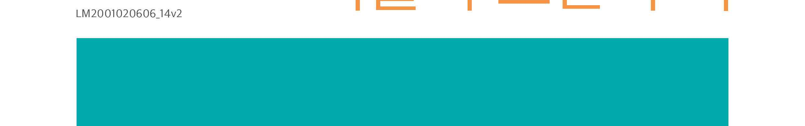

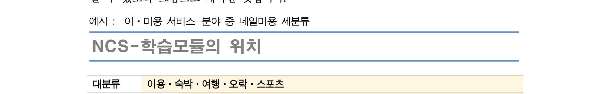

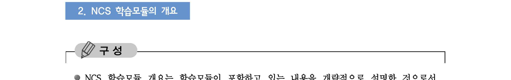

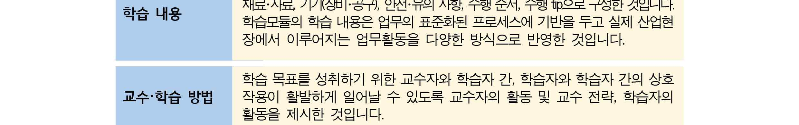

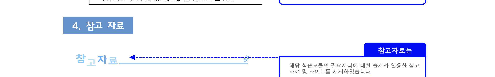

[NCS-학습모듈의 위치]

| 정보통신 |  |  |
| --- | --- | --- |
|  | 정보기술 |  |
|  |  | 정보기술개발 |

대분류
중분류
소분류
세분류

| SW아키텍처 |  |  | 능력단위 | 학습모듈명 |
| --- | --- | --- | --- | --- |
| 응용SW 엔지니어링 |  |  | 보안계획 수립 | 보안계획 수립 |
| 시스템 엔지니어링 |  |  | 보안위험 평가 | 보안위험 평가 |
| 데이터베이스 엔지니어링 |  |  | 보안요구사항 정의 | 보안요구사항 정의 |
| NW 엔지니어링 |  |  | 관리적 보안 구축 | 관리적 보안 구축 |
| 보안엔지니어링 |  |  | 물리적 보안 구축 | 물리적 보안 구축 |
| 엔지니어링 |  |  |  |  |
| UI/UX 엔지니어링 |  |  | 기술적 보안 구축 | 기술적 보안 구축 |
| 시스템SW 엔지니어링 |  |  | 보안체계 운영관리 | 보안체계 운영관리 |
|  |  |  | 보안위협 관리통제 | 보안위협 관리통제 |
|  |  |  | 보안감사 수행 | 보안감사 수행 |
|  |  |  | 보안인증 관리 | 보안인증 관리 |

차 례
학습모듈의 개요 1
학습 1. 응용프로그램 보안 구축하기
• 1-1. 응용프로그램 보안설계 구현 계획 3
• 1-2. 응용프로그램 보안 구현 테스트 15
• 교수・학습 방법 24
• 평가 25
학습 2. 서버 보안 구축하기
• 2-1. 서버 보안설계 구현 계획 27
• 2-2. 서버 보안 구현 테스트 39
• 교수・학습 방법 52
• 평가 53
학습 3. 네트워크 보안 구축하기
• 3-1. 네트워크 보안설계 구현 계획 55
• 3-2. 네트워크 보안 구현 테스트 67
• 교수・학습 방법 81
• 평가 82
학습 4. 데이터베이스(DB) 보안 구축하기
• 4-1. 데이터베이스(DB) 보안설계 구현 계획 84
• 4-2. 데이터베이스(DB) 보안 구현 테스트 104
• 교수・학습 방법 125
• 평가 126
참고 자료 128
기술적 보안 구축 학습모듈의 개요
학습모듈의 목표
정의된 보안 요구사항에 적합하게 응용프로그램 보안, 서버 보안, 네트워크 보안, DB 보안을 설
계, 구현, 테스트할 수 있다.
선수학습
애플리케이션 구현(2001020203_14v2), 네트워크 프로그래밍 구현(2001020508_14v2), 데이터베이스
구현(2001020405_14v2), SQL활용(2001020410_14v2), 데이터품질관리(2001020406_14v2)
학습모듈의 내용체계

| 학습 | 학습 내용 | NCS 능력단위 요소 |  |  |
| --- | --- | --- | --- | --- |
|  |  | 코드번호 | 요소명칭 | 수준 |

|  | 1-1. 응용프로그램 보안설계 구 |  |  |  |
| --- | --- | --- | --- | --- |
| 1. 응용 프로그램 보안구축하기 | 현계획 1-2. 응용프로그램 보안 구현테스트 2-1. 서버 보안설계 구현계획 | 2001020606_14v2.1 | 응용프로그램보안 구축하기서버 보안 | 4 |
| 2. 서버 보안 구축하기 | 2-2. 서버 보안 구현 테스트 | 2001020606_14v2.2 | 구축하기 | 4 |
| 3. 네트워크 보안 구축하기 | 3-1. 네트워크 보안설계 구현계획3-2. 네트워크 보안 구현 테스트4-1. 데이터베이스(DB) 보안설계 | 2001020606_14v2.3 | 네트워크 보안구축하기 | 4 |
| 4. 데이터베이스(DB) 보안 구축하기 핵심 용어 보안 위협, 보안설계,데이터베이스(DB) 보안, | 구현계획 4-2. 데이터베이스(DB) 보안 구현 테스트 보안 구현, 기술적 보안, 기밀성, 무결성, 가용성 | 2001020606_14v2.4응용프로그램 보안, | 데이터베이스(DB)보안 구축하기서버 보안, 네트워크 | 4보안, |

| 학습 1 | 응용프로그램 보안 구축하기(LM2001020606_14v2.1) |
| --- | --- |

학습 2 서버 보안 구축하기(LM2001020606_14v2.2)
학습 3 네트워크 보안 구축하기(LM2001020606_14v2.3)
학습 4 데이터베이스(DB) 보안 구축하기(LM2001020606_14v2.4)
1-1.
응용프로그램 보안설계 구현 계획
•보안 요구사항에 따라 응용프로그램에 사용된 프로그래밍 언어를 사용하여 응용프로
학습 목표 그램 보안을 설계할 수 있다.
•설계된 응용프로그램 보안에 대한 시큐어코딩을 고려하여 구현 계획을 수립할 수 있다.
필요 지식 /
• 정보보호관리체계에 관한 국제 표준 규격(ISO27001)
1. 국제 표준 규격 ISO27001의 정의
ISO 27001은 ‘정보보안경영시스템(ISMS : Information Security Management System)’에
대한 국제적인 표준으로서 전 세계 선진기업이 합의한 Best Practice를 활용하여 해당 조
직이 `정보보호경영을 실행하기 위한 Framework을 확인하고 이를 자사에 적용할 수 있는
지침을 제공하는 것이다. ISO 27001 인증은 ISO 27001 표준에 따라 정보자산의 기밀성, 무
결성, 가용성을 실현하기 위하여 관련 프로세스를 체계적으로 수립, 문서화하고 이를 지속
적으로 운영, 관리하여 이의 적합성을 제3자 인증기관에 의해 인증받는 것이다.

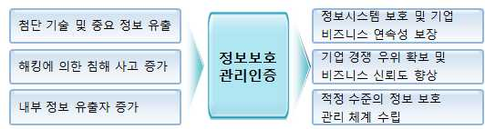

출처: ISO27001 가이드
[그림 1-1] ISO27001 인증의 필요성
2. ISO27001 인증의 필요성
(1) 정보보안에 있어 최고의 경영혁신을 달성하고 경제적 목표를 계속 유지하기 위해 조
직에 효과적인 정보보안 시스템을 제공하기 위한 표준 인증
(2) 미래의 시큐리티 라운드(Security Round)에 대비하여 기업의 대응역량 배양 필요
(3) 조직의 정보보호 대응 능력 전반을 심사하여 고객/이용자에게 올바른 정보를 제공할
수 있는 적절한 평가 메커니즘 제공
3. ISO27001 구성도메인
도입부와 8개의 조항을 포함하며 8개 조항의 일부는 하부 조항으로 분류된다.

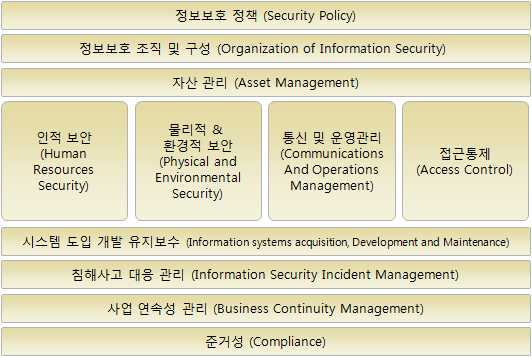

출처: ISO27001 가이드
[그림 1-2] ISO27001 구성도메인
4. ISO27001 인증 추진 절차

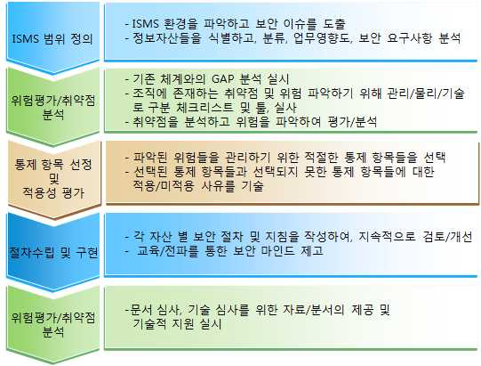

- 문서 심사 .... 자료/분석
[그림 1-3] ISO27001 인증 추진 절차
5. ISO27001 인증 심사 절차
<표 1-1> ISO27001 인증 심사 절차
구분 절차 주요 내용
신청 및 접수 신청 서류의 제출
인증 심사 계약 인증 심사 계획의 협의 및 통보
제출 문서(정보 보호 정책서, 위험 조치 계획서 등)의
문서 실사
검토 및 확인
심사 기준에 따른 심사
- 취약점 분석, 평가 및 위험 분석(샘플링)
본 실사 - 관련 기록 및 문서 확인
인증 심사 - 보호대책 수립 및 구현, 이행 여부 확인
현장이행 점검 및 관계자 면담
실사 결과 검토 심사 참여 심사원의 검토
경부적합 사항의 조 심사 시 도출된 경부적합 사항에 대하여 조치 계획을
치계획 작성하고 심사기관에 통보
심사결과보고서의
심사 결과 보고서 작성 및 제출
작성
인증서 발급 인증서 발급
인증의 내용대로 운영되고 있는지 주기적(매 6개월 단
유효 실사
위)으로 확인
갱신 심사 유효기간의 만료 (3년)
• 정보보호관리체계(ISMS)
1. ISMS(Information Security Management System)의 정의
정보통신망의 안전성 확보를 위해 수립, 운영하고 있는 기술적, 물리적 보호조치 등 종합
적인 관리체계에 대한 인증제도로 정보자산의 기밀성, 무결성, 가용성을 실현하기 위한 관
리체계이다. 심사요건을 만족하는 기관에 ISMS인증을 부여한다.
2. ISMS 도입 배경
지속적인 정보보호관리체계가 없으면 위험의 GAP이 점차적으로 커짐에 따라 지능화되고
있는 침해사고 등에 대해 예방적 차원에서의 체계적 관리가 필요하다.
<표 1-2> ISMS 도입 배경
구분 주요 내용
각종 침해사고의 사전 예방 효과를 통하여 피해액을 감소시킴
경제성
(최소한의 노력으로 최대효과)
- 침해사고를 줄일 수 있는 보호대책 보급을 통한 조직의 정보자산 보호기술 향상
안정성 - 정보시스템에 대한 취약성 분석평가, 위험관리 등을 통해 정보보호관리 수준 제고
- 인증 취득 기관에 대한 고객의 신뢰성, 기관이미지 경쟁력 제고
- 조직의 경영자 및 정보시스템관리자, 이용자등에 대한 정보보호 인식제고
사회성
- 정보보호 중요성에 대한 인식의 저변 확대
3. ISMS 요구사항
정보보호대책은 정보보호에 관련된 위험을 통제하기 위한 요구사항으로 13개 통제분야,
92개 통제사항으로 구성된다.
<표 1-3> ISMS 요구사항
통제 분야 주요 내용
01. 정보보호 정책 정책의 승인 및 공표, 정책의 체계, 정책의 유지관리
02. 정보보호 조직 조직의 체계, 책임과 역할
03. 외부자 보안 보안요구사항 정의, 외부자 보안 이행
04. 정보자산 분류 정보자산 식별 및 책임, 정보자산의 분류 및 취급
05. 정보보호 교육 교육 프로그램 수립, 교육 시행 및 평가
06. 인적 보안 정보보호 책임, 인사규정
07. 물리적 보안 물리적 보호구역, 시스템 보호, 사무실 보안
08. 시스템개발 보안 분석 및 설계 보안관리, 구현 및 이관보안, 외주개발 보안
09. 암호통제 암호정책, 암호키 관리
접근통제 정책, 접근권한 관리, 사용자 인증 및 식별, 접근통제
10. 접근통제
영역
운영절차 및 변경관리, 시스템 및 서비스 운영보안, 전자거래 및
11. 운영보안
정보전송 보안, 매체보안, 악성코드 관리, 로그관리 및 모니터링
12. 침해사고 관리 절차 및 체계, 대응 및 복구, 사후관리
13. IT 재해복구 체계 구축, 대책 구현
4. ISMS 인증절차
[그림 1-4] ISMS 인증절차

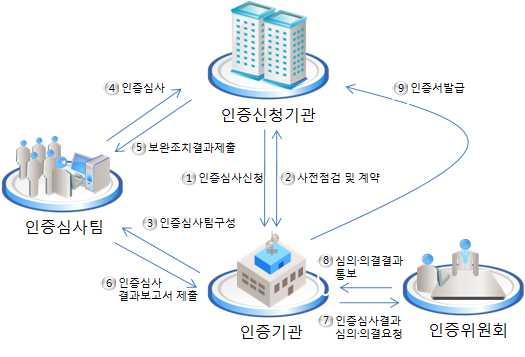

• 개인정보보호관리체계(PIMS)
1. PIMS(Personal Information Management System)의 정의
개인정보를 취급하는 기업이 전사차원에서 개인정보 보호 활동을 체계적, 지속적으로 수
행하기 위한 보호조치 체계를 구축하였는지 점검하여 일정 수준 이상의 기업에 인증을 부
여하는 점검과정을 의미한다.
2. PIMS 요구사항
<표 1-4> PIMS 요구사항
단계 내용 주요 활동
- 개인정보 정책의 수립
조직 내 실행과 개선을 위한 근거(정책,
정책수립 - 조직 및 책임 설정
지침과 조직, 책임)를 확보
- 내부 관리 계획 수립
- 사업모델에 따른 개인정보 식별
조직 내의 개인 정보 자산을 식별하고
범위설정 PIMS
관리체계의 범위 설정
- 범위설정
- 식별된 개인정보 자산에 대해 생명주
- 위험관리 계획 수립
기에 따른 취급현황과 보호조치 사항
- 위험 평가
위험관리 을 파악
- 위험관리를 위한 보호대책 및 이
- 고려사항으로 관리체계, 적용 용이성,
행계획 수립
효과성
- 개인정보보호계획에 따라 구현 및 변
경을 수행하는 단계로 성과 검토 및
보고
구현 개인정보보호 대책 구현
- 개인정보보호대책에 대한 교육 및 훈
련 프로그램을 수립하고 수행
- 대책의 효과성에 대한 주기적인 검토
- 문제점 검출 및 해결을 위한 모니터링
수행 - 모니터링 및 개선
사후관리
- 점검 및 재검토, 모니터링, 내부감사의 - PIMS 재검토
과정으로 수행
3. PIMS 인증절차
인증을 받기 위해서는 그림과 같은 관리과정을 수행하여 PIMS를 수립하고 운영한다.

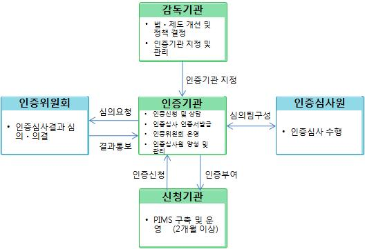

출처: PIMS 인증 가이드
[그림 1-5] PIMS 인증절차
수행 내용 / 응용프로그램 보안 설계하기
재료·자료
Ÿ 정보통신망 이용촉진 및 정보보호 등에 관한 법률
Ÿ 개인정보 보호법
Ÿ 정보보호관리체계에 관한 국제 표준 규격(ISO27001)
Ÿ 정보보호관리체계(ISMS)
Ÿ 개인정보보호관리체계(PIMS)
Ÿ SW 개발 보안(안행부)
기기(장비･공구)
Ÿ 전산장비 : 인터넷, 컴퓨터, 네트워크 장비, 서버, 데이터베이스(DB) 시스템 등
Ÿ 지원도구 : 문서작성 도구 등
Ÿ 보안장비 : 취약점 분석 도구, 동적 분석 도구, 정적 분석 도구, 로그 분석 도구, 방화벽 설정
도구 등
안전･유의 사항
Ÿ 기술적 보안의 응용프로그램 보안, 서버 보안, 네트워크 보안, 데이터베이스(DB) 보안을 설계하고
구축하는 업무에 적용한다.
수행 순서
• 응용프로그램에 사용된 프로그래밍 언어를 참고하여 응용프로그램 보안을 설계한다.
1. 응용프로그램 보안설계 필요성 및 전제 조건을 이해한다.
(1) 응용프로그램 보안의 필요성
IT 제품의 지능화, 무선화에 힘입어 소프트웨어의 중요성이 한층 증가함에 따라
소프트웨어의 보안 취약점을 이용한 공격위협 또한 커지고 있다. 웹상에서는 소프
트웨어의 취약점을 이용한 보안 사고의 위험성이 더욱 높다. 따라서 근본적인 해
결 방안으로 소프트웨어 개발단계에서 보안을 적용하여 취약점을 제거하는 방식
이 제기되었고 미국 Microsoft의 사례를 살펴보면 개발단계에서 SDL(Security
Development Lifecycle) 적용 시 보안 취약성이 50 ~ 60% 정도 감소한다고 보고되
고 있다. 또한 취약점 제거 시 유지보수 단계의 비용보다 60배 절감된다는 연구결
과를 볼 때 소프트웨어 개발 설계단계부터 보안을 강화시키는 방안은 비용과 취
약점을 모두 감소시키는 이점을 가지고 있다.
(2) 응용프로그램 보안설계의 전제 조건
전사 아키텍처(EA : Enterprise Architecture)에서 정의한 기업의 보안 전략에 맞추
어 분석한 보안 요구사항을 바탕으로 응용프로그램을 설계한다.
2. 응용프로그램 보안설계를 이해한다.
응용프로그램 보안설계 단계에서는 분석 단계에서 파악한 보안 요구사항 분석서의
요구사항이 반영되며, 개발위험과 통제를 고려하여 보안구현 설계서(기능명세서, 기본
설계서, 상세설계서)를 작성하여 응용프로그램 보안설계에 반영하고 이를 바탕으로
구현 계획을 수립한다.

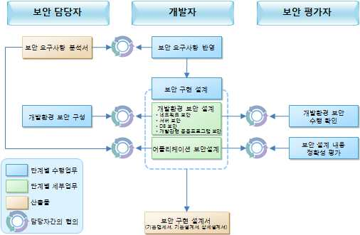

출처:한국정보보호진흥원. 안전한 소프트웨어 개발‧도입을 위한 보안 가이드 V1.0
[그림 1-6] 설계단계의 보안 프로세스
(1) 개발에 사용될 응용프로그램 언어 선정
독립적인 응용프로그램, 웹 프로그램, 안드로이드와 같은 모바일 앱 프로그램 등
의 응용프로그램 개발 유형에 따라 응용프로그램 개발에 사용할 언어인 Java, C,
C++, C#, Object C 등을 선정한다.
(2) 보안 요구사항 반영
응용프로그램 개발자는 응용프로그램 분석 단계에서 정의된 보안 요구사항 분석을
통해 나타난 항목을 검토한 후, 다음의 사항을 고려하여 설계에 적절히 반영한다.
(가) 보안 요구사항은 보안 계획이나 표준 등에 적합하여야 한다.
(나) 응용프로그램 개발자는 먼저 보안 요구사항들을 검토하여 설계 가능성 여부
를 판단한다.
(다) 애플리케이션 개발자는 보안 요구사항을 분석하여 설계에 적절히 반영한다.
(3) 응용프로그램 보안설계 구현
보안구현 설계서는 보안 요구사항 분석서를 파악하고 행자부에서 제공하는 ‘소
프트웨어 개발보안 가이드’를 참고하여 응용프로그램 보안설계와 개발환경 보안
설계를 한다.
(가) 응용프로그램 보안설계
보안 담당자는 응용프로그램 분석자 및 개발자가 작성하는 기능명세서, 기본 설계
서, 상세설계서에 대해 보안 항목들을 분석하여 보안항목들을 설계에 반영 한다.
1) 응용프로그램 기능 명세서를 작성한다.
가) 요구사항 분석 단계에서 식별된 모든 시스템 정보보호 요구사항을 만족
하는 정보보호 기능을 포함한 기능 명세서를 작성한다.
나) 모든 정보보호 기능 및 외부 인터페이스의 목적, 방법, 효과, 예외사항,
오류메시지 등을 문서화한다.
2) 응용프로그램 기본 설계서를 작성한다.
가) 기능명세서에 포함된 모든 정보보호 기능을 포함한 기본설계서를 작성
한다.
나) 정보보호 기능을 구성하는 모든 하위시스템에 대하여 그들이 제공하는
정보보호 기능을 문서화한다. 또한 정보보호 하위시스템과 비정보보호
하위시스템의 구분 기준을 문서화한다.
다) 정보보호 하위시스템의 모든 구성 요소를 하드웨어, 펌웨어, 소프트웨어
의 구성 계층과 요소별로 문서화한다.
라) 정보보호 하위시스템의 모든 인터페이스의 목적, 방법, 효과, 예외사항,
오류메시지 등을 문서화한다.
3) 응용프로그램 상세설계서를 작성한다.
가) 기본설계서에 포함된 모든 정보보호 하위시스템의 구성 모듈을 포함하
는 상세설계서를 문서화한다.
나) 모든 정보보호 모듈의 목적, 방법, 내부 및 외부 인터페이스, 효과, 예
외 사항 및 오류 메시지를 문서화한다.
다) 정보보호 기능이 제공되는 방법을 정보보호 기능과 모듈간의 상호관계
및 종속관계를 정의함으로써 문서화한다.
라) 핵심 정보보호 기능을 수행하는 모듈과 기타 모듈을 구분한다.
마) 접근 통제 기능이 모든 자원을 통제하고 독립적으로 운영되는지 확인하
고 문서화한다. 또한 접근 통제 기능은 분석이 용이하도록 단순하게 설
계한다.
보안 담당자는 응용프로그램 분석자 및 개발자와 협의를 통해 기능명세서, 기
본설계서, 상세설계서에 반영된 보안사항들이 적절하게 반영되었고 동작하는지
확인할 수 있도록 응용프로그램시험계획서 등에 보안기능 시험계획을 반영하
여야 하며, 보안 평가자는 기능명세서, 기본설계서, 상세설계서에 상기 사항들
이 적절히 반영되었는지 타당성, 적절성, 명료성 등을 평가하여 적절치 않을
경우 피드백을 제공하여 보완되도록 해야 한다.
(나) 개발환경 보안설계
1) 허가되지 않은 프로그램의 통제
가) 개발 단계에서 개발자나 관리자에 의해 허가되지 않은 프로그램 (트랩
도어, 트로이 목마, 바이러스, 백도어 등)의 삽입에 대한 통제를 한다.
나) 외부에서 입력되는 모든 프로그램은 바이러스 검사를 한다.
다) 응용프로그램 내에 무결성 체크 프로그램을 설치하여 허가되지 않은 데
이터나 부정확한 데이터의 입력을 체크한다.
라) 개발된 응용프로그램은 응용프로그램 개발에 참여하지 않은 관리자와
기술요원에 의한 테스트를 실시한다.
2) 허가되지 않은 시스템의 통제
가) 응용프로그램 개발자는 사용이 허가된 유틸리티를 이용하여 서버에 접
근하도록 통제한다.
나) 허가된 개발자만이 시스템에 접근할 수 있도록 접근통제 기능을 시스템
내에 구현한다.
다) 시스템에 대한 모든 접근시도나 접근 후에 행해진 모든 활동에 대해 기
록(Logging)한다.
• 설계된 응용프로그램 보안에 대한 시큐어 코딩을 고려하여 구현 계획을 수립한다.
1. 행정자치부에서 제공하는 ‘소프트웨어 개발보안 가이드’를 학습한다.
(1) 가이드 목적을 이해한다.
‘행정기관 및 공공기관 정보시스템 구축･운영 지침(안행부 고시, 2013.8)’에 따
라 정보화사업 수행 시 안전한 소프트웨어 개발을 위한 시큐어코딩 기법을 제시
한다.
(2) 다음과 같은 소프트웨어 보안약점 유형을 미리 파악하여 코딩 시 실수하지 않도
록 숙지하고 추후 보안약점 발생 시에 대비하여 보안대책을 강구한다.
(가) 입력데이터 검증 및 표현
프로그램 입력 값에 대한 검증 누락 또는 부적절한 검증, 데이터의 잘못된 형
식지정으로 인해 발생할 수 있는 보안약점으로 SQL 삽입, 크로스사이트 스크
립트(XSS) 등의 공격을 유발할 수 있다.
(나) 보안기능
보안기능(인증, 접근제어, 기밀성, 암호화, 권한관리 등)을 적절하기 않게 구현
시 발생할 수 있는 보안약점으로 적절한 인증 없는 중요기능 허용, 부적절한
인가 등이 포함된다.
(다) 시간 및 상태
동시 또는 거의 동시 수행을 지원하는 병렬시스템, 하나 이상의 프로세스가 동
작되는 환경에서 시간 및 상태를 부적절하게 관리하여 발생할 수 있는 보안약
점이다.
(라) 에러처리
에러를 처리하지 않거나, 불충분하게 처리하여 에러 정보에 중요정보(시스템
내부정보 등)가 포함될 때 발생할 수 있는 취약점으로서 시간 및 상태를 부적
절하게 관리하여 발생하는 보안약점이다.
(마) 코드오류
타입 변환 오류, 자원(메모리 등)의 부적절한 반환 등과 같이 개발자가 범할
수 있는 코딩 오류로 인해 유발되는 보안약점이다.
(바) 캡슐화
중요한 데이터 또는 기능성을 불충분하게 캡슐화 하였을 때 인가되지 않은 사
용자에게 데이터 누출, 권한문제 등이 발생할 수 있는 보안약점이다.
(사) API 오용
의도된 사용에 반하는 방법으로 API를 사용하거나 보안에 취약한 API를 사용
하여 발생할 수 있는 보안약점이다.
2. 응용프로그램 개발 환경 및 구현 계획을 수립한다.
(1) 개발 환경 구현
(가) 개발자의 네트워크 환경은 실제 운영 중인 서버 접근이 필요한 경우는 관리
자의 승인이 필요하다.
(나) 개발용 시스템 접근을 위한 계정은 개발자별로 개별 부여하고, 공통 계정의
사용을 지양한다.
(다) 개발자용 계정은 개발자 권한에 맞는 계정을 독립적으로 부여하며 이를 지속
적으로 관리 및 감독한다.
(라) 개발자 PC에 바이러스 백신 프로그램을 설치하고 항상 실시간으로 최신버전
으로 업데이트한다.
(마) 개발자 PC의 불필요한 인터넷 접속을 차단한다.
(바) 개발 시스템 및 개발자 PC는 해당 권한을 가진 자를 제외한 불법 외부 접촉
을 막기 위해 항상 암호를 사용하여 접근을 1차적으로 차단한다.
(사) 허가되지 않은 외장DVD Rewriter 나 USB의 개발 시스템 및 개발자 PC의 접
속을 차단한다.
(2) 응용프로그램 구현 계획
(가) 응용 프로그램 개발 시에는 신뢰할 수 있는 개발 도구나 소프트웨어를 사용
해야 하며, 불법 소프트웨어의 사용은 금지한다.
(나) ‘시큐어 코딩 가이드’를 참조하여 응용프로그램 상세 설계서에 의하여 코
딩을 진행한다.
(다) 전체 프로젝트 일정계획 및 상세 설계서에 표기된 개발일정을 준수하여 기한
내에 응용프로그램 보안 코딩을 한다.
1-2.
응용프로그램 보안 구현 테스트
• 수립된 구현 계획에 따라 사용된 프로그래밍 언어로 응용프로그램 보안을 구현
할 수 있다.
학습 목표
• 구현된 응용프로그램 보안이 결함이 있는지 테스트하고 발견된 결함에 대한 관
리를 수행할 수 있다.
필요 지식 /
• 정보보호관리체계에 관한 국제 표준 규격(ISO27001)
학습 내용 1-1의 필요지식 • 참조
• 정보보호관리체계(ISMS)
학습 내용 1-1의 필요지식 • 참조
• 개인정보보호관리체계(PIMS)
학습 내용 1-1의 필요지식 • 참조
수행 내용 / 응용프로그램 보안 구현 및 테스트하기
재료·자료
Ÿ 정보통신망 이용촉진 및 정보보호 등에 관한 법률
Ÿ 개인정보 보호법
Ÿ 정보보호관리체계에 관한 국제 표준 규격(ISO27001)
Ÿ 정보보호관리체계(ISMS)
Ÿ 개인정보보호관리체계(PIMS)
Ÿ SW 개발 보안(안행부)
기기(장비･공구)
Ÿ 전산장비 : 인터넷, 컴퓨터, 네트워크 장비, 서버, 데이터베이스(DB) 시스템 등
Ÿ 지원도구 : 문서작성 도구 등
Ÿ 보안장비 : 취약점 분석 도구, 동적 분석 도구, 정적 분석 도구, 로그 분석 도구, 방화벽 설정
도구 등
안전･유의 사항
Ÿ 기술적 보안의 응용프로그램 보안, 서버 보안, 네트워크 보안, 데이터베이스(DB) 보안을 설계하고
구축하는 업무에 적용한다.
수행 순서
• 응용프로그램 보안설계를 구현한다.
1. 응용프로그램을 구현한다.
(1) 설계단계의 기능명세서, 기본설계서, 상세설계서 등에 반영된 보안 요구사항들을
응용프로그램 개발자가 직접 구현한다.
(2) 보안 담당자 및 보안 평가자는 설계된 내용들이 정확히 구현되었는지 와 소스코
드 등 구현물 내의 취약점 등에 대해 점검하고 확인한다.
(가) 프로그램 버그에 의한 경쟁상태 발생 가능성 검토
공격자가 구동한 악성 프로그램이 프로그램 버그를 악용한 경쟁 상태를 유발
하여 시스템 권한(Set-User ID가 붙은 경우 Root, Bin 등)을 획득하는 상황을
방지한다.
(나) 소스코드 내 민감한 정보 삽입
개발자는 소스코드에 ID 또는 패스워드, 시스템 정보, DB정보 등이 포함되거나
주석으로 포함되지 않도록 처리한다.
(다) 소스코드 내 악성코드 삽입
응용프로그램 개발 시 보안 정책을 우회할 수 있거나 프로그램 자체 기능에
위해를 가할 수 있는 코드, 개인 정보의 유출코드, 은닉(covert channel)등을
생성할 수 있는 코드, 백도어/트랩 도어 등의 코드의 삽입을 방지한다.
(라) 실행 결과의 예외 처리
예기치 않은 입력 값에 대한 정확한 예외상황을 처리한다.

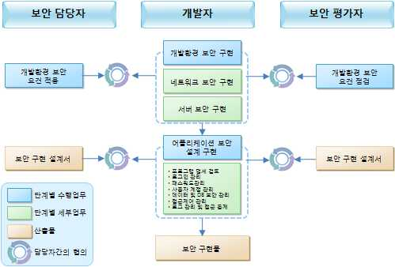

출처: 한국정보보호진흥원. 안전한 소프트웨어 개발‧도입을 위한 보안 가이드 V1.0
[그림 1-7] 구현단계의 보안 프로세스
2. 응용프로그램 구현 환경을 관리한다.
(1) 로그인 관리
(가) 로그인 실패 시 정확한 원인을 표시한다.
개발자의 로그인 실패 시 로그인 실패 이유의 설명 없이 세션을 종료하거나
재입력 대기를 하지 않는다.
(나) 잘못된 패스워드 입력 회수 제한
일정 횟수 이상 패스워드를 잘못 입력할 경우 일시적인 사용 중지 또는 세션
을 종료한다.
(다) 최근 로그인 정보 표시
개발자가 로그인 시 가장 최근에 성공적으로 로그인한 날짜, 시각 등의 정보를
화면에 표시한다.
(라) 일정시간 경과 시 자동 로그오프
사용자로부터 일정시간 동안 입력이 없을 경우 자동 로그오프 또는 세션 종료
처리를 한다.
(마) 로그인 상태 유지 시 세션 방식 적용
웹 애플리케이션의 경우 브라우저에 저장된 쿠키(cookie) 방식보다는 서버 측
에 일부 정보를 저장하여 상호 대조할 수 있는 세션(Session) 방식을 사용한다.
(2) 패스워드 관리
(가) 패스워드 최소 길이 제한
패스워드의 최소 길이를 통제할 수 있도록 최소 패스워드 길이 값을 정의한다.
(나) 추측 가능한 패스워드 사용 통제
1) 사용자 개인 정보(주민등록번호, 휴대폰 번호 등)와 관련된 패스워드는 사용
하지 못한다.
2) 사용자 ID와 동일한 패스워드는 사용하지 못한다.
3) 동일한 문자 또는 숫자가 반복되는 패스워드는 사용하지 못한다.
4) 문자 또는 숫자만으로 구성된 패스워드는 사용하지 못한다.
(다) 패스워드 변경 및 확인 시 보안 적용
패스워드 변경 시 현재 패스워드를 확인한 후 변경 사항을 적용한다.
(라) 패스워드 파일 접근통제 및 암호화 저장 여부 진단
응용프로그램에 저장된 패스워드 파일은 관리자도 알아볼 수 없도록 암호화된
형태로 저장한다.
(마) 이전 부여 패스워드 일정기간 재사용 통제
응용프로그램 인증시스템은 관리자가 이전에 사용했던 패스워드를 일정기간
동안 재사용하지 못하도록 하는 기능을 구현한다.
(바) 패스워드 사용기간 설정
패스워드를 사용할 수 있는 최소기간을 설정하여 일정 기간이 지나면 개발자
로 하여금 강제로 패스워드를 변경하도록 구현한다.
(사) 인증(O.T.P, 생체인증, PKI)의 강화 작용
전자상거래, 금융관련 서비스 등 특별하게 인증 강화가 필요할 경우 O.T.P, 생
체인증, PKI 등의 강화된 인증 기능을 적용한다.
(3) 개발자 계정 관리
(가) 추측 가능 및 Default 계정 사용 통제
애플리케이션 관리자 계정의 경우 "admin", "root", "administrator" 등 추측 가
능하거나 디폴트(default) 계정을 사용하지 않도록 구현한다.
(나) 불필요한 계정에 대한 주기적 검토 및 삭제
일정기간 동안 사용하지 않는 계정에 대한 일시 사용중지 및 사용중지 된 후
휴면 계정에 대한 삭제 조치를 한다.
(4) 데이터 보안 관리
(가) 주요 데이터 및 자료 파일 등의 DB 저장 유무
주요 데이터를 접근통제가 수행되는 DB에 저장한다.
(나) 데이터의 보안등급 분류 설정
응용프로그램에서 사용되는 데이터에 대한 보안등급 설정 및 보안등급에 따른
보안대책 수준을 구현한다.
(다) 클라이언트와 서버간의 데이터 암호화 전송 여부
서버와 개발자간에 사용되는 연결 및 전송되는 자료의 보안성 강화를 위해 필
요시 암호화 전송을 구현한다.
(라) 암호화 Key 관리 정책
데이터베이스에 자료 저장 시 암호화를 사용하였을 경우 Key 관리 정책 및 복
구에 대한 안전성을 확인한다.
(5) 응용프로그램 접근제어 관리
(가) 개발자 그룹별 접근권한 통제
응용프로그램의 개발자를 그룹별로 구분하고 접근권한에 대한 등급을 설정하
여 접근 권한을 관리한다.
(나) 관리자 접근 통제
강력한 응용프로그램 서비스 관리자의 접근 통제를 실시한다. (예: 응용프로그
램 서버에서 관리자에 대한 접근 날짜, 접근 시간, IP 주소별로 통제 적용)
(다) 다중 접속권한 제한
단일 개발자 ID의 다중 온라인 세션(Session) 생성을 제한한다.
(라) 인증절차를 우회한 접근통제
모든 응용프로그램 접근 방법에 대한 인증을 실시한다.
(마) 인가된 등급이상의 정보에 대한 접근 통제
특정 수준의 정보에 대한 접근권한을 부여받은 개발자는 해당 수준 또는 그
이하의 정보에만 접근하도록 구현한다.
(바) 개발 시 사용된 Sample & Backup 코드 접근 제한
응용프로그램 개발 시 사용된 샘플 소스코드(sample source code) 및 백업코드
(backup code) 등에 대한 접근을 제한한다.
(6) 로그 관리 및 접근 통제
(가) 보안 등급별 로깅 설정(비밀/일반)
1) 로그의 중요도에 따른 분류가 가능하도록 구성한다.
2) 정보의 비밀등급 설정에 따라 생성, 수정, 삭제, 조회 기능을 관리한다.
3) 분류정보에 따른 로그인 정보, 오류정보, 기밀정보 접근 기록은 별도 관리
되도록 구현한다.
4) 비밀 로그정보는 기밀정보 접근기록, 관리자 모듈 접근 정보, 콘텐츠 유료
정보 생성 및 삭제 정보, 상거래 수행 정보 등을 포함도록 구현한다.
(나) 보안등급별 로그 보관기간 설정
모든 개발자 ID의 개발시스템 로그인 및 이용기록을 저장한다. (개발자 ID, 단
말 ID, 사용시간, 사용 정보 명, 로그인 실패, 출력내역 등이 포함)
(다) 로그 접근 통제
1) 보안 담당자의 사전 승인 없는 경우 응용프로그램의 로그파일에 대한 접근
을 제한한다.
2) 로그 파일에 대한 무결성 확보 및 백업된 로그파일은 수정이 불가능하도록
구현한다.
• 응용프로그램 보안 테스트를 실시한다.
1. 시험 단계를 수행한다.
시험 단계는 애플리케이션 개발주기에서 매우 중요한 단계이다. 개발된 응용프로그램
운영 단계로 이동하기 전에 반드시 시험 단계를 거쳐야 한다. 시험 단계에서는 기능
명세서, 기본설계서, 상세설계서에 반영된 보안사항을 시험하는 것으로, 시험계획 수
립 시에 설계단계의 보안사항을 점검할 수 있도록 수행되어야 한다.

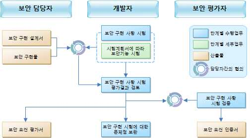

출처: 한국정보보호진흥원. 안전한 소프트웨어 개발‧도입을 위한 보안 가이드 V1.0
[그림 1-8] 시험단계의 보안 프로세스
(1) 보안기능 시험을 위한 수행 절차
(가) 응용프로그램 개발자 및 보안 담당자는 시험계획서에 따라 보안기능 시험을
한다. (시험의 객관성 및 보편성 강화를 위해 개발에 참여하지 않은 보안 담
당자가 수행할 수 있다.)
(나) 응용프로그램 개발자 및 보안 담당자는 응용프로그램 보안설계 구현 과정에
서 제시된 추가항목 및 최신 취약점 점검을 위한 시험계획서에 따라 보안기
능 시험을 한다. (시험의 객관성 및 보편성 강화를 위해 개발에 참여하지 않
은 보안 담당자가 수행할 수 있다.)
(다) 보안기능 시험이 완료되면 보안 담당자는 평가결과를 검토하여 보안 기능 동
작의 적절성 여부를 판단한다.
(라) 보안 평가자는 평가 절차에 따라 적절히 계획되고 실행되었는지, 평가 결과가
신뢰할 수 있는지 검증한다.
(마) 보안 담당자 및 보안 평가자의 시험 결과를 피드백을 개발자에게 제공하여
문제가 있는 기능에 대해 보완하도록 조치한다.
(2) 소스코드 보안 취약성 점검 도구를 사용하여 테스트하고 결과를 개발자에게 피
드백 한다.
소스코드 내에 버퍼오버플로우가 발생 가능한지 또는 포맷스트링, 포인터, 배열,
함수 반환 주소 등 메모리 관련 보안취약점이 존재하는지 등을 점검해 주는 도구
이다. 상기 취약점들은 보안공격에 직접적으로 이용될 수 있기 때문에 사전 점검
이 매우 중요하다. 소스코드 보안 취약성 점검 도구는 다음과 같다.
(가) ITS4(It's the Software Stupid Source Scanner)
(나) LCLint
(다) ckit
(라) Safer C
(마) RATS (Rough Auditing Tool for Security)
(바) PScan
(사) qaudit.pl
(아) formatstring
(자) Splint
(차) Cyclone
(카) Vault
(타) Cqual
(파) Flawfinder
(3) 소스코드 오류 검사 도구를 사용하여 테스트하고 결과를 개발자에게 피드백 한다.
소스코드 오류 검사 도구는 기본적으로 소스 코드 내에 존재하는 메모리 관련 버
그나 논리적 오류를 점검해 주는 도구이다. 공격자는 소스코드 내에 존재하는 버
그나 오류 중 보안공격이 가능한 부분이 있는지를 찾아 낼 수 있기 때문에 아래
의 도구를 활용하여 사전에 점검할 수 있다.
(가) Code Ray(상용)
(나) Coverity Prevent(상용)
(다) PolySpace(상용)
(라) Klocwork(상용)
(마) PurifyPlus(상용)
(바) Insure++(상용)
(사) CODECHECK(상용)
(아) OSPC (Open Systems Portability Checker)(상용)
(자) C/Ada Verifier(상용
(차) Fortify SCA(Fortify Source Code Analysis)(상용)
(카) Ounce(상용)
(4) 실행코드 보안 취약성 점검 및 방지 도구를 사용하여 테스트하고 결과를 개발자
에게 피드백 한다.
실행코드 보안 취약성 점검 및 방지 도구는 실행코드를 실행시킨 후 보안 취약성
을 점검하고, 예방해 주는 도구이다. 주로 메모리 관련 보안 취약성을 점검하며,
소스코드 보안 취약성 점검 도구에서 찾지 못한 취약성을 찾을 수 있다. 또한 방
지 도구는 실행코드에 보안 취약성이 발견되더라도 공격자가 이를 이용하여 공격
하지 못하도록 막아주는 역할을 한다.
(가) 실행코드 보안 취약성 점검 도구
1) BFBTester
2) Sharefuzz
3) FuzzerServer(상용)
4) COMbust(상용)
5) GDBProfiler
6) MemWatch
7) Bugscan(상용)
(나) 실행코드 보안 취약성 점검 및 방지 도구
1) StackGuard
2) Bounds Checking
3) Stack Smashing Protector
4) FreeBSD stack integrity patch(libparanoia)
5) Libsafe
6) libformat
7) Trustfile
(5) 소프트웨어 모델 체킹 도구를 사용하여 테스트한다.
소프트웨어 모델 체킹 도구는 소프트웨어의 취약성을 정형적으로 모델링하고 소
프트웨어 코드의 제어 흐름이나 데이터 흐름을 분석하여 추상화된 설계 프로파일
을 도출한 후 이 설계 프로파일이 취약성 모델과 일치하는지 검사하는 도구이다.
(가) Alloy Analyzer
(나) Assertion Definition Language(상용)
(다) AST Toolkit
(라) MOPS(MOdel checking Programs for Security)
(마) Blast(Berkeley Lazy Abstraction Software Verification Tool)
(바) Bandera
(사) SLAM Project
(아) UPPaal
(자) SPIN
(차) SMV 심볼릭 모델 체킹
2. 소스코드를 관리한다.
(1) 개발 시스템의 소스 프로그램에 대한 안전한 관리 방안을 수립하고, 변경 통제 절
차에 따라서 관리한다.
(2) 소스 프로그램은 운영 시스템에 저장하여서는 안 되며, 운영 시스템은 실행 프로
그램만 저장하여야 한다. 단, 소스 프로그램을 운영 시스템에서 컴파일 해야 할
경우에는 반드시 실행 프로그램 생성 후 삭제해야 한다.
(3) 개발자 등 모든 관련자에 대해서 프로그램 소스 보관 장소에 대해 접근을 제어하
고, 접근 기록 로그를 반드시 남긴다.
(4) 운영 프로그램 소스 보관 장소에는 개발이나 보수가 완료된 프로그램만 보관한다.
(5) 소스 프로그램의 버전 통제가 반드시 이루어져야 한다.

| 학습 1 | 교수·학습 방법 |
| --- | --- |

교수 방법
• 응용프로그램 보안이 왜 중요하고 의미가 있는지 충분히 설명한다.
• 보안은 법률에 의거 수행되는 활동으로 본 수업에 앞서 법률의 등장배경과 관련 시큐어 코딩
가이드에 대해 설명하도록 한다.
• 학생들의 관심을 유발하기 위한 보안 침해사례 등을 파워포인트로 만들어 이해에 도움이 되도록
한다.
• 가능하면 개인별로 응용프로그램 보안 구축사례를 수집하게 하고 문제점과 해결방법을 제시하도
록 지도한다.
• 제시한 사례들을 서로 공유함으로써 다양한 보안방법을 공유할 수 있게 지도한다.
• 개발 응용프로그램이 제대로 코딩이 이루어지고 있는지 항상 체크한다.
• 정보보안의 중요성과 정보윤리를 함께 교육함으로써 올바른 보안 의식이 함양되도록 유도한다.
학습 방법
• 응용프로그램 보안에서 제시된 내용을 사전에 충분히 학습한다.
• 관련 법률에 대한 사이트를 통해 스스로 내용을 찾아보고 추가 설명이 요구되는 부분에 대해
질문 목록을 작성한다.
• 다양한 응용프로그램 보안 구축사례를 찾아보고, 스스로 문제점과 해결방법을 찾아본다.
• 응용프로그램 보안 구축사례를 파워포인트, MS 워드, 한글과 같은 문서로 작성하여 사례 발표
및 다른 학생들과 자료를 교환한다.
• 개발 응용프로그램에 대한 보안 취약점을 분석한 후 사후대책을 계획해 본다.
• 정보보안의 필요성을 인식하고, 올바른 윤리의식이 함양되도록 주기적으로 보안교육을 받는다.

| 학습 1 | 평 가 |
| --- | --- |

평가 준거
• 평가자는 학습자가 수행 준거 및 평가 시 고려사항에 제시되어 있는 내용을 성공적으로 수행하였
는지를 평가해야 한다.
• 평가자는 다음사항을 평가한다.

| 학습 내용 | 평가 항목 | 성취수준 |  |  |
| --- | --- | --- | --- | --- |
|  |  | 상 | 중 | 하 |

- 보안 요구사항에 따라 응용프로그램에 사용된 프로
그래밍 언어를 사용하여 응용프로그램 보안을 설계
응용프로그램
할 수 있다.
보안설계
구현 계획 - 설계된 응용프로그램 보안에 대한 시큐어 코딩을 고
려하여 구현 계획을 수립할 수 있다.
- 수립된 구현 계획에 따라 사용된 프로그래밍 언어로
응용프로그램 응용프로그램 보안을 구현할 수 있다.
보안 구현
테스트 - 구현된 응용프로그램 보안이 결함이 있는지 테스트
하고 발견된 결함에 대한 관리를 수행할 수 있다.
평가 방법
• 서술형시험

| 학습 내용 | 평가 항목 | 성취수준 |  |  |
| --- | --- | --- | --- | --- |
|  |  | 상 | 중 | 하 |

- ISO27001, ISMS, PIMS의 정의
응용프로그램 - 응용프로그램 보안의 개념과 필요성 이해
보안설계 - 소프트웨어 개발보안 가이드 이해
구현 계획 - 개발환경 설계 시 고려 사항
- 응용프로그램 보안설계서 종류 및 작성방법
- 응용소프트웨어 보안약점 및 보안대책
- 소스 코드 취약점 발생 유형 및 대처법
응용프로그램
- 개발자 계정, 로그인, 암호 관리
보안 구현
- 소스 및 데이터 접근 권한 관리
테스트
- 로그 및 접근 통제 관리
- 보안 취약점 테스트 유형 및 점검 도구의 종류 분석
• 문제해결 시나리오

| 학습 내용 | 평가 항목 | 성취수준 |  |  |
| --- | --- | --- | --- | --- |
|  |  | 상 | 중 | 하 |

| 응용프로그램 보안설계 구현 계획 응용프로그램 보안 구현 테스트 • 평가자 체크리스트응용프로그램 보안설계 구현 계획 응용프로그램 보안 구현 테스트 피 드 백 | - 소프트웨어 개발보안 가이드란 무엇인가 - 응용프로그램 보안의 개념과 필요성 - 개발환경 구축 설계 시 중점을 두어야 할 사항 - 응용프로그램 보안 개발 절차에 대한 이해 - 응용소프트웨어 보안약점과 해결방안 - 응용프로그램 구현 환경 구축 시 고려 사항 - 보안 취약점 분석도구의 종류 및 사용 방안 - ISO27001, ISMS, PIMS 의 생성 배경과 보안의 관계 - 소프트웨어 개발보안 가이드의 보안약점 7가지 유형- 보안약점 해결 방안 - 개발환경 구축방안 - 개발자 계정, 데이터 보안 관리 방안 - 접근 권한별 개발 시스템 접속 및 개발 소스 관리 - 보안 테스트 유형별 분석 도구 |  |  |  |
| --- | --- | --- | --- | --- |
| 1. 서술형시험 - 기준 점수트를 제출하게 | 미달자에 대해서는 교육 성취수준을 개별 통보하고 미흡한하여 교육성과를 높이도록 한다. | 분야에 | 대해 | 리포 |
| 2. 문제해결 시나리오- 보안실무에제출하도록 | 대한 이해도를 평가하는 항목으로 관련 양식을 활용하여 직접지도한다. | 점검한 |  | 결과를 |
| 3. 평가자 체크리스트- 성취수준 | 미달자는 보안 관련 법률해석과 보안점검절차에 대한 리포트를 |  | 제출하도록 | 지 |
| 도한다. |  |  |  |  |

| 학습 내용 | 평가 항목 | 성취수준 |  |  |
| --- | --- | --- | --- | --- |
|  |  | 상 | 중 | 하 |

| 응용프로그램 보안설계 구현 계획 응용프로그램 보안 구현 테스트 피 드 백 | - ISO27001, ISMS, PIMS 의 생성 배경과 보안의 관계 - 소프트웨어 개발보안 가이드의 보안약점 7가지 유형- 보안약점 해결 방안 - 개발환경 구축방안 - 개발자 계정, 데이터 보안 관리 방안 - 접근 권한별 개발 시스템 접속 및 개발 소스 관리 - 보안 테스트 유형별 분석 도구 |  |  |  |
| --- | --- | --- | --- | --- |
| 1. 서술형시험 - 기준 점수트를 제출하게 | 미달자에 대해서는 교육 성취수준을 개별 통보하고 미흡한하여 교육성과를 높이도록 한다. | 분야에 | 대해 | 리포 |
| 2. 문제해결 시나리오- 보안실무에제출하도록 | 대한 이해도를 평가하는 항목으로 관련 양식을 활용하여 직접지도한다. | 점검한 |  | 결과를 |
| 3. 평가자 체크리스트- 성취수준 | 미달자는 보안 관련 법률해석과 보안점검절차에 대한 리포트를 |  | 제출하도록 | 지 |
| 도한다. |  |  |  |  |

학습 1 응용프로그램 보안 구축하기(LM2001020606_14v2.1)

| 학습 2 | 서버 보안 구축하기(LM2001020606_14v2.2) |
| --- | --- |

학습 3 네트워크 보안 구축하기(LM2001020606_14v2.3)
학습 4 데이터베이스(DB) 보안 구축하기(LM2001020606_14v2.4)
2-1.
서버 보안설계 구현 계획
•보안 요구사항에 따라 사용된 서버의 제품 환경과 운영체제 기술을 이용하여 서버
보안을 설계할 수 있다.
학습 목표
•설계된 서버 보안의 환경구성에 맞도록 운영체제와 서버 보안 구현 계획을 수립할
수 있다.
필요 지식 /
• 정보보호관리체계에 관한 국제 표준 규격(ISO27001)
학습 내용 1-1의 필요지식 • 참조
• 정보보호관리체계(ISMS)
학습내용 1-1의 필요지식 • 참조
• 개인정보보호관리체계(PIMS)
학습 내용 1-1의 필요지식 • 참조
• 운영체제 및 서버 공격 유형
1. 유닉스(UNIX) 취약성
유닉스(UNIX) 기종별로 다양한 문제점들을 가지고 있는데, 이러한 문제점들의 많은 부분
이 유닉스(UNIX) 운영체제가 가진 버그에 의한 문제점들과 시스템을 잘못 관리하면서 생
긴 문제들이다.

| 학습 내용 | 평가 항목 | 성취수준 |  |  |
| --- | --- | --- | --- | --- |
| (1) 패스워드 및패스워드 및워드가 없는상의 특정네트워크에용한다는 매우 위험하기부여하여 들을 위하여한을 얻게지 않는 워드를 가지고설치할 때 | 계정보안 계정 관련 보안 취약성은 패스워드의 유추, 불필요한계정이다. 해커들이 시스템에 침입할 수 있는 가장사용자 계정을 훔치는 것이다. 이러한 보안 취약성은 많은속해 있지 않은 사용자의 계정과 추측하기 쉬운 패스워드를것이다. 또한, 오랫동안 사용하지 않거나 불필요한 계정을때문에 오랫동안 사용치 않는 계정은 패스워드에 일정기간 사용치 않는 경우 계정을 막아버리는 방법이‘guest’와 같은 계정을 만들어 둔다면 누구라도 시스템에된다. 마지막으로 가장 주의해야 하는 보안 취약성은 계정이다. 몇몇 유닉스(UNIX)에서는 ‘who’, ‘date’, 있지 않은 계정을 기본으로 제공하고 있다. 이러한패스워드 없는 계정에 대한 대비를 하여야 한다. | 계정,쉬운 그대로에이징(aging)좋다. 패스워드를‘lp’등과계정들은 | 그리고방법이시스템들이계정으로두는외부의대한가지고같은 | 패스시스템해당허것은기능을사용자접근 권있패스시스템을 |
| (2) 파일 시스템유닉스(UNIX)떠한 경로로나, 다른 마(Trojan 에 논리폭탄(Logic을 일으키는파일 시스템의 | 보안 시스템의 보안에서 파일 시스템의 보안은 가장 필수적이다.시스템에 침입했던 간에 해커는 침입을 위하여백도어(backdoor)를호스트의 침입 혹은 해당 시스템의 루트(root) 권한을 뺏기Horse)등의 불법 프로그램을 만들려고 할 것이다. 그밖에도Bomb)등을 이용하여 어떤 사건을 만나면 시스템을프로그램을 이용할 수 있으며, 바이러스 프로그램 등을보안 취약성을 분석해 보면 다음과 같다. | 위하여파일 | 침입자가트로이시스템파괴하거나만들기도 | 어만들거목내고장한다. |
| (가) 파일 및 | 디렉토리 접근 권한 잘못 설정 |  |  |  |
| (나) | 셋유이드(setuid)와 셋기드(setgid)를 가진 실행 파일 및 스크립트 | 존재 | 여부 |  |
| (다) 올려놓기 | 모듈(LM: load module) 문제 |  |  |  |
| (라) 백도어(back | door), 트로이 목마 프로그램 및 주요 파일의 교체 | 여부 |  |  |
| (마) cron, inetd,이러한 이유로체크리스트를 | conf, rc* 파일 내 잘못된 내용 삽입 여부 파일 시스템의 정기적인 점검이 필수적이며, 파일통한 점검이 필수적이다. | 시스템 | 보안을 | 위한 |
| (3) 네트워크 보안네트워크 관련실정이며, | 보안 문제는 인터넷의 발전과 더불어 그 범위가대표적인 보안 취약성 유형은 다음과 같다. | 점점 | 넓어지고 | 있는 |
| (가) ftp 문제ftp에 관련된 | 보안 취약성은 크게 구성 파일의 잘못된 설정으로 | 인한 | 것이 | 대부분 |
| 이다. 구성접근 권한,안 취약성들은연에 방지할 | 파일의 잘못된 구성은 익명(anonymous) ftp의 홈 ftp 홈 디렉터리에 여분의 실행 파일들을 설치하는익명(anonymous) ftp 서버를 구축할 경우에 조금만수 있다. | 디렉터리,경우이다.신경을 | 관련이러한 | 파일의보쓰면 미 |
| (나) NFS 문제NFS를 호스트가지정할 수템은 월드운트(mount)할단 export된만들어서을 이용해취약성을 | 설치한 대부분의 유닉스(UNIX)는 /etc/exports 또는 마운트(mount)할 수 있는 파일 시스템을익스포트(export)할있다. 하지만 많은 관리자들이 호스트들을 지정하지익스포트(world export)된 상태가 되어 Internet의 어느수 있게 된다. 이런 경우 외부에서 사용자의 디렉터리를 마운트(mount)한 다음 원하는 사용자의rlogin 또는 rsh을 이용하여 로그인할 수 있다. 또한, 시스템 상의 네트워크파일시스템(NFS: Network Fine검색할 수 있다. | /etc/dfs/dfstab에서않아 그패스워드를nfsbug라는 | 파일 파일호스트에서나몰라도$HOME/.rhosts를System)에에 | 다른시스템을시스마일프로그램대한 |
| (다) E-mail을 이용하여이처럼잘못 에 대한(mailing사용자는일리어스(alias)는 있는 내부스(alias) | 문제 센드메일(sendmail)은 초기 설정 상태로 루트 권한을 이용하여메일을 전달한다. 그 후 메일을 해당되는 사용자의센드메일(sendmail)은 구성 파일을 읽을 때 루트권한을 가지고모든 일을 루트 권한을 이용하여 처리하기 때문에 만일설정한다면 침입자에게 공격당할 가능성이 높아지게 된다.보안 취약성은 크게 다음과 같이 구분된다. 일반적으로list)는 그룹에 속한 일반 사용자에게 쓰기를 허용하는셋유이드(setuid) 쉘을 이용하여 비인가된 권한을 가질파일의 경우에는 파일 내에 메일을 통해 이진 해독프로그램(decode program)을 실행할 수 있는 엔티티(entity)를를버그에 의한 문제가 존재한다. 이러한 문제점에 대한혹은 관련된 파일은 루트 권한 이외의 사용자에게 쓰기를 | 구동되며,ID로모든 일을초기경우가수파일을해결책은 | 루트변환해구성센드메일(sendmail)메일링많다.있다.전송할포함할허용하지 | 권한준다.처리한다.파일을리스트일반또한 에수 있수에일리어않는 |
| 것이다.용하여송하는 | 운영체제 자체의 문제로는 빈(bin)과 같은 시스템 관리에프로그램을 실행할 수 있다는 점과 전달된 메일을 다른forward 파일 Shadow Password 파일과 같은 중요한 파일로 | 관련된지정된 | 권한을곳으로링크해 | 이전놓는 경 |
| 우이다.버전을 | 이러한 문제들은 현재 배포된 Sendmail에서는 교정되어업그레이드하는 것으로 문제를 쉽게 해결할 수 있다. | 있어서 |  | Sendmail |
| 2. 리눅스(Linux) 리눅스(Linux)는 | 취약성 소스의 오픈정책으로 운영체제 커널부터 일반 사용자 |  | 프로그램들까지 | 거 |
| 의 모든 것이트할 수 있는 주요사용자 인증의통한 root 권한탈취스 거부 공격(Denial같은 다양한 유형의은 운영체제 내부적 | 공개되어 있다. 소스의 공개로 인하여 해커들이 쉽게 버그를공격대상이 되고 있다. 리눅스(Linux) 운영체제의 패스워드 공격, 버퍼오버플로우 및 경주 조건(Race 공격, 파일 소유자의 임의적 판단에 의한 접근제어,of Service), 바이러스 및 웜 감염, IP Spoofing, 취약점을 지니고 있다. 그러므로 응용프로그램 취약성 방어에는 한계를 가진다. | 취약성을Condition)데몬Packet수준에서의 | 찾아내고공격공격,Sniffing보안 | 테스분류해보면등을서비등과방식 |
| (1) 임의적 리눅스(Linux)정책을 사용한다.(identity)에허가를 갖고지되지 않는제어(DAC) | 접근제어(DAC : Discretionary Access Control) 운영체제는 허가 비트(permission bit)로 불리는 임의적임의적 접근제어는 주체나 또는 그들이 속해있는근거하여 객체에 대한 접근을 제어하는 방법으로 정의된다.있는 한 주체는 강제적 접근제어(MAC : Mandatory 한 임의의 다른 주체에게 자신의 허가를 넘겨줄 수가정책에서 내재된 결점을 살펴보면 다음과 같다. | 그룹들의Access있다. | 접근제어(DAC)어떠한Control)가임의적 | 신원정보접근유접근 |
| (가) 임의적를 두고고 있지 | 접근제어(DAC) 속성상 접근은 주체의 신원정보(identity)에있으며, 메커니즘은 데이터의 의미(semantics)에 대한않으며 이에 근거하여 결정할 것이 전혀 없다. | 아무런 | 전적으로지식도 | 근거갖 |
| (나) 이와 같이정보(identity)를 | 주체의 신원정보(identity)가 매우 중요하므로, 만약사용하여 행위가 이루어지면 임의적 접근제어(DAC)는 | 다른 | 주체의파괴될 | 신원수 |
| 있다. |  |  |  |  |
| (다) 트로이따라서 공격에 취약할 | 목마(Trojan Horse)에 대하여 취약하다. 리눅스(Linux) 운영체제의 임의적 접근제어 정책은 내부자에수 있다. | 의한 | 악의적 | 접근 |
| (2) 소프트웨어의모든 종류의응용프로그램한(시스템에는 해킹 은 날로 아야하기 상업용 들이 CGI, 프로그램의너무나 많고, | 보안성 결함 소프트웨어 프로그램이 보안상의 버그 결함을 가지고소프트웨어의 결함을 이용하여 어렵지 않게 중요한대한 전권)으로 접근할 수 있다. 응용프로그램 소프트웨어도구들을 초보적인 해커들조차 손쉽게 입수하여 악용할 수증가하고 있다. 소프트웨어 생산자들은 빠른 시간 내에 때문에 버그를 가진 소프트웨어는 끊임없이 늘어날 것이다.응용프로그램 소프트웨어에만 국한된 것은 아니다. 더욱 심각한스크립트, 실행 프로그램, Active 스크립트 등과 같이 자체잘못된 보안 취약성에서부터 발생한다. 더구나 이러한패치를 배포할 수 있는 판매자가 있는 것도 아니기 | 있다.서버에있기제품을제작된보안상때문에 | 즉 대한버그를때문에시장에이러한보안상의웹허점의그것을 | 공격자는root권이용하위협내 놓문제는위협응용수가찾아 |
| 서 고치기는(Buffer (super-user)어, 데몬(demon)스푸핑(spoofing),영체제 내부의문제가 발생되고 | 더욱 어렵다. 소프트웨어의 보안 결함으로 인한 예로서Overflow) 및 경주 조건(Race Condition) 공격 등을 통한계정인 root 권한 탈취 공격, 파일 소유자의 임의적공격, 서비스 거부 공격(Denial of Service), 바이러스패킷 스니핑(sniffing) 등과 같은 다양한 유형의 취약점과 응용 소프트웨어의 보안성 결함으로 인하여있다. | 판단에및공격이더욱 | 버퍼오버플로우시스템의한웜존재하며,많은 | 관리자접근제감염, IP운보안 |
| 3. 윈도우즈(Windows)윈도우즈(Windows)는제이며, 인텔 도 동작한다. 있으며, 인터넷영체제의 취약점은 | 취약성 Microprocessor에서 수행되는 32/64비트 비선점형시스템뿐만 아닌 다양한 시스템(MIPS R4000, DEC Alpha,윈도우즈(Windows)는 GUI환경을 제공하고, 다양한 웹 서버와 브라우저 소프트웨어를 통합 채용하였다. 크게 4가지 정도로 분류할 수 있다. | 멀티태스킹Power응용프로그램이윈도우즈(Windows) | PC | 운영체등)에서제공되고운 |
| (1) 사용자의 상 취약점이 | 부주의에 의한 취약한 패스워드와 관리자의 서버 운영있다. | 부주의에 | 의한 | 관리 |
| (2) IIS(Internet재하는 취약점이 | Information Server), Exchange Server, SQL Server 등과있다. | 같은 | 백오피스가 | 존 |
| (3) 운영체제 | 내부의 변수 값 등에 의한 시스템 취약점이 있다. |  |  |  |
| (4) 윈도우즈(Windows)에서등의 취약점이양하지만 크게 | 설치되는 응용프로그램과 인터넷상에 유포되고있다. 이러한 취약성을 통해 윈도우즈(Windows)를3가지로 분류할 수 있다. | 공격하는 | 있는형태가 | 백도어다 |
| (가) 시스템이 목마지의 추측하거나방법을 | 자체를 대상으로 하는 시스템 로컬 공격으로 가장 공격으로 시스템 DLL 들을 이용한 공격이 가장 많으며,방법들이 있다. 가장 고전적인 형태의 공격으로 암호를패킷 스누핑(snooping) 및 크래킹(cracking)을 통하여들 수 있다. | 대표적인그여러암호를 | 유형이외에도가지 | 트로몇 가방법으로알아내는 |
| (나) 원격지에서Denial of시키거나공격에(snooping) | 시스템을 공격하는 형태로 가장 대표적인 유형이Service)공격이다. 웹 서비스의 GET 방법을 이용하여TCP/IP 3Way 핸드쉐이킹(handshaking)을 이용한 SYN의한 원격 공격이 있으며, 이외에도 텔넷 Port를 이용한공격이 있다. | IIS | 서비스거부(DoS서비스를플러딩(flooding)공격과 | :중지스누핑 |
| (다) 일반적인워크 | 관리자들의 관리형태의 허점을 노린 공격으로 넷 모니터, ‘guest’ 계정 등을 들 수가 있다. | 바이오스 | 공유와 | 네트 |
| 내용 / 서버재료·자료 Ÿ 정보통신망 이용촉진Ÿ 개인정보 보호법Ÿ 정보보호관리체계에Ÿ 정보보호관리체계(ISMS)Ÿ 개인정보보호관리체계(PIMS)Ÿ 운영체제 및 서버기기(장비･공구) Ÿ 전산장비 : 인터넷,Ÿ 지원도구 : 문서작성Ÿ 보안장비 : 취약점도구 등 안전･유의 사항 Ÿ 기술적 보안의고 구축하는 업무에수행 순서 • 서버의 제품 | 보안 설계하기 및 정보보호 등에 관한 법률 관한 국제 표준 규격(ISO27001) 공격 유형 컴퓨터, 네트워크 장비, 서버, 데이터베이스(DB) 시스템도구 등 분석 도구, 동적 분석 도구, 정적 분석 도구, 로그 분석응용프로그램 보안, 서버 보안, 네트워크 보안, 데이터베이스(DB)적용한다. 환경과 운영체제 기술을 이용하여 서버 보안을 설계한다. | 등도구, | 방화벽보안을 | 설정설계하 |
| 1. 서버 보안설계 | 필요성 및 전제 조건을 이해한다. |  |  |  |
| (1) 보안 | 서버의 필요성 |  |  |  |

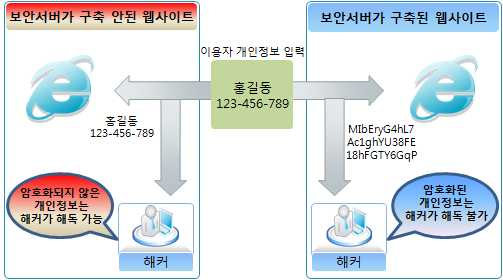

출처: 미래창조과학부. 보안서버 구축 가이드
[그림 2-1] 보안서버 구축의 필요성
인터넷은 개방된 환경으로 일반적인 송∙수신방법이 안전하지 않기 때문에 인터넷
상에서 송∙수신되는 이용자, 사업자 및 컴퓨터의 신원정보(Identity)를 확인하는 것
은 어렵지 않다. 따라서 모든 송∙수신 메시지는 도청자가 중간에 가로채어 수정할
수 있는 위험에 노출되어 있다. 인터넷 통신은 종종 전통적인 우편시스템에서 우
편엽서의 사용과 비유되곤 한다.
만일 공격자가 적시에 적절한 장소에 있다면, 공격자는
• 당신의 우편엽서를 읽고, 당신의 대화를 훔칠 수 있으며,
• 당신의 우편엽서를 수정하고, 당신의 대화를 뒤엎을 수 있으며,
• 당신 또는 대화 대상자에게 우편엽서를 송부하여, 양 당사자를 흉내 낼 수 있다.
이러한 위협은 인터넷에서 전송되는 정보의 가치 및 민감도에 따라 잠재적 이득
을 원하는 자에게도 동일하게 적용될 수 있다. 실제로 패킷을 캡처하는 프로그램
을 이용하면 내가 속한 네트워크에 지나가는 대부분의 패킷 내용을 쉽게 확인할
수 있다. 이러한 문제점을 해결하기 위해 서버 보안은 네트워크 응용 프로그램간
의 통신에 대하여 프라이버시, 인증, 신뢰를 보장해주는 것을 목표로 한다. 이를
위해 SSL(Secure Sockets Layer) 프로토콜은 어떤 TCP/IP 기반의 통신에도 유용하
게 적용될 수 있으며, 특히 HTTP(hypertext transfer protocol) 통신을 보호하는 목
적으로 많이 사용되고 있다. 서버 보안 구축을 통한 송수신 구간 암호화는 통신을
안전하게 보호해 줄 뿐만 아니라, 네트워크 통신에서 다음의 장점을 제공한다.
(가) 정보유출 방지(sniffing 방지)
사용자가 웹사이트에 접속해서 로그인 또는 전자상거래를 위해 ID, 패스워드,
신용카드 번호 등의 각종 중요한 개인정보를 입력하여 해당 사이트로 정보를
전송하게 된다. 이 때 악의적인 해커들이 설치한 정보유출 프로그램에 의해 사
용자의 ID와 패스워드 등의 중요한 개인정보를 도청하는 것이 스니핑이다. 스
니핑 툴(sniffing tool)은 인터넷 상에서 누구나 손쉽게 구할 수 있다. 따라서 학
교, PC방, 회사 등의 공용 네트워크에서 누군가 스니핑 툴을 이용하여 타인의
개인정보를 수집한다면, 일반적인 웹사이트의 경우 이용자의 아이디와 비밀번
호 등 이용정보가 평문형태 그대로 노출되게 된다. 그러나 웹사이트에 보안서
버가 구축된 경우에는 개인정보가 암호화되어 전송되므로 이러한 노출 위협으
로부터 안심할 수 있다. 따라서 서버 보안은 개인 정보 보호를 위한 필수적이
며 기본적인 수단이다.
(나) 위조사이트 방지(phishing 방지)
피싱(phishing)이란 개인정보(private data)와 낚시(fishing)를 합성한 조어이다.
이는 인터넷 이용자에게 이메일이나 링크를 전송하여 금융기관이나 합법적인
기관으로 가장한 허위 웹사이트로 접속하게 한 후, 이용자가 입력한 비밀번호
나 개인정보를 추출하여 금융 사기 등으로 악용하는 사기 기법이다. 현재 피싱
수법이 점점 교묘해져 가고 피해자가 속출하고 있는 상황으로 사용자가 개인
정보를 입력 시 해당 페이지가 신뢰할 수 있는 인증서가 설치되어 있는지 확
인하는 등의 사용자의 주의가 필요하다. 보안서버를 구축하기 위해서는 SSL
인증서를 공인인증기관으로부터 발급받아야 한다. 발급받기 위해서는 도메인
정보 등을 제공해야 하며, 발급받은 인증서에는 도메인 정보가 포함되어 있다.
접속한 웹사이트에서 자물쇠 이미지를 확인하거나 개인정보 입력 시 암호화
호출(https://), 암호화 모듈 로딩 화면 등을 확인한다면 유사하게 구성된 피싱
사이트 여부를 쉽게 구별할 수 있다. 해커 등의 제3자가 유사사이트를 만들어
피싱을 시도하더라도 SSL 인증서가 진위여부를 증명함으로써 피싱으로 인한
피해를 줄일 수 있는 것이다.
(2) 응용프로그램 보안설계의 전제 조건
전사 아키텍처(EA : Enterprise Architecture)에서 정의한 기업의 보안 전략에 맞추
어 분석한 보안 요구사항을 바탕으로 서버보안을 설계한다.
2. 서버 보안의 방식을 결정한다.
서버보안 분석 단계에서는 전사 아키텍처(EA : Enterprise Architecture)에서 정의한
보안 전략에 맞추어 보안 서버를 어떤 방식으로 구축 할 것인지를 결정하고 이러한
결정에 따라 보안서버를 구축하는 계획을 수립한다. 보안서버는 구축 방식에 따라 크
게‘SSL 방식’과‘응용프로그램 방식’2가지로 구분할 수 있다. 보안서버를 구별하
는 방법은 다음과 같다.
(1) SSL 방식
SSL 인증서를 이용한 보안서버는 사용자 컴퓨터에 별도의 보안 프로그램 설치가
필요 없으며, 웹 서버에 설치된 SSL 인증서를 통해 개인정보를 암호화하여 전송한
다. 보안서버 구축에 소요되는 비용이 상대적으로 저렴하지만 주기적으로 인증서
갱신을 위한 비용이 소요된다. 로그인 페이지 등 보안이 필요한 웹페이지에 접속
한 상태에서 브라우저 하단 상태 표시줄에 자물쇠 모양의 마크로 확인할 수 있으
며, 웹사이트의 구성 방법에 따라 자물쇠 모양의 마크가 보이지 않을 수 있다.
(2) 응용프로그램 방식
암호화 응용프로그램을 이용한 보안서버는 웹 서버에 접속하면 사용자 컴퓨터에
자동으로 보안 프로그램이 설치되고 이를 통해 개인 정보를 암호화하여 전송한다.
웹사이트 접속 시 초기화면이나 로그인 후 윈도우 화면 오른쪽 하단 작업표시줄
알림영역에 다음 그림과 같은 암호화 프로그램 실행여부를 확인할 수 있으며, 응
용프로그램 방식의 솔루션에 따라 모양은 다르게 나타날 수 있다.
3. 개인정보 입력 시 암호화되어야 하는 범위를 결정한다.
‘개인정보’라 함은 생존하는 개인에 관한 정보로서 성명, 이메일주소, 주소, 전화번
호 등에 의하여 당해 개인을 알아볼 수 있는 부호, 문자, 음성, 음향 및 영상 등의 정
보(당해 정보만으로는 특정 개인을 알아볼 수 없는 경우에도 다른 정보와 용이하게
결합하여 알아볼 수 있는 것을 포함한다)를 말한다. 대표적인 예로는 로그인시 ID/패
스워드, 인터넷 뱅킹 이용 시 계좌번호/계좌 비밀번호 등이 해당된다. 또한 게시판 등
에서 성명, 이메일, 연락처 등을 수집한다면 개인을 식별할 수 있는 정보로서 개인정
보 수집행위에 해당한다고 볼 수 있다. 이러한 경우 해당 게시판은 보안서버 구축 대
상이 될 수 있다. 따라서 성격이 다른 여러 종류의 서버를 구축할 경우 각 서버의 성
격을 규정하고 해당 서버에 어떠한 모듈을 심을 것인지 또는 어떠한 데이터를 관리
할 것인지를 분석 및 설계하여 보안서버를 구축하여야 한다.
• 설계된 서버 보안의 환경구성에 맞도록 운영체제와 서버 보안 구현 계획을 수립한다.
1. 보안 운영체제 설계 시 고려사항을 이해한다.
보안 운영체제 시스템 설계 시 OS가 유지하는 정보에 대한 기밀성(confidentiality), 무
결성(integrity), 가용성(availability)을 보장하도록 하여야한다. 따라서 보안 운영체제
설계 시 다음과 같은 요소를 고려하여야 한다.
(1) 특권의 최소화(Least of Privilege)
부적절하거나 악의가 있는 공격으로부터 피해를 최소화하기 위해 root를 포함
한 사용자와 프로그램은 가능한 최소한의 권한을 사용하여 운영되어야 한다.
(2) 메커니즘의 경제성
보호 시스템의 설계는 작고 검증이 가능하고 처리가 빨라야 한다. 그 이유는
보안성에 대한 완전한 분석, 시험, 검증가능, 부가적인 처리로 인한 성능상의
오버헤드가 최소화되어야 하기 때문이다.
(3) 완전한 중재
모든 접근 시도는 통제되어야 하고, 직접적인 접근 시도뿐 아니라 우회하려는
어떠한 시도도 접근 통제가 가능해야 한다.
(4) 특권의 분리
이상적으로, 객체(Object)에 대한 접근은 사용자 인증과 보안 등급, 또는 암호
키 둥과 같이 한 가지 이상 조건들을 사용하여야 한다. 이러한 방식으로 보호
메커니즘을 우회한 프로세스도 보호하고자 하는 대상에 접근하지 못하게 한다.
(5) 사용의 용이성
사용자 및 보안 관리자가 쉽게 사용하고 쉽게 보안 설정 사항 등을 통제하며
로그 정보를 이용함으로써 보호 메커니즘을 우회할 가능성을 제거한다.
2. 서버 보안의 구축 방식을 설계한다.
보안서버 구축 방식인 ‘SSL 방식’과‘응용프로그램 방식’2가지 중 가장 많이 사
용하는 방법인 ‘SSL 방식’으로 보안 서버를 구축한다.
(1) SSL 보안서버 개요
SSL은 Secure Sockets Later의 약자이며, 1994년 Netscape에 의해 개발되어 현재
전 세계적인 표준 보안 기술이 되었다. SSL방식은 웹 브라우저와 서버 간의 통신
에서 정보를 암호화함으로써 도중에 해킹을 통해 정보가 유출되더라도 정보의 내
용을 보호할 수 있는 기능을 갖춘 보안 솔루션으로 전 세계적으로 수백만 개의
웹사이트에서 사용하고 있다. 인증기관(Certification Authorities)에서 제공하는 SSL
인증서를 발급받아 웹 서버에 설치하게 되면 웹사이트 이용자들의 거래, ID/패스
워드, 개인정보 등을 암호화하여 송수신할 수 있다.

출처: 미래창조과학부. 보안서버 구축 가이드
[그림 2-2] SSL 방식의 보안서버 개념도
(2) SSL 보안서버 구축 절차 설계
SSL 방식의 보안서버 구축 절차 설계는 다음과 같다.

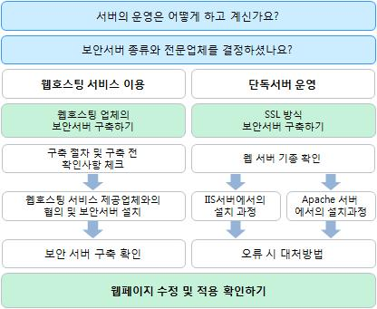

출처:미래창조과학부. 보안서버 구축 가이드
[그림 2-3] SSL 방식 보안서버 구축 절차
3. 보안서버 구축 확인 절차 계획을 수립한다.
보안서버 구축 확인은 웹사이트 접속 시 SSL인증서가 설치되었는지 또는 개인정보가
암호화되어 전송되는지 여부를 확인함으로써 알 수 있다. SSL인증서는 웹사이트 접속
시 브라우저 주소창에 표시된 자물쇠 및 인증서 보기 등을 통해 확인할 수 있으며,
개인정보 암호화 전송은 패킷 캡처 프로그램을 이용하여 실제 전송되는 데이터의 암
호화 여부를 확인할 수 있다.
(1) SSL 인증서 설치 확인
(가) 브라우저 주소창 표시 확인 방법 (https:// 접속)
1) 인터넷 주소창의 자물쇠 표시로 인증서가 설치되어 있는지 확인할 수 있다.
2) EV(Extended Validation) 인증서는 Https 통신구간에서 주소창이 녹색으로
변하는 인증서이다.
3) IE 7.0 이상, Mozilla Firefox 3.0 이상, Google Chrome, Apple Safari 3.2이상,
IPhone 3.0 이상에서 주소창이 녹색으로 변한다.
4) IE 6.0 이하 버전은 주소창이 녹색으로 변하지 않는다.
5) 접속한 사이트를 운영하는 회사명, 주소 등을 EV SSL 인증서를 통하여 사
용자들이 쉽게 확인할 수 있으며, 웹사이트의 진위 여부를 쉽게 확인할 수
있다.
(나) 브라우저 주소창 자물쇠 표시 및 인증서 상세보기 방법
1) 자물쇠 클릭
2) 인증서 보기 클릭
3) 인증서 정보확인 후 자세히 탭을 클릭
4) 주체 클릭 후 도메인 주소 및 기업정보 확인
(다) 웹페이지 속성보기를 통한 확인 방법
1) 사이트에서 우 클릭 후 속성 클릭
2) 등록 정보에서 인증서 및 암호화 상태 확인
(2) 개인정보 암호화 전송 확인방법 계획 수립
웹사이트의 개인정보가 전송되는 구간(예: 로그인, 게시판 등)을 점검함으로써 보
안서버 구축 여부를 확인할 수 있다. 전송구간 암호화 여부는 패킷 캡처 프로그램
인 와이어샤크(Wireshark)를 통해 이를 확인할 수 있으며 확인방법은 다음과 같다.
(가) 와이어샤크(Wireshark) 프로그램의 환경설정 방법
1) 상단메뉴에서 Capture > Options 클릭
2) Options 화면: Interface 메뉴에서 해당 랜카드(본인 컴퓨터에 설치된 랜카
드) 선택 후 start버튼 클릭
3) 필터설정 : 패킷 분석이 시작된 후 filter메뉴에 TCP 입력
(나) 점검대상 웹페이지에서 패킷 발송
개인정보 송∙수신 구간에 임의의 값(ID:testid, PW:testpw) 입력 후 로그인
버튼 클릭
(다) 점검 키워드 검색
1) 패킷분석 정지버튼을 클릭 후
2) 패킷검색(Ctrl + F)창을 띄워서 String, Packet byte 단위 설정 후 점검 키워
드 (testid, testpw) 검색
(라) 점검 키워드 검출 확인
1) 점검 키워드 가 검출된 경우 화면을 검색한다. 만일 점검 키워드가 검출되
지 않은 경우 보안서버가 정상적으로 구축된 것이다.
2) 검출된 패킷에 마우스 우 클릭 후 Follow TCP Stream 클릭
3) 검출된 정보를 확인한다.
2-2.
서버 보안 구현 테스트
•수립된 서버 보안의 구현 계획에 따라 사용된 서버의 기술을 이용하여 운영체제와
학습 목표 서버 보안을 구현할 수 있다.
•구현된 서버 보안이 결함이 있는지 테스트하고 테스트 결과를 관리할 수 있다.
필요 지식 /
• 정보보호관리체계에 관한 국제 표준 규격(ISO27001)
학습 내용 1-1의 필요지식 • 참조
• 정보보호관리체계(ISMS)
학습 내용 1-1의 필요지식 • 참조
• 개인정보보호관리체계(PIMS)
학습 내용 1-1의 필요지식 • 참조
• 운영체제 및 서버 공격 유형
학습 내용 2-1의 필요지식 • 참조
수행 내용 / 서버 보안 구현 및 테스트하기
재료·자료
Ÿ 정보통신망 이용촉진 및 정보보호 등에 관한 법률
Ÿ 개인정보 보호법
Ÿ 정보보호관리체계에 관한 국제 표준 규격(ISO27001)
Ÿ 정보보호관리체계(ISMS)
Ÿ 개인정보보호관리체계(PIMS)
Ÿ 운영체제 및 서버 공격 유형
기기(장비･공구)
Ÿ 전산장비 : 인터넷, 컴퓨터, 네트워크 장비, 서버, 데이터베이스(DB) 시스템 등
Ÿ 지원도구 : 문서작성 도구 등
Ÿ 보안장비 : 취약점 분석 도구, 동적 분석 도구, 정적 분석 도구, 로그 분석 도구, 방화벽 설정
도구 등
안전･유의 사항
Ÿ 기술적 보안의 응용프로그램 보안, 서버 보안, 네트워크 보안, 데이터베이스(DB) 보안을 설계하고
구축하는 업무에 적용한다.
수행 순서
• 서버 보안설계를 구현한다.
1. 웹서버 종류별 SSL 보안서버를 구축한다.
(1) Apache 서버에서 보안서버 구축하기
(가) Apache mod_ssl 모듈 설치 확인
Ÿ SSL 인증서를 설치하기 위해서 먼저 Apache에 mod_ssl 모듈이 설치가 되어
있어야 한다. Apache 2버전 이상의 웹서버는 동적과 정적방식으로 설치를
지원하고 있고, mod_ssl 모듈이 설치되어 있지 않은 경우는 Apache를 재설
치하여야 한다.
(나) SSL 설정
1) Apache가 설치된 경로를 [$Apache_home]으로 할 때 Apache의 SSL 설정
은 주로 [$Apache_home]/conf/extra/ httpd-ssl.conf 파일에서 이루어진다.
먼저 Apache 환경파일인 [$Apache_home]/conf/httpd.conf 설정에
httpd-ssl.conf 파일을 참조하도록 한다.
2) /usr/local/apacje/modules 폴더에 mod_ssl.so 모듈의 존재를 확인한다.
3) Apache 환경파일인 [$Apache_home]/conf/httpd.conf/httpd-ssl.conf 파일 내
용 중에서 동적모듈로 명시된 리스트 중 mod_ssl.so가 있는지 확인한다.
4) 해당 파일 내용 중 하단 부분에서 #include conf/extra/httpd-ssl.conf 구
문중 맨앞의 #을 제거함으로써 참조를 선언한다.
5) 저장 후 httpd-ssl.conf 가 있는 폴더로 이동하고, SSL 엔진 사용 부분의
내용을 확인한 후 인증서 위치를 생성하는 작업을 한다. 만약 폴더가 없
다면 생성한다.
6) 받은 인증서를 SSL 폴더로 이동한다.
7) vi 명령을 이용하여 SSL 인증서 패스워드 지동입력 shell script를 만든다.
8) 만든 shell script의 권한을 지정한다.
9) 모든 작업이 끝난 후 Apache를 재구동하여 SSL을 적용한다.
(2) IIS 5.0 서버에서 보안서버 구축하기
IIS 5.0 은 WildCard, Multi 인증서 사용은 가능하지만 중복포트를 지원하지 않는다.
(가) 스냅인 추가
1) 시작 → 실행 → mmc 를 입력 한 후 확인을 클릭한다.
2) 파일 → 스냅인 추가/제거(M) 선택 하거나 단축키 Ctrl+M을 입력한다.
3) 추가를 클릭한다.
4) 인증서 선택 후 추가를 클릭한다.
5) 컴퓨터 계정을 선택 후 다음을 클릭한다.
6) 로컬컴퓨터:(이 콘솔이 실행되고 있는 컴퓨터(L)을 선택한 후 마침을 클
릭한다.
7) 닫기를 클릭한다.
8) 인증서(로컬 컴퓨터)가 등록 되었는지 확인한 후 확인을 클릭한다.
(나) PFX파일 불러오기
1) 콘솔 루트 → 인증서(로컬 컴퓨터) → 개인 → 오른쪽 마우스 클릭 →
모든 작업(K) → 가져오기(I)를 클릭한다.
2) 다음을 클릭한다.
3) 찾아보기(R)을 클릭한다.
4) 발급받은 인증서를 선택한 후 열기를 클릭한다.
5) 다음을 클릭한다.
6) 암호를 입력한 후 이 키를 내보낼 수 있도록 표시를 체크한 후 다음을
클릭한다.
7) 인증 저장소가 개인인지 확인한 후 다음을 클릭한다.
8) 마침을 클릭한다.
9) 인증서가 정상적으로 등록 되었는지 확인한다.
(다) 인증서 설치하기
1) IIS 5.0의 웹사이트의 속성을 클릭한다.
2) 디렉터리 보안을 선택한 후 서버인증서를 선택한다.
3) 다음을 클릭한다.
4) 기존 인증서를 할당합니다(A)를 선택하고 다음을 선택한다. 갱신의 경우
에는“새 인증서를 만듭니다.(C)”를 선택하고 다음을 선택한다.
5) 해당 웹사이트의 도메인과 만료날짜가 맞는 해당 인증서를 찾아 할당한다.
6) 마침을 클릭한다.
7) 인증서 보기를 클릭한다.
8) 발급대상 도메인과 인증유효기간이 맞는지 확인한다.
(3) IIS 6.0 서버에서 보안서버 구축하기
(가) 스냅인 추가
1) 시작 → 실행 → mmc 를 입력한 후 확인을 클릭한다.
2) 파일 → 스냅인 추가/제거(M) 선택하거나 단축키 Ctrl+M을 입력한다.
3) 추가를 클릭한다.
4) 인증서 선택 후 추가를 클릭한다.
5) 컴퓨터 계정을 선택한 후 다음을 클릭한다.
6) 로컬컴퓨터(이 콘솔이 실행되고 있는 컴퓨터(L))을 선택 후 마침을 클릭
한다.
7) 닫기를 클릭한다.
8) 인증서(로컬 컴퓨터)가 등록 되었는지 확인한 후 확인을 클릭한다.
(나) PFX파일 불러오기
1) 콘솔 루트 → 인증서(로컬 컴퓨터) → 개인 → 오른쪽 마우스 클릭 →
모든 작업(K) → 가져오기(I)를 클릭한다.
2) 다음을 클릭한다.
3) 찾아보기(R)을 클릭한다.
4) 발급받은 인증서를 선택한 후 열기를 클릭한다.
5) 다음을 클릭한다.
6) 암호를 입력한 후 이 키를 내보낼 수 있도록 표시를 체크한 후 다음을
클릭한다.
7) 인증 저장소가 개인인지 확인한 후 다음을 클릭한다.
8) 마침을 클릭한다.
9) 인증서가 정상적으로 등록 되었는지 확인한다.
(다) 인증서 설치하기
1) IIS를 실행하여 적용하실 사이트를 마우스 오른쪽으로 클릭한 후 속성을
클릭한다.
2) 디렉터리 보안을 선택한 후 서버인증서를 클릭한다.
3) 다음을 클릭한다.
4) 기존 인증서를 할당합니다(A)를 선택하고 다음을 선택한다.
5) 등록하였던 인증서를 선택한 후 다음을 클릭한다.
6) SSL포트를 지정한 후(기본 443) 다음을 클릭한다.
7) 다음을 클릭한다.
8) 마침을 클릭한다.
(라) 인증서 확인 방법
1) 인증서 보기(V)를 클릭한다.
2) 일반 탭은 발급대상/발급자 유효 기간 등을 확인할 수 있다.
3) 인증 경로 탭은 인증 경로/인증서 상태를 확인할 수 있다. (“올바른 인
증서입니다.”일 경우 정상)
4) 시작 → 실행 → cmd 실행 후 netstat -noa | findstr 443 으로 인증서를
설치한 포트가 활성화되었는지 확인한다.
(4) IIS 7.0 서버에서 보안서버 구축하기
(가) 인증서 가져오기
1) [시작] > [프로그램] > [관리도구] > [IIS(인터넷 정보 서비스)관리자]를 선
택한다.
2) 서버 인증서를 더블 클릭 > 마우스 오른쪽 > 가져오기를 선택한다.
3) 인증서 파일을 찾은 후 암호를 입력한다.
4) 인증서가 추가된 내용을 확인한다.
(나) 인증서 설치
1) SSL인증서를 설치할 웹사이트 목록의 마우스 오른쪽을 클릭하여 바인딩
편집을 선택한다.
2) 추가를 클릭하여 SSL 서비스를 클릭한다. 종류: https > 포트번호 입력
(Default는 443) > SSL 인증서 항목을 확장한 후 등록한 인증서를 선택한다.
3) 추가된 인증서를 확인한 후 닫기를 클릭한다.
(다) 포트 활성화 확인
1) Netstat -na 명령어를 사용하여 443포트가 리스닝(listening) 되어있는지
확인한다.
2) 만약 활성화 상태이지만 외부에서 접속이 안되면 방화벽 설정을 확인한다.
2. 웹페이지 암호화를 구현한다.
암호화 통신을 하기 위해서 보안 프로토콜을 호출하는 방법은 OS나 Program 언어를
가리지 않고 모두 동일하다. 그 이유는 암호화 통신을 하기 위해 적용하는 부분이 특
정 OS나 특정 Program 언어에 의존하지 않는, 모두가 공통으로 사용하는 HTML 언어
이기 때문이다. 따라서 암호화 통신을 하기 위하여 암호화 적용 범위에 따라 웹페이
지 전체 혹은 일부를 암호화하는 방법과 이용자가 선별적으로 암호화를 선택하는 방
법을 적절히 구현한다.
(1) 전체 페이지 암호화 구현
(가) https 프로토콜 호출하기
https 프로토콜을 호출하여 웹페이지 전체에 적용하는 방법은 간단히 호출하는
프로토콜을 http://에서 https://로 수정하면 된다.
(나) 리다이렉션(Redirection) 설정
암호화 통신을 위해서는 https 프로토콜을 직접 호출을 해줘야 한다. 이때 웹
브라우저는 해당 도메인 앞에 http://가 붙은 것으로 판단하고 평문 통신을 한
다. 평문 통신을 하는 경우라면 문제가 없지만, 암호화 통신을 해야 할 경우에
는 https://를 직접 붙여서 입력해야 하므로 불편할 뿐만 아니라 입력하지 않은
경우 암호화 통신이 이루어지지 않을 수 있다. 리다이렉션은 현재 접속한 도메
인이나 혹은 웹페이지를 강제로 다른 주소나 다른 페이지로 변경해 줌으로써
사용자들의 불편함을 감소시켜주고 자연스럽게 암호화 통신을 할 수 있도록
해주는 기능이다. 또 다른 방법으로는 OS나 웹 프로그래밍(web programming)
언어의 종류에 상관없이 모두 공통적으로 사용하는 HTML tag를 이용한 방법
으로, 어떤 경우에서나 적용이 가능하기 때문에 가장 많이 이용되고 있다.
Meta tag를 이용하는 경우, 1초 정도 깜박하는 현상이 나타나기 때문에 종종
Javascript를 이용하기도 한다. Meta tag를 이용한 방법은 html Redirection 방
법과 동일하게, 사용자들이 익숙하게 접속하는 사이트의 index 페이지에 삽입
해 두면, 사용자들이 https://라는 프로토콜을 특별히 지정해 주지 않아도, 보안
을 위해서 암호화 통신이 적용된 사이트로 리다이렉션 해준다.
(2) 페이지별 암호화 구현
페이지별 암호화는 현재 위치하고 있는 페이지에서 다른 페이지로 이동할 때, 보
안을 위해서 암호화된 전송을 할 것인지 아니면 평문 전송할 것인지를 선택하여
암호화하는 것을 말한다. 부분적인 페이지 암호화를 사용하는 이유는 암호화 적용
이 필요 없는 부분까지 암호화하여 서버의 부하를 증가시키는 것을 최대한 줄일
수 있기 때문이다. 이렇게 페이지별로 암호화가 적용된 사이트를 방문해보면, 경
고창을 만나게 되는 경우가 있다. 이 경고창이 뜨는 것은 암호화 통신을 유지하기
위해서는 웹페이지내의 모든 URL의 호출이 https://로 이루어져야 하나, http:// 즉
평문 통신을 위한 웹페이지 URL이 포함되어 있다는 것을 의미한다. 이런 경고창
이 발생하는 웹페이지 속성을 보면 ‘암호화 안됨’이라고 해서 마치 암호화가
되지 않은 평문 상태로 데이터가 전송되는 것처럼 생각되지만 웹페이지 상 전송
되는 데이터를 볼 수 있는 third-parth 툴을 이용해서 확인해보면, 암호화 통신이
이루어지고 있다는 것을 알 수 있다. 하지만 경고창이 발생하게 되면, 상세한 내
용을 모르고 웹사이트에 접속하는 사용자들에게 보안이 되고 있지 않다는 불신을
줄 수도 있고, 또한 계속적인 경고창으로 인해서 불편해할 수 있으므로 가급적 발
생하지 않도록 웹 페이지 내의 모든 URL을 https://로 바꿔주는 것이 좋다. 만일
절대경로로 호출하는 것이 아니라, 상대경로로 호출하는 것이라면 소스를 변경하
지 않아도 된다.
3. 프레임별 암호화를 구현한다.
SSL을 이용한 보안포트(443)를 웹페이지에 적용하는 방법으로는 단순히 http를 https
로만 바꾸어주면 보안포트를 이용해서 암호화 통신을 할 수 있다. 하지만, 프레임이
삽입된 웹페이지의 경우에는 약간 적용하는 방식이 다르다. 프레임이 적용된 페이지
를 이용하면 암호화된 페이지와 비 암호화된 페이지를 각각 적용시킬 수 있다.
4. 암호화 통신과 일반 통신의 혼용된 방식 서버 구축을 지양한다.
최근 MITM(Man in the Middle) 공격의 변형된 방법으로 사용자 PC에 보이는 html 문
서를 변경하는 해킹기법이 보고되어 SSL 방식의 보안서버 구축 시 각별한 주의가 요
구된다. 예를 들면 로그인과정에서 보안접속 선택 시 실행되는「https://」를 해킹 도
구를 사용하여 「http://」로 변경할 경우 사용자가 보안접속을 선택하여도 일반접속
으로 로그인이 진행되어 ID, 패스워드가 인터넷 통신과정에서 평문으로 전송된다. 이
러한 해킹이 가능한 원인은 웹사이트에서 일반접속과 보안접속을 모두 가능한 형태
로 서비스를 제공하고 있기 때문이다. 이러한 방식의 대책은 다음과 같다.
(1) 로그인, 회원가입 등 개인정보를 전송하는 경우 보안접속(암호화 전송)만 가능하
게 구축
(2) 보안접속만 가능한 페이지를 평문 접속(http://)으로 요청할 경우 접속을 제한하거
나 특정 페이지로 강제 이동하도록 홈페이지 소스 수정
• 서버 보안 점검을 실시한다.
1. 인증서 관련 오류를 점검한다.
(1) 인증서를 발급받은 사이트 주소와 실제로 접속한 사이트 주소가 다른 경우, 예를
들어 www.opa.or.kr로 인증서를 발급받아 설치한 후 실제 적용은 login.opa.or.kr로
설정하여 인증서를 발급받은 주소와 실제로 접속한 주소가 다른 경우에 위와 같
은 경고창이 나온다.
(2) 인증서가 유효하지 않은 경우로 인증서는 저마다 고유한 유효기간을 가지고 있는
데, 이 기간이 지난 인증서를 계속 설치해 두는 경우에 나오는 경고창이다. 그러
나 일반적으로 인증서가 설치된 사이트에 접속하는 PC의 날짜가 잘못되어 있어서
생기는 경우도 많다.
(3) 브라우저가 웹 서버 인증서를 신뢰할 수 없는 경우로 웹 서버 인증서를 발급한
인증기관을 웹 브라우저가 인식하지 못하는 경우로써, 브라우저에는 기본적으로
신뢰할 수 있는 인증기관 리스트가 내장되어 있는데 그 리스트에 없는, 즉 신뢰할
수 없는 인증기관에서 발급된 인증서를 설치한 경우에 발생하는 경고창이다. 그리
고 웹 서버에서 자체적으로 만든 인증서를 설치한 경우에도 경고창은 발생한다.
2. 보안되지 않은 항목의 표시Ÿ연결 관련 오류를 점검한다.
(1) 보안된 항목 https와 보안되지 않은 항목 http를 모두 포함하는 경우 보안경고창
이 나타난다. https://를 이용해서 암호화 통신을 하고자 하는 페이지의 소스에
http://를 이용하여 호출하는 이미지 등이 존재할 때 보안경고창이 나타나는 것이
다. 이 경우‘아니오’버튼을 눌러 표시되지 않는 http 항목의 소스를 절대경로를
써서 https로 호출하면 된다.
(2) 한 페이지에 http://와 https://의 두 프로토콜이 존재하는 경우 HTML 파일 중에
HTML 헤더 부분에 다음의 스크립트를 넣어주면 된다. META
HTTP-EQUIV="REFRESH" CONTENT="0; URL=http://(해당 URL)" 이 스크립트는
https 페이지에서 로그인한 후, https로 암호화되는 임의의 페이지를 하나 만들어
이동을 하되 그 페이지에서 메타태그를 이용하여 원하는 http 페이지로 refresh
하게 만드는 것이다. 보통의 CGI 프로그래밍에서의 리다이렉션 함수(메소드)나 또
는 HTTP Location 헤더를 직접 가지고 보안되지 않은 곳으로 리다이렉션하면 보
안되지 않은 곳으로 간다고 경고가 나오지만, HTTPS 서버의 HTML을 읽게 한 후
그 HTML 내에서 META 태그를 이용해서 리다이렉션하게 되면, 브라우저는 일단
그 HTML이 HTTPS 서버에서 읽은 것으로 간주하고 보안 경고가 뜨지 않으며
HTML의 META 태그로 리다이렉션하는 경우에는 브라우저가 리다이렉션 한 것처
럼 동작되게 되어 경고가 뜨지 않는다.
(3) https로 접속할 경우 페이지를 표시할 수 없다고 확인되는 경우
(가) https 디렉토리에 파일이 존재하지 않을 경우
(나) 서버나 end-user의 방화벽에서 443 포트가 차단되었을 경우
(다) https 서버가 다운되었을 경우
(라) SSL certificate 파일이 정상적이지 않을 경우
(마) 웹 브라우저에서 ssl 3.0으로 셋팅이 되어 있지 않을 경우
인증서가 정상적으로 설치되었는지를 확인하고 서버에서 https를 위한 포트가
활성화 되었는지 확인한다. 또한 방화벽과 L4 스위치 등 보안장비가 있다면
https를 위한 해당 포트를 모두 허용해 주어야 한다. IIS 서버의 경우‘Netstat
-na | grep 포트 번호’명령어를 이용하여 https를 위한 포트가 활성화되어 있
는지 확인한다.
3. 웹서버 기종 변경 관련 사항을 점검한다.
(1) 운영 중인 웹 서버를 같은 기종으로 변경하려 하는 경우
개인키와 인증서를 백업한 후 재설치하여 사용이 가능하다.
(2) 운영 중인 웹 서버 종류를 다른 기종으로 변경하려 하는 경우
개인키와 인증서를 백업한 후 재설치하여 사용이 가능하다. 다만 일부 웹 서버 종
류는 인증서 및 개인키의 호환이 안 되는 경우가 있으니 서버 이전 또는 변경 전
반드시 사전 확인 후 작업을 진행하여야 한다.
4. 인증서의 유효성을 확보한다.
SSL 인증서 설치의 오류에 따라 보안경고창이 발생하여 이용자들에게‘접속한 웹사
이트 보안 인증서에 문제가 있음’을 경고하며, 웹사이트에 대한 신뢰도를 하락시키
고 이용자들에게 심리적 부담감을 주게 된다. 따라서 보안서버 구축∙관리 시 신뢰할
수 있는 인증기관, 발급 사이트 이름, 인증서 유효기간 등을 확인하여 보안서버 구축
의 유효성을 유지하는 것이 매우 중요하다. 보안경고창이 발생하는 원인을 간략히 요
약하면 다음과 같다.
(1) 인증서 발급기관의 신뢰성 여부
웹브라우저에 해당 인증서가 탑재되지 않아서 이를 발급한 기관을 신뢰할 수 없
는 경우
(2) 인증서 유효기간의 적정성 여부
발급된 인증서의 유효기간이 만료되거나 아직 유효하지 않은 경우
(3) 인증서 발급대상과 설치된 웹사이트와의 일치성 여부
인증서에 명실된 발급대상 사이트와 실제로 설치된 사이트가 일치하지 않는 경우
특히, 윈도우 비스타에서 internet Explorer 7을 사용하는 경우 탐색이 차단되고
보안 경고 페이지가 나타나며, 계속 진행하면 보안 상태 표시줄이 붉게 표시되기
때문에 사용자들에게 더욱 강력한 경고를 주게 되어 웹사이트 접속을 기피하게
되므로 인증서 유효성 확인에 대한 주의가 필요하다.
5. 웹사이트의 신뢰성을 확보한다.
인증서에 명시된 발급대상 사이트와 실제로 설치된 사이트가 일치하지 않을 경우, 중
간에 해킹을 통해 위∙변조된 피싱 사이트로 이용자들에게 의심받을 가능성이 높다.
특히 해커가 사용자 PC와 보안서버의 중간에서 프록시 서버를 통해 MITM(Man in
the Middle) 공격을 할 경우, 유일한 보호수단은 사용자 PC에서 발생하는 보안경고창
이다. 따라서 정상적인 웹사이트지만 SSL 인증서 유효성의 오류로 인해 보안경고창이
발생하는 것은 사용자들이 정상 웹사이트를 해커의 공격을 받은 웹사이트로 혼동하
게 될 소지가 크다. 또한 보안서버 구축 가이드 및 리플렛, 안내 홈페이지를 통하여
보안경고창 발생 시 주의할 것으로 지속적으로 안내하고 있기 때문에, 이러한 안내를
받은 이용자가 위∙변조된 사이트나 피싱 사이트 등의 불법 웹사이트로 오인하여 접
속을 기피하는 현상이 발생할 수 있다. 따라서 보안경고창이 발생하지 않도록 보안서
버 구축 웹사이트의 SSL 인증서 유효성을 확인하고 웹사이트를 수정하는 등 사전에
확인 조치가 필요하다.
6. 유효하지 않는 SSL 인증서 사용 시 보안경고창 발생 시 대책을 익힌다.
해커가 사용자 PC와 보안서버의 중간에서 프록시 서버를 통해 MITM(Man in the
Middle) 공격을 할 경우, 임의로 발급한 SSL 인증서를 사용함으로 사용자 PC에 보안
경고창이 발생하게 된다. 따라서 보안경고창은 사용자가 해킹을 인지할 수 있는 수단
으로 널리 인지되어 있으며, 사용자가 웹사이트 이용 시 정보보호를 위한 기본적으로
확인하는 사항이다. 정상적인 웹사이트지만 다음과 같이 유효하지 않는 SSL 인증서를
사용할 경우 보안경고창이 발생하여 사용자들이 해커의 공격을 받은 웹사이트로 오
인하게 될 소지가 크다.

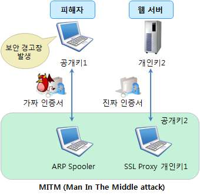

출처:미래창조과학부. 보안서버 구축 가이드
[그림 2-4] ARP 스푸핑을 이용한 MITM 공격
• 인증서 발급기관이 웹브라우저의 신뢰기관 목록에 탑재되지 않아서 발급한 기관을
신뢰할 수 없는 경우 (ex: 자체 발급 인증서, 인증기관이 아닌 업체에서 발급한 인
증서)
• 발급된 인증서의 유효기간이 만료되거나 아직 유효하지 않은 경우
• 인증서에 명시된 발급대상 사이트와 실제로 설치된 사이트가 일치하지 않는 경우
이러한 경우의 대책 방안은 다음과 같다.
(1) SSL 인증서 발급 시 다음 사항을 점검한다.
(가) 주요 웹브라우저에서 신뢰기관으로 등록된 인증기관에서 발급된 인증서인가?
(나) SSL 인증서 내 도메인 명과 웹사이트 명이 일치하는가?
(다) SSL 인증서 내 유효기간이 정확한가?
(2) 보안서버 구축 후 다음 사항을 점검한다.
(가) 내∙외부 네트워크에서 웹사이트를 접속하여 보안경고창이 발생하는지 확인한다.
(나) IE, 파이어 폭스, 사파리 등 주요 웹브라우저에서 보안경고창이 발생하는지
확인한다.
7. SSL Ciphersuite 취약성 해결 방안을 익힌다.
SSL 프로토콜의 취약점 중 하나는 별다른 제약 없이도 Ciphersuite의 수정이 가능하
다는 것이다. 공격자는 이 취약점을 이용하여 사용자의 Ciphersuite 설정을 키 길이가
짧은 대칭키 알고리즘으로 변경할 수 있다. 키 길이가 짧은 대칭키 알고리즘으로 암
호화된 내용은 공격자가 쉽게 복호화할 수 있기 때문에, 서비스 제공자는 사용자의
Ciphersuite 설정이 키 길이가 짧은 암호화 알고리즘으로 되어있을 경우를 대비해야
한다. Ciphersuite는 익스플로러의 경우 레지스트리 편집기를 사용하여
HKEY_LOCAL_MACHINE＼SYSTEM＼CurrentControlSet＼SecurityProviders＼SCHANNEL
＼Ciphers 경로를 찾아가면 수정이 가능하다. 파이어폭스는 C:＼Program Files＼Mozila
Firefox＼greprefs＼security-orefs.js파일을 메모장을 통해 수정이 가능하다. 이처럼
Ciphersuite의 수정을 통한 낮은 암호화 알고리즘의 강제사용을 막기 위해서 서버 관
리자는 일정 강도 이상의 암호화 알고리즘 사용을 강제할 필요가 있다. 또, 낮은 암
호화 알고리즘을 사용하는 경우 사용자에게 높은 강도의 암호화 알고리즘을 사용할
것을 권장하는 경고메시지를 사용할 필요가 있다.
• 서버 보안 예방 조치 및 침해사고 발생 후 점검 사항을 확인한다.
1. 예방 조치 사항을 이해한다.
예방조치로는 웹 방화벽 설치를 하는 것이다. 상용 웹 방화벽 이용 시 실시간 감지와
관제탑에서의 모니터링 등 지원을 받지만 비용이 많이 발생한다. 이러한 비용에 대한
부담이 없고 효과적인 웹 방화벽을 설정하려면 오픈소스로 공개되어 있는 공개형 웹
방화벽이 있다. 공개형 웹 방화벽으로는 리눅스(Linux)에서는 Apache의 모듈로
mod_security가 있고 윈도우즈(Windows)의 IIS에서는 webknight가 있다. 2013년에는
윈도우즈(Windows) IIS용 mod_security도 개발되어 배포되고 있다. 먼저 윈도우즈
(Windows)의 webknight는 AQTRONIX사에서 개발한 것으로 윈도우즈(Windows) 서버
에서 IIS로 서비스 되는 웹 서버에 설치가 가능하다. 윈도우즈(Windows) IIS에 등록된
사이트의 등록정보에서 ISAPI필터에 webknight를 추가하면 된다. webknight의 룰은
KISA에서 권장하는 룰을 적용하거나 운영하는 서버에 적합한 룰을 직접 설정할 수도
있다. webknight를 통해 모든 웹 공격을 방어하는 것은 아니지만 설정된 룰에 따라
기본적인 웹 공격들에 대하여 방어를 하므로 예방을 할 수 있다. 리눅스(Linux)에서는
apache 웹서버에 대한 취약점을 보완하기 위해 웹 방화벽인 mod_security 설치를 할
수 있다. mod_security는 오픈 소스로서 웹 방화벽 어플리케이션이며 IIS7과 Nginx에
서도 적용이 가능하다. 공개용 웹 방화벽인 mod_security는 가장 많이 사용하는
apache 모듈형태로 추가하여 사용하는데 매우 효과적인 툴로써 apache에 설정한 내
용을 확인할 수 있다. mod_security의 정책을 설정해야 하는 어려움이 있지만 KISA에
서 권장하는 정책을 사용하거나 직접 정책수정을 통해 운영하는 서버에 맞는 정책을
수립할 수 있다. 모든 웹 공격에 대한 방어를 할 수 있는 것은 아니지만 정책에 따른
기본적인 방어를 통해 예방을 한다. 또한 홈페이지 해킹방지 도구인 Castle도 무료로
사용할 수 있으며 서버에 적용하여 사용할 수 있다. Castle은 설치 후 홈페이지 소스
에 삽입하여 방어하는 보안도구로 웹 취약점이 많은 사이트의 경우 유용하게 사용할
수 있다. 웹 방화벽만큼 중요한 설정이 네트워크 방화벽 설정이다. 개념을 설명하면
방화벽으로 모든 네트워크를 차단한 상태에서 필요한 포트 및 ip에 대하여 open을 하
는 것이다. 윈도우즈(Windows)에서는 로컬 보안 정책을 통해, 그리고 리눅스(Linux)에
서는 iptables로 OS에 기본 탑재된 기능을 사용하여 충분히 설정이 가능하다. 기본적
으로 방화벽은 INPUT 통신을 차단한 상태에서 서비스에 필요한 포트만 오픈을 하여
다른 포트로의 침해를 예방한다. 하지만 윈도우즈(Windows) 방화벽 기능으로는 구체
적인 설정을 할 수 없다. 그래서 로컬 보안 정책에서 IP 보안 정책을 적용하였다. [시
작] - [모든 프로그램] - [관리도구] - [로컬보안 정책] 메뉴로 실행을 하며 IP 보안
정책에서 방화벽과 같은 설정을 수동으로 자세한 설정을 하였다. 전체 INPUT되는
TCP통신을 차단하고 웹 서비스, FTP 서비스, SMTP 서비스와 같이 허용해야할 서비
스 포트만 허용설정을 하였다. 그리고 FTP 서비스에서는 접근하는 사용자의 ip만 허
용을 하여 다른 ip에서의 접근을 차단하고 윈도우 서버에 원격 데스크톱 포트도 사용
자의 ip만 허용을 하였다. 해당 설정으로 웹 취약점을 통해 침해가 발생하여도 특정
ip에서만 접속이 되도록 좀 더 자세한 방화벽 설정을 통해 예방을 할 수 있다. 이렇
게 각 OS에서 제공되는 방화벽 설정만으로 단독 서버를 보호할 수 있는 설정이 가능
하다. 웹 방화벽과 네트워크 방화벽 설정은 침해사고 전 미리 설정을 한다면 모든 공
격에 대한 방어를 할 수는 없지만 대표적으로 정의된 공격에 대해서는 방어가 가능
하다.
2. 침해사고 발생 후 점검사항을 이해한다.
공격자들이 웹 서버를 통해 웹쉘을 업로드한 후 악성코드 유포 및 개인정보를 탈취
하는 사례가 많다. 웹쉘 파일은 공격자가 원격에서 웹을 통해 서버에 명령을 할 수
있는 스크립트 파일이다. 이러한 웹쉘 파일이 서버 내 있는지 점검하는 툴이 whistl
이다. 윈도우즈(Windows)버전과 리눅스(Linux)버전이 있으며 쉽게 툴을 사용하여 확인
된 웹쉘 파일의 경로를 확인한다. 이렇게 확인된 파일은 정상파일인지 악성 웹쉘 파
일인지 확인하여 제거를 하면 된다. Rootkit 은 공격자가 OS의 관리자 계정의 권한을
얻기 위해 사용되는 프로그램으로 침해사고 후 다음에 접속을 쉽게 하기 위해 심어
두는 경우가 많다. 이러한 Rootkit을 점검하는 툴로 khunter이 있다. 리눅스(Linux)에
서의 Rootkir 점검툴은 rkhunter이 있다. 시스템 무결성을 체크하는 툴로 리눅스
(Linux) 시스템의 비정상 유무를 파악하는 툴이다. 윈도우즈(Windows)에서 기본으로
서버의 프로세스 및 상태를 확인하는 것은 인터페이스가 각 기능으로 나누어져 있어
보기가 불편하다. 그러한 사항을 보완하여 IceSword를 사용하는데 왼쪽 메뉴에
Process, Port Kernel Module 등과 같은 사항은 한눈에 보기 편하도록 나온다. 이렇게
보기 편하고 구분, 정리된 사항을 보고 이상프로세스가 있는지 특이사항은 없는지 점
검이 가능하다. 윈도우즈(Windows)에서 침해사고 시 바이러스 백신점검을 빼 놓을 수
없다. 하지만 서버에서의 바이러스 점검툴은 상용화 버전을 사용해야하며 비용이 발
생하는 측면이 있다. 그 외에도 다른 보안설정들도 많이 있으며 이러한 보안 설정과
툴들을 사용자들이 쉽게 사용하게 만드는 설계가 요구된다. 그리고 더욱 효과적인 오
픈소스 보안 솔루션이 있다면 해당 오픈소스 솔루션 사용을 장려하도록 하는 방법도
있다. 하지만 무엇보다 범용적인 오픈된 한국형 서버보안 솔루션을 개발하여 사용자
들이 쉽게 설치하고 쉽게 사용하여 서버보안을 강화하도록 한다면 큰 효과를 볼 수
있다. 오픈소스 솔루션 및 보안 모듈들은 보통 외국에서 개발이 되어 영문으로 되어
있는 경우가 많다. 한글로 된 한국형 보안 솔루션을 개발한다면 쉽게 사용을 할 수
있을 것이다. 기존 존재하는 보안 솔루션들은 상용화 버전으로 소기업들에게는 비용
적인 부담을 주고 있어 오픈소스 보안 솔루션 개발을 활성화하여 범용적인 보안 솔
루션 개발을 하는 방법도 보안설정을 장려할 수 있는 방법이다.

| 학습 2 | 교수·학습 방법 |
| --- | --- |

교수 방법
• 서버보안이 왜 중요하고 의미가 있는지 충분히 설명한다.
• 서버보안은 법률에 의거 수행되는 활동으로 본 수업에 앞서 법률의 등장배경과 서버 구축방안에
대해 설명하도록 한다.
• 학생들의 관심을 유발하기 위한 서버 보안 침해사례 등을 파워포인트로 만들어 이해에 도움이
되도록 한다.
• 가능하면 개인별로 서버보안 구축사례를 수집하게 하고 문제점과 해결방법을 제시하도록 지도한다.
• 제시한 사례들을 서로 공유함으로써 다양한 보안방법을 공유할 수 있게 지도한다.
• 보안서버 구축이 제대로 이루어지고 있는지 항상 체크한다.
• 정보보안의 중요성과 정보윤리를 함께 교육함으로써 올바른 보안 의식 함양이 되도록 유도한다.
학습 방법
• 서버보안에서 제시된 내용을 사전에 충분히 학습한다.
• 관련 법률에 대한 사이트를 통해 스스로 내용을 찾아보고 추가 설명이 요구되는 부분에 대해
질문 목록을 작성한다.
• 다양한 서버보안 구축사례를 찾아보고, 스스로 문제점과 해결방법을 찾아본다.
• 서버보안 구축사례를 파워포인트, MS 워드, 한글과 같은 문서로 작성하여 사례 발표 및 다른
학생들과 자료를 교환한다.
• 보안서버에 대한 보안 취약점을 분석한 후 사후대책을 계획해 본다.
• 정보보안의 필요성을 인식하고, 올바른 윤리의식이 함양되도록 주기적으로 보안교육을 받는다.

| 학습 2 | 평 가 |
| --- | --- |

평가 준거
• 평가자는 학습자가 수행 준거 및 평가 항목에 제시되어 있는 내용을 성공적으로 수행하였는지를
평가해야 한다.
• 평가자는 다음 사항을 평가한다.

| 학습 내용 | 평가 항목 | 성취수준 |  |  |
| --- | --- | --- | --- | --- |
|  |  | 상 | 중 | 하 |

- 보안 요구사항에 따라 사용된 서버의 제품 환경과
운영체제 기술을 이용하여 서버 보안을 설계할 수
서버 보안설계 있다.
구현 계획
- 설계된 서버 보안의 환경구성에 맞도록 운영체제와
서버 보안 구현 계획을 수립할 수 있다.
- 수립된 서버 보안의 구현 계획에 따라 사용된 서버
의 기술을 이용하여 운영체제와 서버 보안을 구현할
서버 보안 구현 수 있다.
테스트
- 구현된 서버 보안이 결함이 있는지 테스트하고 테스
트 결과를 관리할 수 있다.
평가 방법
• 서술형시험

| 학습 내용 | 평가 항목 | 성취수준 |  |  |
| --- | --- | --- | --- | --- |
|  |  | 상 | 중 | 하 |

- ISO27001, ISMS, PIMS, 서버 보안의 정의
- 서버보안의 개념과 필요성 이해
서버 보안설계
- 서버 보안 구축 절차 이해
구현 계획
- 서버 구축 설계 시 고려 사항
- 보안 서버 종류 및 구축 방법
- 서버 보안약점 및 보안대책
- 침해사고 발생 유형 및 대처법
서버 보안 구현 - SSL 인증서의 이해
테스트 - Apache 보안서버 구축 방법
- IIS 보안서버 구축 방법
- 보안 취약점 테스트 유형 및 점검 도구의 종류 분석
• 문제해결 시나리오

| 학습 내용 | 평가 항목 | 성취수준 |  |  |
| --- | --- | --- | --- | --- |
|  |  | 상 | 중 | 하 |

| 서버 보안설계 구현 계획 서버 보안 구현테스트 • 평가자 체크리스트서버 보안설계 구현 계획 서버 보안 구현테스트 피 드 백 | - 서버 보안이란 무엇인가 - 서버 보안의 개념과 필요성 - 보안 서버 구축 설계 시 중점을 두어야 할 사항 - 보안 서버 구축 절차에 대한 이해 - 보안 서버의 취약점과 해결방안 - 보안 서버 구축 시 고려 사항 - 서버 보안 취약점 분석 도구의 종류 및 사용 방법 - ISO27001,ISMS,PIMS,보안서버의 생성 배경과 필요성 - 보안 서버의 취약점과 해결 방안 - 보안 서버 구축 절차의 이해 - 보안 서버 구축 시 고려 사항 - 침해사고 발생 유형 및 대처 방안 - 웹서버별 보안서버 구축 방안 - 서버 보안 분서 도구 종류 및 사용 방법 |  |  |  |
| --- | --- | --- | --- | --- |
| 1. 서술형시험 - 기준 점수트를 제출하게 | 미달자에 대해서는 교육 성취수준을 개별 통보하고 미흡한하여 교육성과를 높이도록 한다. | 분야에 | 대해 | 리포 |
| 2. 문제해결 시나리오- 보안실무에제출하도록 | 대한 이해도를 평가하는 항목으로 관련 양식을 활용하여 직접지도한다. | 점검한 |  | 결과를 |
| 3. 평가자 체크리스트- 성취수준 | 미달자는 보안 관련 법률해석과 보안점검절차에 대한 리포트를 |  | 제출하도록 | 지 |
| 도한다. |  |  |  |  |

| 학습 내용 | 평가항목 | 성취수준 |  |  |
| --- | --- | --- | --- | --- |
|  |  | 상 | 중 | 하 |

| 서버 보안설계 구현 계획 서버 보안 구현테스트 피 드 백 | - ISO27001,ISMS,PIMS,보안서버의 생성 배경과 필요성 - 보안 서버의 취약점과 해결 방안 - 보안 서버 구축 절차의 이해 - 보안 서버 구축 시 고려 사항 - 침해사고 발생 유형 및 대처 방안 - 웹서버별 보안서버 구축 방안 - 서버 보안 분서 도구 종류 및 사용 방법 |  |  |  |
| --- | --- | --- | --- | --- |
| 1. 서술형시험 - 기준 점수트를 제출하게 | 미달자에 대해서는 교육 성취수준을 개별 통보하고 미흡한하여 교육성과를 높이도록 한다. | 분야에 | 대해 | 리포 |
| 2. 문제해결 시나리오- 보안실무에제출하도록 | 대한 이해도를 평가하는 항목으로 관련 양식을 활용하여 직접지도한다. | 점검한 |  | 결과를 |
| 3. 평가자 체크리스트- 성취수준 | 미달자는 보안 관련 법률해석과 보안점검절차에 대한 리포트를 |  | 제출하도록 | 지 |
| 도한다. |  |  |  |  |

학습 1 응용프로그램 보안 구축하기(LM2001020606_14v2.1)
학습 2 서버 보안 구축하기(LM2001020606_14v2.2)

| 학습 3 | 네트워크 보안 구축하기(LM2001020606_14v2.3) |
| --- | --- |

학습 4 데이터베이스(DB) 보안 구축하기(LM2001020606_14v2.4)
3-1.
네트워크 보안설계 구현 계획
•보안요구사항에 따라 네트워크 환경을 파악하고 보안에 필요한 네트워크 보안을 설
계할 수 있다.
학습 목표
•설계된 네트워크 보안에 대한 기술과 제품을 파악하고 네트워크 보안 구현 계획을
수립할 수 있다.
필요 지식 /
• 정보보호관리체계에 관한 국제 표준 규격(ISO27001)
학습 내용 1-1의 필요지식 • 참조
• 정보보호관리체계(ISMS)
학습 내용 1-1의 필요지식 • 참조
• 개인정보보호관리체계(PIMS)
학습 내용 1-1의 필요지식 • 참조
• 네트워크 개념
최근 넷북, 스마트폰 등의 다양한 모바일 단말의 등장과 이용 증가, 그리고 내부 네트워크
의 접속방법의 다양화 등으로 인해서 외부에서 유선을 통한 접근을 제어하는 것만으로는
내부 네트워크의 안정성을 보장하기 어렵다. 또한 내부 네트워크 내에서의 새롭게 생기는
보안위협에 대해서도 대처하기가 어렵다. 따라서 네트워크 접근제어강화와 비인가자 및
보안에 취약한 단말에 대한 네트워크 접속을 원천 차단할 수 있어야 한다. 그리고 사내에

| 학습 내용 | 평가항목 | 성취수준 |  |  |
| --- | --- | --- | --- | --- |
| 서의 보안에 필요한관리를 통한 모니터링접속할 수 있기 | 정보를 수집하기 위한 IP 사용 추적/통제, IP 사용및 통제가 필요하다. 사용자들이 인증절차 없이때문에 이를 통제하여 사내 네트워크 및 정보자산을 | 정보저장사내보호할 수 | 및있어야 | 이력네트워크에한 |
| 다. 그리고 인증된내 네트워크에서 | 사용자의 경우에도 외부에서 모바일 단말기가 바이러스에바이러스를 전파하는 경우가 많이 발생하므로 이를 | 방지할 수 | 오염되어있어야 | 사한 |
| 다. 따라서 사용자정책 통합관리가식은 내Ÿ외부 네트워크은 솔루션을 설치하는화, 기업 비즈니스한계가 생겼다. 퓨터를 이용한 내부되었는지 확인하는용당하는 상황이한 사용자단을 이용해해결하기 위해 검사해 네트워크트워크 보안체계와• 네트워크 기반 공격우리의 환경과 각종아이디와 패스워드를Buffer Overflow에 등장한 서비스스템 공격 위주의해하는 형태로 이 주요 보안장비로스템(IDS), 탐지뿐만티 바이러스 등을 | 접속제어로 네트워크 보안시스템이 구축되고 네트워크필요하다. 기존의 웜, 바이러스 등의 침입을 막기 위한경계에서 방화벽과 침입탐지시스템(IDS), 것이었다. 하지만 발전하는 유Ÿ무선 네트워크 기술과환경의 확대 등으로 기존의 방식으로 네트워크 보안을보안에 취약한 노트북, 모바일단말기 또는 집이나 출장지네트워크의 접근으로 인해 어디에서 바이러스 감염이것조차 파악이 어렵다. 사용자단에서의 보안관리가빈번히 발생하고 있다. 최근 두드러지고 있는 공격 서버 시스템이나 네트워크를 공격하는 방식이다.사용자가 내부 네트워크에 접근하기 전에 보안정책을접속을 통제하여야 한다. 이는 사용자단(endpoint)의 결합해 전체 네트워크에 통합보안체계를 구현하는 유형 정보들은 모두 네트워크로 연결 되어 있다. 네트워크알아내어 시스템에 침입하는 소극적인 형태에서공격은 아직까지도 가장 많이 존재하는 취약점이다. 이어거부(DoS) 공격과 분산 서비스 거부(DDoS) 공격 까지기법들로 시도되다가 점차로 네트워크와 서버를 마비시켜발전되고 있다. 초반에는 네트워크 및 서버 보호를 위한구성이 되며 이후 해킹에 대한 탐지를 주요기능으로아니라 차단을 함께 할 수 있는 침입방지시스템(IPS)으로포함하는 통합보안시스템(UTM)으로 진화하고 있다. | 네트워크침입방지시스템(IPS)과등의취약해유형이이러한만족하는지보안기술을것이다.공격이어오고방화벽과하는 | 위협경로단말기의유지하는원격지시작되어공격에보안에출발하여1990년대서비스를발전하고 | 차단보안방같다양것에컴확산이취약문제점을여부를가존 네초기에는이후후반있다. 시방VPN 등침입탐지시안 |
| 1. 네트워크 장비로의 | 공격 유형 |  |  |  |
| (1) 허브·스위치허브는 들어오는을 해당 보호하도록 | 트래픽을 브로드캐스트 한다. 스위칭 허브는 호스트호스트에만 전송한다. 즉 스니퍼 소프트웨어가 탐지 못하도록구성하고, 특정 포트에서 발견된 주소를 기억하여 새로운 | 주소로MAC | 된이더넷 | 패킷레벨에서주소에 |
| 대해 접근을 | 막도록 구성한다. |  |  |  |
| (2) 라우터 대역폭을 킷 통과를능한 설정 | 절감하고 가용성을 높이기 위해 NetBEUI 패킷이나 TCP/IP금지시켜야 하며 서브넷을 보호하는 필터로 사용해야 한다.포트를 가지고 있으며 특정 IP 주소/인터페이스에 접근을 | 텔넷제한시켜야 | 브로드캐스트접근이 | 패가한다. |
| 2. 네트워크 계층으로의 | 공격 유형 |  |  |  |
| (1) ARP 스니핑스니퍼를 스워드, 매신저로있는지, 개인TCP/IP 대신로드캐스팅을 | 설치하고, 네트워크를 돌아다니는 수많은 패킷을 유심히주고/받는 이야기, 어떤 웹사이트를 보고 있는지,신상정보, 시스템에 치명적인 정보를 수집한다.암호 전송 프로토콜을 사용하고 텔넷은 SSH, http는 하는 대신 스위치를 사용, VPN을 사용해야 한다. | 관찰하여어떤평문으로https(SSL)을 | 계정,물건을 | 패사고전송되는사용, 브 |
| (2) DoS (Denial ofDoS(Denial of수 있는 공격네트워크 고갈,가중시키는을 고갈시킨다.시킴으로써(inbound)되는트래픽을 를 허용하지 | Service) Service)란 멀티태스킹(multi-tasking)을 지원하는 방법으로서 정상적인 서비스 지연 또는 마비, 자원시스템 자원의 고갈은 CPU, 메모리, 디스크의 사용에것을 말한다. 네트워크 자원의 고갈은 쓰레기 데이터로대비책으로 최소한의 서비스만을 제공하고 사용하지발생할 수 있는 원인을 사전에 예방한다. 외부 패킷 송신지 주소가 내부 네트워크에 존재하는 차단시킨다. 내부와 내부에 인증 절차 없이 시스템에 접속할않는다. | 운영체제에서시스템네트워크의않는네트워크에서주소지와수 | 고갈,과다한포트를일치할있는 | 발생할자원부하를대역폭차단인바운드경우사용자 |
| (3) DDoS (DistributedDDoS(Distributed련의 시스템들을통합된 형태로시스템의 일단 취약한설치하고 이를공공기관 때문에 대학격은 TCPrequesting공격, | Denial of Service) Denial of Service)공격은 DoS의 또 다른 형태로,이용해 Dos 공격용 프로그램들을 분산 설치하고어느 목표 시스템에 대하여 일제히 데이터 패킷을성능저하 및 시스템 마비를 일으키는 공격을 시도하는인터넷 시스템에 대한 액세스에 성공하면 침입한 시스템에실행시켜 원격에서 공격을 개시한다. 최근 DDoS 공격이시스템에서 실행되고 있지만, 해커들은 대학 네트워크의네트워크를 실행 사이트로 자주 사용하는 경향이 있다.SYN 플러딩(flooding) 공격, UDP 플러딩(flooding)ICMP broadcasting 공격 (Smurf공격) 등의 형태로 | 인터넷에그 후범람시켜서기법이다.개방적인이러한공격,나타나며, | 연결된이들이그소프트웨어를민간 분산DDoSICMP이러한 | 일서로표적해커들이기업이나속성공echo공 |
| 격을 수행하기출처: 논문.[그림 3-1] DDos | 위해서 다양한 tool이 제작되었다. 시스템 아키텍처 네트워크 보안 감리 지침 개선 연구 공격 |  |  |  |
| (4) Ping of Death초창기의 DoS만들고 큰작은 조각으로핑(ping)의 | 공격방법인 핑(ping)을 이용하여 ICMP 패킷을 정상적인패킷은 네트워크를 통해 라우팅되어 대상 네트워크에단편화되고, 많은 단편화된 패킷을 모두 처리하기경우보다 많은 부하가 걸린다. | 도달하는위해서는 | 크기보다동안 | 크게아주정상적인 |
| (5) SYN 플러딩(flooding)네트워크에서 | 각 서비스를 제공하는 시스템은 동시 사용자 수에 | 대한 | 제한이 | 존재한 |
| 다. 서버별로것처럼 속여체계의 구조적인 | 동시 사용자 수가 한정되어 있어서 존재하지 않은 다른 사용자가 서버에서 제공하는 서비스를 받지 문제점으로 공격이 진행되는 동안 접속이 거의 | 클라이언트가못하도록불가능하다. | 한다. | 접속한TCP/IP |
| (6) Boint, Bonk,시스템의 패킷 | Teardrop 재전송과 재조합에 과부하가 걸리도록 시퀀스 번호를 | 속인다. |  |  |
| (7) LAND 패킷을 전송할 | 때, 송신지 IP와 수신지 IP 주소 값을 똑같이 만들어 | 대상 | 컴퓨터에 | 전 |
| 송한다. 수신지로 나가지시스템은 루프 | 주소를 참조할 때 자신이 소속된 네트워크의 IP이므로않고 자신에게 다시 돌아오게 된다. SYN 플러딩(flooding)처럼상태에 빠지며 시스템의 IP스택에 심각한 장애를 | 초래하게 | 네트워크패킷을된다. | 밖으받은 |

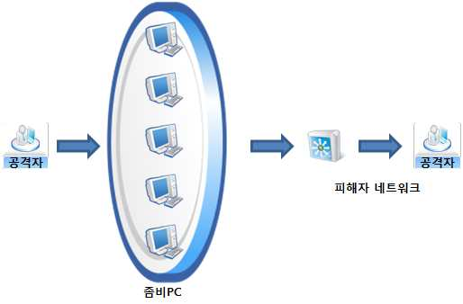

| 학습 내용 | 평가항목 | 성취수준 |  |  |
| --- | --- | --- | --- | --- |
| (8) Smurf 임의의 네트워크에IP를 공격 대상대상 시스템을트 패킷을 | 속하는 호스트에게 핑(ping) 패킷인 echo request를IP로 속여 다량의 ICMP 리턴 패킷(echo reply)이 다운 시키는 공격이다. 라우터의 인터페이스가 처리해 주어야 가능하므로 disable시키면, Smurf 공격은 | 보낼집중되도록직접적으로불가능하게 | 때 | 송신지함으로써브로드캐스된다. |
| (9) Fraggle Smurf와 주소로 가짜을 만들어 피해 | 비슷하며, ICMP 대신 UDP를 사용한다. 공격자가 증폭 넷UDP 패킷을 보내고, 에코가 가능한 넷 내의 각 시스템은호스트로 응답을 한다. | 내의 | 브로드캐스트엄청난 | 트래픽 |
| (10) Fragmentation전송되는 IP이 IP 특성을유입되면 | 패킷이 MTU 크기를 넘지 않도록 하며 이 보다 큰 이용한 공격이 Fragmentation이다. 평소 양보다 갑자기불법적인 공격 시도로 판단할 수 있다. 이 때 네트워크 | 데이터는많은가용성은 | 양의떨어진다. | 단편화된다.패킷이 |
| (11) ARP SpoofingARP 프로토콜은속이는 방법으로로써 방지할 | IP 주소 값으로 MAC 주소 값을 알아내는 프로토콜로서ARP Spoofing이 있다. IP 주소와 MAC 주소 테이블수 있다. | 관계를 | MAC | 주소를확인함으 |
| 3. 침입 수법에 따른 | 공격 유형 |  |  |  |
| (1) 신분 일반 사용자의를 훔치거나 | 도용(Impersonation) 권한 획득, 즉 다른 공격의 발판이 되는 공격으로,무작위로 시도하는 등의 방법이 이용될 수 있다. | 다른 | 사용자의 | 암호 |
| (2) 믿고 있는목표물이 믿고워크스테이션에의 기계들을을 이용하여권한을 얻는 | 기계로 위장(transitive trust) 있는 기계나 네트워크로 위장하는 방법으로 주로있던 허점을 이용하는 것으로, 사용자의 편의를 서로 신뢰하는 기계로 설정하여 암호 없이 로그인하는자신의 기계가 마치 그들 중의 하나인 양 속여 해당방법이다. 이 공격도 주로 다른 공격을 위한 발판이 되는 | 옛 버전의위하여것을기계에 | 같은허용하는대한공격이라 | 썬(SUN)그룹 안점접근할 수 |
| 있다. |  |  |  |  |
| (3) 부당 도용(exploits)시스템의 보안고 나면 주로로 (buffer | 취약성을 이용, 일단 공격하고자 하는 시스템에 대한이 공격을 시도하여 관리자 권한을 얻으려 하게 된다.셋유이드(SETUID)를 가진 프로그램들이 공격대상이 되고 요즘은overflow)를 이용한 공격이 주류를 이루고 있다. | 액세스유닉스의버퍼 | 권한을 | 얻경우 주오버플로우 |
| (4) 자료 도용(data공격 프로그램, | driven) 트로이 목마(trojan horse), 뒷문(back door), | 바이러스(virus)등이 |  | 이에 |
| 속한다. 좀 더마 프로그램을을 실행시키면침입에 성공한도 한다. | 체계적인 공격을 위하여 공격 프로그램을 이용할 수도심어 두었다가 해당 시스템의 보통 사용자 또는 암호를 빼낸다든지 시스템을 파괴한다든지 하게 할시스템에 '뒷문'을 만들어 두어 다음번에 쉽게 침입할 | 있고,관리자가수도수 | 트로이그 있다.있도록 | 목프로그램한 번하기 |
| (5) 하부 구조프로토콜이나인데, 이 공격을시스템을 | 이용(infrastructure) 시스템 등 기본 기능의 취약성 이용, IP 주소 속이기가막으려면 상당한 노력이 필요하다. IP 주소 속이기의이용하여 막는 것이 일반적이다. | 그경우는 | 대표적인 | 예침입차단 |
| (6) 서비스 거부(denial시스템의 관리자 권한을시스템에 짧은는 공격 스템을 가지 침입아래에 정리한다. | of service) 정상적인 동작 방해 공격 유형으로, 이제까지의 공격이얻거나 해당 시스템을 파괴하는 것을 목적으로 하는시간 안에 엄청난 부담을 줌으로써 시스템의 정상적인방법이다. 하부 구조에 대한 공격만큼이나 막기 어려운 공격파괴하지는 않으므로 복구는 간단한 편이다. 이러한 공격의방법이 존재할 수 있다. 그 중에서 침입자들의 가장 | 주로 해당데유형일반적인 | 비하여,동작을유형이지만,하에서침입 | 시스템의해당방해하시여러순서를 |
| (가) 호스트에 | 침입한다. 처음에 침입할 때는 주로 일반 사용자 계정을 |  | 이용한다. |  |
| (나) 네트워크소 속이기나는 파일 | 프로그램이나 프로토콜 버그를 이용하여 관리자 스니퍼, 혹은 sendmail, telnet, ftp등의 버그를 이용할시스템에 존재하는 버그 있는 프로그램을 이용하여 | 권한을수관리자 | 얻는다.있으며,권한을 | IP 주또얻는 |
| 다. | 환경변수 이용, 경쟁조건 이용, 버퍼 오버플로우 공격 등이 | 여기에 |  | 해당된다. |
| (다) 로그 가 언제 | 감추기를 통하여 침입 흔적을 지운다. utmp, wtmp, lastlog로그인했는지에 대한 정보가 기록되므로 이를 지운다. | 등의 | 파일에 | 누 |
| (라) 뒷문을목마라고권한을우며,번 침해를 | 설치하여 다음번에 쉽게 침입할 수 있도록 한다. 뒷문은할 수 있으며, 이를 통하면 다음번에는 복잡한 얻을 수 있도록 해둘 수 있다. 교묘하게 설치된 뒷문은운영체제를 새로 설치하는 것이 차라리 간편한 방법일당한 시스템은 그 보안성을 심각하게 의심해 보아야 | 과정없이좀처럼수도한다. | 일종의쉽게찾기있다. | 트로이관리자어려즉, 한 |

수행 내용 / 네트워크 보안 설계하기
재료·자료
Ÿ 정보통신망 이용촉진 및 정보보호 등에 관한 법률
Ÿ 개인정보 보호법
Ÿ 정보보호관리체계에 관한 국제 표준 규격(ISO27001)
Ÿ 정보보호관리체계(ISMS)
Ÿ 개인정보보호관리체계(PIMS)
Ÿ 네트워크 개념
Ÿ 네트워크 기반 공격 유형
기기(장비･공구)
Ÿ 전산장비 : 인터넷, 컴퓨터, 네트워크 장비, 서버, 데이터베이스(DB) 시스템 등
Ÿ 지원도구 : 문서작성 도구 등
Ÿ 보안장비 : 취약점 분석 도구, 동적 분석 도구, 정적 분석 도구, 로그 분석 도구, 방화벽 설정
도구 등
안전･유의 사항
Ÿ 기술적 보안의 응용프로그램 보안, 서버 보안, 네트워크 보안, 데이터베이스(DB) 보안을 설계하고
구축하는 업무에 적용한다.
수행 순서
• 네트워크 환경을 파악하고 보안에 필요한 네트워크 보안을 설계한다.
네트워크 구성이 가용성과 보안성, 트래픽 처리성능 등이 고려되어 설계되어 있는지를
검토하고 네트워크 대역폭이 적정한지를 검토한다. 네트워크 장비가 가용성과 보안성
등의 사용자 요구사항에 맞게 구성되어 있는지 여부를 검토하여 불필요하거나 누락된
장비를 도출하고, 네트워크 장비의 용량과 대역폭이 적정한지를 확인함으로써 시스템
오픈 시 안정적인 서비스를 운영할 수 있다.
1. 보안 요구사항을 반영한다.
(1) 요구사항 정의서에서 정의된 보안 요구사항 분석을 통해 나타난 항목을 검토 후,
다음의 사항을 고려하여 설계에 적절히 반영한다.
(가) 솔루션 분석서에서 보안 솔루션이 제공하는 보안 기능을 목록화 및 상세화를
검토하여 설계에 반영한다.
(나) 차이 분석에서 솔루션과 보안 요구사항 사이의 차이를 식별하여 보완이 필요
하거나 추가적으로 구현되어야 할 대상을 명확히 식별하여 반영한다.
(다) 차이 분석서와 커스터마이징 설계서 간의 상호 추적성과 일관성이 있는지 검
토한다.
(라) 차이 분석서와 커스터마이징 설계서를 상호 점검하고 차이분석을 통해 제시
된 추가 또는 개선 보완 대상 기능이 설계서에 누락 없이 반영되어 명확히
정의한 후 설계에 반영한다.
2. 네트워크 구성이 가용성과 보안성 등을 고려하여 네트워크 설계를 구현한다.
(1) 네트워크 운영환경을 설계한다.
(2) 시스템 환경 분석서외 회선사용량, 라우터 및 스위치 사용률을 설계한다.
(3) 네트워크 WAN구간과 LAN구간의 네트워크 구성 분석 내용을 설계한다.
(4) 성능, 가용성, 확장성, 보안성 및 안정성 등에 관한 시스템 요구사항을 확인 한 후
이러한 요구사항이 시스템 아키텍처에 반영 되었는지를 설계한다.
3. 네트워크 대역폭이 적정하도록 네트워크 설계를 구현한다.
(1) 시스템 환경 분석서의 현 네트워크 구성도를 설계한다.
(2) 운영 환경 분석 내용 중 현행 시스템 및 신규 시스템의 네트워크 대역폭에 대해
설계한다.
(3) 개발도구 등 솔루션 적용에 따른 네트워크 제약사항이 있는지 검토하여 필요시
실제 검증한 내용을 토대로 설계한다.
(4) 네트워크 대역폭이 포화될 시, 대역폭 확장에 소요되는 기간에 대해서 설계한다.
4. 네트워크 보안 솔루션과 연계한 시스템 설계를 이해한다.
(1) 아키텍쳐 설계서 및 보안설계서에서 정의된 네트워크 보안 솔루션을 설치 및 설
정한다.
(가) 침입탐지시스템 (IDS : Intrusion Detection System)
(나) 침입방지시스템 (IPS : Intrusion Prevention System)
(다) 방화벽 (Fire Wall)
(라) 인증 및 암호화 툴
(마) PKI(Public key Infra Structure)
(2) 네트워크 보안 솔루션이 다른 시스템과 충돌하여 문제가 발생하거나 성능에 악
영향을 미치는지 분석하여 적절한 대책까지를 포함하는 네트워크 설계를 한다.
(가) 보안 솔루션이 다른 시스템과 충돌 문제가 있는지 확인
(나) 충돌 발생 예상 시 적절한 대책 수립
(다) 보안 솔루션의 적용으로 인해 시스템 전반적인 성능에 미치는 영향성 분석
및 대책 수립
• 설계된 네트워크 보안에 대한 기술과 제품을 파악하고 네트워크 보안 구현 계획을 수
립한다.
1. 네트워크 측면의 정보보호 기술을 이해한다.
네트워크 측면의 정보보호 기술은 방화벽(Firewall), 침입탐지시스템(IDS; Intrusion
Detection System), 바이러스 월(Virus Wall), 통합보안관리시스템(ESM; Enterprise
Security Management), 침입방지시스템(IPS: Intrusion Protection System), 가상사설망
(VPN; Virtual Private Network), 원격접근제어시스템(RAS; Remote Access System)둥
정보보호 제품을 이용하는 방법과 네트워크 장비의 설정변수 변경, 네트워크 구성 변
경, 네트워크 관리 시스템의 모니터링 등 네트워크 기술을 이용하는 방법 등이 있다.
2. 설계단계 네트워크 레벨에서 반영해야 할 정보보호를 설계한다.
(1) 식별 및 인증
(가) 다양한 운영자에 대한 네트워크 접근 위험을 분석하여 이에 따른 식별 및
인증 방안 설계
구현할 네트워크 장비 및 네트워크망과 이에 대한 접근 사용자, 운영자에 대한
매핑표를 작성하여, 모든 서비스를 금지하고 필요한 서비스만을 허용하는 최소
권한 정책을 기반으로 주요 네트워크 장비와 네트워크망에 대한 인증 및 접근
방안을 설계 한다.
(나) 강화된 인증이 요구 되는 경우 생체인식이나 인증서 등의 강화된 인증 방식
설계
일반적인 인증은 패스워드 기반으로 인증을 수행하나, 특별히 강화된 인증이
요구될 경우 생체인식이나 인중서 둥을 활용한다.
(다) 네트워크 장비에 대해 계정 설정 및 패스워드 관리 정책을 수립
네트워크 장비의 인증을 계정 및 패스워드 기반으로 할 경우, 패스워드 자릿
수, 패스워드 변경 주기의 패스워드 적용 정책을 정의한다.
(2) 접근통제
(가) 인터넷 접속이 필요하거나 관련 서비스를 제공하는 경우 최소권한정책을 기
반으로 설계
인터넷 접속과 관련된 네트워크 설계 시 인터넷으로부터 반드시 필요한 서비
스만 허용하고, 그 외 모든 서비스는 금지하도록 네트워크망을 설계한다.
(나) 공개 서버는 내부망과 분리하여 설치하며 침입차단시스템 등에 의해 보호되
도록 설계
외부에 공개되는 웹서버, 메일서버 등은 DMZ 구간에 배치되도록 설계하고,
WAS 서버, 내부 DB 서버, 내부 DNS 서버는 내부 서버구간에 배치되도록 설계
하며, 상호 망 분리와 인터넷과 내부망을 분리하기 위해 침입차단시스템 등의
보안 장비를 활용한다.
(다) 사용 용도별로 네트워크를 분리하고, 네트워크간 관리 정책을 설계
내부용, 서비스용, 협력업체용 등 사용 용도별로 네트워크를 분리 설계하고, 상
호 망 사이에는 침입 차단시스템 등의 보안장비를 사용하며, 부득이한 경우 라
우터의 ACL을 활용하여 네트워크를 보호 설계한다.
(라) 웜, 바이러스 등의 악성소프트웨어를 네트워크 단계에서 방어하도록 설계
웜, 바이러스 등을 방어하는 설계는 네트워크 단, 서버 단에서 각각 하나, 1차
적으로 네트워크 단에서 대응 방법을 설계한다.
(마) 침입차단시스템 등의 보호 장비를 우회한 인터넷 접속이 불가능하도록 설계
외부 인터넷 접속을 관리하기 위해서 침입차단시스템을 설계한 경우, RAS 및
무선 LAN 등을 사용하여 침입차단시스템을 우회하여 인터넷에 접속하지 못하
도록 설계한다.
(바) 인터넷 등의 외부망을 통해 내부 시스템을 사용하고, 관리하는 것을 금지하
고, 부득이하게 허용할 경우 강력한 인증, 접근 통제를 설계
인터넷을 통해 내부 정보시스템을 접근할 경우 OTP, VPN 등의 강력한 인증,
접근 통제 방법을 적용한다.
(사) 다이얼업 서비스를 활용할 경우 이에 대한 대응책을 설계
다이얼업 서비스는 침입차단시스템을 우회할 수 있으므로 다이얼업 서비스의
허용여부에 대한 검토는 업무상 꼭 필요한 경우로 한정시키며, 다른 네트워크
서비스 제공 방안이 없을 경우에만 허용한다.
(아) 무선 랜을 사용할 경우 이에 대한 보호대책을 설계
무선 랜이 사용될 경우 이에 대한 보호대책을 설계한다(SSID 설정, MAC 필터
링, WEP 키 설정, WPA, TKIP 등).
(3) 침입탐지
(가) 비인가자나 의심스러운 사용자의 접근행위를 모니터링, 탐지하고, 추적하는
방안을 설
불법 침입시도, 네트워크 장비에 대한 접근 시도 등 네트워크상의 의심스러운
행위에 대한 모니터링, 침해 탐지 및 추적이 가능하도록 침입탐지시스템, 침입
방지시스템 등을 적용하여 설계한다.
(나) 네트워크의 취약성을 점검할 수 있도록 설계
네트워크 취약성 점검 시스템 등을 적용하여 취약성 점검이 가능하도록 설계
한다.
(다) 최신의 패치를 적용할 수 있는 방안을 설계
운영 시 최신패치가 설치되어야 하며, 자동 패치 시스템 등을 활용하여 지속적
으로 최신 패치를 적용할 수 있는 방안을 설계한다.
(4) 통신 보호 및 암호화
(가) 주요 데이터에 대해 안전한 통신을 보장하도록 암호화 설계
서버-클라이언트 및 서버-서버 사이에 흐르는 데이터에 대한 주 용도를 평가
하여 인증키와 같은 주요 데이터에 대해서는 SSL 등을 적용하여 암호화를 실
시하도록 설계한다.
(5) 무결성
(가) 특정 메시지 등에 대한 무결성 요구가 있을 경우 무결성 요구를 반영한 설계
주요 패킷에 대한 무결성 방안을 적용하여 설계한다(패리티 및 체크섬, 메시지
인증, 전자 서명 등).
(6) 부인 방지
(가) 특정 메시지에 대한 부인 방지 요구가 있을 경우 부인 방지 요구를 반영한
설계
주요 패킷에 대한 전자서명 등을 통한 부인 방지 대책을 적용하여 설계한다.
(7) 로깅 및 감시
(가) 네트워크상의 불법적인 침투시도를 기록할 수 있는 로깅 방안을 설계
네트워크 수준의 접근 기록을 축적 및 분석할 수 있도록 침입차단시스템, 침입
탐지시스템, 라우터 등을 활용하여 불법 침투 시도들을 기록하도록 설계한다.
(나) 비인가자가 정보보호 로그 기록에 접근할 수 없도록 설계
정보보호 로그기록에 대한 접근 통제를 적용하여 정보보호 담당자만 접근할
수 있도록 설계한다.
(다) 정보보호 로그를 일정기간 저장하고 분석할 수 있도록 설계
로그기록들은 일정기간 저장되고, 필요한 정보를 추출하여 분석할 수 있도록
설계한다.
(8) 복구
(가) 침입 시 네트워크 가용성을 유지하며 복구할 수 있는 방안을 설계
네트워크 침입 시 네트워크의 가용성을 유지하며 네트워크를 정상 상태로 복
구할 수 있는 방안을 설계한다.
3-2.
네트워크 보안 구현 테스트
•수립된 구현 계획에 따라 파악된 기술과 제품을 이용하여 네트워크 보안을 구현할
학습 목표 수 있다.
•구현된 네트워크 보안이 결함이 있는지 테스트하고 테스트 결과를 관리할 수 있다.
필요 지식 /
• 정보보호관리체계에 관한 국제 표준 규격(ISO27001)
학습 내용 1-1의 필요지식 • 참조
• 정보보호관리체계(ISMS)
학습 내용 1-1의 필요지식 • 참조
• 개인정보보호관리체계(PIMS)
학습 내용 1-1의 필요지식 • 참조
• 네트워크 개념
학습 내용 3-1의 필요지식 • 참조
• 네트워크 기반 공격 유형
학습 내용 3-1의 필요지식 • 참조
수행 내용 / 네트워크 보안 구현 및 테스트하기
재료·자료
Ÿ 정보통신망 이용촉진 및 정보보호 등에 관한 법률
Ÿ 개인정보 보호법
Ÿ 정보보호관리체계에 관한 국제 표준 규격(ISO27001)
Ÿ 정보보호관리체계(ISMS)
Ÿ 개인정보보호관리체계(PIMS)
Ÿ 네트워크 개념
Ÿ 네트워크 기반 공격 유형
기기(장비･공구)
Ÿ 전산장비 : 인터넷, 컴퓨터, 네트워크 장비, 서버, 데이터베이스(DB) 시스템 등
Ÿ 지원도구 : 문서작성 도구 등
Ÿ 보안장비 : 취약점 분석 도구, 동적 분석 도구, 정적 분석 도구, 로그 분석 도구, 방화벽 설정
도구 등
안전･유의 사항
Ÿ 기술적 보안의 응용프로그램 보안, 서버 보안, 네트워크 보안, 데이터베이스(DB) 보안을 설계하고
구축하는 업무에 적용한다.
수행 순서
• 네트워크 보안을 구현한다.
1. 접근 제어 Access List를 관리한다.
Packet Filtering을 통해 네트워크의 트래픽을 제한하거나, 특정 사용자나 장치에 의해
사용되는 네트워크 자원을 제한할 수 있다. Access List는 일반적으로 라우터의 특정
인터페이스를 통과하는 패킷을 허용하거나 제한할 수 있다. 사용자가 라우터에
Telnet 접근하는 것을 허용하거나 제한할 수 있고, 라우터로부터 다른 장치나 호스트
에 Telnet 접근하는 것을 허용하거나 제한할 수도 있다. Access List는 라우터를 통과
하는 트래픽을 제한할 수 있지만 라우터에서 만들어지는 트래픽에 대해서는 제한이
불가능하다. Access List는 라우터를 통과하는 패킷을 목적지로 보낼 것인지 제한할
것인지를 지정해서 불필요한 트래픽은 제거하고 네트워크 자원의 보안을 위해 설정
되는 명령어이다. Access List는 Top-Down 방식으로 실행되기 때문에 특수한 설정을
Access List의 상단에 위치시키고, 일반적인 설정을 하단에 위치시킨다. Access List
Command를 사용하면 deny all이 마지막으로 적용된다.
(1) Standard Access List
Source Address만을 체크해서 패킷의 전송 여부를 결정하는 방식으로 특정 프로토
콜(FTP, TFTP, Telnet)에 따라 패킷의 전송 허용 및 제한이 불가능한 방식이다.
(2) Extended Access List
Source Address와 Destination Address 모두를 체크해서 패킷의 전송 여부를 결정
하는 방식으로 특정 프로토콜 (FTP, TFTP, Telnet)에 따라 패킷의 전송 허용 및
제한이 가능한 방식이다.
2. 라우터를 설정한다.
(1) 라우터 자체 보안 설정
(가) 기본 접근 통제
1) 사용자마다 계정 및 패스워드 설정하여 원격에서 텔넷을 이용하여 라우터에
접속할 때 계정 및 패스워드를 이용하여 로그인 하도록 설정
2) 특정 IP의 접속을 허용하되 그 외 접속은 필터링 하도록 ACL을 10번으로
생성하고 VTY에 적용
(나) 사용자별 권한 수준 지정
보통 사용하는 시스코 라우터에서는 0에서 15단계까지 권한 레벨이 있으므로
사용자별로 권한 수준을 지정하여 보안 강화 가능
(다) 불필요한 프로토콜과 서비스 제거
1) ICMP 프로토콜을 ACL 로 차단
2) ICMP redirect 차단
3) TCP/UDP Small Service 차단 (no service tcp-small-servers 등)
4) finger 차단
5) http 차단
6) CDP 차단
7) Bootp
8) DNS
9) PAD 등
(라) SNMP 보안
보안기능이 강화된 버전 3을 사용하는 것을 권장
(2) 라우터를 이용한 네트워크 보안 설정
(가) ingress 필터링 설정
ingress 필터링은 standard 또는 extend access-list 를 활용하여 라우터 내부로
유입되는 패킷의 소스 IP 나 목적지 포트 등을 체크하여 허용하거나 거부하도
록 필터링하는 것을 뜻한다. 먼저 공통적으로 필터링하여야 할 소스 IP는 인터
넷 상에서 사용되지 않는 IP 대역이다. 대부분의 공격이 실제 존재하지 않는
위조된 IP 주소로 진행되므로 이 IP 대역만 차단해도 일정 정도의 비정상 패킷
을 사전에 차단할 수 있다.
(나) egress 필터링 설정
egress filtering 이란 내부에서 라우터 외부로 나가는 패킷의 소스ip를 체크하
여 필터링하는 것이다. 만약 라우터 내부에서 220.1.2.0/24 의 C class 대역을
사용한다면 라우터를 통과하여 외부로 나가는 트래픽의 소스 IP 는 반드시 이
대역인 것이 정상이며 이외의 패킷은 모두 위조된 패킷일 것이다. 따라서 라우
터를 통해 나가는 패킷의 소스 ip 중 사용 중인 ip 대역을 소스로 한 패킷은
허용하고 나머지는 거부하도록 access-list를 설정하여 내부 네트워크에서 소스
ip를 위조하여 외부로 나가는 트래픽을 차단한다.
(다) Null routing을 활용한 필터링
access-list 와 함께 유용하게 사용할 수 있는 필터링 기법으로는 blackhole 필
터링이라는 것이 있다. 만약 시스템이나 네트워크를 모니터링 하던 중 특정 ip
또는 특정 대역에서 비정상적인 시도가 감지되었을 경우 해당 ip를 차단하기
위해 매번 기존 access-list를 지우고 새롭게 ip를 추가하여 작성하는 것은 여
간 번거로운 일이 아닐 수 없다. 이 때 사용할 수 있는 것이 바로 black hole
필터링인데, 명령어 자체는 특정한 목적지 ip 또는 ip 대역에 대하여 routing
테이블을 생성하는 방식과 동일하다. 다만, 특정한 ip 또는 ip 대역에 대해서
Null 이라는 가상의 쓰레기 인터페이스로 보내도록 함으로써 패킷의 통신이 되
지 않도록 하는 것이다. 라우터에서는 패킷이 Null0 인터페이스로 보내어져 패
킷이 필터링될 때마다 패킷의 소스 ip로 icmp unreachable이라는 에러 메시지
를 발송하게 되는데, 만약 필터링하는 패킷이 많을 경우에는 라우터에 과부하
를 유발할 수 있기 때문에 Null 인터페이스에서 이에 대해 icmp에러 메시지로
응답하지 않도록 no ip unreachables 설정을 반드시 하도록 한다.
(라) Unicast RPF 를 이용한 필터링
Unicast RPF의 원리는 인터페이스를 통해 들어오는 패킷의 소스 ip 에 대해 라
우팅 테이블을 확인하여 들어온 인터페이스로 다시 나가는지 확인하는 것이다.
즉 URPF가 enable 된 인터페이스에 1.1.1.1 이라는 소스 ip를 달고 들어오는
패킷이 있다면 라우팅 테이블을 확인하여 만약 1.1.1.1 이라는 목적지로 라우팅
될 때 같은 인터페이스를 통하여 나가는지 확인하여 같다면 정상적인 트래픽
으로 간주하여 트래픽을 통과시키고, 다르다면 스푸핑된 패킷으로 간주하여 필
터링하는 것이다. 만약 Unicast RPF를 serial 인터페이스에 설정한다면 라우팅
테이블에 없거나 소스 ip를 위조하는 형태의 패킷을 필터링할 수 있을 것이고,
ethernet 인터페이스에 설정한다면 내부에서 패킷을 위조하여 나가는 패킷을
필터링할 수 있을 것이다. 즉, serial 인터페이스에 설정할 경우 ingress 필터링
효과를, ethernet 인터페이스에 설정할 경우 egress 필터링의 효과를 기대할 수
있다.
3. IPSec VPN을 설정한다.
VPN (virtual private network, 가상사설망)은 인터넷과 같이 여러 사람이 공용으로 사
용하는 공중망을 특정인이나 조직이 단독으로 사용하는 사설망처럼 동작시키는 것을
말한다. VPN을 이용하면 본 지사간의 네트워크를 전용선으로 구축하는 것에 비하여
훨씬 적은 비용으로 유지할 수 있다. 또, 인터넷 전화 등 업무의 네트워크 의존도가
거의 절대적인 요즈음의 상황에서 전용선의 장애에 대비하여 VPN을 이용한 네트워크
의 이중화를 구현한다. 뿐만 아니라, 전용선을 이용한 사설 네트워크 환경에서도 데
이터의 보안을 위하여 VPN의 사용은 필수적이다. VPN을 사용하여 공중망을 사설망
처럼 안정하게 사용하려면 통신 상대방 인증, 데이터의 기밀성 유지, 데이터의 무결
성 확인, 재생방지 기능이 지원 되어야 한다. IPSec VPN은 디피-헬먼 알고리즘을 이
용하여 암호화 및 해싱을 위한 임시 대칭키를 만들어 사용한다. IPSec은 IKE Phase 1
과 IKE Phase 2의 두 단계로 이루어진다. IKE Phase 1은 보안 정책인 ISAKMP SAS
결정하고 각 보안 알고리즘에서 사용할 임시키를 생성하며, 상대 장비를 인증하고
IKE Phase 2는 실제 데이터를 보호하고 송수신을 위해서 필요한 보안 정책인 IPSec
SA를 결정한다. IPSec VPN 게이트웨이를 이용하여 통신하는 경우에는 터널 모드를
사용하는 것이 일반적이다. 순수 IPSec VPN이 아닌 GRE IPSec 이나 DMVPN외 경우
에는 원래의 패킷 앞에 GRE 헤더가 첨부되고 이것이 암호화되므로 종단 장비의 L3
헤더가 노출되지 않는다.
4. 방화벽을 설정한다.
방화벽은 침입자를 차단하는 네트워크의 첫 번째 방어막이다. 클라이언트가 접속을
시도하면, 모두 방화벽을 거치는 것이 원칙이다. 또한 방화벽은 접속들에 대한 허용
과 차단을 결정한다. 네트워킹에서 방화벽은 어떤 종류의 트래픽이 네트워크로 들어
오거나 네트워크에서 나가지 못하도록 막는 장비다. 일반적으로 위험한 공격자는 인
터넷에서 네트워크로 접근하려고 시도한다. 방화벽은 내부와 외부 네트워크의 경계에
설치되기 때문에 들어오는 트래픽을 관리하기 가장 좋은 위치에 있다. 따라서 방화벽
은 공격을 가장 처음으로 막는 중요한 방어막의 역할을 할 뿐만 아니라 트래픽을 모
니터링하여 초기 단계의 공격을 탐지해 낼 수 있는 능력까지 가지고 있다. 공격자가
로그 파일을 지우지 않았다면, 방화벽 로그는 공격 시도가 일어난 뒤에 공격 성공 또
는 실패를 분석하는데 도움을 준다. 보안 레벨이 높은 인터페이스에서 낮은 인터페이
스로의 트래픽은 모두 허용하고 레벨이 낮은 인터페이스에서 높은 인터페이스로의
트래픽은 모두 차단한다.

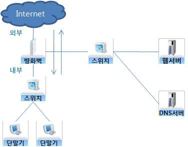

출처: 논문. 시스템 아키텍처 네트워크 보안 감리 지침 개선 연구
[그림 3-2] 방화벽 프로세스
(1) DMZ
DMZ는 방화벽 내부와 외부에서 접근할 수 있다. 그러나 DMZ 안에 있는 장비가
방화벽 내부의 장비에 연결할 수는 없다. DMZ은 네트워크 내부보다는 덜 안전하
지만 외부 네트워크보다는 더 안전하다. 이러한 설계의 주된 이점 중 하나는 분리
이다. 웹 서버가 공격을 받아서 훼손될 수 있으며 공격자는 내부 네트워크의 사용
자에게 접속하지 못할 것이다. DMZ에 있는 서버도 인터넷에 있는 것처럼 보안 수
단에 의해 폐쇄될 수 있다. DMZ에 대한 서비스가 필요할 때 만 허용되도록 방화
벽의 규칙을 설정한다.

출처: 황응주(2014). 시스템 아키텍처 네트워크 보안 감리 지침 개선 연구
[그림 3-3] DMZ 프로세스
(2) NAT
방화벽의 가장 기본적인 기능은 접근 제한과 더불어 NAT이다. 방화벽은 Private
IP주소와 Public IP주소 영역의 경계에 있는 장비로, 두 영역간의 주소변환(NAT)
기능을 제공한다. NAT는 다음과 같은 두 가지 목적을 위해 사용된다.
(가) 회사나 조직의 네트워크는 Private IP를 사용하고 내부 네트워크에서 내부 네
트워크로 향하는 통신을 할 때만 방화벽에서 출발지 주소를 Public IP주소로
변환하도록 해서 필요한 Public IP주소의 수를 줄인다.
(나) NAT는 기본적으로 방향을 가지고 있다. NAT는 내부 네트워크에서 외부 네트
워크로 향할 때만, 즉 Security Level이 높은 네트워크에서 낮은 네트워크로
향할 때만 NAT테이블이 만들어진다.
NAT는 동시에 발생하는 세션 수만큼의 Public IP가 필요하다. NAT의 한 종류인
PAT(Port Address Translation)는 Private VS Public 주소변환 테이블을 만들 때 출
발지 포트 번호를 추가하여 Public IP 주소가 1개만 있어도 된다. 이렇게 NAT 테
이블을 만들 때 출발지 포트번호를 추가해서 필요한 Public IP 주소의 수를 줄일
수 있다.
(3) 사용자 인증
방화벽의 주요 기능 중 하나가 인증이다. 즉 사용자가 특정서버 자원을 사용하기
위해서 인증(사용자 확인)을 받도록 하는 기능이다.
5. 바이러스 월(Virus wall)을 설정한다.
바이러스 관련 제품은 예전의 경우에는 감염된 파일의 치료 목적으로 개인용 컴퓨터
에 설치되어 왔으나, 최근에는 운영체제와 상관없이 네트워크를 통한 파일 다운로드,
웹 다운로드, 응용프로그램 실행, 메일 수신 등의 다양한 수단을 통해 급속도로 전
세계 컴퓨터 시스템을 마비시키고 있으며, 무선 단말기의 확산과 더불어 무선 인터넷
으로의 확산이 예상되고 있다. 최근 웜 바이러스 등 새로운 네트워크형 바이러스 형
태의 공격에 대응하기 위해 데스크톱 제품에서 메일 서버나 파일서버에 설치하여 바
이러스의 감염으로부터 방어하거나, 게이트웨이 형태로 설치하여 네트워크로 유입되
는 바이러스를 방지할 수 있는 게이트웨이용 네트워크 방어 시스템이 개발되고 있다.
바이러스 월(Virus wall)의 그 주요 기능 및 특징은 다음과 같다.
(1) HTTP, SMTP, P0P3, TELNET 프로토콜 지원
(2) Contents Scanning 기능
(3) 메시지 내용, 첨부파일, 첨부문서 필터링
(4) Blocking 기능
(5) Spam Mail 차단 기능
(6) Alert 기능
(7) 최신 바이러스 정보 유지 기능
(8) 원격관리 및 리포팅 기능 (보고서, 로그, 통계 등)
(9) 키워드, 파일명, 파일의 확장자, URL 메서드, 메일 발송자에 따른 스팸 메일 필터
링 기능
6. 침입탐지시스템(IDS)을 설정한다.
침입 탐지 시스템(IDS, Intrusion Detection System)은 방화벽이 막을 수 없거나 차단에
실패한 공격을 탐지하여 관리자에게 알려주는 역할을 한다. IDS는 네트워크를 통해
이동하는 트래픽을 캡처해 패턴에 의한 공격 유무를 감지한다. 공격을 감지하는 방법
은 크게 두 가지로 나누어지는데, 일정기간 정상적인 트래픽의 패턴과 상태를 기록해
다른 유형의 트래픽을 감지하는 프로파일(Profile)방식과 알려진 공격방법에 대한 패
턴을 사용해 공격을 감지하는 시그니처(Signature)방식으로 나눈다. 프로파일 방식의
장점으로는 알려지지 않은 새로운 공격에 대한 감지가 가능한 반면, 정상적인 트래픽
패턴을 위장한 공격에 대해서는 감지가 불가능한 단점이 있다. 시그니처 방식의 장점
으로는 프로파일 생성을 위한 모니터링 기간이 필요 없어 즉각적인 IDS시스템의 운용
이 가능하다는 장점이 있는 반면 완전히 새로운 공격 방식에 대한 감지가 불가능한
단점이 있다.

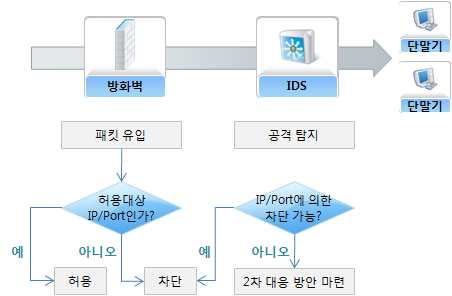

출처: 황응주(2014). 시스템 아키텍처 네트워크 보안 감리 지침 개선 연구
[그림 3-4] 방화벽과 IDS 프로세스
7. 침입방지시스템(IPS)을 설정한다.
침입 방지 시스템(IPS, Intrusion prevention system)은 시그니처 (signature) 이용하여
공격을 탐지하고, 방어하는 장비 또는 프로그램을 말한다. 시그니처는 공격 패킷을
찾아내는 프로그램이다. 시그니처는 공격을 탐지하는데 필요한 패킷의 수량에 따라
아토믹(atomic) 시그니처와 스테이트풀(stateful) 시그니처 두 종류가 있다. 아토믹 시
그니처는 하나의 패킷만으로 공격 여부를 판단하는 시그니처를 말한다. 스테이트풀
시그니처는 복수개의 패킷으로 공격 여부를 판단한다. 스테이트풀 시그니처가 공격
여부를 판단할 수 있는 패킷을 관찰하는데 필요한 최소한의 시간을 이벤트 호라이즌
(event horizon)이라고 한다. 시그니처가 공격 패킷을 탐지하는 방법은 패턴 탐지
(pattern detection), 비정상 패킷 탐지(anomaly detection) 및 동작 탐지(behavior
detection) 등이 있다. 패턴 탐지의 예는 출발지 주소가 브로드캐스트 주소
(FFFF.FFFF.FFFF)를 사용하는 ARP패킷의 탐지를 들 수 있다. 비정상 패킷 탐지의 예
는 일반적으로 잘 사용하지 않는 목적지 포트번호를 사용하는 패킷을 탐지하는 것을
들 수 있다. 동작 탐지의 예는 비정상적으로 큰 분할 패킷을 탐지하는 것을 들 수 있
다. 다음은 IPS가 공격 탐지 시 취하는 동작이다.
(1) 거부(deny)
탐지된 패킷이 목적지까지 도달하지 못하도록 차단한다.
(2) 차단(block)
방화벽이나 라우터 등 다른 장비에 공격 패킷을 차단하는 ACL이 자동적으로 만들
어지게 하며 이것을 셔닝(shunning)이라고 한다.
(3) 경고 발생(alert)
공격이 발생되었음을 콘솔 화면 등에 알린다.
(4) 동작 로그(log)
추후 분석을 위하여 공격 패킷을 저장한다.
패킷이 IPS를 통과하는지의 여부에 따라 인라인 모드와 프로미 스큐어스 모드로 구분
한다.
(1) inline mode
라우터와 같이 모든 패킷이 IPS를 통과한다.
(2) promiscuous mode
실제 패킷은 IPS를 통과하지 않는다.
IPS는 기존 트래픽에 직접 관여하고 트래픽은 IPS를 거쳐야만 한다. 인라인 방식이라
고도 부르며 IPS는 침입탐지는 물론 침입방지도 가능해졌다. IDS가 공격자 호스트로
리셋 패킷을 보낸다거나 방화벽과 연동해서 공격자를 차단하는 소극적 방어를 했다
면, IPS는 직접 트래픽에 관여하면서 공격자의 패킷을 드롭(drop)하는 적극적인 방어
를 한다.
8. 통합보안시스템(UTM)을 설정한다.
통합보안시스템 (UTM : Unified Threat Management)은 기존의 방화벽 기능에 IPS,
VPN, 트래픽분산처리 등을 단일 플랫폼에서 구현하거나 혹은 기술들을 여러 벤더를
제한적으로 연동 혼합하여 사용하는 기술을 말하는데, 일반적으로는 여러 가지 보안
기능을 한 대의 장비에 통합적으로 구현하여 관리 편리성, 효과적인 보안 및 저렴한
비용으로 인해 최근 빠르게 확산되고 있는 시스템이다.
9. 네트워크 허가통제 시스템(NAC)을 설정한다.
네트워크 허가통제 시스템(NAC : Network Admission Control)은 네트워크에 접근하려
는 사용자들이 처음으로 접속하게 되는 곳으로, NAC를 통해 관리자들은 사용자들을
인증하고 권리를 부여해 네트워크 접근이 허가되기 전에 조직의 보안 정책을 사용자
에게 강제하게 한다. NAC는 장치 유형, 역할, 그리고 사용자에 맞춰 다양한 정책들을
시행한다. 만약 초기 NAC에 등록되지 않은 외부 사용자둘이 로컬 네트워크에 접근하
면 NAC를 통해 강제로 패치와 업데이트를 수행한다. 기존 사용자들도 항상 최신의
패치와 업데이트를 수행할 수 있도록 유도한다. NAC는 패치가 설치되지 않은 장치의
네트워크 접근을 제한해 비인가 된 사용자로부터 시스템을 보호한다.
10. 통합보안관리시스템(ESM)을 설정한다.
통합보안관리시스템(ESM : Enterprise Security Management)은 보안 제품의 네트워크
적용한 이후, 적절한 보안정책에 따른 유지관리, 침해 유형 모니터링 등의 목적으로
사용되는 시스템이다. 분산된 보안 시스템과 네트워크 노드에 에이전트를 설치하고
중앙관리모듈에서 이를 제어하는 개념으로 설계된다. 처음 업체별 독자적인 API를 사
용하던 움직임에서 벗어나 국제표준화 기구들에 의한 제안된 로그 및 프로토콜 표준
을 채용하는 방향으로 전환되고 있어서, 점차 이기종간에 자유로운 연동이 가능한 시
스템으로 발전하고 있다. 보안기능 뿐만 아니라 시스템의 자원관리와 접근허가, 인증
등의 서비스들과 통합하거나, 기존의 서비스관리시스템(SMS)과 네트워크관리시스템
(NMS)과의 연동하는 형태로 개발 진화되고 있다. 이기종 보안 장비들의 로그분석이나
정책관리 목적으로 출발한 국내와는 달리, 전통적인 서비스 관리나 네트워크관리시스
템에서 출발한 HF Openview나 IBM의 Tivoli같은 제품들의 경우에는 기존시스템에 보
안관리 기능들을 추가시키는 방향으로 나가고 있다.
• 네트워크 보안 테스트 및 점검을 실시한다.
1. 방화벽 및 침입차단시스템을 테스트한다.
(1) 요구사항특성(이중화, 네트워크 성능, 트래픽 분산 등)에 맞게 구성되었는지 점검
(2) NMS/ESM 장비와의 연동을 통하여 효과적으로 네트워크 관리가 되고 있는지 점검
(3) 방화벽 관리자의 관리 접근 제한 설정이 제대로 되어 있는지 점검
(4) 방화벽의 CPU 부하량 및 트래픽 용량 부족 시 경고 등 상태 모니터링의 설계 및
구축이 되어 있는지 점검
(5) 방화벽 사용자 계정 관리가 보안 사항을 준수하고 있는지 점검
(6) 방화벽 Rule에 대하여 포트별, 서비스 내역별로 문서화되어 관리되고 있는지 점검
(7) 방화벽 IP 주소, 사용 서비스, 사용자, 시간대 등 내역별로 구분하여 Rule을 구성
하고 있는지 점검
(8) 중복된 Rule이나 사용기간이 경과한 Rule이 제거되었는지 점검
(9) IP를 그룹화하여 관리하고 있는지 점검
(10) 불필요한 서비스(telnet, ICMP, broadcast 등)를 차단하였는지 점검
(11) 서비스 사용자의 Inbound 접근에 대한 적절한 필터링을 수행하는지 점검
(12) 내부 사용자의 Outbound 접근에 대한 적절한 필터링을 수행하는지 점검
(13) 허용된 서비스 통제 및 허용된 서비스에 대한 목록이 관리되고 있는지 점검
(14) 패턴 차단 Rule DoS 공격에 대해 탐지 및 차단 Rule 운영하는지 점검
(15) 패턴 차단 Rule 웜 에 대한 공격에 대해 탐지 및 차단 Rule 을 운영하는지 점검
(16) Port scanning에 대해 탐지 및 차단 Rule을 운영하는지 점검
(17) 방화벽을 우회하는 침입에 대한 Rule을 운영하고 있는지 점검
(18) Rule 업데이트가 정기적으로 수행되는지 점검
(19) 실시간으로 접속 시도에 대해 일자, 시간, Source Address, Destination Address,
사용 서비스 등을 포함하는 로그를 남기는지 점검
(20) 방화벽 장애 시 즉각 관리자에게 연락이 되는지 점검
(21) 침입성 시도에 대한 로그 모니터링 기능이 수행되고 있는지 점검
2. 네트워크 접근 통제를 테스트하기 위해 다음의 사항을 점검한다.
(1) 네트워크 서비스 사용 정책
사용자는 특별히 허가된 서비스로의 접근만을 허용한다.
(2) 외부 접속에 대한 사용자 인증
적절한 인증 방법을 원격 사용자의 접근 통제를 위해 사용한다.
(3) 네트워크에서의 장비 식별
자동화된 장비의 식별을 특정 지역과 장비로부터 접속을 인가하기 위한 수단으로
활용한다.
(4) 원격 진단과 구성 포트 보호
진단과 구성 포트에 대한 물리적, 논리적 접근을 통제한다.
(5) 네트워크에서의 분리
정보 서비스, 사용자, 정보시스템의 그룹은 네트워크상에서 분리한다.
(6) 네트워크 접속 통제
공유 네트워크에서 조직의 경계를 넘어 확장되는 네트워크에 접속하는 사용자 용
량은 접근 통제 정책과 응용소프트웨어의 요구사항에 따라 제한한다.
(7) 네트워크 라우팅 통제
컴퓨터 접속과 정보 흐름이 응용프로그램의 접근통제정책을 위반하지 않기 위해
네트워크에 대한 라우팅 통제를 이행한다.
(8) 물리적 네트워크 접근 통제
네트워크 설비 또는 장비를 잠금장치가 최소 이중으로 되어 있는 장소에 설치한다.
(9) 논리적 네트워크 접근 통제
(가) 허가된 자만이 허가된 네트워크에 접근을 보장
(나) 네트워크 장비에 로그온 시 반드시 사용자 인증을 수행
(다) 관리자와 사용자 모드를 모두 지원하는 경우에는 네트워크망을 분리하여 운영
(라) 네트워크 접속 후 일정시간 동안 활동 내역이 없으면 자동으로 차단한다.
(10) 네트워크 진단/관리를 위한 도구 사용
(11) 네트워크 구성 변경 시에는 엄격한 통제절차 적용
(12) 네트워크 경로를 침입차단시스템 등 보안시스템 경로를 우회하는 경로설정 금지
(13) 네트워크 로그 관리
3. 라우터 스위치를 테스트한다.
(1) 별도의 보안 장비 사용 불가 시 라우터 스위치의 ACL 활용 가능성 점검
라우터 스위치에서 패킷 필터링 정책을 위해 사용한다.
(2) 필요 시 File-Sharing Filter 활용 가능성 점검
같은 Subnet 내에 있을 때는 NetBIOS 등의 프로토콜을 이용하여 파일, 프린터 및
미디어의 공유가 가능하다. 그러나 스위치 포트가 사무실이나 공용으로 쓰는 장소
가 아닌 각 가정에 할당되어 있다면 개인 정보 보호를 위하여 위와 같은 프로토
콜을 차단할 필요가 있다. 이 때 File-Sharing Filter기능을 사용한다.
(3) 포트 보안을 위해서 스위치의 특정 포트에 특정 MAC 주소를 가진 장비만 접속
하는지 점검
MAC 액세스 리스트를 사용한다.
(4) 포트 보안을 위해서 포트 차단 기능 사용 가능성 점검
스위치는 자신의 MAC 주소 테이블에 없는 유니캐스트나 멀티캐스트 프레임을 모
든 포트로 플러딩시킨다. 이처럼 목적지가 MAC 주소 테이블에 없는 프레임이 플
러딩되는 것을 차단하는 것이 포트 차단이다.
(5) DHCP 구축 환경에서 DHCP 스누핑 보안 대책 점검
DHCP 관련 공격은 가짜 DHCP 서버 역할과 할당 가능한 IP 주소를 모두 받아가
는 것이다. 공격자가 가짜 DHCP 역할을 하게 되면 게이트웨이 주소나 DNS 서버
주소를 자신의 IP로 설정하여 알려줄 수 있고, 심각한 보안침해가 일어날 수 있다.
(6) 표준 프로토콜을 이용한 라우터 모니터링 점검
정교한 패킷 필터링을 설정해서 보안 정책들을 적용해야 하고 과도한 트래픽을
유발하는 특정 응용소프트웨어들에 대해서는 폴리서를 이용한 적절한 제한이 필
요하다. 이러한 보안 정책을 실행하는 것만큼이나 SNMP, syslog, NTP와 같은 표준
프로토콜을 이용한 라우터의 모니터링은 매우 중요하다.
4. 네트워크 보안 취약점을 테스트한다.
(1) Password-encryption 이 설정되어 있는지 점검
라우터 패스워드 중 Privileged Mode로 접근하기 위한 패스워드는 enable
Password와 enable Secret Password 두 개가 존재하며, Enable Password만을 사용
할 경우 암호화를 해야 관리자의 어깨 너머로 clear text 패스워드를 보는 것을 방
지할 수 있다.
(2) Aux나 VTY를 통한 접속이 차단되어 있는지 점검
Aux나 VTY를 통한 모든 접속은 막아 두고 콘솔을 통해서만 관리하는 것이 바람
직하다.
(3) Smurf와 같은 DoS를 막기 위해 Directed Broadcast를 차단했는지 점검
Directed Broadcast는 DoS의 일종인 Smurf 공격에 주로 쓰이는 방식으로 Directed
Broadcast는 목표지점에 도달하기 전까지 unicast 방식으로 전송되다가 최종 라우
터를 통과할 때 비로소 Directed Broadcast를 알 수 있다. 따라서 각 장치 별로 이
러한 패킷을 모두 드롭(drop)시킬 수 있도록 설정한다.
(4) 보안 패치 된 IOS 버전을 사용하고 있는지 점검
어떤 취약점은 패치를 적용해야만 라우터의 안정성을 보장할 수 있다. 그래서 심
각한 버그에 대해서는 신속한 패치 적용을 고려한다.
(5) SNMP Community string을 추측하기 어렵게 설정하는지 점검
SNMP의 Public, Private와 같은 Default Community String이 변경되지 않고 그대로
사용될 경우, 해커에게 네트워크 정보 등을 그대로 노출시키거나 해커로 하여금
네트워크 장비 설정 등을 변경 시킬 수 있는 위험성이 존재하기 때문에 추측하기
어려운 String으로 반드시 변경해야 한다.
(6) ACL을 위반하는 패킷을 log 하고 있는지 점검
네트워크 장비에서 Filtering을 위해서 사용하는 ACL의 허가(permit)되는 Packet의
정보를 실시간으로 Logging 서버로 보내어 관리하는 것이 보안상 매우 중요하다.
계속적으로 실시간 관리와 로그의 지속적인 분석을 통하여 불법적인 접근시도 여
부를 확인해 조치를 취하거나 해킹 사고 발생시 Forensic Analysis에도 유용한 정
보로 사용한다.

| 학습 3 | 교수·학습 방법 |
| --- | --- |

교수 방법
• 네트워크 보안이 왜 중요하고 의미가 있는지 충분히 설명한다.
• 네트워크 보안은 법률에 의거 수행되는 활동으로 본 수업에 앞서 법률의 등장배경과 네트워크
구축방안에 대해 설명하도록 한다.
• 학생들의 관심을 유발하기 위한 네트워크 보안 침해사례 등을 파워포인트로 만들어 이해에
도움이 되도록 한다.
• 가능하면 개인별로 네트워크 보안 구축사례를 수집하게 하고 문제점과 해결방법을 제시하도록
지도한다.
• 제시한 사례들을 서로 공유함으로써 다양한 보안방법을 공유할 수 있게 지도한다.
• 네트워크 보안구축이 제대로 이루어지고 있는지 항상 체크한다.
• 정보보안의 중요성과 정보윤리를 함께 교육함으로써 올바른 보안 의식 함양이 되도록 유도한다.
학습 방법
• 네트워크 보안에서 제시된 내용을 사전에 충분히 학습한다.
• 관련 법률에 대한 사이트를 통해 스스로 내용을 찾아보고 추가 설명이 요구되는 부분에 대해
질문 목록을 작성한다.
• 다양한 네트워크 보안 구축사례를 찾아보고, 스스로 문제점과 해결방법을 찾아본다.
• 네트워크 보안 구축사례를 파워포인트, MS 워드, 한글과 같은 문서로 작성하여 사례 발표 및
다른 학생들과 자료를 교환한다.
• 네트워크 보안에 대한 보안 취약점을 분석한 후 사후대책을 계획해 본다.
• 정보보안의 필요성을 인식하고, 올바른 윤리의식이 함양하도록 주기적으로 보안교육을 받는다.

| 학습 3 | 평 가 |
| --- | --- |

평가 준거
• 평가자는 학습자가 수행 준거 및 평가 항목에 제시되어 있는 내용을 성공적으로 수행하였는지를
평가해야 한다.
• 평가자는 다음 사항을 평가한다.

| 학습 내용 | 평가 항목 | 성취수준 |  |  |
| --- | --- | --- | --- | --- |
|  |  | 상 | 중 | 하 |

- 보안요구사항에 따라 네트워크 환경을 파악하고 보
안에 필요한 네트워크 보안을 설계할 수 있다.
네트워크 보안
설계 구현 계획
- 설계된 네트워크 보안에 대한 기술과 제품을 파악하
고 네트워크 보안 구현 계획을 수립할 수 있다.
- 수립된 구현 계획에 따라 파악된 기술과 제품을 이
용하여 네트워크 보안을 구현할 수 있다.
네트워크 보안
구현 테스트
- 구현된 네트워크 보안이 결함이 있는지 테스트하고
테스트 결과를 관리할 수 있다.
평가 방법
• 서술형시험

| 학습 내용 | 평가 항목 | 성취수준 |  |  |
| --- | --- | --- | --- | --- |
|  |  | 상 | 중 | 하 |

- ISO27001, ISMS, PIMS, 네트워크 보안의 정의
- 네트워크 보안의 개념과 필요성 이해
네트워크 보안
- 네트워크 보안 구축 절차 이해
설계 구현 계획
- 네트워크 구축 설계 시 고려 사항
- 네트워크 기반 공격 유형
- 네트워크 보안약점 및 보안대책
- 네트워크 보안 사고 발생 유형 및 대처법
네트워크 보안 - 네트워크 장비의 종류 및 사용법
구현 테스트 - 네트워크 보안서버 상용 툴의 종류
- 네트워크 서버 구축 방법
- 네트워크 보안 취약점 테스트 유형
• 문제해결 시나리오

| 학습 내용 | 평가 항목 | 성취수준 |  |  |
| --- | --- | --- | --- | --- |
|  |  | 상 | 중 | 하 |

| 네트워크 보안 설계 구현 계획네트워크 보안 구현 테스트 • 평가자 체크리스트네트워크 보안 설계 구현 계획네트워크 보안 구현 테스트 피 드 백 | - 네트워크 보안이란 무엇인가 - 네트워크 보안의 개념과 필요성 - 네트워크 보안 구축 설계 시 중점 사항 - 네트워크 보안 구축 절차에 대한 이해 - 네트워크 보안 취약점과 해결방안 - 네트워크 보안 구축 시 고려 사항 - 네트워크 보안 취약점 분석 - ISO27001, ISMS, PIMS, 네트워크 보안의 필요성 - 네트워크 보안의 취약점과 해결 방안 - 네트워크 보안 구축 절차의 이해 - 네트워크 보안 구축 시 고려 사항 - 네트워크 보안 사고 발생 유형 및 대처 방안 - 네트워크 보안 구축 방안 - 네트워크 보안 상용 툴 종류 및 사용 방법 |  |  |  |
| --- | --- | --- | --- | --- |
| 1. 서술형시험 - 기준 점수트를 제출하게 | 미달자에 대해서는 교육 성취수준을 개별 통보하고 미흡한하여 교육성과를 높이도록 한다. | 분야에 | 대해 | 리포 |
| 2. 문제해결 시나리오- 보안실무에제출하도록 | 대한 이해도를 평가하는 항목으로 관련 양식을 활용하여 직접지도한다. | 점검한 |  | 결과를 |
| 3. 평가자 체크리스트- 성취수준 | 미달자는 보안 관련 법률해석과 보안점검절차에 대한 리포트를 |  | 제출하도록 | 지 |
| 도한다. |  |  |  |  |

| 학습 내용 | 평가 항목 | 성취수준 |  |  |
| --- | --- | --- | --- | --- |
|  |  | 상 | 중 | 하 |

| 네트워크 보안 설계 구현 계획네트워크 보안 구현 테스트 피 드 백 | - ISO27001, ISMS, PIMS, 네트워크 보안의 필요성 - 네트워크 보안의 취약점과 해결 방안 - 네트워크 보안 구축 절차의 이해 - 네트워크 보안 구축 시 고려 사항 - 네트워크 보안 사고 발생 유형 및 대처 방안 - 네트워크 보안 구축 방안 - 네트워크 보안 상용 툴 종류 및 사용 방법 |  |  |  |
| --- | --- | --- | --- | --- |
| 1. 서술형시험 - 기준 점수트를 제출하게 | 미달자에 대해서는 교육 성취수준을 개별 통보하고 미흡한하여 교육성과를 높이도록 한다. | 분야에 | 대해 | 리포 |
| 2. 문제해결 시나리오- 보안실무에제출하도록 | 대한 이해도를 평가하는 항목으로 관련 양식을 활용하여 직접지도한다. | 점검한 |  | 결과를 |
| 3. 평가자 체크리스트- 성취수준 | 미달자는 보안 관련 법률해석과 보안점검절차에 대한 리포트를 |  | 제출하도록 | 지 |
| 도한다. |  |  |  |  |

학습 1 응용프로그램 보안 구축하기(LM2001020606_14v2.1)
학습 2 서버 보안 구축하기(LM2001020606_14v2.2)
학습 3 네트워크 보안 구축하기(LM2001020606_14v2.3)

| 학습 4 | 데이터베이스(DB) 보안 구축하기(LM2001020606_14v2.4) |
| --- | --- |

4-1.
데이터베이스(DB) 보안설계 구현계획
•보안요구사항에 따라 사용된 데이터베이스(DB) 시스템의 기술을 이용하여 데이터베이
스(DB) 보안을 설계할 수 있다.
학습 목표
•설계된 데이터베이스(DB) 보안에 대한 데이터베이스(DB) 시스템에 맞는 질의어와 저
장프로시져(Stored Procedure)를 사용하여 구현 계획을 수립할 수 있다.
필요 지식 /
• 정보보호관리체계에 관한 국제 표준 규격(ISO27001)
학습 내용 1-1의 필요지식 • 참조
• 정보보호관리체계(ISMS)
학습 내용 1-1의 필요지식 • 참조
• 개인정보보호관리체계(PIMS)
학습 내용 1-1의 필요지식 • 참조
• 데이터베이스(DB)와 데이터베이스(DB) 시스템 개념
1. 데이터베이스(DB) 개념
데이터베이스(DataBase:DB)는 서로 관련 있는 데이터들을 효율적으로 관리하기 위해 수집
된 데이터들의 집합체를 말하며, 각 데이터들은 상호 유기적인 관계에 의해 구성된다. 즉,
데이터베이스는 서로 관련 있는 데이터를 최소한의 중복으로 모아놓은 장소를 말한다.

| 학습 내용 | 평가 항목 | 성취수준 |  |  |
| --- | --- | --- | --- | --- |
| 2. 데이터베이스(DB) | 시스템 개념 |  |  |  |
| (1) 스키마(Schema)의스키마란 데이터베이스(Attribute),관해 전반적으로명칭을 부여하고이의 관계성을 | 정의 데이터베이스의 구조와 제약 조건에 관한 전반적인 명세를하나를 기술한 것을 말한다. 데이터베이스를 구성하는관계(Relationship) 및 데이터 조작 시 데이터 값들이 갖는정의한다. 레코드 형태와 릴레이션같은 모든 데이터의의미를 기술하고 데이터베이스 내에 있는 데이터의표현한다. | 제약논리적 | 기술한개체(Entity),조건논리적 | 것으로속성등에단위에단위 사 |
| (2) 스키마의 3계층스키마는 기능의의 입장에 따라 | 따라 3계층으로 나뉜다. 사용자의 입장, 조직 전체의나뉘는데 하나하나의 역할은 다음과 같다. | 입장, | 저장 | 장치 |
| (가) 외부 외부 이터베이스같은 의 마를 여러 | 스키마(External schema) 스키마는 서브 스키마, 사용자 뷰 라고도 불리며 각 사용자의구성을 말한다. 사용자마다 서로 다른 데이터베이스데이터베이스에 대해서도 서로 다른 관점을 정의할 수 있도록데이터베이스에는 여러 개의 외부 스키마가 존재할 수 있고,개의 응용프로그램이나 사용자가 공용이 가능하도록 | 스키마를하나의되어 | 입장에서허용한다.외부있다. | 본 데가지고하나스키 |
| (나) 개념 개념 구조를조직 전체의객체, 의하는 | 스키마(Conceptual schema) 스키마는 전체적인 뷰 라고도 불리며 조직 전체의 입장에서말한다. 모든 응용 프로그램이나 사용자들이 필요로 하는데이터베이스이기 때문에 데이터베이스 단 하나만제약조건에 대한 명세 유지, 기관이나 조직체의 관점에서역할을 한다. | 본데이터를존재한다. | 데이터베이스데이터베이스를 | 종합한데이터정 |
| (다) 내부 내부 방법에 | 스키마(Internal schema) 스키마는 저장 장치의 입장에서 본 데이터베이스 구조로대해 기술하는 물리적인 저장장치와 밀접한 계층이다. | 데이터의 | 실제 | 저장 |
| 3. 데이터베이스(DB)데이터베이스하는 컴퓨터 구성되어 있다. | 시스템의 구성요소 시스템은 데이터를 데이터베이스로 저장하고 관리해서중심의 시스템이며 데이터베이스, DBMS, 데이터언어, 사용자, | 필요한 | 정보를컴퓨터 | 생성등으로 |
| 4. 데이터베이스(DB)데이터베이스를 | 관리시스템의 장단점 보다 편리하게 정의하고, 생성하며, 조작할 수 있도록 | 해주는 | 범용 | 소프트 |
| 웨어 시스템을 | DBMS라고 한다. |  |  |  |
| (1) 데이터베이스(DB) | 관리시스템 장점 |  |  |  |
| (가) 데이터의 | 중복을 최소화할 수 있다. |  |  |  |
| (나) 데이터를 | 공유할 수 있다. |  |  |  |
| (다) 데이터의 | 일관성을 유지할 수 있다. |  |  |  |
| (라) 데이터의 | 무결성을 유지할 수 있다. |  |  |  |
| (마) 데이터의 | 보안을 보장할 수 있다. |  |  |  |
| (2) 데이터베이스(DB) | 관리시스템 단점 |  |  |  |
| (가) 파일 | 시스템보다 고가의 제품, 운영에 필요한 컴퓨터 자원이 많다. |  |  |  |
| (나) DBMS는 | 다수 사용자가 접근하기 때문에 보안의 문제가 발생한다. |  |  |  |
| 5. 데이터베이스(DB)DBMS는 구성에 | 관리시스템의 종류 따라 다음과 같이 여러 종류로 구별된다. |  |  |  |
| (1) 네트워크(Network)데이터 구조를노드(자료)를리 시스템의잡하고 궁극적으로 | DBMS (NDBMS) 네트워크상의 노드 형태로 논리적이게 표현한 데이터서로 대등한 관계로 구성한 시스템이다. 장점은 계층형문제점인 상하 종속적인 관계를 해결한 것이고 단점은데이터의 종속성을 해결하지 못한 것이다. | 구성과 | 모델로서데이터베이스설계가 | 각각의관복 |
| (2) 계층형(Hierarchical)데이터가 에 대해서는응용 프로그램에서시적으로 | DBMS (HDBMS) 계층적이며 상하 종속적인 관계로 구성되어 있다. 장점은빠른 속도 및 높은 효율을 제공하는 것이며, 단점은미리 정의해야 하고 데이터베이스가 생성될 때정의되어야 한다는 것이다. | 어떤데이터각각의 | 유형의접근관계가 | 응용방식을명 |
| (3) 관계형(Relational)현재 가장수학적 논리직관적인 표) | DBMS (RDBMS) 많이 사용되는 DBMS로 응용프로그램 개발에 획기적인관계를 테이블의 형태로 구성한 구조로써 테이블(2차원내의 컬럼 중 일부를 다른 테이블과 중복해 각 | 개선을형식의테이블간의 |  | 유도하였다.단순하고상관관계를 |
| 정의한다. 지보수가 부하가 높다. | 장점은 업무 변화에 대한 적응력이 높아 변화하는 업무에편리한 것이며, 단점은 다른 DBMS보다 더 많은 지원을대표적으로 Oracle, MS SQL Server, MySQL 등이 있다. | 쉽게필요로 | 활용하며해서 | 유시스템 |
| 내용 / 재료·자료 Ÿ 정보통신망 이용촉진Ÿ 개인정보 보호법Ÿ 정보보호관리체계에Ÿ 정보보호관리체계(ISMS)Ÿ 개인정보보호관리체계(PIMS)Ÿ 데이터베이스(DB)와기기(장비･공구) Ÿ 전산장비 : 인터넷,Ÿ 지원도구 : 문서작성Ÿ 보안장비 : 취약점도구 등 안전･유의 사항 Ÿ 기술적 보안의 구축하는 업무에수행 순서 • 데이터베이스(DB) | 데이터베이스(DB) 보안 설계하기 및 정보보호 등에 관한 법률 관한 국제 표준 규격(ISO27001) 데이터베이스(DB) 시스템 개념 컴퓨터, 네트워크 장비, 서버, 데이터베이스(DB) 시스템도구 등 분석 도구, 동적 분석 도구, 정적 분석 도구, 로그 분석응용프로그램 보안, 서버 보안, 네트워크 보안, 데이터베이스(DB)적용한다. 시스템의 기술을 이용하여 데이터베이스(DB) 보안을 | 등도구,보안을 | 방화벽설계한다. | 설정설계하고 |
| 1. 데이터베이스(DB) | 보안 목적 및 필요성을 숙지한다. |  |  |  |
| (1) 데이터베이스접근, | 데이터베이스(DB) 보안 목적 보안이란 데이터베이스에 저장되어 있는 데이터에의도적인 데이터의 수정이나 삭제 및 데이터의 일관성을 | 대한방해하는 |  | 부적절한우연적인 |

사고 등으로부터 데이터 또는 데이터베이스를 보호하는 것이다. 데이터베이스 보
안의 목적은 정보보호 관리에 있어서 핵심적이고 최종적 관리 대상인 데이터베이
스에 저장된 데이터를 보호하여 기밀성, 무결성, 가용성을 잘 유지하고 확보하는
것이라고 할 수 있다.

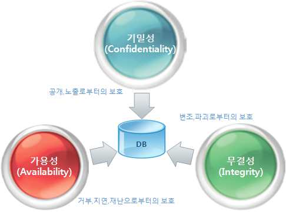

[그림 4-1] 데이터베이스 보안 기본 요소
(가) 기밀성(Confidentiality)
선별적인 접근 체계를 만들어 비 인가된 개인이나 시스템에 의한 접근과 이에
따른 정보 공개․노출을 막는 것이 기밀성 유지이다. 기밀성은 DB 내에 중요한
개인 정보를 저장하고 있는 사람들의 사생활을 유지하는데 필요한 최소한의
필수 조건이며 접근제어와 암호화는 기밀성 유지를 위한 대표적인 방안이다.

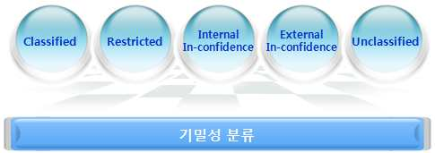

[그림 4-2] 기밀성 분류 사례
(나) 무결성 (Integrity)
무결성은 정당한 방법에 의하지 않고는 데이터가 변경될 수 없음을 의미하며,
데이터의 정확성 및 완전성을 보장하고 그 내용이 고의 혹은 악의로 변경되거
나 훼손 또는 파괴되지 않음을 보장하는 것이다.
(다) 가용성 (Availability)
가용성이란 사용자가 업무 서비스를 필요로 할 때 그 서비스의 연속성을 보장
할 수 있는 것을 의미한다. 이것은 컴퓨팅 시스템이 정확하게 정보를 저장․처
리하고, 보안 통제가 그것을 보호하며 해당 정보에 접근하는데 사용되는 통신
채널이 정확하게 기능되어야 함을 의미한다.
(2) 데이터베이스(DB) 보안 필요성
컴퓨터에서 처리되고 저장되는 정보는 신속한 업무 처리와 함께 적절한 의사결정
을 위해 필요한 이해관계자들에게 시의적절하게 정확한 정보를 제공할 수 있어야
한다. 그러나 이와 같은 정보를 권한이 없는 사용자가 부정한 방법으로 가로채거
나 부적절하게 기록하게 되면 해당 정보를 필요로 하는 사람이나 개인에게 커다
란 피해를 입힐 수 있다. 그렇기 때문에 권한이 없는 사용자의 부적절한 접근을
막고 동시에 정당한 권한을 갖고 있는 사용자는 정보시스템이 서비스 요구를 거
부하지 않도록 보호할 필요가 있다. 데이터베이스(DB) 보안이 필요한 이유는 다음
과 같다.
(가) 데이터의 자산 가치 증가
(나) 내부자에 의한 정보 유출 및 보안사고 급증
(다) 개인정보 유출에 대한 불안감 고조 및 신뢰성 저하
(라) 피해 규모 확산 속도 가속 및 막대한 사회적 비용 발생
(마) DB 정보 보호에 대한 국내외 법률 제정
(바) 현행 IT 보안 체계의 취약성 존재
(사) 상용 DBMS의 보안 취약성
(아) 어플리케이션 구축 및 운영 시의 보안 허점

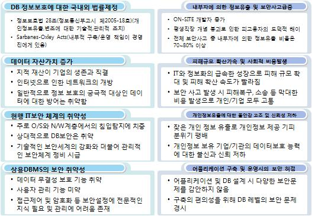

출처:한국데이터베이스진흥원. 데이터베이스 보안 가이드라인
[그림 4-3] 데이터베이스 보안의 필요성
2. 데이터베이스(DB) 보안 요구사항을 분석한다.
발생 가능한 위협으로부터 데이터베이스(DB)를 보호한다는 것은 우연이든 고의적이든
비권한자의 부정당한 읽기 접근이나 변경으로부터 저장 데이터를 보호하는 것을 뜻
한다. 이와 같은 데이터베이스(DB) 보안에 대한 요구사항은 일반적으로 다음과 같다.
(1) 정당한 사용자의 데이터 접근보장
정당하게 권한을 부여받은 사용자에게만 DB 접근을 허용한다. 이와 같은 사용자
나 응용프로그램의 접근 요청이 발생하면 권한을 검사하여 허용된 범위 내에서
데이터에 자유롭게 접근할 수 있도록 한다.
(2) 추론 방지
추론이란 기밀성이 없는 데이터로부터 기밀 정보를 얻어내는 가능성을 의미한다.
특히 추론문제는 통계 DB에서 중요시되며 통계적 집계 정보에서 시작하여 개개의
개체에 대한 정보를 추적하지 못하도록 해야 한다.
(3) 데이터의 무결성(Integrity) 유지
이것은 데이터 내용을 수정할 수 있는 비권한접근, 오류나 바이러스 등에 의해 데
이터를 손상시킬 수 있는 시스템 고장(Failure) 등으로부터 DB를 보호하는 것을
의미한다.
(4) 데이터의 의미 무결성(Semantic Integrity) 유지
허용된 범위의 제어 데이터 값을 유지하여 수정될 데이터의 논리적 일치성을 보
장하는 무결성 제약조건(Integrity Constraints)이 대표적인 것이다. 여기에는
Primary Key, Foreign Key, Unique, Check, Not Null Constraint 등이 해당된다.
(5) 시스템 감사 지원
데이터에 대한 모든 접근을 기록한다는 의미로, 모든 데이터에 대해 감사 기록을
유지 하는 것은 시간과 비용측면에서 비효율적이다. 따라서 데이터에 대한 분류를
통해 중요 정보에 대해 감사 기록을 유지하여 중요 데이터에 대한 비인가 또는
비정상적 접근을 효과적으로 기록하고 감지할 수 있어야 한다.
(6) 사용자 인증
데이터베이스(DB) 사용자를 유일하게 식별할 수 있어야 한다. 사용자 식별은 모든
권한부여 체계 수립에 대한 기초가 된다.
(7) 기밀 데이터 관리와 보호
기밀 데이터를 갖고 있는 데이터베이스(DB)에서의 접근 제어는 정당하게 권한을
부여받은 사용자만이 기밀 데이터에 접근할 수 있도록 허용하면서도 이 권한을
전파할 수 없어야 한다. 또한 권한을 부여받은 사용자라도 기밀 데이터에 대한 동
시 접근은 허용하지 않을 수도 있다.
(8) 다단계 보호(Multilevel Protection)
다단계 보호는 보호 요구사항의 집합을 의미한다. 정보를 다양한 보호 등급(Level)
으로 분류하고, 다양한 정보 항목에 분류 등급을 할당하거나 분류등급에 따라서
다양한 접근수준을 할당할 수 있다.
3. 데이터베이스(DB) 보안 구현 시 고려사항을 숙지한다.
데이터베이스(DB) 보안관리 프레임워크는 체계적인 데이터베이스(DB) 보안 구축과 함
께 전체적인 데이터베이스(DB) 보안 운영을 체계화한다는 점에서 의미를 갖는다. 이
런 가이드라인에 따라 데이터베이스(DB) 보안을 구축하는데 있어서 고려해야할 사항
은 다음과 같다.
(1) DB 가용성을 보증하기 위한 데이터의 백업 및 복구절차 수립‧구현
(2) 승인받지 않은 접근을 방지하기 위한 다양한 단계의 접근제어 수립
(3) 승인받은 자에 한하여 DB에 접근할 수 있는 통제 수립
(4) 다수 사용자가 동시에 자료를 갱신하려고 할 때의 우선순위 설정
(5) 불법침입으로 데이터베이스(DB)에 접근하려는 시도의 무력화
(6) 분산 환경, N-tier환경에서 데이터베이스(DB) Connection Pooling사용으로 인한 사
용자별 접근에 대한 로그추적 어려움
(7) 데이터베이스(DB)와 연결되는 응용서버(WAS)의 취약점으로 인한 내부정보 유출
우려
(8) Thin Client를 통한 데이터 유출 방지 기술의 실용화 경향
(9) 기술적, 관리적(제도적)보안 기반 하에 경영자의 강력한 보안의지와 내부임직원
의 보안의식 고취가 가장 중요함
(10) 저장된 정보 외에도 유통되는 정보의 보안을 위한 DRM적용 등을 중요시함
4. 데이터베이스(DB) 보안 프레임워크 구성 요소를 고려한다.
데이터베이스(DB) 보안 프레임워크는 데이터베이스(DB) 보안 기술요소와 데이터베이
스(DB) 보안 구축 프로세스라는 두 개의 축으로 구성된다. 데이터베이스(DB) 보안 기
술요소는 데이터베이스(DB) 보안을 위한 최소한의 보안 통제 방법을 정의한 것으로,
각 요소들은 독자적으로 구축될 수도 있고, 둘 이상의 요소들이 복합적으로 구성될
수도 있다. 보다 견고한 데이터베이스(DB) 보안을 위해서는 둘 이상의 요소들을 복합
적으로 구성하고 체계적인 관리 노력을 기울여야 한다. 데이터베이스(DB) 보안 구축
프로세스는 각 기술요소들을 구축해 가는 절차적 단계를 구분한 것으로, 각 기술요소
들을 구축하는데 있어서 단계적으로 수행해야 할 중요한 사항들의 선후관계를 식별
하고 누락되지 않도록 체계적으로 수행해 나갈 수 있는 가이드라인의 의미를 갖는다.

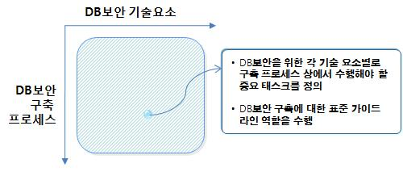

출처:한국데이터베이스진흥원. 데이터베이스 보안 가이드라인
[그림 4-4] 데이터베이스 보안 프레임워크 구성
(1) 데이터베이스(DB) 보안 기술 요소
(가) 접근제어
데이터베이스(DB) 접근제어는 사용자가 DBMS에 로그인 하거나 SQL을 수행하
려고 할 때, 기 정의된 보안규칙에 따라 권한 여부를 판단하여 통제하고, 로깅
이 필요한 SQL에 대하여 SQL 수행(CRUD)과 관련된 정보를 저장(로깅)하여 부
당한 조작 여부를 판단하는 보안 통제 방법이다. 일반적인 데이터베이스(DB)
접근제어의 유형은 다음과 같다.
1) 자율적 접근제어 (DAC, Discretionary Access Control)
가) 임의적 접근제어라고도 함
나) 시스템 또는 데이터 객체별 접근을 사용자 또는 그룹별 식별자를 기반
으로 접근 제어하는 방법
다) 다른 사용자에게 자신의 권한 인계 가능
라) 접근 주체 및 대상 객체의 신분이나 임의 접근제어 규칙에 기초하여 객
체에 대한 주체의 접근을 제어함
2) 강제적 접근제어 (MAC, Mandatory Access Control)
가) 사용자가 갖는 접근 권한, 인가 등급에 기초하여 접근 허용 및 데이터
의 흐름을 제어
나) 객체에 포함된 정보의 비밀성, 보안 등급들을 반영
다) 운영체제의 통제 하에서 각 객체에 비밀등급을 부여하고, 아울러 사용
자를 포함한 각 주체에 허가등급을 부여한 후, 각 주체가 각 객체에 접
근할 때마다 접근 자격을 체크하여 강제적으로 통제하는 것
3) 역할기반 접근제어 (RBAC, Role Based Access Control)
가) 보안 관리자가 역할 생성, 해당 역할에 대해 데이터 객체에 대한 사용
권한과 사용자 권한을 부여
나) 인가된 사용자에 대한 시스템 또는 데이터 접근제어임
다) MAC과 DAC에 대한 보완적 접근제어 방식이며, 역할기반보안(Role
Based Security)라고도 함
(나) DB 암호화
DB 암호화는 데이터를 암호화하여 저장하고, 권한이 있는 사람 혹은 서버만이
해당 데이터를 복호화할 수 있도록 하여 데이터를 보호하는 기술이다. DB 암
호화는 DB 접근제어와 병행 사용하여 더 큰 효과를 얻을 수 있다.
(다) DB 작업결재
DB 작업결재는 보안상 중요한 데이터에 대한 접근 및 처리 등의 DB작업에 대
하여 사전승인을 거치도록 하는 결재 정책을 정의하고, 기안-승인 프로세스를
거쳐 실행 권한을 부여받은 후 DB 작업이 이루어지도록 하는 것이다.
(라) DB 취약점 분석
DB 보안에서의 취약점은 앞서 정의한 바와 같이 DB 시스템이 지니고 있는 보
안상의 문제점이나 허점을 의미하며, DBMS의 소스코드, DB 시스템의 구성 및
설정 등에서 발생하는 잠재적인 보안 위험에 해당된다.
(2) 데이터베이스(DB) 보안 구축 프로세스
(가) 기획단계
기획단계는 DB 보안을 구축하기 위한 기본적인 계획을 수립하고 DB 보안 정
책과 지침ž가이드라인 등을 개발하는 단계이다. 이를 위해 보안 대상 데이터를
식별하고 분류하며, DB 보안을 위한 원칙Ÿ지침 등을 정의하고, DB 보안을 담
당하는 조직의 구성과 역할, 책임 등을 정의해야 한다. 이 단계의 주요 산출물
은 다음과 같다.
1) DB 보안 구축 계획
2) DB 보안 정책ž지침ž가이드라인 등
(나) 설계단계
설계 단계는 DB 접근제어 규칙, DB 작업결재 규칙 등과 같이 각 기술요소별
로 구현을 위한 상세 규칙을 정의하고 시험 계획을 수립하는 단계이다.
1) DB 접근제어에 대한 설계 단계의 주요 수행 내용은 접근제어 규칙 정의로,
여기에는 사용자 인증, 로그인, SQL 통제, 로깅, 경보, SQL 마스킹 등에 대
한 상세 규칙이 정의되어야 하며， 모니터링 지표를 정의하고 상세 운영 방
안을 수립한다.
2) DB 암호화에 대한 설계 단계의 주요 수행 내용은 복호화 권한을 부여할 대
상과 그 권한의 통제 방법 정의, 암호화키 및 알고리즘의 정의 등이다.
3) DB 작업결재에 대한 설계 단계의 주요 수행 내용은 작업결재 규칙 정의로,
여기에는 결재 경로와 결재 규칙, 결재내역에 대한 로깅 방안 등을 정의하
며, DB 작업결재가 이루어지는 상황이나 그 기록에 대한 모니터링 지표를
정의하고 상세 운영 방안을 수립하는 내용이 포함된다.
4) DB 취약점 분석에 대한 설계 단계의 주요 수행 내용은 취약점 분석 계획을
수립하는 것으로, 여기에는 DB 환경구성과 그의 관리, 계정관리, 패스워드관
리, 권한관리, 인증관리, 원격 접속 관리 등에 대한 취약점을 분석하기 위한
계획이 포함된다.
설계 단계의 주요 산출물은 다음과 같다.
1) (기술요소별)설계서
2) (기술요소별)시험계획서
(다) 구축단계
구축 단계는 설계 단계의 수행 결과에 따라 실제로 각 기술요소를 구현하고
시험하는 단계이다.
1) DB 접근제어에 대한 구축 단계의 주요 수행 내용은 설계된 접근제어 규칙을
구현하여 우회 접근을 방지하고, 구현 환경을 검토하여 보완하며, 보안 적용
시험을 통해 우회 접근의 가능성과 우회 접근방어의 신뢰성을 확인한다.
2) DB 암호화에 대한 구축 단계의 주요 수행 내용은 설계 단계 수행 결과에
따라 대상 데이터에 대해 암호화를 수행하고, 암호화 결과와 원본 데이터를
대조하여 암호문의 신뢰성을 확인하며， 원본 데이터를 DB에서 삭제하여
보호 대상 데이터의 부당한 접근Ÿ유출에 의한 판독 가능성을 제거하는 것이
다. 또한, DB 암호화 관련 제약사항을 유지하고 암호화 키를 관리하며, 이와
관련된 구현 환경을 검토하여 보완하고, 보안 적용 시험을 통해 암호화된
데이터의 판독 가능성 여부를 검사한다.
3) DB 작업결재에 대한 구축 단계의 주요 수행 내용은 설계 내용에 따라 작업
결재 흐름을 구현하여 우회 결재를 방지하고, 관련 환경을 검토하여 보완하
며, 보안 적용 시험을 통해 우회 결재의 가능성과 작업결재 기능의 신뢰성
을 확인한다.
4) DB 취약점 분석에 대한 구축 단계의 주요 수행 내용은 설계 단계에서 수립
된 취약점 분석 계획에 따라 모의 해킹을 실시하여 취약점 유무를 확인하
고, 발견된 취약점을 제거하는 것이다. 그리고 솔루션 적용 시는 취약점의
수집과 추가된 취약점이 자동적으로 DB 취약점 분석에 반영되는지를 확인
하는 취약점 분석 시험 등이 더해진다. 또한 취약점을 이용한 비 인가된 접
근이 있었는지 등을 확인하기 위한 내부 보안감사도 수행한다.
구축 단계의 주요 산출물은 다음과 같다.
1) (기술요소별)시험결과서
2) (기술요소별)구현내역서
(라) 운영단계
운영 단계는 구현된 기술요소들의 작동 상태 및 결과를 모니터링하고, 보완ž개
선 사항을 도출하여 시행하며, 이와 관련된 보안규칙을 유지ž관리하는 단계이
다. 운영 단계에서는 구현된 기술요소들을 계속적으로 유지하고 개선ž보완하기
위한 기술적ž관리적 보안을 한다.
• 설계된 데이터베이스(DB) 보안에 대한 데이터베이스(DB) 시스템에 맞는 질의어와 저장
프로시져(Stored Procedure)를 사용하여 구현 계획을 수립한다.
1. DB 접근제어를 설계한다.
(1) 정보 식별(Right Information)을 구현한다.
접근제어를 할 대상 정보를 식별한다.
(가) DB
DBMS에서 관리하고 있는 DB이다. 정보의 가장 큰 단위에 속하게 되며, 일반
적으로 DB 단위보다는 더 세밀하게 접근제어를 수행해야 한다.
(나) DB 계정
DB 정보에 접근 가능한 DB 계정이다. DB 종류에 따라 단순히 DB에 로그인
할 수 있는 계정일 수도 있고, 테이블이 생성된 스키마를 의미할 수도 있다.
시스템에 따라 정보를 접근하는 통로의 의미를 가지는 논리적 계정과 실제로
테이블을 소유권을 가지고 있는 물리적 계정이 분리되어 있을 수 있다.
(다) 테이블/뷰
DB에서 정보가 저장되어 있는 논리적인 집합체이다. 테이블은 물리적으로 데
이터를 보관하고 있는 실체이지만, 뷰는 테이블을 바탕으로 정보를 재구성했지
만 실제로 데이터를 관리하지는 않는 논리적 실체이다. 다만 DB 접근제어는
DB서버 외부에서 접근제어를 구성하므로 SQL 분석단계에서 테이블과 뷰를 구
별할 수 없는 제품이 많으므로, 뷰와 테이블 모두 규칙을 정의해 준다.
(라) 컬럼
테이블에 소속된 정보의 일부 속성값. 주민등록번호, 성명, 급여 정보 등과 같
이 매우 민감한 정보의 경우에는 칼럼 단위로 통제를 해야 한다.
(2) 사용자 식별(Right People)을 한다.
관리 대상 정보로 식별된 정보에 접근할 수 있는 사용자를 파악한다. 개개인에게 별
도의 ID와 패스워드를 부여하여 추가로 인증을 수행한 후에 로그인하도록 한다. 이
런 경우, 인증을 위한 프로그램을 DB에 접속하는 모든 사용자 단말기에 설치한다.
(3) 접근 방법(Right Form)을 구현한다.
정보에 접근할 수 있는 방법을 정의한다. DB 사용자들이 DB에 접속하기 위해 사
용할 수 있는 단말기, 접속 툴, 접속 프로토콜 등을 지정한다. DBA나 운영자의 경
우에는 모든 종류의 SQL을 수행하도록 하고 각 정보에 관리책임이 있는 담당자는
SELECT, UPDATE, DELETE, INSERT, COMMIT, ROLLBACK 등의 명령 수행이 가
능하도록 한다. 기타 일반 사용자에게는 SELECT 문장만 수행이 가능하도록 제한
한다.
(4) 접근 시간(Right Time)을 구현한다.
정보에 접근할 수 있는 시간을 통제한다. 특별히 민감한 정보는 업무 시간에만 접
속이 가능하도록 설정하며, 그 외에 해당 정보에 접근하는 경우에는 차단하거나
경보를 발령하도록 하여 보안 관리자가 해당 상황을 인지하도록 한다.
2. DB 암호화를 설계한다.
DB 암호화를 구축하기 위해서는 복호화 권한통제, 암호 키 정의, 그리고 암호화 키
사용 로깅 등 많은 사항을 고려한다. 암호화 규칙은 DB를 암호화하기 위한 기본적인
전제 조건과 고려사항을 언급한 것이며, 암호화를 규칙대로 적용하고 암호화 후 정상
적인 DB 서비스를 지속시키기 위한 몇 가지 지표는 다음과 같다.
Ÿ DB에 접속할 수 있는 사용자에 대한 정의
Ÿ DB에 접속하는 사용자 식별에 대한 방법
Ÿ 암호화 대상 컬럼의 범위 정의
Ÿ 암호화 컬럼에 대한 복호화 권한 통제 수행
Ÿ 암호화 키를 위한 알고리즘과 대상 정의
Ÿ 암호화 키 사용에 대한 로깅 수행
(1) 복호화 권한을 통제한다.
DB 컬럼(Column) 암호화가 수행되면 데이터 보호를 위해 인가된 사용자에게 복호
화된 평문 데이터(Plain Data)를 전송한다. 하지만 비인가 사용자에게는 암호화된
데이터나 일부 암호화(마스킹-Masking)된 데이터를 전송한다.
(가) 사용자 식별
DB에 접근하는 경우는 다음과 같다.
1) 웹(Web)이나 애플리케이션 서버(Application Server)의 정형적인 접근
2) DB 관리자에 의한 비정형 접근
3) 프로그램 개발자나 유지보수 지원 엔지니어에 의한 비정형 접근
정형적인 접근(Bulletin Job)이란 기업 내의 특정 업무 수행을 위해 정기적으로
DB에 접속하여 반복적인 SQL 작업을 수행하는 것을 의미하며, 변하지 않는 정
해진 SQL을 DB에 요청하는 경우를 의미한다. 비정형 접근(Non-Bulletin Job)이
란 시스템 유지보수나 애플리케이션의 개발을 위해 DB에 접속하여 데이터를
변경, 삭제 및 조회하는 작업을 의미한다. DB 관리자(DBA)라 하더라도 DB 내
의 데이터를 조작할 권한은 없기 때문에 DB 관리자에 의한 DB 접속도 비정형
작업에 해당하므로， 정확한 권한 분리(Separation of Duty)를 진행한다.

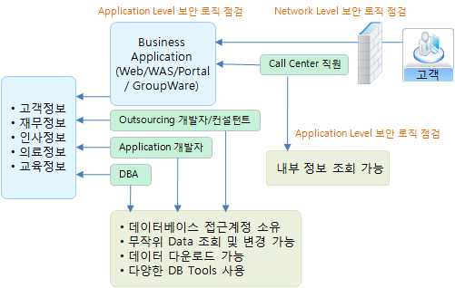

출처:한국데이터베이스진흥원. 데이터베이스 보안 가이드라인
[그림 4-5] 정형적 DB접근과 비정형적 DB접근
(나) 암호화 대상 컬럼
DB 컬럼 암호화의 목적은 개인정보나 민감한 정보가 담겨 있는 테이블의 컬럼
정보를 비인가자로부터 보호하는 것이다. 암호화 대상의 컬럼의 경우 DBMS에
서 지원하는 다양한 종류의 데이터 타입을 가지는데, 일반적으로 개인정보의
이름, 주소, 생년월일, 카드번호, Email 주소 등 스트링(String) 타입이 컬럼 암
호화 대상으로 제일 많다. DB 컬럼의 경우 성능향상을 위해 인덱스(Index)를
자주 사용하게 되는데, 암호화 컬럼의 데이터 타입에 따라서 인덱스에 컬럼 값
이 그대로 노출되는 경우가 있기 때문에 컬럼을 암호화할 경우 관련 인덱스도
암호화의 대상이다. 즉, 인가된 사용에게 복호화 권한을 통제하기 위해서는 컬
럼뿐만 아니라 인덱스도 복호화 권한 관리 대상에 포함되어야 한다.
(다) 암호화 컬럼에 대한 복호화 권한 통제
암호화의 대상은 다수의 테이블에 존재하는 다수의 컬럼이다. 하나의 테이블에
존재하는 서로 다른 컬럼이라 하더라도 사용자를 식별하여 복호화할 필요가
있다. 대체로, 테이블과 컬럼은 하나의 DB 계정(DB User)에 의해 소유되지만，
DB 계정은 여러 사용자에 의해 공유될 수 있고，이에 따라 테이블에 각기 다
른 정보를 담고 있는 컬럼들의 경우 복호화의 권한 제한을 설정한다.
(라) 비인가 사용자에 대한 통제
암호화된 데이터는 인가된 사용자나 시스템에게는 정상적인 복호화 데이터를
전송하지만, 비인가 사용자에게는 암호화된 데이터나 일부 암호화(사용자 입장
에서는 Masking으로 보일 수 있음) 데이터를 전송한다.

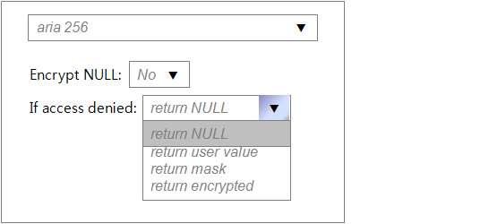

출처:한국데이터베이스진흥원. 데이터베이스 보안 가이드라인
[그림 4-6] 비인가 사용자 복호화 정의
(2) 암호화 키 및 알고리즘을 이용하여 구현 한다.
암호화 키는 암호화 알고리즘(Encryption Algorithm)과 파라미터 키(Parameter
Key)의 조합이다. 암호화 방식은 대칭형(Symmetric)과 비대칭형(Asymmetric) 방식
으로 나뉘는데, 대칭형은 암호화 키와 복호화 키가 동일하고, 비대칭형은 암호화
키 와 복호화 키가 상이하다. 대표적인 암호화 알고리즘으로 대칭형 알고리즘은
DES, 3-DES, AES, SEED, ARIA, MASK가 있고, 비대칭형 알고리즘은 RSA, DSA가
있다. 프로젝트 및 데이터 성격에 따라 알고리즘을 선택하여 적용한다.

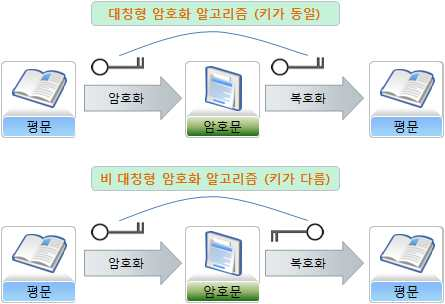

출처:한국데이터베이스진흥원. 데이터베이스 보안 가이드라인
[그림 4-7] 대칭형 알고리즘과 비대칭형 알고리즘
3. DB 작업결재를 설계한다.
DB 작업결재 규칙의 핵심은 어떤 SQL을 수행하거나 어떤 정보에 접근할 때 결재
를 받아야 하는지 여부와 결재를 누구에게 받아야 하는가이다.
(1) 결재대상을 정의한다.
(가) 사용자 중심 정의
결재를 받아야 하는 대상을 사용자 중심으로 정의한다. 사용자를 그룹으로 설
정할 수도 있고, IP, 사용툴 등의 조합으로 정의할 수도 있다.
(나) 정보 중심 정의
SQL을 통해 접속하고자 하는 정보를 중심으로 정의한다. 즉, “중요정보에 접
근할 경우에는 접근하는 사람에 상관없이 항상 결재를 받아야 한다."와 같이
정의한다.
(다) SQL 중심 정의
특정 종류의 SQL을 수행하는 경우에 결재를 수행하도록 한다. 즉, DROP,
TRUNCATE 등의 스키마 구조에 중대한 영향을 미치는 명령을 사용한다든가,
GRANT 등의 권한 설정에 중대한 영향을 미치는 SQL에 대해서만 결재를 수행
하도록 하는 방식이다. SQL 단위로 결재를 받는 경우에는 SQL에 대한 수행 횟
수에 대해서도 통제할 수 있다. 즉, 특정 SQL에 대하여 5회까지만 반복하여 수
행할 수 있도록 제한한다.
(2) 결재자를 정의한다.
결재를 수행할 결재자를 정의한다. 결재는 특정 1인이 수행할 수도 있지만 결재라
인을 구성하여 다수의 결재자가 순차적으로 결재를 진행하도록 설정할 수 있다.
또한, 특정 분야는 A 결재경로를 통해 결재를 진행하고, 다른 분야는 B 결재경로
를 통해 결재를 진행하도록 설정한다.
(3) 결재 사용자 관리를 한다.
결재 시스템 사용을 위한 사용자 관리를 한다. 즉시 결재의 경우에는 DB 접근제
어와 사용자를 공유한다. 그러나 사전 결재 및 사후 결재는 DB 접근제어에서 제
공하는 결재 시스템을 사용할 수 있지만 별도의 결재 시스템을 이용하여 구현할
수도 있다. DB 접근제어의 인증 기능을 이용하여 사용자를 식별하는 경우에는 DB
접근제어의 사용자 관리 방법에 따라 관리한다. 별도의 결재 시스템을 사용하는
경우에는, 결재 시스템에서 사용하는 ID와 DB 접근제어에서 사용하는 ID를 일치
시킨다.
(4) 결재자 관리를 한다.
결재를 수행할 결재자에 대한 관리를 한다. 결재자는 결재경로를 통해 결재자로
지정된다. 결재자가 결재를 할 수 없을 경우 부재중임을 인지할 수 있는 기능과
다른 사람에게 결재를 위임할 수 있는 기능도 필요하다. 결재선은 다단계로 구성
한다. 일반적으로 3단계 이내로 구성하지만 조직 체계가 복잡하거나 감시부서를
결재경로에 포함할 경우 그 이상의 단계로도 구성한다.

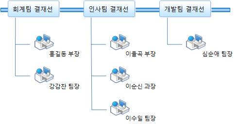

출처:한국데이터베이스진흥원. 데이터베이스 보안 가이드라인
[그림 4-8] 결재선 구성 사례
4. DB 취약점을 분석 설계한다.
DB의 취약점을 보안 관리자 또는 DBA가 일일이 찾아낼 수도 있지만 이는 엄청난 시
간과 노력이 필요하다. 이러한 단점을 보안하고 업무의 효율성을 높이기 위해 일반적
으로 DB 취약점 분석 솔루션을 사용한다. DB 취약점 분석 솔루션은 빠른 시간 안에
방대한 DB를 분석하여 DB의 취약점을 도출하여 해당 DB의 보안 대책을 마련하는 기
초 자료를 제공한다. 또한, 보안 관리자 및 DBA에게 현재 운영 중이거나 향후 구축
될 DB의 취약점을 미연에 방지하도록 사전 가이드성의 정보를 제공한다.

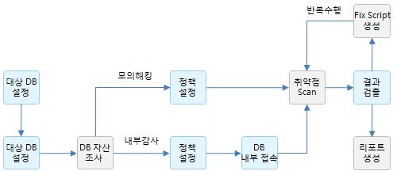

출처:한국데이터베이스진흥원. 데이터베이스 보안 가이드라인
[그림 4-9] DB 취약점 분석 절차
(1) DB 환경을 적정하게 구축한다.
DB 설치 항목 중 무엇이 필요한 요소인지가 확실하지 않다면 일반적인 구성으로
설치하게 되는데 대체로 DB의 대표적인 취약점은 사용하지 않는 모듈의 취약점을
통해 공격하는 사례가 많기 때문에 DB는 처음 설치할 때 반드시 필요한 요소만
설치한다.
(2) 계정 관리를 한다.
제일 많이 사용하는 오라클 DB를 설치하면 다수의 디폴트 사용자 아이디가 생긴
다. 만약, 수동으로 DBCA를 사용하지 않고 오라클을 설치하는 경우라면 디폴트
사용자 아이디는 모두 열린다. 즉, 잠기지 않는 상태가 되므로 보다 세심한 주의
가 필요하다. 이러한 이유로 수동으로 설치한 DB는 SQL문을 통하여 디폴트 사용
자 아이디를 잠그고 기간을 만료시킨다. 물론 상기의 SYS, SYSTEM, SCOTT,
OUTLN, 그리고 3개의 JSERV 사용자 아이디들은 제외한다. 특정 사용자 ID를 잠
그고 기간을 만료시키는 SQL문장은 다음과 같다.
SQL> ALTER USER test ACCOUNT LOCK PASSWORD EXPIRE ;
(3) 패스워드 관리를 한다.
디폴트 사용자 아이디인 SYS, SYSTEM, SCOTT, DBSNMP, 그리고 3개의 JSERV 사
용자 아이디들은 패스워드를 변경해 주어야 한다. 오라클 DB를 공격하는 가장 손
쉬운 방법은 설치 당시의 디폴트 패스워드를 사용하는 사용자 아이디를 사용하는
것이므로 패스워드의 변경은 설치 직후에 지체없이 한다.
(4) 권한 관리를 한다.
사용자는 반드시 필요한 최소권한(Least Privilege)만을 부여한다. PUBLIC 사용자
그룹에서 불필요한 권한을 회수한다. PUBLIC은 오라클 DB의 모든 사용자에게 디
폴트로 적용된다. 따라서 모든 사용자는 PUBLIC에 권한 부여(Privilege Grant)된
것은 어떤 일이든 할 수 있다. 이런 경우 사용자가 교묘하게 선택된 PL/SQL 패키
지를 실행시켜 본래 자신에게 권한 부여된 권한 범위를 넘어서는 작업을 할 수
있다.
(5) 인증 관리를 한다.
클라이언트에 대한 철저한 인증이 필요하다. 예를 들러, 오라클 9i는 원격 인증 기
능을 제공한다. 만일 해당 기능이 활성화(True)되면 원격의 클라이언트들이 오라
클 DB에 접속할 수 있다. 즉, DB는 적절하게 인증된 모든 클라이언트를 신뢰한다.
그러나 일반적으로 PC의 경우에는 적절한 인증 여부를 보장할 수 없다. 따라서
원격인증 기능을 사용하면 보안이 대단히 취약하다. 원격 인증기능을 비활성화
(False)한다면 오라클 DB에 접속하려는 클라이언트들은 Server-base 인증을 해야
하므로 보안이 강화된다. 원격 인증을 제한하여 클라이언트의 인증을 DB 서버가
행하도록 하려면 오라클 파라미터 파일(Parameter File)인 init〈sid〉.ora의 내용을
다음과 같이 수정한다.
REMOTE_OS_AUTHENTICATION = FALSE
또한, DB 서버가 있는 시스템의 사용자 수를 제한한다.
(6) 원격접속 관리를 한다.
(가) 방화벽 구축
DB 서버는 방화벽 뒤에 설치한다. 오라클 네트워킹 인프라스트럭쳐인 오라클
Net Service는 다양한 종류의 방화벽을 지원한다.
(나) 기본 서비스 포트 사용 자제
오라클 DB를 외부 네트워크에서 접근할 수 있도록 방화벽의 1521 포트를 열어
두면 이는 치명적인 허점이 될 수 있다. 더 나아가 패스워드 설정 없이 오라클
리스너를 운영한다면 DB에 대한 중요한 정보들이 노출된다. 이러한 노출정보
가 많으면 많을수록 DB가 공격당할 가능성이 높아진다. 또한, 원격에서 오라클
리스너의 설정을 변경할 수 없도록 한다. 다음과 같이 오라클의 리스너 설정
파일인 listener.ora 내의 파라미터를 설정하면 원격에서 오라클 리스너 설정을
바꿀 수 없다.
ADMIN_RESTRICTIONS_listense_name=ON
접속을 허용할 네트워크 IP 주소 대역을 지정하는 것이 좋다. DB 서버가 특정
한 IP 주소 대역으로부터의 클라이언트 접속을 제어하려면 'Oracle Net valid
node checking' 기능을 이용한다. 이 기능을 사용하려면 protocol.ora 내의 파라
미터를 다음과 같이 설정해야 한다.
tcp.validnode_checking = YES
tcp.excluded_nodes = {list of IP addresses}
tcp.invited_node = {list of IP address}
(다) 네트워크 트래픽(Network Traffic) 암호화
오라클 DB 서버와 클라이언트의 통신은 암호화되지 않은 형태로 이루어진다.
이는 네트워크상의 악의적인 공격자에 의해 데이터의 읽기, 변경, 삭제가 가능
하다는 보안상의 위협이 존재한다. 따라서 가능하다면 Oracle Advanced
Security를 사용하여 네트워크 트래픽을 암호화해야 한다. 그러나 오라클
Advanced Security가 Oracle Database Enterprise Edition에서만 제공된다는 점
이며 암호화하고 복호화하는 알고리즘으로 인해 속도가 떨어질 수밖에 없다.
(암호화 복호화 알고리즘은 DES, Three-DES, RC4 중에서 선택한다.)
(라) DB 서버가 있는 시스템의 OS 강화
불필요한 서비스를 제거하면 DB 서버 시스템이 보다 안전해진다. 유닉스
(UNIX)와 윈도우즈(Windows)를 막론하고 ftp, tftp, telnet 등의 불필요한 많은
서비스들을 디폴트로 제공하는데 제거된 서비스가 사용하는 TCP/UDP 포트를
반드시 모두 막는다.
(마) 보안 패치의 적용
오라클 DB가 운영되고 있는 OS와 DB 자신에 대한 모든 중요한 패치를 정기적
으로 실시한다. 조직 차원에서 패치와 관련된 업무 프로세스를 만든다.
4-2.
데이터베이스(DB) 보안 구현 테스트
• 수립된 구현 계획에 따라 데이터베이스(DB) 시스템의 환경을 설정하고 질의어와 저
장프로시져(Stored Procedure)를 사용하여 데이터베이스(DB) 보안을 구현할 수 있다.
학습 목표
• 구현된 데이터베이스(DB) 보안이 결함이 있는지 테스트하고 테스트 결과를 관리할
수 있다.
필요 지식 /
• 정보보호관리체계에 관한 국제 표준 규격(ISO27001)
학습 내용 1-1의 필요지식 • 참조
• 정보보호관리체계(ISMS)
학습 내용 1-1의 필요지식 • 참조
• 개인정보보호관리체계(PIMS)
학습 내용 1-1의 필요지식 • 참조
• 데이터베이스(DB)와 데이터베이스(DB) 시스템 개념
학습 내용 4-1의 필요지식 • 참조
수행 내용 / 데이터베이스(DB) 보안 구현 및 테스트하기
재료·자료
Ÿ 정보통신망 이용촉진 및 정보보호 등에 관한 법률
Ÿ 개인정보 보호법
Ÿ 정보보호관리체계에 관한 국제 표준 규격(ISO27001)
Ÿ 정보보호관리체계(ISMS)
Ÿ 개인정보보호관리체계(PIMS)
Ÿ 데이터베이스(DB)와 데이터베이스(DB) 시스템 개념
기기(장비･공구)
Ÿ 전산장비 : 인터넷, 컴퓨터, 네트워크 장비, 서버, 데이터베이스(DB) 시스템 등
Ÿ 지원도구 : 문서작성 도구 등
Ÿ 보안장비 : 취약점 분석 도구, 동적 분석 도구, 정적 분석 도구, 로그 분석 도구, 방화벽 설정
도구 등
안전･유의 사항
Ÿ 기술적 보안의 응용프로그램 보안, 서버 보안, 네트워크 보안, 데이터베이스(DB) 보안을 설계하고
구축하는 업무에 적용한다.
수행 순서
• 데이터베이스(DB) 시스템의 환경을 설정하고 질의어와 저장프로시져(Stored Procedure)
를 사용하여 데이터베이스(DB) 보안을 구현한다.
1. DB 접근제어를 구현한다.
(1) 우회 접근 방지
DB 접근제어를 아무리 체계적으로 갖추어도 해당 서버를 경유하지 않고 DB 서버
에 접속할 수 있도록 허용하면 아무런 의미가 없다. 그러므로 DB 접근제어 솔루
션이 정상적으로 동작하게 하려면 반드시 우회 접근을 차단(혹은 최소한 행위에
대한 로깅)하도록 설정한다. 특히, 프록시 게이트웨이 방식은 우회방지 정책을 수
립하여야 한다. 프록시 게이트웨이 방식으로 설치한 경우, DB 접속 시 프록시 서
버를 경유하도록 강제하기 위하여 내부 사용자 단말기에 전용 프로그램을 설치하
거나, 접속 정보가 저장된 파일(Oracle의 경우 tnsnames.ora)을 수정하여 프록시
서버를 경유하도록 설정한다.

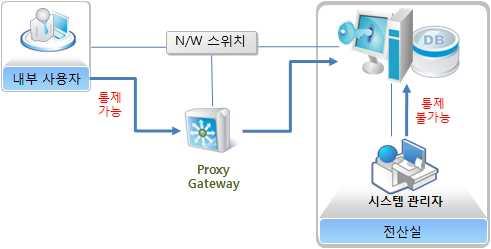

출처:한국데이터베이스진흥원. 데이터베이스 보안 가이드라인
[그림 4-10] 직접 접속에 의한 우회 사례
(가) 에이전트(Agent) 설치에 의한 차단
에이전트 방식으로 DB 접근제어 솔루션이 설치된 경우에는 콘솔 등을 이용하
여 DB 서버에 직접 접근하더라도 차단할 수 있다. 다만, 에이전트 방식의 경우
에 DB 서버에 직접 설치하여 운영하므로 기존 서버에 대한 영향을 최소화하여
야 한다. 이런 이유로 어플리케이션 서버 IP에서 접속하는 세션의 경우에는 바
이패스를 하도록 설정한다. 어플리케이션 서버 IP에서 내부 사용자가 접속을
하는 경우 우회할 수 있는 통로가 될 수 있으므로, 어플리케이션 서버에서 DB
서버로 접속할 수 있는 환경을 제거한다. 에이전트가 설치된 경우에도 에이전
트의 방식에 따라 우회 통로가 있을 수 있다. 즉, 특정 툴을 hooking하는 방식
으로 에이전트가 동작하는 경우에는 해당 툴을 사용하지 않고 접속하는 세션
에 대해서는 통제가 불가능하다. 따라서 이러한 경우에는 해당 툴을 사용할 수
없도록 하거나 통제가 불가능한 툴을 사용하는 경우에 대비한 별도의 보안대
책을 수립한다.
(나) 서버 보안에 의한 차단
서버 보안이란 운영체제의 Kernel에 프로그램을 설치하여 특정 API가 호출될
때, 권한을 점검하여 권한이 있는 경우에만 실행하도록 OS의 보안기능을 강화
하기 위한 솔루션이다. DBMS가 설치된 서버에 설치할 수 있으며 특정 프로그
램 혹은 특정 포트(Port)에 대한 접근을 제어할 수 있는 기능을 가지고 있다.
DBMS에 대한 접근은 DB 리스너(Listener)가 대기하고 있는 포트에 접속 요청
패킷을 보내 접속을 시도하게 되는데 이때, 서버 보안은 접속을 요청하는 쪽의
신원을 파악하여 권한이 있는 경우에만 접속을 허용하도록 설정한다.

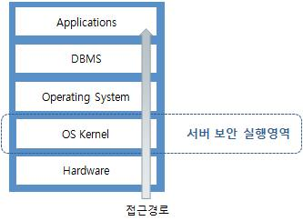

출처:한국데이터베이스진흥원. 데이터베이스 보안 가이드라인
[그림 4-11] 서버 보안에 의한 우회 차단
(다) 스니핑 방식에 의한 차단
스니핑 방식의 경우 기본적으로는 DB 서버에 대한 영향 없이 패킷을 복사하여
로깅하는 기능을 제공한다. 솔루션에 따라 로그인된 세션이 권한 로그인 권한
이 없거나 권한이 없는 SQL을 수행할 경우 해당 세션을 종료시키는 기능을 제
공한다. 스니핑 방식에 의한 차단을 이용하여 우회접근을 방지할 수 있다. 프
록시 게이트웨이 서버를 경유하지 않고 DB서버에 로그인 한 것에 대해 차단하
도록 설정을 하면 우회하여 로그인한 세션을 차단할 수 있다.

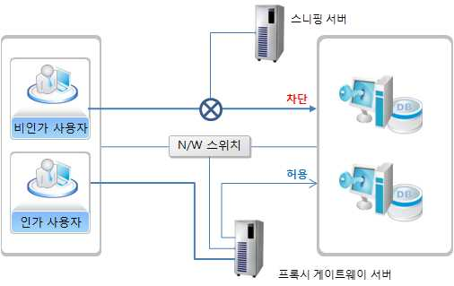

출처:한국데이터베이스진흥원. 데이터베이스 보안 가이드라인
[그림 4-12] 스니핑 서버에 의한 우회 차단
(라) N/W 장치에 의한 차단
DB 서버에 대한 접근 시에 네트워크 접근을 통제할 수 있는 Firewall 은 통제
장치를 경유하는 경우에는 해당 장치를 통하여 통제할 수 있다. 출발지 IP, 포
트 정보와 목적지 IP, 포트 정보 등을 통하여 직접 DB 서버로 접근을 시도하
는 세션을 차단할 수 있다.
(마) DBMS 기능을 이용하여 차단
DBMS 자체에서 접속이 가능한 IP 혹은 접속을 차단하여야 하는 IP를 설정하도
록 하는 기능을 제공하는 제품이 있다. 또한, 로그인 시에 작동되는 로그인 트
리거를 제공하는 제품도 있다. 이런 기능을 이용하여 우회 접속에 대한 차단이
가능하다. 환경설정 파일에서 접근 가능한 IP 대역과 접근 불가능한 IP 대역을
설정하여 네트워크 접근 제어를 한다. SQLNET.ORA 및 PROTOCOL.ORA 파일
을 편집한 후 리스너를 재시작한다.
TCP.VALIDNODE_CHECKING = YES
TCP.INVITED_NODES = (접속을 허용할 IP)
TCP.EXCLUDED_NODES = (접속을 차단할 IP)
1) DB 접속 가능 IP 통제는 오라클에서 임의의 사용자에 의한 원격 접속을 차
단하기 위해 리스너(Listener)의 IP 접근제한을 설정한다. 특정 클라이언트에
서의 접근만 가능하도록 접근 가능 IP를 설정하여 불필요한 외부 사용자 접
근을 차단한다.
2) 로그인 트리거를 이용한 통제는 DBMS에서 제공하는 로그인 트리거 혹은
로그인 시에 수행되는 프로시저를 이용하는 방식이다. 로그인 트리거란
DBMS에 로그인 하려고 하는 경우 작동하는 트리거이고, 로그인 프로시저는
DBMS에서 로그인 시마다 항상 수행하도록 되어 있는 프로시저이다.
2. DB 암호화를 구현한다.
(1) 원본 데이터 삭제
DB의 암호화가 수행되면 원본 데이터를 삭제한다. 원본 데이터는 서비스가 진행
중인 DB내에 존재했거나 백업(Backup)에 의해 테이프 등과 같은 2차 스토리지
(Storage)에 저장한다. 따라서 암호화 후에 진행되어야 할 원본 데이터 삭제는 DB
서비스가 진행 중인 디스크와 백업된 스토리지 모두에게 해당된다. DB 서버 내
디스크의 원본 데이터는 테이블의 컬럼 값 뿐만 아니라 이에 대한 인덱스 정보까
지도 포함한다.
(2) 제약사항 유지
기존 평문의 데이터가 암호화되면 원본 데이터와 연관관계를 가진 인덱스(Index),
PK(Primary Key), UK(Unique Key), FK(Foreign Key), Trigger 및 Default Value 등
다양한 속성들이 유지되어야 한다.
(3) DB 암호화 키 관리
DB 암호화의 가장 중요한 요소 중의 하나가 암호 키 관리이다. 아무리 암호화가
잘 수행되었다 하더라도 키 관리가 허술하면 정보유출 사고 시 대규모 사태가 벌
어질 수 있다. 암호 키는 생성 이후부터 관리가 매우 중요하며, 정기적인 암호 키
변경은 물론 안전한 장소에 암호 키를 보관한다. 다음은 암호 키 관리에 대한 가
이드라인이다.
(가) 암호 키가 생성되면 암호 키에 대한 백업을 수행한다. 암호 키가 변경이 되
면 변경된 암호 키에 대한 백업도 포함이 되며 복구에 대한 확인과 절차도
점검한다.
(나) 암호 키에 대한 논리적 접근제어가 수행되는지 점검한다. 물리적으로 안전하
지 못한 장소에 저장된 암호 키는 쉽게 유출이 가능하기 때문에 별도의 보
안정책이 필요하다.
(다) 암호 키가 물리적으로 안전한 장소에 저장되어 있고 권한이 부여된 사용자
에 의해서만 접근이 가능한가 점검한다.
(라) 암호 키가 해제될 수 있는 가능성을 점검하고 기존 암호 키의 폐기, 새로운
암호 키의 생성 절차를 확인하여야 한다. 이 과정은 매우 중요하며 모든 이
력을 관리한다.
(4) DB 암호화 주요 기능 적용 구축
Ÿ 테이블, 인덱스 모두 암호화 및 인덱스 검색 지원
Ÿ 암호화로 인한 기존 애플리케이션의 수정 불필요
Ÿ 컬럼별 사용자 접근정책을 통한 다양한 암호화 정책 지원
Ÿ 암호화 알고리즘 (3DES, ARIA, SEED, AES, TDES, SHA-1, RSA(PKCS#1),
RSAES-OAEP, RSASSA-PSS, RC4, HMACSHA-1) 적용
Ÿ 암호화 가능 컬럼 타입 (CHAR,VARCHAR, VARCHAR2, DATE, INT, NUMBER,
FLOAT, LONG, LOB (image, design-chart) 확인
Ÿ Index column 지원
Ÿ PK/UK/FK column 지원
Ÿ Trigger 및 default values 지원
Ÿ Null Value 지원
Ÿ Partitioned table (Range, Hash, List partitioned) 지원
Ÿ Windows / Linux / UNIX 등 OS환경에 독립적
Ÿ Column데이터의 부분 암호화 지원(앞뒤 N자리)
Ÿ OS 및 DBMS의 업그레이드에 독립적
Ÿ Clustered DB (Oracle RAC, IBM HA) 지원
Ÿ FIPS Level 2에 의거 암호 키 기밀성 보장 및 DB서버 외부관리
Ÿ 암호화 복호화 서버(NE, LE)의 Load Balance 지원
Ÿ 비정상 동작에 대한 Notification (SNMP, Syslog, Email) 통보
Ÿ 백업/복구, 운영자관리, 리포트분석 등 다양한 관리체계
Ÿ 암호 키 이중화 관리에 의한 Fail-Safe
(5) 암복호화 서버의 로드밸런싱 (환경보완)
DB 암호화의 대상은 하나의 DB이거나 다중 DB 일 수 있고, 혹은 하나의 물리적
인 서버에 여러 개의 DB 인스턴스가 운영될 수 있다. 또한, 이러한 환경의 DB들
은 동시에 서비스가 제공되어야 하므로 암호화 서버의 역할이 매우 중요하다. 경
우에 따라서 암호화 엔진인 DB 내에서 운영되고, 반대로 외부의 별도 서버에서
암복호화가 진행되거나 내부와 외부의 여러 암복호화 엔진이 협력하여 로드밸런
싱을 수행하는 경우가 있다. 더 나아가 이러한 로드밸런싱은 암호화 엔진의 다중
화로 인해 하나의 암호화 엔진이 예기치 못하게 종료한 경우 다른 엔진이 이를
보완하는 역할을 한다. 조직의 규모나 DB의 운영 규모에 따라 다양하게 DB 암호
화를 구성한다.
3. DB 작업결재를 구현한다.
(1) 우회 접근 방지
결재를 거쳐서 수행해야 하는 SQL이 DB 작업결재 시스템을 우회하여 수행할 수
없도록 방지한다. 작업결재가 DB 접근제어와 결합되어 구축되어 있어야 한다.
(2) 환경 보완
DB 작업결재 시스템은 DB 접근제어와 결합되어 구성되거나, 결재 시스템을 별도
로 외부의 시스템을 사용하여 별도로 구축한다.
(3) DB 작업결재 보안규칙 적용
(가) 이력 관리 구성요소 구축
1) DB에 접근할 수 있는 사용자들에 대한 IP, ID, 성명, 조직, 연락처 등에 관
한 정보
2) 결재자, 결재선 구성에 대한 정보
3) 사용자가 접속할 수 있는 DB에 대한 정보
4) 작업결재 규칙 정보
5) 테이블, 컬럼 단위로 설정을 위해 목표 DBMS의 딕셔너리에서 가져오거나,
SQL을 Parsing 하여 저장하는 정보로서, DB계정, 테이블, 컬럼정보 등으로
구성된다.
(나) 백업 관리
DB 작업결재에 대한 백업을 한다. 보안 정책은 일정 시간 동안 변경 될 수 있
으므로 주기적으로 백업한다. 특성에 따라 별도의 보안 정책 저장 기능을 제공
하고 로그와 같이 일괄적으로 백업되어 관리한다.
(다) 사용자 로그 관리
결재문서는 기안 단계에서 승인 과정에 이르는 모든 이력과 승인된 문서에 포
함된 SQL의 수행에 이르는 모든 과정을 저장한다. DB 결재 시스템에서 관리하
는 로그의 종류는 다음과 같다.
1) 결재 시스템에 로그인한 정보
2) 기안된 결재문서 정보로 SQL을 포함하여 결재 기안된 경우에는 해당 SQL
정보를 저장하고, 사전/사후 정보를 같이 생성한 경우에는 해당 정보도 로깅
3) 결재문서를 각 결재자가 승인한 이력으로 대리결재/긴급결재/사후결재 등의
다양한 결재 이력 저장
4) 승인된 결재 문서의 SQL을 수행한 이력 정보
5) 결재를 받도록 통제하는 규칙 정보
6) 경보가 발생한 이력정보
7) 권한이 없는 SQL 수행을 차단한 이력
(라) 모니터링
DB 작업결재와 관련된 모니터링은 작업결재 과정에 문제가 없는지 확인하기
위한 기능이다. 얼마나 많은 문서가 결재를 위해 만들어졌는지, 결재 과정에
있는 문서들은 어떤 단계에 있는지, 결재가 늦어지고 있는 문서들은 얼마나 되
는지 등의 정보를 쉽게 파악할 수 있도록 그래픽 기반의 화면을 제공한다.
• 데이터베이스(DB) 보안 테스트 및 점검을 실시한다.
1. DB 접근제어 보안적용을 시험한다.
DB 접근제어 솔루션을 구축한 후에 각각의 기능들이 제대로 동작하는지 시험을 실시
하여야 한다. 개발 혹은 테스트 DB가 별도로 구축되어 있는 상태에서 DB에 대하여
DB 접근제어가 구축된 경우에는 해당 환경에서 시험을 실시한다. 시험의 결과는
‘시험결과서’로 관리한다.

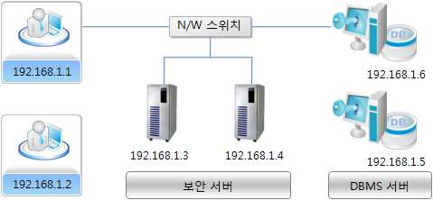

출처:한국데이터베이스진흥원. 데이터베이스 보안 가이드라인
[그림 4-13] 시험 환경 사례
(1) 시험 항목
(가) 로그인 제어
1) 개인별로 부여된 ID 및 패스워드가 정상적으로 체크되는지 여부
2) 개인별로 허용된 DB 및 DB 계정 단위로 로그인 통제 여부
3) IP, ID, 접속 툴의 조합으로 로그인이 통제되는지 여부
4) DB 사용자와 DB 서버 간 암호화 통신을 사용하여 DB 접근제어가 무력화되
지 않도록 통제 가능여부
(나) SQL 통제
1) IP, ID, 접속 툴, DB명, DB 계정에 따라 SQL 종류별로 통제되는지 여부
2) IP, ID, 접속 툴, DB명, DB 계정에 따라 테이블/칼럼에 대한 SQL 수행이 통
제되는지 여부
3) 일정시간 동안 SQL 수행이 없다가 다시 SQL 수행하려고 할 때 통제되는지
여부
(다) 로깅(감사)
1) 접속자 신원, 발생시각, 접속 계정, 접속 툴, 성공 여부 등의 정보를 저장하
는지 여부
2) SQL을 수행한 시각, SQL 문장내용, 조회 결과 등의 정보를 저장하는지 여부
3) 반복되어 사용되는 SQL 중 보안상 의미가 없는 SQL 로깅 제외가 되는지
여부
4) UPDATE, DELETE, INSERT 등의 문장을 수행할 때, 중요 테이블에 대하여
변경 전후 저장이 가능한지 여부
5) SELECT 문장 수행 시, 조회 결과를 저장할 때, 지정된 저장 단위만큼 저장
되는지 여부
6) 다양한 조건으로 로그에 대한 조회가 가능한지 여부
7) 스니핑 구성 시 패킷 손실이 거의 발생하지 않는지 여부(0.1%이하)
(라) 경보
1) 인증 실패, 로그인 실패 등의 사건이 발생했을 때 경보 발행이 되는지 여부
2) 중요 테이블에 접근할 때 경보가 발생되는지 여부
3) 권한이 없는 SQL을 수행하려다 차단당할 때 경보가 발생되는지 여부
4) 중요 테이블에 대하여 대량 데이터 조회하는 경우 경보가 발생되는지 여부
(마) SQL 마스킹
1) 주민등록번호, 주소, 전화번호 등 중요한 정보에 대하여 마스킹이 가능한지
여부
2) 주민등록번호, 카드번호 등 포맷이 있는 정보의 경우, 포맷을 변경해도 마
스킹이 유지되는지 여부
(바) 모니터링
1) DB 접근제어 시스템의 상시 감시가 가능한지 여부
2) 접속세션 수, 경보 발생, SQL 수행 건수 등의 다양한 지표에 대한 추이를
보여주는 모니터링이 가능한지 여부
(사) 보안 정책 관리
1) 보안정책에 대한 백업 및 복구가 가능한지 여부
2) 보안 정책에 대한 변경 이력을 관리하는지 여부
3) 장기 미사용 정책, 미사용 사용자를 식별할 수 있는 기능이 있는지 여부
(아) 보고서
1) 로그인 보고서, SQL 수행 보고서, 경보 보고서, SQL 차단보고서 등의 보고
서를 제공하는지 여부
2) 검색기간별, 부서별 등 다양한 조건으로 보고서 생성이 가능한지 여부
3) DB 보안서버가 여러 개 구축되어 있는 경우, 통합된 보고서 생성 가능여부
(자) 장애 대응
1) 보안서버가 이중화된 경우, 한쪽 장애 시에도 DB 접속 가능여부
2) 에이전트 방식으로 DB 보안서버가 설치된 경우, 에이전트 장애 시에도 DB
접속이 가능한지 여부
(차) 로그 관리
1) 감사 정보에 대하여 백업 및 복구가 가능한지 여부
2) 로그 백업 스케줄 기능을 제공하여, 로그에 대한 자동 백업이 가능한지 여부
(2) 패킷 손실(Packet Loss) 시험
스니핑 방식으로 로깅하도록 설치한 경우에는 스니핑의 특성상 패킷 손실이 발생
할 수 있다. 그리고 구성상의 오류나 시스템의 사양이 부족하여 패킷 손실이 발생
할 수 있다. 현재 설치된 서버에 패킷 손실이 발생하는지, 얼마나 발생하는지 여
부를 측정하여야 한다. 가장 간단한 방법은 SQL을 반복해서 자동으로 수행해주는
툴을 이용하는 것이다.
패킷 손실률 = (손실된 SQL 건수/ 수행한 SQL 건수) * 100
측정된 패킷 손실률은 0.1% 이하로 관리하는 것이 바람직하다. 그 이상의 패킷 손
실이 발생하는 경우에는 스니핑 서버의 사양을 높여야 하거나 네트워크 카드를
변경해야 한다. 경우에 따라서는 스니핑 서버를 교체할 수도 있다.
(3) Long SQL 시험
수행되는 SQL의 크기와 상관없이 모두 SQL을 수집하여 저장한다. 경우에 따라서
500KB 이상의 SQL도 수행하는데 최악의 상황을 대비하여 1MB 정도의 임의의
SQL을 만들어 해당 SQL이 온전히 저장되는지 시험한다.
(4) 성능 시험
인라인 방식으로 게이트웨이를 구성하거나 스니핑 방식으로 WAS에서 오는 모든
SQL을 수집하는 경우 대량의 트랜잭션 발생 시 부하가 높을 수 있다. 이를 위해,
시스템에 부과될 수 있는 최대의 트랜잭션을 계산하고, 30% 정도 여유율을 추가
한 규모로 가상의 트랜잭션을 발생시켜 전체적으로 무리없이 잘 관리되는지 확인
한다.
2. DB 작업결재 보안적용을 시험한다.
DB 작업결재 구축 후 시험을 해야 하는 사항은 구축된 내용에 따라 다르다. 사전 결
재, 즉시 결재, 사후 결재 등은 처리 프로세스가 다르기 때문에 그에 따른 기능도 일
부 차이가 나지만 기본적으로 시험을 해야 하는 공통적인 기능은 다음과 같다.
(1) 시험 항목
(가) 결재시스템
1) 개인별로 부여된 ID 및 패스워드가 정상적으로 체크되는지 여부
2) 결재 문서를 기안하는 기능으로 기안 시, SQL 별, Table/Column 단위로 사
전 결재를 기안할 수 있어야한다. 사후 결재 기안 시에는 이미 수행한 SQL
을 선택하여 기안할 수 있어야한다.
3) 결재 상태를 확인할 수 있는 방법을 제공하여야 한다. 일반적으로 결재함,
반려함, 결재 진행함 등으로 구분하여 기안 문서를 조회할 수 있도록 한다.
4) 결재 문서에 대한 승인 이력을 제공하여야 한다.
5) 사전 결재용 SQL 편집기능 제공
6) 사전 결재 시 변경 전후 정보 자동 생성
7) 사전 결재 대상 SQL, 테이블/컬럼, DB 계정 등을 설정할 수 있는 기능
(나) 작업 결재 통제
1) IP, ID, 접속 툴 등에 따라 결재 여부가 통제
2) DB명, DB 계정, 테이블/컬럼에 따라 결재 여부가 통제
3) SQL 종류에 따라 결재 여부가 통제
(다) 로깅(감사)
1) 승인 관련 모든 행위를 기록하는지 여부
2) 다양한 조건으로 로그에 대한 조회가 가능한지 여부
3) UPDATE, DELETE, INSERT 등의 문장을 수행할 때, 중요 테이블에 대하여
변경 전후 저장이 가능한 지 여부
(라) 모니터링
1) 결재가 처리되고 있는 상태에 대한 모니터링
(마) 보안 정책 관리
1) 작업결재 정책에 대한 백업 및 복구가 가능한지 여부
2) 작업결재 정책에 대한 변경 이력을 관리하는지 여부
3) 장기 미사용 정책, 미사용 사용자를 식별할 수 있는 기능이 있는지 여부
(바) 보고서
1) 승인이력 보고서, 반려이력 보고서 등 다양한 보고서 제공
2) 검색 기간별, 부서별 등 다양한 조건으로 보고서 생성이 가능한지 여부
(사) 로그 관리
1) 감사 정보에 대하여 백업 및 복구가 가능한지 여부
2) 로그 백업 스케줄 기능을 제공하여, 로그에 대한 자동 백업이 가능한지 여부
3. DB 취약점을 분석한다.
(1) 모의해킹
DB 모의해킹(Database Penetration Test)이란 DB 계정을 소유하지 않은 외부 사용
자에 의한 DB 침해공격을 시뮬레이션(Simulation)하는 행위를 의미한다. 취약점을
검출하거나 수집된 취약점 지식 DB를 통해 외부공격자의 침투가능 경로를 검출한
다. DB 모의해킹(Database Penetration Test)의 주요 점검 항목은 다음과 같다.
(가) DB 서비스 프로세스의 여부 점검
(나) DB의 패스워드를 Brute Forcing, Dictionary Attack, 패스워드 크래킹(password
cracking) 기법을 통해 안전하지 못한 DB 패스워드 추출 여부 점검
(다) 버퍼 오버플로어 공격에 대한 DB 서비스 오동작 여부 점검
(라) DoS(Denial of Service) 공격에 대한 DB 다운이나 서비스 불가 여부 점검
(마) DB의 비정상 설정으로 인한 비정상 침투 경로 존재 여부 점검
(2) 내부 보안감사(Security Auditing)
DB 내부 보안감사(Database Security Auditing)는 알려진 취약점과 더불어 DB가 보
안상 안전하게 설치되고 운영되는가를 점검하고, 더불어 DB를 구성하는 File,
Table Space, OS, Role, Grant 등의 다각적 보안 검토를 의미한다. 내부보안감사
(Security Auditing)에서의 주요 점검 항목은 다음과 같다.
(가) 패스워드를 포함하는 Database User Account 정보
(나) 모든 Profile과 각 Profile의 Resource 정보
(다) DB User의 다른 Role에 부여된 Role 정보
(라) Database 내의 모든 Role에 대한 상세 정보
(마) Database User의 다른 Role에 부여된 System Role 정보
(바) Database User에게 부여된 System 권한 정보
(사) Database 프로세스와 세션 정보
4. DB 취약점 체크리스트(Oracle 기반)를 점검한다.
문제발생 시 해당 원인을 찾아 신속히 대처하기 위해 사전에 발생할 수 있는 문제들
이 어떠한 것이 있는지 파악하고 있어야 하며, 일단 문제가 발생하였을 경우 오라클
운영 환경을 점검하여 빠른 시간 내에 문제를 해결할 수 있어야 한다. 오라클 운영
중 고려해야 할 항목은 크게 DB 전체와 DB를 구성하는 FILE 및 TABLESPACE 종류
별로 백업, 설정, 모니터링 등의 측면을 구분하여 각각 점검할 사항들을 기술한다. 각
구성요소별 백업, 설정, 모니터링 등의 측면에서 살펴보고, 이것을 업무에 적용함으로
써 오라클 운영과 문제 상황에 대해 효과적으로 대처할 수 있다.
(1) Database
(가) 백업
1) 백업(Backup)에 사용될 장비상태가 불안정하다고 판단될 때는 절대로 사용
하지 말아야 한다. 또한, 백업된 정보는 즉시 확인할 수 있어야 한다. 즉,
어느 파일이 어느 백업 위치에 있는지 바로 알 수 있어야 한다.
2) 시스템 가동 시점에서 백업 절차 전체에 대한 테스트를 수행한 후, 해당 결
과를 확인하여 변경할 사항들이 있는지 확인 한다.
3) 백업되는 파일 이름은 날짜, 업무 등의 정보를 포함시켜서 나중에 보더라도
알기 쉽도록 지정한다.
4) 3개월 단위마다 정기적으로 백업을 이용한 복구 테스트(Recovery Test)를
실시한다.
(나) 설정
1) 가장 최신의 오라클 패치를 적용하여 시스템이 안정적으로 운영될 수 있도
록 한다.
2) DB_FILES 값의 설정에 주의한다. 이 값을 초과하여 추가하려고 할 때는 실
수가 발생하게 되고, 이러한 상황에서 DB_FILES를 변경하게 되면 DB는 종
료(shutdown) 후에 다시 시작(start)해야 한다.
3) ENQUEUE_RESOURCES는 OS의 Lock Resource를 조절하는 역할을 한다. 이
값이 너무 낮게 설정되어 있으면 특정 어플리케이션에서 Time Out이 발생
한다.
4) DML_LOCKS값은 Object에 대한 작업을 하는 모든 사용자를 고려하여 최대한
크게 설정한다. 이 값이 부족하면 어플리케이션에서 에러가 발생하게 된다.
5) DB를 재생성할 경우에 대비해서 그 절차를 숙지하고 있어야 한다. 그렇지
않으면 소요 작업시간이 길어지게 된다.
(다) 모니터링
1) Alert.log와 Trace 파일의 내용을 점검하여 에러가 없는지, Archive나
Checkpoint 에 대한 Waiting이 발생하지 않았는지 등을 점검한다. 이 파일
들을 이용하여 오라클 Internal Error나 다른 Error 정보를 얻을 수 있다.
2) *_dump_dest의 Free Space여부를 확인한다. InitSID.ora나 configSID.ora에
*_dump_dest가 설정되어 있다. 특히, Alert Log 는 계속 늘어나게 되므로 일
정한 크기가 되었을 때 백업을 받고, Background_dump_dest의 Free Space
를 수시로 점검하여 Space 문제가 발생하지 않도록 주의한다.
3) Tablespace별로 성장속도를 확인한다. 이렇게 하면 Space 부족으로 발생할
수 있는 DB Hang 문제를 미리 대비할 수 있게 된다.
4) Utlbstat.sql / utlestat.sql으로 DB 상태를 정기적으로 점검하여 시스템에 대
한 통계 정보를 기록해 둔다. 이 자료는 튜닝을 위한 기초자료가 된다.
5) 각 Tablespace에 대해 Fragmentation을 점검한다. Fragmentation이 많이 발
생하여 Free Space가 부족하다면 Coalesce를 수행하거나 Data File을 추가
하도록 한다. Disk Space가 거의 존재하지 않는다면 Export를 받은 후 다시
Import를 실시한다.
6) InitSID.ora 파일에 변경이 있을 때 마다 그 이력(History)를 기록해 둔다. 이
렇게 하면 Parameter의 변경으로 발생하는 문제를 대처할 수 있고, 성능
(Performance)의 변화도 알 수 있다.
(2) Database 구성 File
(가) CONTROL 파일
1) 정기적으로 백업을 받는다. Cold Backup일 경우에는 Control 파일자체를 복
사하여 백업을 받고 DB가 운영 중일 경우는 다음 명령어를 이용하여 파일
을 백업받는다.
SVRMGR) alter database backup controlfile to (file name)；
2) Control 파일을 재생성하기 위해서는 다음 명령어를 사용하여 user_dump_dest
에 생성되는 Trace 파일이 필요하다. 따라서 이 Trace 파일을 백업 받아두
는 것이 반드시 필요하다.
SVRMGR) alter database backup controlfile to trace；
3) Data 파일과 Redo Log 파일의 추가나 삭제 등의 원인으로 DB에 변경사항
이 있을 때마다 백업받는다.
4) Hot Backup시 End Backup이 발생할 때마다 백업을 받는다.
5) 백업받은 파일 이름에 날짜와 업무정보 등을 포함시켜 쉽게 알아볼 수 있도
록 한다.
6) MAXDATAFILES 값은 예상치보다 크게 설정해야 한다. 디폴트값은 플랫폼
(Platform)별로 다르다. InitSID.ora에서 DB_FILES가 크게 설정되어 있더라도
MAXDATAFILES 값이 너무 작으면, DB에서 동시에 Open할 수 있는
Datafile의 개수는 MAXDATAFILES 값을 넘을 수가 없게 된다. 이 값을 변
경하기 위해서는 Control 파일을 재생성해야 한다.
7) 별도의 디스크와 콘트롤러가 사용되도록 물리적 위치를 지정한다.
8) *.ctl과 같이 알기 쉬운 이름을 사용하도록 한다.
9) 최소 3개가 사용되도록 해야 한다.
10) MAXLOGFILES 값을 확인하여 예상치보다 크게 설정한다.
11) MAXLOGMEMBERS 값이 3이상이 되도록 설정한다.
12) OPS의 경우 MAXINSTANCES값을 예상치보다 크게 설정하도록 한다.
13) MAXLOGHISTORY는 저장될 Log History정보의 양을 지정하므로, Log File
이 생성되는 추이를 파악하여 적절한 값을 지정하여야한다.
14) OS 레벨에서 모니터링이 되어 있는지 확인하고 Striping은 하지 않도록 한다.
(나) ONLINE REDO LOG 파일
1) Hot Backup시에는 End Backup 이후에 'archive log list' 명령어를 수행하여
현재 Log Sequence Number를 먼저 확인한다. 그리고 아래 명령어를 수행
하여 Archive를 추가로 생성한 후, 앞서 확인한 Sequence Number까지
Archive Log를 백업받는다.
SVRMGR) alter system switch log file；
2) Hot Backup시에는 Archive Log 파일이 Backup되었으면 Online Redo Log는
백업받을 필요가 없다.
3) Cold Backup시에는 Restore 할 때의 실수를 방지하기 위하여 주요 DB 파일,
특히 Archive Log 파일과는 다른 위치에 백업을 받는다.
4) OPS일 경우 Instance Recovery를 위해서 Log의 모든 Member는 동시에
Access가 가능하여야 한다.
5) 각 그룹의 Member 들은 Disk와 Controller를 별도로 사용하도록 한다.
6) Redo의 Thread는 Instance당 1개를 설정하여야 한다.
7) Redo Log Group은 최소 3개 이상이 되도록 하고, 각 그룹들은 최소 2개 이
상의 Member를 가지도록 한다. 이렇게 Log Mirroring을 하게 되면 돌발적
인 파일 삭제상황에 대비할 수 있게 된다.
8) Redo Log Member의 Size는 Checkpoint에 대한 Waiting이 발생하지 않도록
충분한 크기를 지정하여야 한다. 사이즈(Size)가 너무 작을 경우에는 잦은
Log Switch로 인하여 복구 시간이 지나치게 많이 소요될 수 있다.
9) Redo Log Member의 사이즈는 모두 같게 한다.
10) DB 파일과 다른 물리적인 위치를 지정하도록 한다.
11) Checkpoint 주기를 점검하도록 한다. 권장할만한 Checkpoint의 주기는
10-15분 정도이다. LOG_CHECKPOINT_INTERVAL을 가장 큰 Redo Log File
Size보다 크게 설정하고 LOG_CHECKPOINT_TIMIEOUT을 0으로 설정하게 되
면, Log Switch가 일어날 때마다 Checkpoint가 발생하게 되므로 Log File
Size 변경을 통해 Checkpoint 주기를 조정할 수 있다. 잦은 Checkpoint는
Crash 복구 시간은 줄여주지만, Dirty Buffers를 자주 사용하고 File Headers
를 자주 업데이트하게 되어 Overhead를 일으키게 된다.
12) Log Switch가 너무 자주 발생하지 않는지 점검한다. Log Switch는 15분 정
도 주기가 적당하다. Log Switch가 너무 자주 발생하면 v$backup을 통해
Hot Backup 상태인 파일이 있는지도 확인한다.
13) V$logfile을 통해 Status를 수시로 점검한다. Status가 Invalid나 Stale이 없는
지 확인한다.
(다) ARCHIVE LOG 파일
1) 모든 Archive Log가 빠짐없이 백업에 포함되었는지 점검한다. 또한, V$LOG
에서 Archived, Status 칼럼을 참조하여 Archive가 완전히 끝난 Log 파일을
백업해야 한다.
2) OPS일 경우에는 모든 Thread에서 생성되는 Archive를 전부 백업해야 한다.
3) 백업된 Archive Log 파일의 Sequence Number가 연속되어 있는지 확인해야
한다.
4) Archive Log 파일이 특정 Threshold에 도달할 때마다 백업한다. 가능하면
매일 백업받는 것이 좋다.
5) 백업된 Archive 파일들은 삭제하도록 한다. 그러나 Disk의 공간을 충분히
하여 최소한 하루의 Archive Log들은 백업을 받았더라도 삭제하지 않도록
한다. 이것은 장애 시에 복구 시간을 줄이는 역할을 할 수 있다.
6) Archived Log File의 개수는 Log 파일의 크기와 Redo의 양에 달려있다. 그
리고 Redo의 양은 Transaction의 양과 연관되어 있다. 이러한 환경을 고려
하여 백업의 빈도를 결정하도록 한다.
7) 백업 위치별로 그 속에 포함된 Log가 어느 기간 동안 생성된 것인지에 대
한 정보를 기록해 두어야 한다.
8) Archive Log 생성속도와 파일의 백업 속도에 대해 알고 있어야 한다.
9) Main이 되는 백업 장비에 문제가 있을 것에 대비하여 즉시 사용 가능한 대
체장비를 확보하고 있어야하며, 이 대체장비는 Backup Script에 반영되어 있
어야 한다.
10) DB가 ARCHIVELOG Mode로 운영 중인지 확인한다. 이것을 위해서는 다음
명령어를 사용한다.
SVRMGR) archive log list；
또는
SVRMGR>select log_mode from v$database；
11) Automatic Archival이 활성화로 설정되어 있는지 점검한다. DB가 Startup이
되기 전이라면 initSID.ora에 LOG_ARCHIVE_START=TRUE를 설정하고，
Start-up 이후에는 다음 명령어를 사용한다.
SVRMGR) alter system archive log start；
12) 생성되는 Archive 파일의 위치와 파일 이름 형식을 알아보기 쉽도록 지정
한다. 이것은 initSID.ora에서 LOG_ARCHIVE_DEST와
LOG_ARCHIVE_FORMAT을 통해 지정할 수 있다. LOG_ARCHIVE_FORMAT=
"LOG%s_%t.ARC"으로 설정 할 경우 %s는 Log Sequence Number, %t는
Thread Number를 의미한다. 특히 OPS인 경우 %t를 설정하여 Thread별로
생성되는 Archive를 구별하여 관리하도록 한다.
13) Archive되는 위치가 Disk인지 확인한다. Tape에서 Disk로 옮기는 시간을
줄여서 복구 시간을 단축할 수 있다. 그러나 Tape에도 Archive를 복사해 두
도록 한다.
14) Online Redo Log와는 다른 Disk와 Controller를 사용해야 한다.
15) DB 파일과는 다른 Disk와 Controller를 사용해야 한다.
16) Archive 파일이 생성되는 위치에 여유 공간이 있는지 확인해야 한다. Disk
에 여유 공간이 없어서 Archive Log를 생성하지 못하는 경우에는 DB Hang
이 발생하게 된다. Archive 위치에 여유 공간이 얼마 남지 않았을 경우 경
고 메시지를 발생시키는 내용을 Backup Script에 포함한다.
17) Archive와 관련된 에러가 발생하지 않았는지 Alert Log를 점검한다.
18) Archived Log 파일의 Sequence Number가 순차적인지 확인한다. Log
Switch 가 일어날 때마다 Sequence Number는 하나씩 증가된다.
19) DB가 ARCHIVELOG Mode로 작동중인지 확인해 본다. 만약 Archive Log
Mode 가 아니라면 다음과 같은 과정을 통해 Mode를 변경할 수 있다.
SVRMGR> connect internal
SVRMGR> shutdown
SVRMGR> startup mount
SVRMGR〉alter database archivelog；
20) ARCH Process가 움직이는지를 자주 확인한다. 이렇게 하면 ARCH Process
가 움직이지 않아서 DB가 Hang이 걸리는 문제를 막을 수 있다.
(3) TABLESPACE
(가) SYSTEM TABLESPACE
1) Free Space를 수시로 점검한다.
2) Extents의 개수가 MAXEXTENTS/2 지점에 이르지 않았는지 확인한다.
3) Tablespace의 size가 적정수준인지 확인한다. 일반적인 System Tablespace의
Size는30〜50M이다.
4) 일반사용자의 Object나 Temporary Segment가 포함되지 않았는지 점검한다.
5) 일반사용자에게 사용권한을 부여하지 않도록 한다.
6) System Tablespace 이외의 Tablespace에서 발생하는 Extent는 Data
Dictionary의 정보를 사용하게 되므로 작은 Extent가 지나치게 많을 경우
System Tablespace의 Space도 영향을 받게 된다.
7) 특별한 경우가 아니면 SYS Object의 Storage절을 변경하지 않도록 한다.
8) Disk를 모니터링하고 Striping은 설정하지 않는다.
(나) ROLLBACK SEGMENT TABLESPACE
1) Hot Backup은 DB Activity가 낮은 시점에서 실시한다.
2) 알기 쉬운 이름을 사용한다.
3) 일반적인 용도의 RBS의 크기는 모두 같게 한다.
4) INITIAL과 NEXT는 같게 설정한다.
5) PCTINCREASE는 0으로 설정한다.
6) InitSID.ora에서 UNLIMITED_ROLLBACK_SEGMENTS=FALSE를 지정하여 RBS
가 Unlimited Extent Format을 사용하는 것을 방지하도록 한다.
7) OS 레벨에서 모니터링을 하고 Striping은 하지 않는다.
8) InitSID.ora에 RBS들이 등록되어 있는지 확인한다.
9) RBS가 Online 상태인지 주기적으로 점검한다. 이 때 dba_rollback_segs를 이
용할 수 있다.
10) RBS Tablespace에 다른 Object가 생성되지 않았는지 점검한다.
11) RBS의 크기변동률을 점검한다. V$rollstat을 이용하면 RBS가 커지거나 줄어
드는 비율과 Wait 정보를 확인할 수 있다.
12) Free Space와 Fragmentation 정도를 점검한다.
13) ORA-1555 에러가 발생하는지 점검한다. 이 경우에 DB는 여전히 사용가능
하며 Application Error가 발생할 수 있다. Data 파일을 추가하여 공간을 늘
여야 한다.
14) RBS당 Transaction의 개수는 4〜5개가 적절하다.
15) Batch Job에만 사용되는 큰 크기의 RBS를 별도로 설정하고, OLTP용 RBS
와 동시에 Online되지 않도록 한다. 다음 명령어로 특정 RBS 사용을 지정할
수 있다.
SVRMGR> set transaction use rollback segment <rbs name)；
(다) DATA TABLESPACE
1) READ-ONLY Tablespace일 경우 쓰기, 읽기 권한관리에 주의하여야한다. 이
러한 변화는 Control 파일이나 Data 파일의 백업에도 영향을 미친다.
2) MTTR을 만족시킬 수 있는 주기 단위로 백업을 실시한다.
3) Export를 이용하여 Object 레벨에서 Logical 백업을 받아두어야 한다.
4) Hot Backup 시에는 해당 Data 파일의 Transaction 발생을 줄여서 Redo가
적게 발생되도록 해야 한다.
5) 알아보기 쉬운 이름을 사용하도록 한다.
6) 서로 다른 Tablespace는 다른 Disk에 위치하도록 하는 것이 좋다. OS 파일
이 분실되는 것은 곧 Tablespace의 분실을 의미하므로 사전에 주의하여야
한다.
7) Index Tablespace는 Data와 분리하여 사용하도록 한다.
8) Fragmentation을 줄이기 위해서 Tablespace내에 비슷한 크기의 Object들이
위치하게 하는 것이 좋다.
9) OPS의 경우에는 Application별로 Tablespace를 분리하여 운영하는 것이 좋다.
10) Autoextend는 비활성화로 설정하여 사용한다.
11) 7.3이후 Version에서는 MAX EXTENTS값보다 더 많은 값을 직접 지정하는
것이 가능해 졌다. MAX EXTENTS 보다 더 큰 값을 사용하게 되면 새로운
Block Format이 사용된다.
12) Default Storage 절이나 생성되는 Object에 MAXEXTENTS UNLIMTED를 사
용하지 않도록 한다.
13) MAXEXTENTS UNLIMITED를 설정할 수도 있으나 권장되는 설정이 아니다.
UNLIMITED Extent Format을 사용하려면 COMPATIBLE의 값이 7.3.0 이상으
로 설정되어 있어야 한다.
14) MAXEXTENTS UNLIMITED를 설정하는 것은 해당 Tablespace의 Free
Space 전체를 사용하게 될 위험이 있다. 또, MAXEXTENTS UNLIMITED가
사용될 경우 작은 Extent의 개수가 과도하게 증가하여 DROP TABLE,
TRUNCATE TABLE 작업 등을 수행할 때 Space와 관련된 심각한 성능 문제
를 유발할 수 있다.
15) OS 레벨에서 Mirror되게 한다.
16) 주요 Object에 대해서는 정기적으로 분석을 실시한다.
17) 문제를 조기에 발견하기 위해서 Object가 MAXEXTENTS/2에 도달했는지를
점검한다.
18) Type이 다른 Object가 동일한 Tablespace에서 혼용되지 않도록 한다.
19) DBVERIFY를 사용하여 정기적으로 점검해 본다.
20) Null Device에 Export하여 Logical Object의 상태를 점검해 본다.
(라) TEMPORARY TABLESPACE
1) 임시 Tablespace의 개수는 DB 사용자별로 1개, OPS일 경우는 Instance의 개
수만큼으로 생성하도록 한다.
2) 7.3이상 Version에서는TEMPORARY Status를 설정하도록 한다.
3) PCTINCREASE는 0으로 설정하도록 한다.
4) INITIAL과 NEXT의 값은 sort_area_size의 배수로 설정한다.
5) 7.3 Version부터 TEMPORARY Tablespace에 생성되는 Sort Segment는
INITIAL값으로 Tablespace의 NEXT 값을 그대로 사용하게 되고,
PCTINCREASE는 0, MAXEXTENTS는 UNLIMITED로 지정된다. 따라서 임시
Tablespace에 생성되는 Sort Segments의 EXTENT 전체 크기는 조절할 수
없으므로 Default Storage 절에서 NEXT값 설정에 주의해야 한다.
6) Index 생성을 위해 사용되는 임시 tablespace의 크기는 Index Data의 2배 정
도가 되어야한다.
7) OS 레벨에서 모니터링을 하고 Striping은 하지 않도록 한다.
8) 일반 사용자가 올바른 임시 Tablespace를 사용하고 있는지 확인한다.
9) Tablespace 내에 일반 사용자의 Object가 생성되지 않았는지 점검한다.
10) Tablespace가 TEMPORARY 상태인지 확인한다.
11) MAXEXTENTS UNUMTED로 설정된 Tablesapce가 TEMPORARY Segments
를 위해 사용된다면, SMON이 해당 Segments를 Clean-up하는데 시간이 오
래 걸리게 되어 많은 자원을 소모하게 된다. 또한, Shutdown 작업이 지나치
게 길어질 수도 있다.
(4) OS 및 기타
(가) OS
DB에 설정되어 있는 DB_FILES나 MAXDATAFILES 값이 크더라도, DB 사용자
가 동시에 접근하여 사용할 수 있는 파일의 개수는 OS에서 동시에 접근할 수
있는 파일의 개수를 넘을 수 없다. 따라서 사용 중인 Control 파일, Redo Log
파일, Data 파일, Alert.Log, Trace 파일들의 개수를 모두 고려하여 OS에서 동
시에 Open할 수 있는 파일 개수를 지정하여야 한다. 이 값을 변경하기 위해서
는 DB도 Down 되어야하기 때문에 운영 중인 시스템에서는 치명적일 수 있다.
그러므로 Disk나 Controller에 문제가 없는지 자주 확인하고，OS 모니터링이
제대로 동작하고 있는지도 확인한다.
(나) 기타
SQL*NET의 상태를 확인한다. Listener의 Process가 Running 상태인지 확인하
려면 다음의 명령어를 사용한다.
$ lsnrctl status

| 학습 4 | 교수·학습 방법 |
| --- | --- |

교수 방법
• 데이터베이스(DB) 보안이 왜 중요하고 의미가 있는지 충분히 설명한다.
• 데이터베이스(DB) 보안은 법률에 의거 수행되는 활동으로 본 수업에 앞서 법률의 등장배경과
데이터베이스(DB) 구축방안에 대해 설명하도록 한다.
• 학생들의 관심을 유발하기 위한 데이터베이스(DB) 보안 침해사례 등을 파워포인트로 만들어
이해에 도움이 되도록 한다.
• 가능하면 개인별로 데이터베이스(DB) 보안 구축사례를 수집하게 하고 문제점과 해결방법을
제시하도록 지도한다.
• 제시한 사례들을 서로 공유함으로써 다양한 보안방법을 공유할 수 있게 지도한다.
• 데이터베이스(DB) 보안구축이 제대로 이루어지고 있는지 항상 체크한다.
• 정보보안의 중요성과 정보윤리를 함께 교육함으로써 올바른 보안 의식 함양이 되도록 유도한다.
학습 방법
• 데이터베이스(DB) 보안에서 제시된 내용을 사전에 충분히 학습한다.
• 관련 법률에 대한 사이트를 통해 스스로 내용을 찾아보고 추가 설명이 요구되는 부분에 대해
질문 목록을 작성한다.
• 다양한 데이터베이스(DB) 보안 구축사례를 찾아보고, 스스로 문제점과 해결방법을 찾아본다.
• 데이터베이스(DB) 보안 구축사례를 파워포인트, MS 워드, 한글과 같은 문서로 작성하여 사례
발표 및 다른 학생들과 자료를 교환한다.
• 데이터베이스(DB) 보안에 대한 보안 취약점을 분석한 후 사후대책을 계획해 본다.
• 정보보안의 필요성을 인식하고, 올바른 윤리의식이 함양하도록 주기적으로 보안교육을 받는다.

| 학습 4 | 평 가 |
| --- | --- |

평가 준거
• 평가자는 학습자가 수행 준거 및 평가 항목에 제시되어 있는 내용을 성공적으로 수행하였는지를
평가해야 한다.
• 평가자는 다음 사항을 평가한다.

| 학습 내용 | 평가 항목 | 성취수준 |  |  |
| --- | --- | --- | --- | --- |
|  |  | 상 | 중 | 하 |

- 보안요구사항에 따라 사용된 데이터베이스(DB) 시스
템의 기술을 이용하여 데이터베이스(DB) 보안을 설
데이터베이스
계할 수 있다.
(DB) 보안설계
- 설계된 데이터베이스(DB) 보안에 대한 데이터베이스
구현 계획
(DB) 시스템에 맞는 질의어와 저장프로시져(Stored
Procedure)를 사용하여 구현 계획을 수립할 수 있다.
- 수립된 구현 계획에 따라 데이터베이스(DB)시스템의
환경을 설정하고 질의어와 저장프로시져(Stored
데이터베이스
Procedure)를 사용하여 데이터베이스(DB) 보안을 구
(DB) 보안 구현
현할 수 있다.
테스트
- 구현된 데이터베이스(DB) 보안이 결함이 있는지 테
스트하고 테스트 결과를 관리할 수 있다.
평가 방법
• 서술형시험

| 학습 내용 | 평가 항목 | 성취수준 |  |  |
| --- | --- | --- | --- | --- |
|  |  | 상 | 중 | 하 |

- ISO27001, ISMS, PIMS, 데이터베이스(DB) 보안의 정의
데이터베이스 - 데이터베이스(DB) 보안 목적과 필요성 이해
(DB) 보안설계 - 데이터베이스(DB) 보안 정책 수립 절차 이해
구현 계획 - 데이터베이스(DB) 보안 구축 설계 시 고려 사항
- 데이터베이스(DB) 보안 요소의 종류 및 구축 방법
- 데이터베이스(DB) 보안약점 및 보안대책
- 데이터베이스(DB) 보안사고 발생 유형 및 대처법
데이터베이스
- DB접근제어의 이해
(DB) 보안 구현
- DB암호화 구축 방법
테스트
- DB작업결재의 이해
- DB 취약점 분석 유형 및 체크리스트 정리
• 문제해결 시나리오

| 학습 내용 | 평가 항목 | 성취수준 |  |  |
| --- | --- | --- | --- | --- |
|  |  | 상 | 중 | 하 |

| 데이터베이스(DB) 보안설계 구현 계획 데이터베이스(DB) 보안 구현테스트 • 평가자 체크리스트데이터베이스(DB) 보안 설계구현 계획 데이터베이스(DB) 보안 구현테스트 피 드 백 | - 데이터베이스(DB) 보안이란 무엇인가 - 데이터베이스(DB) 보안의 목적과 필요성 - 데이터베이스(DB) 보안 구축 시 중점 사항 - 데이터베이스(DB) 보안 구축 절차에 대한 이해 - 데이터베이스(DB) 보안 취약점과 해결방안 - 데이터베이스(DB) 보안 요소 종류 - DB 취약점 분석 도구의 종류 및 사용 방법 - 데이터베이스(DB) 보안의 생성 배경과 필요성 - 데이터베이스(DB) 보안의 취약점과 해결 방안 - 데이터베이스(DB) 보안 구축 절차의 이해 - 데이터베이스(DB) 보안 구축 시 고려 사항 - 데이터베이스(DB) 침해사고 발생 유형 및 대처 방안- 데이터베이스(DB) 보안 구성요소 및 구축 방안 - 데이터베이스(DB) 취약점 분석 및 체크리스트 점검 |  |  |  |
| --- | --- | --- | --- | --- |
| 1. 서술형시험 - 기준 점수트를 제출하게 | 미달자에 대해서는 교육 성취수준을 개별 통보하고 미흡한하여 교육성과를 높이도록 한다. | 분야에 | 대해 | 리포 |
| 2. 문제해결 시나리오- 보안실무에제출하도록 | 대한 이해도를 평가하는 항목으로 관련 양식을 활용하여 직접지도한다. | 점검한 |  | 결과를 |
| 3. 평가자 체크리스트- 성취수준 | 미달자는 보안 관련 법률해석과 보안점검절차에 대한 리포트를 |  | 제출하도록 | 지 |
| 도한다. |  |  |  |  |

| 학습내용 | 평가항목 | 성취수준 |  |  |
| --- | --- | --- | --- | --- |
|  |  | 상 | 중 | 하 |

| 데이터베이스(DB) 보안 설계구현 계획 데이터베이스(DB) 보안 구현테스트 피 드 백 | - 데이터베이스(DB) 보안의 생성 배경과 필요성 - 데이터베이스(DB) 보안의 취약점과 해결 방안 - 데이터베이스(DB) 보안 구축 절차의 이해 - 데이터베이스(DB) 보안 구축 시 고려 사항 - 데이터베이스(DB) 침해사고 발생 유형 및 대처 방안- 데이터베이스(DB) 보안 구성요소 및 구축 방안 - 데이터베이스(DB) 취약점 분석 및 체크리스트 점검 |  |  |  |
| --- | --- | --- | --- | --- |
| 1. 서술형시험 - 기준 점수트를 제출하게 | 미달자에 대해서는 교육 성취수준을 개별 통보하고 미흡한하여 교육성과를 높이도록 한다. | 분야에 | 대해 | 리포 |
| 2. 문제해결 시나리오- 보안실무에제출하도록 | 대한 이해도를 평가하는 항목으로 관련 양식을 활용하여 직접지도한다. | 점검한 |  | 결과를 |
| 3. 평가자 체크리스트- 성취수준 | 미달자는 보안 관련 법률해석과 보안점검절차에 대한 리포트를 |  | 제출하도록 | 지 |
| 도한다. |  |  |  |  |

| 학습내용 | 평가항목 | 성취수준 |  |  |
| --- | --- | --- | --- | --- |
| ∙구정본(2003). 「DoS | 공격패턴의 분석을 통한 인터넷 서버 보안 방안」. 석사학위논문, |  | 영남대학교 |  |
| 산업대학원. ∙김근호(2004). 「운영체제대학원. ∙김용수(2010). 「네트워크∙미래창조과학부(2013).∙백승현(2010). 「사내 회논문지』, 제47권 TC편∙손혁진(2013). 「단독 서버 | 보안시스템을 이용한 서버 보안성 향상연구」. 석사학위논문,보안 기술에 대한 연구」. 석사학위논문, 한라대학교『보안서버 구축 가이드』. 네트워크 보안을 위한 네트워크 접근제어시스템 설계 및 구현」.제12호, 90p ~ 96p. 보안인지와 대책방안 연구」. 석사학위논문, 한양사이버대학교 | 대학원. | 한서대학『전자공학경영대 |  |
| 학원. ∙이부형 학위논문(2013).학기술대학교 대학원.∙한국데이터베이스진흥원(2012).∙한국정보보호진흥원(2008).∙행정자치부(2013). ∙황응주(2013). 「시스템아키텍처 | 『데이터베이스 암호화 기법의 비교 및 성능평가』. 『데이터베이스 보안 가이드라인』. 『안전한 소프트웨어 개발‧도입을 위한 보안 가이드『소프트웨어 개발보안 가이드』. 네트워크 보안 감리 지침 개선 연구」. 석사학위논문, | 석사학위논문,V1.0』. | 서울과인천대학교 |  |
| 정보기술대학원. |  |  |  |  |

| 학습내용 | 평가항목 | 성취수준 |  |  |
| --- | --- | --- | --- | --- |
| 학습모듈 개발진 |  |  |  |  |
| (대표집필자) 조준범(백석문화대학교)* | (집필진) (검토진) 이창근(KB데이타시스템)* 김영기(한국IT감리컨설팅) 이봉호(갭컨설팅)한성화(에스지에이)* 정순철((주)에이치엠에스)이용희(동서대학교) 장지호(펜도메이트)이은진(트리니티소프트)* 임태호(헬쓰커넥트)최홍선(큐브컨설팅(주)) | 송경희(양영디지털고등학교) |  |  |
| (공동개발기관) 김제호(밸류원컨설팅) 학습모듈은 자격기본법저작권법 25조에 따라학습모듈은 | (연구기관) 옥준필(한국직업능력개발원) 김상진(한국직업능력개발원) 김성남(한국직업능력개발원) 김지영(한국직업능력개발원) 문한나(한국직업능력개발원) 김나래(한국직업능력개발원) *표시는시행령 제8조 국가직무능력표준의 활용에 의거하여관리됩니다. http://www.ncs.go.kr에서 확인 및 다운로드할 수 있습니다. | NCS | 개발진임개발하였으며 |  |

