# LM2001020609_보안감사수행

대분류/20
정보통신 중분류/01
정보기술 소분류/02

정보기술개발 세분류/06
보안엔지니어링 능력단위/09

NCS학습모듈
보안감사 수행

LM2001020609_16v3

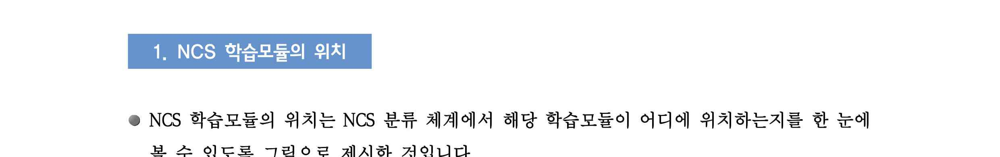

[NCS-학습모듈의 위치]

| 정보통신 |  |  |
| --- | --- | --- |
|  | 정보기술 |  |
|  |  | 정보기술개발 |

대분류
중분류
소분류
세분류

| SW아키텍처 |  |  | 능력단위 | 학습모듈명 |
| --- | --- | --- | --- | --- |
| 응용SW 엔지니어링 |  |  | 보안계획 수립 | 보안계획 수립 |
| 임베디드SW 엔지니어링 |  |  | 보안위험 평가 | 보안위험 평가 |
| DB엔지니어링 |  |  | 보안요구사항 정의 | 보안요구사항 정의 |
| NW엔지니어 링 |  |  | 관리적 보안 구축 | 관리적 보안 구축 |
| 보안엔지니어링 |  |  | 물리적 보안 구축 | 물리적 보안 구축 |
| UI/UX엔지니어링 |  |  | 소프트웨어 개발 보안구축 | 소프트웨어 개발 보안구축 |
| 시스템SW 엔지니어링 |  |  | 데이터베이스 보안 구축 | 데이터베이스 보안 구축 |
| 빅데이터 플랫폼구축 |  |  | 시스템 보안 구축 | 시스템 보안 구축 |
| 핀테크 엔지니어링 |  |  | 네트워크 보안 구축 | 네트워크 보안 구축 |
| 데이터아키텍트 |  |  | 보안체계 운영관리 | 보안체계 운영관리 |
|  |  |  | 보안위협 관리통제 | 보안위협 관리통제 |
|  |  |  | 보안감사 수행 | 보안감사 수행 |
|  |  |  | 보안인증 관리 | 보안인증 관리 |

차 례
학습모듈의 개요 1
학습 1. 보안감사 계획하기
• 1-1. 보안감사 예비조사 3
• 1-2. 보안감사 계획 11
• 교수·학습 방법 18
• 평가 20
학습 2. 보안감사 수행하기
• 2-1. 보안감사 현장수행 22
• 2-2. 보안감사 결과보고 31
• 교수·학습 방법 40
• 평가 42
학습 3. 보안감사 사후관리하기
• 3-1. 보안감사 시정조치 확인 45
• 3-2. 보안감사 시정조치 결과보고 50
• 교수·학습 방법 53
• 평가 55
참고 자료 57
활용 서식 58
보안감사 수행 학습모듈의 개요
학습모듈의 목표
보안과 관련된 통제절차의 기록과 행동을 독립적으로 조사하고 관련 증거를 수집하여 분석함으
로써 주요 정보자산의 기밀성, 무결성, 가용성을 점검할 수 있다.
선수학습
보안요구사항 정의(2001020603_14v2), 관리적 보안 구축(2001020604_14v2), 물리적 보안 구축
(2001020605_14v2), 기술적 보안 구축(2001020606_14v2), 보안체계 운영관리(2001020607_14v2)
학습모듈의 내용체계

| 학습 | 학습 내용 | NCS 능력단위요소 |  |
| --- | --- | --- | --- |
|  |  | 코드번호 | 요소명칭 |

1-1. 보안감사 예비조사
보안감사
1. 보안감사 계획하기 2001020609_16v3.1
계획하기
1-2. 보안감사 계획
2-1. 보안감사 현장수행
보안감사
2. 보안감사 수행하기 2001020609_16v3.2
수행하기
2-2. 보안감사 결과보고
3-1. 보안감사 시정조치 확인
3. 보안감사 사후관리 보안감사
2001020609_16v3.3
하기 사후관리하기
3-2. 보안감사 시정조치 결과보고
핵심 용어
정보보호 정책, 정보보호조직, 외부자 보안, 정보자산, 정보보호 교육, 시스템 개발보안, 시스템
운영보안, 암호통제, 접근통제, 물리적 보안

| 학습1 | 보안감사 계획하기 |
| --- | --- |

학습 2 보안감사 수행하기
학습 3 보안감사 사후관리하기
1-1.
보안감사 예비조사
• 보안 정책, 지침, 절차에 따라 보안감사 수행에 필요한 감사 대상과 감사 범위를 선정할
수 있다.
학습 목표 • 보안감사 대상 부서로부터 보안감사 수행에 필요한 사전 자료를 수집하고 분석할 수 있다.
• 보안감사 규정에 따라 보안감사 수행을 위한 사전 예비조사를 수행하고, 예비조사 결과
보고서를 작성할 수 있다.
필요 지식 /
• IT가버넌스의 정의 및 기대효과
1. IT가버넌스의 정의
비즈니스 가치 창출에 기여하기 위해 IT 자산 및 프로세스를 관리하는 통제체계
2. IT가버넌스의 기대효과
(1) IT의 명확한 목표설정과 성과측정
(2) IT 투자/비용에 대한 투명성 확보
(3) IT 관련 위험관리 및 정보보안 체계를 구현
(4) 신기술의 출현과 같은 외부 IT 환경 변화에 능동적 대처
(5) IT에 대한 내/외부의 요구사항의 지원 달성
• COBIT(Control Objectives for Information and related Technology)의 개요 및 원칙
1. COBIT의 개요
COBIT은 조직이 전사적으로 IT거버넌스 구조를 실행할 수 있도록 하는 국제적이고 일반
적으로 인정된 IT 통제 구조(IT Control Framework)를 말한다.
COBIT 1.0이 처음 소개된 것은 1996년도로, 당시 회계사들이 기업감사를 수행할 목적으로
사용하였다. 이 후 IT 통제(Control), IT 관리(Management), 그리고 IT Governance라는 개
념으로 점점 대상 영역을 확장하였고, COBIT 5.0에 이르러서는 비즈니스와 IT 부문 모두
를 포괄하게 되었다. 더불어 내부뿐만 아니라 외부의 이해관계자들까지 고려의 대상에 포
함시킨다는 의미로 기업 IT에 대한 거버넌스(Governance of Enterprise IT)로 그 의미를
확장하게 된다.
2. COBIT 5.0의 원칙
COBIT 5.0은 [그림1-1] 에서 보는 것과 같이 IT Governance 및 관리를 위한 5가지의 원칙
을 가지고 있으며, 정보기술의 보안 및 통제에 대하여 조직의 성격을 불문하고 적용될 수
있는 실무 지침이라 할 수 있다.

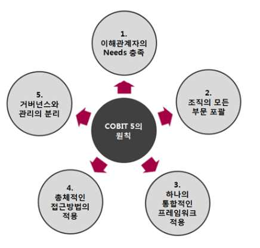

[그림 1-1] Cobit 5.0의 5대원칙
출처 : INSIDE IT COBIT 모델로 살펴본 IT Governance의 이해(http://blog.lgcns.com/473)
COBIT 5.0의 원칙에 대한 주요 설명은 아래와 같다.
<표 1-1> Cobit의 5대 원칙 주요 설명
원칙 주요설명
IT Governance는 효과, 위험, 자원 평가와 관련된 의사결정
1. 이해관계자의 Needs 충족
시 관련된 모든 의사결정자들을 고려해야 한다.
IT Governance는 IT 조직/기능에만 한정되는 것이 아니라, 조
2. 조직의 모든 부문 포괄
직 내 모든 Governance와 연계/통합되어야 한다.
3. 하나의 통합적인 프레임워 COBIT 5는 기업 내 IT와 관련된 모든 것(업무, 조직, 지침, IT
크 적용 시스템)을 통합하는 모델로서 활용되어야 한다.
조직의 IT를 효과적으로 관리하기 위해서는 모든 구성요소에
4. 총체적인 접근방법의 활용
대한 총체적인 고려가 필요하다.
COBIT 5.0에서는 COBIT 4.0/4.1과는 달리 Governance와
Management를 분리하여 정의하고 있다. Management 영역에
5. 거버넌스와 관리의 분리 는 실제 IT 업무 담당자들의 기획, 시스템 구축, 운영, 모니터
링 활동이 포함되며, Governance 영역에는 고위 경영진들을
위한 의사결정, 평가 및 모니터링 활동들이 포함된다.
• IT가버넌스에서의 보안감사의 의의
보안감사란 IT가버넌스에서 요구하는 법적 요구사항 및 조직 내 수립된 정보보호정책에 따
라 정보보호 관리체계 활동이 효과적으로 수행되는지 여부를 검토하는 업무활동으로 보안
감사는 단순한 조직의 정보보호 현황 파악 및 이에 따른 사후조치에 그치지 아니하고 감
사결과 도출된 제반 정보를 통해 보다 실효성 있는 각종 정책을 수립하여야만 비로소 그
유효성이 있음
수행 내용 / 보안감사 예비조사하기
재료·자료
Ÿ 보안점검 준거성 확보를 위한 「정보통신기반보호법」, 정보통신망 이용촉진 및 정보보호 등에
관한법률,개인정보보호법,전자금융거래법,신용정보법,전자금융감독규정, COBIT(Control Objectives
for Information and related Technology) 등
Ÿ보안감사지침, 보안감사 설문지, 보안감사 체크리스트, 정보보호관리체계 이행내역
기기(장비･공구)
Ÿ 컴퓨터, 프린터, 복사기 등
Ÿ 감사 자동화 도구(CAAT), 디지털 포렌식(Digital Forensic) 도구, 문서작성 도구 등
안전･유의 사항
Ÿ 보안관련 정책, 지침, 절차는 조직에 따라 상이할 수 있다.
Ÿ 보안관리지침서에 따라 보안감사 체크리스트를 검토하고, 이의 적합성을 매년 주기로 검토, 평가,
갱신하되 실시간성을 요할 경우 승인절차를 거쳐 즉시 반영한다.
• 원활한 보안감사 수행을 위한 보안과 관련된 전반적인 지식과 기술이 필요하다.
• 디지털 포렌식(digital forensic)은 전자적 증거물 등을 사법기관에 제출하기 위해 데이터를 수집,
분석, 보고서를 작성하는 일련의 작업이며, 감사 증거의 수집, 분석, 감사 보고서 작성에서도
활용된다.
• 감사 자동화 도구(computer assisted audit techniques)는 감사목표의 달성을 지원하는 모든 컴퓨
터 기반 기술과 프로그램의 이용을 의미한다.
수행 순서
• 보안감사의 목적을 수립하고, 감사 대상과 범위를 선정한다.
1. 보안감사의 구분은 아래와 같다.
(1) 정기감사: 보안감사계획에 따라 실시하는 계획된 감사를 말하며 기본적으로 연 1
회 실시한다.
(2) 특별보안감사: 필요에 따라 실시하는 감사를 말하며 보안침해의 징후가 있어 확인
이 필요한 경우 또는 보안사고 발생 시 등 정보보호위원회 소집을 통해 협의, 결
정하여 실시하는 것으로 한다.
2. 보안감사의 목적에 포함되는 내용은 아래와 같다.
(1) 보안업무 이행실태 점검을 통한 보안의식 제고 및 보안기강 확립
(2) 해킹, 개인정보 유출 방지 등을 통한 정보보안 의식 제고 및 관리체제 구축
3 보안감사의 근거에 포함되는 내용은 아래와 같다.
(1) 보안업무규정
(2) 보안업무규정시행규칙
(3) 보안업무규정시행세칙
(4) 보안업무시행규정 등
<표 1-2> 보안감사 규정
규정 규정 포함 내용
∙ 법적 요구사항 및 조직 내 수립된 정보보호정책에 따라
정보보호 관리체계 활동이 효과적으로 수행되는지 여부
를 검토하기 위하여 다음과 같은 항목이 정의된 내부감
사 지침을 수립하여야 한다.
∙ 내부감사 지침에 포함되는 내용은 아래와 같다
보안감사 규정 - 내부감사 범위
- 내부감사 수행 주기 (예: 연 1회 이상)
- 감사인력 자격요건 : 감사의 객관성을 확보하기 위해 제
3자가 감사를 수행하는 것이 원칙임. 다만, 불가피한 경
우 제3자 인력을 포함하여 정보보호조직이 감사를 수행
할 수 있음
4. 보안감사 범위를 선정한다.
정보자산, 정보자산 관리인력 등 내부직원을 그 대상으로 한다.
(1) 네트워크 보안 감사
(2) PC 보안 감사
(3) 물리적 보안 감사
(4) 인적 보안 감사
(5) 개인정보보호 감사 등
5. 보안감사원별 담당업무를 배정한다.
각 감사원의 전문분야를 감안하여 감사원별 담당업무를 배정하고 감사원들도 개별
감사일정계획을 수립하여야 하는 바 그 목적은 다음과 같다.
(1) 감사업무 부담의 균등한 배분
(2) 업무의 중복방지
(3) 감사 종료 예정일에 맞추어 감사 종료
(4) 감사원 연수(훈련) 및 전문가 양성을 촉진
6. 보안감사 일정을 수립한다.
감사기간 중 업무가 특정일 또는 기간 중에 편중되지 않도록 업무별 중요도를 감안
하여 업무별 검사 실시 일수 및 일별 검사내용에 대한 계획을 수립하고, 내부감사 일
정에 대해 단계별 소요기간과 총 소요 일정을 명시한다.
(1) 내부감사 수행 단계
(2) 내부감사결과 작성 단계
7. 보안감사 기준을 수립한다.
정보보호관리체계의 보안요구사항에 대해 적용 여부를 점검하기 위해 평가기준을 수
립한다.
(1) 적용여부
(가) YES : 통제내용이 완전히 구현되어 있으며, 그에 따른 증적이 존재한다.
(나) Partial : 통제 내용이 완전하지는 않지만 부분적으로 구현되어 있으며, 그에
따른 증적이 존재한다.
(다) No : 통제 내용이 완전하게 구현되지 않으며, 이행되고 있지 않다.
• 보안감사 착수에 필요한 사전 자료를 수집하고 분석한다.
1. 보안감사 사전 준비 시 주요 검토사항은 아래와 같다.
(1) 감사대상기관 또는 지점의 이전 감사결과 및 사후조치내용
(2) 상시감사결과 나타난 문제점
(3) 사전감사자료 분석
(4) 감사 사전준비협의 시 논의 사항
(5) 관계 법령, 주요 규정 및 정책 제·개정 관련 사항
(6) 당해 기관 또는 특정 지점에 대한 개별 유의 사항
(7) 수집 정보 및 건의사항
(8) 금전사고 및 민원발생 내용 등
2. 사전 보안감사 자료의 징구 사항은 아래와 같다.
(1) 보안감사의 경우 실시 전에 기존 보안감사 및 보안실태평가 등에 필요한 기초 자료
를 통하여 감사대상 조직의 정보보호 현황과 관련한 제반정보를 파악할 수 있다.
(2) 연간 및 분기별 감사계획에 따라 잠정적인 감사일정 등이 확정되면 기한을 정하
여 사전 감사자료의 제출을 요구한다.
(3) 사전 감사자료는 대상 부서 및 조직의 업무 부담을 줄이고 감독부서 등 유관부서
에 제출되는 자료와 중복되지 않도록 최소한의 범위 내에서 징구한다.
3. 사전 보안감사 자료는 아래와 같다.
(1) 보안설문지 및 체크리스트
(2) 정보보호정책, 절차, 지침에 대한 이행자료 검토
(가) 정보보호관리체계 이행점검 내역
(나) 퇴사 및 계약해지자 관리현황
(다) 외부 용역업체 인력 보안 점검 현황
(라) 정보보호 교육 이행 현황
(마) 물리적 보호구역 출입관리 대장
(바) 시스템 개발 관련 점검 현황
(사) 시스템 운영 관련 점검 현황
(아) 침해사고 및 재해복구 모의 훈련 현황
(자) 정보자산 취약점 분석 및 위험평가 현황
(차) 조직 정책의 법적 준거성 재검토 현황 등
(3) 기타 정보보호 관련 현황 자료
(가) 당해년도 상위기관 또는 계열사 정보보호 정책 방향
(나) 해당 감사대상기관으로부터 징구한 감사요구자료
(다) 과거 수년간의 종합, 부문 및 테마감사서와 해당 감사작업문서
(라) 타 감독기관의 감사서
(마) 별도 감사팀의 상시감사결과 관련 정보 및 평가
(바) 해당 조직의 보안업무보고서
(사) 조직 내 유관부서의 확인요청사항
(아) 조직에 대한 강제집행 등 법적조치에 관한 사항
(자) 지주회사 및 자회사에 대한 감사 내용
4. 사전징구자료에 대한 확인 및 검토 시 유의 사항은 아래와 같다.
(1) 사전 감사 자료의 신뢰성
(2) 예비감사 시 사전감사자료 중 일부를 발췌하여 관련 대장 등과 대조․점검하는 등
의 방법으로 자료내용의 사실여부
• 사전 예비조사를 수행하고, 예비조사 결과보고서를 작성한다.

| 사전 예비조사는 보안감사대상 조직에 대한 감사 실시 직전에 사전 준비 자료의 분석결 |
| --- |
| 과 등을 확인하기 위하여 실시하는 감사 활동이다. |

1. 사전 예비조사 시 유의하여 점검할 사항에 대해 선정한다.
보안감사팀 회의를 열어 각 감사팀원의 자료 분석 결과를 종합하여 파악된 문제점을
바탕으로 중점검사사항 수시항목 이외에 주의 깊게 검토할 내용을 선정하고, 보안감
사팀이 유의할 사항, 정보 및 자료의 공유방안 등에 대해서도 논의한다.
2. 사전 예비조사를 실시한다.
보안감사팀장은 사전 감사 자료의 사실 확인 및 기초자료수집 등을 위하여 필요한 경
우 감사팀원으로 하여금 현장 감사를 하도록 할 수 있으며, 주요 내용은 아래와 같다.
(1) 보안감사 업무 수행에 필요한 자료수집과 관련 정보 수집
(2) 보안감사 실시품의 및 보안감사 실시통보서 교부 등
3. 사전예비조사 보고서에 포함되는 내용은 아래와 같다.
(1) 보안업무규정
(2) 보안감사 범위(안)
(3) 사전보안감사 자료
(4) 사전보안감사 확인내용
(5) 보안감사 절차
(6) 보안감사 범위(안)
(7) 보안감사 조직(안)
(8) 보안감사 일정(안)
(9) 보안감사 중점점검 항목(안) 등
4. 보안감사 사전자료징구 이후 불가피한 사정으로 감사 착수가 장기간 지연된 경우
에는 감사일정을 조정하고, 보안감사과정에서 사전자료징구 이후의 변동 상황 등
보안실태 평가에 필요한 자료를 추가 징구할 수 있다.
5. 보안감사일정 수립 시에는 다음 사항을 고려하여야 한다.
(1) 상위기관, 위탁사 등 타 감독기관의 감사일정 계획과의 중복여부
(2) 금융기관인 경우 자체 감사일정과의 중복 여부
(3) 해당 기관이 수검이 가능한 상황인지 여부(고객과의 집단분쟁 발생, 사법당국의
조사나 수사, 중점검사대상 업무관련 핵심 경영진 및 실무자의 일정계획 등)
(4) 사회․경제적 여건 등
수행 tip
• 감사인력에 대한 전문성과 객관성 확보를 위해 감
사 자격요건에 따라 감사팀을 구성한다.
• 감사 계획에는 연 1회 이상 감사가 이루어질 수 있
도록 범위, 주기 등을 고려하여 수립하여야 한다.
• 모든 직원은 조직의 정보자산 보호를 위해 책임 있
는 보안의식을 갖춰야 한다.
1-2.
보안감사 계획
• 예비조사 결과에 따라 보안감사 수행에 필요한 보안감사 착안사항과 중점점검 항목을
학습 목표 도출할 수 있다.
• 보안감사 수행을 위한 보안감사 계획을 수립하고, 보안감사계획서를 작성할 수 있다.
필요 지식 /
• 미국정보시스템 감사통제협회(ISACA)의 감사기준
<표 1-3> 보안감사자의 책임과 권한
감사기준 핵심어
감사헌장 책임, 권한 및 책임추적성 감사헌장 및 감사계약서
직무상의 독립성 독립적인 외관과 태도
독립성
조직상의 관계 조직 내 감사 기능의 위상
직무윤리 규정 ISACA 직무윤리 규정의 준수
직무윤리 및 기준 전문 직업인으로서의
정당한 주의와 직무 기준 준수
정당한 주의
기술 및 지식 업무 수행에 필요한 기술과 지식
적격성
(직무능력) 계속적인 직무교육 적격성 유지를 위한 계속적인 교육
감사목적 달성과 기준 준수를 위한
계획수립 감사 계획 수립
계획수립
감독 감사요원 및 보조 감사인에 대한 감독
감사업무의 수행
감사 증거의 충분성, 신뢰성, 관련성,
증거
유용성
감사보고서의 내용과 배포 범위 및
보고 보고서의 내용과 형식
시기
감사 발견사항에 대한 경영진의 조치
후속조치활동 후속조치
검토
• 보안감사팀
1. 정보보호최고책임자는 객관성과 독립성, 전문성을 갖춘 감사팀을 구성하며 필요 시 외부전
문가를 보안감사팀의 팀원으로 구성할 수 있다.
2. 보안감사팀은 보안 관련 제 지침을 숙지하여야 하며 지침의 미비점을 검토하여 보완하도
록 요구할 수 있다.
3. 기술적, 관리적, 물리적 보안감사를 실시하고 그 결과를 보고하며 중대한 보안위반사항 발
생 시 상벌규정에 따른 처벌을 의뢰할 수 있다
4. 보안감사팀의 요청에 따라 각 임직원은(피감사 부서) 보안감사와 관련된 협조 지원을 수행
하여야 한다.
• 감사인의 윤리강령
국제내부감사인협회(IIA)는 내부감사 임무를 수행하는 직무에 윤리의식을 조성하기 위하여
“내부감사인 윤리강령”을 제정하였으며 위험관리, 통제 및 거버넌스 운영에 대한 객관적
검증에 있어 신뢰에 기반해야 하는 내부 감사활동에 필요한 원칙(principles)과 행동규범(rules
of conduct)을 제시하고 있다.
<표 1-4> IIA 감사인 윤리강령
구분 세부 규정
∙ 성실한 책임감(integrity)
∙ 객관성(objectivity)
원칙
∙ 보안의식(confidentiality)
∙ 감사역량(competency)
∙ 성실한 책임감(integrity)
-고의로 불법행위의 당사자가 되서는 안 되며, 내부 감사 업무 종사자
로서 또는 조직원으로서 불명예스런 행동을 해서는 안 된다.
∙ 객관성(objectivity)
-내부 감사인의 공정한 판단을 저해하거나, 저해할 것으로 간주되는
어떤 활동이나 관계에 참여하지 않아야 한다.
행동규범
-직업적 판단을 저해하거나 저해시킬 것으로 간주되는 어떤 것도 받
아서는 안 된다.
-조사하여 알게 된 사실들을 밝혀야 하고 만약 밝히지 않는다면 검토한
내용의 결과보고를 왜곡시킬 수 있다
∙ 보안의식(confidentiality)
∙ 감사역량(competency)
• 보안감사계획의 유형
보안감사계획은 연간 보안감사계획, 분기별 보안감사계획, 매회차별 보안감사계획의 단계
로 수립함이 일반적이며 대내외 보안 환경의 급격한 변화 등 정보보호정책업무 수행을 위
하여 불가피한 경우 연간감사계획에 포함되지 아니한 사항에 대하여도 부문검사를 실시할
수 있다.
수행 내용 / 보안감사 계획하기
재료·자료
Ÿ 보안점검 준거성 확보를 위한 「정보통신기반보호법」, 정보통신망 이용촉진 및 정보보호 등에
관한 법률, 개인정보보호법, 전자금융거래법, 신용정보법, 전자금융감독규정, COBIT(COBIT:
Control Objectives for Information and related Technology) 등
Ÿ 보안감사지침, 보안감사 계획서, 보안감사 체크리스트
기기(장비･공구)
Ÿ 컴퓨터, 프린터, 복사기 등
Ÿ 감사 자동화 도구(CAAT: Computer Assisted Audit Techniques), 디지털 포렌식(digital forensic)
도구, 문서작성 도구 등
안전･유의 사항
Ÿ 보안관련 정책, 지침, 절차는 조직에 따라 상이할 수 있다.
Ÿ 보안관리지침서에 따라 보안감사 체크리스트를 검토하고, 이의 적합성을 매년 주기로 검토, 평가,
갱신하되 실시간성을 요할 경우 승인절차를 거쳐 즉시 반영한다.
• 원활한 보안감사 수행을 위한 보안과 관련된 전반적인 지식과 기술이 필요하다.
• 디지털 포렌식(digital forensic)은 전자적 증거물 등을 사법기관에 제출하기 위해 데이터를 수집,
분석, 보고서를 작성하는 일련의 작업이며, 감사증적의 수집, 분석, 감사 보고서 작성에서도
활용된다.
• 감사 자동화 도구(CAAT)는 감사목표의 달성을 지원하는 모든 컴퓨터 기반 기술과 프로그램의
이용을 의미한다.
수행 순서
• 보안감사 수행에 필요한 보안감사 착안사항과 중점점검 항목을 도출한다.
1. 조직에 따라 보안 감사 수행 전 보안감사위원회를 운영할 수 있으며, 주요 활동 내
용은 아래와 같다.
(1) 조직에 대한 보안감사성과를 제고하기 위하여 매회차별로 보안감사를 실시하기
전에 감사총괄담당부서, 제재심의담당부서 등 유관부서의 관련부서장이 당해 감
사대상 조직에 대한 중점검사사항, 정보사항 등에 대한 보안감사 착안방안을 협
의할 수 있다.
(2) 정보보호최고책임자(CISO)는 보안감사 사전준비를 위하여 당해 보안감사대상 조직
의 상시감사 담당자 등으로 하여금 보안감사 사전 준비팀을 편성운영 할 수 있다.
(3) 감사팀장은 보안감사위원회에서 논의된 사항을 분석․종합하고, 사전예비조사 현장
검사에서 확인된 사항을 보안감사 사전예비조사보고서에 포함하여 정보보호최고
책임자 및 대표이사에게 보고할 수 있다.
(4) 보안감사위원회는 자체보안감사 이외에 외부기관에 대한 감사실시에 앞서 소집할
수 있으며 주요 협의사항은 다음과 같다
- 외부 보안감사계획의 개요 및 중점검사사항
- 조직의 보안성의 주요 문제점
- 고객정보보호 및 공정한 전자상거래 유지와 관련한 주요 문제점
- 자체 감사부서의 활동상황
- 기타 필요하다고 인정하는 사항 등
2. 보안감사팀을 편성한다.
(1)감사대상 조직 및 일정이 결정되면 보안감사팀장은 감사업무의 분장내용에 따라
감사팀을 편성하고 당해 감사팀을 총괄한다.
(2) 감사팀장은 감사업무의 통할과 감사팀과의 보고 및 의사소통, 감사팀원의 담당업
무에 대한 분장, 감사업무와 관련한 정보수집 독려 등의 임무를 수행 한다.
(3) 감사팀 편성 시 다음 사항을 준수하여야 함
(가) 조직의 유착을 방지하고 보안감사의 객관성을 고려하여 편성한다.
(나) 원칙적으로 감사대상 업무별로 독립된 분야를 담당하도록 하되 업무량이 편
중되지 않도록 담당업무와 감사팀원 수를 조정한다.
(다) 담당업무가 개별 감사팀원의 전문분야와 합치되도록 한다.
(라) 감사범위에 따라 경우 해당부문 전문 감사인을 증원하는 등 감사팀원 수를
조정한다.
(4) 감사팀원이 부족하여 불가피하게 타부서 직원의 지원을 받을 경우 타부서장의
합의를 받는다.
(5) IT 등 전문분야에 대한 감사 시 IT부서의 전문 인력 또는 외부 전문 인력을 지
원받도록 한다.
3. 보안감사계획 실시에 따른 품의를 한다.
(1) 감사팀장은 당해 감사팀의 감사동원 가능 인원 등을 기초로 감사실시 품의서를
작성, 정보보호최고책임자(CISO)의 승인을 거쳐 감사업무를 시행한다.
(2) 감사실시품의서에는 감사종류, 감사대상기관 및 지점, 감사일정, 감사조직, 감사
범위, 중점검사사항 기본항목 및 수시항목 등 주요 감사사항, 예상 소요경비 등을
포함한다.
4. 보안감사범위 및 중점감사사항에 대해 도출한다.
(1) 보안감사는 사내 정보보호 정책과 하위 보안지침에 규정된 사항을 확인하기 위한
모든 활동을 그 범위로 하며 정보자산, 정보자산 관리인력 등 내부직원을 그 대
상으로 한다.
(2) 보안감사범위는 보안관련 업무 및 정책, 지침, 절차 운영 등의 업무전반에 대하여
실시하는 것이 원칙이나, 한정된 감사인력과 감사실시기간으로 모든 업무에 대하
여 정밀감사를 실시한다는 것은 현실적으로 불가능하다.
(3) 따라서 감사대상기관의 업무전반에 대한 평면적 전수감사 방법을 지양하고 감사
대상기관의 고질적 취약분야와 문제점이 예상되는 분야 등 감사범위를 정하여 특
정항목에 대해 집중적인 감사 실시로 감사능률을 제고할 필요가 있다.
(4) 감사범위를 정할 때는 다음사항을 감안하여야 한다.
(가) 감사의 목적
(나)․ 당해 연도에 실시한 타 감독기관의 감사내용(중복되는 부분은 제외 가능)
(다)․ 감사기간 및 투입기간
(5) 중점감사사항은 기본항목과 수시항목으로 구분·운영한다.
(가) 기본항목은 주요 정보보호정책, 감사운용방향, 업계동향, 기관의 특성, 주요부서
의 감사확인 요청사항 등을 감안하여 연간 감사계획 수립 시 선정할 수 있다.
(나) 수시항목은 연간 감사실시 계획 수립 시 또는 매회차 감사일정 확정시 보안
사고 예방, 보안정책현안사항, 상시감사 및 감사사전준비 결과 나타난 문제점
또는 취약부문 등을 중심으로 선정할 수 있다.
(다) 감사위탁과 관련하여 위탁기관에서 중점감사사항을 통보하는 경우에는 이를
위탁감사대상기관에 대한 중점감사사항 기본항목에 반영할 수 있다.
(6) 보안감사는 다음의 영역 또는 당해 연도 집중 감사 부문을 선정한다.
(가) 네트워크 보안 감사
(나) PC 보안 감사
(다) 물리적 보안 감사
(라) 인적 보안 감사
(마) 개인정보보호 감사 등
(7) 정보보호관리체계 통제항목별 점검항목은 아래와 같다.
(가) 정보보호정책 및 정보보호조직
(나) 위험관리 및 정보보호대책 구현
(다) 인적보안 및 외부자 보안
(라) 정보자산분류
(마) 정보보호교육 및 훈련
(바) 물리적 보안
(사) 시스템개발보안 및 암호통제
(아) 접근통제 및 운영보안
(자) 침해사고 관리 및 IT재해복구 체계 등
• 보안감사 계획을 수립하고, 보안감사 계획서를 작성한다.
1. 정보보호최고책임자(CISO)는 보안감사실시 합의 시 다음 사항에 대하여 확인․검토한다.
(1) 연간감사계획과의 연관성
(2) 감사실시 시기의 적정성
(3) 감사사항의 적정성
(4) 감사실시 기간 및 감사인력운용의 적정성 등
(5) 감사실시 내용의 감사종합관리시스템 입력여부
2. 정보보호최고책임자(CISO)에게 보안감사계획 품의 시 유의 사항은 아래와 같다.
(1) 원칙적으로 보안감사 실시 이전에 합의 요청
(2) 감독부서의 감사수요 파악 및 감사시스템의 과거 감사 실시상황 등 적극 조회 활용
(3) 감사실시 품의서에 의무적 기재사항 외에 당해 감사의 적정성 심사 등에 필요한
사항 기재
예) - 감사계획에 반영되어 있는 감사인지 여부
- 이전 감사 실시상황(최근 보안감사 실시기간과 최근 부문감사 실시 기간 및
목적 등)
- 감사실시 근거가 되는 문서(검토문서 등) 첨부 등
(4) 기타 감사종합관리시스템에 감사실시내용 입력
3. 보안감사계획서에 포함되는 내용은 아래와 같다.
(1) 보안감사의 목적 및 근거
(2) 보안감사 대상 및 범위
(3) 보안감사 일정
(4) 보안 점검 절차
(5) 보안감사 조직
(6) 보안감사 주관부서 및 대상자
(7) 보안감사 중점 점검 항목
4. 보안감사 실시통보서의 발부사항은 아래와 같다.
(1) 보안감사일정 및 감사팀 편성이 확정되는 등 감사계획이 확정되면 감사실시통보
서를 각 부서의 부서장에게 통지할 수 있다.
(2) 보안감사실시통보서는 부서별 발급함을 원칙으로 하나 필요한 경우 동일 수감기
관 단위 또는 수 개 지점 단위로 발부할 수 있다.
수행 tip
• 감사인력에 대한 전문성과 객관성 확보를 위해 감
사 자격요건에 따라 감사팀을 구성한다.
• IT 등 전문분야에 대한 감사 시 외부 전문 인력의
지원을 받을 수 있다.
• 모든 직원은 조직의 정보자산 보호를 위해 책임 있
는 보안의식을 갖춰야 한다.

| 학습 1 | 교수·학습 방법 |
| --- | --- |

교수 방법
• 보안 정책, 지침, 절차에 따른 보안감사 수행에 필요한 감사 대상과 감사 범위 선정 방법에
대해 설명한다.
• 보안감사 수행에 필요한 사전 자료를 수집하고 분석할 수 있는 방법을 설명한다.
• 보안감사 수행을 위한 사전 예비조사 수행과, 예비조사 결과 보고서를 작성 방법에 대해 설명한다.
• 예비조사 결과에 따른 보안감사 수행에 필요한 보안감사 착안사항에 대해 설명한다.
• 보안감사 중점점검 항목이 객관적으로 점검되도록 양식을 활용한 보안감사 체크리스트를 도출하
도록 한다
• 보안감사 계획을 수립하고, 보안감사 계획서를 작성할 수 있는 방법을 설명한다.
• 보안감사는 규정에 의거하여 수행되는 활동으로 본 수업에 앞서 감사의 필요성과 관련 조문에
대해 설명하도록 한다.
학습 방법
• 보안 정책, 지침, 절차에 따른 보안감사 수행에 필요한 감사 대상과 감사 범위 선정 방법에
대해 이해한다.
• 보안감사 수행에 필요한 사전 자료를 수집하고 분석할 수 있는 방법을 학습한다.
• 보안감사 수행을 위한 사전 예비조사 수행과, 예비조사 결과 보고서를 작성한다.
• 예비조사 결과에 따른 보안감사 수행에 필요한 보안감사 착안사항에 이해한다.
• 보안감사 중점점검 항목이 객관적으로 점검되도록 양식을 활용한 보안감사 체크리스트를 작성한다.
• 보안감사 계획을 수립하고, 보안감사 계획서를 작성한다.
• 보안감사는 규정에 의거하여 수행되는 활동으로 본 수업에 앞서 감사의 필요성과 관련 조문에
대해 이해한다.
• 관련 법률에 대해 법제처 사이트를 통해 스스로 찾아보고 추가 설명이 요구되는 부분에 대해
질문 목록을 작성한다.
• 다양한 보안감사 보고서의 사례를 찾아보고, 학생이 스스로 문제점과 해결방법을 찾아본다.
• 보안감사 보고서 사례를 파워포인트, MS-워드, 한글과 같은 서면으로 작성하여 다른 학생들과
교환한다.
• 보안감사의 필요성을 인식하고, 올바른 윤리의식이 함양되도록 주기적으로 보안교육을 받는다.

| 학습 1 | 평 가 |
| --- | --- |

평가 준거
• 평가자는 학습자가 수행 준거 및 평가 항목에 제시되어 있는 내용을 성공적으로 수행하였는지를
평가해야 한다.
• 평가자는 다음 사항을 평가해야 한다.

| 학습 내용 | 평가 항목 | 성취수준 |  |  |
| --- | --- | --- | --- | --- |
|  |  | 상 | 중 | 하 |

- 보안 정책, 지침, 절차에 따라 보안감사 수행에 필요
한 감사 대상과 감사 범위를 선정할 수 있다.
보안감사 예비 - 보안감사 대상 부서로부터 보안감사 수행에 필요한 사
조사 전 자료를 수집하고 분석할 수 있다
- 보안감사 규정에 따라 보안감사 수행을 위한 사전
예비조사를 수행하고, 예비조사 결과 보고서를 작성
할 수 있다.
- 예비조사 결과에 따라 보안감사 수행에 필요한 보안
감사 착안사항과 중점점검 항목을 도출할 수 있다.
보안감사 계획
- 보안감사 수행을 위한 보안감사 계획을 수립하고,
보안감사 계획서를 작성할 수 있다.
평가 방법
• 문제해결 시나리오

| 학습 내용 | 평가 항목 | 성취수준 |  |  |
| --- | --- | --- | --- | --- |
|  |  | 상 | 중 | 하 |

- 보안감사 수행에 필요한 감사 대상과 감사 범위 선
보안감사 예비 정 능력
조사
- 보안감사 수행에 필요한 사전 자료 수집 및 분석 능력
- 보안감사 규정에 따른 보안감사 사전 예비조사 및
예비조사 결과 보고서 작성 능력
보안감사 계획
- 보안감사 착안사항 및 중점점검 항목 도출 능력
• 서술형 시험

| 학습 내용 | 평가 항목 | 성취수준 |  |  |
| --- | --- | --- | --- | --- |
|  |  | 상 | 중 | 하 |

| 보안감사 예비조사 보안감사 계획 • 사례 연구 보안감사 예비조사 보안감사 계획 피 드 백 | - 보안감사 수행에 필요한 사전 자료 수집 및 분석 능력- 보안감사 규정에 따른 보안감사 사전 예비조사 및예비조사 결과 보고서 작성 능력 - 보안감사 착안사항 및 중점점검 항목 도출 능력 - 보안감사 계획 수립 및 계획서 작성 능력 - 보안감사 수행에 필요한 감사 대상과 감사 범위 선정 능력 - 보안감사 수행에 필요한 사전 자료 수집 및 분석 능력- 보안감사 규정에 따른 보안감사 사전 예비조사 및예비조사 결과 보고서를 작성 능력 - 보안감사 착안사항 및 중점점검 항목 도출 능력 - 보안감사 계획 수립 및 계획서 작성 능력 |  |  |  |
| --- | --- | --- | --- | --- |
| 1. 문제해결 시나리오- 보안감사 실무에사 계획서)를 | 대한 커뮤니케이션 능력 및 스킬을 평가하는 항목으로활용하여 직접 작성한 보고서를 제출하도록 지도한다. | 관련 | 양식(보안감 |  |
| 2. 서술형 시험- 보안감사 실무에를 계획한 | 대한 이해도를 평가하는 항목으로 관련 양식을 활용하여보고서를 제출하도록 지도한다. | 직접 | 보안감사 |  |
| 3. 사례연구 - 현재 진행 실패 요인을- 사례 연구 후 | 중이거나 유사한 이전의 사례들 중 하나 혹은 그 이상을 선정하여분석, 적용하여 평가한 후 주요 사항에 대한 설명을 첨가하여잘된 점과 잘못된 점에 대해 강평을 한다. | 그 | 성공이나돌려준다. |  |

| 학습내용 | 평가 항목 | 성취수준 |  |  |
| --- | --- | --- | --- | --- |
|  |  | 상 | 중 | 하 |

| 보안감사 예비조사 보안감사 계획 피 드 백 | - 보안감사 수행에 필요한 감사 대상과 감사 범위 선정 능력 - 보안감사 수행에 필요한 사전 자료 수집 및 분석 능력- 보안감사 규정에 따른 보안감사 사전 예비조사 및예비조사 결과 보고서를 작성 능력 - 보안감사 착안사항 및 중점점검 항목 도출 능력 - 보안감사 계획 수립 및 계획서 작성 능력 |  |  |  |
| --- | --- | --- | --- | --- |
| 1. 문제해결 시나리오- 보안감사 실무에사 계획서)를 | 대한 커뮤니케이션 능력 및 스킬을 평가하는 항목으로활용하여 직접 작성한 보고서를 제출하도록 지도한다. | 관련 | 양식(보안감 |  |
| 2. 서술형 시험- 보안감사 실무에를 계획한 | 대한 이해도를 평가하는 항목으로 관련 양식을 활용하여보고서를 제출하도록 지도한다. | 직접 | 보안감사 |  |
| 3. 사례연구 - 현재 진행 실패 요인을- 사례 연구 후 | 중이거나 유사한 이전의 사례들 중 하나 혹은 그 이상을 선정하여분석, 적용하여 평가한 후 주요 사항에 대한 설명을 첨가하여잘된 점과 잘못된 점에 대해 강평을 한다. | 그 | 성공이나돌려준다. |  |

학습 1 보안감사 계획하기

| 학습2 | 보안감사 수행하기 |
| --- | --- |

학습 3 보안감사 사후관리하기
2-1.
보안감사 현장수행
• 보안감사 착안사항과 중점점검 항목에 따라 보안감사 수행을 위한 보안감사 체크리스트를
작성할 수 있다.
학습 목표 • 보안감사 대상 부서로부터 보안감사 수행에 필요한 자료를 수집하고 분석할 수 있다.
• 보안감사 대상 부서의 피감사인 및 관련자와 인터뷰를 실시하고, 인터뷰 수행 결과에
대한 감사일지를 작성할 수 있다.
필요 지식 /
• 감사증거 수집기법
<표 2-1> 보안 감사 증거수집 기법
수집기법 주요내용
직무기술서 등을 고려하여 직무 분리의 적절성을 평가하고, 전통적
조직구조 검토
인 조직과 최신 조직과의 환경 차이 등을 고려하여야 함
정보보호정책, 절차, 지침에 대한 이행자료 등의 문서를 검토하고,
문서 검토
증빙자료를 기반으로 확인을 하여야 함
면담은 사전에 조직화하고, 정해진 양식이나 체크리스트를 따르며,
피감사인과의 면담
면담일지를 사용하여 문서화해야 함
관찰 과정에서 업무를 방해해서는 안 됨. 직원들이 평소와 다르게 행
업무수행의 관찰
동할 수 있다는 점을 염두에 두어야 함
• 인터뷰 기법
보안 감사에 대한 피감사인 및 관련자의 인터뷰 기법

| 학습내용 | 평가 항목 | 성취수준 |  |  |
| --- | --- | --- | --- | --- |
| 1. 상대방에 주는 | 부담을 최소화 |  |  |  |
| (1) 면담 상대방의저히 하여 | 업무사정을 고려하여 면담을 실시하고, 사전에 면담을상대방의 시간 및 업무부담 최소화 | 위한 | 준비를 | 철 |
| (2) 면담 요청이 준비할 수 | 시에는 면담목적을 사전에 알려주고 면담자료를 미리있도록 배려 | 배부함으로써 |  | 상대방 |
| (3) 강압적이고, | 일방적인 말투와 언행은 자제 |  |  |  |
| (4) 부득이한 점검 | 경우를 제외하고는 상대방의 사전 양해를 득한 후 사용자 | 보안 | 환경에 | 대한 |
| 2. 협의 지향적인 | 면담 |  |  |  |
| (1) 경영진 면담,있도록 함 | 이사회 면담 시에는 시청각 기자재 등을 활용, 상대방이 | 쉽게 | 이해할 | 수 |
| (2) 문제점만 | 적시하지 말고, 보안실태에 관한 철저한 분석을 통해 개선방안 |  | 제시 |  |
| (3) 대화는 끼지 않도록 | 우호적으로 진행하고 자기의 의견만 너무 주장함으로써 주의하고 논쟁 지양 | 상대방이 | 부담감을 | 느 |
| (4) 상대방의 | 답변내용에 대하여는 항상 메모준비를 갖추고 중요사항에 | 대하여는 |  | 기록 |
| (5) 면담 종료도록 노력 | 시에는 면담 참석에 대한 감사표시를 함으로써 우호적인 |  | 공감대를 | 형성하 |
| 3. 감독목적 달성에 | 중점을 둔 면담 |  |  |  |
| (1) 우호적인 내고 감사약속을 받아냄 | 분위기에서 면담을 실시하되, 감독․감사방향에 대한 호응을결과 발견된 문제점에 대하여는 상호 협의하여 개선방안을 |  | 최대한도출하고 | 이끌어시정 |
| (2) 감사팀이 는 경우에는주장의 타당성 | 제기한 보안상의 문제점 및 시정방향에 대해 상대방과상대방의 주장을 경청하면서 조직의 중장기적인 여부를 판단 | 의견이정보보호 | 일치하지측면에서 | 않동 |
| (3) 상대방의 이의이를 설득하여에게 보고 후• 감사 샘플링 종류감사 샘플링이란 | 제기에도 불구하고 우리의 입장이 바람직한 것으로동의하도록 유도하되, 상대방이 계속 수용하지 않는후속조치 시간과 비용을 고려하여 사전에 정의한 모집단 행위의 | 판단되는경우에는일부를 | 검증하는 | 경우에는감사팀장행위 |

<표 2-2> 감사 샘플링의 종류
종류 설명
- 샘플의 크기 및 추출 기준을 결정하는 객관적인 방법임
통계적 샘플링 - 모집단에 대한 표본의 대표성을 계량적으로 결정할 수 있음
- 각 항목의 추출 가능성이 동일함
- 샘플의 크기나 추출 기준을 감사인의 판단에 따름
비통계적 샘플링
- 모집단에 대한 표본의 대표성을 계량적으로 결정할 수 없음
• 컴퓨터 이용 감사기법(CAAT: Computer Assisted Audit Tools)
자동화된 감사기법으로서 컴퓨터 자원 감사도구(CAAT: Computer Assisted Audit Tools)라고도
지칭
<표 2-3> 컴퓨터 이용 감사기법 종류
종류 설명
- 응용프로그램의 논리를 테스트하고 확인하는 데 사용되는
테스트데이터
테스트 데이터를 작성하는 도구
- 해당분야의 전문가가 소유하고 있는 지식과 논리를 저장하
감사전문가 시스템
고 있는 소프트웨어
- 소프트웨어 패키지에 내장된 프로그램으로서, 소프트웨어
유틸리티 소프트웨어
설치 시 사용된 파라미터의 상태를 명시해 줌
소프트웨어 라이브러리
- 프로그램 변경의 무결성과 적절성을 검증함
패키지
- 처리의 각 단계마다 증적 이미지를 포착하는 루틴을 내장
스냅샷 하여 감사인이 데이터를 추적하고 각 단계에서의 처리를
평가할 수 있게 해줌
수행 내용 / 보안감사 현장수행하기
재료·자료
Ÿ 보안점검 준거성 확보를 위한 「정보통신기반보호법」, 정보통신망 이용촉진 및 정보보호 등에
관한 법률, 개인정보보호법, 전자금융거래법, 신용정보법, 전자금융감독규정, COBIT(Control
Objectives for Information and related Technology) 등
Ÿ 보안감사지침, 보안감사 계획서, 보안감사 체크리스트
기기(장비･공구)
Ÿ 컴퓨터, 프린터, 복사기 등
Ÿ 감사 자동화 도구(CAAT), 디지털 포렌식(digital forensic) 도구, 문서작성 도구 등
안전･유의 사항
Ÿ 보안관련 정책, 지침, 절차는 조직에 따라 상이할 수 있다.
Ÿ 보안관리지침서에 따라 보안감사 체크리스트를 검토하고, 이의 적합성을 매년 주기로 검토, 평가,
갱신하되 실시간성을 요할 경우 승인절차를 거쳐 즉시 반영한다.
Ÿ 원활한 보안감사 수행을 위한 보안과 관련된 전반적인 지식과 기술이 필요하다.
Ÿ 정보보안 감사를 위해서는 다음 사항들이 로깅되어야 한다.
- 개별 사용자의 시스템 접근 및 보안관련 활동의 로그
- 감사 추적성 확보를 위한 로그
- 정보보안 관련 이벤트의 로깅
- 정보보호 침해예방 활동 및 보안사고 시 사용자 추적을 위한 로깅
- 시스템의 정보보호 위배 사항에 대한 로그 기록
- 사용자 ID에 대한 등록‧변경‧삭제와 관련된 로그
Ÿ 장치에 의해 생성되는 로그는 성질이 매우 일반적일 수도 있고, 단지 제한된 정보량만을 포함할
수도 있으며, 매우 상세한 대량의 정보를 포함할 수도 있다.
Ÿ 감사 자동화 도구(Computer Assisted Audit Techniques)는 감사목표의 달성을 지원하는 모든
컴퓨터 기반 기술과 프로그램의 이용을 의미한다.
수행 순서
• 보안감사의 중점점검 항목에 따른 보안 체크리스트를 작성한다.

| 조직에 대한 인적 보안감사를 비롯해 접근통제, 데이터보관, 정보 시스템, PC 등 감사의 |
| --- |
| 범위를 선정하는 감사영역 단계에서는 기업의 환경에 따라 세부적인 감사항목을 추가로 |
| 선정하는 것이 필요하다. 다만, 보안감사의 경우 정보 시스템에 대한 기술적 취약점을 |
| 중심으로 하는 활동이 아닌 프로세스를 점검하는 방향으로 진행하는 것이 바람직하다. |
| [그림 2-1] 보안 감사 영역 사례출처 : 2007 CERT 구축 및 운영가이드(KISA,CONCERT 발행) |
| 사내 조직원들의 보안정책 준수 수준, 그 중에서도 PC 관리와 문서 및 기타 IT기기의 관 |
| 리 상태를 알아보는 데 초점을 두고 다음과 같은 세부적인 감사내용을 작성할 수도 있다. |

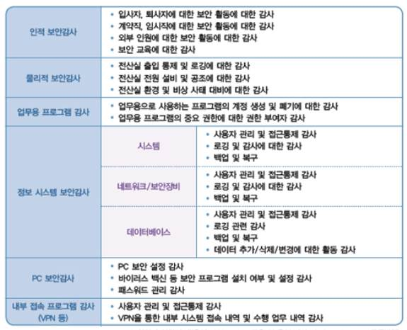

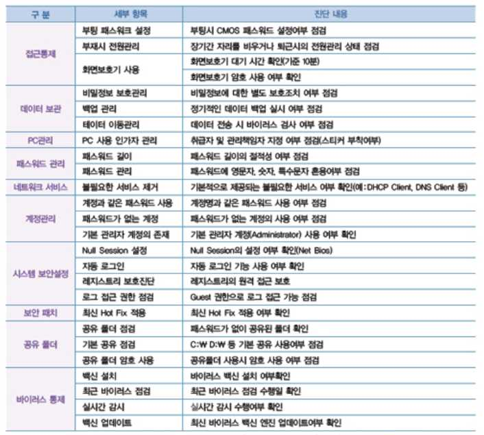

[그림 2-2] 일반적인 PC보안감사 체크리스트 사례
출처: 2007 CERT 구축 및 운영가이드 (KISA,CONCERT 발행
• 보안감사 대상으로부터 수행에 필요한 자료를 수집하고 분석한다.
1. 설문지 및 체크리스트를 사전 배포하며, 설문지 유형은 아래와 같다.
(1) 개인사용자 설문지 (활용 서식 참조)
(2) 기업 보안관리자 설문지 (활용 서식 참조)
2. 정보보호정책, 절차, 지침에 대한 이행자료를 검토하며, 검토 내역은 아래와 같다.
(1) 정보보호관리체계 이행점검 내역
(2) 퇴사 및 계약해지자 관리
(3) 외부 용역업체 인력 보안 점검 등
• 보안감사 대상 부서의 피감사인과 인터뷰를 실시한다.
1. 착수회의 목적은 아래와 같다.
(1) 착수회의는 감사 착수 시 감사팀이 기관의 임원, IT관련 주요부서장에게 감사개요,
감사방향, 감사정책의 주요내용 등을 설명하고 원활한 감사 진행 협조를 구하기
위해 실시한다.
(2) 아울러, 감사 진행을 위한 성실한 자료제출 요청, 문제점 발견 시 대처방향 등을
포함하여 설명한다.
2. 착수회의 참석자는 아래와 같으며, 경우에 따라 경영진이 참석할 수도 있다.
(1) 감사팀 : 정보보호최고책임자, 감사팀장, 감사팀원
(2) 감사대상부서 : 주요 감사 대상 부(실, 팀)장, 팀원
3. 착수회의 주요내용은 아래와 같다.
감사 착수 전에 면담내용, 설명자료 등을 준비하여 필요한 사항만 설명함으로써 시간
을 절약하고 상대방이 감사방향에 대한 오해를 초래하지 않도록 유의
4. 현장 인터뷰 실시 시 유의 사항은 아래와 같다.
(1) 인터뷰 실시 전 인터뷰 이유 또는 목적을 가급적 명확히 밝혀야 한다.
(2) 인터뷰 시간을 사전 협의 하에 결정하고, 정해진 시간 초과 시 상대방의 양해를
구하여야 한다.
(3) 자료 제출 요구는 상대방이 충분히 준비할 수 있는 시간을 배려하여 고유 업무
처리에 지장을 주지 아니하는 범위 내에서 요구하여야 한다.
5. 현장 인터뷰 시 주요 감사 사항은 아래와 같다.
(1) 보안관련 규정에 따른 기밀 자산·관리실태 현황 점검
(가) 비밀·대외비 발간, 복사 및 열람 등 관리실태 및 규정 준수 확인
(나) 비밀·대외비 재분류 실태, 관리 대장 정비 여부 확인
(2) 컴퓨터, USB 관리 등 정보유출 방지대책 추진현황 점검
(가) 컴퓨터 등 단말기 보안관리 및 업무자료관리 준수 여부
(나) 외부 용역업체에 대한 관리 및 접근통제 등 보안 대책
(다) 비밀취급인가증 발급현황 및 대장 정비, 관련규정 준수 여부 점검
(라) 보안감사결과 지적사항에 대한 조치상황 등
(3) 중요 내부자료 및 전자문서 관리 ‧ 유통 실태
(가) 컴퓨터, USB 등을 통한 내부자료 저장 및 반출입 통제 여부
(나) 상용 이메일 자료 전송 차단 및 유해사이트 접근 차단
(4) 정보통신망 보안대책
(가) 보안장비, 네트워크 장비 등 운영 ‧ 관리 보안지침 준수 여부
(나) 정보통신망에 대한 비인가자 접근통제 여부
(5) 외부 용역업체 보안관리 대책
(가) 정보화사업 추진 시 보안관리 대책 수립 여부
(나) 용역업체에 대한 보안준수사항 점검 및 접근통제 실시 여부
(6) 정보시스템 보안관리 대책
(가) 정보시스템 운영‧관리 보안지침 준수여부
(나) 정보보호시스템 보안관리 및 접근통제 여부
(7) 컴퓨터 등 단말기 및 첨단보안통신기기 보안 대책 등
(가) 컴퓨터보안 대책 준수 및 저장매체 관리‧파기 절차 준수 여부
(나) 무선랜 및 스마트폰 등에 대한 보안 대책 준수 여부
6. 보안감사절차는 아래와 같다.
(1) 착수 후 자료 징구 및 업무현황 파악
(가) 감사 착수가 완료되면 감사 사전징구자료 이외의 감사업무 수행 상 필요한
감사 자료를 감사대상 부서장 또는 담당자에게 요구한다.
(나) 또한 감사대상 부서의 부서장 또는 담당자로부터 당해 부서에 대한 업무현황
을 간략하게 보고받거나 질의하는 등 상호 의견을 교환함으로써 감사업무 수
행 상 참고할 사항을 파악하는 한편, 기타 애로 및 건의사항과 보안업무 전
반에 관련된 정보사항을 수집한다.
(2) 보안감사의 진행
(가) 보안감사팀장은 감사팀원의 업무를 적절히 분담시키고 감사팀원은 업무별 감
사요령에 따라 분담업무에 대한 처리내용의 적정여부를 검토하되, 중점감사
사항을 우선적으로 감사하여야 하며 감사 기간 내에 담당업무에 대한 감사를
마칠 수 있도록 세부 일정계획을 수립하여 시간을 적절히 배분한다.
(나) 보안감사를 진행함에 있어 감사대상 부서의 일상 업무 수행에 지장이 없도록
유의하여야 하며, 위탁사 등 타 기관 보안감사와 동시에 실시하는 경우에는
회의 등을 통하여 감사에 필요한 정보사항을 상호교환하고 감사 진행상황 등
을 협의하여 진행할 수 있다.
7. 의견청취 사항은 아래와 같다.
(1) 보안감사 진행 중 납득하기 어려운 사항이 있을 때에는 일차적으로 감사대상 부
서의 당사자 또는 담당자부터 취급경위와 의견을 청취하여야 하며, 그래도 납득
할 수 없는 경우에는 부서장의 의견을 들어 문제점 유무를 판단하여야 하고, 문
제점이 있다고 판단될 때에는 즉시 감사팀장에게 보고하여 충분한 협의를 거친
후 조치 요구할 방향을 결정하여야 한다.
(2) 보안감사 결과 나타난 위법․부당행위의 관련자에 대하여는 의견진술의 기회를 주
어야 한다. 의견진술의 방법은 확인서에 관련 의견서를 첨부하거나, 문답서 또는
질문서에 의하며 관련자 또는 부서장이 의견 제출을 하지 아니하거나 거부하는
경우에는 의견이 없는 것으로 본다.
8. 입증자료 징구 절차는 아래와 같다.
(1) 보안감사 결과 나타난 임직원의 위법․부당행위에 대하여는 확인서, 질문서, 의견
서, 문서 및 장표의 사본 등과 같은 입증자료를 받아야 한다.
(2) 입증자료는 해당 감사팀원이 징구함을 원칙으로 하나 필요한 경우에는 관련 직원
으로부터 직접 징구할 수 있다.
(3) 자료제출은 직원과 사전협의를 거쳐 자료제출 기한을 정한 후, 아주 경미한 경우
외에는 ‘자료제출요구서’를 통하여 사용하여 자료제출을 요구한다.
(4) 문답 또는 확인서를 징구할 때는 해당 임직원에게 위법·부당행위 혐의에 대해
충분히 소명할 수 있도록 해야 한다.
(5) 문답서 또는 확인서의 징구 시 미리 해당 임직원에 대하여 방어권과 이의신청절
차 등에 관하여 설명하고 필요에 따라 이러한 설명을 듣고 충분히 이해하였다는
서명을 받을 수 있다.
9. 보안감사 과정의 문서화를 위해 인터뷰 수행 활동에 대한 보안감사 일지를 작성하
며, 일지에 포함되는 기록은 아래와 같다.
(1) 보안감사한 업무의 내역. 감사장소와 시간, 감사의 이유 및 관련된 사람
(2) 조직과 시스템에 관한 일반적인 파일이 포함된 모든 업무문서
(3) 특정한 결론에 도달하기 위해 수집된 증거
(4) 조직과 시스템에 관한 일반적인 파일이 포함된 모든 업무문서
(5) 인터뷰의 경우 그 주제, 인터뷰 대상, 직위 및 직함, 시간과 장소 등
(6) 직접 시스템에서 얻거나 피감사인이 제출한 보고서나 데이터. 감사관은 위 보고서
의 증거 능력, 날짜와 시간, 상황을 포함하는지 여부를 반드시 확인
(7) 감사자는 추가 정보 필요성 등 자신의 의견을 덧붙일 수 있으며, 나중에 이러한
내용들을 다시 검토하여 이러한 문제점이 어떻게 해결되었는지 설명할 수 있도록
하여야 함
수행 tip
• 감사자는 감사 대상 조직으로부터 수령한 자료 분
석 결과와 그에 대한 증적을 가지고 있어야 한다.
• 감사일지는 기밀로 유지되어야 하고 문서보안 절차
에 따라 보관하여야 한다.
2-2.
보안감사 결과보고
• 보안감사 수행 시 확인된 문제점에 대하여 피감사인으로부터 확인서를 징구하고,
문제점에 대한 개선방안을 제시할 수 있다.
학습 목표
• 보안감사 수행결과에 대하여 표준 감사보고서 양식에 따라 보안 감사보고서를 작성하여
감사책임자에게 보고할 수 있다
필요 지식 /
• 감사위험(Audit Risk)
1. 감사위험
감사 보고서의 중요한 오류가 포함될 위험, 또는 발생한 오류를 감사인이 탐지하지 못할
위험
2. 감사위험의 모형
<표 2-4> 감사위험 유형
위험유형 주요내용
고유위험 - 관련 보안통제가 없을 때, 중요한 오류가 존재할 위험
- 중요한 오류가 발생하였으나, 감사인이 부적절한 테스트를 수
탐지위험
행함으로써 잘못된 결론을 내릴 위험
감사위험 - 발생한 오류를 감사인이 탐지하지 못할 위험
- 내부 통제시스템에 의해 중요한 오류를 시의적절하게 예방하거
통제위험
나 탐지하지 못하는 위험
• 감사 위험평가 기법
<표 2-5> 위험평가 기법
기준 목적
- 기술적 복잡성, 통제수준, 재무적 손실 수준과 같은 위험인자
점수법
를 평가하여 우선순위를 결정함
- 경영진의 지시, 역사적 관점 및 경기(business climate) 등에 입
판단법
각하여 독자적으로 판단함
• 감사증거
1. 감사 증거의 유형
<표 2-6> 감사증거 유형
구성요소 주요내용
물리적인 증거 - 직접 관찰을 하였거나 직원, 자산 및 활동에 대해 조사한 결과
- PC보안 점검결과, 외부인입출입내역서와 같이 영구적으로 존재하
문서화된 감사 증거
는 형식의 증거
2. 감사증거의 요건
<표 2-7> 감사증거 요건
구성요소 주요내용
감사증거가 완전하고, 적합하고, 설득력 있으며, 다른 감사인도 동일
충분성
한 결론에 이르게 함
감사인의 의견에 사용된 감사증거가 확인되고, 사실에 근거하여 객
신뢰성
관적이고, 지지되어질 수 있음
감사증거가 감사 목적과 연관 있으며, 감사 발견사항이나 감사 결론
관련성
을 뒷받침하기 위해 사용할 때 논리적인 관련성을 가짐
유용성 감사증거가 감사인의 감사 목적 달성을 지원할 수 있음
• 감사결과 사전통지 의의
감사결과 기관 및 그 임직원에 대하여 제재조치를 취하는 경우 제재대상자에게 제재처분
예정 사실 등을 사전에 통지하여 줌으로써 소명할 수 있는 기회를 부여
• 보안감사보고서 목차 예시
가. 00기관 본점(보안감사)
Ⅰ. 보안감사 실시 개요
Ⅱ. 보안감사 실태 평가
1. 종합 평가(종합 등급)
2. 부문별 평가(부문별 등급)
Ⅲ. 모범사례
Ⅳ. 보안감사결과 조치 요구사항
1. 조치 요구사항 일람표
2. 지적사항
3. 현지 조치사항
수행 내용 / 보안감사 결과보고하기
재료·자료
Ÿ 보안점검 준거성 확보를 위한 「정보통신기반보호법」, 정보통신망 이용촉진 및 정보보호 등에
관한 법률, 개인정보보호법, 전자금융거래법, 신용정보법, 전자금융감독규정, COBIT(Control
Objectives for Information and related Technology) 등
Ÿ 보안감사지침, 보안감사 계획서, 보안감사 체크리스트
기기(장비･공구)
Ÿ 컴퓨터, 프린터, 복사기 등
Ÿ 감사 자동화 도구(CAAT), 디지털 포렌식(digital forensic) 도구, 문서작성 도구 등
안전･유의 사항
Ÿ 보안관련 정책, 지침, 절차는 조직에 따라 상이할 수 있다.
Ÿ 보안감사지침서에 따라 보안감사 체크리스트를 검토하고, 이의 적합성을 매년 주기로 검토, 평가,
갱신하되 실시간성을 요할 경우 승인절차를 거쳐 즉시 반영한다.
Ÿ 원활한 보안감사 수행을 위한 보안과 관련된 전반적인 지식과 기술이 필요하다.
Ÿ 정보보안 감사 보고서 작성 시 아래 사항을 유의한다.
- 감사의 목적은 조직의 정보보호정책․관행을 바람직한 방향으로 유도하여 조직의 건전성을
제고하는데 있음을 염두
- 감사서의 기재내용은 모호하거나 추상적인 내용은 배제하고, 점검기준에 의한 객관적 사실에
입각하여 작성
- 감사상의 문제점을 분명하고(clearly), 간결하게(concisely) 표현하여 효과적으로(effectively)
의사전달이 될 수 있도록 작성
Ÿ 보안감사결과 부서 및 그 임직원에 대하여 제재조치를 취하는 경우 제재대상자에게 제재처분예
정 사실을 보고서 작성 전 사전 통지하여 소명할 수 있는 기회를 부여하여야 함
수행 순서
• 보안감사 수행 시 확인된 문제점에 피감사인에게 확인서를 징구하고, 지적사항에 따
른 관련문서, 보안통제항목이나 체크리스트의 요건번호를 기입한다.
1. 보안감사 사전결과 확인의 취지는 아래와 같다.
보안감사결과 보안 상 매우 중대한 문제점이 발견되어 그 임직원에 대하여 제재조치
를 취하는 경우 제재대상자에게 제재처분예정 사실 등을 사전에 통지하여줌으로써
소명할 수 있는 기회를 부여한다.
2. 확인서 통지 시기 및 절차는 아래와 같다.
(1) 제재에 대한 확인통지를 공식적으로 하기 전에 미리 소정양식에 의거 해당 부서
및 임직원(퇴직자포함)에게 일괄하여 통지
(2) 감사팀장은 의견 제출 기한 경과 후 해당 금융기관으로부터 관련 임직원에 대한
사전통지서의 전달 및 의견제출 여부를 확인한 후 이를 반영하여 인사팀 또는 제
재심의실에 심사․조정 의뢰
(3) 인사팀장 또는 제재심의실장은 제재대상자에 대한 사전통지결과를 포함하여 심사
한 후 심사․조정결과를 해당 감사팀장에게 통보
3. 확인서 통지 내용은 아래와 같다.
(1) 당사자
-성명(명칭)
-현재 직위와 이름을 기재(기관은 기관명칭을 기재)
-퇴임(직)자는 퇴임(직) 당시의 직위와 이름을 기재하되, 전(前)을 표시
(예시) 전(前) 상무이사 △△△
(2) 일시 및 장소
보안감사 시 문제점 발견 일시 및 인터뷰, 감사 현장 장소를 기재
(3) 조치의 원인이 되는 사실
규정 위반내용이 단순․명확하여 제재대상자가 쉽게 인정할 수 있는 사안의 경우는
간략하게 요약 기재 가능
그러나 위반내용이 복잡하거나 법규 해석상 논란의 소지가 있는 등 제재대상자가
쉽게 수긍하지 않을 것으로 예상되는 사안에 대하여는 대상자가 위규 사실 등을
정확히 이해하고 조치내용을 인정할 수 있도록 감사보고서 형태로 관련법규의 내
용, 위규과정 및 사실 등을 가급적 상세히 기재하여 주는 것이 바람직 (필요시
‘붙임’으로 별첨 가능)
(4) 조치예정 내용
조치(요구)시 양정수준이 변동될 가능성이 있으므로 구체적으로 기재하기 곤란하므
로 ‘문책’ 등으로만 표시
다만 제재대상자의 의견서 제출여부에 대한 판단에 도움을 주기 위하여 대략적인
제재수준의 병기도 가능
(예시) 문책(감봉이상), 과징금부과(관련법상 최고한도 명시 등)
(5) 관련법규
관련법 및 규정(필요시 내규 포함)을 가급적 상세히 기재하며, 관련법규가 많을 경
우 조치의 원인이 되는 사실의 하단 등에 별도 기재 가능
(6) 의견제출 기한
퇴직 여부, 원격지 거주 여부 등을 고려하여 사전통지일로부터 수일간의 기한을 정
하여 의견진술기회를 제공하되, 기한 내에 의견진술이 없으면 의견이 없는 것으로
간주
4. 보안체크리스트별 미이행사항에 대한 문제점을 작성한다.
(1) 정보보호정책 및 정보보호조직 미흡 사항
(2) 위험관리 및 정보보호대책 구현 미흡 사항
(3) 인적 보안 및 외부자 보안 미흡 사항
(4) 정보자산분류 미흡 사항
(5) 정보보호교육 및 훈련 미흡 사항
(6) 물리적 보안 미흡 사항
(7) 시스템개발 보안 및 암호통제 미흡 사항
(8) 접근통제 및 운영보안 미흡 사항
(9) 침해사고 관리 및 IT재해복구 체계 미흡 사항
(10) 관련법 및 규정 위배사항 등

[그림 2-3] 보안 감사 지적사항
• 보안감사 보고서를 작성하고, 감사책임자에게 보고한다.
1. 보안감사보고서 작성 기본원칙은 아래와 같다.
(1) 보안감사보고서는 조직의 보안실태 및 보안 개선조치 요구사항, 부당업무처리에
대한 시정 및 관련자 제재요구 등을 공식적으로 전달하는 수단으로 조직의 정보
보호 인식을 제고하는데 있음을 염두에 두고 작성한다.
(2) 보안감사보고서의 기재내용이 모호하거나 추상적인 경우 감사결과의 의도를 잘못
인식할 우려가 있으므로 보안감사보고서서는 다음과 같은 기본원칙에 입각하여
작성한다.
(가) 감독상의 문제점을 분명하고(clearly), 간결하게(concisely) 표현하여 효과적으
로(effectively) 의사전달이 될 수 있도록 작성
(나) 감사서 이용자의 입장에서 이해하기 쉽도록 작성하며, 감사서 이용자가 지적
문안을 이해할 것으로 추측하여 지나치게 생략하지 않도록 유의
(다) 보안개선조치 요구나 제재요구 등에는 그에 합당한 구체적 사유를 명시하며,
또한 보안감사보고서에는 감사범위를 명확히 기재하여 미감사 분야에 대해서
는 부서의 자체감사 등을 통해 점검하도록 유도
(라) 권위적이고 고압적인 표현을 지양하고 알기 쉬운 문체를 사용
2. 보안감사 보고서에 포함되는 내용은 아래와 같다.
(1) 보안감사일시
(2) 보안감사 구분(정기,수시)
(3) 감사부서
(4) 보안 감사의 목적 및 근거
(5) 보안 감사 장소
(6) 보안 감사 주관부서 및 대상자
(7) 감사결과 / 지적사항 요약
(8) 보안점검 정량적/ 정성적 통계
(9) 보안점검 체크리스트별 이행여부(별첨)
(10) 보안점검 체크리스트별 현황 및 문제점(별첨)
(11) 감사 결론, 총평 등
(12) 작성, 검토, 승인날짜

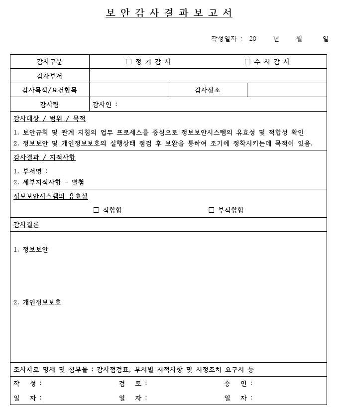

[그림 2-4] 보안감사 보고서 양식 사례
3. 보안감사책임자에게 보고한다.
보안감사보고서는 조직의 보안감사정책 및 지침에 입각한 보고서 체계를 따라야 하
고, 감사자는 시간적 순서에 따라 그들의 조사결과를 보고해야 한다. 또한 조사결과
는 유용하며 관련자들에게도 의미가 있어야한다. 필요에 따라 관련기관에 제출할 수
도 있다.
(1) 보안감사보고서 초안
보고의 과정은 첫 번째 초안에 대한 검토로부터 시작된다. 중간 관리자에게 초안
이 보내지면 초안은 감사종료회의를 위한 회의 자료로 활용할 수 있다. 이것은 보
고서 초기 단계에서 과장된 단어 사용 및 사실과 다른 내용이나 모순점을 식별하
여 교정하거나 없애도록 한다.
한번 피감기관(조직)과 감사자가 초안의 내용에 대하여 상의하고 나면 감사자는
필요한 부분을 개정하여 첫 번째 공식적인 초안을 발송한다.
(2) 중간보고서
중간보고서는 피감기관이 감사결과에 대하여 변명할 수 있도록 주어지는 공식적
인 초안이다. 이를 통해 피감기관(조직) 관리자는 초안의 결론 및 대안에 대해 집
중적으로 검토할 수 있다.
이때 감사결과에 대한 의견을 제시하고 감사자에게 참고자료를 작성하도록 하는
것이 관리자의 의무이다.
(3) 최종감사보고서
감사대상 기관의 답변내용을 받은 후 감사자의 의견과 감사대상 기관(조직)의 응
답을 취합하여 최종감사보고서를 완성한다. 비리나 법령위반에 대하여 보고할 경
우 감사자는 공정한 관점에서 감사결과를 제출할 수 있도록 유념해야만 한다.
감사보고서의 특성에 따라 비난 사실만을 작성하는 경향이 있으나 건설적인 보고
서를 위해서는 감사대상 기관과 감사자의 진술들을 종합, 결론이나 권고사항, 개
선 방안도 제시하는 것이 바람직하다.
(4) 결론과 권장사항의 공식화
감사결과와 권고사항은 증거로 뒷받침하여야 한다. 감사자는 감사목적에 따라 감
사결과에 대한 결론의 틀을 제시하여야 한다. 결론은 편파적이지 않고 타당하며
관련이 있어야한다. 구체적인 조사에 의해 입증되지 않은 경우, 섣부르게 결론을
제시하는 것은 피해야 한다.
감사자는 보고된 감사결과에 의해 운영과 실적에 대폭적인 향상의 가능성이 있을
때 보고서를 추천해야 한다. 감사는 수정되지 않은 중요한 조사 결과의 상태와 현
재의 감사 목적에 영향을 주는 사전 감사로에서의 권장사항도 보고해야 한다. 이
러한 건설적인 권고는 개선을 촉진할 수 있다.
권고는 확인된 문제의 원인을 해결하는 방향으로 지시되어야 하며 구체적이어야
한다. 이 경우 실행가능성을 염두에 두고 실행할 수 있는 권한을 가진 기관(조직)
에 제시하며 비용도 효율적이어야 한다.
수행 tip
• 보안감사보고서는 반드시 사실에 입각해서 객관적
인 증빙을 기반으로 작성해야 한다.
• 보안감사보고서 작성 시 감사의 한계에 대해서 보
고서에 명시해야 한다.
• 보안감사 시 데이터와 정보에 대한 부적절한 접근,
정보화 과정에서의 적절한 문서화의 부족, 결론을
도출하기 위한 분석과 조사의 객관성 부족이 그 한
계이다.

| 학습 2 | 교수·학습 방법 |
| --- | --- |

교수 방법
• 보안감사 착안사항과 중점점검 항목에 따라 보안감사 수행을 위한 보안감사 체크리스트의 도출
방법에 대해 설명한다.
• 보안감사 대상 부서로부터 보안감사 수행에 필요한 자료의 수집 및 분석 방법에 대해 설명한다.
• 보안감사 대상부서의 피감사인 및 관련자와 인터뷰의 실시 방법 및 인터뷰 결과에 대한 감사일지
의 작성 방법에 대해 설명한다.
• 보안감사 수행 시 확인된 문제점에 대하여 피감사인으로부터의 확인서 징구 및 문제점에 대한
개선방안에 대해 설명한다.
• 보안감사 수행결과에 대하여 표준 감사보고서 양식에 따라 보안 감사보고서 작성방법에 대해
설명한다.
• 보안감사보고서의 감사책임자 보고에 대해 설명한다.
• 학생들의 관심을 유발하기 위한 보안감사보고서 사례 등을 워드, 파워포인트로 만들어 이해에
도움이 되도록 한다.
• 가능하면 개인별로 보안감사 사례를 수집하게 하고 문제점과 해결방법을 제시하도록 지도한다.
• 학생들의 관심을 유발하기 위한 보안감사 보고서 사례 등을 워드, 파워포인트로 만들어 이해에
도움이 되도록 한다.
• 보안감사 보고서에서 제시한 사례들을 서로 공유함으로써 다양한 보안방법을 공유할 수 있게
지도한다.
• 보안감사의 중요성과 정보윤리를 함께 교육함으로써 올바른 의식 함양이 되도록 유도한다.
학습 방법
• 보안감사 착안사항과 중점점검 항목에 따라 보안감사 수행을 위한 보안감사 체크리스트를 도출
하는 방법에 대해 학습한다.
• 보안감사 대상 부서로부터 보안감사 수행에 필요한 자료의 수집 및 분석 방법에 대해 학습한다.
• 보안감사 대상 부서의 피감사인 및 관련자와 인터뷰의 실시 방법 및 인터뷰 결과에 대한 감사일지
의 작성 방법에 대해 학습한다.
• 보안감사 수행 시 확인된 문제점에 대하여 피감사인으로부터의 확인서 징구 및 문제점에 대한
개선방안에 대해 생각해 본다.
• 보안감사 수행결과에 대하여 표준 감사보고서 양식에 따라 보안 감사보고서 작성방법에 대해
학습한다.
• 보안감사 보고서의 감사책임자 보고 프로세스에 대해 이해한다.
• 다양한 보안감사 보고서의 사례를 찾아보고, 학생이 스스로 문제점과 해결방법을 찾아본다.
• 보안감사 보고서 사례를 파워포인트, MS-워드, 한글과 같은 서면으로 작성하여 다른 학생들과
교환한다.
• 보안감사의 필요성을 인식하고, 올바른 윤리의식이 함양되도록 주기적으로 보안교육을 받는다.

| 학습 2 | 평 가 |
| --- | --- |

평가 준거
• 평가자는 학습자가 수행 준거 및 평가 항목에 제시되어 있는 내용을 성공적으로 수행하였는지를
평가해야 한다.
• 평가자는 다음 사항을 평가해야 한다.

| 학습 내용 | 평가 항목 | 성취수준 |  |  |
| --- | --- | --- | --- | --- |
|  |  | 상 | 중 | 하 |

- 보안감사 착안사항과 중점점검 항목에 따라 보안감사
수행을 위한 보안감사 체크리스트를 작성할 수 있다.
보안감사 현장 - 보안감사 대상 부서로부터 보안감사 수행에 필요한
수행 자료를 수집하고 분석할 수 있다.
- 보안감사 대상 부서의 피감사인 및 관련자와 인터뷰
를 실시하고, 인터뷰 수행 결과에 대한 감사일지를
작성할 수 있다.
- 보안감사 수행 시 확인된 문제점에 대하여 피감사인
으로부터 확인서를 징구하고, 문제점에 대한 개선방
보안감사 안을 제시할 수 있다.
결과보고 - 보안감사 수행결과에 대하여 표준 감사보고서 양식
에 따라 보안감사 보고서를 작성하여 감사책임자에
게 보고할 수 있다.
평가 방법
• 문제해결 시나리오

| 학습 내용 | 평가 항목 | 성취수준 |  |  |
| --- | --- | --- | --- | --- |
|  |  | 상 | 중 | 하 |

- 보안감사 수행을 위한 보안감사 체크리스트 작성 능력
보안감사
현장수행
- 보안감사 수행에 필요한 자료의 수집 및 분석 능력
- 피감사인 및 관련자와 인터뷰 실시 및 인터뷰 수행
보안감사 결과에 대한 감사일지 작성 능력
결과보고 - 피감사인으로부터 확인서 징구 및 문제점에 대한 개
선방안 제시 능력
• 서술형 시험

| 학습 내용 | 평가 항목 | 성취수준 |  |  |
| --- | --- | --- | --- | --- |
|  |  | 상 | 중 | 하 |

- 보안감사 수행을 위한 보안감사 체크리스트 작성 능력
보안감사
- 보안감사 수행에 필요한 자료의 수집 및 분석 능력
현장수행
- 피감사인 및 관련자와 인터뷰 실시 및 인터뷰 수행
결과에 대한 감사일지 작성 능력
- 피감사인으로부터 확인서 징구 및 문제점에 대한 개
선방안 제시 능력
보안감사
결과보고
- 감사보고서 양식에 따른 감사보고서 작성 및 감사책
임자 보고 능력
• 사례 연구

| 학습 내용 | 평가 항목 | 성취수준 |  |  |
| --- | --- | --- | --- | --- |
|  |  | 상 | 중 | 하 |

- 보안감사 수행을 위한 보안감사 체크리스트 작성 능력
보안감사
- 보안감사 수행에 필요한 자료의 수집 및 분석 능력
현장수행
- 피감사인 및 관련자와 인터뷰 실시 및 인터뷰 수행
결과에 대한 감사일지 작성 능력
- 피감사인으로부터 확인서 징구 및 문제점에 대한 개
보안감사 선방안 제시 능력
결과보고 - 감사보고서 양식에 따른 감사보고서 작성 및 감사책
임자 보고 능력

| 학습 내용 | 평가 항목 | 성취수준 |  |  |
| --- | --- | --- | --- | --- |
| 피 드 백 |  |  |  |  |
| 1. 문제해결 시나리오- 보안체크리스트 | 기반의 이행,미이행 여부를 판단 할 수 있는 분석 능력을 | 갖도록 | 지 |  |
| 도한다. - 보안실무에 대한사 보고서)를 | 커뮤니케이션 능력 및 스킬을 평가하는 항목으로 관련활용하여 직접 작성한 보고서를 제츨하도록 지도한다. | 양식(보안감 |  |  |
| 2. 서술형 시험- 보안감사 | 체크리스트 항목에 대한 이해와 점검 결과에 대해 작성 할 수 | 있도록 | 지 |  |
| 도한다. - 보안감사 실무에검한 보안감사 | 대한 이해도를 평가하는 항목으로 관련 양식을 활용하여결과보고서를 제출하도록 지도한다. | 직접 | 점 |  |
| 3. 사례 연구 - 현재 진행 공이나 실패 | 중이거나 유사한 이전의 사례들 중 하나 혹은 그 이상을 선정하여요인을 분석, 적용하여 평가한 후 주요 사항에 대한 설명을 | 그첨가하여 | 성 |  |
| 돌려준다. - 사례 연구 후 | 잘된 점과 잘못된 점에 대해 강평을 한다. |  |  |  |

학습 1 보안감사 계획하기
학습 2 보안감사 수행하기

| 학습 3 | 보안감사 사후관리하기 |
| --- | --- |

3-1.
보안감사 시정조치 확인
• 보안감사 결과에 대한 시정조치 요구서를 작성하여 감사 대상부서에 통보할 수 있다.
• 보안감사 대상부서의 피감사인 및 관련자와 보안감사 사후 인터뷰를 실시할 수 있다.
학습 목표
• 보안감사 대상부서에서 작성한 시정조치 결과서를 검토하고, 시정조치 결과를 현장
점검할 수 있다.
필요 지식 /
• 보안감사자 담당자별 역할
조직의 보안감사자는 보안감사 활동 및 결과에 대한 개선을 수행함에 있어 아래와 같은
역할을 수행한다.
<표 3-1> 보안감사자의 역할
담당자 역할
정보보호최고책임자 - 회사의 정보보안 감사 업무에 대한 최종 책임을 걎는다.
- 정보보호최고책임자의 위임을 받아 회사의 정보보안 감사 업무를 수
행하며 감독하며, 감사계획을 수립하고 감사 활동을 주관한다.
정보보호 총괄관리자 - 정보보안 감사를 수행한 후 취약점에 대한 개선사항 목록을 작성하
여 부별 정보보호 관리자에게 통보하고 취약점에 대한 개선사항 조
치 결과를 정보보호최고책임자에게 보고한다.
- 부별 정보보호 업무 활동을 주기적으로 점검하고, 정보보호총괄관리
부별 정보보호 관리자 자에게 보고하며 취약점에 대한 개선사항에 대한 조치 및 계획을
수립하고 시행한다.
- 서버, 네트워크, 정보보호시스템, 애플리케이션, 데이터베이스 등 각
분야에 대하여 관리하는 담당자를 말하며, 주기적으로 정보보호 감사
정보시스템 관리담당자
를 수행하고, 정보보호 총괄관리자에게 보고한다. 또 발견된 취약점에
대한 보호대책을 수립하여 적용하여야 한다.
• 감사지적의 분류
<표 3-2> 감사지적별 분류기준 사례
구성요소 주요내용
기업의 건전한 영업 또는 업무를 저해하는 행위를 함으로써 신용 질서를
문란하게 하거나 당해 기업의 경영을 위태롭게 하는 행위로서 과태료․과
문책사항 징금 부과, 기업 및 임원에 대한 주의적 경고 이상의 제재, 직원에 대한
면직․업무의 전부 또는 일부에 대한 정직․ 감봉․ 견책에 해당하는 제재의
경우
직원의 위법․부당행위에 대하여 당해 기업의 장에게 통지하여 적의 조치
조치의뢰사항 토록 의뢰하며, 관련자 조치가 미진할 경우 경영실태평가 등을 통하여 책
임을 묻는 경우
위법 또는 부당하다고 인정되나 정상참작의 사유가 크거나 위법․부당 행
주의사항
위의 정도가 상당히 경미한 경우
임직원이 고의 또는 중대한 과실로 기업 관련법규 등을 위반하는 등의
변상사항
행위로 기업의 재산에 손실을 끼쳐 변상책임이 있는 경우
개선사항 규정, 제도 또는 업무운영 내용 등이 불합리하여 그 개선이 필요한 경우
수행 내용 / 보안감사 시정조치 확인하기
재료·자료
Ÿ 보안점검 준거성 확보를 위한 「정보통신기반보호법」, 정보통신망 이용촉진 및 정보보호 등에
관한 법률, 개인정보보호법, 전자금융거래법, 신용정보법, 전자금융감독규정, COBIT(Control
Objectives for Information and related Technology) 등
Ÿ보안감사지침, 보안감사 계획서, 보안감사 체크리스트
기기(장비･공구)
Ÿ 컴퓨터, 프린터, 복사기 등
Ÿ 감사 자동화 도구(CAAT), 디지털 포렌식(digital forensic) 도구, 문서작성 도구 등
안전･유의 사항
Ÿ 보안관련 정책, 지침, 절차는 조직에 따라 상이할 수 있다.
Ÿ 보안관리지침서에 따라 보안감사 체크리스트를 검토하고, 이의 적합성을 매년 주기로 검토, 평가,
갱신하되 실시간성을 요할 경우 승인절차를 거쳐 즉시 반영한다.
• 원활한 보안감사 시정조치를 위한 보안과 관련된 전반적인 지식과 기술이 필요하고, 보안감사의
수행보다 문제점에 대한 시정조치가 중요한 점을 인지한다.
• 감사시정조치 확인은 가급적 현장 재점검을 기반으로 수행한다.
• 해당부서에서 시정조치확인보고서(안)에 대하여 이견을 제시하는 경우에는 관련 근거와 산출물,
시스템 조치 결과를 제출받아 타당성을 검토하여 반영한다.
• 다만, 시정조치결과 확인 기간 이전에 조치되지 못하고 시정조치 확인 기간 중에 보완된 사항에
대해서는, 감사인의 판단에 따라 반영 여부를 결정할 수 있다.
수행 순서
• 보안감사 결과에 대한 시정조치 요구서를 작성하여 감사 대상부서에 통보한다.
1. 보안감사 시정조치 요구서를 작성하여 통보한다.
보안감사결과보고서에 제시된 보안점검항목 결과 중 “미흡” 또는 “부분이행” 판
정을 받은 보안점검세부항목과 영역별 개선권고사항에 대하여, 해당 부서에 시정조치
요구를 한다. 필요에 따라 감사 대상부서에서 시정조치계획서를 받기도 한다.
(1) 보안감사 시정조치 요구서에는 아래의 항목이 포함된다.
(가) 보안감사 지적사항 및 개선 가이드라인
(나) 시정조치 완료 예정일 요구
(다) 시정조치 계획 요구
(2) 보안감사 시정조치계획서에는 아래의 항목이 포함된다.
(가) 보안감사 지적사항별 시정조치계획
(나) 시정조치 완료 예정일자
(다) 조치불가 건에 대한 검토의견서
• 보안감사 대상 부서의 피감사인 및 관련자와 보안감사 사후 인터뷰를 실시할 수 있다.
1. 사후 인터뷰 시 주요 감사 사항을 확인한다.
사후 인터뷰는 보안감사에서 지적된 문제점에 대해 인터뷰가 필요할 경우 수행하며,
문제점에 대한 개선 사항에 대해 점검을 하되, 반드시 증적을 기반으로 이행 여부를
판단하여야 한다.
(1) 보안관련 규정에 따른 기밀 자산·관리실태 미비사항 이행현황 점검
(가) 비밀·대외비 발간, 복사 및 열람 등 관리실태 및 규정 준수 확인
(나) 비밀·대외비 재분류 실태, 관리 대장 정비 여부 확인
(2) 컴퓨터, USB 관리 등 정보유출 방지대책 미비사항 이행현황 점검
(가) 컴퓨터 등 단말기 보안관리 및 업무자료관리 준수 여부
(나) 외부 용역업체에 대한 관리 및 접근통제 등 보안 대책
(다) 비밀취급인가증 발급현황 및 대장정비, 관련규정 준수 여부 점검
(라) 보안감사결과 지적사항에 대한 조치상황 등
(3) 중요 내부자료 및 전자문서 관리 ‧ 유통 실태 문제점 이행 현황 점검
(가) 컴퓨터, USB 등을 통한 내부자료 저장 및 반출입 통제 여부
(나) 상용 이메일 자료 전송 차단 및 유해사이트 접근 차단
(4) 정보통신망 보안대책 미비사항 이행 현황 점검
(가) 보안장비, 네트워크 장비 등 운영 ‧ 관리 보안지침 준수 여부
(나) 정보통신망에 대한 비인가자 접근통제 여부
(5) 외부 용역업체 보안관리 대책 미비사항 이행현황 점검
(가) 정보화사업 추진 시 보안관리 대책 수립 여부
(나) 용역업체에 대한 보안준수사항 점검 및 접근통제 실시 여부
(6) 정보시스템 보안관리 대책 미비사항 이행현황 점검
(가) 정보시스템 운영‧관리 보안지침 준수여부
(나) 정보보호시스템 보안관리 및 접근통제 여부
(7) 컴퓨터 등 단말기 및 첨단보안통신기기 보안 대책 미비사항 이행현황 점검
(가) 컴퓨터보안 대책 준수 및 저장매체 관리‧파기 절차 준수 여부
(나) 무선랜 및 스마트폰 등에 대한 보안 대책 준수 여부
(8) 보안규정 및 관련법 미비사항 이행현황 점검
(가) 「정보통신기반보호법」, 정보통신망 이용촉진 및 정보보호 등에관한 법률,
개인정보보호법, 전자금융거래법, 신용정보법, 전자금융감독규정 등 소관법
준거성 준수 여부
(나) 기관의 보안정책, 절차, 지침에 대한 준수 여부
• 보안감사 대상부서에서 작성한 시정조치 결과서를 검토한다.

| 해당부서에서 작성한 시정조치결과서에 대하여 조치계획에 따른 이행여부를 검토한다. |
| --- |
| 이행 현황 검토 시 반드시 증적을 기반으로 확인하되, 증적으로 확인이 어려운 경우는 |
| 사후 인터뷰에서 확인하거나. 현장 재점검을 통해 이행 현황을 검토 한다. |

수행 tip
• 감사시정조치 확인은 가급적 현장 재점검을 기반으
로 수행한다.
• 해당부서에서 시정조치확인보고서(안)에 대하여 이
견을 제시하는 경우에는 관련 근거와 산출물, 시스
템 조치 결과를 제출받아 타당성을 검토하여 반영
한다.
• 다만, 시정조치결과 확인 기간 이전에 조치되지 못
하고 시정조치 확인 기간 중에 보완된 사항에 대해
서는, 감사인의 판단에 따라 반영 여부를 결정할
수 있다.
3-2.
보안감사 시정조치 결과보고
• 보안감사 대상 부서의 시정조치 결과에 대하여 현장 점검한 결과에 따라 시정조치
학습 목표 결과보고서를 작성하여 감사책임자에게 보고할 수 있다
• 보안감사 수행 결과에 대한 평가 및 학습 교훈(Lessons Learned)을 작성할 수 있다.
필요 지식 /
• Lessons Learned
1. 프로젝트를 수행하면서 배움을 얻는다는 뜻
2. 학습교훈(Lessons learned)라는 것은 결국 프로젝트들을 수행한 것을 기록함으로써 배움을
얻는다는 것으로, 이것들은 Lessons Learned Knowledge base에 결국 들어가 쌓이게 됨
3. Lessons Learned Knowledge Base: 이전 프로젝트 선정 과정의 의사결정과 이전 프로젝트
의 성과, 두 가지 모두에 관한 선례 정보와 교훈이 들어 있는 저장소
수행 내용 / 보안감사 시정조치 결과보고하기
재료·자료
Ÿ 보안점검 준거성 확보를 위한 「정보통신기반보호법」, 정보통신망 이용촉진 및 정보보호 등에
관한 법률, 개인정보보호법, 전자금융거래법, 신용정보법, 전자금융감독규정, COBIT(Control
Objectives for Information and related Technology) 등
Ÿ보안감사지침, 보안감사 계획서, 보안감사 체크리스트
기기(장비･공구)
Ÿ 컴퓨터, 프린터, 복사기 등
Ÿ 감사 자동화 도구(CAAT), 디지털 포렌식(digital forensic) 도구, 문서작성 도구 등
안전･유의 사항
Ÿ 보안관련 정책, 지침, 절차는 조직에 따라 상이할 수 있다.
Ÿ 보안감사 결과에 대한 리뷰를 통해 보안관리지침서 및 보안감사 체크리스트를 재검토하고, 보안
감사의 효과성 제고를 위해 승인절차를 거쳐 즉시 반영한다.
Ÿ 조직의 보안감사 결과는 대외비로 대외비 관리 규정에 따라 관리한다.
Ÿ 보안감사 수행 결과에 대해 평가 및 학습 교훈(lessons learned)을 작성하고, 감사팀 간의 정보공
유가 될 수 있도록 한다.
• 디지털 포렌식(digital forensic)을 활용한 데이터 수집, 분석, 보고서 등에 대해서도, 추후 감사
시 활용될 수 있도록 자산화하여 관리한다.
수행 순서
• 보안감사 대상 부서의 시정조치 결과에 대한 시정조치 결과보고서를 작성한다.

| 감사결과 시정조치 보고서는 해당 감사 결과에 대해 시정하고 그 내용을 보고하는 문서 |
| --- |
| 이다. 감사 장소, 부적합 요건, 부적합 내역, 시정 조치, 요구 사항, 시정 조치 완료일 등 |
| 각 항목별로 세분화하여 정확하게 작성할 수 있도록 한다. |

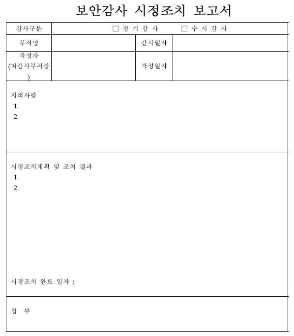

[그림 3-1] 보안감사 시정조치 확인보고서
• 보안감사 수행 결과에 대한 평가 및 학습 교훈(lessons learned)을 작성하여, 향후 감사
시 활용한다.
1. 보안감사 절차 개선사항에 대해 작성한다.
보안감사 절차 전반에 걸쳐 모니터링 및 통제효과를 확인하고 미흡한 감사 프로세스
집중 개선
2. 보안감사 추진 시 필요사항에 대해 작성하며, 주요 내용은 아래와 같다.
(1) 경영진 및 조직차원의 지속적인 관심과 지원
(2) 보안감사자 입장에서는 점검 결과에 대한 객관적인 보고 및 최적화된 가이드 제
공 필요
(3) 개선에 대한 효과성을 객관적으로 수치화할 수 있는 도구
(4) 지속적 감사 프로세스 개선 작업의 정례화
3. 보안감사 시 미흡했던 점을 작성한다.
(1) 진행초기 : 당장 눈에 뜨는 실적에 급급한 현실
(2) 진행과정: 개선에 대한 신뢰부족, 분석도구 부족
(3) 진행후기: 객관적인 개선효과에 대한 임직원 이해

| 학습 3 | 교수·학습 방법 |
| --- | --- |

교수 방법
• 보안감사 결과에 대한 시정조치 요구서의 작성 방법에 대해 설명한다.
• 보안감사 대상 부서의 피감사인 및 관련자와 보안감사 사후 인터뷰 실시 방법에 대해 설명한다.
• 보안감사 대상부서에서 작성한 시정조치 결과서 검토 방법에 대해 설명한다.
• 보안감사 결과에 대한 시정조치 결과에 대해 현장 점검 방법을 설명한다.
• 현장 점검한 결과에 따른 시정조치 결과보고서 작성 방법에 대해 설명한다.
• 시정조치 결과보고서의 감사책임 보고 방법에 대해 설명한다.
• 보안감사 수행 결과에 대한 평가 및 학습 교훈(lessons learned) 작성 방법에 대해 설명한다.
• 보안감사 시정조치에서 요구하는 항목 및 내용을 자료로 제시한 후 설명한다.
• 학생들의 관심을 유발하기 위한 보안감사 시정조치요구서 / 계획서/ 결과서 사례 등을 워드,
파워포인트로 만들어 이해에 도움이 되도록 한다.
• 가능하면 개인별로 시정조치 결과보고서 사례를 수집하게 하고 문제점과 해결방법을 제시하도록
지도한다.
• 제시한 사례들을 서로 공유함으로써 다양한 방법을 공유할 수 있게 지도한다.
• 보안감사의 중요성과 정보윤리를 함께 교육함으로써 올바른 의식 함양이 되도록 유도한다.
학습 방법
• 보안감사 결과에 대한 시정조치 요구서의 작성 방법에 대해 학습한다.
• 보안감사 대상 부서의 피감사인 및 관련자와 보안감사 사후 인터뷰 실시 방법에 대해 학습한다.
• 보안감사 대상부서에서 작성한 시정조치 결과서 검토 방법에 대해 학습한다.
• 보안감사 결과에 대한 시정조치 결과에 대해 현장 점검 방법을 학습한다.
• 현장 점검한 결과에 따른 시정조치 결과보고서 작성 방법에 대해 학습한다.
• 시정조치 결과보고서의 감사책임 보고 방법에 대해 이해한다.
• 보안감사 수행 결과에 대한 평가 및 학습 교훈(lessons learned) 작성 방법에 대해 학습한다.
• 다양한 보안감사 시정조치요구서/ 계획서/ 결과서의 사례를 찾아보고, 학생이 스스로 문제점과
해결방법을 찾아본다.
• 보안감사 시정조치요구서/ 계획서/ 결과서 사례를 파워포인트, MS-워드, 한글과 같은 서면으로
작성하여 다른 학생들과 교환한다.
• 보안감사의 필요성을 인식하고, 올바른 윤리의식이 함양되도록 주기적으로 보안교육을 받는다.

| 학습 3 | 평 가 |
| --- | --- |

평가 준거
• 평가자는 학습자가 수행 준거 및 평가 항목에 제시되어 있는 내용을 성공적으로 수행하였는지를
평가해야 한다.
• 평가자는 다음 사항을 평가해야 한다.

| 학습 내용 | 평가 항목 | 성취수준 |  |  |
| --- | --- | --- | --- | --- |
|  |  | 상 | 중 | 하 |

- 보안감사 결과에 대한 시정조치 요구서를 작성하여
감사 대상부서에 통보할 수 있다.
보안감사 시정조 - 보안감사 대상부서의 피감사인 및 관련자와 보안감
치 확인 사 사후 인터뷰를 실시할 수 있다.
- 보안감사 대상부서에서 작성한 시정조치 결과서를 검
토하고, 시정조치 결과를 현장 점검할 수 있다.
- 보안감사 대상부서의 시정조치 결과에 대하여 현장
점검한 결과에 따라 시정조치 결과보고서를 작성하
보안감사 시정조
여 감사책임자에게 보고할 수 있다
치 결과보고
- 보안감사 수행 결과에 대한 평가 및 학습 교훈
(lessons learned)을 작성할 수 있다.
평가 방법
• 문제해결 시나리오

| 학습 내용 | 평가 항목 | 성취수준 |  |  |
| --- | --- | --- | --- | --- |
|  |  | 상 | 중 | 하 |

- 보안감사 결과에 대한 시정조치 요구서 작성 및 감
사 대상부서 통보 능력
보안감사 시정조 - 피감사인 및 관련자의 보안감사 사후 인터뷰 실시
치 확인 능력
- 시정조치 결과서 검토 및 시정조치 결과 현장 점검
능력
보안감사 시정조 - 보안감사 수행 결과에 대한 평가 및 학습 교훈
치 결과보고 (lessons learned) 작성 능력
• 서술형 시험

| 학습 내용 | 평가 항목 | 성취수준 |  |  |
| --- | --- | --- | --- | --- |
|  |  | 상 | 중 | 하 |

| 보안감사 사후관리보안감사 시정조치 결과보고 • 사례 연구 보안감사 사후관리보안감사 시정조치 결과보고 피 드 백 | - 보안감사 결과에 대한 시정조치 요구서 작성 및 감사 대상 부서 통보 능력 - 피감사인 및 관련자의 보안감사 사후 인터뷰 능력 - 시정조치 결과서 검토 및 시정조치 결과 현장 점검능력 - 시정조치 결과에 대한 시정조치 결과보고서 작성 및감사책임자 보고 능력 - 보안감사 수행 결과에 대한 평가 및 학습 교훈(lessons learned) 작성 능력 - 보안감사 결과에 대한 시정조치 요구서 작성 및 감사 대상 부서 통보 능력 - 피감사인 및 관련자의 보안감사 사후 인터뷰 능력 - 시정조치 결과서 검토 및 시정조치 결과 현장 점검능력 - 시정조치 결과에 대한 시정조치 결과보고서 작성 및감사책임자 보고 능력 - 보안감사 수행 결과에 대한 평가 및 학습 교훈(lessons learned) 작성 능력 |  |  |  |
| --- | --- | --- | --- | --- |
| 1. 문제해결 시나리오- 보안실무에 대한정조치계획서/결과서)를 | 커뮤니케이션 능력 및 스킬을 평가하는 항목으로 관련활용하여 직접 작성한 보고서를 제츨하도록 지도한다. |  | 양식(보안감사 | 시 |
| 2. 서술형 시험- 보안실무에 대한치 결과보고서를 | 이해도를 평가하는 항목으로 관련 양식을 활용하여 직접제출하도록 지도한다. | 점검한 |  | 시정조 |
| 3. 사례 연구 - 현재 진행 나 실패 요인을- 사례 연구 후 | 중이거나 유사한 이전의 사례들 중 하나 혹은 그 이상을 분석, 적용하여 평가한 후 주요 사항에 대한 설명을 잘된 점과 잘못된 점에 대해 강평을 한다. | 선정하여첨가하여 | 그돌려준다. | 성공이 |

| 학습 내용 | 평가 항목 | 성취수준 |  |  |
| --- | --- | --- | --- | --- |
|  |  | 상 | 중 | 하 |

| 보안감사 사후관리보안감사 시정조치 결과보고 피 드 백 | - 보안감사 결과에 대한 시정조치 요구서 작성 및 감사 대상 부서 통보 능력 - 피감사인 및 관련자의 보안감사 사후 인터뷰 능력 - 시정조치 결과서 검토 및 시정조치 결과 현장 점검능력 - 시정조치 결과에 대한 시정조치 결과보고서 작성 및감사책임자 보고 능력 - 보안감사 수행 결과에 대한 평가 및 학습 교훈(lessons learned) 작성 능력 |  |  |  |
| --- | --- | --- | --- | --- |
| 1. 문제해결 시나리오- 보안실무에 대한정조치계획서/결과서)를 | 커뮤니케이션 능력 및 스킬을 평가하는 항목으로 관련활용하여 직접 작성한 보고서를 제츨하도록 지도한다. |  | 양식(보안감사 | 시 |
| 2. 서술형 시험- 보안실무에 대한치 결과보고서를 | 이해도를 평가하는 항목으로 관련 양식을 활용하여 직접제출하도록 지도한다. | 점검한 |  | 시정조 |
| 3. 사례 연구 - 현재 진행 나 실패 요인을- 사례 연구 후 | 중이거나 유사한 이전의 사례들 중 하나 혹은 그 이상을 분석, 적용하여 평가한 후 주요 사항에 대한 설명을 잘된 점과 잘못된 점에 대해 강평을 한다. | 선정하여첨가하여 | 그돌려준다. | 성공이 |

∙국가법령정보센터 관련법령 www.law.go.kr.
∙금융기관검사 및 제재에 관한 규정시행세칙(개정 2014.10.31.).
∙안랩 보안정보 (http://m.ahnlab.com/kr/site/main.do)
∙윤석중(2011). 「효율적인 IT서비스관리를 위한 지속적 개선사례」. 한국경영정보학회 학술대회
자료집
∙임상혁(2014). 「최고감사기구를 위한 IT감사지침서」. 『감사 2014년 여름호』. 감사원.
∙정보감사보안기술연구소(2005). 『한권으로 끝내는 CISA』. 한언.
∙한국기술교육대학교 규정관리시스템(http://rule.koreatech.ac.kr) 내부감사점검항목.
∙한국인터넷진흥원(2011). 『정보보호 관리체계(ISMS/PIMS) 실무자교육과정』.
∙한국인터넷진흥원(2013). 『정보보호 관리체계(ISMS/PIMS) 세부점검항목』.
∙한국인터넷진흥원(2013). 『정보보호 관리체계(ISMS/PIMS) 인증제도안내서』.
∙LGCNS INSIGHT IT (http://blog.lgcns.com/473).

보안감사 계획서

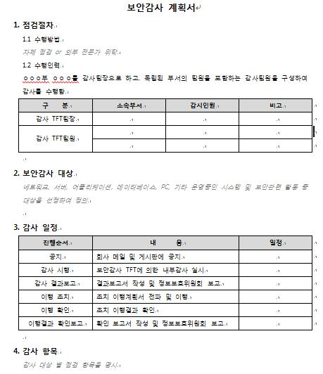

보안 설문지 (1/2)

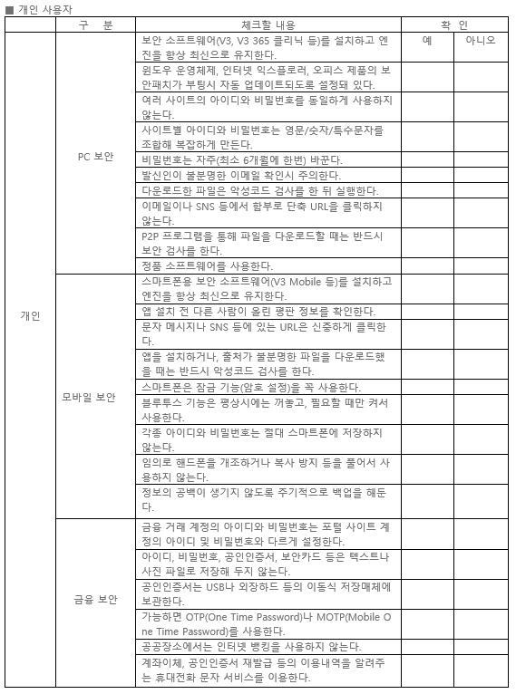

보안 설문지(2/2)

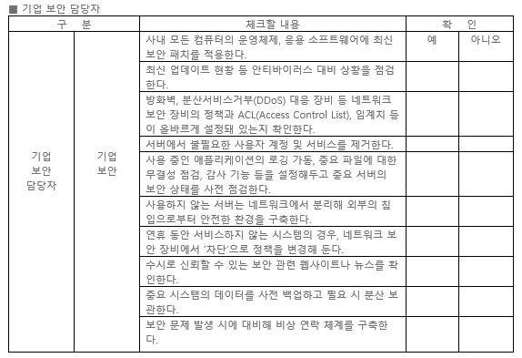

보 안 점 검 표
내부감사 점검항목
1. 정보보안 관리규정

| 구분 | 점검항목 |
| --- | --- |
| 지침/매뉴얼 관리 | 주기적으로 정보보안 관리규정 및 지침을 검토하여 변경사항 발생 시 개정하였는가? |
|  | 정보보안 관리규정 및 지침 개정 시 관련담당자들에게 개정 내용을 전달하였는가? |
| 정보보안 업무 계획 | 보안업무 세부추진 계획을 수립하였는가? |
| 보안 심의 | 보안심사 위원회에 심의를 요구한 경우 관련 문서들을 보관하고 있으며, 심의 결정사항을 이행하고 있는가? |
| 운영검토 | 정보보안 관리체계 운영검토를 실시하였는가? |

2. 정보자산 및 위험관리

| 구분 | 점검항목 |
| --- | --- |
| 자산 관리 | 정보자산의 변경사항이 발생한 경우 정보자산 관리 목록을 갱신하였는가? |
| 자산 관리 | 응용시스템 및 서버를 대상으로 연 1회 자산 중요도 평가를 수행하였는가? |
|  | 등록된 정보자산에 대하여 라벨을 부착하였는가? |
| 위험분석 | 연 1회 위험분석을 실시하였는가? |
| 위험분석 | 위험분석 결과를 바탕으로 하여 수용 가능한 위험의 수준(DoA)을 정하고 관리대상위험을 식별하였는가? |
|  | 정보보호대책 명세서 및 단계별 위험관리 방안을 작성하였는가? |
|  | 정보보호 적용성 보고서를 작성하여 관리하고 있는가? |

3. 외주 보안관리 매뉴얼

| 구분 | 점검항목 |
| --- | --- |
| 일반사항 | 제3자 및 외부위탁 계약 시 계약서 등에 보안 요구사항을 반영하여 체결하였는가? |
|  | 참여인원의 친필서명이 들어간 보안서약서를 징구하였는가? |
| 내부자료 보안 | 제공된 내부자료에 대해 자료관리대장을 작성하여 관리하고 있는가? |
|  | 업무 수행을 위해 제공하는 내부 자료를 안전하게 보관하고 있는가? |
| 장비 보안관리 | 참여인원의 PC 반입 시 바이러스 백신 프로그램 설치 및 바이러스 감염여부를 확인하였는가? |
|  | 반입된 PC는 업무 종료 시까지 반출되지 않도록 통제하고 있는가? |
| 내외부망 접근에 대한보안관리 | 사용자 계정은 하나의 그룹으로 등록하고 사용자 계정별로 정보시스템에 접근권한을 부여하였는가? |
| 보안관리 | 사용자 계정별로 부여된 권한은 불필요 시 곧바로 권한을 해지하거나 계정을 폐기하였는가? |

4. 정보보안 교육훈련

| 구분 | 점검항목 |
| --- | --- |
| 계획 수립 | 연간 정보보안 교육계획을 수립하였는가? |
| 기본교육 실시 | 각 팀장은 팀원들을 대상으로 분기별 1회 이상 정보보안 기본교육을 실시하고 있는가? |
| 기본교육 실시 | 각 팀장은 신규직원에 대해 발령 후 1개월 이내에 정보보안 기본교육을 실시하는가? |
|  | 외주업체 인원에 대해서 용역 실시단계에서 필요한 정보보안 기본교육을 실시하는가? |
| 전문교육 실시 | 정보보안 전문교육을 실시하였는가? |

5 침해사고 대응

| 구분 | 점검항목 |
| --- | --- |
| 침해사고 대응 | 침해사고 발생 시 발견자는 침해사고 신고서를 작성하여 신고하였는가? |
| 침해사고 대응 | 침해사고 대응을 위해 지식정보보호 전문업체에 기술지원을 요청했을 경우, 보안서약서를 징구하였는가? |

|  | 발생된 침해사고에 대한 사고 분석을 실시하였는가? |
| --- | --- |
|  | 중대한 침해사고가 발생되었을 경우, 침해사고 대응센터를 운영하였는가? |
| 사후 관리 | 동일한 침해사고가 발생되지 않도록 교육 및 감시 활동 등의 사후관리를 수행하였는가? |

6. PC 사용자 보안

| 구분 | 점검항목 |
| --- | --- |
| PC 관리 | 개인소유 등 인가 받지 않은 PC가 반입되어 있는가? |
|  | 반출된 PC(노트북)에 대해 중요자료를 백업 후 제거하여 반출하며, '전산장비 반출입대장'에 관련 내용을 기록하였는가? |
|  | 파일 및 디렉토리 공유설정을 금지하였는가? 부득이 공유설정 시 암호설정 후 사용하고 있는가? |
| PC 관리 | PC 로그인 및 화면보호기에 암호를 설정하고 있으며, 화면보호기 대기 시간은 10분이하로 설정되어 있는가? |
|  | 백신 프로그램이 설치되어 있으며, 최신버전으로 유지하고 있는가? |
|  | 최신 윈도우 보안 패치를 설치하였는가? |
|  | PC내에 비밀문서가 저장되어 있는가? |
|  | PC에 불법 소프트웨어가 설치되어 있는가? |
|  | 사용자는 월 1회 바이러스, 불법 소프트웨어 설치 유무를 점검하고 있는가? |
| LAN 사용 통제 | 외부 사용자가 LAN 사용 시 'LAN 사용신청서'와 'LAN 사용 보안 서약서'를 작성하여보안담당자에게 제출하였는가? |
| 데이터 백업 | 필요한 데이터는 적절하게 백업하고 있는가? |
| 데이터 백업 | 데이터 백업매체는 시건 장치가 되어 있는 장소에 보관하고 있는가? |

7. 응용시스템 보안관리

| 구분 | 점검항목 |
| --- | --- |
| 개발 및 운영의 분리 | 개발 및 테스트 시스템과 운영시스템은 분리되어 있는가? |
|  | 개발에 필요한 도구가 운영환경에 설치되어 있지 않은가? |
| 요구사항 분석 | 시스템의 도입 및 개발 발주 시 중요도에 따라 보안기능 요구사항을 검토 후 반영하였는가? |
|  | 보안기능을 반영하여 요구사항을 분석하고, 설계하고 있는가? |
| 보안 기능의 설계 | 응용시스템 관리자 모듈과 사용자 모듈을 분리하고 별도의 관리자 인증을 수행하고 있는가? |
|  | 응용시스템 관리자 모듈의 사용자 계정 및 비밀번호 입력이 3회에 걸쳐 일치하지않을 때 해당 접속을 중지시키고 비인가자 침입 여부를 확인할 수 있도록 설계되어 있는가? |
|  | 패스워드 생성기준은 숫자와 문자 등으로 9자리 이상으로 정하고 주기적으로 변경하도록 설계되어 있는가? |
| 보안 기능의 설계 | 모든 입력 데이터에 대하여 유효성 점검을 수행하도록 설계되어있는가? |
|  | 화면상에 패스워드와 같은 민감한 데이터가 평문으로 보이지 않도록 되어 있는가? |
|  | 비밀성을 요하는 데이터는 암호화하여 저장하고 있는가? |
|  | 중요한 응용시스템의 경우 관리자와 사용자의 중요한 활동에 대한 감사 로그를 생성하고 있는가? |
| 응용시스템의 테스트 | 응용시스템 테스트 시 임의의 테스트 데이터를 생성하여 활용하거나 운영 데이터를 가공하여 사용하며, 실제 운영 데이터의 사용을 금하고 있는가? |
|  | 입력데이터의 유효성 점검을 실시하고 있는가? |
| 응용시스템의 설치 | 응용시스템의 설치 시 테스트 시나리오를 작성하여 승인을 득하였는가? |
| 응용시스템의변경관리 | 응용시스템의 변경사항이 발생한 경우 변경 요청서를 작성하여 응용시스템 관리팀장에게 변경을 요청하였는가? |
| 응용시스템의 변경관리 | 변경 요청의 타당성 검토 후 변경하고 관련 내용을 기록하고 있는가? |
|  | 긴급한 상황 하에서 승인절차를 생략하고 응용시스템을 변경한 경우 사후 승인을득하였는가? |
| 소스 관리 | 프로그램 소스는 운영 중인 시스템에 저장하여 관리하는 것을 금하고 있는가? |
| 소스 관리 | 프로그램 소스 접근을 통제하고 접근기록을 남기고 있는가? |
|  | 개발 중이거나 유지보수 중인 프로그램은 운영 중인 프로그램의 소스와 분리하여 |

|  | 관리하고 있는가? |
| --- | --- |
| 계정 및 권한관리 | 사용자 계정의 등록(신규, 추가, 변경, 삭제 등) 사유가 발생할 경우 양식을 이용하여 신청하고 있는가? |
|  | 사용자 계정에 대해 사용자 ID 관리 대장에 기록하고 있는가? |
|  | 분기별로 사용자 계정에 대해 재확인을 실시하여 삭제, 중지, 등록 등 필요한 조치를 취하고 있는가? |
|  | 퇴직자 및 전출자의 계정을 적시에 삭제하고 있는가? |
|  | 응용시스템 사용자들의 권한관리를 실시(정기적 권한의 적절성 검토)하고 있는가? |
|  | 응용시스템 접속한 후 일정시간 동안 어떤 입력도 일어나지 않을 경우 자동적으로세션을 중단시키도록 해당 시스템을 설정하고 있는가? |
| 백업 | 소스 파일 변경 시마다 백업하여 안전한 장소에 보관하고 있는가? |
| 모니터링 | 응용시스템이 처리하는 중요정보에 대한 접근 기록을 3개월 이상 보관하고 있는가? |
| 취약점 점검 | 외부 응용시스템의 이관 시에 수시 취약점 점검을 실시하고 있는가? |
|  | 종합점검 및 수시점검 시 발견된 취약점에 대하여 보완계획을 수립하고 이행하였는가? |

8. 서버 보안관리

| 구분 | 점검항목 |
| --- | --- |
| 신규 도입 | 서버 신규 도입 시 보안성 검토를 요청하고, 결과에 따라 조치하였는가? |
| 신규 도입 | 신규로 도입 설치되는 서버시스템에 취약점 점검을 실시하고, 발견된 취약점을 조치토록 하였는가? |
|  | 취약점 조치 권고안에 따라 조치가 불가하거나 불가피하게 적용되어야 할 사항에대해 보안규정 예외적용신청서를 작성하였는가? |
| 소프트웨어의 설치 | 서버에 설치된 소프트웨어의 현황을 관리하고 있는가? |
|  | 업무 목적 외 또는 불법 소프트웨어는 설치되지 않았는가? |
|  | 원격관리 소프트웨어 설치에 대한 보안대책을 수립하고 승인을 받았는가? |
| 보안설정 | 서버에 주기적으로 보안 패치 및 보안설정을 적용하고 있는가? |
| 보안설정 | 모든 서버는 로그인을 허용하기 전에 보안권고문을 공지하고 있는가? |
| 계정 생성 및 관리 | 사용자 계정의 등록(신규, 추가, 변경, 삭제 등) 사유가 발생할 경우 양식을 이용하여 신청하고 있는가? |
| 계정 생성 및 관리 | 사용자 계정 생성 절차 및 규정을 따르고 있는가? |
|  | 서버 사용자 계정에 대해 사용자 ID 관리 대장에 기록하고 있는가? |

|  | 기 사용된 계정은 최소 1년 동안 다른 사용자에게 재부여하지 않는가? |
| --- | --- |
|  | 디폴트 계정은 삭제하였는가? 예외로 사용 시 패스워드를 변경하였는가? |
|  | 60일 이상 사용자 계정이 사용되지 않을 경우 일시 중지시키며, 일시 중지된 후부터 60일간 사용요청이 없는 경우 계정을 삭제하고 있는가? |
|  | 분기별로 사용자 계정에 대해 재확인을 실시하여 삭제, 중지, 등록 등 필요한 조치를 취하고 있는가? |
|  | 퇴직자 및 전출자의 계정을 적시에 삭제하고 있는가? |
| 패스워드 생성 및 관리 | 패스워드 길이는 최소 9자 이상인가? |
|  | 접근시도 패스워드가 3회 이상 일치하지 않을 경우 접속이 거부되고 있는가? |
|  | 사용자가 패스워드를 사용할 수 있는 최대기간(1회/1월) 및 사용해야 하는 최소기간(1일)을 설정하고 있는가? |
| 패스워드 생성 및 | 사용자가 과거에 사용했던 패스워드를 최소 6개월 이내에 사용하지 못하도록 하고있는가? |
|  | 패스워드는 암호화되어 저장되며, 화면에 읽을 수 있는 형태로 표시되지 않고 있는가? |
|  | 서버관리자에 의해 부여된 초기 패스워드는 사용자가 처음 접속 시 자신의 패스워드로 변경하도록 강제화하고 있는가? |
| 권한 관리 | 사용자 접근권한 신청 및 검토 절차를 준수하였는가? |
| 권한 관리 | 일반사용자의 타 사용자 디렉토리 등에 대한 접근권한 제한을 하였는가? |
|  | 일반사용자에게 관리자 권한을 부여하지 않았는가? |
| 접근통제 | 중요 서버 접근 시 SSH 등 암호화된 통신 프로토콜을 사용하는가? |
|  | 로그인 화면에서는 로그인 관련 정보외의 정보를 보여주지는 않은가? |
|  | 로그인 실패 시 시스템 침해의 원인이 될 정보를 보여주지는 않은가? |
|  | 로그인 성공 시 최근 접속 시간, 날짜, 터미널 등의 정보를 보여주는가? |
| 접근통제 | 서버에 접속한 후 사용자나 다른 시스템으로부터 일정시간 동안 어떤 입력도 일어나지 않으면 자동적으로 로그오프시키거나 세션을 중단시키고 있는가? |
|  | 통제구역 이외의 장소에 설치된 서버에 화면보호기가 설정되어 있는가? |
|  | 시스템 관리자들이 원격접속을 수행하고 있는가? 원격접속 시 안전한 방법으로 로그인 및 통신하고 있는가? |
|  | 업무상 불필요한 서비스는 제거하였는가? |
| 패치/시스템 파라미터관리 | 패치나 시스템 파라미터를 변경할 때 그와 관련된 모든 사항에 대한 기록을 남기고있는가? |
| 백신 설치 및 운영 | 윈도우 서버의 경우 바이러스 백신이 설치되고, 최신 업데이트가 되어있는가? |

|  | 바이러스 감염 시 담당자에게 신고 등의 절차를 준수하는가? |
| --- | --- |
| 무결성 점검 | 시스템 무결성을 검증하는 툴을 이용하여 정기적으로 시스템에 대한 무결성을 검토하고 있는가? |
| 인터넷 서버 운영 | 웹서버와 메일서버는 분리해서 운영하고 있는가? |
| 취약점 점검 | 연 1회 이상 취약점에 대한 종합점검과 수시점검을 실시하고 있는가? |
| 취약점 점검 | 점검 결과 발견된 취약점에 대한 보완계획을 수립하여 이행하는가? |
|  | 단기 조치가 어려운 취약점에 대하여 사유를 기록, 관리하는가? |
| 로그관리 | 침해사고 발생 시 추적성을 확보하기 위해 로그를 남기고 있는가? |
| 로그관리 | 모든 서버들의 내부시각이 일치하는가? |
|  | 시스템 접속 로그는 최소 3개월 이상 보관하고 있는가? |
| 백업 및 매체 관리 | 백업계획에 따라 백업을 수행하고 있는가? |
| 백업 및 매체 관리 | 백업 매체는 비인가자가 접근할 수 없도록 격리되어 보관하는가? |
|  | 백업매체의 폐기 시 승인을 얻고 소각하는가? |
| 운영 및 폐기 | 데이터센터 SOP에 따라 성능/용량/장애/변경관리가 이루어지고 있는가? |
|  | 철수 또는 폐기 시 자료가 유출되지 않도록 보안대책을 강구하였는가? |

9. 데이터베이스 보안관리

| 구분 | 점검항목 |
| --- | --- |
| 보안설정의 적용 | OS상의 사용자 계정 및 파일시스템의 접근제어를 설정하였는가? |
| 보안설정의 적용 | 불필요한 디폴트 계정은 삭제하였는가? 필요 시 패스워드를 변경하였는가? |
|  | DBMS에 대한 취약점 제거 및 패치를 수행하는가? |
| 계정관리 | 서비스 제공을 위한 ID 이외에 ID를 공동으로 사용하지 않고 있는가? |
| 계정관리 | ID 신청 시 ' 사용자 ID 등록/삭제/권한변경 요청서'를 작성하여 신청하고 있는가? |
| 패스워드 관리 | 패스워드 길이는 최소 9자 이상인가? |
|  | 접근시도 패스워드가 3회 이상 일치하지 않을 경우 접속이 거부되고 있는가? |
|  | 사용자가 패스워드를 사용할 수 있는 최대기간(1회/1월) 및 사용해야 하는 최소기간(1일)을 설정하고 있는가? |
| 패스워드 관리 | 사용자가 과거에 사용했던 패스워드를 최소 6개월 이내에 사용하지 못하도록 하고있는가? |
|  | 패스워드는 암호화되어 저장되며, 화면에 읽을 수 있는 형태로 표시되지 않고 있는가? |
|  | 서버관리자에 의해 부여된 초기 패스워드는 사용자가 처음 접속 시 자신의 패스워 |

|  | 드로 변경하도록 강제화하고 있는가? |
| --- | --- |
|  | 서비스 특성 상 취약한 패스워드를 사용할 경우 보안규정 예외적용 신청서를 작성하여 서버시스템 운영팀장에게 제출하고 있는가? |
| 사용자 ID의 등록 및삭제 | 신규 ID 등록 시 요청서의 접수, 검토 등의 절차를 준수하는가? |
| 삭제 | 사용자 ID의 등록 삭제 시 ‘DBMS 사용자 현황’을 작성하여 관리하는가? |
| 접근권한 | DB 사용자를 데이터 갱신이 가능한 사용자와 조회만 가능한 사용자로 구분하여 운용하고 있는가? |
|  | DB 설계자와 DB 관리자의 임무가 분리되어 있는가? |
| 접근통제 | DBMS 설치 소프트웨어 라이브러리 또는 DB 운영체제 파일의 변경은 DB 관리자만이가지고 있는가? |
|  | DBMS가 제공하고 있는 유틸리티 프로그램의 사용권한은 DB 관리자로 제한하고 있는가? |
| 접근통제 | 데이터베이스 업무팀의 장은 데이터베이스 갱신 유틸리티(isql, dbaccess, sqlplus 등)의 사용을 작업의뢰서에 의해서만 허락하며 작업 내역을 일일 관리하고 있는가? |
|  | 사용자에게 부여된 권한을 주기적으로 재평가하고 있는가? |
|  | DB에 대한 추가 접근권한이 필요한 자는 '사용자 ID 생성/권한변경/삭제 요청서'를작성하여 의뢰하고 있는가? |
| 백업 및 복구 | 주기적으로 백업 및 소산하고 있는가? |
| 백업 및 복구 | DB 장애 발생시 DBMS 장애 내역 보고서를 작성하여 보고하고 있는가? |
|  | DBMS 복구 테스트를 주기적으로 실시하고 있는가? |
| 로그관리 | DB 보안관련 사항에 대한 로그를 저장하고 있는가? |
| 운영관리 | DB 운영과 관련하여 DB 월별 현황, 장애보고서, 유지보수 업체 작업일지, DBA 지원비상연락망 등을 작성하고 있는가? |

10. 네트워크 보안관리

| 구분 | 점검항목 |
| --- | --- |
| 도입 | 네트워크 시스템 신규 도입 시 필요할 경우 성능 시험을 실시하고 있는가? |
| 운영절차 | 네트워크 시스템은 보호구역에 설치되어 있는가? |
| 운영절차 | IP별 접근제어 정책을 구성하여 일반 사용자가 시스템에 접근할 수 없도록 보안 설정을 적용하고 있는가? |
|  | 시스템 로그인을 허용하기 전에 보안 권고문을 공지하고 있는가? |

|  | 네트워크 계정 등록, 변경, 삭제 시 '사용자 계정 생성/권한변경/삭제 요청서'를 작성하여 신청하고 있는가? |
| --- | --- |
|  | 네트워크 시스템 의 시간을 동기화하고 있으며, 주기적으로 이를 점검하고 있는가? |
| 접근통제 | 로그인 전에 불법사용에 대한 경고 메시지를 제시하고 있는가? |
|  | 사용자에게 부여된 권한을 월 1회 이상 재확인하여 조치하고 있는가? |
| 접근통제 | 연속적으로 3회 이상 패스워드를 잘못 입력할 경우 세션을 차단시키고 있는가? |
|  | 시스템 관리자들이 원격접속을 수행하고 있는가? 원격접속 시 안전한 방법으로 로그인 및 통신하고 있는가? |
| 무결성 점검 | 월 1회 이상 구성정보(Configuration)을 검토하며, 네트워크 시스템 구성정보에 대한백업을 실시한 후 시스템에 대한 무결성을 검토하고 있는가? |
| 패치 및 구성정보변경통제 | 패치나 시스템 파라미터를 변경할 경우 관련 기록을 남기고 있는가? |
| 패치 및 구성정보 변경통제 | 구성정보나 네트워크 시스템을 변경할 경우 '네트워크 시스템 환경설정 변경 보고서'를 작성하여 팀장 승인 하에 작업을 수행하는가? |
|  | 네트워크 시스템 로그 정보를 정기적인 시스템 백업 시 함께 백업하고 1년 이상 보존하고 있는가? |
| 취약점 점검 | 연 1회 이상 정기적으로 취약점 점검을 실시하고, 조치사항을 이행하고 있는가? |
| 시스템 성능관리 | 네트워크 시스템에 대한 성능을 주기적으로 검토하여 보고서를 작성하고 있는가? |
| 백업 및 매체관리 | 네트워크 시스템 구성정보에 대한 백업을 실시하고 있는가? |
| 장애관리 | 장애 발생 시 장애 내역 보고서를 작성하여 팀장에게 보고하고 있는가? |

11. 정보보안시스템 운영

| 구분 | 점검항목 |
| --- | --- |
| 접근통제 | 정보보안시스템은 콘솔에서 직접 작업을 하며, 모뎀을 연결해서 직접 접속하거나인터넷 등 외부에서 원격 접속하는 것을 금지하고 있는가? |
| 접근통제 | 원격관리가 필요한 경우 팀장의 승인을 받아 분임보안담당관에 통보하였는가? |
|  | 정보보안시스템 고유의 서비스와 자체 보안을 강화하기 위한 응용프로그램만 운영하고 있는가? |

|  | 업무상 사용자 계정 등록이 필요한 경우 '정보보안시스템 사용자 계정 등록/변경/재발급/삭제 요청서'를 작성하여 사용자를 등록하고 있는가? |
| --- | --- |
| 보안정책 | 룰셋을 등록, 변경할 필요가 있는 경우 '정보보안시스템 Rule 등록(변경/삭제) 요청서'를 작성하여 적용하고 있는가? |
| 보안정책 | 분기별 1회 이상 정보보안시스템 보안정책을 점검하여 사용하고 있지 않거나 사용기간이 경과된 룰셋을 삭제하고 있는가? |
|  | 패킷필터링 관리대장, 서비스 관리대장, 침입차단시스템 점검관리 대장, 상세 연결내용을 포함한 구성도, 침입차단시스템 제품 및 버전, 운영체제 명 및 버전 등을 문서화하여 보관하고 있는가? |
| 로그 및 백업 | 정보보안시스템의 로그를 매월 분석하여 그 결과를 보관하고 있는가? |
|  | 구성정보는 HDD 등에 매주 1회 이상 백업하며 2주 이상 보관하고 있는가? |
| 로그 및 백업 | 로그의 복사본을 별도의 장소에 보관하고 있는가? |
|  | 로그는 테이프 등에 매일 1회 이상 백업하여 3개월 이상 보관하고 있는가? |
|  | 백업매체는 안전한 방법으로 폐기되고 있는가? |
| 점검 | 분기별로 1회 이상 정보보안시스템을 점검하고 있는가? |
| 점검 | 시스템 무결성 파일을 정기적으로 점검하여 변경, 교체, 삭제된 파일의 리스트를 작성하여 관리하고 있는가? |
|  | 로그분석이 제대로 수행되고 있는지 월1회 이상 감사하고 있는가? |

12. 웹메일 운영

| 구분 | 점검항목 |
| --- | --- |
| 웹 메일 보안 | 내부 정보를 외부로 송신하기 위해서는 사전에 그 타당성에 대해 해당 전결권자의 승인을 득하며 선택적으로 암호화하여 전송하고 있는가? |
|  | e-mail 계정 신청/삭제는 e-mail 시스템 관리자에게 요청하고 있는가? |
|  | 한명의 직원이 1개의 e-mail 계정을 가지고 있는가? |
|  | e-mail 패스워드를 주기적으로 변경하고 있는가? |
|  | e-mail을 통한 업무자료 수발신은 내부 전자문서시스템을 사용하고 있는가? |
|  | 비정상적인 메일(대량의 스팸메일, 바이러스 첨부메일 등)을 대응하기 위해 모니터링을 하며 차단하고 있는가? |
|  | e-mail 사용과 관련한 보안사고 인지 시 침해사고대응매뉴얼에 따라 대응하며,관련 내용을 E-Mail 보안사고 및 대응 결과서에 기록하고 있는가? |

13. 물리적 보안관리

| 구분 | 점검항목 |
| --- | --- |
| 보호구역 설정 | 보호구역을 적절히 설정하였는가? |
| 전산장비실 관리 | 출입문 상단 중앙에 통제구역의 표찰을 부착하고 있는가? |
| 전산장비실 관리 | 전산장비실에 상주하는 외부인력은 신원조회를 실시하여 근무 적격여부를 판단하고있는가? |
|  | 전산장비실 창문은 개폐 및 분리가 안 되고 있는가? |
|  | 감시 카메라 및 출입통제장치를 설치하고 있는가? |
| 출입통제 | 보호구역 출입자 명부를 비치하여 출입 시마다 기록을 유지하는가? |
| 출입통제 | 반출입되는 모든 가방, 서류, 기타휴대폰 정보시스템 등은 필요 시 검색할 수 있으며, 사진기, 녹음기, 비디오 장비는 반입을 불허하고 있는가? |
|  | 출입문을 항상 닫아놓고, 비인가자의 출입을 금지하는가? |
| 방재시스템 관리 | 방재시스템은 적정하며 잘 관리되고 있는가? |
| 장비관리 | 대용량 착탈식 디스크, CD-ROM Writer 등과 같은 휴대용 정보시스템의 사용을 제한하고 있는가? |
|  | 장비 폐기 전에 저장매체로부터 중요한 데이터 라이센스가 있는 소프트웨어가 제거되었는지 확인하고 있는가? |

| 자료 보안 | 문서는 안전하게 파지 또는 소각하고 있는가? |
| --- | --- |
| 자료 보안 | 주요 서류 및 이동형 저장매체를 사용하지 않을 경우 시건장치가 있는 캐비닛이나창고에 보관하고 있는가?(비품 등과 함께 보관되어 있는가? |
| 사무실 보안 | 사무실 정리 정돈을 적절히 수행하고 있는가? |

14. 기타

| 구분 | 점검항목 |
| --- | --- |
| 업무연속성계획의 시험및 유지관리 | 업무연속성계획서(재난복구대책 등)가 수립되어 있으며, 현 상황에 맞게 지속적으로업데이트되고 있는가? |
|  | 재해 대응을 위해 주기적으로 모의훈련을 실시하고 있는가? |
| 및 유지관리 | 재해 대응을 위해 업무연속성관리 조직이 구성되어 있고, 각 담당자들이 자신의 역할을 충분히 인지하고 있는가? |
|  | 해당 담당자나 직원들에게 업무연속성(BCP)에 대한 교육이 적절히 이루어지고 있는가? |
| 준거성 | 홈페이지에서 제공하는 개인정보보호 방침 내에 개인정보보호 관리 책임자가 실제담당자와 일치하는가? |
|  | 정보보안관련 법을 포함한 법적, 계약적 요구사항을 식별하여 대응할 수 있도록 방안을 수립하는 담당자가 지정되어 있는가? |

보안점검표 관리실태 점검결과

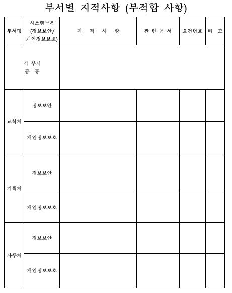

보안감사 결과보고서

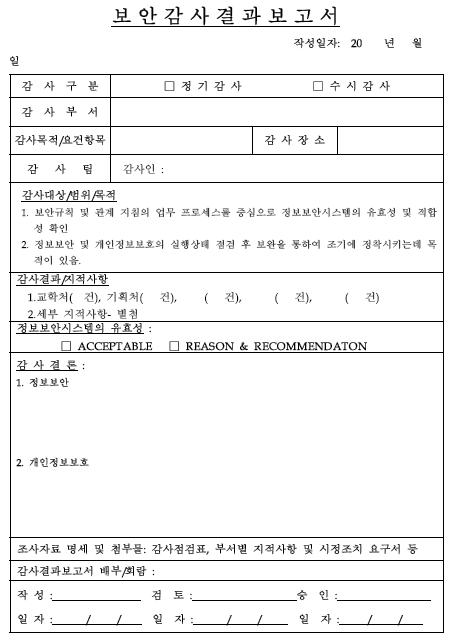

보안감사 시정조치 보고서

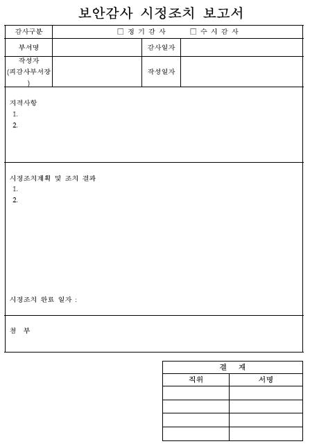

NCS학습모듈 개발이력
발행일 2015년 12월 31일
세분류명 보안엔지니어링(20010206)
개발기관 ㈜밸류원컨설팅, 한국직업능력개발원
발행일 2018년 12월 31일
학습모듈명 보안감사 수행(LM2001020609_16v3)
개발기관 한국직업능력개발원
보안감사 수행(LM2001020609_16v3)
저작권자 교육부
연구기관 한국직업능력개발원
발행일 2018. 12. 31.
※ 이 학습모듈은 자격기본법 시행령(제8조 국가직무능력표준의 활용)에 의거하여
개발하였으며,NCS통합포털사이트(http://www.ncs.go.kr)에서 다운로드 할 수 있습니다.

