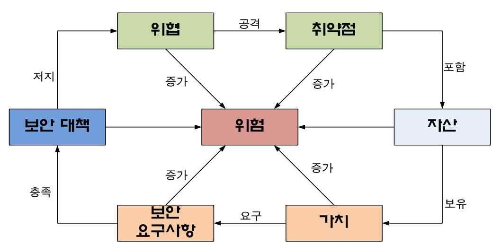
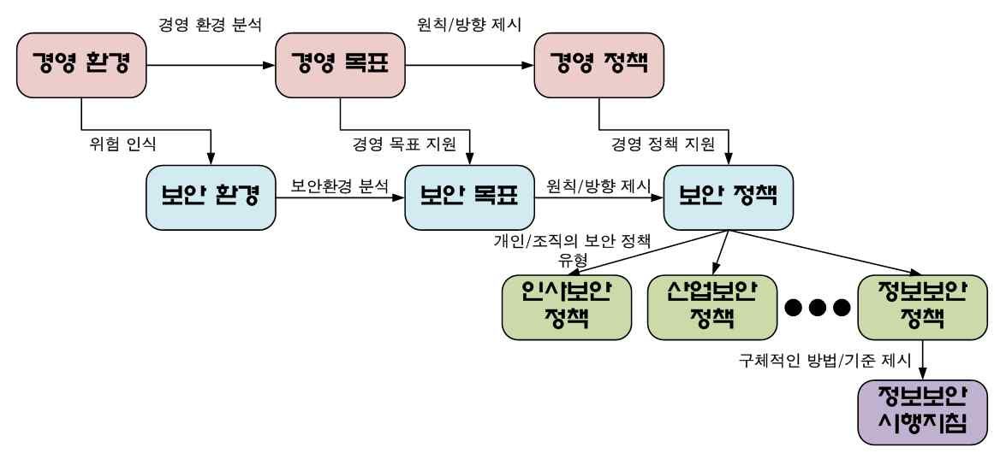
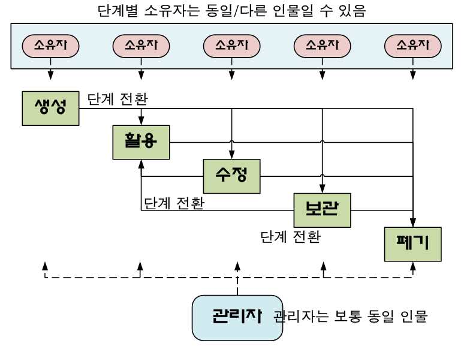
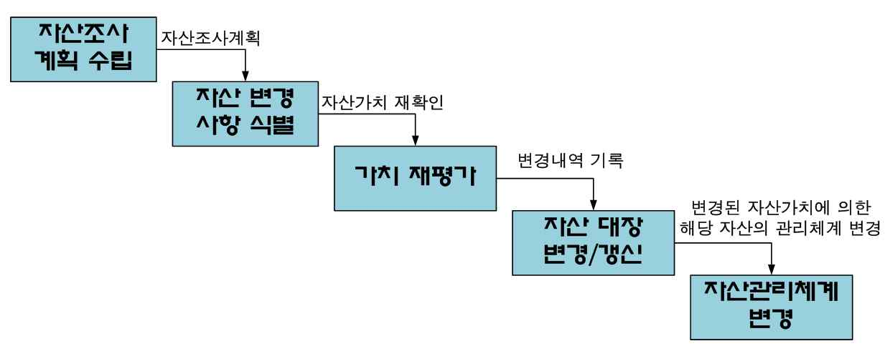
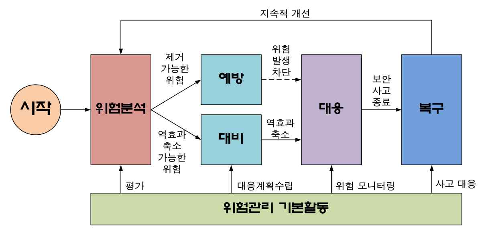
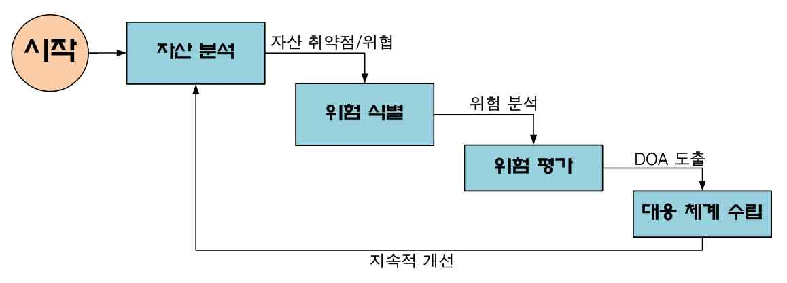
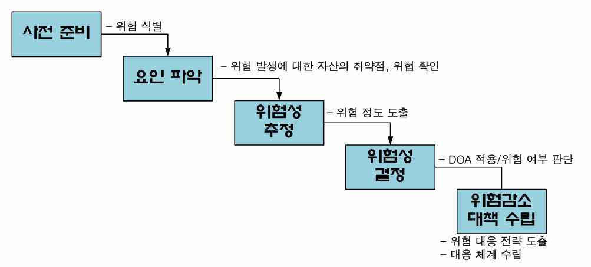
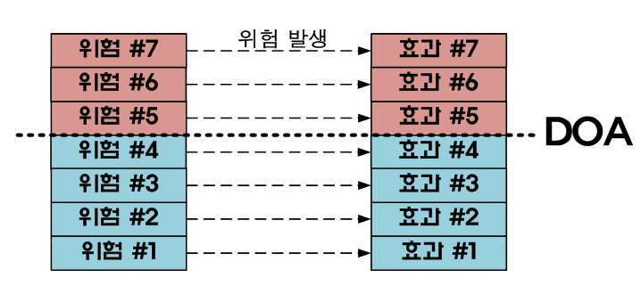

# LM2001020602_보안위험평가

대분류/20
정보통신 중분류/01
정보기술 소분류/02

정보기술개발 세분류/06
보안엔지니어링 능력단위/02

NCS학습모듈
보안위험 평가

LM2001020602_16v3

[NCS-학습모듈의 위치]

| 정보통신 |  |  |
| --- | --- | --- |
|  | 정보기술 |  |
|  |  | 정보기술개발 |

대분류
중분류
소분류
세분류

| SW아키텍처 |  |  | 능력단위 | 학습모듈명 |
| --- | --- | --- | --- | --- |
| 응용SW 엔지니어링 |  |  | 보안계획 수립 | 보안계획 수립 |
| 임베디드SW 엔지니어링 |  |  | 보안위험 평가 | 보안위험 평가 |
| DB엔지니어링 |  |  | 보안요구사항 정의 | 보안요구사항 정의 |
| NW엔지니어링 |  |  | 관리적 보안 구축 | 관리적 보안 구축 |
| 보안엔지니어링 |  |  | 물리적 보안 구축 | 물리적 보안 구축 |
| UI/UX엔지니어링 |  |  | 소프트웨어 개발 보안 구축 | 소프트웨어 개발 보안 구축 |
| 시스템SW 엔지니어링 |  |  | 데이터베이스 보안 구축 | 데이터베이스 보안 구축 |
| 빅데이터 플랫폼구축 |  |  | 시스템 보안 구축 | 시스템 보안 구축 |
| 핀테크 엔지니어링 |  |  | 네트워크 보안 구축 | 네트워크 보안 구축 |
| 데이터아키텍트 |  |  | 보안체계 운영관리 | 보안체계 운영관리 |
|  |  |  | 보안위협 관리통제 | 보안위협 관리통제 |
|  |  |  | 보안감사 수행 | 보안감사 수행 |
|  |  |  | 보안인증 관리 | 보안인증 관리 |

차 례
학습모듈의 개요 1
학습 1. 자산 식별하기
• 1-1. 정보자산 식별준비 3
• 1-2. 정보자산 식별 10
• 교수・학습 방법 18
• 평가 20
학습 2. 자산 분석하기
• 2-1. 정보자산 평가 22
• 2-2. 정보자산 취급 절차 수립 31
• 교수・학습 방법 36
• 평가 38
학습 3. 위험 분석하기
• 3-1. 위험관리 절차 수립 40
• 3-2. 정보자산에 대한 위험 식별 47
• 3-3. 정보자산에 대한 위험 분석 52
• 교수・학습 방법 58
• 평가 60
학습 4. 위험평가하기
• 4-1. 정보자산 위험평가 62
• 4-2. 정보자산의 위험 대응 방안 수립 68
• 교수・학습 방법 76
• 평가 78
참고 자료 80
활용 서식 81
보안위험평가 학습모듈의 개요
학습모듈의 목표
보호하여야 할 자산을 식별, 분석하고 내재된 취약성을 도출하여 자산에 대한 위협의 종류와
영향을 분석, 평가함으로써 위험의 정도를 산정할 수 있다.
선수학습
자산관리, 보안요구사항 정의(2001020603_14v2), 보안체계 운영관리(2001020607_14v2), 보안위협
관리통제(2001020608_14v2)
학습모듈의 내용체계

| 학습 | 학습 내용 | NCS 능력단위 요소 |  |
| --- | --- | --- | --- |
|  |  | 코드번호 | 요소명칭 |

1-1. 정보자산 식별준비
1. 자산 식별하기 2001020602_16v3.1 자산 식별하기
1-2. 정보자산 식별
2-1. 정보자산 평가
2. 자산 분석하기 2001020602_16v3.2 자산 분석하기
2-2. 정보자산 취급 절차 수립
3-1. 위험관리 절차 수립
3. 위험 분석하기 3-2. 정보자산에 대한 위험 식별 2001020602_16v3.3 위험 분석하기
3-3. 정보자산에 대한 위험 분석
4-1. 정보자산 위험평가
4. 위험평가하기 2001020602_16v3.4 위험평가하기
4-2. 정보자산의 위험 대응 방안
수립
핵심 용어
정보자산 식별, 위험관리 절차, 자산 분석, 위험평가, DOA(DOA: degree of assurance), 위험 식별
방법, 위험 분석

| 학습 1 | 자산 식별하기 |
| --- | --- |

학습 2 자산 분석하기
학습 3 위험 분석하기
학습 4 위험평가하기
1-1.
정보자산 식별준비
Ÿ 보안위험관리를 위해 보호해야할 조직 내 논리적, 물리적 정보자산의 범위를 파악
하여 정의할 수 있다.
학습 목표
Ÿ 정의된 조직 내 논리적, 물리적 정보자산의 범위에 따라 보호해야할 정보자산의 식
별 기준을 정의할 수 있다.
필요 지식 /
• 위험의 개념
1. 위험의 정의
(1) 특정 사건에 의하여 원하지 않는 손실이나 부정적인 영향이 자산에 미칠 가능성
(2) 예상 여부와 상관없이 특정 행위에 의해 자산에 발생할 가능성이 있는 손실의 기대치
2. 위험의 구성요소
<표 1-1> 위험의 구성요소
구성요소 구성요소 설명
- 개인/조직이 보호해야 할 유무형의 가치
자산
- 보안 관점에서는 자산에 대한 보안요구사항 도출 필요
- 자산에 손실이나 부정적인 영향을 미칠 수 있는 잠재적 원인
위협
- 인위적, 우발적인 위협이 존재
- 자산이 가지고 있는 잠재적인 약점
취약성
- 자산이 표현하고 있는 약점의 노출 정도나 부정적인 효과로 표현
3. 위험 구성요소 간 관계
(1) 자산은 그 자체적인 가치와 함께 기본적으로 취약점을 포함
(2) 위험은 자산의 취약점을 바탕으로 위협에 의해 발생
(3) 자산의 가치에 의해 보안요구사항이 발생, 이를 바탕으로 보안 대책 수립
(4) 보안 대책은 위협을 저지/방어/차단

[그림 1-1] 위험 구성요소간 관계
• 보안위험관리 목적(보안 목표)의 종속성
1. 보안 목표는 자산의 취약점을 보완하고 위협을 최소화하기 위한 목적(goal)을 의미하며, 개
인/조직의 환경에 종속되며 그 자체적으로는 존속할 수 없음
2. 그러므로 보안 목표는 개인/조직의 환경을 바탕으로 제시되기 때문에 경영 환경에서부터
시작하여 보안 환경으로 까지 확장/연결 됨

[그림 1-2] 보안위험관리 목적(보안 목표)의 종속성
• 정보자산의 식별 기준
1. 정보자산 식별 및 목록화의 필요성
개인/조직에서 활용되고 있는 정보자산의 범위를 명확히 규정하여, 인가되지 않은 정보의
유출 및 불필요한 정보의 생성을 차단하고 관리의 용이성을 확보하기 위함
2. 정보자산의 식별 기준
정보자산을 식별하기 위해서는 다음의 특성 만족 필요
<표 1-2> 정보자산의 식별 기준
요구 특성 내용
인식성 사람/기계를 통해 물리적으로나 논리적으로 인식될 수 있어야 함
생명주기 정보자산은 특정 인력/기기에 의해 생성되고 활용, 저장, 소멸 가능
활용성 생성/저장된 정보자산은 사용자/관리자에 의해 활용
가치 정보자산은 그 자체적으로 특정 의미를 표현하거나 가치를 내재
수행 내용 / 정보자산 식별 준비하기
재료·자료
Ÿ 자산대장 템플릿
Ÿ 조직의 정보보호 정책/정보보호 시행 지침 등의 보안 내규
Ÿ 정보통신망 이용촉진 및 정보보호 등에 관한 법률 조문
Ÿ ISO27001: 2013 통제 항목
Ÿ 정보보호관리체계(ISMS) 세부 점검 항목
기기(장비･공구)
Ÿ 컴퓨터, 프린터, 복사기 등
Ÿ 문서 작성 도구, E-mail 발송 시스템, 프레젠테이션 도구
안전･유의사항
Ÿ 조직의 업무 특성에 따라 정보보안 목표를 기술한 위치는 상이할 수 있다.
Ÿ 조직의 규모 및 업무 특성에 따라 해당 조직의 정보자산의 범위는 상이할 수 있다.
Ÿ 정보자산을 식별할 때에는 전체 업무를 확인하고 해당 업무에서 사용되는 상세 정보자산을
확인하는 순서로 진행해야 한다.
Ÿ 정보자산의 형태는 논리적/관리적인 형태뿐만 아니라 지식과 경험을 포함한다.
Ÿ 정보자산의 식별 기준은 정보자산 식별을 수행하는 담당자의 지식과 경험에 의해 상이한 기준
이 수립될 수 있다.
Ÿ 정보자산의 식별 기준은 해당 자산의 특성에 따라 복수의 기준이 적용될 수 있다.
Ÿ 정보자산의 범위는 조직 내부 범위뿐만 아니라 외부에서 전달/제공되는 정보를 포함한다.
수행 순서
• 보안위험관리를 위해 보호해야할 조직 내 논리적, 물리적 정보자산의 범위를 파악하여 정
의한다.
1. 보안위험관리를 위한 목적을 조사한다.
(1) 조직의 경영 목표에서 보안 관리를 위한 목적을 조사한다.
(2) 경영 목표에 보안위험관리를 위한 목적이 없을 경우 조직의 경영 전략에서 보안위험
관리 목적을 조사한다.

[그림 1-3] 경영 목표 사례
(3) 정보보호 정책에서 구체적인 보안위험관리 목적을 조사한다.

[그림 1-4] 정보보호 정책의 보안위험관리 목적 조사 사례
2. 조사된 보안위험관리 목적에 따라 정보자산의 범위를 파악하여 정의한다.
(1) 논리적 정보자산의 범위를 파악하여 정의한다.
(가) 조사된 보안위험관리 목적에 해당하는 조직의 업무 영역을 도출한다.
(나) 도출된 업무 영역에서 수행되는 업무 종류를 명세한다.
(다) 명세된 업무 종류의 업무 프로세스를 조사한다.
(라) 조사된 업무 프로세스를 정보자산 범위로 정의한다.
<표 1-3> 논리적 정보자산의 범위 파악 사례
업무 영역 업무 종류 업무 프로세스
영업 영업 기획, 사업 발굴, 영업, 수주/매출
사업부
재무 영업 계약/행정 지원, 회계관리
총무 자산 식별/관리, 전사 업무 지원
지원
인사 인력 충원, 교육 관리, 복리후생 지원
개발 제품 개발 제품 개발
... ... ...
(2) 물리적 정보자산의 범위를 파악하여 정의한다.
(가) 조사된 보안위험관리 목적 달성을 지원하는 물리적인 자산을 도출한다.
(나) 도출된 물리적인 자산을 취급하는 업무 종류를 명세한다.
(다) 명세된 업무 종류에서, 해당 물리적인 자산이 사용되는 방법을 조사한다.
(라) 조사된 물리적 자산 및 사용 방법을 정보자산 범위로 정의한다.
<표 1-4> 물리적 정보자산의 범위 파악 사례
자산 구분 업무 종류 자산의 사용 방법
산출물 관리 업무상 필요한 각종 문서/이미지 등의 생성/관리
정보 저장 특정 정보의 저장
정보시스템
제품 개발 제품 개발 도구로 활용
소화 시설 화재 탐지/소화 자산 식별/관리, 전사 업무 지원
공조 시설 온습도 조절 주요 시설에 대한 온습도 자동 조절
... ... ...
• 정의된 조직 내 논리적, 물리적 정보자산의 범위에 따라 보호해야할 정보자산의 식별 기
준을 정의한다.
1. 조직 내 논리적 정보자산의 범위에 따라 보호해야할 정보자산의 식별 기준을 정의한다.
(1) 정의된 정보자산 범위에서 사용/처리되는 논리적 정보자산 유형을 조사한다.
(2) 조사된 정보자산의 논리적인 구성 및 형태를 확인한다.
(3) 확인된 정보자산의 논리적 구성 및 형태에서 해당 정보자산의 식별 기준을 정의한다.
<표 1-5> 논리적 정보자산의 식별 기준 정의 사례
업무 영역 업무 종류 ... 유형 구성/형태 식별 기준
영업 ... 전자문서 파일
사업부
재무 ... 전자문서 파일
이미지
총무 ... 파일
전자문서
지원 파일
인사 ... 전자문서 파일
이미지
개발 제품 개발 ... 전자문서 디렉토리/파일
오디오
... ... ... ... ...
2. 조직 내 물리적 정보자산의 범위에 따라 보호해야할 정보자산의 식별 기준을 정의한다.
(1) 정의된 정보자산 범위에서 취급되는 물리적 정보자산 유형을 조사한다.
(2) 조사된 정보자산의 물리적인 구성 상태를 확인한다.
(3) 확인된 정보자산의 물리적 구성형태에서 해당 정보자산의 식별 기준을 정의한다.
<표 1-6> 물리적 정보자산의 식별 기준 정의 사례
자산 구분 업무 종류 ... 유형 구성/형태 식별 기준
산출물 관리 ...
전자식
정보시스템 정보 저장 ... 전자기기
장치
제품 개발 ... 기기
소화 시설 화재 탐지/소화 ... 기계식/
건물 장착
전기식
장치
공조 시설 온습도 조절 ... 기기
... ... ... ... ... ...
수행 tip
Ÿ 조직의 특성에 따라 보안위험관리를 위한 목적은
경영/보안 목표나 전략, 정책 등 다양한 위치에 정
의될 수 있다.
Ÿ 정보자산의 식별 기준은 보통 담당자의 경험과
지식에 의해 직관적으로 수립된다.
1-2.
정보자산 식별
Ÿ 정의된 조직 내 정보자산의 식별 기준에 따라 보호해야할 논리적, 물리적 정보자산
의 식별할 수 있다.
Ÿ 식별된 조직 내 논리적, 물리적 정보자산을 유형별로 그룹화하여 보호해야할 정보
학습 목표
자산 목록을 작성할 수 있다.
Ÿ 유형별로 작성된 조직 내 논리적, 물리적 정보자산 목록에 따라 정보자산의 소유
자, 관리자를 식별할 수 있다.
필요 지식 /
• 정보자산 목록 구성
정보자산 목록에 포함되어야 할 필수 정보
<표 1-7> 정보자산 목록에 포함되어야 할 필수 정보
필수 정보 내용
유형 특정 형태나 활용, 가치 등으로 분류하기 위한 기준
자산명 자산에 대한 이름
소유자/관리자 자산을 사용하는 사용자나, 생성/보관/사용/소멸 등을 감독하는 관리자
식별자(코드) 자산을 인식하기 위한 유니크한 인덱스
• 정보자산의 기준 중복 처리
1. 정보자산의 식별을 위한 기준 적용 시, 다수의 기준이 동시에 적용될 수 있음
2. 이 경우, 중복 처리를 방지하기 위해 기준의 우선순위를 적용하여 식별 필요
<표 1-8> 정보자산의 기준 중복 처리 사례
업무 영역 업무 종류 ... 유형 구성/형태 식별 기준
파일
영업 ... 전자문서
디렉토리
사업부
파일
재무 ... 전자문서
디렉토리
파일
이미지 파일
총무 ... (관리 편의성을
전자문서 디렉토리
지원 위해 ‘파일’
파일
인사 ... 전자문서 기준 적용)
디렉토리
이미지, 오디
파일
개발 제품 개발 ... 오
디렉토리
전자문서
... ... ... ... ...
• 정보자산의 소유자 및 관리자
1. 정보자산은 항상 생성, 활용, 수정, 보관, 폐기의 생명주기를 가지는데, 각 과정별 소유자
는 다를 수 있으며, 해당 정보자산의 관리자는 해당 정보자산의 책임자를 의미
2. 다만, 조직/개인의 특성에 의해 소유자 및 관리자는 동일 인물 가능

[그림 1-5] 정보자산의 소유자 및 관리자 관계 사례
수행 내용 / 정보자산 식별하기
재료·자료
Ÿ 자산대장 템플릿
Ÿ 정보자산 범위 정의서
Ÿ 정보자산 식별 기준
Ÿ 조직의 정보보호 정책/정보보호 시행 지침 등의 보안 내규
Ÿ 정보통신망 이용촉진 및 정보보호 등에 관한 법률 조문
Ÿ ISO27001: 2013 통제 항목
Ÿ 정보보호관리체계(ISMS) 세부 점검 항목
기기(장비･공구)
Ÿ 컴퓨터, 프린터, 복사기 등
Ÿ 문서 작성 도구, E-mail 발송 시스템, 프레젠테이션 도구
안전･유의사항
Ÿ 정보자산의 식별 과정 중, 담당자의 판단에 따라 정보자산 식별 범위 및 기준은 변경될 수 있다.
Ÿ 정보자산의 식별 과정에서는 해당 정보자산 뿐만 아니라 연관/연속적인 정보자산을 식별하고
그 관계를 명확히 기술해야 한다.
Ÿ 정보자산의 식별 및 관리 식별자는 조직 내부에서 충분히 사용 가능한 수준으로 유니크하게
할당되어야 한다.
Ÿ 식별된 정보자산은 분류 기준에 따라 복수의 유형으로 분류될 수 있다.
Ÿ 복수의 그룹에 소속된 정보자산은, 업무 프로세스 및 보안 환경에 의해 단일 그룹으로 변경될
수 있다.
Ÿ 동출 정보자산이라 할지라도 업무 프로세스 및 보안 환경에 의해 소유자 및 관리자는 단일/복수로
지정될 수 있다.
수행 순서
• 정의된 조직 내 정보자산의 식별 기준에 따라 보호해야할 논리적, 물리적 정보자산의 식
별한다.
1. 정의된 조직 내 정보자산의 식별 기준에 따라 보호해야할 논리적 정보자산을 식별한다.
(1) 기도출된 조직의 전체 업무 프로세스에서 사용되는 논리적 정보자산 전체를 조사한다.
(가) 조직 전체 업무 프로세스를 확인한다.
(나) 각 업무 프로세스를 단계별로 구분한다.
(다) 구분된 단계별 단위업무에서 사용되는 정보자산을 조사한다.
(2) 정의된 조직 내 정보자산의 식별 기준에 해당하는 논리적 정보자산을 도출한다.
(가) 조사된 논리적 정보자산 전체에서 식별 기준에 해당하는 정보자산을 분류한다.
(나) 분류된 정보자산이 다른 식별 기준에 해당되지 않는지 검토한다.
<표 1-9> 논리적 정보자산의 식별 사례
업무 영역 ... 식별 기준 논리적 자산
영업 계약서
제안서
... 파일
POC 발표 자료
...
사업부
회계장부
... 파일 비용 처리 대장
...
소모품 관리 대장
... 파일 자산 대장
...
지원
인사 이력 카드
... 파일
...
제품 소스코드
제품 패키지
개발 ... 파일
설계 문서
...
... ...
2. 도출된 조직 내 정보자산의 식별 기준에 따라 보호해야할 물리적 정보자산을 식별한다.
(1) 기도출된 물리적 자산의 사용 절차가 적용되는 물리적 정보자산 전체를 조사한다.
(가) 조직에서 사용하는 전체 물리적 자산을 확인한다.
(나) 확인된 물리적 자산의 활용 과정과 해당 이해관계자를 조사한다.
(다) 각 과정 및 이해관계자에 따라 적용되는 물리적 정보자산을 조사한다.
(2) 정의된 조직 내 정보자산의 식별 기준에 해당하는 물리적 정보자산을 도출한다.
(가) 조사된 물리적 정보자산 전체에서 식별 기준에 해당하는 정보자산을 분류한다.
(나) 분류된 정보자산이 다른 식별 기준에 해당되지 않는지 검토한다.
<표 1-10> 물리적 정보자산의 식별 사례
자산 구분 업무 종류 ... 식별 기준 물리적 자산
산출물 관리 ... 기기 Rack 형 서버
정보 저장 ... 기기 대형 스토리지
정보시스템
PC
제품 개발 ... 기기 노트북
Rack 형 서버
소화기
소화 시설 화재 탐지/소화 ... 기기 스프링클러
화재 감지기
공조 시설 온습도 조절 ... 기기 공조기
... ... ... ... ...
• 식별된 조직 내 논리적, 물리적 정보자산을 유형별로 그룹화하여 보호해야할 정보자산 목
록을 작성한다.
1. 식별된 조직 내 논리적 정보자산을 유형별로 그룹화하여 보호해야할 정보자산 목록을
작성한다.
(1) 식별된 조직 내 논리적 정보자산의 유형을 설정한다.
(가) 논리적 정보자산의 공통 식별 기준을 도출한다.
(나) 도출된 공통 식별 기준에 해당하는 모든 논리적 자산을 식별한다.
(2) 설정된 정보자산 유형에 따라 식별된 논리적 정보자산을 그룹화(분류)한다.
(가) 논리적 정보자산의 그룹 주제를 선정한다.
(나) 전체 논리적 자산을 선정된 그룹 주제에 따라 분류한다.
(3) 설정된 정보자산의 유형에 따라 그룹화된 논리적 정보자산의 목록을 작성한다.
<표 1-11> 논리적 정보자산의 분류 사례
업무 영역 ... 식별 기준 논리적 자산 정보자산 분류(그룹)
영업 계약서
제안서
... 파일 영업
POC 발표 자료
...
사업부
회계장부
... 파일 비용 처리 대장 재무
...
소모품 관리 대장
... 파일 자산 대장 총무
...
지원
인사 이력 카드
... 파일 인사
...
제품 소스코드
제품 패키지
개발 ... 파일 제품 개발
설계 문서
...
... ... ... ... ...
2. 식별된 조직 내 물리적 정보자산을 유형별로 그룹화하여 보호해야할 정보자산 목록을
작성한다.
(1) 식별된 조직 내 물리적 정보자산의 유형을 설정한다.
(가) 물리적 정보자산의 공통 식별 기준을 도출한다.
(나) 도출된 공통 식별 기준에 해당하는 모든 물리적 자산을 식별한다.
(2) 설정된 정보자산 유형에 따라 식별된 물리적 정보자산을 그룹화(분류)한다.
(가) 물리적 정보자산의 그룹 주제를 선정한다.
(나) 전체 물리적 자산을 선정된 그룹 주제에 따라 분류한다.
(3) 설정된 정보자산의 유형에 따라 그룹화된 물리적 정보자산의 목록을 작성한다.
<표 1-12> 물리적 정보자산의 분류 사례
자산 구분 ... 식별 기준 물리적 자산 업무 종류
... 기기 Rack 형 서버 산출물 관리
정보시스템
... 기기 대형 스토리지 정보 저장
... 기기 PC 제품 개발
노트북
Rack 형 서버
소화기
소화 시설 ... 기기 스프링클러 화재 탐지/소화
화재 감지기
공조 시설 ... 기기 공조기 온습도 조절
... ... ... ...
• 유형별로 작성된 조직 내 논리적, 물리적 정보자산 목록에 따라 정보자산의 소유자, 관리
자를 식별한다.
1. 유형별로 작성된 조직 내 논리적 정보자산 목록에 따라 정보자산의 소유자, 관리자를
식별한다.
(1) 기조사된 논리적 정보자산의 업무 프로세스를 확인한다.
(2) 확인된 업무 프로세스에서 각 과정별 해당 논리적 정보자산의 소유자를 식별한다.
(3) 확인된 업무 프로세스가 종료된 경우에 해당 논리적 정보자산의 관리자를 식별한다.
<표 1-13> 논리적 정보자산의 소유자, 관리자 식별 사례
정보자산
업무 영역 ... 논리적 자산 소유자 관리자
분류
영업 계약서
제안서 전 단계 영업총괄
... 영업
POC 발표 자료 영업 직원 책임자
...
사업부
- 생성/활용/수정 :
회계장부
재무팀원 경영지원
... 비용 처리 대장 재무
- 보관/폐기 : 책임자
...
경영지원 책임자
- 생성/활용/수정/
소모품 관리 대장
보관 : 총무팀원
... 자산 대장 총무 총무팀장
- 폐기 :
...
총무팀장
지원
- 생성/활용/수정/
인사 이력 카드 보관 : 인사팀원 경영기획
... 인사
... - 폐기 : 본부장
인사팀장
제품 소스코드 제품 - 생성/활용/수정/
개발 ... 연구소장
제품 패키지 개발 보관 : 개발 직원
설계 문서 - 폐기 : N/A
... (폐기불가)
... ... ... ... ... ...
2. 유형별로 작성된 조직 내 물리적 정보자산 목록에 따라 정보자산의 소유자, 관리자를
식별한다.
(1) 기 조사된 물리적 식별 자산의 업무 프로세스를 확인한다.
(2) 확인된 업무 프로세스에서 각 과정별 해당 물리적 정보자산의 소유자를 식별한다.
(3) 확인된 업무 프로세스가 종료된 경우, 해당 물리적 정보자산의 관리자를 식별한다.
<표 1-14> 물리적 정보자산의 소유자, 관리자 식별 사례
자산 구분 ... 물리적 자산 업무 프로세스 소유자 관리자
도입, 운영, 보 - 전 단계
... Rack 형 서버 연구소장
관, 폐기 개발 직원
- 도입 : 총무팀
- 운영 : 운영팀원
도입, 운영, 보 경영지원
... 대형 스토리지 - 보관 : 총무팀
관, 폐기 책임자
- 폐기 :
정보시스템 총무팀장
- 도입 : 총무팀
- 사용 : 임직원
PC
도입, 사용, 보 전체 경영지원
... 노트북
관, 폐기 - 보관 : 총무팀 책임자
Rack 형 서버
- 폐기 :
총무팀장
소화기
구축, 활용, 점검, - 전 단계 경영지원
소화 시설 ... 스프링클러
폐기 및 교체 총무팀 책임자
화재 감지기
도입, 사용, 폐 - 전 단계 경영지원
공조 시설 ... 공조기
기 및 교체 총무팀 책임자
... ... ... ... ... ...
수행 tip
Ÿ 정보자산의 식별은 정보보호/보안 관점에서 가장
중요한 단계이며, 반복 수행 및 검증으로 수차례
수행되어야만 신뢰도 높은 정보자산 목록을 생성
할 수 있다.

| 학습 1 | 교수·학습 방법 |
| --- | --- |

교수 방법
• 위험에 대한 개념을 생활 상식을 바탕으로 구체적인 예를 제시한다.
• 논리적 정보자산 식별을 위한 범위 설정 사례를 구체적으로 설명한다.
• 물리적 정보자산 식별을 위한 범위 설정 사례를 구체적으로 설명한다.
• 논리적 정보자산의 식별 기준에 대한 사례를 구체적으로 설명한다.
• 물리적 정보자산의 식별 기준에 대한 사례를 구체적으로 설명한다.
• 정보보안 목표의 종속성을 상세히 설명한다.
• 보안 구성요간 전체 관계에 대해 사례를 제시한다.
• 정보자산 목록의 구성 사례를 제시한다.
• 정보자산에 대한 복수 기준이 적용되는 사례를 제시한다.
• 정보자산의 소유자의 변경/전환 사례를 제시한다.
• 정보자산의 복수 관리자 사례를 제시한다.
학습 방법
• 위험에 대한 개념을 정확히 이해한다.
• 논리적 정보자산 식별을 위한 범위 설정 사례를 조사한다.
• 물리적 정보자산 식별을 위한 범위 설정 사례를 조사한다.
• 논리적 정보자산의 식별 기준에 대한 사례를 조사한다.
• 물리적 정보자산의 식별 기준에 대한 사례를 조사한다.
• 정보보안 목표의 종속성을 정확히 이해한다.
• 보안 구성요간 전체 관계에 대해 사례를 조사한다.
• 정보자산 목록의 구성 사례를 조사한다.
• 정보자산에 대한 복수 기준이 적용되는 사례를 조사한다.
• 정보자산의 소유자의 변경/전환 사례를 조사한다.
• 정보자산의 복수 관리자 사례를 조사한다.

| 학습 1 | 평 가 |
| --- | --- |

평가 준거
• 평가자는 학습자가 수행 준거 및 평가 시 고려사항에 제시되어 있는 내용을 성공적으로 수행하였
는지를 평가해야 한다.
• 평가자는 다음사항을 평가한다.

| 학습 내용 | 평가 항목 | 성취 수준 |  |  |
| --- | --- | --- | --- | --- |
|  |  | 상 | 중 | 하 |

- 보안위험관리를 위해 보호해야할 조직 내 논리적, 물
리적 정보자산의 범위를 파악하여 정의할 수 있다.
정보자산
식별준비
- 정의된 조직 내 논리적, 물리적 정보자산의 범위에
따라 보호해야할 정보자산의 식별 기준을 정의할 수
있다.
- 정의된 조직 내 정보자산의 식별 기준에 따라 보호
해야할 논리적, 물리적 정보자산의 식별할 수 있다.
- 식별된 조직 내 논리적, 물리적 정보자산을 유형별
로 그룹화하여 보호해야할 정보자산 목록을 작성할
정보자산 식별
수 있다.
- 유형별로 작성된 조직 내 논리적, 물리적 정보자산
목록에 따라 정보자산의 소유자, 관리자를 식별할
수 있다.
평가 방법
• 사례연구

| 학습 내용 | 평가 항목 | 성취 수준 |  |  |
| --- | --- | --- | --- | --- |
|  |  | 상 | 중 | 하 |

- 조직 내 논리적, 물리적 정보자산의 범위 정의 사례
정보자산
식별준비
- 정보자산의 식별 기준 정의 사례
• 서술형 시험

| 학습 내용 | 평가 항목 | 성취 수준 |  |  |
| --- | --- | --- | --- | --- |
|  |  | 상 | 중 | 하 |

| 정보자산 식별 • 구두 발표 정보자산 식별 피 드 백 | - 논리적, 물리적 정보자산 식별 절차 - 정보자산 목록 구성 요소 - 정보자산의 소유자, 관리자 식별 방법 - 논리적, 물리적 정보자산 식별 사례 - 정보자산 목록 - 정보자산의 소유자, 관리자 식별 사례 |  |  |  |
| --- | --- | --- | --- | --- |
| 1. 사례연구 - ‘정보자산류 및 미흡한 | 있는지’학습 내용에 관련된 사례를 조사/분석시켜 도출된점을 지적하고 보완 설명한다. | 산출물에 | 대하여, | 오 |
| 2. 서술형 시험- ‘정보자산대해 오류 및 | 식별’학습 내용 중, 학습 내용에 대한 서술형 문제를 제시하고,미흡한 점을 지적하고 보완 설명한다. |  | 해당 | 답안에 |
| 3. 구두 발표 - ‘정보자산접근 절차에 | 식별’학습 내용 중, 동일/유사 사례를 조사/발표 한 후 발표대한 오류 및 미흡한 점을 지적하고 보완 설명한다. | 내용의 | 방향 | 및 |

| 학습 내용 | 평가 항목 | 성취 수준 |  |  |
| --- | --- | --- | --- | --- |
|  |  | 상 | 중 | 하 |

| 정보자산 식별 피 드 백 | - 논리적, 물리적 정보자산 식별 사례 - 정보자산 목록 - 정보자산의 소유자, 관리자 식별 사례 |  |  |  |
| --- | --- | --- | --- | --- |
| 1. 사례연구 - ‘정보자산류 및 미흡한 | 있는지’학습 내용에 관련된 사례를 조사/분석시켜 도출된점을 지적하고 보완 설명한다. | 산출물에 | 대하여, | 오 |
| 2. 서술형 시험- ‘정보자산대해 오류 및 | 식별’학습 내용 중, 학습 내용에 대한 서술형 문제를 제시하고,미흡한 점을 지적하고 보완 설명한다. |  | 해당 | 답안에 |
| 3. 구두 발표 - ‘정보자산접근 절차에 | 식별’학습 내용 중, 동일/유사 사례를 조사/발표 한 후 발표대한 오류 및 미흡한 점을 지적하고 보완 설명한다. | 내용의 | 방향 | 및 |

학습 1 자산 식별하기

| 학습 2 | 자산 분석하기 |
| --- | --- |

학습 3 위험 분석하기
학습 4 위험평가하기
2-1.
정보자산 평가
Ÿ 식별된 논리적, 물리적 정보자산에 대하여 기밀성, 무결성, 가용성, 준거성에 따라
정보자산의 평가 기준을 정의할 수 있다.
학습 목표
Ÿ 정의된 정보자산의 평가 기준에 따라 논리적, 물리적 정보자산의 분석을 위한 정보
자산의 보안 등급을 정의할 수 있다.
필요 지식 /
• 정보자산의 평가 원칙
1. 정보자산 평가 목적
(1) 조직/개인이 소유한 자산의 중요도를 산출하여 소유한 자산의 우선순위를 도출
(2) 보유한 자산이 가지고 있는 가치를 판단하기 위함
(3) 자산의 가치 평가는 잠재적 손실 규모와 자산의
2. 정보자산의 평가 기준
정보자산에 대한 정보보호 요구사항인 기밀성(confidentiality), 무결성, (integrity), 가용성
(availability) 등을 고려하여 자산의 중요도를 평가
<표 2-1> 정보자산 평가 기준
펑가 기준 설명
- 자산이 가지고 있는 정보의 노출에 대한 중요 정도
기밀성
- 해당 자산이 외부에 유출되었을 때 발생되는 손실 정도
- 자산이 가지고 있는 정보의 신뢰에 대한 중요 정도
무결성 - 해당 자산이 인가되지 않은 상태에서 변경이 일어났을 때 발생되는 손실
정도

| 학습 내용 | 평가 항목 | 성취 수준 |  |  |
| --- | --- | --- | --- | --- |
| 가용성 준거성 | - 자산 자체의 활용에 대한 중요 정도 - 해당 자산이 멸실되거나 심각한 상태로 훼손되어 사용할되는 손실 정도 - 자산이 법적/사회적 요구사항을 준수하는 정도 - 해당 자산이 법적/사회적 요구사항을 준수하지 않을이미지 실추 등에 의한 손실 정도 | 수때 | 없을발생하는 | 때 발생처벌 및 |
| 3. 정보자산의 평가 | 방법 |  |  |  |
| (1) 정보자산 평가 | 원칙 |  |  |  |
| (가) 자산의 | 가치등급은 자산 소유자와 관리자의 의견을 반영하여 | 중요도를 | 평가 |  |
| (나) 일반적으로 | 자산의 정보보호 요구사항과 자산의 기여도 반영 |  |  |  |
| (2) 정보자산의 | 가치등급 산정 공식 |  |  |  |
| (가) 자산의 | 보안요구사항에 대한 기여도 정도를 산출하는 방법을 | 가장 많이 | 활용 |  |
| (나) 조직/개인의[그림 2-1] | 특성이나 자산 가치 평가 수행자에 따라 다른 공식정보자산의 가치등급 산정 공식 | 적용 | 가능 |  |
| (3) 자산 가치 | 평가 특징 |  |  |  |
| (가) 자산의 | 가치 평가는 주기적(년 1회 등)으로 수행 |  |  |  |
| (나) 동일 있음 | 자산이라 할지라도 중요도 평가는 조직의 운영 환경 등에 | 따라 | 달라질 | 수 |
| (다) 자산의택 필요 | 중요도 평가는 해당 자산의 모든 이해관계자가 합의할 | 수 있는 | 방법을 | 채 |

수행 내용 / 정보자산 평가하기
재료·자료
Ÿ 정보자산 식별 기준
Ÿ 정보자산 목록
Ÿ 조직의 정보보호 정책/정보보호 시행 지침 등의 보안 내규
Ÿ 정보통신망 이용촉진 및 정보보호 등에 관한 법률 조문
Ÿ ISO27001: 2013 통제 항목
Ÿ 정보보호관리체계(ISMS) 세부 점검 항목
기기(장비･공구)
Ÿ 컴퓨터, 프린터, 복사기 등
Ÿ 문서 작성 도구, E-mail 발송 시스템, 프레젠테이션 도구
안전･유의사항
Ÿ 정보자산의 평가 기준은 담당자의 판단에 따라 상이하게 설정될 수 있다.
Ÿ 동일 정보자산이라 할지라도 담당자의 지식/경험의 차이에 의해 다른 보안 등급이 설정 될 수
있다.
Ÿ 조직의 규모 및 업무 특성/분야에 따라 동일/유사 정보자산이라 할지라도 평가 기준이 적용될
수 있다.
Ÿ 정보자산의 가치등급 산정 공식은 조직의 특성 및 담당자의 지식/경험에 의해 다른 공식이 적용될
수 있다.
Ÿ 정보자산의 가치평가는 주기적으로 수행되어야 하며, 해당 자산의 이해관계자 합의가 요구된다.
수행 순서
• 식별된 논리적, 물리적 정보자산에 대하여 기밀성, 무결성, 가용성, 준거성에 따라 정보자
산의 평가 기준을 정의한다.
1. 식별된 논리적 정보자산에 대하여 기밀성, 무결성, 가용성, 준거성에 따라 정보자산의
평가 기준을 정의한다.
(1) 식별된 논리적 정보자산에 대한 업무 프로세스를 확인하여 해당 정보자산에 대한 보
안요구사항을 도출한다.
(가) 식별된 논리적 정보자산의 업무 프로세스를 재확인한다.
(나) 해당 업무 프로세스상에서 식별된 논리적 정보자산의 위협을 도출한다.
(다) 도출된 위협에 해당하는 업무 프로세스상의 보안 취약점을 도출한다.
<표 2-2> 논리적 정보자산에 대한 보안요구사항 도출 사례
업무
업무 프로세스 논리적 자산 위협 취약점
분야
- 정보의 유출에 의한 악용
영업 비인가자 접
- 계약 정보의 임의 변경에
계약서 근 및 변경
의한 손실 발생
- 영업 기획
- 제안서 유실에 의한 적시 관리
- 사업 발굴 제안서
사업부 제안 실패 부실/부재
- 영업
- 수주/매출
POC 자료 - 영업 전략 유출 비인가자 접근
... ... ...
담당자의 법
회계 - 법적 요구사항 미준수에
적 요구사항
- 영업 계약/
장부 의한 처벌
무지
지원 행정 지원
- 회계관리
비용 처리 - 비용 처리의 임의 변경에
비인가자 변경
대장 의한 악용
... ... ... ... ...
(2) 도출된 정보자산에 대한 보안요구사항을 바탕으로 해당 정보자산의 평가 기준을 정
의한다.
(가) 식별된 논리적 정보자산에 대하여 기밀성에 따라 정보자산의 평가 기준을 정의한다.
(나) 식별된 논리적 정보자산에 대하여 무결성에 따라 정보자산의 평가 기준을 정의한다.
(다) 식별된 논리적 정보자산에 대하여 가용성에 따라 정보자산의 평가 기준을 정의한다.
(라) 식별된 논리적 정보자산에 대하여 준거성에 따라 정보자산의 평가 기준을 정의한다.
<표 2-3> 논리적 정보자산에 대한 평가 기준 정의 사례
기밀성 무결성 가용성 준거성
논리적 자산 ...
평가 기준 평가 기준 평가 기준 평가 기준
영업 계약서 ...
제안서 ...
POC 발표 자료 ... 1~5등급 분 2등급 분류 2등급 분류 2등급 분류
류(1등급 : (무결정 보 (가용성 보 (준거성 확
... ... 매우 중요) 장 여부) 장 여부) 보 여부)
회계장부 ...
비용 처리 대장 ...
... ... ... ... ... ...
2. 식별된 물리적 정보자산에 대하여 기밀성, 무결성, 가용성, 준거성에 따라 정보자산의
평가 기준을 정의한다.
(1) 식별된 물리적 정보자산의 사용절차를 확인하여 해당 정보자산에 대한 보안요구사항
을 도출한다.
(가) 식별된 물리적 정보자산의 사용 절차를 재확인한다.
(나) 해당 사용절차 상에서 식별된 물리적 정보자산의 위협을 도출한다.
(다) 도출된 위협에 해당하는 업무 프로세스상의 보안 취약점을 도출한다.
<표 2-4> 물리적 정보자산에 대한 보안요구사항 도출 사례
자산 구분 물리적 자산 업무 프로세스 위협 취약점
도입, 운영, 보 인위적/우발적 장 장비 노후화/
Rack 형 서버
관, 폐기 비 고장 발생 불량
정보시스템
도입, 운영, 보 수명 도달에 의한 장비 노후화/
대형 스토리지
관, 폐기 장비 고장 발생 불량
PC
도입, 사용, 보 이동형 전자
노트북 분실에 의한 손실
관, 폐기 기기
Rack 형 서버
소화 시설 소화기 구축, 활용, 점검, 법적 요구사항 미 기기 고장
스프링클러 준수에 의한 처벌
폐기 및 교체
화재 감지기 발생 가능
도입, 사용, 폐 인위적/우발적 장
공조 시설 공조기 기기 고장
기 및 교체 비 고장 발생
... ... ... ... ...
(2) 도출된 정보자산에 대한 보안요구사항을 바탕으로, 해당 정보자산의 평가 기준을 정
의한다.
(가) 식별된 물리적 정보자산에 대하여 기밀성에 따라 정보자산의 평가 기준을 정의한다.
(나) 식별된 물리적 정보자산에 대하여 무결성에 따라 정보자산의 평가 기준을 정의한다.
(다) 식별된 물리적 정보자산에 대하여 가용성에 따라 정보자산의 평가 기준을 정의한다.
(라) 식별된 물리적 정보자산에 대하여 준거성에 따라 정보자산의 평가 기준을 정의한다.
<표 2-5> 물리적 정보자산에 대한 평가 기준 정의 사례
기밀성 무결성 가용성 준거성
물리적 자산 ...
평가 기준 평가 기준 평가 기준 평가 기준
Rack 형 서버 ...
대형 스토리
...
지
PC 3등급 분류
2등급 분류 2등급 분류 2등급 분류
노트북 ... (1등급 : 가
(기밀성 보장 (무결정 보장 (준거성 확보
Rack 형 서버 용성 항상
여부) 여부) 여부)
소화기 확보)
스프링클러 ...
화재 감지기
공조기 ...
... ... ... ... ... ...
• 정의된 정보자산의 평가 기준에 따라 논리적, 물리적 정보자산의 분석을 위한 정보자산의
보안 등급을 정의한다.
1. 정의된 정보자산의 평가 기준에 따라 논리적 정보자산의 분석을 위한 정보자산의 보안
등급을 정의한다.
(1) 정의된 기밀성, 무결성, 가용성, 준거성 평가 기준에 따라, 각각의 보안 등급을 정의한다.
(가) 기밀성 평가 기준에 따라 보안 등급을 정의한다.
(나) 무결성 평가 기준에 따라 보안 등급을 정의한다.
(다) 가용성 평가 기준에 따라 보안 등급을 정의한다.
(라) 준거성 평가 기준에 따라, 보안 등급을 정의한다.
<표 2-6> 논리적 정보자산의 보안요구사항별 보안 등급 정의 사례
기밀성 무결성 가용성 준거성
논리적 자산 ...
보안 등급 보안 등급 보안 등급 보안 등급
영업 계약서 ... 2 1 1 0
제안서 ... 3 1 1 0
POC 발표 자료 ... 2 1 1 0
... ... ... ... ... ...
회계장부 ... 1 1 1 1
비용 처리 대장 ... 2 1 1 1
... ... ... ... ... ...
(2) 기밀성, 무결성, 가용성, 준거성 평가 기준을 통합하여, 적절한 보안 등급을 해당 정
보자산의 보안 등급으로 설정한다.
(가) 논리적 정보자산에 대한 전체 평가 기준을 통합한다.
(나) 통합된 전체 평가 기준을 통합하여, 적합한 보안 등급을 도출한다.
<표 2-7> 논리적 정보자산의 보안 등급 정의 사례
논리적 자산 위협 취약점 최종 보안 등급
- 정보의 유출에 의한 악용
비인가자 접근
영업 계약서 - 계약 정보의 임의 변경에 2
및 변경
의한 손실 발생
- 제안서 유실에 의한 적시 관리
제안서 3
제안 실패 부실/부재
POC 발표 자료 - 영업 전략 유출 비인가자 접근 2
... ... ... ...
- 법적 요구사항 미준수에 담당자의 법적
회계장부 1
의한 처벌 요구사항 무지
비용 처리 대 - 비용 처리의 임의 변경에
비인가자 변경 2
장 의한 악용
... ... ... ...
2. 정의된 정보자산의 평가 기준에 따라 물리적 정보자산의 분석을 위한 정보자산의 보안
등급을 정의한다.
(1) 정의된 기밀성, 무결성, 가용성, 준거성 평가 기준에 따라, 각각의 보안 등급을 정의한다.
(가) 기밀성 평가 기준에 따라 보안 등급을 정의한다.
(나) 무결성 평가 기준에 따라 보안 등급을 정의한다.
(다) 가용성 평가 기준에 따라 보안 등급을 정의한다.
(라) 준거성 평가 기준에 따라 보안 등급을 정의한다.
<표 2-8> 물리적 정보자산의 보안요구사항별 보안 등급 정의 사례
기밀성 무결성 가용성 준거성
물리적 자산 ...
평가 기준 평가 기준 평가 기준 평가 기준
Rack 형 서버 ... 1 1 1 0
대형 스토리지 ... 1 1 1 0
PC
노트북 ... 1 1 2 0
Rack 형 서버
소화기
스프링클러 ... 0 1 1 1
화재 감지기
공조기 ... 0 1 1 1
... ... ... ... ... ...
(2) 기밀성, 무결성, 가용성, 준거성 평가 기준에서 통합하여, 정보자산의 적절한 보안 등
급으로 도출한다.
(가) 물리적 정보자산에 대한 전체 평가 기준을 통합한다.
(나) 통합된 전체 평가 기준에서 가장 높은 보안 등급을 도출한다.
<표 2-9> 물리적 정보자산의 보안 등급 정의 사례
최종 평가
물리적 자산 위협 취약점
기준
Rack 형 서버 인위적/우발적 장비 고장 발생 장비 노후화/불량 1
수명 도달에 의한 장비 고장
대형 스토리지 장비 노후화/불량 1
발생
PC
노트북 분실에 의한 손실 이동형 전자기기 2
Rack 형 서버
소화기
법적 요구사항 미준수에 의한
스프링클러 기기 고장 1
처벌 발생 가능
화재 감지기
공조기 인위적/우발적 장비 고장 발생 기기 고장 1
... ... ... ...
2-2.
정보자산 취급 절차 수립
Ÿ 정의된 정보자산의 보안 등급에 따라 논리적, 물리적 정보자산에 대한 취급 절차를
학습 목표
정의할 수 있다.
필요 지식 /
• 정보자산의 취급 원칙
1. 식별되지 않은 정보자산은 관리되지 않으므로 반복 수행으로 모든 정보자산 식별
2. 자산의 중요도 평가 실시 후 도출된 중요도에 따라 개별 자산의 가치등급 부여
3. 자산의 가치등급에 따라, 차별화 된 정보 보안 정책 적용
4. 식별 및 중요도 평가가 완료된 정보자산은‘자산목록 관리대장’에 반영
5. 자산의 용도 변경이나 폐기, 이관 등에 의해 자산의 상태가 변경될 경우, 자산 가치에 대
한 재평가를 통해 가치등급의 재부여 필요
• 정보자산의 가치 변경 관리
1. 정보자산의 가치 변경 관리 필요성
식별된 정보자산의 가용성을 확보하고, 자산에 내재된 가치 확인을 통한 자산 관리체계의
적합성 및 효율성을 검증하기 위함
2. 정보자산의 가치 변경 관리 절차

[그림 2-2] 정보자산의 가치 변경 관리 절차
3. 정보자산의 변경 관리 주의사항
(1) 사용하지 않는 자산은 관련부서와 협의하여 처분하거나 재사용 고려
(2) 자산의 변경 혹은 폐기(처분) 사유가 발생하는 시점에서 자산 관리자는 즉시‘자산목
록 관리대장’에서 변경 혹은 삭제
(3) 자산 관리자는 자산의 폐기나 변경된 내역을 자산 소유자 통보 및 주기적인 변경사항
점검
(4) 조직에서 수립한 자산의 관리 정책의 개선을 위해 새로운 이슈를 지속적으로 확인
수행 내용 / 정보자산 취급 절차 수립하기
재료·자료
Ÿ 정보자산 식별 기준
Ÿ 정보자산 목록
Ÿ 정보자산의 평가 기준
Ÿ 전체 정보자산에 설정된 보안 등급
Ÿ 조직의 정보보호 정책/정보보호 시행 지침 등의 보안 내규
Ÿ 정보통신망 이용촉진 및 정보보호 등에 관한 법률 조문
Ÿ ISO27001: 2013 통제 항목
Ÿ 정보보호관리체계(ISMS) 세부 점검 항목
기기(장비･공구)
Ÿ 컴퓨터, 프린터, 복사기 등
Ÿ 문서 작성 도구, E-mail 발송 시스템, 프레젠테이션 도구
안전･유의사항
Ÿ 정보자산의 보안 등급에 따라 해당 자산의 취급 절차는 상이할 수 있다.
Ÿ 동일 보안 등급이라 할지라도 자산의 소유자 및 관리자에 따라 다른 취급 절차가 적용될 수
있다.
Ÿ 수립된 정보자산의 취급 절차는 이해관계자의 합의가 요구된다.
Ÿ 수립된 정보자산의 취급 절차는, 전사 경영을 지원해야 하며 과도한 보안 체계 적용을 지양해야
한다.
Ÿ 정보자산의 변경 주기는 정보자산의 생명주기에 따라 상이하다.
수행 순서
• 정의된 정보자산의 보안 등급에 따라 논리적, 물리적 정보자산에 대한 취급 절차를 정의한다.
1. 논리적 정보자산의 보안 등급에 따른 취급 절차를 정의한다.
(1) 논리적 정보자산의 보안 등급 전체 범위를 확인한다.
(2) 각 보안 등급에 해당하는 논리적 정보자산에서 요구되는 최우선 보안요구사항을 확
인한다.
(가) 기밀성, 무결성, 가용성, 준거성 평가 기준 중 가장 높은 보안 등급은 받은 항목
을 도출한다.
(나) 가장 높은 보안 등급을 받은 항목을 도출한다.
(다) 다수의 보안요구사항이 동일 수준이 요구될 경우, 이해관계자들 간의 협의를 통
해 가장 적합한 보안요구사항을 최우선 보안요구사항으로 선정한다.
<표 2-10> 논리적 정보자산의 최우선 보안요구사항 확인 사례
최우선
기밀성 무결성 가용성 준거성
논리적 자산 ... 보안
보안 등급 보안 등급 보안 등급 보안 등급
요구사항
영업 계약서 ... 2 1 1 0 무결성
제안서 ... 3 1 1 0 무결성
POC 발표 자료 ... 2 1 1 0 가용성
... ... ... ... ... ... ...
회계장부 ... 1 1 1 1 기밀성
비용 처리 대장 ... 2 1 1 1 준거성
... ... ... ... ... ... ...
(3) 각 보안 등급에 해당하는 논리적 정보자산의 보안 적용 방법을 정의한다.
(가) 최고 보안 등급에 요구되는 논리적 정보자산별 업무 프로세스, 소유자, 관리자를
확인한다.
(나) 해당 논리적 정보자산에 대한 업무 프로세스 중 기선정된 최우선 보안요구사항이
적용될 수 있는 과정을 도출한다.
(다) 도출된 최우선 보안요구사항이 적용될 수 있는 과정에 대한 보안 솔루션/기술을
선정한다.
(라) 선정된 보안 솔루션/기술을 적용한 해당 논리적 정보자산의 보안 적용 방법을 정
의한다.
<표 2-11> 논리적 정보자산에 대한 보안 적용 방법 정의 사례
최우선 적용
논리적 자산 ... 보안 적용 방법
보안요구사항 보안솔루션/기술
영업 계약서 ... 무결성 문서보안
정보자산의 생성, 조회, 변
제안서 ... 무결성 문서보안 경, 출력, 삭제 등에 대한 전
체 과정에 대한 권한 통제
POC 발표 자료 ... 가용성 문서보안
... ... ... ... ...
회계장부 관리 시스템의
회계장부 ... 기밀성 서버보안
Application 보안
비용 처리 서비스에 대해
비용 처리 대장 ... 준거성 PKI 기술 적용
PKI 인증서 기술 접목
. .
... ... ... ...
.
2. 물리적 정보자산의 보안 등급에 따른 취급 절차를 정의한다.
(1) 물리적 정보자산의 보안 등급 전체 범위를 확인한다.
(2) 각 보안 등급에 해당하는 물리적 정보자산에서 요구되는 최우선 보안요구사항을 확
인한다.
(가) 기밀성, 무결성, 가용성, 준거성 평가 기준 중 가장 높은 보안 등급은 받은 항목
을 도출한다.
(나) 가장 높은 보안 등급을 받은 항목을 도출한다.
(다) 다수의 보안요구사항이 동일 수준이 요구될 경우 이해관계자들 간의 협의를 통해
가장 적합한 보안요구사항을 최우선 보안요구사항으로 선정한다.
<표 2-12> 물리적 정보자산의 최우선 보안요구사항 확인 사례
기밀성 무결성 가용성 준거성
최우선
물리적 자산 ... 평가 평가 평가 평가
보안요구사항
기준 기준 기준 기준
Rack 형 서버 ... 1 1 1 0 가용성
대형 스토리지 ... 1 1 1 0 가용성
PC
노트북 ... 1 1 2 0 기밀성
Rack 형 서버
소화기
스프링클러 ... 0 1 1 1 준거성
화재 감지기
공조기 ... 0 1 1 1 무결성
... ... ... ... ... ... ...
(3) 각 보안 등급에 해당하는 물리적 정보자산의 보안 적용 방법을 정의한다.
(가) 최고 보안 등급에 요구되는 물리적 정보자산별 업무 프로세스, 소유자, 관리자를
확인한다.
(나) 해당 물리적 정보자산에 대한 업무 프로세스과정 중 기선정된 최우선 보안요구사
항이 적용될 수 있는 과정을 도출한다.
(다) 도출된 최우전 보안요구사항이 적용될 수 있는 과정에 대한 보안 솔루션/기술을
선정한다.
(라) 선정된 보안 솔루션/기술을 적용한 해당 물리적 정보자산의 보안 적용 방법을 정
의한다.
<표 2-13> 물리적 정보자산에 대한 보안 적용 방법 정의 사례
최우선 적용
물리적 자산 ... 보안 적용 방법
보안요구사항 보안솔루션/기술
Rack 형 서버 ... 가용성 정보시스템실
사용자 식별 및 인증,
보안 경비 서비
비인가자의 출입 통제
대형 스토리지 ... 가용성
스 적용
PC 사무실
사용자 식별 및 인증,
노트북 ... 기밀성 보안 경비 서비
비인가자의 출입 통제
Rack 형 서버 스 적용
소화기
스프링클러 ... 준거성 전문 업체 관리 일정 주기마다 해당
화재 감지기 용역 계약 시설 점검/갱신 확인
공조기 ... 무결성
... ... ... ... ...

| 학습 2 | 교수·학습 방법 |
| --- | --- |

교수 방법
• 논리적 정보자산의 기밀성 평가 기준에 대한 사례를 제시한다.
• 논리적 정보자산의 무결성 평가 기준에 대한 사례를 제시한다.
• 논리적 정보자산의 가용성 평가 기준에 대한 사례를 제시한다.
• 논리적 정보자산의 준거성 평가 기준에 대한 사례를 제시한다.
• 물리적 정보자산의 기밀성 평가 기준에 대한 사례를 제시한다.
• 물리적 정보자산의 무결성 평가 기준에 대한 사례를 제시한다.
• 물리적 정보자산의 가용성 평가 기준에 대한 사례를 제시한다.
• 물리적 정보자산의 준거성 평가 기준에 대한 사례를 제시한다.
• 논리적 정보자산의 평가 기준에 따라 보안 등급의 설정 사례를 제시한다.
• 물리적 정보자산의 평가 기준에 따라 보안 등급의 설정 사례를 제시한다.
• 논리적 정보자산에 따라 취급 절차의 수립 사례를 제시한다.
• 물리적 정보자산에 따라 취급 절차의 수립 사례를 제시한다.
학습 방법
• 논리적 정보자산의 기밀성 평가 기준을 이해한다.
• 논리적 정보자산의 무결성 평가 기준을 이해한다.
• 논리적 정보자산의 가용성 평가 기준을 이해한다.
• 논리적 정보자산의 준거성 평가 기준을 이해한다.
• 물리적 정보자산의 기밀성 평가 기준을 이해한다.
• 물리적 정보자산의 무결성 평가 기준을 이해한다.
• 물리적 정보자산의 가용성 평가 기준을 이해한다.
• 물리적 정보자산의 준거성 평가 기준을 이해한다.
• 논리적 정보자산의 평가 기준에 따라 보안 등급의 설정 사례를 조사한다.
• 물리적 정보자산의 평가 기준에 따라 보안 등급의 설정 사례를 조사한다.
• 논리적 정보자산에 따라 취급 절차의 수립 사례를 조사한다.
• 물리적 정보자산에 따라 취급 절차의 수립 사례를 조사한다.

| 학습 2 | 평 가 |
| --- | --- |

평가 준거
• 평가자는 학습자가 수행 준거 및 평가 시 고려사항에 제시되어 있는 내용을 성공적으로 수행하였
는지를 평가해야 한다.
• 평가자는 다음사항을 평가한다.

| 학습 내용 | 평가 항목 | 성취 수준 |  |  |
| --- | --- | --- | --- | --- |
|  |  | 상 | 중 | 하 |

- 식별된 논리적, 물리적 정보자산에 대하여 기밀성,
무결성, 가용성, 준거성에 따라 정보자산의 평가 기
준을 정의할 수 있다.
정보자산 평가
- 정의된 정보자산의 평가 기준에 따라 논리적, 물리
적 정보자산의 분석을 위한 정보자산의 보안 등급을
정의할 수 있다.
정보자산 취급 - 정의된 정보자산의 보안 등급에 따라 논리적, 물리
절차 수립 적 정보자산에 대한 취급 절차를 정의할 수 있다.
평가 방법
• 문제 해결 시나리오

| 학습 내용 | 평가 항목 | 성취 수준 |  |  |
| --- | --- | --- | --- | --- |
|  |  | 상 | 중 | 하 |

- 논리적, 물리적 정보자산에 대한 평가 기준 수립
정보자산 평가
- 정보자산의 보안 등급 정의
• 서술형 시험

| 학습 내용 | 평가 항목 | 성취 수준 |  |  |
| --- | --- | --- | --- | --- |
|  |  | 상 | 중 | 하 |

- 정보자산에 대한 기밀성, 무결성, 가용성, 준거성 평
가 기준 정의 절차
정보자산 평가
- 정보자산의 보안 등급 정의 원칙
• 구두 발표

| 학습 내용 | 평가 항목 | 성취 수준 |  |  |
| --- | --- | --- | --- | --- |
|  |  | 상 | 중 | 하 |

| 정보자산 취급절차 수립 피 드 백 | - 정보자산의 보안 등급에 따른 논리적, 물리적 정보자산에 대한 취급 절차 정의 사례 |  |  |  |
| --- | --- | --- | --- | --- |
| 1. 문제 해결 시나리오- ‘정보자산대해 오류 및 | 평가’학습 내용에 관련된 상황 제시 후 이에 대한 문제 해결미흡한 점을 지적하고 보완 설명한다. | 과정 | 및 | 결과에 |
| 2. 서술형 시험- ‘정보자산미흡한 점을 | 평가’학습 내용 중 학습 내용에 대한 문제를 제시하고, 해당지적하고 보완 설명한다. | 답안의 | 오류 | 및 |
| 3. 구두 발표 - ‘정보자산방향 및 접근 | 취급 절차 수립’학습 내용에 연관된 사례를 조사/발표 한절차에 대한 오류 및 미흡한 점을 지적하고 보완 설명한다. | 후, | 발표 | 내용의 |

학습 1 자산 식별하기
학습 2 자산 분석하기

| 학습 3 | 위험 분석하기 |
| --- | --- |

학습 4 위험평가하기
3-1.
위험관리 절차 수립
Ÿ 조직 내 논리적, 물리적 정보자산에 대한 위험 요소의 분석을 위하여 위험관리 절
학습 목표
차를 정의할 수 있다.
필요 지식 /
• 위험관리 개념
1. 위험관리 개념도

[그림 3-1] 위험관리 개념도
2. 위험관리 단계별 세부 내용
<표 3-1> 위험관리 단계별 세부 내용
구분 설명 주요 업무
위험관리 본격적인 위험관리를 위해 필수적 - 위험 모니터링/감시
기본활동 으로 수행되어야 할 업무 및 기능 - 사고 대응
- 자산 식별
조직/개인 자산에서 발생할 수 있는 - 위협/취약점 분석
위험 분석
부정적인 보안 사건 - 위험평가
- 위험 대응 계획 수립
예방 사고 발생 자체를 억제/방지하는 활동 - 사고 발생 요인을 사전에 제거/감소
- 보안사고 발생 대응 체계 수립
사고 발생 시 대응 능력을 강화시
대비 - 보안 기술의 구현
켜 나가는 일련의 활동
- 보안사고 대응 교육
사고 발생 시 피해를 최소화하고 해 - 사고 대응
대응
당 사고를 종료시키는 일련의 활동 - 사고 전파
사고 발생 이전의 상태로 회복시키 - 복구 자원 투입
복구
는 활동 - 사고 대응 평가 및 개선
수행 내용 / 위험관리 절차 수립하기
재료·자료
Ÿ 정보자산 식별 기준
Ÿ 정보자산 목록
Ÿ 조직의 정보보호 정책/정보보호 시행 지침 등의 보안 내규
Ÿ 정보통신망 이용촉진 및 정보보호 등에 관한 법률 조문
Ÿ ISO27001: 2013 통제 항목
Ÿ 정보보호관리체계(ISMS) 세부 점검 항목
Ÿ 정보자산취급절차서
기기(장비･공구)
Ÿ 컴퓨터, 프린터, 복사기 등
Ÿ 문서 작성 도구, E-mail 발송 시스템, 프레젠테이션 도구
안전･유의사항
Ÿ 체계적인 위험관리를 위해서는 정확한 정보자산의 식별이 선행되어야 한다.
Ÿ 위험관리 절차의 신뢰도를 높이기 위해서는 식별된 정보자산의 보안 등급이 정확해야 한다.
Ÿ 동일 조직이라 할지라도 담당자의 지식/경험의 차이에 의해 다른 위험관리 절차가 수립될
수 있다.
Ÿ 수립된 위험관리 절차는 전체 이해관계자의 합의가 요구된다.
Ÿ 위험관리 절차는 조직의 경영 목표에 부합되어야 하며, 경영 전략이나 보안 전략을 달성 할
수 있어야 한다.
Ÿ 동일 위험이라 할지라도 DOA(DOA: degree of assurance)에 따라 예방/대비 방법이 상이할
수 있다.
수행 순서
• 조직 내 논리적, 물리적 정보자산에 대한 위험 요소의 분석을 위하여 위험관리 절차를 정
의한다.
1. 조직 내 논리적 정보자산에 대한 위험 요소의 분석을 위하여 위험관리 절차를 정의한다.
(1) 조직 내 논리적인 정보자산에 대한 위험 식별 기준/방법을 수립한다.
(가) 논리적인 정보자산에 대한 위험 식별을 위한 방법을 결정한다.
(나) 결정된 논리적 자산 식별 방법을 적용했을 때, 식별 여부를 결정하기 위한 기준
을 도출한다.
(2) 조직 내 논리적인 정보자산에 대한 위험 분석 방법을 도출한다.
(가) 논리적인 정보자산에 적용 가능한 위험 분석 방법 전체를 조사한다.
(나) 조사된 전체 위험 분석 방법 중 가장 적합한 위험 분석 방법을 선택한다.
(3) 조직 내 논리적인 정보자산에 대한 위험평가 방법을 도출한다.
(가) 전체 논리적 정보자산별 위험 판정 방법을 결정한다.
(나) 결정된 위험 판정 방법에 대한 기준(임계치)를 도출한다.
<표 3-2> 논리적 정보자산에 대한 위험관리 절차 정의 사례 #1
적용 위험 식별 위험 분석
논리적 자산 ... 위험평가 방법
보안솔루션/기술 기준/방법 방법
영업 계약서 ... 문서보안
발생 빈도 지
보안로그에 로그 개수
제안서 ... 문서보안 속&위치가 동
의한 비인가 발생 IP 위치
일할 경우 위
변경 확인 등
험으로 판단
POC 발표 자료 ... 문서보안
... ... ... ... ... ...
해당 앱 프 비인가 종료
비인가 종료
회계장부 ... 서버보안 로세스 동작 시 위험으로
확인
상태 판단
인증서 관리 인증서 관리 해당 서버의
비용 처리 대장 ... PKI 기술 적용 서버 침해 서버 동작상 오동작 시 위
여부 태 확인 험으로 판단
... ... ... ... ... ...
(4) 논리적인 정보자산에 대한 식별된 위험의 예방 방법을 도출한다.
(가) 위험이 발생할 수 있는 원인을 조사한다.
(나) 해당 원인을 제거할 수 있는 방법을 도출한다.
(5) 논리적인 정보자산에 대한 발생 가능한 위험에 대한 대비책을 도출한다.
(가) 위험 발생을 차단 할 수 없을 경우 DOA(DOA: degree of assurance)를 도출한다.
(나) DOA 범위 이외의 잔여 위험 항목을 도출한다.
(다) 도출된 잔여 위험 항목 전체에 대한 대비책을 도출한다.
(6) 논리적인 정보자산에 대해 발생한 보안사건에 대한 대응 방법을 도출한다.
(가) 보안운영체계에서 수립된 복구 목표, 전략을 확인한다.
(나) 확인된 복구 목표, 전략에 따라 잔여 위험 발생 시에 대비한 대비책을 도출한다.
(7) 논리적인 정보자산에 대해 보안사건 종료 후 복구 방법을 도출한다.
<표 3-3> 논리적 정보자산에 대한 위험관리 절차 정의 사례 #2
적용 위험 위험 대응 복구
논리적 자산 ...
보안솔루션/기술 예방 방법 대비책 방안 방법
영업 계약서 ... 문서보안
문서
문서
보안 문서 암호키
제안서 ... 문서보안 유출
솔루션 암호화 변경
방지
도입
POC 발표 자료 ... 문서보안
... ... ... ... ... ... ...
해당 앱
비인가 해당 앱 서버
프로세스
회계장부 ... 서버보안 종료 프로세스 복구/
동작 상
확인 재시작 재구축
태 유지
인증서
CA
접근 채널 기반 서비스
비용 처리 대장 ... PKI 기술 적용 인증서
최소화 식별 및 복구
변경
인증
... ... ... ... ... ... ...
2. 조직 내 물리적 정보자산에 대한 위험 요소의 분석을 위하여 위험관리 절차를 정의한다.
(1) 조직 내 물리적인 정보자산에 대한 식별 기준/방법을 수립한다.
(가) 물리적인 정보자산에 대한 위험 식별을 위한 방법을 결정한다.
(나) 결정된 물리적 자산 식별 방법을 적용했을 때, 식별 여부를 결정하기 위한 기준
을 도출한다.
(2) 조직 내 물리적인 정보자산에 대한 위험 분석 방법을 도출한다.
(가) 물리적인 정보자산에 적용 가능한 위험 분석 방법 전체를 조사한다.
(나) 조사된 전체 위험 분석 방법 중 가장 적합한 위험 분석 방법을 선택한다.
(3) 조직 내 물리적인 정보자산에 대한 위험평가 방법을 도출한다.
(가) 전체 물리적 정보자산별 위험 판정 방법을 결정한다.
(나) 결정된 위험 반정 방법에 대한 기준(임계치)를 도출한다.
<표 3-4> 물리적 정보자산에 대한 위험관리 절차 정의 사례 #1
적용 위험 식별
물리적 자산 ... 위험 분석 방법 위험평가 방법
보안솔루션/기술 기준/방법
Rack 형 서버 ... 정보시스템실 정보시스템 비인가 훼손/
보안 경보
보안 경비 서비 훼손/분실/도난 도난 시 위험
대형 스토리 발생
... 스 적용 정도 분석 으로 판단
지
PC 사무실 정보시스템 비인가 훼손/
보안 경보
노트북 ... 보안 경비 서비 훼손/분실/도난 도난 시 위험
발생
Rack 형 서버 스 적용 정도 분석 으로 판단
소화기
기기
스프링클러 ... 오동작/미동작에 전문가 고장
전문 업체 관리 고장/
화재 감지기 의한 피해 손실 진단 시 위험
용역 계약 오동작
분석 으로 판단
확인
공조기 ...
... ... ... ... ... ...
(4) 물리적인 정보자산에 대한 식별된 위험의 예방 방법을 도출한다.
(가) 위험이 발생 할 수 있는 원인을 조사한다.
(나) 해당 원인을 제거할 수 있는 방법을 도출한다.
(5) 물리적인 정보자산에 대한 발생 가능한 위험에 대한 대비책을 도출한다.
(가) 위험 발생을 차단 할 수 없을 경우, DOA(DOA: degree of assurance)를 도출한다.
(나) DOA 범위 이외의 잔여 위험 항목을 도출한다.
(다) 도출된 잔여 위험 항목 전체에 대한 대비책을 도출한다.
(6) 물리적인 정보자산에 대해 발생한 보안사건에 대한 대응 방법을 도출한다.
(가) 보안운영체계에서 수립된 복구 목표, 전략을 확인한다.
(나) 확인된 복구 목표 및 전략에 따라 잔여 위험 발생 대비책을 도출한다.
(7) 물리적인 정보자산에 대해 보안사건 종료 후 복구 방법을 도출한다.
(가) 자산의 훼손/피해 정도에 대해 예상되는 수준을 결정한다.
(나) 각 수준에 대한 복구 방법을 도출한다.
<표 3-5> 물리적 정보자산에 대한 위험관리 절차 정의 사례 #2
적용 위험 위험 대응 복구
물리적 자산 ...
보안솔루션/기술 예방 방법 대비책 방안 방법
Rack 형 서버 ... 정보시스템실
보안 경비 서비 보안
대형 스토리지 ... 스 적용 중요시설 경비 CCTV 훼손/도난
출입 서버 복구
서비스 모니터링
PC 사무실 차단 (재도입)
적용
노트북 ... 보안 경비 서비
Rack 형 서버 스 적용
소화기
스프링클러 ... 기기 병렬 사고 발
전문 업체 관리 훼손/도난
화재 감지기 가용성 시설 생 시 자
용역 계약 자산 복구
유지 준비 동 동작
공조기 ...
... ... ... ... ... ...
수행 tip
Ÿ DOA는 위험평가 이후 도출되지 않고 사전 도출된
상태에서 위험관리 절차가 수립된다.
3-2.
정보자산에 대한 위험 식별
Ÿ 정의된 조직 내 정보자산에 대한 위험관리 절차에 따라 자산의 관리적, 물리적, 기
학습 목표
술적 위험을 식별할 수 있다.
필요 지식 /
• 위험 식별 방법
1. 위험 식별은 해당 업무를 수행하는 담당자의 경험/지식의 차이로 인해 다양한 방식으로
수행 가능하며, 적용되는 방식에 따라 도출되는 식별된 위험이 상이할 수 있음
2. 위험 식별은 주기적으로 반복 수행되며, 일정 회수 이상의 위험 식별 업무를 수행한 담당
자는 차기 식별부터는 열외 적용
<표 3-6> 위험 식별 방법
기법 설명
인터뷰 관련자들과의 면담을 통해 경험 기반으로 하는 위험 식별 방식
일상적인 사업부 단위 스텝 회의나 내부 자료 조사를 통한 위험 식
내부 조사
별 방법
자유 연상 자유로운 환경에서 아이디어를 모아서 분류하고 정제하여 위험을
(Brain Storming) 도출하는 방식
사건 목록 조사 유사 조직에서 일어나는 사건을 조사하는 위험 식별 방법
각 프로세스에 대한 투입물, 과업, 책임, 산출물의 흐름을 단계적으
프로세스 흐름 분석
로 분석하여 목표 달성에 영향을 줄 수 있는 위험을 식별하는 방법
수행 내용 / 정보자산에 대한 위험 식별하기
재료·자료
Ÿ 정보자산 식별 기준
Ÿ 정보자산 목록
Ÿ 조직의 정보보호 정책/정보보호 시행 지침 등의 보안 내규
Ÿ 정보통신망 이용촉진 및 정보보호 등에 관한 법률 조문
Ÿ ISO27001: 2013 통제 항목
Ÿ 정보보호관리체계(ISMS) 세부 점검 항목
Ÿ 정보자산취급절차서
Ÿ 위험관리절차서
기기(장비･공구)
Ÿ 컴퓨터, 프린터, 복사기 등
Ÿ 문서 작성 도구, E-mail 발송 시스템, 프레젠테이션 도구
안전･유의사항
Ÿ 위험 식별은 정보자산의 취급 절차를 바탕으로 수립되어야 한다.
Ÿ 위험 식별 담당자의 지식/경험의 차이에 의해 동일 자산이라 할지라도 다른 위험이 도출될 수
있다.
Ÿ 도출된 위험은 이해관계자의 협의에 의해 위험 여부가 평가되어야 한다.
Ÿ 도출된 위험은 단기적인 증상뿐만 아니라 잔여 위험까지 모두 식별되어야 한다.
Ÿ 정보자산의 특성에 따라 관리적/물리적/기술적 위험 중 특정 항목에 집중되거나 없을 수 있다.
수행 순서
• 정의된 조직 내 정보자산에 대한 위험관리 절차에 따라 자산의 관리적, 물리적, 기술적 위
험을 식별한다.
1. 조직 내부적으로 정의된 정보자산에 대한 위험관리 절차를 확인한다.
(1) 조직에 적용 중인 보안운영체계에서 위험관리 절차를 확인한다.
(2) 확인된 위험관리 절차 전체 과정에서 각 단위 과정별 수행해야 할 세부 업무를 확인
한다.
(3) 확인된 세부 업무별 산출물을 조사한다.

[그림 3-2] 위험관리 절차 확인 사례
2. 정의된 조직 내 정보자산에 대한 위험관리 절차에 따라 관리적 위험을 식별한다.
(1) 확인된 위험관리 절차에 명세된 위험 발생 확인 주기를 조사한다.
(가) 보안운영체계나 정보보호 정책/시행 지침에 명세된 자산별 위험 발생 확인(점검)
시기를 조사한다.
(나) 조사된 자산별 위험관리 확인(점검) 시기를 바탕으로 향후 위험 발생 확인 일정을
수립한다.
(2) 조사된 위험 발생 확인 주기에 따라, 위험 식별 방법을 확인한다.
(가) 보안운영체계나 정보보호 정책/시행 지침상에서 각 정보자산별 적합한 위험 식별
방법을 결정한다.
(나) 결정된 위험 식별 방법을 현재의 상황에 적합한 지를 판단한다.
(3) 위험 식별 방법이 기술되어 있지 않을 경우 적절한 위험 식별 방법을 결정한다.
(4) 확인/결정된 식별 방법에 따라 위험이 존재하는지를 조사한다.
<표 3-7> 관리적 위험 식별 사례
논리적 자산 ... 위험 발생 확인 주기 위험 식별 방법 식별 결과
영업 계약서 ... 위험 식별
프로세스 - 제한된 환경에
제안서 ... 상시 확인
흐름 분석 서만 발생하는
POC 발표 자료 ... 위험 확인
... ... ... ... ...
회계장부 ...
월 1회 이상 선행 사건 지표 특이사항 없음
비용 처리 대장 ...
... ... ... ... ...
3. 정의된 조직 내 정보자산에 대한 위험관리 절차에 따라 물리적 위험을 식별한다.
(1) 확인된 위험관리 절차에 명세된 위험 발생 확인 주기를 조사한다.
(가) 보안운영체계나 정보보호 정책/시행 지침에 명세된 자산별 위험 발생 확인(점검)
시기를 조사한다.
(나) 조사된 자산별 위험관리 확인(점검) 시기를 바탕으로 향후 위험 발생 확인 일정을
수립한다.
(2) 조사된 위험 발생 확인 주기에 따라 위험 식별 방법을 확인한다.
(가) 보안운영체계나 정보보호 정책/시행 지침상에서 각 정보자산별 적합한 위험 식별
방법을 결정한다.
(나) 결정된 위험 식별 방법을 현재의 상황에 적합한 지를 판단한다.
(3) 위험 식별 방법이 기술되어 있지 않을 경우 적절한 위험 식별 방법을 결정한다.
(4) 확인/결정된 식별 방법에 따라 위험이 존재하는지를 조사한다.
<표 3-8> 물리적 위험 식별 사례
물리적 자산 ... 위험 발생 확인 주기 위험 식별 방법 식별 결과
Rack 형 서버 ...
주 1회 이상 델파이법 특이사항 없음
대형 스토리지 ...
PC 위험 식별
노트북 ... 1회/일 이상 델파이법 - 노트북 분실 위험
Rack 형 서버 확인
소화기
스프링클러 ...
화재 감지기 1회/분기 이상 사건 목록 분석 특이사항 없음
공조기 ...
... ... ... ... ...
4. 정의된 조직 내 정보자산에 대한 위험관리 절차에 따라 기술적 위험을 식별한다.
(1) 확인된 위험관리 절차에 명세된 위험 발생 확인 주기를 조사한다.
(가) 보안운영체계나 정보보호 정책/시행 지침에 명세된 자산별 위험 발생 확인(점검)
시기를 조사한다.
(나) 조사된 자산별 위험관리 확인(점검) 시기를 바탕으로 향후 위험 발생 확인 일정을
수립한다.
(2) 조사된 위험 발생 확인 주기에 따라, 위험 식별 방법을 확인한다.
(가) 보안운영체계나 정보보호 정책/시행 지침상에서 각 정보자산별 적합한 위험 식별
방법을 결정한다.
(나) 결정된 위험 식별 방법을 현재의 상황에 적합한 지를 판단한다.
(3) 위험 식별 방법이 기술되어 있지 않을 경우 적절한 위험 식별 방법을 결정한다.
(4) 확인/결정된 식별 방법에 따라 위험이 존재하는지를 조사한다.
<표 3-9> 기술적 위험 식별 사례
논리적 자산 ... 위험 발생 확인 주기 위험 식별 방법 식별 결과
영업 계약서 ... 위험 식별
- 폐쇄망인 경우
제안서 ... 상시 확인 델파이법
평문 정보 유출
POC 발표 자료 ... 허용
... ... ... ... ...
회계장부 ...
1회/월 이상 델파이법 특이사항 없음
비용 처리 대장 ...
... ... ... ... ...
3-3.
정보자산에 대한 위험 분석
Ÿ 조직 내 정보자산에 대하여 식별된 관리적, 물리적, 기술적 위험을 정성적인 방법
으로 구분하여 분석할 수 있다.
학습 목표
Ÿ 조직 내 정보자산에 대하여 식별된 관리적, 물리적, 기술적 위험을 정량적인 방법
으로 구분하여 분석할 수 있다.
필요 지식 /
• 정보자산의 위험 분석 방법
1. 위험 분석 개념
식별된 위험이 어느 정도의 부정적인 효과를 갖고 오는지 판단하기 위해 선행하는 과정으
로, 위험의 규모 및 복구비용 등을 기준으로 위험을 조사/파악하는 단계
2. 위험 분석 방법
<표 3-10> 정보자산 위험 분석 방법
분류 기법 설명
위험관리 분야의 전문가에 의한 특정 조직/개인의 위
델파이법
험을 분석하는 기법
정성적 모든 사건은 예상대로 발생하지 않는다는 가정을 바
시나리오
분석기법 탕으로 발생 가능한 위험을 조사/분석하는 기법
식별된 전체 위험에 대하여 위험의 파급 효과/대응
순위결정
비용 등을 기준으로 순서를 도출하여 분석하는 기법
과거에 발생된 사고 이력 및 복구 내역을 바탕으로
과거 자료 분석
하는 위험 분석 방법
위협의 발생 빈도와 복구비용에 대한 상관관계에 대
수학공식 접근법
한 수학식을 적용하는 분석 방법
정량적
분석기법
전체 위험에 대하여, 확률적 편차를 이용해 최저/보
확률 통계
통/최고 3등급으로 위험을 분류/분석하는 기법
위험 발생 요인에 가중치를 두어 위험을 분석하는
점수법
기법
수행 내용 / 정보자산에 대한 위험 분석하기
재료·자료
Ÿ 정보자산 식별 기준
Ÿ 정보자산 목록
Ÿ 조직의 정보보호 정책/정보보호 시행 지침 등의 보안 내규
Ÿ 정보통신망 이용촉진 및 정보보호 등에 관한 법률 조문
Ÿ ISO27001: 2013 통제 항목
Ÿ 정보보호관리체계(ISMS) 세부 점검 항목
Ÿ 위험관리절차서
Ÿ 위험 목록
기기(장비･공구)
Ÿ 컴퓨터, 프린터, 복사기 등
Ÿ 문서 작성 도구, E-mail 발송 시스템, 프레젠테이션 도구
안전･유의사항
Ÿ 정성적 위험 분석은 위험분석담당자의 지식/경험의 차이에 의해 그 분석 결과가 상이할 수 있다.
Ÿ 정량적 분석 결과는 대부분의 경우, 동일한 분석 결과가 도출된다.
Ÿ 정량적 분석을 위해서는 객관적이고 검증된 자료 제공이 필요하다.
Ÿ 정량적 분석 결과의 신뢰도를 높이기 위해서는 가급적 많은 사례 및 정보의 제공이 필요하다.
Ÿ 정성적 분석 방법은 정보자산의 특성 및 조직의 구성 업무 방식 등에 따라 상이한 방법이 적용될
수 있다.
수행 순서
• 조직 내 정보자산에 대하여 식별된 관리적, 물리적, 기술적 위험을 정성적인 방법으로 구분하
여 분석한다.
1. 조직 내 정보자산에 대하여 식별된 관리적 위험을 정성적인 방법으로 구분하여 분석한다.
(1) 식별된 전체 위험에서 관리적 위험을 도출한다.
(2) 도출된 위험 항목에 대해 각 위험 항목별 적용 가능한 분석 방법을 결정한다.
(3) 결정된 분석 방법에 의거하여 해당 위험을 분석한다.
<표 3-11> 관리적 위험에 대한 정성적 분석 결과
논리적 자산 ... 식별 결과 적용 분석 방법 위험 분석 결과
영업 계약서 ...
위험 식별
폐쇄망에서 해당 업
- 제한된 환경에서
제안서 ... 델파이법 적용 무 수행 시 중간 규
만 발생하는 위
모의 위험이 존재
험 확인
POC 발표 자료 ...
... ... ... ... ...
회계장부 ...
특이사항 없음 N/A N/A
비용 처리 대장 ...
... ... ... ... ...
2. 조직 내 정보자산에 대하여 식별된 물리적 위험을 정성적인 방법으로 구분하여 분석한다.
(1) 식별된 전체 위험에서 관리적 위험을 도출한다.
(2) 도출된 위험 항목에 대해 각 위험 항목별 적용 가능한 분석 방법을 결정한다.
(3) 결정된 분석 방법에 의거하여 해당 위험을 분석한다.
<표 3-12> 물리적 위험에 대한 정성적 분석 결과
물리적 자산 ... 식별 결과 적용 분석 방법 위험 분석 결과
Rack 형 서버 ...
특이사항 없음 N/A N/A
대형 스토리지 ...
PC ... 위험 식별 시나리오 기법 해당 자산 분실 시
노트북 - 노트북 분실 위험 자산 악용에 의한
Rack 형 서버 확인 위험이 존재
소화기
스프링클러 ...
화재 감지기 특이사항 없음 N/A N/A
공조기 ...
... ... ... ... ...
3. 조직 내 정보자산에 대하여 식별된 기술적 위험을 정성적인 방법으로 구분하여 분석한다.
(1) 식별된 전체 위험에서 관리적 위험을 도출한다.
(2) 도출된 위험 항목에 대해 각 위험 항목별 적용 가능한 분석 방법을 결정한다.
(3) 결정된 분석 방법에 의거하여 해당 위험을 분석한다.
<표 3-13> 기술적 위험에 대한 정성적 분석 결과
논리적 자산 ... 식별 결과 적용 분석 방법 위험 분석 결과
영업 계약서 ...
위험 식별
1순위 : POC 발표자료
- 폐쇄망인 경우
제안서 ... 순위결정기법 2순위 : 제안서
평문 정보 유출
3순위 : 영업 계약서
허용
POC 발표 자료 ...
... ... ... ... ...
회계장부 ...
특이사항 없음 N/A N/A
비용 처리 대장 ...
... ... ... ... ...
• 조직 내 정보자산에 대하여 식별된 관리적, 물리적, 기술적 위험을 정량적인 방법으로 구분하
여 분석한다.
1. 조직 내 정보자산에 대하여 식별된 관리적 위험을 정량적인 방법으로 구분하여 분석한다.
(1) 식별된 전체 위험에서 관리적 위험을 도출한다.
(2) 도출된 위험 항목에 대해 각 위험 항목별 적용 가능한 분석 방법을 결정한다.
(3) 결정된 위험 분석 방법에 따라 도출된 관리적 위험을 분석한다.
(4) 관리적 위험 전체 항목별 발생 확률을 조사한다.
(5) 위험 발생 시 해당 자산의 피해 범위를 도출한다.
(6) 도출 된 각 자산의 피해 범위를 정상 상태로 복구하기 위한 비용을 산출한다.
(7) 전체 정보자산에 대한 복구비용에 대한 우선순위를 판별한다.
<표 3-14> 관리적 위험에 대한 정량적 분석 결과
발생
논리적 자산 ... 적용 분석 방법 피해 범위 복구비용 우선순위
확률
영업지원
영업 계약서 ... 3% 1,000만 원 3
부서
과거자료 영업부서 1억5,000
제안서 ... 8% 2
분석기법 전체 만 원
영업부서
POC 발표 자료 ... 8% 7억 원 1
전체
... ... ... ... ... ... ...
회계장부 ...
N/A N/A N/A N/A N/A
비용 처리 대장 ...
... ... ... ... ... ... ...
2. 조직 내 정보자산에 대하여 식별된 물리적 위험을 정량적인 방법으로 구분하여 분석한다.
(1) 식별된 전체 위험에서 물리적 위험을 도출한다.
(2) 도출된 위험 항목에 대해 각 위험 항목별 적용 가능한 분석 방법을 결정한다.
(3) 결정된 위험 분석 방법에 따라 도출된 물리적 위험을 분석한다.
(4) 물리적 위험 전체 항목별 발생 확률을 조사한다.
(5) 위험 발생 시 해당 자산의 피해 범위를 도출한다.
(6) 도출 된 각 자산의 피해 범위를 정상 상태로 복구하기 위한 비용을 산출한다.
(7) 전체 정보자산에 대한 복구비용에 대한 우선순위를 판별한다.
<표 3-15> 물리적 위험에 대한 정량적 분석 결과
물리적 자산 ... 적용 분석 방법 발생 확률 피해 범위 복구비용 우선순위
Rack 형 서버 ...
N/A N/A N/A N/A
대형 스토리지 ...
PC 노트북 노 트 북
노트북 ... 수학공식 분실 확률: 자체+내 250만 원 1
Rack 형 서버 접근법 6% 부 정보
소화기
스프링클러 ...
N/A N/A N/A N/A
화재 감지기
공조기 ...
... ... ... ... ... ... ...
3. 조직 내 정보자산에 대하여 식별된 기술적 위험을 정량적인 방법으로 구분하여 분석한다.
(1) 식별된 전체 위험에서 기술적 위험을 도출한다.
(2) 도출된 위험 항목에 대해 각 위험 항목별 적용 가능한 분석 방법을 결정한다.
(3) 결정된 위험 분석 방법에 따라 도출된 기술적 위험을 분석한다.
(4) 기술적 위험 전체 항목별 발생 확률을 조사한다.
(5) 위험 발생 시 해당 자산의 피해 범위를 도출한다.
(6) 도출 된 각 자산의 피해 범위를 정상 상태로 복구하기 위한 비용을 산출한다.
(7) 전체 정보자산에 대한 복구비용에 대한 우선순위를 판별한다.
<표 3-16> 기술적 위험에 대한 정량적 분석 결과
발생
논리적 자산 ... 적용 분석 방법 피해 범위 복구비용 우선순위
확률
영업 계약서 ...
DRM
제안서 ... 확률 기법 1% 적용대상 3억 원 1
전체 문서
POC 발표 자료 ...
... ... ... ... ... ... ...
회계장부 ...
N/A N/A N/A N/A N/A
비용 처리 대장 ...
... ... ... ... ... ... ...

| 학습 3 | 교수·학습 방법 |
| --- | --- |

교수 방법
• 위험관리 절차 수립에 대해 구체적인 사례를 제시한다.
• 위험관리 절차 수립의 고려사항에 대해 구체적으로 설명한다.
• 위험관리 절차의 각 단계별 요구사항에 대해 구체적으로 설명한다.
• 각 위험 식별 방법에 대해 구체적으로 설명한다.
• 델파이법에 의한 위험 분석 방법의 구체적인 사례를 제시한다.
• 시나리오에 의한 위험 분석 방법의 구체적인 사례를 제시한다.
• 순위결정에 의한 위험 분석 방법의 구체적인 사례를 제시한다.
• 과거 자료 분석에 의한 위험 분석 방법의 구체적인 사례를 제시한다.
• 수학공식 접근법에 의한 위험 분석 방법의 구체적인 사례를 제시한다.
• 확률 통계에 의한 위험 분석 방법의 구체적인 사례를 제시한다.
• 점수법에 의한 위험 분석 방법의 구체적인 사례를 제시한다.
학습 방법
• 위험관리 절차 수립에 대해 구체적인 사례를 조사한다.
• 위험관리 절차 수립의 고려사항에 대해 정확히 이해한다.
• 위험관리 절차의 각 단계별 요구사항에 대해 정확히 이해한다.
• 각 위험 식별 방법에 대해 정확히 이해한다.
• 델파이법에 의한 위험 분석 방법의 구체적인 사례를 조사한다.
• 시나리오에 의한 위험 분석 방법의 구체적인 사례를 조사한다.
• 순위결정에 의한 위험 분석 방법의 구체적인 사례를 조사한다.
• 과거 자료 분석에 의한 위험 분석 방법의 구체적인 사례를 조사한다.
• 수학공식 접근법에 의한 위험 분석 방법의 구체적인 사례를 조사한다.
• 확률 통계에 의한 위험 분석 방법의 구체적인 사례를 조사한다.
• 점수법에 의한 위험 분석 방법의 구체적인 사례를 조사한다.

| 학습 3 | 평 가 |
| --- | --- |

평가 준거
• 평가자는 학습자가 수행 준거 및 평가 시 고려사항에 제시되어 있는 내용을 성공적으로 수행하였
는지를 평가해야 한다.
• 평가자는 다음사항을 평가한다.

| 학습 내용 | 평가 항목 | 성취 수준 |  |  |
| --- | --- | --- | --- | --- |
|  |  | 상 | 중 | 하 |

위험관리 절차 - 조직 내 논리적, 물리적 정보자산에 대한 위험 요소
수립 의 분석을 위하여 위험관리 절차를 정의할 수 있다.
- 정의된 조직 내 정보자산에 대한 위험관리 절차에
정보자산에 대한
따라 자산의 관리적, 물리적, 기술적 위험을 식별할
위험 식별
수 있다.
- 조직 내 정보자산에 대하여 식별된 관리적, 물리적,
기술적 위험을 정성적인 방법으로 구분하여 분석할
정보자산에 대한 수 있다.
위험 분석 - 조직 내 정보자산에 대하여 식별된 관리적, 물리적,
기술적 위험을 정량적인 방법으로 구분하여 분석할
수 있다.
평가 방법
• 문제 해결 시나리오

| 학습 내용 | 평가 항목 | 성취 수준 |  |  |
| --- | --- | --- | --- | --- |
|  |  | 상 | 중 | 하 |

- 관리적, 물리적, 기술적 위험의 정성적 분석
정보자산에 대한
위험 분석
- 관리적, 물리적, 기술적 위험의 정량적 분석
• 서술형 시험

| 학습 내용 | 평가 항목 | 성취 수준 |  |  |
| --- | --- | --- | --- | --- |
|  |  | 상 | 중 | 하 |

위험관리 절차
- 위험관리 절차 수립 과정
수립
• 구두 발표

| 학습 내용 | 평가 항목 | 성취 수준 |  |  |
| --- | --- | --- | --- | --- |
|  |  | 상 | 중 | 하 |

| 정보자산에 대한위험 식별 피 드 백 | - 관리적, 물리적, 기술적 위험을 식별 사례 조사 |  |  |  |
| --- | --- | --- | --- | --- |
| 1. 문제 해결 시나리오- ‘정보자산에해결 과정상의 | 대한 위험 분석’학습 내용에 관련된 상황 제시 후 이를오류 및 미흡한 점을 지적하고 설명한다. | 바탕으로 | 문제 | 분석/ |
| 2. 서술형 시험 - ‘위험관리점을 지적하고 | 절차 수립’학습 내용에 대한 서술 문제를 제시하여 답변 상의설명한다. | 오류 | 및 | 미흡한 |
| 3. 구두 발표 - ‘정보자산에방향 및 접근 | 대한 위험 식별’학습 내용에 연관된 사례를 조사/분석시킨상의 오류 및 미흡한 점을 지적하고 보완 설명한다. | 후 | 발표 | 내용의 |

학습 1 자산 식별하기
학습 2 자산 분석하기
학습 3 위험 분석하기

| 학습 4 | 위험평가하기 |
| --- | --- |

4-1.
정보자산 위험평가
Ÿ 논리적, 물리적 정보자산의 보호를 위해 정의된 위험관리 절차에 따라 위험평가 계
획을 수립할 수 있다.
학습 목표
Ÿ 위험관리 절차에 의해 수립된 위험평가 계획에 따라 수용 가능 정도를 판단하기
위한 위험을 평가할 수 있다.
필요 지식 /
• 위험 분석
1. 위험에 대한 개념도
일반적으로 위험은 다음과 같이 표현됨
<표 4-1> 위험의 표현(산정 공식)
항목 표현
위험 위험 = (자산의 가치 X 위협 X 취약점) / 보안 대책
2. 위험 분석 요소
위험 분석을 위해서는, 다음의 자산의 가치, 자산의 취약점, 자산에 대한 위협, 현재 구현/
적용 중인 보안 대책을 종합적으로 분석하여, 해당 자산에 대한 위험을 도출
<표 4-2> 위험 분석 요소
분석 대상 분석 내용
- 자산이 가지고 있는 유무형의 가치
자산의 가치 - 해당 가치가 소멸되거나 불필요 한 경우 해당 항목은 자산이 아닌 것으
로 판단

| 학습 내용 | 평가 항목 | 성취 수준 |  |  |
| --- | --- | --- | --- | --- |
| 위협 취약성 보안 대책 • 위험평가 절차 위험평가는 다음의 | - 자산에 부정적인 영향을 미칠 수 있는 행위 일체 - 자산의 손실이나 훼손, 노출, 악용 등을 포함 - 자산이 가지고 있는 잠재적인 약점 - 자산 자체가 가지고 있는 약점과 자산이 위치/운영되고약점을 포함 - 자산에 적용 중인 보안 현황 - 기술적, 관리적, 물리적인 대책 전체를 의미 순서로 진행한다. | 있는 | 환경적인 |  |
| 1. 자산에 대한 전체 | 위험을 식별 |  |  |  |
| 2. 각 위험이 발생하게 | 된 경로, 취약점, 위협, 빈도를 조사 |  |  |  |
| 3. 전체 위험 항목에 | 대해 위험 정도를 정량적으로 도출 |  |  |  |
| 4. 전체 위험 항목에 | 대해 DOA를 적용하고 허용 할 수 없는 위험 항목을 | 도출 |  |  |
| 5. 허용할 수 없는[그림 4-1] 위험평가 | 위험 항목에 대한 대책을 수립 절차 |  |  |  |

수행 내용 / 정보자산 위험평가하기
재료·자료
Ÿ 정보자산 식별 기준
Ÿ 정보자산 목록
Ÿ 조직의 정보보호 정책/정보보호 시행 지침 등의 보안 내규
Ÿ 정보통신망 이용촉진 및 정보보호 등에 관한 법률 조문
Ÿ ISO27001: 2013 통제 항목
Ÿ 정보보호관리체계(ISMS) 세부 점검 항목
Ÿ 위험관리절차서
Ÿ 위험 분석서
기기(장비･공구)
Ÿ 컴퓨터, 프린터, 복사기 등
Ÿ 문서 작성 도구, E-mail 발송 시스템, 프레젠테이션 도구
안전･유의사항
• 위험평가 계획을 수립하기 위해서는, 해당 위험에 연관된 이해관계자의 도출이 선행되어야 한다.
• 위험평가를 수행하기 위해서는, 이해관계자별 보안 지식 및 경험을 고려하여야 한다.
• 수용 가능 정도(degree of assurance)는 위험평가 이전 단계에 도출되어야 한다.
• 위험평가 결과는 자산 및 이해관계자의 협의에 따라 동일 위험이라 할지라도 다른 결과가 도출될
수 있다.
수행 순서
• 논리적, 물리적 정보자산의 보호를 위해 정의된 위험관리 절차에 따라 위험평가 계획을
수립한다.
1. 논리적 정보자산의 보호를 위해 정의된 위험관리 절차에 따라 위험평가 계획을 수립한다.
(1) 정의된 위험관리 절차를 확인한다.
(2) 위험관리 절차에 대한 위험 분석 방법을 조사한다.
(3) 위험 분석 방법에 따라 위험평가에 소요되는 비용을 도출한다.
(가) 위험평가 소요 인력을 도출한다.
(나) 위험평가 일정을 산출한다.
(다) 위험평가 장소와 조건을 도출한다.
<표 4-3> 논리적 정보자산에 대한 위험평가 계획 수립 사례
논리적 자산 ... 적용 분석 방법 위험 분석 결과 위험평가 계획
영업 계약서 ...
폐쇄망에서 해당 업무
제안서 ... 델파이법
수행 시, 중간 규모의
적용 - 인력 : 전문가 3명
위험이 존재
POC 발표
- 일정 : 0.5일
...
자료
- 평가 장소 :
당사 2회의실
... ... ... ...
- 기타 : 사무용 OA
회계장부 ... 기기 지원
N/A N/A
비용 처리
...
대장
... ... ... ... ...
2. 물리적 정보자산의 보호를 위해 정의된 위험관리 절차에 따라 위험평가 계획을 수립한다.
(1) 정의된 위험관리 절차를 확인한다.
(2) 위험관리 절차에 대한 위험 분석 방법을 조사한다.
(3) 위험 분석 방법에 따라 위험평가에 소요되는 비용을 도출한다.
(가) 위험평가 소요 인력을 도출한다.
(나) 위험평가 일정을 산출한다.
(다) 위험평가 장소와 조건을 도출한다.
<표 4-4> 물리적 정보자산에 대한 위험평가 계획 수립 사례
물리적 자산 ... 적용 분석 방법 위험 분석 결과 위험평가 계획
Rack 형 서버 ...
N/A N/A
대형 스토리지 ...
PC 해당 자산 분실 시
- 인력 : 전문가 3명
노트북 ... 시나리오 기법 자산 악용에 의한 위
- 일정 : 0.5일
Rack 형 서버 험이 존재
- 평가 장소 : 당사 2
회의실
소화기
- 기타 : 사무용 OA기
스프링클러 ...
화재 감지기 N/A N/A 기 지원
공조기 ...
... ... ... ...
• 위험관리 절차에 의해 수립된 위험평가 계획에 따라 수용 가능 정도를 판단하기 위한 위
험을 평가한다.
1. 논리적 정보자산 운영 시 발생 가능한 위험을 평가한다.
(1) 위험 분석 방법에 따라 위험을 평가한다.
(2) 위험 분석 결과를 바탕으로 해당 위험 항목에 대한 우선순위를 도출한다.
<표 4-5> 논리적 정보자산에 대한 위험평가 결과 도출 사례
우선
논리적 자산 ... 적용 분석 방법 위험 분석 결과 위험평가 결과
순위
영업 계약서 ... 식별된 위험이 존
폐쇄망에서 해당
재하나 기술/관리
제안서 ... 델파이법 업무 수행 시 중
적으로 해결할 수 1
적용 간 규모의 위험이
POC 발표 없는 위험으로 판
... 존재
자료 단됨
... ... ... ... ... ...
회계장부 ...
N/A N/A N/A N/A
비용 처리
...
대장
... ... ... ... ... ...
2. 물리적 정보자산 운영 시 발생 가능한 위험을 평가한다.
(1) 위험 분석 방법에 따라 위험을 분석한다.
(2) 위험 분석 결과를 바탕으로 해당 위험 항목에 대한 우선순위를 도출한다.
<표 4-6> 물리적 정보자산에 대한 위험평가 결과 도출 사례
우선
물리적 자산 ... 적용 분석 방법 위험 분석 결과 위험평가 결과
순위
Rack 형 서버 ...
N/A N/A N/A N/A
대형 스토리지 ...
해당 위험은 관리
PC 해당 자산 분실 적으로 해결할 수
시나리오
노트북 ... 시 자산 악용에 있으나 준비 대비 1
기법
Rack 형 서버 의한 위험이 존재 효과가 미비할 것
으로 판단됨
소화기
스프링클러 ...
화재 감지기 N/A N/A N/A N/A
공조기 ...
... ... ... ... ... ...
수행 tip
Ÿ 일반적으로 위험 분석 및 평가 결과는 위험 분석
을 수행하는 담당자의 지식 몇 경험에 의해 그 수
준과 범위, 품질이 매우 차이가 날 수 있다.
Ÿ 위험평가는 보통 위험 분석이 끝남과 동시에 도출
된다.
4-2.
정보자산의 위험 대응 방안 수립
Ÿ 위험평가 계획에 따라 평가된 정보자산의 위험에 대해 수용 가능한 위험(DoA) 수준
을 정의할 수 있다.
학습 목표
Ÿ 위험평가 계획에 따라 정의된 위험수준에 따라 적정한 위험 대응 방안을 수립할
수 있다.
필요 지식 /
• DOA
1. DOA(DOA: degree of assurance)의 개념
DOA는 ‘수용 가능한 위험’을 의미하는 것으로 분석/평가가 완료된 전체 위험에 대해
조직이 수용 할 수 있는 수준에 대한 경계를 나타냄
2. 평가 완료된 위험에 대한 DOA의 적용
(1) DOA는 ‘위험’ 자체에 적용하지 않고 ‘발생한 위험(issue)’에 대한 부정적인 효과
의 정도에 따라 결정
(2) 수용할 수 있을 정도의 ‘부정적 효과’에 해당하는 위험에 대해서는 대책 미수립
(3) 수용 불가능할 정도의 ‘부정적 효과’에 해당하는 위험에 대해서는 적합한 대책 수
립 필요

[그림 4-2] DOA의 적용 사례
• 위험에 대한 대책 수립 방법
1. 위험은 다음의 5가지 대책으로 분류
2. 자산의 특성에 따라 적용 가능/불가능한 대책이 존재
<표 4-7> 위험에 대한 대책
대책 설명 사례
- 해당 위험 발생 시 나타나는 부정적인 효과를 수
보안 솔루션 도입
완화 용 가능한 수준 이하로 낮추는 방식
보안 전문팀 운영
- 해당 위험의 발생 확률을 감소시키는 방식
- 위험 발생 시 부정적인 효과를 복구하는 비용을
전이 보험 가입
다른 조직/기관/개인에게 위임
- 위험 발생 시 부정적인 효과가 과다하게 클 경우
자산의 제거
회피 (완화/전이 적용이 불가능 한 경우) 해당 위험을
서비스 중지
제거
수용 - 위험 발생 시 예상되는 부정적인 효과를 수용 -
거부 - 위험 발생 시 예상되는 부정적인 효과를 부인 소송
수행 내용 / 정보자산의 위험 대응 방안 수립하기
재료·자료
Ÿ 정보자산 식별 기준
Ÿ 정보자산 목록
Ÿ 조직의 정보보호 정책/정보보호 시행 지침 등의 보안 내규
Ÿ 정보통신망 이용촉진 및 정보보호 등에 관한 법률 조문
Ÿ ISO27001: 2013 통제 항목
Ÿ 정보보호관리체계(ISMS) 세부 점검 항목
Ÿ 위험관리절차서
Ÿ 위험 분석서
기기(장비･공구)
Ÿ 컴퓨터, 프린터, 복사기 등
Ÿ 문서 작성 도구, E-mail 발송 시스템, 프레젠테이션 도구
안전･유의사항
Ÿ 수용 가능 정도(degree of assurance)는 조직의 경영 환경 및 위험 대응 수준에 따라 상이할
수 있다.
Ÿ DOA의 도출 시에는 정확한 경영 판단을 위해 정량적으로 도출되어야 한다.
Ÿ 위험에 대한 대응 방안은 동일 위험이라 할지라도 지원 예산 및 인력 등에 따라 상이한 대응
방안이 수립될 수 있다.
Ÿ 위험 대응은 일반적으로 DOA에 해당하지 않는 위험에 대해 대응 방안을 수립하지만 DOA
범주 내에 있다고 해서 위험 대응 방안을 수립하지 않는 것은 아니다.
Ÿ 위험 대응 체계는 조직에서 충분히 소화 할 수 있고 경영 목표 달성을 지원할 수 있을 정도로
수립되어야 한다.
수행 순서
• 위험평가 계획에 따라 평가된 정보자산의 위험에 대해 수용 가능한 위험(DoA) 수준을 정
의한다.
1. 전체 정보자산에 대하여 위험 발생 시 해당 정보자산의 복구비용을 도출한다.
(1) 정보자산이 적용되는 업무 범위를 조사한다.
(가) 정보자산이 활용되는 전체 업무 프로세스를 조사한다.
(나) 업무 프로세스에 연관되는 이해관계자를 조사한다.
(2) 해당 정보자산이 훼손/멸실 되었을 경우에 대한 업무 피해 정도를 정량적으로 도출한다.
(가) 자산의 훼손/멸실 시에 대한 파급 효과 범위를 도출한다.
(나) 자산의 적용 여부 및 가중치를 적용하여 도출된 범위를 검증한다.
(3) 도출된 업무 피해 수준을 정상 수준으로 복구하는데 필요한 비용/시간/인력을 정량적
으로 도출한다.
(가) 보안운영체계에서 정의된 복구 목표 및 수준을 확인한다.
(나) 확인된 복구 목표에 대한 예상 인력을 도출하고, 해당 인력에 대한 기회비용을
도출한다.
(다) 확인된 복구 목표 달성을 위한 지원 기술/장비 등에 대한 비용을 도출한다.
<표 4-8> 정보자산에 대한 복구비용 도출 사례
논리적 자산 ... 업무 범위 피해 정도 복구비용
영업 계약서 ... 고객사 유지보수 3억 원 7,000만 원
제안서 ... 영업 대상 고객 1,000만 원 2백만 원
POC 발표 자료 ... 영업 대상 전체 고객 4억 원 2억 원
... ... ... ... ...
회계장부 ... 회계 업무 전체 5,000만 원 2,000만 원
비용 처리 대장 ... 재무 관리 업무 전체 3,000만 원 1,000만 원
... ... ... ... ...
2. 위험 발생 시 정보자산에 대한 이해관계자를 조사한다.
(1) 해당 정보자산이 활용되는 업무 단계를 확인하여 단계별 자산 소유자를 조사한다.
(2) 업무 종료 후 해당 정보자산의 관리자를 조사한다.
(3) 조사된 업무 단계별 소유자 및 관리자를 목록화 한다.
<표 4-9> 정보자산에 대한 이해관계자 도출 사례
논리적 자산 ... 업무 범위 단계별 소유자 정보자산 관리자
영업 사원
영업 계약서 ... 고객사 유지보수 영업본부장
기술지원팀원
제안서 ... 영업 대상 고객 영업 사원 영업본부장
영업 사원
POC 발표 자료 ... 영업 대상 전체 고객 영업본부장
기술지원팀원
... ... ... ... ...
회계장부 ... 회계 업무 전체 재무팀원 전체 경영지원실장
비용 처리 대장 ... 재무 관리 업무 전체 재무팀원 전체 경영지원실장
... ... ... ... ...
3. 조사된 이해관계자와 협의하여 복구 우선순위를 도출한다.
(1) 각 정보자산에 대한 이해관계자와 협의하여 해당 자산의 중요도를 정량적으로 도출
한다.
(가) 목록화된 이해관계자에게 자산의 중요도 산정을 위한 기본 정보를 제공한다.
(나) 이해관계자 전체와 협의하여 해당 자산의 중요도를 산출한다.
(2) 각 정보자산의 정량적인 중요도를 바탕으로 전체 정보자산에 대한 우선순위를 도출
한다.
<표 4-10> 정보자산에 대한 복구 우선순위 도출 사례
논리적 자산 ... 단계별 소유자 정보자산 관리자 중요도 우선순위
영업 사원 2등급
영업 계약서 ... 영업본부장 중
기술지원팀원 (영업부서 내)
1등급
제안서 ... 영업 사원 영업본부장 하
(영업부서 내)
영업 사원 1등급
POC 발표 자료 ... 영업본부장 상
기술지원팀원 (영업부서 내)
... ... ... ... ... ...
1등급
회계장부 ... 재무팀원 전체 경영지원실장 상
(재무팀 내)
2등급
비용 처리 대장 ... 재무팀원 전체 경영지원실장 상
(재무팀 내)
... ... ... ... ... ...
4. 경영 책임자와 전체 정보자산의 복구 우선순위에 대한 복구비용을 비교하여 DOA의 수
준을 결정한다.
(1) 경영 예산을 고려하여 정보자산의 침해사고 발생 시 허용 가능한 수준(DOA)을 결정
한다.
(가) 조직에서 집행하고 있는 예산 중 침해사고 발생에 대한 예산 항목이 존재하는지
를 확인한다.
(나) 전체 자산을 유형/이해관계자 그룹 등으로 분할하여 확인된 침해사고 대응 비용
예산을 분할/할당하여 DOA로 산정한다.
(2) DOA 범위 이외의 잔여 정보자산을 목록화 한다.
(가) 산정된 DOA를 유형/이해관계자 그룹 등으로 분할된 자산에 적용하여 DOA항목보
다 큰 항목을 도출한다.
(나) DOA 보다 큰 항목을 목록화 한다.
<표 4-11> DOA 수준 도출 사례
논리적 자산 ... 복구비용 중요도 우선순위 DOA 범위 내 항목
2등급
영업 계약서 ... 7,000만 원 중 X
(영업부서 내)
1등급 O
제안서 ... 2백만 원 하
(영업부서 내) (DOA 1,000만 원)
1등급
POC 발표 자료 ... 2억 원 상 X
(영업부서 내)
... ... ... ... ... ...
1등급
회계장부 ... 2,000만 원 상 X
(재무팀 내)
2등급 O
비용 처리 대장 ... 1,000만 원 상
(재무팀 내) (DOA 15백만 원)
... ... ... ... ... ...
• 위험평가 계획에 따라 정의된 위험수준에 따라 적정한 위험 대응 방안을 수립한다.
1. 잔여 정보자산에 대해 적정한 위험 대응 방안을 도출한다.
(1) 해당 정보자산에 대한 이해관계자와 협의하여 현재 적용 중인 대응 체계를 설명한다.
(2) 이해관계자에게 예상되는 위험 및 피해 정도, 피해 금액 등의 부정적인 효과를 설명한다.
(3) 부정적인 효과에 대비하기 위한 후보 방안을 제시한다.
(4) 제시된 후보 방안을 이해관계자와 협의하여 최적의 방안을 결정한다.
2. 도출된 위험 대응 방안에 적용 가능한 보안 솔루션/기술을 채택한다.
(1) 대응 방안을 구현/적용하기 위한 후보 보안 솔루션/기술/체계를 이해관계자에게 설명
한다.
(2) 전체 후보 보안 솔루션/기술/체계를 이해관계자와 협의하여 최적의 대안을 도출한다.
<표 4-12> 위험 대응 방안 도출 사례
적용
논리적 자산 ... 우선순위 DOA 범위 내 항목 대응 방안
보안기술
2등급
영업 계약서 ... X
(영업부서 내)
접근통제/유
DRM 기
1등급 O
출방지 기술
제안서 ...
능 확대
(영업부서 내) (DOA 1,000만 원)
강화
1등급
POC 발표 자료 ... X
(영업부서 내)
... ... ... ... ... ...
1등급
회계장부 ... X
가용성 보장
(재무팀 내)
정보
기술 강화
백업
2등급 O
필요
비용 처리 대장 ...
(재무팀 내) (DOA 1,000만 원)
... ... ... ... ... ...
3. 채택된 보안 솔루션/기술에 대한 도입/적용 계획을 산출한다.
(1) 보안 솔루션/기술에 대한 도입 비용을 산출한다.
(가) 채택된 보안 솔루션/기술을 제공하는 기관/기업의 영업/운영 내역을 조사한다.
(나) 동일 보안 솔루션/기술 도입을 수행한 다른 조직의 구축 사례를 조사하여 해당
보안 솔루션/기술의 도입/운영비용을 조사한다.
(2) 보안 솔루션/기술 운영 관리자를 지정한다.
(가) 선정된 보안 솔루션/기술 운영에 필요한 전문 지식 유형 및 경험 등에 대한 세부
항목을 조사한다.
(나) 조사된 전문 지식의 유형 및 경험 등을 보유한 직원을 조사하거나 필요시 해당
임무를 수행할 담당자를 선발한다.
(3) 보안 솔루션/기술에 대한 생명주기를 결정한다.
(가) 채택된 보안 솔루션/기술을 제공하는 기관/기업에서 제시한 일반적인 생명주기를
조사한다.
(나) 동일 보안 솔루션/기술 도입을 수행한 다른 조직의 구축/운영 사례를 조사하여 해
당 보안 솔루션/기술의 생명주기를 조사한다.
<표 4-13> 위험 대응 방안 이행계획 수립 사례
논리적 자산 ... 대응 방안 적용 보안기술 도입/적용 계획
영업 계약서 ...
2014년 차세대 DRM 도입
접근통제/유
DRM 기능 - 예상 비용 : 2500만 원
제안서 ... 출방지 기
확대 - 관리자 : 정보시스템 운영팀
술 강화
- 생명주기 : 약 3년 예상
POC 발표 자료 ...
... ... ... ... ...
회계장부 ... 2014년 재무지원 시스템 스토
가용성 보 리지 백업 기술 적용
장 기술 강 정보 백업 - 예상비용 : 1500만 원
비용 처리 대장 ... 화 필요 - 관리자 : 정보시스템 운영팀
- 생명주기 : 약 5년 예상
... ... ... ... ...
수행 tip
Ÿ 동일 자산이라 할지라도 조직의 문화/특성/구성에
따라 자산에 대한 이해관계자는 상이할 수 있다.
Ÿ 보안 솔루션/기술 채택 시에는 해당 분야에 대한
충분한 지식/경험이 있는 담당자를 통해야만 적합
한 솔루션/기술을 채택하고 검증할 수 있다.

| 학습 4 | 교수·학습 방법 |
| --- | --- |

교수 방법
• 위험평가에 적용되는 다양한 수학식을 구체적으로 설명한다.
• 위험평가 절차별 수행 내용을 상세히 설명한다.
• 위험평가 계획 수립에 대한 다양한 사례를 제시한다.
• DOA 수립에 적용되는 항목을 구체적으로 제시한다.
• 다양한 DOA 수립 사례를 제시한다.
• DOA 범주 외부에 해당하는 위험에 대한 다양한 대응방법 수립 사례를 제시한다.
• DOA 범주 내부에 해당하는 위험에 대한 대응방법 사례를 제시한다.
• 위험 대응 방법에서 대응 방향과 보안 솔루션/기술과의 관계를 구체적으로 설명한다.
• 수립된 대응 방법에서 산출된 보안 솔루션/기술의 선정 사례를 제시한다.
• 위험 대책 수립 방법에 대해 상세히 설명한다.
• 각 위험 대책 수립 방법에 대한 구체적인 사례를 제시한다.
학습 방법
• 위험평가에 적용되는 다양한 수학식을 이해한다.
• 위험평가 절차별 수행 내용을 이해한다.
• 위험평가 계획 수립에 대한 다양한 사례를 조사한다.
• DOA 수립에 적용되는 항목을 구체적으로 조사한다.
• 다양한 DOA 수립 사례를 조사한다.
• DOA 범주 외부에 해당하는 위험에 대한 다양한 대응 방법 수립 사례를 조사한다.
• DOA 범주 내부에 해당하는 위험에 대한 대응 방법 사례를 조사한다.
• 위험 대응 방법에서 대응 방향과 보안 솔루션/기술과의 관계를 이해한다.
• 수립된 대응 방법에서 산출된 보안 솔루션/기술의 선정 사례를 조사한다.
• 위험 대책 수립 방법을 이해한다.
• 각 위험 대책 수립 방법에 대한 구체적인 사례를 조사한다.

| 학습 4 | 평 가 |
| --- | --- |

평가 준거
• 평가자는 학습자가 수행 준거 및 평가 시 고려사항에 제시되어 있는 내용을 성공적으로 수행하였
는지를 평가해야 한다.
• 평가자는 다음사항을 평가한다.

| 학습 내용 | 평가 항목 | 성취 수준 |  |  |
| --- | --- | --- | --- | --- |
|  |  | 상 | 중 | 하 |

- 논리적, 물리적 정보자산의 보호를 위해 정의된 위험
관리 절차에 따라 위험평가 계획을 수립할 수 있다.
정보자산
위험평가 - 위험관리 절차에 의해 수립된 위험평가 계획에 따라
수용 가능 정도를 판단하기 위한 위험을 평가할 수
있다.
- 위험평가 계획에 따라 평가된 정보자산의 위험에 대
해 수용 가능한 위험(DOA) 수준을 정의할 수 있다.
정보자산의 위험
대응 방안 수립
- 위험평가 계획에 따라 정의된 위험수준에 따라 적정
한 위험 대응 방안을 수립할 수 있다.
평가 방법
• 문제 해결 시나리오

| 학습 내용 | 평가 항목 | 성취 수준 |  |  |
| --- | --- | --- | --- | --- |
|  |  | 상 | 중 | 하 |

- 수용 가능한 위험(DOA) 수준 정의
정보자산의 위험
대응 방안 수립
- 위험 대응 방안 수립
• 서술형 시험

| 학습 내용 | 평가 항목 | 성취 수준 |  |  |
| --- | --- | --- | --- | --- |
|  |  | 상 | 중 | 하 |

- 위험평가 계획 수립 과정
정보자산
위험평가
- 위험평가 고려사항
• 구두 발표

| 학습 내용 | 평가 항목 | 성취 수준 |  |  |
| --- | --- | --- | --- | --- |
|  |  | 상 | 중 | 하 |

| 정보자산의 위험대응 방안 수립피 드 백 | - 수용 가능한 위험(DOA) 수준 정의 사례 - 위험 대응 방안 수립 사례 |  |  |  |
| --- | --- | --- | --- | --- |
| 1. 문제 해결 시나리오- ‘정보자산의정상의 오류 | 위험 대응 방안 수립’학습 내용에 관련된 상황 제시 후및 미흡한 점을 지적하고 설명한다. | 문제 | 분석/해결 | 과 |
| 2. 서술형 시험- ‘정보자산점을 지적하고 | 위험평가’학습 내용에 대한 서술 문제를 제시하여, 답변상의설명한다. | 오류 | 및 | 미흡한 |
| 3. 구두 발표 - ‘정보자산의방향 및 접근 | 위험 대응 방안 수립’학습 내용에 사례를 조사/발표 한상의 오류 및 미흡한 점을 지적하고 보완 설명한다. | 후, | 발표 | 내용의 |

∙박억남(2015). 『정보보안 개인정보보호 입문+실무 Bible』. 위즈플래닛.
∙이진태(2010). 『조직의 정보보호를 위한 자산 관리 지침』. TTA.
∙장상수(2015). 『정보보호총론』. 생능출판사.
∙장상수·조태희·신승호·신대철(2015). 『정보보호 관리체계 구축 및 활용』. 생능출판사.
∙한국정보보호심사원협회·공병철(2015). 『ISMS 실무가이드』. 인포더북스.
∙황경태(2004). 『정보보호 위험관리 가이드』. KISA.
∙히로시 유키(2012). 『알기 쉬운 정보보호개론』. 인피니티북스.

자산 대장

자산보안분석서

NCS학습모듈 개발이력
발행일 2015년 12월 31일
세분류명 보안엔지니어링(20010206)
개발기관 ㈜밸류원컨설팅, 한국직업능력개발원
발행일 2018년 12월 31일
학습모듈명 보안위험 평가(LM2001020602_16v3)
개발기관 한국직업능력개발원
보안위험 평가(LM2001020602_16v3)
저작권자 교육부
연구기관 한국직업능력개발원
발행일 2018. 12. 31.
※ 이 학습모듈은 자격기본법 시행령(제8조 국가직무능력표준의 활용)에 의거하여 개발
하였으며,NCS통합포털사이트(http://www.ncs.go.kr)에서 다운로드 할 수 있습니다.

