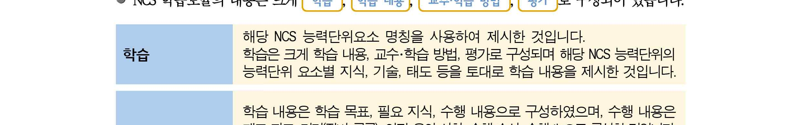
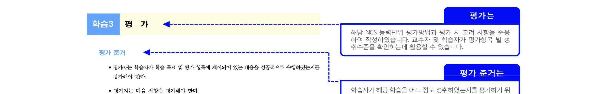
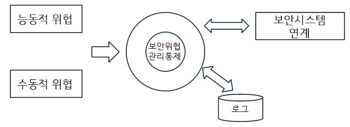
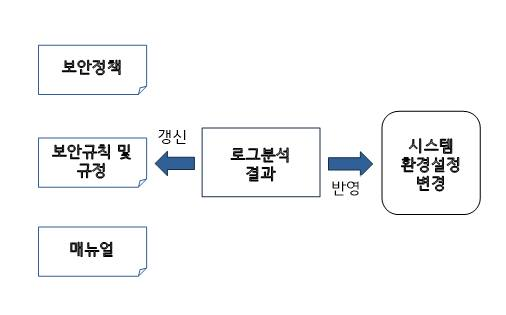
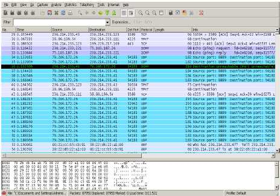
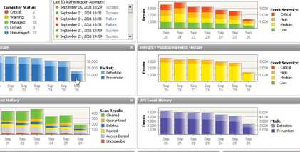
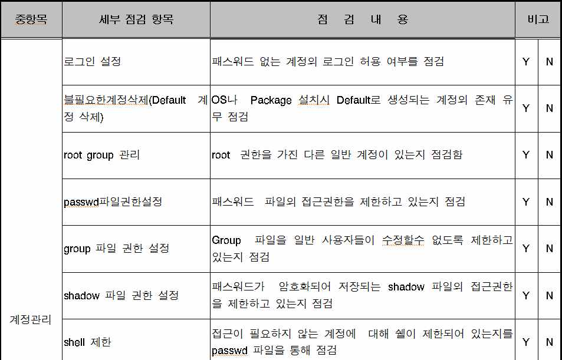
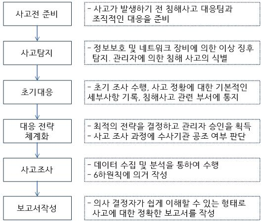

# LM2001020608_보안위협관리통제

대분류/20
정보통신 중분류/01
정보기술 소분류/02

정보기술개발 세분류/06
보안엔지니어링 능력단위/08

NCS학습모듈
보안위협 관리통제

LM2001020608_14v2

[NCS-학습모듈의 위치]

| 정보통신 |  |  |
| --- | --- | --- |
|  | 정보기술 |  |
|  |  | 정보기술개발 |

대분류
중분류
소분류
세분류

| SW아키텍처 |  |  | 능력단위 | 학습모듈명 |
| --- | --- | --- | --- | --- |
| 응용SW 엔지니어링 |  |  | 보안계획 수립 | 보안계획 수립 |
| 임베디드SW 엔지니어링 |  |  | 보안위험 평가 | 보안위험 평가 |
| DB엔지니어링 |  |  | 보안요구사항 정의 | 보안요구사항 정의 |
| NW엔지니어링 |  |  | 관리적 보안 구축 | 관리적 보안 구축 |
| 보안엔지니어링 |  |  | 물리적 보안 구축 | 물리적 보안 구축 |
| UI/UX엔지니어링 |  |  | 소프트웨어 개발 보안 구축 | 소프트웨어 개발 보안 구축 |
| 시스템SW 엔지니어링 |  |  | 데이터베이스 보안 구축 | 데이터베이스 보안 구축 |
| 빅데이터 플랫폼구축 |  |  | 시스템 보안 구축 | 시스템 보안 구축 |
| 핀테크 엔지니어링 |  |  | 네트워크 보안 구축 | 네트워크 보안 구축 |
| 데이터아키텍트 |  |  | 보안체계 운영관리 | 보안체계 운영관리 |
|  |  |  | 보안위협 관리통제 | 보안위협 관리통제 |
|  |  |  | 보안감사 수행 | 보안감사 수행 |
|  |  |  | 보안인증 관리 | 보안인증 관리 |

차 례
학습모듈의 개요 1
학습 1. 보안위협 탐지하기
• 1-1. 보안위협 탐지 준비 3
• 1-2. 보안위협 탐지 및 모니터링 9
• 교수・학습 방법 16
• 평가 17
학습 2. 보안위협 분석하기
• 2-1. 보안위협 분석 19
• 2-2. 보안위협정보 보관 29
• 교수・학습 방법 32
• 평가 33
학습 3. 보안위협 대응하기
• 3-1. 보안위협 대응 및 복구 36
• 3-2. 대응보고서 작성 43
• 교수・학습 방법 47
• 평가 48
학습 4. 사후처리하기
• 4-1. 재발 방지대책 수립 50
• 4-2. 관리문서 보완 및 시스템 보안 점검 55
• 교수・학습 방법 59
• 평가 60
참고 자료 62
활용 서식 63
보안위협 관리통제 학습모듈의 개요
학습모듈의 목표
보안위협으로부터 정보자산을 보호하기 위해 구축된 보안 시스템을 통하여 보안위협을 탐지,
분석, 대응하고 사후 처리할 수 있다.
선수학습
컴퓨터 기초 이론, 물리적 보안에 관한 지식, 자료 검색 및 컴퓨터 활용 능력
학습모듈의 내용체계

| 학습 | 학습 내용 | NCS 능력단위요소 |  |
| --- | --- | --- | --- |
|  |  | 코드번호 | 요소명칭 |

1-1. 보안위협 탐지 준비
1. 보안위협 탐지하기 2001020608_14v2.1 보안위협 탐지하기
1-2. 보안위협 탐지 및 모니터링
2-1. 보안위협 분석
2. 보안위협 분석하기 2001020608_14v2.2 보안위협 분석하기
2-2. 보안위협정보 보관
3-1. 보안위협 대응 및 복구
3. 보안위협 대응하기 2001020608_14v2.3 보안위협 대응하기
3-2. 대응보고서 작성
4-1. 재발 방지대책 수립
4. 사후처리하기 2001020608_14v2.4 사후처리하기
4-2. 관리문서 보완 및 시스템
보안 점검
핵심 용어
보안위협, 취약점, 정보자산, 침해사고대응, 로그분석, 보안관제

| 학습 1 | 보안위협 탐지하기 |
| --- | --- |

학습 2 보안위협 분석하기
학습 3 보안위협 대응하기
학습 4 사후처리하기
1-1.
보안위협 탐지 준비
•구축된 보안위협 관리통제시스템에서 수집된 이벤트 로그를 분석하여 설정된 보안
학습 목표
규칙에 따라 정탐과 오탐 여부를 탐지할 수 있다.
필요 지식 /
• 보안위협 관리통제시스템 개요
보안위협 관리통제시스템은 각종 보안위협, 보안침해에 대해 내부관리통제 기준에 따라
능동적 또는 수동적으로 대응하는 시스템을 의미한다. 능동적이란 의미는 보안위협, 보안
침해에 대해 탐지 후 제거하는 행위를 포함하며, 수동적이란 의미는 탐지역할은 수행하나
제거하는 등의 능동적인 행위는 포함하지 않는다.
1. 능동적 보안위협 관리통제시스템 목적
보안위협 관리통제시스템은 주요 목적은 빠른 탐지와 함께 보안위협, 보안침해에 대한 빠
른 대응이다.
<표 1-1> 능동적 보안위협
구분 내용
컴퓨터 시스템에 대해 Dos 공격이나 컴퓨터 바이러스, 웜 등의 악성코드를
정의
유포하여 컴퓨터 시스템의 정보를 변경 또는 파괴하는 보안위협이다
DoS (Denial Of Services, 분산서비스거부 공격), DDoS 공격
보안위협
스푸핑(Spoofing), 능동적 해킹, 임의의 악의적인 의도에 의한 침해 공격 등
2. 수동적 보안위협 관리통제시스템 목적
수동적 보안위협 관리통제시스템의 주요 목적은 실시간적인 대응이 아닌 향후 발생 가능
한 이상징후에 대한 분석, 발생가능성이 높은 보안위협에 대응하기 위함이다.
<표 1-2> 수동적 보안위협
구분 내용
컴퓨터 시스템 내의 정보를 파괴하지 않고 엿듣기 또는 가로채기 등을 통해 정
정의
보를 유출하거나 컴퓨터 시스템의 상태를 변화시키는 보안에 대한 위협이다.
스니핑(Sniffing), 정보 엿보기, 정보의 유출, 직접적이고 악의적인 공격이 아닌
보안위협
정보 가로채기 등
• 보안위협 관리통제시스템 작동 원리
보안위협 관리통제시스템은 능동적, 수동적인 보안위협에 대해 탐지 및 대응하기 위한 시
스템으로 IDS, IPS, UTM, ESM, 개별 PC보안시스템 및 NAC를 포함한다. 이러한 여러 가지
솔루션기반의 시스템 외에 여러 종류가 있지만 주요 핵심기능에 대한 작동 원리는 거의
유사하다.

[그림 1-1] 보안위협 관리통제시스템 작동원리(개념), 자체제작
수행 내용 1 / 수집로그 분석하기
재료·자료
Ÿ 보안시스템 사용자 매뉴얼, 운영 지침
기기(장비･공구)
Ÿ 보안위협관리통제시스템, 취약점 분석도구
안전･유의 사항
Ÿ 보안정책에 따른 보안위협 관리통제시스템 환경을 이해하고 매뉴얼에 따라 시스템을 운용해야
한다.
수행 순서
• 수집된 이벤트 로그를 확인한다.
1. 이벤트 로그가 정상적으로 수집되었는지 확인한다.
2. 이벤트 로그가 보안위협 관리통제시스템의 환경설정에 따른 디렉토리에 저장되었는지
확인한다.
• 수집된 이벤트 로그를 분류한다.
1. 이벤트 로그를 유형에 따라 분류한다.
2. 분류된 이벤트 로그 중 이벤트 로그 분석을 위한 핵심이슈 및 대상을 선정한다.
<표 1-3> 이벤트 로그 유형
유형 내용
Windows 시스템 구성요소가 기록하는 이벤트로 시스템 부팅 시 드라이버가
시스템 로그
로드되지 않는 경우와 같이 구성요소의 오류를 기록
응용 프로그램 응용프로그램이나 기타 프로그램의 동작에 대한 이벤트가 저장되며, 기록되
로그 는 이벤트는 소프트웨어 개발자에 의해 결정
유효하거나 유효하지 않은 로그온 시도 및 파일 생성, 열람, 삭제 등에 관련
보안 로그
된 이벤트를 기록
• 수집된 이벤트 로그를 분석한다.
1. 이벤트 로그 분석도구를 선정한다.
<표 1-4> 이벤트 로그 분석도구(예시)
분석도구 내용
Packet Analysis, 와이어샤크를 이용, 네트워크를 통해 전달된 파일, 파
패킷 분석도구
라미터 정보 및 트래픽 정보 확인
File Analysis, FAT, NTFS 파일에 대한 분석, DLL 및 파일에 대한 분석,
파일 분석도구
문서파일 및 멀티미디어 동영상 파일을 포함
Vulnerability Scanner, 기업의 네트워크 및 시스템을 Scan, 오픈 포트,
취약점 스캐너
활성화된 IP, Log-on, OS, 설치된 SW 및 서비스를 식별/리포팅
보안정보 및 이벤트
Security Information and Event Management(SIEM)
관리
2. 로그 분석을 수행한다.
<표 1-5> 로그 분석 수행 절차
순서 절차 내용
이벤트 로그를 수집한다. 시스템에서 얻은 이벤트 로그를
1 이벤트 로그 수집
수집한다.
이벤트 로그 중 유의미한 결과를 얻기 위해 데이터를 가공
2 데이터 가공
한다. 단, 데이터가 훼손되지 않도록 유의해야 한다.
이벤트 로그를 이벤트 로그 분석도구를 실행하여 로그 분석
3 이벤트 분석
을 수행한다.
4 분석 결과 공유 로그 분석을 수행한 결과를 리포팅하여 분석결과를 공유한다.
분석결과를 기준으로 정책반영여부 결정, 매뉴얼 갱신 등 의
5 의사결정 및 위험관리 사결정을 수행한다. 로그 분석 결과 심각한 위협이나 취약점
범주에 포함되는지 위험관리를 수행한다.
3. 로그 분석 결과에 따라 보안정책, 보안규칙, 매뉴얼을 갱신한다.

[그림 1-2] 로그 분석결과와 갱신대상과의 관계, 자체제작
수행 tip
Ÿ 업체 또는 기관환경에 적합한 분석도구를 선택하여
이벤트 로그 분석을 수행해야 한다.
수행 내용 2 / 정탐 오탐 여부 탐지하기
재료·자료
Ÿ 보안시스템 사용자 매뉴얼, 운영 지침
기기(장비･공구)
Ÿ 보안위협 관리통제시스템, 취약점 분석도구
안전･유의 사항
Ÿ 오탐율이 높은 경우 보안위협 관리통제시스템의 환경설정 또는 탐지규칙이 올바른지 재점검이
필요하다.
수행 순서
• 수집된 이벤트 로그를 확인한다.
1. 이벤트 로그 수집 영역을 확인한다.
2. 수집된 이벤트 로그의 사이즈를 확인한다.
• 정탐, 오탐 탐지 기준을 확인한다.
1. 보안정책에 탐지 기준이 기록되어 있는지 확인한다.
2. 탐지 기준이 없는 경우 보안실행규칙, 보안내규, 매뉴얼을 순차적으로 확인한다.
3. 탐지 기준을 확인한다.
• 오탐율을 확인한다.
1. 정탐율, 오탐율 비율을 확인한다.
2. 오탐율이 임계치를 초과할 경우, 보안위협 관리통제시스템의 환경설정에 문제가 있는지
확인한다.
3. 오탐율이 임계치 미만일 경우, 정상적으로 시스템이 동작함을 확인, 기록한다.
수행 tip
Ÿ 오탐율은 내부 보안정책에 의해 임계치를 정의하여
관리할 수 있으며, 업체 특성에 따라 허용치가 달라
질 수 있다.
1-2. 보안위협 탐지 및 모니터링
•보안위협 관리통제를 위해 구축된 보안위협 관리통제시스템을 사용하여 사전에
정의된 보안위협을 모니터링할 수 있다.
학습 목표
•취약점 분석도구와 점검 체크리스트를 사용하여 정보자산의 시스템과 네트워크에
대한 보안취약점을 점검하고 보안위협을 탐지할 수 있다.
필요 지식 /
• 보안취약점 분석
보안취약점이란 소프트웨어 또는 하드웨어의 구현, 설계 시 발생 가능한 허점으로 인해
사용자에게 허용된 권한 이상의 동작이나 허용된 범위 이상의 정보 열람을 가능하게 하는
약점을 의미한다.
1. 보안취약점
(1) 정보시스템에 불법적인 사용자의 접근을 허용하는 위협
(2) 정보시스템의 정상적인 서비스를 방해하는 위협
(3) 정보시스템에서 관리하는 주요 데이터의 위·변조 및 삭제 위협
2. 보안취약점 분석
(1) 보안취약점을 분석한다는 것은 시스템, 네트워크 및 응용프로그램에서 발생할 수 있는
상기 보안취약점을 포함하여 향후 발생 가능한 위협 및 취약점을 제거하는 행위이다.
<표 1-6> 보안취약점 점검항목
분류 내용
패스워드 관련 취약점, X 윈도우즈 관련 취약점, 관리자 및 사용자 환경 취
약점, 유틸리티 취약점, 파일 시스템 취약점, DB취약점, 데몬 취약점, 특정파
유닉스/리눅스 일 취약점, FTP취약점, SMTP 및 메일관련 취약점, RPC취약점, WWW/HTTP와
계열 CGI관련 취약점, DNS/BIND관련 취약점, 원격접속 명령어 취약점, 원격접속 명
령어 취약점, 패킷관련 취약점, 네트워크에 관련된 명령 취약점, NIS/NIS+ 취
약점, 방화벽관련 취약점, 포트 취약점, 백도어 취약점
패스워드 관련 취약점, 관리자/사용자 환경 취약점, 파일 시스템 취약점, DB
취약점, 특정파일 취약점, 서버 서비스 취약점, 응용 프로그램 취약점, 기타
서버 서비스 취약점, 응용 프로그램 취약점, 기타 응용 프로그램 취약점, 익
윈도우 계열
스체인지 서버 취약점, 레지스트리 취약점, WWW/HTTP와 CGI취약점, 패킷관
련 취약점, 방화벽 취약점, 포트 취약점, 인터넷 익스플로러 취약점, IIS취약
점, SMTP/메일 취약점, 백도어 취약점
네트워크장비 패스워드 관련 취약점, 응용 프로그램 취약점, 패킷 관련 취약점
• 정보 자산의 유형
정보자산은 크게 유형, 무형으로 나눌 수 있으며 무형에는 사용자의 지식, 지식재산권을
포함할 수 있다.
<표 1-7> 정보자산의 분류
분류 내용
서버, PC 등 단말기, 보조저장매체, 네트워크 장비, 응용 프로그램 등 정보의
정보시스템
수집, 가공, 저장, 검색, 송수신에 필요한 하드웨어 및 소프트웨어
정보보호시 정보의 훼손, 변조, 유출 등을 방지하기 위하여 구축된 시스템으로 침입차단시
스템 스템, 침입탐지시스템, 칩입 방지시스템, 개인정보유출방지시스템 등을 포함
정보 문서적 정보와 전자적 정보 모두를 포함
수행 내용 1 / 모니터링 하기
재료·자료
Ÿ 보안시스템 사용자 매뉴얼, 운영 지침
기기(장비･공구)
Ÿ 보안위협 관리통제시스템, 취약점 분석도구
안전･유의 사항
Ÿ 보안위협이 정상적으로 탐지되지 않을 경우, 보안위협 관리통제시스템의 환경설정을 재확인한
후 모니터링을 다시 수행한다.
수행 순서
• 보안위협 관리통제시스템 모니터링 방법을 파악한다.
1. 모니터링을 위한 방법, 절차를 숙지한다.
2. 모니터링 장비를 확인한다.
<표 1-8> 모니터링 장비 유형(보안관제의 예)
분류 내용
DDos 방어 DDos 전용 방어용 Rule Set을 적용, 분산 서비스 거부 공격 대응
DDos(24시간 DDos보안관제솔루션 활용), Arp모니터링(동일 네트워크의 서버 및
네 트 워 크
시스템장비가등이 크래커에 의해 침해된 경우나 Spoofing공격으로부터 방어),
관제
Sflow모니터링(네트워크 실시간 패킷 감지)
서버 방화벽 수준의 관제, Rule Set기반 고성능의 서버 방화벽 및 SW탑재
웹서비스 웹서비스에 발생하는 크래킹, 취약점을 전문적으로 차단, 방어
정보시스템 운영, 업무관리 및 내부 이메일관리 등 스위치, 서버, 네트워크 전
전산장비
반 모니터링
CCTV 영상, 외부침입에 대한 CCTV관제, 로컬 및 웹을 이용한 CCTV 모니터링
• 보안위협 관리통제시스템을 모니터링 한다.
1. 매뉴얼에 따른 모니터링을 수행한다.
<표 1-9> 모니터링 대상
정보자산 내용
정보시스템 운영 중인 업무시스템, 서버, 네트워크, 일반 전산장비 및 응용 프로그램 Log
1) 통합솔루션 방식 : UTM(Unified Threat Management), ESM(Enterprise Security
정보보호시 Management)의 경우 통합솔루션 방식 시스템에서 발생되는 이벤트 로그
스템 2) 개별 솔루션 방식 : 네트워크 트래픽 분석도구, 네트워크 스니퍼, 스팸스나이
퍼, DDos 방지시스템 등 개별 정보보호시스템에서 발생되는 이벤트 로그
정보 정보시스템 및 정보보호시스템 이외에 이상징후가 발생되는 정보
2. 악의적인 공격, 위협이 감지되는지 확인한다.
3. 주기적으로 모니터링 로그를 확인한다.

[그림 1-3] 패킷분석도구 이벤트 로그의 예 - 이상징후 탐지, 출처 :와이어샤크

[그림 1-4] 보안 모니터링 (예시) - 대시보드, 출처 :와이어샤크, 로그분석기
• 위협, 취약점을 기록한다.
1. 주요 위협, 취약점이 어떤 것인지 확인한다.
2. 주요 위협, 취약점을 기록한다.
<표 1-10> 모니터링 대상
기록방법 내용
문서기록 위협 및 취약점 리스트 작성, 정보자산의 중요성에 따른 구분 기록
시스템기능
보안위협 관리시스템 자동 기록 정보 활용, 주요 이벤트 로그의 경우 화면캡처
활용
<표 1-11> 주요 위협 및 취약점 유형
유형 위협 및 취약점
Race Condition, 환경변수, 계정 및 패스워드, 접근권한, 시스템 구성, 네트워크
시스템
구성, 버퍼오버플로우, 백도어 등
불필요한 서비스와 정보 제공, 서비스 거부 공격, RPC, HTTP, SMTP, FTP, BIND,
네트워크
FINGER, 버퍼오버플로우 등
응용
웹 서버, 방화벽 서버, IDS 서버, 데이터베이스 서버, 소스코드 취약점 등
프로그램
수행 tip
Ÿ 자동적으로 이벤트 로그가 보안위협 관리통제 시스
템에서 기록되지만, 중요한 이벤트 로그는 별도로
기록하여 위험관리를 수행할 필요가 있다.
수행 내용 2 / 보안취약점 점검 및 위협 탐지하기
재료·자료
Ÿ 보안시스템 사용자 매뉴얼, 운영 지침
기기(장비･공구)
Ÿ 보안위협 관리통제시스템, 취약점 분석도구
안전･유의 사항
Ÿ 보안 위협이 정상적으로 탐지되지 않을 경우, 보안위협 관리통제시스템의 환경설정을 재확인한
후 모니터링을 다시 수행한다.
수행 순서
• 점검 체크리스트를 확인한다.
1. 점검 체크리스트를 준비한다.
2. 점검 대상, 범위를 설정한다.
3. 체크리스트 내용이 보안위협, 취약점 점검에 적합한지 확인한다.
4. 불필요한 체크리스트 내용은 삭제하거나 수정한다.
<표 1-12> 주요 위협 및 취약점 유형
유형 위협 및 취약점
Race Condition, 환경변수, 계정 및 패스워드, 접근권한, 시스템 구성, 네트워크
시스템
구성, 버퍼오버플로우, 백도어 등
불필요한 서비스와 정보 제공, 서비스 거부 공격, RPC, HTTP, SMTP, FTP, BIND,
네트워크
FINGER, 버퍼오버플로우 등
응용
웹 서버, 방화벽 서버, IDS 서버, 데이터베이스 서버, 소스코드 취약점 등
프로그램

출처 : 사내보안 업무규정 중 일부
[그림 1-5] 체크리스트 예시(일부)
• 취약점 분석도구를 선정한다.
1. 확정된 체크리스트 점검 내용을 기반으로 취약점 분석도구 후보군을 선정한다.
2. 보안정책, 보안내규에 따라 정의된 취약점 분석도구가 있을 경우에는 정의된 취약점 분석
도구를 확인한다.
3. 취약점 분석도구 후보군 중 적합한 분석도구를 선정한다.
<표 1-13> 취약점 분석도구(예)
구분 소분류 도구(예)
스캐너 Acunetix
스캐너 Kali
프록시 paros
시스템
인젝션 SQLmap
인코더/디코더 napkin
스캐너 Nessus Professional Feed
SSL SSLscan
IDS Snort
네트워크
Firewall Iptables
패킷변조 ethercan
※ 상기 취약점 분석도구(예) 이외에 통합솔루션 방식의 취약점 분석도구를 활용하여
취약점 진단을 수행할 수 있으며, 웹이나 응용프로그램 전용 취약점 분석도구를 활용
할 수 있다.
• 보안취약점을 점검한다.
1. 취약점 점검 대상의 환경, 환경설정을 확인한다.
2. 취약점 점검 대상 범위를 설정한다.
3. 취약점 점검을 수행한다.
4. 취약점 점검 결과를 기록한다.
5. 점검 결과에 따른 사후조치를 실시한다.
수행 tip
Ÿ 취약점 점검 대상 및 범위를 선정하는 것은 매우
중요하다. 범위가 너무 크면 점검 속도 및 시간이
많이 소요되고 범위가 너무 작으면 취약점이 제대
로 확인되지 않을 수 있기 때문이다.

| 학습 1 | 교수·학습 방법 |
| --- | --- |

교수 방법
• 위협을 모니터링하고 탐지하기 위한 방법을 설명할 수 있다.
• 취약점 분석에 대해 설명할 수 있다.
• 모든 학생이 참여할 수 있도록 시나리오를 제시해 주고 문제 해결식 수업이 가능하도록 한다.
• 분석도구에 대한 예시를 제시해 주고, 분석도구를 활용한 실습이 이루어질 수 있도록 지도한다.
• 위협과 취약점의 차이를 설명하고, 분석하기 위한 제약 사항을 충분히 설명한다.
학습 방법
• 시나리오별 위협을 탐지할 수 있도록 과제를 제시한다.
• 체크리스트별 분석 실습을 위한 시스템 환경에 대해 익히고 실제로 분석이 가능하도록 한다.
• 위협탐지, 모니터링 및 취약점 분석이 가능하도록 매뉴얼에 따라 실습해 본다.
• 주로 사용하는 패킷 분석도구 활용 사례를 설명하도록 하고 팀별 프로젝트 형식으로 실습해
본다.

| 학습 1 | 평 가 |
| --- | --- |

평가 준거
• 평가자는 학습자가 수행 준거 및 평가 내용에 제시되어 있는 내용을 성공적으로 수행할 수
있는지를 평가해야 한다.
• 평가자는 다음사항을 평가해야 한다.

| 학습 내용 | 평가 항목 | 성취수준 |  |  |
| --- | --- | --- | --- | --- |
|  |  | 상 | 중 | 하 |

- 구축된 보안위협 관리통제시스템에서 수집된 이벤트
보안위협 탐지
로그를 분석하여 설정된 보안규칙에 따라 정탐과 오
준비
탐 여부를 탐지할 수 있다.
- 보안위협 관리통제를 위해 구축된 보안위협 관리 통
제시스템을 사용하여 사전에 정의된 보안위협을
보안위협 탐지 모니터링할 수 있다.
및 모니터링 - 취약점 분석도구와 점검 체크리스트를 사용하여 정
보자산의 시스템과 네트워크에 대한 보안취약점을
점검하고 보안위협을 탐지할 수 있다.
평가 방법
• 서술형시험

| 학습 내용 | 평가 항목 | 성취수준 |  |  |
| --- | --- | --- | --- | --- |
|  |  | 상 | 중 | 하 |

- 구축된 보안위협 관리통제시스템에서 수집된 이벤트
보안위협 탐지
로그를 분석하여 설정된 보안규칙에 따라 정탐과 오
준비
탐 여부를 탐지
- 보안위협 관리통제를 위해 구축된 보안위협 관리 통
제시스템을 사용하여 사전에 정의된 보안위협을 모
보안위협 탐지 니터링
및 모니터링 - 취약점 분석도구와 점검 체크리스트를 사용하여 정
보자산의 시스템과 네트워크에 대한 보안취약점
을 점검하고 보안위협을 탐지
• 문제해결 시나리오

| 학습 내용 | 평가 항목 | 성취수준 |  |  |
| --- | --- | --- | --- | --- |
|  |  | 상 | 중 | 하 |

| 보안위협 탐지준비 보안위협 탐지및 모니터링 • 평가자 질문 보안위협 탐지준비 보안위협 탐지및 모니터링 피 드 백 | - 구축된 보안위협 관리통제시스템에서 수집된 이벤트로그를 분석하여 설정된 보안규칙에 따라 정탐과 오탐 여부를 탐지 - 보안위협 관리통제를 위해 구축된 보안위협 관리 통제시스템을 사용하여 사전에 정의된 보안위협을 모니터링 - 취약점 분석도구와 점검 체크리스트를 사용하여 정보자산의 시스템과 네트워크에 대한 보안취약점을 점검하고 보안위협을 탐지 - 구축된 보안위협 관리통제시스템에서 수집된 이벤트로그를 분석하여 설정된 보안규칙에 따라 정탐과 오탐 여부를 탐지할 수 있는가? - 보안위협 관리통제를 위해 구축된 보안위협 관리 통제시스템을 사용하여 사전에 정의된 보안위협을 모니터링할 수 있는가? - 취약점 분석도구와 점검 체크리스트를 사용하여 정보자산의 시스템과 네트워크에 대한 보안취약점을 점검하고 보안위협을 탐지 |  |  |  |
| --- | --- | --- | --- | --- |
| 1. 서술형시험 - 보안위협과- 위협 탐지 및- 위협 및 취약점의- 취약점 분석도구에 | 취약점이 어떤 관계가 있는지 확인한다. 모니터링하기 위한 절차와 방법을 정확하게 숙지한다. 내용, 발생 가능한 취약점에 대해 정확하게 숙지한다.대한 활용방법을 숙지한다. |  |  |  |
| 2. 문제해결 시나리오- 보안위협 탐지가- 보안취약점에- 보안정책, 수행했는지 | 정상적으로 수행되었는지 평가한다. 대한 기록, 보고서에 대한 평가를 수행한다. 보안규칙, 매뉴얼에 따라 보안위협 탐지 및 보안취약점에 대한평가한다. | 분석을 |  |  |
| 3. 평가자 질문- 위협과 취약점의- 보안위협에- 취약점 분석- 취약점 분석 | 차이에 대해 알고 있는지 질의한다. 대한 모니터링 방법 및 절차에 대해 확인한다. 시 중점을 두어 진행해야 하는 점에 대해 질의한다. 결과를 효과적으로 기록하기 위한 방법에 대해 질의한다. |  |  |  |

| 학습 내용 | 평가 항목 | 성취수준 |  |  |
| --- | --- | --- | --- | --- |
|  |  | 상 | 중 | 하 |

| 보안위협 탐지준비 보안위협 탐지및 모니터링 피 드 백 | - 구축된 보안위협 관리통제시스템에서 수집된 이벤트로그를 분석하여 설정된 보안규칙에 따라 정탐과 오탐 여부를 탐지할 수 있는가? - 보안위협 관리통제를 위해 구축된 보안위협 관리 통제시스템을 사용하여 사전에 정의된 보안위협을 모니터링할 수 있는가? - 취약점 분석도구와 점검 체크리스트를 사용하여 정보자산의 시스템과 네트워크에 대한 보안취약점을 점검하고 보안위협을 탐지 |  |  |  |
| --- | --- | --- | --- | --- |
| 1. 서술형시험 - 보안위협과- 위협 탐지 및- 위협 및 취약점의- 취약점 분석도구에 | 취약점이 어떤 관계가 있는지 확인한다. 모니터링하기 위한 절차와 방법을 정확하게 숙지한다. 내용, 발생 가능한 취약점에 대해 정확하게 숙지한다.대한 활용방법을 숙지한다. |  |  |  |
| 2. 문제해결 시나리오- 보안위협 탐지가- 보안취약점에- 보안정책, 수행했는지 | 정상적으로 수행되었는지 평가한다. 대한 기록, 보고서에 대한 평가를 수행한다. 보안규칙, 매뉴얼에 따라 보안위협 탐지 및 보안취약점에 대한평가한다. | 분석을 |  |  |
| 3. 평가자 질문- 위협과 취약점의- 보안위협에- 취약점 분석- 취약점 분석 | 차이에 대해 알고 있는지 질의한다. 대한 모니터링 방법 및 절차에 대해 확인한다. 시 중점을 두어 진행해야 하는 점에 대해 질의한다. 결과를 효과적으로 기록하기 위한 방법에 대해 질의한다. |  |  |  |

학습 1 보안위협 탐지하기

| 학습 2 | 보안위협 분석하기 |
| --- | --- |

학습 3 보안위협 대응하기
학습 4 사후처리하기
2-1.
보안위협 분석
•탐지된 보안위협 로그에 근거하여 필요한 추가 정보를 수집하고 로그데이터의 논리
적인 연관 분석을 수행할 수 있다.
학습 목표 •로그분석결과를 이용하여 보안위협의 공격 대상과 보안위협의 경로를 확인할 수 있다.
•보안위협 대상의 취약 원인을 분석하고 정보자산의 중요도를 고려하여 분석된 보안
위협의 영향도를 분석할 수 있다.
필요 지식 /
• 취약점 분석
취약점이란 컴퓨터의 하드웨어 또는 소프트웨어의 결함이나 체계 설계상의 허점으로 인해
사용자(특히, 악의를 가진 공격자)에게 허용된 권한 이상의 동작이나 허용된 범위 이상
의 정보 열람을 가능하게 하는 약점이다
1. 취약점 분석 필요 요소
현황 분석을 통해 취약점이 발생 가능한 내부환경 및 외부환경에 대한 상황을 파악 한다.
자산 분석을 통해 취약점이 발생할 경우의 심각도, 중요도를 판단한다. 정보시스템의 자산
을 분석하는 부분은 취약점 분석이 발생하는 대상이므로 세밀하게 분석해야 한다.
위협 분석을 통해 정보시스템 자산에 피해를 가할 수 있는 잠재적인 요소를 파악해야
한다.
취약성분석을 통해 정보시스템 자산에 대한 취약점을 분석하고 취약성을 평가해야 한다.
위험평가를 통해 위협 및 취약성을 기준으로 위험을 도출하고 평가해야 한다.
2. 자산 분석
자산분석은 조직자산을 파악하고 자산의 가치 및 중요도를 산정하여 정보시스템 자산이

| 학습 내용 | 평가 항목 | 성취수준 |  |  |
| --- | --- | --- | --- | --- |
| 조직에 미치는자산으로는 정보,자산평가, | 영향을 파악하는 작업이다. 문서, 하드웨어 및 소프트웨어를 포함한다. 취약성평가, 위험에 대한 평가는 보통 3X3 매트릭스를 | 활용한다. |  |  |
| 3. 3X3 매트릭스평가척도를 높음, | 중간, 낮음 3가지 항목으로 설정하고 매트릭스 구조로 | 점수를 |  | 배점하는 |
| 방식이다. 자산뿐만 아니라, | 위험에 대한 평가 시에도 자주 사용된다. |  |  |  |
| 4. 자산별 위험도위험도 산정기준자산별 위험도는할 수 있다 내용 1 / 재료·자료 Ÿ 보안시스템 사용자기기(장비･공구) Ÿ 보안위협 안전･유의 사항 Ÿ 보안정책에 따른 | 산정 매트릭스를 참조로 하여 각 자산별로 위험도를 산정한다.각 자산에 대한 위험수준을 보여줌으로써 자산의 현재추가정보 수집 및 분석 수행하기 매뉴얼, 운영 지침 관리통제시스템, 취약점 분석도구 보안위협 관리통제시스템 환경을 이해하고 매뉴얼에 따라 | 상태를시스템을 | 쉽게 | 확인운용해야 |
| 한다. 수행 순서 • 추가정보를 수집한다. |  |  |  |  |
| 1. 기본적으로 수집된 | 로그이외에 이벤트 정보를 수집한다. |  |  |  |
| 2. 로그 및 이벤트 | 정보이외에 수집할 수 있는 잔여 로그정보를 수집한다. |  |  |  |
| 3. 필요한 경우에는<표 2-1> 로그와 이벤트의구분 정보화로그 등과(방화벽이벤트 (IDS/※ 대부분 로그와는데 실질적으로는• 분석을 수행한다. | 시스템로그, 이벤트 외에 오프라인 문서를 수집한다.차이 내용 장비 및 네트워크 운영 과정에서 발생하는 모든 내용들이함께 기록된 자료 로그, 시스템 로그, 웹로그) 실시간으로 발생하는 많은 사건 중 의미가 있는 것만을 추출한IPS, 웹방화벽 발생 이벤트) 이벤트를 구분하여 사용되기 보다는 이벤트 로그라는로그와 이벤트의 의미는 상기 <표 2-1>과 같이 다소 | 데이터용어로 | 발생시간자주차이가 | 쓰이있음. |
| 1. • 추가정보 수집에 | 따라 사전 준비작업을 수행한다. |  |  |  |
| 2. 상기 준비작업에 | 따라 분석 순서를 정한다. |  |  |  |
| 3. 이벤트 정보를 | 분석한다. |  |  |  |
| 4. 로그정보를 분석한다. |  |  |  |  |
| 5. 로그정보, 이벤트정보 | 연관분석을 수행한다. |  |  |  |
| 6. 분석결과를 정리한다.<표 2-2> 이벤트 분석구분 경계보안 (Perimeter) 계정감사(Identity)서버(Servers) DB(Databases) | 범위 (신뢰구간 기준) 내용 보안 장비로 보호되고 있는 경계 보안 이슈 분석 특정 자원 접근 권한 위반, 인가되지 않은 권한 상승 분석도메인 컨트롤러, 웹 서버 등 중요한 시스템에서 발생되는상황(이유 없는 재부팅, 사용자 계정 추가) 분석 상관분석을 통한 정보 유출 분석 | 문제나 | 이상 |  |

파일(Files) 시스템 운영 파일 조작 분석
어플리케이션(Ap 정상 트랜잭션과 사용자 활동 내역을 프로파일로 작성, 정상 범위에서
plications) 벗어나는 활동에 대해 감시 및 분석
<표 2-3> 이벤트 종류 (예시, IP관련)
구분 내용
Source IP
근원 IP Address, 정보의 발생지, 송신지
address
Source port 근원 포트번호, Source IP의 Port 번호
Destination IP
목적지 IP Address, 정보의 송신지, 도착지
address
Destination port 목적지 포트번호, 정보수신시 해당 Port 번호
Timestamps 시간, 시각을 기록하는 구간
context and
content of 컨텐츠 내용 및 서명, 네트워크 세션 기록
network sessions
<표 2-4> 연관 또는 상관분석 (유형)
구분 내용
수집된 로그에서 핵심 소수 이벤트를 분석해내는 기법이다. 이러한 분석
이벤트상관분 기법은 핵심원인분석(RCA, Root Cause Analysis)기법
석기법(Event 핵심 메시지를 수집한 이벤트에서 찾음
Correlation) 데이터를 축약하고, 키가 되는 핵심 소스에 일련의 활동 내역을 시간의
흐름에 따라 정리함
이상 상황에 대해 분석하기 위해 정상 행위에 대한 기준을 정의
평상 시 정상 상황에 대한 학습을 통해 프로파일을 생성함
(프로파일링 내역)
임계치기반상 - 매시간 외부와 주고받는 최대 트래픽 량
관분석기법(T - 매일 외부와 주고받는 최대 트래픽 량
hreshold - 비업무 시간 외부와 통신하는 내부 시스템 수
Correlation)
외부로 중요한 데이터가 유출되었다고 가정했을 때 또는 해당 데이터는
일반적으로 주고받는 파일보다 매우 큰 파일이라고 했을 때(가정),
아래 그래프와 같이 평상 시 트래픽을 벗어나 급증한 그래프는 해당 가설을
입증하는 데이터가 될 수 있음.
네트워크 침입분석
통계학적상관
- 반복되는 수치의 평균적인 지표를 이용해 침입 및 공격을 구분
분석기법(Stati
- SYN Flood, ANOMALY (ex. 한 번도 발생된 적이 없는 이벤트)
stical
네트워크 장애분석
Correlation)
- 평균 트래픽이나 정상 범위의 수치에서 벗어난 상황으로 장애 구분
• 분석 결과를 기록한다.
1. • 분석 수행하기에 따른 분석결과를 기록한다.
2. 분석결과에 따른 내용을 의사결정자에게 별도로 보고한다.
수행 tip
Ÿ 로그 및 이벤트 분석 시 중심이 되는 Target을 설정
하는 것이 중요한다.
Ÿ 유의미한 정보인 이벤트 분석 시 상관관계를 분석
하여 유추하고 시그니쳐기반, 또는 행동학습기반의
이벤트를 탐지하고 분석하는 등 추가적인 행위가
필요하다.
수행 내용 2 / 로그 분석결과에 따른 공격대상 확인하기
재료·자료
Ÿ 보안시스템 사용자 매뉴얼, 운영 지침
기기(장비･공구)
Ÿ 보안위협 관리통제시스템, 취약점 분석도구
안전･유의 사항
Ÿ 오탐율이 높은 경우 보안위협 관리통제시스템의 환경설정 또는 탐지규칙이 올바른지 재점검이
필요하다.
수행 순서
• 분석 결과를 확인한다.
1. 수행 내용 1. 에 따른 결과를 확인한다.
2. 해당 분석 결과에 따라 전문가, 실무자 간 결과공유를 위한 회의를 실시한다.
• 보안위협 공격 및 위협 경로를 확인한다.
1. 보안위협 및 위협경로를 확인하기 위해 확인 대상을 선정한다.
2. 주요 위협 공격에 대한 세부 내용을 확인한다.
3. 세부 내용을 분석한 위협 경로를 확인한다.
<표 2-5> 보안위협 및 위협경로 확인대상
구분 내용
시그니처 특정 문자열 및 단어를 이용한 행위, 결과에 대한 확인
패킷 PAYLOAD 및 헤더(HEADER) 프로토콜 파악
풀세션 개별 패킷(PACKET)에서 나오는 정보의 집합체를 파악
시스템이벤트 서버 또는 개별 시스템에서 발생하는 이벤트나 로그를 파악
<표 2-6> 주요 위협공격에 대한 세부 내용 확인 (시스템 이벤트의 예)
항목 내용
점검대상 OS기본정보, 계정정보, 네트워크정보, 프로세스정보
점검범위 예약작업, 보안설정, 응용프로그램보안설정, 로그점검
OS기본정보 윈도우 버전정보, 시스템 구동정보7
사용자 목록, 관리자계정목록, 공유를 통해 로그온된 목록, 마지막 로그인
계정정보
정보
네트워크정보 네트워크 연결정보, 세션정보, 공유네트워크 등
프로세스정보 PSINFO, PSLIST, PSLIST TREE
기타
공유파일점검, 원격으로 열린 파일, 로컬에서 열린 파일들
파일점검정보
<표 2-7> 이벤트, 로그 분석에서의 보안분석가의 역할
항목 내용
실시간으로 네트워크에서 제공되는 이벤트 로그를 분석하거나 SIEM을 거쳐
이벤트분석
발생되는 상관분석 이벤트를 분석한다
이벤트 분석을 통해 공격 유형 및 위험도를 평가한다. 이 과정에서
분석정보활용
Packet분석, 세션분석, 취약점 분석 정보를 활용한다.
공격 기법, 프로토콜 이해, 운영 체제, 프로그램에 대한 지식을 보유하고
전문가지식
있어야 한다.
적합한 대응 방안과 해결방법을 제시하거나 필요한 경우 에스컬레이션
대응방안제시
절차를 통해 다음 업무 단계로 진행시킨다.
커뮤니케이션 내역에 대해서는 문서화하고 팀 형태로 운영되며 보안 장비에
문서화
대한 헬스체크도 수행한다.
교대근무 정해진 스케줄에 따라 교대 근무를 수행한다.
수행 tip
Ÿ 보안위협 경로 및 공격대상을 적절하게 선정하는
것이 중요하다.
Ÿ 또한 보안전문가적인 견해로 해당 분석결과를 이해
하고 세부 분석을 수행할 수 있는 보안팀 또는 보
안분석TFT가 필요할 수도 있다.
수행 내용 3 / 보안위협의 영향도 분석하기
재료·자료
Ÿ 보안시스템 사용자 매뉴얼, 운영 지침
기기(장비･공구)
Ÿ 보안위협 관리통제시스템, 취약점 분석도구
안전･유의 사항
Ÿ 오탐율이 높은 경우 보안위협 관리통제시스템의 환경설정 또는 탐지규칙이 올바른지 재점검이
필요하다.
수행 순서
• 위협 현황을 파악한다.
1. OS계정정보, 네트워크정보, 계정정보, 파일정보 등 위협공격 현황을 확인한다.
2. 위협 현황 정보를 기록하여 위협 및 위험분석을 준비한다.
• 위협 및 위험을 분석한다.
1. 위협 및 위험분석을 위한 대상인 자산 정보를 확인한다.
2. 해당 자산에는 네트워크 장비, 서버, 운영체제 및 소프트웨어를 포함한다.
3. 위협 및 위험분석을 위한 기준을 확인한다.
4. 자산의 가치를 평가한다.
5. 영향도를 평가한다.
6. 위협 및 위험분석을 수행한다.
<표 2-8> 위협, 위험과 관련된 용어 (참조)
항목 내용
자산 Asset, 조직 내의 가치를 가지고 있는 모든 것
Threat, 시스템이나 조직에 피해를 끼칠 수 있는 원치 않는 사고의 잠재적인
위협
원인
취약성 Vulnerability, 위협이 가해지거나, 가해질 수 있는 자산 또는 자산집합체 약점
Risk, 자산 또는 자산집합체의 취약한 부분에 위협 요소가 발생하여 자산의
위험
손실, 손상을 유발할 잠재성
영향 Impact, 원하지 않는 사건의 결과
보호대책 Safeguard, 위험을 줄이기 위한 실천, 절차 또는 메커니즘
잔여위험 Residual risk, 대책을 구현 후 남아 있는 위험
<표 2-9> 자산의 가치평가 범위 (Scope)
항목 내용
A회사 정보시스템이나 어플리케이션 內정보
소유 자산 (Billing정보, 고객정보, 인사/재무정보 등)
아웃소싱 업체의 H/W, Network 자산이 담고 있는 정보
아웃소싱 업체 H/W, S/W, Application, Network 자산 등은 아웃소싱 업체에 Ownership이 있음
데이터센터, H/W, Network, Application, PC
• 위험을 평가한다.
1. 자산의 가치를 확인한다.
2. 관련된 취약성 정도 및 위협의 가능성을 파악한다.
3. 자산을 보호하기 위한 구현 보안통제시스템을 확인한다.
4. 위험도를 결정한다.
5. 자산별 위험도를 판단하여 위험목록을 마련한다.
6. DoA(Degree of Assurance)를 결정한다.
7. 개선계획을 마련한다.
<표 2-10> 자산식별 및 중요도 산정
번호 자산번호 장비명 관련시스템 보관형태 합계 등급
1 서버-0001 커뮤니티서버 동아리 DB 45 1
2 서버-0002 콘텐츠서버 게시판 DB 40 1
3 서버-0003 웹서버 그룹웨어 Log 40 1
4 서버-0004 WAS서버 그룹웨어 Log 25 3
5 서버-0005 스토리지서버 클라우드 DB 30 2
6 서버-0006 데이터베이스서버 사내시스템 DB 35 2
7 서버-0007 데이터베이스서버 사내시스템 DB 38 2
<표 2-11> 자산 Grouping
번호 그룹번호 이름 해당자산 자산수
서버-0006
1 그룹-0001 데이터베이스서버 2
서버-0007
서버-0001
2 그룹-0002 웹서버 및 WAS서버 서버-0003 3
서버-0004
서버-0002
3 그룹-0003 컨텐츠 및 스토리지 2
서버-0005
<표 2-12> 자산그룹별 우려사항 및 위험도출 (예시)
C I A
자산그룹명 라우터
번 3 3 3 위험도
호 위협 취약성 합계
우려사항 C I A
등급 등급
적절한 보안규정이 부족하여 자산이
1 3 3 9 9 9 27
보호되지 않을 수 있다.
원격접속에 대한 보호대책이 이루어지
지 않아 허가되지 않은 자의 원격접근
2 3 3 9 9 9 27
으로 인해 실수나 의도적인 고장 등의
가용성 침해우려가 있다.
네트워크 원격 관리 기능을 통해 허가
3 받지 않은 자가 네트워크에 접근할 수 3 2 8 8 8 24
있다.
• 정보보안 정책을 반영한다.
1. 상기 •~• 내용을 확인하고 정보보안 정책에 반영한다.
2. 필요시 정보보안 규정 및 매뉴얼을 갱신하고 주기적인 위험도 평가 활동이 이루어지도록
한다.
수행 tip
Ÿ 자산분석, 위협 및 취약점 분석, 위험평가는 매우
중요한 부분이다. 향후 개선계획을 수립하기 위한
토대가 되며 보안위협이 발생하지 않도록 주기적인
평가 활동이 이루어지도록 해야 한다.
2-2.
보안위협정보 보관
•보안사고 재발방지 대책수립에 활용하기 위하여 보안위협 분석에 사용된 보안위협관
학습 목표
련 수집정보를 보안운영지침에 따라 보관할 수 있다.
필요 지식 /
• 위협(Threat) 분석
위협 분석은 위협의 영향 및 발생가능성을 분석하는 과정으로서 위험을 산정하는데 있어
중요한 단계이다.
1. 위협 분석 요소
(1) 위협을 식별하는 기준 및 절차
(2) 위협 평가 기준 및 절차
2. 위협의 유형
(1) 네트워크 및 하드웨어
(2) 소프트웨어 및 데이터
(3) 사용자 및 환경
• 위협발생주기
위협 발생주기는 위협이 얼마나 자주 발생하는가를 보여주는 척도이다. 아무리 피해규모
가 작은 위협이라도 지속적으로 발생할 경우 그 영향은 매우 크다고 할 수 있다. 즉 화재
나 지진과 같이 파괴력은 크나 발생주기가 아주 작은 위협보다는 해킹, 바이러스, 정전 등
과 같이 파괴력은 다소 적으나 발생주기가 지속적인 위협의 피해가 훨씬 심각하다. 따라
서 위협발생 시 일어나는 손실뿐만 아니라 위협의 발생주기에도 높은 비중을 두어 위협을
정확하게 평가하여야 한다. 위협주기는 이미 발생한 위협을 기록한 통계자료를 이용하여
사용하지만 실제 통계자료가 없는 경우가 많기 때문에 위협발생가능성에 대해서 유추하여
사용한다.
수행 내용 1 / 보안위협 관련 수집정보 보관하기
재료·자료
Ÿ 보안시스템 사용자 매뉴얼, 운영 지침
기기(장비･공구)
Ÿ 보안위협 관리통제시스템, 취약점 분석도구
안전･유의 사항
Ÿ 보안정책에 따른 보안위협 관리통제시스템 환경을 이해하고 매뉴얼에 따라 시스템을 운용해야
한다.
수행 순서
• 보안위협 수집정보 유형을 분류한다.
1. 보안위협 수집정보를 분류한다.
2. 분류기준에 따라 수집정보를 그룹화 한다.
<표 2-13> 보안위협 분류 기준
기준 내용 중요도
OWASP Top 10 취약점 점검
개인정보 노출가능성
대민 어플리케이션 상
국정원 8대취약점
내/외부 시나리오 기반 점검
Config 설정 오류
네트워크 시스템 접근제어 설정 점검 중
계정/패스워드 보안 상태
보안시스템 설정
보안 기능상 문제점
보안시스템 상
보안시스템 구조적 문제점
운영관리상 문제점
사용자 관리상태 점검
접근제어 점검
서버시스템 파일 시스템 점검 상
로그 및 인증 현황 점검
서비스 관리 점검
WEB/WAS 설정 점검
보안 기능상 문제점 점검
WEB/WAS 중
WEB/WAS 구조적 문제점 점검
운영 관리상 문제점 점검
사용자 작업에 대한 감사
DB계정별 접근권한
데이터베이스 백업/복구 정책의 적합성 상
관리계정 접근제어
데이터베이스관련 파일시스템 접근제한
※ 보안위협에 대한 분류기준은 여러 가지 형태로 수립할 수 있다. 자산별, 대민서비스별,
보안장비별, 관련네트워크 장비별로 적합한 여러 형태를 확인하여 수립할 수 있다.
• 보안위협 관련 수집정보를 보관한다.
1. 수집정보를 보관할 대상을 선정한다.
2. 보안위협의 중요성, 사용빈도를 고려하여 저장매체를 선정한다.
3. 해당 매체에 별도의 권한을 명시한다.
수행 tip
Ÿ 보안위협별로 분류하는 것은 매우 중요하다.
Ÿ 이러한 분류행위는 향후 발생할 보안위협에 능동적
으로 대처하기 위한 수단으로 활용할 수 있다.

| 학습 2 | 교수·학습 방법 |
| --- | --- |

교수 방법
• 정보수집 및 추가정보수집 방법을 설명할 수 있다.
• 위협, 취약점, 위험에 대해 설명할 수 있다.
• 보안위협 시나리오를 제시해 주고 문제 해결식 수업이 가능하도록 한다.
• 정보자산의 취약성을 분석할 수 있도록 팀별 실습을 지도한다.
• 보안사고 재발방지 대책에 대해 설명할 수 있다.
학습 방법
• 시나리오를 제시해주고 문제 해결을 하도록 과제를 제시한다.
• 정보자산의 취약성을 분석하도록 관련 자산목록 및 내용을 제시한다.
• 위협탐지, 모니터링 및 취약점 분석이 가능하도록 매뉴얼에 따라 실습해 본다.
• 보안사고 재발방지 대책에 대해 작성해본다.

| 학습 2 | 평 가 |
| --- | --- |

평가 준거
• 평가자는 학습자가 수행 준거 및 평가 내용에 제시되어 있는 내용을 성공적으로 수행할 수
있는지를 평가해야 한다.
• 평가자는 다음사항을 평가해야 한다.

| 학습 내용 | 평가 항목 | 성취수준 |  |  |
| --- | --- | --- | --- | --- |
|  |  | 상 | 중 | 하 |

- 탐지된 보안위협 로그에 근거하여 필요한 추가정보
를 수집하고 로그데이터의 논리적인 연관 분석을
수행할 수 있다.
- 로그분석결과를 이용하여 보안위협의 공격 대상과
보안위협 분석
보안위협의 경로를 확인할 수 있다.
- 보안위협 대상의 취약 원인을 분석하고 정보자산의
중요도를 고려하여 분석된 보안위협의 영향도를
분석할 수 있다
- 보안사고 재발방지 대책수립에 활용하기 위하여
보안위협정보
보안위협 분석에 사용된 보안위협관련 수집정보를
보관
보안운영지침에 따라 보관할 수 있다.
평가 방법
• 서술형시험

| 학습 내용 | 평가 항목 | 성취수준 |  |  |
| --- | --- | --- | --- | --- |
|  |  | 상 | 중 | 하 |

- 탐지된 보안위협 로그에 근거하여 필요한 추가정보
를 수집하고 로그데이터의 논리적인 연관 분석을
수행
- 로그분석결과를 이용하여 보안위협의 공격 대상과
보안위협 분석
보안위협의 경로를 확인
- 보안위협 대상의 취약 원인을 분석하고 정보자산의
중요도를 고려하여 분석된 보안위협의 영향도를
분석
- 보안사고 재발방지 대책수립에 활용하기 위하여
보안위협정보
보안위협 분석에 사용된 보안위협관련 수집정보를
보관
보안운영지침에 따라 보관
• 문제해결 시나리오

| 학습 내용 | 평가 항목 | 성취수준 |  |  |
| --- | --- | --- | --- | --- |
|  |  | 상 | 중 | 하 |

- 탐지된 보안위협 로그에 근거하여 필요한 추가정보
를 수집하고 로그데이터의 논리적인 연관 분석을
수행
- 로그분석결과를 이용하여 보안위협의 공격 대상과
보안위협 분석
보안위협의 경로를 확인
- 보안위협 대상의 취약 원인을 분석하고 정보자산의
중요도를 고려하여 분석된 보안위협의 영향도를
분석
- 보안사고 재발방지 대책수립에 활용하기 위하여
보안위협정보
보안위협 분석에 사용된 보안위협관련 수집정보를
보관
보안운영지침에 따라 보관
• 평가자 질문

| 학습 내용 | 평가 항목 | 성취수준 |  |  |
| --- | --- | --- | --- | --- |
|  |  | 상 | 중 | 하 |

- 탐지된 보안위협 로그에 근거하여 필요한 추가정보
를 수집하고 로그데이터의 논리적인 연관 분석을
수행
- 로그분석결과를 이용하여 보안위협의 공격 대상과
보안위협 분석
보안위협의 경로를 확인
- 보안위협 대상의 취약 원인을 분석하고 정보자산의
중요도를 고려하여 분석된 보안위협의 영향도를
분석
- 보안사고 재발방지 대책수립에 활용하기 위하여
보안위협정보
보안위협 분석에 사용된 보안위협관련 수집정보를
보관
보안운영지침에 따라 보관

| 학습 내용 | 평가 항목 | 성취수준 |  |  |
| --- | --- | --- | --- | --- |
| 피 드 백 |  |  |  |  |
| 1. 서술형시험 - 보안위협, - 추가정보수집- 보안위협의- 보안사고 - 정보자산의 | 취약점, 위험에 대해 알고 있는지 확인한다. 방법을 정확하게 숙지한다. 개념을 명확히 숙지한다. 재발방지 대책에 대해 알고 있는지 확인한다. 취약성에 대해 알고 있는지 확인한다. |  |  |  |
| 2. 문제해결 시나리오- 시나리오기반의- 보안사고 - 정보자산의 | 취약성분석을 수행한다. 재발방지 대책에 따른 정보보안 운영지침을 확인한다. 취약성에 대해 자료를 제시해주고 작성할 수 있도록 한다. |  |  |  |
| 3. 평가자 질문- 팀별 토론을- 위협, 위험,- 취약점이 발생할- 보안사고 | 통해 위험평가를 진행한 절차, 내용에 대해 확인한다. 취약점에 대해 질의한다. 가능성이 있는 요인이 어떤 것이 있는 지 질의한다. 재발방지 대책은 어떤것들이 있는지 질의한다. |  |  |  |

학습 1 보안위협 탐지하기
학습 2 보안위협 분석하기

| 학습 3 | 보안위협 대응하기 |
| --- | --- |

학습 4 사후처리하기
3-1.
보안위협 대응 및 복구
•보안위협 분석결과와 보안운영지침에 따라 보안위협 관리통제시스템이 제공하는 기
능을 사용하여 확인된 보안위협의 경로를 차단할 수 있다.
학습 목표
•보안위협의 영향을 받은 정보자산에 대해 정보자산 복구 절차에 따라 영향 이전의
상태로 복구할 수 있다
필요 지식 /
• 자산평가
자산평가는 정보시스템 자산에 대한 평가를 정량 또는 정성적으로 평가하는 과정이다.
1. 정량적 자산평가 기준
자산도입비용은 시스템 구축 시 취약점 분석 평가를 할 경우에 그대로 사용할 수 있으나
운영 중인 시스템을 대상으로 하는 경우에는 적용하기 어려운 점이 많이 있다. 운영 중인
시스템인 경우 각 자산들에 대해 감가상각을 적용하여 자산가치를 정해야 하지만 IT 자산
에 대한 감가상각은 적용하기 힘든 경우가 많다.
2. 정성적 자산평가 기준
정성적인 기준은 데이터, 정책 등과 같이 분석대상 자산의 화폐가치 산정이 어렵거나 자
산의 현재가치를 정확히 산정하기 어려운 경우에 적용한다.
• 담당자 면담 및 자산평가
CIA 평가방법(기밀성, 무결성, 가용성에 의한 평가방법)을 사용하며 최종 자산평가는 담당
자와의 협의 하에 평가를 하도록 한다.
주요한 고려사항으로는 중요한 자산이 모두 포함되어 있는지, 분석할 대상 자산의 수가

| 학습 내용 | 평가 항목 | 성취수준 |  |  |
| --- | --- | --- | --- | --- |
| 너무 많지는 않은지,게 평가되어 대상자산평가를 하여위험평가를 실시하게내용 1 / 재료·자료 Ÿ 보안시스템 사용자기기(장비･공구) Ÿ 보안위협 안전･유의 사항 Ÿ 보안정책에 따른 | 업무수행에 중요한 역할을 하고 있으나 CIA 자산에 포함되지 않은 자산은 없는지를 고려해야 한다.자산가치가 일정 수준 이상인 것을 대상으로 하여 되는데 대상이 되는 자산의 기준은 전담반회의를보안위협으로부터 경로차단하기 매뉴얼, 운영 지침 관리통제시스템, 취약점 분석도구 보안위협 관리통제시스템 환경을 이해하고 매뉴얼에 따라 | 평가방법에는위협분석,통하여시스템을 | 덜결정한다. | 중요하취약성분석,운용해야 |
| 한다. 수행 순서 • 보안위협 분석결과 | 및 보안운영 지침을 확인한다. |  |  |  |
| 1. 보안위협 분석결과를 | 확인한다. |  |  |  |
| 2. 보안운영 지침을 | 확인한다. |  |  |  |
| 3. 보안위협 분석결과 | 중 주요위협을 목록화한다. |  |  |  |
| <표 3-1> 보안위협 요소구분 모바일 BYOD,클라우드 복잡한지능형 봇넷,소셜 다양성 ※ 보안위협은 모바일,화, 발전해오고<표 3-2> 주요위협 목록화영역 서버 데이터베이스 콘텐츠서버 ··· 웹/WAS • 보안위협 관리통제시스템을 | 내용 Bring Your Own Device 시대 시작에 따른 모바일 기기가상화와 클라우드 환경을 어떻게 관리할 것인지 지능형 지속 위협 등 강화된 보안 공격의 활성화 소셜엔터프라이즈 등장에 따른 보안위협성 소셜엔터프라이즈 등장에 따른 보안위협성, 다양화 애플리케이션, 서버환경설정, 악의적인 공격 등있다. 이에 따라 보안위협 요소도 셀 수 없을 정도로내용 서버 환경설정, 목적지 주소 변경, 경로 우회 데이터베이스 공격, 데이터베이스 주소 변경, 데이터베이스콘텐츠 서버 다운, 콘텐츠 서버 사용자 급증, 콘텐츠 불용············ 웹서버 주소 변경, 도메인 변경, WAS 트래픽 급증 선정한다. | 보안 다양한세분화되고 | 위험이형태로위·변조 | 증가 진있다. |
| 1. 보안위협 | 관리통제시스템 유형을 확인한다. |  |  |  |
| 2. 보안위협 | 관리통제시스템을 선정한다. |  |  |  |
| 3. 보안위협 | 관리통제시스템을 시험한다. |  |  |  |
| 4. 관리통제 기능이 | 적절하면 해당 시스템을 적용하여 상시 운용한다. |  |  |  |
| <표 3-3> 보안위협 유형 방화벽 IDS/IPS UTM 웹방화벽 웹DDoS방어 Anti-SPAM 메시지보안 점취약점진단 침해사고분석 모의해킹 • 보안위협 경로를 | 관리통제시스템 서비스 종류 내용 1차 네트워크 위협 차단, 기본 방화벽 기능 지능형 탐지 및 차단 시스템 IP/PORT차단 통합 위협 분석 및 관리 및 웹 어플리케이션 위협 차단, 응용 Layer 차단 Web분산 서비스 거부 공격에 대한 능동적 방어 스팸 zero, 스팸자동차단 및 경고 메시지 발송 대량의 메일 공격과 메일서버 공격을 통해서 메일 트 래픽을 적절히 분산/보호 스팸대량의 스팸메일 방어로 메일로 인한 메일 시스템의 자원낭비 방지 메시지 및 이메일 보안, 첨부파일에 대한 이상 판단 고객의 간단한 DNS 및 메일서버의 설정변경을 통해서 안전한 이메일 사용 시스템, 네트워크 등 정보자산에 대한 주기적인 취약 점검 지속적으로 시스템의 취약점 존재 여부를 모니터링 신규 취약점 발견 시 즉시 대응할 수 있는 체계마련 기업의 대내외 서비스의 위협요소들에 대한 잠재적 취약점 분석과 침투경로의 대한 점검 정보시스템을 가장 안전하게 보호할 수 있는 최적의 분석해결 방안 및 대응 방안을 제시 고객의 주요 시스템에 대해 보안담당자의 사전승인을 득한 후 취약점을 찾아 내·외부자 관점에서 침투테 스트(Penetration Test)를 시도 실시발생 가능한 해킹 위협 및 내부 보안 사고를 예방/차 단하기 위한 대응책 제시 차단한다. | FirewallIntrusionSystem,PreventionUnifiedManagementFirewallDistributedService방지Message,Vulerability침해사고및주기적인 | 비고DetectionIntrusionSystemDenial시스템E-mailAuditlog진단모의해킹 | Threatsof수집, |
| 1. • 보안위협 | 관리통제시스템 선정 내용에서 선정된 시스템에 따라 | 보안위협 | 경로를 | 차 |
| 단한다. |  |  |  |  |
| 2. 보안위협 경로는로를 확인, 진단할 | 시스템 환경설정을 변경하여 네트워크상의 경로, 외부수 있다. | 위협 | Traffic | 경 |
| 내용 2 / 재료·자료 Ÿ 보안시스템 사용자기기(장비･공구) Ÿ 보안위협 안전･유의 사항 Ÿ 오탐율이 높은 경우 | 수행 tip Ÿ 보안위협 관리통제시스템은 기본적인구하는 시스템과 통합된 서비스를이 존재한다. Ÿ 내부 비용적인 측면과 시스템의리통제시스템을 선정하는 것도위협에 대해 능동적으로 위협을스템을 구축하는 것이 필요하다.정보자산 복구절차에 따른 상태복구하기매뉴얼, 운영 지침 관리통제시스템, 취약점 분석도구 보안위협 관리통제시스템의 환경설정 또는 탐지규칙이 | 제공하는효율을중요하며,차단할올바른지 | 기능만을고려한수 있는 | 추시스템관중요한시재점검이 |
| 필요하다. 수행 순서 • 보안위협에 따라 | 영향을 받은 정보자산을 파악한다. |  |  |  |
| 1. 보안위협에 따라 | 침해사고가 발생한 정보자산을 확인한다. |  |  |  |
| 2. 해당 보안위협이 | 어떠한 경로로 침투되었는지 모니터링 절차에 따라 | 파악한다. |  |  |
| 3. 외부 해킹, 악성 | 공격에 의한 침투였는지, 내부자의 소행인지 확인한다. |  |  |  |
| 4. 정보자산의 피해의 | 정도를 파악한다. |  |  |  |
| 5. 해당 정보자산에<표 3-4> 침해사고 항목 모니터링 대상범위모니터링 방법 담당자 및 책임자지정 모니터링 결과체계침해시도 발견 시대응절차 등 <표 3-5> 침해사고 항목 대응체계 조직 침해사고 분류 계약서 반영 전문기관 협조 • 정보자산 복구 절차를 | 따른 후속 피해가 없는 지 확인한다. 모니터링 시 고려사항 내용 침해시도 탐지 및 차단하기 위한 각종 정보보호시스템외부 전문업체를 통한 모니터링, 자체 모니터링 체계 구축모니터링 담당자 및 보안책임자가 지정되어 있는지 확인모니터링 결과 체계, 모니터링 절차 등이 수립되어 있는침해시도 발견 시 대응을 손쉽게 할 수 있는 절차가 수립되어대응체계 구축 시 고려사항 내용 침해사고를 효과적으로 모니터링하고 신속하게 대응하기중앙집중적인 대응체계를 수립하여야 한다. 침해사고를 유형 및 중요도에 따라 분류하고 분류에 따른정의하여야 한다. 침해사고 대응체계를 외부 기관을 통해 구축한 경우 대응절차 및 체계를 계약서에 반영하여야 한다. 침해사고의 모니터링, 대응 및 처리와 관련되어 외부전문기관(KISA) 등과의 연락 및 협조체계를 수립하여야확인한다. | 이벤트등지 확인위해서는수립된전문가,한다. | 로그있는지보고체계를침해사고전문업체, | 등 확인 |
| 1. 정보자산 복구 | 또는 침해사고 처리 절차가 수립되어 있는지 확인한다. |  |  |  |
| 2. 이전 복구이력이 | 있는지 확인한다. |  |  |  |
| 3. 확인이 되면, | 정보자산 복구 준비를 한다. |  |  |  |
| <표 3-6> 침해사고 항목 대응체계 조직 침해사고 분류 계약서 반영 전문기관 협조 • 정보자산을 복구한다. | 대응체계 구축 시 고려사항 내용 침해사고를 효과적으로 모니터링하고 신속하게 대응하기중앙집중적인 대응체계를 수립하여야 한다. 침해사고를 유형 및 중요도에 따라 분류하고 분류에 따른정의하여야 한다. 침해사고 대응체계를 외부 기관을 통해 구축한 경우 대응절차 및 체계를 계약서에 반영하여야 한다. 침해사고의 모니터링, 대응 및 처리와 관련되어 외부전문기관(KISA) 등과의 연락 및 협조체계를 수립하여야 | 위해서는수립된전문가,한다. | 보고체계를침해사고전문업체, |  |
| 1. 학습 2. 보안위협 | 분석하기 학습 내용을 참고하여 영향분석에 따른 | 복구대책을 |  | 수립한다. |
| 2. 중요도, 파급도에 | 따라 주요, 핵심시설 또는 정보자산을 우선 복구한다. |  |  |  |
| 3. 침해받은 업무운영상 | 최우선적으로 복구해야 할 대상부터 복구한다. |  |  |  |
| 4. 업무운영이 | 원활하도록 복구 후 시험구동한다. |  |  |  |
| 5. 핵심시설 또는 | 정보자산이 원활하게 동작할 경우, 나머지 침해받은 | 시설, | 장비를 | 복구 |
| 한다. |  |  |  |  |
| 6. 전체적으로 <표 3-7> 영향분석에항목 BCP관점 목표시간, 시점 전략 및 대책수립 | 통합시험을 거쳐 정보자산이 원활하게 작동하는지 확인한다.따른 복구대책 수립 시 고려사항 내용 조직의 핵심 서비스(업무) 연속성을 위협할 수 있는 IT식별하고 위험요인에 따른 피해규모 및 업무에 미치는핵심 IT 서비스(업무) 및 시스템을 식별하고 있는가? 핵심 IT 서비스 및 시스템의 복구목표시간, 복구시점을정의한 복구목표시간 및 복구시점을 달성할 수 있는 대책을 수립하고 있는가? 수행 tip Ÿ 침해받은 정보자산은 시급성에 따라일 이내, 1달 이내 등의 일정시간기준을구할 수 있다. 복구 목표시간, 정의하여 빠른 시간 내에 정상적인수 있도록 하는 것이 중요하다. | 재해영향을정의하고적절한1일복구시점을업무를 | 위험요인을고려하여있는가?복구전략이내,정하여명확하게 | 및일주복운영할 |
| 3-2. •보안위협의목표 고할 수지식 / • 효과적 보호대책위협 및 취약점에히 보호대책을 통 선택한다. | 대응보고서 작성 시나리오, 취약 원인, 위협 영향, 조치내용에 대한 있다. 선정 대한 영향도를 분석하여 조치내용에 대한 보고서를선정해야 하는데 크게 위험감소, 위험회피, 위험전가, | 보고서를작성해야위험수용 | 작성하고한다.4가지를 | 보특보 |
| 1. 위험감소(Risk 위험을 감소시킬경우에 따라서는 | Reduction) 수 있는 대응책을 마련하여 구현하는 것으로 가장 보호대책 수립을 위하여 많은 비용이 소요된다는 단점이 | 확실한있다. | 보호대책이나 |  |
| 2. 위험회피(Risk 위험이 존재하는비용이 거의 들지프로세스 또는 | Avoidance) 프로세스를 실행하지 않는 것으로서 소극적인 방법이다.않고 쉽게 적용이 가능하다는 장점을 가지고 있으므로대안 프로세스가 있을 경우에 적용할 수 있다. | 그러나 | 불필요한 |  |
| 3. 위험전가(Risk 잠재적으로 발생위험에 대하여 | Transfer) 가능한 비용을 보험 등에 가입하여 제3자에게 이전시키는실질적인 보호대책수립 외 보완대책으로 사용가능하다. |  | 방법으로 |  |
| 4. 위험수용(Risk 위험을 받아들여서확률*손실보다 큰• 보호대책 선정 시보호대책 선정 시사회적 제약이 있을 | Acceptance) 발생으로 인한 손실을 감수하는 것으로서 보호대책의경우에 보호대책을 결정한다. 제약사항 주의해야 하거나 제약을 두어야 할 사항으로 시간적,수 있다. | 비용이재정 | 및 | 손실발생기술적, |
| 1. 시간적 제약 보호대책수립은이루어질 수 있도록있는 허용기간 | 시간적인 제약을 가지는데 첫째 관리를 위하여 허용하는수립되어야 한다. 둘째 주요자산이 위험에 노출되도록내에 수립되어야 한다. | 기간남겨 | 내에둘 | 수 |
| 2. 재정적 및 기술적프로그램이나선정 시 고려되어야조직에 할당된보호대책을 수립, | 제약 하드웨어의 호환성, 기술구현의 용이성과 같은 기술적 한다. 예산을 고려하여 식별된 위험을 위험수용범위 수준까지구현, 유지하는 비용이 보호하는 자산의 가치보다 높으면 | 문제가감소시키되안 | 대책된다. |  |
| 3. 사회적 제약 보호대책들이수 없다. 대책못한다면 보호대책은내용 1 / 재료·자료 Ÿ 보안시스템 사용자기기(장비･공구) Ÿ 보안위협 안전･유의 사항 Ÿ 보안정책에 따른 | 직원들의 능동적인 지원에 의존하기 때문에 사회적 제약을필요성에 대한 직원들의 이해가 없고 문화적으로 수용할시간이 경과할수록 비효율적이 된다. 보고서작성 및 조치내용 보고하기 매뉴얼, 운영 지침 관리통제시스템, 취약점 분석도구 보안위협 관리통제시스템 환경을 이해하고 매뉴얼에 따라 | 무시할가치를시스템을 | 느끼지 | 운용해야 |
| 한다. |  |  |  |  |
| 수행 순서 • 보고서 작성을 | 준비한다. |  |  |  |
| 1. 침해사고 보고 | 절차를 확인한다. |  |  |  |
| 2. 침해사고 보고서에 | 기록할 내용을 확인한다. |  |  |  |
| 3. 침해사고 보고서• 보고서를 작성한다. | 작성 시 주의해야 할 사항을 인지한다. |  |  |  |
| 1. 침해사고 발생 | 일시, 시각을 기록한다. |  |  |  |
| 2. 보고자 및 보고 | 일시를 적는다. |  |  |  |
| 3. 사고내용을 요약하여 | 기록한다. |  |  |  |
| 4. 사고 대응 경과 | 및 조치내용을 적는다. |  |  |  |
| 5. 기타 사고 대응<표 3-8> 침해사고 보고서항목 보고의 신속성 보고서 항목 중대사안인 경우전문기관신고 | 시까지의 소요시간을 기록한다. 작성 시 주의사항 내용 하드웨어 및 소프트웨어상의 침해사고 징후 또는 침해사고인지한 경우 신속하게 보고하여야 한다. - 침해사고 발생일시 - 보고자와 보고일시 - 사고내용 (발견사항, 피해내용 등) - 사고대응 경과 내용 - 사고대응까지의 소요시간 등이 반드시 보고서에 포함되어야 한다. 조직의 유 ∙ 무형 자산에 심각한 영향을 끼칠 수 있는되거나 발생한 경우 최고경영층까지 보고하여야 한다.침해사고 발생 시 법률이나 규정 등에 따라 관계기관에개인정보와 관련한 침해사고는 이용자(정보주체)에게야 한다. (관련법률 : 정보통신망 이용촉진 및 정보보호 등에 관한3(침해사고의 신고 등), 개인정보보호법 제34조(개인정보 | 침해사고가신고하여야신속하게법률유출 | 발생을통지하여제48조의통지 | 발견하며등)) |

[그림 3-1] 침해사고 대응 절차
수행 tip
Ÿ 침해사고 보고서는 사건의 중대성을 구분하여 최고
위층 또는 담당부서 등 보고의 체계를 인식하고 보
고해야 한다.
Ÿ 회사 또는 기관에 심각한 피해를 입힐 가능성이 있
는 경우에는 별도의 회의를 소집하여 침해사고의 심
각성을 명확히 보고할 필요가 있고, 향후 이러한 피
해가 발생하지 않도록 주의하는 것이 더 중요하다.

| 학습 3 | 교수·학습 방법 |
| --- | --- |

교수 방법
• 보안위협 분석 결과를 설명할 수 있다.
• 정보자산 복구 절차에 대해 설명할 수 있다.
• 모든 학생이 참여할 수 있도록 시나리오를 제시해 주고 문제 해결식 수업이 가능하도록 한다.
• 관리통제시스템에 대해 이해할 수 있도록 설명한다.
• 보고서 내용을 이해할 수 있도록 설명한다.
학습 방법
• 시나리오별 보안위협을 분석할 수 있도록 과제를 제시한다.
• 조치결과보고서에 대해서 설명해주고, 조치결과보고서를 작성할 수 있도록 실습한다.
• 정보자산 복구 절차를 설명해주고, 정보자산 복구 절차에 따른 내용을 실습한다.
• 대응보고서 항목을 설명해주고, 팀별로 대응보고서를 작성하도록 지도한다.

| 학습 3 | 평 가 |
| --- | --- |

평가 준거
• 평가자는 학습자가 수행 준거 및 평가 내용에 제시되어 있는 내용을 성공적으로 수행할 수
있는지를 평가해야 한다.
• 평가자는 다음사항을 평가해야 한다.

| 학습 내용 | 평가 항목 | 성취수준 |  |  |
| --- | --- | --- | --- | --- |
|  |  | 상 | 중 | 하 |

- 보안위협 분석결과와 보안운영지침에 따라 보안위협
관리통제시스템이 제공하는 기능을 사용하여 확인된
보안위협의 경로를 차단할 수 있다.
보안위협 대응
및 복구
- 보안위협의 영향을 받은 정보자산에 대해 정보자산복
구 절차에 따라 영향 이전의 상태로 복구할 수 있다.
대응보고서 - 보안위협의 시나리오, 취약 원인, 위협 영향, 조치내
작성 용에 대한 보고서를 작성하고 보고할 수 있다.
평가 방법
• 서술형시험

| 학습 내용 | 평가 항목 | 성취수준 |  |  |
| --- | --- | --- | --- | --- |
|  |  | 상 | 중 | 하 |

- 보안위협 분석결과와 보안운영지침에 따라 보안 위
협관리통제시스템이 제공하는 기능을 사용하여 확인
보안위협 대응 된 보안위협의 경로를 차단
및 복구
- 보안위협의 영향을 받은 정보자산에 대해 정보자산
복구 절차에 따라 영향 이전의 상태로 복구
대응보고서 - 보안위협의 시나리오, 취약 원인, 위협 영향, 조치
작성 내용에 대한 보고서를 작성, 보고
• 문제해결 시나리오

| 학습 내용 | 평가 항목 | 성취수준 |  |  |
| --- | --- | --- | --- | --- |
|  |  | 상 | 중 | 하 |

| 보안위협 대응 및 복구 대응보고서 작성 • 평가자 질문 보안위협 대응 및 복구 대응보고서 작성 피 드 백 | - 보안위협 분석결과와 보안운영지침에 따라 보안 위협관리통제시스템이 제공하는 기능을 사용하여 확인된 보안위협의 경로를 차단 - 보안위협의 영향을 받은 정보자산에 대해 정보자산복구 절차에 따라 영향 이전의 상태로 복구 - 보안위협의 시나리오, 취약 원인, 위협 영향, 조치내용에 대한 보고서를 작성, 보고 - 보안위협 분석결과와 보안운영지침에 따라 보안 위협관리통제시스템이 제공하는 기능을 사용하여 확인된 보안위협의 경로를 차단 - 보안위협의 영향을 받은 정보자산에 대해 정보자산복구 절차에 따라 영향 이전의 상태로 복구 - 보안위협의 시나리오, 취약 원인, 위협 영향, 조치내용에 대한 보고서를 작성, 보고 |  |  |  |
| --- | --- | --- | --- | --- |
| 1. 서술형시험 - 보안위협 - 정보자산 복구- 침해사고 - 관리통제시스템의 | 분석결과를 확인한다. 절차에 대해 정확하게 숙지한다. 대응보고서 항목 내용을 정확하게 파악한다. 기능에 대해 숙지한다. |  |  |  |
| 2. 문제해결 시나리오- 보안위협 분석을- 정보자산별- 관리통제시스템의 | 정상적으로 수행되었는지 평가한다. 대응 보고서를 작성하도록 한다. 기능에 대해 숙지하고 있는지 평가한다. |  |  |  |
| 3. 평가자 질문- 보안위협 분석- 관리통제시스템- 대응보고서상- 정보자산 | 절차 및 방법에 대해 알고 있는지 질의한다. 기능에 대해 확인한다. 항목 및 작성방법에 대해 질의한다. 복구절차는 어떻게 진행되는지 이에 따른 필요사항에 대해 | 질의한다. |  |  |

| 학습 내용 | 평가 항목 | 성취수준 |  |  |
| --- | --- | --- | --- | --- |
|  |  | 상 | 중 | 하 |

| 보안위협 대응 및 복구 대응보고서 작성 피 드 백 | - 보안위협 분석결과와 보안운영지침에 따라 보안 위협관리통제시스템이 제공하는 기능을 사용하여 확인된 보안위협의 경로를 차단 - 보안위협의 영향을 받은 정보자산에 대해 정보자산복구 절차에 따라 영향 이전의 상태로 복구 - 보안위협의 시나리오, 취약 원인, 위협 영향, 조치내용에 대한 보고서를 작성, 보고 |  |  |  |
| --- | --- | --- | --- | --- |
| 1. 서술형시험 - 보안위협 - 정보자산 복구- 침해사고 - 관리통제시스템의 | 분석결과를 확인한다. 절차에 대해 정확하게 숙지한다. 대응보고서 항목 내용을 정확하게 파악한다. 기능에 대해 숙지한다. |  |  |  |
| 2. 문제해결 시나리오- 보안위협 분석을- 정보자산별- 관리통제시스템의 | 정상적으로 수행되었는지 평가한다. 대응 보고서를 작성하도록 한다. 기능에 대해 숙지하고 있는지 평가한다. |  |  |  |
| 3. 평가자 질문- 보안위협 분석- 관리통제시스템- 대응보고서상- 정보자산 | 절차 및 방법에 대해 알고 있는지 질의한다. 기능에 대해 확인한다. 항목 및 작성방법에 대해 질의한다. 복구절차는 어떻게 진행되는지 이에 따른 필요사항에 대해 | 질의한다. |  |  |

학습 1 보안위협 탐지하기
학습 2 보안위협 분석하기
학습 3 보안위협 대응하기

| 학습 4 | 사후처리하기 |
| --- | --- |

4-1.
재발 방지대책 수립
•동일한 유형의 보안위협 재발방지를 위하여 보안위협 결과에 따라 재발방지 대책을
학습 목표
수립하고 보고할 수 있다.
필요 지식 /
• BCP 및 DRS
BCP(업무연속성계획)는 기업이 재해로 타격을 입은 뒤 업무 운영을 어떻게 복구 재개하는
지에 대한 계획을 말한다. 재해 복구(DR)를 포함하는 더 넓은 개념이다. 기업의 핵심 비즈
니스 프로세스를 식별하고 핵심 업무를 처리하기 위한 대응 행동계획을 결정한다. 기업
경영자와 정보기술 전문가는 기업의 시스템이나 비즈니스 프로세스를 복구하기 위해 상호
협력해야한다. 시스템 고장 시 기업이 버틸 수 있는 운영 가능 최대 시간과 가장 먼저 복
구되어야 하는 업무를 제대로 파악하는 것이 중요하다.
1. BCP 컨설팅
(국내·외 전문컨설팅 업체로부터 사전컨설팅을 보통 수행한다. 사전컨설팅에는 기본적인
정보자산에 대한 중요도, 심각도를 포함하여 정보시스템에 대한 문제점을 포함한다.
컨설팅을 수행하는 이유는 전문컨설팅업체로부터 객관적으로 업무연속성계획에 대한 진단
컨설팅을 통해 시스템을 효과적으로 구축하고 관리하기 위함이다.
2. 시스템 구축
시스템 구축은 일반적인 시스템 구축이 아닌, 재해복구 및 업무연속성과 관련된 시스템
구축을 의미한다. 주로 국가안전처, 소방본부, 경찰청, 국방 등 주요 기관과 연계하여 시
스템을 구축하여야 하며 신속한 정보를 수신하고 대응할 수 있도록 해야 한다.

| 학습 내용 | 평가 항목 | 성취수준 |  |  |
| --- | --- | --- | --- | --- |
| 해당 시스템에는함할 수 있다. | 업무연속성계획을 운영·관리하는 것과 재해복구(DRS) | 관련 | 시스템을 | 포 |
| 3. 시스템 관리 기본적인 시스템이있도록 시스템을해당 시스템 | 구축되어 있으면 이를 활용해서 재난복구에 신속,관리해야 한다. 관리내용에는 모의훈련, 비상복구 등의 정보시스템과 일반 | 정확하게훈련을 | 대응할포함할 | 수수 |
| 있다. 또한 로 수행하고 반드시내용 1 / 재료·자료 Ÿ 보안시스템 사용자기기(장비･공구) Ÿ 보안위협 안전･유의 사항 Ÿ 보안정책에 따른 | 지속적으로 관리하는 부서에서는 교육, 훈련, 시스템에 대한평가하여 관리의 유연성을 충분히 확보하도록 해야재발방지 대책 수립하기 매뉴얼, 운영 지침 관리통제시스템, 취약점 분석도구 보안위협 관리통제시스템 환경을 이해하고 매뉴얼에 따라 | 개선을한다.시스템을 |  | 지속적으운용해야 |
| 한다. 수행 순서 • 보안위협 결과를 | 분석한다. |  |  |  |
| 1. 학습 1~3의 내용을 | 참조하여 보안위협 결과 내용을 파악한다. |  |  |  |
| 2. 취약성에 따른 | 위협내용 및 침해내용을 분석한다. |  |  |  |
| <표 4-1> 취약성과 취약성퇴사한 피고용인의템에서 삭제되지회사침입차단시스템(IPS)은상의 inbound telnet,허가되어 있었다.업체는 시스템의 | 위협과의 관계 위협자원 시스템ID가 시스 회사의 정보네트워크로퇴사한 피고용인 않았다. 회사의 정보를00서버 00서버에는 telnet을guest ID사용이 비인가된 사용자들 ID로 시스템 파일을보안설계를 잘 이 알려진 취약성을 | 위협행위접근한다.이용하여 | 접근하여이용하고열람한다. | guest중요 |
| 행하였다. 그러나 새로운 패치를용하지 않았다. • 재발방지 대책을 | 비인가된 사용자들 한 시스템 파일에시스템에 적 을 시도한다. 수립한다. |  | 비인가된 | 접근 |
| 1. 상기 • 보안위협 | 결과 분석을 토대로 재발방지 대책을 수립한다. |  |  |  |
| 2. 재발방지 대책에는함된 재발방지 | 위협에 대한 조치가 행하여지지 않았으면 일정을대책을 수립한다. | 기록하여 | 조치가 | 포 |
| 3. 이미 조치가 재발이 되지 않도록<표 4-2> 재발방지 대책항목 PC보안 네트워크 및 서버최신 패치 모의테스트 보안감사 | 행하여졌으면, 빈번하게 발생하거나 중요도가 높은 자산의우선순위를 두어 재발방지 대책을 수립한다. (예시) 내용 공용 또는 개인PC, 노트북의 경우 반드시 ID 및 비밀번호를ID는 타인이 알기 어렵게 생성하고 비밀번호는 작성규칙에8~10자리 (영문, 숫자, 특수기호 조합)로 구성한다. Configuration File에 보안취약점이 있는지 점검한다. Router 환경파일을 확인하여 보안취약점을 모두 제거한다.운영체제 패치, 바이러스 백신을 최신버전으로 주기적으로한다. 백신의 경우에는 수시 또는 월 1회 이상 업그레이드를할 수 있도록 환경을 구성한다. 최소 반기 1회 이상 모의테스트(침투테스트)를 수행하고위협을 제거한다. 보안팀을 구성하여 불시 또는 주기적으로 보안감사를약점에 대한 개선책을 마련하도록 한다. 위협, 취약점을 주기적으로 제거하도록 한다. | 경우해당수행하고 | 설정한다.따라업그레이드자동적으로위협, | 우선적으로최소취약점,취 |
| • 재발방지 대책을 | 보고한다. |  |  |  |
| 1. 상기 • 보안위협 | 결과 분석, • 재발방지 대책 수립의 내용을 참조하여 |  | 재발방지 | 대책을 |
| 보고한다. |  |  |  |  |
| 2. 회사 또는 기관에 | 중대한 영향을 미칠 경우 최상위 관리자 또는 CEO에게 |  | 보고한다. |  |
| 3. 재발방지 대책에 | 따른 이행 일정계획을 수립한다. |  |  |  |
| 4. 재발방지 대책을내용 2 / 재료·자료 Ÿ 보안시스템 사용자기기(장비･공구) Ÿ 보안위협 안전･유의 사항 Ÿ 오탐율이 높은 경우 | 갱신할 경우 주기적으로 보고한다. 수행 tip Ÿ 재발방지대책은 주기적으로 보고하는Ÿ 회사 또는 기관에 중대한 영향을리자에게 보고하고 이러한 피해,육을 통해 알리는 것도 좋은 방법이다.보안정책 반영하기 매뉴얼, 운영 지침 관리통제시스템, 취약점 분석도구 보안위협 관리통제시스템의 환경설정 또는 탐지규칙이 | 것이미칠심각성에올바른지 | 좋다.경우 대해 | 상위관교재점검이 |
| 필요하다. |  |  |  |  |
| 수행 순서 • 재발방지 대책을 | 확인한다. |  |  |  |
| 1. 보고된 재발방지 | 대책을 파악한다. |  |  |  |
| 2. 재발방지 대책이• 보안정책을 반영한다. | 발생한 원인을 파악한다. |  |  |  |
| 1. 정보보안 정책에 | 재발방지 대책 내용이 없는 경우 재발방지 대책을 | 반영한다. |  |  |
| 2. 하위 정보보호 | 규정, 매뉴얼 및 가이드에 재발방지 대책을 반영한다. |  |  |  |
| 3. 관련된 세부 | 운영기준이 있을 경우 재발방지 대책내용을 반영한다. 수행 tip Ÿ 재발방지 대책은 정보보안정책의인 재발방지 대책을 갱신할 수 있도록Ÿ 또한 규정, 지침, 매뉴얼 등에도 드시 명기하도록 하여 보안위협을 | 일환으로해야재발방지최소화해야 | 한다.대책이 | 주기적반한다. |
| 4-2. 관리문서•수립된보완할목표 •보완된의 지식 / • 정보수집 보통 해커나 악의적인 | 보완 및 시스템 보안 재발방지 대책에 따라 보안 정책, 보안운영지침, 취약점수 있다. 보안운영지침에 따라 보안시스템의 운영정책을 설정하고보안설정을 점검하고 보완할 수 있다. 공격자의 경우에는 여러 가지 형태로 정보를 수집, | 점검점검네트워크와취득할 | 체크리스트를수 | 시스템있다. |
| 1. 풋프린팅(Foot해킹 공격의 발자국을 살피는 | Printing) 일환으로 공격대상의 정보를 수집하는 방법이다. 행위처럼 정보를 수집하는 형태이다. |  |  |  |
| 2. 사회공학(Social기술적이거나개인적 인간관계,비 기술적인 경로를 | Engineering) 시스템적으로 행해지는 행위가 아닌 인위적으로 행해지는업무적 관계 등을 이용한 방법, 훔쳐보기 등과 같은악용해서 정보를 수집하는 방법이다. | 방법이다.방법을 | 사용한다. |  |
| 3. 스캔(Scan) 서비스를 제공하고하는 행위이다.TCP기반의 질의고 말하면 다른열려있는 포트, | 있는 서버의 존재 여부와 해당 서버가 제공하고 있는및 응답 메커니즘을 활용하며, 전화를 걸 때 한 쪽에서쪽에서도 ‘여보세요’라고 응답하는 형태이다. 제공 서비스, 동작 중인 데몬, 운영체제 버전의 취약점을 |  | 서비스를‘여보세요’라이용하여 | 확인정보를 |
| 획득한다. 일반적으로는PING 및 ICMP을 악용하기도 | nmap을 활용한다. 스캔을 활용하여 네트워크와 시스템이 올바르게 동작하는지하고, ICMP 프로토콜에서 발생하는 취약점을 악용한다. |  | 확인하는 | 유틸 |
| 내용 1 / 내부재료·자료 Ÿ 보안시스템 사용자기기(장비･공구) Ÿ 보안위협 안전･유의 사항 Ÿ 보안정책에 따른 | 지침 문서 보완하기 매뉴얼, 운영 지침 관리통제시스템, 취약점 분석도구 보안위협 관리통제시스템 환경을 이해하고 매뉴얼에 따라 | 시스템을 |  | 운용해야 |
| 한다. 수행 순서 • 정보보안 정책을 | 보완한다. |  |  |  |
| 1. 재발방지 대책을 | 확인한다. |  |  |  |
| 2. 재발방지 대책의 | 내용이 정보보안 정책에 있는지 확인한다. |  |  |  |
| 3. 재발방지 대책의• 보안운영지침을 | 주요내용을 정보보안 정책에 반영한다. 보완한다. |  |  |  |
| 1. 재발방지 대책을 | 확인한다. |  |  |  |
| 2. 재발방지 대책의 | 내용이 보안운영지침에 있는지 확인한다. |  |  |  |
| 3. 재발방지 대책의• 취약점 점검 리스트를 | 주요내용을 보안운영지침에 보완한다. 보완한다. |  |  |  |
| 1. 재발방지 대책을 | 확인한다. |  |  |  |
| 2. 재발방지 대책의 | 내용이 취약점 점검 리스트에 있는지 확인한다. |  |  |  |
| 3. 재발방지 대책의 | 주요내용을 취약점 점검 리스트에 포함한다. |  |  |  |

4. 취약점 점검 리스트는 정기적인 보안감사, 모의시험에 사용한다.
<표 4-3> 취약점 점검 절차 (로그 분석 수행의 예)
순서 절차 내용
이벤트 로그를 수집한다. 시스템에서 얻은 이벤트 로그를
1 이벤트 로그 수집
수집한다.
이벤트 로그 중 유의미한 결과를 얻기 위해 데이터를 가공
2 데이터 가공
한다. 단, 데이터가 훼손되지 않도록 유의해야 한다.
이벤트 로그를 이벤트 로그 분석도구를 실행하여 로그 분석
3 이벤트 분석
을 수행한다.
4 분석 결과 공유 로그 분석을 수행한 결과를 리포팅하여 분석결과를 공유한다.
분석결과를 기준으로 정책반영여부 결정, 매뉴얼 갱신 등 의
5 의사결정 및 위험관리 사결정을 수행한다. 로그 분석 결과 심각한 위협이나 취약점
범주에 포함되는지 위험관리를 수행한다.
5. 로그 분석 결과에 따라 보안정책, 보안규칙, 매뉴얼을 갱신한다.
수행 tip
Ÿ 재발방지 대책의 이행 후 반드시 정책, 지침, 매뉴
얼 및 해당 점검리스트에 반영하도록 한다.
Ÿ 이러한 내용을 반영하는 이유는 향후 발생 가능한
취약점에 대해 점검하고 사고를 미연에 방지하기
위함이다.
수행 내용 2 / 시스템 운영정책 설정하기
재료·자료
Ÿ 보안시스템 사용자 매뉴얼, 운영 지침
기기(장비･공구)
Ÿ 보안위협 관리통제시스템, 취약점 분석도구
안전･유의 사항
Ÿ 오탐율이 높은 경우 보안위협 관리통제시스템의 환경설정 또는 탐지규칙이 올바른지 재점검이
필요하다.
수행 순서
• 보안시스템 운영정책을 설정한다.
1. 보안운영지침을 확인한다.
2. 재발방지 대책을 포함한 시스템 운영정책을 설정한다.
• 네트워크 및 시스템보안설정을 점검한다.
1. 재발방지 대책 및 운영지침에서 네트워크 및 시스템보안 환경설정과 관련된 내용이
있는지 확인한다.
2. 환경설정과 관련된 내용이 있으면 보안시스템 운영정책 내용을 파악한다.
3. 운영정책에 기재된 절차에 따라 네트워크 및 시스템 보안설정을 점검한다.
<표 4-4> 네트워크 및 시스템 보안설정 점검 대상 (예시)
구분 내용
네트워크 Configuration File, 접근제어 설정 점검, 계정 및 패스워드 보안 상태 점검
사용자 파일관리 실태 점검, 접근제어 설정 점검, 파일 시스템점검, 로그 및
서버
인증현황 점검, 서비스 관리 상태 점검
• 네트워크 및 시스템보안설정을 보완한다.
1. 상기 <표 4-1>을 참고하여 네트워크 및 시스템보안설정을 수정, 보완한다.
2. 수정, 보완 내역이 정상적으로 반영되었는지 확인한다.
3. 문제가 발생할 경우 복구한 후 원인을 파악하고 다시 작업을 수행한다.
수행 tip
Ÿ 운영정책에 따른 보안설정을 점검하는 것은 중요하
다. 기본적인 시스템운영과정에서의 보안설정확인,
위협에 대한 방지 또한 필요하다.

| 학습 4 | 교수·학습 방법 |
| --- | --- |

교수 방법
• 재발방지 대책에 대해 설명할 수 있다.
• 재발방지 대책을 수립하는 방법을 설명할 수 있다.
• 모든 학생이 참여할 수 있도록 시나리오를 제시해 주고 문제 해결식 수업이 가능하도록 한다.
• 보안관련 문서의 성격을 설명할 수 있도록 지도한다.
• 재발방지를 위해 운영정책을 재설정하고 네트워크 및 시스템의 보안설정을 변경할 수 있도록
지도한다.
학습 방법
• 시나리오별 재발방지대책을 제시할 수 있도록 과제를 제시한다.
• 체크리스트별 분석 실습을 위한 시스템 환경에 대해 익히고 실제로 분석이 가능하도록 한다.
• 네트워크 및 시스템의 보안설정의 취약점을 파악하고 취약점을 보완할 수 있도록 실습해 본다.
• 팀별 프로젝트 형식으로 보안관련 문서상 필요 내용을 작성할 수 있도록 실습해 본다.

| 학습 4 | 평 가 |
| --- | --- |

평가 준거
• 평가자는 학습자가 수행 준거 및 평가 내용에 제시되어 있는 내용을 성공적으로 수행할 수
있는지를 평가해야 한다.
• 평가자는 다음사항을 평가해야 한다.

| 학습 내용 | 평가 항목 | 성취수준 |  |  |
| --- | --- | --- | --- | --- |
|  |  | 상 | 중 | 하 |

- 동일한 유형의 보안위협 재발방지를 위하여 보안
재발 방지대책
위협 결과에 따라 재발방지 대책을 수립하고 보고
수립
할 수 있다.
- 수립된 재발방지 대책에 따라 보안 정책, 보안운영
지침, 취약점 점검 체크리스트를 보완할 수 있다.
관리문서 보완
및 시스템
보안 점검 - 보완된 보안운영지침에 따라 보안시스템의 운영 정
책을 설정하고 네트워크와 시스템의 보안설정을 점
검하고 보완할 수 있다.
평가 방법
• 서술형시험

| 학습 내용 | 평가 항목 | 성취수준 |  |  |
| --- | --- | --- | --- | --- |
|  |  | 상 | 중 | 하 |

- 동일한 유형의 보안위협 재발방지를 위하여 보안
재발 방지대책
위협 결과에 따라 재발방지 대책을 수립하고 보고
수립
할 수 있다.
- 수립된 재발방지 대책에 따라 보안 정책, 보안운영
지침, 취약점 점검 체크리스트를 보완할 수 있다.
관리문서 보완
및 시스템
보안 점검 - 보완된 보안운영지침에 따라 보안시스템의 운영 정
책을 설정하고 네트워크와 시스템의 보안설정을 점
검하고 보완할 수 있다.
• 문제해결 시나리오

| 학습 내용 | 평가 항목 | 성취수준 |  |  |
| --- | --- | --- | --- | --- |
|  |  | 상 | 중 | 하 |

| 재발 방지대책 수립 관리문서 보완 및 시스템 보안 점검 • 평가자 질문 재발 방지대책 수립 관리문서 보완 및 시스템 보안 점검 피 드 백 | - 동일한 유형의 보안위협 재발방지를 위하여 보안위협 결과에 따라 재발방지 대책을 수립하고 보고할 수 있다. - 수립된 재발방지 대책에 따라 보안 정책, 보안운영지침, 취약점 점검 체크리스트를 보완할 수 있다. - 보완된 보안운영지침에 따라 보안시스템의 운영 정책을 설정하고 네트워크와 시스템의 보안설정을 점검하고 보완할 수 있다. - 동일한 유형의 보안위협 재발방지를 위하여 보안 위협 결과에 따라 재발방지 대책을 수립하고 보고 할 수 있다. - 수립된 재발방지 대책에 따라 보안 정책, 보안운영지침, 취약점 점검 체크리스트를 보완할 수 있다. - 보완된 보안운영지침에 따라 보안시스템의 운영정책을 설정하고 네트워크와 시스템의 보안설정을 점검하고 보완할 수 있다. |  |  |  |
| --- | --- | --- | --- | --- |
| 1. 서술형시험 - 재발방지대책이- 정보수집방법의- 보안관련 - 네트워크 및 | 어떤 것이 있는지 정확하게 숙지한다. 종류는 어떤 것이 있는 지 알 수 있다. 문서에서 필요한 부분이 어떤 내용인지 숙지한다. 시스템의 보안설정이 올바르게 될 수 있도록 내용을 숙지한다. |  |  |  |
| 2. 문제해결 시나리오- 재발방지 대책을- 보안관련 문서의- 네트워크 및 | 정상적으로 수행할 수 있는지 평가한다. 보완사항을 수정·보완할 수 있는지 평가한다. 시스템의 보안설정을 확인해보고 취약한 부분이 어느 부분인지 |  | 평가한다. |  |
| 3. 평가자 질문- 재발방지대책에- 보안관련 문서의- 네트워크 및- 네트워크 및 | 대해 알고 있는지 질의한다. 보완사항이 무엇인지 확인한다. 시스템에서 발생하는 취약점에 대해 질의한다. 시스템 보안설정을 보완할 수 있는 방법에 대해 질의한다. |  |  |  |

| 학습 내용 | 평가 항목 | 성취수준 |  |  |
| --- | --- | --- | --- | --- |
|  |  | 상 | 중 | 하 |

| 재발 방지대책 수립 관리문서 보완 및 시스템 보안 점검 피 드 백 | - 동일한 유형의 보안위협 재발방지를 위하여 보안 위협 결과에 따라 재발방지 대책을 수립하고 보고 할 수 있다. - 수립된 재발방지 대책에 따라 보안 정책, 보안운영지침, 취약점 점검 체크리스트를 보완할 수 있다. - 보완된 보안운영지침에 따라 보안시스템의 운영정책을 설정하고 네트워크와 시스템의 보안설정을 점검하고 보완할 수 있다. |  |  |  |
| --- | --- | --- | --- | --- |
| 1. 서술형시험 - 재발방지대책이- 정보수집방법의- 보안관련 - 네트워크 및 | 어떤 것이 있는지 정확하게 숙지한다. 종류는 어떤 것이 있는 지 알 수 있다. 문서에서 필요한 부분이 어떤 내용인지 숙지한다. 시스템의 보안설정이 올바르게 될 수 있도록 내용을 숙지한다. |  |  |  |
| 2. 문제해결 시나리오- 재발방지 대책을- 보안관련 문서의- 네트워크 및 | 정상적으로 수행할 수 있는지 평가한다. 보완사항을 수정·보완할 수 있는지 평가한다. 시스템의 보안설정을 확인해보고 취약한 부분이 어느 부분인지 |  | 평가한다. |  |
| 3. 평가자 질문- 재발방지대책에- 보안관련 문서의- 네트워크 및- 네트워크 및 | 대해 알고 있는지 질의한다. 보완사항이 무엇인지 확인한다. 시스템에서 발생하는 취약점에 대해 질의한다. 시스템 보안설정을 보완할 수 있는 방법에 대해 질의한다. |  |  |  |

∙박태환(2014). 『최신 보안위협 동향』. 서강대 정보보호특강.
∙안전행정부·한국인터넷진흥원(2014). 『주요정보통신기반시설 기술적 취약점 분석·평가 방법
상세가이드』. 진한엠앤비

정보보호 교육 결과서

| 수강자 | 소속 및 직위 | 수강명 | 결과 (PASS or FAIL) |
| --- | --- | --- | --- |

사용자 ID 신청서
사용자 ID 신청서

|  |  | 부 서 장 승 인 |  |  |  | 부 서 장 승 인 | 승인 | 부 서 장 |
| --- | --- | --- | --- | --- | --- | --- | --- | --- |
|  |  | 승 인 |  |  |  |  | 승 인 |  |
| 신 청 자 | 부 서 명 | (인 또는 서명) 200 년 월 일 | (인 또는 서명) 일 | (인 또는 서명) |  |  |  |  |
| 신 청 자 | 이 름 | (인 또는 서명) |  |  |  |  |  |  |
|  | 신 청 일 | 200 년 월 일 |  |  |  |  |  |  |
| 용 도 | □ 신규등록 □ 권한변경 □ 사용중지 □ 재사용 □ ID삭제 |  |  |  |  |  |  |  |
| 시 스 템이 름 | 1. | 4. 7. 5. 8. 7. 9. | 4. |  |  | 7. |  |  |
| 시 스 템 이 름 | 2. |  | 5. |  |  | 8. |  |  |
|  | 3. |  | 7. |  |  | 9. |  |  |
| ID 이름 |  |  |  | 초기패스워드 |  |  |  |  |
| 사 유및내 용 |  |  |  |  |  |  |  |  |
| 1. 최초 로그온 시 반드시 패스워드를 변경하셔야 합니다.2. 신청자가 제 3 자인 경우에는 부서명에 회사명을 함께 기입하셔야 합니다. |  |  |  |  |  |  |  |  |
| 정보보호담당자 | 부 서 명 | (인 또는 서명) 201 년 월 일 | (인 또는 일 | (인 |  | 또는 서명) |  |  |
| 정보보호 담당자 | 이 름 | (인 또는 서명) |  |  |  |  |  |  |
|  | 처 리 일 | 201 년 월 일 |  |  |  |  |  |  |
| 시스템담당자 | 부 서 명 | (인 또는 서명) 201 년 월 일 | (인 일 |  |  | (인 또는 서명) | 서명) |  |
| 시스템 담당자 | 이 름 | (인 또는 서명) |  |  |  |  |  |  |
|  | 처 리 일 | 201 년 월 일 |  |  |  |  |  |  |

사용자 계정 등록 대장

| 사 번 | 부 서 | 내선번호 | 성명 | ID | E-Mail | 비고 |
| --- | --- | --- | --- | --- | --- | --- |

침해 신고 양식 (침해신고서)

| 침해사고 신고번호 |  |
| --- | --- |
| 신고기관 정보 |  |
| 기관 이름 |  |
| 신고자 이름 |  |
| 전화번호 |  |
| E-mail |  |
| 피해 시스템 정보 |  |
| IP주소 |  |
| 호스트 명 |  |
| 운영체제 |  |
| 추정 피해 시간 |  |
| 시스템 운영 환경 |  |
| 공격 시스템 정보(알경우에 만 작성) |  |
| IP 주소 |  |
| 호스트 명 |  |
| 사고에 대한 설명 |  |
| 사고발견 경위,피해현황 등 |  |

사고발견 시간, 공격방, 공격 흔적, 시스템 운영 환경, 공격출처, 피해상황, 취해진 작업 등에 대해서
아는 범위 내에서 작성

| 관련 기관(부서) 통지 |  |
| --- | --- |
| 기관(부서)명 | 통지 내용 |

침해 사고 보고 양식

| 침해사고 처리 담당자 | 침해사고 번호 |
| --- | --- |
|  | Ex) IN-040304-3212 |
| 신고기관 정보 |  |
| 기관 이름 |  |
| 신고자 이름 |  |
| 전화번호 |  |
| E-mail |  |
| 피해 시스템 정보 |  |
| IP 주소 |  |
| 호스트 명 |  |
| 운영체제 |  |
| 추정 피해 시간 |  |
| 시스템 운영 환경 |  |
| 공격 시스템 정보 |  |
| IP 주소 |  |
| 호스트 명 |  |
| 사고에 대한 설명(간단히 작성) |  |
| 사고발견 경위,피해현황 등 |  |

| 관련 기관(부서) 통지 |  |
| --- | --- |
| 기관(부서)명 | 통지 내용 |

침해 사고 관리 대장

| 접수번호 | 접수 날짜(갱신 날짜) | 침해사고 할당번호 | 상태 | 담당자 | 비고 |
| --- | --- | --- | --- | --- | --- |

네트워크 장비 보안패치 관리대장

| NO | IOS / 패치명 | Patch ID | 용도 | 패치일 | 담당자 |
| --- | --- | --- | --- | --- | --- |

네트워크 장비 관리자 계정 관리대장

| NO | 계정 | 패스워드 | Enable | 등록일 | 용도 | 책임자 | 비고 |
| --- | --- | --- | --- | --- | --- | --- | --- |

취약점 점검 내역서

| 구분 |  | IP 주소 범위 | 장비위치 | 설치된 응용프로그램 |
| --- | --- | --- | --- | --- |
| 점검대상 | 서버 |  |  |  |
|  | 네트워크 |  |  |  |
|  | PC |  |  |  |
|  | 정보보호시스템 |  |  |  |
|  | 기타 |  |  |  |
| 주요점검항목 |  |  |  |  |
| 점검자/연락처 |  |  |  |  |
| 점검기간 |  |  |  |  |
| 주요점검결과 |  |  | 조치사항 |  |
| 건의사항 |  |  |  |  |

정보 제공 목록

| 순번 | 제공된 정보명 | 제공대상자 | 제공일시 | 제공자 | 확인 |
| --- | --- | --- | --- | --- | --- |
| 1 |  |  |  |  |  |
| 2 |  |  |  |  |  |
| 3 |  |  |  |  |  |
| 4 |  |  |  |  |  |
| 5 |  |  |  |  |  |
| 6 |  |  |  |  |  |
| 7 |  |  |  |  |  |
| 8 |  |  |  |  |  |
| 9 |  |  |  |  |  |
| 10 |  |  |  |  |  |
| 11 |  |  |  |  |  |
| 12 |  |  |  |  |  |
| 13 |  |  |  |  |  |
| 14 |  |  |  |  |  |
| 15 |  |  |  |  |  |
| 16 |  |  |  |  |  |
| 17 |  |  |  |  |  |
| 18 |  |  |  |  |  |
| 19 |  |  |  |  |  |
| 20 |  |  |  |  |  |

서버/구성설정 관리 대장

| 작성일 | 년 월 일 |
| --- | --- |
| 서버 구분 |  |
| 구성/설정 | ※ 서버에 설치되고 운영 중인 프로그램 또는 서버에서 제공 중인 프로토콜및 서비스 등을 관리 |
| 특이사항 |  |

침해사고 비상연락망
1. 침해사고대응팀 연락망

| 담당업무 | 담당자 | 연락처(E-mail, HP, office) |
| --- | --- | --- |
| 팀장 |  |  |
| 사고분석 |  |  |
| 헬프 데스크 |  |  |
| ... | ... | ... |

2. 관련 부서 연락망

| 부서명 | 담당자 | 담당업무 | 연락처(E-mail, HP, office) |
| --- | --- | --- | --- |
| 시스템운영팀 |  |  |  |
| 네트워크운영팀 |  |  |  |
| ... |  |  |  |
| ... |  |  |  |

3. 관련 업체 연락망

| 기관명 | 담당자 | 연락처(E-mail, HP, office) | URL |
| --- | --- | --- | --- |
| 보안업체 |  |  |  |
| 백신업체 |  |  |  |
| 유지보수업체 |  |  |  |
| ... |  |  |  |

.
4. 유관 공공기관 연락망

| 기관명 | 담당자 | 연락처(E-mail, HP, office) | URL |
| --- | --- | --- | --- |
| 정보보호진흥원 |  |  |  |
| 경찰청 |  |  |  |
| 검찰청 |  |  |  |
| ... |  |  |  |

.
침해사고 처리 결과보고서
* 하위 목차를 준수하여 자유양식으로 작성
1. 개 요
1.1 피해시스템에 대한 상세한 정보
1.2 분석일시 및 분석 환경
1.3 특이사항
2. 초기분석 결과
사고를 최초 탐지했을 때의 상태, 로그 기록과 초기분석 결과 등을 기록한다.
주로 탐지된 공격로그나, 라이브 시스템 상에서 발견된 공격흔적에 해당한다.
3. 상세분석 결과
공격자 활동에 대한 상세한 분석결과, 공격 프로그램 분석결과, 네트워크 모니터링
결과 등을 기술한다. 중요 결과만 정리해서 기술하고, 상세 분석 내용은 첨부하여 작성한다.
4. 피해시스템 복구 및 대응방법
사고분석 결과, 해당 사고를 탐지하는 방법, 피해시스템 복구 방법, 그리고 단기 대응방법,
장기 대응방법에 대해서 기술한다.
5. 의견
사고를 분석한 담당자의 분석 의견을 적는다. 해당사고로부터 습득한 새로운 지식을
정리할 수도 있으며, 현재의 보안시스템에 대한 개선사항 등이 될 수 있다.
6. 참고 자료
사고분석 과정에서 필요로 했던 참고자료를 정리한다.
네트워크 구성/설정 변경신청서
□ 신청자 작성부분

| 일 자 |  |
| --- | --- |
| 서 버 명 |  |
| 변경 사항 |  |
| 사 유 |  |
| 변경 계획 |  |

□ 관리자 작성부분

| 정보보호관리자검토 의견 |  |
| --- | --- |
| 네트워크담당자검토 의견 |  |
| 변경 결과 |  |

NCS학습모듈 개발이력
발행일 2015년 12월 31일
세분류명 보안엔지니어링(20010206)
개발기관 ㈜밸류원컨설팅, 한국직업능력개발원
발행일 2018년 12월 31일
학습모듈명 보안위협 관리통제(LM2001020608_14v2)
개발기관 한국직업능력개발원
보안위협 관리통제(LM2001020608_14v2)
저작권자 교육부
연구기관 한국직업능력개발원
발행일 2018. 12. 31.
※ 이 학습모듈은 자격기본법 시행령(제8조 국가직무능력표준의 활용)에 의거하여 개발
하였으며,NCS통합포털사이트(http://www.ncs.go.kr)에서 다운로드 할 수 있습니다.

