# LM2001020607_보안체계+운영관리

대분류/20
정보통신 중분류/01
정보기술 소분류/02

정보기술개발 세분류/06
보안엔지니어링 능력단위/07

NCS학습모듈
보안체계 운영관리

LM2001020607_16v3

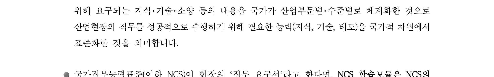

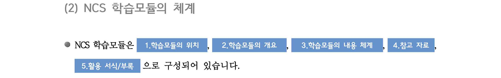

[NCS-학습모듈의 위치]

| 정보통신 |  |  |
| --- | --- | --- |
|  | 정보기술 |  |
|  |  | 정보기술개발 |

대분류
중분류
소분류
세분류

| SW아키텍처 |  |  | 능력단위 | 학습모듈명 |
| --- | --- | --- | --- | --- |
| 응용SW 엔지니어링 |  |  | 보안계획 수립 | 보안계획 수립 |
| 임베디드SW 엔지니어링 |  |  | 보안위험 평가 | 보안위험 평가 |
| DB엔지니어링 |  |  | 보안요구사항 정의 | 보안요구사항 정의 |
| NW엔지니어링 |  |  | 관리적 보안 구축 | 관리적 보안 구축 |
| 보안엔지니어링 |  |  | 물리적 보안 구축 | 물리적 보안 구축 |
| UI/UX엔지니어링 |  |  | 소프트웨어 개발 보안 구축 | 소프트웨어 개발 보안 구축 |
| 시스템SW 엔지니어링 |  |  | 데이터베이스 보안 구축 | 데이터베이스 보안 구축 |
| 빅데이터 플랫폼구축 |  |  | 시스템 보안 구축 | 시스템 보안 구축 |
| 핀테크 엔지니어링 |  |  | 네트워크 보안 구축 | 네트워크 보안 구축 |
| 데이터아키텍트 |  |  | 보안체계 운영관리 | 보안체계 운영관리 |
|  |  |  | 보안위협 관리통제 | 보안위협 관리통제 |
|  |  |  | 보안감사 수행 | 보안감사 수행 |
|  |  |  | 보안인증 관리 | 보안인증 관리 |

차 례
학습모듈의 개요 1
학습 1. 운영보안 수립하기
• 1-1. 정보자산 식별 및 도입 3
• 1-2. 침해사고 대응절차 수립 11
• 교수・학습 방법 19
• 평가 21
학습 2. 침해사고 대응하기
• 2-1. 침해사고 대응 23
• 2-2. 침해사고 후속조치 29
• 교수・학습 방법 37
• 평가 39
학습 3. IT재해복구체계 수립하기
• 3-1. IT재해복구 대책 수립 41
• 3-2. IT재해복구 체계 개선 49
• 교수・학습 방법 58
• 평가 60
학습 4. 정보보호 교육하기
• 4-1. 정보보호 교육 준비 62
• 4-2. 정보보호 교육 시행 및 개선 69
• 교수・학습 방법 77
• 평가 79
참고 자료 81
활용 서식 82
보안체계 운영관리 학습모듈의 개요
학습모듈의 목표
보안엔지니어링을 위하여 운영보안체계를 수립하고 이에 따라 직원의 정보보호 교육을 수행하
며 침해사고 대응 및 IT재해사항 발생 시 복구할 수 있다.
선수학습
자산관리, 보안위험 평가(2001020602_14v2), 보안요구사항 정의(2001020603_14v2), 보안위협 관리
통제(2001020608_14v2), 보안 공학(Security Engineering)
학습모듈의 내용체계

| 학습 | 학습 내용 | NCS 능력단위 요소 |  |
| --- | --- | --- | --- |
|  |  | 코드번호 | 요소명칭 |

1-1. 정보자산 식별 및 도입
1. 운영보안 수립하기 2001020607_16v3.1 운영보안 수립하기
1-2. 침해사고 대응절차 수립
2-1. 침해사고 대응
2. 침해사고 대응하기 2001020607_16v3.2 침해사고 대응하기
2-2. 침해사고 후속조치
3-1. IT재해복구 대책 수립
3. IT재해복구체계 수립 IT재해복구체계
2001020607_16v3.3
하기 수립하기
3-2. IT재해복구 체계 개선
4-1. 정보보호 교육 준비
4. 정보보호 교육하기 2001020607_16v3.4 정보보호 교육하기
4-2. 정보보호 교육 시행 및 개선
핵심 용어
정보자산 식별, 침해사고 대응, IT재해복구, 정보보호 교육, 정보보호 정책, 정보시스템 관리절차
수립, 재발방지대책 수립

| 학습 1 | 운영보안 수립하기 |
| --- | --- |

학습 2 침해사고 대응하기
학습 3 IT재해복구체계 수립하기
학습 4 정보보호 교육하기
1-1.
정보자산 식별 및 도입
Ÿ 보안체계운영을 위하여 운영보안에 포함할 정보자산을 운영목적에 맞게 분류하여
학습 목표 목록화 할 수 있다.
Ÿ 보안체계운영에 필요한 정보 자산의 도입절차와 변경 절차를 수립할 수 있다.
필요 지식 /
• 정보보안 솔루션/기술의 Life-Cycle 개념
1. 정보보안 솔루션/기술 Life-Cycle 개념
적용중인 정보보안 솔루션 및 적용 보안 기술에 대한 생명주기
2. 정보보안 솔루션/보안 기술에 Life-Cycle이 적용되는 근거
정보보안 솔루션을 도입하거나 특정 IT서비스에 보안 기술을 적용한 경우, 정보보안 솔루
션 자체의 노후화나 적용중인 보안 기술에 대한 법적인 요구사항 변경 등의 다양한 사유
에 의해 적용중인 기술이 한계 도달함에 따른 교체/변경이 필요
3. 정보보안 솔루션/기술의 변경 시점
하기의 사유 이외에 다양한 요구사항에 의해 적용 정보보안 솔루션 및 보안 기술의 변경 필요
<표 1-1> 정보보안 솔루션/기술 변경 사유 사례
관점 변경 사유 세부 내용
적용 기관/조직 관련 관계 법/시행령/시행규칙이나 지
관계법령 변경
침, Guide 등이 주관 기관에 의해 변경된 경우
사회
인접/경쟁/유사 직종/기관에서 신규 보안사고 발생에
보안사고 발생
의한 사전 준비가 필요한 경우
경제 장비 노후화 적용중인 정보보안 솔루션의 수명 만기 도래
현 적용중인 정보보안 솔루션의 유지보수 비용이, 신
유지보수 비용 과다
규 정보보안 솔루션 도입 비용보다 과다한 경우
법적 요구 기능의 변경이나 사이버 위협의 기술이 제
기술 기술 한계
공 정보보호 기술보다 진보된 경우
• 보안위협과 취약점 간의 관계
1. 보안 취약점에 대한 개념
특정 자산이 내포하고 있는 보안 관점의 약점. 자산의 존재 및 활용되는 도중, 물리적/논
리적인 손실을 가져 올 수 있는 보안적인 특성. 모든 자산에는 고유의 취약점이 존재
2. 보안위협에 대한 개념
특정 자산의 약점을 이용하여, 해당 자산에 대한 불법 점유/악용하고자 하는 행위. 특정
약점을 이용하고자 하는 비인가된 행위
3. 보안위협과 보안 취약점 간의 상관관계
보안사고는 보안 취약점을 이용한 보안위협의 실행으로 발생

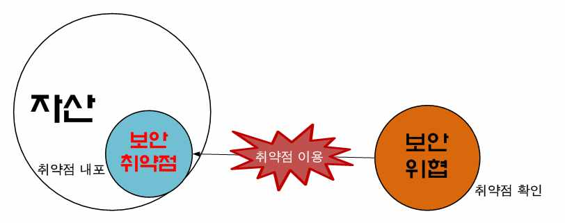

[그림 1-1] 보안위협과 보안 취약점 간의 상관관계
4. 보안위협과 보안 취약점의 관계 사례

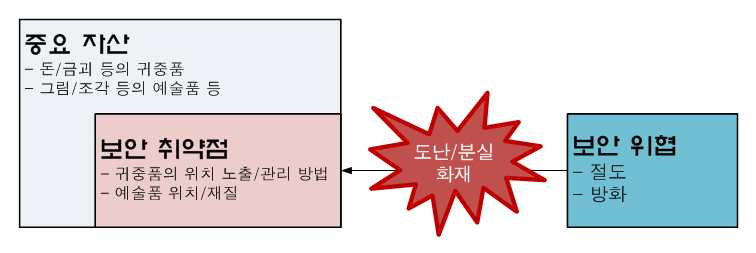

[그림 1-2] 보안위협과 보안 취약점 간의 관계 사례
• 정보보호 전략의 개념
1. 정보보호 전략의 정의
조직/개인의 상황을 바탕으로 정보보호 목표를 달성하기 위한 제한된 방법. 개인이나 조
직이 목표하는 정보보호 환경을 이루기 위해 적용되는 개별적인 특성
2. 정보보호 목표와 전략과의 관계 및 정보보호 전략의 구성
(1) 정보보호 목표는 경영목표에 종속
(2) 정보보호 전략은 정보보호 목표에 종속
(3) 정보보호 전략은 ‘적용 영역’과 ‘적용 방법’, ‘특성’으로 구성

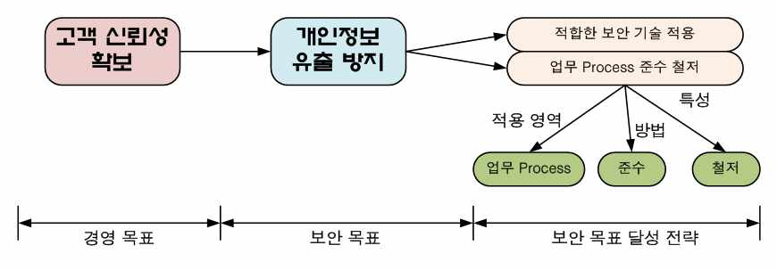

[그림 1-3] 정보보호 목표와 전략과의 관계/정보보호 전략 구성
수행 내용 / 정보자산 식별 및 도입하기
재료·자료
Ÿ 자산대장
Ÿ 조직의 정보보호 정책/정보보호 시행지침 등의 보안 내규
Ÿ 정보통신망 이용촉진 및 정보보호 등에 관한 법률 조문
Ÿ ISO27001: 2013 통제항목
Ÿ 정보보호관리체계(ISMS) 세부 점검항목
Ÿ 개인정보보호관리체계(PIMS) 세부 점검항목
기기(장비･공구)
Ÿ 컴퓨터, 프린터, 복사기 등
Ÿ 문서작성 도구, E-mail 발송 시스템, 프리젠테이션 도구
안전･유의 사항
Ÿ 조직의 규모 및 정보자산 취급 담당자의 직무 및 업무 범위, 권한에 따라 정보자산의 보안등급이
상이하게 결정될 수 있다.
Ÿ 정보자산에 대한 보안등급은, 특정 사용자에 따라 그 등급이 상이해 질 수 있으나 해당 정보자산
의 이해관계자 전체에 대한 각각의 관점에 보안등급을 평가하여, 가장 높은 등급이 해당 정보자
산의 보안등급으로 설정된다.
Ÿ 정보자산에 대한 정확한 취약점 및 위협을 판단하기 위해, 해당 정보자산에 대한 전체 이해관계자
및 정보자산의 취급 과정, Life-Cycle의 조사가 필요하다.
Ÿ 정보자산의 유형 및 취급 담당자, 사용자 등의 정보자산 특성에 따라, 적용되는 정보보안 솔루션
및 보안 기술은 상이하게 적용될 수 있다.
Ÿ 도입된 정보보호 솔루션/보안 기술은, 사회/기술/경제/정치적인 환경에 의해 초기수립된
Life-Cycle이 수정/변경 될 수 있다.
수행 순서
• 보안체계운영을 위한 운영보안 목적을 확인한다.
1. 운영보안 목적을 확인하기 위해, 정보보호 정책을 조사한다.
(1) 조직에 적용중인 정보보호 정책서를 확보하고, 해당 문서에서 전체적인 구성을 확인한다.
(2) 정보보호 정책서에 나타난 정보보호에 대한 목표를 조사한다.

[그림 1-4] 정보보호 목표 조사 사례
2. 정보보호 목표를 달성하기 위한 전략을 조사한다.
(1) 정보보호 정책서나 정보보호 시행 지침 등에 기술된 정보보호 달성 전략을 확인한다.
(2) 확인된 정보보호 목표 달성 전략을 분석하여‘영역’과 ‘수단/방법’, ‘특성(요구사
항)’을 도출한다.

[그림 1-5] 정보보호 전략 조사 사례
3. 정보보호 정책에 대한 구체적인 운영보안 목적을 도출한다.
(1) 정보보호 정책에 해당하는 조직의 정보보호 시행지침을 조사한다.
(2) 정보보호 시행지침에서 운영보안 목적을 확인한다.

[그림 1-6] 정보보호 시행지침상의 운영보안 목적 사례
• 조직에서 운영/활용 중인 정보자산을 조사한다.
1. 조직에서 취급하고 있는 정보 유형을 조사한다.
2. 조사된 정보 항목별 취급 Process를 조사한다.
3. 도출된 운영보안 목적에 따라 조사된 정보자산을 분류하여 목록화 한다.
(1) 정보자산을 운영보안 목적에 따라 분류한다.
(2) 분류된 정보자산에 대해 중요도에 따라 보안등급을 설정한다.
4. 분류된 정보자산별 보안위협 및 취약점을 조사한다.
<표 1-2> 정보자산별 보안위협 및 취약점 조사 사례
정보 취급 Process 보안요구사항 보안위협 보안 취약점
영업팀
기업 내부 수익 정보 영업 실적/계약
영업 실적 -> 재무/회계팀 기밀성
의 악용/오도 정보 유출
-> 총무팀
직원 정보의
인사 정보 인사팀-> 총무팀 기밀성 직원 정보의 악용
유출
급여 정보의 비
급여 정보 전사 -> 인사팀 무결성 급여 이체 금액 악용
인가 변경
• 보안체계운영에 필요한 정보 자산의 도입절차와 변경 절차를 수립한다.
1. 운영보안 목적에 따라 분류된 정보자산에 적합한 정보보호 자산을 결정한다.
(1) 조사된 보안위협과 취약점을 고려하여, 적합한 정보보호 솔루션/기술을 결정한다.
(2) 결정된 정보보호 솔루션/기술의 Life-Cycle을 도출한다.
<표 1-3> 정보보호 솔루션/기술의 Life-Cycle 도출 사례
정보 취급 Process 보안요구사항 ... 적용보안기술/솔루션 수명
영업팀
영업 실적 -> 재무/회계팀 기밀성 ...
-> 총무팀
문서보안(DRM 5년
인사 정보 인사팀-> 총무팀 기밀성 ...
급여 정보 전사 -> 인사팀 무결성 ...
2. 결정된 정보보호 자산의 도입절차를 수립한다.
(1) 정보보호 자산의 도입 고려사항을 결정한다.
(2) 결정된 도입 고려사항에 따른 이해관계자를 조사한다.
(3) 조사된 이해관계자로부터 합의해야 할 내용을 도출한다.
(4) 도출된 합의내용과 실제 정보보호 자산 도입을 위한 절차를 수립한다.
<표 1-4> 정보보호 자산 도입 절차 수립 사례
적용보안기술/솔루션 고려사항/합의사항 이해관계자 도입절차
1) 기획안 제출
2) 이해관계자 요구사항 조사
3) RFP 작성
지원 SW 종류(범위)
4) 제안서 수집/평가
비용 사용자 전체
5) BMT
문서보안(DRM) 사용/관리 편의성 총무팀
6) 입찰 및 낙찰, 결과 공시
성능 시스템운영팀
7) 시범 설치/운영
...
8) 검수
9) 전 사업 범위 설치/운영
10) 정기 점검
3. 도출된 정보보호 자산의 Life-Cycle 도달 시 변경 절차를 수립한다.
(1) 정보보호 자산의 Life-Cycle 도달 판정 기준과 판정 방법을 수립한다.
(2) 수립된 판정 기준/방법에 따른 이해관계자를 조사한다.
(3) 조사된 이해관계자로부터 합의해야 할 내용을 도출한다.
(4) 도출된 합의내용과 실제 정보보호 자산 변경을 위한 절차를 수립한다.
<표 1-5> 정보보호 자산 변경 절차 수립 사례
적용보안기술/솔루션 ... 예상 Life-Cycle 판정 기준 변경 절차
여유율 : 10%
(직원 수 증가)
1) 현황 분석
2) 적용 중인 보안 솔루
션 실태 조사 및
문서보안(DRM) ... 5년 License 한계치 도달
Life-Cycle 도달 판정
(SW종류(범위) 확)대
3) 이후 과정은 도입
절차와 동일
신규도입 대비 MA
비용 증가
수행 tip
Ÿ 정보보호 목표 달성을 위한 전략은 조직/기업/기관
의 특성에 따라 다양한 방식으로 기술/표현/전달/
보관될 수 있다.
1-2.
침해사고 대응절차 수립
Ÿ 정보시스템의 가용성 보장을 목적으로 정보시스템의 성능 및 용량관리 절차를 수
립할 수 있다.
Ÿ 침해사고를 포함한 보안사고에 대응하기 위한 장애관리 절차를 수립할 수 있다.
Ÿ 데이터의 무결성 및 정보시스템의 가용성 유지를 위한 백업 절차를 수립할 수 있다.
학습 목표
Ÿ 정보보호의 기밀성을 위하여 분류된 정보자산의 등급과 속성에 따라 접근통제정책
을 수립할 수 있다.
Ÿ 정보시스템 저장 매체관리를 위한 체계 및 절차를 수립할 수 있다.
Ÿ 외부로부터의 침해시도를 모니터링하기 위한 체계 및 절차를 수립할 수 있다.
필요 지식 /
• 정보보호 요구사항(인기가무부추)
1. 정보보호 요구사항에 대한 개념
(1) 조직/개인이 운영하고 있는 자산에 요구되는 보안적인 특성
(2) 특정 자산이 유실/훼손 시 발생하게 되는 부정적인 효과에 대비하기 위한 요구사항
2. 정보보호 요구사항 종류
일반적으로 다음의 6가지 항목이 정보보호 요구사항으로 제시되고 있음
<표 1-6> 정보보호 요구사항 종류
정보보호 요구사항 내용 보안위협/사례
자산이 외부에 유출되는 것을 방지하
기밀성 정보의 유출
는 특성
무결성 자산이 인가되지 않은 상태에서 변경 정보의 변경
자산에 접근하는 사용자의 식별과 자
인증 비인가자의 자산 악용
산에 대한 접근 권한의 검증
가용성 적시에 자산의 활용 가능성을 유지 자산의 분실
특정 행위에 대한 사실을 부인하는 것 특정 정보의 수신 사
부인방지
을 사전에 방지 실의 불인정
특정 행위/사건의 이력을 확인할 수
추적 침해사고의 추적
있는 가능성
• 접근통제 유형(MAC,DAC,RBAC)
1. 접근통제의 개념
특정 객체에 대한 주체의 식별 및 주체가 가진 권한에 대한 검증을 수행하는 행위 일체
일반적으로 주체와 객체의 보안적인 특성을 비교하여 검증을 수행
2. 접근통제의 유형별 적용 방식
기본적으로 다음의 3가지를 제시하고 있으며, 복합/응용형 접근통제 유형을 적용 가능
<표 1-7> 접근통제 유형 및 사례
접근통제 유형 적용 원리 사례
접근통제 원칙 :
주체와 객체의 보안등급이나
- 상위 등급만 읽기 가능
보안 그룹 등의 보안 특성을
- 동일 등급만 수정가능
강제적 접근통제 비교
사례 :
(MAC) 보안 특성 비교 결과를 접근통
- 주체 : 5등급
제 원칙에 적용하여 접근의 허
- 객체 : 4등급
용 여부를 결정
- 판정 결과 : 읽기/수정 차단
주체의 객체에 대한 접근 권한 정책
임의적 접근통제
을 정책으로 설정하여 허용/차 - 사용자 A : 문서_1 접근 허용
(DAC)
단 여부를 결정 - 사용자 B : 문서_1 접근 차단
역할 :
- 팀장 : 읽기만 허용
- 팀원 : 읽기, 쓰기 허용
MAC과 DAC를 혼합한 방식 사용자 :
주체에 대해 특정 역할을 설정 - 직원 A : 팀장
역할기반 접근통제
하고, 역할별 객체에 대한 접근 - 직원 B : 팀원
(RBAC)
권한을 정책으로 설정 후 허용/ 정책 :
차단 여부를 결정하는 방식 - 문서_1은 역할‘팀원’적용
결과 :
- 직원 A : 접근 차단
- 직원 B : 읽기, 쓰기 가능
수행 내용 / 침해사고 대응절차 수립하기
재료·자료
Ÿ 조직의 정보보호 정책/정보보호 시행지침 등의 보안 내규
Ÿ IT서비스 운영관리 지침서
Ÿ 조직에 적용 중인 정보보안 솔루션/기술 운영 표준
Ÿ 정보보호관리체계(ISMS) 세부 점검항목
Ÿ 개인정보보호관리체계(PIMS) 세부 점검항목
기기(장비･공구)
Ÿ 컴퓨터, 프린터, 복사기 등
Ÿ 문서작성 도구, E-mail 발송 시스템
안전･유의 사항
Ÿ 조직의 규모 및 업무 분야에 따라 적용되는 정보보안 솔루션 및 적용 보안 기술은 상이할 수
있다.
Ÿ IT 정보 서비스의 운영 목표 및 서비스에 적용되는 정보자산의 중요도/용량 등에 따라, 서비스에
서 요구되는 성능 및 용량은 상이할 수 있다.
Ÿ “장애관리”는 ‘정보자산 및 정보시스템의 장애’와 무결성의 위배, 정보자산의 유출 등의
포괄적인 비정상 운영상태를 나타낸다.
Ÿ 정보자산의 이동/배포를 위한 저장매체의 활용은, 정보자산 식별을 통해 통제될 수 있기 때문에
접근통제정책 설정 이전에 정보자산 및 정보시스템 자산 식별 및 통제가 우선 적용되어야 한다.
Ÿ 침해사고에 대한 모니터링은 기본적으로 ‘외부’의 침입 여부를 감지하기 위해 수행되나, 조직
의 목표 및 보안환경에 의해 ‘내부’를 모니터링할 수 있다.
수행 순서
• 정보시스템의 가용성 보장을 목적으로 정보시스템의 성능 및 용량관리 절차를 수립한다.
1. 조사된 정보시스템 자산별 가용성 만족 수준을 확인한다.
(1) 정보시스템 자산을 목록화 한다
(2) 정보시스템 자산별 가용성 만족을 위한 성능 및 용량관리 항목을 도출한다.
2. 확인된 가용성 만족 수준에 대한 성능 및 용량 기준을 도출한다.
(1) 도출된 성능 및 용량관리 항목별 허용 가능한 만족 기준을 결정한다.
(2) 결정된 만족 기준을 평가하기 위한 방법을 결정한다.
3. 성능 및 용량 기준을 관리하기 위한 절차를 수립한다.
(1) 도출된 성능 및 용량을 검사하기 위한 담당자를 임명한다.
(2) 임명된 담당자가 해당 성능 및 용량을 확인하기 위한 검사 주기를 설정한다.
(3) 성능 및 용량이 기준치에 미달 시 가용성 만족을 위해 조치하기 위한 절차를 수립한다.
<표 1-8> 성능 및 용량 관리 절차 수립 사례
성능 용량
용량 허용 미달 시
정보시스템 성능 기준 판정 허용 검사주기
판정 방법 조치절차
방법 기준
성능 :
- 시스템 변경
CPU : 40%이하 사용율 여유공간 여유공간
Mail Server 1회/1주 용량 :
Mem : 50%이하 검사 20% 확인
- 추가 저장
장치 장착
성능 :
- 시스템 변경
CPU : 20%이하 사용율 여유공간 여유공간
그룹웨어 1회/2주 용량 :
Mem : 60%이하 검사 40% 확인
- 추가 저장
장치 장착
대역폭
NW
Firewall N/A N/A 95%이하 1회/년 장비 교체
성능측정
/64byte
• 침해사고를 포함한 보안사고에 대응하기 위한 장애관리 절차를 수립한다.
1. 침해사고를 포함한 예상 보안사고 유형을 조사한다.
(1) 조직에서 적용 중인 자산을 조사한다.
(2) 과거 침해사고 및 정보보호 시사 정보를 바탕으로 보안사고유형을 조사한다.
2. 조사된 예상 보안사고 유형이 발생할 수 있는 자산을 조사한다.
(1) 조사된 전체 자산에 대하여, 각 자산에서 발생 가능한 보안사고를 확인한다.
(2) 보안사고 발생 시 이를 확인할 수 있는 판정 기준을 수립한다.
3. 분석된 예상 장애상황에 따라 장애 대응 절차를 수립한다.
(1) 장애 상황 대비 각 자산의 복구 목표를 결정한다.
(2) 복구 목표를 달성하기 위한 절차를 수립한다.
<표 1-9> 장애 대응 절차 수립 사례
자산 예상 보안사고 사고 판정 기준 복구 목표 장애 복구 절차
- Pr o c e s s - 1차 : Mirror
- Mail Server
Mail 송수신 Down Server 가동
재가동
불가 - System HW - 2차 : Platform
- Mail Data 동기화
Fault 교체
Mail Server
- 방화벽 Mail 관
과다 Mail 적재 50건 수신/1초 10건 수신/1초 련 보안 정책
추가
- Pr o c e s s - 1차 : System
Server Access Down - Server 재가동 Restart
그룹웨어
불가 - System HW - DB 동기화 - 2차 : Platform
Fault 교체
• 데이터의 무결성 및 정보시스템의 가용성 유지를 위한 백업 절차를 수립한다.
1. 데이터 무결성을 유지해야 하는 정보자산을 조사한다.
2. 조사된 정보자산을 저장하는 정보시스템을 확인한다.
3. 확인된 정보시스템에서 해당 정보자산에 대한 백업 절차를 수립한다.
(1) 정보자산에 대한 위치를 확인한다.
(2) 정보자산에 대한 백업 위치 및 백업 주기, 방법을 결정한다.
(3) 백업 위치, 주기, 방법에 따라 백업 절차를 수립한다.
4. 무결성 훼손 시, 백업 데이터를 바탕으로 정보자산 복구 절차를 수립한다.
<표 1-10> 백업 절차 수립 사례
정보저장
자산 정보자산 위치 백업 위치 백업 절차 복구 절차
시스템
시스템1실 시스템3실
SAN 실시간 백업 수동 복구
그룹웨어 3열 5번 Rack 5열 2번 Rack
Storage (SAN Mirroring) (SAN Recover)
2/3/4/5 Storage 2/3/4/5 Storage
시스템1실 시스템3실
HR 자동 백업 수동 복구
인사정보 5열 1번 Rack 2열 3번 Rack
System (매일 01:00) (HDD 복원)
3번 Server 3번 Storage
• 정보보호의 기밀성을 위하여 분류된 정보자산의 등급과 속성에 따라 접근통제정책을 수립
한다.
1. 기조사된 정보자산의 등급과 속성을 조사한다.
(1) 기업에서 사용하고 있는 전체 정보자산을 조사한다.
(2) 조사된 전체 정보자산에 대해 중요성을 판단하여 보안 정책을 적용할 정보자산을 판
별한다.
(3) 중요 정보 자산이 활용되는 업무 process를 조사한다.
(4) 판별된 중요 정보 자산에 대하여 적용할 보안 속성을 결정한다.
(5) 판별된 중요 정보 자산과 활용 업무 Process를 바탕으로 보안등급을 결정한다.
2. 정보자산의 등급과 속성에 따라 적용할 접근통제 유형을 결정한다.
(1) 중요 정보 자산에 요구되는 보안 속성을 바탕으로 접근통제 모델을 도출한다.
(2) 접근통제 모델을 바탕으로 접근통제 유형을 결정한다.
3. 결정된 접근통제 유형을 적용할 보안 솔루션/기술을 조사한다.
(1) 식별된 중요 정보 자산과 업무 Process 및 접근통제 유형을 바탕으로, 보안이 적용될
수 있는 업무 시점/지점을 도출한다.
(2) 도출된 업무 시점/지점에 적용할 수 있는 보안 솔루션을 도출한다.
(3) 보안 솔루션이 적용될 수 없을 경우, 적용 가능한 보안 기술을 결정한다.
4. 정보자산의 등급과 속성에 따라 접근통제 정책을 수립한다.
5. 수립된 접근통제정책을 적용할 보안 솔루션/기술에 적용한다.
<표 1-11> 접근통제정책 수립 사례
정보자산 보안 속성 접근통제유형 보안등급 정책 적용 대상 보안 정책
기밀성 인사팀 허용
인사정보 DAC 1등급 DRM Server
무결성 기타 모두 차단
기밀성 영업팀 : RW
영업실적정보 DAC 1등급 DRM Server
무결성 재무팀 : R
총무팀 : RW
기업 고시 무결성 MAC 5등급 Firewall
모든 사용자 : R
• 정보시스템 저장 매체관리를 위한 체계 및 절차를 수립한다.
1. 조사된 정보시스템 자산별 저장 매체를 확인한다.
(1) 기조사된 중요 정보에 대하여, 정보 유통 시 사용되는 저장매체를 조사한다.
(2) 중요 정보가 유출될 수 있는 정보시스템의 저장매체 연결 경로(Interface)를 조사한다.
2. 확인된 저장 매체에 대한 운영 만족 기준을 결정한다.
(1) 중요 정보의 유통/유출을 통제하기 위한 업무 Process를 결정한다.
(2) 저장 매체를 관리/감독하기 위한 업무 담당자를 결정한다.
3. 결정된 운영 만족 기준을 위한 관리체계 및 절차를 수립한다.
(1) 결정된 업무 담당자가 해당 업무를 수행하기 위한 절차를 수립한다.
(2) 업무 수행에 필요한 지원 시스템을 구축한다.
(3) 구축된 지원 시스템의 사용 계획 및 사용 방법을 공지한다.
<표 1-12> 저장 매체관리 체계 및 절차 수립 사례
정보자산 유통 저장매체 유출가능 IF 통제 절차 담당자 지원시스템
인사정보 CD, USB 토큰 CD-Rom, USB IF
불시 점검
직원A N/A
비인가 CD/USB 수거
영업실적정보 CD, USB 토큰 CD-Rom, USB IF
• 외부로부터의 침해시도를 모니터링하기 위한 체계 및 절차를 수립한다.
1. 조사된 예상 보안사고 유형별 침해 경로를 조사한다.
(1) 사고유형별 침해 기법을 조사한다.
(2) 침해 기법에 대한 사고 발생 인지 방법을 확인한다.
2. 확인된 침해사고 발생 인지 방법에 따라 모니터링 체계 및 절차를 수립한다.
(1) 침해사고 발생 인지를 위한 전문 모니터링 조직, 대상, 기법 등을 수립한다.
(2) 침해사고 대응 절차(인지, 보고/통지/신고-기관 포함)를 수립한다.
<표 1-13> 모니터링 체계 및 절차 수립 사례
예상 보안사고 침해 기법 인지 방법 담당 조직 대상 기법 대응 절차
비인가 접근
내부자 유포
시도
중요 ESM 침해대응팀
정보 유출 관제팀
정보 활용 전달
비인가 접근
외부자 유출
시도
과실에 의한
무결성 검사
변경 정보 중요 DRM 직속 상관
정보 변경
책임자 정보 검사 보고
고의적 변경 무결성 검사
수행 tip
Ÿ 침해사고 대응 체계 및 절차는, 상기의 6개 항목
이외에 조직의 규모, 분야, 운영 수준, 자산의 중
요성 등에 따라 다양한 대응체계 및 대응 방법/절
차가 존재할 수 있다.

| 학습 1 | 교수·학습 방법 |
| --- | --- |

교수 방법
Ÿ 정보보호 정책의 다양한 사례를 제시한다.
Ÿ 정보보호 시행지침의 다양한 사례를 제시한다.
Ÿ 조직에서 취급하고 있는 정보 유형 적용 사례를 제시한다.
Ÿ 조사된 정보 항목별 취급 Process에 대한 다양한 사례를 제시한다.
Ÿ 정보자산의 운영보안 목적의 다양한 사례를 제시한다.
Ÿ 분류된 정보자산별 보안위협 및 취약점 간의 관계를 조사한다.
Ÿ 정보시스템의 성능 및 용량관리 절차를 구체적으로 설명한다.
Ÿ 보안사고에 대응하기 위한 장애관리 절차를 사례를 들어 설명한다.
Ÿ 데이터의 무결성 및 정보시스템의 가용성에 대한 보안 환경을 설명한다.
Ÿ 정보자산의 등급과 속성에 따른 접근통제정책/유형을 구체적으로 설명한다.
Ÿ 정보시스템 저장 매체관리의 중요성에 대해 설명한다.
Ÿ 외부로부터의 침해시도를 모니터링하기 위한 체계에 대해 구체적으로 설명한다.
학습 방법
Ÿ 정보보호 정책의 다양한 사례를 조사한다.
Ÿ 정보보호 시행지침의 다양한 사례를 분석한다.
Ÿ 조직에서 취급하고 있는 정보 유형 적용 사례를 조사하여 발표한다.
Ÿ 조사된 정보 항목별 취급 Process를 이해한다.
Ÿ 정보자산을 운영보안 목적의 다양한 사례를 조사한다.
Ÿ 분류된 정보자산별 보안위협 및 취약점 간의 관계를 이해한다.
Ÿ 정보시스템의 성능 및 용량관리 절차를 이해하여 발표한다.
Ÿ 보안사고에 대응하기 위한 장애관리 절차를 조사한다.
Ÿ 데이터의 무결성 및 정보시스템의 가용성에 대한 보안 환경을 조사한다.
Ÿ 정보자산의 등급과 속성에 따른 접근통제정책/유형을 조사한다.
Ÿ 정보시스템 저장 매체관리의 중요성에 대해 이해한다.
Ÿ 외부로부터의 침해시도를 모니터링하기 위한 체계에 대해 조사한다.

| 학습 1 | 평 가 |
| --- | --- |

평가 준거
• 평가자는 학습자가 수행 준거 및 평가 시 고려사항에 제시되어 있는 내용을 성공적으로 수행하였
는지를 평가해야 한다.
• 평가자는 다음사항을 평가한다.

| 학습 내용 | 평가 항목 | 성취수준 |  |  |
| --- | --- | --- | --- | --- |
|  |  | 상 | 중 | 하 |

- 보안체계운영을 위하여 운영보안에 포함할 정보자산
을 운영목적에 맞게 분류하여 목록화할 수 있다.
정보자산 식별
및 도입
- 보안체계운영에 필요한 정보 자산의 도입절차와 변
경 절차를 수립할 수 있다.
- 정보시스템의 가용성 보장을 목적으로 정보시스템의
성능 및 용량관리 절차를 수립할 수 있다.
- 침해사고를 포함한 보안사고에 대응하기 위한 장애
관리 절차를 수립할 수 있다.
- 데이터의 무결성 및 정보시스템의 가용성 유지를 위
한 백업 절차를 수립할 수 있다.
침해사고 대응절
차 수립
- 정보보호의 기밀성을 위하여 분류된 정보자산의 등
급과 속성에 따라 접근통제정책을 수립할 수 있다.
- 정보시스템 저장 매체관리를 위한 체계 및 절차를
수립할 수 있다.
- 외부로부터의 침해시도를 모니터링하기 위한 체계
및 절차를 수립할 수 있다.
평가 방법
• 사례연구

| 학습 내용 | 평가 항목 | 성취수준 |  |  |
| --- | --- | --- | --- | --- |
|  |  | 상 | 중 | 하 |

- 보안운영목적에 맞게 정보자산의 분류
정보자산 식별
및 도입
- 정보 자산의 도입절차와 변경절차의 수립 - - -
• 서술형 시험

| 학습 내용 | 평가 항목 | 성취수준 |  |  |
| --- | --- | --- | --- | --- |
|  |  | 상 | 중 | 하 |

| 침해사고 대응절차 수립 • 구두 발표 침해사고 대응절차 수립 피 드 백 | - 정보시스템의 성능 및 용량관리 절차 수립 방법 - 장애관리 절차 수립 시 고려사항 - 백업 절차 수립 조건 - 접근통제정책 적용 시 조건 - 정보시스템 저장 매체관리 체계 사례 - 외부로부터의 침해시도 모니터링 절차 사례 |  |  |  |
| --- | --- | --- | --- | --- |
| 1. 사례연구 - ‘정보자산하여, 오류 및 | 식별 및 도입’학습 내용에 관련된 사례를 조사/분석시켜미흡한 점을 지적하고 보완 설명한다. | 도출된 | 산출물에 | 대 |
| 2. 서술형 시험- ‘침해사고당 답안에 대해 | 대응절차 수립’학습 내용 중, 학습 내용에 대한 서술형 오류 및 미흡한 점을 지적하고 보완 설명한다. | 문제를 | 제시하고, | 해 |
| 3. 구두 발표 - ‘침해사고방향 및 접근 | 대응절차 수립’학습 내용 중, 동일/유사 사례를 조사/발표한절차에 대한 오류 및 미흡한 점을 지적하고 보완 설명한다. | 후, | 발표내용의 |  |

| 학습 내용 | 평가 항목 | 성취수준 |  |  |
| --- | --- | --- | --- | --- |
|  |  | 상 | 중 | 하 |

| 침해사고 대응절차 수립 피 드 백 | - 접근통제정책 적용 시 조건 - 정보시스템 저장 매체관리 체계 사례 - 외부로부터의 침해시도 모니터링 절차 사례 |  |  |  |
| --- | --- | --- | --- | --- |
| 1. 사례연구 - ‘정보자산하여, 오류 및 | 식별 및 도입’학습 내용에 관련된 사례를 조사/분석시켜미흡한 점을 지적하고 보완 설명한다. | 도출된 | 산출물에 | 대 |
| 2. 서술형 시험- ‘침해사고당 답안에 대해 | 대응절차 수립’학습 내용 중, 학습 내용에 대한 서술형 오류 및 미흡한 점을 지적하고 보완 설명한다. | 문제를 | 제시하고, | 해 |
| 3. 구두 발표 - ‘침해사고방향 및 접근 | 대응절차 수립’학습 내용 중, 동일/유사 사례를 조사/발표한절차에 대한 오류 및 미흡한 점을 지적하고 보완 설명한다. | 후, | 발표내용의 |  |

학습 1 운영보안 수립하기

| 학습 2 | 침해사고 대응하기 |
| --- | --- |

학습 3 IT재해복구체계 수립하기
학습 4 정보보호 교육하기
2-1.
침해사고 대응
Ÿ 침해사고 유형별 보고절차에 따라 신속히 보고하고 법적 통지와 신고 의무를 준수
학습 목표 할 수 있다.
Ÿ 보안운영체계에서 수립 된 침해사고 대응절차에 따라 처리와 복구를 수행할 수 있다.
필요 지식 /
• 침해사고 대응절차 및 수행 내용
1. 침해사고 대응 절차
(1) 침해사고는, 사고 발생 시점부터 초기 대응을 시작하여 평시 운영 상태로 복구하며,
해당 운영 방식을 개선하기까지의 과정 전체를 포함
(2) 침해사고에 대한 대응 절차는 정보 자산을 기준으로 작성되며, 자산의 종류와 중요도,
복구 목표 등에 따라 그 시행 내용이 상이

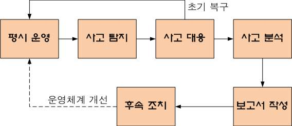

[그림 2-1] 침해사고 대응 절차 사례
2. 침해사고 대응 내용
일반적으로 수행되는 침해사고에 대한 수행 내용으로, 조직의 규모 및 업무 범위, 업무 수
준, 자산의 보안적인 특성에 따라 대응 내용은 상이할 수 있음
<표 2-1> 침해사고 대응 절차
절차 수행 업무 목표
- 조직에서 운영 중인 각종 서비스 및
평시 운영 경영 목표의 달성
업무 상태의 보안 요구사항을 만족
- 침해사고의 발생 여부 확인
사고 탐지 사고의 인지/종료 판단
- 침해사고의 종료 여부 확인
- 침해사고로부터 자산을 회복시키는
사고 대응 평시 운영 상태로의 복구
일체의 활동
- 침해사고의 발생 경로, 발생 원인(취
사고 분석 평시 운영상태의 문제점 확인
약점), 위협에 대한 전반적인 분석
보고서 작성 - 침해사고 전반에 대한 후속조치 기록 침해사고에 대한 이력 보관
- 평시 운영 상태의 문제점 해결 및
후속 조치 동일 침해사고의 재발 방지
개선
• 보고, 통지, 신고의 개념
보고, 통지, 신고는 침해사고에 대한 내용을 전달하는 대상이 다르나 수행하는 내용은 동일
<표 2-2> 보고, 통지, 신고의 개념
종류 대상 정의
보고 직속 상관
발생된 침해사고에 대한 일시, 대상, 사고 경위, 향후 조치 계획 등
통지 이해관계자
을 전달하는 것
신고 관련 기관
수행 내용 / 침해사고 대응하기
재료·자료
Ÿ 자산대장
Ÿ 조직의 정보보호 정책/정보보호 시행지침 등의 보안 내규
Ÿ 침해사고 대응지침서
Ÿ ISO27001: 2013 통제항목
Ÿ 비즈니스 영향 분석서
Ÿ 비즈니스 사업 연속 계획서
Ÿ 보안운영체계-사고처리 지침서
기기(장비･공구)
Ÿ 컴퓨터, 프린터, 복사기 등
Ÿ 문서작성 도구, E-mail 발송 시스템, 프리젠테이션 도구
안전･유의 사항
Ÿ 침해사고 발생 시, 신고 기관/담당자는 불규칙적으로 변경될 수 있으므로, 수시 확인하여 최신
정보를 유지해야 한다.
Ÿ 침해사고에 대한 대응지침은 보통 ‘포괄적’으로 기술되어 있으며, 침해사고 유형별로 상세히
기술되어 있지 않은 경우가 대부분이기 때문에, 침해사고 대응 팀/담당자의 기술/관리/물리적인
Skill이 요구된다.
Ÿ 침해사고 발생 시, 목표 복구 범위 및 수준은 서비스의 종류 및 중요성 등에 따라 평시 운영
상태와 차이가 있을 수 있다.
Ÿ 침해사고 발생 시, 법적 통지 범위는 조직과 연관된 관계기관 법령이 우선 적용 될 수 있기
때문에, 정확한 법령 해석이 필요하다.
수행 순서
• 침해사고 발생 시 보고절차에 따라 신속히 보고하고 법적 통지와 신고 의무를 준수한다.
1. 평시 운영 중, 침해사고의 발생 여부를 인지하고 확인한다.
(1) 특정 자산의 평시 운영 상태와 성능, 용량, 가용성 등의 자산 운영 허용 기준치를 기
억한다.
(2) 해당 자산의 각종 운영 수준이 허용 기준치의 수용범위에 포함되는지를 확인한다.
(3) 각 자산의 각종 운영 수준이, 허용 기준치를 초과할 경우 해당 자산이 침해사고를 받
은 것으로 간주한다.
<표 2-3> 침해사고 판정 사례
자산 평시 운영 허용 기준 현재 운영 상태 판정 결과
온도 : 35도
온도 : 30도 이하
별도의 화재는 확인되지 않음 지속적으로 온
도가 상승할 경
사무실
우, 잠재 화재로
습도 : 30%
습도 : 60% 이하 판단
지속적으로 습도가 낮아지고 있음
2. 침해사고 발생 상황을 신속히 보고한다.
(1) 침해사고 발생 시 해당 침해사고 유형을 확인한다.
침해사고의 대상이 되는 자산의 평소 운영 유형 대비, 현재의 운영 상태를 비교한다.
(2) 침해사고 유형별 지정된 보고절차에 따라 신속히 보고한다.
<표 2-4> 침해사고 보고 사례
자산 ... 현재 운영 상태 판정 결과 보고 대상 보고 이력
온도 : 38도
...
화재 확인
총무팀장
화재 사실을
사무실 화재로 판단 경비 서비스
습도 : 27% 유선으로 보고
업체
... 지속적으로 습도가
낮아지고 있음
3. 침해사고 내역을 바탕으로 피해 대상 주체에게 통지한다.
(1) 침해사고의 대상이 되고 있는 자산의 성격을 조사한다.
(2) 조사된 자산 성격을 바탕으로, 적용 관계법령을 조사한다.
(3) 조사된 관계법령을 바탕으로, 침해받은 자산의 주체를 확인한다.
(4) 확인된 주체에게 침해사고 내역 및 조치사항을 통지한다.
<표 2-5> 침해사고 통지 사례
자산 ... 판정 결과 보고 대상 보고 이력 통지대상 통지내용
총무팀장 화재 사실
화재
사무실 ... 화재 인식 경비 서비스 을 유선으 전체 임직원
사실 전파
업체 로 보고
4. 침해사고 내용을 신고한다.
(1) 침해사고 상황을 개략적으로 요약한다.
<표 2-6> 침해사고 상황 요약 사례
사고내용 발생 시간 발생 장소 사고내용
사무실
사무실 2003.10.22. 경기도 이천시 XX로YY
미상의 연기 발생
화재 22:30 경 ZZZZ 빌딩 4층
온도 급 상승 중
(2) 침해사고 상황을 기수립된 침해사고 대응 절차에 따라 신고 기관에 신고한다.
<표 2-7> 침해사고 신고 사례
신고대상 신고 방법 사고내용
사고 내용
소방서 전화 통화 발생 시간
발생 장소
• 보안운영체계에서 수립된 침해사고 대응절차에 따라 처리하고 복구한다.
1. 보안운영체계에서 수립된 침해사고 대응절차를 확인한다.
(1) 평소 보안운영체계의 침해사고 대응지침서의 대응 내용을 숙지한다.
(2) 침해사고 대응지침서에 기술된 사고 내역에 따라 사고를 처리한다.
<표 2-8> 침해사고 대응절차 사례
처리 항목 방법 처리 사고내용
사고 내용, 발생 시간, 발생 장소 등의
상급자 보고 전화 통화
사건 경위 전달
주변 통제 경비실 통보 전문 경비 업체에 해당 내용 전달
2. 침해사고 대응절차에 따라 처리하고 복구한다.
(1) 평소 침해사고 대응 절차서에 기술된 복구 방법을 숙지한다.
(2) 숙지된 내용을 바탕으로, 복구 대상을 식별한다.
(3) 복구 대상의 복구 가능성을 검토한다.
(4) 검토한 복구 가능성을 바탕으로, 복구 방식을 결정한다.
(5) 결정된 복구 방식에 따라, 해당 자산을 복구한다.
<표 2-9> 침해사고 대응 및 복구 사례
자산 복구 방법 현재 상태 복구 가능성 복구 방식
Service 복구
재도입
Mail Server - Data 복구 완파 복구 불가
(신규 구축)
- App 복구
문서 원본 확보 원본 유지
기밀문서 복구 불필요 N/A
(필요시 재발급) (내화 금고 보관)
사무용 가구 파손 시 재구매 부분 파손 복구 불가 재도입(재구매)
2-2.
침해사고 후속조치
Ÿ 보안관련 침해사고가 종결된 후 발생한 사고의 원인을 분석하고 그 결과를 보고하여
침해사고로부터 얻은 정보를 활용하여 재발방지에 필요한 대책을 수립할 수 있다.
학습 목표
Ÿ 침해사고 종결이후 정책, 절차, 조직 등의 대응체계에 대한 필요한 변경사항을 도
출 하여 권한부서에 제안 할 수 있다.
필요 지식 /
• 보안침해사고에 대한 영향범위
1. 보안침해사고 영향범위의 개념
(1) 보안침해사고 발생 시, 침해받은 자산의 복구 범위 결정을 위해 조사되는 업무 범위
(2) 침해받은 자산에 대한 조사뿐만 아니라, 해당 자산을 바탕으로 수행되는 전체 업무와
이와 관계된 이해관계자 전체를 조사
2. 보안침해사고에 대한 영향범위 조사 필요성
(1) 침해사고의 영향범위는 직접적/간접적인 영향범위가 존재
(2) 잔존 침해사고 발생 가능성을 최소화시킨 이후에 침해사고의 영향범위 도출 실시
3. 보안침해사고에 대한 영향범위 유형 및 사례
<표 2-10> 침해사고에 대한 영향범위 유형 및 사례
영향범위
사례 형태 사례 복구 절차
유형
- 시스템 파손
직접적 침해받은 정량적인 형태 : 200만원 자산 식별 후
영향범위 자산 로 도출 가능 - 가구 소실 원형 복원
: 30만원
- 기업 이미지 실추
정성적 자산의
침해받은 : 장시간 소요 예상
간접적 정성적인 형태 평소 평가 결과
자산에 - 기업 경쟁력 약화
영향범위 로만 도출 가능 보다 상향된 상
의한 : 과거 대비 경쟁력 강화
태로 복원 수행
투자 집중 필요
• 보안침해사고에 대한 이해관계자
1. 보안침해사고에 대한 이해관계자 개념
(1) 보안침해사고 발생 시, 침해받은 자산으로 인해 손실을 입은 관계자 일체
(2) 보안침해사고 발생 이후, 해당 침해사고를 대응/복구/사후관리를 수행하는 인력과 해
당 자산 복구 이후 관련 업무를 수행하는 인력을 포함
2. 보안침해사고에 대한 이해관계자 범위
보안침해사고에 대한 이해관계자는 최소 다음을 포함하며, 조직의 규모 및 복잡성, 수준에
따라 이해관계자는 상이할 수 있음
<표 2-11> 보안침해사고에 대한 이해관계자
이해관계자 침해사고에 대한 관점
- 침해받은 자산의 구체적인 확인
경영자
- 자산 복구비용의 최소화
- 침해받은 자산의 신속한 복구
복구 당사자
- 자산 복구 과정의 충분한 지원
- 침해사고 발생 원인의 규명
정부 관계자
- 해당 침해사고의 완전 종료
고객 - 침해받은 자산의 신속한 복구를 통한 서비스 제공 지속
협력사 - 침해받은 자산의 신속한 복구를 통한 협력 업무 재개
수행 내용 / 침해사고 후속조치하기
재료·자료
Ÿ 자산대장
Ÿ 조직의 정보보호 정책/정보보호 시행지침 등의 보안 내규
Ÿ 침해사고 대응지침서
Ÿ ISO27001: 2013 통제항목
Ÿ 침해사고 대응 결과 보고서
기기(장비･공구)
Ÿ 컴퓨터, 프린터, 복사기 등
Ÿ 문서작성 도구, E-mail 발송 시스템, 프리젠테이션 도구
안전･유의 사항
Ÿ 침해사고는 보통 ‘연속적’인 경우가 많기 때문에, 침해사고 원인 분석을 위해서는 먼저 해당
침해사고가 종결되었는지에 대한 판단이 명확해야 한다.
Ÿ 침해사고 발생 사고의 원인은 다양한 원인이 복합적으로 연계되어 발생하기 때문에, 각 원인들
간의 연관관계 분석이 매우 중요하다.
Ÿ 침해사고 재발 방지 대책 수립을 위해서는, 해당 침해사고가 발생하게 된 위협과 취약점을 정확히
도출해야 한다.
Ÿ 침해사고 재발방지대책은 다양한 방법이 도출될 수 있으며, 이해관계자와 협의하여 최적의 대책
을 선정해야 한다.
Ÿ 침해사고에 대한 재발방지대책에 의해 도출된 변경사항은, 해당 조직에서 수용 가능한 수준으로
도출되어야 하며, 조직의 업무 Process나 규모, 담당자의 업무 범위를 고려하여 구체적으로
작성되어야 한다.
수행 순서
• 보안관련 침해사고가 종결된 후 발생한 사고의 원인을 분석한다.
1. 보안관련 침해사고의 종결 여부를 확인한다.
(1) 침해사고의 범위를 확인한다.
(2) 침해사고의 대상 자산을 확인한다.
(3) 침해사고 자산의 손실/피해 정도의 지속 여부를 확인한다.
(4) 침해사고 자산에 대한 잔존 위협을 조사한다.
2. 종결된 침해사고의 발생 원인을 분석한다.
(1) 침해사고 대상 자산을 확인한다.
(2) 침해사고 발생에 대한 위협(침해경로)을 조사한다.
<표 2-12> 침해사고 발생 원인 분석 사례
침해사고 침해사고
침해사고 잔존 위협 피해 자산 사고 경위
범위 지속여부
과전류에 의한
전기 화재 발생
Mail Server
화재 진압 완 화재 잔류물에 건물 노후화에
5층 사무실 OA
화재 발생 료 확인(담당 의한 낙상/부상 의한 자동 소화
내 자산 전체 기밀 문서
소방관 통보) 사고 발생가능 시설 미작동
기타
(담당 소방관
통보)
• 침해사고에 대한 분석 결과를 보고한다.
1. 침해사고에 대한 이해관계자를 조사한다.
(1) 개략적인 전체 이해관계자를 조사한다.
(2) 이해관계자별 관련 자산을 확인한다.
(3) 각 자산에 대하여, 침해사고에 의해 발생된 피해 정도를 정리한다
<표 2-13> 침해사고에 대한 피해정도 정리 사례
이해관계자 대상 관련 자산 피해 정도
OA 관리
- 복사기
총무팀장/팀원 - 탕비실 사실상 전소
- 스캐너
- 사무용 기기 등
인사/총무팀
중요서류 보관
- 임직원 고용계약서
인사팀장/팀원 부분 훼손
- 근로계약서
- 보안서약서
중요 정보 보관/처리
재무팀장 원본 훼손(백업 정보 정상)
- 영업 회계 정보
재무팀
중요서류 보관
재무팀원 - 경비 처리 영수증 전소
보관 캐비넷
(4) 조사된 이해관계자에게 침해사고 내역을 보고한다.
• 침해사고로부터 얻은 정보를 활용하여 재발방지에 필요한 대책을 수립한다.
1. 침해사고로부터 얻은 정보를 바탕으로, 후보 재발방지대책을 도출한다.
(1) 침해사고의 내역을 정리한다.
(2) 침해사고 발생 원인을 확인하고, 해당 자산의 취약점을 도출한다.
(3) 도출된 취약점을 보완 할 수 있는 방법(후보 대책)을 도출한다.
<표 2-14> 침해사고에 대한 재발방지 후보대책 수립 사례
침해사고
침해사고 사고 경위 취약점 후보 대책
범위
건물 노후화에 배선 교체
과전류에 의한 전
의한 전력선 노
기 화재 발생
5층 사무 후화 정보시스템 재배치
건물 노후화에 의
화재 발생 실 내 자
한 자동 소화시설 자동 소화시설
산 전체
미작동 자동 소화시설 정비/재구축
(담당 소방관 통보) 고장
사옥 이전
2. 도출된 후보 대책을 이해관계자와 협의하여, 재발방지대책을 수립한다.
(1) 후보 대책을 협의할 이해관계자를 조사한다.
(2) 조사된 이해관계자에게 도출된 후보 대책의 내용 및 장단점을 설명한다.
(3) 각 이해관계자들로부터, 고려사항을 확인한다.
(4) 도출된 후보 대책 중, 전체 이해관계자가 합의 할 수 있는 최종 대책을 결정한다.
<표 2-15> 침해사고에 대한 재발방지 최종 대책 수립 사례
침해사고 ... 취약점 후보 대책 고려사항 최종 선정 대책
건물주 협조
배선 교체 Drop
필요
건물 노후화에 의
한 전력선 노후화
정보시스템 추가 사무실
Drop
재배치 임대 필요
화재 발생 ....
자동 소화시설 건물주 협조
Drop
정비/재구축 필요
자동 소화시설
고장
시간 장기화
사옥 이전 최종 결정
가능
• 침해사고 종결이후 정책, 절차, 조직 등의 대응체계에 대한 필요한 변경사항을 도출한다.
1. 적용 대상 이해관계자 및 조직을 확인하여 변경사항을 도출한다.
(1) 침해사고에 대한 전체 이해관계자를 확인한다.
(2) 이해관계자별 중요 자산을 식별한다.
(3) 식별된 중요 자산에 대한 업무 변경 사항을 도출한다.
<표 2-16> 침해사고 대응체계 변경 필요사항 도출 사례
이해관계자 대상 관련 자산 업무 변경사항
OA 관리
- 복사기
총무팀장/팀원 - 탕비실 없음
- 스캐너
- 사무용 기기 등
인사/총무팀
중요서류 보관
- 임직원 고용계약서 중요 인사 서류 분리
인사팀장/팀원
- 근로계약서 보관
- 보안서약서
중요 정보 보관/처리
재무팀장 없음
- 영업 회계 정보
재무팀
중요서류 보관
재무팀원 - 경비 처리 영수증 보관 중요 서류 분리 보관
캐비넷
2. 적용 대상 절차(업무 Process)를 확인하여 변경사항을 도출한다.
(1) 도출된 업무 변경사항을 기준으로 물리적인 변경사항을 도출한다.
(2) 도출된 물리적인 변경사항에서, 절차적인 변경 사항을 도출한다.
<표 2-17> 적용 대상 업무 절차의 변경사항 도출 사례
물리적 절차적
이해관계자 ... 관련 자산 업무 변경사항
변경사항 변경사항
OA 관리
- 복사기
... - 탕비실 없음 N/A N/A
- 스캐너
인사/총무팀 - 사무용 기기 등
중요서류 보관
캐비닛 열쇄
- 임직원 고용계약서 중요 인사 서류 보관 캐비닛
... 보관/사용 지
- 근로계약서 분리 보관 추가
침 추가
- 보안서약서
중요 정보 보관/처리
... 없음 N/A N/A
- 영업 회계 정보
재무팀 중요서류 보관 캐비닛 열쇄
중요 서류 분리 보관 캐비닛
... - 경비 처리 영수증 보관/사용 지
보관 추가
보관 캐비넷 침 추가
3. 적용 대상 정책(정보보호 정책/시행지침)을 확인하여 변경사항을 도출한다.
(1) 도출된 업무 Prcess, 권한 변경 사항에 따라 현행 정보보호 정책/시행지침의 변경이
필요한지 조사한다.
(2) 변경이 필요한 정보보호 정책/시행지침을 변경한다.

[그림 2-2] 정보보호 정책/시행지침 변경 사례
• 도출된 변경사항을 해당 권한부서에 제안한다.
1. 수립된 최종 대책을 실행할 이행 계획을 수립한다.
2. 수립된 이행계획을 해당 권한부서에 제안한다.
<표 2-18> 최종대책의 이행계획의 권한부서 제안 사례
이해관계자 ... 관련 자산 ... 이행 계획
OA 관리
- 복사기
... - 탕비실 ... 소실 OA 시스템 구매 : 11월 20일 까지
- 스캐너
인사/총무팀 - 사무용 기기 등
중요서류 보관
내화금고 3개 구매 : 11월 31일까지
- 임직원 고용계약서
... ... - 관리책임자 : 인사팀장
- 근로계약서
- 사용자 : 인사팀원
- 보안서약서
중요 정보 보관/처리
... ... 회계정보 시스템 재구축 : 11월 5일 까지
- 영업 회계 정보
재무팀
중요서류 보관 내화금고 3개 구매 : 11월 31일까지
... - 경비 처리 영수증 ... - 관리책임자 : 인사팀장
보관 캐비넷 - 사용자 : 인사팀원

| 학습 2 | 교수·학습 방법 |
| --- | --- |

교수 방법
Ÿ 침해사고 발생 시 보고절차에 따라 신속히 보고하고 법적 통지와 신고 의무를 구체적으로 설명한다.
Ÿ 침해사고 발생 시 신고 유형 및 주관 기관의 사례를 제시한다.
Ÿ 침해사고 발생 시 법적 통지 사례를 설명한다.
Ÿ 침해사고 발생 시 보고 절차에 대한 사례를 구체적으로 설명한다.
Ÿ 침해사고의 요약 방식에 대해 설명한다.
Ÿ 침해사고의 미종결 사례를 제시한다.
Ÿ 침해사고의 보안 취약점과 위협과의 관계를 설명한다.
Ÿ 침해를 받은 자산의 이해관계자 조사 방법을 구체적으로 설명한다.
Ÿ 침해사고에 대한 잔존 위협에 대한 사례를 설명한다.
Ÿ 침해사고 이후 자산의 복구 사례를 제시한다.
Ÿ 침해사고에 대한 개선 방안 도출과정을 구체적으로 설명한다.
Ÿ 침해사고에 대한 대응 이후, 절차적인 변경 사례를 구체적으로 설명한다.
Ÿ 침해사고에 대한 대응 이후, 물리적인 변경 사례를 제시한다.
학습 방법
Ÿ 침해사고 발생 시 보고절차에 따른 신속한 보고, 법적 통지와 신고 의무를 이해한다.
Ÿ 침해사고 발생 시 신고 유형 및 주관 기관의 사례를 조사한다.
Ÿ 침해사고 발생 시 법적 통지 사례를 조사한다.
Ÿ 침해사고 발생 시 보고 절차에 대한 사례를 조사한다.
Ÿ 침해사고의 요약 방식을 이해한다.
Ÿ 침해사고의 미종결 사례를 조사하고 분석한다.
Ÿ 침해사고의 보안 취약점과 위협과의 관계를 이해하여 발표한다.
Ÿ 침해를 받은 자산의 이해관계자 조사 방법을 조사한다.
Ÿ 침해사고에 의한 잔존 위협에 대하여 사례를 조사한다.
Ÿ 침해사고 이후 자산의 복구 사례를 조사한다.
Ÿ 침해사고에 대한 개선 방안 도출과정을 이해한다.
Ÿ 침해사고에 대한 대응 이후, 절차적인 변경 사례를 조사하여 발표한다.
Ÿ 침해사고에 대한 대응 이후, 물리적인 변경 사례를 조사한다.

| 학습 2 | 평 가 |
| --- | --- |

평가 준거
• 평가자는 학습자가 수행 준거 및 평가 시 고려사항에 제시되어 있는 내용을 성공적으로 수행하였
는지를 평가해야 한다.
• 평가자는 다음사항을 평가한다.

| 학습 내용 | 평가 항목 | 성취수준 |  |  |
| --- | --- | --- | --- | --- |
|  |  | 상 | 중 | 하 |

- 침해사고 유형별 보고절차에 따라 신속히 보고하고
법적 통지와 신고 의무를 준수할 수 있다.
침해사고 대응
- 보안운영체계에서 수립된 침해사고 대응절차에 따라
처리와 복구를 수행할 수 있다.
- 보안관련 침해사고가 종결된 후 발생한 사고의 원인
을 분석하고 그 결과를 보고하여 침해사고로부터 얻
은 정보를 활용하여 재발방지에 필요한 대책을 수립
할 수 있다.
침해사고 후속조치
- 침해사고 종결 이후 정책, 절차, 조직 등의 대응체계
에 대한 필요한 변경사항을 도출하여 권한부서에 제
안할 수 있다.
평가 방법
• 문제해결 시나리오

| 학습 내용 | 평가 항목 | 성취수준 |  |  |
| --- | --- | --- | --- | --- |
|  |  | 상 | 중 | 하 |

- 침해사고 유형별 보고, 법적 통지, 신고 대상 도출
침해사고 대응
- 침해사고 대응절차에 따라 처리와 복구 수행
• 서술형 시험

| 학습 내용 | 평가 항목 | 성취수준 |  |  |
| --- | --- | --- | --- | --- |
|  |  | 상 | 중 | 하 |

- 침해사고 유형별 보고, 법적 통지, 신고 대상 도출
방법
침해사고 대응
- 침해사고 대응절차에 따라 처리와 복구 방법
• 구두 발표

| 학습 내용 | 평가 항목 | 성취수준 |  |  |
| --- | --- | --- | --- | --- |
|  |  | 상 | 중 | 하 |

| 침해사고 후속조치피 드 백 | - 침해사고 원인 분석 및 재발방지대책 수립 사례분석- 침해사고 종결 이후 대응체계 변경사항 도출 사례및 절차 |  |  |  |
| --- | --- | --- | --- | --- |
| 1. 문제해결 시나리오- ‘침해사고대해 오류 및 | 대응’학습 내용에 관련된 상황 제시 후, 이에 대한 문제 해결미흡한 점을 지적하고 보완 설명한다. | 과정 | 및 | 결과에 |
| 2. 서술형 시험- ‘침해사고미흡한 점을 | 대응’학습 내용 중 학습 내용에 대한 문제를 제시하고, 해당지적하고 보완 설명한다. | 답안의 | 오류 | 및 |
| 3. 구두 발표 - ‘침해사고접근 절차에 | 후속조치’학습 내용에 연관된 사례를 조사/발표한 후, 대한 오류 및 미흡한 점을 지적하고 보완 설명한다. | 발표내용의 | 방향 | 및 |

학습 1 운영보안 수립하기
학습 2 침해사고 대응하기

| 학습 3 | IT재해복구체계 수립하기 |
| --- | --- |

학습 4 정보보호 교육하기
3-1.
IT재해복구 대책 수립
Ÿ 보안운영체계의 대상이 되는 조직의 핵심 IT서비스(업무) 및 시스템을 식별하여 목
록화 할 수 있다.
학습 목표 Ÿ 식별된 핵심 IT서비스 및 시스템의 복구목표시간, 복구시점을 정의할 수 있다.
Ÿ 정의한 복구목표시간 및 복구시점을 달성할 수 있는 복구전략 및 대책을 수립할
수 있다.
필요 지식 /
• BIA
1. BIA(Business Impact Analysis) 개념
특정 자산의 손실/훼손/분실에 의해 특정 조직이 피해받는 정도를 조사하여 분석하는 것
으로, 자산의 중요도를 판정하고 BCP 수립을 위한 초석이 되는 업무
2. BIA 수행 절차

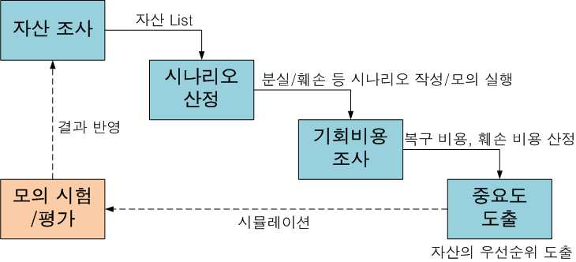

[그림 3-1] BIA 수행 절차 사례

| 학습 내용 | 평가 항목 | 성취수준 |  |  |
| --- | --- | --- | --- | --- |
| 3. BIA 시행 유형<표 3-1> BIA 시행유형 직접적 분석간접적 분석• BCP 개념-BPO, BPR | 유형 설명 사례- 정량적인 자산의 복구비용을 도출하는 분석방법 - 시스템- 물리적/논리적인 자산의 손실에 의한 기 - 행정서류회비용을 도출하는 방식 - 정성적인 자산의 복구비용을 도출하는 분석방법 - 조직의- 일반적으로 장기간 축적된 무형적 자산 - 기업을 대상으로 분석 등 | Brand | 복구비용재구비이미지/명성가치 | 비용 |
| 1. BCP(Business | Continuity Plan)의 개념 |  |  |  |
| (1) 각종 재해,상계획 등의 | 장애, 재난으로부터 위기관리를 기반으로 재해복구, 비즈니스 연속성을 보장하는 체계 | 업무복구 | 및 | 재개, 비 |
| (2) 특정 물리적인구부터 업무의 | 자산뿐만 아니라, 인력/절차/기반시설 등의 전반적인정상 재개까지의 전 과정에 대한 계획 | 조직의 | 자산의 | 복 |
| 2. BCP 주요 업무<표 3-2> BCP 주요재해항목 핵심대상 산출물 재해 | 업무 복구 업무 복구 업무 재개 (Disaster Recover) (Business Recover) (Business Restart)업무 지원 핵심 업무 프로세스 업무 프로세스 전반어플리케이션 복구 계획 업무 복구 계획 대체 프로세스 계획 | 비상(Continuity사건사고업무 | 계획내/외부로부터의비상 | Plan)계획 |
| 3. BCP 수행 절차<표 3-3> BCP 수행단계 1단계 : 프로젝트 | 절차 상세설명 - BCP에 대한 관리계획 수립 계획수립 - 프로젝트 구성, GAP 분석 |  |  |  |

- 재해 위험 요소 식별
2단계 ; 위험분석, 평가
- 재해손실 최소화
3단계 : 업무영향평가(BIA) - 재해영향력 측정 및 복구 우선순위 부여
4단계 : 복구 전략 개발 - 대체업무 복구 운영전략 선택 및 결정
- 재해인식 프로그램 개발
5단계 : 인식 및 훈련
- 이행, 관리, 수행 위한 기술향상
6단계 : 비상연락체계 구성 - 비상사태 처리 실행, 평가, 모의 훈련
4. BCP 수행 시 고려사항
<표 3-4> BCP 수행 시 고려사항
단계 고려사항
1단계 : 프로젝트 계획수립 예산, 시간
2단계 ; 위험분석, 평가 정량적, 정성적 평가
3단계 : 업무영향평가(BIA) 복구우선순위, RPO, RTO 산정
4단계 : 복구 전략 개발 백업기술, 운영형태 선정
5단계 : 인식 및 훈련 교육계획 수립, 업무 연속성 계획
6단계 : 비상연락체계 구성 비상연락망 구축
수행 내용 / IT재해복구 대책 수립하기
재료·자료
Ÿ 자산대장
Ÿ IT서비스 목록 및 운영관리 지침서
Ÿ 비즈니스 사업 연속성 관리 계획서
Ÿ 비즈니스 영향 분석서
Ÿ 조직의 정보보호 정책/정보보호 시행지침 등의 보안 내규
Ÿ 침해사고 대응지침서
Ÿ ISO27001: 2013 통제항목
Ÿ 침해사고 대응 결과 보고서
기기(장비･공구)
Ÿ 컴퓨터, 프린터, 복사기 등
Ÿ 문서작성 도구, E-mail 발송 시스템, 프리젠테이션 도구
안전･유의 사항
Ÿ IT서비스(업무)의 중요도 및 우선순위 등에 따라 IT재해복구 대상 여부가 결정되며, 시스템의
복구목표시간, 복구시점이 다르게 정의될 수 있다.
Ÿ 동일 IT서비스(업무)에 대한 복구목표시간, 복구시점은 이해관계자에 따라 다르게 판단될 수
있기 때문에, 해당 이해관계자들 간의 합의가 도출되어야 한다.
Ÿ 동일 복구목표시간, 복구시점을 달성하기 위한 IT재해복구 방법은 다양하게 도출될 수 있다.
Ÿ IT재해복구 전략은 조직의 경영전략에 종속되기 때문에, IT재해복구 전략 수립 이전에 조직의
경영 방침이나 원칙에 대한 정확한 이해가 필요하다.
Ÿ IT재해복구 대책은 IT재해복구 전략에 부합되어야 하며, 다양한 유형이 도출될 수 있다.
수행 순서
• 보안운영체계의 대상이 되는 조직의 핵심 IT서비스(업무) 및 시스템을 식별하여 목록화 한다.
1. 조직의 전체 IT서비스를 조사한다.
(1) 조직에서 운영중인 전체 자산을 조사한다.
(2) 조사된 자산에서 논리적인 자산을 도출한다.
(3) 도출된 논리적인 자산에서 IT서비스 자산을 도출한다.
(4) 도출된 IT서비스 자산에 대하여, 서비스 목적을 도출한다.
<표 3-5> 전체 IT서비스 조사 사례
IT서비스 서비스 목적
Mail Service 임직원 Mail 송수신
Home Page 조직에 대한 안내 Portal Site
Groupware 정보공유 및 전자결재 서비스 제공
KMS 특정 분야/기술에 대한 정보/경험 공유
Bugtracker 솔루션 개발에 대한 이슈관리
2. 조사된 전체 IT서비스에서 핵심 IT서비스(업무)를 조사한다.
(1) 도출된 IT서비스에 대하여, 서비스 목적을 바탕으로 해당 서비스의 중요도를 판정한다.
(2) 판정된 서비스의 중요도를 바탕으로, 서비스의 우선순위를 결정한다.
(3) 결정된 우선순위를 바탕으로, 핵심IT서비스 여부를 판정한다.
3. 조직의 핵심 IT서비스를 구성하고 있는 시스템을 조사하여 목록화한다.
(1) 판정된 핵심 IT서비스를 구성하고 있는 논리적인 구성요소를 도출한다.
(2) 도출된 논리적인 구성요소를 바탕으로 물리적인 시스템을 조사한다.
(3) 조사된 물리적인 시스템을 목록화 한다.
<표 3-6> IT서비스 구성 시스템 목록화 사례
핵심IT서비스
IT서비스 사유 논리적 구성요소 물리적 구성요소
여부
Mail Service O 내외부 정보 송수신 Mail Server Server #2
Server #1-1
Web/WAS/DB
Home Page O 기업 이미지 관리 Server #1-2
Server
Storage #1
내부 임직원만 사용
Groupware X Off-line 으로 실행 N/A N/A
가능
Server #2-1
중요 지식/경험 정 Web/WAS/DB
KMS O Server #2-2
보 전달 Server
Storage #2
개발조직 내부에서
Bugtracker X N/A N/A
만 사용
• 식별된 핵심 IT서비스 및 시스템의 복구목표시간, 복구시점을 정의한다.
1. IT재해 발생시, IT서비스 및 시스템에 대한 복구 시점을 정의한다.
(1) 핵심IT서비스를 구성하고 있는 물리적인 시스템을 확인한다.
(2) 논리적인 IT서비스를 제공하기 위한 물리적인 시스템의 연관성을 확인한다.
(3) 확인된 연관성을 바탕으로 장애 시 복구 시점을 정의한다.
<표 3-7> 핵심 IT서비스/시스템 복구 시점 정의 사례
IT서비스 ... 구성 정보 시스템 장애시 복구 시점
... ... ... ...
... Server #1-1 장애 시 즉각 복구
Home Page ... Server #1-2 장애 시 즉각 복구
... Storage #1 장애 시 즉각 복구
... Server #2-1 장애 시 최대한 빠른 시일 내 복구
KMS Server #2-2 장애 시 최대한 빠른 시일 내 복구
... Storage #1 장애 시 최대한 빠른 시일 내 복구
2. IT서비스 및 시스템에 대한 복구 완료 기준을 산정한다.
(1) 정의된 장애 시 복구 시점을 바탕으로 복구 완료 기준(최종 복구 상태)를 정의한다.
(2) 최종 복구 상태에 대한 확인 방법을 도출한다.
3. IT서비스 및 시스템에 대한 복구목표시간을 정의한다.
(1) 최종 복구 상태에 도달하기 위한 시간 및 비용을 도출한다.
(2) 도출된 시간/비용을 바탕으로, 예상 복구 목표 시간을 도출한다.
(3) 보안운영체계에 제시된 방법을 바탕으로, 장애 시 복구 목표에 대한 달성 여부를 시험
한다.
(4) 시험 후 도출된 결과를 바탕으로, 기수립된 예상 복구 목표 시 간의 타당성을 검증한다.
(5) 예상 복구 목표 시간이 적합한 경우, 기수립된 예상 복구 목표시간을 최종 복구 목표
시간으로 산정한다. 만일, 예상 복구 목표 시간이 부적합한 경우, 복구 목표 시간을 변
경한다.
<표 3-8> 핵심 IT서비스/시스템 복구목표 정의 사례
IT서비스 ... 구성 정보 시스템 장애 시 복구 시점 복구 목표 시간
... Server #1-1 장애 시 즉각 복구
Home Page Server #1-2 장애 시 즉각 복구 5분
... Storage #1 장애 시 즉각 복구
장애 시 최대한 빠른 시
... Server #2-1
일 내 복구
장애 시 최대한 빠른 시
KMS ... Server #2-2 24시간
일 내 복구
장애 시 최대한 빠른 시
... Storage #1
일 내 복구
• 정의한 복구목표시간 및 복구시점을 달성할 수 있는 복구전략 및 대책을 수립한다.
1. 정의한 복구목표시간 및 복구시점을 달성할 수 있는 복구전략을 도출한다.
(1) 복구 전략 도출을 위한 정보보호 정책을 확인한다.
(2) 정보보호 정책서나 시행 지침 상에 나타난 정보보호 전략을 확인한다.
(3) 정보보호 전략에서 정보시스템 복구 전략을 도출한다.
<표 3-9> IT재해복구 전략 도출 사례
IT서비스 ... 구성 정보 시스템 복구 목표 시간 복구 전략
... Server #1-1
Home Page Server #1-2 5분 회피
... Storage #1
... Server #2-1
KMS Server #2-2 24시간 완화
... Storage #1
2. 도용된 복구전략에 따라, 복구 대책을 수립한다.
(1) 자산의 운영 형태를 조사한다.
(2) 조사된 운영 형태를 바탕으로, 적용 가능한 복구 기술을 조사한다.
(3) 조사된 복구 기술을 상호 비교하여 장단점을 도출한다.
(4) 도출된 장단점을 바탕으로 최종 복구 기술을 선정한다.
(5) 선정된 복구 기술을 바탕으로, 복구 절차를 수립한다.
(6) 해당 자산을 책임 관리하고 있는 관리자를 교육한다.
<표 3-10> IT재해복구 대책 수립 사례
IT서비스 ... 구성 정보 시스템 운영 형태 복구 대책
... Server #1-1
3개 시스템
Home Page Server #1-2 동시 연동 DRS-Hot system 운영
방식
... Storage #1
... Server #2-1
3개 시스템
KMS Server #2-2 동시 연동 Storage Data 백업
방식
... Storage #1
3-2.
IT재해복구 체계 개선
Ÿ 보안관련 내외부환경의 변화 및 법규정의 개정에 따른 차이점에 따른 개선대책을
수립 할 수 있다.
Ÿ 수립된 IT재해 복구 대책의 실효성을 판단하기 위하여 시험계획을 수립하여 수행할
학습 목표 수 있다.
Ÿ 시험결과, IT환경변화, 법률 등에 따른 변화를 반영할 수 있도록 복구전략 및 대책
을 정기적으로 검토·보완할 수 있다.
Ÿ 재해상황 발생 시 사전에 정의한 정책 및 절차에 따라 재해복구를 수행 할 수 있다.
필요 지식 /
• 복구 전략
1. 복구 전략의 개념
(1) 재해 발생 시, 훼손된 자산을 복구 목표 수준으로 복원하는데 소요되는 복구비용을 감
소시키기 위한 수단 및 방법
(2) 비용 대비 효과에 대한 효율성을 기반으로 한 재해 복구에 대한 Guide-Line
2. 복구 전략의 유형
<표 3-11> IT재해복구 전략 유형
복구 전략 유형 개념 사례
회피 재해 및 위협으로부터 완전히 벗어난 상태 해당 자산을 사전에 포기
위협 및 재해의 피해를 3자에게 위임하는
전가 보험 가입
방식
수용 가능한 수준(DOA)까지 피해 수준을 아웃소싱
완화
낮추는 방식 프로토타입 개발
수용 위험을 모두 받아들이는 방식 예비비 준비
• 보안운영체계의 Life-Cycle
1. 보안운영체계 Life-Cycle 개념
(1) 조직에 적용 중인 보안운영체계의 유효기간
(2) 보안관리체계 및 교육 방식/자료, 점검 주기 등의 보안 전반에 대한 관리체계가 무한
정 수용될 수 없으며 계속 보완/발전해 나가야 한다는 개념
2. 보안운영체계 Life-Cycle이 적용되는 근거
(1) 특정 보안 관리 체계나 적용 중인 정보보안 솔루션/보안 기술이, 사회/경제/정치적인
변경에 따라서 같이 발전이 필요
(2) 새로운 보안운영체계가 제시되거나, 기존 보안운영체계에 대한 특정 문제점이 지적/보
완된 경우, 현재 적용 중인 보안운영체계의 개선 필요
3. 정보보안 솔루션/기술의 변경 시점
하기의 사유 이외에 다양한 요구사항에 의해 적용 정보보안 솔루션 및 보안 기술의 변경 필요
<표 3-12> 정보보안 솔루션/기술의 변경 시점
관점 변경 사유 세부 내용
적용 기관/조직 관련 관계 법/시행령/시행규칙이나 지
관계법령 변경
침, Guide 등이 주관 기관에 의해 변경된 경우
사회
인접/경쟁/유사 직종/기관에서 신규 보안사고 발생에
보안사고 발생
의한 사전 준비가 필요한 경우
장비 노후화 적용중인 정보보안 솔루션의 수명 만기 도래
경제
현 적용중인 정보보안 솔루션의 유지보수 비용이, 신
유지보수 비용 과다
규 정보보안 솔루션 도입 비용보다 과다한 경우
법적 요구 기능의 변경이나 사이버 위협의 기술이 제
기술 기술 한계
공 정보보호 기술보다 진보된 경우
• IT재해복구 대응체계에 대한 실효성 판단(평가) 기준
1. IT재해복구 대응체계에 대한 평가 필요성
(1) 기존 적용중인 IT재해복구 대응체계가 사회/문화/법/정치적인 요구사항을 충족하는지에
대한 검증 요구사항 발생
(2) 사회/경제가 발전하면서 과거에 개발된 IT재해복구 대응체계 개발 근거가 사라지거나
퇴색되어 현재의 IT재해복구 대응체계가 유명무실한 경우 발생
2. IT재해복구 대응체계에 대한 평가 기준
<표 3-13> IT재해복구 대응체계에 대한 평가 기준
관점 평가 기준 사례
관련 법/시행령/시행규칙/지침/가이드라인 등
사회 법적 충족
을 통한 법령 요구사항의 변경
인접/경쟁/유사 직종/기관에서 발생한 재해
사회 통념적 요구사항 대비 현재 적용 중인 대응체계의 한계점이
확인된 경우
기개발된 대응체계의 과거 대응체계에 근거가 된 개발 모형이 부
근거 삭제 적합/부적격으로 판정
경제
현 적용 중인 대응체계에 대한 관리 비용이
유지보수 비용 과다
과다한 경우
현재 대응체계의 기술적 한계 법적 요구 기능의 변경이나 사이버 위협의
도달 기술이 제공 정보보호 기술보다 진보된 경우
기술
/관리
현재 적용 중인 대응체계의 관 조직 규모의 확대 및 업무 절차의 복잡성
리 복잡성에 대한 한계점 도달 증대에 따른 관리 한계점 도달
수행 내용 / IT재해복구 체계 개선하기
재료·자료
Ÿ 자산대장
Ÿ IT서비스 목록 및 운영관리 지침서
Ÿ 조직의 정보보호 정책/정보보호 시행지침 등의 보안 내규
Ÿ 침해사고 대응지침서
Ÿ ISO27001: 2013 통제항목
Ÿ 침해사고 대응 모의훈련결과 보고서
기기(장비･공구)
Ÿ 컴퓨터, 프린터, 복사기 등
Ÿ 문서작성 도구, E-mail 발송 시스템, 프리젠테이션 도구
안전･유의 사항
Ÿ 보안환경은 내/외부뿐만 아니라 사회, 경제, 정책적인 요소에 의해 수시 변경되기 때문에 이에
대한 전담 직원이 요구되며, 이를 위해 정보보안 전문조직의 구성이 요구된다.
Ÿ IT재해복구 대책의 실효성의 판단은 이해관계자에 따라 그 결과가 상이할 수 있기 때문에, 해당
복구 대책에 대한 시험결과나 실행 결과 등에 대한 이해관계자들 간의 합의가 도출되어야
한다.
Ÿ IT재해복구 대책은 정기적으로 검토/보완되어야 하는데, 이를 위해서는 IT재해복구 대책에 대한
검토 주기 및 방법, 이해관계자 등에 대한 지침이 보안 정책이나 보안 시행지침 등에 명시되어야
한다.
Ÿ IT재해복구 과정은 매우 복잡하며 신속히 이루어져야 하기 때문에, 조직 전반적으로 정기적인
모의훈련이 수행되어야 한다.
수행 순서
• 보안관련 내외부환경의 변화 및 법규정의 개정에 따른 차이점에 따른 개선대책을 수립한다.
1. 보안관련 내/외부환경 변화에 따른 개선대책을 수립한다.
(1) 보안관련 내/외부환경 변화내역을 조사한다.
(가) 사회/경제/기술적인 변화를 수시 모니터링한다.
(나) 특정 변화 내역을 상세히 조사/분석한다.
(2) 조사된 내/외부환경 변화내역이, 조직에 미칠 영향을 조사한다.
(가) 변화 내역의 적용 영역을 도출한다.
(나) 적용 영역이 조직의 자산/운영 범위에 포함되는지를 확인한다.
(다) 확인된 자산 및 운영 범위의 영향 정도를 도출한다.

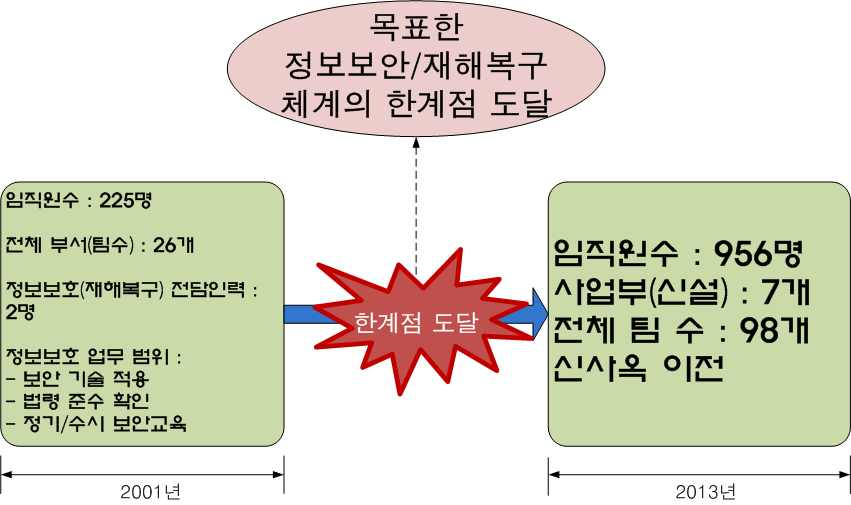

[그림 3-2] 보안관련 내/외부 환경변화에 대한 영향정도 도출 사례
2. 법규정의 개정 여부를 조사한다.
(1) 보안 관계법령의 개정 여부를 조사한다.
(가) 조직이 소속되었거나 비즈니스 상의 주관기관으로부터 발의된 법령이 존재하는
지 확인한다.
(나) 확인된 법령 중 시행령 및 시행지침이 존재하는지 확인한다.
(2) 보안 관계법령의 개정 사항이, 조직에 미칠 영향을 조사한다.
(가) 확인된 시행령 및 시행지침에서 제시된 요구사항을 확인한다.
(나) 확인된 요구사항을 법령 해석을 통하여, 기술적/관리적/물리적인 요구사항을 구
체적으로 도출한다.
(다) 도출된 요구사항을 주관기관 담당자를 통하여 승인/허용될 수 있는지를 확인한다.

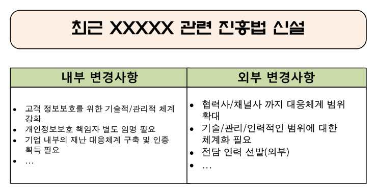

[그림 3-3] 법/규정의 개정 사례
• 수립된 IT재해 복구 대책의 실효성을 판단하기 위하여 시험계획을 수립하여 수행한다.
1. 수립된 IT재해 복구 대책의 실효성을 판단하기 위하여 시험계획을 수립한다.
(1) IT재해 복구 대책의 실효성을 판단하기 위한 기준을 수립한다.
(2) 수립된 기준을 판정하기 위한 시험 방법을 수립한다.
(3) IT재해 복구 대책의 실효성을 판정하기 위한 시험 일시, 장소, 담당자를 도출한다.
2. 수립된 시험계획을 바탕으로, IT재해복구 대책을 시험 적용한다.
(1) 계획된 시험 일시, 장소, 담당자로 하여금 기수립된 IT재해복구 대책을 수립된 시험
방법에 따라 시험한다.
(2) 시험이 완료된 후, 도출된 결과가 수립된 실효성 판단 기준에 부합되는지를 확인한다.
3. 시험 적용한 IT재해복구 대책을 평가한다.
(1) IT재해복구 대책이 실효성 판단 기준에 부합되지 않은 경우, 해당 문제점을 확인한다.
(2) 확인된 문제점에 대한 근본적인 원인을 규명한다.
(3) 규명된 원인이, 현재 조직에 적용중인 IT재해복구 대책의 원칙(전략)에 부합되는지
를 확인하여, 부합되지 않은 경우 실효성이 없다고 판정한다.
<표 3-14> IT재해복구 대책 평가 사례
판정 항목 시험 방법 시험 계획 판정 기준 판정 결과
현재의 인력 시간 : 2013년 11월 19일 재난 사실의 전
부적합
전담 을 바탕으로, 장소 : 사무실 외부 2km 임직원 전파 완
원인 :
인력 수 모의 재난 거리 지점 료 시간 : 20분
- 전담인력 부족
훈련 실시 대상 : 정보보안팀 2명 이내
부적합
백업 현재의 백업 0.5H 이내 중요
시간 : 2013년 11월 19일 원인 :
정보시스템 시스템의 용 정 보 시 스 템
대상 : 전체 백업 시스템 - NW/Platform
수용 범위 량 검증 Data 백업 완료
성능 미달
• 시험결과, IT환경변화, 법률 등에 따른 변화를 반영할 수 있도록 복구전략 및 대책을 정기
적으로 검토·보완한다.
1. IT재해에 대한 복구전략 및 대책을 검토하기 위한 검토 주기를 확인/결정한다.
(1) 정보보안 정책을 확인하여, IT재해복구 관련 정책을 검토하는 주기를 확인한다.
(2) 정보보안 시행지침을 검토하여, IT재해복구 관련 시행지침을 검토하는 주기를 확인
한다.

[그림 3-4] 정보보호 정책의 정책 검토 주기 확인 사례
(3) 정보보안 정책/시행지침에 IT재해복구 관련 정책/시행지침 검토 주기가 명세되지 않
은 경우, 해당 내용을 정보보안 정책이나 시행지침에 반영한다.

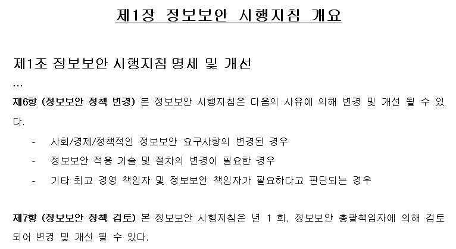

[그림 3-4] 정보보호 시행지침의 정책 검토 주기 확인 사례
2. 결정된 검토 주기에 따라 시험결과, IT환경변화, 법률 등에 따른 변화를 분석한다.
(1) 조사된 보안관련 내외부환경의 변화 및 법규정의 개정 내역을 조사한다.
(2) 조사된 내외부환경 및 법규정의 개정내역에서 변경사항을 도출한다.
(3) 도출된 내외부환경 및 법규졍의 변경사항을 조직의 경영환경에 맞게 분석한다.
3. 분석 결과를 바탕으로, IT재해복구 전략 및 대책을 검토·보완한다.
(1) 분석된 결과에서 조직의 내/외부 변경이 야기될 수 있는 내용을 도출한다.
(2) 도출된 내/외부 변경이 야기될 수 있는 내용을 바탕으로, 현재의 IT재해복구 전략
및 대책의 적절성을 평가한다.
(3) IT재해복구 전략 및 대책의 적절성 평가 결과를 바탕으로 IT재해복구 전략의 보완
여부를 결정한다.
<표 3-15> IT재해복구 전략/대책 검토 사례
내부 환경 외부환경 자사 현황 분석 판정 결과
경쟁사 외부 해킹 사건 발생
경쟁사와 유사한 수준의 보안대책
- 고객 개인정보 유출 IT재해복구
및 IT재해복구 수준으로 판단
- 일부 시스템 Error 에 의해 전략 및
없음 - 유사 시스템 활용
복구 지연 정책 개선
- 유사 IT재해복구 시스템 활용
- 비상 훈련 부족에 의한 담 필요
- 유사 수준의 비상 훈련 수행중
당자 전파 지연
(4) IT재해복구 전략의 보완 여부에 따라, IT재해복구 대책을 보완한다.
• 재해상황 발생 시 사전에 정의한 정책 및 절차에 따라 재해복구를 수행한다.
1. IT재해상황 발생 여부를 확인한다.
(1) IT환경의 정상적인 중/장기 간의 정상적인 운영상황을 조사한다.
(2) 조사된 정상적인 운영상황의 평균적인 정황을 도출한다.
(3) IT환경의 운영상황에서 평소 허용 가능한 임계치를 설정한다.
(4) 평소 운영상황 중 발생한 보안사건 및 IT재해상황이, 설정된 허용 가능한 임계치에
도달하였는지를 조사한다.
(5) 발생된 보안사건 및 IT재해상황이 하용 가능한 임계치를 벗어난 경우, 해당 사건을
IT재해상황으로 결정한다.
<표 3-16> IT재해상황 발생 여부 확인 사례
운영 항목 평시 기준 허용 임계치 현재 운영상태 판정결과
중요도 별 - 상 : 0~5개/1초 - 상 : 10개/1초
보안 침해사건
보안 로그 - 중 : 2~8개/1초 - 중 : 20개/1초 - 상 : 13~26개/1초
발생
개수 - 하 : 10~20개/1초 - 하 : 40개/1초
Alarm 개수 - 1~3개/1분 - 5개/1분 - 2개/1분 ·정상
2. IT재해상황 발생 시, 사전 정의된 IT재해복구 절차를 숙지한다.
(1) 평소 IT운영환경에 대한 비상사태/재해상황에 대한 복구 훈련을 수행한다.
(가) 임의의 훈련용 IT재해 시나리오를 생성한다.
(나) 생성된 시나리오를 바탕으로 IT재해상황을 도출한다.
(다) 도출된 IT재해상황을 바탕으로, 조직 구성원 전체/일부에 대해 IT재해상황 복구
훈련을 수행한다.
<표 3-17> IT재해복구 훈련 시나리오 수립 사례
훈련
훈련 목표 훈련 계획 훈련 시나리오
시나리오
- 훈련 일시 : 2014년 1
- 팀원 전체에 대한 - System#12의 Storage 고
중요 정보 월 12일, 13:00~17:00
대응/조치내용 숙지 장 및 Network Switch #9
시스템 고 - 훈련 장소 : IDC센터
/숙달 여부 확인 의 전원 Off 상황 생성
장에 대한 관제실
- 정보시스템의 복원 - 재해상황 전파 시간 측정
대응훈련 - 훈련 대상 : 정보시스
체계의 적합성 판단 - 재해조치 완료 시간 측정
템 운영팀 5명
(2) IT재해상황에 대한 훈련 내역을 평가하고 개선한다.
(가) IT재해상황 복구 훈련 내역을 기록하여 분석한다.
(나) IT재해상황 복구 훈련 결과를 바탕으로, 각 조직/개인별 미비점을 도출한다.
(다) 동일/유사 IT재해상황 복구 훈련을 수행하여, 조직/개인별 미비점을 보완/개선
한다.
3. IT재해복구 절차에 따라 재해복구를 수행한다.

| 학습 3 | 교수·학습 방법 |
| --- | --- |

교수 방법
Ÿ BIA의 실제 업무 수행 내용을 구체적으로 설명한다.
Ÿ BIA 수행 시 주요 고려사항에 대해 구체적으로 설명한다.
Ÿ BIA의 유형에 대한 구체적인 사례를 제시한다.
Ÿ BCP의 대응 영역을 상세히 설명한다.
Ÿ BCP의 수행 절차를 구체적으로 설명한다.
Ÿ IT재해복구 과정의 사례를 구체적으로 설명한다.
Ÿ IT재해복구 훈련의 중요성을 상세히 설명한다.
Ÿ IT재해복구 훈련 준비 과정을 구체적으로 설명한다.
Ÿ 정보시스템에 대한 IT재해복구 훈련에 대한 사례를 제시한다.
Ÿ IT재해복구 훈련의 성공적인 사례를 구체적으로 설명한다.
Ÿ IT정보시스템에 대한 IT재해복구 훈련의 복잡성을 상세히 설명한다.
Ÿ 정보시스템의 평소 운영상태에 대한 허용 임계치의 사례에 대해 구체적으로 설명한다.
학습 방법
Ÿ BIA의 실제 업무 수행 내용을 정확하게 이해한다.
Ÿ BIA 수행 시 주요 고려사항에 대해 조사한다.
Ÿ BIA의 유형에 대한 구체적인 사례를 조사하여 발표한다.
Ÿ BCP의 대응 영역을 조사한다.
Ÿ BCP의 수행 절차에 대한 사례를 조사한다.
Ÿ IT재해복구 과정을 조사하여 발표한다.
Ÿ IT재해복구 훈련의 중요성을 실무적으로 이해한다.
Ÿ IT재해복구 훈련 준비 과정에 대한 사례를 제시한다.
Ÿ 정보시스템에 대한 IT재해복구 훈련의 중요성을 이해한다.
Ÿ IT재해복구 훈련의 성공적인 사례를 조사하여 발표한다.
Ÿ IT정보시스템에 대한 IT재해복구 훈련의 복잡성에 대한 사례를 조사한다.
Ÿ 정보시스템의 평소 운영상태에 대한 허용 임계치의 사례를 분석한다.

| 학습 3 | 평 가 |
| --- | --- |

평가 준거
• 평가자는 학습자가 수행 준거 및 평가 시 고려사항에 제시되어 있는 내용을 성공적으로 수행하였
는지를 평가해야 한다.
• 평가자는 다음사항을 평가한다.

| 학습 내용 | 평가 항목 | 성취수준 |  |  |
| --- | --- | --- | --- | --- |
|  |  | 상 | 중 | 하 |

- 보안운영체계의 대상이 되는 조직의 핵심 IT서비스
(업무) 및 시스템을 식별하여 목록화할 수 있다.
IT재해복구 대책 - 식별된 핵심 IT서비스 및 시스템의 복구목표시간, 복
수립 구시점을 정의할 수 있다.
- 정의한 복구목표시간 및 복구시점을 달성할 수 있는
복구전략 및 대책을 수립할 수 있다.
- 보안관련 내외부환경의 변화 및 법규정의 개정에 따
른 차이점에 따른 개선대책을 수립할 수 있다.
- 수립된 IT재해 복구 대책의 실효성을 판단하기 위하
여 시험계획을 수립하여 수행할 수 있다.
IT재해복구 체계
- 시험결과, IT환경변화, 법률 등에 따른 변화를 반영
개선
할 수 있도록 복구전략 및 대책을 정기적으로 검
토·보완할 수 있다.
- 재해상황 발생 시 사전에 정의한 정책 및 절차에 따
라 재해복구를 수행할 수 있다.
평가 방법
• 문제해결 시나리오

| 학습 내용 | 평가 항목 | 성취수준 |  |  |
| --- | --- | --- | --- | --- |
|  |  | 상 | 중 | 하 |

- 조직의 핵심 IT서비스(업무) 및 시스템 식별/목록화
- 핵심 IT서비스 및 시스템의 복구목표시간, 복구시점
IT재해복구 대책
정의
수립
- 복구목표시간 및 복구시점 달성 복구전략 및 대책
수립
• 서술형 시험

| 학습 내용 | 평가 항목 | 성취수준 |  |  |
| --- | --- | --- | --- | --- |
|  |  | 상 | 중 | 하 |

| IT재해복구 체계개선 • 구두 발표 IT재해복구 대책수립 피 드 백 | - IT재해복구 개선대책을 수립 방법 - 수립된 IT재해 복구 대책의 실효성을 판단 방법 - 시험 결과, IT환경변화, 법률 등에 따른 변화를 반영시 주의사항 - 재해복구 수행 절차 - 조직의 핵심 IT서비스(업무) 및 시스템 식별/목록화사례 - 핵심 IT서비스 및 시스템의 복구목표시간, 복구시점정의 절차 - 복구목표시간 및 복구시점 달성 복구전략 및 대책수립 사례 |  |  |  |
| --- | --- | --- | --- | --- |
| 1. 문제해결 시나리오- ‘T재해복구과정상의 오류 | 대책 수립’학습 내용에 관련된 상황 제시 후 이를 바탕으로및 미흡한 점을 지적하고 설명한다. | 문제 | 분석/해결 |  |
| 2. 서술형 시험 - ‘IT재해복구한 점을 지적하고 | 체계 개선’학습 내용에 대한 서술 문제를 제시하여, 답변상의설명한다. | 오류 | 및 | 미흡 |
| 3. 구두 발표 - ‘IT재해복구및 접근 상의 | 대책 수립’학습 내용에 연관된 사례를 조사/분석시킨 후오류 및 미흡한 점을 지적하고 보완 설명한다. | 발표 | 내용의 | 방향 |

| 학습 내용 | 평가 항목 | 성취수준 |  |  |
| --- | --- | --- | --- | --- |
|  |  | 상 | 중 | 하 |

| IT재해복구 대책수립 피 드 백 | - 조직의 핵심 IT서비스(업무) 및 시스템 식별/목록화사례 - 핵심 IT서비스 및 시스템의 복구목표시간, 복구시점정의 절차 - 복구목표시간 및 복구시점 달성 복구전략 및 대책수립 사례 |  |  |  |
| --- | --- | --- | --- | --- |
| 1. 문제해결 시나리오- ‘T재해복구과정상의 오류 | 대책 수립’학습 내용에 관련된 상황 제시 후 이를 바탕으로및 미흡한 점을 지적하고 설명한다. | 문제 | 분석/해결 |  |
| 2. 서술형 시험 - ‘IT재해복구한 점을 지적하고 | 체계 개선’학습 내용에 대한 서술 문제를 제시하여, 답변상의설명한다. | 오류 | 및 | 미흡 |
| 3. 구두 발표 - ‘IT재해복구및 접근 상의 | 대책 수립’학습 내용에 연관된 사례를 조사/분석시킨 후오류 및 미흡한 점을 지적하고 보완 설명한다. | 발표 | 내용의 | 방향 |

학습 1 운영보안 수립하기
학습 2 침해사고 대응하기
학습 3 IT재해복구체계 수립하기

| 학습 4 | 정보보호 교육하기 |
| --- | --- |

4-1.
정보보호 교육 준비
Ÿ 정보보호 교육대상자를 업무범위 및 우선순위에 따라 선정 분류할 수 있다.
학습 목표 Ÿ 보안운영체계에 따라 분류된 정보보호 교육대상자에 필요한 보안교육과정을 설계
할 수 있다.
필요 지식 /
• 정보보호 교육 대상
1. 정보보호 교육 대상의 우선순위 선정의 필요성
(1) 조직의 구성원은 기본적으로 모두 어느 정도의 상이한 업무를 수행하므로 직무상
차이점이 있으며, 이러한 차이점에 의해 ‘업무 범위’, ‘업무 수행 절차’ 및
‘취급 정보’가 상이
(2) 이러한 ‘절차’ 및 ‘취급 정보’의 차이점에 의해, ‘정보보호’관점에서 ‘보안
취약점’이 모두 상이
(3) 이러한 ‘보안 취약점’에 의하여 ‘보안위협’의 정도가 모두 상이
(4) 이러한 ‘보안 취약점’ 및 ‘보안위협’은‘정보보호’관점에서, 모든 직무는 보
안상 ‘중요도’가 도출됨
(5) 도출된 ‘직무상의 중요도’로 인해 정보보호 교육의 순서 및 교육 빈도 등을 상이
하게 적용하여 교육 우선순위를 도출
2. 정보보호 교육 대상별 보안 교육과정 차이점
(1) ‘직무’상의 차이점은 곧, ‘업무 범위’, ‘업무 수행 절차’ 및 ‘취급 정보’가
상이
(2) 이러한 차이점은 ‘교육 대상’의 ‘정보보호 교육’에 대한 ‘이해/습득’의 차이
점으로 연결되며, 조직의 보안 수준으로까지 확대됨
(3) 이러한 차이점에 의해 ‘정보보호 교육’은 ‘교육 대상’의 ‘직무’에 맞추어 교
육 필요
• 정보보호 교육과정 설계 시 고려사항
일반적으로 정보보호 교육과정 설계 시에는 다음의 항목을 고려
<표 4-1> 정보보호 교육과정 설계 시 고려사항
고려 항목 고려 사유
직무상의 차이점은 업무 과정상의 차이점이 발생하여 보안 위험 정도가
직무
상이하여, 정보보호 교육의 범위 조절이 필요
‘경력직원’의 경우 경험에 의한 ‘보안 의식 수준’이 ‘신입직원’ 대
경력
비 높아, 정보보호 교육 시간 변경 가능
직무상 취급하는 정보의 중요도가 높은 경우, 그 파급효과가 상이하여 정
취급 정보
보보호 교육 시 강조 내용이 상이
특정 업무 수행 시, 과정의 복잡도에 따라 정보보호 교육에서 제시해야
업무 수행 절차
할 사례의 수준을 결정
수행 내용 / 정보보호 교육 준비하기
재료·자료
Ÿ 조직의 정보보호 정책/정보보호 시행지침 등의 보안 내규
Ÿ 침해사고 대응지침서
Ÿ ISO27001: 2013 통제항목
Ÿ 정보보호 교육자료
기기(장비･공구)
Ÿ 컴퓨터, 프린터, 복사기 등
Ÿ 문서작성 도구, E-mail 발송 시스템, 프리젠테이션 도구
안전･유의 사항
Ÿ 정보보호 교육 대상자는 기본적으로 전 조직 구성원이며, 필요시 외부 협력/내부의 외주 인력을
포함할 수 있다.
Ÿ 정보보호 교육은 원론적인 내용과 시행을 위한 구체적인 지침을 제시할 수 있어야 한다.
Ÿ 보안교육과정 설계 시에는 교육 대상 및 교육 내용, 범위 등을 고려하여 충분한 시간 및 공간을
확보해야 한다.
Ÿ 정보보호 교육을 위한 업무 범위 및 우선순위에 따라 다른 교육 내용이 적용될 수 있다.
수행 순서
• 업무범위 및 우선순위에 따라 정보보호 교육대상자를 선정 분류한다.
1. 정보보호 교육 주기를 확인한다.
(1) 정보보호 정책상에 나타난, 정보보호 교육 수행 근거를 조사한다.
(2) 정보보호 시행지침에 따라, 정보보호 교육 주기를 확인한다.

[그림 4-1] 정보보호 교육 주기 확인 사례
(3) 과거 시행/계획된 정보보호 교육 계획상에 나타난 최종 시행된 정보보호 교육 일자를
확인한다.
(가) 정보보호 교육 계획상에 도출된 향후 정보보호 교육 일정을 조사한다.
(나) 과거 시행된 정보보호 교육 최종 일자 및 해당 교육에 참여한 정보보호 교육
대상자를 확인한다.

[그림 4-2] 정보보호 교육 일정 확인 사례
(4) 향후 정보보호 교육 수행 시기를 선정한다.
(가) 기존에 수행된 정보보호 교육 수행 일정을 확인한다.
(나) 향후 수행 할 정보보호 수행 후보 일정을 도출한다.
(다) 교육 대상 부서장과의 협의를 통해 정보보호 교육 후보 일정을 확정한다.
<표 4-2> 향후 정보보호 교육 수행시기 선정 사례
교육 종류 후보 일정 이해관계자 기타 고려사항
- 9월 2째 주 경영지원실장
정보보호 - 9월 3째 주 영업본부장
명절 연휴 고려
정기교육 - 10월 2째 주 기술지원본부장
- 10월 4째 주 연구소장
정보보호 신입사원 추가선발
- 11월 3째 주 인사팀장
기본소양교육 일정 확인
2. 조직의 단위 부서의 업무 형태와 업무 범위를 바탕으로 정보보호 교육 대상 우선순위
를 선정/분류한다.
(1) 전체 정보보호 교육 대상의 업무 형태를 조사한다.
(2) 조사된 정보보호 교육 대상의 업무 형태를 바탕으로 업무 범위를 조사한다.
(3) 정보보호 교육 대상별 업무 취약점 및 위협을 조사한다.
(4) 조사 결과를 바탕으로, 전체 정보보호 교육 대상에 대한 교육 우선순위를 도출한다.
<표 4-3> 정보보호 교육 대상 운선순위 선정 사례
정보보호 교육
업무 형태 업무 범위 업무 취약점 보안위협
교육 대상 우선순위
제품 개발 소스코드
제품 개발 문서 제품에 대한
내부자
연구소 내근직 이슈 대응 사항 기밀 정보 유 1
정보 유출
제품 개발 로드맵 출 가능
...
영업 전략/계획 - 내부자
영업 Pipeline 사내 영업 실 정보유출
영업본부 내/외근직 영업 실적 적/전략 정보 - 외부자 2
제안서 유출 가능 비인가
... 정보취득
• 보안운영체계에 따라 분류된 정보보호 교육대상자에 필요한 보안교육과정을 설계한다.
1. 선정/분류된 우선순위를 바탕으로, 정보보호 교육 방법을 도출한다.
<표 4-4> 정보보호 교육 방법 도출 사례
정보보호 정보보호
업무 형태 ... 업무 취약점 보안위협 ...
교육 대상 교육 방법
제품에 대한
내부자
연구소 내근직 ... 기밀 정보 유 ... 집체 교육
정보 유출
출 가능
사내 영업 실 - 내부자 정보유출
교육자료
영업본부 내/외근직 ... 적/전략 정보 - 외부자 비인가 ...
전달/교육
유출 가능 정보취득
2. 도출된 정보보호 교육 방법에 따라, 교육 자료를 작성한다.
(1) 정보보호 교육 내용을 결정한다.
<표 4-5> 정보보호 교육 내용 결정 사례
정보보호 정보보호
... 업무 취약점 보안위협 ...
교육 대상 교육 내용
제품에 대한 내부자 정보 유출
내부자
연구소 ... 기밀 정보 유 ... - 사고사례 전파(유사소송)
정보 유출
출 가능 - 기업 위험 피력
내부자 정보유출
- 사고사례 전파
사내 영업 실 - 내부자 정보유출
- 경쟁력 저하 사례
영업본부 ... 적/전략 정보 - 외부자 비인가 ...
외부자 비인가 정보취득
유출 가능 정보취득
- 외부자 무단 침입
- 출력 문서 취약점
(2) 정보보호 교육 내용에 대한 교육 자료를 수집한다.
<표 4-6> 정보보호 교육자료 수집 사례
정보보호 정보보호
... 자료 수집
교육 대상 교육 내용
- 소송 사례(사건번호 XXXXXXX)
- 사고사례 전파(유사소송)
- 진행중인 소송 사례
연구소 ...
- 정보 유출 사례&경쟁사 동일 기술 개발
- 기업 위험 피력
- 특허 소송 패소 사례
- 영업 전략 정보 유출에 따른 금전적 손실
- 사고사례 전파
- 영업 고객 정보 유출 사례
- Pipeline 악용, 기업 평판 저하
- 경쟁력 저하 사례
- 영업 실적 정보의 유출 피해 사례
영업본부 ...
- 무단 출입 가능한 외부인 사례 제시
- 외부자 무단 침입
- 외부인 무단 침입에 의한 정보 유출 사례
- 문서 취급상의 취약점, 사고사례
- 출력 문서 취약점
- 대응 보안 기술/도입 계획
(3) 정보보호 교육 자료를 작성한다.
3. 정보보호 교육 장소 및 일정을 계획한다.
(1) 정보보호 교육 대상을 교육할 교육 장소를 조사한다.
(2) 조사된 교육 장소에 대한 교육 가능한 후보 일정을 도출한다.
(3) 도출된 후보일정을 교육 대상 부서장과 협의한다.
(4) 협의된 정보보호 교육 일정 및 교육 장소를 공지한다.
<표 4-7> 정보보호 교육 일시/장소 수립 사례
정보보호 교육 대상 ... 정보보호 교육 방법 교육 일시 교육 장소
2014.12.03. 3층 교육장
연구소 ... 집체 교육
- 09:30~10:00 (50석)
2014.12.05.
교육자료 - 10:00
영업본부 ... N/A
전달/교육 (교육자료
E-mail 발송)
... ... ...
수행 tip
• 정보보호 교육에 대한 우선순위는 일반적으로 업무
일정에 의해 조정된다.
• 정보보호 교육 대상은 사실상 전체 임직원을 대상
으로 수행된다.
4-2.
정보보호 교육 시행 및 개선
Ÿ 정보보호 교육대상자에게 설계된 보안 교육과정에 따라 교육과정을 진행할 수 있다.
Ÿ 실시된 정보보호교육의 결과를 모니터링하여 보안운영체계 운영 관련한 효과를 분
석 할 수 있다.
학습 목표
Ÿ 실시된 정보보호 교육 결과를 반영하고 보완하여 새로운 교육과정을 설계할 수 있다.
Ÿ 실시된 정보보호 교육 결과를 반영하여 보안체계운영의 개선 사항을 제시 할 수
있다.
필요 지식 /
• 정보보호 교육과 정보보호 이행과의 Gap
1. 정보보호 정책/시행지침 수립 시에는, ‘명세’를 위해 ‘포괄적 기술’기법을 적용하
여 추상적으로 작성
2. 정보보호 시행지침상의 내용은 ‘실현 가능성’이 고려되어 작성되었으며, ‘정보보호
교육’에서도, 이러한 점을 반영하여 교육 내용상 어느 정도 ‘축소’ 교육 시행
3. 정보보호 교육 내용은 교육 대상의 ‘소극적(망각, 생략, 개인적 관용 등)’ 적용에 의
해 그 이행 결과는 정보보호 교육 내용 대비 축소된 결과 도출
4. ‘정보보호 교육’이후 도출된 ‘정보보호 이행’결과는 최초 ‘정보보호 목표’ 대비
Gap이 발생하며, 곧 보안운영체계와의 Gap으로 확대

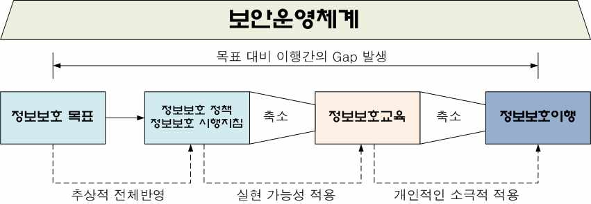

[그림 4-3] 정보보호 목표와 교육과정과의 Gap
• 정보보호 교육 개선 Life-Cycle
보안환경의 변경에 따라 정보보호 교육도 동일하게 변경/발전 필요

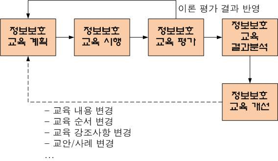

[그림 4-4] 정보보호 교육 개선 Life-Cycle
수행 내용 / 정보보호 교육 시행 및 개선하기
재료·자료
Ÿ 조직의 정보보호 정책/정보보호 시행지침 등의 보안 내규
Ÿ 침해사고 대응지침서
Ÿ ISO27001: 2013 통제항목
Ÿ 정보보호 교육자료
Ÿ 정보보호 교육 평가 결과서
Ÿ 정보보호 감사 수행 결과서
기기(장비･공구)
Ÿ 컴퓨터, 프린터, 복사기 등
Ÿ 문서작성 도구, E-mail 발송 시스템, 프리젠테이션 도구
안전･유의 사항
Ÿ 정보보호 교육 이후의 교육 평가는 반드시 수행되어야 하며, 교육 내용에 따라 검정형, 업무
수행 검사형 등의 다양한 방법으로 수행될 수 있다.
Ÿ 정보보호 교육 평가에 대한 신상필벌에 대한 기준이 수립되어야만 목표하는 보안교육 효과를
나타낼 수 있다.
Ÿ 정보보호 교육 내용은 보안환경에 따라 수시 변경/갱신되어야 한다.
Ÿ 정보보호 교육 결과에 의해 도출된 분석 결과는 이해관계자가 이해할 수 있는 수준으로 구체적으
로 작성되어야 한다.
수행 순서
• 정보보호 교육대상자에게 설계된 보안 교육과정에 따라 교육과정을 진행한다.
1. 정보보호 교육 대상자에게, 계획된 정보보호 교육 장소 및 일정을 전달한다.
(1) 정보보호 교육 대상자별 정보보호 교육 목표를 작성한다.
(2) 정보보호 교육 계획을 포함하여 공지 내용을 작성한다.
(3) 정보보호 교육 대상자에게, 정보보호 교육 수행 내용을 전달한다.

[그림 4-5] 정보보호 교육 내용 전달 사례
2. 정보보호 교육 자료를 활용하여, 해당 장소/일정에 정보보호 교육을 진행한다.
• 실시된 정보보호교육의 결과를 모니터링하여 보안운영체계 운영 관련한 효과를 분석한다.
1. 정보보호 교육 내용을 바탕으로 정보보호 결과 모니터링 항목을 도출한다.
(1) 정보보호 교육 내용에서 적용(효과 도출) 영역을 도출한다.
(2) 도출된 정보보호 교육 적용 영역에서 모니터링 항목(검사 항목)을 산출한다.
2. 도출된 정보보호 결과 모니터링 항목별 적용 결과 검사 방법을 수립한다.
(1) 산출된 모니터링 항목에서, 정보보호 교육 효과에 의해 업무 절차나 방법 등이 변
경된 항목을 도출한다.
(2) 도출된 항목에서 실제 변경된 업무 절차/방법을 산출한다.
(3) 산출된 변경 업무 절차/방법에 대한 평가 기준을 산정한다.
<표 4-8> 변경 대상 업무 절차/방법 평가 사례
정보보호
... 보안 교육 내용 적용 영역 변경된 업무사항 평가 기준
교육 대상
개발자 개인 PC 개인PC내
개발자
연구소 ... - 내부자 정보 유출 내 소스코드 저 제품 소스코
개인 PC
장 불가 드 전무
- 내부자 정보유출
프린터 내 누적 프린터 내
영업본부 ... - 외부자 비인가 프린터 출력물
출력물 0 출력물 전무
정보취득
3. 수립된 정보호호 적용 검사 방법에 따라, 정보보호교육의 결과를 모니터링한다.
(1) 정보보호 적용 검사 방법을 도출한다.
(2) 정보보호 적용 검사 계획을 수립한다.
(3) 계획된 일정에 따라, 정보보호 교육 결과를 모니터링한다.
<표 4-9> 정보보호 교육 결과 검사 계획 수립 사례
정보보호
... 평가 기준 검사 방법 검사 계획
교육 대상
개인PC내 개발자 PC내 10월 3째 주
연구소 ...
제품 소스코드 전무 소스코드 유무 검사 개발자 5명 무작위 추출 검사
프린터 내 10월 3째 주
프린터 내
영업본부 ... 누적 출력물 전체 프린터 대상(7대)
출력물 전무
유무 확인 검사
4. 정보보호교육의 결과에 대한 모니터링 결과를 분석한다.
(1) 정보보호교육의 결과에 대한 모니터링 결과를 정리한다.
(2) 정리된 정보보호교육의 결과에 대한 모니터링 결과를 분석하여 정보보호 교육 효과
를 분석한다.
<표 4-10> 정보보호 교육효과 분석 사례
교육 효과
검사 방법 검사 계획 검사 결과 분석
분석
10월 3째 주
개발자 PC내 3명 개발자 PC에서 교육효과
개발자 5명 무작위 추출
소스코드 유무 검사 저장된 소스코드 확인 다소 부족
검사
프린터 내 10월 3째 주 3대 프린터에서
교육효과
누적 출력물 전체 프린터 대상(7대) 누적 출력물 확인
다소 부족
유무 확인 검사 (2명분)
(3) 정리된 정보보호교육의 결과를 모니터링 결과를 분석하여, 미비한 점을 도출한다.
<표 4-11> 정보보호 교육 미비점 도출 사례
검사 결과 분석 교육 효과 분석 교육 미비점
3명 개발자 PC에서 교육효과
개발자 저장 데이터 보안 교육 강조 필요
저장된 소스코드 확인 다소 부족
3대 프린터에서
교육효과 영업/기술지원
누적 출력물 확인
다소 부족 문서 보안 교육 강조 필요
(2명분)
• 실시된 정보보호 교육 결과를 반영하고 보완하여 새로운 교육과정을 설계한다.
1. 도출된 정보보호 교육에 대한 미비점을 바탕으로, 기존 정보보호 교육과정의 개선 대상
을 확인한다.
(1) 정보보호 교육 미비점이 나타난 교육 내용을 식별한다.
(2) 교육 내용상의 개선사항을 도출한다.
<표 4-12> 정보보호 교육 개선사항 도출 사례
교육 미비점 개선 사항
교육과정 상 사고사례 제시 부족
개발자 저장 데이터 보안 교육 강조 필요
저장 데이터 위험에 대한 강조 부족
영업/기술지원 문서(출력물)보안에 대한 사고사례 부족
문서 보안 교육 강조 필요 정보 유출에 대한 강조 부족
2. 확인된 정보보호 교육 내용의 개선 대상을 보완한다.
(1) 정보보호 교육 내용을 보완한다.
(2) 필요에 따라, 정보보호 교육과정 및 순서를 변경한다.
(3) 필요에 따라 정보보호 교육 수행자 및 제시 사례를 변경한다.
3. 보완된 정보보호 교육 내용을 바탕으로, 새로운 교육과정을 설계한다.
(1) 새로운 정보보호 교육을 받을 교육 대상을 선정한다.
(2) 새로운 정보보호 교육을 위한 교육 장소의 선정 및 일정을 수립한다.
<표 4-13> 신규 정보보호 교육 설계 사례
정보보호 교육
... 업무 취약점 보안위협 교육내용 변경사항
교육 대상 우선순위
- 저장 데이터 보안사
제품에 대한 고사례 3건 추가
내부자
연구소 ... 기밀 정보 유 1 (6page)
정보 유출
출 가능 - 저장 데이터 위험 강
조(3page)
- 내부자 - 문서(출력물)보안에 대
사내 영업 실 정보유출 한 사고사례 2건 추
영업본부 ... 적/전략 정보 - 외부자 2 가(5page)
유출 가능 비인가 - 정보 유출에 대한 강
정보취득 조(2page)
• 실시된 정보보호 교육 결과를 반영하여 보안체계운영의 개선 사항을 제시한다.
1. 정보보호교육의 결과를 모니터링 결과를 바탕으로 도출된 정보보호 교육 미비점의 영
향 범위를 조사한다.
2. 조사된 영향 범위에 해당하는 보안체계운영 영역을 도출한다.
(1) 정보보호 시행지침상의 미비점을 도출한다.
(2) 정보보호 정책이나 정보보호 시행지침 상에 나타난 정보보호 전략의 미비점을 도출
한다.
(3) 정보보호 정책의 미비점을 도출한다.
3. 정보보호 교육 미비점에 따라, 도출된 보안체계운영 영역의 개선사항을 제시한다.
(1) 정보보호 교육 미비점에 해당하는 보안체계운영 영역을 확인한다.
(2) 확인된 보안체계운영 영역에 대한 보완사항을 작성한다.
(3) 보안체계운영 영역에 대한 이해관계자를 조사한다.
(4) 조사된 보안체계운영 영역에 대한 이해관계자에게 작성된 보완 사항을 제시한다.
<표 4-14> 보안체계운영 개선사항 제시 사례
교육 미비점 ... 보안체계운영 영역 보완 대상 이해관계자 변경 사항
개발자 저장
정보보호 시행지침
데이터 보안 정보보안 정보보호
... 교육 주기
교육 강조 교육 총괄책임자
변경 필요
필요
교육주기
반기1회
영업/기술지 ->분기1회
원 정보보호 시행지침
정보보안 정보보호
문서 보안 ... 교육 주기
교육 총괄책임자
교육 강조 변경 필요
필요

| 학습 4 | 교수·학습 방법 |
| --- | --- |

교수 방법
Ÿ 정보보호 교육계획 수립 사례를 제시한다.
Ÿ 정보보호 교육 우선순위 도출 사례를 제시한다.
Ÿ 정보보호 교육 방법에 대한 다양한 사례를 제시한다.
Ÿ 정보보호 교육 절차에 대해 구체적으로 설명한다.
Ÿ 정보보호 교육 자료 수집 과정에 대한 방법을 설명한다.
Ÿ 정보보호 교육 자료 작성 시 주의사항을 구체적으로 설명한다.
Ÿ 정보보호 교육 이후의 교육효과 도출을 위한 방법 결정 사례를 구체적으로 설명한다.
Ÿ 정보보호 교육 효과 검사를 위한 방법 수립을 상세히 설명한다.
Ÿ 정보보호 교육 이후 보완/개선 대상 선정 과정을 상세히 설명한다.
Ÿ 정보보호 교육 내용의 변경 사례를 구체적으로 제시한다.
Ÿ 정보보호 교육 내용의 강조 사항 추가 사례를 구체적으로 설명한다.
학습 방법
Ÿ 정보보호 교육계획 수립 사례를 조사한다.
Ÿ 정보보호 교육 우선순위 도출 사례를 조사한다.
Ÿ 정보보호 교육 방법에 대한 다양한 사례를 이해한다.
Ÿ 정보보호 교육 절차에 대해 조사한다.
Ÿ 정보보호 교육 자료 수집 과정을 조사한다.
Ÿ 정보보호 교육 자료 작성 시 주의사항을 이해한다.
Ÿ 정보보호 교육 이후의 교육효과 도출을 위한 방법 결정 사례를 조사한다.
Ÿ 정보보호 교육 효과 검사를 위한 방법 수립 사례를 이해한다.
Ÿ 정보보호 교육 이후 보완/개선 대상 선정 과정을 조사한다.
Ÿ 정보보호 교육 내용의 변경 사례를 조사하여 발표한다.
Ÿ 정보보호 교육 내용의 강조 사항 추가 사례를 조사한다.

| 학습 4 | 평 가 |
| --- | --- |

평가 준거
• 평가자는 학습자가 수행 준거 및 평가 시 고려사항에 제시되어 있는 내용을 성공적으로 수행하였
는지를 평가해야 한다.
• 평가자는 다음사항을 평가한다.

| 학습 내용 | 평가 항목 | 성취수준 |  |  |
| --- | --- | --- | --- | --- |
|  |  | 상 | 중 | 하 |

- 정보보호 교육대상자를 업무범위 및 우선순위에 따
라 선정 분류할 수 있다.
정보보호 교육
준비
- 보안운영체계에 따라 분류된 정보보호 교육대상자에
필요한 보안교육과정을 설계할 수 있다.
- 정보보호 교육대상자에게 설계된 보안 교육과정에
따라 교육과정을 진행할 수 있다.
- 실시된 정보보호교육의 결과를 모니터링하여 보안운
영체계 운영 관련한 효과를 분석 할 수 있다.
정보보호 교육
시행 및 개선
- 실시된 정보보호 교육 결과를 반영하고 보완하여 새
로운 교육과정을 설계할 수 있다.
- 실시된 정보보호 교육 결과를 반영하여 보안체계운
영의 개선 사항을 제시 할 수 있다.
평가 방법
• 문제해결 시나리오

| 학습 내용 | 평가 항목 | 성취수준 |  |  |
| --- | --- | --- | --- | --- |
|  |  | 상 | 중 | 하 |

- 정보보호 교육대상자 분류
정보보호 교육
준비
- 보안교육과정 설계
• 서술형 시험

| 학습 내용 | 평가 항목 | 성취수준 |  |  |
| --- | --- | --- | --- | --- |
|  |  | 상 | 중 | 하 |

| 정보보호 교육시행 및 개선 • 구두 발표 정보보호 교육시행 및 개선 피 드 백 | - 보안 교육과정 진행 주의사항 - 보안운영체계 운영 관련한 효과 분석 방법 - 신규 보안 교육과정 설계 절차 - 보안체계운영 개선 사항 제시 과정 - 보안 교육과정 진행 사례 - 보안운영체계 운영 관련한 효과 분석 결과 - 정보보호 교육 결과를 반영한 신규교육 과정의 설계사례 - 보안체계운영 개선 사례 |  |  |  |
| --- | --- | --- | --- | --- |
| 1. 문제해결 시나리오- ‘정보보호및 미흡한 점을 | 교육 준비’학습 내용에 관련된 상황 제시 후 문제 분석/해결지적하고 설명한다. |  | 과정상의 | 오류 |
| 2. 서술형 시험- ‘정보보호및 미흡한 점을 | 교육 시행 및 개선’학습 내용에 대한 서술 문제를 제시하여,지적하고 설명한다. |  | 답변상의 | 오류 |
| 3. 구두 발표 - ‘정보보호및 접근상의 | 교육 시행 및 개선’학습 내용에 사례를 조사/발표한 후,오류 및 미흡한 점을 지적하고 보완 설명한다. | 발표 | 내용의 | 방향 |

| 학습 내용 | 평가 항목 | 성취수준 |  |  |
| --- | --- | --- | --- | --- |
|  |  | 상 | 중 | 하 |

| 정보보호 교육시행 및 개선 피 드 백 | - 보안 교육과정 진행 사례 - 보안운영체계 운영 관련한 효과 분석 결과 - 정보보호 교육 결과를 반영한 신규교육 과정의 설계사례 - 보안체계운영 개선 사례 |  |  |  |
| --- | --- | --- | --- | --- |
| 1. 문제해결 시나리오- ‘정보보호및 미흡한 점을 | 교육 준비’학습 내용에 관련된 상황 제시 후 문제 분석/해결지적하고 설명한다. |  | 과정상의 | 오류 |
| 2. 서술형 시험- ‘정보보호및 미흡한 점을 | 교육 시행 및 개선’학습 내용에 대한 서술 문제를 제시하여,지적하고 설명한다. |  | 답변상의 | 오류 |
| 3. 구두 발표 - ‘정보보호및 접근상의 | 교육 시행 및 개선’학습 내용에 사례를 조사/발표한 후,오류 및 미흡한 점을 지적하고 보완 설명한다. | 발표 | 내용의 | 방향 |

∙박억남(2015). 『정보보안 개인정보보호 입문+실무 Bible』. 위즈플래닛.
∙장상수(2015).『정보보호총론』. 생능출판사.
∙장상수·조태희·신승호·신대철(2015).『정보보호 관리체계 구축 및 활용』. 생능출판사.
∙한국정보보호심사원협회·공병철(2015). 『ISMS 실무가이드』. 인포더북스.
∙히로시 유키(2012). 『알기 쉬운 정보보호개론』. 인피니티북스.

정보보호 교육 계획서

NCS학습모듈 개발이력
발행일 2015년 12월 31일
세분류명 보안엔지니어링(20010206)
개발기관 ㈜밸류원컨설팅, 한국직업능력개발원
발행일 2018년 12월 31일
학습모듈명 보안체계 운영관리(LM2001020607_16v3)
개발기관 한국직업능력개발원
보안체계 운영관리(LM2001020607_16v3)
저작권자 교육부
연구기관 한국직업능력개발원
발행일 2018. 12. 31.
※ 이 학습모듈은 자격기본법 시행령(제8조 국가직무능력표준의 활용)에 의거하여 개발
하였으며,NCS통합포털사이트(http://www.ncs.go.kr)에서 다운로드 할 수 있습니다.

