# kocw_식물보호학_01

|  | 2021년도 2학기 - 식물보호학식물의 재배(재배학 원론) |
| --- | --- |

| 2021년도 2학기 - 식물보호학 |
| --- |
| 식물의 재배(재배학 원론) |

강의 내용

 서론(작물보호의 개념, 작물의 피해와 원인, 작물의 피해대책)
 재배학 원론
 작물과 원산지
 작물의 재배환경
 작물의 유전과 육종
 작물의 재배기술
 작물의 기상재해

서론

 작물보호의 개념
 인류 초기 : 단순채집 + 사냥  의식주 해결
 인구 증가와 식량이 안정적 공급을 위해, 작물 재배 시작  정착 농업으로 획기적인 수량 증대

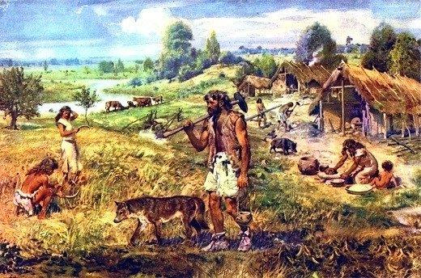

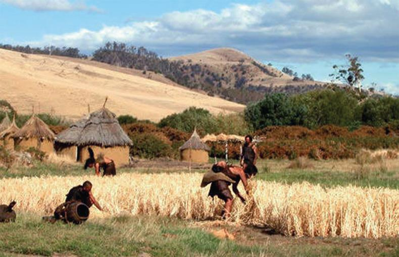

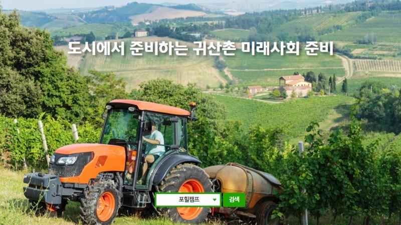

작물 재배를 통한 수량의 안정화 공급

서론

 작물보호의 개념
 작물(재배식물)의 최대 수량 확보를 위해, 다양한 재배기술 적용 필요
 수확까지 재배기간 동안 각종 병충해, 잡초해, 기상재해에 의하여 수확량이 감소
 작물보호(crops protection) : 수확 감소요인으로부터 작물 보호!!  작물의 피해를 줄이고 재배 농산물의 생산량 증대

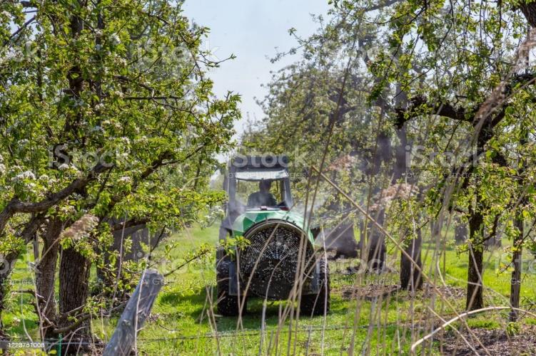

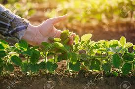

서론

 현대 농업의 특징
 높은 생산성 달성 : 첨단 시설, 관리, 극대화된 환경제어(스마트팜), 비배관리(비료나 재배법), 획일화된 단일작물 재배 등

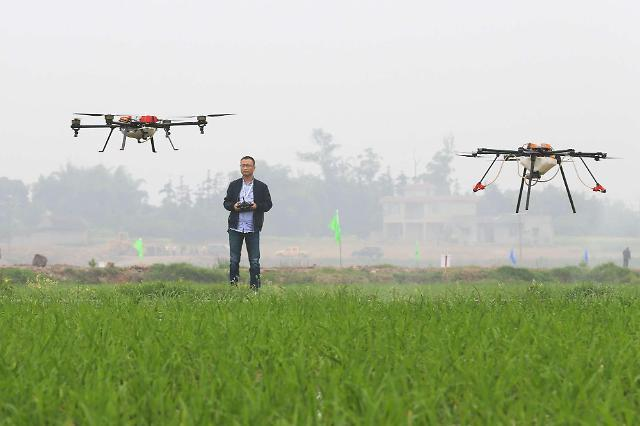

 (악영향) 병충해나 재해 위험성 증대
 농약(작물보호제, 화학적 방제제) 의존 농법 : 경비 절감과 생력화 목적
 (악영향) 고투입 농업 구조 속에서, 농자재 비용 증가  농산물값 상승
 빠른 생육 조절  (악영향) 작물의 저항성과 내성 감소 등

• 종합적이고효율적인작물 재배
• 병충해,잡초방제도환경과생태적으로수행
 이를 위해, 재배와 병해충, 잡초, 작물보호제의 구조와 특성 이해, 생물적 방제에 이르는 폭넓은 지식과
새로운농자재,품종의개발로조화롭고효율적으로제반 문제를해결해야함.

서론

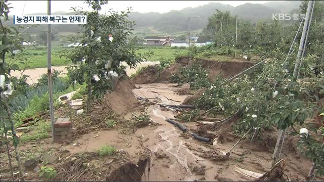

 작물의 피해와 원인
 피해의 원인
• 비생물적 피해
- 기상적 피해 : 풍해, 수해, 습해, 한해, 냉해, 설해 등
- 인위적 피해 : 오염에 의한 피해, 약해 등
- 환경적 피해 : 토양, 비료 등으로 인한 '영양장해', 대기나 수질로 인한 '환경오염 물질' 등

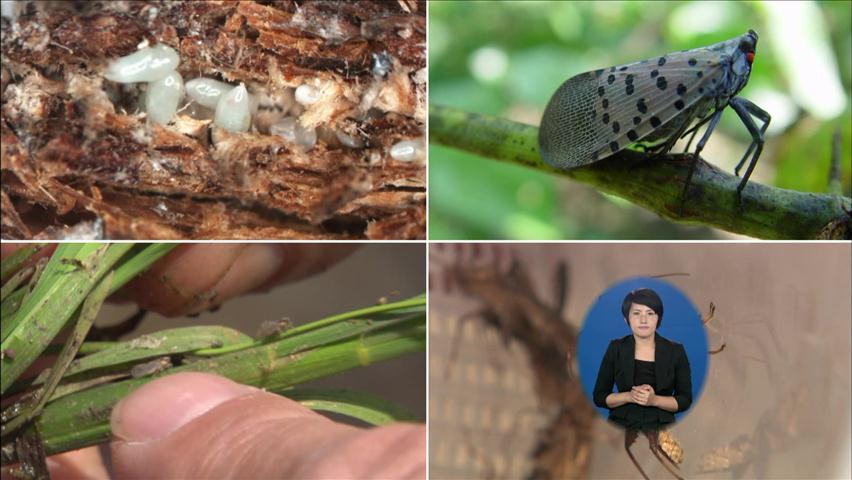

• 생물적 피해
- 병해 : 바이러스, 진균, 세균, 진균 등 병원균에 의한 피해
- 충해 : 해충과 야생동물에 의한 피해
- 잡초 및 기생식물에 의한 피해

서론

서론

 작물의 피해 대책
 식물 피해 관리 : 경제적 피해 수준(economic injury level)(손실액과 방제비용 동일)을 설정  최소한의 방제
 (해충) 밀도의경제적개념
 경제적피해 수준(Economic injury level, EIL)
• 경제적손실이나타나는해충의최저밀도, 즉 해충에대한 피해액과방제비가같은 수준의밀도
• 작물의경제성, 지역, 사회적여건등에따라변화
 경제적피해 허용수준(Economic threshold, ET)
• 해충의밀도가경제적 피해수준에도달하는것을 억제하기위하여 방제수단을써야 하는 밀도수준
 일반평형밀도(General equilibrium position)
• 일반적인환경조건에서약제방제등 해충방제의일시적인간섭으로부터영향을받지 않는장기간에걸쳐
형성된해충 개체군의평균밀도

서론

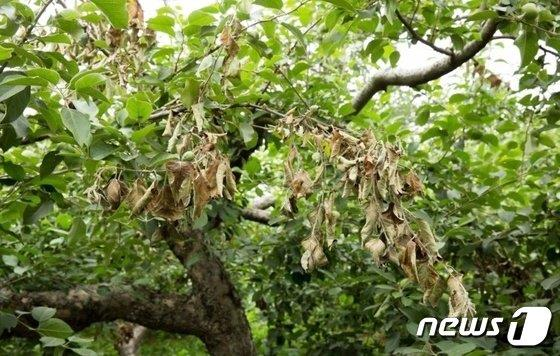

 작물의 피해 대책
 식물 피해의 진단
• 대부분 복합적
• 진단(diagnosis)으로피해의 원인 결정, 형태적/생리 화학적, 유전적 특성 확인, 분석
 생물의 분류학적 위치 결정(동정(identification 동반) 원인이 무엇인가?
(진단!!)
 식물 병충해의 예방과 방제 제도
• 작물보호에 관한 여러가지 제도 : 식물방역
• 국가적인 예찰과 예방 : 농촌진흥청 및 각 도 농업기술원 / 산림청 및 각도 산림환경연구소 에서 병해충 발생 예찰
• 종합적 방제와 작물 보호 : 종합적 방제와 농자재의 효율화, 작물의 품종개량, 합리적 재배

서론

 법적 방제 : 법령에 의한 방제로서, "식물검역"을 의미함.
 식물검역 : 식물에 피해를 주는 외국의 병해충이 국내로 들어오는 것을 방지하여 위하여 수입되는 식물과 그

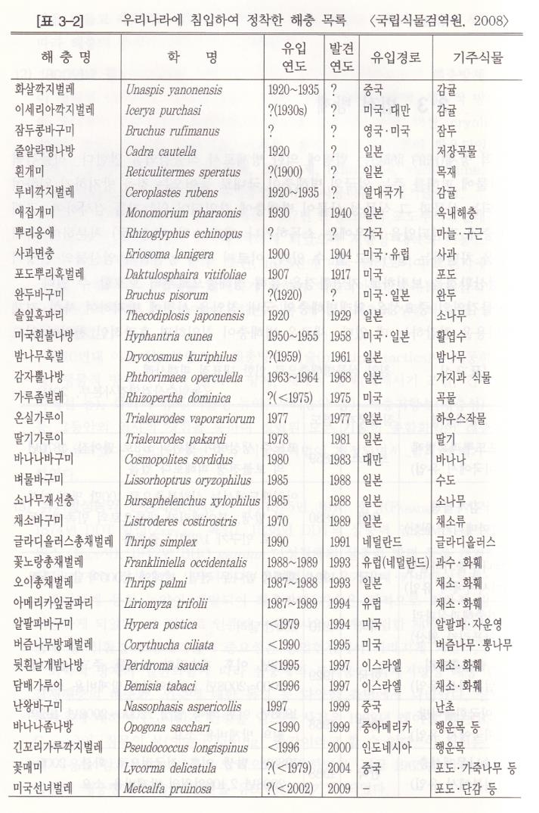

식물성 산물이 병해충에 감염되어 있는지를 검사하여, 국내 유입을 차단하는 일

서론

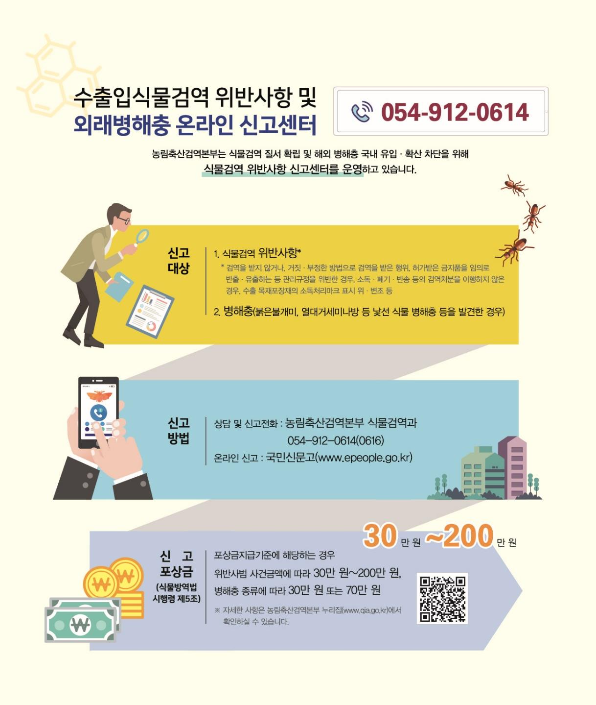

재배학 원론 - 1장. 작물과 원산지
_재배학의 개념

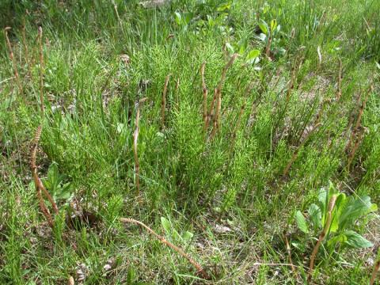

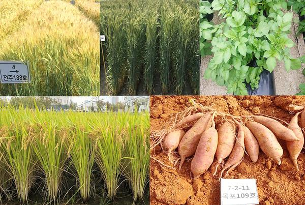

 작물(식물)보호학의 목적 : '병충해와 잡초해의 방제'
 식물 : 작물(crop) + 잡초(weed)
 작물(crop)의 정의
작물 잡초
 실용적인 유전적 특성이 같은 종자
 영양번식체를 일정한 장소 및 시기에 일정한 거리로 재식하여 재배하는 집단
 "작물" : 여러가지 식물 가운데 경제적으로 중요한 유용식물을 대상으로 필요로 하는 물질을 다량으로 획득하기 위해
재배하는 식물

 작물의 이용 부위 : 주로 종자나 영양체

재배학 원론 - 1장. 작물과 원산지
_작물의 원산지(native habital)

 작물의 원산지 : 작물이 최초로 발생된 지역
 원산지를 알면, 육종 및 재배, 관리에 많은 정보 확보 가능
 작물 기원 연구 : 더 캔돌(De Candolle)(1778~1841)의 '재배식물의 기원', 바빌로프(Vavilov)(1887~1943)의 '유전자중심설'
 유전자 중심지에는 변이가 다양하고 우수한 품종(우성유전자)이 많다는 이론!

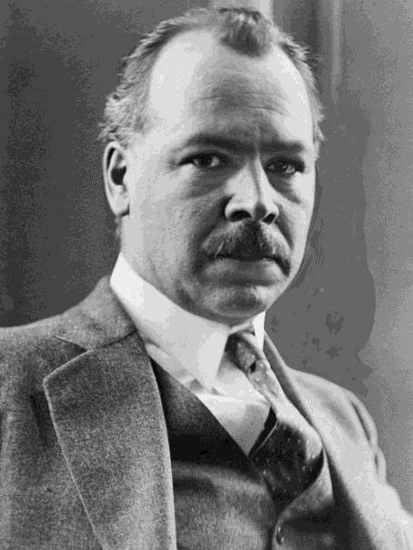

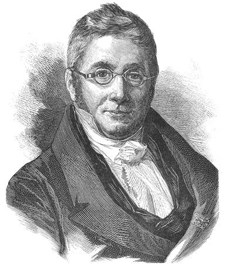

Augustin P. de Candolle Nikolai Vavilov
(스위스식물학자) (러시아식물육종학자)

재배학 원론 - 1장. 작물과 원산지
_작물의 원산지(native habital)

표 1.1. 바빌로프의재배식물의 기원중심지(World centers of origin of cultivated plants)

재배학 원론 - 1장. 작물과 원산지
_작물의 분류

 작물 vs. 잡초

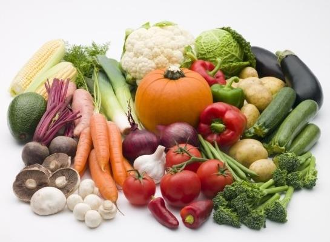

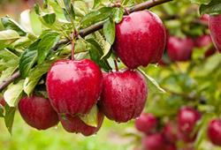

 작물 : 인간이 필요로 하여 재배하는 것
 잡초 : 인간이 원치 않는 작물
** 광의의 작물(plant) : 작물(crop) + 잡초(weed)
 작물의 종류

| 구분 | 설명 |
| --- | --- |
| 자연 분류 | 종(species)을 기본으로 함 |
| 목적과 용도 | • 식용작물 : 벼, 보리, 밀, 콩• 약용작물 : 인삼, 작약• 사료작물 : 알팔파, 옥수수 등 |
| 재배 기간 | 일년생, 이년생, 영년생 |
| 이용 부위 | 근채류, 엽채류, 과채류 등 |
| 낙엽 유무 | 상록성, 낙엽성 등 |

 원예작물 : 채소, 허브, 과수, 화훼, 정원수류로 구분 (1,000여종)
 채소류 : 근채류, 엽채류, 과채류를 근간으로 줄기채소, 조미채소
 과수류 : 사과, 복숭아, 감 등 온대 과수와 귤, 오렌지, 바나나 등 열대
과수로 크게 구분
 화훼류 : 꽃과 잎을 관상하는 작물 지칭. 난과 잔디, 다육식물, 관상
수목 포함

재배학 원론 - 1장. 작물과 원산지
_작물의 분류

 농작물(Agricultural crop)
 식량작물(Food crop)

| 식량작물(Food crop) | 공예작물(Industrial crop) | 사료작물(Forage crop) | 녹비작물(Green manure crop) |
| --- | --- | --- | --- |
| • 주식/부식이 되는 작물• 화본과 작물 : 벼, 보리, 밀, 옥수수 등• 두과(콩과) 작물 : 콩, 땅콩, 완두 등• 서류 : 감자, 고구마 | • 공업의 원료가 되는 것• 특별한 용도로 이용되는 작물(인삼, 담배 등) | • 가축의 먹이가 되는 오차드그라스,톨페스큐, 알파파와 같은 작물 | • 토양에 영양을 공급하는 비료의 용도로 사용하는 자운영과 크라운베치와같은 작물 |

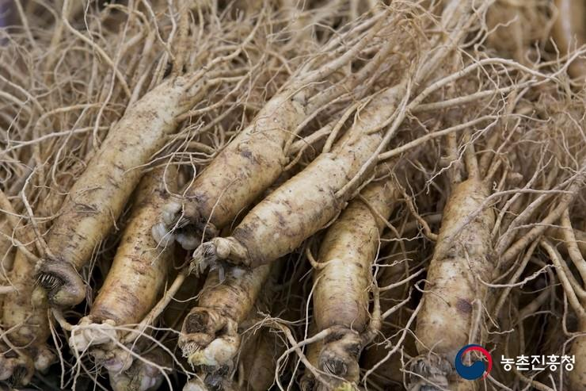

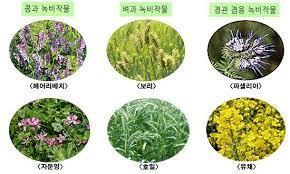

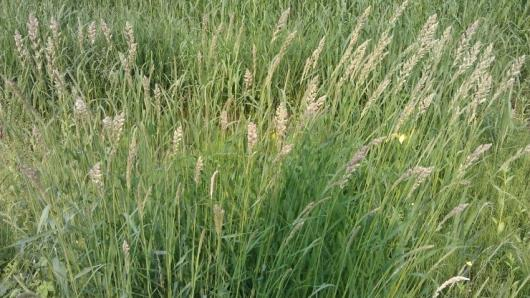

재배학 원론 - 1장. 작물과 원산지
_작물의 분류

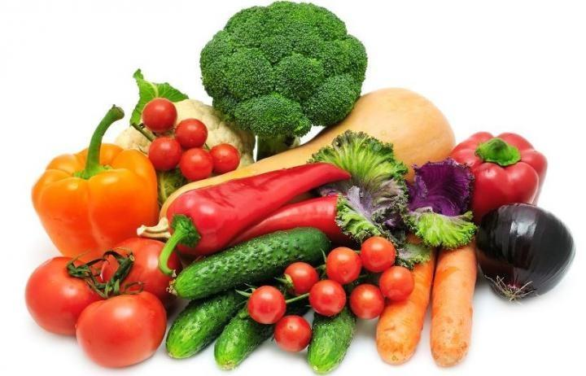

 농작물(Agricultural crop)
 원예작물(Horticultural crop)
(1) 채소(Vegetable crop)
- 원예작물 재배와 수익성의 70% 점유
- 엽채류(상추, 배추), 과채류(딸기, 토마토), 경엽채류(대파, 아스파라거스), 근채류(양파, 마늘)

재배학 원론 - 1장. 작물과 원산지
_작물의 분류

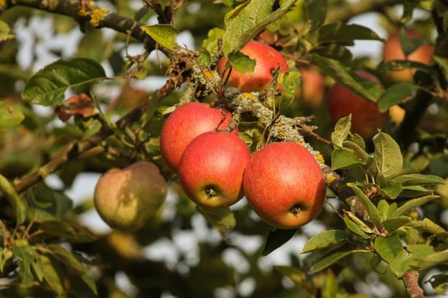

 농작물(Agricultural crop)
 원예작물(Horticultural crop)
(2) 과수(Pomology crop)
- 과실의 생산으로 영농이익을 주목적으로 하는 것
- 국내 사과, 배, 귤 등은 과실이 크고 품질이 우수
- 관상적 가치 보유, 비타민과 무기질 공급원, 섬유질 제공, 독특한 향, 기능성 성분(질병 예방) 등
- 온대 과수(temperate zone pomology)와 아열대 과수(tropical pomology) 구분

| 인과(pome) | 감과(hesperidium) | 핵과(drupe) | 장과(berry) | 견과(nut) |
| --- | --- | --- | --- | --- |
| • 과육이 꽃받침에서 발달• 씨방은 과심부를 이룸• 사과, 배, 모과, 비파 등 | • 식용부위 : 과육(씨방이 발육)• 꽃받침은 꽃자루와 같은 방향• 감, 감귤 | • 과실속에 단단한 핵 존재• 그 속에 종자인 인이 있음• 복숭아, 살구, 자두, 앵두 등 | • 겉껍질이 얇고 먹는 부분인 과육은 중과피와 내과피가 발육• 포도, 무화과, 나무딸기, 구스베리, 블루베리 등 | • 먹는 부분은 종실 속에 있는떡잎• 종실은 굳은 껍질로 둘러싸임• 밤, 호두, 개암 등 |

재배학 원론 - 1장. 작물과 원산지
_작물의 분류

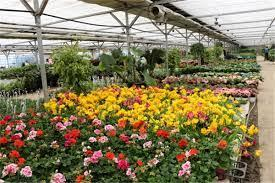

 농작물(Agricultural crop)
 화훼작물(Floriculture crop)

재배학 원론 - 1장. 작물과 원산지
_작물의 분류

 농작물(Agricultural crop)
 관상 수목류의 분류(Grouping of ornamental tree)
• 정원수 : 기후조건에 따라 수종과 관리의 난이도에 따라 재배 수량도 차이

• 적응 범위가 넓은 종 : 향나무, 느티나무, 은행나무
• 상록수와 낙엽수
• 교목(2m 이상)과 작은 관목

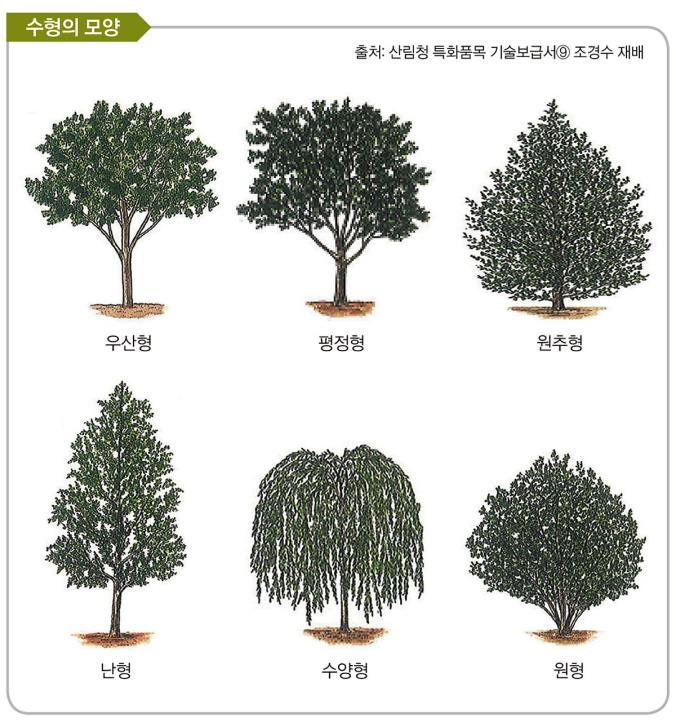

• 활엽수와 침엽수 등

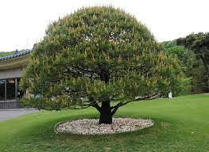

재배학 원론 - 2장. 작물의 재배환경(Cultivation environment)
_재배의 개념

 재배의 개념
 재배의 기본
• 광합성작용 및 생장을 위한

- 이산화탄소, 물, 에너지원(광) 공급
- 아미노산(탄수화물), 단백질 합성 위해, 질소, 인산, 칼륨 등 무기요소 공급 필요
• 산소 공급 : 작물 체온 유지 및 호흡에 필요

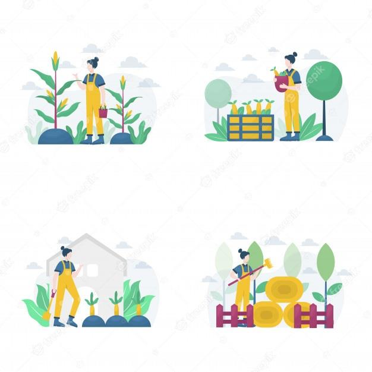

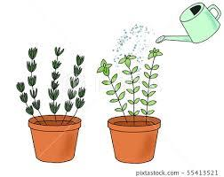

재배학 원론 - 2장. 작물의 재배환경(Cultivation environment)
_재배의 개념

 환경의 의미와 종류
 무생물적(자연적) 환경 : 빛, 온도, 수분, 토양, 공기 등
 생물적 환경 : 동식물 및 미생물
 인위적 + 사회적 + 문화적 환경
 기상생태형(= 상적발육설) : 기상 조건에 따라 작물의 생육상이 크게 달라지는 특징
• 감광성(感光性, photosensitivity) : 빛에 의해 영향을 받는 특성
• 감온성(感溫性, thermosensitivity) : 온도에 의해 사육이 달라지는 특성
• 기본영양생장성(基本營養生長性, basic vegetative growth): 작물 고유의 기본 생장을 하면 생식 생장으로 넘어가는 특성

재배학 원론 - 2장. 작물의 재배환경(Cultivation environment)
_재배의 개념

 환경의 의미와 종류
1) 온도환경
-생육적온(optimum temperature) : 작물이자라는데최적의온도(= 15~35°C)
• 한대작물(10~20°C), 온대작물(15~25°C), 열대작물(25~30°C)
• 생육최저온도/최고온도: 오이유효온도(5~40°C), 최저생육온도(2°C), 생육최적온도(20~25°C)
-온도의종류
• 기온(air temperature) : 대부분관엽식물(13~32°C), 18~27°C유지시잘자람.
• 지온(soil temperature) : 종자의발아및초기생육에큰영향. 토양색, 토성, 경사도, 수분함량에따라다름.
(이랑은남북방향남사면에종자파종발아촉진및초기생육도움)
• 수온(water temperature) : 수생작물및논벼등의작물초기생육에절대적. 생육중기/후기에도중요.
-저온요구도와적산온도(accumulated temperature)
• 작물은어느정도의저온요구도존재(작물에따라다름. 필요저온에처해야꽃이잘피거나정상적인생육가능)
• 인위적인저온처리(춘화처리, vernalization)

사과(250~1,700h), 복숭아(50~400h) 사과는복숭아보다북쪽지방적합

재배학 원론 - 2장. 작물의 재배환경(Cultivation environment)
_재배의 개념

 환경의 의미와 종류
2) 광(light)환경
-광합성과태양광(photosynthesis and sun light)
• 빛은작물생육에필요한궁극적인에너지원
• 태양광의특성(property of sun light)
• 광의특성(characteristic of light)

재배학 원론 - 2장. 작물의 재배환경(Cultivation environment)
_재배의 개념

 환경의 의미와 종류
3) 수분(water)환경(국내연평균강수량은1,500mm내외세계평균보다50% 정도높음)
-물의구조와성질(property of water)
• 수분(물)의필수적기능
 용매(solvent)와매질(medium) 역할: 수소결합형성하는극성분자로우수한용매. 강한응집력. 유기물/무기물의용질이동의매질
 높은비열과기화열: 온도의변화최소화식물체안정, 표면에서온도를낮추는수분증발/증산기능
 식물세포팽압(turgor pressure) 유지매체: 세포의신장, 식물구조/잎의전개촉진
 교질분자에서하전의중화(neutralization of charges)와수화(hydration) 촉매기능
 식물의광합성, 가수분해과정, 다른화학반응의재료

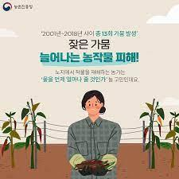

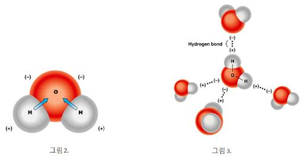

재배학 원론 - 2장. 작물의 재배환경(Cultivation environment)
_재배의 개념

 환경의 의미와 종류
3) 수분(water)환경(국내연평균강수량은1,500mm내외세계평균보다50% 정도높음)

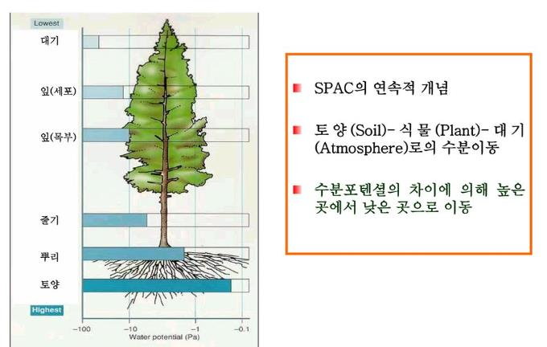

-물의구조와성질(property of water)
• 수분퍼텐셜(water potential)
 작물체내수분의기능: 광합성원료, 작물체유지(팽압) 역할, 체온조절
 토양내수분의기능: 양분을녹여흡수, 운반하는용매역할
 토양과작물에서물의상태와이동을표현하는2가지방법
-체내의수분함량(water content) :
-수분퍼텐셜(water potential) : 1960년도도입된개념.
문을할수있는능력을가짐. 열역학적에너지개념에서종합적표현
(양의수분퍼텐셜: 수분이과다할때/ 음의수분퍼텐셜: 수분이모자랄때)

재배학 원론 - 2장. 작물의 재배환경(Cultivation environment)
_재배의 개념

 환경의 의미와 종류
3) 수분(water)환경(국내연평균강수량은1,500mm내외세계평균보다50% 정도높음)
-물의구조와성질(property of water)
• 수분이용효율(water use efficiency, WUE)
 생육기간에축적된건물량과흡수한수분량대비작물에의해흡수된물의이용성파악가능
 요수량(water requirement) : 단위중량(1g)의건물(dry matter)을생산하는데필요한수분량(g)

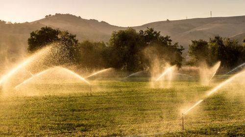

재배학 원론 - 2장. 작물의 재배환경(Cultivation environment)
_재배의 개념

 환경의 의미와 종류
4) 대기(atmosphere)환경
-물의구조와성질(property of water)
• 높은이산화탄소농도및미세먼지등대기환경의악화작물생장에큰영향
 환기나통풍을잘해줘야함.
 가장자리효과(border effect) : 노지상태에서미풍은작물생육이좋게나타나며, 이는주변가장자리에서볼수있음.
• 적당한바람이산화탄소공급, 병발생감소, 광합성촉진, 증산촉진등

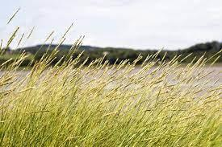

재배학 원론 - 2장. 작물의 재배환경(Cultivation environment)
_재배의 개념

 환경의 의미와 종류
6) 토양(soil) 환경
(1) 토양의물리적성질(soil physical properties)
• 토양의3상(soil phases) : 토양의물리성을좌우하는구성요소

• 토성(soil texture)

 모래(sand) : 지름0.02~2.0 mm, 양분거의함유안함. 보수령/보비력낮음. 배수/통기성양호
 미사(silt) : 0.002~0.02 mm. 가는모래. 모래와점토의중간적성질
 점토(clay) : 0.002 mm이하. 찰흙또는식토. 작물영양분흡착. 보수령/보비력양호, 배수/통기성불량
 양토(loam) : 모래와점토가절반정도혼합. 보수령/보비력/배수/통기성양호

재배학 원론 - 2장. 작물의 재배환경(Cultivation environment)
_재배의 개념

 환경의 의미와 종류
6) 토양(soil) 환경
(2) 식물영양
• 토양비옥도: 식물영양을보유할수있는토양능력과식물생육을가능하게하는능력
• 고등식물의16가지필수원소
 다량원소(8): 탄소(C), 산소(O), 수소(H), 질소(N), 인(P), 칼륨(K), 칼슘(Ca), 마그네슘(Mg)
 미량원소(8) : 황(S), 철(F), 망간(Mn), 구리(Cu), 아연(Zn), 붕소(B), 몰리브덴(Mo), 염소(Cl)

재배학 원론 - 2장. 작물의 재배환경(Cultivation environment)
_재배의 개념

 환경의 의미와 종류
6) 토양(soil) 환경
(3) 필수원소의과잉과결핍증상(deficiency symptom)

재배학 원론 - 3장. 작물의 유전과 육종(genetics and breeding)

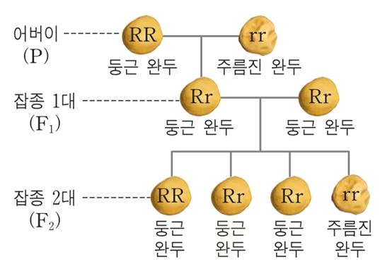

1. 멘델의 유전법칙(Mendelism)
 1856~1863 (7년), 29,000포기완두재배를통해3가지법칙발견
①분리의법칙(law of segregation) : 두대립인자는우성과열성으로분리되어나타난다.
②독립의법칙(law of independent) : 다른염색체에있는유전자는서로독립적으로자기의특성을나타낸다.
③우열의법칙(law of dominance) : 대립형질을가진유전자가잡종1대에서나타나면우성, 나타나지않으면열성이다.
1) 작물품종의재배적특성
(1) 종의개념과분화
① 식물분류의기본단위. 대체로같은유전형질을나타내는개체군의포괄집단
② 지역에 따라 복잡한 생태적 분화  품종 선택, 선발과 채종 등에 좋은 재료 제공
③ 품종은 재배와 이용상의 동일한 특성을 나타내는 식물. 유전형질이 균일하면서 영속적인 개체들의 집단
④계통유전형질이균일한품종이라도돌연변이, 교잡등에의해유전형질이다른개체가생겨나기도함. 이들을다시분리하고유지하는
것을계통이라함.

재배학 원론 - 3장. 작물의 유전과 육종(genetics and breeding)

(2) 품종(cultivar)의분류
①품종: 재배하는종. 재배와이용에서동일하고균일한특성을보이는유전적으로안정되고영속적인개체들의집단
② 초장, 형태, 생리적 특성에 따라 기상재해를 견디는 성질이 달라짐(내냉성, 내한성, 내병성, 내충성 등)

재배학 원론 - 3장. 작물의 유전과 육종(genetics and breeding)

2) 품종육종론
(1) 품종개량의이점
: 경제적효과, 품질개선, 재배한계확대, 병충해안정성, 경영합리화
(2) 품종육성의방법: 도입육종, 분리육종, 교잡육종, 돌연변이육종, 배수체육종, 생명공학적기법등
①내력에따른분류
 재래품: 그나라그지방에서예로부터재배되어온품종
 육성품종: 그나라에서육성된품종(=개량품종). 육성방법에따라교잡육성품종, 분리육성품종, 일대잡종품종등구분
 도입품종: 외국으로부터도입된품종(=외래품종)
② 특성에 따른 분류 : 성숙기에 따라, 조생종, 중생종, 만생종 구분. 키에 따라 장간종, 단간종 구분
③ 작부체계에 따른 분류 : 조기재배, 조식재배, 만식적응품종, 추파품종 등
④이용성에따른분류: 일반품종과맥주용보리, 고구마의식용, 사료용, 공업용등

재배학 원론 - 3장. 작물의 유전과 육종(genetics and breeding)

재배학 원론 - 3장. 작물의 유전과 육종(genetics and breeding)

(3) 우량품종의육성및보존
①우량품종의요건: 균등성, 우수성, 영속성, 광지역적응성이높으면우수함.
② 우량 종자의 요건
 우량품종에속하는종자로유전적으로순수하고이형종자가섞이지않은종자
충실하게발달하여생리적으로좋은종자
 병충해에감염되어있지않고잡초종자나협잡물이섞이지않은종자
 발아력이건전한종자
③ 품종개량의 효과 : 신품종 출현으로 경제적 효과 증대, 재배한계 확대 및 재배 안정성 증대, 품질 개선 및 경영 합리화
④품종육성의방법
 도입육종법: 외국에서새로운종이나품종도입(예: 문익점의목화)
 분류육종법: 기존의종에서순계나좋은유전자가발현되도록분리
 교잡육종법: 유전자교배를통해재조합
돌연변이육종법: 방사선또는콜히친(colchicine, 씨앗이나구근에포함된알칼로이드식물독성성분)등으로아예새로운유전자를
창출하여육종

재배학 원론 - 3장. 작물의 유전과 육종(genetics and breeding)

2. 품종보호제도(variety protection system)
 육성자의권리를법적으로보호하여주는제도
 국내에서1998년부터제도도입연차적으로작물확대시행
 품종보호제도
①육성자에게품종육성에따른노력의대가와연구개발비용회수보장우수품종개발및육종투자확대촉진
②외국의우수품종도입촉진농업인에게이들품종재배농업생산성증대및품질/가격경쟁력제고농업소득향상

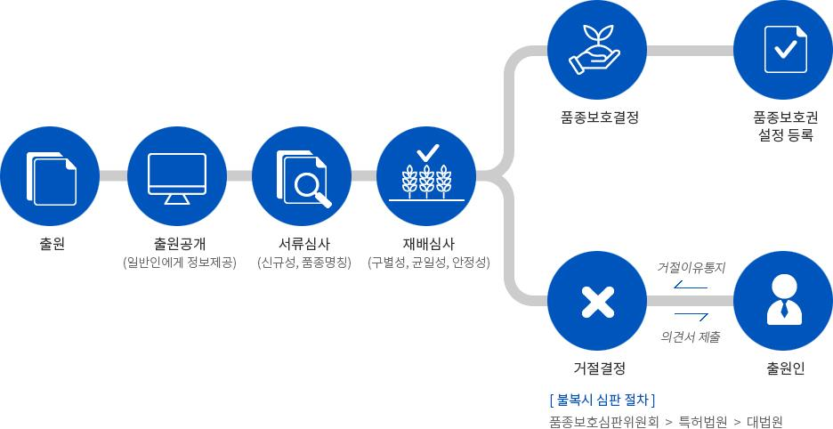

국립종자원

재배학 원론 - 3장. 작물의 유전과 육종(genetics and breeding)

3. 유전자변형 농산물(Genetically modified organism, GMO) (=LMO)
 GMO와LMO
①GMO (genetically modified organism) : 분말상태의콩등과같은상태의상대적명칭
②LMO(living modified organism): 일반적으로살아있는상태(발아가가능한콩등)
 작품육종은멘델법칙에서시작, 다양한육종기술을이용하여작물의유전체변화
(웅성불임, 종간교잡, 자가불화합성, 반수체육종, 돌연변이육종, 잡종강세등)
 유전자재조합: 특정DNA 염기서열을다른부위로옮김현저한작물육종범위확장
 유전자도입: rDNA 기술의결과만들어진생물체

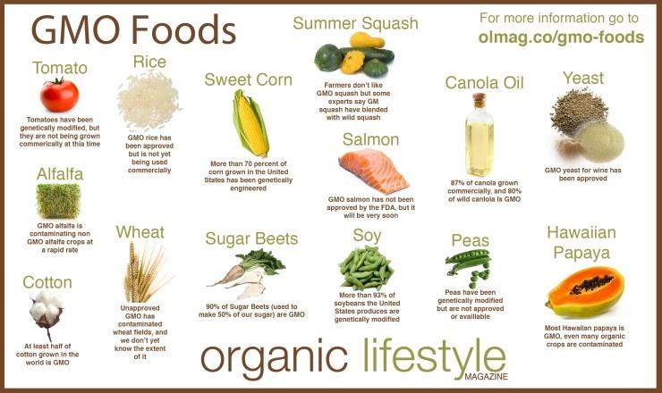

재배학 원론 - 4장. 작물의 재배기술(Cultivation Technique)

1. 작부체계(cropping system)
(1) 연작
①매년계속해서재배하는방식(식용작물또는연작장해가있어도수익성이높은경우채택)
②연작피해: 기지현상(원인: 양분고갈, 병원미생물이나독소축적, 불량한토양반응, 토양물리성의악화등)

③기지현상대책: 윤작, 저항성품종재배, 토양소독및객토, 유독물질제거및지력보강등
(2) 윤작
①돌려짓기의미. 한포장에몇가지작물을조합하여일정한순서에따라반복하여재배하는방식
②방법
-삼포식: '여름작물겨울작물휴경'으로돌려지음
-개량삼포식: 휴경대신에녹비작물과같은지력을높이는작물심는방식
-노퍽식윤작법: 지력유지, 잡초방제, 토지이용도, 생산물등종합적으로고려한윤작방식
③윤작효과: 지력유지및증진, 토양보호와기지경감, 병충해나잡초경감, 수량증대와토지이용도제고, 노력배분합리화와경영안정성증대

재배학 원론 - 4장. 작물의 재배기술(Cultivation Technique)

1. 작부체계(cropping system)
(3) 간작과혼작
①간작: 한작물이생육하고있는도중에재배하는것
(앞작물을상작, 후작물을하작이라함/ 주요작물을주작, 종속적인작물을부작)
혼작: 생육기간이거의같고주종도비슷하여두종류의작물을섞어서재배하는작부방식
②간작와혼작의장점
-간작: 전작물에큰피해가없이간작물의생육기간을연장하여증수를꾀하는경우, 토지이용률증진
-혼작: 두작물이생리생태적으로협력적으로작용하여합계수량이많을때효과

재배학 원론 - 4장. 작물의 재배기술(Cultivation Technique)

1. 작부체계(cropping system)
(4) 교호작과주위작
①교호작: 두종류이상의작물을한이랑씩교호로재배(경사지토양대상재배)
주위작: 포장주위의공지를활용하는혼작일종(논두렁에콩을재배하는것등)

(5) 답전윤환재배
①답(沓)/전(田)을교호적순환재배
②효과: 지력증진, 기지현상의회피, 잡초발생억제, 수량증가와노동력절감(감자, 수박등)

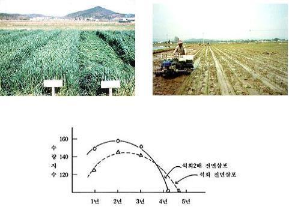

재배학 원론 - 4장. 작물의 재배기술(Cultivation Technique)

2. 작물의 번식과 육묘
1) 원예작물의번식(propagation) : 종자번식(주로식량작물), 영양번식(주로원예작물: 유전성유지목적)
(1) 종자번식(seed propagation) : 종자에의해서작물을증식
 종자내, 생명원형인뿌리와새순이될원기가이미분화되어포함
 (대표) 채소류(토마토, 오이등), 일년초(팬지, 금잔화, 채송화등), 다년초(시클라멘, 베고니아등)

재배학 원론 - 4장. 작물의 재배기술(Cultivation Technique)

2. 작물의 번식과 육묘
1) 원예작물의번식(propagation) : 종자번식(주로식량작물), 영양번식(주로원예작물: 유전성유지목적)
(2) 영양번식(vegetative propagation)
 영양체(줄기, 엽, 눈, 뿌리등)일부를잘라서새로운개체를형성(증식)
 작물은전체형성능(작물체일부또는세포몇개를떼어내어독립된한개체를만들어낼수있는능력)보유
①조직배양(tissue culture) : 떼어낸작은조직(절편체)을용기안(in vitro)에서적당한양분을가진배지(medium)에서생장, 증식
(여러기관의집합체인개체및어리배등을무균상태의인위적배지에서특정한목적을가지고배양하는것)
②삽목(cutting)
• 엽삽: 잎을잘라삽목하는것
• 줄기삽: 가장일반적. 가지를7~12 cm (3~4 마디) 정도길이로잘라서삽상에삽목시켜발근시키는방법
• 녹지삽: 새순이자라굳기전에잎이붙은채로삽목(5~6월) (동백, 치자, 철쭉, 단풍나무, 병꽃나무, 목련등)
• 숙지삽: 새순이완전히굳어져서성숙한줄기를잘라꽂는방법(3~4월) (사철, 호랑가시나무, 은행나무, 개나리, 장미, 향나무등)
• 휴면지삽: 늦가을또는초봄에휴면체로있을때의가지를이용하는방법(찔레, 능소화, 딱총나무, 클레마티스, 무화과, 등나무, 모과등)
• 뿌리삽: 3월하~4월중. 모주의뿌리를두께1 cm 내외, 10 cm 길이로절단흙속에경사로심음(명자나무, 등나무, 찔레, 라일락등)

재배학 원론 - 4장. 작물의 재배기술(Cultivation Technique)

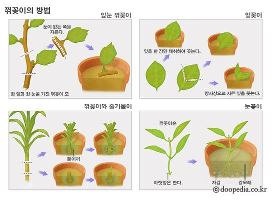

재배학 원론 - 4장. 작물의 재배기술(Cultivation Technique)

2. 작물의 번식과 육묘
1) 원예작물의번식(propagation) : 종자번식(주로식량작물), 영양번식(주로원예작물: 유전성유지목적)
(2) 영양번식(vegetative propagation)
③접목(grafting)
• 절접: 뿌리가있는대목의절단부분을쪼개어접수결속(명자나무, 목련, 라일락, 모란, 장미, 벚나무등)
• 할접: 대목의중앙을쪼개어쐐기꼴로만든접수결속(동백, 달리아등)
• 호접: 뿌리가있는두그루를서로결속(단풍나무)

• 안장접: 대목위에접수를올려놓아실이나밴드로결속(선인장등)
• 근접: 뿌리가쇠약해진나무에뿌리를붙여결속
• 근두접: 뿌리바로윗부분에접하는방법
• 눈접: 눈을채취하여대목일부를'T'자로절개후, 접목하고비닐등으로묶는방법(장미)

재배학 원론 - 5장. 작물의 기상재해(climate damage)

1. 건조해(drought injury)
2. 온도 장해(temperature injury)
3. 염류 장해(salt injury)
4. 광도 장해(light injury)
5. 풍해(wind injury)
6. 환경오염 장해(environmental pollution injury)

재배학 원론 - 5장. 작물의 기상재해(climate damage)

1. 건조해(drought injury)
 토양, 대기건조작물체내수분함량감소생육저하, 위조, 고사(건조장해)
 내건성(drought tolerance): 수분부족으로입는장해를견디는능력
1) 내건성의종류(건조할때증산작용을어느정도억제하느냐에따라구분)와대응
(1) 구조적내건성(constitutional drought tolerance) : 물리적인성격이강함
-건조를지연시키거나회피하는것
-수분을보존하는작물은엽면적이작고요수량이나증산량이많지않으므로생육초기에토양수분을보존하였다가여름에건조할때이용
-(예) 선인장, 다육식물
(2) 원형질적내건성(protoplasmic drought tolerance) : 생화학적인성격이강함
-원형질에수분함량이감소해도생리적장해를크게받지않는진정한의민의내건성(내탈수성)
(3) 건조해에대한대책
-신속한관개: 지표나살수관개, 지하관개를신속실시
-작물의경화처리(hardening) : 모종을준비할때부터건실한하드닝을해서육모뿌리발달양호, 내건조해
-토양수분의보유력증대와증발억제: 토양입단을조성, 피복하여수분증발사전방지. 증발억제제살포
-내건성품종선택

재배학 원론 - 5장. 작물의 기상재해(climate damage)

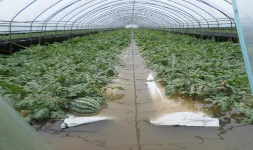

2. 습해 및 침수해(moisture and flooding injury)
 습해(excessive water injury): 지속적인토양과습상태작물의뿌리부패, 황화, 위조, 고사하게되는산소부족장해
 침수해(water logging injury): 작물이장마철에많은강우로인해모든잎이물에잠겨피해를보는장해
1) 내습성과내침수성
(1) 내습성: 작물이물리적, 화학적인방법으로산소부족으로오는장해를극복하는능력

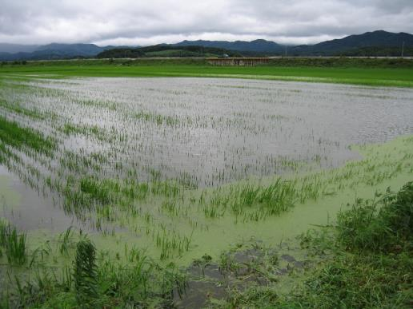

-통기조직의발달: 근권주위에기공이나지상부조직에뿌리로산소를보낼수있는통기조직(aerenchyma)발달
-세포벽의코르크화및목질화: 통기조직을통하여공급된산소가뿌리밖으로의확산방지, 생장점공급
-대사경로의변경: 뿌리의무기호흡으로부터발생하는에탄올대신에해가없는말산축적장해받지않음.
-유독물질의불용화: 토양의환원, 산화상태에서발생하는철, 망간이흡수되어도뿌리에서산화불용태로변환
-발근력의강화: 뿌리가표토에얕게발달, 부정근발생력이큼
(2) 습해및침수해에대한대책

-신속한배수처리
-적합한시비: 뿌리를지표면으로유도, 엽면시비. 과산화석회를종자분의(코팅)하면습해경감
-토양의정지와개량: 모래토양객토, 부식과토양개량제사용입단조성및이랑재배
-작물과품종의선택

재배학 원론 - 5장. 작물의 기상재해(climate damage)

3. 온도 장해(Temperature injury)

| 구분 | 정의 | 특징 | 대책 |
| --- | --- | --- | --- |
| 냉해(Coldinjury) | 여름작물에서결빙이일어나지않는0˚C이상의저온에의해받은생육장해 | -지연형냉해: 육묘기, 이앙기, 분얼기등영양생장기에저온으로인하여출수가지연되고등숙이불량-장해형냉해: 영양기관의장해, 저온에가장민감한벼의감수분열기나유수형성기에저온으로약벽의바깥쪽을둘러싸고있는융단층이비대해지고꽃가루가불출실하여약이열리지않으므로수분이되지않는경우등-병해형냉해: 저온으로광합성이원활하게진행되지못하면단백질합성이진행되지못하고수용성아미노산이나아마이드축적, 이런상태에서도열병균은단백질보다아미노산을직접이용할수있으므로벼의경우도열병이발생하는것을병해형냉해-혼합형냉해: 지연형과병해형, 장해형냉해가함께복합적발생 | -내냉성품종의선택-입지조건개선: 방풍림설치등-재배뱁개선-온도조절 |
| 한해(Chilling injury) | 상해(저온에약한여름작물재배시봄의늦서리또는첫서리가올때받는장해)동해(가을파종월동작물의경엽, 과수등다년생작물의눈등월동하는작물이받는장해) | -내동성증가요인식물체의함수량감소, 당과지유함량의증가와전분의감소, 친수성콜로이드함량증가, 수용성과-SH기단백질의증가, 화와아브시스산(ABA) 처리 | -내한성품종의선택-입지조건개선-재배법개선-온도조절 |
| 고온해(Heat injury) | 생육온도가낮은북방형목초나호냉성채소는여름에고온으로인하여생육이억제되며,직접광에노출되면장해를받음. | -고온해의기작세포막의특성변화와효소의활성저하, 양분소모, 독성물질의생성, 증산과다 |  |
| 염류장해(Salt injury) | 온실이나비닐하우스와같은시설재배지에무기질비료를과다사용하거나간척지나내륙사막지역등은토양에염류가집적되어작물재배시발생 | -염농도가높아질수록토양의수분퍼텐셜이낮아져서한해와같은장해받음.-뿌리가토양에서수분흡수불가, 뿌리조직의수분이유출 |  |
| 광도장해(Light injury) | 광이작물의생육에스트레스를주는것 | 광도는너무낮거나너무높아도스트레스를받아작물의정상적생육저해 |  |
| 풍해(Wind injury) | 바람으로인한작물의피해 | 도복유발, 과수가지손상, 낙과발생등 |  |
| 환경오염장해(Environmentalpollution injury) | 대기, 수질, 토양등에장해 | -대기오염: 함황물질, 옥시던트(산화물),산성비, 미세먼지-토양오염-수질오염 |  |

