# kocw_식물보호학_02

|  | 2021년도 2학기 - 식물보호학잡초 방제 - I |
| --- | --- |

| 2021년도 2학기 - 식물보호학 |
| --- |
| 잡초 방제 - I |

재배학 원론 - 2장. 작물의 재배환경(Cultivation environment)
_재배의 개념

▸ 환경의 의미와 종류
6) 토양(soil) 환경
(1) 토양의물리적성질(soil physical properties)
• 토양의3상(soil phases) : 토양의물리성을좌우하는구성요소

• 토성(soil texture)

✓ 모래(sand) : 지름0.02~2.0 mm, 양분거의함유안함. 보수령/보비력낮음. 배수/통기성양호
✓ 미사(silt) : 0.002~0.02 mm. 가는모래. 모래와점토의중간적성질
✓ 점토(clay) : 0.002 mm이하. 찰흙또는식토. 작물영양분흡착. 보수령/보비력양호, 배수/통기성불량
✓ 양토(loam) : 모래와점토가절반정도혼합. 보수령/보비력/배수/통기성양호

재배학 원론 - 2장. 작물의 재배환경(Cultivation environment)
_재배의 개념

▸ 환경의 의미와 종류
6) 토양(soil) 환경
(2) 식물영양
• 토양비옥도: 식물영양을보유할수있는토양능력과식물생육을가능하게하는능력
• 고등식물의16가지필수원소
✓ 다량원소(8): 탄소(C), 산소(O), 수소(H), 질소(N), 인(P), 칼륨(K), 칼슘(Ca), 마그네슘(Mg)
✓ 미량원소(8) : 황(S), 철(F), 망간(Mn), 구리(Cu), 아연(Zn), 붕소(B), 몰리브덴(Mo), 염소(Cl)

재배학 원론 - 2장. 작물의 재배환경(Cultivation environment)
_재배의 개념

▸ 환경의 의미와 종류
6) 토양(soil) 환경
(3) 필수원소의과잉과결핍증상(deficiency symptom)

재배학 원론 - 3장. 작물의 유전과 육종(genetics and breeding)

1. 멘델의 유전법칙(Mendelism)
▸ 1856~1863 (7년), 29,000포기완두재배를통해3가지법칙발견
①분리의법칙(law of segregation) : 두대립인자는우성과열성으로분리되어나타난다.
②독립의법칙(law of independent) : 다른염색체에있는유전자는서로독립적으로자기의특성을나타낸다.
③우열의법칙(law of dominance) : 대립형질을가진유전자가잡종1대에서나타나면우성, 나타나지않으면열성이다.
1) 작물품종의재배적특성
(1) 종의개념과분화
① 식물분류의기본단위. 대체로같은유전형질을나타내는개체군의포괄집단
② 지역에 따라 복잡한 생태적 분화 → 품종 선택, 선발과 채종 등에 좋은 재료 제공
③ 품종은 재배와 이용상의 동일한 특성을 나타내는 식물. 유전형질이 균일하면서 영속적인 개체들의 집단
④계통유전형질이균일한품종이라도돌연변이, 교잡등에의해유전형질이다른개체가생겨나기도함. 이들을다시분리하고유지하는
것을계통이라함.

재배학 원론 - 3장. 작물의 유전과 육종(genetics and breeding)

(2) 품종(cultivar)의분류
①품종: 재배하는종. 재배와이용에서동일하고균일한특성을보이는유전적으로안정되고영속적인개체들의집단
② 초장, 형태, 생리적 특성에 따라 기상재해를 견디는 성질이 달라짐(내냉성, 내한성, 내병성, 내충성 등)

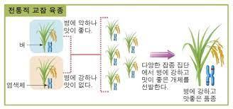

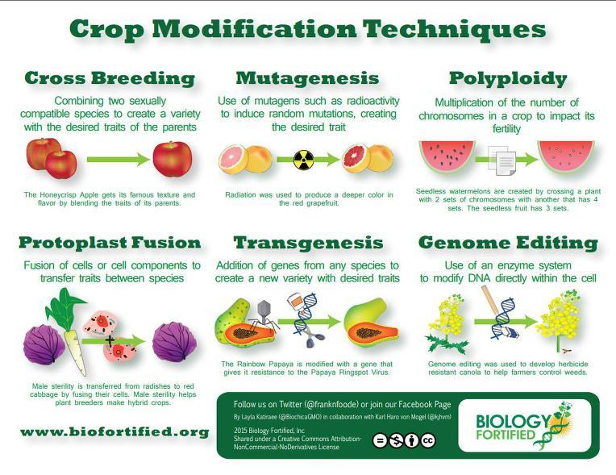

재배학 원론 - 3장. 작물의 유전과 육종(genetics and breeding)

2) 품종육종론
(1) 품종개량의이점
: 경제적효과, 품질개선, 재배한계확대, 병충해안정성, 경영합리화
(2) 품종육성의방법: 도입육종, 분리육종, 교잡육종, 돌연변이육종, 배수체육종, 생명공학적기법등
①내력에따른분류
▸ 재래품: 그나라그지방에서예로부터재배되어온품종
▸ 육성품종: 그나라에서육성된품종(=개량품종). 육성방법에따라교잡육성품종, 분리육성품종, 일대잡종품종등구분
▸ 도입품종: 외국으로부터도입된품종(=외래품종)
② 특성에 따른 분류 : 성숙기에 따라, 조생종, 중생종, 만생종 구분. 키에 따라 장간종, 단간종 구분
③ 작부체계에 따른 분류 : 조기재배, 조식재배, 만식적응품종, 추파품종 등
④이용성에따른분류: 일반품종과맥주용보리, 고구마의식용, 사료용, 공업용등

재배학 원론 - 3장. 작물의 유전과 육종(genetics and breeding)

재배학 원론 - 3장. 작물의 유전과 육종(genetics and breeding)

(3) 우량품종의육성및보존
①우량품종의요건: 균등성, 우수성, 영속성, 광지역적응성이높으면우수함.
② 우량 종자의 요건
▸ 우량품종에속하는종자로유전적으로순수하고이형종자가섞이지않은종자
▸충실하게발달하여생리적으로좋은종자
▸ 병충해에감염되어있지않고잡초종자나협잡물이섞이지않은종자
▸ 발아력이건전한종자
③ 품종개량의 효과 : 신품종 출현으로 경제적 효과 증대, 재배한계 확대 및 재배 안정성 증대, 품질 개선 및 경영 합리화
④품종육성의방법
▸ 도입육종법: 외국에서새로운종이나품종도입(예: 문익점의목화)
▸ 분류육종법: 기존의종에서순계나좋은유전자가발현되도록분리
▸ 교잡육종법: 유전자교배를통해재조합
▸돌연변이육종법: 방사선또는콜히친(colchicine, 씨앗이나구근에포함된알칼로이드식물독성성분)등으로아예새로운유전자를
창출하여육종

재배학 원론 - 3장. 작물의 유전과 육종(genetics and breeding)

2. 품종보호제도(variety protection system)
▸ 육성자의권리를법적으로보호하여주는제도
▸ 국내에서1998년부터제도도입→연차적으로작물확대시행
▸ 품종보호제도
①육성자에게품종육성에따른노력의대가와연구개발비용회수보장→우수품종개발및육종투자확대촉진
②외국의우수품종도입촉진→농업인에게이들품종재배→농업생산성증대및품질/가격경쟁력제고→농업소득향상

국립종자원

재배학 원론 - 3장. 작물의 유전과 육종(genetics and breeding)

3. 유전자변형 농산물(Genetically modified organism, GMO) (=LMO)
▸ GMO와LMO
①GMO (genetically modified organism) : 분말상태의콩등과같은상태의상대적명칭
②LMO(living modified organism): 일반적으로살아있는상태(발아가가능한콩등)
▸ 작품육종은멘델법칙에서시작, 다양한육종기술을이용하여작물의유전체변화
(웅성불임, 종간교잡, 자가불화합성, 반수체육종, 돌연변이육종, 잡종강세등)
▸ 유전자재조합: 특정DNA 염기서열을다른부위로옮김→현저한작물육종범위확장
▸ 유전자도입: rDNA 기술의결과만들어진생물체

재배학 원론 - 4장. 작물의 재배기술(Cultivation Technique)

1. 작부체계(cropping system)
(1) 연작
①매년계속해서재배하는방식(식용작물또는연작장해가있어도수익성이높은경우채택)
②연작피해: 기지현상(원인: 양분고갈, 병원미생물이나독소축적, 불량한토양반응, 토양물리성의악화등)

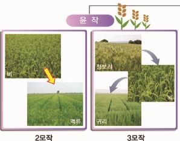

③기지현상대책: 윤작, 저항성품종재배, 토양소독및객토, 유독물질제거및지력보강등
(2) 윤작
①돌려짓기의미. 한포장에몇가지작물을조합하여일정한순서에따라반복하여재배하는방식
②방법
-삼포식: '여름작물→겨울작물→휴경'으로돌려지음
-개량삼포식: 휴경대신에녹비작물과같은지력을높이는작물심는방식
-노퍽식윤작법: 지력유지, 잡초방제, 토지이용도, 생산물등종합적으로고려한윤작방식
③윤작효과: 지력유지및증진, 토양보호와기지경감, 병충해나잡초경감, 수량증대와토지이용도제고, 노력배분합리화와경영안정성증대

재배학 원론 - 4장. 작물의 재배기술(Cultivation Technique)

1. 작부체계(cropping system)
(3) 간작과혼작
①간작: 한작물이생육하고있는도중에재배하는것
(앞작물을상작, 후작물을하작이라함/ 주요작물을주작, 종속적인작물을부작)
혼작: 생육기간이거의같고주종도비슷하여두종류의작물을섞어서재배하는작부방식
②간작와혼작의장점
-간작: 전작물에큰피해가없이간작물의생육기간을연장하여증수를꾀하는경우, 토지이용률증진
-혼작: 두작물이생리생태적으로협력적으로작용하여합계수량이많을때효과

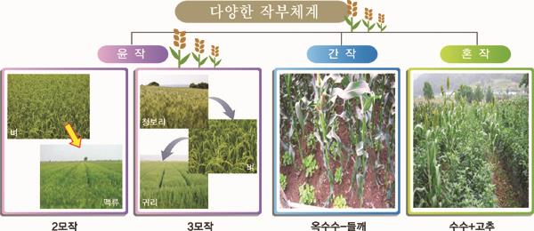

재배학 원론 - 4장. 작물의 재배기술(Cultivation Technique)

1. 작부체계(cropping system)
(4) 교호작과주위작
①교호작: 두종류이상의작물을한이랑씩교호로재배(경사지토양대상재배)
주위작: 포장주위의공지를활용하는혼작일종(논두렁에콩을재배하는것등)

(5) 답전윤환재배
①답(沓)/전(田)을교호적순환재배
②효과: 지력증진, 기지현상의회피, 잡초발생억제, 수량증가와노동력절감(감자, 수박등)

재배학 원론 - 4장. 작물의 재배기술(Cultivation Technique)

2. 작물의 번식과 육묘
1) 원예작물의번식(propagation) : 종자번식(주로식량작물), 영양번식(주로원예작물: 유전성유지목적)
(1) 종자번식(seed propagation) : 종자에의해서작물을증식
✓ 종자내, 생명원형인뿌리와새순이될원기가이미분화되어포함
✓ (대표) 채소류(토마토, 오이등), 일년초(팬지, 금잔화, 채송화등), 다년초(시클라멘, 베고니아등)

재배학 원론 - 4장. 작물의 재배기술(Cultivation Technique)

2. 작물의 번식과 육묘
1) 원예작물의번식(propagation) : 종자번식(주로식량작물), 영양번식(주로원예작물: 유전성유지목적)
(2) 영양번식(vegetative propagation)
✓ 영양체(줄기, 엽, 눈, 뿌리등)일부를잘라서새로운개체를형성(증식)
✓ 작물은전체형성능(작물체일부또는세포몇개를떼어내어독립된한개체를만들어낼수있는능력)보유
①조직배양(tissue culture) : 떼어낸작은조직(절편체)을용기안(in vitro)에서적당한양분을가진배지(medium)에서생장, 증식
(여러기관의집합체인개체및어리배등을무균상태의인위적배지에서특정한목적을가지고배양하는것)
②삽목(cutting)
• 엽삽: 잎을잘라삽목하는것
• 줄기삽: 가장일반적. 가지를7~12 cm (3~4 마디) 정도길이로잘라서삽상에삽목시켜발근시키는방법
• 녹지삽: 새순이자라굳기전에잎이붙은채로삽목(5~6월) (동백, 치자, 철쭉, 단풍나무, 병꽃나무, 목련등)
• 숙지삽: 새순이완전히굳어져서성숙한줄기를잘라꽂는방법(3~4월) (사철, 호랑가시나무, 은행나무, 개나리, 장미, 향나무등)
• 휴면지삽: 늦가을또는초봄에휴면체로있을때의가지를이용하는방법(찔레, 능소화, 딱총나무, 클레마티스, 무화과, 등나무, 모과등)
• 뿌리삽: 3월하~4월중. 모주의뿌리를두께1 cm 내외, 10 cm 길이로절단→흙속에경사로심음(명자나무, 등나무, 찔레, 라일락등)

재배학 원론 - 4장. 작물의 재배기술(Cultivation Technique)

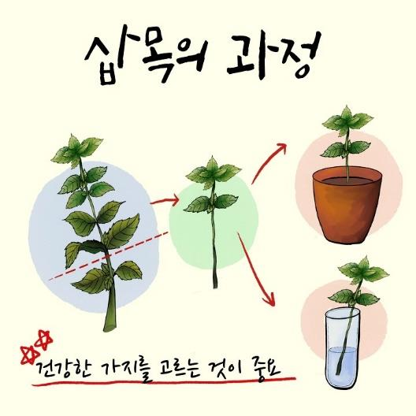

재배학 원론 - 4장. 작물의 재배기술(Cultivation Technique)

2. 작물의 번식과 육묘
1) 원예작물의번식(propagation) : 종자번식(주로식량작물), 영양번식(주로원예작물: 유전성유지목적)
(2) 영양번식(vegetative propagation)
③접목(grafting)
• 절접: 뿌리가있는대목의절단부분을쪼개어접수결속(명자나무, 목련, 라일락, 모란, 장미, 벚나무등)
• 할접: 대목의중앙을쪼개어쐐기꼴로만든접수결속(동백, 달리아등)
• 호접: 뿌리가있는두그루를서로결속(단풍나무)

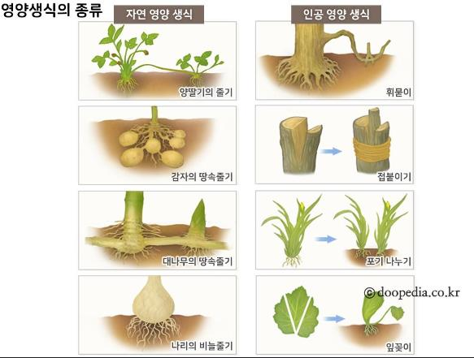

• 안장접: 대목위에접수를올려놓아실이나밴드로결속(선인장등)
• 근접: 뿌리가쇠약해진나무에뿌리를붙여결속
• 근두접: 뿌리바로윗부분에접하는방법
• 눈접: 눈을채취하여대목일부를'T'자로절개후, 접목하고비닐등으로묶는방법(장미)

재배학 원론 - 5장. 작물의 기상재해(climate damage)

1. 건조해(drought injury)
2. 온도 장해(temperature injury)
3. 염류 장해(salt injury)
4. 광도 장해(light injury)
5. 풍해(wind injury)
6. 환경오염 장해(environmental pollution injury)

재배학 원론 - 5장. 작물의 기상재해(climate damage)

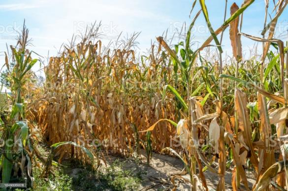

1. 건조해(drought injury)
✓ 토양, 대기건조→작물체내수분함량감소→생육저하, 위조, 고사(건조장해)
✓ 내건성(drought tolerance): 수분부족으로입는장해를견디는능력
1) 내건성의종류(건조할때증산작용을어느정도억제하느냐에따라구분)와대응
(1) 구조적내건성(constitutional drought tolerance) : 물리적인성격이강함
-건조를지연시키거나회피하는것
-수분을보존하는작물은엽면적이작고요수량이나증산량이많지않으므로생육초기에토양수분을보존하였다가여름에건조할때이용
-(예) 선인장, 다육식물
(2) 원형질적내건성(protoplasmic drought tolerance) : 생화학적인성격이강함
-원형질에수분함량이감소해도생리적장해를크게받지않는진정한의민의내건성(내탈수성)
(3) 건조해에대한대책
-신속한관개: 지표나살수관개, 지하관개를신속실시
-작물의경화처리(hardening) : 모종을준비할때부터건실한하드닝을해서육모→뿌리발달양호, 내건조해
-토양수분의보유력증대와증발억제: 토양입단을조성, 피복하여수분증발사전방지. 증발억제제살포
-내건성품종선택

재배학 원론 - 5장. 작물의 기상재해(climate damage)

2. 습해 및 침수해(moisture and flooding injury)
✓ 습해(excessive water injury): 지속적인토양과습상태→작물의뿌리부패, 황화, 위조, 고사하게되는산소부족장해
✓ 침수해(water logging injury): 작물이장마철에많은강우로인해모든잎이물에잠겨피해를보는장해
1) 내습성과내침수성
(1) 내습성: 작물이물리적, 화학적인방법으로산소부족으로오는장해를극복하는능력

-통기조직의발달: 근권주위에기공이나지상부조직에뿌리로산소를보낼수있는통기조직(aerenchyma)발달
-세포벽의코르크화및목질화: 통기조직을통하여공급된산소가뿌리밖으로의확산방지, 생장점공급
-대사경로의변경: 뿌리의무기호흡으로부터발생하는에탄올대신에해가없는말산축적→장해받지않음.
-유독물질의불용화: 토양의환원, 산화상태에서발생하는철, 망간이흡수되어도뿌리에서산화→불용태로변환
-발근력의강화: 뿌리가표토에얕게발달, 부정근발생력이큼
(2) 습해및침수해에대한대책

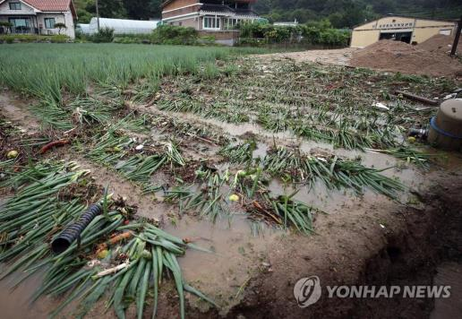

-신속한배수처리
-적합한시비: 뿌리를지표면으로유도, 엽면시비. 과산화석회를종자분의(코팅)하면습해경감
-토양의정지와개량: 모래토양객토, 부식과토양개량제사용→입단조성및이랑재배
-작물과품종의선택

재배학 원론 - 5장. 작물의 기상재해(climate damage)

3. 온도 장해(Temperature injury)

| 구분 | 정의 | 특징 | 대책 |
| --- | --- | --- | --- |
| 냉해(Coldinjury) | 여름작물에서결빙이일어나지않는0˚C이상의저온에의해받은생육장해 | -지연형냉해: 육묘기, 이앙기, 분얼기등영양생장기에저온으로인하여출수가지연되고등숙이불량-장해형냉해: 영양기관의장해, 저온에가장민감한벼의감수분열기나유수형성기에저온으로약벽의바깥쪽을둘러싸고있는융단층이비대해지고꽃가루가불출실하여약이열리지않으므로수분이되지않는경우등-병해형냉해: 저온으로광합성이원활하게진행되지못하면단백질합성이진행되지못하고수용성아미노산이나아마이드축적, 이런상태에서도열병균은단백질보다아미노산을직접이용할수있으므로벼의경우도열병이발생하는것을병해형냉해-혼합형냉해: 지연형과병해형, 장해형냉해가함께복합적발생 | -내냉성품종의선택-입지조건개선: 방풍림설치등-재배뱁개선-온도조절 |
| 한해(Chilling injury) | 상해(저온에약한여름작물재배시봄의늦서리또는첫서리가올때받는장해)동해(가을파종월동작물의경엽, 과수등다년생작물의눈등월동하는작물이받는장해) | -내동성증가요인→식물체의함수량감소, 당과지유함량의증가와전분의감소, 친수성콜로이드함량증가, 수용성과-SH기단백질의증가, 화와아브시스산(ABA) 처리 | -내한성품종의선택-입지조건개선-재배법개선-온도조절 |
| 고온해(Heat injury) | 생육온도가낮은북방형목초나호냉성채소는여름에고온으로인하여생육이억제되며,직접광에노출되면장해를받음. | -고온해의기작→세포막의특성변화와효소의활성저하, 양분소모, 독성물질의생성, 증산과다 |  |
| 염류장해(Salt injury) | 온실이나비닐하우스와같은시설재배지에무기질비료를과다사용하거나간척지나내륙사막지역등은토양에염류가집적되어작물재배시발생 | -염농도가높아질수록토양의수분퍼텐셜이낮아져서한해와같은장해받음.-뿌리가토양에서수분흡수불가, 뿌리조직의수분이유출 |  |
| 광도장해(Light injury) | 광이작물의생육에스트레스를주는것 | 광도는너무낮거나너무높아도스트레스를받아작물의정상적생육저해 |  |
| 풍해(Wind injury) | 바람으로인한작물의피해 | 도복유발, 과수가지손상, 낙과발생등 |  |
| 환경오염장해(Environmentalpollution injury) | 대기, 수질, 토양등에장해 | -대기오염: 함황물질, 옥시던트(산화물),산성비, 미세먼지-토양오염-수질오염 |  |

강의 내용

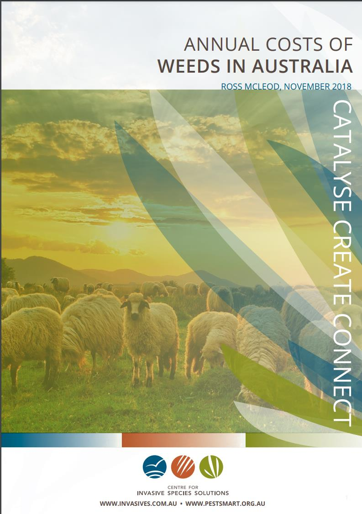

▸ 잡초의 특성과 분류
▸ 잡초의 생리와 생태

I. 잡초의 특성과 분류

1. 잡초의정의와피해
▸ 잡초(weed)? : 원치않는작물(unwanted plant). 열매가없거나장소를벗어나자라는식물
⇔작물(crop) : 유용한가치가있어서인위적재배를하는작물. 인간에게유용한부위가발달한식물
▸ 잡초의피해: 작물과광, 수분, 영향등에서경쟁하거나품질을악화시키고병해충의서식처가되는둥작물생육방해
→잡초
-원하지않는식물
-제자리를벗어난식물로없어야작물재배에도움이되는식물
-토지에대한인간의의지(욕구)에역행하는식물
-농경지나생활주변에서자생하는식물이외의초본성식물의총칭

I. 잡초의 특성과 분류

I. 잡초의 특성과 분류

Bridges (1994)
McLeod (2018)
"Annual Costs of Weeds in Australia"

I. 잡초의 특성과 분류

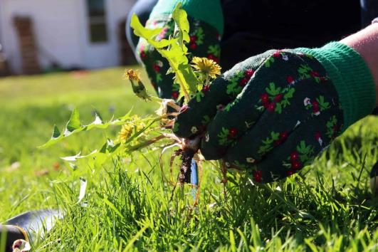

2. 잡초의피해와유용성: 잡초는원하지않는식물, 하지만유용한측면이있으므로양면성존재
▸잡초로인한피해
✓ 양분이나수분의경합해로수량감소
✓ 광을차단하거나외관을나쁘게함

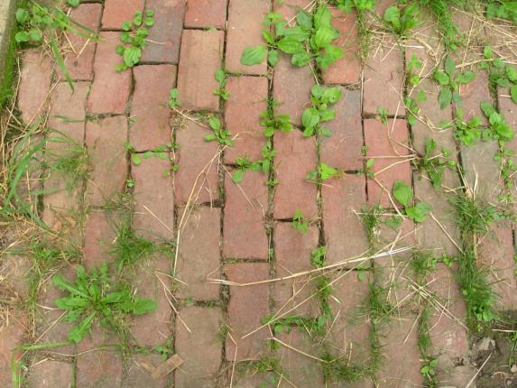

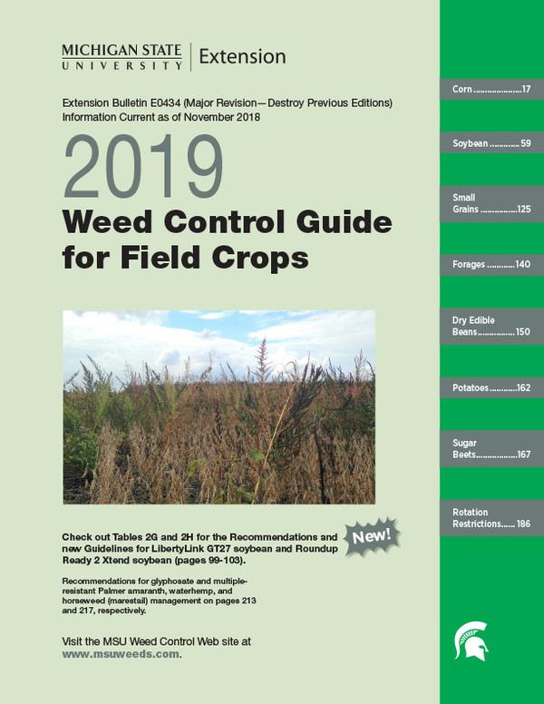

✓ 병해충매개
✓ 물관리나조경, 도로관리등작업환경악화
✓ 사료의품절저하및종자혼입, 부착해야기
✓ 잡초의타감작용(allelopathy)으로작물생육저해
▸ 잡초의 이용성
✓ 침식 방지 등 자연 보존 기여

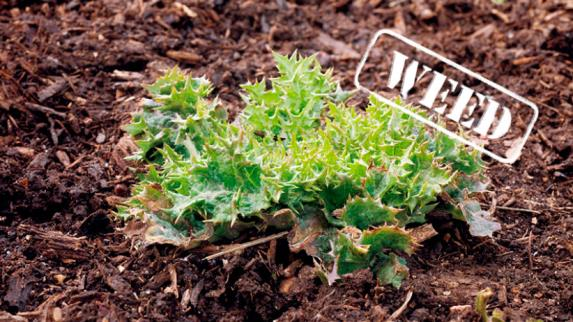

✓ 유기물 생산, 공해 저감
✓ 희귀 물질, 유용 성분 생산 및 유전자 보존 기능
✓ 조경식물로서의 가치 보유
✓ 피나 명아주 등 구황작물로서 이용 가능성

I. 잡초의 특성과 분류

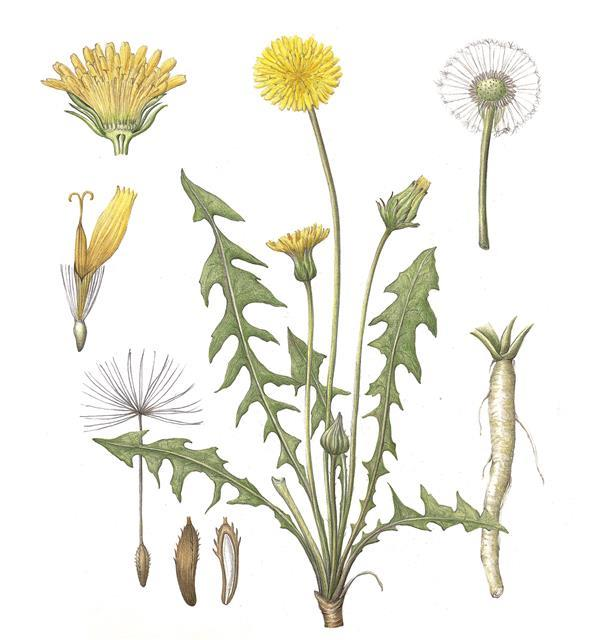

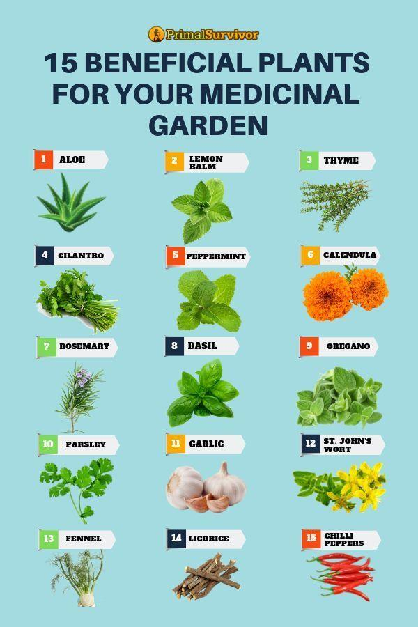

민들레세밀화
(이소영작가)

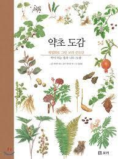

I. 잡초의 특성과 분류

| Q) 다음 중 농경지에서발생하는잡초의피해가아닌 것은? |  |
| --- | --- |
|  | Q) 다음 중 농경지에서발생하는잡초의피해가아닌 것은? |

1. 경합해
2. 농작업환경의악화
3. 병해충의매개
4. 토양침식의방지

| Q) 잡초의 유용성이아닌 것은? |  |
| --- | --- |
|  | Q) 잡초의 유용성이아닌 것은? |

1. 지면을덮어서침식을막아준다.
2. 토양에유기물을공급한다.
3. 병해충을매개한다.
4. 구황작물(가뭄이나장마에영향을받지않고걸지않은땅에서도가꿀수있어흉년으로기근이심할때주식으로대용가능한작물)로이용한다.

I. 잡초의 특성과 분류

I. 잡초의 특성과 분류

3. 잡초의분류
▸ 식물학적분류: 현재까지알려진식물종(약20만종) 중, 약0.1%의200여종식물이잡초로분류
✓ 과(family)나종(species)에따른분류
✓ 떡잎에따라쌍자엽식물(dicotyledon)과단자엽식물(monocotyledon)로분류
✓ 잎의넓이에따라세엽잡초(narrow leaf)와광엽잡초(broad leaf)로분류
명아주(광엽잡초)
▸ 잎과 줄기 형태에 따른 분류
✓화본과잡초(벼과, grass weed) : 줄기의마디. 잎은마디로부터어긋나기. 잎은줄기를둘러싸서보호하는잎집(leaf sheath)과잎몸(leaf blade)으로구성
✓방동사니과잡초(사초과, sedge weed) : 줄기횡단면이삼각형, 잎은좁고능선이있으며끝이뾰족하고소수에작은꽃.
✓광엽잡초(broad-leaf weed) : 잎이넓은잡초. 잎은주로타원형, 난형, 피침형. 잎맥이그물처럼얽혀있는것이특징

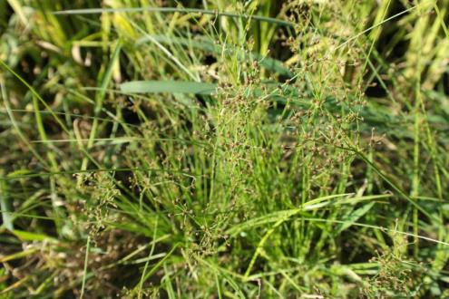

논피(벼과) 바람하늘지기(방동사니과)

I. 잡초의 특성과 분류

I. 잡초의 특성과 분류

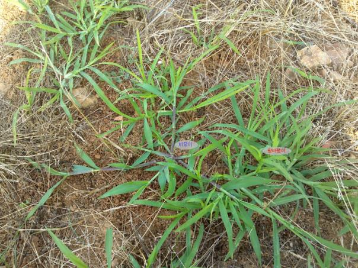

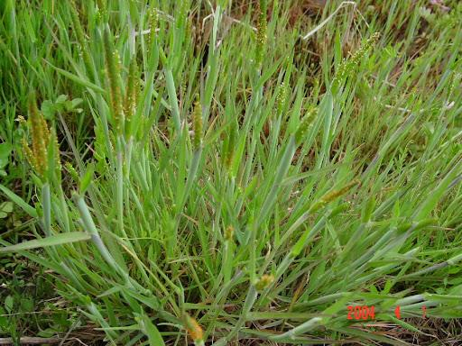

3. 잡초의분류
▸ 생리생태적분류
✓발생시기에따른분류
•하계(여름형) 잡초: 주로여름에발생, 작물과경합해
•동계(겨울형) 잡초: 맥류나사료작물, 잔디밭에피해
✓생육기간에따른분류
(일년생-하계일년생-바랭이) (일년생-동계일년생-둑새풀)
•일년생(annual weed) 잡초: 1년이내에한세대의생활사
▪ (포장에서의발생시기에따라)
-하계일년생: 봄에발아, 여름동안에생장, 가을에결실한다음고사(바랭이, 피, 쇠비름, 명아주등) (주방제대상→주로종자번식, 많은종자생산요인)
-동계일년생: 늦여름부터초겨울사이발아, 겨울을보낸후이듬해봄에생장하고봄부터여름에걸쳐개화, 결실하고고사(둑새풀, 냉이등)
•이년생(biennial weed) : 1~2년이내에개화, 결실, 고사
•다년생(perennial weed) : 2년이상생존하는잡초. 종자번식가능하나, 대부분영양기관에의한번식(민들레, 질경이, 갈대, 쑥, 애기수영, 올방개, 가래등)

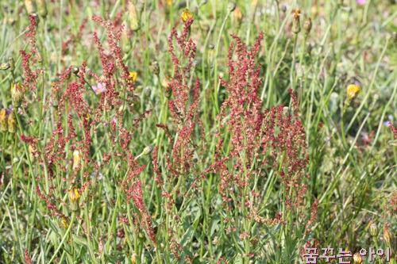

(다년생-질경이) (다년생-애기수영)

I. 잡초의 특성과 분류

3. 잡초의분류
▸ 생리생태적분류
✓토양수분적응성에따른분류
•수생잡초: 주로담수상태에서발생하는잡초(물달개비, 가래, 마디꽃, 물옥잠등)
•습생잡초: 주로포화수분상태에서발생하는잡초(독새풀, 황새냉이, 별꽃등)
•건생잡초: 포장용수량상태에서잘발생하는잡초(바랭이, 냉이, 개비름등)
* 포장용수량: 토양이물로포화된후토양에따라서하루또는사흘이지나면대공극의물은중력에의해다빠지지만소공극의물은그대로남아있음. 이때의
토양수분함량
•부유잡초: 물에뜨는수생잡초(생이가래, 개구리밥, 좀개구리밥, 부레옥잠등)

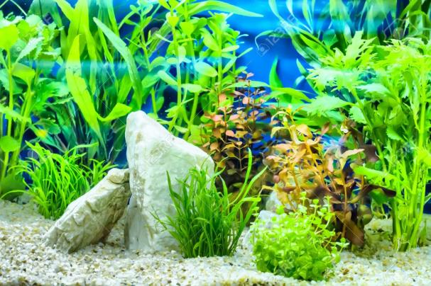

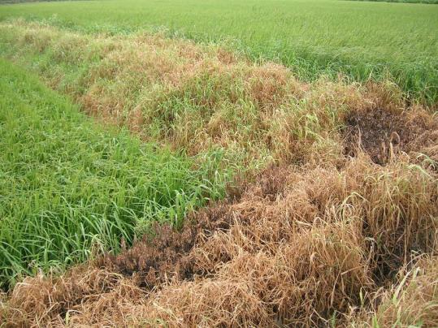

수생잡초 습생잡초 건생잡초

I. 잡초의 특성과 분류

* 다년생잡초의종류

| 구분 | 설명 |
| --- | --- |
| 단순다년생잡초 | • 주로종자로번식하나, 근부나절편으로도번식가능.• 수영, 민들레, 질경이 |
| 구근형다년생잡초 | • 덩이줄기(괴경), 땅속줄기(근경), 알줄기(구경), 기는줄기(포복경), 기는뿌리(포복근), 종자로번식하는잡초 |
| 포복형다년생잡초 | • 괴경, 근경: 너도방동사니, 올방개, 매자기• 구경: 반하, 올챙이고랭이• 포복경: 선피막이, 사상자, 미나리, 병풀• 포복근: 쇠뜨기, 메꽃, 엉겅퀴, 겨풀 |

I. 잡초의 특성과 분류

| Q) 잡초를 형태적특성에따라 분류할때 속하지않는 것은? |  |
| --- | --- |
|  | Q) 잡초를 형태적특성에따라 분류할때 속하지않는 것은? |

1. 화본과잡초
2. 광엽잡초
3. 방동사니과잡초
4. 가지과잡초

| Q) 다년생잡초의특징이아닌것은? |  |
| --- | --- |
|  | Q) 다년생잡초의특징이아닌것은? |

1. 대부분종자로번식한다.
2. 영양번식을한다.
3. 생육기간이길다.
4. 방제하기어렵다.

I. 잡초의 특성과 분류

| Q) 다음 중 괴경(덩이줄기)으로번식하는다년생잡초는? |  |
| --- | --- |
|  | Q) 다음 중 괴경(덩이줄기)으로번식하는다년생잡초는? |

1. 사마귀풀
2. 물달개비
3. 올방개
4. 알방동사니

| Q) 다음중 부유성잡초는? |  |
| --- | --- |
|  | Q) 다음중 부유성잡초는? |

1. 개구리밥, 부레옥잠
2. 올미, 생이가래
3. 너도방동사니, 개구리밥
4. 가래, 벗풀

I. 잡초의 특성과 분류

4. 잡초의분포
▸ 논과밭의잡초
✓밭토양1 m2(깊이2 cm) 당6~10만개잡초종자매립→실제발생하는개체수는1~5천개정도(약6%가여름작물포장내발생)
✓여름철고운다습하기때문에6~8월이잡초발생과생육의최성기(→잡초방제최적시기)

I. 잡초의 특성과 분류

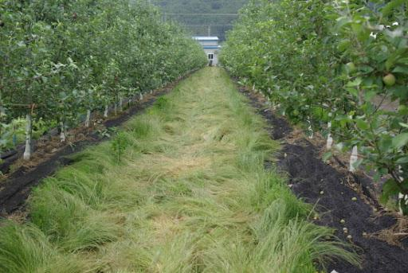

4. 잡초의분포
▸ 과수원과비경지잡초
✓과수원
•평지보다경사지에조성/주로초생재배→제초관리미흡
•평탄지과수원에서는'1년생잡초우점', 경사지과수원에서는'다년생잡초우점'
•초기에는호광성잡초(바랭이등) 우점, 과수성목기간에는음지선호성잡초(포아풀류등) 우점
✓잔디밭의잡초

과수원내잡초

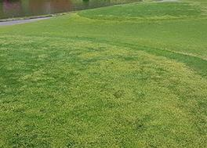

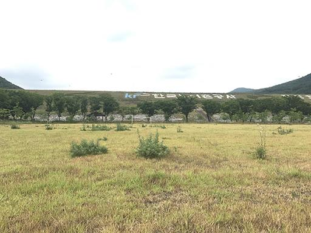

골프장내잡초 운동장내잡초

I. 잡초의 특성과 분류

이등(2016) 한국잡초학회(초록집)
-우리나라농경지에발생하는잡초현황

이등(2017) 한국잡초학회
-우리나라농경지에발생하는잡초현황

I. 잡초의 특성과 분류

5. 주요우점잡초들
▸ 논잡초

| 논피(Echinochloaorzicola) | 물옥잠(Monochoriakorsakowii) | 자귀풀(Aeschynomemeindica) | 여뀌바늘(Ludwigiaprostrata) | 가래(Potamogetondistinctus) |
| --- | --- | --- | --- | --- |
| • 화본과• 전국논발생• 하계일년생잡초• 줄기높이50~110 cm• 벼처럼모여발생 | • 물옥잠과• 전국분포(특히서해안논지역)• 줄기높이20~40 cm | • 자귀풀(콩과)• 전국논발생, 하계일년생잡초• 줄기높이50~200 cm• 잎은어긋나게달림 | • 바늘꽃과• 전국논발생, 하계일년생잡초• 줄기높이30~100 cm | • 가래과• 논, 도랑, 얕은습지등지발생• 여러해살이잡초• 뿌리줄기는물밑의흙속에서옆으로여러갈래로길게뻗어번식 |

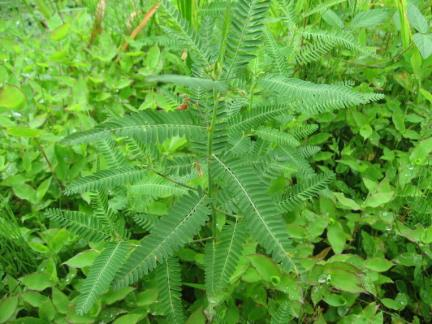

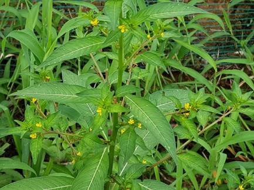

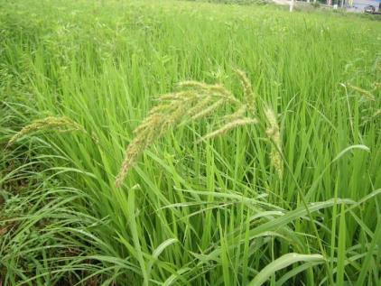

I. 잡초의 특성과 분류

5. 주요우점잡초들
▸ 밭잡초

| 쇠비름(Portulacaoleracea) | 흰명아주(Chenopodiumalbum) | 털별꽃아재비(Galinsogaciliata) | 망초(Conyzacanadensis) | 환삼덩굴(Humulusjaponicas) |
| --- | --- | --- | --- | --- |
| • 쇠비름과• 건조에강한다육식물• 전국밭, 과수원발생• 하계일년생잡초 | • 명아주과• 전국밭,과수원발생• 하계일년생잡초 | • 국화과• 봄에이른여름발생• 미대륙원산• 종자의전파는주로바람에의함• 한해동안3~4세대• 종자생산량이많은잡초 | • 국화과• 미대륙원산귀화식물• 전국들, 길가분포• 두해살이풀 | • 삼과• 훼손된들에흔하게발생• 덩굴성한해살이풀• 우리나라전역자생• 동아시아지역분포 |

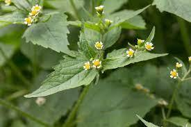

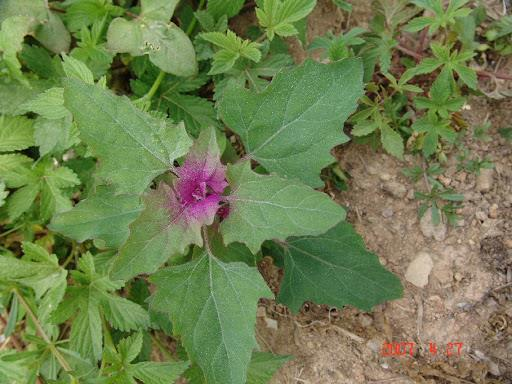

I. 잡초의 특성과 분류

6. 잡초의잡초성
▸ 잡초의종자는땅속에서오래생존할수있다.
▸ 잡초종자는광발아성으로, 땅위로올라와야발아할수있다.
▸ 잡초종자는휴면성이복잡하여발생기간이길다.
▸ 종자생산량이많다.
▸ 발아가불균일하다.
▸ 개화가빠르다.
▸ 자가수정을한다.
▸종자생산기간이길다.
▸ 종자의전파수단이다양하다.
▸ 경합기능이특이하다.
▸ 발취저항성이있다.

II. 잡초의 생리 생태

* 잡초종자발아5단계

| 단계 | 설명 |
| --- | --- |
| 1 | • 물의 흡수(전분에의한 물리적흡수, 배에 의한 생리적흡수 및 전분의가수분해) |
| 2 | • 세포분열및신장의대사과정 |
| 3 | • 종근 및 유아의신장 |
| 4 | • 유아의출현 |
| 5 | • 발생후부터이유기까지 |

II. 잡초의 생리 생태

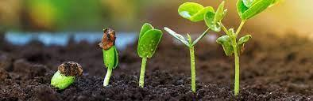

1. 잡초의발아및출현특성
▸ 발아에관여하는환경요인
✓수분(water)
•수분의흡수는발아의1단계
•살아있는종수나죽은종자모두수분을흡수를통해팽만해짐
•단백질, 점액물질, 펙틴은전분보다교질성과친수성이커서더많은수분흡수가능
✓온도(temperature)

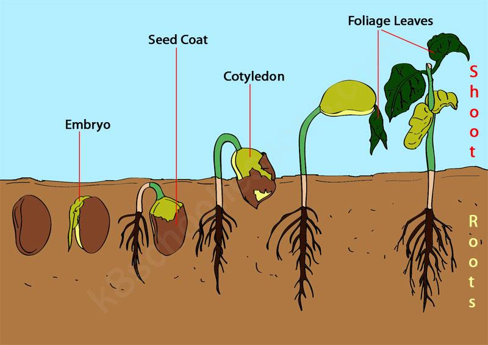

• 잡초종자의발아적온일정치않으며, 대체로15~30도범위
떡잎
✓산소(oxygen)
• 발아에서호흡할때, 높은수준의산소요구
•대부분의잡초는산소20%, 이산화탄소0.03%, 질소80%에서최고의발아율
•산소농도20% 이하→발아율감소
✓광(light)
•겉흙에서광을받은후발아
•광발아졸아, 암발아종자, 광과상관없이발아하는종자로구분

II. 잡초의 생리 생태

1. 잡초의발아및출현특성
▸ 발아에관여하는환경요인
* 광조건에따른종자종류

| 구분 | 설명 |
| --- | --- |
| 광발아종자 | • 바랭이, 쇠비름, 개비름, 향부자, 강피, 참방동사니, 소리쟁이, 메귀리 |
| 암발아종자 | • 별꽃, 냉이, 광대나물, 독말풀 |
| 광무관계종자 | • 화곡류, 옥수수 |

* 산소조건에따른종자종류

| 구분 | 설명 |
| --- | --- |
| 호기성잡초 | • 너도방동사니, 바랭이, 향부자 |
| 혐기성잡초 | • 돌피, 올챙이고랭이, 가래, 물달개비, 올미 |

II. 잡초의 생리 생태

1. 잡초의발아및출현특성
▸ 잡초종자의발아특성
✓발아주기성(periodicity)
•종자의후숙과정에서의생리적, 환경적조건이긴밀하게관여하기때문에같은조건에두어도일정한간격(어떤주기성)을가지고최고의발아율을나타내는것
✓발아의계절성과기회성
• 계절성: 온도보다일반적으로계절특성을더욱일정하게나타내는일장에반응하여휴면타파, 발아하는특성
• 발아기회성: 일장보다같은계절에서변이성이큰온도조건에더기회적으로감응하여발아하는특성
✓발아의동시성및연속성
• 동시성발아: 일정한기간이내에대부분종자가발아를마치는집중발아형
• 연속성발아: 발아조건을주어도오랜기간에걸쳐지속해서발아하는유형

II. 잡초의 생리 생태

1. 잡초의발아및출현특성
▸ 종자수명
✓종자의활력과수명은'유전형', '휴면기작', '저장환경'에따라상이함.

•(캐나다)추운지대에서발견된루핀(Lupinusarticus) 경우, 10,000년이지난후발아성공(Harrington, 1967)
•(중국) 추운만주호수에서발견된연꽃종자경우, 1,000년이후발아성공(Copeland, 1967)
•일부콩과작물종자는건조상태에서100~150년후발아확인
✓양호한저장조건(낮은온도, 낮은습도(수분), 낮은산소)에서긴종자수명확인
• 일부사료작물의종자: 38도고온에서저장(수분함량6% 이하) →6년후발아양호확인

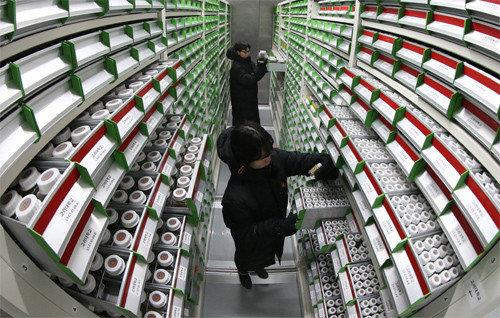

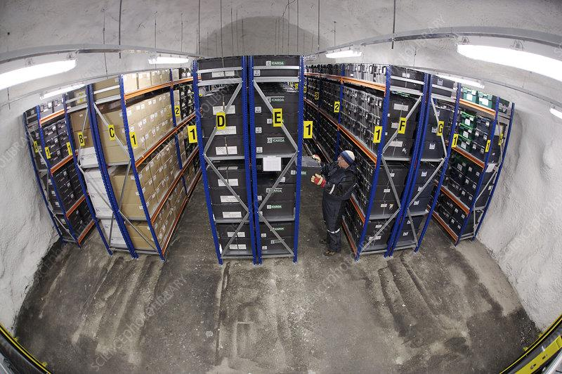

Seed Vault
(국립백두대간수목원, 경북봉화)
Svalbard Global Seed Vault
(노르웨이령스발바르제도내)

II. 잡초의 생리 생태

1. 잡초의발아및출현특성
▸ 유묘출현에관여하는요인
✓잡초는발아한후, 토양층을통과하여지표면위로출현하므로여러토양조건의영향을받음.
✓유묘의출현에관여하는요인으로는토양심도, 토양온도, 토양수분, 토양산소, 토양산도, 토양비옥도, 토양염도등이있음.

II. 잡초의 생리 생태

2. 잡초의번식, 전파, 휴면
▸ 잡초의번식(유성생식, 영양생식)
✓유성생식(sexual reproduction)
•종자만으로번식하는방식
•1년생잡초와일부2년생, 일부다년생잡초해당
✓영양생식(vegetative reproduction)
• 주로다년생잡초해당
•대부분영양번식을하는잡초종들은두가지이상의번식수단을동시나타냄
-영양체번식을하면서도종자인유성생식방법을동반
→유전적으로다양한종자를생산

→번식력과적응력모두향상

II. 잡초의 생리 생태

2. 잡초의번식, 전파, 휴면
▸ 잡초의번식(유성생식, 영양생식)
✓유성생식과영양번식의장단점
•영양번식은유성번식에비해번식력, 이동성은떨어지나적응성및정체성이강하다.
•유성번식은영양번식에비해산포성과휴면성이강하다.
•영양번식으로생산된개체는종자로부터생산된개체보다강하며, 적당한경운조건및제초제에강하다.
•영양번식으로생산된개체는종자로부터생산된개체보다양이적고, 환경이더욱불량해지면영양체로만번식한다.

참조: 방송통신대학교농학과자료

II. 잡초의 생리 생태

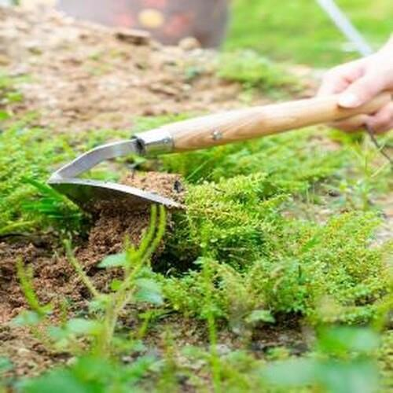

2. 잡초의번식, 전파, 휴면
▸ 잡초의전파
✓자연력에의한전파: 바람이나물등에날아가고떠내려감
✓동물에의한전파: 종자에갈고리나가시가돋친종자는동물에의한전파용이
✓사람에의한전파: 농작물의종자나퇴구비, 가축의분뇨, 농기구등에의한전파

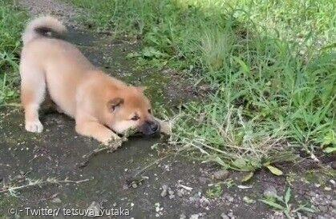

사람에의한전파

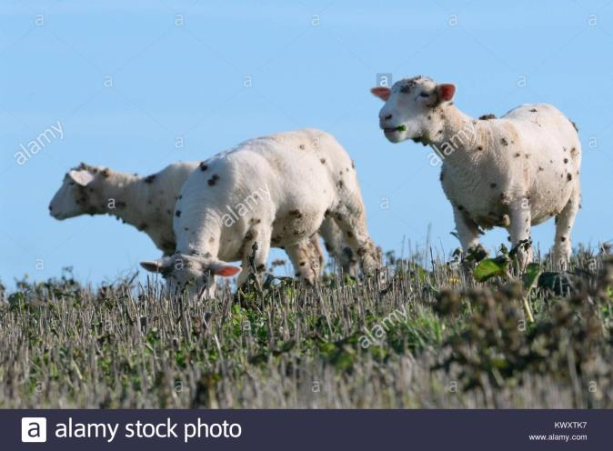

동물에의한전파
바람에의한전파

II. 잡초의 생리 생태

3. 잡초의군락과천이
▸ 식생의천이
✓천이(succession): 어느지역에서시간에따라종의조성, 식생의모습이방향성을가지고자연적으로변화하여가는현상
•토양, 광선등의환경조건이변화→새로운환경에서보다잘생활할수있는식물침입→기존식물과의경쟁에서이겨내서토착
•식생과생육환경의상호작용→최종적으로안정된식생이오랜기간동안지속되는상태(극상: 천이의마지막단계)

| 구분 | 설명 |
| --- | --- |
| 1차천이 | • 식물이전혀없는곳에서부터시작되는천이• 첫식물이들어와비교적안정된식생으로변화하는과정 |
| 2차천이(갱신천이) | • 원래의식생이화재, 태풍, 병충해, 벌채등과같은자연적, 인위적피해를받은다음성숙된식생으로회복되는과정 |

2차천이
1차천이

II. 잡초의 생리 생태

3. 잡초의군락과천이
▸ 잡초군락의천이
✓군락: 환경에적응하여생존하는식물종들의집합체
•잡초군락의천이: 재배작물의변화, 경종조건의변화, 제초방법의변화등농경법의변천이가장큰요인

| 구분 | 설명 |
| --- | --- |
| 재배작물및작부체계의변화 | • 벼, 보리, 채소등의재배작물과단작, 이모작등작부체계의변화 |
| 경종조건(seeding condition)의변화 | • 본답시기, 물관리, 경운, 시비, 수확방법및시기→잡초종자의오염기회증대 |
| 제초방법의변화 | • 손제초및기계적잡초방제의감소, 선택성제초제의사용증가, 제초방법개선 |

II. 잡초의 생리 생태

2. 잡초의번식, 전파, 휴면
▸ 잡초의휴면
✓휴면의정의
•작물이일시적으로생장활동을멈추는생리현상. 작물은대부분휴면함.
•발아시기의조절, 불량환경(고온, 저온)의회피, 종자의수명연장등식물자신이처한불량환경의극복수단
•성숙한종자에적당한발아조건을주어도일정기간동안발아하지않을때에이종자는휴면을함(→휴면은생육의일시적인정지상태)
•자발휴면(생득휴면) : 외적조건이생육에부적당하지않을때에도내적원인에의해서유발되는진정한휴면
•타발휴면(강제휴면) : 발아력을가진종자라도외적조건이부적당하기때문에유발되는휴면
1차 휴면과2차 휴면
- 자발휴면과타발휴면을합쳐 '1차 휴면'
- 성숙한 종자가불리한환경조건에장기간보존되어휴면이새로 생기는것을 '2차 휴면'

II. 잡초의 생리 생태

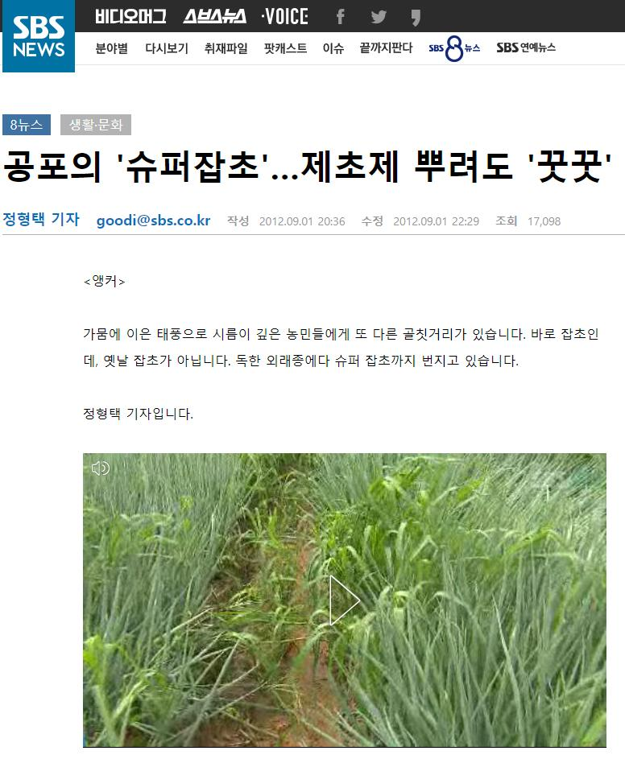

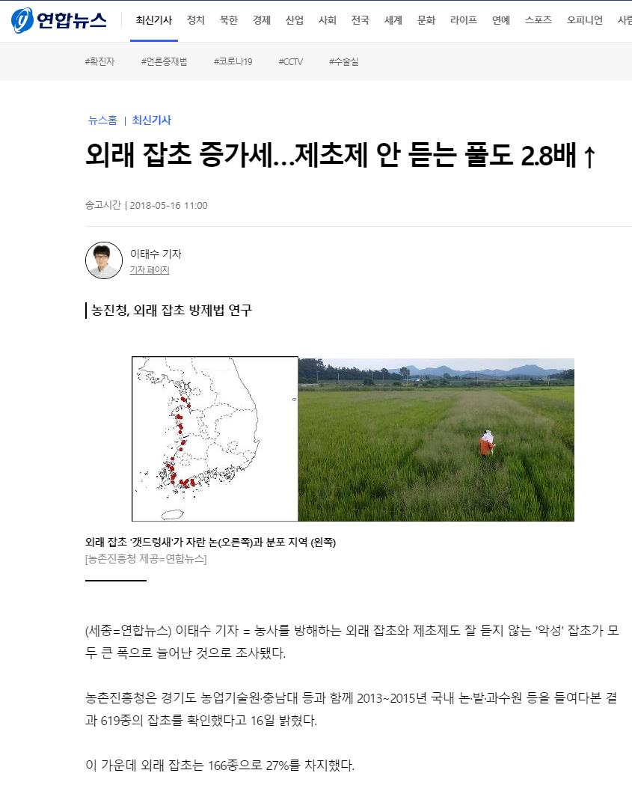

II. 잡초의 생리 생태

