# kocw_식물보호학_03

|  | 2021년도 2학기 - 식물보호학잡초 방제 - II임 종 옥농식품융합대학 생물환경화학과(063-850-6396, limento21@wku.ac.kr) |
| --- | --- |

| 2021년도 2학기 - 식물보호학 |
| --- |
| 잡초 방제 - II |
| 임 종 옥농식품융합대학 생물환경화학과(063-850-6396, limento21@wku.ac.kr) |

I. 잡초의 특성과 분류

I. 잡초의 특성과 분류

3. 잡초의분류
▸ 식물학적분류: 현재까지알려진식물종(약20만종) 중, 약0.1%의200여종식물이잡초로분류
✓ 과(family)나종(species)에따른분류
✓ 떡잎에따라쌍자엽식물(dicotyledon)과단자엽식물(monocotyledon)로분류
✓ 잎의넓이에따라세엽잡초(narrow leaf)와광엽잡초(broad leaf)로분류
명아주(광엽잡초)
▸ 잎과 줄기 형태에 따른 분류
✓화본과잡초(벼과, grass weed) : 줄기의마디. 잎은마디로부터어긋나기. 잎은줄기를둘러싸서보호하는잎집(leaf sheath)과잎몸(leaf blade)으로구성
✓방동사니과잡초(사초과, sedge weed) : 줄기횡단면이삼각형, 잎은좁고능선이있으며끝이뾰족하고소수에작은꽃.
✓광엽잡초(broad-leaf weed) : 잎이넓은잡초. 잎은주로타원형, 난형, 피침형. 잎맥이그물처럼얽혀있는것이특징

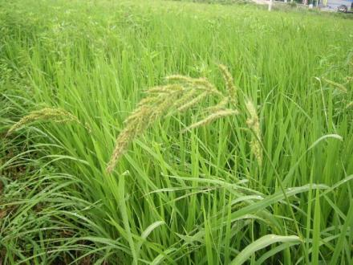

논피(벼과) 바람하늘지기(방동사니과)

I. 잡초의 특성과 분류

I. 잡초의 특성과 분류

3. 잡초의분류
▸ 생리생태적분류
✓발생시기에따른분류
•하계(여름형) 잡초: 주로여름에발생, 작물과경합해
•동계(겨울형) 잡초: 맥류나사료작물, 잔디밭에피해
✓생육기간에따른분류
(일년생-하계일년생-바랭이) (일년생-동계일년생-둑새풀)
•일년생(annual weed) 잡초: 1년이내에한세대의생활사
▪ (포장에서의발생시기에따라)
-하계일년생: 봄에발아, 여름동안에생장, 가을에결실한다음고사(바랭이, 피, 쇠비름, 명아주등) (주방제대상→주로종자번식, 많은종자생산요인)
-동계일년생: 늦여름부터초겨울사이발아, 겨울을보낸후이듬해봄에생장하고봄부터여름에걸쳐개화, 결실하고고사(둑새풀, 냉이등)
•이년생(biennial weed) : 1~2년이내에개화, 결실, 고사
•다년생(perennial weed) : 2년이상생존하는잡초. 종자번식가능하나, 대부분영양기관에의한번식(민들레, 질경이, 갈대, 쑥, 애기수영, 올방개, 가래등)

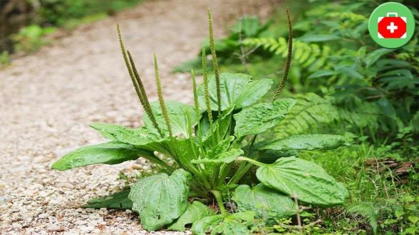

(다년생-질경이) (다년생-애기수영)

I. 잡초의 특성과 분류

3. 잡초의분류
▸ 생리생태적분류
✓토양수분적응성에따른분류
•수생잡초: 주로담수상태에서발생하는잡초(물달개비, 가래, 마디꽃, 물옥잠등)
•습생잡초: 주로포화수분상태에서발생하는잡초(독새풀, 황새냉이, 별꽃등)
•건생잡초: 포장용수량상태에서잘발생하는잡초(바랭이, 냉이, 개비름등)
* 포장용수량: 토양이물로포화된후토양에따라서하루또는사흘이지나면대공극의물은중력에의해다빠지지만소공극의물은그대로남아있음. 이때의
토양수분함량
•부유잡초: 물에뜨는수생잡초(생이가래, 개구리밥, 좀개구리밥, 부레옥잠등)

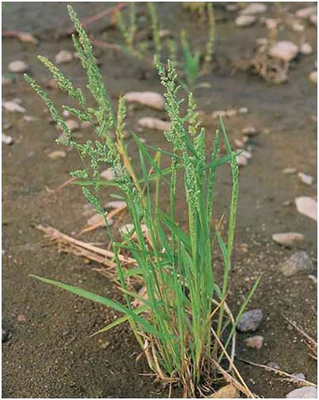

수생잡초 습생잡초 건생잡초

I. 잡초의 특성과 분류

* 다년생잡초의종류

| 구분 | 설명 |
| --- | --- |
| 단순다년생잡초 | • 주로종자로번식하나, 근부나절편으로도번식가능.• 수영, 민들레, 질경이 |
| 구근형다년생잡초 | • 덩이줄기(괴경), 땅속줄기(근경), 알줄기(구경), 기는줄기(포복경), 기는뿌리(포복근), 종자로번식하는잡초 |
| 포복형다년생잡초 | • 괴경, 근경: 너도방동사니, 올방개, 매자기• 구경: 반하, 올챙이고랭이• 포복경: 선피막이, 사상자, 미나리, 병풀• 포복근: 쇠뜨기, 메꽃, 엉겅퀴, 겨풀 |

I. 잡초의 특성과 분류

| Q) 잡초를 형태적특성에따라 분류할때 속하지않는 것은? |  |
| --- | --- |
|  | Q) 잡초를 형태적특성에따라 분류할때 속하지않는 것은? |

1. 화본과잡초
2. 광엽잡초
3. 방동사니과잡초
4. 가지과잡초

| Q) 다년생잡초의특징이아닌것은? |  |
| --- | --- |
|  | Q) 다년생잡초의특징이아닌것은? |

1. 대부분종자로번식한다.
2. 영양번식을한다.
3. 생육기간이길다.
4. 방제하기어렵다.

I. 잡초의 특성과 분류

| Q) 다음 중 괴경(덩이줄기)으로번식하는다년생잡초는? |  |
| --- | --- |
|  | Q) 다음 중 괴경(덩이줄기)으로번식하는다년생잡초는? |

1. 사마귀풀
2. 물달개비
3. 올방개
4. 알방동사니

| Q) 다음중 부유성잡초는? |  |
| --- | --- |
|  | Q) 다음중 부유성잡초는? |

1. 개구리밥, 부레옥잠
2. 올미, 생이가래
3. 너도방동사니, 개구리밥
4. 가래, 벗풀

I. 잡초의 특성과 분류

4. 잡초의분포
▸ 논과밭의잡초
✓밭토양1 m2(깊이2 cm) 당6~10만개잡초종자매립→실제발생하는개체수는1~5천개정도(약6%가여름작물포장내발생)
✓여름철고운다습하기때문에6~8월이잡초발생과생육의최성기(→잡초방제최적시기)

I. 잡초의 특성과 분류

4. 잡초의분포
▸ 과수원과비경지잡초
✓과수원
•평지보다경사지에조성/주로초생재배→제초관리미흡
•평탄지과수원에서는'1년생잡초우점', 경사지과수원에서는'다년생잡초우점'
•초기에는호광성잡초(바랭이등) 우점, 과수성목기간에는음지선호성잡초(포아풀류등) 우점
✓잔디밭의잡초

과수원내잡초

골프장내잡초 운동장내잡초

I. 잡초의 특성과 분류

이등(2016) 한국잡초학회(초록집)
-우리나라농경지에발생하는잡초현황

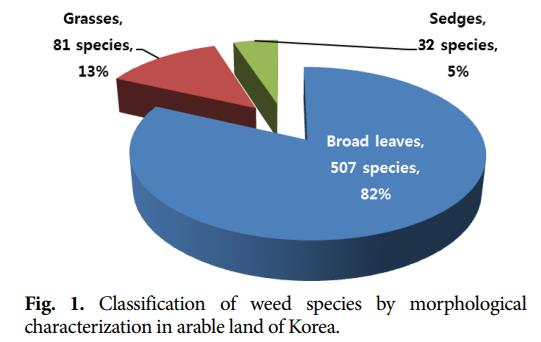

이등(2017) 한국잡초학회
-우리나라농경지에발생하는잡초현황

I. 잡초의 특성과 분류

5. 주요우점잡초들
▸ 논잡초

| 논피(Echinochloaorzicola) | 물옥잠(Monochoriakorsakowii) | 자귀풀(Aeschynomemeindica) | 여뀌바늘(Ludwigiaprostrata) | 가래(Potamogetondistinctus) |
| --- | --- | --- | --- | --- |
| • 화본과• 전국논발생• 하계일년생잡초• 줄기높이50~110 cm• 벼처럼모여발생 | • 물옥잠과• 전국분포(특히서해안논지역)• 줄기높이20~40 cm | • 자귀풀(콩과)• 전국논발생, 하계일년생잡초• 줄기높이50~200 cm• 잎은어긋나게달림 | • 바늘꽃과• 전국논발생, 하계일년생잡초• 줄기높이30~100 cm | • 가래과• 논, 도랑, 얕은습지등지발생• 여러해살이잡초• 뿌리줄기는물밑의흙속에서옆으로여러갈래로길게뻗어번식 |

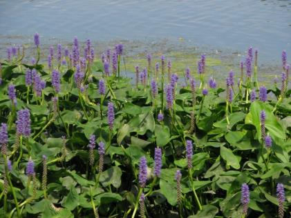

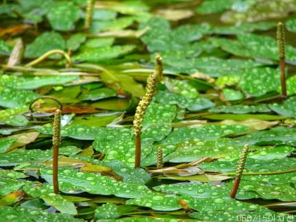

I. 잡초의 특성과 분류

5. 주요우점잡초들
▸ 밭잡초

| 쇠비름(Portulacaoleracea) | 흰명아주(Chenopodiumalbum) | 털별꽃아재비(Galinsogaciliata) | 망초(Conyzacanadensis) | 환삼덩굴(Humulusjaponicas) |
| --- | --- | --- | --- | --- |
| • 쇠비름과• 건조에강한다육식물• 전국밭, 과수원발생• 하계일년생잡초 | • 명아주과• 전국밭,과수원발생• 하계일년생잡초 | • 국화과• 봄에이른여름발생• 미대륙원산• 종자의전파는주로바람에의함• 한해동안3~4세대• 종자생산량이많은잡초 | • 국화과• 미대륙원산귀화식물• 전국들, 길가분포• 두해살이풀 | • 삼과• 훼손된들에흔하게발생• 덩굴성한해살이풀• 우리나라전역자생• 동아시아지역분포 |

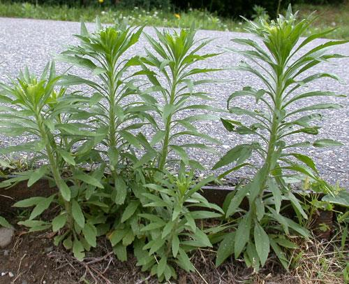

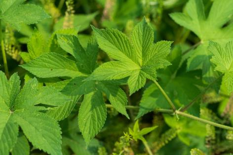

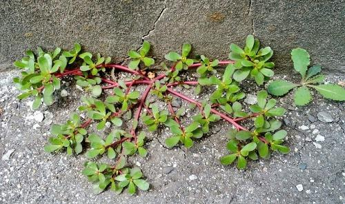

I. 잡초의 특성과 분류

6. 잡초의잡초성
▸ 잡초의종자는땅속에서오래생존할수있다.
▸ 잡초종자는광발아성으로, 땅위로올라와야발아할수있다.
▸ 잡초종자는휴면성이복잡하여발생기간이길다.
▸ 종자생산량이많다.
▸ 발아가불균일하다.
▸ 개화가빠르다.
▸ 자가수정을한다.
▸종자생산기간이길다.
▸ 종자의전파수단이다양하다.
▸ 경합기능이특이하다.
▸ 발취저항성이있다.

II. 잡초의 생리 생태

* 잡초종자발아5단계

| 단계 | 설명 |
| --- | --- |
| 1 | • 물의 흡수(전분에의한 물리적흡수, 배에 의한 생리적흡수 및 전분의가수분해) |
| 2 | • 세포분열및신장의대사과정 |
| 3 | • 종근 및 유아의신장 |
| 4 | • 유아의출현 |
| 5 | • 발생후부터이유기까지 |

II. 잡초의 생리 생태

1. 잡초의발아및출현특성
▸ 발아에관여하는환경요인
✓수분(water)
•수분의흡수는발아의1단계
•살아있는종수나죽은종자모두수분을흡수를통해팽만해짐
•단백질, 점액물질, 펙틴은전분보다교질성과친수성이커서더많은수분흡수가능
✓온도(temperature)

• 잡초종자의발아적온일정치않으며, 대체로15~30도범위
떡잎
✓산소(oxygen)
• 발아에서호흡할때, 높은수준의산소요구
•대부분의잡초는산소20%, 이산화탄소0.03%, 질소80%에서최고의발아율
•산소농도20% 이하→발아율감소
✓광(light)
•겉흙에서광을받은후발아
•광발아졸아, 암발아종자, 광과상관없이발아하는종자로구분

II. 잡초의 생리 생태

1. 잡초의발아및출현특성
▸ 발아에관여하는환경요인
* 광조건에따른종자종류

| 구분 | 설명 |
| --- | --- |
| 광발아종자 | • 바랭이, 쇠비름, 개비름, 향부자, 강피, 참방동사니, 소리쟁이, 메귀리 |
| 암발아종자 | • 별꽃, 냉이, 광대나물, 독말풀 |
| 광무관계종자 | • 화곡류, 옥수수 |

* 산소조건에따른종자종류

| 구분 | 설명 |
| --- | --- |
| 호기성잡초 | • 너도방동사니, 바랭이, 향부자 |
| 혐기성잡초 | • 돌피, 올챙이고랭이, 가래, 물달개비, 올미 |

II. 잡초의 생리 생태

1. 잡초의발아및출현특성
▸ 잡초종자의발아특성
✓발아주기성(periodicity)
•종자의후숙과정에서의생리적, 환경적조건이긴밀하게관여하기때문에같은조건에두어도일정한간격(어떤주기성)을가지고최고의발아율을나타내는것
✓발아의계절성과기회성
• 계절성: 온도보다일반적으로계절특성을더욱일정하게나타내는일장에반응하여휴면타파, 발아하는특성
• 발아기회성: 일장보다같은계절에서변이성이큰온도조건에더기회적으로감응하여발아하는특성
✓발아의동시성및연속성
• 동시성발아: 일정한기간이내에대부분종자가발아를마치는집중발아형
• 연속성발아: 발아조건을주어도오랜기간에걸쳐지속해서발아하는유형

II. 잡초의 생리 생태

1. 잡초의발아및출현특성
▸ 종자수명
✓종자의활력과수명은'유전형', '휴면기작', '저장환경'에따라상이함.

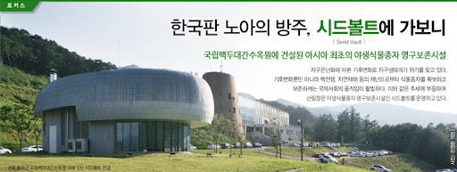

•(캐나다)추운지대에서발견된루핀(Lupinusarticus) 경우, 10,000년이지난후발아성공(Harrington, 1967)
•(중국) 추운만주호수에서발견된연꽃종자경우, 1,000년이후발아성공(Copeland, 1967)
•일부콩과작물종자는건조상태에서100~150년후발아확인
✓양호한저장조건(낮은온도, 낮은습도(수분), 낮은산소)에서긴종자수명확인
• 일부사료작물의종자: 38도고온에서저장(수분함량6% 이하) →6년후발아양호확인

Seed Vault
(국립백두대간수목원, 경북봉화)
Svalbard Global Seed Vault
(노르웨이령스발바르제도내)

II. 잡초의 생리 생태

1. 잡초의발아및출현특성
▸ 유묘출현에관여하는요인
✓잡초는발아한후, 토양층을통과하여지표면위로출현하므로여러토양조건의영향을받음.
✓유묘의출현에관여하는요인으로는토양심도, 토양온도, 토양수분, 토양산소, 토양산도, 토양비옥도, 토양염도등이있음.

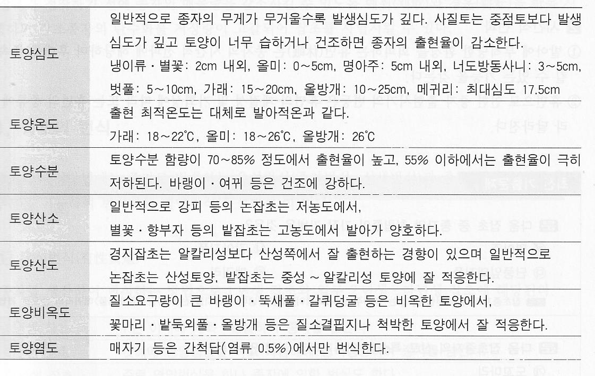

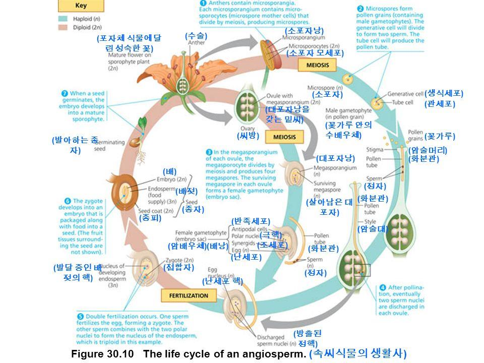

II. 잡초의 생리 생태

2. 잡초의번식, 전파, 휴면
▸ 잡초의번식(유성생식, 영양생식)
✓유성생식(sexual reproduction)
•종자만으로번식하는방식
•1년생잡초와일부2년생, 일부다년생잡초해당
✓영양생식(vegetative reproduction)
• 주로다년생잡초해당
•대부분영양번식을하는잡초종들은두가지이상의번식수단을동시나타냄
-영양체번식을하면서도종자인유성생식방법을동반
→유전적으로다양한종자를생산

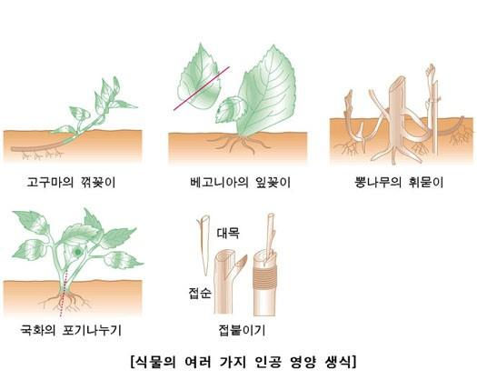

→번식력과적응력모두향상

II. 잡초의 생리 생태

2. 잡초의번식, 전파, 휴면
▸ 잡초의번식(유성생식, 영양생식)
✓유성생식과영양번식의장단점
•영양번식은유성번식에비해번식력, 이동성은떨어지나적응성및정체성이강하다.
•유성번식은영양번식에비해산포성과휴면성이강하다.
•영양번식으로생산된개체는종자로부터생산된개체보다강하며, 적당한경운조건및제초제에강하다.
•영양번식으로생산된개체는종자로부터생산된개체보다양이적고, 환경이더욱불량해지면영양체로만번식한다.

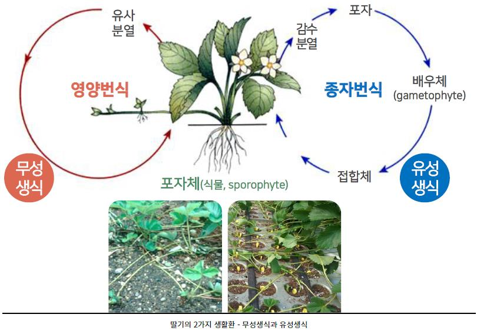

참조: 방송통신대학교농학과자료

II. 잡초의 생리 생태

2. 잡초의번식, 전파, 휴면
▸ 잡초의전파
✓자연력에의한전파: 바람이나물등에날아가고떠내려감
✓동물에의한전파: 종자에갈고리나가시가돋친종자는동물에의한전파용이
✓사람에의한전파: 농작물의종자나퇴구비, 가축의분뇨, 농기구등에의한전파

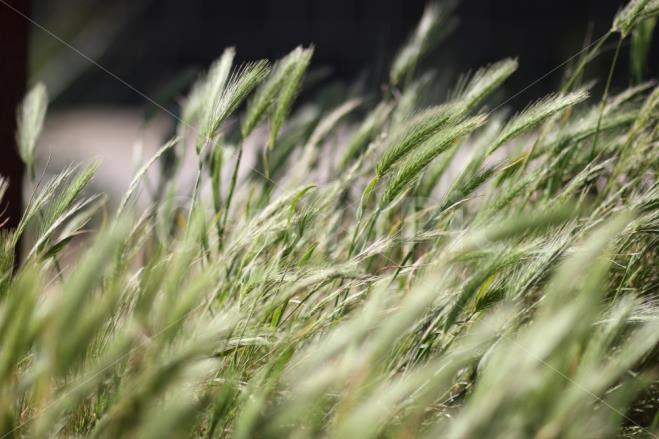

사람에의한전파

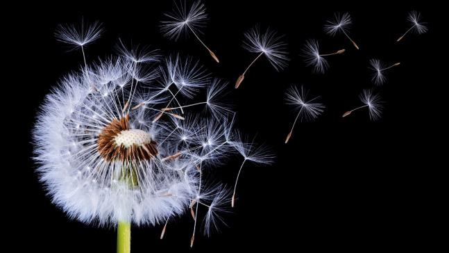

동물에의한전파
바람에의한전파

II. 잡초의 생리 생태

3. 잡초의군락과천이
▸ 식생의천이
✓천이(succession): 어느지역에서시간에따라종의조성, 식생의모습이방향성을가지고자연적으로변화하여가는현상
•토양, 광선등의환경조건이변화→새로운환경에서보다잘생활할수있는식물침입→기존식물과의경쟁에서이겨내서토착
•식생과생육환경의상호작용→최종적으로안정된식생이오랜기간동안지속되는상태(극상: 천이의마지막단계)

| 구분 | 설명 |
| --- | --- |
| 1차천이 | • 식물이전혀없는곳에서부터시작되는천이• 첫식물이들어와비교적안정된식생으로변화하는과정 |
| 2차천이(갱신천이) | • 원래의식생이화재, 태풍, 병충해, 벌채등과같은자연적, 인위적피해를받은다음성숙된식생으로회복되는과정 |

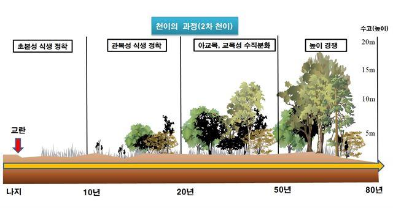

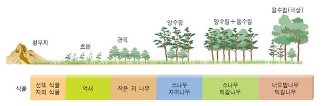

2차천이
1차천이

II. 잡초의 생리 생태

3. 잡초의군락과천이
▸ 잡초군락의천이
✓군락: 환경에적응하여생존하는식물종들의집합체
•잡초군락의천이: 재배작물의변화, 경종조건의변화, 제초방법의변화등농경법의변천이가장큰요인

| 구분 | 설명 |
| --- | --- |
| 재배작물및작부체계의변화 | • 벼, 보리, 채소등의재배작물과단작, 이모작등작부체계의변화 |
| 경종조건(seeding condition)의변화 | • 본답시기, 물관리, 경운, 시비, 수확방법및시기→잡초종자의오염기회증대 |
| 제초방법의변화 | • 손제초및기계적잡초방제의감소, 선택성제초제의사용증가, 제초방법개선 |

II. 잡초의 생리 생태

2. 잡초의번식, 전파, 휴면
▸ 잡초의휴면
✓휴면의정의
•작물이일시적으로생장활동을멈추는생리현상. 작물은대부분휴면함.
•발아시기의조절, 불량환경(고온, 저온)의회피, 종자의수명연장등식물자신이처한불량환경의극복수단
•성숙한종자에적당한발아조건을주어도일정기간동안발아하지않을때에이종자는휴면을함(→휴면은생육의일시적인정지상태)
•자발휴면(생득휴면) : 외적조건이생육에부적당하지않을때에도내적원인에의해서유발되는진정한휴면
•타발휴면(강제휴면) : 발아력을가진종자라도외적조건이부적당하기때문에유발되는휴면
1차 휴면과2차 휴면
- 자발휴면과타발휴면을합쳐 '1차 휴면'
- 성숙한 종자가불리한환경조건에장기간보존되어휴면이새로 생기는것을 '2차 휴면'

II. 잡초의 생리 생태

II. 잡초의 생리 생태

강의 내용

▸ 잡초의 해와 방제
▸ 제초제의 작용기작

I. 잡초의 해와 방제(Weed damage and control)

1. 잡초의생육및경합특성

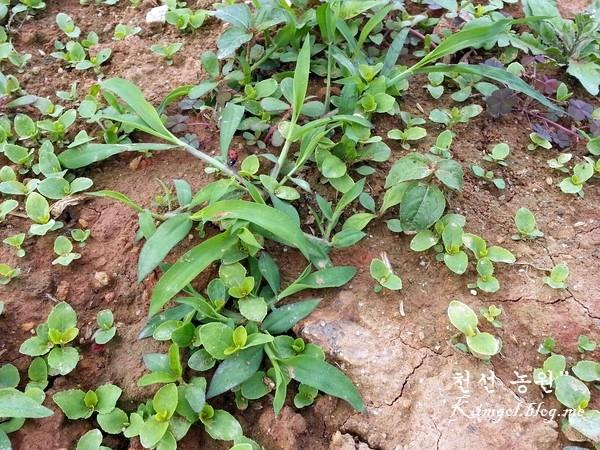

▸ 잡초의생장특성: 작은크기, 빠른발아, 빠른초기생장속도
▸ 생육특성
✓생육의유연성
• 밀도변화가있어도유연한개체당생체량변동→'일정량후대생산'과'개체군생체물량'확보가능
-(높은밀도) 고사개체및기관비율상승, 영양체형성경향증대
-(낮은밀도) 개화및결실률증대→종자생산량증가, 영양체형성경향감소
✓ 기회적생장능력
• 많은잡초는'기회적생장'강한C 식물(주요작물은C 작물)
4 3
• C 식물은C 식물보다양호한조건에서광합성효율과순간적생산효율높음. < C 식물>
4 3 4
CO2가부족한환경에서도광합성의
암반응(광비의존성반응)을계속할
수있는식물

I. 잡초의 해와 방제(Weed damage and control)

1. 잡초의생육및경합특성
▸ 경합의정의
✓ 일정한환경조건에서한종류이상의식물이동시에동일한자원을요구함으로써일어나는'상호억제작용'
✓ 경합의원인: 단위면적에서환경이식물에게제공하는자원의공급력제한
✓ 식물간의상호작용: 생리적으로서로공유하는기생과공생, 서로공유를하지않는경합, 편리, 편해, 원협작용

| 구분 | 설명 |
| --- | --- |
| 편리작용 | 서로작용하는두개체군사이에서한쪽은항상이익을얻는경우 |
| 편해작용 | 서로작용하는두개체군사이에서한쪽은항상피해를입는경우 |
| 원협작용 | 서로작용하는두개체군이서로협동하여이익을얻는경우 |

▸ 작물의경합특성
• 식물의경합력: 잡초종류, 발생밀도에따라→잡초에대한작물경합력이달라짐
•작물의품종: 주어진토양, 수분, 기후조건에적응력이큰작물/품종선택→잡초제어유리
• 재배방법: 육묘이식, 재식밀도증가, 작물발아/초기생육에최적인시기에파종→잡초에대한작물경합력증대
• 토양비옥도: 높은비옥도/시비→제초작업증가.
-조파작물/산파작물, 추파작물/춘파작물, 초형이서로다른작물을전작/후작으로선택→잡초발생과경합피해감소효과

I. 잡초의 해와 방제(Weed damage and control)

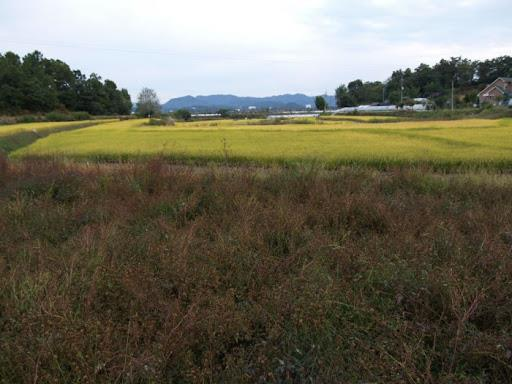

2. 잡초의군락과천이특성
▸ 잡초군락의천이(succession, 이미조성된초종이변화되는과정)
✓ 시간경과에따라농경지(자연적, 인위적교란상태가계속되는조건) 적응, 생존
▸ 식생천이관여요인
✓제초방법
• '선택성제초제'사용이가장극적인천이유발요인
-1년생잡초의선택성제초제(클로르니트로펜, chlornitrofen)연용→다년생잡초(너도방동사니, 올챙고랭이등)의우점화현상초래
-최근논잡초군락이올미, 가래, 올방개, 너도방동사니, 벗풀등의다년생으로천이된것= '제초제사용, 재식법, 경운법, 물관리,
재배방법의변천'에따른결과물
✓ 물관리와시비방법
• 물을깊이대거나밭/논작물교호적재배, 질소/석회비료사용→잡초생육억제재배적방제법
✓ 작물품종과재배양식
• 작물품종에따라'초형(plant type), 조만성(earliness), 비료요구도, 내한성등' 차이
• 잡초와의경합력에도차이가있어초종조성에도변화초래
• 작물의재배시기(조기, 만기, 보통재배), 재배양식(이앙재배, 직파재배)도잡초의초종조성을바꾸는데영향미침

I. 잡초의 해와 방제(Weed damage and control)

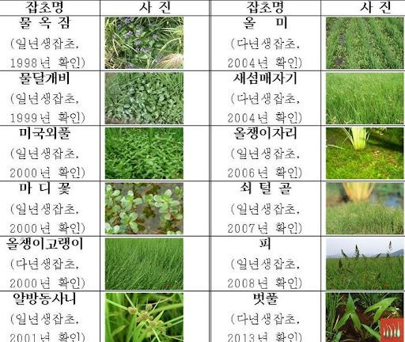

2. 잡초의군락과천이특성
▸ 제초제내성(저항성) 잡초의출현
✓ 여러요인중, 잡초개체군에서가장치명적/직접적인요인= 제초제
✓ 장기간제초제(트리아진계, 그리목손, 설포닐우레나등)사용→세계각지에서제초제내성(저항성) 잡초종출현
✓ '제초제사용량조절', '다른작용기작계통제초제교호처리'
→저항성잡초의종수감소, 잡초발생억제, 작물의경합피해감소
✓ 내성과저항성

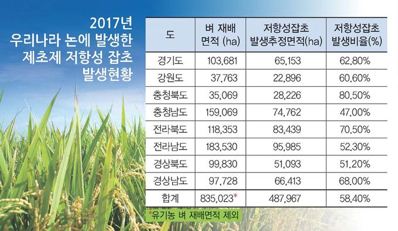

•내성(tolerance)
-어느한개체군이나다른종간에항상존재하는
일종의내부변이현상. 잡초가제초제가견디는현상
• 저항성(resistance)
-이전에는감수성이었던잡초가극단의내성에이를정도로바뀐상태.
제초제를바꾸어사용하거나사용을중단하면저항성제어가능.
농기자재신문(2018.4.17.)

I. 잡초의 해와 방제(Weed damage and control)

3. 잡초경합의생태적원리
▸ 잡초와작물과의경합: 제한된공통자원에대하여근연관계를가지는생물간에나타나는자연현상
▸ 종내경합(intra-specific competition)과종간경합(inter-specific competition)으로구분
✓ 종내경합: 동일초종내에개체간경합: 잔디와잔디/새포아풀과새포아풀
✓ 종간경합: 이종(서로다른) 식물간의경합: 잔디와새포아풀, 새포아풀과바랭이등

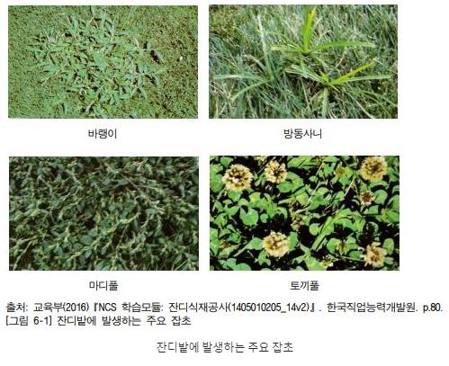

경합의측면에서잡초의생육특성
✓ 발아및초기생육이빨라초기에경합력우위
✓ 근군(根群)이발달되어수분이나영양분의경합유리
✓ 강한번식력과재생력이의해낮은예고에서도견딤
✓ 환경(불량) 적응성이강하여지속적인경합대상
✓ 광합성능력이높은C4 식물이많음.

I. 잡초의 해와 방제(Weed damage and control)

4. 잡초경합의한계기간과허용한계밀도
▸ 작물의수량감소방지위해잡초방제한계기간(critical period) 동안잡초방제
▸ 잡초경합한계기간(critical period for weed competition) 동안작물과잡초간경합이계속되지않도록잡초방제
* 잡초경합한계기간: 작물의초관형성기~생식생장기사이에잡초와의경합
▸작물의전생육기간중첫1/3~1/2기간또는1/4~1/3기간에비교적생육초기에해당→철저한방제요구
▸ 잡초의허용한계밀도(threshold density for weed competition)에잡초는병이나해충과달리무조건박멸시켜야할대상으로취급할필요가
없으므로, 어느정도허용할수있다고판단되는발생밀도를의미함.
▸ 경제적허용한계밀도(economic threshold density for weed competition) : 방제노력/방제로인한이익이같아지는수준까지의밀도한계구역

I. 잡초의 해와 방제(Weed damage and control)

5. 잡초의방제와농업
▸ 농업생태계의특성

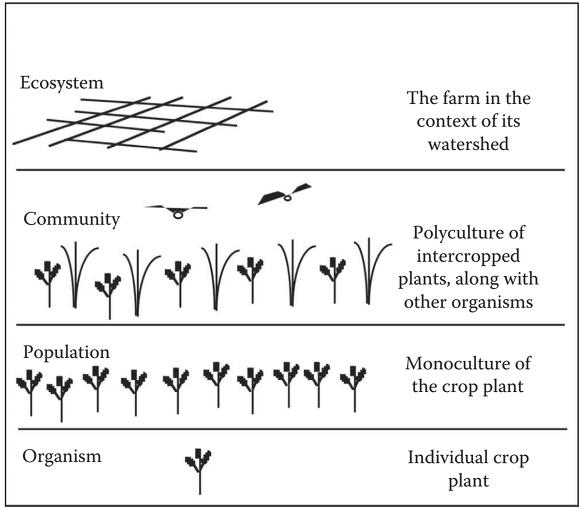

✓ 자연생태계의생물들에비해짧은수명
✓ 환경에대한약한저항성
✓ 높은균질도와낮은종다양도
✓ 재배와관리등으로큰인위적요소관여

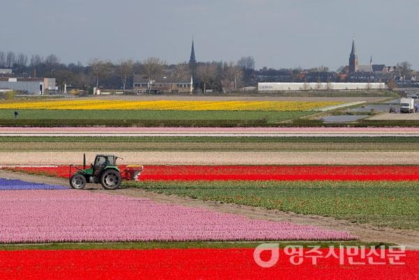

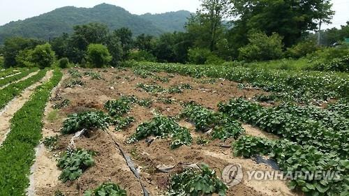

I. 잡초의 해와 방제(Weed damage and control)

5. 잡초의방제와농업
▸ 잡초방제의역사
✓ 유랑농경시대'화전농법', 정착농경시대'경운또는중경으로잡초방제'
✓ 벼농사의담수재배, 밭농사의조파도잡초방제의효과를가지고있으며, 20세기후반부터제초제사용시작
✓ 최근의잡초방제는여러방제법의장점이혼용된종합적방제법과환경친화적방제법도입
▸ 잡초와병해충의특이성비교

| 구분 | 잡초 | 병해충 |
| --- | --- | --- |
| 국면성 | 정체적 | 동태적 |
| 문제대상 | 식물 | 동물/미생물 |
| 진전성 | 완만성 | 급진성 |
| 가해특성 | 생산활동억제 | 생산물탈취 |
| 피해판단근거 | 허용한계수준 | 출현자체 |
| 방제개념 | 방제 | 박멸/근절 |
| 방제기술 | 작물의경합특성이용 | 유해생물의가해특성이용 |

I. 잡초의 해와 방제(Weed damage and control)

5. 잡초의방제와농업
▸ 작물의방제원칙

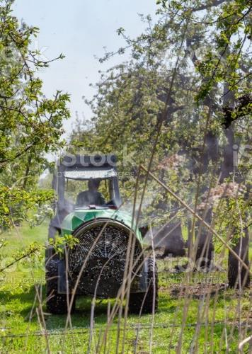

✓ 병이나해충에노출되거나피해가생기지않게회피, 예방
✓ 일단병에걸리면적절한방제(control)
✓ 경제적가해수준을넘어서지않았는데도지나치게박멸(eradication) 지양

I. 잡초의 해와 방제(Weed damage and control)

6. 잡초방제방법
▸ 예방적방제(preventive control)
✓위생과청결
• 잡초가없는청결한상태의농경지유지/새로운종자및영양체를생성할수없게이들의번식시기청결유지
-재배관리의합리화: 적절한시비기술(작물초관형성촉진), 제한적관개와제한적경운, 철저한병해충방제, 잡초를제어하는윤작, 개화
이전의잡초제거, 수확후토양화염방제및소토처리등
-작물이나관상식물의종자정선, 오염종자감소→잡초종자비산방지
-농기계나기구청소
-사료나퇴구비, 가축관리로종자전파방지
-관개수로나운반토양관리
✓ 법적방제: 국가/지역간의종묘유통과정에서검역및검사제도를두어문제성잡초로오염된종묘의유통통제

I. 잡초의 해와 방제(Weed damage and control)

6. 잡초방제방법
▸ 주요방제방법
✓ 물리적방제
• 기계/힘으로하는손제초, 경운, 예취, 피복, 열처리, 침수처리와같은방제법
-기계, 기구, 온습도, 빛(유아등, 자외선등) 이용. 열(온탕소독)/수목의해충서식지제거
-황색, 청색또는적색끈적이판설치, 황색수반등설치
-한랭사로하우스나온실을덮어해충침입차단(방충망설치) →진딧물, 나방류의침입방지
-과실에봉지를씌움. 토양소독은재식전증기로훈증소독, 담수처리, 태양열소독등
-집단서식지및이병정도가심한가지도절단, 소각등

| 구분 | 설명 |
| --- | --- |
| 침수처리 | 논에서10~15 cm 수심을유지하면잡초발생억제 |
| 중경과배토 | 범용관리기를이용하여자연적인잡초제거 |
| 토양피복 | 볏집등으로피복하면잡초발생및생육억제 |
| 흑색비닐멀칭 | 광발아성잡초발아억제, 잡초의광합성방해 |
| 예취 | 잡초를베어결실을방지, 잡초의저장양분고갈 |
| 화염제초 | 잡초소각및흙속의잡초종자까지사멸 |

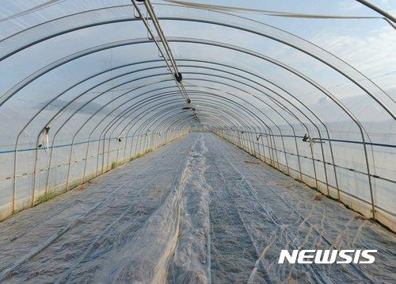

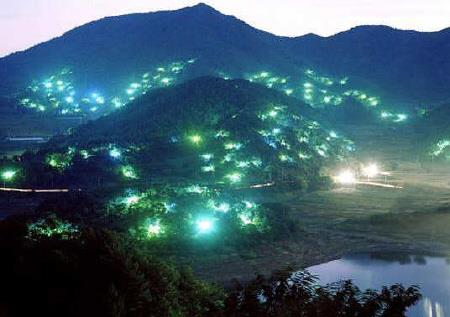

I. 잡초의 해와 방제(Weed damage and control)

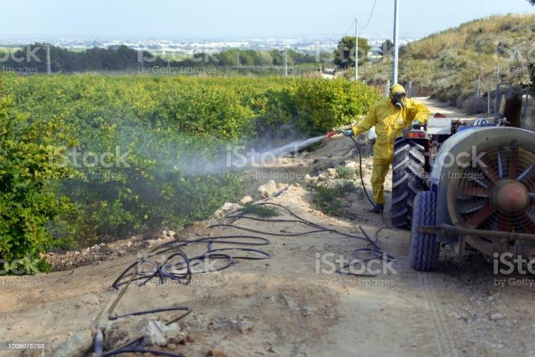

6. 잡초방제방법
▸ 주요방제방법
✓ 화학적방제: 제초제를사용하는방제법
• 농약을이용하여방제하는것으로, 예방위주로적기에방제
• 농약살포시, 적절한희석배수, 살포량, 횟수를선택(과다사용방지)
• 살포시충분한양을골고루살포(약흔및약해주의)
• 여러가지적용약제를교호적살포→저항성방지
• 단점: 생태계균형파괴, 저항성유발, 환경오염등
• 장점: 효과가빠름
• 페로몬(pheromone)이나미생물농약도이범주에속함.

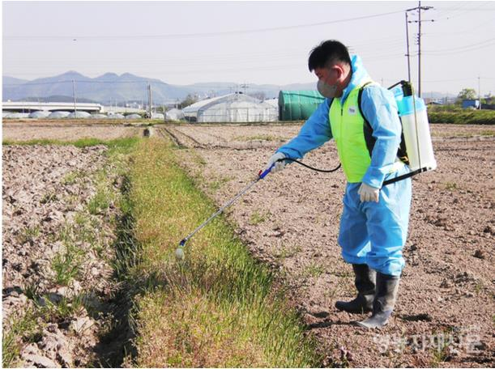

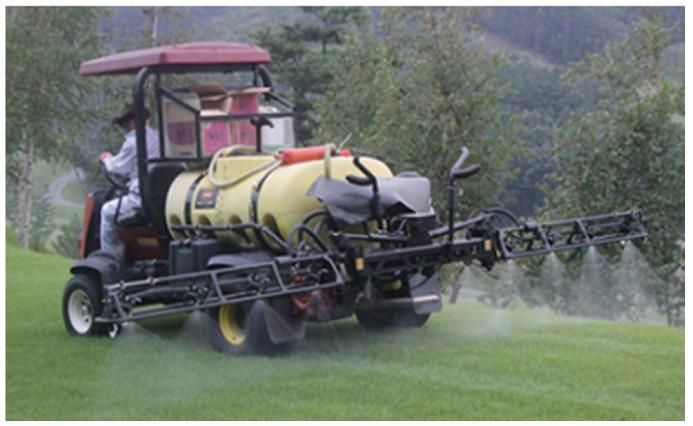

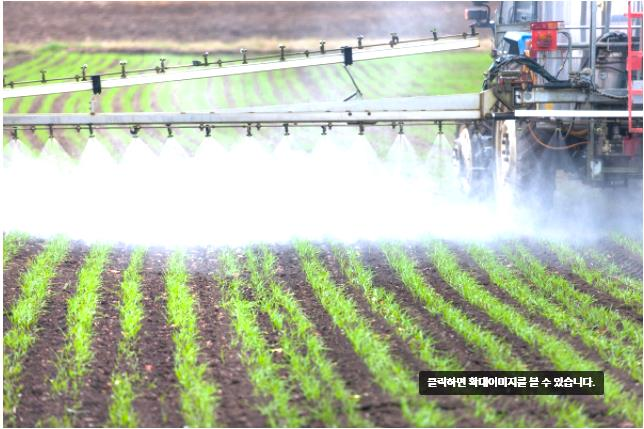

I. 잡초의 해와 방제(Weed damage and control)

6. 잡초방제방법
▸ 주요방제방법
✓ 재배적방제: 생태적방제법이라고도함.
• 경합특성이용법: 작물의경합력증진을위한방법
-작부체계의전환(윤작), 제초제의교호적사용, 목초류의방목횟수증대
-육묘하여이식(이앙), 재식밀도조절(작목, 품종/종자선정, 재파종및대파등활용)
-피복작물, 경운, 재배시기조절과같은재배수단이용, 건전우량, 무병묘구입하여심음
-저항성(내충성) 품종선택, 재배
-윤작/혼작→병원균숙주제거, 대항식물/유인작물로병원균의서식줄임
• 환경제어법: 잡초의경합력약화를위한방법. 작물에는유리하고잡초에는불리하도록인위적환경조성
-시비는전면살포보다작물의비료흡수층에만시비
-토양산도: 작물에최적범위가되도록조절
-관배수조절, 제한적경운
-묘포장, 통로, 주차장, 정원저수지, 관배수로등에콘크리트나방제용천과같은시설설치
-포장청결: 전염원제거/확산방지, 전작물전사물수거/소각, 포장전염원/월동처제거, 인근서식처방제, 묘목의상처나전정가위등소독

I. 잡초의 해와 방제(Weed damage and control)

6. 잡초방제방법
▸ 주요방제방법
✓ 생물적방제
• 천적/생물(대항식물) 이용
• 천적, 기생성동물, 병원미생물, 포식성동물이용
• 기생성, 식해성및병원성을지닌생물이용→잡초집합밀도감소

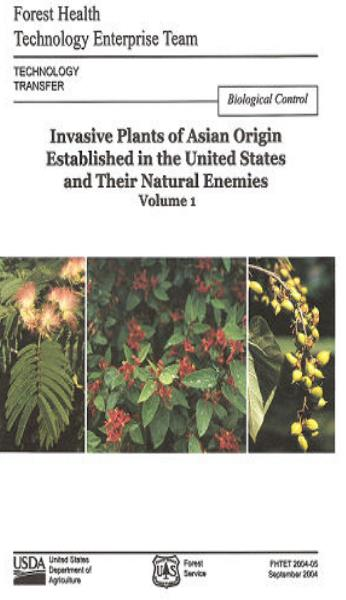

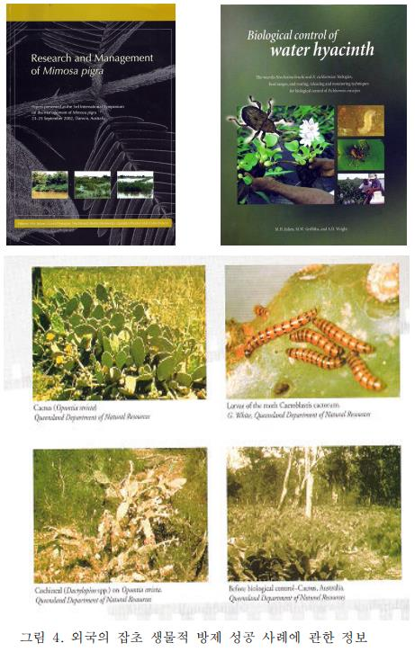

• 단점및장점: 방제로효과는느리나환경부하가적고지속적
• 천적을이용한방제성공조건
-철저한먹이섭식성, 이동성이있어야함.
-문제잡초이외의유용식물을가해하지말아야함.
-천적의천적이없어야하고, 환경과다른생물에대한적응성, 공존성및저항성이있어야함.
-식물은문제잡초보다신축성있게빠른번식특성을지니고있어야함.

I. 잡초의 해와 방제(Weed damage and control)

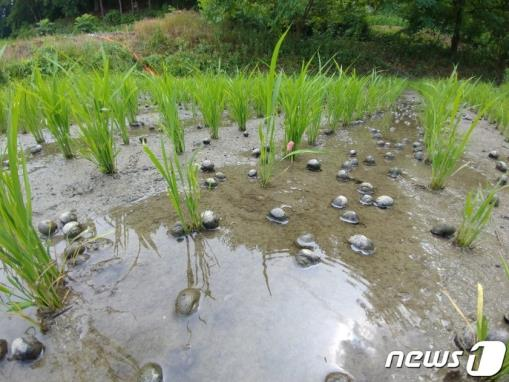

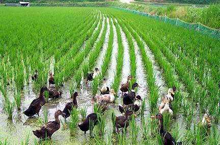

6. 잡초방제방법
▸ 주요방제방법
✓ 생물적방제
• 민간농법에의한생물학적잡초방제

| 구분 | 설명 |
| --- | --- |
| 오리농법 | 오리가생육중의잡초를직접먹어없애거나토양표면이나표토의흙속에있는잡초종자섭식 |
| 왕우렁이농법 | 수면과수면아래의연한풀을먹는먹이습성을이용논에발생하는물달개비, 알방동사니, 밭둑외풀등잡초방제 |
| 쌀겨농법 | 쌀겨에는인산, 미네랄, 비타민이많이들어있고, 미생물의활동에의해피같은잡초의생장을억제, 분해쌀겨를뿌린논은온도가높아저온기에뿌리를보호하고등숙에도움을줌 |
| 참게농법 | 참게의탈피습성이용탈피각에는칼슘이많아벼의생육과토양의비옥도를높힘 |

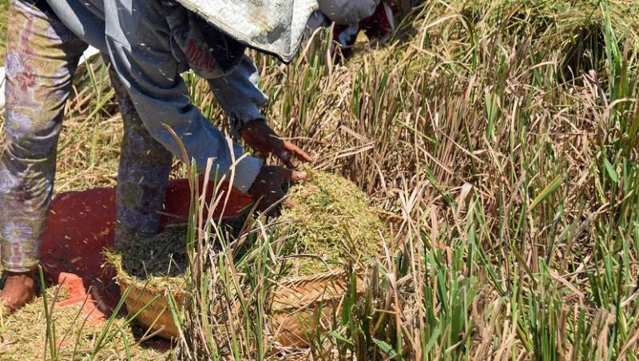

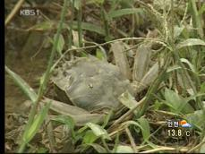

I. 잡초의 해와 방제(Weed damage and control)

6. 잡초방제방법
▸ 주요방제방법
✓ 종합적방제
• 비료와농약을과다하게많이사용함으로환경부하가커짐에따라도입된개념
• 최적의농약(생물적방제포함)을최소한으로그지역에서효율적으로사용하자는개념으로비료나농약등에적용
• 장점: 전체적인잡초군락의크기감소, 예방적/생태적방법이병행됨으로써작물생산력을간적접증대
• 종합적방제와종합적관리
-종합적방제: 육종적, 재배적, 생물적방제법을동원→농약의사용량감소, 병해충/잡초방제
-종합적관리: 환경친화적인방법으로경제적피해수준이하로관리하는농업경영의개념

I. 잡초의 해와 방제(Weed damage and control)

II. 제초제의 작용기작(mechanism of herbicide)

1. 제초제의흡수및이행
▸ 제초제흡수: 식물형태/내부구조, 환경조건등에의해영향을받음
▸ 제초제가흡수되면→살초효과발현위해,일정농도이상의제초제가작용부위로이행, 축적되어야함.
▸ 제초제의흡수/이행정도: 제초제화학적성질뿐만아니라, 제초제의처리부위/식물의형태적/생리적특성에따라좌우됨.
▸ 적용부위에도달하기전까지는여러과정에서장애를받게되므로, 이행되는제초제의양은처리한양에비하여점차감소

II. 제초제의 작용기작(mechanism of herbicide)

1. 제초제의흡수및이행

II. 제초제의 작용기작(mechanism of herbicide)

1. 제초제의흡수및이행
▸ 제초제의흡수
✓ 뿌리에의한흡수
• 토양중의제초제는3가지경로(아포플라스트, 심플라스트, 아포플라스트-심플라스트)를통해식물뿌리속으로들어감
• 아포플라스트(apoplast)경로: 세포간극, 세포벽, 물관등으로이어지는죽은세포조직을통하여이동, 제초제가내피의카스파리대를
우회하여물관으로들어감
• 심플라스트(symplast)경로: 세포벽으로들어간다음표피와피층세포의원형질속으로들어가고, 원형질연락사에의하여내피, 중심주,
체관순으로통과
• 아포플라스트-심플라스트(symplast)경로: 심플라스트경로와같지만, 제초제가카스파리대를거치지않고세포벽으로다시들어간다음

물관으로들어감

II. 제초제의 작용기작(mechanism of herbicide)

1. 제초제의흡수및이행
▸ 제초제의흡수
✓ 잎에의한흡수
• 대부분은잎의표면으로직접침투, 흡수
• 잎을통한제초제흡수에영향을미치는요인
-습윤제로계면장력을적게하여흡수를증가시키고큐티클의납질이나유성물질을용해함으로써엽면흡수를증가시킴
-강우는약제를씻겨내므로흡수저하
-온도가상승하면흡수가촉진되어선택성감소
✓ 제초제의 이행
• 체관부는 심플라스트, 물관부는 아포플라스트/세포간극을 통해 이루어 짐
• 뿌리에서 흡수한 아포플라스트 이행 제초제는 물관으로 들어가서 증산류를 따라 상승
• 잎을 통하여 흡수한 심플라스트 이행 제초제는 광합성 산물과 함께 같은 경로를 통해 이행(잎→체관→뿌리, 눈, 발육 중인 과실, 생장점
등과 같은 광합성 산물 수용기관으로 이행)

II. 제초제의 작용기작(mechanism of herbicide)

2. 제초제에대한식물의반응
▸ 많은제초제는세포와조직의파괴, 세포의분열, 신장/분화변화
▸ 변화의종류: 생장억제, 상편생장(epinasty), 잎황화(chlorosis), 백화(albino), 괴사(necrosis), 세포의미세기관/막변형, 큐티클형성저하등
✓ 생장억제: 모든제초제. 접촉형제초제는생장이억제되기전에조직고사시킴.
✓세포분열: 카바메이트계, 히오카바메이트계, 디니트로아닐린계제초제등.
✓ 세포신장: 세포분열이저해되는경우관련세포는정상세포보다더크다. 나프탈람/2,3,6-TBA는세포신장증대
✓ 상편생장: 식물의줄기와잎이구부러지거나비틀리는현상. 페녹시계, 옥신계제초제.
✓ 황화현상: 우레아계, 라실계, 트리아진계제초제. 프로파닐등의광합성저해형제초제.
✓ 백화현상: 아미트롤처리시새로발생한잎에서나타남(엽록체발달이되지않기때문)
✓ 잎의괴사: 다이콰트계등의접촉형제초제. 일반적으로세포막의파괴와관련

II. 제초제의 작용기작(mechanism of herbicide)

3. 토양에서제초제동태
▸ 토양중잔류성
✓ 제초제가후작물에대한해로운영향이없이잡초방제효과가있으려면'일정기간활성을가진채로토양내중에남아있어야' 한다.
✓ 고온다습조건에서분해가빠름
✓ 제초제의토양중지속성은일반적으로'반감기(half life)'로나타냄: 처리한제초제의1/2이소실되는데필요한시간

II. 제초제의 작용기작(mechanism of herbicide)

< 표면이동>
< 휘발> 물, 바람에의한유실.
화합물이고체나
제초제는식물이흡수하는
액체상태로부터기체형태로
양이매우적음.
되어대기중으로소실되는것

< 흡착>
토양입자표면에제초제분자
또는이온의부착또는
끌어당김(점토광물, 토양
유기물관여)
< 용탈>
토양중물에의한제초제의
하방이동

II. 제초제의 작용기작(mechanism of herbicide)

4. 제초제의선택성
▸ 선택성(selectivity)
✓ 제초제의일정농도범위에있어서식물체에따라해를입는정도가다른데, 이와같은현상을'제초제선택성'이라고함.
✓ 일반적으로감수성은제초제에대한식물체반응이정비례, 내성/저항성은반비례
✓ 잡초를골라죽이는특성= '선택성'
▸ 선택성의유형
✓ 물리적선택성(physical selectivity)
• 생태적선택성: 인위적인방법에따름. 작물과잡초생육의시간적차이나작물과잡초의생육공간의차이이용
-차폐막에의한선택성이나과수나산림의하초또는키가큰작물아래나주간에발생하는잡초방제법
• 형태적선택성: 생장점의위치, 뿌리의발생위치차이등에의하여선택성부여

II. 제초제의 작용기작(mechanism of herbicide)

4. 제초제의선택성
▸ 선택성의유형
✓ 생리적선택성(physiological selectivity)
• 제초제의흡수, 이행, 대사및식물체의대사에대한제초제의영향등의차이에따라부여되는선택성

II. 제초제의 작용기작(mechanism of herbicide)

4. 제초제의선택성
▸ 선택성의유형
✓ 제초제의작용기작

| 작용기작 | 제초제의분류및종류 |
| --- | --- |
| 광합성저해 | • 벤토티아디아졸계 bentazone• 트리아진계 simazine, atrazine• 요소계 linuron, methabenzthiazuron• 아마이드계 proranil• 비피리딜리움계 paraquatdichloride |
| 호흡작용및산화적인산화저해 | • 카바메이트계chlorpropham• 유기염소계 dalapon |
| 호르몬작용교란 | • 페녹시계 2,4-D, MCP• 벤조산계 dicamba |
| 단백질합성저해 | • 아마이드계 alachlor, butachlor• 유기인계 glyphosate |
| 세포분열저해 | • 디니트로아닐린계 trifluralin• 카바메이트계 chlorpropham |
| 아미노산생합성저해 | • 설포닐우레아계• 이미다졸리논계• 유기인계 glyphosate |

II. 제초제의 작용기작(mechanism of herbicide)

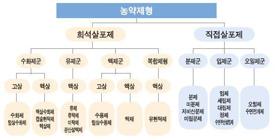

5. 제초제의사용
▸ 제형(formulation)
✓ 제형: 실제사용하기위하여생산자가공급한제초제제품
✓ 유효성분, 기타보조제가포함되는다양한형태
✓ 제형의목적
• 포장조건에서쉬운처리
• 효과증진
✓ 화학자들은화합물의용해도, 휘발성, 식물에대한독성/기타여러가지특성을제제를통해변경가능
✓ 제형의종류

| 종류 | 설명 |
| --- | --- |
| 유제(emulsifiableconcentrate, EC) | • 비극성액상제형• 구성: 액상유효성분, 유기용매, 유화제• 액상이물에분산되어유탁액(기름방울이물에둘러싸인형태) 형성 |
| 수화제(wettablepowder, WP) | • 구성: 증량제, 유효성분, 분산제를대략10~20um의입자크기로미분화• 물에직접분산시켜사용• 대부분토양에처리 |
| 수용제(water soluble powder,SP) | • 유효성분이수용성• 수용성물질의수용제를이용하여만든제제로서, 물에희석한살포액이투명 |
| 액상수화제(flowable,FL) | • 아주미분화된고체입자가액상내에현탁되어있는제재로입자크기가수화제보다작음.• 희석없이제품그대로수로의입구에처리, 물로희석하여사용 |
| 입제(granule, GR) | • 건조한상태의고체제형• 희석함이없이곧바로처리 |

II. 제초제의 작용기작(mechanism of herbicide)

5. 제초제의사용
▸ 제형(formulation)

한국작물보호협회

II. 제초제의 작용기작(mechanism of herbicide)

5. 제초제의사용
▸ 보조제(adjuvant) : 제초효과의증진, 제초제의취급을용이하게하기위하여사용하는물질
✓ 계면활성제(surfactant) : 유화성, 확전성, 분산성, 습윤성등을증진, 액체의표면성질을바꾸어주는물질
• 유화제(emulsifier) : 하나의액체가다른액체에현탁되는정도를증진시키는물질
• 습윤제(qettingagent) : 서로반발하는계면사이의표면장력을감소시켜주는물질. 수용성살포액에습윤제를첨가하여식물체의왁스
표면에쉽게접촉할수있게함.
•전착제(sticker) : 식물체의경엽에제초제가부착되도록하는보조제. 강우로주성분이씻겨내려가는것감소

II. 제초제의 작용기작(mechanism of herbicide)

5. 제초제의사용
▸ 제초제의효과평가: 약해, 제초효과의2가지측면실시
✓ 약해: 제초제처리로인해작물체외관에나타나는증상
✓ 약해평가방법: 달관평가(visual score)와식물체를직접측정하여무처리대비약해정도평가
✓ 제초효과

• 육안으로관찰하여평가하는달관평가
• 방제후남아있는잡초의건물중또는생체중을무제초구대비로평가

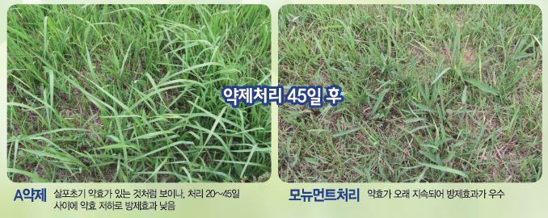

