# kocw_식물보호학_04

|  | 2021년도 2학기 - 식물보호학식물(작물)보호제 (농약) |
| --- | --- |

| 2021년도 2학기 - 식물보호학 |
| --- |
| 식물(작물)보호제 (농약) |

강의 내용

▸ 작물보호제(농약) 개관
▸ 작물보호제의 분류
▸ 작물보호제(농약)의 독성과 안전사용

I. 작물보호제(농약) 개관

1. 작물보호제정의및구비조건
▸ 정의
✓ 작물의생육에직간접적으로피해를주는병균, 해충, 잡초등을방제하고작물의생육을조절하기위하여사용하는물질/생물
✓ 농작물(수목, 임산물포함)을해하는균, 곤충, 잡초, 바이러스, 응애, 선충, 달팽이, 조류, 야생동물, 이끼류, 잡목의방제사용하는살균제,
살충제, 제초제, 기피제, 유인제, 전착제와농작물의생리기능을증진하거나억제하는데사용하는생장조절제(식물호르몬) 등의약제
✓ (농약관리법) '농작물과임산물을가해하는균, 충, 기타동식물의방제에사용하는살균제, 살충제, 제초제와농작물과농림산물에직접
영향을끼치는약제, 기타농림수산식품부장관이지정하는약제'
→ 작물에 해를 끼치는 모든 요소의 밀도 혹은 증상을 예방하거나 제거하고 완화하며 몰아내는 역할을 하는 물질,
또는 이 물질들의 혼합물

I. 작물보호제(농약) 개관

작물보호제의 필요성

▸ 품질 좋은 농산물을적정한가격에 안정적으로공급하기위해서병해충/잡초피해 방지
▸ 농촌의일손을획기적으로덜어주고, 농작업을편리하게함
(10a (300평) 잡초 제거: 1949년 50.56년 → (2006) 95% 감소)

농작물에 발생하는 병해충/잡초 종류/피해

▸ 국내 발생하고있는 병해충, 잡초의종류: 5,850종
(방제소홀할경우수확물의품질/수량에크게영향 미치는종 약100여종)
▸ 최근 농산물의개방화 추세→ 농산물유입 → 병해충점차 증가추세

I. 작물보호제(농약) 개관

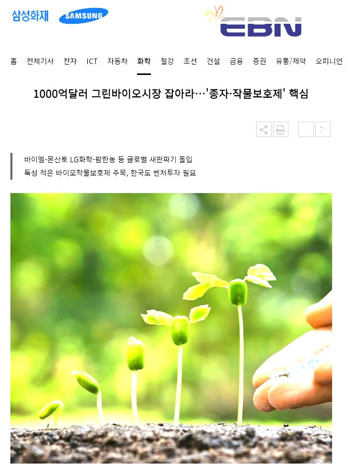

1. 작물보호제정의및구비조건
▸ 작물보호제구비조건

I. 작물보호제(농약) 개관

2. 작물보호제(농약)명칭및구매시확인사항
▸ 작물보호제는개발당시의이름에서판매될때상품명까지여러가지이름으로명명
▸ 논문이나공식적인서류에서는가급적상품명보다는'일반명'이나'품목명'을사용하는것이바람직

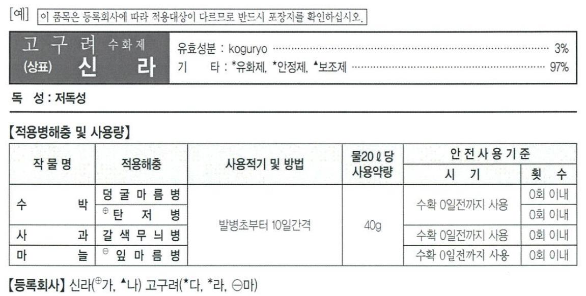

▸ 구매시확인사항
✓ 품목등록번호
✓ 작물보호제(농약)의명칭과제제형태
✓ 유효성분및일반성분의함유량
✓포장단위
✓ 농작물별적용병해충및사용량
✓ 사용방법과시기
✓ 안전사용기준(취급제한기준)
✓ 기타확인: 독성여부, 사람/가축에해로운정도, 수서동물에대한유해정도, 인화나폭발정도, 저장과보관주의사항, 상호와소재지,
약효보증기간등)

I. 작물보호제(농약) 개관

2. 작물보호제(농약) 명칭

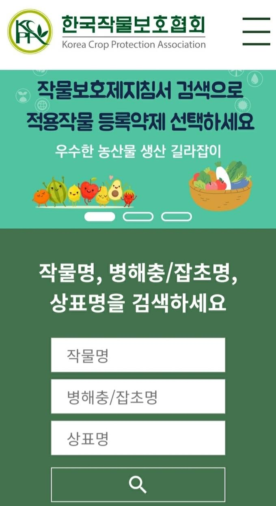

I. 작물보호제(농약) 개관

3. 작물보호제(농약)의작용특성(mode of action) -1
▸ 살균제의기작
✓ 보호살균제: 보르도액과같이예방적인약제
✓ 접촉살균제: 직접살균제에해당
✓ 이행성살균제: 식물체전체/특수부위에이동하여작용하는약제
▸ 살충제의기작
✓ 신경독(유기인제), 원형질독(비소제), 피부독(기계유유제), 호흡독(청산가스), 근육독(데리스제) 등
✓ 시간이지나면약제저항성이생기고해독/분해, 독성증가등의부작용수반
▸제조체의기작
✓ 다양한작용특성: 이행성/접촉형, 선택성/비선택성, 토양처리/경엽처리제등
✓ 다른작물보호제보다'살포농도'와'비산' 중요
✓ 2,4-D (광엽성잡초를제어하는데쓰이는일반적제초제농약) : 페녹시계제초제, 식물호로몬인'옥신(auxin)' 유사체로작용
✓ 아트라진(atrazine) : 트리아진계제초제, 광합성저해
✓ 디우론(diuron) : 요소계제초제, 광합성저해
✓ 알라(alachlor) : 클로아세타닐라이드(chloroacetanilide)계제초제, 분열조직생장억제제, 식물생장조절과정저해

I. 작물보호제(농약) 개관

3. 작물보호제(농약)의작용특성(mode of action) -2
▸ 저항성(resistance)
✓ 살충제의장기사용으로일어나는약제에대한해충의내성
✓ 교차저항성: 어떤특징약제에대해저항성을나타내면서다른종류의약제에서도저항성을나타내는것
▸작물보호제의약해(phytotoxicity)
✓ 약해: 식물에대한작물보호제(농약)가나타내는부작용
✓ 작물의종류/작물보호제특성에따라다양

I. 작물보호제(농약) 개관

4. 작물보호제의유통(circulation of pesticide)
▸ 생산과출하현황

▸ 제형별생산
• 유(액)제40.0% / 수화제32.6% / 입제21.0%, 수용제1.7%, 분제0.6%

I. 작물보호제(농약) 개관

5. 작물보호제(농약)의중요성

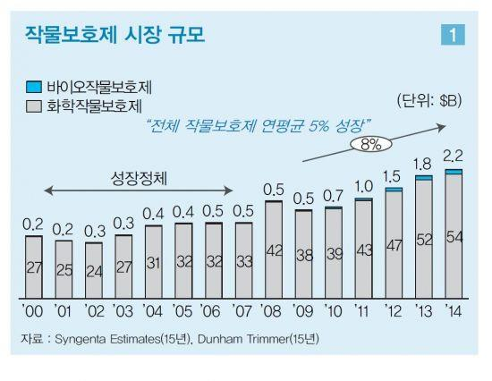

▸ 작물의수확확보, 품질향상기여
▸ 작물종류/재배시기에선택의폭확대
→작부체계변천가능(조기재배, 시비법개선, 직파재배등)
▸작물재배의지역적한계확대
▸ 생산비절감을통한현대농업의발전기여
(참고: 아시아경제, 2018.1.14.)

I. 작물보호제(농약) 개관

6. 작물보호제(농약)의발달사
▸ 작물보호제의시대별역사
✓ 천연산물이용시대(1850년대이전) →무기농약시대(1850~1945) →유기합성농약시대(1945년이후) →무공해농약(생물농약) 개발
시대(2000년이후)
✓저독성농약, 잔류성이적은농약, 천적에해가없는농약, 유인제, 불임제, 기피제, 새울작물보호제등의농약이나곤충생육조절제(해충
행동발육, 생육탈피등조절), 해충호르몬교란제, 성페로몬제, 화학불임제, 항탈피제, 키틴생합성저해제등연구
✓ 생물농약(천적곤충, 천적미생물, 길항미생물등)을이용하여병해충, 잡초방제하는경향발전

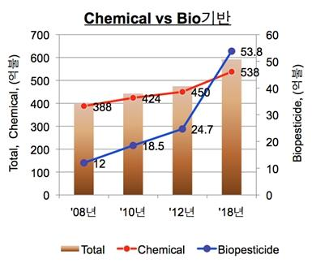

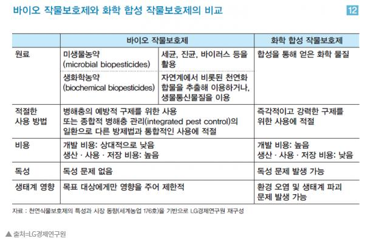

(참고: 농업축산신문, 2012.11.5.)

I. 작물보호제(농약) 개관

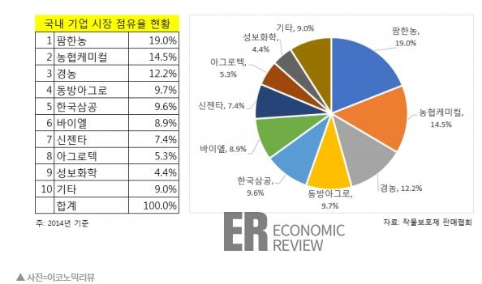

6. 작물보호제(농약)의발달사
▸ 작물보호제(농약) 발달사
✓ 최초기록: 기원전고대메소포타미아지역(수메르, Sumer) -황을직접사용(약4,500년전)
✓ 대략15세기까지: 비소(As), 수은(Hg), 납(Pb) 같은고독성물질이해충방제사용
-천연물/천연유기약제: 고래기름, 겨자기름, 유채기름, 제충국
-천연무기약제: 보르도액, 석회유황합제, 비산연등
✓ 17세기무렵: 니코틴황산화물(nicotine sulfate)이담뱃잎에서추출되어살충제로사용(식물성살충제)
✓ 19세기~ : 식물성살충제(2가지) 발견-제충국(피레트린, pyrethrin), 뉴기니콩과식물(데리스)(로테논, rotenone)
✓ 1941년: 선택성제초제(옥신호르몬페녹시계2,4-D개발)

✓ 1944년: 유기인계살충제(파라티온parathion) 개발등

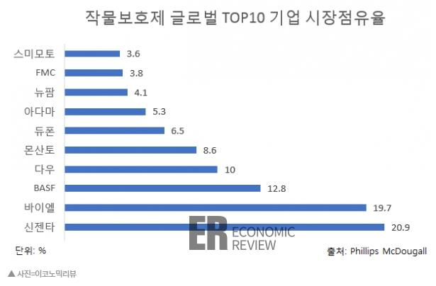

I. 작물보호제(농약) 개관

6. 작물보호제(농약)의발달사
▸ 작물보호제(농약) 발달사
✓ 라첼카슨(Rachel L. Carson, 1962)
• '침묵의봄(silent spring)' 책발간
• 환경문제제기, 농약의생물농축(농약의부작용)거론→환경문제를일반인들에게인식
-(예) 제초제PCP에의한어패류의피해, 현미속유기수은의잔류, BHC의우유속잔류등
• 미국: 유독성농약(DDT 등) 금지

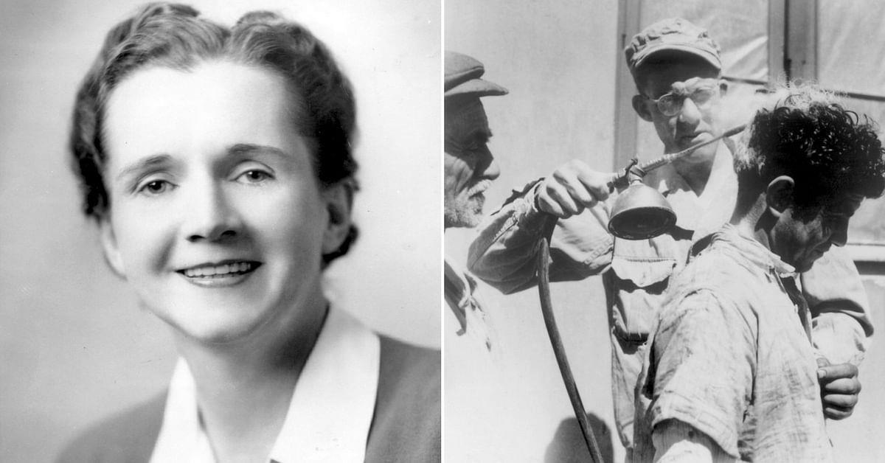

I. 작물보호제(농약) 개관

6. 작물보호제(농약)의발달사
▸ 작물보호제(농약) 유용성
✓ 직접적이익
• 해충, 병, 매개생물방제→식량생산기여: 농축산물양과질개선, 다른지역에서오는침입해충방제
• 인간과가축질병및해로운생물배제: 인간/가축생명보호, 고통을줄여주며질병을지역적통제가능
• 인류활동에문제가되는생물의제거: 전시작전수행원활(고엽제)하게하거나, 산림/수풀/잡초가많은지역개발, 목재건물보호가능
✓ 간접적이익
• 사회적: 이익증가, 영양/건강상태양호해지며, 안정적인식량확보가능

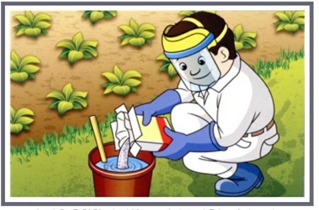

• 국가적: 일자리창출, 수출입관련문제해결(검역-훈증제등)되며, 농업경쟁력향상
• 전세계적: 안정적식량공급, 온실가스저감, 인류불편함감소등

I. 작물보호제(농약) 개관

6. 작물보호제(농약)의발달사
▸ 사용의문제점
✓ 인축/야생동물대한독성출현
• 인류건강위협, 암유발(피부, 눈자극등) : 국내농약으로자살(약1,000여명/년)
✓ 자연환경평형파괴및동식물상단순화
• 살충제/제초제살포: 약95% 이상이환경혹은대상병, 해충이외의생물에살포되어부작용초래→생물다양성감소
✓ 자연환경(공기, 물, 토양등) 오염
• 곤충 등 생물 활동 저해 → 식물 꽃가루 매개(수분) 감소, 서식처 파괴, 보호 대상 종의 생존 위협 등
✓ 농약에대한저항성발현
• 작물보호제에 대한 저항성 출현 → 더욱 많은 양의 농약 살포 야기 → 다시 높은 저항성 유도(악순환) 초래

I. 작물보호제(농약) 개관

6. 작물보호제(농약)의발달사
▸ 화학적방제(농약) 대체
✓ 재배적방제: 다중경작(다양한작물경작), 돌려짓기, 재배시기조절, 저항성작물재배등대체
✓ 생물적방제: 천적, 경쟁종, 페로몬, 미생물(진균, 세균/바이러스), 잡초등사용
✓ 물리적방제: 식물/토양에뜨거운증기/화염이용방법, 빛을이용하는방법등

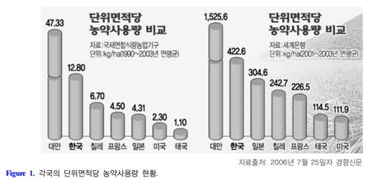

(참고: 김, 2011. 가지과작물대상의친환경농자재개발동향)

II. 작물보호제(농약)의 분류

1. 작물보호제(농약) 사용목적에의한분류
▸ 살균제(fungicide)
✓ 곰팡이를죽이는약제이나, 세균을포함하기도하고세균은살세균제(bactericide)로별도로나타냄
✓ 예방/보호용살균제(보르드액, 동제등), 직접살균제(석회유황합제등), 종자소독제(벤레이트티등), 토양소독제(클로로피크린등),
농용항생제(스트렙토마이신등)

| 구분 | 설명 |
| --- | --- |
| 보호살균제 | • 병균의포자가엽경에침입하기전에사용해서예방적효과를거두기위한약제• 보르도혼합액,결정석회황합제,구리분제등 |
| 직접살균제 | • 식물에침입하여있는병균에직접작용시켜살균시키는약제 |
| 종자살균제 | • 종자또는모를약제에침지하거나약제의분말을묻혀서살균시키는약제• 베노밀,티람수화제등 |
| 토양살균제 | • 토양중의유해균을살균시키기위한약제 |

II. 작물보호제(농약)의 분류

1. 작물보호제(농약) 사용목적에의한분류
▸ 살충제(insecticide)

|  | 구분 | 설명 |  |
| --- | --- | --- | --- |
|  | 소화중독제(식독제) | • 해충이약제를먹으면중독을일으켜죽이는약제• 씹어먹는입을가진나비류유충,딱정벌레류,메뚜기류에해당• 비산납등대부분의유기인계살충제해당 |  |
|  | 접촉제 | • 해충체에직접약제를부착시켜죽이는약제,깍지벌레,진딧물,멸구류에적당• 제충국제,니코틴제,데리스제,송지합제,기계유유제등 |  |
|  | 침투성살충제 | • 식물의일부분에처리하면전체에퍼져즙액을빨아먹는흡즙성해충을살해하는약제• 천적에대한피해가없음• 수간주사(솔잎혹파리,솔껍질깍지벌레),엽면살포(진딧물류),근부처리(솔잎혹파리,응애류)에사용 |  |
|  | 훈증제 | • 약제를가스상태로만들어해충을죽이는약제• 토양에주입하여선충방제용으로이용(메틸브로마이드훈증제) |  |
|  | 훈연제 | • 약제를연기상태로만들어해충을죽이는약제(아세타미프리드훈연제) |  |
|  | 유인제 | • 해충을독성이있는먹이등에유인하는약제• 휘발성과방향성인발효물질,성유인제페로몬등 |  |
|  | 기피제 | • 해충이모여들지않게사용되는약제 |  |
|  | 불임제 | • 해충의생식세포형성에정해를주거나정자나난자의생식력을잃게하는약제 |  |
|  | 점착제 | • 나무의줄기나가지에발라해충의월동전후이동을막기위한약제 |  |
|  | 생물농약 | • 살아있는미생물,천연에서유래된추출물등을이용한생물적방제약제 |  |

II. 작물보호제(농약)의 분류

1. 작물보호제(농약) 사용목적에의한분류
▸ 제초제(herbicide)
✓ 잡초를방제하는약제, 농도/선택성중요
✓ 종류
• 선택적제초제: 잡초를골라서죽이는성질(2,4-D 등)
• 비선택적제초제: 식물전멸약, 접촉성제초제등

| 구분 | 설명 |
| --- | --- |
| 선택성제초제 | • 2,4-D등과같이화본과식물에안전하고광엽성식물만제거하는데사용되는약제 |
| 비선택성제초제 | • 약제가처리된전체식물을제거하는약제.• 글리포세이트등 |

▸ 살비제(Acaricide) : 진딧물/응애를죽이는약. 살충제가잘듣지않는해충인응애류방제시사용
▸ 살선충제(Nematocide) : 선충을방제하는약제. 식물체속에있으므로수간주사(소나무재선충등), 토양처리, 훈증처리등
▸ 살서제(Rodenticide) : 소동물인쥐를퇴치하는악제

II. 작물보호제(농약)의 분류

* 작물보호제시장

(참고: 정과명. 2012. 세계작물보호제시장의현황과전망)

II. 작물보호제(농약)의 분류

* 작물보호제시장

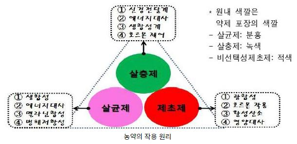

(참고: 농진청(농사로))

II. 작물보호제(농약)의 분류

1. 작물보호제(농약) 사용목적에의한분류
▸보조제(Adjuvant)
✓전착제(spreader) : 작물보호제의주성분을식물체나병해충에잘전착시키기위하여스이는약제(농용비누, 계면활성제등)
✓증량제(diluent) : 분제에있어서주성분의농도를낮추기위하여쓰이는약제(탈크, 벤토나이트)나유제, 수화제를일정한살포농도로만들때쓰이는물등
✓용제(solvent) :농약의유효성분을녹이는데쓰이는약제(benzene, xylene 등)
✓유화제(emulsifier) : 유제의유효성을높이는데쓰이는약제(계면활성제)
✓협력제(synergist) : 유효성분의효력을증진할목적으로쓰이는약제, 효력증진제. 약제의적용을도와주는약제
▸식물생장조절제(Plant growth regulator, PGR)
✓식물키조절, 개화/과실의성숙과같은생장조절하는호르몬
▸살금제(Avicide) : 새를제거하는약제
▸살슬제(Pediculcide) : 이(lice)를죽이는약제. 살조제(algicide) 는조류를제거하는약제

II. 작물보호제(농약)의 분류

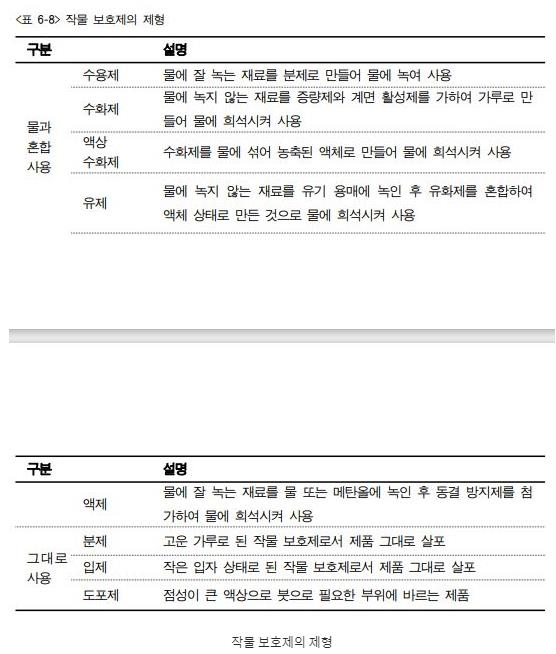

2. 사용형태별종류: 기상/환경/작물에따라다양한형태로처리할수있도록제형이만들어져있음.
▸액제(Liquid) : 용제, 유제, 수화제등
▸분제(Dust) : 가루로만들어진제재
▸가스제(Fumigant) : 기체로만들어진약제
▸연무제(Aerosol) : 액체이나분무시미세한액체인미스트(mist) 상태로분무되도록만든약제
▸도포제(Liniment) : 연고(ointment)처럼바를수있도록만든약제

II. 작물보호제(농약)의 분류

3. 화학조성및구조에따른분류
▸무기농약(Inorganic pesticide): 무기화합물을주성분으로하는농약. 생석회, 소석회, 황산구리, 유황, 석회황합제등
▸유기농약
✓천연유기농약(natural organic pesticides) : 천연유기농약과대부분의화학농약
✓유기합성농약: 유기화합물을주성분으로하는작물보호제
•유기인계농약(organic phosphorous pesticides)
•카바메이트계농약(cabamatepesticides)
•유기염소계농약(organochloride pesticides)
•유기황계농약(organosulfur pesticides)
•유기비소계농약(organoarsenicpesticides)
▸그외에, 유기불소계, 트리아닐계(triazine), 페녹시계(phenoxy), 우레아계(urea) 계등다양

II. 작물보호제(농약)의 분류

4. 보조제의종류
▸계면활성제(Surfactant)
✓동일분자내에친수성기과소수성기갖음
✓계면(기체-액체, 액체-액체, 액체-고체)의성질교환효과
✓작용: 습윤작용(wetting property), 분산작용(floatability), 침투작용(penetrating property), 세정작용(washing property), 고착작용(adhesive property)등
✓역할: 주성분과물사이에서주성분을보다작은알맹이상태로부유시키는일, 주성분끼리의응집방지기능
▸용제(Solvent)
✓유효성분이나다른보조제를잘녹이고유효성분을분해시키지않으며, 작물에약해를일으키지않는용매류(탄화수소류, 할로겐화탄화수소, 알코올류, 케톤류,
에테르류, 아미드류등)
▸ 고체증량제(Carrier)
✓입제, 분제등고형제등의조제에쓰이는무기광물성분에는규조토, 활석, 산성백토, 석회분말, 카오린(kaolin), 벤토나이트(bentonite), 제올라이트(zeolite) 등
▸ 고착제(Sticker) : 유효성분이작물에잘부착하게하는것. 카세인(casein), 젤라틴(gelatin), 아교, 고무질수지, 폴리비닐알코올등
▸ 안정제(Stabilizer) : 작물보호제의저장중또는살포후에유효성분이분해하는것방지. 방향족아민류, 고급지방산등
▸ 분사제(Propellent) : 연무제제제에있어서분무의압력을주기위하여쓰이는물질. 할로겐화탄화수소등

II. 작물보호제(농약)의 분류

5. 작물보호제제형분류

II. 작물보호제(농약)의 분류

5. 작물보호제제형분류
▸약상제형(Liquid Type Formulation)
✓유제(Emulsifiableconcentrate; EC) : 주제의성질이지용성. 물에녹지않을때유제를유기용매에녹여유화제를첨가한용액
✓액제(Soluble concentrate; SL) : 주제가수용성. 가수분해의우려가없는경우에주제를물에녹이고동결방지제를가하여제제화한것
✓수용제(Soluble powder, SP) : 수용성의유효성분(10% 이상의물용해성이있어야함)을수용성인증량제로희석하고분상또는입상의고체로제제화한것
✓수화제(Wettablepowder, WP) : 물에녹지않는주제를카오린(kaoline), 벤토나이트(bentonite) 등의점토광물과계면활성제, 분산제를배합하고혼합분쇄하여
제제화한것
✓유탁제(Emulsion water, EW) : 유제에사용된유기용제를줄이기위해, 소량의소수성용매에원제를용해시키고유화제를사용하여물을유화시켜만든제형
✓미량살포제(Ultra Low Volume Spray, ULV) : 유효성분을용제에녹여서(60% 이상) 만든제제. 현재공중살포용으로사용

| 제형 | 문제점 | 개선방향 | 가능한제형 |
| --- | --- | --- | --- |
| 유제 | 독성약해인화 | 용제를물로교체 | 미탁제(ME제)유탁제(EW제) |
| 수화제 | 분진 | 물에현탁입상화수용성팩 | 액상수화제입상수화제 |
| 입제 | 노동력물류비환경 | 고농도제조경량화동시방제 | 점보제소포장육묘처리용제재 |

II. 작물보호제(농약)의 분류

5. 작물보호제제형분류
▸고상제형(Solid Type Formulation)
✓분제(Dusts): 유효성분을탈크(talc), 점토광물등이고체중량제와소량의보조제를혼합분쇄한미분말. 살충제/살균제에많이사용
✓DL 분제(DriftlessDust, DL): 보통분제에서매우가는10um이하의미분분제를제거하고20~30um의부분이중심으로된새로운형태의분제
✓플로어더스트제(Flow Dust, FD) : 미분쇄로된분제(평균입경2um)로서, 하우스내의시설재배에있어서병해충방제를목적으로하여개발된것
✓입제(Granule, GR): 유효성분을고체중량제와혼합분쇄하고보조제로서고결제, 안정제, 계면활성제를가하여입상으로성형하거나입상으로담배에유효성분을
피복시킨것

✓미립제(Micro-Granule (MG), Fine Granule (FG)): 분제의결점인표류비산을적게할목적으로개발된것(입경62~210 um)
✓캡슐제(Encapsulate Granule, CG): 농약원제를고분자물질로피복하여고형으로만들거나캡슐에넣어만든제형. 가격이비쌈.

II. 작물보호제(농약)의 분류

5. 작물보호제제형분류
▸특수제형(Special Type Formulation)
✓훈증제(Fumigant) : 비등점(끊는점)이낮은작물보호제의주제를액상, 고상또는압축가스의형태로용기내에충전한것
✓훈연제(Smoking Agent) : 유효성분과발열제를종이에흡착시키거나캔에넣어서불을붙이면유효성분이연기와함께공중에분산. 주로시설원예재배포장사용
✓연무제(Aerosol) : 유효성분을용제, 분사제등과봄베(bombe)에충진시킨것. 압력을가하여공기중에분출시켜서사용하기위한제제
✓도포제(Paste) : 작물보호제를호상으로한제제. 살서제, 훈연제나수목의수간등에바름.

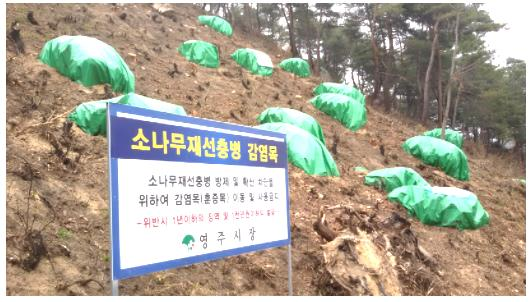

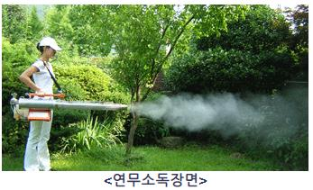

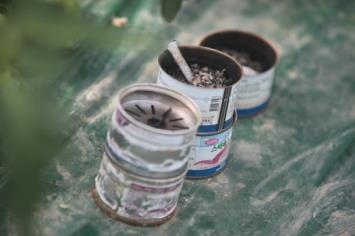

훈증제의예 훈연제의예

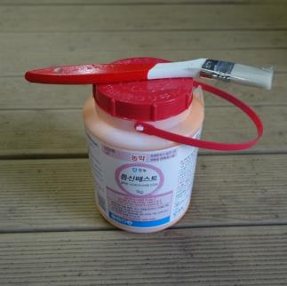

도포제의예

II. 작물보호제(농약)의 분류

6. 살포액(액상제제)물리적성질
▸유화성(Emulsifiability) : 유제(원액)를물에가한경우기름입자가균일하게분산하여유탁액(emulsion)으로되는성질
▸습전성(Wetting property) : 살포한약액이작물/해충표면을잘적시고퍼지는성질
▸표면장력(Surface tension) : 공기가접하는계면에서계면장력(적당량의계면활성제를첨가하여표면장력을낮춤)
▸접촉각(Angle of contact) : 정지액체의자유표면이고체와접하는부분에서액면과고체면이이루는각도. 계면활성제를첨가하여접촉각이작아짐→약제흡수증가

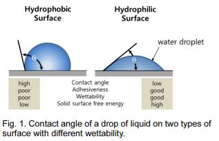

참고: 장가등(2018)
▸현수성(Suspensibility) : 수화제의현탁액에서고체입자가균일하게분산부유하는성질과그안정성의미
▸부착성(Adhesiveness, 고착성) : 살포한약액이식물체나충체에붙는성질
-고착성: 부착한약제가이슬이나빗물에씻겨내리지않고, 식물체표면에붙어있는성질
▸침투성(Penetrating property) : 살포된약제가식물체나충체에스며드는성질(일반적으로침투성이강한약제는약해가일어나기쉬움)

II. 작물보호제(농약)의 분류

* 농약의살포방법별분류

| 구분 | 설명 |
| --- | --- |
| 살포위치별 | • 지상살포,공중살포,수면살포 |
| 살포목적별 | • 경엽처리,토양처리,수면처리 |
| 살포형태별 | • 분무법,미스트법,스프링쿨러법,폼스프레이법,살분법,살립법,공중살포법,수면시용법,훈연법,훈증법,관주법,침지법,도말벌,도포법,독이법 |

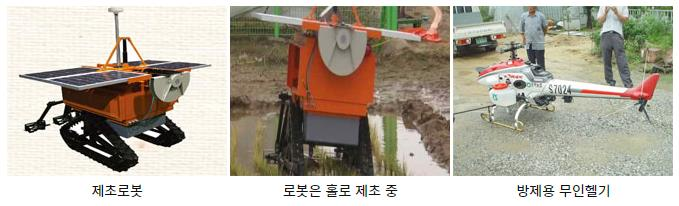

참고: 농진청(농약안전정보시스템)

II. 작물보호제(농약)의 분류

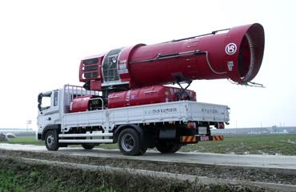

* 농약의살포기구
▸살포기의구비요건
✓부착성: 목표로하는작물에효과적으로부착되어야함.
✓균일성과집중성: 균일하게살포되어약효가높고약해가없어야함.
✓도달성: 약제살포시목표로하는거리까지도달이양호하여하며, 작업의능률이높아야함
✓경제성: 방제가효과적이며약액및동력의손실이없어야함.
▸살포입자의크기

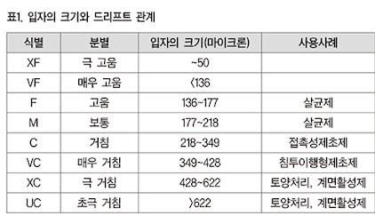

✓입자가작을수록, 같은양으로넓은면적을살포할수있음.
✓입자가작을수록, 부착이잘됨.
✓입자가작을수록, 증발하기쉬움.
✓입자가작을수록, 주변공기를따라비산및이동하기쉬움.

III. 작물보호제(농약)의 독성과 안전사용

1. 농약의약해
▸농약에의한작물의약해
✓약해(phytotoxicity) : 처리된약제에의해서작물이생리상태에이상을일으켜나타나는해작용
→작물조직의파괴, 작물의증산/동화/호흡작용등의대사생리기능방해→정상적인생육저해
✓약해는발생하는기간과나타나는정도에딸, 급성적인약해와만성적인약해로구분

| 구분 | 설명 |
| --- | --- |
| 급성약해 | • 농약살포후,1~2일또는1주일이내에발아,발근불량,잎이마르거나위축,낙엽,낙화,낙과등피해증상이가시적으로나타나는것• 대체로결정석회황합제,보르도혼합액,기계유유제,동제등과같은무기농약이나2종이상농약의잘못된혼용으로발생 |
| 만성약해 | • 농약 살포 후 1주일 이후부터 식물체의 영양생장,화아형성, 과실의 발육등에 영향을 주어 정상적인 생육 및 비대 불량, 수량 감소 및 품질 저하등의피해증상이느리게나타나기시작함• 대부분유기합성농약에의해발생 |
| 2차약해 | • 포장에처리한농약성분이토양,농업용수등환경에잔류하여후작물재배시에피해를주는경우 |

III. 작물보호제(농약)의 독성과 안전사용

1. 농약의약해
▸작물약해의주요증상
✓경엽(잎/줄기)에나타나는증상
•백화(chlorosis) : 잎의엽록소파괴. 잎전체, 엽맥/그주변등여러부위에발생
•괴사(necrosis) : 기관, 조직, 세포등과같은생체의일부가죽는것. 독특한색깔을띠며잎의다양한부분에서관찰
•낙엽및기형잎: 낙엽은잎이붙어있는부분의이층세포가박리되거나세포의붕괴로발생. 기형잎은잎이오그라지는등부분적인생장정지에따라발생
✓꽃및과실에나타나는증상

•꽃/과실은대부분그자체가상품→약해로인한경미한증상이라도문제가될수있음.
클로로시스: 황화
네크로시스: 괴사
•꽃에나타나는약해: 개화지연, 꽃잎의반점등
•과실에나타나는약해: 낙과, 기형과의형성, 과피의반점, 착색저해등
✓뿌리에나타나는증상
•발근저해, 기형근, 갈변, 비대억제, 길이및무게감소등
•발근저해, 기형근/갈변: 주로토양처리제농약이뿌리에직접작용하기때문에발생
참고: 농진청(농약안전정보시스템)

III. 작물보호제(농약)의 독성과 안전사용

1. 농약의약해
▸약해유발의원인
✓농약자체에원인이있는약해
•농약의물리성, 원제부성분과불순물의혼합, 농약제조시사용되는용제의종류, 농약의경시적변화에의한유해성분의생성등
✓농약의오용으로발생하는약해
•고농도농약의과량살포, 농약의불합리한혼용, 농약의근접살포등
✓농약사용후의특성에의한약해
•표류비산, 휘산, 농약의유실, 잔류, 농약의대사및분해산물
✓작물의특성에따른약해
•작물의종/품종간의차이, 작물형태, 재배환경조건, 생장단계, 생리적특성
✓환경조건에따른약해
•기온, 습도, 일조, 토양
✓농약희석용수의불량으로인한약해
•알칼리성용수/오염된물을희석용수로사용→유효성분분해촉진→약효감소, 약해유발

III. 작물보호제(농약)의 독성과 안전사용

2. 급성독성(Acute Toxicity)
▸급성독성의강도: 흡입독성(inhalation toxicity)이가장강하고경구(oral) 독성, 경피(dermal toxicity) 독성순
▸강도비교: 생쥐, 쥐의동물을공시하여경구, 경피적으로투여하거나피하, 복강또는정맥에주사하고1주일이내에발생하는죽은개체수조사→체중1kg당
반수치사량(medium lethal dose, mg (LD 50 mg/kg)으로표시
3. 만성독성(Chronic Toxicity)
▸아급성독성(Subacute toxicity) : 수주~3개월간실시, 측정, 조사
▸만성독성(Chronic Toxicity) : 쥐나생쥐등의소동물은전생애에걸쳐실시. 개/원숭이등의대동물은수명의1/10 정도의장기간에걸쳐실시하여기타
발암성(carcinogencity) 등시험

참고: 농진청(농약안전정보시스템)

III. 작물보호제(농약)의 독성과 안전사용

* 농약독성의구분
* 독성표시기호

| 구분 | 독성 | 의미 |
| --- | --- | --- |
| 발현대상 | • 포유동물독성 | • 사람이나포유동물에대한독성 |
|  | • 환경생물독성 | • 생태계유용생물(물고기,새,꿀벌,지렁이,누에등)에대한독성 |
| 발현속도(발현시기) | • 급성독성 | • 일시에다량의농약에노출되었을때나타나는독성 |
| (발현시기) | • 만성독성 | • 소량의농약이장기간에걸쳐노출시나타나는독성 |
| 독성강도 | • 맹독성 | • WHO농약구분Ia(Extremelyhazardous) |
|  | • 고독성 | • WHO농약구분Ib(Highlyhazardous) |
|  | • 보통독성 | • WHO농약구분II(Moderatelyhazardous) |
|  | • 저독성 | • WHO농약구분III(Slightlyhazardous) |
| 투여방법(투여경로) | • 경구독성 | • 입을통하여체내침투하여발현되는독성 |
| 투여방법 (투여경로) | • 경피독성 | • 피부를통하여체내침투되어발현되는독성 |
|  | • 흡입독성 | • 호흡을통하여체내침투되어발현되는독성 |

| 표기 | 의미 |
| --- | --- |
| • LD (MedianLethalDose)50 | • 반수치사약량 |
| • LC (LethalConcentration50)50 | • 반수치사농도 |
| • ED (EffectiveDose50)50 | • 반수영향약량• 그 50%의 동물에 유효하다고 추정되는용량 |
| • EC (EffectiveConcentration50)50 | • 반수영향농도 |

III. 작물보호제(농약)의 독성과 안전사용

* 농약안전성평가항목및검토사항

참고: 농진청(농약안전정보시스템)

III. 작물보호제(농약)의 독성과 안전사용

4. 중독사고의예방
▸각종작물보호제의팸플렛이나사용설명서에나오는안전수칙준수
▸작물보호제살포시, 다량의악제를흡입하거나물에부착되지않도록주의
-노출이적은작업복착용
-마스크, 방호안경, 보호크림사용
-바람을등지고살포
-장시간의작업을피하고작업종료후바로몸을씻고, 옷을갈아입고충분한휴식
▸하우스내에살포하는작물보호제: 되도록저독성농약사용. 훈연/훈증은해질무렵에한후다음날까지는들어가지말아야함
▸농약을잘못마시거나사용하므로인한중독/자살/타살을예방하기위해, 농약보관및관리철저(음료수병이나부엌근처에두는것은위험)
▸중독시에는가능한한빨리의사의진단을받고당시사용한농약의명칭을정확히의사에게전달

III. 작물보호제(농약)의 독성과 안전사용

5. 농약의중독과해독법
▸농약의안전사용
✓농약사용자의준수사항
•고독성농약은관상식물에한하여, 식용작물에는살포를금지. 사용후14일간출입이나수확금지
•고독성농약은사용직전조제, 살포자의입이나피부에흡수되지않도록3시간이상연속작업금지
•노역자, 음주자연소자등은살포를하지않도록하며, 바람을등지고목적외사용금지
▸중독증상의관찰과응급조치
•중독증상
-피부와눈이화상이자극으로가렵거나땀이흐르고동공이수축이나팽창됨.
-전신이무기력함. 신경계가두통이나현기증이오고근육경련이나비틀거림현상
-소화계이상으로복통, 설사가나고구역질이나과도한침분비
-호흡계가이상이생겨호흡곤란, 기림, 흉통동반

III. 작물보호제(농약)의 독성과 안전사용

6. 작물보호제별중독과치료

| 구분(중독) | 유기인제(Organophosphate) | 유기염소제(Organocholine) | 유기불소제(Organic Fluoro-Compound) | 유기수은제(Organic MercuryCompound) | 카바메이트제(Carbamate) | 비소화합물제(ArsenicalCompound) | 클로로피크린(Chloropicrin) | 니코틴제(Nicotine) | 메틸브로마이드(Methyl Bromide) |
| --- | --- | --- | --- | --- | --- | --- | --- | --- | --- |
| 원인 | 입/기도흡수→조직/혈액영향 | 입/기도흡수→잔류성이크고지용성으로인체의지방조직축적 |  |  |  |  |  |  |  |
| 증상 | 부교감신경자극작용(무스카린작용),마비(니코틴), 발열과중추신경계증상 | 국부적마비/경련동반, 구토, 불안불쾌감 | 구토, 식욕부진, 경련,호흡이상, 심장급박 | 오심, 구토, 복통, 설사, 구내염, 신염, 피부염 | 신경세포중에아세틸콜린축적→흥분과침분비, 경련등 | 오심, 구토, 동통, 설사, 경련 | 눈물, 콧물, 오심, 호흡이상, 각막혼탁,폐수종 | 입, 목구멍이타는것같고, 복통, 두통, 하리, 땀이나고시청각의혼란, 호흡촉진,혈압상승등 | 구토, 두통, 오심, 피로감, 경련, 평형장애와정신이상, 혼미허탈증상 |
| 치료 | 프랄리독심,아트포린주사 | 염류하제를주고,피부/위세척 | 강심제로옥시피린,캄파등정맥주사 | 다이메르카프롤근주주사, 수은배설제로요오드칼리섭취 | 아트로핀황산주사 | 다이메르카프롤근주주사 | 피부나눈에들어가지않도록바로씻으며눈은2% 중조액으로세척 | 0.5% 타닌산용액,또는5000배과망간산칼리용액으로위세척 | 신선한공기흡입, 가압산소흡입 |

III. 작물보호제(농약)의 독성과 안전사용

7. 작물보호제잔류와안전사용
▸1일섭취허용량(Acceptable Daily Intake, ADI)
✓실험동물에매일일정량의작물보호제를혼합한사료를장기간(약2년) 투여→2세대이상에걸쳐서후대에미치는영향조사
✓건강에영향이없는양을계산한후다시적어도100배의안전계수를곱하여산출한갓
✓사람이어떤약물을평생걸쳐서섭취해도현재의독물학적으로장해를받지않는1일당최대량
▸잔류허용한계(Maximum Residue Limit, MRL)

III. 작물보호제(농약)의 독성과 안전사용

8. 토양중농약잔류성요인

| 구분 | 설명 |
| --- | --- |
| 농약특성 | • 화학적안정성,미생물안정성,토양흡착성,휘발성,용해성등→잔류기간에영향 |
| 농약처리방법 | • 제형에따라처리방법이달라지고잔류기간에차이발생• 한가지농약의연용처리→처리한농약을분해하는미생물의활성증가→농약의분해속도증가 |
| 농작물재배방법 | • 작물의종류/생육상태,비료/퇴비의사용,관개여부등→토양의이화학적특성과연계되어잔류성결정 |
| 기상조건 | • 높은지온→미생물황성왕성→농약분해촉진• 높은기온/바람→농약의휘발촉진→소실빠름• 강우→토양중의농약을용탈및제거→미생물활동왕성→농약분해촉진 |
| 토양특성 | • 높은유기물함량→미생물활동왕성→농약분해촉진• 강한흡착성농약:부식에강하게흡착되어분해느림. |
| 농약이동성 | • 증기압이높은농약/음이온을나타내는농약은이동이용이 |

III. 작물보호제(농약)의 독성과 안전사용

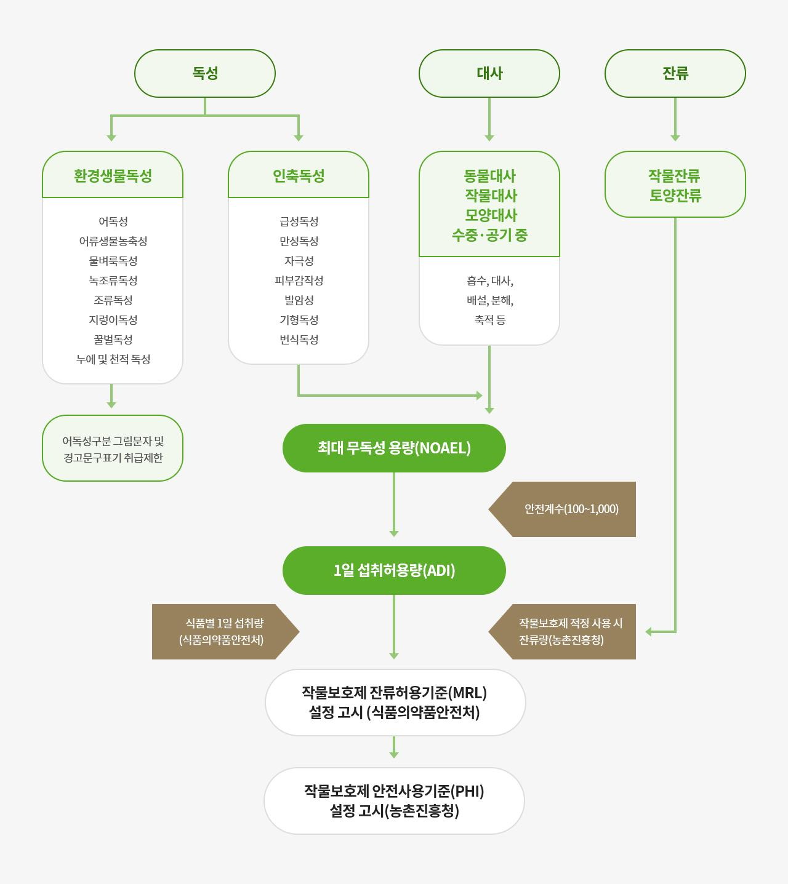

* 작물보호제안전사용기준설정체계(팜한농참조)

III. 작물보호제(농약)의 독성과 안전사용

* 농약허용기준강화제도(PLS, Positive List System)
-작물보호제를지금보다더욱신중하게사용해, 더안전한농산물을생산할수있도록관리하는제도
-등록되지않은농약은원칙적으로사용을금지하는제도
-(기존) 잔류허용기준(MRL, Maximum Residue Limits)이설정되지않은작물보호제에대해잠정기준을적용
→(PLS) 잠정기준을없애고, 기준이없을경우일률기준인0.01 ppm 을적용하는것, 잔류허용기준이설정된작물보호제외에는사용을금지하는제도
* 0.01 ppm : 국제대회가열리는큰규모의수영장에물을가득채우고, 작물보호제한숟가락반정도넣었을때의농도

참고: 농진청(농사로)

