# kocw_식물보호학_05

|  | 2021년도 2학기 - 식물보호학농림해충 - 1 (외/내부 구조 및 기능) |
| --- | --- |

| 2021년도 2학기 - 식물보호학 |
| --- |
| 농림해충 - 1 (외/내부 구조 및 기능) |

강의 내용

▸ 농업 곤충
▸ 곤충의 생태
▸ 곤충의 형태와 구조

I. 농업 곤충(Agricultural insect)

1. 곤충의특징과분류

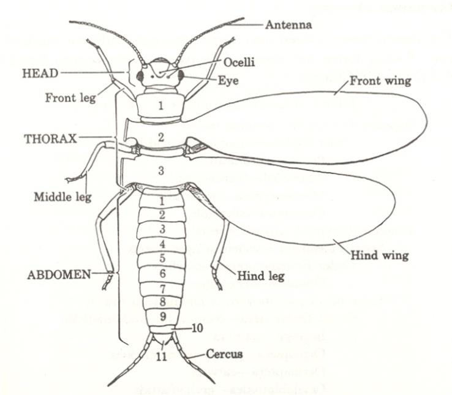

▸ 곤충의특징
✓ 외골격: 몸을보호
✓ 발달한날개: 종족생존및분산도움
✓ 작은몸크기: 소량의먹이라도활동에지장이없고적을피하기쉬움
✓ 몸: 구조적인적응력이좋고변태를하여불량환경에적응
▸ 곤충의구성
✓ 머리, 가슴, 배
✓ 머리: 1쌍의촉각(antenna), 1쌍의겹눈(compound eye), 1~3개의홑눈(ocellus), 구기(mouthparts)

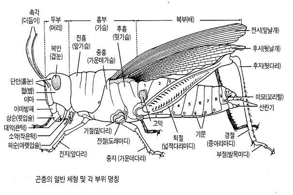

✓ 가슴: 3쌍의다리, 2쌍의날개
✓ 배: 다수의마디

I. 농업 곤충(Agricultural insect)

2. 곤충의분류
▸ 곤충분류의기본단위
✓ 종이나일반적으로강(class)부터분류
✓ 분류의순서: 강(class), 목(order), 과(family), 속(genus), 종(species)
✓ 목(order)의분류: 입/날개진화정도, 날개의모양, 변태방식및진화정도

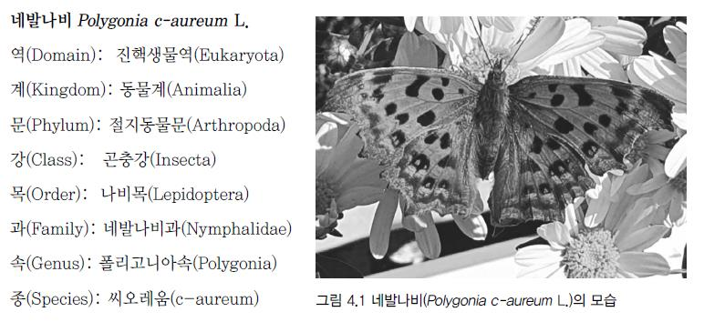

I. 농업 곤충(Agricultural insect)

2. 곤충의분류
▸ 곤충의분류요소: 날개유무, 변태형태, 날개접기여부등
✓ 날개유무
• 무시아강(apterygota) : 원래날개가없는곤충
• 유시아강(pterygota) : 날개를가지고있지만2차적으로퇴화되어없는것도있음.
✓ 변태형태
• 외시류(exopterygota) : 불완전변태를함

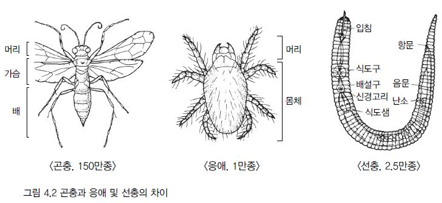

• 내시류(endopterygota) : 완전변태를함
✓ 날개접기여부
• 고시류(paleoptera) : 날개를접을수없음
• 신시류(neoptera) : 날개를접을수있음

I. 농업 곤충(Agricultural insect)

I. 농업 곤충(Agricultural insect)

3. 곤충의분포상

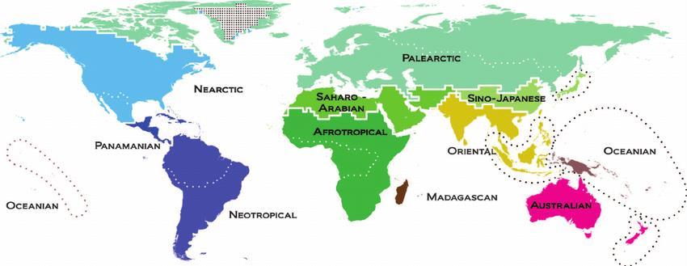

II. 곤충의 생태

1. 곤충의생활사
▸ 곤충의일생

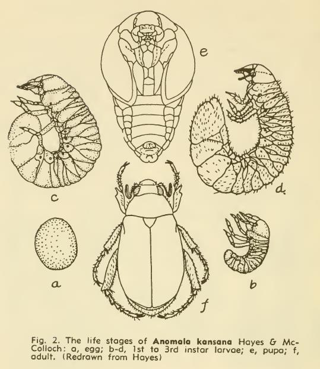

✓ 성충이교미를하고산란→유충으로바뀌어서발육(번데기시기를거치는것도있음)
(1세대를끝내는일수는종류에따라다름: 딱정벌레류2~3년)
✓ 알~성충에까지이르는것은아주적음: 환경조건(저온, 건조등), 천적등의영향을받음

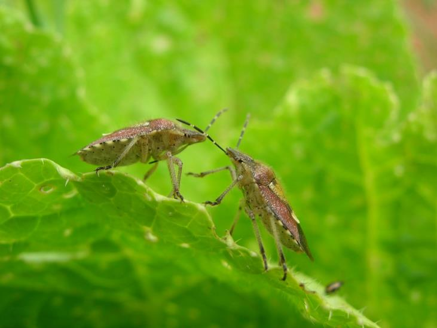

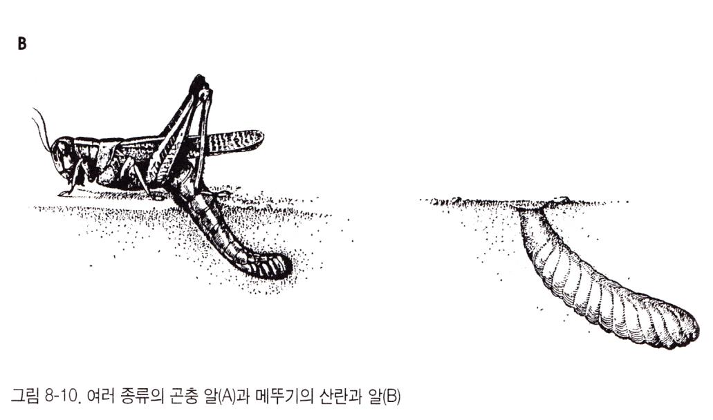

Chu, 1949
(How to know the immature insects)

II. 곤충의 생태

1. 곤충의생활사
▸ 곤충의발생경과
✓ 곤충발육은'온도'에의해크게의존
• 유효적산온도: 생물이일정한발육을완료하는데필요한측정온도의총열량
-곤충의발육상태, 발육속도등을예측가능

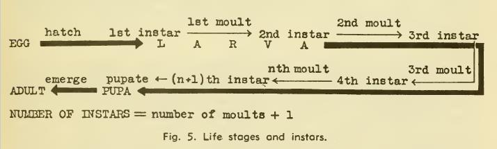

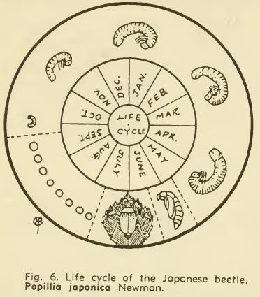

Chu, 1949
(How to know the immature insects)

II. 곤충의 생태

1. 곤충의생활사
▸ 곤충의발생경과
✓ 용화의종류

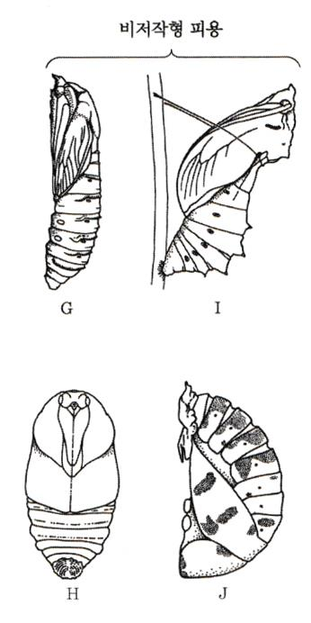

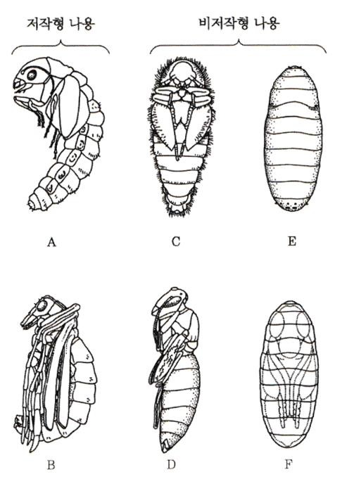

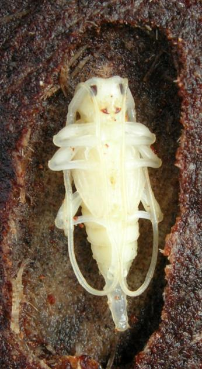

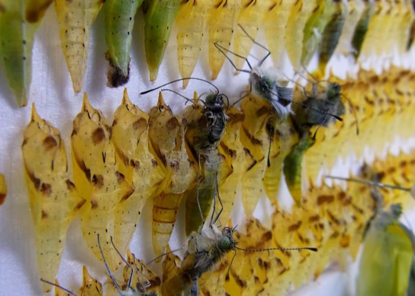

II. 곤충의 생태

1. 곤충의생활사

▸ 변태(metamorphosis)
✓ 알에서부화한유충은성충과형태가다름
✓ 여러차례탈피를거듭한후에성충으로변함= 변태
✓ 알에서나온유충= 제1령/ 1회탈피한것= 제2령등
✓ 유충기는일생을통하여가장현저한성장을하는시기
불완전변태 완전변태

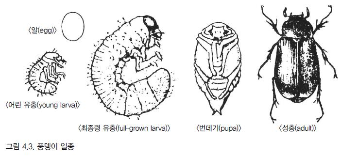

II. 곤충의 생태

1. 곤충의생활사
▸ 변태(metamorphosis)
✓ 곤충의번데기

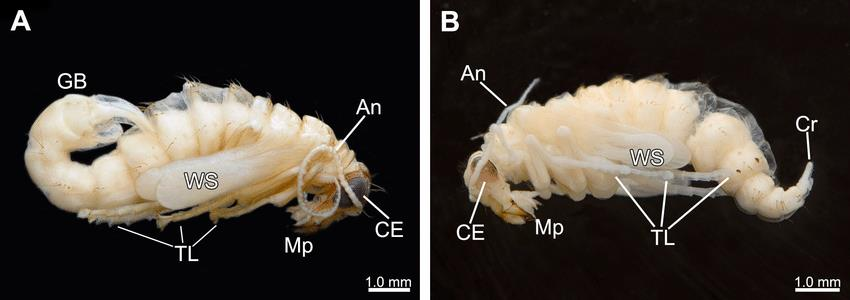

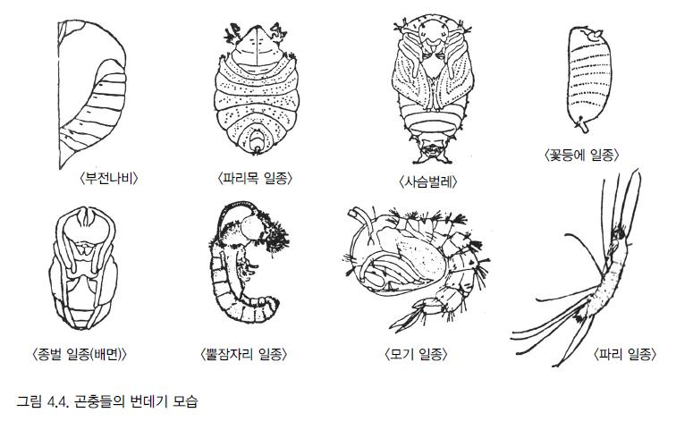

밑들이목의저작형나용
하늘소과의
비저작형나용

II. 곤충의 생태

2. 곤충의행동습성: 서식장소에따라, 육서/수서로구분
▸ 곤충의식성
✓ 대부분곤충식물질섭식/ 그외썩은것을먹는것/ 동물질을먹는것
✓ 일반적으로유충시기에많이먹고(특히노령유충), 성충이되면그다지먹지않음.
✓ 곤충이먹는식물범위가넓고적은것도주의할문제→농작물의윤작(돌려짓기)을하는것이중요함

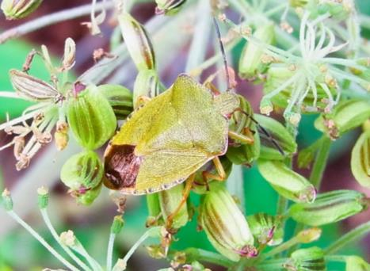

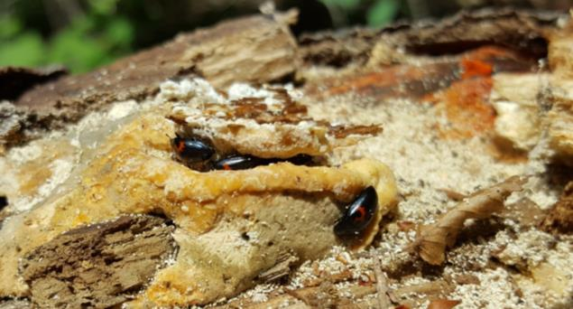

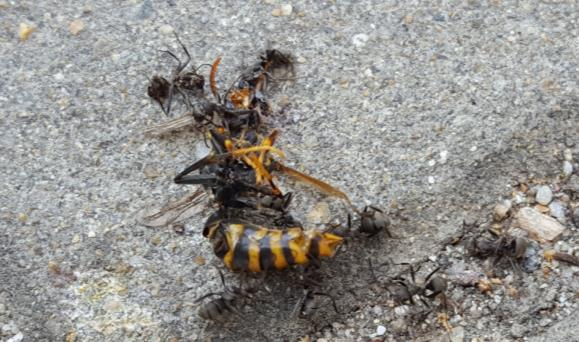

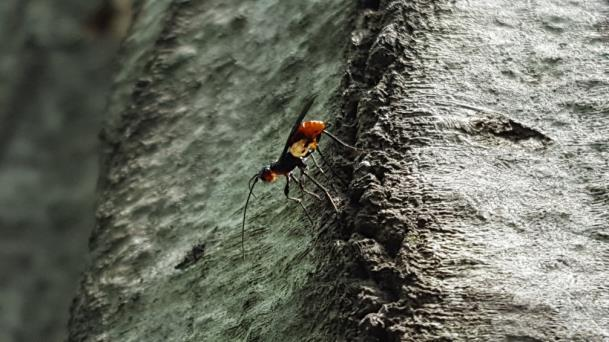

II. 곤충의 생태

2. 곤충의행동습성: 서식장소에따라, 육서/수서로구분
▸ 주성과일주활동

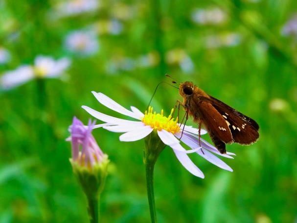

✓ 일주활동: 나비는주로주간활동성/ 나방야간활동성
• "일주활동" : 1일중에있어서활동의주기
-배추흰나비: 봄이면온도가높은낮에많이비행/여름에는아침과저녁에많이활동
-줄점팔랑나비: 여름더운날에는아침과저녁활동/ 가을에는정오전후가장활동왕성
→주간활동성의종은'기온'에지배되는것이많지만, 종류에따라서일조등이지배조건으로작용
줄점팔랑나비
• 야간활동성인종류들은어두워진다는것이크게자극→활동성결정

✓ 주성(taxis) : 동물이어떤자극을받고몸을자극이미치는방향으로움직이거나물러나는성질
• 주광성, 주화성, 주수성, 주촉성, 주류성, 주풍성, 주지성, 주열성등으로분류

II. 곤충의 생태

2. 곤충의행동습성: 서식장소에따라, 육서/수서로구분

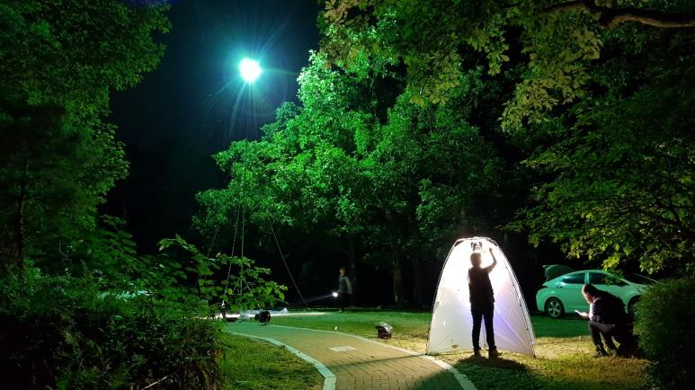

▸ 주성과일주활동
✓ 주성(taxis) : 동물이어떤자극을받고몸을자극이미치는방향으로움직이거나물러나는성질
• 주광성, 주화성, 주수성, 주촉성, 주류성, 주풍성, 주지성, 주열성등으로분류

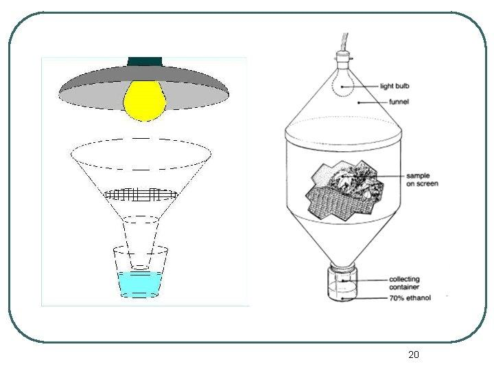

Berlese funnel trap

II. 곤충의 생태

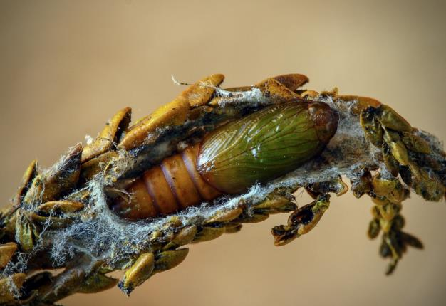

2. 곤충의행동습성: 서식장소에따라, 육서/수서로구분
▸ 개체군생태
✓ 주년경과: 1년을통한해충의움직임(=월동/발생등) 총칭
• 월동(overwintering)
-겨울을나는형태(알, 유충, 번데기, 성충등)는다양하고월동장소도볏집, 토양, 나무밑이나잡초등
-온도가비교적높고변화도적으며습도도어느정도높음
• 발생기간과횟수

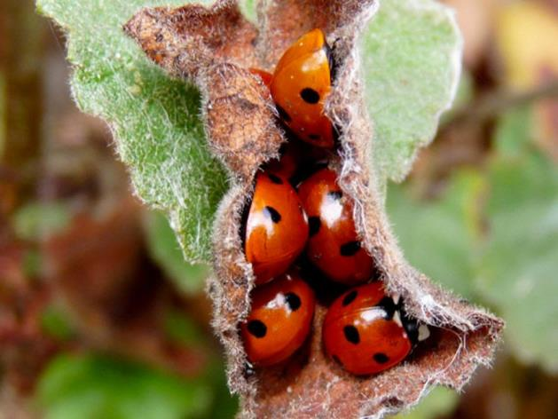

-월동을끝내고나온해충은다음월동기까지약반년같은농작물가해, 번식(발생기간은온난지방일수록김)
-따뜻한해에는봄의활동개시기가빨라짐
-발생횟수: 이발생기간에몇세대를갱신하느냐하는횟수
* 온난지방일수록발생기간이길고횟수도많음→해충의피해증가
• 발생의계절적증감
-기상/천적, 작물의상태/모내기시기등에따라계절적증감
* 해충의발생상황은'계절에의한증감'을보임: 재배요소(기상조건, 천적등) + 작물상태/모내기의시기등
* 배추흰나비는봄~초여름번식왕성→그이후기생벌등의천적의영향으로죽고또기온도높으므로줄어들며가을에다시약간많아짐
* 멸구류는매년많이발생. 이와같은해충에서는발생의동태에따라서특히주의해야함

II. 곤충의 생태

2. 곤충의행동습성: 서식장소에따라, 육서/수서로구분
▸ 해충의발생예찰
✓ 해충발생량과시기는'해와장소'에따라많은변동동반

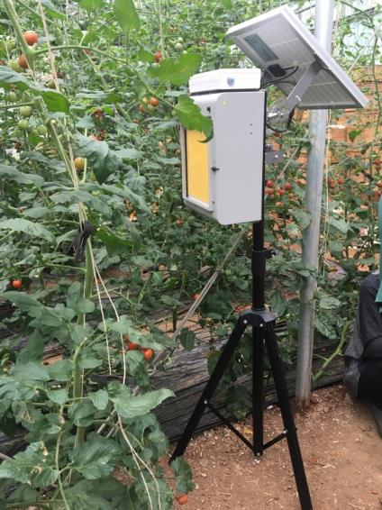

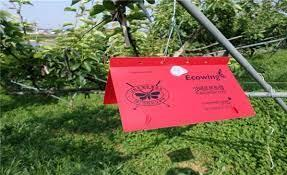

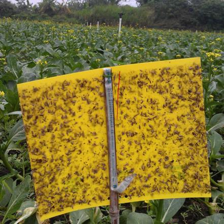

해충의페로몬(pheromone) 트랩
황색수반(yellow sticky)트랩
과수해충예찰

1. 곤충의형태
▸ 곤충의일반적특성: 머리, 가슴, 배로되어있고, 각기관에따른특수한부속기관보유
✓ 일반적으로피부는단단하고표피에는키틴(chitin)질함유
✓ 머리에는한상의촉각과복안, 입구성
✓ 구기는저작성구기, 흡수성구기의두가지형
-독제는저작구기를가진해충적용→구기형태는약제선택과관계
✓ 가슴에세쌍의다리. 두쌍의날개
✓ 배는보통속이비어있는관(tube) 모양. 비교적간단한구조. 끝에는생식계가펼쳐져있고여기에부속되어교미기나산란관(암컷)이있음.

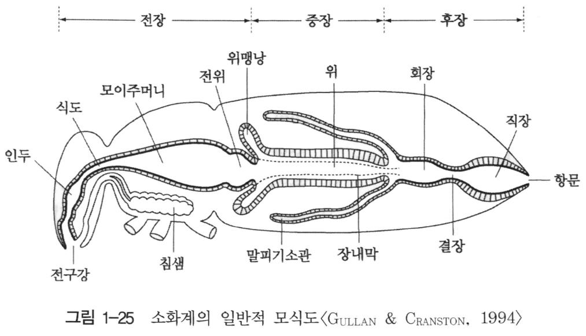

1. 곤충의형태
▸ 곤충의일반구조
✓ 머리: 입, 겹눈, 촉각등의부속기관보유
• 입은큰턱이잘발달.
• 씹는데적합한저작구기/ 바늘모양으로되어있어찔러넣고빠는데적합한흡취구(→입은저작성(독제를사용)과흡수성으로구분)
• 눈: 대개1쌍의겹눈. 1~3개의홑눈(때에따라서없는종도있음)
• 촉각: 사상, 편상, 염주상, 거치상, 곤봉상등다양

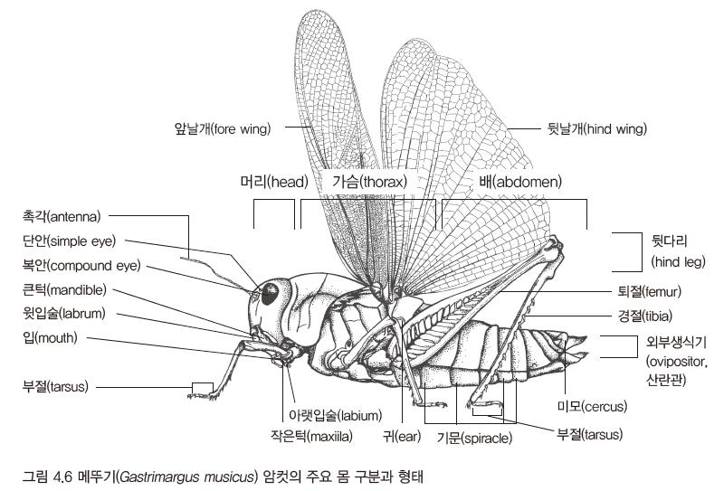

✓ 가슴: 3쌍의다리, 2쌍의날개
• 날개는2쌍. 앞날개는가운데가슴/뒷날개는뒷가슴에위치
• 기문: 가운데가슴과뒷가슴에1상씩있는경우가많음
• 다리: 가슴기부로부터기절, 전절, 퇴절, 경정, 부절(1~2개발톱포함)
✓ 배: 관모양으로된배. 기문/항문, 생식기가있어호흡과교미/산란기능
• 기문은배의마디마다1쌍씩10개내외. 이기관을통해호흡
• 생식에서수컷은부속지가파악기와삽입기. 암컷은산란관으로변형
• 배끝에는소화기관의끝인항문위치

1. 곤충의형태
▸ 곤충의학명구조

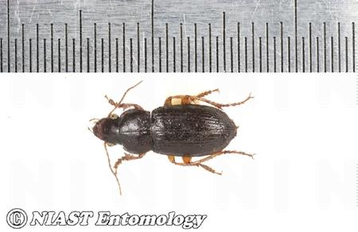

2. 곤충의외부구조
▸ 피부의형태와기능
✓ 피부(integument)는질기고단단하여외골격(exoskeleton)을형성--> 털과감각기관보유, 안쪽에근육이붙어있어고등동물과매우다름
• 피부는단단하고표피는키틴(chitin)질. 표피(cuticle), 진피(epidermis), 기저막(basement membrane)으로구성
• 감각기관을가지고있어외부로부터의자극감지및대응
• 운동에필요한근육의거점
• 이피부가외부의힘인증산작용과병원균으로부터보호
▸ 외부구조: 크기/모양매우다양. 기본형(일반적인씹는입, 두쌍의날개, 축소되지않은배마디등)

2. 곤충의외부구조
▸ 곤충의체벽구조
✓ 곤충= 무척추동물(몸을지탱하는뼈가몸안에있지않다)
✓ 몸을 둘러싸고있는외피(체벽, integument)이뼈에해당= 외골격
• 마치몸안에뼈가없이몸밖으로구성된갑옷만으로몸의골격을유지하는것
• 크기가작기때문에충분히가능함
• 체벽의주요기능
-외부충격/병원균과같은외부물질의침입으로부터몸보호
-탈수방지: 체표면적에비해수분함유할수있는체적의크기가작은편(건조한상황에서체내수분잃을수있음)
-유연한움직임: 단단한부분과부드러운부분을모두가지고있음
-자극전달: 체벽에있는강모등을통해외부로부터의자극을내부로전달

2. 곤충의외부구조
▸ 곤충의피부(integument)
✓ 곤충체벽의주구성요소: 표피(큐티클, cuticle)
✓ 체벽의단면을통해기본구조를살펴보면, 큐티클은다시몇개의층으로구분
✓ 표피의역할: 탈수방지와탈피를통한성장
• 표피는날개를포함한체벽을구성하는주요요소
• 내돌기, 기관지, 소화계의전/후장, 일부분비샘구성

2. 곤충의외부구조
▸ 곤충의피부(integument)
✓ 외표피(epicuticle)
• 큐티클단면에서몸의가장바깥쪽에위치
• 보통여러개의층으로구성. 가장바깥쪽에시멘트층, 그다음에왁스층
• 상표피의표면은왁스층에의해소수성을띠며탈수방지
• 표피의미세구조에따라빛의반사정도나각도가달라짐→체색달라짐
• 소수성은탈수방지외에도빗방울을떨쳐낼수있도록해줌.
• 상표피를통해보호색이나의태가능하여적을피하는데도움을줌
• 상표피는해로운자외선을반사, 종특이적후각신호를보내는통로역할

2. 곤충의외부구조
▸ 곤충의피부(integument)
✓ 원표피(procuticle)
• 상표피아래에표피가만들어지는것을보면처음엔한가지종류의표피(원표피, 원큐티클) 형성
• 그후, 원표피가다시바깥쪽과안쪽이서로다르게특성화되면서구분
• 바깥쪽부분의경화된원표피를외원표피(외큐티클, exocuticle)
• 외원표피는색소침착치일어나진한색을띠게하며, 비수용성

2. 곤충의외부구조
▸ 곤충의피부(integument)
✓ 진피(epidermis)
• 내원표피아래에위치
• 살아있는한층의단세포군
• 역할
-진피위에놓이는큐티쿨라층을형성하는중요한역할
-탈피과정에서내원표피소화시켜재흡수→큐티클일부재활용
-탈피후원표피를형성하는과정에서, 원표피를지나밖으로나가는가는관형성(왁스분비)
(예: 깍지벌레류에서볼수있는왁스등은진피층에발달한피부샘으로부터분비됨)

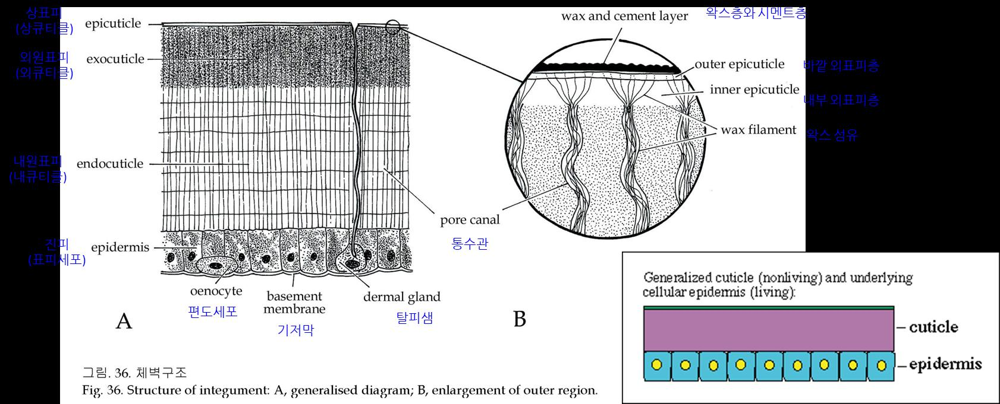

2. 곤충의외부구조
▸ 곤충의피부(integument)
✓ 기저막(basement membrane)
• 진피아래에위치하는얇은막. 이막을지나면곤충의몸안에해당
• 체벽이놓이는기반. 외골격과체강(body cavity)을구분지어줌
• 물질의투과는관여하지않음. 주로결합조직에서볼수있는점액다당류와콜라겐등구성

2. 곤충의외부구조
▸ 곤충의피부(integument)
✓ 키틴(chitin)
• 큐티클의주화학성분. 절지동물의외골격/진균류(버섯, 곰팡이류)의세포막에서주로발견
• 구조: 단당류가β-1, 4 결합구조로연결되어긴사슬처럼구성. 일종의다당류(자연계에서셀룰로스다음으로풍부함)
• 키틴의구조: 키틴의사슬등을연결해주는수소결합. 상표피와외원표피에서단백이퀴논(quinone)과반응→또다른종류의결합이포함된
경화(sclerotization) 과정을거치면서큐티클의강도는더욱강해짐
• 경화과정: 흔히멜라닌등의색소침전이동반. 외원표피에주로갈색의짙은색부여. 이처럼단단해지면서색이짙어지는것을일반적으로
경화, 흑화(hardendingand darkening)이라함.

2. 곤충의외부구조

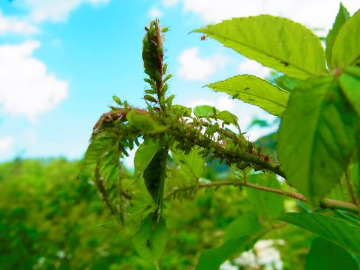

▸ 곤충의피부(integument)
✓ 체색(body color)
• 곤충의몸은여러가지색을띰. 체색은주로체벽에의해나타나지만, 때로는혈액에의해나타나기도함
• 체색에는표피의물리적구조에의해나타나는색, 색소화합물에의해나타나는색구분
✓ 구조색(structural color)
• 일종의물리적색
식물체와비슷한색을띤진딧물의모습
• 큐티클표피의구조가매우복잡하게되어있어빛이분산되거나간섭, 굴절이일어나면서발생

• 금속광택으로보이는푸른색, 녹색등(딱정벌레, 나비등)
✓ 색소색(pigmentalcolor)
• 적색색소인카로티노이드, 갈색또는흑색멜라닌등은일종의화학적색
• 색소색은색소화합물이빛을흡수하는정도에따라일정한색이나타난것을의미
• 색소는큐티클이나진피에저장하기도하지만, 체내에있는체액의색이몸밖으로비치면서색을나타냄
• 곤충은체색을주변과유사하게하여적으로부터자신을은폐하는데사용하는경우가많음.
(반대로, 체색을통하여자신을강렬하게드러냄으로써경고신호)
식물체와상반되는색을띤진딧물의모습

2. 곤충의외부구조
▸ 형태적구성요소
✓ 경판(sclerite)
• 외골격에서경화되어단단한부분, 주로판형구조
• 쉽게접히거나유연하지못하여외골격대부분차지
✓ 격막(phragma)
• 경판의구조를하고있지만, 몸안쪽으로들어간부분
• 겉으로도랑이형성되어넓은판형으로들어간부분은겉으로는도랑(홈, sulcus), 안으로는격막이라고함
• 겉으로깊은구멍이생기듯홈이파인것을밖으로는홈(공, pit), 안으로는내돌기(apodeme) 또는체벽내돌기(apophysis)라고함
✓ 봉합선(suture)
• 내돌기나격막처럼안으로깊게들어간것이아니고, 약간의홈이나파인듯하거나경판을구분지어주는경계구조

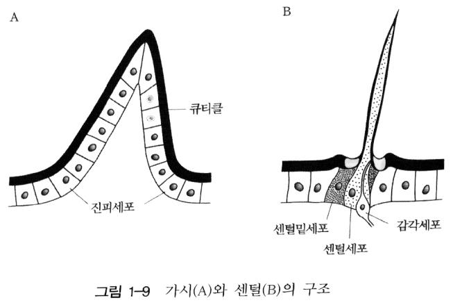

• 몸안쪽으로살짝내려선듯한선을겉으로는'봉합선', 안으로는'내융기선(internal ridge)'라고함
• 탈피할때갈라지는부분을'탈피선(ecdysialline)'
✓ 가시(spine)와강모(seta)
• 가시/강모는큐티클이몸밖으로뻗어나간구조
• 가시: 체벽자체가바깥으로가시모양으로자란단단한구조(유연성이없이고정된형태)
• 강모: 센털(사람피부의털, 머리카락과유사). 신경이연결되어있어감각이가능

2. 곤충의외부구조

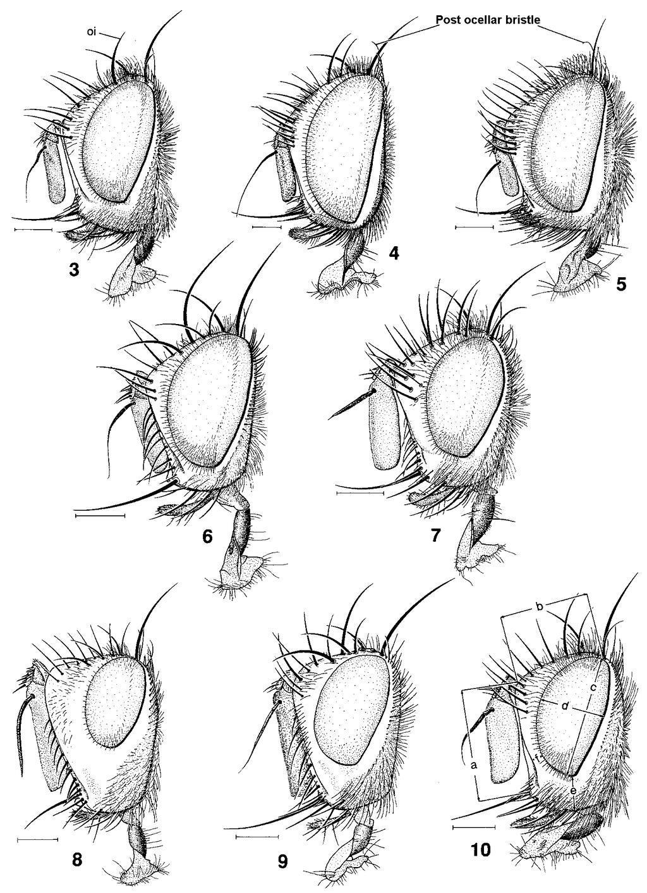

▸ 가시(spine)와강모(seta)

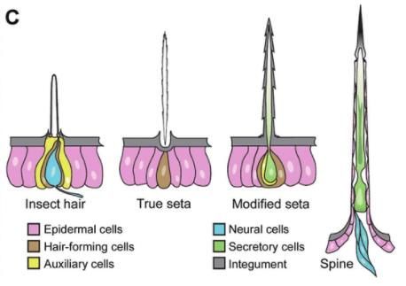

Schroeder and Houghtaling, 2018

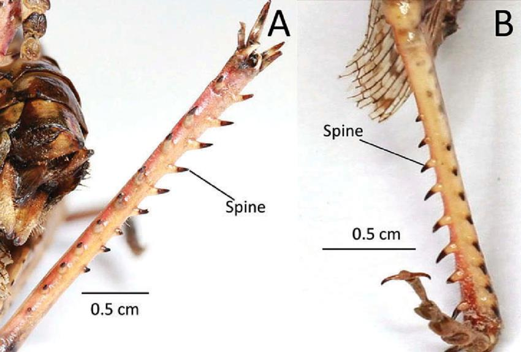

Sofraneet al., 2015 기생파리과(파리목)종별머리강모특징

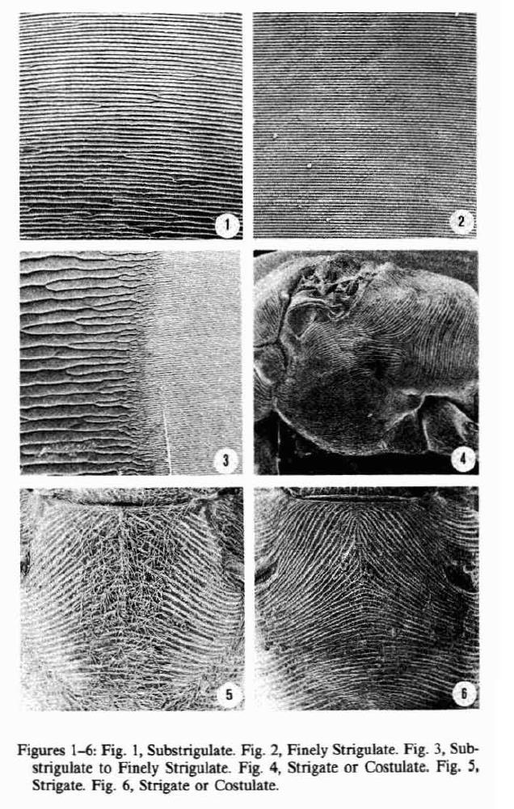

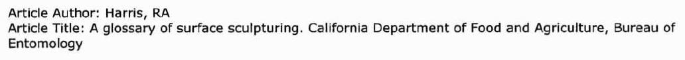

2. 곤충의외부구조
▸ 머리의기본구조
✓머리는발생학적으로주구성요소인'더듬이', '눈' 등이앞쪽마디의융합된부분에위치하고그뒤로3개의마디(큰턱, 작은턱, 아랫입술)가
추가로더해지면서모두6개의체절이합체절을이루어구성된것.
✓곤충의머리는기본적으로잘경화되어있는편. 겉으로는시각과촉각등감각수용의중심이자섭식이시작되는부분이고,
속으로는뇌를가지고있어신경계의중심을이룸
✓입의위치/방향에따른구분
• 전구식(prognathous) : 입에서음식을받아들이는방향이소화관이놓인몸의방향과대체로동일한방향으로놓인구조(길앞잡이등)
• 하구식(hypognathous) : 소화관이놓인몸의방향과대체로직각인방향으로놓이게된구조(메뚜기등)
• 후구식(opisthognathous) : 소화관이놓인몸의방향과예각인방향으로놓이게된구조(노린재등)

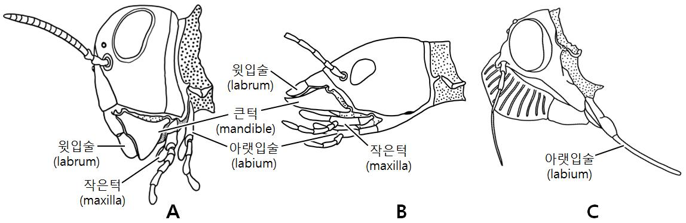

2. 곤충의외부구조
▸ 더듬이
•머리의앞쪽또는위쪽으로존재하는한쌍의감각구조
•직접더듬이를갖다대어감각하는것, 감각모등의기능을통해냄새, 페로몬, 습도, 진동, 풍속, 풍향등감지
•구성(몸쪽으로부터)

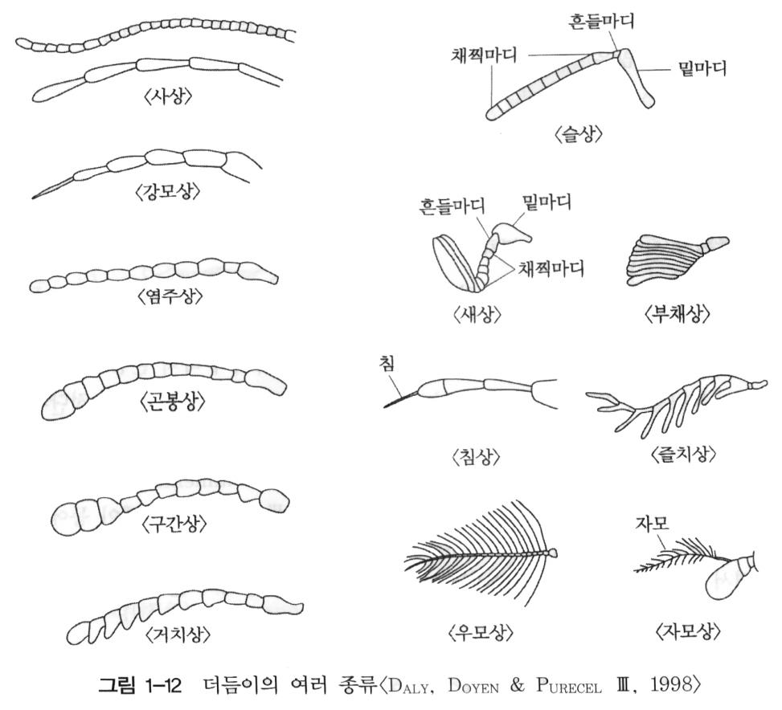

-밑마디(scape) : 더듬이를머리외피에연결해주는첫마디
-흔들마디(pedicel) : 주로소리를감지하는존스턴기관(Johnston's organ) 내부에가짐
-채찍마디(flagellum) : 나머지부분
•성적이형(sexual dimorphism)을갖는종들도있음.
•모양에따른대표곤충
-강모상(setaceous), 사상(filiform): 실베짱이, 하늘소등
-염주상(moniliform): 흰개미등

-곤봉상(clavate): 무당벌레등
-구간상(capitate): 밑빠진벌레등
-새상(lamellate): 수염풍뎅이등
-부채상(flabellate): 부채벌레등
-거치상(serrate): 방아벌레등
-즐치상(pectinate): 홍날개등
-우모상(plumose): 수컷나방더듬이등
-자모상(aristate): 집파리등
-침상(stylate): 파리매등
-슬상(geniculate): 개미, 바구미등

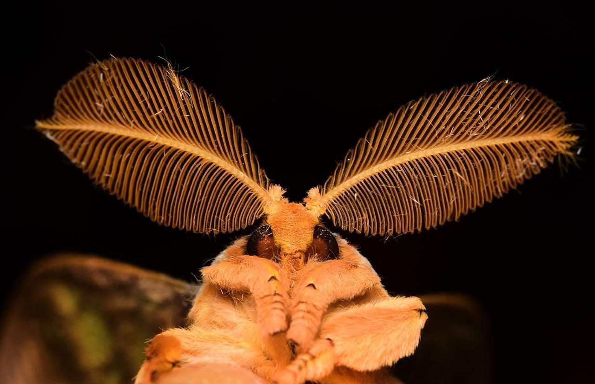

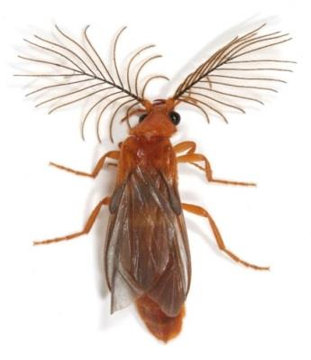

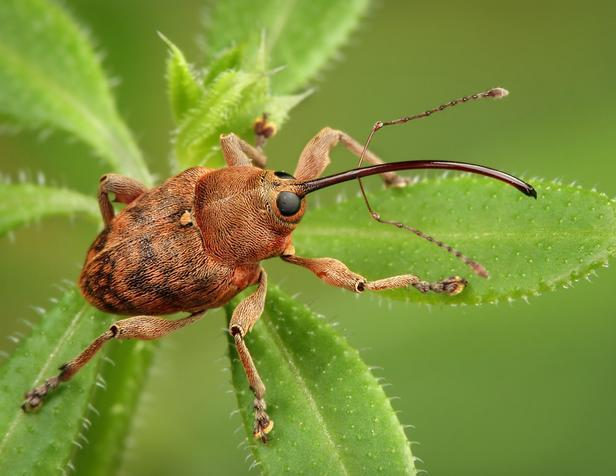

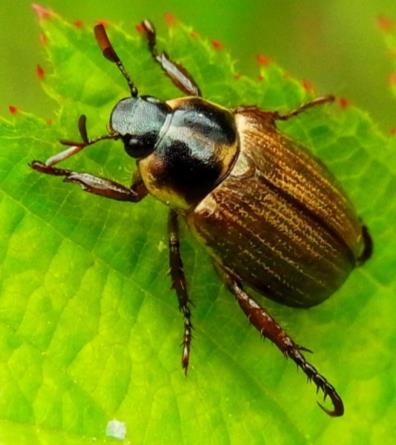

2. 곤충의외부구조
▸ 입(mouthparts)
•뚫어빠는입(piercing and sucking): 흡수형구기의기본적형태. 입이전체적으로빨대(구침, stylet) 구조.
-먹이도랑(음식이입안으로들어가는관)과침관(음식을체외소화시키기위해침을분비하는관)으로구성
-모기성충, 노린재목, 일부나방, 일부파리, 이, 벼룩등
•줄쓸어빠는입(rasping and sucking): 왼쪽큰턱과작은턱이긴바늘처럼생겼으며, 이빨대구조가식물의조직을줄쓸듯가는데사용
-총채벌레등
•흡취형입(sponging) : 무는파리를제외한파리류의대표적인입의형태. 침으로녹일만한음식이나액체섭식.
-꿀벌, 파리등
•흡관형입(siphoning) : 나비목의대표적인입의형태. 작은턱은긴관으로된빨대주둥이(코일주둥이, proboscis)를이룸
-나비, 나방등

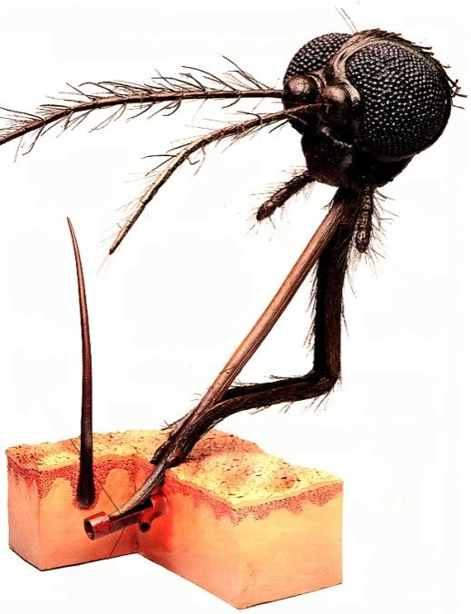

•저작형입(chewing): 큰턱을이용해씹어먹는입구조

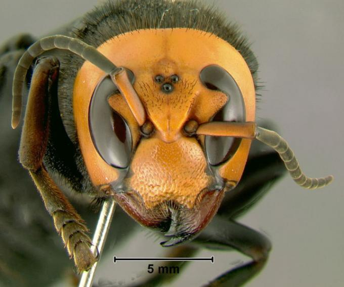

-말벌, 딱정벌레등등

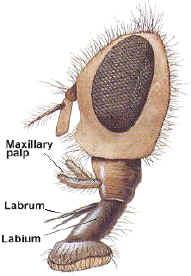

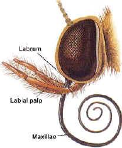

파리
나비, 나방 모기 말벌

2. 곤충의외부구조
▸ 입(mouthparts)

= 뚫어빠는입
(노린재류)

2. 곤충의외부구조
▸ 가슴의기본구조
✓3개의마디(앞가슴, 중간가슴, 뒷가슴)구성, 3쌍의다리, 2쌍의날개
✓앞가슴에는앞다리, 중간가슴에는중간다리와앞날개, 뒷가슴에는뒷다리와뒷날개
▸ 다리(legs)
•성충, 유충/유충모두각가슴마디마다한쌍씩모두6개다리존재(종에따라다리가없거나퇴화되기도함)
•다리의구성
-밑마디(기절, coxa) : 다리를몸에이어주는기부위치. 보통짧고굵은편
-도래마디(전절, trochanter) : 보통넓적다리마디와결합되어따로관절운동가능

-넓적다리마디(퇴절, femur) : 보통가장크고긴마디. 메뚜기처럼점프를많이하는경우에발달
-종아리마디(tibia) : 넓적다리마디만큼긴경우가많음. 근육량은적은편
-발목마디(tarsus) : 대개여러개의발목소마디구성
-앞발목마디(pretrsus)

2. 곤충의외부구조
▸ 다리(legs)
✓ 보행형(gressorial, walking) : 걷는데사용하는다리. 기본형. 주로가늘고긴형태
✓ 경주형(cursorial, running) : 길앞잡이처럼걷는데사용하지만, 주로달리기좋도록되어있음. 보행형보다근육이더발달.
✓ 도약형(saltatorial, jumping) : 메뚜기의뒷다리처럼점프하기좋도록발달한경우. 대개넓적다리마디가굵게발달
✓ 포획형(raptorial, grasping) : 사마귀의앞다리처럼먹이를잡아채기좋도록구성된경우. 넓적다리마디와종아리마디안쪽에가시가있는경우가있음.
✓ 파악형(clasping) : 종아리마디와발목마디를활용하여어떤것을잡고있기좋도록생긴경우. 머리나몸에발생하는이가대표적.
✓ 굴착형(fossorial, digging) : 땅강아지의앞다리처럼땅을파기좋은구조
✓ 유영형(natatorial, swimming) : 물속에서헤엄을치기좋도록다리가넓고납작하게발달한형태
✓ 흡반형(sectorial, suctioning) : 물방개수컷의앞다리에서발견되는형태. 마치동그란고무판들이여러개붙어있는것과같음. 교미시활용포함.
✓ 화분수집형(pollen-collecting) : 꿀벌의뒷다리에서발견. 뒷다리에는꽃가루주머니라는센털이많아난특수구조가짐.

메뚜기뒷다리

땅강아지앞다리

꿀벌의뒷다리
물방개다리

2. 곤충의외부구조
▸ 날개(wings)
✓ 날개= 외피가옆으로늘어나추가된부속지
✓ 날개에는시맥(wing vein) 존재→날개의골격구조유지

2. 곤충의외부구조
▸ 날개(wings)

2. 곤충의외부구조
▸ 날개(wings)

잠자리 파리

나비
4장의날개를따로움직여서비행(정 2장의앞날개밖에없다.
앞날개와뒷날개가1개의날
지비행가능) 매우재빠르게움직여서비행
개처럼비행

딱정벌레
노린재

앞날개는펼친채움직이지않는다. 뒷
앞날개와뒷날개를1개의날개처럼
벌
날개로비행
하여비행 앞날개와뒷날개가가시로연결되
어1개의날개처럼비행

2. 곤충의외부구조

▸ 배(abdomen)
✓ 7마디~11마디구성
✓ 교미, 산란, 항문을통한배설담당
✓무시류에서는여러배마디에침(뾰족돌기, stylus)이쌍으로존재
✓ 가슴마디와같이경판이위판(상판) 또는아래판(하판)으로구성
✓ 옆만이위치하는쪽으로마디의대부분에서기문(숨구멍, spiracle) 존재.

3. 곤충의내부구조
▸ 배(abdomen)
▸ 체강(body cavity) : 곤충의 몸 안 공간
▸체강에는소화계, 순환계, 기관계, 생식계, 신경계, 내분비계등 포함
▸체강에는혈액, 혈세포들이체액과 함께섞여 있기 때문에"혈강(haemocoel)이라고도함.
▸감각계
✓물리적, 기계적감각
•촉감, 몸의형태적변화, 위치, 압력, 중력, 소리를포함한진동등에대한감각수용
•접촉과관련된감각수용기: 모감각기(trichoidsensillum) (가장흔한감각기)
-3가지세포가관련: 모생세포(trichogencell), 와생세포(tormogencell), 감각신경(sensory neuron)
•위치를감지하는자기감각기(자기수용기, proprioceptor)를비롯한몇가지유형의감각수용기존재
•공기, 물의진동자기수용기
모생세포
: 현음감각기(막대감각기, scolopidium)로구성된현음기관(scolopophorousorgan) (존스턴기관, 고막등) (원추털을자라게함)
와생세포
(소켓을자라게함)
감각신경
(중추신경계에연결된신경을형성하기위한
다른축색돌기들과의연결을위해안으로나아가는
축색돌기, 수상돌기를털내로자라게함)
3개의관련된세포들의배열을보이는
털감각기종단면

▸감각계

✓열감각
•열감각(thermoreception) : 적외선(infrared, IR) 즉, 열이발생하는파장을감지할수있다는뜻.
•다양한곤충이적외선을감지하는온도감각기를다리, 더듬이, 몸통등에보유
-(예) 흡혈성노린재: 적외선감지및신호→온혈동물을찾는능력
-(예) 비단벌레류와같은딱정벌레는산불에의한적외선감지를통해세가약해지거나산란조건이좋은나무탐색가능

Rhodniusprolixus
(kissing bug)
-
샤가스병원균매개
Ngongoloand Nyundo, 2015

▸감각계
✓화학적감각
•화학신호의대표적예: 페로몬(pheromone) (다양한종류)
•화학통신물질(semiochemical)
-카이로몬(kairomone) : 수용자에게이익이지만생산자는불리한것(예: 소나무생성테프판(myrcene)은더많은딱정벌레유인해서더큰피해야기)
-알로몬(allomone) : 생산자에게유리한화학물질이지만, 수용자에게중립적영향(예: 천적으로부터생산자보호, 경고색등)
-시노몬(synomone): 생산자와수용자둘다에게유리(예: 손상된소나무에생산되는alpha-pinene, myrcene등은나무좀들에게카이로몬, 기생벌(pteromalid)에게시노몬)
✓시각적감각
•시각적인자극과수용은눈에서담당, 때론시세포가산란기에위치하기도함.
•낱눈(겹눈의최소단위)를보면색소세포(pigment cell), 광수용기(photoreceptor), 간상체(rhabdom)등이역할분담하여상을구성→신경을통해전대뇌전달

낱눈의구조
백두산북방잠자리의겹눈(정광수)

▸소화계
✓곤충의소화를담당하는장: 전장(앞창자), 중장(가운데창자), 후장(뒷창자), '밸브'에의해구분
•전장(foregut) : 음식물의섭취, 임시보관, 음식물을갈아서중장으로넘기는역할
•중장(midgut) : 소화액을통한소화및흡수역할
•후장(hindgut) : 음식찌꺼기와말피기소관을통해흡수된오줌을배설하는동안재활용할수있는것을재흡수하는역할

말피기소관(Malpigiantubule): 끝이막힌가는관모양으로, 기부는장과통해있고,
몸에서발생한함질소노폐물등을체액으로부터걸러주는역할

▸생식계
✓곤충은대부분암수교미에의하여알을낳는유성생식(예외: 단위생식, 유생생식)

•단위생식(parthenogenesis) : 암컷이교미와수정없이새끼를낳음(예: 진딧물류)
•유생생식(pseudogenesis) : 애벌레상태에서도생식기관의조숙한발달을통해알을낳음(예: 혹파리류→빠른진화)
✓수컷과암컷생식기관의역할
•수컷생식계: 정자를생산하여암컷에게전달할수있도록준비시키는기능
•암커생식계: 수컷의정자를들여와이를산란직전까지보관하고알을생산하여산란을준비하는일담당

교미중인Oncopeltusfasciatus(Hemiptera)
(Gullanand Cranston, 2005)

▸순환계(circulatory system)
✓체강(body cavity) 내체액과함께섞여순환되는개방순환계→곤충의체강을'혈강(haemocoel)이라고함.
✓혈액이세포와직접닿는것이아니며, 기관이나진피는얇은기저막(basement membrance)으로싸여있고이는혈액과의물질교환도움.

✓혈관은한개의굵고긴빨대같은혈관이몸안위쪽에존재(등혈관)

✓등혈관은뒤쪽이심장, 앞쪽이대혈관
✓심장에는심문(ostium)이라는작은구멍들이좌우로존재→이를통해혈액이
들어가고심장이박동을통해이를대혈관쪽으로밀어냄(심문수는가슴에최대
3쌍, 배에최대9쌍존재)
✓혈액(hemolymph)
-애벌레(몸이부드러운경우) : 20~40%
-성충: 20% 이하차지
-대체로무색, 경우에따라노란색, 녹색(깔따구헤모글로빈으로적색띰)
-기능: 호르몬/영양분전달/교환, 노폐물배출, 산소운반, 공기순환조절,
체온조절과탈피시탈피및팽창도움등

▸기관계(respiratory system)
✓수동적기작
✓기문(가슴과배마디양쪽)을통해외부공기가체내유입→기관지(온몸의혈관)을통해세포까지전달
✓기관지를거쳐기관소지를통해세포나조직으로전달된공기에서산소와이산화탄소의가스교환은농도차에이루어짐(=세포내호흡)
✓개방기관계: 기문이몸바깥쪽으로나있어외부공기가기관지와연결

✓대부분여러쌍의기문보유(최대10쌍)
✓기생성인경우, 폐쇄기관계

▸외분비계(respiratory system)
✓신호물질(화학통신물질, semiochemical) : 몸밖으로분비되어종내또는종간에신호를보내는물질
✓신호물질의종류
•페로몬(pheromone) : 성페로몬, 집합페로몬, 분산페로몬(또는간격페로몬), 길잡이페로몬, 경보페로몬
•타감물질(allelochemical): 카이로몬, 알로몬, 시노몬
곤충의 페로몬

| 성페로몬(Sex pheromone | ) |  |
| --- | --- | --- |

| 집합페로몬(Aggregation phero | mone) |  |
| --- | --- | --- |

| 경보페로몬(Alarm pheromo | ne) |  |
| --- | --- | --- |

| 길잡이페로몬(Trail pheromo | ne) |  |
| --- | --- | --- |

| 분산페로몬(Dispersal pherom | one) |  |
| --- | --- | --- |

▸외분비계(respiratory system)
✓신호물질(화학통신물질, semiochemical) : 몸밖으로분비되어종내또는종간에신호를보내는물질
✓신호물질의종류
•페로몬(pheromone) : 성페로몬, 집합페로몬, 분산페로몬(또는간격페로몬), 길잡이페로몬, 경보페로몬
•타감물질(allelochemical): 카이로몬, 알로몬, 시노몬
* 타감작용(allelopathy) : 어떤개체가하나이상의생화학적물질을내어다른종의개체의성장, 생존, 번식등에영향을주는생물학적현상

곤충의 타감물질

| 카이로몬(kairomone) |  | •신호물질을분비하는개체에는대체로해가되고이를인지하는개체에는도움이되는결과•포식자가먹잇감이내는페로몬등의화학성분을타감물질로인지할때이는카이로몬에해당 |
| --- | --- | --- |

| 알로몬(allomone) |  | •분비자에게는도움이되지만, 감지자에게는주로손해가되거나또는될수있는경우•식식성곤충에저항하기위해식물이분비하는방어물질 |
| --- | --- | --- |

| 시노몬(synomone) |  | •분비자와감지자모두에게도움이되는결과를낳는물질•어떤식물이식식성곤충에저항하기위한방법으로식식성곤충에기생하는포식기생충을유인하는타감물질을분비하였다면, 이는분비자인식물과감지자인포식기생충에게모두도움 |
| --- | --- | --- |

