# kocw_식물보호학_06

|  | 2021년도 2학기 - 식물보호학농림해충 - 2 (해충의 피해와 방제) |
| --- | --- |

| 2021년도 2학기 - 식물보호학 |
| --- |
| 농림해충 - 2 (해충의 피해와 방제) |

중간(수시) 평가 안내

 일시 :2021.10.20., 09:00~11:00
 방식(코로나-19 상황에 따라 변동 가능  학교 소식 받은대로 이클래스 통해서 공지 예정)
• 대면 수업 진행 시 : 강의실 302호실
• 비대면 수업 진행 시 : Zoom 실시간
 Open textbook 방식
 09:00 시험문제 공개  워드프로그램 이용 답안 작성  11:00 까지 제출(limento21@wku.ac.kr)
 시험 범위 : 7주차 수강한 내용까지(오늘 강의 내용까지)

주제 발표 안내

 12주차(10.17.), 13주차(10.24.)
 주제: 관심분야(잡초, 식물보호제, 농림해충, 식물병리중) 관련논문1건탐색및발표
(선정논문사본은발표전까지이메일(limento21@wku.ac.kr)제출)
 발표방식
• 대면수업진행시: 강의실302호실
• 비대면수업진행시: Zoom 실시간
• 개인발표시간: 15분/개인
• 발표순서
 10.17., 09:00~11:00 : 고영욱, 김정훈, 나세창, 문현지, 송의진, 송찬호
 10.24., 09:00~11:00 : 양재영, 오수진, 이명진, 정세라, 정용훈, 진주현
• 발표내용구성: 선정사유, 논문내용(서론, 재료및방법, 결론, 고찰등)
• 다른발표학생에대한질의응답
 해당일발표후, 각논문에대한토론진행

III. 곤충의 형태와 구조

2. 곤충의외부구조
 곤충의피부(integument)
 곤충체벽의주구성요소: 표피(큐티클, cuticle)
 체벽의단면을통해기본구조를살펴보면, 큐티클은다시몇개의층으로구분
 표피의역할: 탈수방지와탈피를통한성장
• 표피는날개를포함한체벽을구성하는주요요소
• 내돌기, 기관지, 소화계의전/후장, 일부분비샘구성

III. 곤충의 형태와 구조

2. 곤충의외부구조
 곤충의피부(integument)
 외표피(epicuticle)
• 큐티클단면에서몸의가장바깥쪽에위치
• 보통여러개의층으로구성. 가장바깥쪽에시멘트층, 그다음에왁스층
• 상표피의표면은왁스층에의해소수성을띠며탈수방지
• 표피의미세구조에따라빛의반사정도나각도가달라짐체색달라짐
• 소수성은탈수방지외에도빗방울을떨쳐낼수있도록해줌.
• 상표피를통해보호색이나의태가능하여적을피하는데도움을줌
• 상표피는해로운자외선을반사, 종특이적후각신호를보내는통로역할

III. 곤충의 형태와 구조

2. 곤충의외부구조
 곤충의피부(integument)
 원표피(procuticle)
• 상표피아래에표피가만들어지는것을보면처음엔한가지종류의표피(원표피, 원큐티클) 형성
• 그후, 원표피가다시바깥쪽과안쪽이서로다르게특성화되면서구분
• 바깥쪽부분의경화된원표피를외원표피(외큐티클, exocuticle)
• 외원표피는색소침착치일어나진한색을띠게하며, 비수용성

III. 곤충의 형태와 구조

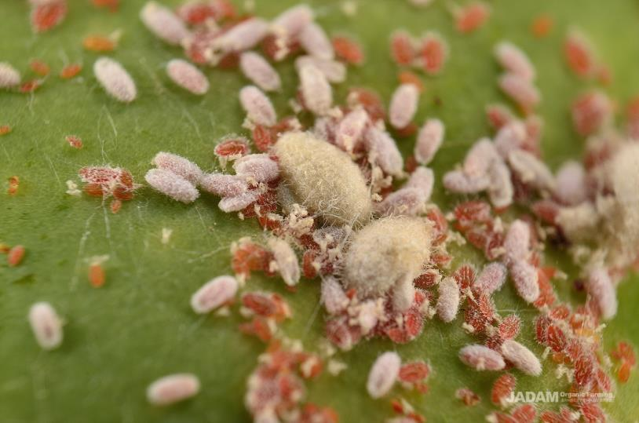

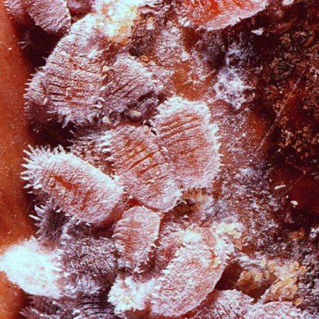

2. 곤충의외부구조
 곤충의피부(integument)
 진피(epidermis)
• 내원표피아래에위치
• 살아있는한층의단세포군
• 역할
-진피위에놓이는큐티쿨라층을형성하는중요한역할
-탈피과정에서내원표피소화시켜재흡수큐티클일부재활용
-탈피후원표피를형성하는과정에서, 원표피를지나밖으로나가는가는관형성(왁스분비)
(예: 깍지벌레류에서볼수있는왁스등은진피층에발달한피부샘으로부터분비됨)

III. 곤충의 형태와 구조

2. 곤충의외부구조
 곤충의피부(integument)
 기저막(basement membrane)
• 진피아래에위치하는얇은막. 이막을지나면곤충의몸안에해당
• 체벽이놓이는기반. 외골격과체강(body cavity)을구분지어줌
• 물질의투과는관여하지않음. 주로결합조직에서볼수있는점액다당류와콜라겐등구성

III. 곤충의 형태와 구조

2. 곤충의외부구조
 곤충의피부(integument)
 키틴(chitin)
• 큐티클의주화학성분. 절지동물의외골격/진균류(버섯, 곰팡이류)의세포막에서주로발견
• 구조: 단당류가β-1, 4 결합구조로연결되어긴사슬처럼구성. 일종의다당류(자연계에서셀룰로스다음으로풍부함)
• 키틴의구조: 키틴의사슬등을연결해주는수소결합. 상표피와외원표피에서단백이퀴논(quinone)과반응또다른종류의결합이포함된
경화(sclerotization) 과정을거치면서큐티클의강도는더욱강해짐
• 경화과정: 흔히멜라닌등의색소침전이동반. 외원표피에주로갈색의짙은색부여. 이처럼단단해지면서색이짙어지는것을일반적으로
경화, 흑화(hardendingand darkening)이라함.

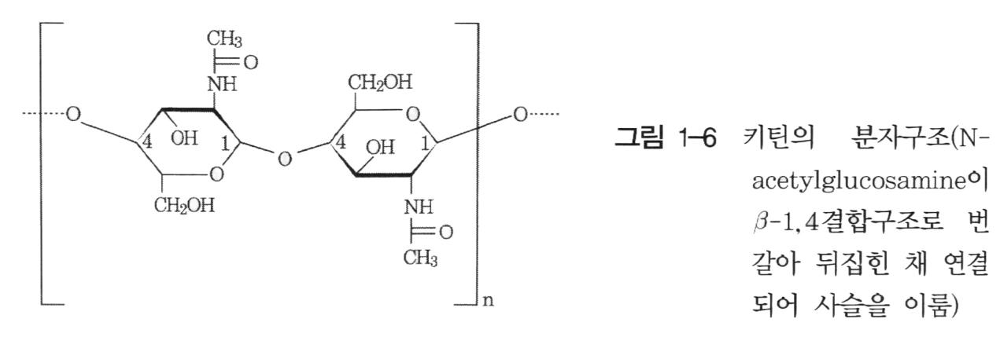

III. 곤충의 형태와 구조

2. 곤충의외부구조

 곤충의피부(integument)
 체색(body color)
• 곤충의몸은여러가지색을띰. 체색은주로체벽에의해나타나지만, 때로는혈액에의해나타나기도함
• 체색에는표피의물리적구조에의해나타나는색, 색소화합물에의해나타나는색구분
 구조색(structural color)
• 일종의물리적색
식물체와비슷한색을띤진딧물의모습
• 큐티클표피의구조가매우복잡하게되어있어빛이분산되거나간섭, 굴절이일어나면서발생

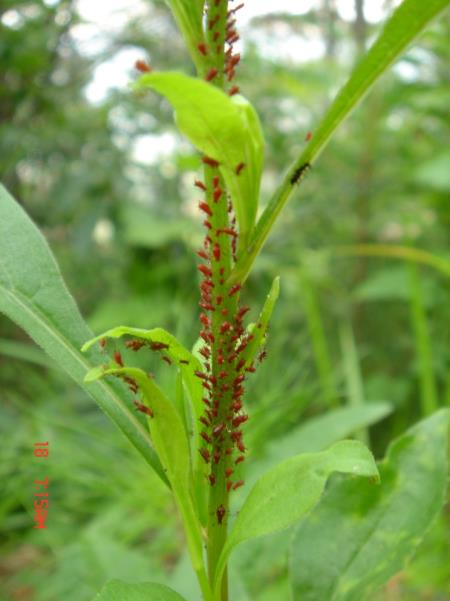

• 금속광택으로보이는푸른색, 녹색등(딱정벌레, 나비등)
 색소색(pigmentalcolor)
• 적색색소인카로티노이드, 갈색또는흑색멜라닌등은일종의화학적색
• 색소색은색소화합물이빛을흡수하는정도에따라일정한색이나타난것을의미
• 색소는큐티클이나진피에저장하기도하지만, 체내에있는체액의색이몸밖으로비치면서색을나타냄
• 곤충은체색을주변과유사하게하여적으로부터자신을은폐하는데사용하는경우가많음.
(반대로, 체색을통하여자신을강렬하게드러냄으로써경고신호)
식물체와상반되는색을띤진딧물의모습

III. 곤충의 형태와 구조

2. 곤충의외부구조
 형태적구성요소
 경판(sclerite)
• 외골격에서경화되어단단한부분, 주로판형구조
• 쉽게접히거나유연하지못하여외골격대부분차지
 격막(phragma)
• 경판의구조를하고있지만, 몸안쪽으로들어간부분
• 겉으로도랑이형성되어넓은판형으로들어간부분은겉으로는도랑(홈, sulcus), 안으로는격막이라고함
• 겉으로깊은구멍이생기듯홈이파인것을밖으로는홈(공, pit), 안으로는내돌기(apodeme) 또는체벽내돌기(apophysis)라고함
 봉합선(suture)
• 내돌기나격막처럼안으로깊게들어간것이아니고, 약간의홈이나파인듯하거나경판을구분지어주는경계구조

• 몸안쪽으로살짝내려선듯한선을겉으로는'봉합선', 안으로는'내융기선(internal ridge)'라고함
• 탈피할때갈라지는부분을'탈피선(ecdysialline)'
 가시(spine)와강모(seta)
• 가시/강모는큐티클이몸밖으로뻗어나간구조
• 가시: 체벽자체가바깥으로가시모양으로자란단단한구조(유연성이없이고정된형태)
• 강모: 센털(사람피부의털, 머리카락과유사). 신경이연결되어있어감각이가능

III. 곤충의 형태와 구조

2. 곤충의외부구조

 가시(spine)와강모(seta)

Schroeder and Houghtaling, 2018

Sofraneet al., 2015 기생파리과(파리목)종별머리강모특징

III. 곤충의 형태와 구조

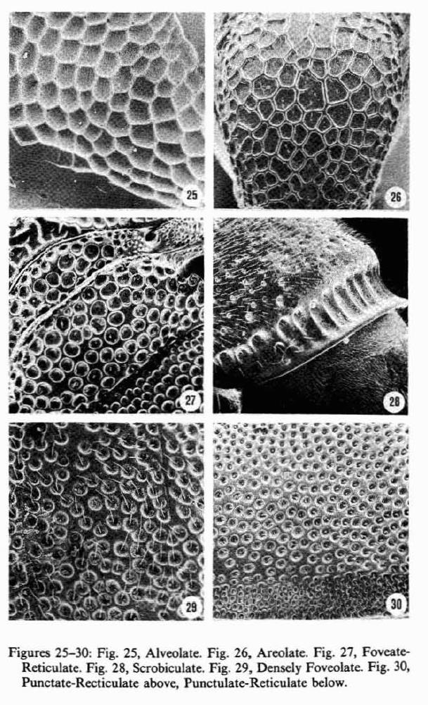

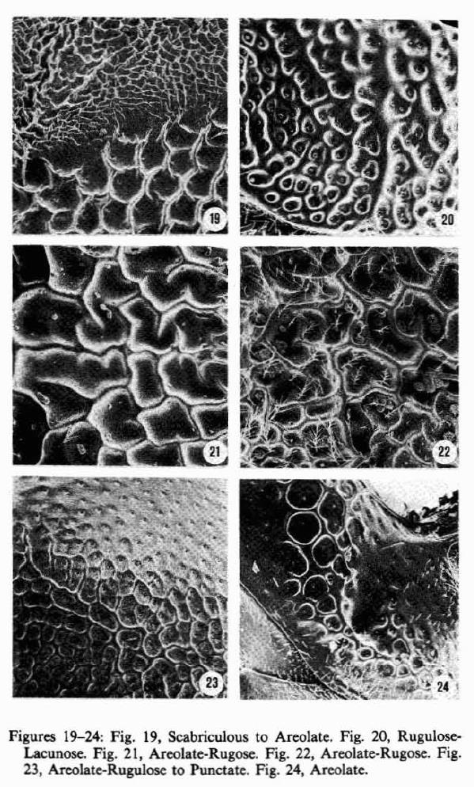

III. 곤충의 형태와 구조

2. 곤충의외부구조
 머리의기본구조
머리는발생학적으로주구성요소인'더듬이', '눈' 등이앞쪽마디의융합된부분에위치하고그뒤로3개의마디(큰턱, 작은턱, 아랫입술)가
추가로더해지면서모두6개의체절이합체절을이루어구성된것.
곤충의머리는기본적으로잘경화되어있는편. 겉으로는시각과촉각등감각수용의중심이자섭식이시작되는부분이고,
속으로는뇌를가지고있어신경계의중심을이룸
입의위치/방향에따른구분
• 전구식(prognathous) : 입에서음식을받아들이는방향이소화관이놓인몸의방향과대체로동일한방향으로놓인구조(길앞잡이등)
• 하구식(hypognathous) : 소화관이놓인몸의방향과대체로직각인방향으로놓이게된구조(메뚜기등)
• 후구식(opisthognathous) : 소화관이놓인몸의방향과예각인방향으로놓이게된구조(노린재등)

III. 곤충의 형태와 구조

2. 곤충의외부구조
 더듬이
•머리의앞쪽또는위쪽으로존재하는한쌍의감각구조
•직접더듬이를갖다대어감각하는것, 감각모등의기능을통해냄새, 페로몬, 습도, 진동, 풍속, 풍향등감지
•구성(몸쪽으로부터)

-밑마디(scape) : 더듬이를머리외피에연결해주는첫마디
-흔들마디(pedicel) : 주로소리를감지하는존스턴기관(Johnston's organ) 내부에가짐
-채찍마디(flagellum) : 나머지부분
•성적이형(sexual dimorphism)을갖는종들도있음.
•모양에따른대표곤충
-강모상(setaceous), 사상(filiform): 실베짱이, 하늘소등
-염주상(moniliform): 흰개미등

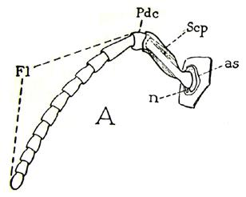

-곤봉상(clavate): 무당벌레등
-구간상(capitate): 밑빠진벌레등
-새상(lamellate): 수염풍뎅이등
-부채상(flabellate): 부채벌레등
-거치상(serrate): 방아벌레등
-즐치상(pectinate): 홍날개등
-우모상(plumose): 수컷나방더듬이등
-자모상(aristate): 집파리등
-침상(stylate): 파리매등
-슬상(geniculate): 개미, 바구미등

III. 곤충의 형태와 구조

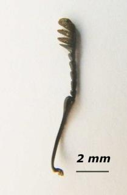

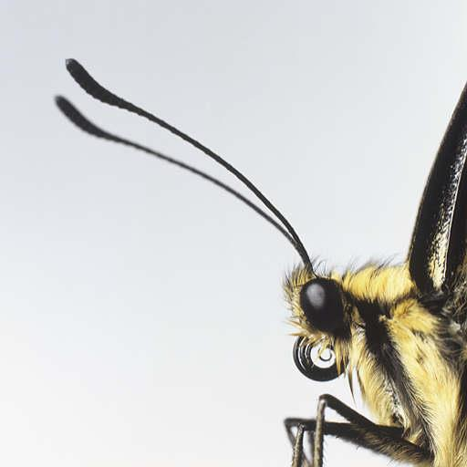

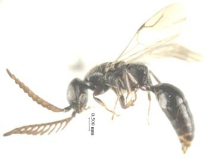

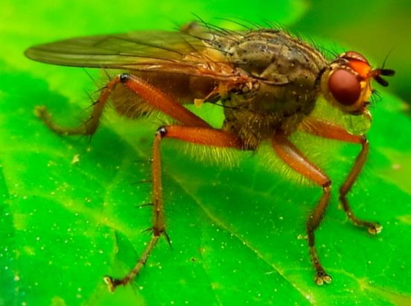

III. 곤충의 형태와 구조

2. 곤충의외부구조
 입(mouthparts)
•뚫어빠는입(piercing and sucking): 흡수형구기의기본적형태. 입이전체적으로빨대(구침, stylet) 구조.
-먹이도랑(음식이입안으로들어가는관)과침관(음식을체외소화시키기위해침을분비하는관)으로구성
-모기성충, 노린재목, 일부나방, 일부파리, 이, 벼룩등
•줄쓸어빠는입(rasping and sucking): 왼쪽큰턱과작은턱이긴바늘처럼생겼으며, 이빨대구조가식물의조직을줄쓸듯가는데사용
-총채벌레등
•흡취형입(sponging) : 무는파리를제외한파리류의대표적인입의형태. 침으로녹일만한음식이나액체섭식.
-꿀벌, 파리등
•흡관형입(siphoning) : 나비목의대표적인입의형태. 작은턱은긴관으로된빨대주둥이(코일주둥이, proboscis)를이룸
-나비, 나방등

•저작형입(chewing): 큰턱을이용해씹어먹는입구조

-말벌, 딱정벌레등등

파리
나비, 나방 모기 말벌

III. 곤충의 형태와 구조

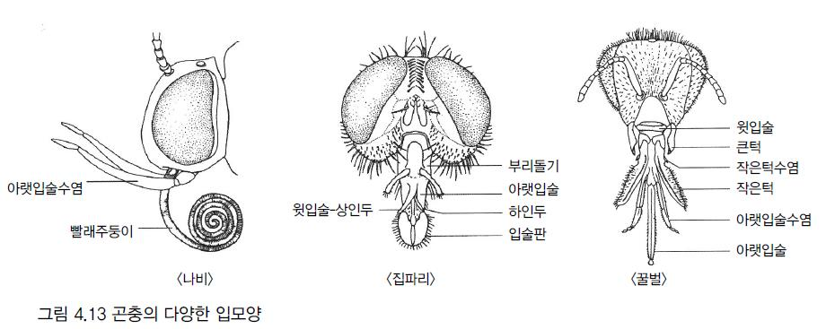

2. 곤충의외부구조
 입(mouthparts)

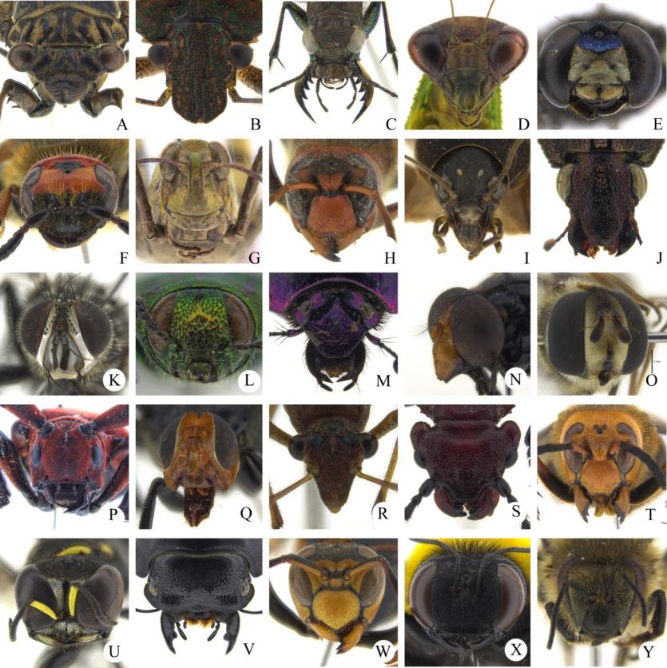

= 뚫어빠는입
(노린재류)

III. 곤충의 형태와 구조

2. 곤충의외부구조
 가슴의기본구조
3개의마디(앞가슴, 중간가슴, 뒷가슴)구성, 3쌍의다리, 2쌍의날개
앞가슴에는앞다리, 중간가슴에는중간다리와앞날개, 뒷가슴에는뒷다리와뒷날개
 다리(legs)
•성충, 유충/유충모두각가슴마디마다한쌍씩모두6개다리존재(종에따라다리가없거나퇴화되기도함)
•다리의구성
-밑마디(기절, coxa) : 다리를몸에이어주는기부위치. 보통짧고굵은편
-도래마디(전절, trochanter) : 보통넓적다리마디와결합되어따로관절운동가능

-넓적다리마디(퇴절, femur) : 보통가장크고긴마디. 메뚜기처럼점프를많이하는경우에발달
-종아리마디(tibia) : 넓적다리마디만큼긴경우가많음. 근육량은적은편
-발목마디(tarsus) : 대개여러개의발목소마디구성
-앞발목마디(pretrsus)

III. 곤충의 형태와 구조

2. 곤충의외부구조
 다리(legs)
 보행형(gressorial, walking) : 걷는데사용하는다리. 기본형. 주로가늘고긴형태
 경주형(cursorial, running) : 길앞잡이처럼걷는데사용하지만, 주로달리기좋도록되어있음. 보행형보다근육이더발달.
 도약형(saltatorial, jumping) : 메뚜기의뒷다리처럼점프하기좋도록발달한경우. 대개넓적다리마디가굵게발달
 포획형(raptorial, grasping) : 사마귀의앞다리처럼먹이를잡아채기좋도록구성된경우. 넓적다리마디와종아리마디안쪽에가시가있는경우가있음.
 파악형(clasping) : 종아리마디와발목마디를활용하여어떤것을잡고있기좋도록생긴경우. 머리나몸에발생하는이가대표적.
 굴착형(fossorial, digging) : 땅강아지의앞다리처럼땅을파기좋은구조
 유영형(natatorial, swimming) : 물속에서헤엄을치기좋도록다리가넓고납작하게발달한형태
 흡반형(sectorial, suctioning) : 물방개수컷의앞다리에서발견되는형태. 마치동그란고무판들이여러개붙어있는것과같음. 교미시활용포함.
 화분수집형(pollen-collecting) : 꿀벌의뒷다리에서발견. 뒷다리에는꽃가루주머니라는센털이많아난특수구조가짐.

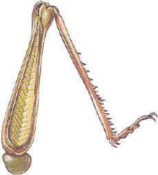

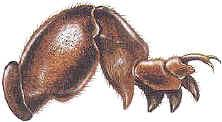

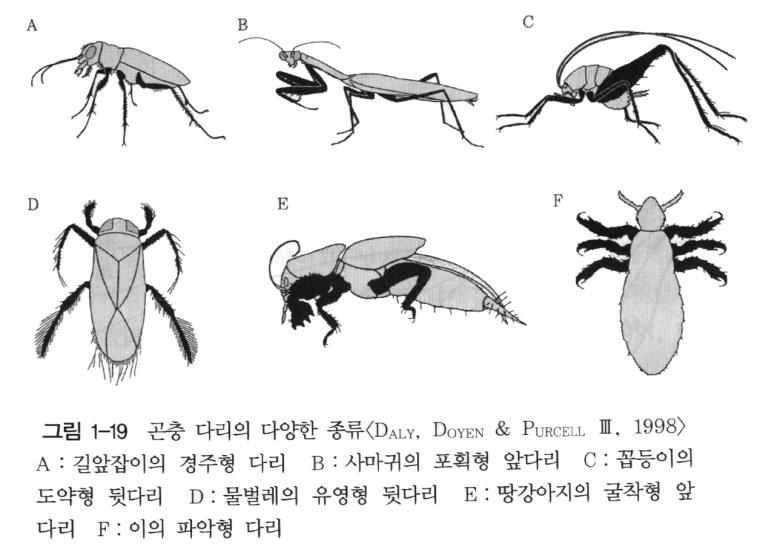

메뚜기뒷다리

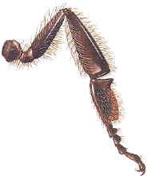

땅강아지앞다리

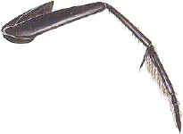

꿀벌의뒷다리
물방개다리

III. 곤충의 형태와 구조

2. 곤충의외부구조
 날개(wings)
 날개= 외피가옆으로늘어나추가된부속지
 날개에는시맥(wing vein) 존재날개의골격구조유지

III. 곤충의 형태와 구조

2. 곤충의외부구조
 날개(wings)

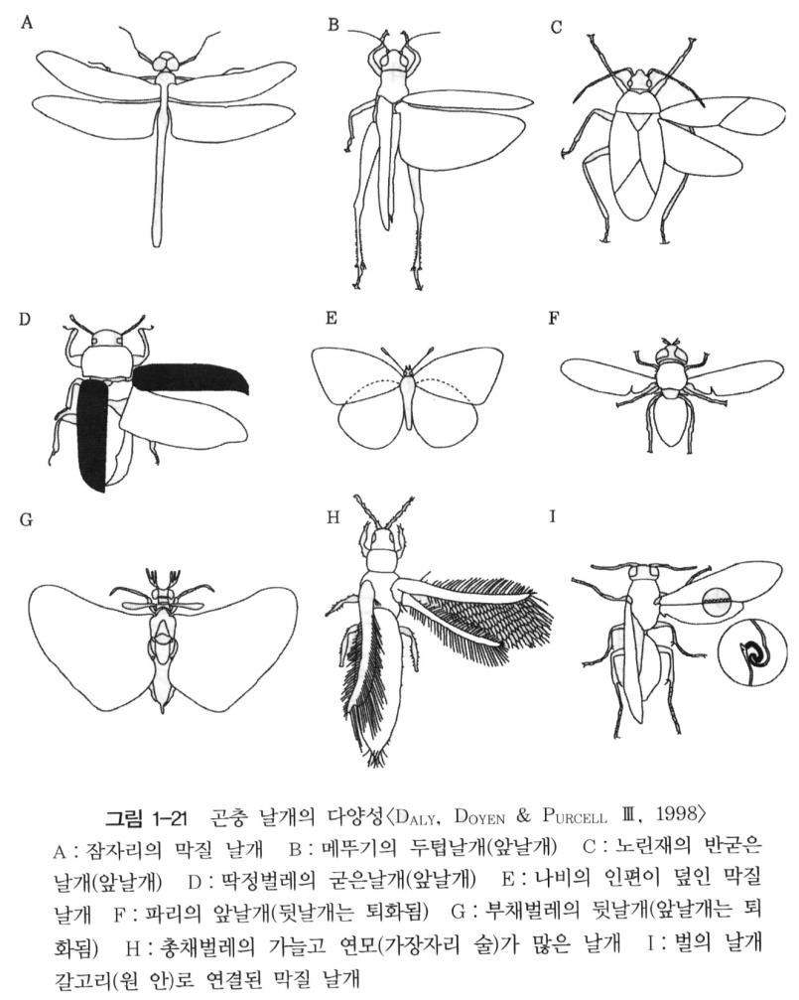

III. 곤충의 형태와 구조

2. 곤충의외부구조
 날개(wings)

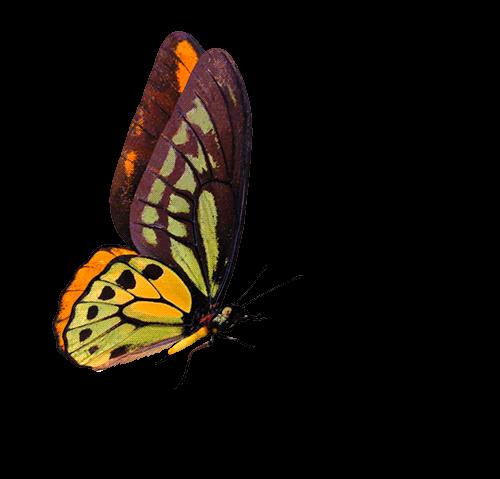

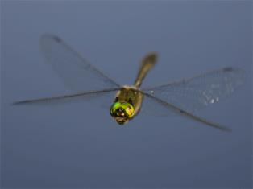

잠자리 파리

나비
4장의날개를따로움직여서비행(정 2장의앞날개밖에없다.
앞날개와뒷날개가1개의날
지비행가능) 매우재빠르게움직여서비행
개처럼비행

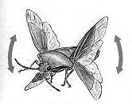

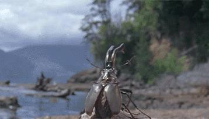

딱정벌레
노린재

앞날개는펼친채움직이지않는다. 뒷
앞날개와뒷날개를1개의날개처럼
벌
날개로비행
하여비행 앞날개와뒷날개가가시로연결되
어1개의날개처럼비행

III. 곤충의 형태와 구조

2. 곤충의외부구조

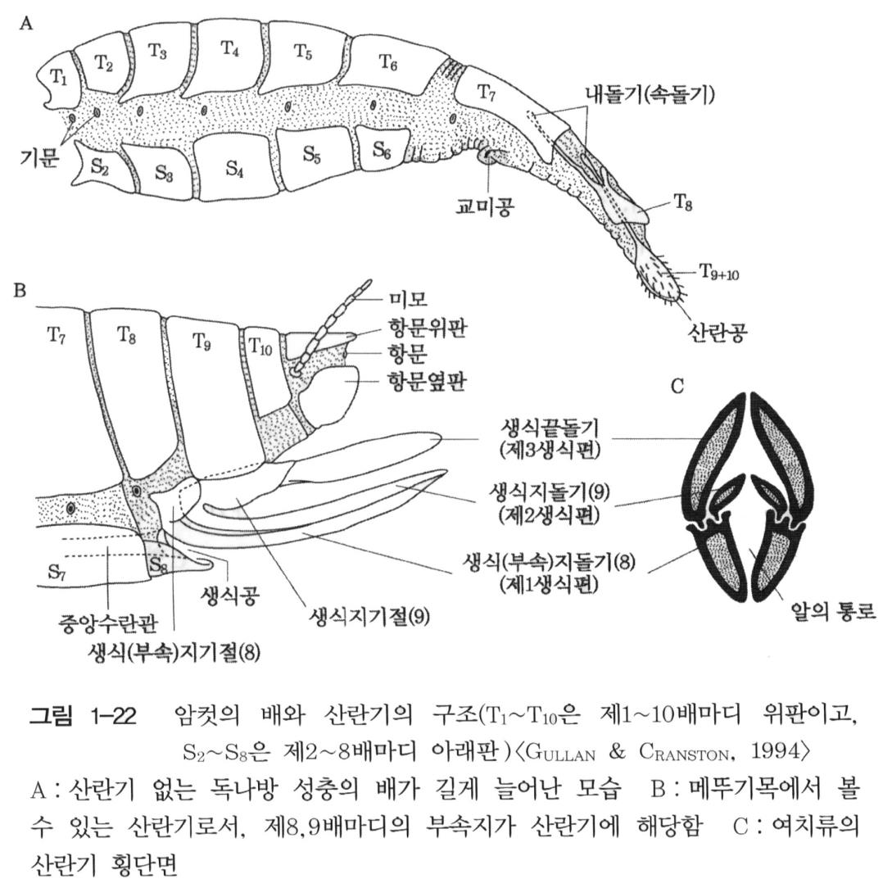

 배(abdomen)
 7마디~11마디구성
 교미, 산란, 항문을통한배설담당
무시류에서는여러배마디에침(뾰족돌기, stylus)이쌍으로존재
 가슴마디와같이경판이위판(상판) 또는아래판(하판)으로구성
 옆만이위치하는쪽으로마디의대부분에서기문(숨구멍, spiracle) 존재.

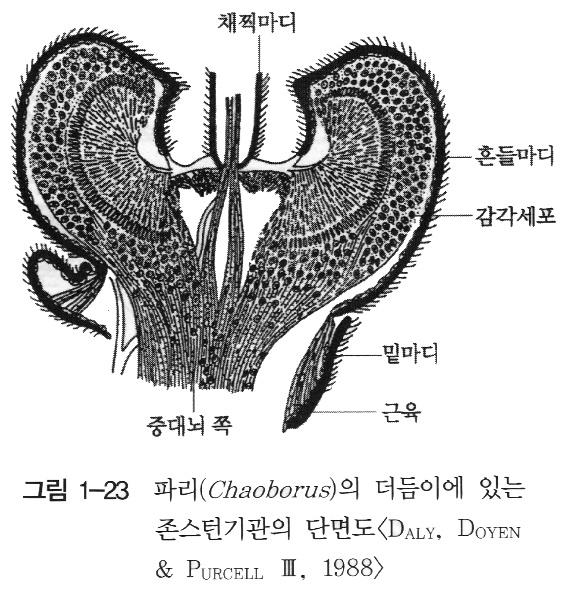

III. 곤충의 형태와 구조

3. 곤충의내부구조
 배(abdomen)
 체강(body cavity) : 곤충의 몸 안 공간
체강에는소화계, 순환계, 기관계, 생식계, 신경계, 내분비계등 포함
체강에는혈액, 혈세포들이체액과 함께섞여 있기 때문에"혈강(haemocoel)이라고도함.
감각계
물리적, 기계적감각
•촉감, 몸의형태적변화, 위치, 압력, 중력, 소리를포함한진동등에대한감각수용
•접촉과관련된감각수용기: 모감각기(trichoidsensillum) (가장흔한감각기)
-3가지세포가관련: 모생세포(trichogencell), 와생세포(tormogencell), 감각신경(sensory neuron)
•위치를감지하는자기감각기(자기수용기, proprioceptor)를비롯한몇가지유형의감각수용기존재
•공기, 물의진동자기수용기
모생세포
: 현음감각기(막대감각기, scolopidium)로구성된현음기관(scolopophorousorgan) (존스턴기관, 고막등) (원추털을자라게함)
와생세포
(소켓을자라게함)
감각신경
(중추신경계에연결된신경을형성하기위한
다른축색돌기들과의연결을위해안으로나아가는
축색돌기, 수상돌기를털내로자라게함)
3개의관련된세포들의배열을보이는
털감각기종단면

III. 곤충의 형태와 구조

감각계

열감각
•열감각(thermoreception) : 적외선(infrared, IR) 즉, 열이발생하는파장을감지할수있다는뜻.
•다양한곤충이적외선을감지하는온도감각기를다리, 더듬이, 몸통등에보유
-(예) 흡혈성노린재: 적외선감지및신호온혈동물을찾는능력
-(예) 비단벌레류와같은딱정벌레는산불에의한적외선감지를통해세가약해지거나산란조건이좋은나무탐색가능

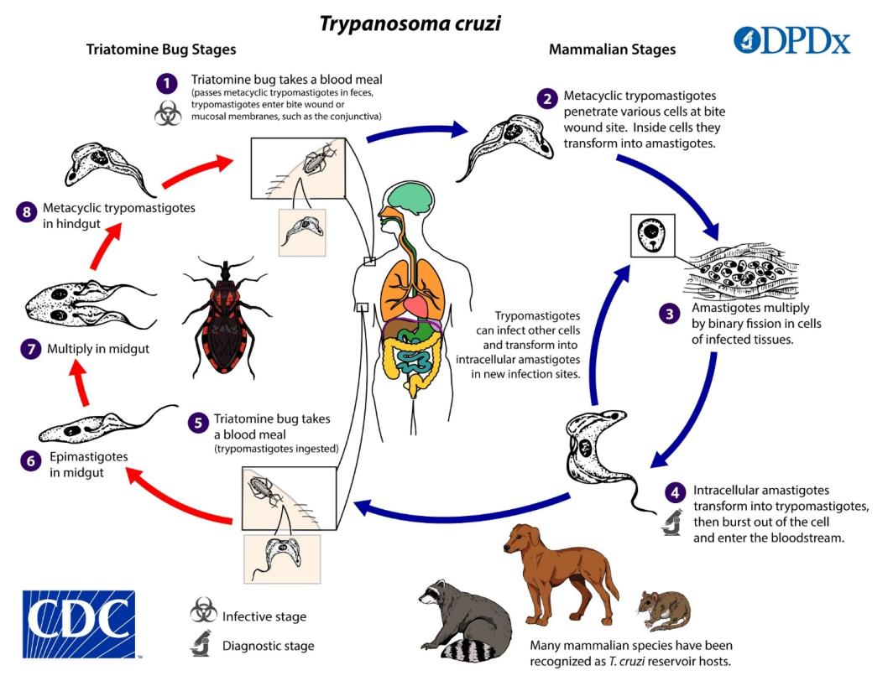

Rhodniusprolixus
(kissing bug)
-
샤가스병원균매개
Ngongoloand Nyundo, 2015

III. 곤충의 형태와 구조

감각계
화학적감각
•화학신호의대표적예: 페로몬(pheromone) (다양한종류)
•화학통신물질(semiochemical)
-카이로몬(kairomone) : 수용자에게이익이지만생산자는불리한것(예: 소나무생성테프판(myrcene)은더많은딱정벌레유인해서더큰피해야기)
-알로몬(allomone) : 생산자에게유리한화학물질이지만, 수용자에게중립적영향(예: 천적으로부터생산자보호, 경고색등)
-시노몬(synomone): 생산자와수용자둘다에게유리(예: 손상된소나무에생산되는alpha-pinene, myrcene등은나무좀들에게카이로몬, 기생벌(pteromalid)에게시노몬)
시각적감각
•시각적인자극과수용은눈에서담당, 때론시세포가산란기에위치하기도함.
•낱눈(겹눈의최소단위)를보면색소세포(pigment cell), 광수용기(photoreceptor), 간상체(rhabdom)등이역할분담하여상을구성신경을통해전대뇌전달

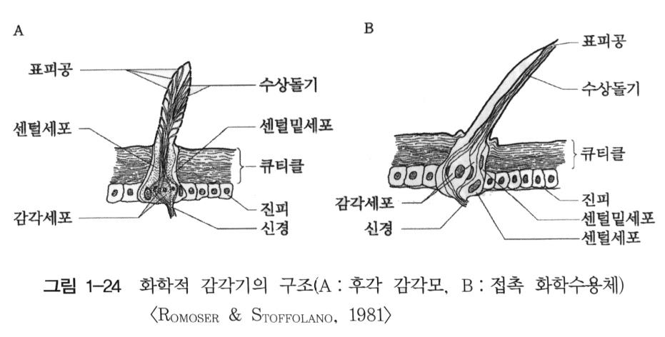

낱눈의구조
백두산북방잠자리의겹눈(정광수)

III. 곤충의 형태와 구조

소화계
곤충의소화를담당하는장: 전장(앞창자), 중장(가운데창자), 후장(뒷창자), '밸브'에의해구분
•전장(foregut) : 음식물의섭취, 임시보관, 음식물을갈아서중장으로넘기는역할
•중장(midgut) : 소화액을통한소화및흡수역할
•후장(hindgut) : 음식찌꺼기와말피기소관을통해흡수된오줌을배설하는동안재활용할수있는것을재흡수하는역할

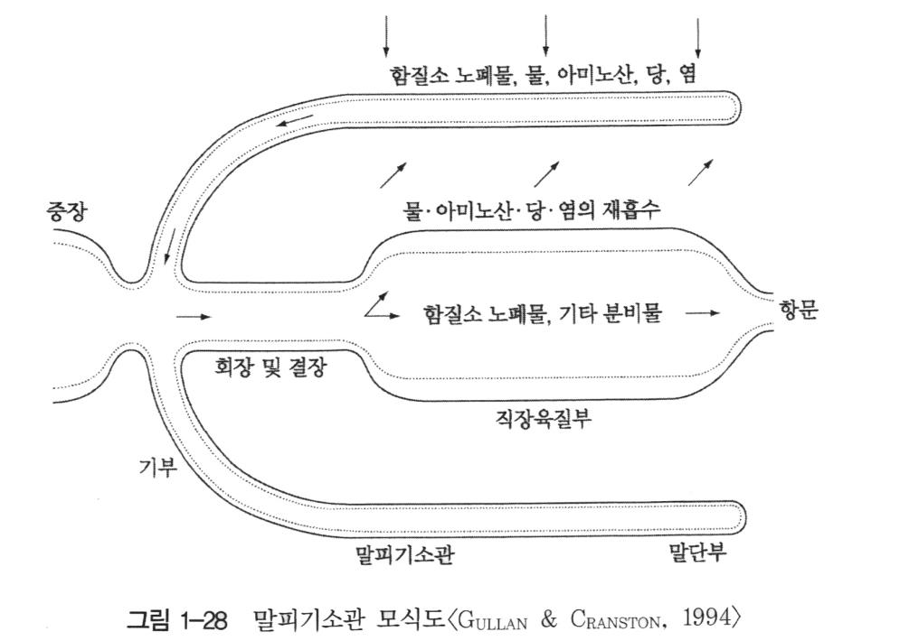

말피기소관(Malpigiantubule): 끝이막힌가는관모양으로, 기부는장과통해있고,
몸에서발생한함질소노폐물등을체액으로부터걸러주는역할

III. 곤충의 형태와 구조

생식계
곤충은대부분암수교미에의하여알을낳는유성생식(예외: 단위생식, 유생생식)

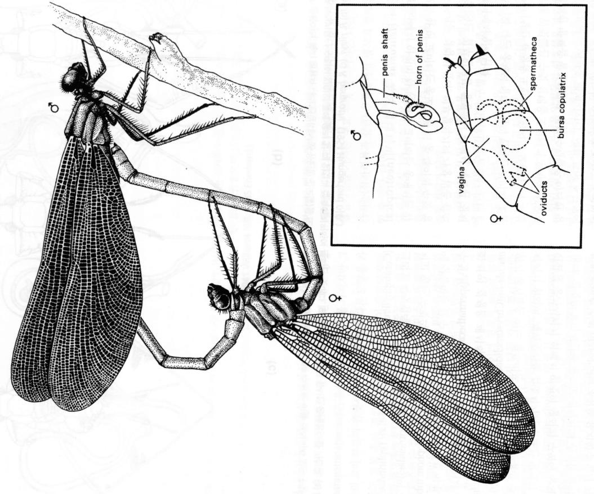

•단위생식(parthenogenesis) : 암컷이교미와수정없이새끼를낳음(예: 진딧물류)
•유생생식(pseudogenesis) : 애벌레상태에서도생식기관의조숙한발달을통해알을낳음(예: 혹파리류빠른진화)
수컷과암컷생식기관의역할
•수컷생식계: 정자를생산하여암컷에게전달할수있도록준비시키는기능
•암커생식계: 수컷의정자를들여와이를산란직전까지보관하고알을생산하여산란을준비하는일담당

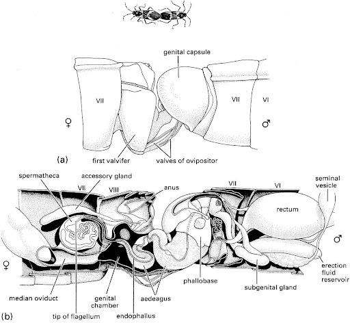

교미중인Oncopeltusfasciatus(Hemiptera)
(Gullanand Cranston, 2005)

III. 곤충의 형태와 구조

순환계(circulatory system)
체강(body cavity) 내체액과함께섞여순환되는개방순환계곤충의체강을'혈강(haemocoel)이라고함.
혈액이세포와직접닿는것이아니며, 기관이나진피는얇은기저막(basement membrance)으로싸여있고이는혈액과의물질교환도움.

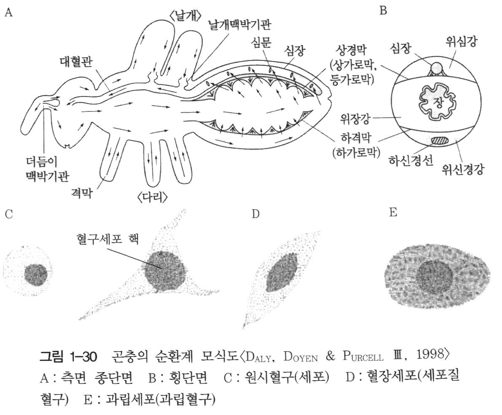

혈관은한개의굵고긴빨대같은혈관이몸안위쪽에존재(등혈관)

등혈관은뒤쪽이심장, 앞쪽이대혈관
심장에는심문(ostium)이라는작은구멍들이좌우로존재이를통해혈액이
들어가고심장이박동을통해이를대혈관쪽으로밀어냄(심문수는가슴에최대
3쌍, 배에최대9쌍존재)
혈액(hemolymph)
-애벌레(몸이부드러운경우) : 20~40%
-성충: 20% 이하차지
-대체로무색, 경우에따라노란색, 녹색(깔따구헤모글로빈으로적색띰)
-기능: 호르몬/영양분전달/교환, 노폐물배출, 산소운반, 공기순환조절,
체온조절과탈피시탈피및팽창도움등

III. 곤충의 형태와 구조

기관계(respiratory system)
수동적기작
기문(가슴과배마디양쪽)을통해외부공기가체내유입기관지(온몸의혈관)을통해세포까지전달
기관지를거쳐기관소지를통해세포나조직으로전달된공기에서산소와이산화탄소의가스교환은농도차에이루어짐(=세포내호흡)
개방기관계: 기문이몸바깥쪽으로나있어외부공기가기관지와연결

대부분여러쌍의기문보유(최대10쌍)
기생성인경우, 폐쇄기관계

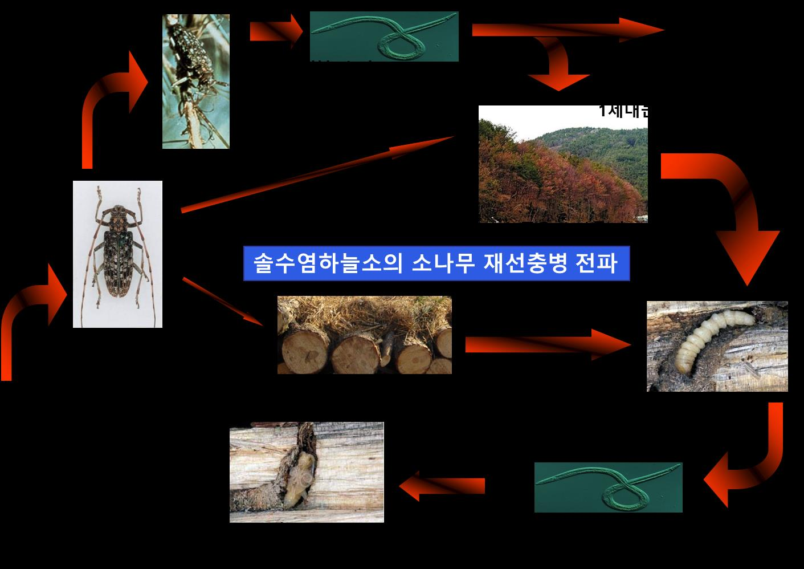

III. 곤충의 형태와 구조

외분비계(respiratory system)
신호물질(화학통신물질, semiochemical) : 몸밖으로분비되어종내또는종간에신호를보내는물질
신호물질의종류
•페로몬(pheromone) : 성페로몬, 집합페로몬, 분산페로몬(또는간격페로몬), 길잡이페로몬, 경보페로몬
•타감물질(allelochemical): 카이로몬, 알로몬, 시노몬
곤충의 페로몬

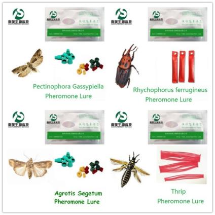

| 성페로몬(Sex pheromone | ) |  |
| --- | --- | --- |

| 집합페로몬(Aggregation phero | mone) |  |
| --- | --- | --- |

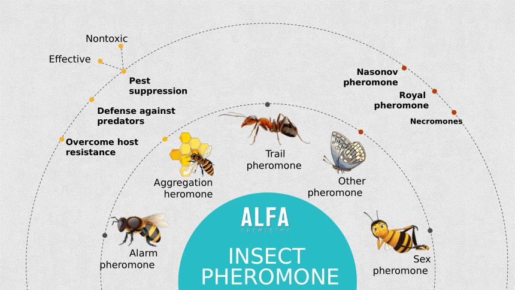

| 경보페로몬(Alarm pheromo | ne) |  |
| --- | --- | --- |

| 길잡이페로몬(Trail pheromo | ne) |  |
| --- | --- | --- |

| 분산페로몬(Dispersal pherom | one) |  |
| --- | --- | --- |

III. 곤충의 형태와 구조

외분비계(respiratory system)
신호물질(화학통신물질, semiochemical) : 몸밖으로분비되어종내또는종간에신호를보내는물질
신호물질의종류
•페로몬(pheromone) : 성페로몬, 집합페로몬, 분산페로몬(또는간격페로몬), 길잡이페로몬, 경보페로몬
•타감물질(allelochemical): 카이로몬, 알로몬, 시노몬
* 타감작용(allelopathy) : 어떤개체가하나이상의생화학적물질을내어다른종의개체의성장, 생존, 번식등에영향을주는생물학적현상

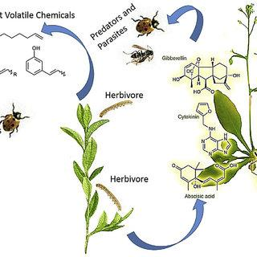

곤충의 타감물질

| 카이로몬(kairomone) |  | •신호물질을분비하는개체에는대체로해가되고이를인지하는개체에는도움이되는결과•포식자가먹잇감이내는페로몬등의화학성분을타감물질로인지할때이는카이로몬에해당 |
| --- | --- | --- |

| 알로몬(allomone) |  | •분비자에게는도움이되지만, 감지자에게는주로손해가되거나또는될수있는경우•식식성곤충에저항하기위해식물이분비하는방어물질 |
| --- | --- | --- |

| 시노몬(synomone) |  | •분비자와감지자모두에게도움이되는결과를낳는물질•어떤식물이식식성곤충에저항하기위한방법으로식식성곤충에기생하는포식기생충을유인하는타감물질을분비하였다면, 이는분비자인식물과감지자인포식기생충에게모두도움 |
| --- | --- | --- |

강의 내용

 해충의 피해
 해충의 방제
 주요 해충 분류군(5대 목)의 형태 및 생태

I. 해충의 피해

1. 해충피해
 해충피해의종류
 직접해(direct damage, 1차적피해)
• 직접잎을갉아먹거나즙액을흡수하여피해를주는것
• 경제적손실을식물또는사람/가축이받는경우
• (예-식물식해) 벼잎벌레, 줄점팔랑나비, 딱정벌레, 도둑나방등
• (예-식물내부가해) 이화명나방, 매미충류, 진딧물, 총채벌레, 노린재등
 간접해(indirect damage, 2차적피해)

| 가해양식 |  | 해충명 |
| --- | --- | --- |
| 독소분비 |  | 벼줄기굴파리 |
| 병매개 |  | 애멸구, 진딧물, 나무좀 |
| 산란 |  | 거위벌레, 국화하늘소 |
| 저작(갉아먹는것) | 줄기, 잎 | 벼잎벌레, 배추흰나비, 벼애나방, 풍뎅이 |
| 저작 과실 | 과실 | 여러가지심식충 |
| 나무, 줄기 | 나무, 줄기 | 하늘소, 나무좀, 이화명나방 |
| 뿌리, 땅속줄기 | 뿌리, 땅속줄기 | 방아벌레류, 고자리파리, 땅강아지 |
| 혹(충영) 형성 |  | 밤나무순혹벌, 포도뿌리혹진딧물 |
| 흡즙 |  | 진딧물, 깍지벌레, 멸구, 매미충류 |

• 곤충의피해로파생되는손해(내충성품종재배로인한수량저하)로
끝동매미충이벼의오갈병을, 진딧물이바이러스병전파하여피해
유발하는등파생되는피해
• 작물종류나재배기간에제약을받은경우
• (예) 방아벌레상처침입으로인한'고구마흑반병',
끝동매미충으로인한'벼오갈병' 등

I. 해충의 피해

1. 해충피해

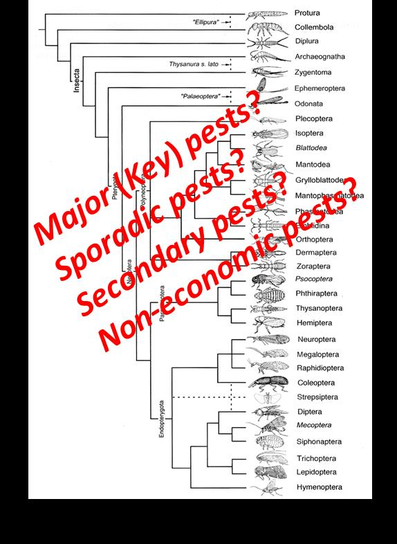

 해충의생태학적분류
 주요해충(= 관건해충)(major or key pests)
• 매년만성적이고지속적으로피해를나타내는해충
• 효과적인천적이없는경우가대부분. 인위적인방제가실행되지않은경우심각한손실가능
• 벼멸구, 솔잎혹파리, 솔껍집깍지벌레등
 돌발해충(sporadic pests)
• 주기적으로대발생하거나평소에는별로문제가되지않던종이밀도를억제하고있던요인들의
제거되거나약화되어비정상적으로대발생하는경우
 2차해충(secondary pests)
• 특정해충의방제로인해곤충상이파괴새로운해충이주요해충화하는경우(응애, 진딧물, 깍지벌레류)
 비경제해충(non-economic pests)
• 작물을가해하기는하나그피해가경미하여방제의필요성이없는해충(많은곤충류포함)

I. 해충의 피해

1. 해충피해
 주요해충분류군

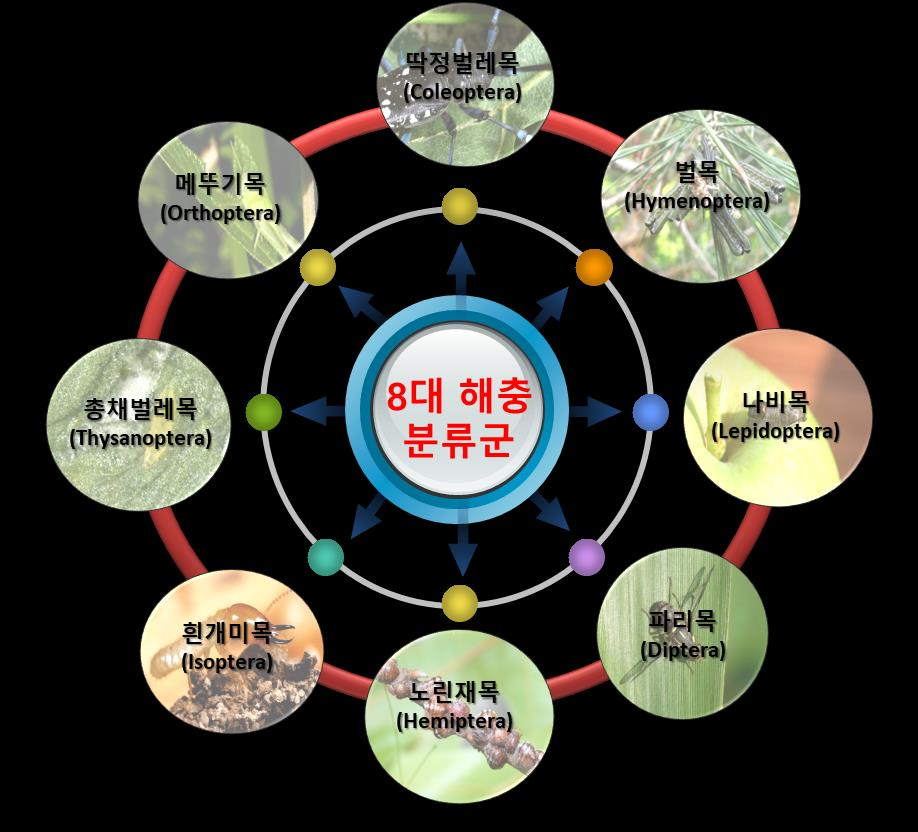

I. 해충의 피해

1. 해충피해
 피해정도의결정
 해충개체수
• 해충수가많으면피해도큼
• 벼에서는수량에도큰영향을미침(가을철멸구의발생정도)
 가해시기
• 어릴때나수확물을직접가해하면피해가더욱큼
• 됫박벌레붙이의의한감자피해: 괴경형성기나경엽신장기에가해심함
• 감자나방(고구마해충) : 8월경고구마의비대기에가장심한피해
• 채소에서는어린묘시기에걸리면때로는치명적으로되어결주(缺株)가되는일이많음.

I. 해충의 피해

2. 방제개념
 방제는생물학적현상을중심으로'경제적합리성' 및'기술적측면'에서검토되어야함
 해충의밀도는일반적으로'해충의밀도'와'피해량'간에'정(正)의상관관계'가있음.
 시간경과에따른개체군밀도와방제
경제적피해수준(economic injury level, EIL) : 경제적피해가나타나는해충의최저밀도(피해액=방제액)
경제적피해허용수준(economic threshold, ET) : 경제적가해수준에도달하는것을억제하기위하여직접방제수단을써야하는밀도
일반평형밀도(general equilibrium position, GEP) : 일반적인환경조건에서평균밀도

I. 해충의 피해

3. 농업생태계와해충발생예찰
 농업생태계의특성

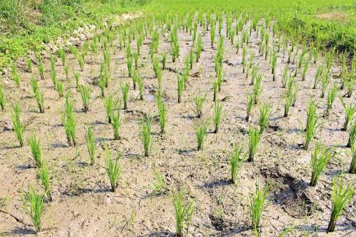

영속성으로자연생태계의생물들에비해수명이짧다.
식물군은환경에대한저항성이약하다.
다양성으로균질도는높고종의다양도는낮다.
재배와관리에는인위적요소가크게관여하고있다.
 해충밀도의변동
출생률, 사망률, 이동등의요소관여
• 출생률:'최대출산능력, 실제출산수, 성비, 연령구성비율'로결정
• 사망률: '노쇠, 활력감퇴, 사고, 물리화학적조건, 천적류, 먹이의부족, 은신처'로결정
• 이동: 확산, 분산, 희귀운동등으로계산
 발생예찰
생물학적예찰: 해충의발생시기와발생량에대한상태
경제적예찰: 어떤시점의작물의종류나생육상태를토대로당시의해충의발생시기와발생량에의하여앞으로있을피해량을추정하는것

I. 해충의 피해

3. 농업생태계와해충발생예찰
 농업해충의변천

농업정보포털(농사로)

I. 해충의 피해

3. 농업생태계와해충발생예찰
 해충조사
 해충조사시고려해야할점
• 방제는해충의존재를전제로해야함
• 해충이있다해도그밀도가어느수준이상이되었을때한하여방제수단이강구된다
 해충조사의종류
• 정성적 조사 : 해충의 종류에 대한 조사. 해충류/주요해충류/천적에 대한 조사 등
• 정량적 조사 : 해충의 밀도에 관한 조사
 해충조사방법
• 성충은 공중포충망, 유아등으로 포집
• 알은 직접 세거나 용제로 씻어내린 후 센다
• 유충과 번데기를 타락법, 후려치기법으로 조사

I. 해충의 피해

3. 농업생태계와해충발생예찰
 해충예찰방법

| 방법 | 설명 |
| --- | --- |
| 야외조사및관찰방법 | • 야외의포장에서발생상황등을직접조사및관찰하는것• 가장기본적인방법 |
| 통계학적방법 | • 해충의발생시기/발생력을상관관계가높은환경요인과의회귀식물으로계산하는방법• 다년간의생물현상과환경요소와의상관관계를이용• 유효적산온도가많이사용 |
| 다른생물현상과의관계를이용하는방법 | • 식물개화시기,곤충의발생시기와해충의관계등을이용하는것• 벼이화명나방과벼애나방의발아최성일은높은상관관계를가지고있음 |
| 실험적방법 | • 해충의휴면타파시기나생리적상태를조사하여해충의생리/생태학적현상을실험적으로예찰 |
| 개체군동태학적방법 | • 개체군의동태를여러가지치사원인과같이조사분석하여해충의밀도변동을치사인자와의관계에서추정하는것 |
| 컴퓨터이용방법 | • 온도,습도,일장,작물의생육상황,품종특성등의상황을컴퓨터로분석하여발제여부를결정하는방법 |

I. 해충의 피해

| 구분 | 분류군 |
| --- | --- |
| 1. 식식성(食植性, Phytophagous) : 살아있는식물을먹는종류 |  |
| 가. 식엽성(植葉性, leaf feeder) | 메뚜기목, 나비목유충, 딱정벌레목유충 |
| 나. 간근성(幹根性, stem and root borer) | 딱정벌레목하늘소과유충 |
| 다. 식근성(食根性, root feeder) | 딱정벌레과일부 |
| 라. 잠엽성(潛葉性, leaf miner) | 굴파리과 |
| 마. 흡즙성(吸汁性, juice sucker) | 매미충과, 진딧물과 |
| 바. 충영성(蟲癭性, gall maker) | 혹벌과 |
| 사. 식균성(食菌性, fungus feeder, mycetophagous) | 버섯벌레 |
| 2. 육식성(肉食性, Zoophagous) : 살아있는동물을먹는종류 |  |
| 가. 기생성(寄生性, parasite) | 다른동물체에사는종류 |
| 나. 온혈동물성(溫血動物性, living on warm-blooded vertebrates) | 이목, 벼룩목, 털이목, 노린재목빈대과, 침노린재 |
| 다. 곤충기생성(昆蟲寄生性, living on insects) | 기생벌유충 |
| 라. 식곤충성(食昆蟲性, entomophagous) | 사마귀목, 강도래과유충, 잠자리목, 노린재목일부, 풀잠자리목유충, 무당벌레, 반딧불이 |
| 마. 흡혈성(吸血性, blood feeder) | 암컷모기, 등에과일부, 체체파리 |
| 3. 부식성(腐食性, Saprophagous) : 죽은유기물질을섭취하는종류 |  |
| 가. 부육식성(腐肉食性, scavenger) | 바퀴벌레목, 파리목일부유충 |
| 나. 부식식성(腐植食性, humers feeder) | 톡톡이목 |
| 다. 식분성(食糞性, dung feeder , coprphagous) | 소똥구리, 파리목일부유충 |
| 라. 시식성(屍食性, carrion feeder) | 검정파리과 |

4. 해충의식성

I. 해충의 피해

4. 해충의식성(초식성의종류)

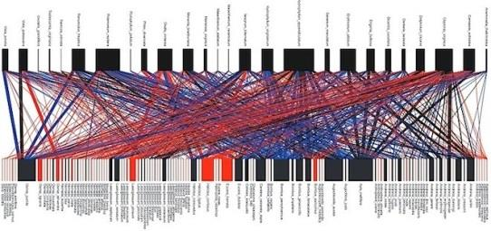

단식성(monophagous)

• 기주식물한종(species)에국한적으로섭식활동
협식성(oligophagous)

• 기주식물:계통적으로근연한다수의속(genus)또는한과의종들섭식

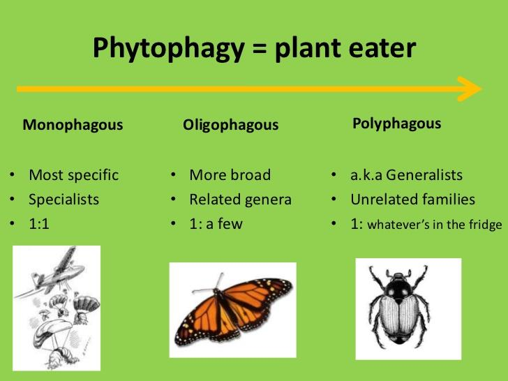

광식성(polyphagous)
• 다양한기주식물범위내의종들을섭식

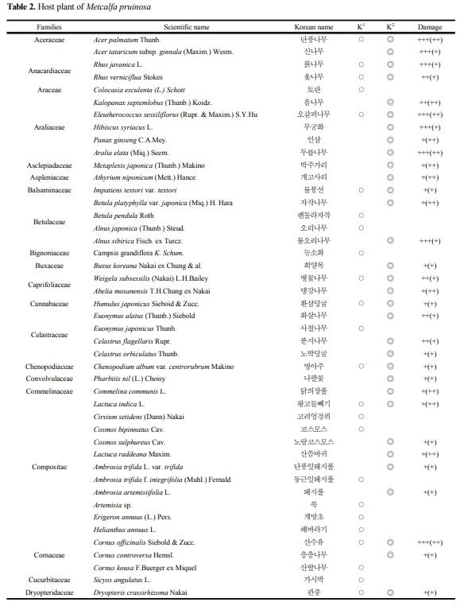

I. 해충의 피해

4. 해충의식성(초식성의종류)

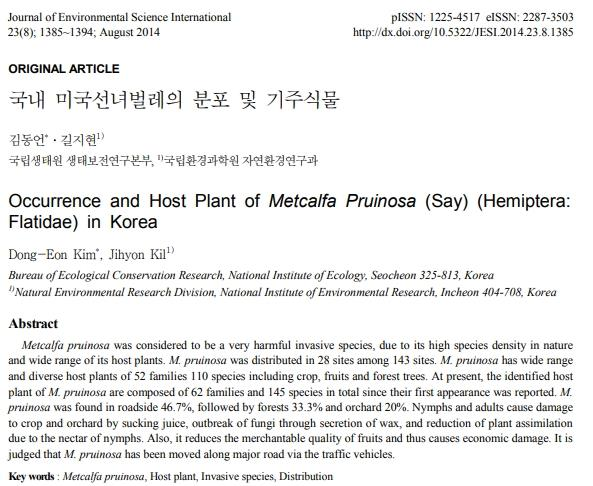

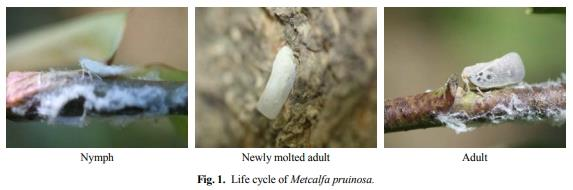

현재까지미국선녀벌레의 기주식물은"52과110종" 기록
(2014년기준)

I. 해충의 피해

4. 해충의종류(식량작물해충) 식량작물(Food crop)
• 식량을생산할수있는작물
• 식량은영양공급면에서인간과동물의생존에필수적인칼로리, 지방질, 단백질, 탄수화물, 비타민과기타무기질등공급

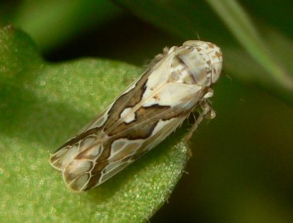

| 식량작물의 종류 |  쌀, 보리, 밀등 옥수수, 콩, 팥, 조, 수수등 고구마, 감자등 |
| --- | --- |

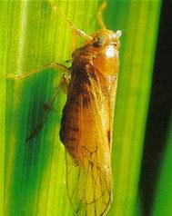

| 식량작물해충종류 |  섭식방법에따른구분: 저작형, 흡즙형 가해령기에따른구분: 유충기, 성충기 가해부위에따른구분: 뿌리, 줄기, 잎, 꽃또는열매 |
| --- | --- |

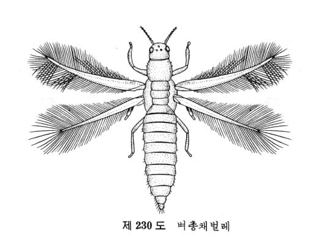

벼메뚜기 벼총채벌레

I. 해충의 피해

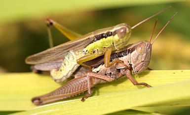

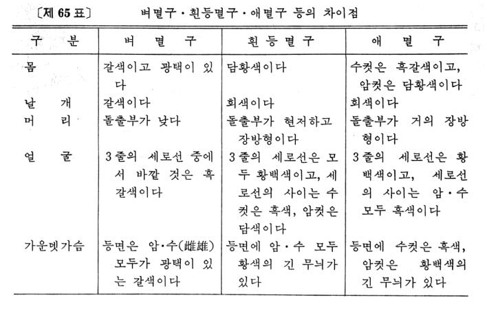

4. 해충의종류(식량작물해충)
-벼
벼메뚜기 벼총채벌레

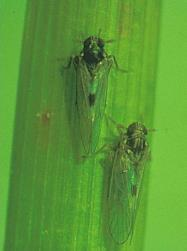

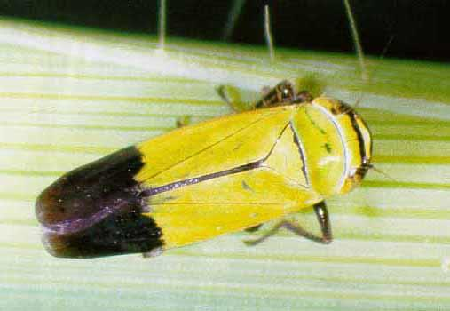

끝동매미충 번개매미충

벼물바구미
이화명나방 벼밤나방 벼잎벌레

I. 해충의 피해

4. 해충의종류(식량작물해충)

-보리/조
조명나방 멸강나방

보리굴파리 보리잎벌

I. 해충의 피해

4. 해충의종류(식량작물해충)
-콩, 팥
콩잎말이명나방
아카시아진딧물 콩진딧물

콩은무늬밤나방
콩나방

완두굴파리

I. 해충의 피해

4. 해충의종류(시설특용작물해충)
시설재배(cultivation under structure)
• 유리온실이나플라스틱하우스와같은인공시설하에서인위적으로재배환경을조절하면서작물을재배하는방법이총칭
• 이러한방법으로생산된작물을통틀어시설재배작물또는시설작물이라고함.
특용작물(industrial crop)
• 식용이외의특수용도에쓰이는농작물을의미함.
• 한약재로사용되는식물을포함하는기타농작물을포함함.

| 시설재배작물의종류 |  채소류: 배추, 오이, 고추, 토마토, 파프리카, 딸기등 화훼류: 국화, 튤립등대부분의원예작물 |
| --- | --- |

| 특용작물의종류 |  참깨, 땅콩등과같은견과류나기름을생산하기위한작물 담배 인삼, 버섯등과같은약용또는기타작물류 |
| --- | --- |

I. 해충의 피해

4. 해충의종류(시설특용작물해충)

오이총채벌레
땅강아지
파총채벌레

배추흰나비
배추좀나방

I. 해충의 피해

4. 해충의종류(과수산림해충)
샌호제깍지벌레 배나무흰깍지벌레

긴솜깍지벌레붙이 가루깍지벌레

이세리아깍지벌레 루비깍지벌레

뽕나무깍지벌레

I. 해충의 피해

4. 해충의종류(과수산림해충)
솔나방 매미나방 미국흰불나방

광릉긴나무좀
밤바구미

오리나무잎벌레 도토리거위벌레

I. 해충의 피해

4. 해충의종류(가해부위에따른구분)
농업정보포털(농사로)

| 구분 | 과수 | 채소 | 화훼 | 식량 |
| --- | --- | --- | --- | --- |
| 잎가해 | 나비목유충, 주둥무늬차색풍뎅이,잎말이나방류 | 나비목유충, 잎벌레, 바구미성충,총채벌레류, 굴파리류 | 굴파리류, 총채벌레류, 달팽이류,점박이응애, 진딧물류, 온실가루이 | 벼잎벌레, 혹명나방, 벼애나방, 멸강나방,벼물바구미성충, 벼총채벌레,벼잎굴파리, 벼애잎굴파리 |
| 잎, 줄기가해 | 굴나방류 |  | 파밤나방, 담배거세미나방 | 벼멸구, 흰등멸구, 애멸구, 끝동매미충 |
| 줄기가해 | 나무좀류, 하늘소류, 박쥐나방,깍지벌레류 | 거세미나방, 땅강아지, 고자리파리 | 깍지벌레류 | 이화명나방, 벼밤나방유충 |
| 뿌리가해 | 풍뎅이유충, 매미유충 | 풍뎅이유충, 방아벌레, 뿌리혹선충류,뿌리썩이선충류 | 풍뎅이유충 | 벼물바구미유충, 벼뿌리바구미 |
| 꽃가해 | 풍뎅이류 |  | 총채벌레류, 파밤나방, 담배거세미나방 | 노린류, 끝동매미충 |
| 혹형성 | 혹나방류, 혹벌류 | 뿌리혹선충 |  |  |
| 바이러스매개 | 진딧물류 | 진딧물류 |  | 애멸구, 끝동매미충 |

I. 해충의 피해

5. 작물별주요농업해충

벼물바구미

애멸구

흰들명구

I. 해충의 피해

5. 작물별주요농업해충

I. 해충의 피해

5. 작물별주요농업해충

II. 해충의 방제

1. 해충방제의종류
 물리적(기계적) 방제: 기구나온습도, 광선등힘으로방제하는방법
 화학적방제: 농약을이용하는방제법
 생물적방제: 천적이나생물을이용하는방제법
 재배적방제: 저항성(내충성) 품종이나경운, 재배시기조절, 내충성품종, 재배시기의조절등과같은재배적수단을이용하는방제법
 법적방제: 국가의명령(법등)에따른방제로국가나지역간검역법등으로방제하는방법
 종합적방제: 모든방법을같이쓰는것보다는여러방법중에서가장적절하고가장효율적이며환경에피해가적도록방제하는방법

II. 해충의 방제

2. 예방과구제
 예방(prevention)
 내충성품종이용, 발생환경의개변, 재배시기조절, 기피제살포등대표적
 보통때부터예방에주의해충이발생최소화구제는쉽고효과적
구제(elimination)
 약제살포/등화유살등의구제방법: 결과가즉시나타나는특징(상황에따라서반복행할필요)
 해충의발생이심해진경우: 일찍실시.
(예) 과수원에서의동계구제: 앞으로발생을억제하는의미에서행하는것= 예방적조치
 천적에의한구제: 효과가오랫동안계속되므로예방상중요함

II. 해충의 방제

3. 해충의방제법
 재배적방제(cultural control) = 생태적방제
 해충의생활환경을여러가지방법으로개선하여해충이발생하기어렵고발생량이억제될수있게끔하는것
 해충의식성, 발생시기등생태학적특성을고려하여환경조건을바꾸어주고재배법이나시기등을조절하는것
 재배적방제의방법
• 환경조건의변경: 해충이많이발생하는시기를피하게끔시기조절
• 미기상의조절: 농경지(논, 밭) 기상조건을변경하여해충의번식/활동억제(논의관개수물의온도상승효과)
• 포장위생: 수확후포장에남아있는작물/식물잔사물제거(해충월동, 발생경과, 행동습성에대한지식필요)
• 경운: 토양의화학적성질, 수분함량, 토종생물등의영향
• 재배시기조절: 조생종/만생종의선택등
• 내충성품종이용: 비선호성, 항충성, 내성
• 윤작: 이동성이적은해충(방아벌레유충등)의경우윤작을통해해충발생억제가능. 전작물/후작물
• 토성개량: 땅속에생활하는해충목표.
(예: 각다귀는배수가양호한토양에발생적고, 포도뿌리혹벌레는모래땅에발생이적음)
(예: 질소과용의논에는이화명나방, 멸구류의발생많음)
• 재배관리개선: 간작, 토성개선, 재배시기조절, 재식거리, 입지조건, 인분뇨처리등)

II. 해충의 방제

3. 해충의방제법
 물리적방제: 해충을맨손이나간단한기계류를서서방제하는것
 물리적방제의방법
• 유살(insect slaughter) : 해충의특이한행동습성을이용해서유인하여사멸시키는방법(예: 주광성곤충유아등)
• 포살(insect shot)

-직접법: 포살, 척살, 압살, 궤살, 타살등
-간접법: 타락, 흔들기, 갉아내리기, 긁기, 피해부의제거, 선별, 끈끈이포충망의이용등
노력이많이들고일반적으로넓은면적일때에는'약제살포' 유리
• 차단(blocking) : 과수원등지에서과실에종이주머니를씌워주는것심식나방피해억제
• 온도처리: 고운/저온의장기적처리
-고온처리: 60~66도의고온에서짧은시간에사멸(태양열, 온수, 증기, 불등)

-저온처리: 5~15도에서활동중지. -27~0도에서사멸(저온고온저온처리)
• 수분처리: 곡물저장시, 함수량이12% 이하에서는해충발육거의불가능
• 광선처리: 유아등/고주파를이용. 방사선은치사작용과불임작용

II. 해충의 방제

3. 해충의방제법
 화학적방제
 약제에의한방제(화학적방제)목표
• 적어도해당포장에있는해충전멸시키거나그에가깝게목표세움
• 진딧물등은약간이라도살아남아있으면그것이번식하여곧먼저상태로되므로철저하게구제
 살충제의합리적사용법
• 약제의선택: 독제(저작형)는갉아먹는저작형입을가진해충에게적용가능
• 살포방법: 분제, 수화제, 유제등의형태에따라서, 또목적으로하는해충/작물상황에따라서살포방법을달리함.
• 약제살포의농도와살포량: 무리하게높은농도로뿌리는것지양.
• 살포시기와횟수: 살포적기는해충의발생상황/작물의상태/약제의종류등에의해결정초기에구제

II. 해충의 방제

3. 해충의방제법

 화학적방제의역사
제충국
(Tanacetumcinerariifolium, 국화과)

DDT(Dichlorodiphenyltrichloroethane) 살포

BT제

II. 해충의 방제

3. 해충의방제법
 화학적방제(체내침입경로에따른분류)
소화중독제(stomach poison)
• 약제가해충의구기를통하여소화관내에들어가중독작용을일으켜살충작용을나타내는것
• 해충이붙어있는식물의중기, 잎등의앞, 뒷면에살포또는독먹이제조
접촉제(contact insecticide)
• 해충의체표면에직접또는간접으로약제를접촉시켜기공이나체표를통하여충체내로침입시키거나기문이나기관을
막히도록하여살충작용을나타내는것
• 속효성(제충국제, 니코틴제), 지효성(fenthion)
훈증제(fumigant)
• 약제의분자량이작아기화시킨약제를해충의기문을통하여호흡기로빠르게침투시켜살충작용을나타내는것
침투성살충제(systemic insecticide)
• 작물의뿌리, 경엽, 나무의수간등특정부분에약제를스며들게하여작물체전체로이동시킨으로써약제를처리하지않은
부분에서도작물을가해하는해충이섭식하여살충작용을나타내는것

II. 해충의 방제

3. 해충의방제법
 화학적방제의장단점

| 장점 | 단점 |
| --- | --- |
| 해충에대한적용범위가넓다. | 해충에대한적용범위가넓다. |
| 효과가빠르다. | 잠재해충이해충화할수있다. |
| 단독또는합제로수종해충의동시방제가가능하다. | 약제처리시만방제가가능하다. |
| 소유지방제가가능하다. | 수시적방제로매회비용이필요하다. |
| 사용이간편하다. | 저항성해충의출현가능성이높다. |
| 새로운해충이출현해도기존살충제로방제가가능하다. | 해충의밀도회복속도가빠르게나타날수있다. |
| 가격이저렴하다. | 과용과오용으로인축및환경에잔류독성을일으킬가능성이있다. |

II. 해충의 방제

3. 해충의방제법
 생물적방제: 천적, 불임성, 유전학적원리, 내충성품질이용및경쟁에의한치환현상등'생물자체'를해충의개체군밀도억제수단으로
이용하는방법
생물군집내의해충과천적간의평형현상과관계되는종구성문제, 개체군밀도간의상호작용, 무생물적환경요인의생물에미치는영향과
광범위한생태학적지식을토대로계획되고수행되어야함.
 천적의종류
 포식성천적
• (예) 칠레이리응애, 무당벌레, 칠성품잠자리, 어리줄품잠자리, 오이이리응애, 애꽃노린재, 진디혹파리등
• 저작형입틀(무당벌레, 사마귀등), 흡즙형입틀(침노린재, 풀잠자리유충, 꽃등에유충등)

 기생성천적: 콜레마니진디벌, 온실가루이좀벌, 굴파리좀벌, 잎굴파리고치벌등
 천적유지식물(banker plant) : 천적을유지증식시킬수있는식물

II. 해충의 방제

3. 해충의방제법
천적의종류

애꽃노린재 콜레마니진딧벌 칠리이리응애 온실가루이좀벌

II. 해충의 방제

3. 해충의방제법
 미생물살충제의 장/단점

| 장점 | 단점 |
| --- | --- |
| 해충에대하여기주특이적작용 | 근연종의해충이혼재하여발생한경우, 종에대한기주특이성이크게작용하여한종류에만감염되고다른종효과없음. |
| 환경변화에대하여비교적안정성 | 특정한해충에제한하여사용하기때문에방제비가비쌈 |
| 침입해충에종종높은독성 | 방제제를생산하고적용하는데기술과관리문제 |
| 화학적방제와천적과같이사용가능 | 화학적살충제와같이특허를가질수없어비전매품 |
| 일부바이러스는자연자원으로부터수집이용가능 | 자외선, pH, 열등과같은물리적요소에민감한반응 |

II. 해충의 방제

3. 해충의방제법
 페로몬(pheromone)의특징과이용
 페로몬
 특정한생물적기능을저해, 자극시킬수있는물질
 개체들사이의생리적/행동적활동조절, 개체에서발산되는단일또는혼합화합물로같은종의다른개체가반응

II. 해충의 방제

3. 해충의방제법
 법적방제: 외국으로부터새로운해충침입을방지, 국내해충이크게발생할경우법령에의하여조치하는것(식물방역법)
 식물검역: 외지로부터새로운해충의침입을막기위해병해충이붙어있을가능성이있는단체물건조사, 제거를위한여러가지조치를
취하는것(수출입식물검역, 국내식물검역)

 방제명령: 침입해충의구제/저지를위한재배, 이동제한/금지명령, 소독/폐기등의조치명령

II. 해충의 방제

II. 해충의 방제

II. 해충의 방제

II. 해충의 방제

3. 해충의방제법
 법적방제: 외국으로부터새로운해충침입을방지, 국내해충이크게발생할경우법령에의하여조치하는것(식물방역법)

 생물적경로(Animate pathway)
재식용수입식물검역해충연구
•묘목류–파종·재식용수입식물중, >85%(건수), ≒50%(수량)
•구근류–파종·재식용수입식물중, > 7%(건수), ≒40%(수량)
 비생물적경로(Inanimate pathway)
자연적요인–태풍등(멸강나방, 애멸구, Asian Citrus Psyllid)
비자연적요인
•선박, 컨테이너–썩덩나무노린재
•목재(포장재)–유리알락하늘소
•군수물자–버즘나무방패벌레

II. 해충의 방제

3. 해충의방제법

 종합적방제
해충종합관리(IPM, Integrated pest management)
Integration : 여러 가지 다른 유해
생물에 대한 영향을 감안하여 어떤
유해생물의방제에복수의방제수단을

상호모순없이조화롭게사용하는것
Management : 생태학적
원리와 사회경제적 측면을
Pest : 인간에게 유해한 무척추동물,
고려한행위
척추동물,병원미생물,잡초등의생물

II. 해충의 방제

3. 해충의방제법
 종합적방제
생물적방제/화학적방제의장점을살리고, 단점을보완하는것을목적으로둠
여러가지방제수단을유기적으로도모/이용해충피해를작물의경제적피해수준이하로유지될수있도록해충발생량관리방제체계
 종합적방제필요성
살충제에대한저항상계통해충출현

방제후해충밀도의조속한회복
2차해충의발생량증가
살충제의독성문제
 종합적방제의방안
토착천적의이용
살충제합리적이용
작물의품종저항성증대
발생예찰

II. 해충의 방제

3. 해충의방제법
 종합적방제관리수행시, 기본적실천사항
 전혀 농약을사용하지않고경작을하는 것이 아니라, 꼭 필요한때만 농약을사용하며, 될 수 있는한 이로운동물이나천적에 영향이적은
선택적농약을사용한다.
 해충을멸종 또는 박멸하는것이 아니라자연 생태계의일원으로또는 천적의먹이로서우리인간에게경제적피해를주지 않는 수준 이하로
억제한다.
 어떠한방제수단도각각장단점이있으므로발생시기, 발생량에따라 방제수단을강구하고, 농약은재배적인관리나 천적을고려하여최후의
수단으로사용한다.
 문제되고있는특정 해충만주목하지말고 작물이생장하고있는 전체면적에서살고 있는 천적이나문제되지않는 않는 곤충및 생물의
영향도고려하여방제체계를수립한다.
 단위면적당최대수량에목표를두지 않고 부가가치를 최대로높이는최적수량을목표로한다.

III. 주요 해충 분류군(5대 목)의 형태 및 생태 특성

Insecta(곤충강) (30목)
Apterygota(무시아강, 無翅亞綱)
Pterygota(유시아강, 有翅亞綱)
Palaeoptera(고시류, 古翅類)
Neoptera (신시류, 新翅類)
Orthopteroid(메뚜기분류군)
Hemipteroid(노린재분류군)
Endopterygota(내시류)
그림. 곤충목(order)계통
(Gullan& Cranston, 200

III. 주요 해충 분류군(5대 목)의 형태 및 생태 특성

딱정벌레목(Coleoptera)의 주요 형태 및 생태
(세계약40만종, 국내3,700여종)

|  | 진단학적형태형질(특징) |
| --- | --- |
|  | 진단학적형태형질(특징) |
|  |  날개(Wings): 앞날개(elytra) 는두껍고가죽질화, 뒷날개는막질형 구기(Mouthpart) : 씹는입틀또는빠는입틀 더듬이(Antenna) : 매우다양(무릎형, 실형, 곤봉형등) |
|  | 생태학적특성 완전변태(Holometmorphosis) 대부분식식성(Phytophagous), 포식성(Predaceous), 균식성(Fungivorous)-일부시식성(Scavengers), 기생성(Parasitic) 목재, 과실, 뿌리내부섭식또는잠엽성 저장농작물가해(쌀바구미,팥바구미등) 식물병원체매개(소나무재선충, 참나무시들음병원균등) 자원화가능한다수포함: 장수풍뎅이, 사슴벌레, 비단벌레등애완(정서)곤충 지표성곤충연구분류군: 딱정벌레과, 수서성딱정벌레등 |

그림. 생물분류군별기록종수
(Bouchard, 2014)

|  | 구분 | 대표해충 |
| --- | --- | --- |
|  | 식량 | 벼잎벌레,벼물바구미 |
|  | 과수 | 포도호랑하늘소,복숭아거위벌레등 |
|  | 산림 | 솔수염하늘소,밤바구미등 |

III. 주요 해충 분류군(5대 목)의 형태 및 생태 특성

벌목(Hymenoptera)의 주요 형태 및 생태
(세계 약 12만종, 국내 2,800여종)

|  | 진단학적형태형질(특징) |
| --- | --- |
|  | 진단학적형태형질(특징) |
|  |  잎벌아목(Symphyta)과벌아목(Apocrita)구분(전신복절의유무차이) 날개(Wings): 앞, 뒷날개모두투명또는약간불투명한막질형 더듬이(Antenna) : 가늘고김(감각기발달) |
|  | 생태학적특성 완전변태(Holometmorphosis) 대부분잎벌아목식식성(Phytophagous), 벌아목포식성(Predaceous), 기생성 주로식식성인잎벌아목의종, 위생곤충(독함유종: 말벌등)들이해충으로포함 유용곤충: 해충의기생성천적(청벌상과등다수상과), 화분매개충(꿀벌상과) 등 주요연구분류군: 지표성(개미과), 해충천적분류군, 화분매개곤충분류군, 독물질 |

잎벌아목 벌아목
(Symphyta) (Apocrita)

|  | 구분 | 대표해충 |  |
| --- | --- | --- | --- |
|  | 식량 | 보리잎벌 |  |
|  | 과수 | 배나무줄기벌 |  |
|  | 산림 | 밤나무순혹벌,잣나무넓적잎벌등 |  |

III. 주요 해충 분류군(5대 목)의 형태 및 생태 특성

나비목(Lepidoptera)의 주요 형태 및 생태
(세계 약 16만종, 국내 3,800여종)

|  | 진단학적형태형질(특징) |
| --- | --- |
|  | 진단학적형태형질(특징) |
|  |  나비류(Butterflies)와나방류(Moths)구분(더듬이, 날개시맥등차이) 날개(Wings): 인편(Scales)으로덮혀있음. 더듬이(Antenna) : 나비류(곤봉형),나방류(빗살무늬형, 실형등다양) 구기(Mouthparts) : 빨대형(Sucking type) |
|  | 생태학적특성 완전변태(Holometmorphosis) 유충식식성(Phytophagous) → 작물에큰경제적피해야기분류군 식물섭식부위(생태적지위): 가장자리, 잎중앙, 잠엽성(굴형성) 등 일부분류군(독나방, 쐐기나방등)은알러지(Allergy) 반응유발 |

|  | 구분 | 대표해충 |  |
| --- | --- | --- | --- |
|  | 식량 | 이화명나방,벼밤나방,혹명나방,벼애나방등 |  |
|  | 시설, 특용 | 배추좀나방,도둑나방,담배나방등 |  |
|  | 과수 | 사과굴나방,복숭아유리나방,포도유리나방등 |  |
|  | 산림 | 솔나방,매미나방,미국흰불나방등 |  |

III. 주요 해충 분류군(5대 목)의 형태 및 생태 특성

파리목(Diptera)의 주요 형태 및 생태
(세계 약 16만종, 국내 1,400여종)

|  | 진단학적 형태형질(특징) |
| --- | --- |
|  | 진단학적 형태형질(특징) |
|  |  등에아목(Brachycera),모기아목(Nematocera)구분(더듬이, 평균곤차이등) 날개(Wings): 앞날개1쌍발달, 뒷날개1쌍퇴화(평균곤, halteres진화) 구기(Mouthparts) : 빨대형(Sucking), 스폰지형(Sponge), 찌르기형(Piercing) |
|  | 생태학적 특성 완전변태(Holometmorphosis) 유충식식성, 흡혈성, 질병매개성종다수, 포식성종포함 동물흡혈, 바이러스매개등많은종이위생곤충에포함 다른해충을포식하는종(파리매, 광릉왕모기등)포함, 수분함량을높은서식처선호 |

등에아목 모기아목
(Brachycera) (Nematocera)

|  | 구분 | 대표해충 |  |
| --- | --- | --- | --- |
|  | 식량 | 벼줄기굴파리,벼잎물가파리,보리굴파리등 |  |
|  | 시설, 특용 | 고자리파리등 |  |
|  | 산림 | 솔잎혹파리 |  |

| III. 주요 해충 분류군(5대 목)의 형태 및 생태 특성노린재목(Hemiptera)의 주요 형태 및 생태(세계 약 11만종, 국내 1,900여종)진단학적형태형질(특징) 노린재아목(Heteroptera), 매미아목(Auchenorrhyncha), 진딧물아목(Sternorrhyncha) 소순판(Pronotum) : 역삼각형 날개(Wings): 앞쪽2/3 혁질형, 뒤쪽1/3 막질형생태학적특성 불완전변태(Hemi-metamorphosis) 식물병원균매개, 식물생장초기피해생육저해 약충, 성충모두식식성또는포식성 수서성(물장군, 게아재비등), 반수서성(소금쟁이), 육서성(대부분의종) 군집생활, 짧은세대기간, 빠른진화력, 다수의토착해충, 외래해충포함구분 대표해충애멸구, 벼멸구, 끝동매미충,식량번개매미충,콩진딧물등시설, 특용 목화진딧물등과수 깍지벌레류,진딧물류등산림 솔껍질깍지벌레등 |  |  |  |  |
| --- | --- | --- | --- | --- |
| 구분 대표해충 |  | 구분 | 대표해충 |  |
| 애멸구, 벼멸구, 끝동매미충, 식량 번개매미충,콩진딧물등 |  | 식량 | 애멸구, 벼멸구, 끝동매미충,번개매미충,콩진딧물등 |  |
| 시설, 특용 목화진딧물등 |  | 시설, 특용 | 목화진딧물등 |  |
| 과수 깍지벌레류,진딧물류등 |  | 과수 | 깍지벌레류,진딧물류등 |  |
| 산림 솔껍질깍지벌레등 |  | 산림 | 솔껍질깍지벌레등 |  |

|  | 진단학적형태형질(특징) |
| --- | --- |
|  | 진단학적형태형질(특징) |
|  |  노린재아목(Heteroptera), 매미아목(Auchenorrhyncha), 진딧물아목(Sternorrhyncha) 소순판(Pronotum) : 역삼각형 날개(Wings): 앞쪽2/3 혁질형, 뒤쪽1/3 막질형 |
|  | 생태학적특성 불완전변태(Hemi-metamorphosis) 식물병원균매개, 식물생장초기피해생육저해 약충, 성충모두식식성또는포식성 수서성(물장군, 게아재비등), 반수서성(소금쟁이), 육서성(대부분의종) 군집생활, 짧은세대기간, 빠른진화력, 다수의토착해충, 외래해충포함 |

