# kocw_식물보호학_07

|  | 2021년도 2학기 - 식물보호학농림해충 - 3 (수목해충 및 토양곤충) |
| --- | --- |

| 2021년도 2학기 - 식물보호학 |
| --- |
| 농림해충 - 3 (수목해충 및 토양곤충) |

강의 내용

▸ 수목 해충 일반
▸ 수목해충의 구분
▸ 수목해충의 방제
▸ 지표성 곤충(토양 곤충)

생태계와 생물다양성(산림의 중요성)

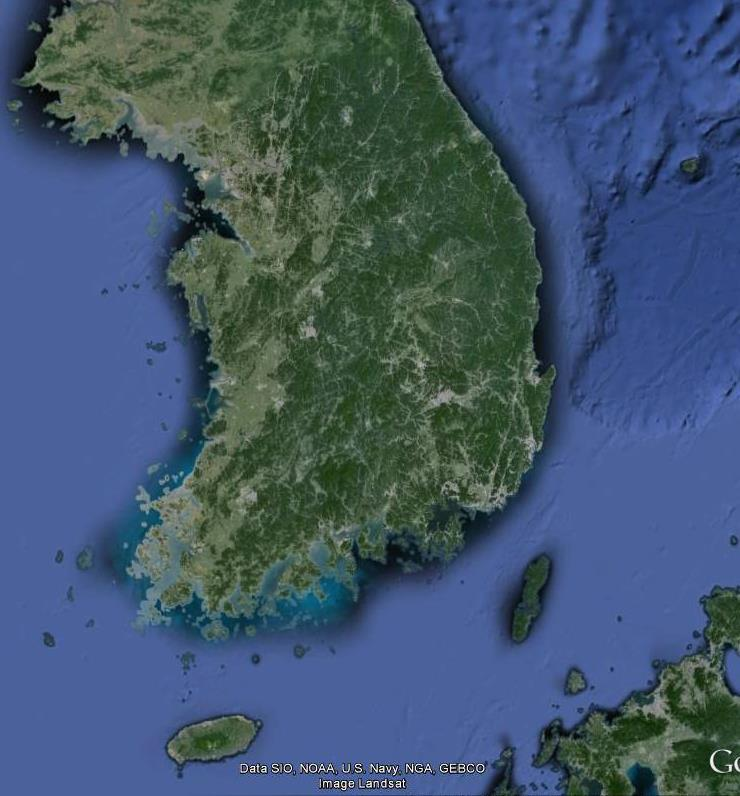

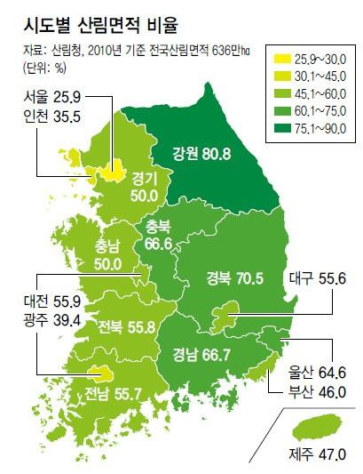

• 남한총면적: 997만 ha
• 남한 총 산림면적: 636만 ha (63.9%)
(OECD 4th) (산림청, 2010)

수목해충 일반(수목해충이란?)

▸ 해충 : 인간의 생활에 직접 또는 간접적으로 해를 주는 벌레(곤충류 + 응애류) 총칭
▸ 식물해충은 인류의 먹거리(식량) 생산에 영향을 주는 농업분야에 초점이 맞추어져 있었으며, 산림이나 수목은 직접적인 경제적 이익보다는
간접적인 공익적 기능이 강하여 병해충 피해에 대한 관심이 상대적으로 적은 편
▸ 최근 산림에 대한 공익적 기능의 부각과 도시민들의 일상생활에서의 쾌적한 녹지공간에 대한 요구 증가로 수목에 피해를 주는 병해충에 대한
관심도 증가
▸ 산림해충 : 산림생태계의한 구성요소인 수많은 곤충 중에서 인간이 산림에서 기대하는 역할을 직접 또는 간접적으로 저해하는 특정 종 → 이러한
해충이 목재생산기능과 조경수의 건강을 해치게 될 때 "수목해충"으로 인식될 수 있음.

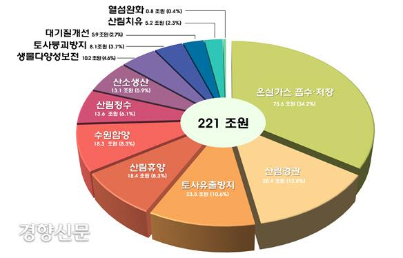

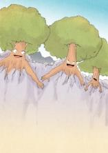

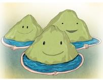

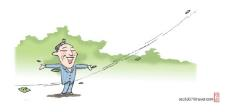

수목해충 일반(수목해충이란?)

|  | 외국에서 침입한 해충 |
| --- | --- |

▸ 외국에서곤충이우연히침입한경우, 원산지로에서는천적등으로인하여 오랫동안생태계내에서밀도조절이이루어져큰문제가없었으나, 곤충만국내로유입될경우
천적의부재로인하여밀도가크게 늘어나면서해충화
▸ 북아메리카대륙이원산지인해충(미국선녀벌레, 불나방, 버즘나무방패벌레, 소나무재선충), 중국에서유입된 해충(꽃매미), 일본에서유입된해충(밤나무혹벌,
솔잎혹파리)가있으며, 최근에는교역량이증가하면서꽃매미, 미국선녀벌레등외국에서유입되어해충화되는곤충의종류도증가하는추세임.
▸ 반대로, 동북아시아가원산인유리알락하늘소, 서울호리비단벌레, 썩덩나무노린재, 장수말벌등이북아메리카로침입하여활엽수류에막대한경제적피해를야기하고
있음.

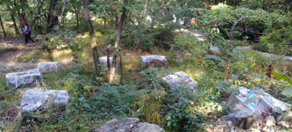

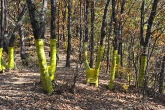

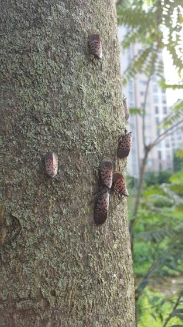

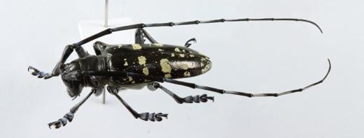

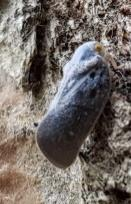

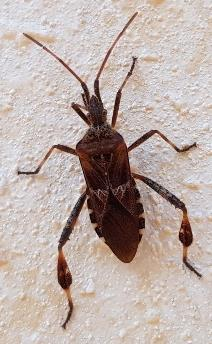

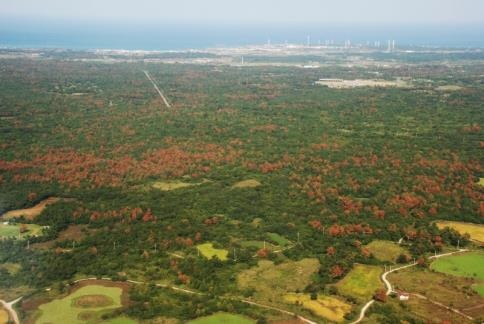

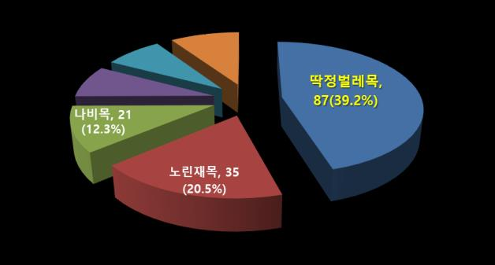

수목해충 일반(수목해충이란?)

|  | 환경조건의 변화로 인한 해충 |
| --- | --- |

▸ 과거에는크게문제가되지않던곤충이환경조건의변화로인해 큰피해를 야기하는경우
▸ (사례1) 과거1960년대산지와사방지약60여만ha에200여본의오리나무를식재하면서"오리나무잎벌레"의밀도가크게증가하여1980년도최고3만5,000ha까지
피해
▸ (사례2)과거가장중요한산림해충으로인식되었던솔나방도적극적인방제나천적등다양한요인에의해밀도가감소하였지만, 임상의변화에따라 호건성인
솔나방의폐사육이증가하며피해가감소한 경우
▸ (사례3) 최근기후변화등으로인하여봄철 고온건조한기후조건과살충제오남용으로인한 천적상의파괴로관상수목에서응애류피해증가

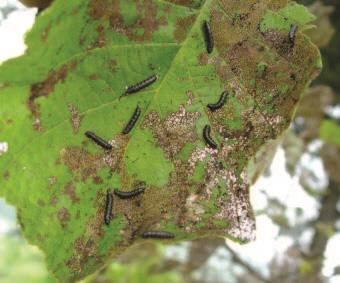

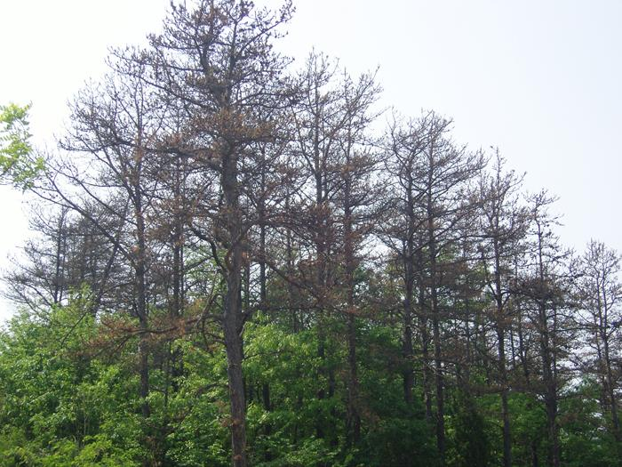

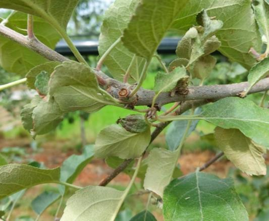

오리나무잎벌레의 피해 솔나방(유충)의피해 사과응애피해

수목해충 일반(수목해충이란?)

|  | 사람의 입장에서 본 해충 |
| --- | --- |

▸ 해충이란인간을중심으로한상대적개념 → 시대나사회성의변화에따른 곤충에대한반응의정도가달라져해충화되는경우
▸ 도심지내에식재된조경수의식엽성(잎을먹는특성) 해충을보면, 밀도가높지않을경우수목의생장에큰영향을주지않아해충이아닐수있지만, 사람들에게
혐오감을줄경우해충이되어방제의대상이 될수있음.
▸ 진딧물류, 깍지벌레류, 매미충류의해충은수목을흡즙 가해하면서감로를 분비하는데도심지조경수의경우감로가자동차나공작물에떨어져 더럽히는경우문제가됨.

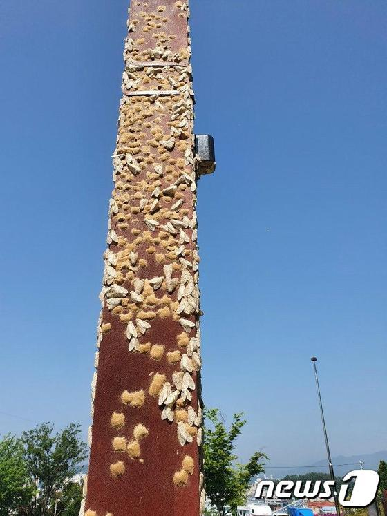

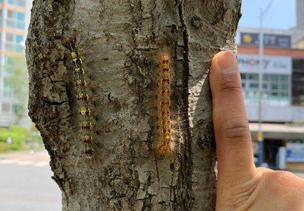

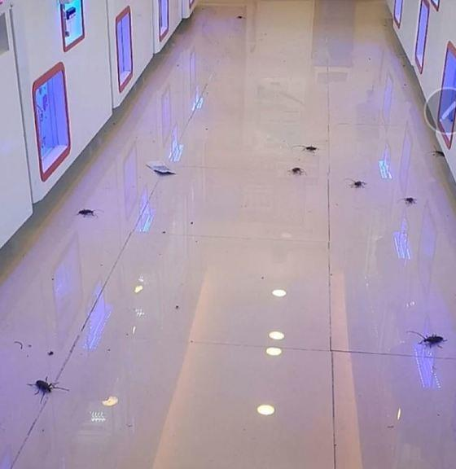

수목해충 일반(수목해충이란?)

|  | 해충 자신의 변화 및 적응 |
| --- | --- |

▸ 해충의밀도를억제하는요인이약화되거나제거되어밀도가높아짐으로써피해가커지는경우
▸ 농약오남용→천적의밀도가낮아져해충의밀도억제요인이감소→해충대발생
▸ 살충제에대한저항성이발달→ 해충대발생
▸ (예시) 밤나무혹벌은1958년우리나라에서피해발생이 확인된이후재래종 밤나무에막대한피해가발생하였으나, 1960년대내충성품종을도입하여대대적으로
보급하자방제가성공하는듯했으나, 밤나무혹벌이내충성품종에적응하면서피해가다시 증가하고있는것 = 생물의유전적특성변화등으로가해정도가커지는경우

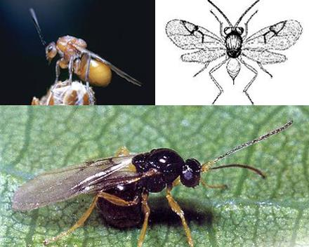

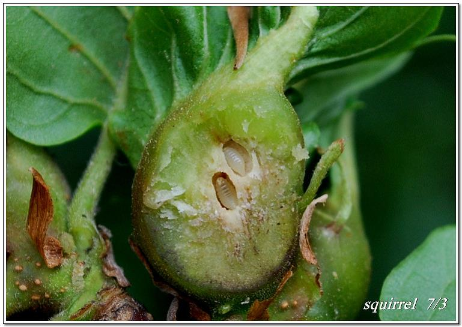

국내 수목해충의 발생 연혁

▸ 삼국시대~조선시대: 농작물에대한해충의피해= 충재(蟲災)로하여, 수재(水災), 한재(旱災)와함께 국가주요재해취급
▸ 역사에서가장많이기록된해충은 황충(蝗蟲)으로, 이는농작물에해를끼치는곤충을말하지만, 산림해충까지포함한개념
▸ 과거기록속의해충
✓ 송충이(솔나방의유충): 고려 숙종때, 수도(개경)의 소나무에송충이대발생. 1685년(숙종11년) 국가적재난 수준
✓ 솔잎혹파리: 일제강점기(1929년서울창경궁, 전남목포첫발견)
✓ 1963년: 전남고흥(솔껍질깍지벌레)
✓ 1983년대중반과1990년도: 잣나무별납작잎벌이잣나무에심한 피해야기
▸ 수목해충에대한관심은대부분 소나무속(Pinus)을가해하는해충에집중.
▸ 최근수목해충의문제는국제교역량의증가로인한 외래해충의피해증가로집중되고있음.

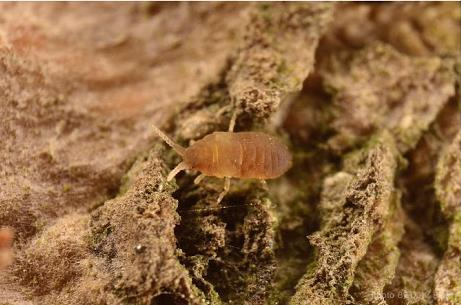

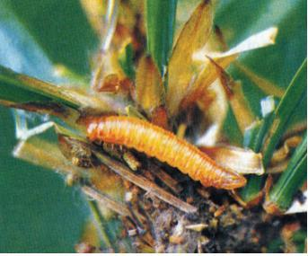

솔껍질깍지벌레 잣나무별납작잎벌

수목해충의 구분

▸ 국내약16,000여종의곤충기록 →수목에피해를야기하는곤충은약1,600종으로약10% 차지
▸ 그 중, 주요수목해충으로분류되는곤충은약300종정도, 조경수에심각한피해를주는곤충은100종미만.

| 구분 | 변태 | 목 | 종류 | 가해습성 |
| --- | --- | --- | --- | --- |
| 곤충강 | 불완전변태류(외시류) | 바퀴목 | 흰개미 | 죽은목재가해 |
|  |  | 메뚜기목 | 메뚜기, 베짱이, 땅강아지 | 식엽성, 식근성 |
|  | 불완전변태류 | 대벌레목 | 대벌레 | 식엽성 |
|  |  | 총채벌레목 | 총채벌레 | 흡즙성 |
|  |  | 노린재목 | 노린재, 방패벌레, 매미, 매미충, 거품벌레,선녀벌레, 나무이, 진딧물, 깍지벌레 | 흡즙성 |
| 곤충강 | 완전변태류(내시류) | 나비목 | 나비, 나방 | 식엽성, 천공성, 종실가해 |
| 곤충강 |  | 파리목 | 혹파리 | 충영형성 |
|  | 완전변태류 (내시류) | 딱정벌레목 | 나무좀, 비단벌레, 하늘소 | 천공성 |
|  | 완전변태류 |  | 무당벌레, 잎벌레, 풍뎅이 | 식엽성또는식근성 |
|  | (내시류) |  | 바구미 | 식엽성또는천공성 |
|  |  |  | 거위벌레 | 종실가해 |
|  |  | 벌목 | 잎벌 | 식엽성 |
|  |  |  | 혹벌 | 충영형성 |
| 거미강 |  | 응애목 | 응애 | 흡즙성, 충영형성 |

수목해충의 구분

▸ 응애류는곤충이아닌거미강응애목에속하지만, 곤충과함께절지동물문(Arthropoda)에속함.
▸ 응애류의몸은전체부(두흉부, 머리가슴)와후체부(몸통부, 배) 두 부분으로구분되고, 더듬이가없음.
▸ 겹눈은없고홑눈만있으며, 다리는4쌍, 날개가없음.

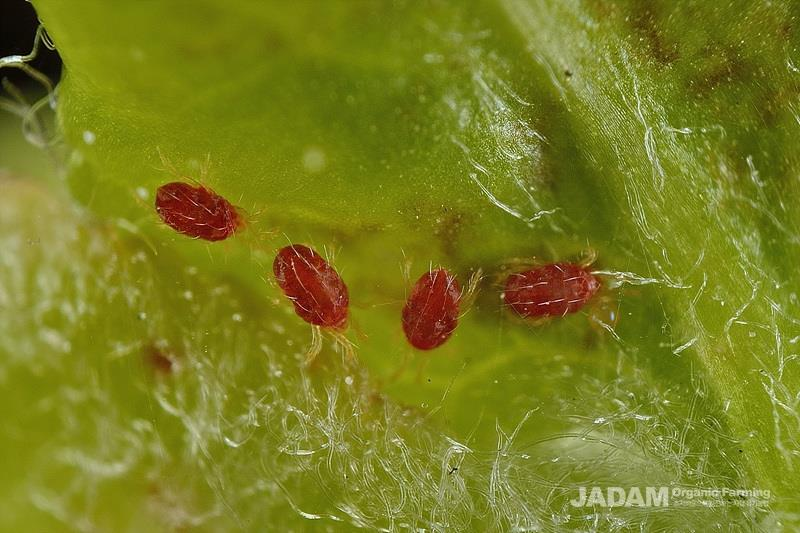

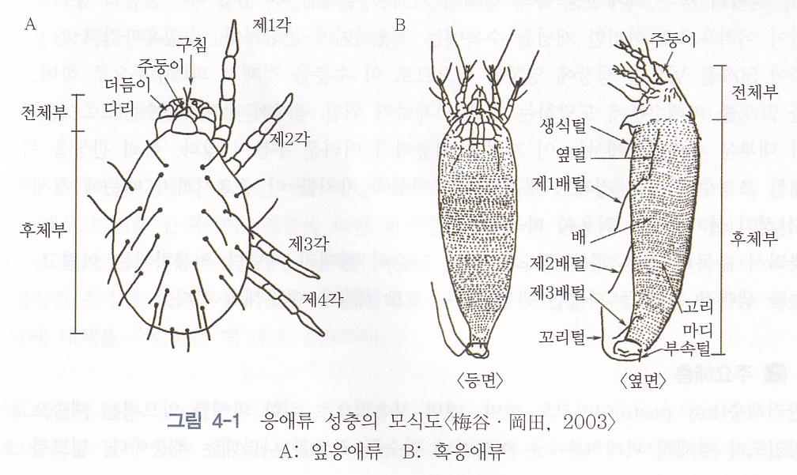

사과응애

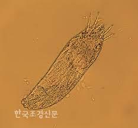

혹응애류

수목해충의 구분

|  | 1. 진화계통에 따른 수목해충의 구분 |
| --- | --- |

▸ 곤충간의유사한정도와진화계통에따라 분류하는학문적인구분방법

▸ 크게곤충의목(order)을중심으로구분함.
▸ 응애류의경우, 거미강응애목에속하므로별도로분류

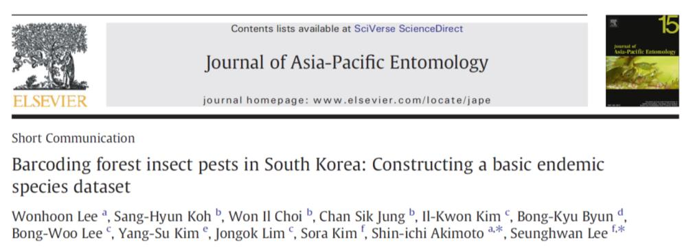

수목해충의 구분

|  | 2. 경제·생태적 측면에서 수목해충의 구분 |
| --- | --- |

▸ 해충은수목을가해하여경제적인 손실을유발하는데, 이러한경제적중요성과방제여부측면에서해충을구분하기위해도입된개념이경제적피해수준, 경제적
피해허용수준, 일반평형밀도임.
✓ 경제적피해수준(economic injury level, EIL) : 해충에의한 피해약과방제비가같은수준의밀도로 경제적손실이나타나는최저밀도
✓ 경제적피해허용수준(economic threshold, ET): 해충의밀도가경제적피해수준에도달하는것을억제하기위하여 방제수단을써야 하는밀도수준
✓ 일반평형밀도(general equilibrium position, GEP): 약제방제와같은외부간섭을받지 않고천적의영향으로장기간에걸쳐형성된해충개체군의평균밀도
▸ 농작물의경우, 수확후판매가이루어지므로직접적인경제적가치에대한 설정이가능하지만, 산림의경우목재생산등의경제적가치를설정할수있을뿐, 산림의공익적
가치판단이어려우므로이러한개념을수목에는적용하기어려움.
▸ 따라서, 수목의경우피해정도에대해단순히경제적개념만적용하기는어렵고경제적측면과생태적측면등다양한관점을 기준으로해충을구분해야함.

수목해충의 구분

|  | 2. 경제·생태적 측면에서 수목해충의 구분 |
| --- | --- |

▸ 관건해충(key pests), 1차해충(primary pest) 이라고도함.
▸ 매년지속적으로 심한피해를일으키는해충, 일반평형밀도(GEP)가경제적 피해허용수준(ET) 이상이나비슷한정도를나타냄.
▸ 밀도를조절할수 있는효과적인천적이없어 인위적인방제가실행되지않으면심각한손실을가져올수 있음.
▸ 솔잎혹파리, 솔껍질깍지벌레와같이피해가 매년지속적이고심한해충

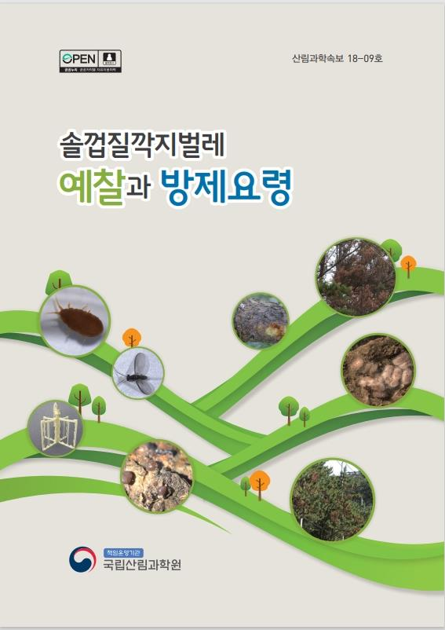

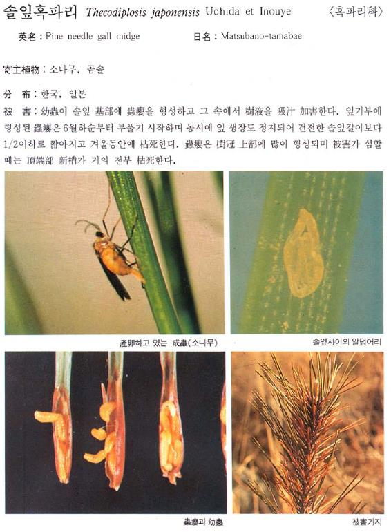

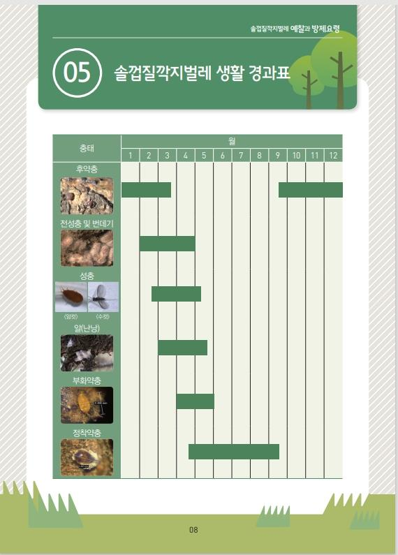

수목해충의 구분

|  | 2. 경제·생태적 측면에서 수목해충의 구분 |
| --- | --- |

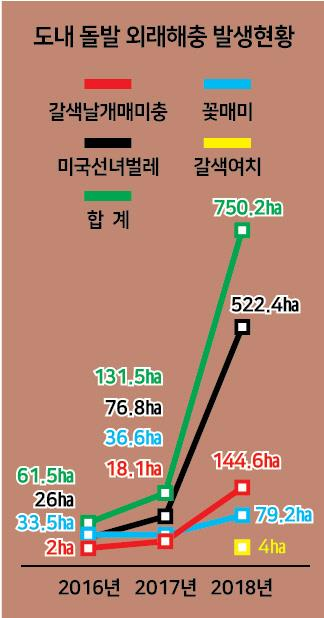

▸ 평상시에는일반평형밀도(GEP)가경제적피해수준(EIL) 이하로문제가되지 않던해충이 환경조건의변화 등으로
인하여해충의밀도억제요인들이변화되고대발생하여경제적피해수준을넘는 경우
▸ 매미나방류, 잎벌류, 대벌레나외래종으로국내에침입하여문제가되고 있는꽃매미, 미국선녀벌레,
갈색날개매미충등

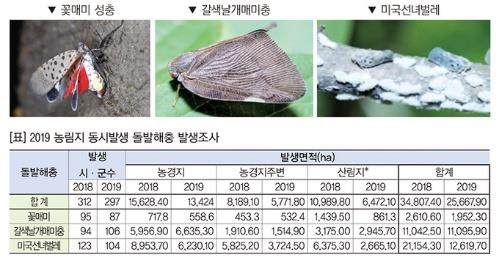

강원도의예

수목해충의 구분

|  | 2. 경제·생태적 측면에서 수목해충의 구분 |
| --- | --- |

▸ 해충의방제등으로인해생태계의평형이파괴되어기존에문제시되지않았던해충이천적과같은밀도제어요인이없어지면서밀도가급격히증가하여해충화되는경우
▸ 조경수해충방제를위한살충제사용이증가하면서밀도를억제하는천적이감소하여피해가크게증가하는응애류, 동일 계통약제의지속적인사용으로이에대한
저항성을획득하여문제가되는응애류, 진딧물류와같은미소해충의예

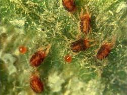

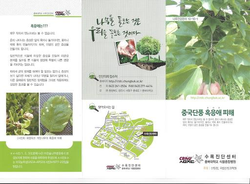

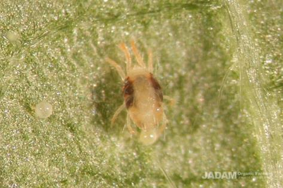

수목해충의 구분

|  | 2. 경제·생태적 측면에서 수목해충의 구분 |
| --- | --- |

▸ 피해가경미하여방제의필요성이없는해충
▸ 생태적인균형에의해밀도가유지되는경우로농작물해충의경우경제적손실을기준으로판단할수있으나, 수목의경우피해의기준이경제적인손실외에관상적
가치등복합적인기준이적용될수있어판단의기준이모호한경우가많음.
▸ 대부분산림생태계를구성하는수많은곤충류가여기에속하며, 비경제해충중에서도환경조건이바뀌어밀도의 증가로돌발해충이나주요해충으로될 가능성이있는
그룹을잠재해충(potential pest)라고 함.

수목해충의 구분

| 3. 가해형태에 따른 구분(식엽성 곤충) |  |
| --- | --- |

▸ 수목의잎을갉아먹는해충(leaf eating pest)은 입틀이씹는형(chewing type)이고식물체를먹이로이용
▸ 수목해충의약50% 정도를차지할만큼많은종류가 포함됨.
▸ 잎을말거나묶어은신처를만들어가해하기도함.
▸ 엽육사이에터널을뚫고가해하는등가해양상도다양.
▸ 대부분의나비목유충, 잎벌류와같이유충시기에만가해하거나풍뎅이류와같이성충시기에만가해하는경우, 잎벌레류,
대벌레류와같이성충과유충(약충)이동시에가해하는등매우다양한생활습관을가지고 있음.

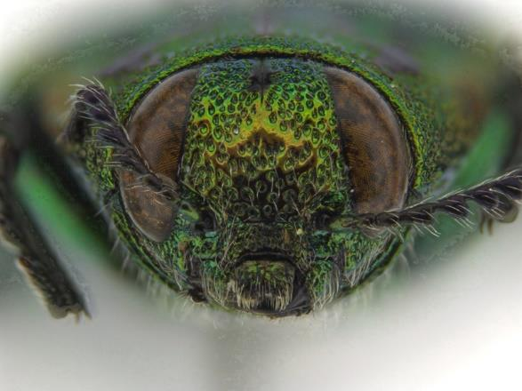

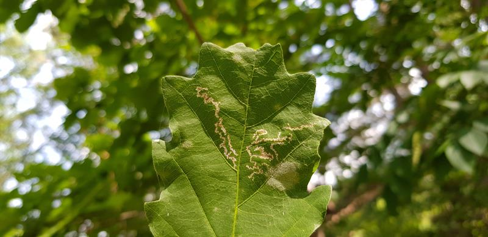

금테비단벌레성충의구기
식엽성곤충의피해(참나무류의잎)

수목해충의 구분

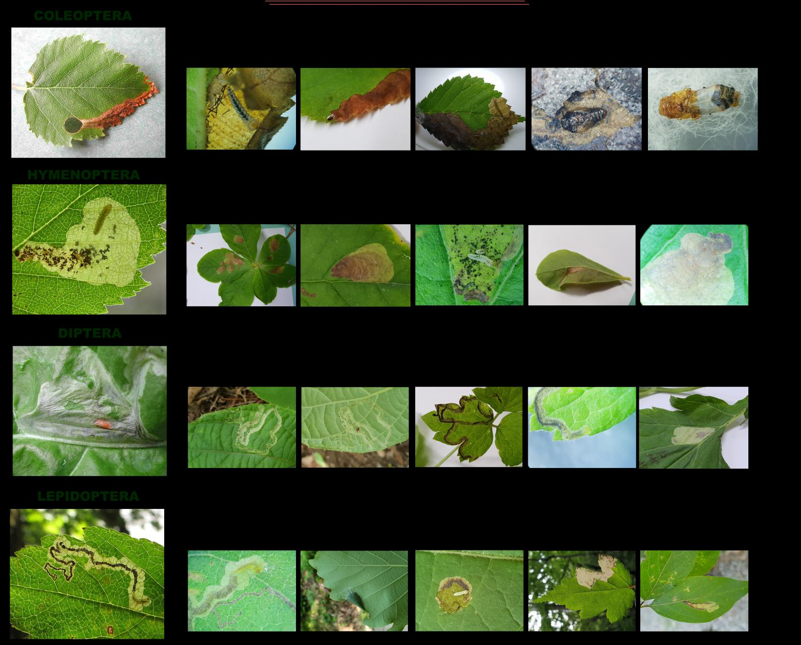

수목해충의 구분

| 3. 가해형태에 따른 구분(흡즙성 곤충) |  |
| --- | --- |

▸ 즙액을빨아먹는해충(sucking pest)은빠는형입술을가지고있어수목의조직내에빨대형태의입틀을찔러넣고흡즙함.
▸ 흡즙성해충은진딧물류, 깍지벌레류, 방패벌레류, 나무이류, 선녀벌레, 매미충류등노린재목에속하는해충이대부분
▸ 노린재목흡즙성해충의경우, 가해시감로를발생시켜그을음병을유발하는경우가 많음.
▸ 최근에는거미강(Arachnida)에 속하는응애류도수목을가해하는대표적인흡즙성해충이며, 적정한환경조건에서응애류 밀도가급격하게늘어나서수액을
빨아먹으면잎이변색되면서새잎과가지의성장을억제, 조기낙엽유발

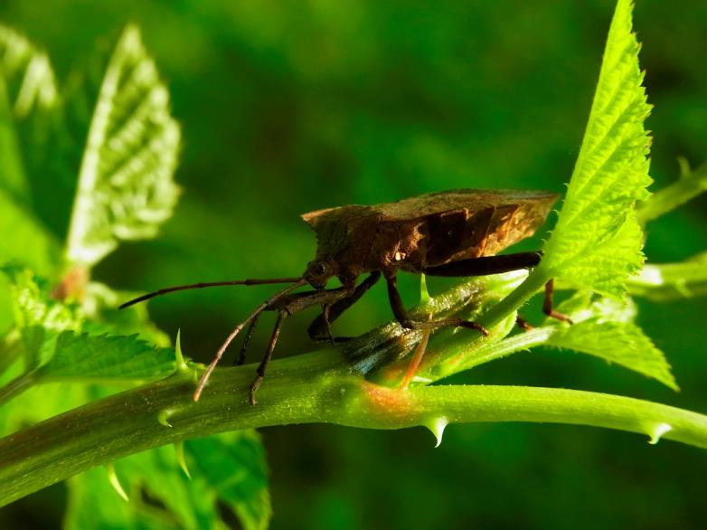

큰허리노린재

주제 발표 안내

▸ 주제 선정 : 잡초/식물보호제(농약포함)/농림해충/식물병리중, 관심분야 논문1건 이상 선정
▸ 발표 일정 및발표자
✓ 12주(11.17., 수, 09:00~11:00) : 고영욱, 김정훈, 나세창, 문현지, 송의진
✓ 13주(11.24., 수, 09:00~11:00) : 양재영, 오수진, 이명진, 정세라, 정용훈, 진주현
▸ 발표방법
✓ 비대면: Zoom 실시간(이클래스공지)
✓ 발표구성 내용
• 해당분야 및 논문 선정 동기(배경)
• 서론
발표 논문 후보 선정
• 재료및 방법
• 본론
→ 메일(limento21@wku.ac.kr) 발송
• 결론및 고찰
• 해당논문을탐구하면서느낀 점 → 내용 검토 후 회신
▸ 다른 수강생발표 후, '질문' → 발표자의 답변

수목해충의 구분

| 3. 가해형태에 따른 구분(종실, 구과 해충) |  |
| --- | --- |

▸ 활엽수의열매나침엽수의구과, 종자를가해하는해충(seed & cone pest)
▸ 생활권수목이나산림수종은유실수에비해열매의경제적인가치가적기 때문에종실, 구과해충의발생이큰문제가되지 않지만, 경제적으로중요한밤나무나잣나무
등을가해하는해충이나종자생산을위한채종원의종실, 구과를 가해하는해충은방제가필요함

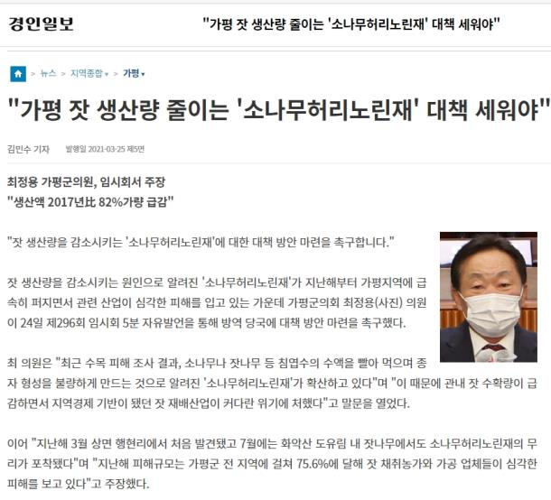

수목해충의 구분

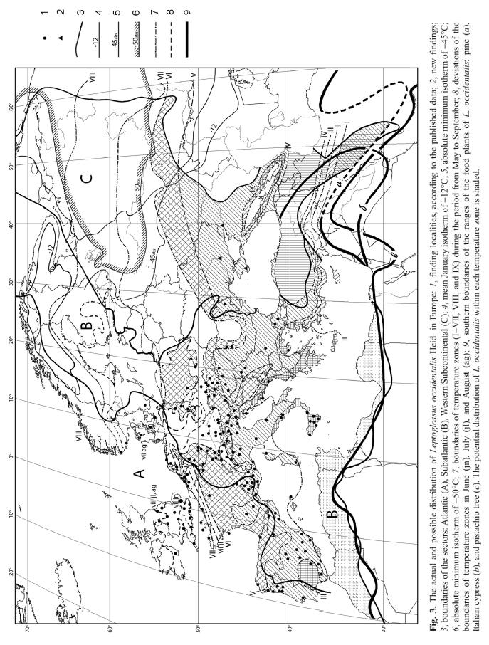

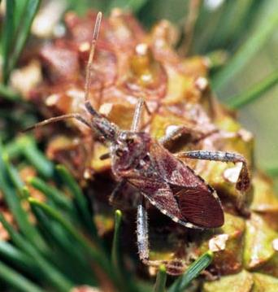

수목해충의 구분

| 3. 가해형태에 따른 구분(충영형성 해충) |  |
| --- | --- |

▸ 가해를받은식물체조직이이상비대를일으켜벌레목(충영, gall)이생기면그안에서 머물며즙액을흡즙하는해충(gall-inducing pest)
▸ 진딧물류가원인인경우가많지만, 최근에는혹응애류에의한피해가많이 발생함.
▸ 이외에솔잎혹파리와같은혹파리류나밤나무혹벌과같은혹벌류등이있으며, 이부류는벌레혹에의해 충체가노출되지않아방제가어려운해충군에속함.

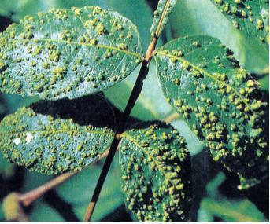

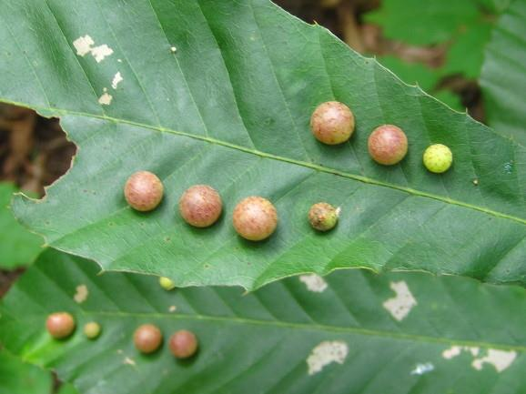

참나무잎붉은혹벌충영 붉나무혹응애

수목해충의 구분

| 3. 가해형태에 따른 구분(천공성 해충) |  |
| --- | --- |

▸ 수목의줄기나가지에산란된알에서부화한유충이수목의목질부를가해하거나성충이줄기나가지에구멍을뚫고들어가 가해하는해충(tree boring or wood
boring pests)
▸ 천공성해충은산림내에서쇠약한수목을가해하여죽이는분해자의역할을하지만, 수세가쇠약한생활권수목을가해하면나무를고사시킬수 있는매우 위험한
해충군
▸ 최근에는소나무재선충을매개하는솔수염하늘소, 북방수염하늘소, 참나무시들음병을매개하는광릉긴나무좀처럼수목의병을매개하는매개충역할에의한 피해도
나타나고있음.
▸ 딱정벌레목의나무좀류, 하늘소류, 바구미류, 비단벌레류해충은 주로수세가쇠약한 나무를가해하여피해를줌.
▸ 나비목의유리나방류, 박쥐나방류의일부명나무류는건전한나무의줄기나가지에 구멍을뚫고가해하여피해부위에부후균이침입.

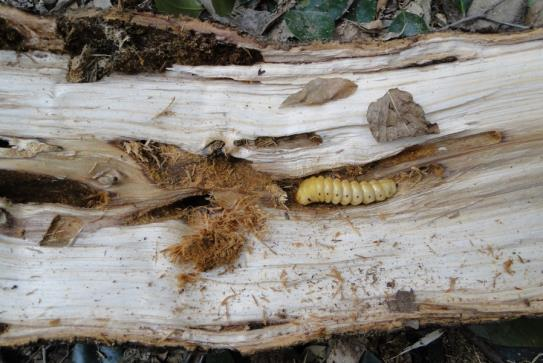

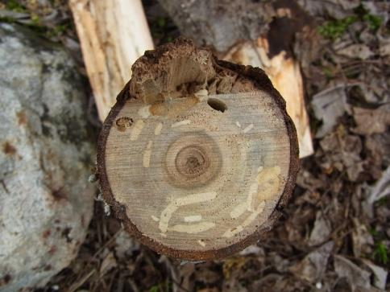

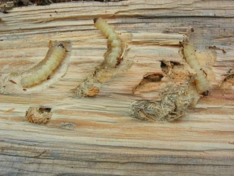

참나무하늘소의유충 호두나무피해흔적 북방수염하늘소유충(잣나무)

수목해충의 구분

| 4. 기주범위에 따른 구분 |  |
| --- | --- |

▸ 먹이에따른습성에따라, 식물을먹는식식자(hervivore), 다른동물을먹는육식자(carnivore), 동물의사체, 배설물, 토양유기물등을먹는 부식자(scavenger), 두가지
이상의식성을가진잡식자(omnivore)로구분
▸ 발육단계에따라식성이달라지기도함
▸ 수목을가해하는해충은식식자로수목의뿌리, 줄기, 잎 뿐만아니라꽃, 화분, 종자, 다양한수목의기관을가해하는데, 수목은이러한해충의가해로부터자신의몸을
지키기위해물리적, 화학적방어기작을형성함.
▸ 해충도기주를선택할때에는주로주화성(chemotaxis)(= 화학물질에유인되는특성)이관여함. 유인물질(attractant), 정착물질(arrestant)과같은 양(+)의 주화성에의해
섭식을촉진하는수목내당성분이나수목내아미노산에서기인하는기피물질(repellent), 저해물질(feeding deterrent)과같은음(-)의주화성에의해섭식을저해하는
물질들이연관됨.

수목해충의 구분

| 4. 기주범위에 따른 구분(단식성 해충) |  |
| --- | --- |

▸ 단식성(monophagous) 해충은한종(species)의 수목만 가해하거나같은속(genus)의 일부종만기주로하는해충
✓(단식성해충-한종의수목가해)
• 회화나무에피해를주는줄마디가지나방, 회양목을가해하는회양목명나방, 개나리의개나리잎벌등 식엽성해충
• 충영형성해충중에서는밤나무혹벌과혹응애류의많은종(구기자혹응애, 붉나무혹응애등)
✓(단식성해충-같은속의일부종을가해)
• 자귀나무, 주엽나무를가해하는자귀뭉뚝날개나방
• 소나무, 곰솔에피해를주는솔껍질깍지벌레, 소나무가루깍지벌레, 소나무왕진딧물등
▸ 단식성해충의경우, 피해수종에서피해흔적만으로도가해해충을추정하기용이하며, 단식성이므로특정기주식물만관리하면방제가용이한장점을가짐.

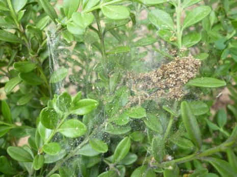

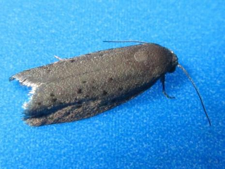

회양목명나방유충의피해 자귀뭉뚝날개나방(성충) 소나무왕딘딧물(약충)

수목해충의 구분

| 4. 기주범위에 따른 구분(협식성 해충) |  |
| --- | --- |

▸ 협식성(oligophagous) 해충은기주수목이1~2개 과(family)로한정된경우
▸ 송충이(솔나방유충)는소나무속(Pinus)의식물을가해하지만, 개잎갈나무, 전나무등 다른속에해당하는수목도가해하므로협식성해충에속함.
▸ 광릉긴나무좀(Platypus koryoensis (Murayama)) : 참나무류, 서어나무등 2개의과를 가해
▸ 흡즙성해충인깍지벌레류에서도벚나무깍지벌레, 쥐똥밑깍지벌레, 왕공깍지벌레등협식성이많으며,
방패벌레류의대부분도기주범위가한정적인협식성 해충

광릉긴나무좀

수목해충의 구분

| 4. 기주범위에 따른 구분(광식성 해충) |  |
| --- | --- |

▸ 광식성(polyphagous) 해충은여러과의수목을가해하는경우
▸ 식엽성해충인미국흰불나방의경우, 200여종의식물을가해하는대표적인광식성해충
▸ 독나방, 매미나방, 천막벌레나방, 애모무늬잎말이나방등은다양한수종의 수목을가해
▸ 진딧물류는기주교대를하는경우가많아여름기주로이동하면서피해를 주는과가 달라지기도함(목화진딧물, 조팝나무진딧물, 복숭아혹진딧물, 붉나무소리진딧물등)
▸ 깍지벌레류(뿔밀깍지벌레, 거북밀깍지벌레, 뽕나무깍지벌레, 식나무깍지벌레, 가루깍지벌레, 이세리아깍지벌레, 샌호제깍지벌레등)
▸ 잎응애류(전나무잎응애, 점박이응애, 차응애등)
▸ 천공성해충(오리나무좀, 알락하늘소, 왕바구미, 가문비왕바구미, 붉은목나무좀등)

미국흰불나방(유충) 독나방(유충) 알락하늘소(성충)

수목해충의 구분

▸ 주요한 수목해충의 과 일람표
✓메뚜기목(3과)
✓대벌레목(1과)
✓바퀴목(1과)
✓총채벌레목(2과)
✓노린재목(25과)
✓나비목(31과)
✓딱정벌레목(10과)
✓벌목(10과)
✓파리목(2과)
✓응애목(2과)

수목해충의 구분

▸ 피해흔적을 통한 해충의 구분

수목해충의 구분

▸ 수목의 부위별 해충 피해

수목해충의 방제(법적 방제)

▸ 최근국제교역량과여행객이급속하게증가하고기후변화에따라외래해충이유입될위험이높아짐.
▸ 대부분의침입종은변화된환경조건에적응하지못하고폐사하는경우가많으나일부환경에적응하여번식이이루어지면초기에는효과적인천적이없거나수목자체도새로운
침입해충에대한방어력이발달되지않아빠른속도로확산됨.

▸ 소나무재선충병(Pine Wilt Disease)의 경우, 「소나무재선충병방제특별법(2019.7.16.)」에
따라발생지역로부터2 km의행정동, 리단위로소나무류반출금지구역을지정하고,
소나무류의이동을제한하여국내에서의확산을방지하기위한규제를하고있음.
▸ 「식물방역법」등

수목해충의 방제(물리적 방제)

▸ 온도·습도·이온화에너지·음파·전기·압력·색깔등을이용하여해충을직접적으로없애거나유인·기피하여방제하는방법

|  | 2. 물리적방제(온도) |
| --- | --- |

▸ 곤충은변온동물→ 주위온도변화에따라 대사와생장에영향을받음.
▸ 적정한온도를벗어나 한계이상의고온과저온에서는생존이불가능
▸ (예1) 소나무재선충병피해목의목재활용을위해벌채된산물의중심부온도를56°C에서30분이상유지하거나, 전자파(macrowave)를이용하여전체를최저
60°C에서1분이상지속적으로유지하여매개충사멸
▸ (예2) 수확한밤은30°C 온탕에서7시간침지처리로밤바구미를100% 방제가능

|  | 2. 물리적방제(습도) |
| --- | --- |

▸ 곤충의몸에서수분이 차지하는비율은50~90%
▸ 체구가작아체내에보유할수있는수분량에비해체표면적이큼→외골격방수성을통해수분손실을최소화
▸ 해충의종과발육단계에따라습도에대한 감수성이다르며, 특히높은온도에서는곤충병원성곰팡이에감염될가능성이높아짐.
▸ (예) 수입된원목을물속에저장하면습도가매우 높아져나무좀, 하늘소류등 천공성해충의 방제가능

수목해충의 방제(물리적 방제)

▸ 온도·습도·이온화에너지·음파·전기·압력·색깔등을이용하여해충을직접적으로없애거나유인·기피하여방제하는방법

|  | 2. 물리적방제(색깔) |
| --- | --- |

▸ 곤충은눈을통해들어오는특정한파장에반응하여, 유인되기도하고기피하기도함.
▸ 야행성(밤)해충은주광성이있으나, 주행성(낮)해충인진딧물류나멸구류는
황색빛의파장에유인되는특성이있어서황색수반(yellow pan trap)을조사용으로이용
▸ 진딧물류는백색이나은색의멀칭을기피하는경향
▸ 광릉긴나무좀방제 : (기존) 노란색끈끈이롤트랩→ (최근) 노란색/갈색끈끈이롤트랩병행사용

|  | 2. 물리적방제(이온화에너지) |
| --- | --- |

▸ 감마선이나X-선, 전자빔과같은이온화에너지를일정량 이상조사하면해충을
죽이거나불임화시킬수있고, 조사후잔류가전혀남지 않아이를해충방제에적용할수있음.
▸ 일정량이상의이온화에너지를조사하여해충을치사시키는방제는식물검역에서주로사용하던훈증제에비해처리시간이짧고 잔류물질이
남지않아검역이나저장곡물에대한방제에적용함(초기시설비용이많이 필요)
▸ 이온화에너지는해충을죽이기도하지만낮은선량을조사하면세포조직의기능이변하거나저하되는데, 특히 생식세포에먼저영향을미쳐
불임이유발.

수목해충의 방제(기계적 방제)

▸ 손이나 간단한 기구를이용하여해충을방제하는 방법
▸ 비교적 손쉽게 시행할수있는반면에인력과비용이 많이소요되는단점
▸ 생활권에서의 무분별한농약사용으로부터국민건강과 자연환경보호를위하여산림청훈령제1039호'생활권수목병해충
방제방법'등에 관한지침에서는기계적방제법을 적극적으로활용하도록권장

|  | 3. 기계적 방제(포살법) |
| --- | --- |

▸ 손이나간단한기구를이용하여해충의 알, 유충, 번데기, 성충을각각직접잡아죽이는 방법
▸ (예) 과거솔나방 방제를위하여학생들을동원하여 젓가락으로송충이를직접방제
▸ 알제거는나무등에산란한알을제거하여 밀도를억제하는방법→ 분산하여산란하는 해충은방제의효율성이낮아집단적으로산란하는해충의난괴(알
덩어리)를대상으로 실시
▸ 난괴(알덩어리)는 유충이나성충에비해쉽게제거할 수있으며, 부화하여피해가발생하기 전에제거함으로써피해발생을 사전에차단할수있음.
▸ 주로알로월동하는 꽃매미, 매미나방, 밤나무왕진딧물, 천막벌레나방등의해충의대상

수목해충의 방제(기계적 방제)

▸ 손이나간단한기구를이용하여해충을방제하는방법

|  | 3. 기계적 방제(유살법) |
| --- | --- |

▸ 해충의특수한습성및주성등을이용하여방제하는방법
▸ 유살물질, 유살기구등이필요하며, 수목에서는주로 잠복장소유살법, 번식장소유살법, 등화유살법, 페로몬유살법등
✓잠복장소유살법: 나방류의유충이월동을위해나무줄기를타고땅으로내려올때, 나무줄기에볏짚등을 이용하여잠복소를설치하고유인한후, 봄철월동이
끝나기전에잠복소를제거하여소각(솔나방, 미국흰불나방)
✓번식장소유살법: 나무좀류, 하늘소류, 바구미류등의 천공성해충이고사목이나수세가쇠약한나무의목질부에산란하는습성을이용하여유인목을설치한후
성충이우화하기전에박피하거나소각하는방법
✓등화유살법: 주광성이강한해충중에서나방류와같이날개가있어이동력이있는 성충을유인하여방제
✓페로몬유살법: 페로몬을이용하여해충을유인하여방제하는방법

수목해충의 방제(기계적 방제)

▸ 손이나간단한기구를이용하여해충을방제하는방법

|  | 3. 기계적 방제(소각법) |
| --- | --- |

▸ 해충의피해확산을방지하기위하여해충자체나해충이들어가있는수목조직을소각하여방제하는방법
▸ (예) 도토리거위벌레가산란한도토리, 소나무재선충병의매개충이월동중인벌채목소각등

|  | 3. 기계적 방제(매몰법) |
| --- | --- |

▸ 해충이들어있는목재를땅속에묻어서죽이거나성충이우화하더라도탈출하지못하게하는방법
▸ 소나무재선충병의매개충방제를위해산지경사가완만하고토심이깊어흙구덩이를만들기 쉬운지역에구덩이를만든 후, 절단된피해목을넣고50 cm 이상흙을덮는
방법

수목해충의 방제(기계적 방제)

▸ 손이나간단한기구를이용하여해충을방제하는방법

|  | 3. 기계적 방제(박피법) |
| --- | --- |

▸ 목재의수피를제거하여목재에산란하는해충의산란을저지하거나수피아래에서서식하는해충을노출시켜해충을방제하는방법
▸ 살아있는수목의수피는제거가불가능하므로벌채된목재에서만활용가능한방법

|  | 3. 기계적 방제(파쇄, 제재법) |
| --- | --- |

▸ 피해목을두께1.5 cm 이하로파쇄, 제재하여매개충이살지못하도록하는 방법
▸ 파쇄산물은 산업용이나농업용등으로이용가능

수목해충의 방제(기계적 방제)

▸ 손이나간단한기구를이용하여해충을방제하는방법

|  | 3. 기계적 방제(차단법) |
| --- | --- |

▸ 해충의이동을차단하여방제하는방법
▸ 과거솔잎혹파리의방제를위하여우화시기에비닐을피복하여성충의우화를차단함으로써교미후산란하는과정을방지하기도하였음.
▸ 소나무재선충병의매개충인하늘소류가피해목에서우화하여주변으로확산되는것을저지하기위하여하늘소류가훼손하기어려운재질의 그물망을피복하여탈출을
방지하기위한그물망피복법을적용

수목해충의 방제(생태적 방제)

▸ 생태계의균형을해치지않으면서해충의생존에필요한먹이, 교미, 산란장소, 은신처등의필수적인조건을변화 또는
교란시키거나수목의생육조건을개선하여해충의밀도를감소시키는방법

|  | 4. 생태적 방제(내충성 품종) |
| --- | --- |

▸ 수목은자신을가해하는해충을방어하기위한진화의 과정을거쳐왔으며, 해충또는수목의방어기작을뚫고수목을공격할수있는진화를거듭해옴→ 수목이
해충에대한방어능력을유전적으로지닌 것을"내충성"이라고함.
▸ 내충성은항객성, 항생성, 내성등세가지요인으로이루어짐
✓항객성(antixenosis) : 수목이곤충의행동에영향을 미치는특성. 형태적특징(센털, 털, 경피조적등), 화학적특성(기피물질발산, 섭식자극물질이없어섭식을
유도하지않는등)
✓항생성(antibiosis) : 수목이곤충의생리에영향을미치는특성. 화학적특성(수목의2차 대사산물에의한독소, 생장저해물질등), 형태적특성(수목의과민반응,
털등) (예: 송진)
✓내성(tolerance) : 해충의가해에대하여수목의생육이영향을적게 받거나피해에대한 회복능력이우수한형질.

수목해충의 방제(생태적 방제)

▸ 생태계의균형을해치지않으면서해충의생존에필요한먹이, 교미, 산란장소, 은신처등의필수적인조건을변화 또는
교란시키거나수목의생육조건을개선하여해충의밀도를감소시키는방법

|  | 4. 생태적 방제(생육환경의 개선) |
| --- | --- |

▸ 수목의수세가건강하면쇠약한나무보다해충에대한 내성이높음. 특히나무좀류는수세가쇠약한나무를집중적으로공격하므로수목의수세를건전하게유지하는
것이매우중요함.
▸ 조경수의경우, 생육공간이협소하고양분이부족하여수세가좋지않은경우가많으므로생육환경을개선하고적정한양분공급을실시하면수세가호전되어
해충피해에대한내성이증가함.

수목해충의 방제(생태적 방제)

▸ 생태계의균형을해치지않으면서해충의생존에필요한먹이, 교미, 산란장소, 은신처등의필수적인조건을변화 또는
교란시키거나수목의생육조건을개선하여해충의밀도를감소시키는방법

|  | 4. 생태적 방제(숲가꾸기) |
| --- | --- |

▸ 산림에서숲가꾸기를통하여숲을관리→ 숲바닥에도달하는햇빛의양이증가함으로써키 작은나무와풀등 다양한식물이
살수있는여건이만들어져생태적으로좀더풍요로워짐.
▸ 임목이건강하게자라해충피해에대한내성이증가하고다양한천적자원이형성되어건강한숲조성가능

수목해충의 방제(생물적 방제)

▸ 곤충병원성미생물이나포식성·기생성천적등과같은 생물적요인을이용함으로써자연계의평형을유지시키는방제법
▸ 화학적방제와비교하여, 기타생물에미치는영향이적고방제효과가영구적으로나타날수있음.
▸ 생물적방제를위해천적을이용하기위해서는해당 해충에대한유용한천적자원을선발하는것이중요함→ 외국에서천적을
도입하는방법, 토착천적의세력을강화하는방법

|  | 5. 생물적 방제(기생성 천적) |
| --- | --- |

▸ 해충의몸에산란하고성장하여결국에는숙주해충을사멸하는곤충으로해충의밀도조절에이용할수있음.
▸ 기생벌류(맵시벌상과, 먹좀벌상과, 좀벌상과등), 기생파리류(쉬파리과, 기생파리과등)
✓내부기생성: 긴산란관으로숙주의체내에알을낳고 부화한유충이기주의체내에서기생(먹좀벌류, 진디벌류)
✓외부기생성: 숙주의체외에서영양을섭취하여기생하는곤충(개미침벌, 가시고치벌등)

수목해충의 방제(생물적 방제)

나방살이머리침벌(OdontepyristelortisLim and Lee, 2009)

수목해충의 방제(생물적 방제)

개미침벌(Sclerodermusharmandi(Buysson, 1903))

수목해충의 방제(생물적 방제)

▸ 곤충병원성미생물이나포식성·기생성천적등과같은 생물적요인을이용함으로써자연계의평형을유지시키는방제법

|  | 5. 생물적 방제(포식성 천적) |
| --- | --- |

▸ 해충을먹이로하는생물종

✓씹는형구기: 무당벌레, 사마귀, 풀잠자리, 말벌류등
✓빠는형구기: 꽃등에유충, 풀잠자리유충, 침노린재, 애꽃노린재등

|  | 5. 생물적 방제(천적 유지식물) |
| --- | --- |

▸ 천적의밀도가지속적으로유지될수있도록심는천적유지식물(banker plants)을
이용하여천적방사의효과가지속될수 있음.

수목해충의 방제(생물적 방제)

▸ 곤충병원성미생물이나포식성·기생성천적등과같은 생물적요인을이용함으로써자연계의평형을유지시키는방제법

|  | 5. 생물적 방제(곤충병원성 미생물) |
| --- | --- |

▸ 바이러스
✓핵다각체병바이러스(nuclear polyhedrosisvirus, NPV) : 대부분나비목 유충을기주로하나일부잎벌류나파리목에도감염을일으킴. 경구감염을통해 중장내
소화액에용해되고기주세포에침입. 감염후3~12일정도에폐사
✓과립형바이러스(granulosis virus, GV) : 주로나비목 유충을기주로하여경구또는 경란감염을통해침입. 지방조직, 장관피막등에서증식. 감염후4~25일정도에
폐사
▸ 세균: 해충방제에상용화된세균은내생포자를형성하는포자형성세균류(aporeforming bacteria). 곤충의체내에서증식하여패혈증을일으키거나독소를생산하여
병원성을나타냄. Bacillus spp. → 나비목해충방제용상용화
▸ 곰팡이: 기주와의접촉에의한경피감염을일으키지만, 일부는곰팡이가독성물질을만들어살충효과. 백강균(Beauveriabassiana)(흰색의가루 같은분생포자에덮혀
굳어서폐사)와녹강균(Metarhiziumanisopliae)(흰색을띠는포자와균사로뒤덮인후점차초록색을띠며굳어 폐사)
▸ 선충: 곤충에 기생하여해충을죽이는데, 일부는불임을 유발하거나생식력을감소시키는작용

수목해충의 방제(생물적 방제)

백강균(Beauveriabassiana) 녹강균(Metarhiziumanisopliae)

가해형태에 따른 해충(종)

|  | 식엽성 해충 |
| --- | --- |

▸ 대벌레목: 대벌레
▸ 딱정벌레목: 주둥무늬차색풍뎅이, 곱추무당벌레, 큰이십팔점박이무당벌레, 호두나무잎벌레, 버들잎벌레, 참긴더듬이잎벌레,
오리나무잎벌레, 두점알벼룩잎벌레, 느티나무벼룩바구미
▸ 벌목: 잣나무별납작잎벌, 장미등에잎벌, 극동등에잎벌, 솔잎벌, 극동등에잎벌, 솔잎벌, 개나리잎벌, 남포잎벌, 좀검정잎벌
▸ 나비목: 매실애기잎말이나방, 자귀뭉뚝날개나방, 회양목명나방, 뽕나무명나방, 목화명나방, 제주집명나방, 노랑털알락나방,
벗나무모시나방, 대나무쐐기알락나방, 노랑쐐기나방, 별박이자나방, 줄마디가지나방, 남방차주머니나방, 솔나방,
밤나무산누에나방, 참나무재주나방, 꼬마버들재주나방, 버들재주나방, 독나방, 차독나방, 황다리독나방, 매미나방,
미국흰불나방, 큰붉은잎밤나방, 두충밤나방

가해형태에 따른 해충(종)

|  | 흡즙성 해충 |
| --- | --- |

▸ 총채벌레목: 볼록총채벌레
▸ 노린재목: 버즘나무방패벌레, 물푸레방패벌레, 후박나무방패벌레, 배나무방패벌레, 진달래방패벌레, 갈색날개노린재,
철쭉띠띤애매미충, 외점애매미충, 갈색날개매미충, 선녀벌레, 미국선녀벌레, 꽃매미, 말매미, 자귀나무이, 회화나무이,
뽕나무이, 돈나무이, 소나무왕진딧물, 곰솔왕진딧물, 호리왕진딧물, 쥐똥나무진딧물, 목화진딧물, 조팝나무진딧물,
복숭아가루진딧물, 붉은테두리진딧물, 복숭아혹진딧물, 배롱나무알락진딧물, 팽나무알락진딧물, 느티나무알락진딧물,
대륙털진딧물, 진사진딧물, 모감주진사진딧물, 가슴진딧물, 전나무잎말이진딧물, 가슴진딧물, 전나무잎말이진딧물,
물푸레면충, 소나무솜벌레, 귤가루이, 이세리아깍지벌레, 솔껍지깍지벌레, 주머니깍지벌레, 소나무가루깍지벌레,
거북밀깍지벌레, 뿔밀깍지벌레, 루비깍지벌레, 쥐똥밑깍지벌레, 공깍지벌레, 줄솜깍지벌레, 갈색깍지벌레, 장미흰깍지벌레,
식나무깍지벌레, 뽕나무깍지벌레, 벚나무깍지벌레, 사철깍지벌레, 후박나무굴깍지벌레, 소나무굴깍지벌레

가해형태에 따른 해충(종)

|  | 종실, 구과 해충 |
| --- | --- |

▸ 딱정벌레목: 도토리거위벌레, 밤바구미
▸ 나비목: 대추애기잎말이나방, 복숭아명나방

|  | 충영 형성 해충 |
| --- | --- |

▸ 노린재목: 큰팽나무이, 사사키잎혹진딧물, 때죽납작진딧물, 조록나무혹진딧물, 외줄면충
▸ 벌목: 밤나무혹벌

▸ 파리목: 솔잎혹파리, 아까시잎혹파리, 사철나무혹파리

|  | 천공성 해충 |
| --- | --- |

▸ 딱정벌레목: 벚나무사향하늘소, 향나무하늘소, 솔수염하늘소, 북방수염하늘소,
알락하늘소, 광릉긴나무좀, 앞털뭉뚝나무좀, 오리나무좀, 소나무좀, 박쥐나방, 복숭아유리나방

지표성 곤충

▸ 부식토 및 토양 곤충
✓ 부식토의 구성 : 식물 파편(잎, 가지, 꽃 등)
✓ 선충류, 지렁이, 육상 절지동물, 응애 등의 활동으로 큰 입자 파괴 → 미세한 입자 저장
• 진드기, 흰개미, 개미, 많은 딱정벌레 : 부엽토와 부식토가 풍부한 토양의 중요한 절지동물
✓ 어떤 절지동물은 특별한 층 또는 깊이에 제한적으로 서식 → 특수한 행동과 형태 보유
• (예 1) 톡토기목 Onychurus 속 : 토양층 서식, 줄어든 부속기관, 시각 퇴화, 도약기 퇴화
• (예 2) 톡토기목 Hypogastrura 속 : 홑눈과 몸 길이의 반보다 더 짧은 도약기 보유
• (예 3) 반면, 표면의 잎 부식토 서식하는 Orchesella 속 : 큰 눈, 긴 부속 기관, 긴 도약기 보유

Onychiurinae일종 Hypogastrura속일종 Orchesella속일종
(www.collebola.org) (flickr) (Alchetron.com)

지표성 곤충(부식토 및 토양 곤충)

▸ 부식토 및 토양 곤충
✓ 토양곤충의 형태적 변이
• 유충 : 토양을 통과하여 활발한 활동을 하기 위해 다리 발달
• 번데기 : 우화를 위해 토양 표면으로 자주 움직이기 위해 가시모양의 가로띠 보유
• 성충 : 불완전한 눈, 날개는 경화된 앞다리가 보호, 짧거나 퇴화(무시류)
(일부 종들은 땅을 파기 위해서 변형)
✓ 지하 곤충의 분포
• 유충 : 번데기 시기의 곰팡이병 감염 방지를 위해 건조한 지역 선호
• 개미 : 보통 건조한 곳에 위치하거나 서식지 입구는 비가 오는 동안 홍수를 막기 위하여 토양 표면 위 형성
✓ 토양 생물의 영양분 섭취
• 땅에 서식하는 육각류 : 토양을 포함한 죽어 부패한 식물 + 동물 잔해와 관련된 미생물이 함유된 토양으로부터 섭취물 확보
- Saprophages : 부패물을 먹이로 하는 식성충
- Detritivores : 생물의 사체조각을 먹는 붕괴물 식성 (톡토기류, 풍뎅이 유충, 흰개미 등)
• 토양 생물의 배설물 → 열대와 아열대지방의 토양을 만드는데 중요한 역할

지표성 곤충(부식토 및 토양 곤충)

지표성 곤충(부식토 및 토양 곤충)

▸ 뿌리를 먹는 곤충
✓ 식물 뿌리위에서 수액을 흡즙하는 곤충은 특히 곤충에 의해서 피해 받아서 괴사한 조직은 이차적으로 곰팡이나 세균에 의해 침입을 받아 식물이
활기를 잃거나 죽게 됨.
✓ 토양을 먹는 곤충은 선택적으로 식물 뿌리를 피하지는 않음. → 목초지의 토양을 먹는 각다귀과, 검정날개버섯파리과, 털파리상과와 같은 파리
유충이 고밀도인 곳에서 식물 뿌리 손상
✓ 잘 관리된 방목지, 골프장 및 잔디를 생산하는 농장에서 피해 다수 보고

골프경제(2020.5.12.)

지표성 곤충(곤충과 죽은 나무 또는 부식된 숲)

▸ 나무가 죽는 데는 나무 내 병원성 곰팡이를 전달하는 역할을 하는 곤충 포함
✓ Sirex속, Urocerus속(벌목: 송곳벌과)의 종들은 산란관에 합입되어 있는 절간낭에 Amylosterem 곰팡이 포장 운반 → 균사체 감염을 일으켜
소나무속 종의 수관에 주입
✓ 살아있는 나무에 곤충이 옮겨 생긴 곰팡이병은 나무의 죽음을 초래
✓ 암브로시아 나무좀(ambrosia beetle) : 성충은 살아 있는 나무도 공격하지만, 죽은 나무에 갱도
(갤러리, gallery) 형성. 균낭(mycangia)라 불리는 표피 주머니에 옮겨서 나무에 서식하는 외부공생 암브로시아 곰팡이 감염

광릉긴나무좀의균낭
(Mun et al., 2012)

지표성 곤충(곤충과 죽은 나무 또는 부식된 숲)

▸ 섶벌레과 및 곡식쑤시기과의 딱정벌레를 포함한 일부 균식성 곤충은 균사에 있는 곰팡이를 최근에 불탄 숲으로 강하게 끌어 옮김
▸ 다수의 pyrophilous (산림이 황폐화되면 먼저 활동하는) 노린재, 파리(춤파리류), 딱정벌레(비단벌레과) 는 불의 열 또는 연기에 아주 먼 거리에서
유인되는 것으로 알려짐.
✓ 비단벌레과(Melanophila, Merimna)종은 산림불에의해생성된적외선의방사선을감지함으로써불탄숲을탐색

Melanophila acuminate 최근에불탄숲에새로운기질을접종하는곰팡이물질을옮기기위해서
(insect.pro) 균사라고불리는함몰된것을보여주는딱정벌레(Henoticusserratus) 가슴아래쪽

지표성 곤충(곤충과 배설물)

▸ 척추동물의 배설물은 영양원의 풍부한 자원

▸ 북미, 아프리카 초원, 방목지의 상당한 배설은 섬유질과 질소원이 풍부함
✓ 똥파리과, 집파리과, 딸집파리와 검정파리과 등 : 신선한 똥에 알 또는 유충을 산란
▸ 똥을 어지럽혀 배설물에서 파리 번식을 제한하는 곤충은 "소똥구리"
✓ 대부분의 소똥구리는 패드의 아래쪽이나 옆쪽에 그물모양의 터널을 파고 똥 펠렛을 끌어 내림

지표성 곤충(곤충과 배설물)

▸ 개미는 동물군의 중요한 구성요소. 쓰레기를 찾아 치우는 효율적인 개미에 의해 무척추동물의 시체가 찾아지고 재빨리 제거됨.
▸ 반대로, 척추동물의 시체는 매우 다양한 생물을 지원
✓ 척추동물 사체의 부패 첫단계
• Initial decay : 몸 속에 존재하는 미생물만 포함
• Putrefaction : 부패 시작
• Black putrefaction : 부패 시작 2주 후, 부패의 심한 냄새
• Butyric fermentation : 부티르산의 치즈 냄새
• Dry decay : 거의 건조한 시체 상태. 뼈만 남기고 모든 과정 완료

지표성 곤충(곤충과 곰팡이의 상호작용)

▸ 식균성 곤충
✓ 곰팡이 자원 이용 곤충 : 톡토기목, 딱정벌레목, 파리목의 유충과 성충
• microphages : 포자와 균사과 같은 작은 입자를 모으거나 더 많은 액체 배지를 사용
• macrophages : 강한 큰턱을 가지고 잡아 찢을 수 있는 자실체의 곰팡이 물질을 사용
✓ 곰팡이 자실체를 이용하는 파리목 : 버섯파리과가 다양(예: 검정날개버섯파리과)
▸ 살아있는 식물을 자르는 개미에 의한 곰팡이 사육
✓leaf-cutter ants : 큰턱을 가지고 살아있는 식물 부분을 잘라서 서식지로 옮김. 도착하면, 잎으로부터 어떤 밀랍의 표피층을 핥아서 큰턱으로
식물조각을 부드럽게 함. 분쇄된 잎은 후장으로부터 나온 효소의 배설 혼합물과 접종

Leaf Cutter Ant (Attasp.)

지표성 곤충(곤충과 곰팡이의 상호작용)

▸ 흰개미에 의한 곰팡이 배양
• 흰개미는 서식지를 9 m정도 높이의 지상위에 흙 둔덕을 형성
• 부엽토에서 유래된 먹이자원은 소화는 되지만 흰매기메 의해서 소화는 되지 않음.
• 곰팡이는 큰흰개미류의 서식지에 제한되거나 흰개미 체내 발생

Kanzaki et al., 2019
Yang et al., 2020

지표성 곤충(동굴에 서식하는 곤충)

▸ 동굴은 부족한 빛과 동일한 온도에 있어서, 깊은 토양서식지와 닮았지만, 먹이의 부족이 다름
▸ 얕은 동굴에서 먹이원은 육상식물의 뿌리 포함, 깊은 동굴에서는 조금의 물의 잔해외 먹이원 없음.
▸ 동굴에 서식하는 (cavernicolous) 곤충 = 불리한 외부환경으로부터 피난처를 찾는 곤충
▸ 진동혈성동물(troglobiont) 또는 진동혈성곤충(troglobite insect)은 동굴로 한정되어지고, 계통발생적으로 토양에 서식하는 곤충과 관련됨.

지표성 곤충(땅에 서식하는 육각류를 이용한 환경 모니터링)

지표성 곤충(땅에 서식하는 육각류를 이용한 환경 모니터링)

