# kocw_식물보호학_08

|  | 2021년도 2학기 - 식물보호학식물병리 - 1(식물병 발생요인, 병원 종류, 진단 등) |
| --- | --- |

| 2021년도 2학기 - 식물보호학 |
| --- |
| 식물병리 - 1(식물병 발생요인, 병원 종류, 진단 등) |

식물 병해와 작물보호

작물재배 • 과다하고부적절한시비 생리적병
다수확, 고품질, • 부적당한기상조건(과습,저온, 고온) (작물의면역약화되어병이발생하게되므로
빠른생육추구 • 자연재해(풍수해, 한발등) 영양성분의과부족으로발생하는것)

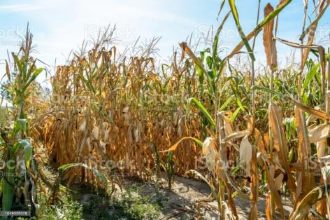

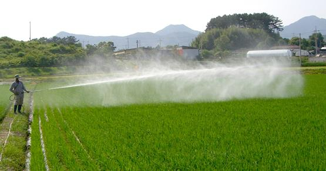

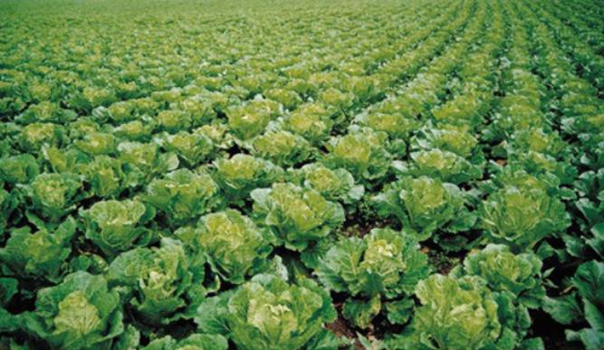

 발병: 맞지않은환경으로 인해 면역력이약해지고, 그 작물이 저항성이나내성이있지 않은 상태에서 병원균침입했을때 발생
 진균/세균: 살균제로큰문제없이 방제가능
 바이러스: 한번 감염되면방제할 수 없으므로, 소각/토양매립

식물 병해와 작물보호 - 병 발생 요인

 식물병 일반
 식물병
• 식물이병원균의침해를받아 정상적인생리기능을유지하지 못하고식물 본래의형태나 생리기능에이상이생기는것
(건강한식물대사의흐름이교란된상태)
• 식물의생리적, 형태적이상 증상이며, 끊임없는병원의자극에 의해서 일어나는계속적인 장해의과정
• 식물은병에 걸리면급성적으로 죽고, 만성적으로생산성과이용가치가떨어져질적, 양적 손실

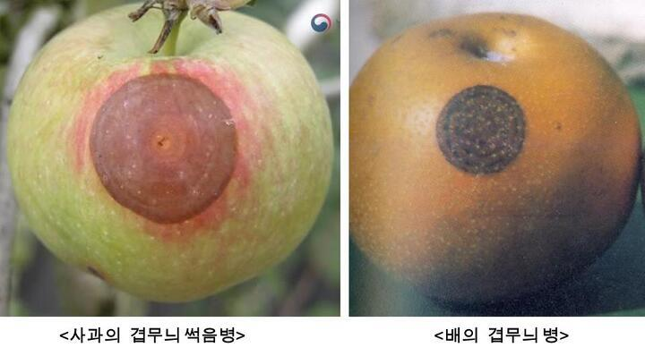

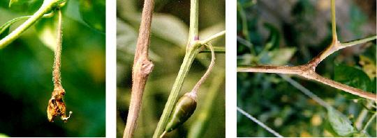

고추잿빛곰팡이병

식물 병해와 작물보호 - 병 발생 요인

 병 발생요인들(factor of disease) = 병원 + 진균/세균+ 바이러스
 병원(pathogen): 주요인
• 병을일으키는병원은 다양, 변형된것다수[진균(fungi) > 세균(bacteria) > 바이러스(virus)]
• 병원제어 방법 : 재배적, 화학적, 물리적등 총동원
 유인: 발병촉진, 유인하는환경요인
• 병을잘 발생시키는환경조건 유인 : 질소비료의과용, 고온다습, 부적당한토양환경및 기상환경등
• 재배를잘 한다? = 유인조건을최소화하는기술
 소인: 그작물이 지니는 유전적인요인
• 종족소인 : 식물체가처음부터가지는 병에걸리기쉬운성질(어느종 또는 품종이병에 걸리기쉬운 유전적성질)
• 개체소인 : 같은 종 또는 품종 중에서도개체간 발병의정도가 다른성질
• 감수성(이병성) ⇔저항성
 감수성 : 식물이 어떤 병원체와서로 접할때, 기주가병에 걸리기쉬운성질(저항성과대조적)
 진균/세균: 살균제로큰 문제없이 방제 가능
 바이러스 : 한번 감염되면방제할 수 없으므로, 소각/토양매립

식물 병해와 작물보호 - 병 발생 요인

 병 발생요인대처 방법
 병원균(주인) : 병원균을자체를 제어하거나농약을사용한화학적방제, 생물적방제, 물리적방제종합적적용
 환경(유인) : 1가지가 아닌 여러 작물을다양하게재배, 토양미생물 등생물상을 다양하게 조절
 기주(작물) : 면역력을키워 자체 방어 또는내성/저항성품종 개발, 접목묘 등으로경종적 방제

식물 병해와 작물보호 - 식물 병 역사

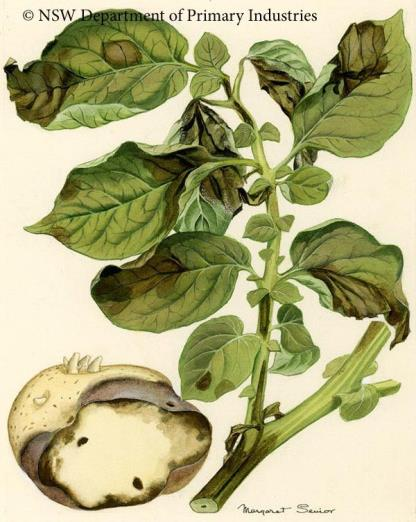

 인류의 역사/농업의역사 = 각 종 병해충과잡초와의경쟁과싸움
 획일화된농업생태계+ 새롭게 도입된작물+ 병해충 새로운환경에서병다수 발생, 큰 피해야기
 식물병의 역사적피해 사례
1845~1860, 감자역병(Phytophthora infestans)
• 영국과아일랜드대흉년으로, 100만 명 사망, 150만명 신대륙으로이주
 벼의깨씨무늬병(Cochliobolus miyabeannus) : 인도, 벼의흉년으로 200만명 사망
 커피녹병(Hemileia vastatrix) : 스리랑카, 커피 재배가녹병에 걸려남아메리카로옮겨짐 감자역병
 수박덩굴쪼김병(Fusarium oxysporum) : 미국(아이오와주) 재배면적 급감

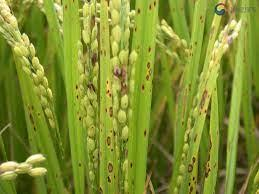

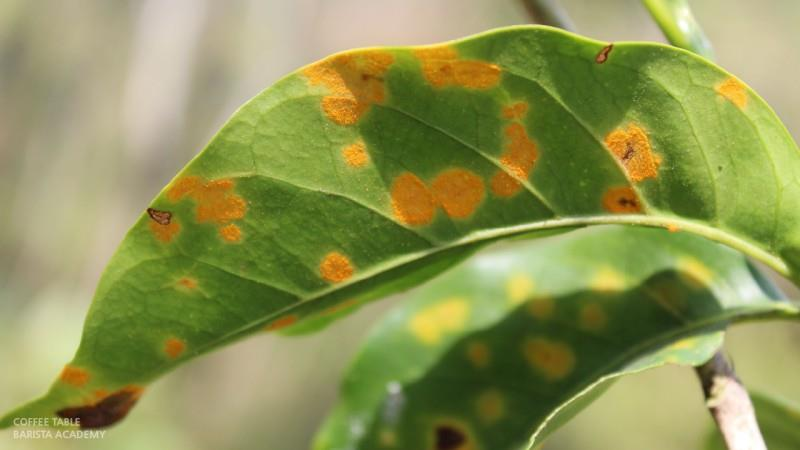

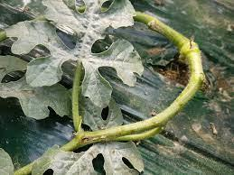

벼의깨씨무늬병 커피녹병 수박의덩굴쪼김병

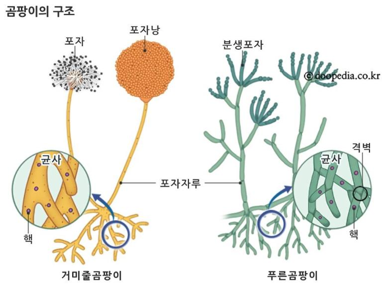

 병원: 식물에병원을일으키는원인 : 병원균(진균, 세균), 병원체 또는병원독소(바이러스)
 병원체: 병원이생물 또는바이러스일 때
 병원균: 병원이 세균 도는 진균일 때
 생물성 병원(전염성, 기생성 병) : 식물병 유발진균8,000여종, 세균 180여종, 바이러스500여종
 주인 : 식물병에 직접 관여하는것
 유인: 주인이발병을돕는환경요인
 진균성 병(fungi)
 기생성병원(진균, fungi) : 식물에서병을 가장일으키는균 곰팡이의구조
 종류
• 조균류: 유주자균류(난포자형성), 접합균류(접합포자형성)

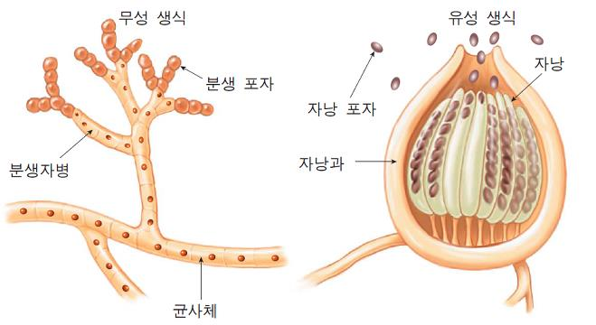

- 진핵생물중, 균사에격막이 없는 수생곰팡이일종. 하천에서 부패된생물체표면에서식
• 자낭균류: 유성생식을위한 자낭포자를만드는균류(효모류, 푸른곰팡이, 누룩곰팡이, 붉은빵곰팡이등)
• 담자균류(담포자) : 유성생식 한결과로'담자기'라는세포가 되어홀씨를만드는균류
- 스스로양분을 만들지못하여 다른생물체에붙어기생: 버섯등)
• 불완전균류(유성포자가없음) : '분생자'라는무성포자형성, 번식
곰팡이의무성/유성생식

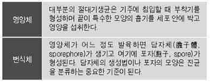

 진균(= 사상균, 곰팡이)의특징
 실 모양균사체를가짐(균사에는격막이있는 것/ 없는 것)
 영양체로균사의끝이 특수한모양인흡기(hostorium)를세포 안에박고 영양분섭취
 번식체로어느 정도 발육하면, 담자체가생기고여기에포자(spore) 형성
• 무성포자: 동시에수많은개체를 되풀이하여형성. 식물병이 급격히만연하는 제2차전염원
• 유성포자: 수정에의해발생. 주로진균의월동, 유전등 종족의유지에중요한역할(난포자, 자낭포자, 담자포자등)

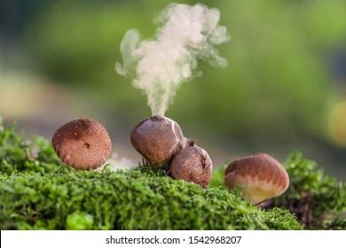

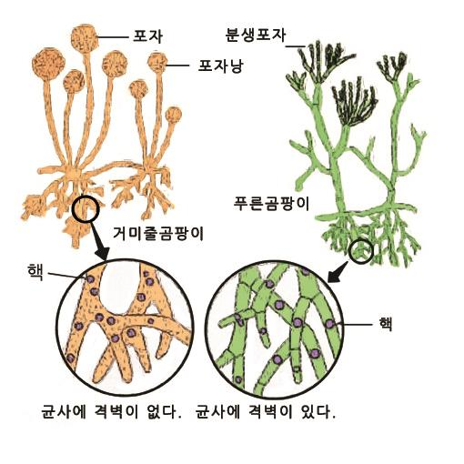

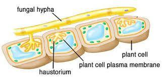

 진균의 분류
1. 난균류(유주자균류)(oomycetes)
• 균사의발달미약

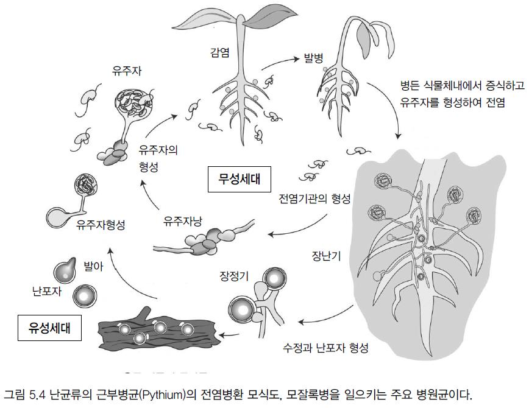

• 격막부재
* 유주자
• 각 종 식물의모잘록병, 감자역병, 감자 암종병등 -무성생식을위해편모를가지는세포

 진균의 분류
1. 난균류(유주자균류)(oomycetes)
• 균사의발달미약

• 격막부재
* 유주자
• 각 종 식물의모잘록병, 감자역병, 감자 암종병등 -무성생식을위해편모를가지는세포

 진균의 분류
2. 자낭균류(Ascomycetes)
• 격막이있고, 균핵과 자좌(내부 또는자실체를형성하는균사조직구조)형성
• 유성포자는자낭 안에자낭포자 가짐
• 맥류붉은곰팡이병, 흰가루병, 흑성병등

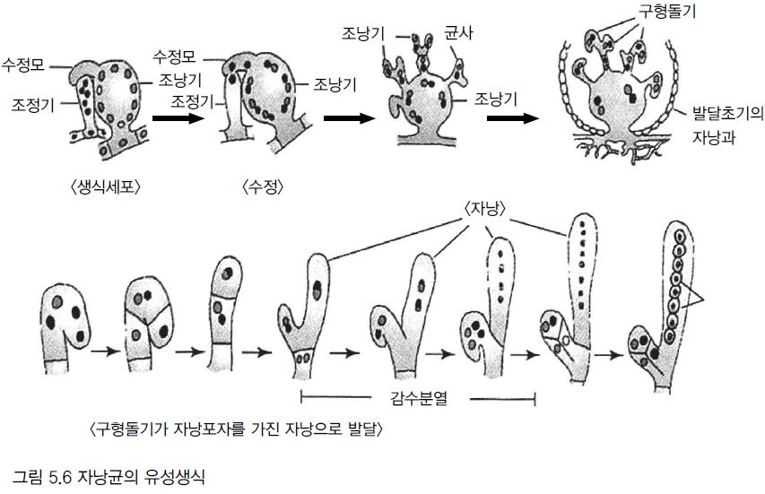

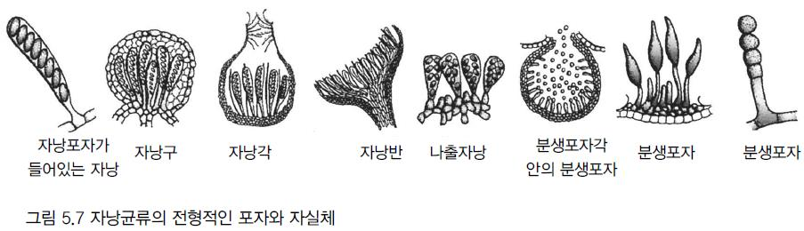

자낭포자

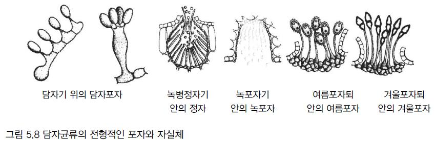

 진균의 분류
3. 담자균류(Basidiomycetes)
• 격막이있고, 유성포자는담자기 위에생기는담포자
• 맥류깜부기병, 녹병 등

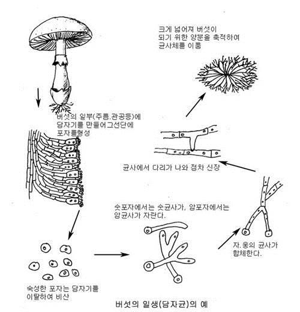

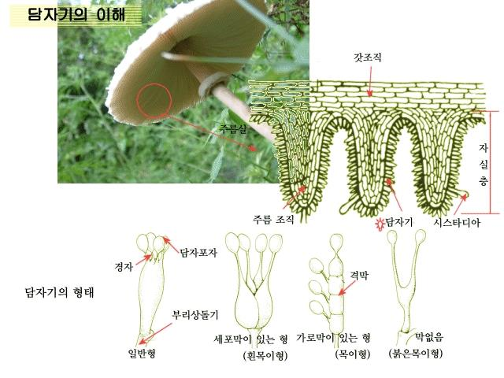

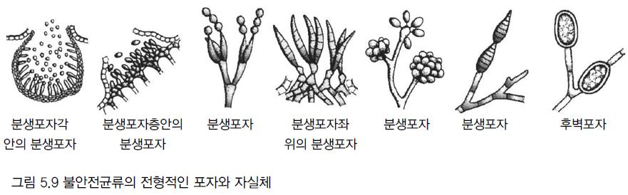

 진균의 분류
4. 불완전균류(Deuteromycetes)
• 무성적인분생포자세대만으로 분류한것
• 벼도열병, 탄저병, 오이 덩굴쪼김병등

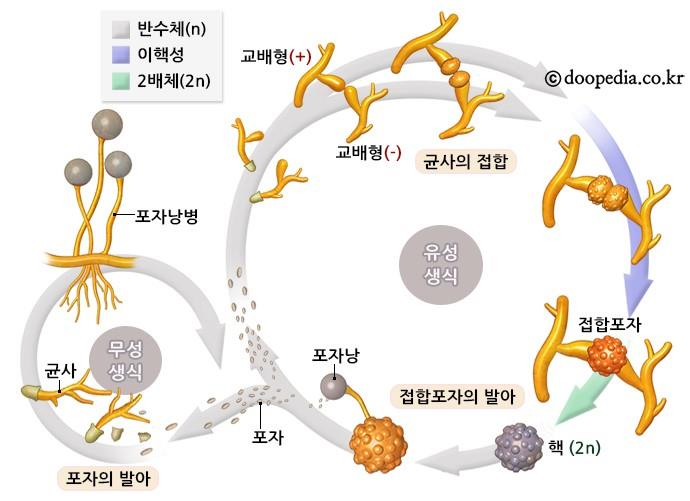

5. 접합균류(Zygomycetes)
• 비운동성의무성포자를 만들며, 유주자가없음
• 균사: 격벽이 없고, 다핵.

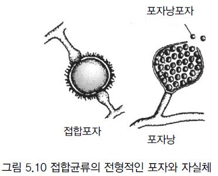

• 세포벽: 키틴과키토신능 가지고 있음
• 고구마무름병유발

 진균의 분류
6. 점균류
• 단세포
• 아메바진핵생물로, 원형질체는있으나세포벽없음
• 감자더뎅이병유발

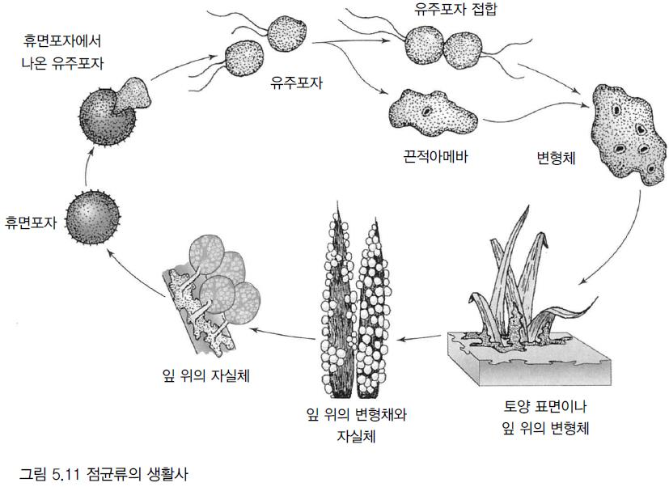

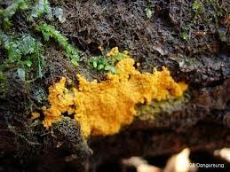

황색점균류

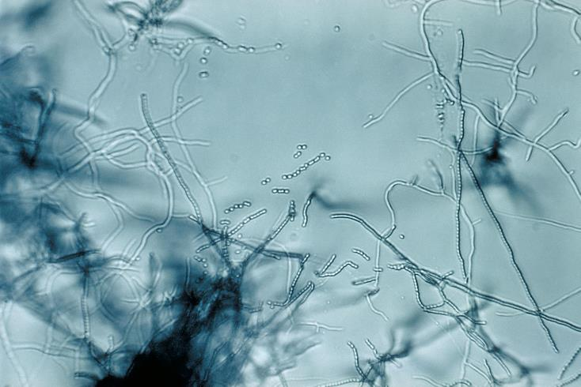

 세균성 병(bacteria)
 세균= 분열균
 모양: 구상, 간상, 나선상  상처로 감염
 세균특징
• 실모양인스트렙토마이시스(Streptomyces)를제외하고, 모두간상
• 단세포미생물로서, 세포벽, 세포막, 세포질로구성
Streptomyces
• 운동성이있는 것(편모 보유)과없는것으로구분
- 편모(단극모, 한쪽에 한개만 달린것/양극모, 양쪽에달린 것/속생모, 한쪽/양쪽여러 개 달린 것/주생모, 균체 주위에 생기는것)
• 증식: 접합, 형질전환, 형질도입의 방법으로유성생식도하지만, 대부분의세균은무성생식법의일종인'이분법'에의해 증식
• 전반은물, 곤충, 기타동물및 인축에의해이루어지며, 항상 점질물에의해 집단을이루고 있으므로, 바람에의한 이동은 없음
• 침입: 주로 식물의상처 또는 자연개구부를통해이루어짐

 바이러스 병(virus)
 Virus : '독'이라는 뜻
 아주작고 특수하여화학적 방제가 불가능하기때문에, 간접적 방제로매개충을 방제하거나숙주의면역력을높이며병든 식물체는제거
 바이로이드(viroid) : 바이러스보다 더작고 유사. 현자 가장작은병원체로감자갈쪽병(접촉감염)과 같은것에서비교적 최근 발견
 바이러스특징
• 핵산을중심으로, 구형, 타원형, 간상형, 선형등으로17~2000 m에걸친 단백질소립자들의밀집체
• 크기가작아전자현미경으로관찰 가능
• 인공배양이 되지 않고 산 세포에서만 배양 가능

• 특정생물체에 침입하여 병을 일으키는 감염성(발병력) 있음
• 전신병징. 온도에 영향 많이 받고, 세포 내에서 봉입체 형성  세포 및 조직 변화 유발

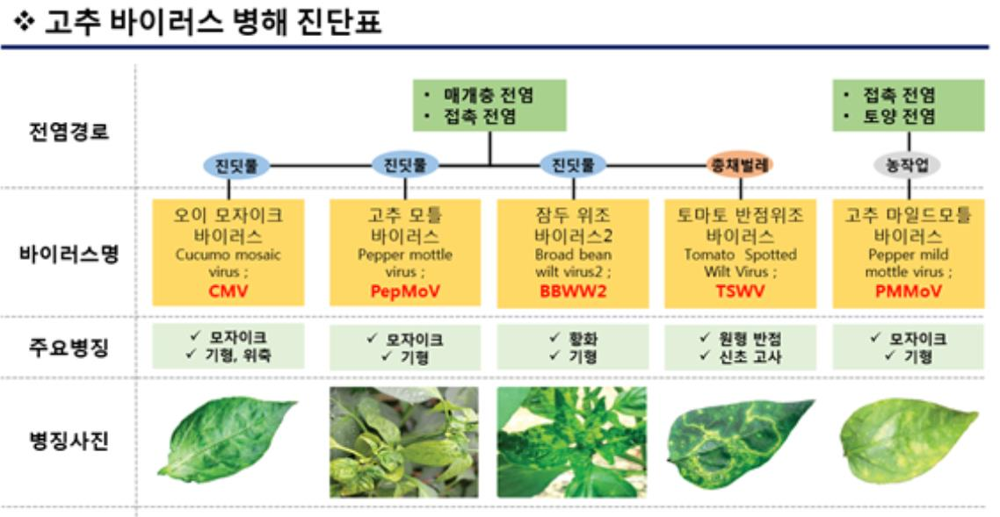

 바이러스 병(virus)
 바이러스의전염
• 충매전염 : 바이러스의 가장 일반적인 전염수단
• 영속성 바이러스 : 매개충 체내 증식  지속적 전파
• 비영속성 바이러스 : 바이러스가 체내에 들어가지 않고 일시적으로 전염
• 수매/풍매 전염 : 바이러스가 물이나 바람에 의해 전염
• 인축에 의한 전염 : 사람/동물에 의해 발생

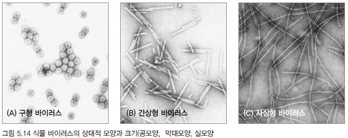

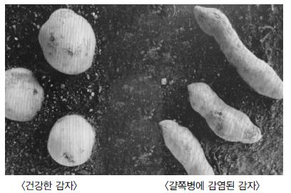

 바이로이드(viroid)
 바이러스보다더 작은 전염원(지금까지알려진가장 작은병원체)
 접목및 전정 시, 감염된 대목이나 접수또는 손, 작업기구등에 의해접촉전염
 감자의걀쪽병유발
 파이토플라즈마(phytoplasma)

 일반세균과는달리, 세포벽이없음.
건강한감자와감자걀쪽바이로이드에감염된감자
 바이러스와세균의 중간 정도
 대추나무빗자루병과같은 병 유발
 특징
• 생물계에서가장 작고, 간단한 생물군
• 크기는70~900 nm. 구형이나불규칙타원형
• 세포벽은없고, 일종의 원형질막에 둘러싸여있음.
대추나무빗자루병
 발생하는병
• 약 200여종이 알려짐(매미충류와같은흡즙곤충에의해 매개. 유병식물의체관부와매개충류의 체내에있음)
• 전신병징을보이고, 매개충에의한 경란전염은하지않음
• 테트라사이클린(tetracycline)계 항생물질로치료 가능
• 주요병으로대추나무, 오동나무 빗자루병, 과꽃, 뽕나무 오갈병발병

 작물에 병을 일으키는병원균

 비생물성 병원
 주로양분/수분의결핍, 과잉장해, 온도/광, 대기모염등으로인한부적절한환경요인등포함
 기생성식물 : 줄기에 기생하는겨우살이, 새삼(메꽃과), 뿌리에 기생하는열당 등
 비생물성 병원의종류
1. 영양장해(nutritional disorder)
• 질소비료: (부족 시) 황화. 생육 억제/ (과다 시) 도복, 숙지가 늦어지고병해충발생 증가
• 인산비료: (부족 시) 주변이적색화. 열매의숙기 지연, 작아짐
• 칼륨(생리대사 중요성분) : 서류(감자/고구마)뿌리 생육향상. (부족시) 벼적고병, 보리흰무늬병유발
• 칼슘(식물체 내 이동이느린 대표적다량필수요소) : (부족 시) 상충팁번, 토마토배꼽썩음병, 샐러리검은썩음병유발
• 마그네슘(엽록소구성성분) : (부족시) 황화. 감귤대황병, 보리힌깁병등
• 철 : 산성토양에서잘 용해. 알칼리토양에서부족하기쉬움. 조직배양/수경재배시에용해도 향상
• 붕소(소량필요한 필수성분) : 십자화과채소 부족증. (부족 시) 무/배추속썩음병, 사과축과병등
• 망간: 과잉과 결핍 시, 여러 병리현상동반. 사과적진병(망간과잉), 감귤류위황병(망간결핍) 등

 비생물성 병원의종류
2. 부적당한토양 조건
• 수분이너무 많거나 배수 불량하여 과습시 : 통기불량  산소 결핍 호흡 효율감소. 종자의발아/생육억제
• 토성/토양구조에따라 입단화 촉진 통기/보수력등 작물생육 양호
• 토양반응: pH로, 영양성분의용해도/이용도영향 작물생육달라짐
3. 기상장해
• 광(작물생장의 근본에너지) : (부족시) 모든작물의생육이연약. 병발생. 지나치게강할때 일소병(sun burn) 발생
• 온도: 생물생존/생존에절대적. 일반적으로5~40℃에서 생육. 작물에따라, 최적 온도 다양
- 병발생 = '부적당한환경에크게 영향'을받음
• 수분: 식물의70% 정도구성. (부족 시) 한발(가뭄)이들고, 강수량이몰리거나지나치게많으면수해/습해발생
• 바람: 미풍으로적절하면이산화탄소 공급/증발산용이.

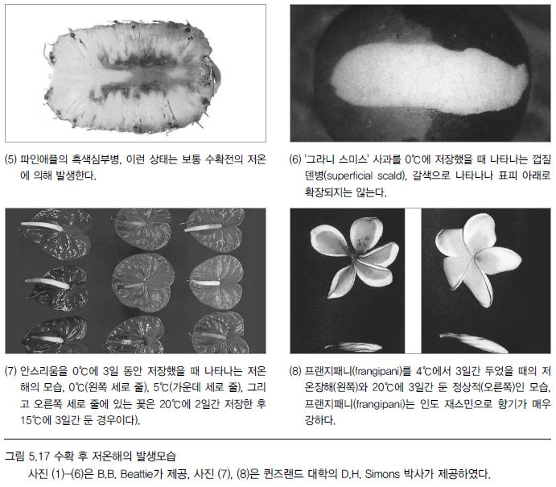

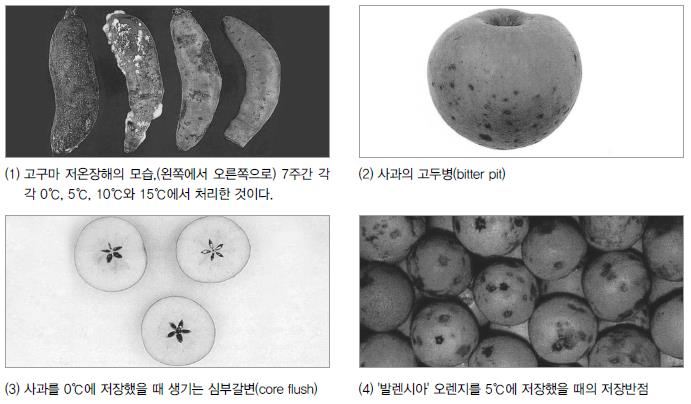

 비생물성 병원의종류

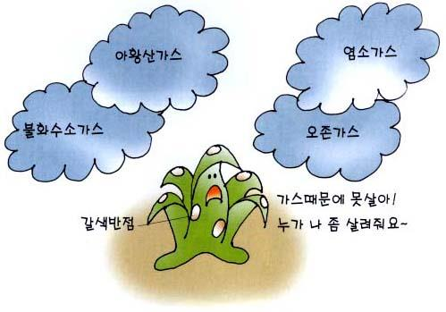

4. 약해(phytotoxicity) : 작물에 농약을 처리할때, 농도가과다하거나오남용 시 피해발생
5. 환경요염피해(environmental pollution damage)
 대기오염피해
• 아황산가스피해 : 석탄/석유, 비료공장에서발생
• 불소피해 : 어린잎에서피해가 크고 잎 고사, 낙하.
• 염소가스
• 최근, 미세먼지와황사가자주 발생  차광  광합성악영향
 수질오염피해 : 토양을산성/알칼리성화시키며, 질소나중금속원소 축적, 농약 등으로 식물에악영향

 식물에 병을 유발하는각종 식물 병원(pathogen)의 종류

 식물병 발생 기작
1. 식물병일생(disease cycle, 병환) : 식물에서병이발생하여되풀이되는과정(병환). 병원의생활사와기주사이에밀접한 관계
병환과정 : 전염원  전파 및 전반 침입 감염 잠복기  병징 및 표징  병사

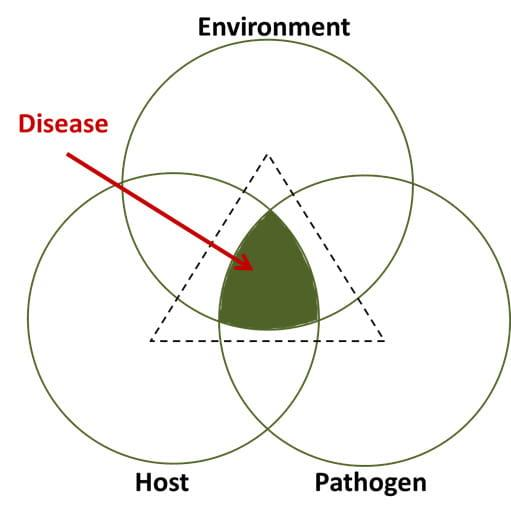

전파/전반
전염원 침입 감염
병원은살아있음 잠복기
병의지속기
병사 병징 및 표징

 식물병 발생 기작
2. 발병환경: (예) 저온, 다습, 저광도, 많은 질소질비료시용 등 벼 도열병발생조건
발병환경 요인

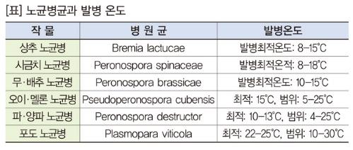

• 온도: 온도가 낮거나(저온), 높아서(고온) 최적 생장온도를벗어나면비기생성병발병
• 수분: 대부분 90% 이상의다습조건을필요로함. 일반적으로 건조하면병해가크게 감소
• 광 : 부족시, 연약. 음지식물은광이 많으면탄저병발생
• 비료: 질소질 비료는 병발생을 유도하고, 규산질비료는 억제
• 미생물: 미생물이있으면, 병 발생증가
• 토양반응(pH)

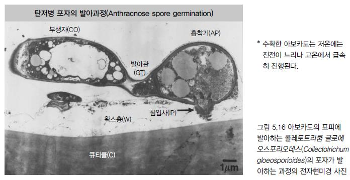

- 산성토양에서의병 : 채소류(토마토시들음병, 무/배추무사마귀병등)
- 알칼리성토양에서의병 : 벼/블루베리등 산성토양에서잘자라는작물에서확인

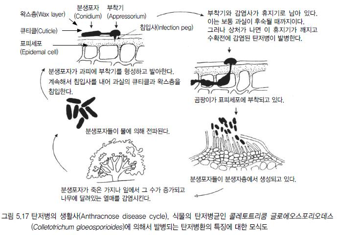

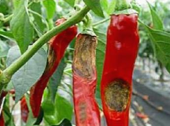

고추탄저병

 식물병 발생 기작
3. 병원성(pathogenicity)
병원성: 식물에서병원이 병을 일으킬 수있는 능력
• 고병원성: 병을일으킬수 있는 능력이높은것
• 저병원성: 낮은것
• 이병성(감수성) : 병에 잘걸리는성질
• 저항성: 병에 잘걸리지않는 성질
병원성의의의와기작
• 의의:병원성의 생리적분화로, 같은종이면서특정한식물/품종에만병을일으키는등 '병원균의기생성및 기타 성질이 다른 현상'

 식물병 발생 기작
3. 병원성(pathogenicity)
병원성과효소
• 세포벽물질의분해효소를분비하는많은 균류는기주침입시, 발병이진전됨에따라 효소를분비하여세포벽을녹임

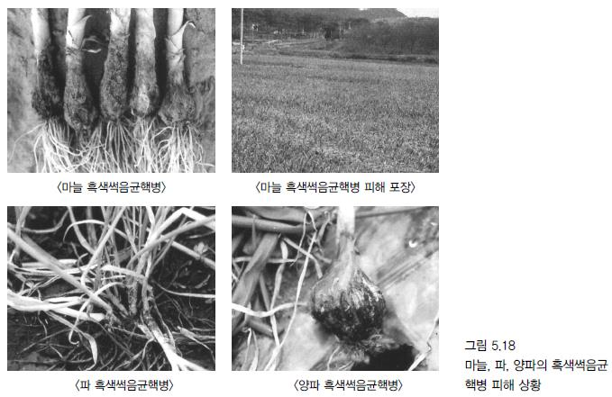

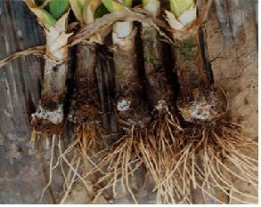

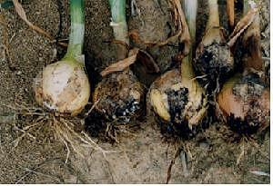

마늘흑색썩음균핵병 양파흑색썩음균핵병

 식물병 발생 기작
4. 병원균침입과감염
병원균침입
• 각피(cuticle)침입: 벼도열병균, 흰가루병균, 깜부리병균, 녹병균등
- 잎/줄기등 식물체표면의 각피나뿌리의표피를병원체가 직접 뚫고침입
• 자연개구부침입
- 기공, 수공, 피목, 밀선 등으로 침입하는것
• 상처침입 : 고구마무름병균, 감귤푸른곰팡이병균, 채소 세균성무름병균, 과수 근두암병균, 사과 부란병균, 밤나무줄기마름병균
- 여러가지 원인으로생긴 상처로병원체침입
• 식물기관을통한 침입과 감염
- 여러방법으로식물의여러 곳으로침입

 식물병 발생 기작

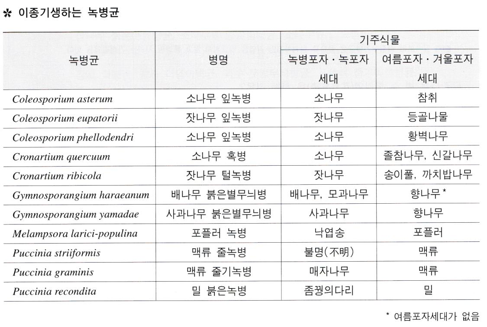

5. 기주교대(alternation of host)
이종기생균 : 녹병균과같이 전혀 다른 두종류의기주식물을 옮겨가며생활하는병원균
기주교대 : 이종 기생균이그 생활사를완성하기위해 기주를 바꾸는것
중간기주 : 두 종의 기주 식물 중, 경제적가치가적은쪽.
6. 병원체의기생성
기생체(parasite) : 엽록소가 없어서스스로양분을합성하지 못함 다른녹색시기물/동물에기생하여양분을섭취하고 살아감
(진균, 세균, 바이러스등)
부생체(saprophyte) : 죽은조직/유기물에서영양을섭취하고 살아가는것

 식물병 발생 기작
7. 병원균의전반과 분산
전반방법
• 공기전염: 바람이병원균포자 운반하여병 전파(예: 배나무 적성병)
• 수매전염: 물에 의한 전파. 빗물이병원균이동
• 토양전염: 흙에 섞이거나묘판에서병이전염
• 충매전염: 곤충에의해 전염(보독충: 바이러스를전파시키는곤충)
• 종묘나농작에의한 전염 : 과수의근두암종병은접목으로 감자역병은괴경과함께 전파. 선충, 바이러스, 잡초등

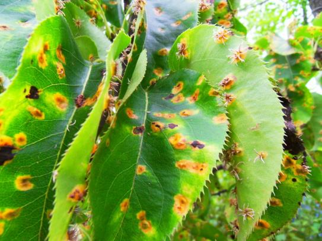

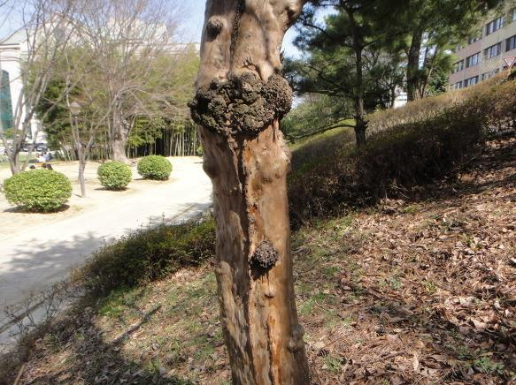

배나무적성병 모과나무근두암종병

 식물병 진단
1. 병징(disease symptom)
병징: 식물체가병원에의해서 세포, 조직, 기관에이상을일으켜외부에나타나는반응
병원체가달라도비슷한병징을 나타내는경우도있고, 같은 병원체라도식물품종, 발병부위, 생육시기, 환경조건에따라 다른 병징
감염된식물체가외부로보이는 변화의종류
• 전신병징: 시들음병(위조병), 오갈병(위축병), 황화병, 위황병, 바이러스병
• 국부병징: 혹병, 가지마름병, 썩음병, 잎마름병, 빗자루병, 불마름병, 줄기마름병, 미이라병 등
• 외형또는 생육 이상 : 묘잘록병(묘입고병), 시들음병(위조병), 오갈병(위축병), 빗자루병(천구소병), 혹병(암종병), 구멍병(천공병) 등
• 색의변화 : 누렁이병(황위병), 모자이크병, 점무늬병(반점병), 줄무늬병(조반병), 무늬마름병(문고병) 등

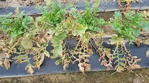

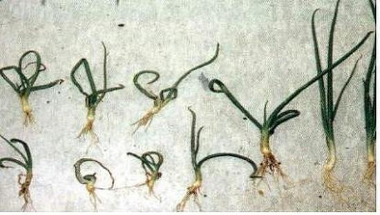

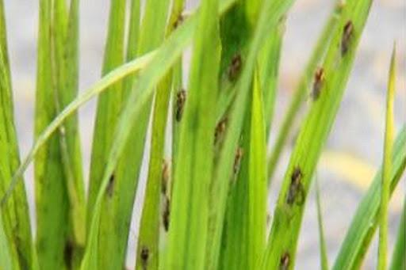

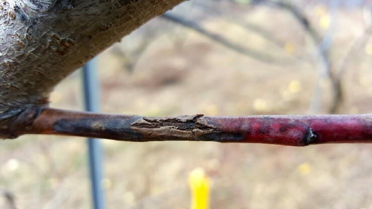

전신병징(무시들음병) 국부병징(복숭아가지마름병) 외형이상(양파묘잘록병) 색변화(벼줄무늬잎마름병)

* 세균병의 병징

| 구분 | 설명 |
| --- | --- |
| 무름병 | • 상처를통해침입한병균이펙티나아제(pectinase) 효소를분비하여기주세포의중층을분해하면, 삼투압에변화가생텨기주세포는원형질분리를일으켜죽게됨• 물이많은조직에서부패와악취의무름현상발생• 채소류무름병 |
| 점무늬병 | • 기공으로침입하여증식한세균은인접유조직세포를파괴하여여러모양의점무늬를이룸• 콩세균성점무늬병 |
| 잎마름병 | • 세균이유관속조직의도관부를침입하여식물기관의일부또는전체가말라죽음• 벼흰빛잎마름병 |
| 시들음병 | • 침입한세균이물관에서증식하여수분의상승을저해• 토마토풋마름병 |
| 세균성혹병 | • 세균이기주세포를자극하여병환부를이상증식• 사과근두암종병 |

* 병징의 종류

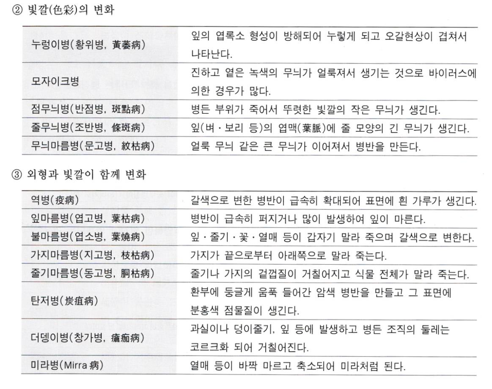

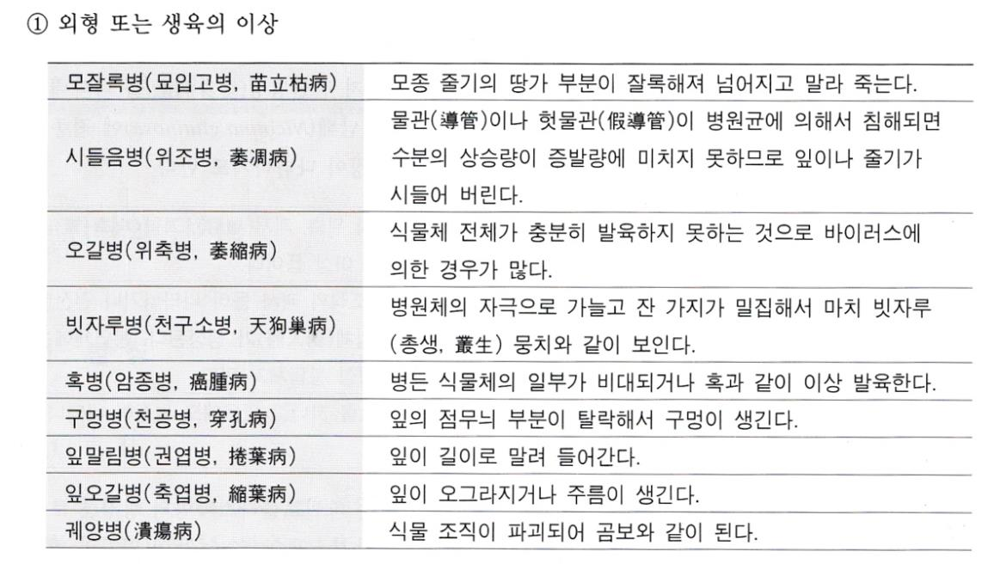

 식물병 진단
2. 표징(disease sign)
표징: 기생성병에 있어서 흔히 병환부에병원체그 자체가 나타나서병의발생을직접 표시하는것
표징은일정 기간이지난 후, 병원체자체가나타나는것이기 때문에병의진단에중요
병원체가진균일때는 표징이 잘 나타나지만, 비전염성병이나바이러스, 바이로이드, 파이토플라즈마에의한병은 병징만 나타남.
육안가능한 표징 : 가루, 곰팡이, 흑색소립자, 돌기, 버섯, 끈끈한 물질, 냄새(악취) 등

흰가루병 돌기(더뎅이병)

 식물병 진단
3. 동정(identification)
병원체를분리, 배양하고접종시험을하는 등다양한방법으로 병원균을정확하게규명하는것

 해부 및 현미경적진단
1. 해부학적진단
형태나색깔로 구별이 되지 않을 때, 식물체를자르거나해부함으로써진단 수행
* 진단(diagnosis) : 병든 식물을 정밀하게검사하여비슷한병과구별하고정확한병명을 결정하는것
병원체의동정에관한 '코흐(Koch)의법칙'(Robert Koch, 1843~1910, 독일 세균학자/ 탄저균, 결핵균, 콜레라균등 발견)
• 병원체는반드시 병환부에존재한다.
• 병원체는배지 상태에서순수하게 배양되어야한다.

• 병원체를순수 배양하여접종하면 같은병을일으킨다.
• 접종한식물로부터같은 병원체를 다시분리할수 있다.

