# kocw_식물보호학_09

|  | 2021년도 2학기 - 식물보호학식물병리 - 2(식물병 방제 및 작물 발생 주요 병들) |
| --- | --- |

| 2021년도 2학기 - 식물보호학 |
| --- |
| 식물병리 - 2(식물병 방제 및 작물 발생 주요 병들) |

식물병의 방제

▸ 식물병의 방제원리
✓ 합리적방제를위해 사전파악 사항
• 병의종류
• 병원체의변이성, 생활사및 환경의영향
• 환경이기주 및 기주 기생체상호작용에미치는영향
• 기주의저항성및 그 유전자저항성에미치는환경의영향
▸ 식물병의 방제개념
✓ 방제의종류
• 예방(prevention) : 병원체침입/도입을배제하거나제거하는것 → 예찰이나위생을철저히 관리
• 면역(immunity) : 감염/발병에대한기주의저항성을높이거나 개량하는것
• 종합적방제(integrated pest management, IPM) : 물리적, 생물적, 화학적방제법을총동원하되, 효율화하며 환경의피해를 줄이며
경제적으로방제
• 법적방제(legal control) : 병충해의 유입을차단하도록식물검역이나국제적인유통을제어하여 방제
• 재배적방제(cultural control)

식물병의 방제

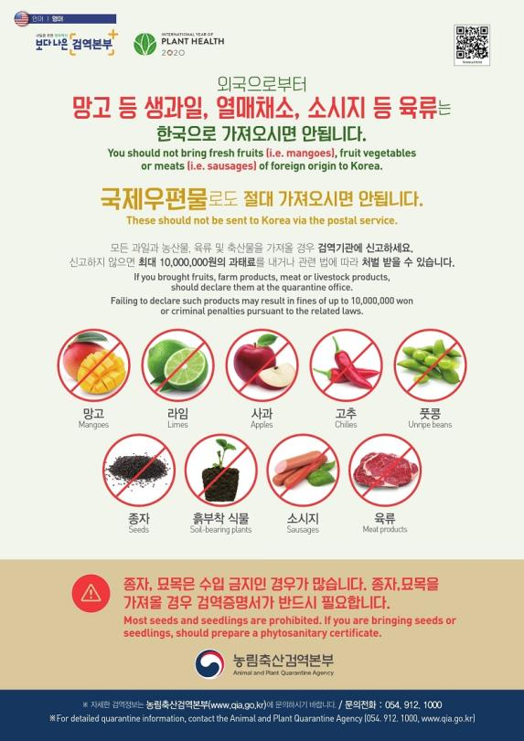

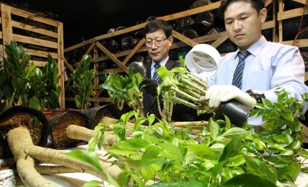

▸ 식물병의 방제방법
1) 법적방제(legal control)
▸ 식물검역

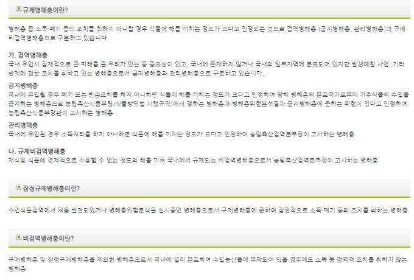

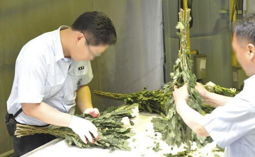

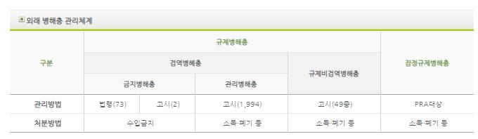

식물병의 방제

▸ 식물병의 방제방법
2) 생물적방제(biological control) : 병원균에의한식물의 저항성을유도해병해를방제하는 방법
▸ 교차보호(cross protection) : 바이러스(virus)의간섭작용이용(토마토의Tomato Mosaic Virus, 박과 작물의Cucumber Mosaic V.)
▸ 근권미생물에의한 방제
✓ 근권진균 : Trichodermin, Gliotoxin등
✓ 근권세균 : Bacillus, Pseudomonas 등

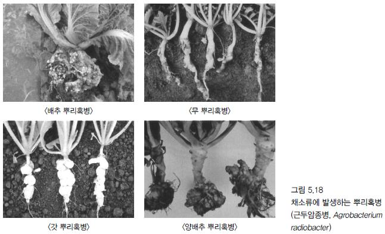

▸ 길항미생물이용
✓ 길항미생물: 병원균의생육을 억제/저지시키는능력을 갖는미생물
✓ 종류
• 세균: Agrobacterium, Bacillus, Pseudomonas, Streptomyces 등
• 진균: Ampelomyces, Candida 등

식물병의 방제

▸ 식물병의 방제방법
3) 경종적방제(cultural control)
▸ 윤작실시
▸ 파종시기조절
▸ 포장위생: 전염원(낙엽, 이병된 가지등) 및중간 숙주제거
▸ 토양조건개선
▸ 균형과영양관리 : 필수원소, 균형시비, 칼륨성분등
▸ 저항성품종 재배
▸ 접목

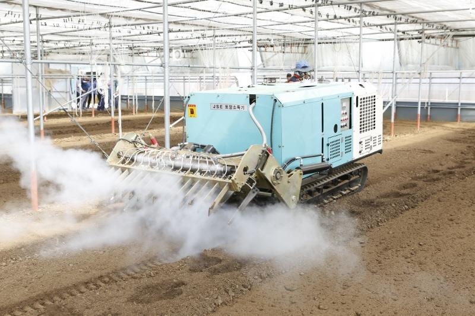

▸ 조직배양으로딸기나 감자증식
▸ 고랭지재배 → 바이러스 매개 진딧물감소(대관령감자등)
4) 물리적방제(physical control)
▸ 좋은종자와묘 선택 재배
▸ 종자소독(고추의경우, 50도에서 1주일간 처리→ 종자감염병 감소)
▸ 토양소독
▸ 해충→ 포살, 유살, 차단 등

작물에 발생하는 주요 병들(각론)

▸ 벼 병(rice disease)의 종류

작물에 발생하는 주요 병들(각론) - 벼 병(rice disease)

| 1. 벼 깨씨무늬병(Brown spot, 호마엽고병) |  |
| --- | --- |
|  | 1. 벼 깨씨무늬병(Brown spot, 호마엽고병) |

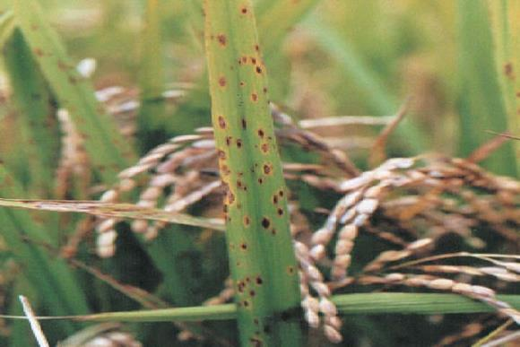

▸ 병원균 : Cochliobolusmiyabeanus(진균)
▸ 병 특성과 발병
✓ 균사 상태로 볏짚에서 월동. 봄에 분생포자 생성 → 포자 바람 전파
✓ 잎에 타원형 암갈색 반점형성. 이삭목/가지 볍씨 등암갈색 변화
✓ 발병원인 : 고온다습 조건, 사질토양 → 산성 토양 → 영양 부족 시 발생

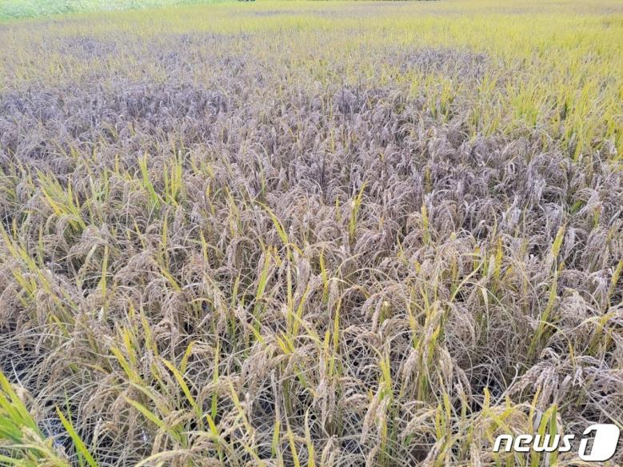

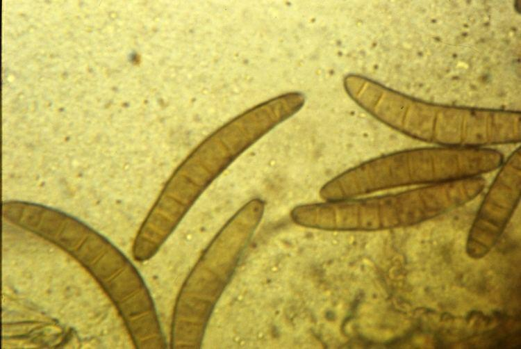

▸ 병징과 방제
✓ 저항성 품종 재배
✓ 종자 소독
✓ 토양 개량
✓ 적절한 비료 공급
Cochliobolusmiyabeanus

작물에 발생하는 주요 병들(각론) - 벼 병(rice disease)

| 2. 벼 키다리병(Bakanae Disease) |  |
| --- | --- |
|  | 2. 벼 키다리병(Bakanae Disease) |

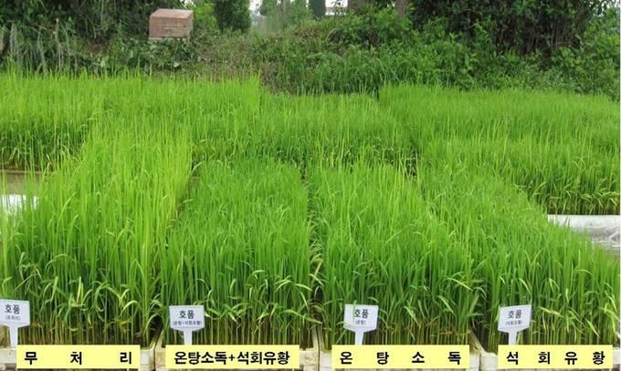

▸ 병원균 : Gibberellafujikuroi, 진균(자낭균류)
▸ 병 특성과 발병
✓ 분생포자 형태로 종자표면 월동
✓ 고온 잘발생
✓ 산성토양에서 심하게 발생
✓ 종자 통해감염

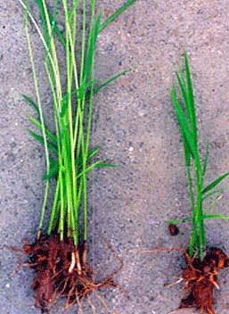

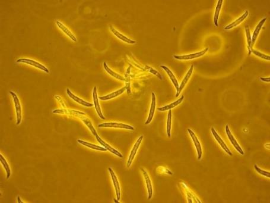

✓ 지베렐린(Gibberellin)*의 작용 → 키가커지는 도장 현상
*고등식물의식물생장조절제→줄기성장, 발아, 휴면, 개화, 성결정, 노화등영향호르몬
▸ 병징과 방제
✓ 병징 : 잎은엷은 녹색으로 가늘고 길게자라 건전 묘의2배 이상 크며 도중 죽음
Gibberellafujikuroi
✓ 방제
• 저항성 품종 선택, 건전한 종자 사용, 종자소독
• 못자리나 본답 초기 이병주 제거

작물에 발생하는 주요 병들(각론) - 벼 병(rice disease)

| 3. 벼 도열병(Blast) : 국내, 동남아 각지 가장 큰 피해 |  |
| --- | --- |
|  | 3. 벼 도열병(Blast) : 국내, 동남아 각지 가장 큰 피해 |

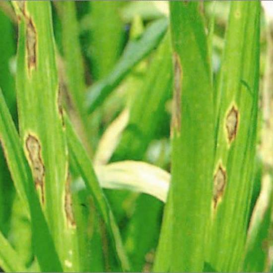

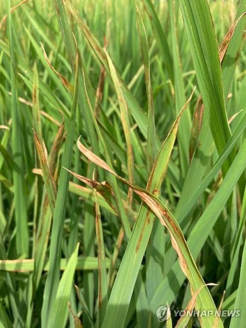

▸ 병원균 : Pyriculariaoryzae, 진균(불완전균류)
▸ 병 특성과 발병
✓ 병원균 : 볏짚/볍씨의 병든부분에서 균사나 분생포자로 월동
✓ 포자 : 바람에 의해전파. 분생포자는 2개격막 보유
✓ 발병 원인: 공기 중분생포자 침입. 25~28℃ 정도 다소 저온, 100%에 가까운 다습 조건
✓ 발생 조건

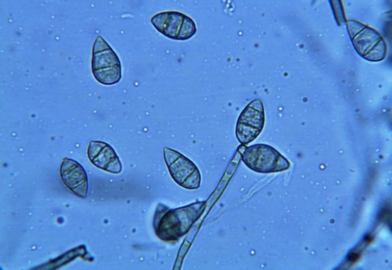

• 저온다우상태에서 기온이 급격히 올라갈 때
• 이앙이 늦고 질소가 많으며 다습조건일 때
• 생육기에 물 부족또는 찬물을 깊이 대어줄 때
• 표토가 앝고 비료의 흡수가 급격할 때
Pyriculariaoryzae

작물에 발생하는 주요 병들(각론) - 벼 병(rice disease)

| 3. 벼 도열병(Blast) : 국내 뿐 아니라 동남아 각지 가장 큰 피해 |  |
| --- | --- |
|  | 3. 벼 도열병(Blast) : 국내 뿐 아니라 동남아 각지 가장 큰 피해 |

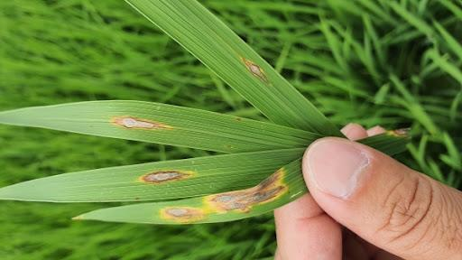

▸ 병징과 방제
✓ 병징
• 벼의 종자에서 이삭까지 전 부위에 발생
• 갈색 방추형 병반
• 갈점형 병반 : 엽맥사이에 생기며 분생포자는 형성하지 않음
• 백점형 병반 : 토양이 건조하고 다비조건의 유묘에서 생기며 분생포자 간혹발생
• 급성형 병반 : 일기불순 / 질소과다 → 병 저항력 감소할 때 발생.
• 병반 주위가 암록색으로 타원형/부정형. 한개의 병반에서 2000~3000개 포자형성
• 만성형 병반 : 일반적인 병반. 방추형. 가장자리 갈색, 중심부 회백색. 포자의 형성/비산이 잘일어남
✓ 방제
• 저항성 품종재배, 질소비료 과용금지, 냉수는 온도를 높여 공급
• 약제로 종자소독
• 종자소독, 이병물 제거
• 질소질 비료의 과잉공급을 금지
• 규소(Si)를 포함한 균형시비

작물에 발생하는 주요 병들(각론) - 벼 병(rice disease)

| 4. 벼 잎집무늬마름병(문고병, Sheath Blight) |  |
| --- | --- |
|  | 4. 벼 잎집무늬마름병(문고병, Sheath Blight) |

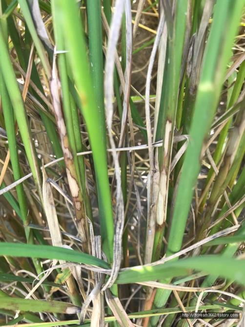

▸ 병원균 : Pelliculariasasakii, 진균(담낭균류)
▸ 병 특성과 발병
✓병반 가까이 균핵 형성. 초기 백색 → 점차 담갈색 변화
✓원인 : 23~25℃ 정도 다소저온, 100%에 가까운 다습 조건, 질소비료 과용, 밀식재배 시에 발생
▸ 병징과 방제
✓ 병징 : 잎집표면에 암회색 부정형 점무늬 발생
✓ 방제
• 모내기전 써래질 후 균핵제거, 밀식 및 질소질 과잉을 금하고, 칼륨질 비료 증시
• 장마 후(더운 여름 날씨지속) 전용 약제 처리

작물에 발생하는 주요 병들(각론) - 벼 병(rice disease)

| 5. 벼 잘록병(Seeding Damping off) |  |
| --- | --- |
|  | 5. 벼 잘록병(Seeding Damping off) |

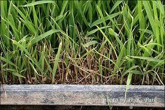

▸ 병원균 : Pythium debaryanum, Rhizoctoniasolani, Fusariumspp., 진균
▸ 병 특성과 발병
✓ 난포자로 병든 조직 또는 토양에서 월동, 관개수/토양 의해 전염
✓ 저온 과습, 통기 불량, 알칼리 토양, 질소비료 과잉일 때발생
✓ 일찍 파종한 못자리, 주야의 온도 차가 클때 많이 발생
▸ 병징과 방제
✓ 병징 : 종자가 발아하지 않거나 발아해도 올라오지 못하고 고사

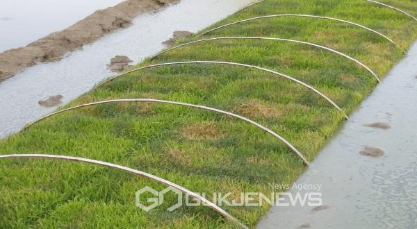

✓ 방제
• 못자리 관리 : 주간30℃ 이하, 야간 10℃ 이상 유지
• 건전 종자사용
• pH는 4.5~5.5 정도의 무병 상토 사용
• 전문 약제살포

작물에 발생하는 주요 병들(각론) - 벼 병(rice disease)

| 6. 벼알마름병 |  |
| --- | --- |
|  | 6. 벼알마름병 |

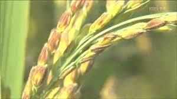

▸ 병원균 : Burkholderiaglumae, 세균
▸ 병 특성과 발병
✓ 병원균은 호기성 그람음성 간균, 생육 적온 30℃에 잘 발생

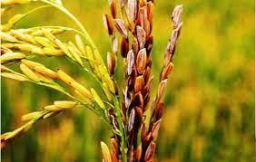

✓ 침종 시이병 종자에서 건전 종자로 전염, 벼 출수 후 1주간 고온(30~35℃), 다습환경에 발병
▸ 병징과 방제
✓ 병징
• 이삭 전체또는 일부분이 말라 죽거나 썩고 벼알은 담황색~청갈색, 현미는 갈색 줄무늬 발생
• 어린 모에서 엽초갈변, 잎몸이 꼬이는 기형 발생 → 황갈색 고사
✓ 방제
• 건전 종자사용, 종자 소독
• 육묘 시,고온 다습, 많은 질소질 비료 사용 지양
• 발병 포장은 수확후 볏짚 소각 및제거

작물에 발생하는 주요 병들(각론) - 벼 병(rice disease)

| 7. 벼 흰잎마름병(백엽고병, Bacterial Leaf Blight) |  |
| --- | --- |
|  | 7. 벼 흰잎마름병(백엽고병, Bacterial Leaf Blight) |

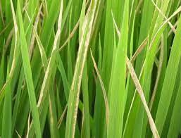

▸ 병원균 : Xantomonasoryza, 세균
▸ 병 특성과 발병
✓ 26~30℃ 정도에서 잘 발생. 강한 바람으로 잎에 상처가 생기면 세균 침입(태풍/홍수가 겹칠 때 많이 발생)
✓ 월동 잡초/벼그루터기에서 월동. 태풍/침수 발생시 또는 질소 과용→병 진전촉진

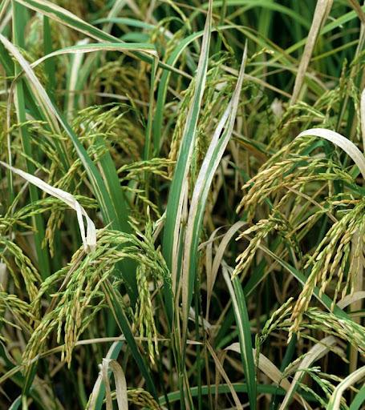

▸ 병징과 방제
✓ 병징
• 어린 벼는새잎이 나올 때 노랗게 되고 미전개/전개된 잎은 황록색 세로 줄형성
• 처음에 잎의 끝/가장자리가 담황색, 회백색, 백색물결 형성. 심하면 잎전체 고사
✓ 방제
• 기주식물(줄풀, 겨풀, 빕새피) 제거, 질소 과용 금지. 규산, 칼륨질 비료 중시
• 논두렁 잡초 소각→ 월동 애멸구류 제거
• 저항성 품종 재배
• 장마 기간중 침관수 피해 시 전용약제 처리

작물에 발생하는 주요 병들(각론) - 벼 병(rice disease)

| 8. 벼 검은줄오갈병(Rice Black Streaked Dwarf) |  |
| --- | --- |
|  | 8. 벼 검은줄오갈병(Rice Black Streaked Dwarf) |

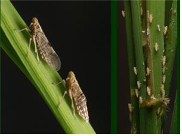

▸ 병원균 : Rice black streaked dwarf virus, 바이러스
▸ 병 특성과 발병
✓ 애멸구류에 의해 매개
✓ 매개충(애멸구류)은 잡초, 밀밭, 자운영밭에서 월동
▸ 병징과 방제
✓ 병징
• 잎은 진녹색과 동시에 현저하게 위축, 잎뒷면/줄기에 갈색 또는 흑색 줄무늬 발생
✓ 방제
• 저항성 품종 재배, 병든 식물체 발견 즉시 제거
• 매개 곤충구제, 논잡초 제거

작물에 발생하는 주요 병들(각론) - 벼 병(rice disease)

| 9. 벼 오갈병(Rice Dwaft) |  |
| --- | --- |
|  | 9. 벼 오갈병(Rice Dwaft) |

▸ 병원균 : Rice dwarf virus, 바이러스
▸ 병 특성과 발병
✓ 끝동매미충, 번개매미충 의해 매개
✓ 매개충(끝동매미충, 번개매미충)은 잡초, 밀밭, 자운영밭에서 월동
✓ 이앙 후본답에서 발병
▸ 병징과 방제
✓ 병징
• 잎은 진녹색과 동시에 백색의 반점, 위축되고 분얼이 많아짐
• 출수 전초장은 건전 벼의 1/2 정도이다.
✓ 방제
• 저항성 품종 재배, 병든 식물체 제거
• 매개 곤충구제
• 논두렁 잡초 제거, 질소질 비료 과용 지양

작물에 발생하는 주요 병들(각론) - 벼 병(rice disease)

| 10. 벼 줄무늬잎마름병(호엽고병, Stripe Virus) |  |
| --- | --- |
|  | 10. 벼 줄무늬잎마름병(호엽고병, Stripe Virus) |

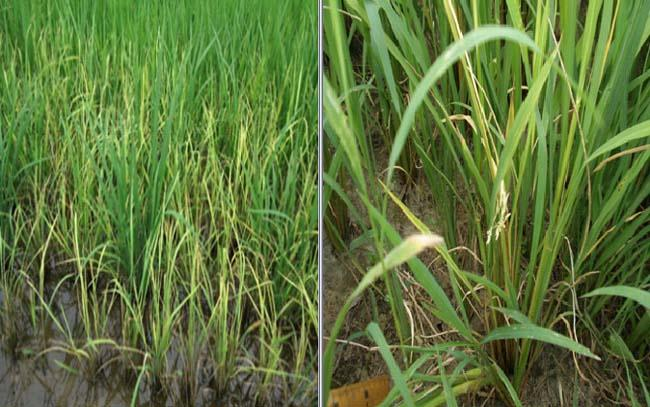

▸ 병원균 : Rice stripe virus, 바이러스
▸ 병 특성과 발병
✓ 애멸구 의해 경란전염으로 발병
✓ 병은 7~14일 정도 잠복기 거쳐 발병
✓ 발병원인: 이앙 후분얼기에 보독충(애멸구)의 양에 의해발병 결정
▸ 병징과 방제

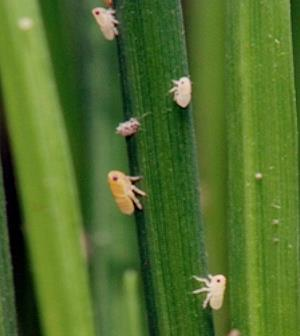

✓ 병징
• 어린 벼는속잎이 노랗게 되고 말림
• 이삭 기형화, 열매도 잘맺지 못함
✓ 방제
• 매개충 방제
• 병든 개체제거

작물에 발생하는 주요 병들(각론)

▸ 맥류 병(Barley disease)의 종류

작물에 발생하는 주요 병들(각론)

▸ 맥류 병(Barley disease)의 종류

작물에 발생하는 주요 병들(각론) - 맥류 병(Barley Disease)

| 1. 맥류 속깜부기병(Coverd Smut) |  |
| --- | --- |
|  | 1. 맥류 속깜부기병(Coverd Smut) |

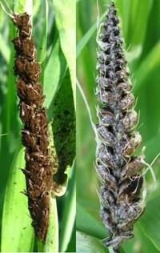

▸ 병원균 : Ustilagohordei (보리), U. tritici (밀); 진균(담자균류)
▸ 병 특성과 발병
✓ 병원균 발육과정 : 종자 발아 시 함께 발아하여 떡잎을 통해 기주 침입
✓ 출수기 어린 이삭에 후막포자 형성
▸ 병징과 방제
✓ 병징
• 보리 알이백색의 피막에 쌓여 비산은 없으나 탈곡할 때분산
✓ 방제
• 무병지에서 건전종자 채종
• 종자소독(냉수온탕침법 또는 전문 약제 처리)
• 저항성 품종 재배
• 병든 이삭제거(묻거나 태움), 탈곡 시병든 이삭이 섞이지 않도록 주의

작물에 발생하는 주요 병들(각론) - 맥류 병(Barley Disease)

| 2. 맥류 줄기녹병(흑수병, Black Stem Rust) |  |
| --- | --- |
|  | 2. 맥류 줄기녹병(흑수병, Black Stem Rust) |

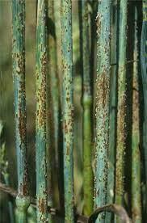

▸ 병원균 : Pucciniagraminis,진균

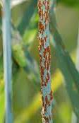

▸ 병 특성과 발병
✓ 잎과 줄기에 약간 튀어나오는 듯한 병반 형성
✓ 맥류 만생종에 많이 발생. 6월 최성기
▸ 병징과 방제
✓ 방제
• 저항성 품종을 재배

작물에 발생하는 주요 병들(각론) - 맥류 병(Barley Disease)

| 3. 보리 겉깜부기병(Smut) |  |
| --- | --- |
|  | 3. 보리 겉깜부기병(Smut) |

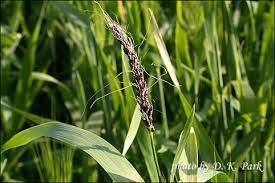

▸ 병원균 : Ustilagomuda(보리); 진균(담자균류)
▸ 병 특성과 발병
✓ 후막포자가 보리 개화기에 바람 따라 흩어져 꽃 주두에 도달, 발아하여 자방에 도달
✓ 보리 종자에 발생. 흑색 가루 비산
✓ 발병원인: 개화기 중다습 조건, 종자에서부터 전염 발생 많아짐

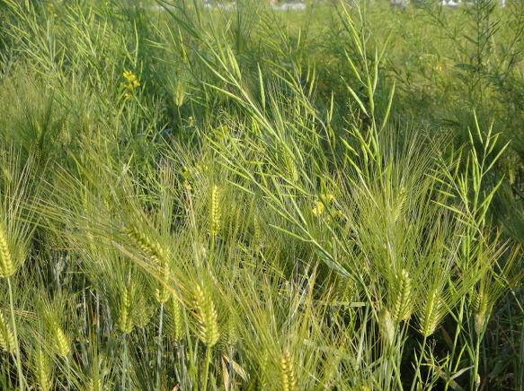

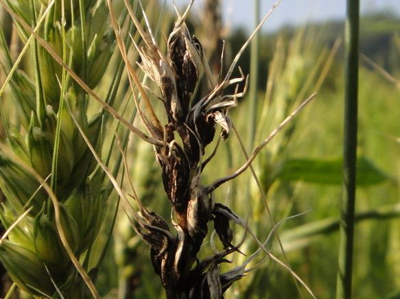

▸ 병징과 방제
✓ 방제
• 종자소독
• 건실한 종자 파종

작물에 발생하는 주요 병들(각론) - 맥류 병(Barley Disease)

| 4. 맥류 붉은곰팡이병(적미병, Scab) |  |
| --- | --- |
|  | 4. 맥류 붉은곰팡이병(적미병, Scab) |

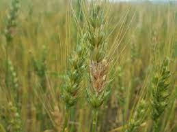

▸ 병원균 : Gibberellazeae; 진균(자낭균류)
▸ 병 특성과 발병
✓ 분생·자낭포자 생성 → 이 균사·포자가 종자·짚에 부착하여 기생 → 겨울을 넘기고 이듬해 발병
✓ 이삭에 주로 발생. 홍색 곰팡이 형성
✓ 발병원인 : 토양온도 15℃ 정도, 강우로 다습조건일 때 많이 발생
✓ 온난하고 습기가 많은 지대, 출수 시 평균기온 18~20℃, 습도 95% 이상, 연속 3일이상 강우 시많이 발생

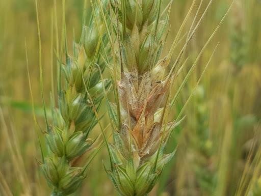

▸ 병징과 방제
✓ 병징 : 이삭초기 껍질이 포함된 홍색 곰팡이 관찰
✓ 방제
• 무병지에서 채종하여 종자소독. 물 관리를 잘하여 습해 예방
• 이병 식물제거
• 비가 계속오면, 출수 후14일까지 석회유황합제를 등살포

작물에 발생하는 주요 병들(각론) - 맥류 병(Barley Disease)

| 5. 맥류 흰가루병(백분병, Powdery Mildew) |  |
| --- | --- |
|  | 5. 맥류 흰가루병(백분병, Powdery Mildew) |

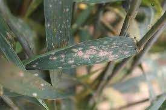

▸ 병원균 : Erysiphe graminis; 진균
▸ 병 특성과 발병
✓분생포자가 공기전염에 의해 전파
✓초기에 잎에 밀가루를 뿌려 놓은 것 같이 보이다가 나중에 담갈색, 검은색 자낭각 형성
✓발병 : 다습조건, 통풍이 불량할 때 발생

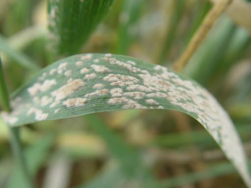

▸ 병징과 방제
✓ 방제
• 통풍을 좋게 하고철저한 배수
• 질소질 비료를 삼가고 3요소를 균형시비
• 저항성 품종 재배

작물에 발생하는 주요 병들(각론) - 두류와 담배작물 병(Legume & Tabacco Disease)

▸ 담배와 콩에 발생하는병

작물에 발생하는 주요 병들(각론) - 두류와 담배작물 병(Legume & Tabacco Disease)

| 1. 담배 역병(Black shank) |  |
| --- | --- |
|  | 1. 담배 역병(Black shank) |

▸ 병원균 : Phytophthoraparasiticavar.nicotianae; 진균
▸ 병 특성과 발병
✓분생포자, 난포자 형성 → 난포자 형으로 땅속 월동
✓묘상에도 발생하나, 6~7월 고온다우 시 많이 발생
▸ 병징과 방제
✓ 병징 : 암녹색 큰병무늬 형성, 심하면 고사
✓ 방제
• 철저한 토양소독
• 주변 전염원 차단

작물에 발생하는 주요 병들(각론) - 두류와 담배작물 병(Legume & Tabacco Disease)

| 2. 담배 불마름병(야화병, Wild Fire) |  |
| --- | --- |
|  | 2. 담배 불마름병(야화병, Wild Fire) |

▸ 병원균 : Pseudomonas tabaci; 세균
▸ 병 특성과 발병
✓병이 든 잎에서 월동
✓발병하면 잎에 수침상의 작은 반점 형성. 주위 황색 달무리 형성
✓기온 20℃ 이상일 때 발생(특히 태풍 이후에 아주 많이 발생)
✓습기가 많고 광선이 부족할 때,피해 많이 발생
▸ 병징과 방제
✓ 병징 : 병반이 발전하며 잎이 찢어지고 들불이 일어난 흔적 보임
✓ 방제
• 철저한 종자소독
• 돌려짓기
• 주변 전염원 차단

작물에 발생하는 주요 병들(각론) - 두류와 담배작물 병(Legume & Tabacco Disease)

| 3. 콩 자주빛무늬병(Purple Speck) |  |
| --- | --- |
|  | 3. 콩 자주빛무늬병(Purple Speck) |

▸ 병원균 : Cercospora kikuchii; 진균(불완전균류)

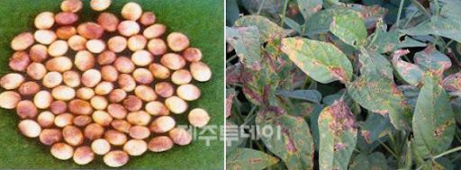

▸ 병 특성과 발병
✓균사 형태로 병든 종자, 병든 식물에서 월동
✓감염된 조직에서 형성된 포자는 바람, 빗방울에 의해 전반
▸ 병징과 방제
✓ 병징

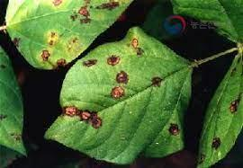

• 종피에 자줏빛 병반 형성
• 쭈글쭈글 해지는 등 외관이 나빠짐
• 잎에는 자흑색, 줄기와 꼬투리에는 적갈색 병반 형성
✓ 방제
• 무병지에서 채종재배
• 이병 잔재물 제거, 발병이 심한 곳에서는 연작을 피함

작물에 발생하는 주요 병들(각론) - 두류와 담배작물 병(Legume & Tabacco Disease)

| 4. 콩 탄저병(Anthracnose) |  |
| --- | --- |
|  | 4. 콩 탄저병(Anthracnose) |

▸ 병원균 : Colletotrichum truncatum; 진균(자낭균류)

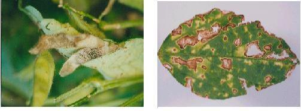

▸ 병 특성과 발병
✓균사 형태로 병든 종자에서 월동
✓수확기에 비가 많이 오는 습한 기후에서 많이 발생
▸ 병징과 방제
✓ 병징
• 줄기, 꼬투리, 잎자루 및잎 : 불규칙한 갈색 병반 진전 → 감염조직에 흑색 소립(분생자층)으로 덮임

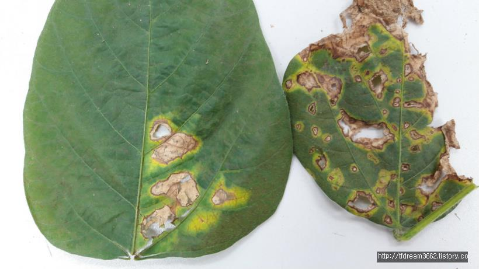

✓ 방제
• 무병지에서 채종재배
• 이병 잔재물 제거
• 발병이 심한 곳에서는 연작을 피함

작물에 발생하는 주요 병들(각론) - 서류 병(Potato Disease)

▸ 감자와 고구마에발생하는병

작물에 발생하는 주요 병들(각론) - 서류 병(Potato Disease)

| 1. 고구마 무름병(Soft Rot) |  |
| --- | --- |
|  | 1. 고구마 무름병(Soft Rot) |

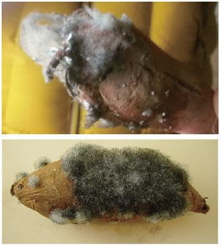

▸ 병원균 : Rhizopusstolonifer; 진균(조균류)
▸ 병 특성과 발병
✓병원균 : 상처를 통하여 씨고구마 침입
✓냉해를 입거나 상처가 있는 고구마에 다발
✓저장 중이거나 수송 중에다발
▸ 병징과 방제
✓ 병징
• 괴근 내부가 연하게 썩고표피의 상처에 황색 즙액이 나오고 알코올 냄새가 남
✓ 방제
• 적기 수확, 수확 중에 상처가 나지않도록 주의
• 12~14℃ 정도 저장고 보관

작물에 발생하는 주요 병들(각론) - 서류 병(Potato Disease)

| 2. 고구마 검은무늬병 |  |
| --- | --- |
|  | 2. 고구마 검은무늬병 |

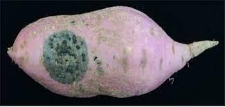

▸ 병원균 : Ceratostomella funbriata; 진균(자낭균류)
▸ 병 특성과 발병
✓묘상 때~ 저장 덩이뿌리가 될 때까지 발병

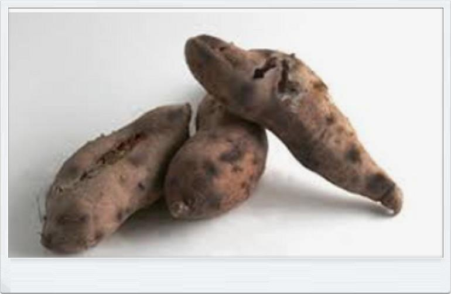

✓병원균 : 균사 형태로 병든 괴근, 땅 속 월동, 주로 분생포자만 형성
✓잎 가장자리에 병반 형성 → 암갈색, 뒷면에 서리 모양 곰팡이 발생 → 잎이 위로 말리면서 고사
✓풍뎅이, 거세미 유충, 쥐 등이 갈아 먹은 상처 통해 침입
✓저장고, 사용기구 등을 통해 전염, 저장 중인 씨고구마에 큰 피해
▸ 병징과 방제
✓ 병징
• 저장 중괴근에 2~3 cm 크기 원형흑색 병반 형성, 괴근 내부까지 검게 변함(병반부는 쓴맛의 이포메아마론(Ipomeamaron) 성분 형성)
✓ 방제
• 건전한 씨고구마 사용, 저항성 품종 재배
• 윤작, 매개곤충 구제

작물에 발생하는 주요 병들(각론) - 서류 병(Potato Disease)

| 3. 감자 역병(Late Blight) |  |
| --- | --- |
|  | 3. 감자 역병(Late Blight) |

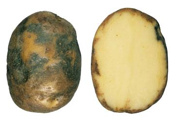

▸ 병원균 : Phytophthorainfestans; 진균(조균류)
▸ 병 특성과 발병
✓균사로 흙 속의 병든 감자/씨감자에서 월동
✓기온 20℃ 내외, 습기가 냉랭한 시기에 많이 발생(자극성 냄새 발생)
▸ 병징과 방제
✓ 병징
• 지표면에 수침상의 부정형 병반 확대 → 암갈색 병반의 뒷면에 서리 모양의 곰팡이, 병든 잎은 위로 말리면서 고사, 덩이줄기에는
담갈색의 병반이 커지며 썩음

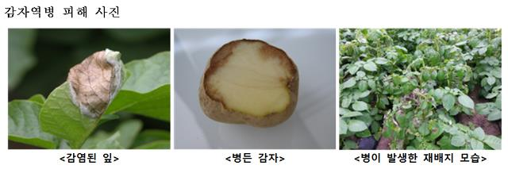

✓ 방제
• 건전한 씨감자 선별 소독, 재배. 저항성 품종 재배
• 침수되지 않도록 배수 철저, 발병지는 돌려짓기
• 개화기에 약제 살포, 수확 시 괴경에 상처가 나지 않도록 주의

작물에 발생하는 주요 병들(각론) - 서류 병(Potato Disease)

| 4. 감자 더뎅이병(Common Scab) |  |
| --- | --- |
|  | 4. 감자 더뎅이병(Common Scab) |

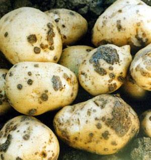

▸ 병원균 : Streptomyces scabies; 세균
▸ 병 특성과 발병
✓병든 씨감자와 흙 속에서 월동
✓토양온도가 25℃ 전후, 건조하고 자갈이 섞인 알칼리 토양에서 발생
▸ 병징과 방제

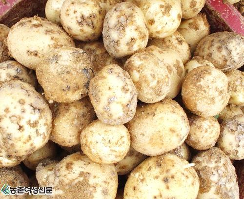

✓ 병징
• 괴경에 발생. 외관을 나쁘게 함
• 처음 갈색의 작은점무늬가 커지며 거칠고 코르크화되어 부스럼같이 변함
✓ 방제
• 건전한 씨감자 선별, 소독 후 재배
• 토양을 산성으로 개량, 윤작
• 수확 후이병토양에 남은잔재물 제거

작물에 발생하는 주요 병들(각론) - 서류 병(Potato Disease)

| 5. 감자 검은무늬썩음병(Black Scurf, Damping off, Stem Canker) |  |
| --- | --- |
|  | 5. 감자 검은무늬썩음병(Black Scurf, Damping off, Stem Canker) |

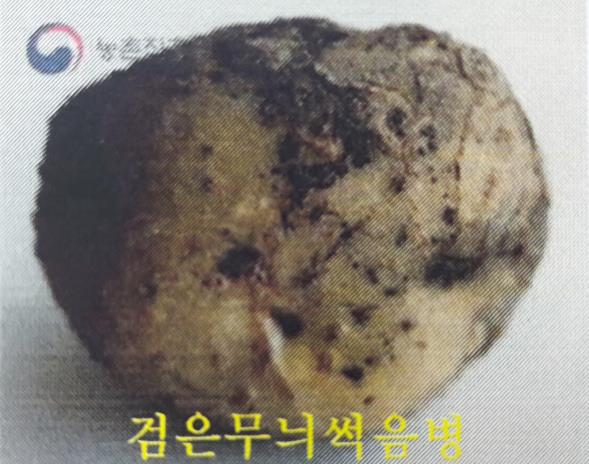

▸ 병원균 : Rhizoctoniasolani; 진균(담자균류)
▸ 병 특성과 발병
✓매우 여러 그룹의 균사 융합 군과 배양형 존재
✓균사 생육 적온 : 23~29℃ 정도

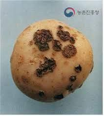

▸ 병징과 방제
✓ 병징
• 줄기에 부정형의 궤양 증상을 보이고 괴경에는 여러 줄의 홈 형성 또는기형
✓ 방제
• 건전한 씨감자 선별, 소독 후 재배
• 토양이 다습하지 않도록 관리, 윤작
• 수확 후이병토양에 남은잔재물 제거

작물에 발생하는 주요 병들(각론) - 채소류 병(Vegetable Disease)

▸ 채소에 발병하는병

작물에 발생하는 주요 병들(각론) - 채소류 병(Vegetable Disease)

| 1. 고추 역병(Phytophthora Blight) |  |
| --- | --- |
|  | 1. 고추 역병(Phytophthora Blight) |

▸ 병원균 : Phytophthoracapsici; 진균(조균류)
▸ 병 특성과 발병
✓난포자(유주자)로 토양에서 월동.
✓기주 : 고추, 토마토, 가지, 호박, 멜론, 수박 등
✓토양 전염성 병해. 기온이 낮고 습도가 높은 여름 장마철에 물을 통해 전염
✓연작지와 배수(물 빠짐)가 나쁜 밭에서 많이 발생

▸ 병징과 방제
✓ 병징
• 잎, 줄기, 열매에 발생, 암녹색 병반을 나타내고 쓰러져 고사
✓ 방제
• 저항성 품종 재배, 윤작, 배수
• 토양 소독, 병든 포기는 조기 제거
• 예방 위주전용 약제 살포

작물에 발생하는 주요 병들(각론) - 채소류 병(Vegetable Disease)

| 2. 고추 탄저병(Blitter Rot) |  |
| --- | --- |
|  | 2. 고추 탄저병(Blitter Rot) |

▸ 병원균 : Glomerella cingulata; 진균(자낭균류)
▸ 병 특성과 발병
✓균사, 분생포자, 자낭포자 형태로 병든 열매나 나뭇가지에서 월동
✓기주 : 고추, 사과, 포도 등
✓비가 많이 오고 30℃ 정도의 고온과 다습한 성숙기에 많이 발생

✓비·바람의해 전파
▸ 병징과 방제
✓ 병징
• 열매에 연한 갈색무늬가 커지며 검은색 작은 동심원 모양의 겹무늬 형성
✓ 방제
• 종자 소독, 윤작, 병든 포기 조기 제거
• 예방 위주전용 약제 살포
• 비바람이 전파하므로 태풍 후에 약제를 처리

작물에 발생하는 주요 병들(각론) - 채소류 병(Vegetable Disease)

| 3. 수박 탄저병(Anthracnose) |  |
| --- | --- |
|  | 3. 수박 탄저병(Anthracnose) |

▸ 병원균 : Colletotrichum nigrum; 진균
▸ 병 특성과 발병
✓열매, 잎(특히 오래된 과실, 잎) 많이 발생
✓처음에는 수침상의 작은 반점 형성 → 나중에 갈변, 움푹 들어가고 차츰 넓어지면서 동심 운문을 이룸
✓진전되면 중심부는 회색으로 변하고 그 뒤에 흑색 소립 밀생
✓기주식물 : 고추

▸ 병징과 방제
✓ 방제
• 이병원균은 고온다습 조건에서 많이 발생, 종자에서 월동 → 건전한 종자 채종및 소독
• 이병주 소각, 가을에 표토 경운

작물에 발생하는 주요 병들(각론) - 채소류 병(Vegetable Disease)

| 4. 오이 노균병(Downy Mildew) |  |
| --- | --- |
|  | 4. 오이 노균병(Downy Mildew) |

▸ 병원균 : Pseudoperopnosporacubensis; 진균(조균류)
▸ 병 특성과 발병
✓분생포자로 토양에서 월동. 황변하여 고사 → '황달병'
✓잎이 젖어 있거나 높은 습도(95%) 또는 낮은 온도(15~22℃) 조건인 7월 장마기 많이 발생
✓기주식물 : 박과 작물(오이, 참외, 수박, 호박 등) 많이 발생

▸ 병징과 방제
✓ 병징
• 열매에 연한 갈색무늬가 커지며 검은색 작은 동심원 모양 겹무늬 형성
✓ 방제
• 짚을 깔아아랫잎에 물방울이 튀지 않게 관리
• 습하지 않게 관리, 저항성 품종 재배
• 다습조건에서 잘 발생 → 통풍에 유의. 영양을 잘 공급, 윤작, 주변 전염원 차단

작물에 발생하는 주요 병들(각론) - 채소류 병(Vegetable Disease)

| 5. 배추 무름병(Bacterial Soft Rot) |  |
| --- | --- |
|  | 5. 배추 무름병(Bacterial Soft Rot) |

▸ 병원균 : Erwiniacarotovora; 세균
▸ 병 특성과 발병
✓이병 식물의 잔재 또는 토양 속 곤충 번데기에서 월동
✓상처/피목을 통해 침입 → 무름 증상
✓비가 자주 오고 온도와 습도가 높은 여름철에 많이 발생
✓기주식물 : 고추, 무, 배추, 토마토, 마늘, 참외 등

▸ 병징과 방제
✓ 병징
• 수침상 반점이 급격히 확대, 물렁물렁하게 변하며 심한 악취
✓ 방제
• 무병주 채종과 종자소독
• 토양소독, 윤작, 잔재물 제거, 세균을 옮기는 해충 구제
• 예방 위주 전용 약제 살포

작물에 발생하는 주요 병들(각론) - 채소류 병(Vegetable Disease)

| 6. 토마토 풋마름병(Bacterial Wilt) |  |
| --- | --- |
|  | 6. 토마토 풋마름병(Bacterial Wilt) |

▸ 병원균 : Ralstoniasolanacearum; 세균
▸ 병 특성과 발병
✓병원균은 병든 식물의 잔재에서 월동
✓주로 지하부 상처를 통해 침입 및 감염
✓고온 다습한 산성토양에서 발생하는 토양 전염성 병
✓기주식물 : 가지과(토마토, 감자, 가지, 고추 등) 비롯 28과 150여종

▸ 병징과 방제
✓ 병징
• 전신병. 급격히 고사, 뿌리는 갈색으로 변하고 썩어서 없어짐
• 잎수분을 상실하고 급격하게 푸른 채로 마름 (= 풋마름병(청고병))
✓ 방제
• 윤작. 저항성 품종재배, 토양소독
• 배수에 힘쓰고 토양 산도조절, 접목묘 재배 및 유기물 증시

작물에 발생하는 주요 병들(각론) - 채소류 병(Vegetable Disease)

| 7. 배추 무사마귀병(Club Root) |  |
| --- | --- |
|  | 7. 배추 무사마귀병(Club Root) |

▸ 병원균 : Plasmodiophorabrassicae; 점균(끈적균)
▸ 병 특성과 발병
✓일생 대부분 뿌리 세포에서 생활. 휴면포자로 토양에서 월동
✓관개수, 토양, 관개수 등에 의해 전염
✓다습, 산성 토양, 저온(16~21℃)에서 번식 (보수력 45% 이하 / 알칼리 토양에서 억제)
✓기주식물 : 무, 배추, 양배추 등

▸ 병징과 방제
✓ 병징
• 왜성이 되고 잎은황변하여 늘어짐. 뿌리 혹 생성, 잔뿌리가 없어져 양분흡수 저해로 고사
✓ 방제
• 과습, 산성화되지 않도록 주의. 오염되지 않은토양에서 재배
• 저항성 품종 재배, 윤작(6~7년 이상)을 십자화과 이외 작물로 실시
• 병에 걸린뿌리 제거 또는 소각

작물에 발생하는 주요 병들(각론) - 과수류 병(Fruit Disease)

▸ 과수에 발생하는병

작물에 발생하는 주요 병들(각론) - 과수류 병(Fruit Disease)

| 1. 배나무 검은무늬병(Black Spot) |  |
| --- | --- |
|  | 1. 배나무 검은무늬병(Black Spot) |

▸ 병원균 : Alternaria kikuchiana; 진균(불완전균류)
▸ 병 특성과 발병
✓균사 형태로 병든 잎이나 가지 등에서 월동
✓기주 특이적 독소 분비
▸ 병징과 방제
✓ 병징
• 잎, 나뭇가지, 열매등에 발생, 잎에 작은 원형/부정형 흑색 점무늬 흑갈색 겹무늬 형성
• 열매는 큰흑갈색 원형 반점, 흑색곰팡이 밀생
✓ 방제
• 병든 가지/잎제거
• 저항성 품종 재배

작물에 발생하는 주요 병들(각론) - 과수류 병(Fruit Disease)

| 2. 배나무 붉은별무늬병(Rust) |  |
| --- | --- |
|  | 2. 배나무 붉은별무늬병(Rust) |

▸ 병원균 : Gymnosporangiumharaeanum; 진균(담자균류)
▸ 병 특성과 발병
✓(4~5월) 배나무 기생, 6월 이후 향나무 기생. 균사 상태 월동
✓녹포자는 5말~7월 향나무로 전반
✓향나무에서 겨울을 난포자퇴는 반드시 비가 와야 발생(6~8시간 이상, 13~20℃)

▸ 병징과 방제
✓ 병징
• 어린잎, 열매, 햇가지 발생. 잎에 등황색의 별 모양 녹병자기(과립체) 형성
• 점차 커지면서 병반 뒤에담황색의 녹포자기(털 같은 돌기) 형성
✓ 방제
• 배과수원 주변에 기주식물(향나무) 제거
• 배나무, 향나무에 전문 약제 살포

작물에 발생하는 주요 병들(각론) - 과수류 병(Fruit Disease)

| 3. 배나무, 사과나무 화상병(Fire Blight) |  |
| --- | --- |
|  | 3. 배나무, 사과나무 화상병(Fire Blight) |

▸ 병원균 : Glomerella cingulata; 세균
▸ 병 특성과 발병
✓세균이 오래된 궤양 주변 월동, 곤충/비 의해 다른 나무로 또는 벌에 의해서 꽃으로 옮겨짐
✓국가가 주요 병으로 별도 관리할 정도로 피해 심각
✓발병한 과원 및 인근의 과원도 폐원 후 기주 매몰 처리. 정밀 예찰 및 발병 신고제 운영
▸ 병징과 방제
✓ 병징
• 병든 꽃은수침상으로 쭈그러든 갈변, 잎맥에 따라 흑갈색의 병반이 형성 후잎이 마르고 가지에 매달려 있음
• 병든 가지의 나무껍질은 흑갈색으로 변하고 물러졌다가 위축되고 단단해지며 잔가지 끝이구부러짐
✓ 방제
• 예방 위해과수원 청결 관리. 농기구(전정가위, 예초기 등)
• 농작업 도구(장갑, 작업복 등)를 작업 중 수시 소독[알코올 70%, 차아염소산나트륨 200ppm 이상
• 사과, 배나무 개화기(4월 상순)에 수분용 방화 곤충 이동 제한

작물에 발생하는 주요 병들(각론) - 과수류 병(Fruit Disease)

| 3. 배나무, 사과나무 화상병(Fire Blight) |  |
| --- | --- |
|  | 3. 배나무, 사과나무 화상병(Fire Blight) |

✓ 방제 시기
• 화상병은 방제가 어렵고 최근 들어 전국적 많이 발생

작물에 발생하는 주요 병들(각론) - 과수류 병(Fruit Disease)

| 4. 복숭아 세균성 구멍병(Leaf Curl) |  |
| --- | --- |
|  | 4. 복숭아 세균성 구멍병(Leaf Curl) |

▸ 병원균 : Xanthomonascampestris; 세균
▸ 병 특성과 발병
✓나뭇가지 병환부에서 월동, 비바람에 의해 전파
✓4월 말부터 강한 바람이나 폭풍우 후 발병 시작, 6~7월에 가장 심각
✓기주식물 : 복숭아, 자두, 살구 등

▸ 병징과 방제
✓ 병징
• 잎에 발생. 수침상의 작은 무늬가 확대 → 갈변 → 말라서 구멍 형성
✓ 방제
• 무병묘를 심고, 수세 튼튼하게 비배관리
• 전염된 가지 제거
• 전용 약제(항생제 계통) 살포

작물에 발생하는 주요 병들(각론) - 과수류 병(Fruit Disease)

| 5. 복숭아 잎오갈병(Leaf Curl) |  |
| --- | --- |
|  | 5. 복숭아 잎오갈병(Leaf Curl) |

▸ 병원균 : Taphrinadeformans; 진균(자낭균류)
▸ 병 특성과 발병
✓분생포자 형태로 나무줄기/눈 위 월동. 빗물에 의해 전반
✓이른 봄에 한랭하고 비가 자주 오는 시기에 발생

✓주 발생기 : 잎이 나오기 시작~5월 상순
▸ 병징과 방제
✓ 병징
• 잎, 열매, 줄기 덩굴손에 발생. 아래 잎에 적색의 혹 또는 종기 형성
→ 두터워 지며 주름지고 오그라짐(세포 이상비대)
✓ 방제
• 병든 잎조기 제거
• 과습하지 않고 동해 받지않도록 관리

작물에 발생하는 주요 병들(각론) - 과수류 병(Fruit Disease)

| 6. 사과나무 갈색무늬병(Blotch) |  |
| --- | --- |
|  | 6. 사과나무 갈색무늬병(Blotch) |

▸ 병원균 : Diplocarponmali; 진균(자낭균류)
▸ 병 특성과 발병
✓균사/자낭포자 형태로 병든 열매 잎에서 월동
✓비가 많이 오고 기온이 낮은 여름철 많이 발생
✓배수 불량, 밀식, 영양부족 과원에서 많이 발생
▸ 병징과 방제
✓ 병징
• 잎에 불규칙한 황색 병무늬 형성, 병반 주위에 진한 녹색 얼룩무늬 형성
• 병무늬 위에 검은색 포자층 형성, 조기 낙엽
✓ 방제
• 양호한 비배 관리.수세가 좋게 하고, 밀식을 삼가고 6~7월에 예방 위주전용 약제 살포
• 수확 후병든 잎조기 제거

작물에 발생하는 주요 병들(각론) - 과수류 병(Fruit Disease)

| 7. 사과나무 검은별무늬병(Scab) |  |
| --- | --- |
|  | 7. 사과나무 검은별무늬병(Scab) |

▸ 병원균 : Venturiainaequalis(사과), V. nashicola(배); 진균(자낭균류) 발병조건

▸ 병 특성과 발병
✓균사/분생포자 형태로 병든 잎/가지에서 월동, 발병 적온 20℃ 정도
✓비가 자주 오고 냉습한 5~6월경 무성한 과원에서 발생
✓기주 식물 : 사과나무, 배나무
▸ 병징과 방제

✓ 병징
• 잎, 햇가지, 열매꼭지(그을음 모양의 병무늬), 열매(검은색의 부정형 병반) 발병
• 조기 낙엽
✓ 방제
• 다비재배 지양. 무성하지 않게 관리
• 수세를 튼튼하게 하고 병든 가지/낙엽 조기 제거
• 4~5월 전문 약제살포. 점무늬낙엽병, 붉은별무늬병, 그을음병 동시 방제 가능

작물에 발생하는 주요 병들(각론) - 과수류 병(Fruit Disease)

| 8. 사과 부란병(Canker) |  |
| --- | --- |
|  | 8. 사과 부란병(Canker) |

▸ 병원균 : Valsaceratosperma; 진균(자낭균류) 발병조건
▸ 병 특성과 발병
✓병 포자/자낭포자 형태로 병든 가지에서 월동
✓동해를 입거나 나무 세력이 약할 때 발생
✓전정/일소 등으로 입은 상처를 통해 전염

▸ 병징과 방제
✓ 병징
• 줄기나 나뭇가지의 껍질이 갈색으로 부풀어 올라 쉽게 벗겨지고 알코올 냄새
✓ 방제
• 상처 난부위/병에 걸린 부위를 깎아 내고 도포제 처리
• 수세를 튼튼하게 하고 상처를 입지 않도록 주의

작물에 발생하는 주요 병들(각론) - 과수류 병(Fruit Disease)

| 9. 대추나무 빗자루병(Witches Bloom) |  |
| --- | --- |
|  | 9. 대추나무 빗자루병(Witches Bloom) |

▸ 병원균 : Mycoplasma like organism (MLO)
▸ 병 특성과 발병
✓기주식물 : 대추나무(매개충 마름무늬매미충)
✓'천구소병' 이라 함.

▸ 병징과 방제
✓ 방제
• 수간주사(Oxyteracline HCL)나 살충제로 매개충 구제

작물에 발생하는 주요 병들(각론) - 화훼류(장미) 병(Rose Disease)

▸ 장미에 발생하는병

작물에 발생하는 주요 병들(각론) - 화훼류(장미) 병(Rose Disease)

| 1. 장미 노균병(Downy Mildew) |  |
| --- | --- |
|  | 1. 장미 노균병(Downy Mildew) |

▸ 병원균 : Peronosporasparsa; 진균
▸ 병 특성과 발병
✓난포자/균사 상태로 월동
✓잎, 신초, 꽃잎, 꽃받침 등에 발생
✓초기 잎 표면에 불규칙한 수침상의 자색/연한 황갈색 형성 → 진전되면 담갈색
✓다습 환경, 주야간 온도 차가 크고 야간에 안개가 끼거나 이슬이 맺힐 정도의 높은 습도에서 많이 발생
▸ 병징과 방제
✓ 방제
• 온실 내부27℃ 이상 유지, 환기를 잘 시켜주면 노균병 발생 억제
• 병든 잔가지 제거
• 예방 위주약제 살포

작물에 발생하는 주요 병들(각론) - 화훼류(장미) 병(Rose Disease)

| 2. 장미 흰가루병(Powdery Mildew) |  |
| --- | --- |
|  | 2. 장미 흰가루병(Powdery Mildew) |

▸ 병원균 : Sphaerothecapannosa; 진균
▸ 병 특성과 발병
✓초기 : 어린잎/가지 발생
✓흰 가루 모양 병반 발생 → 전체 확산
✓발병 가지/장미의 겨울눈에서 균사체나 자낭각 형태 월동
✓발병 적온 18~25℃, 습도 97~99% 일 때 발아가 가장 잘 됨
✓과다 질소 또는 적은 칼륨 비료 → 큰 피해 야기

▸ 병징과 방제
✓ 방제
• 환기 등환경 조절및 균형 시비
• 병든 잔가지 제거, 내성 강한 품종재배
• 예방 위주적용약제 살포

작물에 발생하는 주요 병들(각론) - 화훼류(장미) 병(Rose Disease)

| 3. 장미 잿빛곰팡이병(Botrytis Blight) |  |
| --- | --- |
|  | 3. 장미 잿빛곰팡이병(Botrytis Blight) |

▸ 병원균 : Botrytis cinorea; 진균
▸ 병 특성과 발병
✓주로 잎, 가지, 꽃 발생
✓균핵은 겨울을 나기 위해 만들어짐
✓잎 가장자리/끝에 데친 것 같은 변색된 병반이 오그라들며 잿빛곰팡이 밀생
✓병든 식물체에서 균사/균핵 상태 월동

✓다습한 환경 발생
▸ 병징과 방제
✓ 방제
• 양호한 환기, 난방방법 개선 → 낮은 습도 유지
• 병든 가지/꽃조기 제거

작물에 발생하는 주요 병들(각론) - 수목류 병(Tree Disease)

| 1. 소나무재선충병(Pine Wilt Disease) |  |
| --- | --- |
|  | 1. 소나무재선충병(Pine Wilt Disease) |

▸ 병원균 : Bursaphelenchusxylophilus; 선충(nematode)
▸ 병 특성과 발병
✓기주 식물 : 소나무, 잣나무, 해송, 히말리아시다, 독일가문비, 젓나무, 낙엽송 등
✓매개충(vector) : 솔수염하늘소, 북방수염하늘소 등

▸ 병징과 방제
✓ 방제

• 소나무 수간주사 : 에마멕틴 1.8% 유제(원액),
에마멕틴벤조에이트(emamectin benzoate) 2.15%(원액) 방제
• 지상 방제: 매개충 우화 시기(5~8월)에
티아클로프리드(thiacloprid) 10%액(1,000배액) 살포

작물에 발생하는 주요 병들(각론) - 수목류 병(Tree Disease)

| 2. 참나무시들음병 |  |
| --- | --- |
|  | 2. 참나무시들음병 |

▸ 병원균 : Raffaeleaquercusmangolicae; 진균
▸ 병 특성과 발병
✓참나무 수분/양분 이동통로 차단시켜서 고사
✓참나무류로 신갈나무에서 피해가 가장 큼
✓광릉긴나무좀 암컷만이 참나무시들음병을 매개

▸ 병징과 방제
✓ 방제
• 매개충(광릉긴나무좀) 방제
• 끈끈이 롤트랩/약제 훈증방법 사용,방제 작업 실시
• 노숙 유충으로 월동하나 일부는 성충과 번데기로도 월동 → 이 단계에 방제 실시

