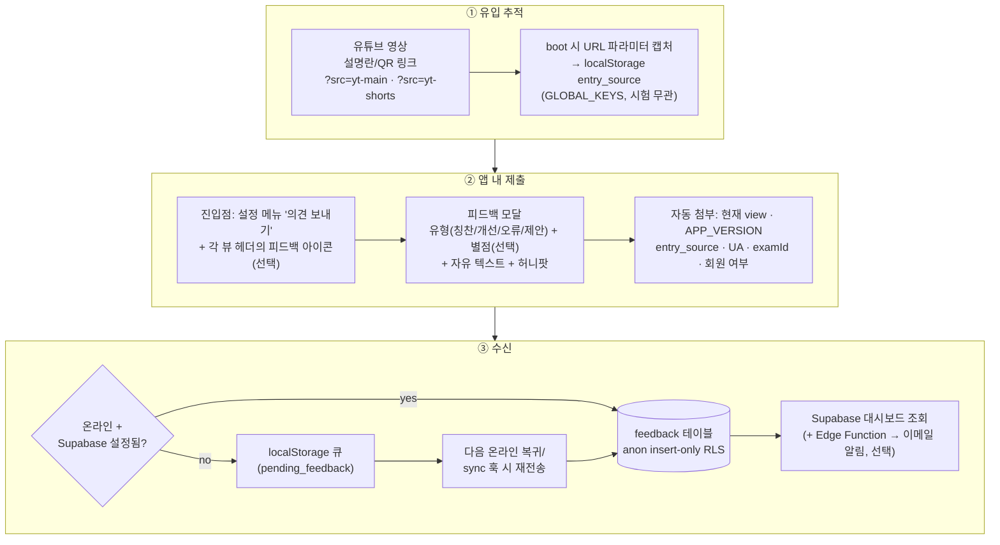
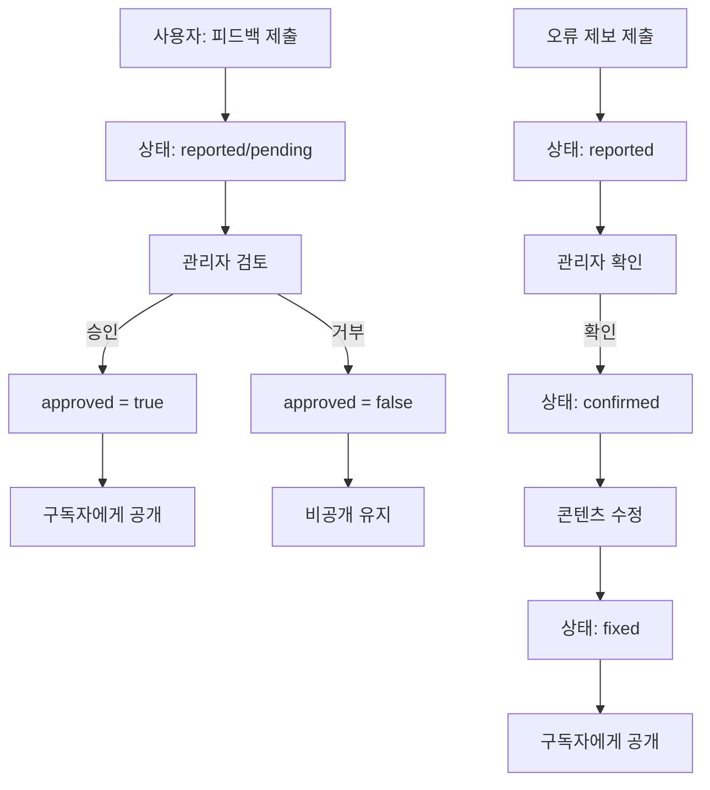
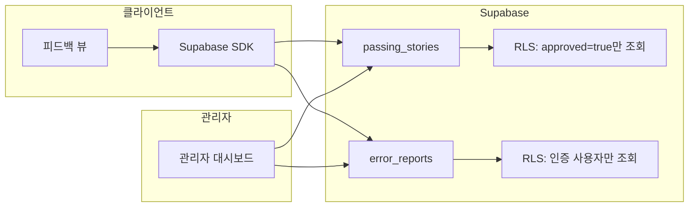
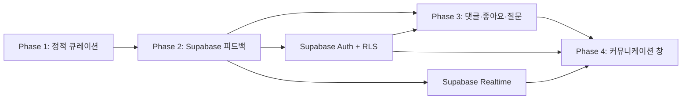

# 사용자 피드백 수신 설계 — YouTube 유입 대응

> **작성일**: 2026-09-26
> **목적**: 유튜브 홍보 영상을 보고 유입된 사용자의 의견·오류 신고·기능 제안을 앱 안에서 수집하는 기능 설계
> **관련 문서**: [SUPABASE_DESIGN.md](SUPABASE_DESIGN.md) (계정·동기화 인프라), 독자 피드백 공유 설계(수신된 피드백의 큐레이션·공유)는 본 문서 하단 절로 통합 — 구 `USER_FEEDBACK_DESIGN.md`·DOC-DSN-05, [유튜브_홍보동영상_제작의뢰서](../../exams/cosmetic/business/유튜브_홍보동영상_제작의뢰서.md)
> **관련 SPEC ID**: `FB-01~08` (SPEC §3.23) · `AU-01~08` (인증 기반) · `S-01` (CSP `connect-src`)
> **상태**: **구현됨** (2026-09-26) — `src/feedback.js`, 설정 메뉴 "의견 보내기". `feedback` 테이블은 `tools/supabase/schema.sql`에 정의됐으나 실제 적용은 Supabase SQL Editor 수동 실행 필요
> **문서 ID**: DOC-DSN-09
> **범위**: platform · 판본: none

---

## 1. 요구사항 정의

| # | 요구 | 배경 |
|---|------|------|
| F1 | **비로그인 사용자도 제출 가능** | 유튜브 유입 초기 사용자는 계정 없이 씀 — 가입 요구는 피드백 포기로 이어짐 |
| F2 | **유입 채널 자동 태깅** | "유튜브를 보고 온" 사용자의 의견인지 구분할 수 있어야 영상 효과 측정 가능 |
| F3 | **제출 시점의 앱 상태 첨부** | 현재 화면·버전·기기 — 오류 신고 재현에 필수 |
| F4 | **오프라인 내성** | PWA 특성상 오프라인 제출은 큐잉 후 재전송 |
| F5 | **관리 부담 최소** | 1인 운영 — 별도 어드민 UI 없이 Supabase 대시보드(+ 이메일 알림)로 확인 |
| F6 | **스팸·어뷰징 방어** | 공개 insert 엔드포인트의 악용 방지 |

## 2. 전체 흐름



## 3. 유입 채널 추적 (`entry_source`)

- **링크 규격**: `https://passok.vercel.app/?src=yt-main`
  - 메인 영상 `yt-main`, 쇼츠 `yt-shorts`, 범퍼 `yt-bumper`, 그 외 채널 `bl`·`ig` 등 임의 확장
  - QR 코드에도 동일 파라미터 URL 삽입
- **캡처 로직** (app.js boot 초기, ~20줄):
  ```js
  const src = new URLSearchParams(location.search).get('src');
  if (src && /^[a-z0-9-]{1,20}$/.test(src)) {
    storage.setJSON('entry_source', { src, ts: Date.now() });
  }
  ```
- **`GLOBAL_KEYS` 등록** — 시험 전환 시 유지되어야 하므로 비스코프 키
- **유효기간**: 첫 방문 기록은 영구 보존(최초 유입 채널), 제출 시점의 최근 채널은 별도 기록 가능 — MVP는 최초 1건만 보존
- **주의**: 파라미터는 캡처 후 URL에서 제거(`history.replaceState`)해 주소창 오염 방지

## 4. 피드백 UI

### 4-1. 진입점

| 위치 | 형태 | 비고 |
|------|------|------|
| 설정 메뉴(⚙️) | "의견 보내기" 버튼 — "변경 이력" 아래 | 1순위, 기존 메뉴 패턴 재사용 |
| 신기능 안내 | ⚙️ 버튼 빨간 점(패널 첫 오픈까지) + "의견 보내기" NEW 배지(첫 클릭까지) | `feedback_dot_seen`/`feedback_hint_seen` — 각 1회성, `initFeedbackHint()`가 부팅 시 부착 |
| 피드백 완료 후 | 토스트 + "불편한 화면" 컨텍스트 힌트 | — |
| (확장) 각 뷰 상단바 | 작은 💬 아이콘 | MVP 이후 — 화면 점유 vs 수집률 트레이드오프 |

### 4-2. 모달 구성 (`src/feedback.js` 신규 모듈)

```
┌─────────────────────────────┐
│ 💬 의견 보내기               │
│                             │
│ 유형  [칭찬][개선][오류][제안]  │  ← 칩 선택 (기본: 개선)
│ 평가  ★★★★★ (선택)          │  ← 터치 가능 별점, 미선택 허용
│                             │
│ ┌─────────────────────────┐ │
│ │ 어떤 점이 좋았거나        │ │
│ │ 불편했는지 알려주세요     │ │
│ └─────────────────────────┘ │
│                             │
│ 📎 첨부: 대시보드 · v2026.10.16 · yt-main │  ← 자동 컨텍스트 표시 (읽기 전용)
│                             │
│        [ 보내기 ]           │
└─────────────────────────────┘
```

- 오버레이는 `whats-new-overlay`와 같은 **전용 ID + 공용 백드롭 스타일** 패턴
- 포커스 트랩·Esc 닫기·`is-hidden` 규칙 준수, `data-click` 위임
- 본문 하단에 "연락처·이름 등 개인정보는 넣지 말아 주세요" 안내

## 5. 데이터 스키마

```sql
create table public.feedback (
  id          uuid primary key default gen_random_uuid(),
  created_at  timestamptz not null default now(),
  user_id     uuid references auth.users,          -- 로그인 시만 (없으면 null = 익명)
  kind        text not null check (kind in ('praise','improve','bug','idea')),
  rating      smallint check (rating between 1 and 5),
  body        text not null check (char_length(body) between 4 and 2000),
  view        text,                                -- 제출 시점 뷰 id
  app_version text,
  entry_src   text,                                -- yt-main 등 유입 채널
  exam_id     text,
  user_agent  text,
  meta        jsonb                                -- 허니팝 통과 여부 등 부가
);

-- 익명·로그인 모두 insert만 허용, 조회는 불가 (service role만)
create policy "public insert" on public.feedback
  for insert to anon, authenticated with check (true);
-- select/update/delete 정책 없음 = 전면 차단 (대시보드는 service role로 조회)
```

- `tools/supabase/schema.sql`에 추가 — 기존 마이그레이션 방식 그대로
- **유저 측 개인정보 차단**: `body`에 이메일/전화번호 패턴 검출 시 경고 토스트(클라이언트 측 best-effort)

## 6. 어뷰징 방어

| 수단 | 구현 |
|------|------|
| 허니팝 | 숨김 입력 필드(`tabindex=-1`, `aria-hidden`) — 채워지면 서버에 `meta.honeypot=true`로 저장·대시보드에서 필터 |
| 클라이언트 쿨다운 | 마지막 제출로부터 60초 미만이면 "잠시 후" 토스트 (localStorage `feedback_last_ts`) |
| 길이·빈값 제한 | 서버 CHECK 제약 (4~2000자) |
| (선택) Edge Function | 시간당 IP별 건수 제한 — MVP 후 보고 수치 보고 도입 |

익명 insert라 완벽한 방어는 불가 — 목표는 "대시보드에서 필터 가능할 만큼 스팸 표식을 남기는 것" 수준으로 충분합니다.

## 7. 오프라인·실패 처리

- 제출 실패(오프라인·Supabase 미설정) 시 `pending_feedback` 배열에 `{kind, rating, body, view, app_version, entry_src, ts}` push (최대 20건)
- 재전송 타이밍: ① `online` 이벤트(app.js에서 `flushPendingFeedback` 호출), ② 다음 `submit` 시 선행 큐와 함께 일괄 전송 — sync.js 훅 편승은 로그인 전용 경로라 익명 큐에는 적용하지 않음
- Supabase 미설정 환경(로컬 개발)에서는 큐에만 쌓고 "오프라인으로 저장됐어요" 안내 — 앱 동작은 동일

## 8. 관리(조회) 측

### 8-1. 조회

- **Supabase 대시보드 Table Editor**로 `feedback` 조회 — `entry_src` 필터로 유튜브 유입 의견만 추출
- 자주 쓰는 조회 (SQL Editor에 저장 권장):

```sql
-- 최근 7일 의견
select created_at, kind, rating, body, view, entry_src
from public.feedback
where created_at > now() - interval '7 days'
order by created_at desc;

-- 유튜브 유입분만
select * from public.feedback where entry_src like 'yt-%' order by created_at desc;
```

- 수신된 유용한 피드백은 `USER_FEEDBACK_DESIGN.md`의 큐레이션 파이프라인으로 이어짐 (해당 문서의 "수집" 단계가 본 기능으로 대체)

### 8-2. 실시간 알림 — Database Webhook → Edge Function → Discord

구현됨: `tools/supabase/functions/feedback-notify/index.ts`. `feedback` 테이블 INSERT 시
즉시 Discord 채널에 요약(유형·별점·본문·뷰/버전/유입채널)을 전달한다.
앱 코드 변경·재배포 없이 아래 절차만으로 활성화된다.

#### ① Discord 측 준비

1. 알림을 받을 Discord 서버에 채널 생성 (예: `#app-feedback`) — 서버가 없으면 새로 생성
2. 채널 우클릭 → **채널 편집** → **연동(Integrations)** → **웹후크(Webhooks)** → **웹후크 만들기**
3. 이름을 `Passmula 피드백` 등으로 짓고 **웹후크 URL 복사**
   - 형태: `https://discord.com/api/webhooks/<id>/<token>` — 이 URL이 곧 발송 키이므로 외부 노출 금지

#### ② Supabase CLI 로그인·프로젝트 연결 (최초 1회)

```powershell
npm.cmd install -g supabase      # 또는: scoop install supabase
supabase login                   # 브라우저가 열리며 계정 인증
cd <프로젝트 루트>
supabase link --project-ref hunpzznyiaddekuggupu   # supabase-config.js의 URL과 같은 프로젝트
```

#### ③ Edge Function 배포 + 시크릿 등록

```powershell
supabase functions deploy feedback-notify --project-ref hunpzznyiaddekuggupu
supabase secrets set `
  DISCORD_WEBHOOK_URL="https://discord.com/api/webhooks/...." `
  WEBHOOK_SECRET="<임의의 긴 문자열 — 예: 승인용 비밀번호 생성기로 만든 32자>"
```

- `WEBHOOK_SECRET`은 무단 호출 차단용 — 아무 값이나 가능, ④에서 같은 값을 헤더에 넣는다
- 시크릿은 Edge Function 환경변수에만 존재 — 클라이언트 번들에 키가 추가되지 않는다

#### ④ Database Webhook 생성

Supabase 대시보드 → **Database → Webhooks → Create a new hook**:

| 항목 | 값 |
|------|-----|
| Name | `feedback-discord` |
| Table | `public.feedback` |
| Events | `Insert` 만 체크 |
| Type of webhook | `HTTP Request` |
| Method | `POST` |
| URL | `https://hunpzznyiaddekuggupu.supabase.co/functions/v1/feedback-notify` |
| HTTP Headers | `x-webhook-secret: <③과 동일한 문자열>` |

#### ⑤ 동작 확인

1. 앱에서 테스트 의견 1건 제출 (또는 SQL Editor에서 `insert into public.feedback (kind, body) values ('praise','테스트');`)
2. Discord 채널에 `새 의견 — 칭찬` embed가 도착하면 성공
3. 안 오면: Supabase 대시보드 → **Edge Functions → feedback-notify → Logs**에서 오류 확인
   - `403 forbidden` → WEBHOOK_SECRET과 webhook 헤더 값 불일치
   - `502 discord error` → DISCORD_WEBHOOK_URL 오타·만료

#### 참고

- 알림 채널을 Slack/Telegram으로 바꾸려면 함수의 `fetch` 블록만 교체 (Slack: `{"text": ...}` JSON POST,
  Telegram: `https://api.telegram.org/bot<token>/sendMessage`)
- 관리자가 여럿이면 각자 Discord 서버에 접속만 하면 되므로 별도 계정 발급 불필요
- 알림이 시끄러워지면 Discord 채널을 음소거하거나 webhook만 삭제하면 즉시 중단 — 함수·테이블은 그대로

## 9. 구현 범위 견적

| 작업 | 파일 | 규모 |
|------|------|------|
| 피드백 모듈 (모달·제출·큐) | `src/feedback.js` 신규 | ~200줄 |
| 설정 메뉴 버튼 | `index.html` + `event-listeners.js` | ~15줄 |
| 유입 파라미터 캡처 | `app.js` boot | ~20줄 |
| 스키마 | `tools/supabase/schema.sql` | ~25줄 |
| 프리캐시 등록 | `sw.js` SHELL_ASSETS | 1줄 |
| 테스트 | `tests/unit/feedback.test.js` + `tests/dom/feedback.dom.test.js` | 큐잉·쿨다운·모달 |

## 10. 리스크·한계

- **유료화 신호 없음** — 피드백만으론 Pro 전환율 측정 불가. 유입 수 자체는 Vercel Analytics/UTM 통계로 별도 확인
- **익명이라 회신 불가** — 기본 설계는 수신 전용. 회신 경로 옵션은 §10-1 참조
- **Supabase 의존** — 백엔드 장애 시 큐잉으로 흡수, 앱 기능에는 영향 없음 (Local-First 유지)

### 10-1. 익명 제출의 회신 옵션 비교

MVP는 수신 전용이지만, 회신이 필요해지면 아래 중 선택합니다.

| 방식 | 구조 | 트레이드오프 | 판정 |
|------|------|------------|------|
| **선택적 이메일 필드** | 모달에 "회신 원하면 이메일 (선택)" + 스키마 `contact_email text nullable` | 유일하게 개인 회신 가능. 단, 개인정보 수집·보관·파기 방침(개인정보처리방침 명시) 필요 | **첫 확장으로 권장** — 답변을 원하는 사용자만 자발적으로 정보 제공 |
| **제출 티켓 코드** | 제출 시 `FB-XXXX` 코드 발급 → "내 의견 확인" 뷰에서 코드 입력 → 관리자 답변 조회 | 개인정보 무수집 양방향. 조회 UI + 관리자 답변 입력 경로 추가 공수 큼 | 건수가 많아지고 반복 문의가 생기면 검토 |
| **로그인 유도** | "답변 받으려면 로그인" 선택지 — 기존 Supabase Auth 재사용 | 유튜브 초기 유입자는 로그인하지 않아 커버리지 낮음 | 단독으론 부족, 이메일 필드와 병행 |

### 10-2. 익명이어도 산출 가능한 것

- 유형·별점 집계 ("yt 유입자 평균 ★3.2, 개선 요청 80%")
- 화면 컨텍스트 분석 (`view` 필드로 불만 집중 화면 파악)
- 버전 추적 (`app_version`으로 어느 배포의 불만인지 귀속)
- **인앱 공지로 간접 회신** — 반복 불만은 `release-notes`·공지로 "다음 버전에 반영" 전체 공지 (개인 회신은 아니지만 실질적 응답 채널)

## 11. 확장 후보 (MVP 이후)

- **선택적 이메일 회신 필드** (§10-1 첫 확장 권장) — 스키마 `contact_email` + 개인정보 안내 문구
- 뷰별 피드백 아이콘 + 컨텍스트 자동 첨부 고도화 (스크린샷 첨부는 의무적으로 수동)
- 만족도(NPS) 주기 서베이 — 피드백 모달과 같은 채널
- ~~대시보드 알림 Edge Function~~ — **구현됨** (§8-2, Discord). 주간 요약은 미구현
- 피드백 → GitHub Issue 자동 변환

---

## 💬 독자 피드백 공유 기능 설계 제안

> **작성일**: 2026-09-11
> **목적**: 사용중인 고객(학습자)의 피드백을 큐레이션하여 구독중인 독자(Pro)에게 공유하는 기능 설계
> **관련 문서**: [SUBSCRIPTION_ROADMAP.md](SUBSCRIPTION_ROADMAP.md), [ARCHITECTURE.md](../ARCHITECTURE.md)
> **관련 SPEC ID**: `FB-01~08` (수신 인프라 — USER_FEEDBACK_DESIGN.md), 본 문서는 큐레이션·공유 쪽 미구현 확장
> 원본 문서: `READER_FEEDBACK_DESIGN.md` — 구 DOC-DSN-05 (2026-10-17 본 문서로 통합)
> **범위**: platform · 판본: none

---

### 📋 목차

1. [개요](#1-개요)
2. [데이터 모델](#2-데이터-모델)
3. [Phase 1 구현 (정적 큐레이션)](#3-phase-1-구현-정적-큐레이션)
4. [Phase 2 구현 (Supabase 연동)](#4-phase-2-구현-supabase-연동)
5. [기존 아키텍처와의 정합성](#5-기존-아키텍처와의-정합성)
6. [마이그레이션 경로 (Phase 1 → 2)](#6-마이그레이션-경로-phase-1--2)
7. [검증 체크리스트](#7-검증-체크리스트)
8. [리스크 및 완화책](#8-리스크-및-완화책)
9. [향후 확장 후보](#9-향후-확장-후보)
10. [구독자 커뮤니케이션 창 (향후 확장 방향)](#10-구독자-커뮤니케이션-창-향후-확장-방향)

---

### 1. 개요

#### 1.1 목표

```
사용중인 고객(학습자) ──피드백 제출──▶ 큐레이션 ──공유──▶ 구독중인 독자(Pro)
```

- **합격 수기 · 학습 팁**: 시험 합격자의 학습 방법, 공부 시간, 요령을 Pro 구독자에게 공개
- **콘텐츠 오류 제보**: 교재/문제은행의 오탈자, 내용 오류 제보를 큐레이션 후 구독자에게 공개

> **향후 비전**: Phase 1~2의 단방향 피드백 공유를 기반으로,
> Phase 3~4에서 구독자 간 실시간 정보소통 창(커뮤니티)으로 확장 예정 (§10 참고).

#### 1.2 두 단계 구현 전략

| 항목 | Phase 1 (현재) | Phase 2 (구독 전환 후) |
|------|----------------|----------------------|
| 수집 | Markdown 파일 수동 관리 | 앱 내 제출 폼 → Supabase 저장 |
| 큐레이션 | 개발자가 직접 Markdown 편집 | 관리자 대시보드 승인/거부 |
| 저장 | `content/피드백/*.md` | Supabase `passing_stories`, `error_reports` 테이블 |
| 표시 | 정적 렌더링 | 실시간 fetch + 캐시 |
| 접근 | 전체 공개 | Pro 전체, 무료 로그인 미리보기 3건, 미로그인 정적 번들 3건 |
| 백엔드 | 불필요 (Zero-Backend 유지) | Supabase (Auth + RLS) |

#### 1.3 표시 위치

- **전용 페이지**: 사이드바에 "독자 피드백" 메뉴 추가, 독립 뷰(`feedback-view`) 생성
- 탭으로 "합격 수기" / "오류 제보" 전환

---

### 2. 데이터 모델

#### 2.1 합격 수기 (`passing_stories`)

```json
{
  "id": "ps_001",
  "author": "익명",
  "examYear": 2026,
  "examSession": 2,
  "examMonth": 8,
  "score": 82,
  "studyPeriod": "3개월",
  "subject": "law",
  "summary": "1과목 법령은 암기보다 흐름 이해가 중요합니다...",
  "tips": ["매일 30분 카드 학습", "모의고사 2회차부터 효과"],
  "approved": true,
  "submittedAt": "2026-08-15"
}
```

| 필드 | 타입 | 설명 |
|------|------|------|
| `id` | string | 고유 식별자 (`ps_001` 형식) |
| `author` | string | 작성자명 (기본 "익명") |
| `examYear` | int | 시험 연도 |
| `examSession` | int | 시험 회차 (연 2회 기준: 1 또는 2) |
| `examMonth` | int | 시험 월 (정보 표시용, examSession과 독립) |
| `score` | int | 취득 점수 |
| `studyPeriod` | string | 학습 기간 (예: "3개월") |
| `subject` | string | 과목 키 (`law`, `manufacturing`, `safety`, `understanding`) |
| `summary` | string | 합격 수기 본문 |
| `tips` | string[] | 학습 팁 목록 |
| `approved` | boolean | 큐레이션 승인 여부 |
| `submittedAt` | string | 제출 일자 (ISO 8601) |

#### 2.2 콘텐츠 오류 제보 (`error_reports`)

```json
{
  "id": "err_001",
  "subject": "manufacturing",
  "chapter": "ch02",
  "location": "2.1절 용어 정의",
  "errorType": "typo",
  "description": "'유화'가 '유와'로 오기",
  "correction": "'유화'로 수정",
  "status": "fixed",
  "submittedAt": "2026-09-01"
}
```

| 필드 | 타입 | 설명 |
|------|------|------|
| `id` | string | 고유 식별자 (`err_001` 형식) |
| `subject` | string | 과목 키 |
| `chapter` | string | 챕터 식별자 (`ch01`, `ch02`, ...) |
| `location` | string | 오류 위치 (절/단락/문제 번호) |
| `errorType` | string | 오류 유형 (`typo`, `content`, `reference`) |
| `description` | string | 오류 설명 |
| `correction` | string | 수정 내용 |
| `status` | string | 처리 상태 (`reported`, `confirmed`, `fixed`) |
| `submittedAt` | string | 제출 일자 (ISO 8601) |

#### 2.3 오류 유형 분류

| `errorType` | 설명 | 예시 |
|-------------|------|------|
| `typo` | 오탈자 | "유화"→"유와" 오기, 띄어쓰기 오류 |
| `content` | 내용 오류 | 법령 조문 번호 불일치, 설명 오류 |
| `reference` | 참조 링크 오류 | 깨진 링크, 잘못된 교차 참조 |

---

### 3. Phase 1 구현 (정적 큐레이션)

#### 3.1 파일 구조

```
content/피드백/
  합격수기.md          # 큐레이션된 합격 수기
  오류제보.md          # 확인된 오류 제보 목록
```

#### 3.2 합격수기.md 예시

```markdown
---
id: ps_001
author: 익명
examYear: 2026
examSession: 2
examMonth: 8
score: 82
studyPeriod: 3개월
subject: law
approved: true
submittedAt: 2026-08-15
---

## 1과목 82점 합격 수기

1과목 법령은 암기보다 법률의 흐름을 이해하는 것이 중요합니다.
각 조문이 왜 만들어졌는지 맥락을 파악하면 암기가 자연스럽게 됩니다.

### 학습 팁
- 매일 30분 카드 학습을 꾸준히
- 모의고사는 2회차부터 효과가 나타남
- 법령 원문을 한 번씩 직접 읽어보기
```

#### 3.3 오류제보.md 예시

```markdown
---
id: err_001
subject: manufacturing
chapter: ch02
location: 2.1절 용어 정의
errorType: typo
description: "'유화'가 '유와'로 오기"
correction: "'유화'로 수정"
status: fixed
submittedAt: 2026-09-01
---

## 2과목 2챕터 오탈자

2.1절 용어 정의에서 '유화'가 '유와'로 오기되어 있습니다.
```

#### 3.4 프론트엔드 구성

| 파일 | 역할 |
|------|------|
| `src/feedback.js` | 피드백 뷰 컨트롤러 (탭 전환, 렌더링) |
| `index.html` | 사이드바 메뉴 + `<section id="feedback-view">` 추가 |
| `css/feedback.css` | 피드백 페이지 전용 스타일 |

#### 3.5 사이드바 메뉴 추가

```html
<!-- index.html 사이드바에 추가 -->
<button class="nav-item" data-target="feedback-view">
    <i class="fa-solid fa-comments"></i> 독자 피드백
</button>
```

#### 3.6 뷰 구조 (Wireframe)

```
┌─────────────────────────────────────────────┐
│  💬 독자 피드백                                │
│  ┌─────────────┐ ┌─────────────┐             │
│  │ 합격 수기   │ │ 오류 제보    │ (탭)       │
│  └─────────────┘ └─────────────┘             │
│                                              │
│  [탭 1: 합격 수기 목록]                       │
│  ┌──────────────────────────────────────┐   │
│  │ 🏆 익명 · 2026년 2회차(8월) · 82점       │   │
│  │ 학습기간: 3개월 · 1과목                │   │
│  │ "1과목 법령은 암기보다 흐름..."        │   │
│  │ 💡 매일 30분 카드 학습                 │   │
│  └──────────────────────────────────────┘   │
│  ┌──────────────────────────────────────┐   │
│  │ 🏆 ...                                │   │
│  └──────────────────────────────────────┘   │
│                                              │
│  [탭 2: 오류 제보 목록]                       │
│  ┌──────────────────────────────────────┐   │
│  │ ✅ [수정됨] 2과목 2챕터                │   │
│  │ 오탈자: '유화'→'유와' 오기                │   │
│  └──────────────────────────────────────┘   │
└─────────────────────────────────────────────┘
```

#### 3.7 데이터 로드

기존 `DataLoader` 패턴 재사용:

```javascript
// src/feedback.js
import { esc } from '../sanitize.js';
import { switchView } from './navigation.js';

let _feedbackData = null;

export async function renderFeedback() {
    const container = document.getElementById('feedback-list');
    if (!container) return;

    if (!_feedbackData) {
        _feedbackData = await _loadFeedbackData();
    }

    _renderPassingStories(_feedbackData.stories);
    _renderErrorReports(_feedbackData.errors);
}

async function _loadFeedbackData() {
    // Phase 1: 빌드 생성 번들에서 로드
    // Phase 2: Supabase fetch로 교체
    const res = await fetch('/data/feedback.js');
    // ...
}
```

#### 3.8 빌드 파이프라인

빌드 스크립트에 `content/피드백/*.md`를 추가하여 `data/feedback.js` 번들 생성:

```
content/피드백/*.md → tools/build/ → data/feedback.js
```

- frontmatter 파싱 → JSON 객체 변환
- 본문 Markdown → HTML 변환
- `data/feedback.js`에 번들화

#### 3.9 Service Worker 캐시

`sw.js`의 `DATA_CACHE`에 `content/피드백/*.md` 및 `data/feedback.js` 추가:

```javascript
// sw.js DATA_CACHE 패턴에 추가
'/data/feedback.js',
```

---

### 4. Phase 2 구현 (Supabase 연동)

#### 4.1 Supabase 스키마

```sql
-- 합격 수기
CREATE TABLE passing_stories (
    id UUID PRIMARY KEY DEFAULT gen_random_uuid(),
    user_id UUID REFERENCES auth.users(id),
    author TEXT DEFAULT '익명',
    exam_year INT,
    exam_session INT CHECK (exam_session IN (1, 2)),
    exam_month INT,
    score INT,
    study_period TEXT,
    subject TEXT,
    summary TEXT NOT NULL,
    tips JSONB DEFAULT '[]',
    approved BOOLEAN DEFAULT FALSE,
    submitted_at TIMESTAMPTZ DEFAULT NOW()
);

-- 오류 제보
CREATE TABLE error_reports (
    id UUID PRIMARY KEY DEFAULT gen_random_uuid(),
    user_id UUID REFERENCES auth.users(id),
    subject TEXT NOT NULL,
    chapter TEXT,
    location TEXT,
    error_type TEXT CHECK (error_type IN ('typo', 'content', 'reference')),
    description TEXT NOT NULL,
    correction TEXT,
    status TEXT DEFAULT 'reported'
        CHECK (status IN ('reported', 'confirmed', 'fixed')),
    submitted_at TIMESTAMPTZ DEFAULT NOW()
);
```

#### 4.2 RLS (Row Level Security) 정책

```sql
-- 합격 수기: 승인된 항목은 모든 인증 사용자가 조회 가능
CREATE POLICY "passing_stories_select_approved"
    ON passing_stories FOR SELECT
    USING (approved = true);

-- 합격 수기: 인증 사용자는 자신의 제출만 조회
CREATE POLICY "passing_stories_select_own"
    ON passing_stories FOR SELECT
    USING (auth.uid() = user_id);

-- 합격 수기: 인증 사용자는 자신의 항목만 삽입
CREATE POLICY "passing_stories_insert_own"
    ON passing_stories FOR INSERT
    WITH CHECK (auth.uid() = user_id);

-- 오류 제보: 모든 인증 사용자가 조회 가능
CREATE POLICY "error_reports_select_authenticated"
    ON error_reports FOR SELECT
    USING (auth.uid() IS NOT NULL);

-- 오류 제보: 인증 사용자는 자신의 제출만 삽입
CREATE POLICY "error_reports_insert_own"
    ON error_reports FOR INSERT
    WITH CHECK (auth.uid() = user_id);

-- UPDATE/DELETE 정책 (명시적 의도):
-- 일반 사용자의 UPDATE/DELETE는 허용하지 않음.
-- 의도: 승인 후 콘텐츠 변형 방지, 제출 기록 보존.
-- 단, 제출 직후 오타 수정 UX가 필요하면 아래 정책을 활성화:
-- CREATE POLICY "passing_stories_update_own_draft"
--     ON passing_stories FOR UPDATE
--     USING (auth.uid() = user_id AND approved = false);
-- (승인 전 draft 상태에서만 수정 허용)
CREATE POLICY "passing_stories_no_user_update"
    ON passing_stories FOR UPDATE
    USING (false);
CREATE POLICY "passing_stories_no_user_delete"
    ON passing_stories FOR DELETE
    USING (false);
CREATE POLICY "error_reports_no_user_update"
    ON error_reports FOR UPDATE
    USING (false);
CREATE POLICY "error_reports_no_user_delete"
    ON error_reports FOR DELETE
    USING (false);

-- 관리자: 모든 항목 조회 및 상태/승인 변경
CREATE POLICY "admin_all_access"
    ON passing_stories FOR ALL
    USING (
        EXISTS (
            SELECT 1 FROM profiles
            WHERE profiles.id = auth.uid()
            AND profiles.role = 'admin'
        )
    );

CREATE POLICY "admin_all_access_errors"
    ON error_reports FOR ALL
    USING (
        EXISTS (
            SELECT 1 FROM profiles
            WHERE profiles.id = auth.uid()
            AND profiles.role = 'admin'
        )
    );
```

#### 4.3 제출 폼 (Wireframe)

```
┌─────────────────────────────────────────────┐
│  ✍️ 합격 수기 작성                            │
│                                              │
│  시험 연도: [2026] 회차: [2▼] 월: [8]      │
│  점수: [82]  학습기간: [3개월]               │
│  과목: [1과목 ▼]                             │
│  작성자명: [익명]                            │
│  ┌──────────────────────────────────────┐   │
│  │ 학습 방법 및 수기를 입력하세요...     │   │
│  └──────────────────────────────────────┘   │
│  학습 팁 (+ 추가)                            │
│  ┌──────────────────────────────────────┐   │
│  │ 매일 30분 카드 학습                  │   │
│  └──────────────────────────────────────┘   │
│  [제출]                                      │
└─────────────────────────────────────────────┘
```

```
┌─────────────────────────────────────────────┐
│  🐛 오류 제보                                │
│                                              │
│  과목: [2과목 ▼]                             │
│  챕터: [2챕터 ▼]                             │
│  위치: [2.1절 용어 정의]                     │
│  오류 유형: [오탈자 ▼]                       │
│  ┌──────────────────────────────────────┐   │
│  │ 오류 내용을 설명해 주세요...          │   │
│  └──────────────────────────────────────┘   │
│  ┌──────────────────────────────────────┐   │
│  │ 수정 제안 (선택)                      │   │
│  └──────────────────────────────────────┘   │
│  [제출]                                      │
└─────────────────────────────────────────────┘
```

#### 4.4 접근 제어

> **리뷰 피드백 반영**: 접근 등급을 4단계로 명확히 분리하고,
> 미로그인 미리보기의 RLS 구현 방식을 명시했습니다.

| 사용자 유형 | 합격 수기 | 오류 제보 | 제출 권한 |
|------------|----------|----------|----------|
| 미로그인 | 미리보기 3건 (정적 번들) | 미리보기 3건 (정적 번들) | ❌ |
| 무료 로그인 | 미리보기 3건 | 미리보기 3건 | ✅ |
| Pro 구독자 | 전체 열람 | 전체 열람 | ✅ |
| 관리자 | 전체 + 승인/거부 | 전체 + 상태 변경 | ✅ |

**미로그인 미리보기 구현 방식**:
- 미리보기 3건은 RLS가 아닌 **정적 번들**(`data/feedback.js`)로만 제공
- 정적 번들은 빌드 시 `approved=true` 항목 중 최신 3건만 포함
- Supabase RLS는 인증 사용자에게만 적용 (미로그인은 Supabase 접근 불가)
- 이렇게 하면 RLS 정책은 "인증 필수"를 유지하면서 미로그인도 일부 체험 가능

> **게이팅 주의**: SUBSCRIPTION_ROADMAP §5.1에 따라 클라이언트 게이팅은 UX일 뿐이다.
> 실제 접근 통제는 Supabase RLS 정책으로 서버에서만 적용한다.
> 단, 미로그인 미리보기는 정적 번들이므로 RLS 대상이 아니다.

#### 4.5 큐레이션 워크플로우

```
[사용자 제출]
    │
    ▼
[reported / pending 상태]
    │
    ▼
[관리자 검토]
    ├── 승인 → approved=true (구독자에게 공개)
    │         (오류 제보: status → confirmed → fixed)
    │
    └── 거부 → approved=false (비공개 유지)
```



#### 4.6 데이터 흐름 (Phase 2)



#### 4.7 CSP 변경 (SUBSCRIPTION_ROADMAP §4 연동)

Phase 2에서 Supabase SDK 로드를 위해 `vercel.json` CSP 헤더에 추가:

```json
{
  "connect-src": ["https://<project>.supabase.co"]
}
```

> `script-src` 완화는 SDK 자체 호스팅 시 불필요 (SUBSCRIPTION_ROADMAP §4.3 참고)

---

### 5. 기존 아키텍처와의 정합성

| 규칙 | 준수 방안 |
|------|----------|
| Vanilla ES Modules | `src/feedback.js` ESM 모듈 |
| `data-click` 이벤트 위임 | 탭 전환, 제출 버튼 모두 `data-click` 사용 |
| CSP `script-src 'self'` | Phase 1: 영향 없음. Phase 2: `connect-src`만 추가, 인라인 스크립트 없음 |
| Service Worker 캐시 | `content/피드백/*.md` 및 `data/feedback.js`를 DATA_CACHE에 추가 |
| `is-hidden` 클래스 | 탭 전환 시 `classList.add/remove('is-hidden')` |
| `showToast()` | 제출 성공/실패 알림 (alert/confirm 금지 규칙 준수) |
| `saveProgress` seam | Phase 2에서 피드백 제출 시 기존 seam 패턴 재사용 |
| `ALLOWED_KEYS` | Phase 2 마이그레이션 시 기존 화이트리스트 재사용 |
| 헤딩 위계 | `<h2>` (뷰 제목) → `<h3>` (탭) → `<h4>` (카드) |
| `aria-live` | 제출 피드백 영역에 `role="status" aria-live="polite"` |

---

### 6. 마이그레이션 경로 (Phase 1 → 2)

```
Phase 1: content/피드백/*.md (수동 큐레이션)
    │
    │  마이그레이션 스크립트
    │  (Markdown frontmatter → JSON → Supabase 일괄 삽입)
    ▼
Phase 2: Supabase 실시간 (자동 큐레이션)
```

#### 6.1 마이그레이션 스크립트

```javascript
// tools/migrate-feedback.js (임시)
import { createClient } from '@supabase/supabase-js';

const supabase = createClient(SUPABASE_URL, SUPABASE_SERVICE_KEY);

// content/피드백/합격수기.md 파싱 → Supabase passing_stories에 일괄 삽입
// content/피드백/오류제보.md 파싱 → Supabase error_reports에 일괄 삽입
```

#### 6.2 전환 시나리오

1. Phase 1에서 축적된 Markdown 파일을 Supabase에 일괄 import
2. `feedback.js`의 `_loadFeedbackData()`를 Supabase fetch로 교체
3. 기존 정적 번들(`data/feedback.js`)은 폴백용으로 유지 (오프라인 시)
4. 제출 폼 UI 활성화 (Phase 1에서는 숨김, Phase 2에서는 노출)

---

### 7. 검증 체크리스트

#### 7.1 Phase 1 검증

- [ ] `node --check src/feedback.js` — 문법 검증
- [ ] `npm.cmd run build:data` — 피드백 번들 생성 확인
- [ ] `npm.cmd test` — 유닛 테스트 통과
- [ ] `npm.cmd run check:parser` — 파서 등가성 검증
- [ ] `npm.cmd run verify:assets` — 자산 존재 확인
- [ ] `npm.cmd run test:dom` — DOM 테스트 통과
- [ ] `sw.js` `CACHE_VERSION` bump
- [ ] 사이드바 메뉴 클릭 시 `feedback-view` 표시
- [ ] 탭 전환 정상 동작
- [ ] 빌드 후 `data/feedback.js` 존재

#### 7.2 Phase 2 검증

- [ ] Supabase 테이블 생성 및 RLS 정책 적용
- [ ] 제출 폼 → Supabase 저장 확인
- [ ] RLS: 미인증 사용자는 approved=true만 조회
- [ ] RLS: 인증 사용자는 전체 조회 + 자신의 제출만 삽입
- [ ] 관리자 승인/거부 워크플로우 동작
- [ ] 무료 사용자 미리보기 3건 제한
- [ ] Pro 사용자 전체 열람
- [ ] 오프라인 시 기존 정적 번들 폴백
- [ ] CSP 위반 리포트 없음

---

### 8. 리스크 및 완화책

| 리스크 | 영향 | 완화책 |
|--------|------|--------|
| Phase 1 수동 큐레이션 병목 | 피드백 반영 지연 | 정기적 큐레이션 주기 설정 (주 1회) |
| 피드백 품질 편차 | 구독자 가치 저하 | 관리자 승인 워크플로우로 필터링 |
| 개인정보 노출 | 법적 리스크 | 작성자명 기본 "익명", 개인정보 수집 최소화 |
| 오프라인 접근 불가 (Phase 2) | 오프라인 강점 약화 | 정적 번들 폴백 유지, 24시간 유예 |
| Supabase 비용 | 운영비 증가 | 무료 티어 내 사용, approved 항목만 캐싱 |
| 오류 제보 악용 | 콘텐츠 훼손 | 관리자 승인 후 공개, RLS로 서버 검증 |

---

### 9. 향후 확장 후보

| 기능 | 설명 | 단계 |
|------|------|------|
| 챕터 난이도 평가 | 사용자가 각 챕터에 별점 + 코멘트 | Phase 2 |
| 오답 패턴 통계 | 전체 사용자 오답률 높은 문제 익명 집계 | Phase 2 |
| 좋아요 / 유용해요 | 구독자가 피드백에 "유용해요" 투표 | Phase 2 |
| 댓글 스레드 | 합격 수기에 댓글/질문 가능 | Phase 3 |
| 이메일 구독 | 새 합격 수기 알림 이메일 | Phase 3 |
| 교재 내 인라인 표시 | 교재 리더의 각 챕터에 관련 피드백 인라인 | Phase 3 |

---

### 10. 구독자 커뮤니케이션 창 (향후 확장 방향)

> **목표**: 피드백 공유에서 나아가 구독자 간 실시간 정보소통 창(Communication Hub)으로 확장.
> 단방향 큐레이션 → 양방향 커뮤니티로 진화.

#### 10.1 확장 로드맵

```
Phase 1 (현재)     Phase 2 (구독 전환)        Phase 3 (커뮤니티)           Phase 4 (소통 창)
정적 큐레이션  →  Supabase 실시간 피드백  →  댓글·좋아요·질문  →  구독자 간 실시간 소통
단방향            단방향 + 제출             양방향 (비동기)             양방향 (준실시간)
```

#### 10.2 커뮤니케이션 창 기능 구성

| 기능 | 설명 | 소통 형태 |
|------|------|-----------|
| 스터디 그룹 | 과목별·목표 시험회차별 그룹 가입 및 공동 학습 | 다대다 |
| 질문·답변 | 구독자가 학습 중 궁금한 점을 질문, 다른 구독자가 답변 | 1대다 |
| 합격 수기 댓글 | 합격 수기에 댓글·추가 질문·감사 표시 | 1대다 |
| 학습 일기 공유 | 구독자가 학습 일기를 작성, 다른 구독자가 응원/조언 | 1대다 |
| 과목별 토론 | 쟁점이 되는 법령 해석, 문제 풀이법 토론 스레드 | 다대다 |
| 실시간 알림 | 새 질문·답변·댓글 알림 (이메일 + 인앱) | 푸시 |

#### 10.3 데이터 모델 (예정)

> **참고**: 아래 SQL 스키마는 방향성 제시용입니다.
> Phase 2를 실제로 내보고 사용자 반응을 본 뒤 확정해도 늦지 않습니다 (YAGNI).
> 현재 확정하면 실제 요구와 안 맞아 버려질 가능성이 큽니다.

<details>
<summary>SQL 스키마 (펼쳐 보기)</summary>

```sql
-- 스터디 그룹
CREATE TABLE study_groups (
    id UUID PRIMARY KEY DEFAULT gen_random_uuid(),
    name TEXT NOT NULL,
    subject TEXT,
    target_exam_year INT,
    target_exam_session INT,
    description TEXT,
    created_by UUID REFERENCES auth.users(id),
    created_at TIMESTAMPTZ DEFAULT NOW()
);

-- 그룹 멤버
CREATE TABLE study_group_members (
    group_id UUID REFERENCES study_groups(id) ON DELETE CASCADE,
    user_id UUID REFERENCES auth.users(id),
    role TEXT DEFAULT 'member' CHECK (role IN ('member', 'admin')),
    joined_at TIMESTAMPTZ DEFAULT NOW(),
    PRIMARY KEY (group_id, user_id)
);

-- 질문·답변
CREATE TABLE qa_threads (
    id UUID PRIMARY KEY DEFAULT gen_random_uuid(),
    author_id UUID REFERENCES auth.users(id),
    subject TEXT,
    chapter TEXT,
    title TEXT NOT NULL,
    body TEXT NOT NULL,
    tags TEXT[] DEFAULT '{}',
    solved BOOLEAN DEFAULT FALSE,
    view_count INT DEFAULT 0,
    created_at TIMESTAMPTZ DEFAULT NOW()
);

CREATE TABLE qa_replies (
    id UUID PRIMARY KEY DEFAULT gen_random_uuid(),
    thread_id UUID REFERENCES qa_threads(id) ON DELETE CASCADE,
    author_id UUID REFERENCES auth.users(id),
    body TEXT NOT NULL,
    is_accepted BOOLEAN DEFAULT FALSE,
    created_at TIMESTAMPTZ DEFAULT NOW()
);

-- 학습 일기
CREATE TABLE study_journals (
    id UUID PRIMARY KEY DEFAULT gen_random_uuid(),
    author_id UUID REFERENCES auth.users(id),
    subject TEXT,
    content TEXT NOT NULL,
    study_minutes INT,
    cards_reviewed INT,
    quizzes_solved INT,
    created_at TIMESTAMPTZ DEFAULT NOW()
);

-- 알림
CREATE TABLE notifications (
    id UUID PRIMARY KEY DEFAULT gen_random_uuid(),
    user_id UUID REFERENCES auth.users(id),
    type TEXT CHECK (type IN ('reply', 'comment', 'mention', 'group')),
    payload JSONB,
    read BOOLEAN DEFAULT FALSE,
    created_at TIMESTAMPTZ DEFAULT NOW()
);
```

</details>

#### 10.4 RLS 정책 방향

| 테이블 | 조회 | 작성 | 수정/삭제 |
|--------|------|------|-----------|
| `study_groups` | Pro 구독자 전체 | Pro 구독자 | 작성자 + 관리자 |
| `study_group_members` | 그룹 멤버 | Pro 구독자 (가입) | 본인 (탈퇴) + 관리자 |
| `qa_threads` | Pro 구독자 전체 | Pro 구독자 | 작성자 + 관리자 |
| `qa_replies` | Pro 구독자 전체 | Pro 구독자 | 작성자 + 관리자 |
| `study_journals` | Pro 구독자 전체 | Pro 구독자 | 작성자 + 관리자 |
| `notifications` | 본인만 | 시스템 (트리거) | 본인 (읽음 처리) |

#### 10.5 UI 구성 (예정)

```
사이드바
├── 📊 대시보드
├── 📖 교재
├── 🃏 플래시카드
├── ...
├── 💬 독자 피드백          ← Phase 1~2 (현재 설계)
│   ├── 합격 수기
│   └── 오류 제보
└── 🗨️ 커뮤니티            ← Phase 3~4 (향후 확장)
    ├── 스터디 그룹
    ├── 질문·답변
    ├── 학습 일기
    └── 과목별 토론
```

#### 10.6 기술 고려사항

| 항목 | 고려사항 |
|------|----------|
| 실시간성 | Supabase Realtime (WebSocket) 또는 폴링 주기 설정 |
| 알림 | Supabase Realtime + Push Notification (Pro) |
| 콘텐츠 관리 | 신고(Report) 시스템, 자동 필터링, 관리자 검토 |
| 스팸 방지 | 일일 게시물 수 제한, 신규 가입자 제한, 신고 임계치 |
| 검색 | 전문 검색 (Supabase pg_trgm 또는 외부 검색 엔진) |
| 오프라인 | 커뮤니티는 온라인 전용 (오프라인 학습 강점과 분리) |
| 비용 | Supabase Realtime 연결 수, 행 수 기반 과금 — 트래픽 모니터링 필수 |

#### 10.6.1 솔로 운영자 관리 부담 (확장 결정 기준)

> **리뷰 피드백 반영**: 커뮤니티는 기능이 어려운 게 아니라 **운영이 어렵습니다**.
> 질문·답변, 토론, 학습일기, 신고 시스템까지 가면 콘텐츠 모더레이션이 상근 업무가 됩니다.

확장 결정 시 반드시 다음 기준을 확인해야 합니다:

| 질문 | 기준 |
|------|------|
| 매일 모더레이션 시간 확보 가능? | 일 30분 이상 불가 → Phase 3 보류 |
| 신고 처리 SLA | 24시간 내 응답 불가 → 커뮤니티 신뢰 하락 |
| 스팸 대응 | 자동 필터링 없이 수동만 → 확장 금지 |
| 초기 사용자 수 | DAU 50 미만 → 커뮤니티 활성화 안 됨 (매몰 비용) |

> **권장**: Phase 2(단방향 피드백)를 먼저 내보고, 실제 사용자 반응과 모더레이션 부담을 측정한 뒤 Phase 3 확장 여부를 결정하세요.
> "내가 매일 이걸 관리할 수 있나"가 1차 기준입니다.

#### 10.7 단계별 의존 관계



> **핵심**: Phase 1~2의 피드백 기능이 커뮤니케이션 창의 기반이 됩니다.
> `qa_threads`는 `passing_stories`의 댓글 스레드에서 자연스럽게 확장되고,
> `study_groups`는 과목별 피드백 분류에서 발전합니다.

---

### 📎 관련 문서

- [SUBSCRIPTION_ROADMAP.md](SUBSCRIPTION_ROADMAP.md) — 구독 서비스 전환 로드맵 (Supabase, CSP, 게이팅)
- [ARCHITECTURE.md](../ARCHITECTURE.md) — 시스템 아키텍처 (saveProgress seam, stable ID, CSP)
- [TEXTBOOK_AUTHORING_GUIDE.md](../runbooks/TEXTBOOK_AUTHORING_GUIDE.md) — 교재 작성 가이드
- [CHANGES.md](../CHANGES.md) — 변경 이력
