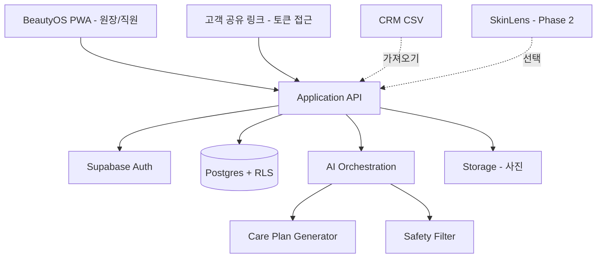

# BeautyOS — AI Beauty Intelligence

> 미용실·피부샵 운영 CRM을 대체하지 않고, 고객 케어가 다음 방문까지 이어지도록 돕는 AI 레이어

> **문서 ID**: DOC-BIZ-14
> **범위**: exam:skincare · 판본: none
> **관련 SPEC ID**: 해당 없음 (사업 기획 문서)

- 문서 버전: v1.2 (v1.1 리뷰 반영 — 채널·고객 훅·동의 수집 방식 보강)
- 작성 기준: 2026년 11월
- 제품 방향: PassOK Core 기술의 뷰티·웰니스 업종 확장
- 초기 타깃: 피부관리샵(에스테틱), 1~3인 소규모 샵

---

## 0. v1.2 변경 요약

| # | 변경 | 이유 |
|---|---|---|
| 1 | **모집 채널 계획**을 Sprint 0 통과 조건으로 추가 (14장·부록 C) | 인터뷰 8~10명·파일럿 3곳의 접촉 경로가 문서에 없었음 — 1인 B2B의 최대 리스크는 제품이 아니라 채널 |
| 2 | 고객 **재방문 훅** 추가: 방문 D-2 자동 안내 카톡 + 체크 스트릭 (Module C, P1) | 링크를 다시 여는 유인이 "안내 확인"뿐이면 열람률·체크인율이 빠르게 하락 |
| 3 | **고객 동의 수집 방식** 명세: 공유 링크 첫 진입 시 동의 화면 1회 (9.3·12장) | 직원 구두 기록만으로는 사진·AI 처리 동의가 민감정보 요건상 취약 |
| 4 | 고객 **데이터 내보내기(CSV) 1종** P1 추가 (6.2·10장·부록 B) | 이관 불가는 도입 장벽이자 정보주체 열람권 이슈 |
| 5 | 인터뷰 질문에 **CRM 내보내기 기능 확인** 추가 (부록 C) | "CSV 가져오기 1종"은 파일럿 샵의 CRM을 사전 확정해야 성립 |
| 6 | AI 계획 1건당 **원가 추정** 기재 (13장) | 가격 가설의 단가 근거 |
| 7 | 공유 토큰 **레이트리밋** 명시 (9.3) | 링크 스캔 남용 방어 |
| 8 | `input_redacted`(식별정보 제거) **자동 검증**을 Sprint 2 통과 조건에 추가 (17장) | "제거 후 전송"을 테스트로 강제 |
| 9 | 문서 위치 이동: `content/exams/skincare/참조자료/` → `docs/exams/skincare/business/` + DOC-BIZ-14 채번 | 시험 참조자료가 아닌 사업 기획 문서 — DOC-BIZ 규약 배치 |

### v1.1 변경 요약 (보존)

| # | 변경 | 이유 |
|---|---|---|
| 1 | MVP 진입점을 **케어 계획 + 고객 공유 링크 + 관리 타임라인** 하나로 축소 | v1.0은 고객 케어와 직원 교육이라는 서로 다른 두 제품을 동시에 만드는 구조였음 |
| 2 | 직원 교육(Employee Skill Engine)을 Phase 2·Studio 플랜으로 이동 | 1인샵에는 불필요하고, 제품 브랜드가 교육을 무료로 제공하는 경우가 많아 지불 근거가 약함 |
| 3 | 고객 홈케어 체크인 링크를 P1 → **P0**로 상향 | 원장이 효과를 가장 쉽게 확인하는 고객 접점 기능 |
| 4 | **이중 입력 최소화**를 MVP 필수 요건으로 추가 (CSV 가져오기, 최소 식별, 음성 입력) | CRM과 병행 사용 시 입력이 두 배가 되는 것이 최대 도입 장벽 |
| 5 | 에스테라 등 피부샵 특화 도구, 피부진단기, 브랜드 교육과의 중복 검증을 Sprint 0 통과 조건으로 지정 | v1.0의 경쟁표 자체가 Module A·C·D와 겹치는 도구를 포함 |
| 6 | 개발 전 **수작업 파일럿(Sprint 0.5)** 추가 | 멀티테넌트 개발 전에 사용 행동을 먼저 검증 |
| 7 | 개인정보 국외 이전, 얼굴 사진, 화장품 표시·광고 점검 추가 | v1.0에 누락된 규제 항목 |
| 8 | 데이터 모델 보완: 전 테이블 `tenant_id`, 목적별 동의 테이블, 사진 테이블, 고객 접근 토큰 | RLS 단순화와 동의·보관 관리 |
| 9 | PassOK 요양 Pack 검증과의 우선순위 결정 게이트 추가 | 1인 개발 상황에서 두 검증을 동시에 진행하기 어려움 |

---

## 1. Executive Summary

BeautyOS는 피부관리샵의 **고객 케어 연속성**을 지원하는 AI 레이어다.

기존 매장 프로그램은 예약·고객차트·매출·회원권·직원관리·알림을 처리한다. BeautyOS는 그 위에서 한 가지 문제에 집중한다.

> **"관리와 관리 사이, 고객이 무엇을 해야 하는지 알고 실천하게 해서 다음 방문으로 이어지게 한다."**

MVP는 다음 세 가지로 구성한다.

1. **AI Care Plan** — 상담 메모로 케어 계획과 홈케어 안내 초안을 만들고 직원이 승인
2. **Client Share Link** — 고객이 앱 설치 없이 링크로 안내를 보고 실천을 체크
3. **Care Timeline** — 회차별 기록, 고객 체크인, 다음 방문 목표를 한 화면에

직원 교육·평가(PassOK 학습 엔진 재사용)는 MVP 검증 후 Studio 플랜 기능으로 추가한다.

**전략 원칙**
- 기존 CRM을 대체하지 않는다. 예약·결제·매출은 만들지 않는다.
- 대신 **입력 부담을 CRM보다 늘리지 않는다.** 한 고객 기록 입력은 60초 이내를 목표로 한다.
- 의료 진단·치료를 하지 않는 비의료 케어 지원으로 범위를 고정한다.

## 2. 문제 정의

### 2.1 기존 매장 관리 시스템이 강한 영역

- 예약 일정 및 방문 관리
- 고객 기본정보·차트·시술 기록
- 매출·결제·회원권·선불권
- 직원 출퇴근·급여·인센티브
- 문자·카카오 알림 및 마케팅
- 네이버 예약 연동 등 고객 유입

### 2.2 현장에 이미 있는 대안 (v1.1 추가)

BeautyOS가 겨냥하는 영역에도 이미 다음 대안이 있다. 차별화는 이 대안들과 비교해 검증해야 한다.

| 대안 | 현장에서 하는 일 | BeautyOS에 주는 시사점 |
|---|---|---|
| 피부샵 특화 도구(예: 에스테라) | 피부기록·관리회차·홈케어·예약 | Module A·C와 직접 겹칠 수 있음 → Sprint 0에서 실사용 비교 필수 |
| 매장 피부진단기 | 진단 결과 기반 상담·홈케어 컨설팅 | SkinLens 연동의 경쟁 대상. 이미 장비가 있는 샵은 추가 가치가 작음 |
| 제품 브랜드 교육 | 브랜드사가 정기 제품 교육 제공 | 직원 교육 기능에 별도 비용을 낼 근거가 약해짐 → MVP에서 제외 |
| 카카오톡 개별 메시지 | 원장이 고객에게 홈케어 안내를 직접 전송 | 고객 공유 링크의 실제 경쟁자. "카톡보다 편하고 기록이 남는다"를 보여야 함 |

### 2.3 BeautyOS가 검증할 기회 가설

아래는 확정된 시장 공백이 아니라 **인터뷰와 파일럿으로 검증할 가설**이다.

- **H1 연속성:** 방문 사이 홈케어 안내가 구두나 카톡으로 흩어져, 다음 방문 때 이어지지 않는다.
- **H2 기록 부담:** 상담·관찰 기록이 짧거나 빠지는 이유는 입력 시간이 부족하기 때문이고, AI 초안이 이를 줄인다.
- **H3 지불:** 원장은 재방문·회원권 재구매에 도움이 된다고 느끼면 월 2만 원대를 낸다.

## 3. 경쟁 환경과 포지셔닝

### 3.1 경쟁 제품군

| 서비스 | 핵심 포지션 | 강점 영역 | BeautyOS와 중복 |
|---|---|---|---|
| 헤어짱/뷰티짱 | 종합 매장 운영관리 | 예약·고객·매출·직원·재고 | 낮음 |
| 핸드SOS | 뷰티샵 운영 CRM | 빠른 판매입력·고객관리·매출 분석 | 낮음 |
| 공비서 | 모바일 중심 뷰티 CRM | 예약·고객차트·알림·예약 유입 | 낮음~중간 (차트) |
| **에스테라** | **피부관리샵 특화** | **피부기록·관리회차·홈케어·예약** | **높음 — 검증 필요** |
| 뷰티인프라 | 종합 뷰티 운영관리 | 예약·고객·매출·회원권·직원관리 | 낮음 |
| 네이버 예약 | 고객 발견·예약 유입 | 검색·예약·리뷰 | 없음 |
| 도도포인트 | 리텐션·마케팅 | 포인트·쿠폰·재방문 유도 | 낮음 (재방문 목적은 같음) |

※ 각 서비스의 실제 기능 범위는 공개 소개 기준이며, Sprint 0에서 데모·실사용으로 재확인한다.

### 3.2 차별화 가설 (에스테라 대비)

Sprint 0에서 아래 문장 중 하나 이상이 실사용 비교로 **참**이어야 개발을 진행한다.

1. 기록 입력이 더 빠르다: AI 초안과 음성 입력으로 고객 1명 기록 60초 이내
2. 고객이 직접 보고 체크하는 접점이 있다: 링크 기반 체크인으로 원장이 고객 실천을 확인
3. 기존 CRM 위에서 쓸 수 있다: 이미 다른 CRM을 쓰는 샵도 이중 입력 없이 도입 가능
4. 피부 관찰을 시간 흐름으로 비교할 수 있다: 같은 조건 촬영과 SkinLens 지표로 비교 (선택 모듈)

모두 거짓이면 BeautyOS 독립 제품은 중단하고, 기능 아이디어를 에스테라 등과의 제휴나 콘텐츠 공급 형태로 전환한다.

### 3.3 핵심 가치 제안

> "관리받은 날의 조언이 다음 방문까지 이어지게 — 원장은 60초 만에 안내를 보내고, 고객은 링크로 확인·체크하고, 다음 방문 때 그 기록으로 대화를 시작한다."

## 4. 초기 시장 선택

### 4.1 우선순위

| 시장 | 초기 적합도(주관 평가) | 이유 |
|---|---:|---|
| 피부관리샵 | 9.5/10 | 다회차 프로그램·홈케어·피부 도메인 자산(SkinLens, SkyPrescription) 활용 |
| 두피관리샵 | 9.0/10 | 반복관리·상태 기록·홈케어 |
| 미용실 | 7.5/10 | 홈케어 비중이 작고 CRM 경쟁이 치열 (v1.0 대비 하향) |
| 네일샵 | 6.5/10 | 홈케어 연속성 수요 낮음 |
| 왁싱샵 | 7.0/10 | 관리 주기·사전/사후 안내 |

※ 시장 규모나 매출 데이터가 아닌 제품 적합성에 대한 주관 평가다.

### 4.2 초기 고객 정의

- 1~3인 피부관리샵, 원장이 직접 관리하는 곳
- 다회차 관리권(5회·10회권)을 판매하는 곳
- 홈케어 안내를 이미 구두·카톡으로 하고 있는 곳
- 예약·고객관리는 다른 CRM 또는 수기로 하는 곳

### 4.3 모집 채널 (v1.2 추가)

인터뷰 8~10명·파일럿 3곳의 접촉 경로를 Sprint 0 산출물로 정한다. 후보:

1. 지인·지인 소개 피부샵 (전환율 최고, 표본 편향 주의)
2. 미용 관련 네이버 카페·커뮤니티 모집 글
3. 상권 도보 방문 (동네 에스테틱 — 응답률 낮지만 비편향 표본)
4. 피부관리 교육기관·자격 학원 네트워크

**Sprint 0 통과 조건에 "응답률 10% 이상의 모집 경로 1개 이상 실측 확보"를 추가한다.** 경로가 없으면 인터뷰 자체가 성립하지 않으므로 3.2 가설 검증보다 선행한다.

## 5. 제품 구성

### 5.1 MVP 모듈 (Phase 1)

#### Module A. Quick Client Card

고객 식별과 케어 정보만 최소로 기록한다.

- 식별: 표시 이름 + 전화번호 뒤 4자리 (전체 연락처는 CRM에 둠)
- 관심사·관리 목표 (선택형 태그 + 자유 메모)
- 주의사항 (고객이 직접 말한 내용만)
- 동의 상태 (목적별)
- CSV 가져오기: 파일럿 샵이 쓰는 CRM의 고객 내보내기 파일 1종 지원

#### Module B. AI Care Plan

- 입력: 상담 메모(텍스트 또는 음성) + 목표 태그
- 출력: 관리 단계 계획 초안, 방문 사이 홈케어 루틴, 고객용 안내문, 다음 방문 확인 항목
- 직원이 수정·승인해야 확정. 수정·승인 이력 저장
- 진단, 치료, 의약품, 제품 효능 단정 표현 금지 (11장 안전 필터)

#### Module C. Client Share Link

- 확정 계획을 고객에게 링크(카톡·문자로 원장이 직접 전송) 또는 QR로 공유
- 고객 화면: 홈케어 안내, 실천 체크, 다음 방문 전 짧은 체크인(3문항 이내)
- 앱 설치·회원가입 없음. 만료와 범위가 있는 토큰 링크 (9.3)
- 원장 화면에 고객 체크 결과 표시
- **재방문 훅 (v1.2 추가, P1):** 방문 예정 D-2 자동 안내 카톡 발송 + 홈케어 체크 스트릭 표시 — 링크를 다시 여는 유인을 "안내 확인" 외에 하나 더 둠

#### Module D. Care Timeline

- 회차별 기록 (날짜, 관리 내용 메모, 관찰, 다음 목표)
- 고객 체크인 결과
- 동의 고객의 사진(선택, 같은 조건 촬영 가이드)
- 다음 방문 시 보여줄 요약 카드

### 5.2 Phase 2 모듈 (MVP 검증 후)

#### Module E. Employee Skill Engine — Studio 플랜

PassOK 학습·퀴즈·적응형 엔진을 재사용한다. 다음 조건을 만족할 때 착수한다.

- Phase 1 유료 전환 샵 중 직원 3인 이상 샵이 존재
- 인터뷰에서 브랜드 교육 외 **매장 자체 프로토콜 교육**에 대한 수요 확인

평가 대상 예시: 고객 상담, 피부 기초 지식, 매장 관리 프로토콜, 위생·안전 절차, 고객 안내 및 사후 관리

#### Module F. Store Intelligence

- 케어 기록 작성률, 고객 체크인 참여율, 다음 방문 목표 설정률
- (Phase 2) 직원 교육 이수·취약 역량
- 데이터가 충분하기 전에는 직원·고객 점수화를 하지 않는다

#### Module G. SkinLens 연동 — 선택 모듈

- 매장에 피부진단기가 없는 샵 대상
- 결과는 "참고용 피부 상태 관찰"로 표시

## 6. MVP 범위

### 6.1 MVP 목표

3개 피부관리샵에서 4주 동안 다음을 검증한다.

1. 원장이 고객 기록·계획을 **60초 안팎**으로 작성하고 계속 쓰는가
2. 고객이 공유 링크를 열고 **체크인**하는가
3. 원장이 다음 방문 때 그 기록을 **실제로 활용**하는가
4. 원장이 파일럿 후 **유료 사용 의향**을 보이는가

### 6.2 MVP 포함

| 우선순위 | 기능 |
|---|---|
| P0 | 샵·직원 계정, 역할(원장/직원) |
| P0 | Quick Client Card + CSV 가져오기 1종 |
| P0 | AI Care Plan 초안 → 직원 승인 |
| P0 | Client Share Link (안내 + 체크 + 체크인) |
| P0 | Care Timeline |
| P0 | 목적별 동의 기록 (링크 첫 진입 동의 화면 포함) |
| P1 | 음성 입력 → 메모 변환 |
| P1 | 사진 기록(동의 고객, 같은 조건 촬영 가이드) |
| P1 | 재방문 훅 — D-2 안내 카톡 + 체크 스트릭 (v1.2) |
| P1 | 고객 데이터 CSV 내보내기 1종 (v1.2) |

### 6.3 MVP 제외

- 직원 교육·평가 (Phase 2)
- SkinLens 연동 (선택 모듈, Phase 2)
- 예약·POS·매출·회계·급여
- CRM 실시간 API 연동 (CSV 1종만)
- 의료 진단·치료 권고, 제품 효능 추천
- 멀티지점 분석
- 장비 직접 연동

## 7. 사용자 흐름

### 7.1 원장 (첫 설정 10분 이내)

1. 샵 생성 → 직원 초대(선택)
2. CRM 고객 CSV 업로드 또는 고객을 그때그때 추가
3. 샵의 관리 프로그램 목록과 자주 쓰는 홈케어 문구 등록 (AI 초안의 기준 자료)

### 7.2 관리 당일 (고객 1명, 60초 목표)

1. 고객 카드 검색 (이름 + 뒤 4자리)
2. 상담 메모를 말하거나 몇 줄 입력
3. AI 초안 확인 → 수정 → 승인
4. "고객에게 보내기" → 링크 복사 → 카톡·문자로 전송

### 7.3 고객

1. 링크 열기 (설치·가입 없음)
2. 첫 진입 시 처리 목적 동의 화면 1회 (9.3)
3. 홈케어 안내 확인, 실천 체크
4. 다음 방문 전 체크인 3문항 (+ D-2 안내 카톡 수신, v1.2)

### 7.4 다음 방문

1. 고객 카드의 요약 카드 확인 (지난 목표, 고객 체크 결과)
2. 새 회차 기록 → 다음 목표 갱신

## 8. 기술 아키텍처

### 8.1 기본 스택

- Frontend: Next.js PWA (PassOK 프론트엔드 구조 재사용)
- Hosting: Vercel
- DB/Auth/Storage: Supabase
- AI: PassOK AI 계층 재사용, 케어 계획용 프롬프트·안전 필터 별도
- 음성: 브라우저 음성 인식 또는 STT API (국외 이전 여부 확인 후 선택)

### 8.2 논리 구성



### 8.3 멀티테넌트 원칙

- **모든 업무 테이블에 `tenant_id`를 직접 둔다.** RLS를 조인 없이 `tenant_id`로 판정한다.
- 원장(owner)과 직원(staff) 권한 구분
- 고객은 계정이 없으며, 공유 링크 토큰으로만 자기 계획의 제한된 범위에 접근
- 민감 데이터 조회·변경과 관리자 활동은 감사로그에 기록
- 서버 측 AI 호출과 토큰 검증은 service role로만 수행

## 9. 데이터 모델

구현 전 PassOK 스키마와 충돌을 확인한다. 모든 테이블은 `beauty_` 네임스페이스로 분리한다.

### 9.1 테이블

| 테이블 | 목적 | 주요 필드 |
|---|---|---|
| beauty_tenants | 샵 | id, name, plan, created_at |
| beauty_members | 원장·직원 | id, tenant_id, user_id, role(owner/staff), status |
| beauty_clients | 고객 | id, tenant_id, display_name, phone_last4, external_ref(CRM ID), created_at |
| beauty_client_consents | 목적별 동의 | id, tenant_id, client_id, purpose, granted, policy_version, recorded_by, recorded_at, withdrawn_at |
| beauty_care_profiles | 목표·주의사항 | id, tenant_id, client_id, goal_tags, notes, updated_at |
| beauty_care_plans | 계획(버전) | id, tenant_id, client_id, version, status(draft/approved/archived), ai_draft_json, approved_json, approved_by, approved_at |
| beauty_care_sessions | 회차 | id, tenant_id, client_id, plan_id, staff_id, session_date, notes, next_goal |
| beauty_care_photos | 사진 | id, tenant_id, client_id, session_id, storage_path, capture_meta, retain_until, deleted_at |
| beauty_checkins | 고객 체크 | id, tenant_id, client_id, plan_id, submitted_at, items_json |
| beauty_share_tokens | 고객 링크 | id, tenant_id, client_id, plan_id, token_hash, scope, expires_at, revoked_at |
| beauty_ai_runs | AI 호출 기록 | id, tenant_id, plan_id, model, input_redacted, filter_result, cost_estimate, created_at |
| beauty_audit_logs | 감사로그 | id, tenant_id, actor_id, event_type, entity_type, entity_id, created_at |

`purpose` 값: `care_record`(기본 기록), `photo`(사진), `ai_processing`(AI 처리), `overseas_transfer`(국외 이전), `marketing`(마케팅)

### 9.2 RLS 기본형

```sql
-- 공통 헬퍼: 현재 사용자가 속한 샵
create or replace function public.beauty_my_tenants()
returns setof uuid
language sql stable security definer set search_path = public as $$
  select tenant_id from public.beauty_members
   where user_id = auth.uid() and status = 'active';
$$;

-- 예: 회차 테이블
alter table public.beauty_care_sessions enable row level security;

create policy sessions_tenant_rw on public.beauty_care_sessions
  for all
  using (tenant_id in (select public.beauty_my_tenants()))
  with check (tenant_id in (select public.beauty_my_tenants()));
```

- 같은 정책을 모든 `beauty_` 업무 테이블에 적용한다.
- `beauty_share_tokens`, `beauty_checkins`의 고객 쪽 쓰기는 클라이언트 직접 접근 없이 서버 API(service role)가 토큰을 검증한 뒤 수행한다.
- 테넌트 간 접근 차단을 자동 테스트로 검증한다 (샵 A 사용자 토큰으로 샵 B 행 조회 시 0건).

### 9.3 고객 공유 링크 설계

- URL: `/c/{token}` — 토큰은 32바이트 랜덤 값, DB에는 해시만 저장
- 범위: 해당 고객의 **승인된 최신 계획 1건**과 체크인 제출만
- 만료: 기본 60일, 새 계획 승인 시 이전 토큰 자동 폐기
- 고객 화면에 다른 고객 정보, 직원 메모, 사진은 표시하지 않음
- 링크 분실·유출 시 원장이 즉시 폐기 가능
- **레이트리밋 (v1.2 추가):** 토큰별·IP별 요청 상한 — 링크 스캔·무차별 접근 방어
- **고객 동의 수집 (v1.2 추가):** 링크 첫 진입 시 처리 목적 동의 화면 1회 표시 — 사진·AI 처리 동의가 "원장의 구두 기록"만으로는 민감정보 요건상 취약할 수 있어 고객 본인 동의 흔적을 남긴다 (`recorded_by=client` 구분)

### 9.4 데이터 설계 원칙

- 고객 식별정보는 이름 + 뒤 4자리로 최소화, 전체 연락처는 CRM에 둔다
- AI 초안과 직원 확정본을 분리 저장
- 계획은 덮어쓰지 않고 버전으로 쌓는다
- 사진은 `retain_until` 경과 시 자동 삭제
- 동의 철회 시 해당 목적의 처리 중단, 사진은 삭제
- 샵 탈퇴·이관 요청 시 고객·회차·계획을 CSV로 내보낼 수 있다 (6.2 P1)

## 10. API

| 영역 | 엔드포인트 |
|---|---|
| 고객 | `GET/POST /api/beauty/clients`, `POST /api/beauty/clients/import-csv`, `GET /api/beauty/clients/export-csv` |
| 동의 | `POST /api/beauty/clients/:id/consents`, `DELETE /api/beauty/clients/:id/consents/:purpose` |
| 계획 | `POST /api/beauty/care-plans/draft` (AI 초안), `POST /api/beauty/care-plans/:id/approve`, `GET /api/beauty/clients/:id/care-plans` |
| 공유 | `POST /api/beauty/care-plans/:id/share` (토큰 발급), `DELETE /api/beauty/share-tokens/:id` |
| 고객 링크 | `GET /api/c/:token`, `POST /api/c/:token/checkin`, `POST /api/c/:token/consent` |
| 회차 | `POST /api/beauty/care-sessions`, `GET /api/beauty/clients/:id/timeline` |
| 사진 | `POST /api/beauty/care-sessions/:id/photos` (동의 확인 후) |

## 11. AI 구조와 안전

### 11.1 Care Plan 파이프라인

1. 입력 검증, `ai_processing` 동의 확인
2. 개인 식별정보 제거 (이름·전화번호를 AI 입력에서 제외)
3. 샵 등록 자료(관리 프로그램, 홈케어 문구) 검색
4. 계획 초안 생성
5. **안전 필터** (11.2)
6. 직원 검토·수정·승인
7. 고객용 안내문 생성 → 공유

### 11.2 안전 필터 점검 항목

| 점검 | 처리 |
|---|---|
| 진단·질환명 단정 ("여드름 치료", "아토피 개선") | 차단, 비의료 표현으로 재작성 제안 |
| 의약품·시술 권유 | 차단, "필요 시 의료기관 상담" 문구로 대체 |
| 제품 효능 단정·과장 ("주름 제거", "미백 효과 100%") | 차단. 화장품 표시·광고 규정상 문제가 될 수 있음 |
| 수치화된 개선 약속 ("4주 후 50% 개선") | 차단 |
| 위험 신호 언급 (출혈, 심한 부종, 급성 통증 등) | 의료기관 상담 안내 자동 삽입 |

필터 결과는 `beauty_ai_runs.filter_result`에 남긴다. 필터 문구 목록은 법률 검토 후 확정한다.

### 11.3 식별정보 제거 검증 (v1.2 추가)

`beauty_ai_runs.input_redacted`가 실제로 식별정보를 제외했는지 **자동 테스트로 강제**한다 — 고객 이름·전화번호 패턴이 AI 입력 페이로드에 나타나면 실패하는 회귀 테스트를 Sprint 2 통과 조건에 포함한다 (17장).

## 12. 개인정보·규제 점검

| 항목 | 내용 | 조치 | 상태 |
|---|---|---|---|
| 기본 개인정보 | 이름·뒤 4자리·관리 기록 | 최소 수집, 목적 고지, 보관 기간 설정 | 설계 반영 |
| 동의 수집 방식 | 구두 동의 기록만으로는 민감정보 취약 | 링크 첫 진입 고객 동의 화면 1회 (9.3) + `recorded_by=client` 구분 | 설계 반영 (v1.2) |
| 국외 이전 | 해외 AI·STT API로 고객 정보가 전송될 수 있음 | 식별정보 제거 후 전송, 이전 국가·업체 고지, 필요 시 별도 동의 | **법률 검토 필요** |
| 얼굴 사진 | 처리 목적에 따라 민감정보(생체인식정보) 해당 여지 | 사진 별도 동의, 식별 목적으로 사용 금지, 보관 기한·자동 삭제 | **법률 검토 필요** |
| 화장품 표시·광고 | 홈케어 안내 속 제품 효능 표현 | 안전 필터 11.2, 제품명은 샵이 등록한 것만 | 설계 반영 |
| 비의료 범위 | 피부미용업의 의료행위 금지 | 진단·치료 표현 차단, 안내 문구 | 설계 반영 |
| 처리 위탁 | 샵(개인정보처리자) ↔ BeautyOS(수탁자) 관계 | 위탁 계약 조항, 처리방침·이용약관 | **문서 작성 필요** |
| 정보주체 권리 | 열람·정정·삭제·동의 철회 | 원장 화면에서 처리 + CSV 내보내기(P1), 처리 기록 | 설계 반영 |

## 13. 가격 가설

| 플랜 | 월 가격(가설) | 대상 | 범위 |
|---|---:|---|---|
| Solo | 19,900원 | 1인샵 | 고객 카드, AI 계획, 공유 링크, 타임라인, AI 월 한도 |
| Studio | 39,900원 | 2~5인 샵 | Solo + 직원 계정 + 직원 교육(Phase 2) |
| Add-on | 사용량 기반 | — | 사진 분석(SkinLens), AI 한도 추가 |

**단가 추정 (v1.2 추가):** 계획 1건 ≈ 입력 수백 토큰 + 출력 수천 토큰 → 현행 API 단가로 건당 수십 원 수준. 고객당 월 1~2건 × 고객 수십 명 규모라 AI 원가는 Solo 가격의 1% 내외로 예상 — 단, Sprint 0.5에서 프롬프트 실측치로 갱신한다.

**검증 방법**
- 파일럿 3곳 중 2곳 이상이 Solo 가격에 유료 전환 의향을 보이는지
- 지금 쓰는 CRM 월 비용과 비교해 원장이 "추가로 낼 만하다"고 말하는 금액
- 계획 1건당 AI 비용 실측 → Solo 월 한도 설정

## 14. 시장 진입 단계

### Phase 0 — 인터뷰 (Sprint 0)
- 피부샵 원장 8~10명 — **모집 경로는 4.3의 후보를 실측** (v1.2)
- 3.2 차별화 가설 검증, 에스테라 등 실사용 비교
- **통과 조건에 모집 경로 확보(응답률 10%+ 경로 1개) 추가** — 채널이 없으면 파일럿 3곳도 성립 안 함

### Phase 1 — 수작업 파일럿 (Sprint 0.5)
- 3곳, 2주
- Google Form 입력 + 운영자가 AI 초안 생성·전달 + 공유 페이지 수작업 제작
- 원장이 기록을 이어 가는지, 고객이 체크하는지 확인

### Phase 2 — MVP 파일럿 (Sprint 1~3 이후)
- 3곳, 4주, 직접 온보딩

### Phase 3 — 직원 교육 모듈, 두피관리샵 확장
- 유료 전환 확인 후

## 15. 파일럿 KPI

| KPI | 정의 | 통과 기준(제안) |
|---|---|---|
| 기록 소요 시간 | 고객 카드 열기 ~ 계획 승인 | 중앙값 90초 이하 (목표 60초) |
| 기록 지속률 | 4주차 주간 기록 수 / 1주차 주간 기록 수 | 70% 이상 |
| 공유율 | 승인 계획 중 고객에게 공유한 비율 | 60% 이상 |
| 고객 링크 열람률 | 공유 링크 중 고객이 연 비율 | 60% 이상 (재방문 훅 없을 때 하한 40%로 하향 가정, v1.2) |
| 고객 체크인율 | 공유 고객 중 1회 이상 체크한 비율 | 30% 이상 |
| 다음 방문 활용 | 재방문 시 요약 카드를 연 비율 | 50% 이상 |
| AI 초안 수정률 | 직원이 수정한 초안 비율 | 품질 지표로 해석 (기준 없음) |
| 유료 전환 의향 | 파일럿 종료 인터뷰 | 3곳 중 2곳 |
| 이중 입력 부담 | "CRM과 같이 쓰기 번거롭다" 응답 | 3곳 중 1곳 이하 |

통과 기준은 제안값이며, 인터뷰 결과로 조정한다.

## 16. UX 방향

### 원장 홈
- 오늘 관리 고객 (수동 추가 또는 CSV)
- 작성 안 된 기록
- 고객 체크인 새 소식
- 다음 방문 예정 고객의 요약 카드

### 고객 카드
1. 요약 (지난 목표, 최근 체크)
2. 계획 (승인본, 이력)
3. 타임라인
4. 사진 (동의 시)

### 고객 링크 화면
- 첫 진입 처리 목적 동의 화면 1회 (9.3)
- 큰 글씨, 한 화면에 홈케어 3~5개 항목
- 체크 버튼 + 체크 스트릭 표시 (v1.2), 다음 방문 전 체크인
- 샵 이름·로고, 연락 버튼

## 17. 개발 로드맵

| Sprint | 기간 | 내용 | 통과 조건 |
|---|---|---|---|
| 0 | 2주 | 원장 인터뷰 8~10명 (모집 경로 실측), 에스테라 등 실사용 비교, 법률 검토 요청 | 3.2 가설 중 1개 이상 참 **+ 응답률 10%+ 모집 경로 1개 확보 (v1.2)** |
| 0.5 | 2주 | 수작업 파일럿 3곳 | 기록 지속, 고객 체크인 신호 확인 |
| 1 | 2주 | 테넌트·역할·RLS, Quick Client Card, CSV 가져오기, 동의 | 테넌트 격리 테스트 통과 |
| 2 | 2주 | AI Care Plan + 안전 필터 + 승인 흐름 | 필터 테스트 케이스 통과 **+ input_redacted 회귀 테스트 통과 (v1.2)** |
| 3 | 2주 | 공유 링크·체크인·타임라인 | 토큰 범위·만료 테스트 통과 |
| 4 | 4주 | MVP 파일럿 3곳, KPI 측정 | 15장 기준 |
| 5 | — | 결과에 따라 Phase 3 진행 또는 축소·중단 | 21장 |

## 18. PassOK Core 재사용

| PassOK 자산 | BeautyOS 활용 | 시점 |
|---|---|---|
| Next.js PWA 구조 | 원장·고객 화면 | Phase 1 |
| Supabase Auth·RLS 패턴 | 테넌트 격리 | Phase 1 |
| AI 콘텐츠 생성 계층 | 계획·안내문 초안 | Phase 1 |
| 시험 모드 세션·이력 구조 | 체크인·회차 이력 | Phase 1 |
| 학습 콘텐츠 생성·퀴즈·적응형 엔진 | 직원 교육 | Phase 3 |
| 규정 DB(출처·검수일 관리) | 안전 필터 문구·규정 관리 | Phase 1 |

**재사용 원칙**
- `beauty_` 네임스페이스로 PassOK 시험 도메인과 분리
- 공통 코드는 복사 후 수정으로 시작하고, 두 제품에서 같은 부분이 확인된 뒤에 공통 모듈로 추출
- PassOK 서비스 안정성을 해치는 공통 리팩터링은 하지 않는다

## 19. 위험 요소

| 위험 | 대응 |
|---|---|
| CRM과 이중 입력 | 최소 식별, CSV 가져오기, 음성 입력, 60초 목표, KPI로 측정 |
| 에스테라 등과 기능 중복 | Sprint 0 실사용 비교, 3.2 통과 조건, 실패 시 제휴로 전환 |
| 고객이 링크를 안 엶 | 원장이 직접 카톡으로 전송, 큰 글씨, 3문항 이내, **D-2 재방문 안내 + 체크 스트릭 (v1.2)** |
| **샵 접촉·모집 실패 (v1.2)** | 4.3 모집 경로 후보 실측, Sprint 0 통과 조건에 응답률 경로 확보 |
| AI 표현 위반 | 안전 필터, 직원 승인 필수, 필터 기록 |
| 국외 이전·사진 규제 | 식별정보 제거(+회귀 테스트), 목적별 동의, 링크 동의 화면, 법률 검토 |
| 1인 개발 리소스 | 수작업 파일럿 선행, MVP 4개 모듈로 제한 |
| AI 비용 | 플랜별 월 한도, 짧은 프롬프트, 캐시, 13장 단가 추정 |
| 다른 검증 과제와 충돌 | 20장 결정 게이트 |

## 20. 우선순위 결정 게이트

BeautyOS는 PassOK 요양 Pack(장기요양기관 직원교육·평가 증빙) 검증과 같은 시기에 진행될 수 있다. 1인 개발 상황에서 두 검증을 동시에 진행하지 않는다.

**결정 시점:** 두 제품의 인터뷰를 각각 5곳씩 마친 뒤

| 기준 | 요양 Pack | BeautyOS |
|---|---|---|
| 지불 주체 | 장기요양기관 | 피부샵 원장 |
| 지불 근거 | 평가 증빙 의무 | 재방문·회원권 재구매 |
| 기존 자산 | 요양보호사 교재, 시험 모드 이력 구조 | SkinLens, SkyPrescription, CÔTELEAF |
| 시장 | 약 3만 개 기관 | 피부샵 (규모 미확인) |
| 경쟁 | 기관 관리 프로그램 | 피부샵 특화 도구, 진단기 |

인터뷰에서 **고통(H1)과 지불(H3) 신호가 더 강한 쪽** 하나를 다음 분기 개발 대상으로 정하고, 다른 쪽은 인터뷰 기록만 유지한다.

## 21. 성공 기준과 방향 결정

MVP 파일럿 후:

- **진행:** 15장 KPI 중 기록 지속률, 고객 체크인율, 유료 전환 의향 통과 → Solo 출시, Phase 3 검토
- **축소:** 기록은 쓰지만 고객 체크인이 낮음 → 원장용 기록·요약 도구로 축소
- **전환:** 기록 지속률 미달 → 독립 제품 중단, 홈케어 안내 콘텐츠를 기존 CRM·브랜드사에 공급하는 형태 검토

예약·CRM 기능을 추가해 문제를 해결하려 하지 않는다.

## 22. 결론

BeautyOS의 MVP는 하나의 질문에 답한다.

> **"관리받은 날의 조언이 다음 방문까지 이어지면, 원장은 그 도구에 돈을 내는가?"**

이를 위해 케어 계획, 고객 공유 링크, 타임라인만 만들고, 입력 부담을 CRM보다 늘리지 않는 것을 최우선 요건으로 둔다. 직원 교육과 SkinLens 연동은 이 질문에 "예"가 나온 뒤에 추가한다.

---

## 부록 A. 제품 한 문장

**BeautyOS는 피부관리샵의 상담 내용을 60초 만에 고객용 홈케어 안내로 바꾸고, 고객의 실천과 관리 기록을 다음 방문까지 이어 주는 AI 케어 도구다.**

## 부록 B. 우선순위

| 우선순위 | 기능 | 단계 |
|---:|---|---|
| P0 | 샵·직원·역할, RLS | MVP |
| P0 | Quick Client Card + CSV 가져오기 1종 | MVP |
| P0 | 목적별 동의 (링크 첫 진입 동의 화면 포함) | MVP |
| P0 | AI Care Plan + 안전 필터 + 승인 | MVP |
| P0 | Client Share Link + 체크인 | MVP |
| P0 | Care Timeline | MVP |
| P1 | 음성 입력 | MVP (여유 시) |
| P1 | 사진 기록 | MVP (여유 시) |
| P1 | 재방문 훅 — D-2 안내 카톡 + 체크 스트릭 | MVP (여유 시, v1.2) |
| P1 | 고객 데이터 CSV 내보내기 1종 | MVP (여유 시, v1.2) |
| P2 | 직원 교육·평가 | Phase 3 |
| P2 | SkinLens 연동 | Phase 3 |
| P2 | CRM API 연동 | 검증 후 |
| — | 예약·결제·POS | 하지 않음 |

## 부록 C. Sprint 0 인터뷰 핵심 질문

0. (모집 확인) 이 인터뷰에 어떤 경로로 응해 주셨나요? 주변에 인터뷰 가능한 원장님을 소개해 주실 수 있나요? (v1.2 — 스노우볼 경로 실측)
1. 마지막으로 고객에게 홈케어를 안내한 방법을 처음부터 설명해 주세요. (구두/카톡/종이)
2. 다음 방문 때 그 고객에게 무엇을 안내했는지 어떻게 기억하시나요?
3. 지금 쓰는 고객관리 프로그램은 무엇이고, 한 달에 얼마를 내시나요? **고객 명단을 엑셀·CSV로 내보낼 수 있나요?** (v1.2 추가)
4. 그 프로그램에서 피부 기록·홈케어 기능을 쓰시나요? 안 쓴다면 이유는요?
5. 고객 한 명 관리 후 기록에 보통 몇 분을 쓰시나요?
6. 직원 교육은 어떻게 하시나요? 브랜드사 교육 말고 매장 자체 교육이 있나요?
7. 매장에 피부진단기가 있나요? 결과를 고객에게 어떻게 전달하시나요?
8. (마지막) 상담 내용을 말하면 고객용 안내문이 만들어지고, 고객이 링크로 확인·체크한다면 무엇이 달라질까요? 다음 달 2주간 고객 5명에게 써 보실 수 있나요?
