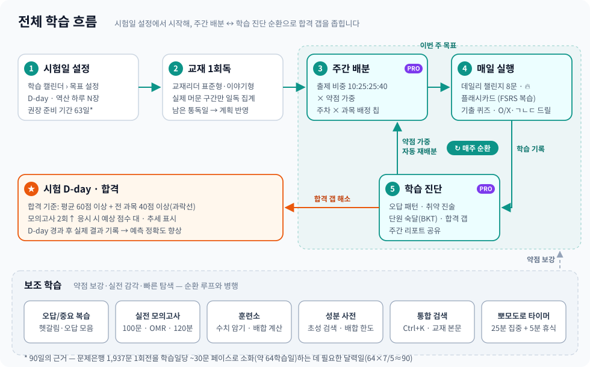
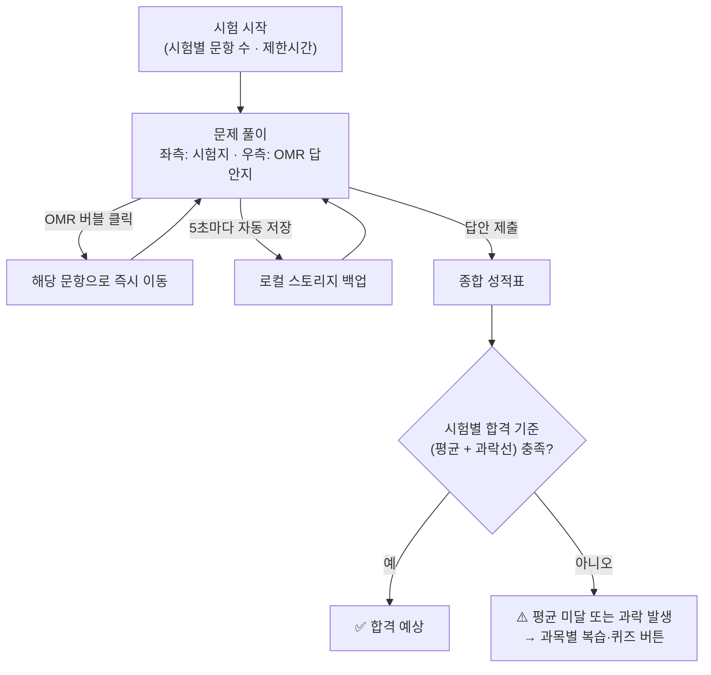

# PassOK — 사용자 매뉴얼

> **최종 업데이트**: 2026-10-22 · 앱 버전은 설정 메뉴 하단에 `vYYYY.MM.DD` 형식으로 표시됩니다 · 변경 이력은 설정 메뉴의 "변경 이력"에서 확인할 수 있습니다
> **문서 ID**: DOC-USR-07
> **범위**: platform · 판본: none
> **관련 SPEC ID**: MV-01~04 (기능 전반은 SPEC §3 전 영역 대응)

PassOK는 자격·기술 시험 준비를 위한 멀티시험 학습 플랫폼입니다 — 법령·전공 교재, 플래시카드, 퀴즈, 실전 모의고사, 복습 관리를 한곳에서 수행하도록 설계된 SPA(Single Page Application)입니다. 시험은 콘텐츠 팩 단위로 추가되며, 설정의 **시험 전환**으로 언제든 다른 시험으로 바꿀 수 있습니다.

### 📖 문서 역할 안내

안내 문서는 관점별로 역할을 나누어, 같은 내용을 두 문서에 중복 기술하지 않습니다.

| 문서 | 관점 | 다루는 내용 |
|------|------|------------|
| **본 문서 — 사용자 매뉴얼** | 앱 사용법 (모든 시험 공통) | 화면 구성·메뉴 위치·버튼 동작·기능 규칙·설정·백업·PWA 설치 |
| 학습 안내서 | 공부 방법 (시험별) | 해당 시험의 교재 구성·출제비중 분석·과목별 우선순위·회독 전략·시험 직전 플랜 — *시험이 제공하는 경우 대시보드 카드로 열람* |
| 실무 매뉴얼 | 실무 도구 (시험별) | 해당 시험의 합격 후 실무 도구 사용법 — *실무 도구를 제공하는 시험에서 사이드바 '실무 매뉴얼'로 열람* |

### 🧩 시험별 제공 기능 안내

이 매뉴얼은 **모든 시험에 공통인 플랫폼 기능**만 설명합니다. 각 시험은 자체 콘텐츠 팩이 제공하는 기능만큼 메뉴·카드가 표시됩니다 — 예를 들어 지식DB 사전, 수치 암기 훈련, 계산 연습, 실무 작업실 같은 전용 도구는 **해당 기능을 제공하는 시험에서만** 나타납니다. 시험별 전용 도구의 사용법은 그 시험의 학습 안내서·실무 매뉴얼이 설명합니다.

> 본 문서에서 전략·원리가 필요한 곳은 각 섹션의 `📚` 위임 링크로 안내서 정본을 연결합니다 — 같은 내용을 두 번 쓰지 않고 한 곳에서만 관리합니다.

### 🗂️ 메뉴 구성 (Navigation)

**사이드바 메뉴 그룹** (데스크톱 좌측 메뉴):

| 그룹 | 메뉴 |
|---|---|
| 학습 | 대시보드 · 학습 진단 · 플래시카드 · 퀴즈 |
| 훈련 · 평가 | 훈련소 · 오답/중요 복습 · 모의고사 |
| 자료 · 도구 | 교재리더 · 교재검색 · 학습 캘린더 (+ 시험 제공 시 사전 등 전용 메뉴) |
| 실무 | 실무 작업실 — *실무 도구를 제공하는 시험 한정* |

**⚙️ 설정 메뉴** (화면 우측 상단 톱니바퀴 — 항목 선택 또는 바깥 클릭으로 자동 닫힘):

| 항목 | 동작 |
|---|---|
| 계정 / 로그인 | 이메일 로그인 · 클라우드 동기화 — §11.1 참조 |
| 내 사용 통계 | 이 기기의 화면별·기능별 사용 횟수·활동 일수 요약 — `통계 복사`로 JSON 클립보드 복사(카운터만, 학습 내용 미포함) · 초기화 가능 — §11 참조 |
| 사용 통계 전송 | 익명 사용 통계 전송 켜기/끄기 — 기본 켜짐 · 끄면 이 기기에서 더 이상 수집·전송하지 않으며 앱 기능 제한은 없습니다 — §11.6 참조 |
| Free/Pro 플랜 비교 | 무료·Pro 기능 차이 표 — 화면 곳곳의 PRO 배지를 눌러도 같은 표가 열립니다 |
| 라이선스 코드 | 구매 후 발급받은 Pro 활성화 코드 입력 — 로그인 필요 · 활성화 시 이 계정의 모든 기기에 Pro 적용 — §11.7 참조 |
| 데이터 백업 / 백업 가져오기 | 학습 진도 JSON 내보내기·복원 — §11 참조 |
| 시험 전환 | 다른 시험 콘텐츠 팩으로 전환 — 진도·복습 기록은 시험별로 분리 보존됩니다 |
| 학습/실무 모드 전환 | 실무 중심 UI로 전환 — §11.5 참조, *실무 도구 제공 시험 한정* |
| 앱 종료 | 설치된 PWA 종료 (모바일은 OS 제약으로 안내 화면 표시 — 최근 앱 목록에서 위로 밀어 완전 종료) |
| 진도 초기화 | 로컬 학습 진도 초기화 — FSRS 스케줄·교재 읽기 위치 포함 |
| 시작 안내 | 권장 학습 순서 4단계 안내 재표시 |
| 변경 이력 | 최근 업데이트 내용 — 새 버전 적용 직후 "새로운 소식" 창 1회 자동 표시 |
| 의견 보내기 | 칭찬·개선·오류·제안 전송 — 로그인 불필요 · 별점 선택 · 화면/버전 자동 첨부 · 오프라인 작성은 연결 시 자동 전송 (개인정보 입력 금지) |

*   **🔍 통합 검색**: 헤더의 돋보기 버튼 또는 `Ctrl+K`로 어디서든 검색 — [§8.5](#85--통합-검색-팔레트-ctrlk) 참조
*   **매뉴얼**: 사용자 매뉴얼은 좌측 사이드바(모바일은 하단 탭 **[더보기]**)에서 모든 시험 공통으로 바로 열기 · 실무 매뉴얼은 제공 시험 한정
*   **모바일**: 하단 탭 바(핵심 탭 + [더보기] 시트)로 학습 메뉴 접근, 관리 기능은 상단 ⚙️에서 사용 — §12 참조

---

## 🧭 전체 학습 흐름 (Workflow)

> 📚 단계별 상세 진행 흐름과 과목별 우선순위·시간 배분 같은 시험별 학습 전략은 해당 시험의 **학습 안내서**(제공 시험 한정, 대시보드 카드)를 참조하세요.

---

## 1. 📊 학습 대시보드 (Dashboard)

학습의 첫 단추인 대시보드는 현재 나의 학습 진척도와 상태를 시각적으로 분석해 줍니다.

**화면 구성** (위 → 아래):

| 영역 | 내용 |
|---|---|
| 시작 안내 | 첫 방문 시 권장 학습 순서 4단계(① 시험일 설정 → ② 교재 1회독 → ③ 카드·퀴즈 학습 → ④ 복습·진단 루프) 1회 표시 — 설정의 `시작 안내`로 재확인 |
| 데일리 챌린지 | 오늘 할 일 — §10 참조 |
| 학습 안내서 | 시험별 학습 전략 문서 바로가기 — *해당 문서를 제공하는 시험에서만 표시* |
| 오늘 할 일 | 전 소스 통합 우선순위 큐 — 아래 표 참조 |
| 핵심 통계 카드 | 상시 3개 + 접이식 3개 — 아래 표 참조 |
| 학습 통계 더 보기 | 보조 지표 접이식 바 |
| 집중 도구 | 뽀모도로 타이머 접이식 바 — *제공 시험 한정*, §6 참조 |

상세 분석(과목별 상태·정답률 히트맵·모의고사 예측·오답 패턴)은 사이드바 **🎯 학습 진단**(§1.5)에 분리되어 있습니다.

### 핵심 통계

| 지표 | 노출 | 의미 |
|---|---|---|
| 총 학습 진척도 | 상시 | 전체 암기 대상 카드 대비 "외운 카드" 비중(%) |
| 오늘 복습 카드 수 | 상시 | FSRS가 계산한 오늘 복습 대기 카드 수 — 대기 시 `지금 복습` 버튼으로 복습 대상 카드 세션 바로 시작 |
| 시험일 D-day | 상시 | 캘린더 "목표 설정"의 시험일 기준 — 미학습 카드 ÷ 남은 일수 = **"역산 권장: 하루 N장"** 함께 표시 · 미설정 시 카드 강조로 설정 유도 · 일일 목표 초과 시 "압축/긴급" 꼬리 안내 · 7일 이내 강조 |
| 외운 카드 수 | 접이식 | "다 외웠어요"로 등록된 카드 수 |
| 퀴즈 정답률 | 접이식 | 퀴즈 누적 정답 비율 |
| 헷갈린 카드 개수 | 접이식 | "헷갈림" 선택 + 모의고사 오답 등 복습 필요 핵심 오답 잔여 수 |

### 🎯 오늘 할 일 (통합 우선순위 큐)

여러 추천 소스를 **하나의 번호 매긴 목록**으로 병합해 "지금 뭘 하면 되는지"에 바로 답합니다 — 각 항목에 개수·이유가 표시되고 버튼으로 바로 시작. 우측 **"학습 진단 보기 →"**로 §1.5 학습 진단 이동.

| 우선순위 | 기준 |
|---|---|
| ① 오늘 복습할 카드 | FSRS 복습 시간이 도래한 카드 — 최우선 |
| ② 오늘의 학습 배분 | 시험일 설정 시 주간 배분의 과목별 잔여 목표 (`실적/배정`) |
| ③ 틀린 문제 다시 풀기 | 누적 오답 + "헷갈림" 표시 카드 |
| ④ 취약 진술 점검 | 드릴 오판·미완료 취약 진술 (오답·복습 대기 없을 때 노출) |
| ⑤ 시험 전 최종 인출 | 시험일 D-14 이내일 때만 표시 — 다음 복습이 시험 이후로 잡혀 시험 당일 기억률이 낮아질 카드를 기억률 낮은 순 세션 (`인출 세션` 버튼) |
| ⑥ 일일 챌린지 | 오늘 미완료 시에만 표시 |
| 그 외 | 합격 기준 미달 우려 과목·정답률 최저·헷갈린 카드·미학습 콘텐츠 등 개인화 추천 |

### 집중 도구 · 진도 초기화

| 기능 | 위치·동작 |
|---|---|
| 뽀모도로 타이머 | 대시보드 하단 "집중 도구" 접이식 — 25분 집중 + 5분 휴식, 오늘 누적 시간·완료 세션 표시 (*제공 시험 한정*) |
| 진도 초기화 | ⚙️ 설정 → 진도 초기화 → 컨펌 모달 확인 시 로컬 학습 진도를 `0%`로 초기화 — FSRS 스케줄·교재 읽기 위치 포함 |

---

## 1.5. 🎯 학습 진단 (Personal Analysis) 💎 PRO

사이드바 **학습 → 학습 진단**(모바일: [더보기] → 학습 진단) — 개인화 분석을 모은 전용 화면. **Pro 버전 기능**입니다 — PRO 배지 기능은 최초 진입 시 **앱 전체에서 한 번만** 안내를 표시합니다(현재 무료 체험, 이후 재표시 없음). 화면의 **PRO 배지를 누르면** 언제든 Free/Pro 기능 비교표를 열 수 있습니다. 상단 "학습 진단 안내" 카드는 접이식이며 펼침 상태가 기억됩니다.

### 🧭 학습 진단 요약 — 화면 상단 6개 카드 + 주간 리포트

| 카드 | 표시 내용 |
|---|---|
| 이번 주 주간 배분 (PRO) | 캘린더 주간 배분 요약 — 과목별 `실적/배정`장·문(카드+퀴즈) · "캘린더 보기" 이동 · 시험일 미설정 시 설정 유도 |
| 오답 패턴 분석 | 최근 7일 "틀린 이유"(암기 부족·개념 오해·계산 실수 등 시험별 원인 분류) 분포 + 권장 학습법 — 태그 적으면 미태깅 오답 자동 추정 · 태그 없으면 오답 복습 이동 버튼 |
| 취약 진술 추적 | O/X·ㄱㄴㄷ 드릴 반복 오판 진술 — 실제 진술 텍스트 + 참/거짓 배지 · 같은 구간 연속 오판 시 개념 클러스터 경고 · "취약 리뷰 열기"로 복습 탭 이동 |
| 학습 리듬 | 오늘 목표 달성률 · 이번 주 학습일 · D-day — 주간 정답률 비교(이번 주 vs 지난주) + D-day 페이스 판정 · 표본 누적 시 집중 패턴(시간대·요일) + 주말 학습 비중 추가 (교재 읽기만 한 날도 집계) |
| 단원별 취약 분석 | 퀴즈·모의고사·드릴의 정오 판정을 교재 단원으로 매핑 — 판정 **순서**까지 반영한 숙달 추정(BKT)으로 과목별 최약 단원 정렬 · 행에 `숙달 % · 오답 N건` 표시 · 최근 정답 연속은 즉시 회복으로 반영, 찍기 정답은 할인 |
| 합격 갭 분석 | 예상 점수 vs 합격선 갭 + 최우선 보강 과목 — 최근 모의고사 우선, 없으면 퀴즈 정답률 · 과목 버튼으로 퀴즈 이동 · 합격선 미달 시 목표 상향 권고 |

**주간 리포트 공유**: 상단 **"주간 리포트"** 버튼 → 이번 주 학습량·정답률·예상 점수·합격 갭·취약 단원·주간 배분 실적/배정을 평문 리포트로 생성 — 공유(지원 환경) 또는 클립보드 복사.

### 🔁 이용 절차 — 학습 진단 ↔ 주간 배분

시험일을 설정하면 **주간 배분**(주차별 과목 배분)이 켜지고, 학습 기록이 **학습 진단**에 반영되어 다시 배분에 되먹는 순환 구조입니다.

### 과목별 학습 상태 · 정답률 히트맵

| 영역 | 내용 |
|---|---|
| 과목별 학습 상태 | 과목별 카드 수 · 퀴즈 개수 · 상세 진척도 · 바로가기 버튼 + 헷갈린 카드 수 · 푼 퀴즈 개수 |
| 정답률 히트맵 | 과목별 정답률을 색으로 표시 — 셀 호버 시 과목명·정답률·푼 문제 수 툴팁 |

| 히트맵 색상 | 정답률 | 판정 |
|---|---|---|
| 🟢 초록 | 80% 이상 | 양호 |
| 🟡 노랑 | 60–79% | 보통 |
| 🟠 주황 | 40–59% | 주의 |
| 🔴 빨강 | 40% 미만 | 집중 필요 |
| ⚪ 회색 | 미응시 | 퀴즈 미풀이 |

### 모의고사 성적 분석

| 요소 | 내용 |
|---|---|
| 구성 | 성적 추이 그래프 · 과목별 역량 레이더 차트 · 합격 가능성 진단 카드 |
| 미응시 상태 | 각 카드에 "지금 모의고사 시작" 버튼 — 바로 실전 모의고사 진입 |
| 인터랙티브 툴팁 | 레이더/꺾은선 데이터 포인트 호버·터치 → 과목명·점수·합격 상태·응시 횟수 |
| 예상 점수 추정 | 2회 이상 응시 시 최근 5회 평균 기반 **예상 점수 대**(예: 62~74점) + 상승/보합/하락 추세 — 점수 추정치이며 합격 예고 아님 |
| 실제 결과 기록 | D-day 경과 후 합격 진단 카드에 결과 입력 폼 — 합격/불합격 + 점수 기록 시 예상과의 오차 표시 · 누적될수록 예측 정확도 향상 |

---

## 2. 🎴 개념 플래시카드 (Flashcards)

*Active Recall(능동적 연상)* 학습법을 적용하여 뇌에 강력하게 핵심 개념을 주입합니다.

**제공 규모**: 시험별 교재의 표·용어 정의에서 자동 추출된 카드가 과목별로 제공됩니다 — 카드 수는 시험 팩 콘텐츠에 따라 다릅니다.

| 기능 | 동작 |
|---|---|
| 과목 필터링 | 사이드바·카드 상단에서 과목 선택 |
| 키워드만 보기 | 활성 시 본문 숨김 + 주요 빈칸 키워드만 표시 — 단답형 대비 |
| 난이도 필터 | 전체/쉬움/보통/어려움 — 학습 강도 조절 |
| 카드 뒤집기 | 클릭 또는 `Enter`/`Space` — 플립 애니메이션 후 정답·상세 해설 |
| 암기팁 | 카드 뒷면 하단에 표시 — 용어의 구분점·함정·연결고리를 짚는 1~2문장 보조 설명. 정의가 짧은 카드 중심으로 제공 |

**자가 진단 버튼**:

| 버튼 | 결과 |
|---|---|
| `🟢 다 외웠어요` | 완벽 암기 등록 → 진척도(%) 상승 + 다음 학습에서 필터링 · FSRS가 다음 복습 시점 자동 계산 |
| `🟡 아직 헷갈려요` | **오답/중요 복습 목록**으로 즉시 분류 · FSRS가 복습 간격을 재계산해 이른 시점에 재노출 |

### 🔄 간격 반복 학습 (FSRS)

| 규칙 | 동작 |
|---|---|
| 복습 시점 | 평가 시 FSRS-6 모델이 카드별 기억 상태(난이도·안정도)로 다음 복습 시점 자동 계산 |
| 간격 확장 | "외움" 평가 → 기억 안정도 상승으로 복습 간격 점진 확장 |
| 간격 단축 | "헷갈림" 평가 → 안정도 하락으로 복습 간격 단축 · 재학습으로 재축적 |
| 난이도 반영 | 같은 평가라도 어려운 카드는 간격이 천천히, 쉬운 카드는 빠르게 늘어남 |
| 시험일 정책 | 시험일 설정 시 — 새 복습 기한이 시험을 넘어가는 취약 카드는 **시험 전날로 자동 당겨짐** · D-14부터는 시험일 기억률이 낮은 카드를 `시험 전 최종 인출`로 제안 (§1 "오늘 할 일") |
| 자유 학습 | 간격 반복은 예측 보조 — 언제든 모든 카드 학습 가능 |

---

## 3. ✍️ 핵심 퀴즈 (Quiz)

시험별 문제은행의 단답형 빈칸 채우기 문항들을 10문제 단위로 모아 학습할 수 있습니다.

| 기능 | 동작 |
|---|---|
| 답안 입력 | 빈칸 용어·수치 입력 후 제출 — `Enter`로 즉시 제출 |
| 채점 | 공백 자동 제거로 채점 신뢰성 확보 — 해설과 정오답 팝업 |
| 복습 연동 | 틀린 문항은 오답/중요 복습 카드로 즉시 이관 |
| 틀린 이유 태깅 | 오답 직후 원인(암기 부족·개념 오해·계산 실수 등) 선택 → 원인별 **관련 카드 추가 / 교재 보기 / 유사 문제** 버튼으로 재학습 · 통계는 오답 패턴 분석(§4)에 반영 · 결과 화면에서도 나중에 태깅 가능 |
| 진단 평가 | "진단 평가" 버튼 → 과목 균등 진단 세트 → 결과에 과목별 정답률 프로파일 + 약한 과목 집중 퀴즈 이동 |

---

## 4. ⭐ 오답 / 중요 복습 (Review Note)

나의 취약점들만 모아 단권화 요약 노트를 보듯 학습하는 공간입니다.

| 기능 | 동작 |
|---|---|
| 빈 상태 CTA | 오답 없을 때 "플래시카드 학습하러 가기" 버튼 |
| 카드 수집 | 플래시카드 `헷갈림` + 모의고사 제출 후 `오답` 문항이 복습 카드로 표시 |
| 과목 필터 | 상단 과목 버튼으로 실시간 필터링 |
| 필터 연동 시험 | 과목 필터 선택 상태로 `헷갈린 카드 집중 퀴즈`/`오답 모의고사` 시작 → 해당 과목 약점만으로 시험지 구성 |
| 오답 집약 모의고사 | 오답 비율 산출로 20문항 시험지 즉시 조립 — 실전 OMR·타이머·오답풀이 동일 연계 |
| 인쇄 | 우측 상단 인쇄 버튼 → 오답 요약본 출력 (필터 상태 그대로 반영) |
| 오답 패턴 분석 | 최근 7일 요약 — 틀린 이유 분포 · 최다 원인 · 취약 과목 · 원인별 권장 학습법(예: 암기 부족 다수 → 플래시카드 우선) |
| 취약 진술 리뷰 | 하단 접이식 섹션(기본 펼침) — O/X·ㄱㄴㄷ 드릴에서 반복 오판한 진술을 개념별로 묶어 참/거짓 대조·복습 대상 필터·졸업 진행 표시 |
| 취약·복습 진술 O/X 드릴 | 헤더 버튼 — 취약·복습 대상 진술이 있을 때 표시, 클릭 시 훈련소로 이동해 weak 모드 즉시 시작 |

---

## 5. 📝 예상 문제집 & OMR 모의고사 (Mock Exam)

실제 시험장의 환경(시간 압박, 마킹 실수, 문항 검토)을 브라우저에 그대로 시뮬레이션합니다.

### 모의고사 유형

| 유형 | 구성 | 특징 |
|---|---|---|
| 통합 실전 | 시험 출제 비율에 맞춘 통합 시험지 | 문항 수·시간·합격 기준은 시험 팩 선언을 따름 · 문제은행에서 매번 무작위 조합 · 결과는 레이더·합격 진단과 호환 |
| 과목별 집중 | 과목별 분리 패키지 | 과목 완성도용 — 과목 카드에서 문항 수 칩(20/40/60/전체) 선택 |
| ㄱㄴㄷ 조합 | 진술 조합형 변환본 | 원본 문항 근거를 ㄱ~ㅁ 진술 조합으로 자동 변환 — "옳은 것을 모두 고르시오" 훈련 (*해당 변환본을 제공하는 시험 한정*) |
| 주관식 연습 | 서술형 문항 | 주관식 문항을 제공하는 시험에서 별도 표시 |

**과목 카드의 `모의고사 시작`** → `실전` / `ㄱㄴㄷ 조합` 등 시험이 제공하는 유형별 문항 수 칩 선택.

### 📖 실전 예상문제집 뷰어

`예상 문제집` 버튼으로 앱 내 전체화면 뷰어(별도 창 아님) · `ㄱㄴㄷ 조합 문제집`은 진술 조합 변환본.

| 기능 | 동작 |
|---|---|
| 자동 목차(TOC) | 왼쪽 대단원 목차 — 클릭으로 해당 회차/섹션 이동 |
| 인쇄 / PDF | 상단 인쇄 버튼으로 문제집 출력물 생성 |
| 닫기 | `Esc` · 우상단 닫기 · 모바일 뒤로가기 |
| 오프라인 | 한 번 연 문제집은 세션 캐시 — PWA 오프라인에서도 동작 |
| 🔖 이어보기 | 문서별 마지막 위치 자동 저장 → 재오픈 시 `이어보기 · N% 지점` 칩 |

**📚 근거 인용 링크**: 정답 블록의 교재·문서 인용 링크 클릭 → 해당 교재·참조자료가 뷰어 내에서 열리며 인용 라인이 **노란색 하이라이트**(펄스 5초 후 소실). 상단 좌측 **뒤로 버튼**으로 이전 문제집 위치(스크롤 포함) 복귀 — 반복 이동도 단계적 복귀.

### 시험 진행 흐름

### 시험 중 기능

| 기능 | 동작 |
|---|---|
| OMR 답안지 | 버블 클릭 → 해당 문항 점프 · 마킹 문항 버블 점등 · 헤더에 `푼 문제 N/전체 · 미답 N` 상시 표시(미답 시 주황 강조) |
| 실전 타이머 | 카운트다운 — 잔여 10분↓ 주황 · 5분↓ 빨강 |
| 키보드 | `←/→` 이전/다음 · `1~5` 선지 선택 · `Enter` 다음 — 단답형 입력 중 자동 비활성화 |
| 미답변 경고 | 제출 시 미답 개수 확인 창 — 찍기 누락 방지 |
| 자동 저장·이어 풀기 | 마킹 시 + 5초 주기 로컬 백업 → 종료·새로고침 후 대시보드 배너로 시간·상태 그대로 복원 |

### 성적표

| 항목 | 내용 |
|---|---|
| 합격 기준 | 시험 팩 선언값(manifest `integratedExam.passAverage`/`subjectFailBelow`) — 실제 시험 기준 반영 |
| 과목별 리포트 | 과목별 문항 수·득점률 프로그레스 바 · 과락선 미달 과목에 `[과락]` 딱지 + 경고문 |
| 과목별 복습 버튼 | 과락/취약 과목의 집중 퀴즈로 바로 이동하는 버튼(`⚡ 과목명 퀴즈 풀기`) 자동 생성 |
| 단원별 취약 분석 | 오답 포함 교재 단원을 정답률 낮은 순 표시 |
| 오답노트 바로가기 | `오답 복습노트로 이동` → 방금 틀린 문항이 등록된 §4 복습노트 |

---

## 6. 🏋️ 훈련소 (Smart Trainer Center)

문제은행 문항을 분해·변환한 반복 드릴과, 시험별 전용 암기·실전 훈련을 모아둔 공간입니다.

메뉴는 두 그룹으로 나뉩니다 — **문제은행 드릴**(문항을 분해·변환한 O/X 판정·ㄱㄴㄷ 조합)이 위에, **암기 · 실전 훈련**(시험별 전용 도구)이 아래에 배치됩니다. 아래 그룹의 도구(수치 암기·계산 연습·지식 챌린지·뽀모도로 등)는 **해당 기능을 제공하는 시험에서만** 표시되며, 사용법은 그 시험의 학습 안내서가 설명합니다.

### ⭕ O/X 판정 드릴 (Statement O/X Drill)

문제은행 각 문항의 교재 근거를 **개별 진술로 분해**해 참/거짓을 판정하는 고강도 반복 드릴입니다.

| 기능 | 동작 |
|---|---|
| 출제 우선순위 | 오판 이력 진술 + FSRS 복습 기한 도래 진술 우선 편성 |
| 문항 수 | 10/20/전체 칩 선택 |
| 추적 | 판정마다 진술별 FSRS 스케줄·오판 통계 갱신 — 카드 배지 "오늘 복습 대상 N개" 표시 |

### 🧩 ㄱㄴㄷ 조합 훈련 (Combo Drill)

실전 "옳은 것을 모두 고르시오" 유형을 **2단계 판정**으로 훈련합니다.

| 기능 | 동작 |
|---|---|
| 2단계 응시 | ① 진술(ㄱ·ㄴ·ㄷ·ㄹ) 참/거짓 개별 판정 → ② 판정 결과의 조합(①~⑤) 선택 — 진술 판정 오류 위치 피드백 |
| 편성 | 오판 이력 진술 포함 문항 우선 출제 |

### 🩹 취약 진술 리뷰 (Weak Statement Review)

두 드릴에서 **반복 오판한 진술**을 모아 보여주는 리뷰 표면입니다. **위치는 `복습` 탭의 접이식 섹션** — 드릴 결과 화면의 `취약 진술 리뷰` 버튼과 학습 진단 카드에서 바로 열립니다.

| 기능 | 동작 |
|---|---|
| 오판 목록 | 실제 진술 텍스트 + 참/거짓 배지 — "옳지 않은 것" 유형 실수 원인 확인 |
| FSRS 대상 | 복습 기한 도래 진술 별도 표시 — 카드 배지 연동 |
| 혼동쌍 대조 | 같은 구간 진술을 번갈아 오판 시 혼동쌍으로 묶어 대조 |
| 유사 진술 | 행별 **유사** 버튼 → 의미상 가까운 진술을 유사도%와 함께 표시 — 다른 단원의 혼동 소재까지 발견 (*의미 유사 인덱스 제공 시험 한정*), 각 진술 재시도 드릴 연결 |
| 졸업 | 같은 진술 3회 연속 정답 → 취약 목록 졸업 — 학습 진단 "마스터리 Lv" 산출 근거 |

### ⏱️ 집중 뽀모도로 타이머 (Pomodoro Timer) — *제공 시험 한정*

| 기능 | 동작 |
|---|---|
| 위치 | 대시보드 "집중 도구" 접이식 영역 |
| 세션 | 25분 집중 → 5분 휴식 · 앱 전환해도 경과 유지 |
| 카운트 | 오늘 완료 세션 수 헤더 표시 · 일자별 자동 저장 |
| 누적 시간 | 당일 집중 시간 분 단위 표시 |
| 자동 일시정지 | 탭 이탈·화면 꺼짐 시 자동 정지 — "계속 하기"로 재개 |

---

## 7. 📖 교재 리더 (Textbook Reader)

시험별 전 과목 교재 본문을 앱 안에서 바로 읽을 수 있는 통합 교재 뷰어입니다.

### 📚 교재리더

| 기능 | 동작 |
|---|---|
| 단원 선택 | 사이드바 `교재리더`에서 과목·단원 선택 → 섹션 카드로 렌더 |
| 섹션 접기 | 각 섹션(`##`) 헤더 클릭으로 접기/펼치기 |
| 다이어그램 | 마인드맵·플로우차트·시퀀스 자동 렌더 — 있는 단원만 엔진 로드 |
| 이야기형 모드 💎 PRO | 제목 우측 토글로 표준형 ↔ 이야기형 전환 — 주인공 실수 서사로 함정 회피 학습 (*이야기형 교재를 제공하는 시험 한정*) |

### 🎨 가독성 도구 (Readability Tools)

| 도구 | 조작 | 동작 |
|---|---|---|
| 섹션 진행률 | — | 상단 바에 전체 진행률 + `3/5 섹션` 표시 |
| 본문 검색 | 툴바 입력란 · `▲▼` · `Enter`/`Shift+Enter` · `ESC` | 현재 단원 내 키워드 노란 하이라이트 + `1/15` 개수 표시 |
| 화면 확대 | 두 손가락 핀치 | 브라우저 핀치 줌 — 표·그림·다이어그램 확대, 두 번 탭도 지원 |
| 이미지 확대 (PC) | 클릭 | 본문 삽화(SVG 등)를 원본 크기로 확대 — `+`/`−`/`맞춤` · `ESC`/배경 닫기 |
| 다이어그램 확대 (PC) | 탭 또는 `⛶` | 25%~400% 배율 + 양방향 스크롤 · 교재·통합검색·매뉴얼 공통 |
| 챕터 끝 마커 | — | 단원 끝 `— 단원 끝 —` 표시 |

### 📑 목차 (TOC) 및 브레드크럼

| 기능 | 동작 |
|---|---|
| 계층 목차 | 좌측 TOC — 챕터/섹션 접기·펼치기 |
| 클릭 이동 | 항목 클릭 → 해당 섹션 자동 스크롤 |
| 스크롤 스파이 | 현재 읽는 섹션이 TOC·브레드크럼에 자동 하이라이트 |
| 모바일 TOC | 왼쪽 끝 오른쪽 스와이프 · 왼쪽 가장자리 탭 · `목차` 버튼으로 드로어 열기 — 항목 클릭·왼쪽 스와이프·배경 탭으로 닫기 |
| 툴바 자동 숨김 | 모바일 아래로 스크롤 시 숨김 · 위로 살짝 올리면 재표시 |

### 📖 교재 읽기 이어하기 (Reading Resume)

| 기능 | 동작 |
|---|---|
| 자동 저장 | 스크롤 위치 · 과목 · 단원 · 이야기형 여부 자동 저장 |
| 복원 | 재진입 시 마지막 과목·단원·스크롤 자동 복원 |
| 유효기간 | 30일 — 경과 위치는 자동 만료 |
| 진도 초기화 | 설정 진도 초기화 시 읽기 위치도 초기화 |
| 일독 진척 | **실제 머문 구간**만 누적 — 건너뛴 부분 미집계 · 표준형·이야기형 진척 공유 · 체류 시간은 읽기 분으로 기록 |

### ↔️ 이전/다음 단원 이동

교재 본문 하단의 **이전 단원/다음 단원** 버튼(대상 단원명 표시)으로 연속 학습.

### 🎯 학습 보조 도구 (Study Aids)

| 도구 | 동작 |
|---|---|
| ① 핵심 필터 & 요약 | 핵심 마커(🔖 등) 섹션만 하이라이트 + 비핵심 디밍 토글 · 핵심 요약 카드 |
| ② 숫자·기한 빈칸 카드 | 본문 숫자/기한/횟수 자동 추출 → 챕터별 암기표 생성 |

### 📝 교재 콘텐츠 학습 보조 요소

교재 Markdown 원본에는 시험별로 다음과 같은 학습 보조 요소가 통합될 수 있습니다(요소 구성은 교재별 상이):

| 위치 | 요소 | 내용 |
|---|---|---|
| 챕터 전 | 🗺️ 과목 지도 | 과목 개요 마인드맵 + 노드 상세 매핑 표 |
| 챕터 전 | 🎯 최우선 암기 축 | 시험 직전 우선 암기 핵심 키워드 |
| 챕터 전 | 🔢 숫자 암기 미리보기 | 출제 빈도 높은 숫자/기한/횟수 표 |
| 챕터 내부 | 🔑 이 장의 질문 | 챕터 관통 핵심 질문 — 학습 방향 제시 |
| 챕터 내부 | 학습 가이드 | 출제 빈도(★) · 예상 소요 시간 · 핵심 키워드 블록 |
| 챕터 내부 | 한 줄 요약 | 주요 섹션 하단 blockquote 요약 |
| 챕터 내부 | 비교표 | 주요 개념·수치·기준 비교 표 |
| 챕터 내부 | 확인문제 | 선다형 + 상세 해설 — 단원 말미 자가 점검 |
| 챕터 내부 | 용어 사전 | 핵심 용어·포인트 정리 표 |
| 챕터 후 | ⚡ 시험 직전 체크리스트 | 단원별 최종 점검 항목 |
| 챕터 후 | 🧠 30초 회상 | 핵심 카드 회상 학습 |
| 챕터 후 | 📚 참조 자료 | 법령 원문·별표·참조자료 링크 |

### 📖 용어집 (Glossary)

| 기능 | 동작 |
|---|---|
| 용어집 표 | 챕터 말미 `📌 용어 정리` 표 자동 생성 |
| 키워드 링크 | 본문 용어집 키워드 자동 링크 — 클릭 시 해당 행 점프 |
| 복귀 버튼 | 점프 후 우하단 "← 원래 위치로" 플로팅 버튼 |
| 전문 정의 | 과목별 핵심 용어에 큐레이션 정의 |

### 📚 참조자료 연결 (Reference Links)

| 기능 | 동작 |
|---|---|
| 사이드바 | 리더 우측 참조자료 목록 — 현재 단원 관련 자료가 "이 단원의 참조자료"로 상단 추천 |
| 인앱 뷰어 | 클릭 시 전체화면 오버레이로 법령·별표·기준 문서 열람 (별도 팝업 없음) |
| ↗원문 | 항목 옆 버튼 → law.go.kr **공식 현행본** 새 탭 · 앱 문서는 변환 스냅샷 — '스냅샷 제N호 · 시행일' 배지 · 개정 시 '⚠ 갱신 필요' · 공포 후 시행 전 '⏳ 시행 예정' (오프라인은 안내만) |
| 키워드 스크롤 | 본문 `제N조` 등 자동 추출 → 참조자료 해당 위치 스크롤 |
| Deep Link | `data-ref-anchor`로 특정 조문/앵커 직접 이동 |
| 프리뷰 툴팁 | 호버 400ms(데스크톱)·롱프레스 600ms(모바일) → 200자 스니펫 |
| 검색 내비 | 이전/다음 버튼 · `Enter`/`Shift+Enter` · `1/N` 카운트 |
| PDF 저장 | 뷰어 상단 버튼 → 브라우저 인쇄로 PDF 저장 |

### 🔎 교재 본문 통합 검색 (Textbook Search)

| 기능 | 동작 |
|---|---|
| 실시간 검색 | 전 과목 본문 키워드 검색 — 구절·맥락 즉시 확인 |
| 다중 키워드 | 공백 구분 AND 검색 — 모든 키워드 포함 섹션만 필터 |
| 역색인 | 섹션 토큰화 단어→섹션 인덱스 + 2-gram 보조로 한국어 부분 매칭 — 최초 구축 후 세션 재사용 |
| 하이라이트 | 일치 단어 강조 · '더 보기'로 본문 확장 |
| 마크다운 렌더 | 코드블록·테이블·Mermaid 그대로 표시 |
| 단원 이동 | '전체 단원 보기' → 해당 교재 리더로 바로 이동 |

### 🔄 추천 회독법 (Recommended Study Cycle)

교재를 효율적으로 학습하기 위한 회독법 안내입니다. 각 과목의 `📋 목차`와 `🧠 30초 회상` 카드, `⚡ 시험 직전 체크리스트`와 함께 활용하세요.

> 📚 **학습 전략 상세 안내**: 출제비중 기반 우선순위, 회독별 학습 전략, 과목별 학습 순서·시간 배분 추천 등 시험별 학습법은 해당 시험의 **학습 안내서**(제공 시험 한정)를 참조하세요.

---

## 8. 🔍 지식DB 사전 (Dictionary) — *제공 시험 한정*

시험별 지식DB(용어·항목·수치 기준 등)를 검색·열람하는 전용 사전입니다 — **해당 기능을 제공하는 시험에서만** 사이드바에 표시되며, 메뉴 이름과 항목 구성은 시험별로 다릅니다.

| 기능 | 동작 |
|---|---|
| 실시간 검색 | 이름·영문·초성(`ㄱㄹㅅ`) 검색 + 분류 필터 — 필드 구성은 시험별 스키마 선언 |
| 상세 카드 | 클릭 시 항목 상세·기준값·학습 팁 오버레이 |
| 자가 등록 | 검색창 옆 추가 버튼 — 항목 직접 등록 → 공식 항목 뒤 병합 + '사용자 등록' 배지·전용 필터 · 공식 동명 등록 불가 · 카드 상세에서 편집·삭제 (백업·동기화 대상) |
| CSV 보내기 | **[필터 CSV]** 현재 검색·필터 결과 · **[전체 CSV]** 전체 DB(공식+자가) — UTF-8 BOM으로 Excel 바로 열림 |
| 고시·기준 확인 | **[고시 확인]** → 관련 법령·고시 최신본을 law.go.kr 즉시 조회 — 스냅샷↔최신본 비교 + '⚠ 개정 감지'/'⏳ 시행 예정' (인터넷 필요) |
| 실무 도구 연동 | 실무 도구를 제공하는 시험에서는 상세 카드에서 실무 기능으로 바로 추가 가능 — 시험별 실무 매뉴얼 참조 |

> 각 시험 사전의 항목 구성·카테고리·활용법 상세는 해당 시험의 학습 안내서를 참조하세요.

---

## 8.5. 🔍 통합 검색 팔레트 (Ctrl+K)

앱 어디서나 하나의 검색창으로 **모든 학습 자원을 한 번에** 찾아 바로 실행합니다.

**열기**: 헤더 🔍 버튼(모바일 포함) 또는 `Ctrl+K` (Mac `Cmd+K`) — 다시 누르면 닫힘.

**검색 대상** (유형별 그룹 표시 — 선택 시험이 제공하는 범위 내에서 검색):

| 유형 | 검색 → 동작 |
|---|---|
| 화면 | "퀴즈"·"캘린더" 등 메뉴명 → 화면 이동 |
| 교재 | 섹션 제목 → 해당 과목 교재 리더 챕터 |
| 플래시카드 | 용어/설명 매칭 → 해당 과목 카드 학습 |
| 퀴즈 | 문항/보기 매칭 → 해당 과목 퀴즈 |
| 사전 | 한글·영문·초성 검색 → 시험별 지식DB 사전 (*제공 시험 한정*) |
| 문서·문제집 | 안내 문서·문제집 파일 바로 열기 |

| 조작 | 동작 |
|---|---|
| `↑` `↓` | 항목 이동 |
| `Enter` | 실행 |
| `Esc` · 배경 클릭 | 닫기 |
| "교재 본문에서 '검색어' 전체 검색" | 결과 맨 아래 — §7 교재 본문검색으로 검색어 전달 (제목 아닌 **본문 내용** 키워드용) |

*   **오프라인 지원**: 검색 대상이 모두 기기 내 데이터라 인터넷 없이 동작.

> 교재 본문 전체 텍스트 검색(장문 내용까지)은 §7 "교재 본문 통합 검색" 이용 — 팔레트는 빠른 이동·실행용.

---

## 9. 📊 과목별 역량 진단 레이더 차트 (SVG Radar Chart)

| 기능 | 동작 |
|---|---|
| 위치 | 학습 진단 화면 **모의고사 성적 분석** 영역 |
| 렌더링 | 과목별 평균 이해도를 다각형 레이더로 동적 표시 |
| 취약점 시각화 | 과락·저성적 과목 영역이 찌그러져 직관 파악 |
| 인터랙티브 툴팁 | 데이터 포인트·꼭짓점 호버/터치 → 과목명·점수·합격 상태·응시 횟수 |

---

## 10. 🧩 일일 5분 데일리 챌린지 & Streak

| 기능 | 동작 |
|---|---|
| 학습 루틴 불꽃 | 매일 챌린지 완수 → 🔥 Streak 연속 일수 상승 |
| 🧊 스트릭 복구권 | 7일 연속마다 1장(최대 2장) — 어제 하루만 놓치면 자동 소비로 연속 유지 · 배지 옆 잔여 장수 + "이번 주 N/M일" 주간 목표 칩 |
| 챌린지 팩 | 하루 1회 — 플래시카드·퀴즈 + 시험별 전용 문항(계산·판별 등 제공 기능 연동) 믹스 |
| 마스터리 레벨 | 학습 진단 과목 카드 "마스터리 Lv.N (졸업 X/Y)" — 드릴 진술 3연속 정답 졸업 비율 (Lv.1~5, 20% 단위) |

---

## 10.5. 📅 학습 캘린더 (Study Calendar)

날짜별 학습 기록과 목표 달성률을 한눈에 확인하여 꾸준한 학습 습관을 형성합니다.

| 기능 | 동작 |
|---|---|
| 월별 캘린더 | 학습일에 ✓ 스탬프 · 오늘은 테두리 강조 · 교재 읽기만 한 날도 학습일 인정(툴팁 읽기 분) — 주간·월간 학습일 반영 |
| 오늘 목표 | 일일 카드(장)·퀴즈(문제) 달성률 링 그래프 |
| 이번 주 목표 | 주간 학습 일수 달성률 |
| 이번 달 | 월간 학습 일수 + 연속 학습(Streak) |
| 목표 설정 | 일일 카드/퀴즈 목표·주간 학습 일수 조정 · 시험일 입력란 아래 권장 준비 기간 기준 실시간 안내 |
| 시험일 등록 | 입력 시 대시보드 D-day 카드 + 역산 권장 일일 카드 · 캘린더 해당일 **D-day 칩**(7일 이내 긴급 강조) · 저장 후 캘린더 자동 이동 · D-day 경과 후 합격 진단 카드에 결과 기록 폼 |
| 📋 학습 계획 패널 | 시험일 설정 시 표시 — 시험일·D-day·등급 배지(여유/압축/긴급) · 남은 카드·학습 가능 일수·일당 필요량·목표 요약 · **주차별 마일스톤 표** · 등급별 권고 · 학습 가능 일수는 주간 학습일 반영 · **교재 일독 중이면 남은 통독 예상일을 카드 학습일에서 차감**해 "통독 N일" 표기(리더 실제 체류 기준 자동 추적 · 완독 시 차감 해제) |
| 이번 주 진행 | 계획 패널 상단 진행률 바 — 이번 주 배정량 대비 최근 7일 카드 실적 · 달성(녹색)/순항/지연(경고+보충·조정 권고) |
| 마일스톤 안내 | D-30/14/7/1/0 진입 · 주간 달성 · 전체 50%/75% 경유 시 1회성 메시지 |
| 자동 기록 | 플래시카드·퀴즈·교재 읽기(분) 자동 일자별 기록 |

**주간 배분** (PRO 표기) — 계획 패널 하단 **이번 주 과목별 목표** 칩 + 주차×과목 배분표:

| 요소 | 내용 |
|---|---|
| 배분 로직 | 남은 카드·퀴즈를 **시험별 과목 출제 비중 × 약점 가중**(최근 정답률 + 헷갈림 비율 + 오답 태그 + 취약 단원 + 밀린 복습)으로 자동 배분 — 표본 부족 과목은 중립 가중 |
| 퀴즈 배분 | 과목별 남은 문제은행 ÷ 주간 퀴즈 목표(학습일×일일 목표) |
| 칩 표시 | 이번 주 `실적/배정`장 · `실적/배정`문 — **칩 클릭 → 해당 과목 카드 학습 이동** · 약점 가중 과목에 `약점` 배지 |
| 자동 재배분 | 먼저 마친 과목의 배정이 남은 과목으로 이동 |
| ⓘ 버튼 | 칩 옆 — 학습 진단 과목 카드로 이동해 배정 근거(정답률·취약 단원) 확인 |
| 연동 | 학습 진단 상단 "이번 주 주간 배분" 요약 카드 · 주간 리포트에 과목별 실적/배정 준수 행 출력 |

---

## 11. 💾 로컬 데이터 백업 및 복원 (Data Backup & Restore)

| 기능 | 동작 |
|---|---|
| 데이터 백업 | ⚙️ 설정 → 데이터 백업 → 진척도 전체를 JSON 파일로 내보내기 — 시험이 제공하는 실무 데이터(저장된 작업물 등)도 함께 포함 |
| 백업 가져오기 | 기기 변경·유실 시 JSON으로 원클릭 복원 |

> 📊 **내 사용 통계**는 백업 대상이 아닙니다 — 화면·기능 사용 횟수는 기기별로만 쌓이는 로컬 계측이라 별도 관리됩니다. ⚙️ 설정 → **내 사용 통계**에서 첫/최근 사용일·활동 일수·화면별/기능별 횟수를 확인하고, **`통계 복사`** 버튼으로 JSON을 클립보드에 복사할 수 있습니다(외부 전송 없음 · 개선 피드백 시 첨부 가능). `초기화`로 이 기기의 통계만 비울 수 있습니다.

## 11.1. 👤 계정 · 클라우드 동기화 (Login & Sync)

설정 메뉴의 **계정 / 로그인**에서 이메일 계정으로 로그인 — 로그인해도 이 기기의 학습 데이터는 그대로 유지됩니다.

**로그인 방법**:

| 방법 | 절차 |
|---|---|
| 로그인 메일 (권장) | 이메일만 입력 → 링크·숫자 코드 발송 → 링크(브라우저) 또는 코드(앱)로 첫 로그인 시 **계정 자동 생성** — 별도 회원가입 불필요 |
| 이메일 + 비밀번호 | 회원가입 계정 또는 비밀번호 설정 계정으로 로그인 |
| 비밀번호 찾기 | 로그인 메일 → 코드 로그인 → 계정 화면 **비밀번호 설정**에서 지정 (PWA 내 비밀번호 로그인용) |

| 기능 | 동작 |
|---|---|
| 클라우드 동기화 (Pro) | 학습 진도·저장 데이터를 클라우드 동기화 → **멀티 디바이스 공유** · "지금 동기화" 수동 버튼 + 상태 표시 · *개인정보성 실무 데이터(고객 정보 등)는 시험별 실무 매뉴얼의 동기화 정책을 따릅니다* |
| 플랜 표시 | 계정 화면에 Free/Pro + "Free/Pro 차이" 기능 비교표 · 화면 곳곳의 **PRO 배지를 눌러도** 동일 비교표 표시 |
| 로그아웃 | 이 기기 데이터 유지 · 계정 기능 미설정 환경은 안내 문구 표시 |

---

## 11.5. 🔀 학습 모드 / 실무 모드 전환 (UI Mode) — *실무 도구 제공 시험 한정*

시험 합격 후 **실무 중심으로만 사용**하고 싶다면 UI를 실무 중심으로 전환할 수 있습니다 — 실무 도구를 제공하는 시험에서만 표시됩니다.

**전환 방법**:

| 환경 | 경로 |
|---|---|
| 데스크톱 | 사이드바 최하단 **[학습 모드 ⇄ 실무 모드]** |
| 모바일·태블릿 | ⚙️ 설정 **[모드: 학습 모드]** — 사이드바 푸터가 없는 환경의 전환 경로 |

**실무 모드에서 달라지는 것**:

| 항목 | 변경 |
|---|---|
| 학습 메뉴 | 대시보드·카드·퀴즈·훈련소·복습·모의고사·교재 읽기/검색·캘린더·사용자 매뉴얼이 사이드바·탭 바에서 숨김 |
| 학습 도구 펼침 | 데스크톱 **[학습 도구 ▾]** · 모바일 [더보기] 시트 **[학습도구]** — 일시 펼침으로 학습 메뉴 사용(상태 기억·복귀 불필요) |
| 실무 구성 | 실무 매뉴얼 최상단 · 실무 작업실·시험별 전용 도구·테마·시험 전환만 남음 · 모바일 탭 바는 실무 중심으로 축소 |
| 홈 화면 | 앱 실행·모드 전환 시 대시보드 대신 실무 작업실 랜딩 |

> 학습 데이터(진도·오답·저장 작업물)는 모두 보존 — 언제든 학습 모드로 복귀 가능.

## 11.6. 📡 익명 사용 통계 전송 (Usage Telemetry)

PassOK는 어떤 기능이 실제로 도움이 되는지 파악해 학습 품질을 개선하기 위해 **익명 사용 통계**를 수집합니다. 첫 실행 시 1회 안내가 표시되며, 언제든 끌 수 있습니다.

| 항목 | 내용 |
|---|---|
| 수집 내용 | 화면 방문·핵심 학습 행동(퀴즈/카드/복습 시작·완료)의 **횟수**와 하루 1회의 사용 요약 — 이벤트 종류는 미리 정해진 목록만 전송 |
| 수집하지 않는 것 | 학습 내용·문제 답안·메모·검색어·이름·이메일 등 개인 식별 정보 — 횟수만 집계되며 내용은 전송되지 않습니다 |
| 식별자 | 이 기기의 익명 난수 ID만 첨부 — 기기 초기화·앱 데이터 삭제 시 새로 생성되어 다른 기기와 구분만 할 수 있습니다 |
| 끄는 방법 | ⚙️ 설정 → **사용 통계 전송** → 꺼짐 — 즉시 이 기기의 전송이 중단되고, 앱의 모든 기능은 그대로 사용할 수 있습니다 |
| 오프라인 | 전송 실패 시 기기 안에 보관(최대 200건) 후 연결 회복 시 재전송 — 꺼짐 상태면 보관도 하지 않습니다 |

> 수집되는 정보는 기능 개선 목적 외에 사용하지 않으며, 광고·분석용 외부 서비스(Google Analytics 등)는 사용하지 않습니다.

## 11.7. 🔑 Pro 활성화 — 라이선스 코드

Pro 플랜을 구매하면 **라이선스 코드**(예: `CAFE-XXXX-XXXX` 형식)를 받습니다. 코드를 입력하면 계정에 Pro가 활성화됩니다.

**활성화 순서**:

1. ⚙️ 설정 → **계정 / 로그인**에서 이메일 로그인 (계정이 없으면 로그인 메일만으로 자동 생성됩니다)
2. ⚙️ 설정 → **라이선스 코드** → 코드 입력 → **활성화**
3. 성공 시 "Pro가 활성화되었습니다" 알림 — 이 계정으로 로그인한 **다른 기기에서도 자동 적용**됩니다

| 항목 | 내용 |
|---|---|
| 코드 형식 | `채널-XXXX-XXXX` — 대소문자·공백은 자동 정리됩니다 |
| 로그인 필수 | Pro는 계정 단위로 부여됩니다 — 비로그인 상태에서 코드를 입력하면 로그인 화면으로 안내됩니다 |
| 1회용 | 각 코드는 한 번만 사용할 수 있습니다 — 이미 사용된 코드는 재사용할 수 없습니다 |
| 다른 기기 | 같은 계정으로 로그인한 기기는 별도 입력 없이 Pro가 적용됩니다 |
| 입력 오류 | "코드를 확인해주세요" 안내가 뜨면 철자를 확인하세요 — 무효/사용됨은 같은 안내로 표시됩니다 |

**구매 조건** (시범 운영 기간 적용 — 변경 시 앱 내 결제 안내가 우선입니다):

| 항목 | 내용 |
|---|---|
| 가격 | 시험 기간권 3티어 — **스프린트 9,900원/30일 · 스탠다드 14,900원/60일 · 풀코스 19,900원/90일** (풀코스는 월환산 ~6,600원, 불합격 시 다음 회차 혜택) |
| 유효기간 | 활성화일로부터 구매한 기간(30/60/90일) — 단, 만료일이 시험일보다 빠르면 시험일+3일까지 자동 보장됩니다. 만료 7일 전부터 대시보드에 안내가 뜨며, 만료 시 Pro가 해제됩니다 — 학습 데이터·기존 리포트는 그대로 보존되고 새 코드로 연장하면 이어서 사용할 수 있습니다 |
| 결제 방법 | 앱 내 결제 안내의 **'결제 문의' 버튼(오픈채팅)** → 1:1 대화에서 계좌이체 또는 카카오페이 송금 안내 |
| 코드 발송 | 결제 확인 후 **24~48시간 내** 오픈채팅으로 발송 |
| 환불 | **코드 미사용 시 결제일로부터 7일 이내 전액 환불** (전자상거래법 청약철회) · 코드 사용 후에는 환불이 제한될 수 있습니다 |
| 문의 | 결제 안내 모달의 '결제 문의' 버튼 → 오픈채팅 1:1 대화 · 또는 직접 링크 `https://open.kakao.com/o/sWLzJCTi` |

> 프로모션·시범 운영 기간에는 조건이 달라질 수 있으며, 최신 조건은 앱 내 Pro 안내(무료 한도 도달 시 또는 PRO 배지 → 플랜 비교)의 결제 안내를 따릅니다.

---

## 12. 📱 모바일 최적화 기능 (Mobile Optimization)

스마트폰에서 접속 시 네이티브 앱과 유사한 사용 경험을 제공하기 위한 모바일 전용 기능들입니다.

### 📲 하단 탭 바 네비게이션 (Bottom Tab Bar)

| 기능 | 동작 |
|---|---|
| 하단 바 | 768px 이하에서 사이드바 숨김 → 고정 탭 바 표시 |
| 탭 구성 | **대시보드/카드/퀴즈** 등 핵심 탭 고정 + 나머지(학습 진단·캘린더·매뉴얼·훈련소·복습·모의고사·교재리더·교재검색)는 **[더보기]** 시트 — 시험이 제공하는 전용 메뉴(실무·사전 등)도 함께 배치 · 시트 메뉴 활성 시 더보기 탭에 위치 표시 · 실무 모드는 실무 중심으로 축소 (테마는 상단 버튼·시험 전환은 ⚙️ 설정) |
| 활성 탭 | 화면 밖 탭은 자동 중앙 스크롤 · `aria-current="page"` 전달 |
| safe-area | iPhone 홈 인디케이터 영역 자동 계산 — 탭 바 패딩 확보 |
| 아이콘 모드 | 375px 이하 — 라벨 숨김 + 아이콘만 표시 |

### 기타 모바일 기능

| 기능 | 동작 |
|---|---|
| 🔄 스크롤 복원 | 탭 이동 후 돌아오면 이전 스크롤 위치 자동 복원 — 사이드바·탭 바·`switchView()` 모두 적용 |
| 📶 오프라인 배너 | 실제 연결 끊김 시에만 상단 빨간 배너 — `navigator.onLine` 온라인은 신뢰(배너 원천 차단) · 오프라인 표시 시에만 실접속 재확인 · 연속 3회(설치 PWA 4회) 실패로 확정 → 일시 흔들림에 배너 없음 · 화면 켜기·시작 후 15초는 실패 미누적 · 주기 온라인 30초/오프라인 감시 5초 · 복구 시 자동 해제 |
| 🔙 뒤로가기 | 뷰 이동마다 `#/quiz` 해시 기록 → 뒤로가기 복귀 + 딥링크 진입 · Android 모달 열린 상태 뒤로가기 = 모달 닫기 |
| ⏳ 로딩 표시 | 데이터 로딩 중 스피너 + 메시지 |
| 🎯 터치 영역 | 모든 버튼·입력 44×44px 최소(Apple HIG) · 입력 `font-size:16px`로 iOS 자동 줌 방지 |
| 📐 반응형 그리드 | 통계 카드 2열 · 플래시카드 `aspect-ratio`+`max-height`로 비율 유지 |
| ⚡ 대용량 문서 최적화 | `content-visibility: auto` — `h2` 단락별 구획 + 화면 밖 렌더 생략으로 스크롤 향상 · 인쇄 시 자동 일시 정지로 유실 없이 출력 |
| 📐 테이블 가로 스크롤 | 컨테이너 초과 표는 셀 찌그러짐 없이 가로 스크롤 — 좁은 표는 채우고 넓은 표는 콘텐츠 폭 확장 |

---

## 13. 🌗 라이트 / 다크 테마 전환

본 플랫폼은 눈의 피로를 줄이고 사용 환경에 맞춰 **라이트 모드와 다크 모드**를 모두 지원합니다.

| 항목 | 동작 |
|---|---|
| 테마 전환 | 우측 상단 🌙/☀️ 테마 버튼 (전 대역 공통) |
| 자동 감지 | 첫 방문 시 시스템 테마 자동 추종 |
| 수동 선택 | 한 번 전환하면 기기에 저장 — 시스템 변경 후에도 마지막 선택 유지 |
| 전역 동기화 | 교재 본문 포함 앱 전체 동일 테마 즉시 적용 |

> 💡 **참고**: 테마는 기기(브라우저)별 저장 — 스마트폰과 PC에서 다른 테마 사용 가능.

---

## 14. 📲 PWA 설치 (홈 화면에 앱처럼 추가)

본 플랫폼은 PWA(Progressive Web App)로 제작되어, 홈 화면에 설치하면 네이티브 앱처럼 실행되고 오프라인에서도 핵심 학습 기능(플래시카드, 퀴즈, 교재 읽기)을 사용할 수 있습니다. 설치 시 앱 이름은 현재 선택된 시험의 명칭을 따릅니다.

### 앱 내 "앱 설치" 버튼 (우측 상단 헤더)

| 상황 | 동작 |
|---|---|
| 설치 조건 충족 (Android Chrome 등) | 브라우저 네이티브 설치 팝업 바로 표시 |
| 조건 미충족 | 기기별 단계별 안내 모달 — Android: 메뉴(⋮/≡) → "앱 설치"/"홈 화면에 추가" · iPhone: Safari 공유 → "홈 화면에 추가" |
| 설치 완료 (standalone) | 버튼 자동 숨김 |

### 브라우저 메뉴로 수동 설치

| 브라우저 | 절차 |
|---|---|
| Android Chrome | 주소창 ⋮ → "앱 설치" |
| 삼성 인터넷 | 하단 ≡ → "페이지를 홈 화면에 추가" |
| iPhone Safari | 하단 공유(□↑) → "홈 화면에 추가" (반드시 Safari) |

### ⚠️ 인앱 브라우저에서는 설치 불가

**카카오톡·네이버 앱·문자 메시지 등에서 링크를 눌러 열면** 앱 내 브라우저(WebView)로 열리며, 여기서는 PWA 설치가 지원되지 않습니다. "앱 설치" 버튼의 진단 화면에 `인앱 브라우저`로 표시되면:

1. 화면 우측 상단/하단의 **⋮ 메뉴 → "다른 브라우저로 열기"**를 선택하거나
2. Chrome 앱을 직접 열어 주소창에 `passok.vercel.app`을 입력한 후 설치합니다.

### ⚠️ 브라우저 호환성 안내

일부 모바일 브라우저에서는 PWA 설치 후 **교재검색** 또는 시험별 데이터가 정상적으로 로드되지 않을 수 있습니다 — 브라우저별 Service Worker 캐시 정책 차이 때문입니다.

| 구분 | 내용 |
|---|---|
| 권장 브라우저 | Android: **Google Chrome**(기본 브라우저 권장) · iOS: **Safari**(PWA 설치 필수) |
| 해결 방법 | ① 기본 브라우저를 Chrome으로 변경 ② 또는 앱 완전 삭제 후 Chrome으로 재설치 ③ 지속 시 주소창에 `?debug=1` 추가 → 하단 디버그 패널로 로딩 상태 확인 |

### 기타 PWA 동작

| 기능 | 동작 |
|---|---|
| 🔄 SW 자동 업데이트 | 새 버전 감지 → 3단계 토스트("다운로드 중…"→"설치 중…"→"업데이트 완료") 후 자동 새로고침 — 학습 중 갑작스러운 리로드로 화면 유실 방지 |
| 오프라인 지원 | 앱 셸 + 학습 데이터 캐시 → 오프라인에서 카드·퀴즈·교재 사용 |

---

## 15. ♿ 접근성 및 알림 (Accessibility & Notifications)

| 영역 | 내용 |
|---|---|
| 키보드 포커스 | Tab 탐색 시 2px 청록 포커스 링 · 마우스 클릭 요소는 링 미표시 · 플래시카드 `Enter`/`Space` 뒤집기 |
| 토스트 알림 | `alert()` 대신 중앙 커스텀 토스트 — 🔵 info · 🟢 success · 🟡 warning · 🔴 error |
| 컨펌 모달 | 진도 초기화·시험 제출·데일리 종료 등 확인 필요 작업 — 백드롭 클릭/`Esc` 취소 · 44px 터치 영역 |
| 동작 축소 | OS "애니메이션 줄이기" 시 전환 0.01ms 축소 · smooth scroll → 즉시 이동 |
| ARIA | 오버레이 `role="dialog"`·`aria-modal`·`aria-label` · 검색 카운트·퀴즈 피드백 `aria-live="polite"` · 플래시카드 `role="button"`·`aria-expanded` |

---

## 16. 📐 가로/세로 보기 전환 (모바일 전용)

*   모바일 헤더의 **가로/세로 보기 토글 버튼**으로 화면 방향을 전환할 수 있습니다.
*   교재 리더, 플래시카드 등 학습 화면에서 방향 전환 시 자동으로 레이아웃이 재조정됩니다.

---

## 17. 🔧 저장 공간 부족 안내

*   브라우저 저장 공간이 부족하면 화면 하단에 "저장 공간이 부족하여 학습 진행상황이 저장되지 않습니다" 경고 배너가 표시됩니다.
*   배너를 누르면 닫을 수 있으며, 백업(설정 → 데이터 백업) 후 브라우저 캐시 정리를 권장합니다.
