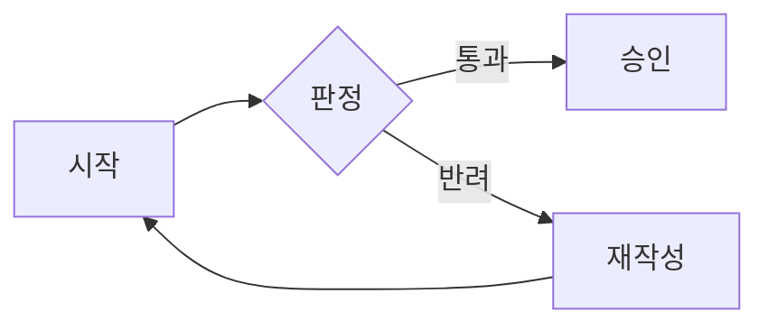

# 요소 검증 문서

본문 **굵게**·*기울임*·`인라인코드`·[링크](https://example.com) 포함 단락.

## 1. 표

### 기본 표 (헤더+본문)

| 구분 | 항목 | 비고 |
|------|------|------|
| A | 값1 | 정상 |
| B | **강조값** | `코드셀` |

### 2열 라벨 표 (kv 규약)

| 라벨 | 내용 |
|------|------|
| 일시 | 2026-11-16 |
| 작성자 | 홍길동 |

### 병합 표 (colspan·rowspan)

<table>
<thead><tr><th>분류</th><th>항목</th><th>값</th></tr></thead>
<tbody>
<tr><td rowspan="2">공통</td><td>a</td><td>1</td></tr>
<tr><td>b</td><td>2</td></tr>
<tr><td colspan="2">가로병합</td><td>3</td></tr>
</tbody>
</table>

## 2. Mermaid 다이어그램



## 3. 이미지

### 로컬 파일 이미지


### data URI 이미지


## 4. 목록·코드·인용

- 순서 없는 항목
- 두 번째 항목

1. 순서 첫째
2. 순서 둘째

```text
def probe():
    return "코드 블록 보존"
```

> 콜아웃 인용문 — 좌측 바·배경 확인.

## 5. 앱 마커 (누수 금지)

:::sign
작성자: 홍길동 {{img:author}}
:::end

:::approve 부장|차장|과장

:::closing 끝. 이상입니다.
